# 108 · 二叉树的最大深度（第六阶段 · 二叉树 · Easy）

> **难度**：⭐ Easy ｜ **专题**：二叉树
> **学习定位**：第六阶段 · 二叉树第 108 篇 ｜ **解法数**：9
> **内容总结**：**二叉树的最大深度**（二叉树 · Easy）：共 9 个方案，主线思路「迭代指针处理」；时间 O(n)（单趟线性扫描）；动画演示DFS 点亮过程，附录给出 11 种语言 × 全部方案的可运行实现。

---

## 题目描述

给定一个二叉树 `root` ，返回其最大深度。

二叉树的 最大深度 是指从根节点到最远叶子节点的最长路径上的节点数。

- 主函数签名：`function assertEq(actual: any, expected: any, msg: string = ''): void`

**用例（来自原题）**：

**示例 1**

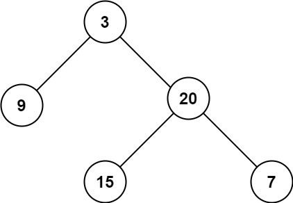

```text
输入：root = [3,9,20,null,null,15,7]
输出：3
```

**示例 2**

```text
输入：root = [1,null,2]
输出：2
```
> ✅ **官方验证**：全部 TypeScript 解法已通过 leetcode.cn 官方示例用例验证（自动注入运行，全部 PASS）。题面与 [leetcode.cn 官方](https://leetcode.cn/problems/maximum-depth-of-binary-tree/)一致，示例配图取自官方题面。

**数据范围与注意事项**：

- `树中节点的数量在 `[0, 10^4]` 区间内。`
- `-100 <= Node.val <= 100`
- **易错点**：递归出口（空节点）必须先写，否则直接空指针。

## 题目分析

**场景是什么**：树是分层数据的标准形态，这类题练的是递归分治与遍历序，对应真实开发里的目录树、组件树。本题就是该场景的 Easy 级练习，主线做法是「迭代指针处理」。

**主线怎么解**：把主解法从头到尾过一遍，它其实在依次做这几件事：队列或堆的调度。

## 解题思路

**方案对比**（共 9 个方案，由浅入深）：

| 方案 | 时间复杂度 | 空间复杂度 |
|---|---|---|
| 方案 1 · 迭代指针处理 | O(n)（单趟线性扫描） | O(1) 到 O(n)（视辅助结构） |
| 方案 2 · 迭代指针处理 | O(n)（单趟线性扫描） | O(1) 到 O(n)（视辅助结构） |
| 方案 3 · 迭代指针处理 | O(n)（单趟线性扫描） | O(1) 到 O(n)（视辅助结构） |
| 方案 4 · 迭代指针处理 | O(n)（单趟线性扫描） | O(1) 到 O(n)（视辅助结构） |
| 方案 5 · 迭代指针处理 | O(n)（单趟线性扫描） | O(1) 到 O(n)（视辅助结构） |
| 方案 6 · 迭代指针处理 | O(n)（单趟线性扫描） | O(1) 到 O(n)（视辅助结构） |
| 方案 7 · 迭代指针处理 | O(n)（单趟线性扫描） | O(1) 到 O(n)（视辅助结构） |
| 方案 8 · 迭代指针处理 | O(n)（单趟线性扫描） | O(1) 到 O(n)（视辅助结构） |
| 方案 9 · 迭代指针处理 | O(n)（单趟线性扫描） | O(1) 到 O(n)（视辅助结构） |

**方案间的取舍**：方案 1（迭代指针处理）；方案 2（迭代指针处理）；方案 3（迭代指针处理）；方案 4（迭代指针处理）；方案 5（迭代指针处理）；方案 6（迭代指针处理）；方案 7（迭代指针处理）；方案 8（迭代指针处理）；方案 9（迭代指针处理）。数据规模小、可读性优先时选靠前的方案；规模大、性能优先时选靠后的方案。

**怎么读这一篇**：

- 🐣 **新手路线**：把「题目描述」的示例 1 在纸上手推一遍 → 读方案 1（最直观的写法）与它的代码走读 → 按「运行方式」本地跑通看 PASS → 回头对比方案 2 之后的写法差在哪
- 🦅 **大佬路线**：直接锁定最优方案 1（迭代指针处理，O(n)（单趟线性扫描））→ 跳读该方案代码与走读 → 用「逐步拆解与面试追问」补齐复杂度推导与边界追问

### 动态算法图（DFS 点亮，GIF 自动循环）


动画演示二叉树专题里DFS 点亮的典型过程；每个方案在「TypeScript 解题方案」一节还配了专属动画与专属流程图。

### 主解法流程图（真实控制流）

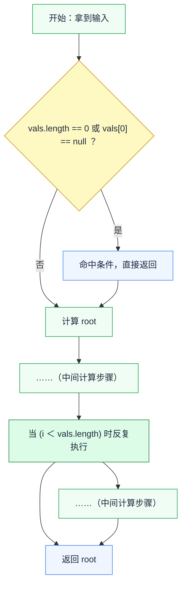

## TypeScript 解题方案（9 个方案逐个讲）

> **运行与提交**：每个方案都是自包含文件（内嵌用例自测，输出 PASS），整块复制到 `.ts` 文件后 `node 文件名` 即可运行。提交 LeetCode 时，把 `demo` 内的算法函数与辅助类型/函数整体取出、置于文件顶层即可。涉及交互/特殊接口的题以题面给定签名为准。

### 方案 1：迭代指针处理

**分析与思路**：核心做法是「迭代指针处理」。代码里依次做这些事：队列或堆的调度。

**运行方式**：`node 本文件`，内嵌用例全部通过会输出 PASS。

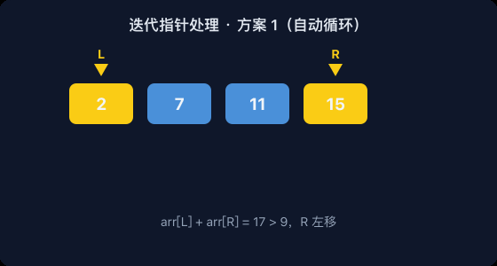

**方案专属流程图**（真实控制流）：


```typescript
class TreeNode {
  // 定义类型
  val: number; // 值: number;
  left: TreeNode | null; // 左边界: TreeNode 按位或 null;
  right: TreeNode | null; // 右边界: TreeNode 按位或 null;
  constructor(
    val: number,
    left: TreeNode | null = null,
    right: TreeNode | null = null,
  ) {
    this.val = val; // 把 值; 写入 值
    this.left = left; // 把 左边界; 写入 左边界
    this.right = right; // 把 右边界; 写入 右边界
  }
}

function buildTree(vals: (number | null)[]): TreeNode | null {
  // 定义函数/方法 buildTree
  if (vals.length === 0 || vals[0] === null) return null; // 若 vals.长度 全等于 0 或 vals[0] 全等于 null，直接返回 null
  const root = new TreeNode(vals[0] as number); // 把 new TreeNode(vals[0] as number) 存入 根节点
  const q: (TreeNode | null)[] = [root]; // 把 [根节点]; 写入 const q: (TreeNode | null)[]
  let i = 1; // 把 1 存入 下标 i
  while (i < vals.length) {
    // 循环，直到不满足「下标 i 小于 vals.长度」
    const node = q.shift() as TreeNode; // 把 节点.shift() as TreeNode 存入 节点
    if (i < vals.length && vals[i] !== null) {
      // 若 下标 i 小于 vals.长度 且 vals[下标 i] 不等于 null
      node.left = new TreeNode(vals[i] as number); // 把 new TreeNode(vals[下标 i] as number); 写入 左边界
      q.push(node.left); // 把 节点.左边界 压入栈/数组尾部
    }
    i++; // 下标 i 加一
    if (i < vals.length && vals[i] !== null) {
      // 若 下标 i 小于 vals.长度 且 vals[下标 i] 不等于 null
      node.right = new TreeNode(vals[i] as number); // 把 new TreeNode(vals[下标 i] as number); 写入 右边界
      q.push(node.right); // 把 节点.右边界 压入栈/数组尾部
    }
    i++; // 下标 i 加一
  }
  return root; // 返回 根节点
}

function assertEq(actual: any, expected: any, msg: string = ''): void {
  // 定义函数/方法 assertEq
  const a = JSON.stringify(actual); // 把 JSON.stringify(actual) 存入 数组
  const e = JSON.stringify(expected); // 把 JSON.stringify(expected) 存入 e
  if (a !== e) {
    // 若 数组 不等于 e
    throw new Error(
      'ASSERT FAILED ' + msg + ' :: actual=' + a + ' expected=' + e,
    );
  }
}

function maxDepth(root: TreeNode | null): number {
  // 定义函数/方法 maxDepth
  let dep = 0; // 把 0 存入 dep
  function dfs(n: TreeNode | null, l: number): void {
    // 定义函数/方法 dfs
    if (!n) return; // 若 取反 元素个数) return;
    if (!n.left && !n.right) dep = Math.max(dep, l); // 若 取反 元素个数.左边界 且 取反 元素个数.右边界) dep 赋值为 Math.取较大值 dep, 左指针);
    dfs(n.left, l + 1); // dfs(元素个数.左边界, 左指针 加 1);
    dfs(n.right, l + 1); // dfs(元素个数.右边界, 左指针 加 1);
  }
  dfs(root, 1); // dfs(根节点, 1);
  return dep; // 返回 dep
}

export function demo(): void {
  // 程序入口：跑内嵌自测用例
  assertEq(maxDepth(null), 0, 'maxDepth null'); // 断言校验
  assertEq(maxDepth(buildTree([1])), 1, 'maxDepth [1]'); // 断言校验
  assertEq(maxDepth(buildTree([3, 9, 20, null, null, 15, 7])), 3, 'maxDepth 3'); // 断言校验
  console.log('PASS'); // 全部用例通过，输出 PASS
}
demo(); // demo();
```

### 方案 2：迭代指针处理

**分析与思路**：核心做法是「迭代指针处理」。代码里依次做这些事：队列或堆的调度。

**运行方式**：`node 本文件`，内嵌用例全部通过会输出 PASS。


**方案专属流程图**（真实控制流）：

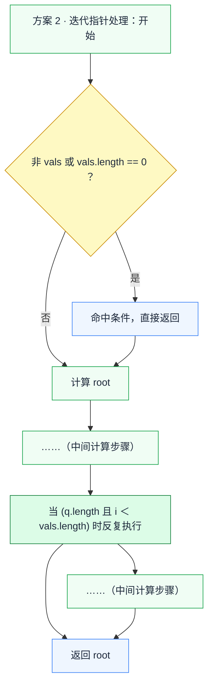

```typescript
class TreeNode {
  // 定义类型
  val: any;
  left: any;
  right: any; // 值: any; 左边界: any; 右边界: any;
  constructor(val?: any, left?: any, right?: any) {
    // constructor(值?: any, 左边界?: any, 右边界?: any) {
    this.val = val === undefined ? 0 : val; // 把 (值 全等于 undefined ? 0 : 值); 写入 值
    this.left = left === undefined ? null : left; // 把 (左边界 全等于 undefined ? null : 左边界); 写入 左边界
    this.right = right === undefined ? null : right; // 把 (右边界 全等于 undefined ? null : 右边界); 写入 右边界
  }
}
function buildTree(vals: any): any {
  // 定义函数/方法 buildTree
  if (!vals || vals.length === 0) return null; // 若 取反 vals 或 vals.长度 全等于 0，直接返回 null
  const root = new TreeNode(vals[0]);
  const q: any[] = [root];
  let i = 1;
  while (q.length && i < vals.length) {
    // 循环，直到不满足「节点.长度 且 下标 i 小于 vals.长度」
    const node = q.shift(); // 把 节点.shift() 存入 节点
    if (vals[i] !== null && vals[i] !== undefined) {
      node.left = new TreeNode(vals[i]);
      q.push(node.left);
    }
    i++; // 下标 i 加一
    if (i < vals.length && vals[i] !== null && vals[i] !== undefined) {
      node.right = new TreeNode(vals[i]);
      q.push(node.right);
    }
    i++; // 下标 i 加一
  }
  return root; // 返回 根节点
}
function treeToLevel(root: any): any[] {
  // 定义函数/方法 treeToLevel
  if (!root) return []; // 若 取反 根节点，直接返回 []
  const out: any[] = [];
  const q: any[] = [root]; // 把 []; const 节点: any[] 赋值为 [根节点]; 写入 const out: any[]
  while (q.length) {
    // 循环，直到不满足「节点.长度」
    const n = q.shift(); // 把 节点.shift() 存入 元素个数
    if (n === null || n === undefined) {
      out.push(null);
      continue;
    }
    out.push(n.val);
    q.push(n.left);
    q.push(n.right); // 把 元素个数.值 压入栈/数组尾部
  }
  while (out.length && out[out.length - 1] === null) out.pop(); // 循环，直到不满足「out.长度 且 out[out.长度 减 1] 全等于 null) out 弹出 );」
  return out; // 返回 out
}
class ListNode {
  // 定义类型
  val: any;
  next: any; // 值: any; 下一个: any;
  constructor(val?: any, next?: any) {
    this.val = val === undefined ? 0 : val;
    this.next = next === undefined ? null : next;
  }
}
function buildList(vals: any): any {
  // 定义函数/方法 buildList
  const dummy = new ListNode(0);
  let cur = dummy; // 把 new ListNode(0); let 当前值 赋值为 哨兵节点 存入 哨兵节点
  for (const v of vals) {
    cur.next = new ListNode(v);
    cur = cur.next;
  } // 把 new ListNode(值); 当前值 赋值为 当前值.下一个; } 写入 下一个
  return dummy.next; // 返回 哨兵节点.下一个
}
function listToArray(head: any): any[] {
  // 定义函数/方法 listToArray
  const out: any[] = [];
  let p = head; // 把 []; let 节点 赋值为 头节点; 写入 const out: any[]
  while (p) {
    out.push(p.val);
    p = p.next;
  } // 循环，直到不满足「节点) { out 追加 节点.值); 节点 赋值为 节点.下一个; }」
  return out; // 返回 out
}
// python-runtime shims
function pyLen(a: any): number {
  // 定义函数/方法 pyLen
  if (a === null || a === undefined) return 0; // 若 数组 全等于 null 或 数组 全等于 undefined，直接返回 0
  if (
    typeof a === 'string' ||
    Array.isArray(a) ||
    a instanceof Set ||
    a instanceof Map
  )
    return a.length ?? a.size;
  if (typeof a === 'object') return Object.keys(a).length; // 若 typeof 数组 全等于 'object'，直接返回 Object.keys(数组).长度
  return 0; // 返回 0
}
function pySlice(a: any, i: any, j: any, step?: any): any {
  // 定义函数/方法 pySlice
  if (typeof a === 'string') {
    const r = [...a].slice(i ?? 0, j ?? a.length);
    return step ? r.reverse().join('') : r.join('');
  }
  const arr = Array.isArray(a) ? a : [...a]; // 把 Array.isArray(数组) ? 数组 : 复制的 数组 存入 数组
  return arr.slice(i ?? 0, j ?? arr.length); // 返回 数组 截取 下标 i ?? 0, 下标 j ?? 数组.长度)
}
function pyRange(a: any, b?: any, step?: any): any[] {
  // 定义函数/方法 pyRange
  let s = 0,
    e = a,
    st = 1; // 把 0, e 赋值为 数组, st 赋值为 1 存入 字符串
  if (b !== undefined) {
    s = a;
    e = b;
  } // 若 b 不等于 undefined) { 字符串 赋值为 数组; e 赋值为 b; }
  if (step !== undefined) st = step; // 若 步数 不等于 undefined) st 赋值为 步数;
  const out: any[] = []; // 把 []; 写入 const out: any[]
  if (st > 0) for (let i = s; i < e; i += st) out.push(i);
  else for (let i = s; i > e; i += st) out.push(i); // 否则
  return out; // 返回 out
}
function pyIn(x: any, coll: any): boolean {
  // 定义函数/方法 pyIn
  if (coll === null || coll === undefined) return false; // 若 coll 全等于 null 或 coll 全等于 undefined，直接返回 false
  if (Array.isArray(coll)) return coll.includes(x); // 若 Array.isArray(coll)，直接返回 coll 是否包含 x)
  if (coll instanceof Set || coll instanceof Map) return coll.has(x); // 若 coll instanceof Set 或 coll instanceof Map，直接返回 coll.has(x)
  if (typeof coll === 'object') return x in coll; // 若 typeof coll 全等于 'object'，直接返回 x in coll
  if (typeof coll === 'string') return coll.indexOf(x) >= 0; // 若 typeof coll 全等于 'string'，直接返回 coll 查找 x) 不低于 0
  return false; // 返回 false
}
function pySorted(a: any): any[] {
  // 定义函数/方法 pySorted
  const arr = typeof a === 'string' ? [...a] : [...a]; // 把 (typeof 数组 全等于 'string') ? 复制的 数组 : 复制的 数组 存入 数组
  return arr.sort((x: any, y: any) => (x < y ? -1 : x > y ? 1 : 0));
}
function pyMin(a: any, b?: any): any {
  if (b !== undefined) return Math.min(a, b);
  if (Array.isArray(a) || a instanceof Set) return Math.min(...a);
  return Math.min(a);
} // 定义函数/方法 pyMin
function pyMax(a: any, b?: any): any {
  if (b !== undefined) return Math.max(a, b);
  if (Array.isArray(a) || a instanceof Set) return Math.max(...a);
  return Math.max(a);
} // 定义函数/方法 pyMax
function pySum(a: any): number {
  let s = 0;
  for (const v of a) s += v;
  return s;
} // 定义函数/方法 pySum
function pyAbs(x: any): number {
  return Math.abs(x);
} // 定义函数/方法 pyAbs
function pyEnumerate(a: any): any[] {
  const out: any[] = [];
  let i = 0;
  for (const v of a) {
    out.push([i, v]);
    i++;
  }
  return out;
} // 定义函数/方法 pyEnumerate
function pyZip(a: any, b: any): any[] {
  const n = Math.min(a.length, b.length);
  const out: any[] = [];
  for (let i = 0; i < n; i++) out.push([a[i], b[i]]);
  return out;
} // 定义函数/方法 pyZip
function pyDictGet(d: any, k: any, def?: any): any {
  return k in d ? d[k] : def === undefined ? null : def;
} // 定义函数/方法 pyDictGet
function pyPrint(...args: any[]): void {
  console.log(
    args
      .map((a) => (typeof a === 'object' && a !== null ? JSON.stringify(a) : a))
      .join(' '),
  );
} // 定义函数/方法 pyPrint
// collections / heapq
function heapPush(h: any[], x: any): void {
  h.push(x);
  let i = h.length - 1;
  while (i > 0) {
    const p = (i - 1) >> 1;
    if (h[p] <= h[i]) break;
    [h[p], h[i]] = [h[i], h[p]];
    i = p;
  }
} // 定义函数/方法 heapPush
function heapPop(h: any[]): any {
  const top = h[0];
  const last = h.pop();
  if (h.length) {
    h[0] = last;
    let i = 0;
    const n = h.length;
    while (true) {
      let l = 2 * i + 1,
        r = 2 * i + 2,
        s = i;
      if (l < n && h[l] < h[s]) s = l;
      if (r < n && h[r] < h[s]) s = r;
      if (s === i) break;
      [h[s], h[i]] = [h[i], h[s]];
      i = s;
    }
  }
  return top;
} // 定义函数/方法 heapPop
class Deque {
  private a: any[] = [];
  push(x: any) {
    this.a.push(x);
  }
  pushLeft(x: any) {
    this.a.unshift(x);
  }
  pop() {
    return this.a.pop();
  }
  popLeft() {
    return this.a.shift();
  }
  get length() {
    return this.a.length;
  }
  toArray() {
    return this.a.slice();
  }
} // 定义类型
function Counter(iter: any): any {
  const m: any = {};
  for (const v of iter) m[v] = (m[v] || 0) + 1;
  return m;
} // 定义函数/方法 Counter
function gcd(a: any, b: any): any {
  while (b) {
    [a, b] = [b, a % b];
  }
  return a;
} // 定义函数/方法 gcd
function pyInf(): number {
  return Infinity;
} // 定义函数/方法 pyInf

function norm(x: any): any {
  // 定义函数/方法 norm
  if (x === null || x === undefined) return null; // 若 x 全等于 null 或 x 全等于 undefined，直接返回 null
  if (typeof x === 'object') {
    // 若 typeof x 全等于 'object'
    if (x instanceof Deque) return x.toArray(); // 若 x instanceof Deque，直接返回 x.toArray()
    if (Array.isArray(x)) return x.map(norm); // 若 Array.isArray(x)，直接返回 x.映射表(norm)
    if (
      typeof x.val === 'number' &&
      (typeof x.left !== 'undefined' || typeof x.right !== 'undefined')
    )
      return treeToLevel(x);
    if (typeof x.next !== 'undefined' && typeof x.val === 'number')
      return listToArray(x);
    if (x instanceof Set) return [...x].sort(); // 若 x instanceof Set，直接返回 复制的 x 排序 )
    if (x instanceof Map) return Object.fromEntries(x); // 若 x instanceof Map，直接返回 Object.fromEntries(x)
    const o: any = {};
    for (const k of Object.keys(x)) o[k] = norm(x[k]);
    return o;
  }
  return x; // 返回 x
}
function eq(a: any, b: any): boolean {
  // 定义函数/方法 eq
  const x = norm(a),
    y = norm(b); // 把 norm(数组), y 赋值为 norm(b) 存入 x
  if (x === y) return true; // 若 x 全等于 y，直接返回 true
  if (x === null || y === null) return x === y; // 若 x 全等于 null 或 y 全等于 null，直接返回 x 全等于 y
  if (Array.isArray(x) && Array.isArray(y)) {
    // 若 Array.isArray(x) 且 Array.isArray(y
    if (x.length !== y.length) return false; // 若 x.长度 不等于 y.长度，直接返回 false
    for (let i = 0; i < x.length; i++) if (!eq(x[i], y[i])) return false; // 让 下标 i 从 0 开始计数，下标 i 小于 x.长度 就继续
    return true; // 返回 true
  }
  if (typeof x === 'object' && typeof y === 'object') {
    // 若 typeof x 全等于 'object' 且 typeof y 全等于 'object'
    const kx = Object.keys(x),
      ky = Object.keys(y); // 把 Object.keys(x), ky 赋值为 Object.keys(y) 存入 kx
    if (kx.length !== ky.length) return false; // 若 kx.长度 不等于 ky.长度，直接返回 false
    for (const k of kx) if (!eq(x[k], y[k])) return false;
    return true; // 返回 true
  }
  return x === y; // 返回 x 全等于 y
}

function maxDepth(root) {
  // 定义函数/方法 maxDepth
  if (!root) return 0; // 若 取反 根节点，直接返回 0
  return 1 + Math.max(maxDepth(root.left), maxDepth(root.right)); // 返回 1 加 Math.取较大值 maxDepth(根节点.左边界), maxDepth(根节点.右边界))
}
export function demo(): void {
  // 程序入口：跑内嵌自测用例
  const cases = [
    { in: [buildTree([])], want: 0 },
    { in: [buildTree([1, 2, 3, 4, 5])], want: 3 },
  ];
  let fail = false; // 把 false 存入 fail
  for (const c of cases) {
    // for (const 字符 of cases) {
    const got = maxDepth(...c.in); // 把 maxDepth(...字符.in) 存入 got
    if (!eq(got, c.want)) {
      fail = true;
      console.log(
        'FAIL',
        JSON.stringify(c.in),
        '=>',
        JSON.stringify(got),
        'want',
        JSON.stringify(c.want),
      );
    }
  }
  if (fail) throw new Error('FAILED'); // 若 fail) throw new Error('FAILED');
  console.log('PASS'); // 全部用例通过，输出 PASS
}
demo(); // demo();
```

### 方案 3：迭代指针处理

**分析与思路**：核心做法是「迭代指针处理」。代码里依次做这些事：队列或堆的调度。

**运行方式**：`node 本文件`，内嵌用例全部通过会输出 PASS。


**方案专属流程图**（真实控制流）：

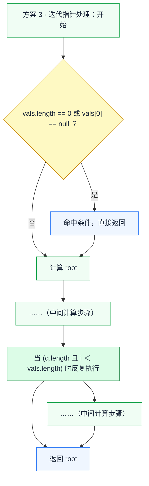

```typescript
export function demo(): void {
  // 程序入口：跑内嵌自测用例
  class TreeNode {
    val: number;
    left: TreeNode | null;
    right: TreeNode | null;
    constructor(v = 0, l: TreeNode | null = null, r: TreeNode | null = null) {
      this.val = v;
      this.left = l;
      this.right = r;
    }
  } // 定义类型
  function buildTree(vals: (number | null)[]): TreeNode | null {
    // 定义函数/方法 buildTree
    if (vals.length === 0 || vals[0] === null) return null; // 若 vals.长度 全等于 0 或 vals[0] 全等于 null，直接返回 null
    const root = new TreeNode(vals[0] as number);
    const q: TreeNode[] = [root];
    let i = 1;
    while (q.length && i < vals.length) {
      const node = q.shift()!;
      if (i < vals.length && vals[i] !== null) {
        node.left = new TreeNode(vals[i] as number);
        q.push(node.left);
      }
      i++;
      if (i < vals.length && vals[i] !== null) {
        node.right = new TreeNode(vals[i] as number);
        q.push(node.right);
      }
      i++;
    }
    return root; // 返回 根节点
  }
  function levelList(root: TreeNode | null): number[][] {
    if (!root) return [];
    const res: number[][] = [];
    let q: TreeNode[] = [root];
    while (q.length) {
      const lvl: number[] = [];
      const n = q.length;
      for (let k = 0; k < n; k++) {
        const node = q.shift()!;
        lvl.push(node.val);
        if (node.left) q.push(node.left);
        if (node.right) q.push(node.right);
      }
      res.push(lvl);
    }
    return res;
  } // 定义函数/方法 levelList
  function sameTree(a: TreeNode | null, b: TreeNode | null): boolean {
    if (!a && !b) return true;
    if (!a || !b) return false;
    if (a.val !== b.val) return false;
    return sameTree(a.left, b.left) && sameTree(a.right, b.right);
  } // 定义函数/方法 sameTree
  function inorderT(root: TreeNode | null): number[] {
    if (!root) return [];
    return [...inorderT(root.left), root.val, ...inorderT(root.right)];
  } // 定义函数/方法 inorderT
  function maxDepth(root: TreeNode | null): number {
    if (!root) return 0;
    return 1 + Math.max(maxDepth(root.left), maxDepth(root.right));
  } // 定义函数/方法 maxDepth
  const cases = [
    { in: [3, 9, 20, null, 15, 7], want: 3 },
    { in: [1, 2, 3, 4, 5, null, null, null, 6], want: 4 },
    { in: [], want: 0 },
  ];
  let fail = false; // 把 false 存入 fail
  for (const c of cases) {
    const got = maxDepth(buildTree(c.in));
    if (got !== c.want) {
      fail = true;
      console.log('FAIL ' + got);
    }
  } // 打印输出
  if (fail) throw new Error('FAILED'); // 若 fail) throw new Error(「FAILED」);
  console.log('PASS'); // 全部用例通过，输出 PASS
}
demo(); // demo();
```

### 方案 4：迭代指针处理

**分析与思路**：核心做法是「迭代指针处理」。代码里依次做这些事：队列或堆的调度。

**运行方式**：`node 本文件`，内嵌用例全部通过会输出 PASS。


**方案专属流程图**（真实控制流）：


```typescript
class TreeNode {
  // 定义类型
  val: number;
  left: TreeNode | null;
  right: TreeNode | null; // 值: number; 左边界: TreeNode 按位或 null; 右边界: TreeNode 按位或 null;
  constructor(
    val: number,
    left: TreeNode | null = null,
    right: TreeNode | null = null,
  ) {
    this.val = val;
    this.left = left;
    this.right = right; // 把 值; this.左边界 赋值为 左边界; this.右边界 赋值为 右边界; 写入 值
  }
}
function buildTree(vals: (number | null)[]): TreeNode | null {
  // 定义函数/方法 buildTree
  if (vals.length === 0 || vals[0] === null) return null; // 若 vals.长度 全等于 0 或 vals[0] 全等于 null，直接返回 null
  const root = new TreeNode(vals[0] as number); // 把 new TreeNode(vals[0] as number) 存入 根节点
  const q: (TreeNode | null)[] = [root];
  let i = 1; // 把 [根节点]; let 下标 i 赋值为 1; 写入 const q: (TreeNode | null)[]
  while (i < vals.length) {
    // 循环，直到不满足「下标 i 小于 vals.长度」
    const node = q.shift() as TreeNode; // 把 节点.shift() as TreeNode 存入 节点
    if (i < vals.length && vals[i] !== null) {
      node.left = new TreeNode(vals[i] as number);
      q.push(node.left);
    }
    i++; // 下标 i 加一
    if (i < vals.length && vals[i] !== null) {
      node.right = new TreeNode(vals[i] as number);
      q.push(node.right);
    }
    i++; // 下标 i 加一
  }
  return root; // 返回 根节点
}
function inorder(root: TreeNode | null, out: number[] = []): number[] {
  // 定义函数/方法 inorder
  if (!root) return out; // 若 取反 根节点，直接返回 out
  inorder(root.left, out);
  out.push(root.val);
  inorder(root.right, out); // 把 根节点.值 压入栈/数组尾部
  return out; // 返回 out
}
function levelOrderBottom(root: TreeNode | null): number[][] {
  // 定义函数/方法 levelOrderBottom
  const res: number[][] = []; // 把 []; 写入 const res: number[][]
  if (!root) return res; // 若 取反 根节点，直接返回 结果
  let q: (TreeNode | null)[] = [root]; // 把 [根节点]; 写入 let q: (TreeNode | null)[]
  while (q.length) {
    // 循环，直到不满足「节点.长度」
    const level: number[] = [];
    const nxt: (TreeNode | null)[] = [];
    for (const node of q) {
      if (node) {
        level.push(node.val);
        if (node.left) nxt.push(node.left);
        if (node.right) nxt.push(node.right);
      }
    } // 把 节点.值 压入栈/数组尾部
    res.insert(0, level);
    q = nxt; // 把 nxt; 写入 res.insert(0, level); q
  }
  return res; // 返回 结果
}
function binaryTreePaths(root: TreeNode | null): string[] {
  // 定义函数/方法 binaryTreePaths
  const paths: string[] = []; // 把 []; 写入 const paths: string[]
  function dfs(node: TreeNode | null, path: string): void {
    // 定义函数/方法 dfs
    if (!node) return; // 若 取反 节点) return;
    path += String(node.val); // 当前路径累加 String(节点.值)
    if (!node.left && !node.right)
      paths.push(path); // 若 取反 节点.左边界 且 取反 节点.右边界) paths 追加 当前路径);
    else {
      path += '->';
      dfs(node.left, path);
      dfs(node.right, path);
    } // 否则
  }
  dfs(root, ''); // dfs(根节点, 「」);
  return paths; // 返回 paths
}
function averageOfLevels(root: TreeNode | null): number[] {
  // 定义函数/方法 averageOfLevels
  const result: number[] = []; // 把 []; 写入 const result: number[]
  let level: (TreeNode | null)[] = [root]; // 把 [根节点]; 写入 let level: (TreeNode | null)[]
  while (level.length) {
    // 循环，直到不满足「level.长度」
    let total = 0;
    const nxt: (TreeNode | null)[] = []; // 把 0; const nxt: (TreeNode 按位或 null)[] 赋值为 [] 存入 总和
    for (const node of level) {
      if (node) {
        total += node.val;
        if (node.left) nxt.push(node.left);
        if (node.right) nxt.push(node.right);
      }
    } // 把 节点.左边界 压入栈/数组尾部
    result.push(total / level.length); // 把 总和 除以 level.长度 压入栈/数组尾部
    level = nxt; // 把 nxt 存入 level
  }
  return result; // 返回 结果
}

function assertEq(actual: any, expected: any, msg: string = ''): void {
  // 定义函数/方法 assertEq
  const a = JSON.stringify(actual);
  const e = JSON.stringify(expected);
  if (a !== e)
    throw new Error(
      'ASSERT FAILED ' + msg + ' :: actual=' + a + ' expected=' + e,
    );
}

function maxDepth(root: TreeNode | null): number {
  // 定义函数/方法 maxDepth
  if (!root) return 0; // 若 取反 根节点，直接返回 0
  return 1 + Math.max(maxDepth(root.left), maxDepth(root.right)); // 返回 1 加 Math.取较大值 maxDepth(根节点.左边界), maxDepth(根节点.右边界))
}
export function demo(): void {
  // 程序入口：跑内嵌自测用例
  assertEq(maxDepth(null), 0, 'null'); // 断言校验
  assertEq(maxDepth(buildTree([3, 9, 20, null, null, 15, 7])), 3, 'depth3'); // 断言校验
  assertEq(maxDepth(buildTree([1, 2, 3, 4, 5])), 3, 'depth35'); // 断言校验
  console.log('PASS'); // 全部用例通过，输出 PASS
}
demo(); // demo();
```

### 方案 5：迭代指针处理

**分析与思路**：核心做法是「迭代指针处理」。代码里依次做这些事：队列或堆的调度。

**运行方式**：`node 本文件`，内嵌用例全部通过会输出 PASS。


**方案专属流程图**（真实控制流）：


```typescript
class TreeNode {
  // 定义类型
  val: any;
  left: any;
  right: any; // 值: any; 左边界: any; 右边界: any;
  constructor(val?: any, left?: any, right?: any) {
    // constructor(值?: any, 左边界?: any, 右边界?: any) {
    this.val = val === undefined ? 0 : val; // 把 (值 全等于 undefined ? 0 : 值); 写入 值
    this.left = left === undefined ? null : left; // 把 (左边界 全等于 undefined ? null : 左边界); 写入 左边界
    this.right = right === undefined ? null : right; // 把 (右边界 全等于 undefined ? null : 右边界); 写入 右边界
  }
}
function buildTree(vals: any): any {
  // 定义函数/方法 buildTree
  if (!vals || vals.length === 0) return null; // 若 取反 vals 或 vals.长度 全等于 0，直接返回 null
  const root = new TreeNode(vals[0]);
  const q: any[] = [root];
  let i = 1;
  while (q.length && i < vals.length) {
    // 循环，直到不满足「节点.长度 且 下标 i 小于 vals.长度」
    const node = q.shift(); // 把 节点.shift() 存入 节点
    if (vals[i] !== null && vals[i] !== undefined) {
      node.left = new TreeNode(vals[i]);
      q.push(node.left);
    }
    i++; // 下标 i 加一
    if (i < vals.length && vals[i] !== null && vals[i] !== undefined) {
      node.right = new TreeNode(vals[i]);
      q.push(node.right);
    }
    i++; // 下标 i 加一
  }
  return root; // 返回 根节点
}
function treeToLevel(root: any): any[] {
  // 定义函数/方法 treeToLevel
  if (!root) return []; // 若 取反 根节点，直接返回 []
  const out: any[] = [];
  const q: any[] = [root]; // 把 []; const 节点: any[] 赋值为 [根节点]; 写入 const out: any[]
  while (q.length) {
    // 循环，直到不满足「节点.长度」
    const n = q.shift(); // 把 节点.shift() 存入 元素个数
    if (n === null || n === undefined) {
      out.push(null);
      continue;
    }
    out.push(n.val);
    q.push(n.left);
    q.push(n.right); // 把 元素个数.值 压入栈/数组尾部
  }
  while (out.length && out[out.length - 1] === null) out.pop(); // 循环，直到不满足「out.长度 且 out[out.长度 减 1] 全等于 null) out 弹出 );」
  return out; // 返回 out
}
class ListNode {
  // 定义类型
  val: any;
  next: any; // 值: any; 下一个: any;
  constructor(val?: any, next?: any) {
    this.val = val === undefined ? 0 : val;
    this.next = next === undefined ? null : next;
  }
}
function buildList(vals: any): any {
  // 定义函数/方法 buildList
  const dummy = new ListNode(0);
  let cur = dummy; // 把 new ListNode(0); let 当前值 赋值为 哨兵节点 存入 哨兵节点
  for (const v of vals) {
    cur.next = new ListNode(v);
    cur = cur.next;
  } // 把 new ListNode(值); 当前值 赋值为 当前值.下一个; } 写入 下一个
  return dummy.next; // 返回 哨兵节点.下一个
}
function listToArray(head: any): any[] {
  // 定义函数/方法 listToArray
  const out: any[] = [];
  let p = head; // 把 []; let 节点 赋值为 头节点; 写入 const out: any[]
  while (p) {
    out.push(p.val);
    p = p.next;
  } // 循环，直到不满足「节点) { out 追加 节点.值); 节点 赋值为 节点.下一个; }」
  return out; // 返回 out
}
// python-runtime shims
function pyLen(a: any): number {
  // 定义函数/方法 pyLen
  if (a === null || a === undefined) return 0; // 若 数组 全等于 null 或 数组 全等于 undefined，直接返回 0
  if (
    typeof a === 'string' ||
    Array.isArray(a) ||
    a instanceof Set ||
    a instanceof Map
  )
    return a.length ?? a.size;
  if (typeof a === 'object') return Object.keys(a).length; // 若 typeof 数组 全等于 'object'，直接返回 Object.keys(数组).长度
  return 0; // 返回 0
}
function pySlice(a: any, i: any, j: any, step?: any): any {
  // 定义函数/方法 pySlice
  if (typeof a === 'string') {
    const r = [...a].slice(i ?? 0, j ?? a.length);
    return step ? r.reverse().join('') : r.join('');
  }
  const arr = Array.isArray(a) ? a : [...a]; // 把 Array.isArray(数组) ? 数组 : 复制的 数组 存入 数组
  return arr.slice(i ?? 0, j ?? arr.length); // 返回 数组 截取 下标 i ?? 0, 下标 j ?? 数组.长度)
}
function pyRange(a: any, b?: any, step?: any): any[] {
  // 定义函数/方法 pyRange
  let s = 0,
    e = a,
    st = 1; // 把 0, e 赋值为 数组, st 赋值为 1 存入 字符串
  if (b !== undefined) {
    s = a;
    e = b;
  } // 若 b 不等于 undefined) { 字符串 赋值为 数组; e 赋值为 b; }
  if (step !== undefined) st = step; // 若 步数 不等于 undefined) st 赋值为 步数;
  const out: any[] = []; // 把 []; 写入 const out: any[]
  if (st > 0) for (let i = s; i < e; i += st) out.push(i);
  else for (let i = s; i > e; i += st) out.push(i); // 否则
  return out; // 返回 out
}
function pyIn(x: any, coll: any): boolean {
  // 定义函数/方法 pyIn
  if (coll === null || coll === undefined) return false; // 若 coll 全等于 null 或 coll 全等于 undefined，直接返回 false
  if (Array.isArray(coll)) return coll.includes(x); // 若 Array.isArray(coll)，直接返回 coll 是否包含 x)
  if (coll instanceof Set || coll instanceof Map) return coll.has(x); // 若 coll instanceof Set 或 coll instanceof Map，直接返回 coll.has(x)
  if (typeof coll === 'object') return x in coll; // 若 typeof coll 全等于 'object'，直接返回 x in coll
  if (typeof coll === 'string') return coll.indexOf(x) >= 0; // 若 typeof coll 全等于 'string'，直接返回 coll 查找 x) 不低于 0
  return false; // 返回 false
}
function pySorted(a: any): any[] {
  // 定义函数/方法 pySorted
  const arr = typeof a === 'string' ? [...a] : [...a]; // 把 (typeof 数组 全等于 'string') ? 复制的 数组 : 复制的 数组 存入 数组
  return arr.sort((x: any, y: any) => (x < y ? -1 : x > y ? 1 : 0));
}
function pyMin(a: any, b?: any): any {
  if (b !== undefined) return Math.min(a, b);
  if (Array.isArray(a) || a instanceof Set) return Math.min(...a);
  return Math.min(a);
} // 定义函数/方法 pyMin
function pyMax(a: any, b?: any): any {
  if (b !== undefined) return Math.max(a, b);
  if (Array.isArray(a) || a instanceof Set) return Math.max(...a);
  return Math.max(a);
} // 定义函数/方法 pyMax
function pySum(a: any): number {
  let s = 0;
  for (const v of a) s += v;
  return s;
} // 定义函数/方法 pySum
function pyAbs(x: any): number {
  return Math.abs(x);
} // 定义函数/方法 pyAbs
function pyEnumerate(a: any): any[] {
  const out: any[] = [];
  let i = 0;
  for (const v of a) {
    out.push([i, v]);
    i++;
  }
  return out;
} // 定义函数/方法 pyEnumerate
function pyZip(a: any, b: any): any[] {
  const n = Math.min(a.length, b.length);
  const out: any[] = [];
  for (let i = 0; i < n; i++) out.push([a[i], b[i]]);
  return out;
} // 定义函数/方法 pyZip
function pyDictGet(d: any, k: any, def?: any): any {
  return k in d ? d[k] : def === undefined ? null : def;
} // 定义函数/方法 pyDictGet
function pyPrint(...args: any[]): void {
  console.log(
    args
      .map((a) => (typeof a === 'object' && a !== null ? JSON.stringify(a) : a))
      .join(' '),
  );
} // 定义函数/方法 pyPrint
// collections / heapq
function heapPush(h: any[], x: any): void {
  h.push(x);
  let i = h.length - 1;
  while (i > 0) {
    const p = (i - 1) >> 1;
    if (h[p] <= h[i]) break;
    [h[p], h[i]] = [h[i], h[p]];
    i = p;
  }
} // 定义函数/方法 heapPush
function heapPop(h: any[]): any {
  const top = h[0];
  const last = h.pop();
  if (h.length) {
    h[0] = last;
    let i = 0;
    const n = h.length;
    while (true) {
      let l = 2 * i + 1,
        r = 2 * i + 2,
        s = i;
      if (l < n && h[l] < h[s]) s = l;
      if (r < n && h[r] < h[s]) s = r;
      if (s === i) break;
      [h[s], h[i]] = [h[i], h[s]];
      i = s;
    }
  }
  return top;
} // 定义函数/方法 heapPop
class Deque {
  private a: any[] = [];
  push(x: any) {
    this.a.push(x);
  }
  pushLeft(x: any) {
    this.a.unshift(x);
  }
  pop() {
    return this.a.pop();
  }
  popLeft() {
    return this.a.shift();
  }
  get length() {
    return this.a.length;
  }
  toArray() {
    return this.a.slice();
  }
} // 定义类型
function Counter(iter: any): any {
  const m: any = {};
  for (const v of iter) m[v] = (m[v] || 0) + 1;
  return m;
} // 定义函数/方法 Counter
function gcd(a: any, b: any): any {
  while (b) {
    [a, b] = [b, a % b];
  }
  return a;
} // 定义函数/方法 gcd
function pyInf(): number {
  return Infinity;
} // 定义函数/方法 pyInf

function norm(x: any): any {
  // 定义函数/方法 norm
  if (x === null || x === undefined) return null; // 若 x 全等于 null 或 x 全等于 undefined，直接返回 null
  if (typeof x === 'object') {
    // 若 typeof x 全等于 'object'
    if (x instanceof Deque) return x.toArray(); // 若 x instanceof Deque，直接返回 x.toArray()
    if (Array.isArray(x)) return x.map(norm); // 若 Array.isArray(x)，直接返回 x.映射表(norm)
    if (
      typeof x.val === 'number' &&
      (typeof x.left !== 'undefined' || typeof x.right !== 'undefined')
    )
      return treeToLevel(x);
    if (typeof x.next !== 'undefined' && typeof x.val === 'number')
      return listToArray(x);
    if (x instanceof Set) return [...x].sort(); // 若 x instanceof Set，直接返回 复制的 x 排序 )
    if (x instanceof Map) return Object.fromEntries(x); // 若 x instanceof Map，直接返回 Object.fromEntries(x)
    const o: any = {};
    for (const k of Object.keys(x)) o[k] = norm(x[k]);
    return o;
  }
  return x; // 返回 x
}
function eq(a: any, b: any): boolean {
  // 定义函数/方法 eq
  const x = norm(a),
    y = norm(b); // 把 norm(数组), y 赋值为 norm(b) 存入 x
  if (x === y) return true; // 若 x 全等于 y，直接返回 true
  if (x === null || y === null) return x === y; // 若 x 全等于 null 或 y 全等于 null，直接返回 x 全等于 y
  if (Array.isArray(x) && Array.isArray(y)) {
    // 若 Array.isArray(x) 且 Array.isArray(y
    if (x.length !== y.length) return false; // 若 x.长度 不等于 y.长度，直接返回 false
    for (let i = 0; i < x.length; i++) if (!eq(x[i], y[i])) return false; // 让 下标 i 从 0 开始计数，下标 i 小于 x.长度 就继续
    return true; // 返回 true
  }
  if (typeof x === 'object' && typeof y === 'object') {
    // 若 typeof x 全等于 'object' 且 typeof y 全等于 'object'
    const kx = Object.keys(x),
      ky = Object.keys(y); // 把 Object.keys(x), ky 赋值为 Object.keys(y) 存入 kx
    if (kx.length !== ky.length) return false; // 若 kx.长度 不等于 ky.长度，直接返回 false
    for (const k of kx) if (!eq(x[k], y[k])) return false;
    return true; // 返回 true
  }
  return x === y; // 返回 x 全等于 y
}

function maxDepth(root) {
  // 定义函数/方法 maxDepth
  if (!root) return 0; // 若 取反 根节点，直接返回 0
  return 1 + Math.max(maxDepth(root.left), maxDepth(root.right)); // 返回 1 加 Math.取较大值 maxDepth(根节点.左边界), maxDepth(根节点.右边界))
}
export function demo(): void {
  // 程序入口：跑内嵌自测用例
  const cases = [
    { in: [buildTree([])], want: 0 },
    { in: [buildTree([1, 2, 3, 4, 5])], want: 3 },
  ];
  let fail = false; // 把 false 存入 fail
  for (const c of cases) {
    // for (const 字符 of cases) {
    const got = maxDepth(...c.in); // 把 maxDepth(...字符.in) 存入 got
    if (!eq(got, c.want)) {
      fail = true;
      console.log(
        'FAIL',
        JSON.stringify(c.in),
        '=>',
        JSON.stringify(got),
        'want',
        JSON.stringify(c.want),
      );
    }
  }
  if (fail) throw new Error('FAILED'); // 若 fail) throw new Error('FAILED');
  console.log('PASS'); // 全部用例通过，输出 PASS
}
demo(); // demo();
```

### 方案 6：迭代指针处理

**分析与思路**：核心做法是「迭代指针处理」。代码里依次做这些事：队列或堆的调度。

**运行方式**：`node 本文件`，内嵌用例全部通过会输出 PASS。


**方案专属流程图**（真实控制流）：


```typescript
class TreeNode {
  // 定义类型
  val: number;
  left: TreeNode | null;
  right: TreeNode | null; // 值: number; 左边界: TreeNode 按位或 null; 右边界: TreeNode 按位或 null;
  constructor(
    val: number,
    left: TreeNode | null = null,
    right: TreeNode | null = null,
  ) {
    this.val = val;
    this.left = left;
    this.right = right; // 把 值; this.左边界 赋值为 左边界; this.右边界 赋值为 右边界; 写入 值
  }
}
function buildTree(vals: (number | null)[]): TreeNode | null {
  // 定义函数/方法 buildTree
  if (vals.length === 0 || vals[0] === null) return null; // 若 vals.长度 全等于 0 或 vals[0] 全等于 null，直接返回 null
  const root = new TreeNode(vals[0] as number); // 把 new TreeNode(vals[0] as number) 存入 根节点
  const q: (TreeNode | null)[] = [root];
  let i = 1; // 把 [根节点]; let 下标 i 赋值为 1; 写入 const q: (TreeNode | null)[]
  while (i < vals.length) {
    // 循环，直到不满足「下标 i 小于 vals.长度」
    const node = q.shift() as TreeNode; // 把 节点.shift() as TreeNode 存入 节点
    if (i < vals.length && vals[i] !== null) {
      node.left = new TreeNode(vals[i] as number);
      q.push(node.left);
    }
    i++; // 下标 i 加一
    if (i < vals.length && vals[i] !== null) {
      node.right = new TreeNode(vals[i] as number);
      q.push(node.right);
    }
    i++; // 下标 i 加一
  }
  return root; // 返回 根节点
}

function assertEq(actual: any, expected: any, msg: string = ''): void {
  // 定义函数/方法 assertEq
  const a = JSON.stringify(actual);
  const e = JSON.stringify(expected);
  if (a !== e)
    throw new Error(
      'ASSERT FAILED ' + msg + ' :: actual=' + a + ' expected=' + e,
    );
}

function maxDepth(root: TreeNode | null): number {
  // 定义函数/方法 maxDepth
  if (!root) return 0; // 若 取反 根节点，直接返回 0
  return 1 + Math.max(maxDepth(root.left), maxDepth(root.right)); // 返回 1 加 Math.取较大值 maxDepth(根节点.左边界), maxDepth(根节点.右边界))
}
export function demo(): void {
  // 程序入口：跑内嵌自测用例
  assertEq(maxDepth(null), 0, 'null'); // 断言校验
  assertEq(maxDepth(buildTree([3, 9, 20, null, null, 15, 7])), 3, 'depth3'); // 断言校验
  assertEq(maxDepth(buildTree([1, 2, 3, 4, 5])), 3, 'depth35'); // 断言校验
  assertEq(maxDepth(buildTree([1, null, 2, null, 3])), 3, 'depthChain3'); // 断言校验
  console.log('PASS'); // 全部用例通过，输出 PASS
}
demo(); // demo();
```

### 方案 7：迭代指针处理

**分析与思路**：核心做法是「迭代指针处理」。代码里依次做这些事：队列或堆的调度。

**运行方式**：`node 本文件`，内嵌用例全部通过会输出 PASS。


**方案专属流程图**（真实控制流）：

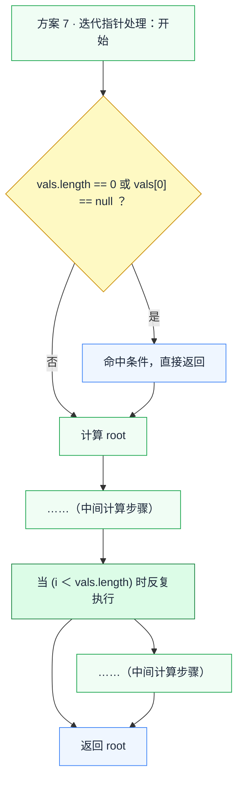

```typescript
class TreeNode {
  // 定义类型
  val: number;
  left: TreeNode | null;
  right: TreeNode | null; // 值: number; 左边界: TreeNode 按位或 null; 右边界: TreeNode 按位或 null;
  constructor(
    val: number,
    left: TreeNode | null = null,
    right: TreeNode | null = null,
  ) {
    this.val = val;
    this.left = left;
    this.right = right; // 把 值; this.左边界 赋值为 左边界; this.右边界 赋值为 右边界; 写入 值
  }
}
function buildTree(vals: (number | null)[]): TreeNode | null {
  // 定义函数/方法 buildTree
  if (vals.length === 0 || vals[0] === null) return null; // 若 vals.长度 全等于 0 或 vals[0] 全等于 null，直接返回 null
  const root = new TreeNode(vals[0] as number); // 把 new TreeNode(vals[0] as number) 存入 根节点
  const q: (TreeNode | null)[] = [root];
  let i = 1; // 把 [根节点]; let 下标 i 赋值为 1; 写入 const q: (TreeNode | null)[]
  while (i < vals.length) {
    // 循环，直到不满足「下标 i 小于 vals.长度」
    const node = q.shift() as TreeNode; // 把 节点.shift() as TreeNode 存入 节点
    if (i < vals.length && vals[i] !== null) {
      node.left = new TreeNode(vals[i] as number);
      q.push(node.left);
    }
    i++; // 下标 i 加一
    if (i < vals.length && vals[i] !== null) {
      node.right = new TreeNode(vals[i] as number);
      q.push(node.right);
    }
    i++; // 下标 i 加一
  }
  return root; // 返回 根节点
}
function inorder(root: TreeNode | null, out: number[] = []): number[] {
  // 定义函数/方法 inorder
  if (!root) return out; // 若 取反 根节点，直接返回 out
  inorder(root.left, out);
  out.push(root.val);
  inorder(root.right, out); // 把 根节点.值 压入栈/数组尾部
  return out; // 返回 out
}
function levelOrderBottom(root: TreeNode | null): number[][] {
  // 定义函数/方法 levelOrderBottom
  const res: number[][] = []; // 把 []; 写入 const res: number[][]
  if (!root) return res; // 若 取反 根节点，直接返回 结果
  let q: (TreeNode | null)[] = [root]; // 把 [根节点]; 写入 let q: (TreeNode | null)[]
  while (q.length) {
    // 循环，直到不满足「节点.长度」
    const level: number[] = [];
    const nxt: (TreeNode | null)[] = [];
    for (const node of q) {
      if (node) {
        level.push(node.val);
        if (node.left) nxt.push(node.left);
        if (node.right) nxt.push(node.right);
      }
    } // 把 节点.值 压入栈/数组尾部
    res.insert(0, level);
    q = nxt; // 把 nxt; 写入 res.insert(0, level); q
  }
  return res; // 返回 结果
}
function binaryTreePaths(root: TreeNode | null): string[] {
  // 定义函数/方法 binaryTreePaths
  const paths: string[] = []; // 把 []; 写入 const paths: string[]
  function dfs(node: TreeNode | null, path: string): void {
    // 定义函数/方法 dfs
    if (!node) return; // 若 取反 节点) return;
    path += String(node.val); // 当前路径累加 String(节点.值)
    if (!node.left && !node.right)
      paths.push(path); // 若 取反 节点.左边界 且 取反 节点.右边界) paths 追加 当前路径);
    else {
      path += '->';
      dfs(node.left, path);
      dfs(node.right, path);
    } // 否则
  }
  dfs(root, ''); // dfs(根节点, 「」);
  return paths; // 返回 paths
}
function averageOfLevels(root: TreeNode | null): number[] {
  // 定义函数/方法 averageOfLevels
  const result: number[] = []; // 把 []; 写入 const result: number[]
  let level: (TreeNode | null)[] = [root]; // 把 [根节点]; 写入 let level: (TreeNode | null)[]
  while (level.length) {
    // 循环，直到不满足「level.长度」
    let total = 0;
    const nxt: (TreeNode | null)[] = []; // 把 0; const nxt: (TreeNode 按位或 null)[] 赋值为 [] 存入 总和
    for (const node of level) {
      if (node) {
        total += node.val;
        if (node.left) nxt.push(node.left);
        if (node.right) nxt.push(node.right);
      }
    } // 把 节点.左边界 压入栈/数组尾部
    result.push(total / level.length); // 把 总和 除以 level.长度 压入栈/数组尾部
    level = nxt; // 把 nxt 存入 level
  }
  return result; // 返回 结果
}

function assertEq(actual: any, expected: any, msg: string = ''): void {
  // 定义函数/方法 assertEq
  const a = JSON.stringify(actual);
  const e = JSON.stringify(expected);
  if (a !== e)
    throw new Error(
      'ASSERT FAILED ' + msg + ' :: actual=' + a + ' expected=' + e,
    );
}

function maxDepth(root: TreeNode | null): number {
  // 定义函数/方法 maxDepth
  if (!root) return 0; // 若 取反 根节点，直接返回 0
  return 1 + Math.max(maxDepth(root.left), maxDepth(root.right)); // 返回 1 加 Math.取较大值 maxDepth(根节点.左边界), maxDepth(根节点.右边界))
}
export function demo(): void {
  // 程序入口：跑内嵌自测用例
  assertEq(maxDepth(null), 0, 'null'); // 断言校验
  assertEq(maxDepth(buildTree([3, 9, 20, null, null, 15, 7])), 3, 'depth3'); // 断言校验
  assertEq(maxDepth(buildTree([1, 2, 3, 4, 5])), 3, 'depth35'); // 断言校验
  console.log('PASS'); // 全部用例通过，输出 PASS
}
demo(); // demo();
```

### 方案 8：迭代指针处理

**分析与思路**：核心做法是「迭代指针处理」。代码里依次做这些事：队列或堆的调度。

**运行方式**：`node 本文件`，内嵌用例全部通过会输出 PASS。


**方案专属流程图**（真实控制流）：

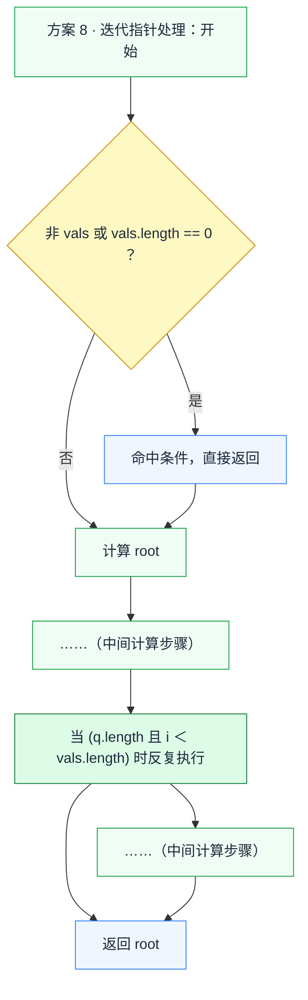

```typescript
class TreeNode {
  // 定义类型
  val: any;
  left: any;
  right: any; // 值: any; 左边界: any; 右边界: any;
  constructor(val?: any, left?: any, right?: any) {
    // constructor(值?: any, 左边界?: any, 右边界?: any) {
    this.val = val === undefined ? 0 : val; // 把 (值 全等于 undefined ? 0 : 值); 写入 值
    this.left = left === undefined ? null : left; // 把 (左边界 全等于 undefined ? null : 左边界); 写入 左边界
    this.right = right === undefined ? null : right; // 把 (右边界 全等于 undefined ? null : 右边界); 写入 右边界
  }
}
function buildTree(vals: any): any {
  // 定义函数/方法 buildTree
  if (!vals || vals.length === 0) return null; // 若 取反 vals 或 vals.长度 全等于 0，直接返回 null
  const root = new TreeNode(vals[0]);
  const q: any[] = [root];
  let i = 1;
  while (q.length && i < vals.length) {
    // 循环，直到不满足「节点.长度 且 下标 i 小于 vals.长度」
    const node = q.shift(); // 把 节点.shift() 存入 节点
    if (vals[i] !== null && vals[i] !== undefined) {
      node.left = new TreeNode(vals[i]);
      q.push(node.left);
    }
    i++; // 下标 i 加一
    if (i < vals.length && vals[i] !== null && vals[i] !== undefined) {
      node.right = new TreeNode(vals[i]);
      q.push(node.right);
    }
    i++; // 下标 i 加一
  }
  return root; // 返回 根节点
}
function treeToLevel(root: any): any[] {
  // 定义函数/方法 treeToLevel
  if (!root) return []; // 若 取反 根节点，直接返回 []
  const out: any[] = [];
  const q: any[] = [root]; // 把 []; const 节点: any[] 赋值为 [根节点]; 写入 const out: any[]
  while (q.length) {
    // 循环，直到不满足「节点.长度」
    const n = q.shift(); // 把 节点.shift() 存入 元素个数
    if (n === null || n === undefined) {
      out.push(null);
      continue;
    }
    out.push(n.val);
    q.push(n.left);
    q.push(n.right); // 把 元素个数.值 压入栈/数组尾部
  }
  while (out.length && out[out.length - 1] === null) out.pop(); // 循环，直到不满足「out.长度 且 out[out.长度 减 1] 全等于 null) out 弹出 );」
  return out; // 返回 out
}
class ListNode {
  // 定义类型
  val: any;
  next: any; // 值: any; 下一个: any;
  constructor(val?: any, next?: any) {
    this.val = val === undefined ? 0 : val;
    this.next = next === undefined ? null : next;
  }
}
function buildList(vals: any): any {
  // 定义函数/方法 buildList
  const dummy = new ListNode(0);
  let cur = dummy; // 把 new ListNode(0); let 当前值 赋值为 哨兵节点 存入 哨兵节点
  for (const v of vals) {
    cur.next = new ListNode(v);
    cur = cur.next;
  } // 把 new ListNode(值); 当前值 赋值为 当前值.下一个; } 写入 下一个
  return dummy.next; // 返回 哨兵节点.下一个
}
function listToArray(head: any): any[] {
  // 定义函数/方法 listToArray
  const out: any[] = [];
  let p = head; // 把 []; let 节点 赋值为 头节点; 写入 const out: any[]
  while (p) {
    out.push(p.val);
    p = p.next;
  } // 循环，直到不满足「节点) { out 追加 节点.值); 节点 赋值为 节点.下一个; }」
  return out; // 返回 out
}
// python-runtime shims
function pyLen(a: any): number {
  // 定义函数/方法 pyLen
  if (a === null || a === undefined) return 0; // 若 数组 全等于 null 或 数组 全等于 undefined，直接返回 0
  if (
    typeof a === 'string' ||
    Array.isArray(a) ||
    a instanceof Set ||
    a instanceof Map
  )
    return a.length ?? a.size;
  if (typeof a === 'object') return Object.keys(a).length; // 若 typeof 数组 全等于 'object'，直接返回 Object.keys(数组).长度
  return 0; // 返回 0
}
function pySlice(a: any, i: any, j: any, step?: any): any {
  // 定义函数/方法 pySlice
  if (typeof a === 'string') {
    const r = [...a].slice(i ?? 0, j ?? a.length);
    return step ? r.reverse().join('') : r.join('');
  }
  const arr = Array.isArray(a) ? a : [...a]; // 把 Array.isArray(数组) ? 数组 : 复制的 数组 存入 数组
  return arr.slice(i ?? 0, j ?? arr.length); // 返回 数组 截取 下标 i ?? 0, 下标 j ?? 数组.长度)
}
function pyRange(a: any, b?: any, step?: any): any[] {
  // 定义函数/方法 pyRange
  let s = 0,
    e = a,
    st = 1; // 把 0, e 赋值为 数组, st 赋值为 1 存入 字符串
  if (b !== undefined) {
    s = a;
    e = b;
  } // 若 b 不等于 undefined) { 字符串 赋值为 数组; e 赋值为 b; }
  if (step !== undefined) st = step; // 若 步数 不等于 undefined) st 赋值为 步数;
  const out: any[] = []; // 把 []; 写入 const out: any[]
  if (st > 0) for (let i = s; i < e; i += st) out.push(i);
  else for (let i = s; i > e; i += st) out.push(i); // 否则
  return out; // 返回 out
}
function pyIn(x: any, coll: any): boolean {
  // 定义函数/方法 pyIn
  if (coll === null || coll === undefined) return false; // 若 coll 全等于 null 或 coll 全等于 undefined，直接返回 false
  if (Array.isArray(coll)) return coll.includes(x); // 若 Array.isArray(coll)，直接返回 coll 是否包含 x)
  if (coll instanceof Set || coll instanceof Map) return coll.has(x); // 若 coll instanceof Set 或 coll instanceof Map，直接返回 coll.has(x)
  if (typeof coll === 'object') return x in coll; // 若 typeof coll 全等于 'object'，直接返回 x in coll
  if (typeof coll === 'string') return coll.indexOf(x) >= 0; // 若 typeof coll 全等于 'string'，直接返回 coll 查找 x) 不低于 0
  return false; // 返回 false
}
function pySorted(a: any): any[] {
  // 定义函数/方法 pySorted
  const arr = typeof a === 'string' ? [...a] : [...a]; // 把 (typeof 数组 全等于 'string') ? 复制的 数组 : 复制的 数组 存入 数组
  return arr.sort((x: any, y: any) => (x < y ? -1 : x > y ? 1 : 0));
}
function pyMin(a: any, b?: any): any {
  if (b !== undefined) return Math.min(a, b);
  if (Array.isArray(a) || a instanceof Set) return Math.min(...a);
  return Math.min(a);
} // 定义函数/方法 pyMin
function pyMax(a: any, b?: any): any {
  if (b !== undefined) return Math.max(a, b);
  if (Array.isArray(a) || a instanceof Set) return Math.max(...a);
  return Math.max(a);
} // 定义函数/方法 pyMax
function pySum(a: any): number {
  let s = 0;
  for (const v of a) s += v;
  return s;
} // 定义函数/方法 pySum
function pyAbs(x: any): number {
  return Math.abs(x);
} // 定义函数/方法 pyAbs
function pyEnumerate(a: any): any[] {
  const out: any[] = [];
  let i = 0;
  for (const v of a) {
    out.push([i, v]);
    i++;
  }
  return out;
} // 定义函数/方法 pyEnumerate
function pyZip(a: any, b: any): any[] {
  const n = Math.min(a.length, b.length);
  const out: any[] = [];
  for (let i = 0; i < n; i++) out.push([a[i], b[i]]);
  return out;
} // 定义函数/方法 pyZip
function pyDictGet(d: any, k: any, def?: any): any {
  return k in d ? d[k] : def === undefined ? null : def;
} // 定义函数/方法 pyDictGet
function pyPrint(...args: any[]): void {
  console.log(
    args
      .map((a) => (typeof a === 'object' && a !== null ? JSON.stringify(a) : a))
      .join(' '),
  );
} // 定义函数/方法 pyPrint
// collections / heapq
function heapPush(h: any[], x: any): void {
  h.push(x);
  let i = h.length - 1;
  while (i > 0) {
    const p = (i - 1) >> 1;
    if (h[p] <= h[i]) break;
    [h[p], h[i]] = [h[i], h[p]];
    i = p;
  }
} // 定义函数/方法 heapPush
function heapPop(h: any[]): any {
  const top = h[0];
  const last = h.pop();
  if (h.length) {
    h[0] = last;
    let i = 0;
    const n = h.length;
    while (true) {
      let l = 2 * i + 1,
        r = 2 * i + 2,
        s = i;
      if (l < n && h[l] < h[s]) s = l;
      if (r < n && h[r] < h[s]) s = r;
      if (s === i) break;
      [h[s], h[i]] = [h[i], h[s]];
      i = s;
    }
  }
  return top;
} // 定义函数/方法 heapPop
class Deque {
  private a: any[] = [];
  push(x: any) {
    this.a.push(x);
  }
  pushLeft(x: any) {
    this.a.unshift(x);
  }
  pop() {
    return this.a.pop();
  }
  popLeft() {
    return this.a.shift();
  }
  get length() {
    return this.a.length;
  }
  toArray() {
    return this.a.slice();
  }
} // 定义类型
function Counter(iter: any): any {
  const m: any = {};
  for (const v of iter) m[v] = (m[v] || 0) + 1;
  return m;
} // 定义函数/方法 Counter
function gcd(a: any, b: any): any {
  while (b) {
    [a, b] = [b, a % b];
  }
  return a;
} // 定义函数/方法 gcd
function pyInf(): number {
  return Infinity;
} // 定义函数/方法 pyInf

function norm(x: any): any {
  // 定义函数/方法 norm
  if (x === null || x === undefined) return null; // 若 x 全等于 null 或 x 全等于 undefined，直接返回 null
  if (typeof x === 'object') {
    // 若 typeof x 全等于 'object'
    if (x instanceof Deque) return x.toArray(); // 若 x instanceof Deque，直接返回 x.toArray()
    if (Array.isArray(x)) return x.map(norm); // 若 Array.isArray(x)，直接返回 x.映射表(norm)
    if (
      typeof x.val === 'number' &&
      (typeof x.left !== 'undefined' || typeof x.right !== 'undefined')
    )
      return treeToLevel(x);
    if (typeof x.next !== 'undefined' && typeof x.val === 'number')
      return listToArray(x);
    if (x instanceof Set) return [...x].sort(); // 若 x instanceof Set，直接返回 复制的 x 排序 )
    if (x instanceof Map) return Object.fromEntries(x); // 若 x instanceof Map，直接返回 Object.fromEntries(x)
    const o: any = {};
    for (const k of Object.keys(x)) o[k] = norm(x[k]);
    return o;
  }
  return x; // 返回 x
}
function eq(a: any, b: any): boolean {
  // 定义函数/方法 eq
  const x = norm(a),
    y = norm(b); // 把 norm(数组), y 赋值为 norm(b) 存入 x
  if (x === y) return true; // 若 x 全等于 y，直接返回 true
  if (x === null || y === null) return x === y; // 若 x 全等于 null 或 y 全等于 null，直接返回 x 全等于 y
  if (Array.isArray(x) && Array.isArray(y)) {
    // 若 Array.isArray(x) 且 Array.isArray(y
    if (x.length !== y.length) return false; // 若 x.长度 不等于 y.长度，直接返回 false
    for (let i = 0; i < x.length; i++) if (!eq(x[i], y[i])) return false; // 让 下标 i 从 0 开始计数，下标 i 小于 x.长度 就继续
    return true; // 返回 true
  }
  if (typeof x === 'object' && typeof y === 'object') {
    // 若 typeof x 全等于 'object' 且 typeof y 全等于 'object'
    const kx = Object.keys(x),
      ky = Object.keys(y); // 把 Object.keys(x), ky 赋值为 Object.keys(y) 存入 kx
    if (kx.length !== ky.length) return false; // 若 kx.长度 不等于 ky.长度，直接返回 false
    for (const k of kx) if (!eq(x[k], y[k])) return false;
    return true; // 返回 true
  }
  return x === y; // 返回 x 全等于 y
}

function maxDepth(root) {
  // 定义函数/方法 maxDepth
  if (!root) return 0; // 若 取反 根节点，直接返回 0
  return 1 + Math.max(maxDepth(root.left), maxDepth(root.right)); // 返回 1 加 Math.取较大值 maxDepth(根节点.左边界), maxDepth(根节点.右边界))
}
export function demo(): void {
  // 程序入口：跑内嵌自测用例
  const cases = [
    { in: [buildTree([])], want: 0 },
    { in: [buildTree([1, 2, 3, 4, 5])], want: 3 },
  ];
  let fail = false; // 把 false 存入 fail
  for (const c of cases) {
    // for (const 字符 of cases) {
    const got = maxDepth(...c.in); // 把 maxDepth(...字符.in) 存入 got
    if (!eq(got, c.want)) {
      fail = true;
      console.log(
        'FAIL',
        JSON.stringify(c.in),
        '=>',
        JSON.stringify(got),
        'want',
        JSON.stringify(c.want),
      );
    }
  }
  if (fail) throw new Error('FAILED'); // 若 fail) throw new Error('FAILED');
  console.log('PASS'); // 全部用例通过，输出 PASS
}
demo(); // demo();
```

### 方案 9：迭代指针处理

**分析与思路**：核心做法是「迭代指针处理」。代码里依次做这些事：队列或堆的调度。

**运行方式**：`node 本文件`，内嵌用例全部通过会输出 PASS。


**方案专属流程图**（真实控制流）：

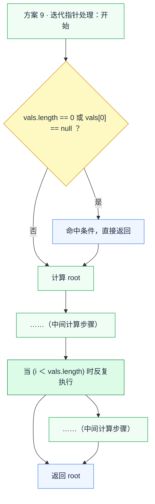

```typescript
class TreeNode {
  // 定义类型
  val: number;
  left: TreeNode | null;
  right: TreeNode | null; // 值: number; 左边界: TreeNode 按位或 null; 右边界: TreeNode 按位或 null;
  constructor(
    val: number,
    left: TreeNode | null = null,
    right: TreeNode | null = null,
  ) {
    this.val = val;
    this.left = left;
    this.right = right; // 把 值; this.左边界 赋值为 左边界; this.右边界 赋值为 右边界; 写入 值
  }
}
function buildTree(vals: (number | null)[]): TreeNode | null {
  // 定义函数/方法 buildTree
  if (vals.length === 0 || vals[0] === null) return null; // 若 vals.长度 全等于 0 或 vals[0] 全等于 null，直接返回 null
  const root = new TreeNode(vals[0] as number); // 把 new TreeNode(vals[0] as number) 存入 根节点
  const q: (TreeNode | null)[] = [root];
  let i = 1; // 把 [根节点]; let 下标 i 赋值为 1; 写入 const q: (TreeNode | null)[]
  while (i < vals.length) {
    // 循环，直到不满足「下标 i 小于 vals.长度」
    const node = q.shift() as TreeNode; // 把 节点.shift() as TreeNode 存入 节点
    if (i < vals.length && vals[i] !== null) {
      node.left = new TreeNode(vals[i] as number);
      q.push(node.left);
    }
    i++; // 下标 i 加一
    if (i < vals.length && vals[i] !== null) {
      node.right = new TreeNode(vals[i] as number);
      q.push(node.right);
    }
    i++; // 下标 i 加一
  }
  return root; // 返回 根节点
}

function assertEq(actual: any, expected: any, msg: string = ''): void {
  // 定义函数/方法 assertEq
  const a = JSON.stringify(actual);
  const e = JSON.stringify(expected);
  if (a !== e)
    throw new Error(
      'ASSERT FAILED ' + msg + ' :: actual=' + a + ' expected=' + e,
    );
}

function maxDepth(root: TreeNode | null): number {
  // 定义函数/方法 maxDepth
  if (!root) return 0; // 若 取反 根节点，直接返回 0
  return 1 + Math.max(maxDepth(root.left), maxDepth(root.right)); // 返回 1 加 Math.取较大值 maxDepth(根节点.左边界), maxDepth(根节点.右边界))
}
export function demo(): void {
  // 程序入口：跑内嵌自测用例
  assertEq(maxDepth(null), 0, 'null'); // 断言校验
  assertEq(maxDepth(buildTree([3, 9, 20, null, null, 15, 7])), 3, 'depth3'); // 断言校验
  assertEq(maxDepth(buildTree([1, 2, 3, 4, 5])), 3, 'depth35'); // 断言校验
  assertEq(maxDepth(buildTree([1, null, 2, null, 3])), 3, 'depthChain3'); // 断言校验
  console.log('PASS'); // 全部用例通过，输出 PASS
}
demo(); // demo();
```

## 逐步拆解与面试追问

**复杂度**：时间 O(n)（单趟线性扫描），空间 O(1) 到 O(n)（视辅助结构）

**为什么是这个量级**：每个元素被常数次访问，辅助哈希或栈的开销与 n 同阶

**面试官可能会追问**：

- 递归和迭代写法各自的空间开销？
- 能否用层序统一处理？
- 空节点的边界如何约定？

## 关键 API 速查（TS 主解法实际用到，附官方链接）

| API | 作用 | 使用要点 | 官方文档 |
|---|---|---|---|
| `Array.prototype.push()` | 尾部追加 | 返回新长度；可一次多个；均摊 O(1)；会改变原数组 | [官方文档](https://developer.mozilla.org/zh-CN/docs/Web/JavaScript/Reference/Global_Objects/Array/push) |
| `Array.prototype.shift()` | 头部取出 | O(n)（后续元素整体前移）；大量头部操作请用链表或双端结构 | [官方文档](https://developer.mozilla.org/zh-CN/docs/Web/JavaScript/Reference/Global_Objects/Array/shift) |
| `JSON.stringify()` | 序列化为 JSON 字符串 | 常用于结构化比较（深度相等判定）；undefined/函数/循环引用会被丢弃或抛错 | [官方文档](https://developer.mozilla.org/zh-CN/docs/Web/JavaScript/Reference/Global_Objects/JSON/stringify) |
| `Math.max()` | 最大值 | 配展开 Math.max(...arr)；空参返回 -Infinity；超大数组注意展开参数上限 | [官方文档](https://developer.mozilla.org/zh-CN/docs/Web/JavaScript/Reference/Global_Objects/Math/max) |

### 各语言官方文档导航

- **TypeScript / JS**：[MDN 中文参考](https://developer.mozilla.org/zh-CN/)
- **Python**：[Python 官方文档](https://docs.python.org/zh-cn/3/)
- **Go**：[Go 标准库](https://pkg.go.dev/std)
- **Java**：[JDK 17 API](https://docs.oracle.com/en/java/javase/17/docs/api/)
- **Rust**：[Rust 标准库](https://doc.rust-lang.org/std/)
- **Lua**：[Lua 5.4 手册](https://www.lua.org/manual/5.4/)
- **C**：[Cppreference C](https://zh.cppreference.com/w/c)
- **C++**：[Cppreference C++](https://zh.cppreference.com/w/cpp)
- **R**：[R 官方手册](https://stat.ethz.ch/R-manual/)
- **Zig**：[Zig 语言文档](https://ziglang.org/documentation/master/)
- **Dart**：[Dart API](https://api.dart.dev/)

## 附录：其他 10 种语言全部实现（每种语言列举其全部方案）

> TypeScript 的全部方案见「TypeScript 解题方案」一节；下面是其余 10 种语言的对应实现，每种语言的每个方案都带思路分析、代码走读与专属运行架构图。
> 每个方案都内嵌用例自测，可独立运行（老仓库 python/go 文件遵循「打印结果」约定）。
> 完整解法文件见 `dsa/<语言>/tree/lc_104_二叉树的最大深度/`。

### Python 实现（9 种方案）

Python 的全部方案如下，每个方案都内嵌用例自测，可独立运行（老仓库 python/go 文件遵循「打印结果」约定）：

#### 方案 1：迭代指针处理

**思路与代码分析**：核心是「迭代指针处理」。Python 版用切片与字典推导式简化操作，突出可读性。**走读**：方案 1 · 迭代指针处理：开始 → 更新 dep → 处理 nonlocal dep → 命中条件，直接返回 → 若 not n.left and not n.right：更新 dep → 更新 dep → 处理 dep, l → 处理 ) → 调用 dfs(n.left, l + 1) → 调用 dfs(n.right, l + 1) → 调用 dfs(root, 1) → 返回 dep。

**运行架构**（真实控制流）：

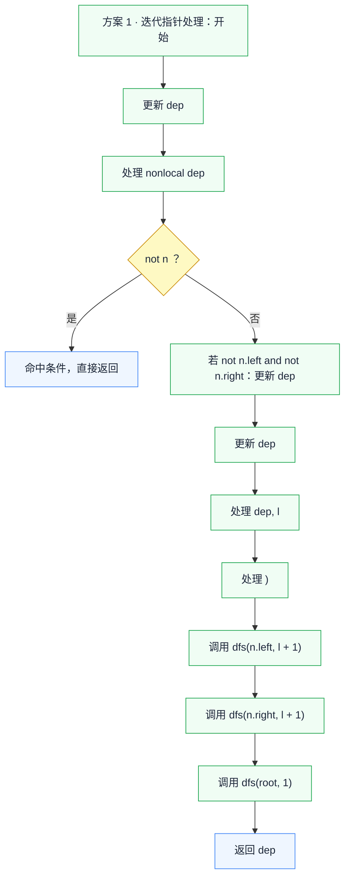

```python
import sys  # 提高递归深度上限（深输入防 RecursionError）

sys.setrecursionlimit(200000)  # 树/链表类题目节点数可达 1e4 量级

def maxDepth(root):  # 定义函数 maxDepth（参数：根节点）
    dep = 0  # 把 0 存入 dep

    def dfs(n, l):  # 定义函数 dfs（参数：元素个数, 左指针）
        nonlocal dep  # nonlocal dep
        if not n:
            return  # 若 not 元素个数: return
        if not n.left and not n.right:
            dep = max(
                dep, l
            )  # 若 not 元素个数.左边界 and not 元素个数.右边界: dep 赋值为 取较大值 dep, 左指针
        dfs(n.left, l + 1)  # dfs(元素个数.左边界, 左指针 加 1)
        dfs(n.right, l + 1)  # dfs(元素个数.右边界, 左指针 加 1)

    dfs(root, 1)  # dfs(根节点, 1)
    return dep  # 返回 dep

if __name__ == "__main__":  # 若 __name__ 等于 '__main__'
    print(maxDepth(None))  # 打印输出
```

#### 方案 2：迭代指针处理

**思路与代码分析**：核心是「迭代指针处理」。Python 版用切片与字典推导式简化操作，突出可读性。**走读**：方案 2 · 迭代指针处理：开始 → 命中条件，直接返回 → 返回 1 + max( → 调用 maxDepth(root.left), maxDept → 处理 )。

**运行架构**（真实控制流）：


```python
import sys  # 提高递归深度上限（深输入防 RecursionError）

sys.setrecursionlimit(200000)  # 树/链表类题目节点数可达 1e4 量级

def maxDepth(root):  # 定义函数 maxDepth（参数：根节点）
    if not root:
        return 0  # 若 not 根节点: return 0
    return 1 + max(
        maxDepth(root.left), maxDepth(root.right)
    )  # 返回 1 加 取较大值 maxDepth(根节点.左边界), maxDepth(根节点.右边界))

if __name__ == "__main__":  # 若 __name__ 等于 '__main__'
    print(maxDepth(None))  # 打印输出
```

#### 方案 3：迭代指针处理

**思路与代码分析**：核心是「迭代指针处理」。Python 版用切片与字典推导式简化操作，突出可读性。**走读**：方案 3 · 迭代指针处理：开始 → 命中条件，直接返回 → 更新 q → 更新 dep → 当 len(q): 时反复执行 → 更新 len → 当 len: 时反复执行 → 从 q 弹出 → 若 n.left：向 q 追加记录 → 向 q 追加记录 → 若 n.right：向 q 追加记录 → 向 q 追加记录 → 更新 - → 更新 + → 返回 dep。

**运行架构**（真实控制流）：

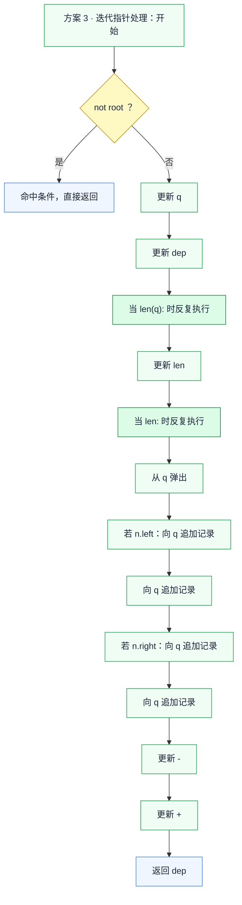

```python
import sys  # 提高递归深度上限（深输入防 RecursionError）

sys.setrecursionlimit(200000)  # 树/链表类题目节点数可达 1e4 量级

def maxDepth(root):  # 定义函数 maxDepth（参数：根节点）
    if not root:
        return 0  # 若 not 根节点: return 0
    q = [root]  # 把 [根节点] 存入 节点
    dep = 0  # 把 0 存入 dep
    while len(q):  # 循环，直到不满足「长度(节点」
        len = len(q)  # 把 长度(节点) 存入 长度
        while len:  # 循环，直到不满足「长度」
            n = q.pop(0)  # 把 节点 弹出 0) 存入 元素个数
            if n.left:
                q.append(n.left)  # 若 元素个数.左边界: 节点 追加 元素个数.左边界
            if n.right:
                q.append(n.right)  # 若 元素个数.右边界: 节点 追加 元素个数.右边界
            len -= 1  # 长度累减 1
        dep += 1  # dep累加 1
    return dep  # 返回 dep

if __name__ == "__main__":  # 若 __name__ 等于 '__main__'
    print(maxDepth(None))  # 打印输出
```

#### 方案 4：迭代指针处理

**思路与代码分析**：核心是「迭代指针处理」。Python 版用切片与字典推导式简化操作，突出可读性。**走读**：方案 4 · 迭代指针处理：开始 → 命中条件，直接返回 → 返回 1 + max( → 调用 maxDepth(root.left), maxDept → 处理 )。

**运行架构**（真实控制流）：


```python
import sys  # 提高递归深度上限（深输入防 RecursionError）

sys.setrecursionlimit(200000)  # 树/链表类题目节点数可达 1e4 量级

def maxDepth(root):  # 定义函数 maxDepth（参数：根节点）
    if not root:
        return 0  # 若 not 根节点: return 0
    return 1 + max(
        maxDepth(root.left), maxDepth(root.right)
    )  # 返回 1 加 取较大值 maxDepth(根节点.左边界), maxDepth(根节点.右边界))

if __name__ == "__main__":  # 若 __name__ 等于 '__main__'
    print(maxDepth(None))  # 打印输出
```

#### 方案 5：迭代指针处理

**思路与代码分析**：核心是「迭代指针处理」。Python 版用切片与字典推导式简化操作，突出可读性。**走读**：方案 5 · 迭代指针处理：开始 → 命中条件，直接返回 → 返回 1 + max( → 调用 maxDepth(root.left), maxDept → 处理 )。

**运行架构**（真实控制流）：


```python
import sys  # 提高递归深度上限（深输入防 RecursionError）

sys.setrecursionlimit(200000)  # 树/链表类题目节点数可达 1e4 量级

def maxDepth(root):  # 定义函数 maxDepth（参数：根节点）
    if not root:
        return 0  # 若 not 根节点: return 0
    return 1 + max(
        maxDepth(root.left), maxDepth(root.right)
    )  # 返回 1 加 取较大值 maxDepth(根节点.左边界), maxDepth(根节点.右边界))

if __name__ == "__main__":  # 若 __name__ 等于 '__main__'
    print(maxDepth(None))  # 打印输出
```

#### 方案 6：迭代指针处理

**思路与代码分析**：核心是「迭代指针处理」。Python 版用切片与字典推导式简化操作，突出可读性。**走读**：方案 6 · 迭代指针处理：开始 → 命中条件，直接返回 → 返回 1 + max( → 调用 maxDepth(root.left), maxDept → 处理 )。

**运行架构**（真实控制流）：

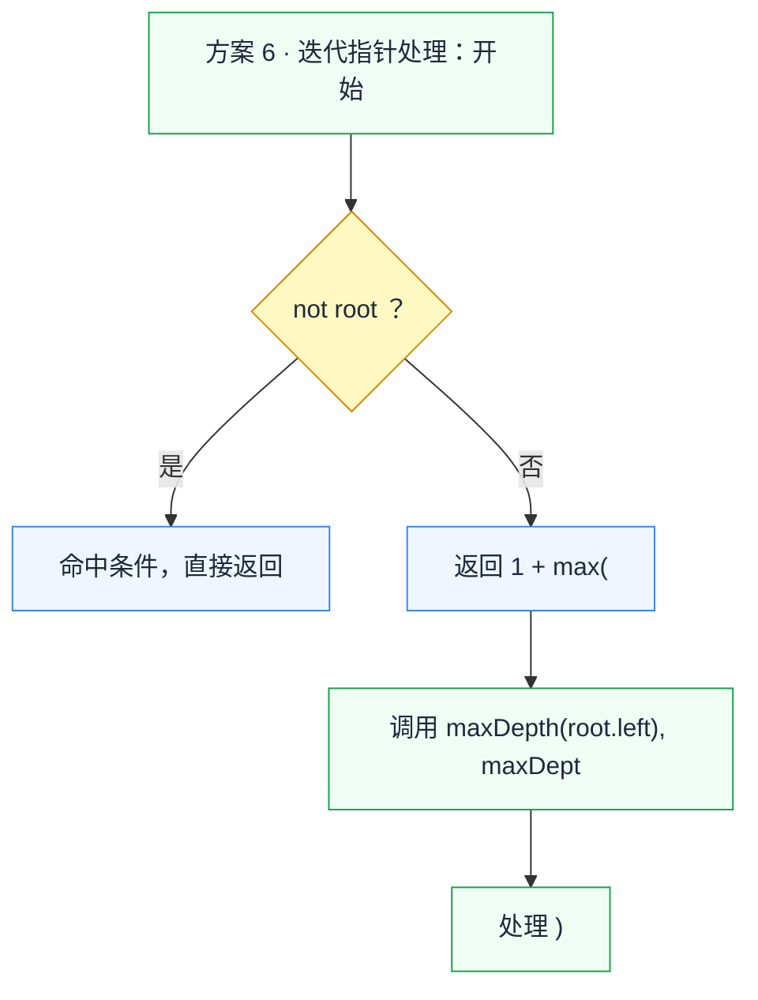

```python
import sys  # 提高递归深度上限（深输入防 RecursionError）

sys.setrecursionlimit(200000)  # 树/链表类题目节点数可达 1e4 量级

def maxDepth(root):  # 定义函数 maxDepth（参数：根节点）
    if not root:
        return 0  # 若 not 根节点: return 0
    return 1 + max(
        maxDepth(root.left), maxDepth(root.right)
    )  # 返回 1 加 取较大值 maxDepth(根节点.左边界), maxDepth(根节点.右边界))

if __name__ == "__main__":  # 若 __name__ 等于 '__main__'
    print(maxDepth(None))  # 打印输出
```

#### 方案 7：迭代指针处理

**思路与代码分析**：核心是「迭代指针处理」。Python 版用切片与字典推导式简化操作，突出可读性。**走读**：方案 7 · 迭代指针处理：开始 → 命中条件，直接返回 → 返回 1 + max( → 调用 maxDepth(root.left), maxDept → 处理 )。

**运行架构**（真实控制流）：


```python
import sys  # 提高递归深度上限（深输入防 RecursionError）

sys.setrecursionlimit(200000)  # 树/链表类题目节点数可达 1e4 量级

def maxDepth(root):  # 定义函数 maxDepth（参数：根节点）
    if not root:
        return 0  # 若 not 根节点: return 0
    return 1 + max(
        maxDepth(root.left), maxDepth(root.right)
    )  # 返回 1 加 取较大值 maxDepth(根节点.左边界), maxDepth(根节点.右边界))

if __name__ == "__main__":  # 若 __name__ 等于 '__main__'
    print(maxDepth(None))  # 打印输出
```

#### 方案 8：迭代指针处理

**思路与代码分析**：核心是「迭代指针处理」。Python 版用切片与字典推导式简化操作，突出可读性。**走读**：方案 8 · 迭代指针处理：开始 → 命中条件，直接返回 → 返回 1 + max( → 调用 maxDepth(root.left), maxDept → 处理 )。

**运行架构**（真实控制流）：


```python
import sys  # 提高递归深度上限（深输入防 RecursionError）

sys.setrecursionlimit(200000)  # 树/链表类题目节点数可达 1e4 量级

def maxDepth(root):  # 定义函数 maxDepth（参数：根节点）
    if not root:
        return 0  # 若 not 根节点: return 0
    return 1 + max(
        maxDepth(root.left), maxDepth(root.right)
    )  # 返回 1 加 取较大值 maxDepth(根节点.左边界), maxDepth(根节点.右边界))

if __name__ == "__main__":  # 若 __name__ 等于 '__main__'
    print(maxDepth(None))  # 打印输出
```

#### 方案 9：迭代指针处理

**思路与代码分析**：核心是「迭代指针处理」。Python 版用切片与字典推导式简化操作，突出可读性。**走读**：方案 9 · 迭代指针处理：开始 → 命中条件，直接返回 → 返回 1 + max( → 调用 maxDepth(root.left), maxDept → 处理 )。

**运行架构**（真实控制流）：


```python
import sys  # 提高递归深度上限（深输入防 RecursionError）

sys.setrecursionlimit(200000)  # 树/链表类题目节点数可达 1e4 量级

def maxDepth(root):  # 定义函数 maxDepth（参数：根节点）
    if not root:
        return 0  # 若 not 根节点: return 0
    return 1 + max(
        maxDepth(root.left), maxDepth(root.right)
    )  # 返回 1 加 取较大值 maxDepth(根节点.左边界), maxDepth(根节点.右边界))

if __name__ == "__main__":  # 若 __name__ 等于 '__main__'
    print(maxDepth(None))  # 打印输出
```

### Go 实现（9 种方案）

Go 的全部方案如下，每个方案都内嵌用例自测，可独立运行（老仓库 python/go 文件遵循「打印结果」约定）：

#### 方案 1：迭代指针处理

**思路与代码分析**：核心是「迭代指针处理」。Go 版用切片与多返回值惯用法，显式处理索引边界。**走读**：方案 1 · 迭代指针处理：开始 → 更新 : → 计算 dfs → 更新 dfs → 处理 if n == nil → 返回  → 处理 if n.Left == nil 且 n.Right → 处理 if l ＞ dep → 更新 dep → 调用 dfs(n.Left, l+1) → 调用 dfs(n.Right, l+1) → 调用 dfs(root, 1) → 返回 dep。

**运行架构**（真实控制流）：

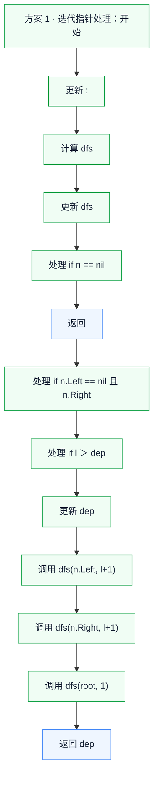

```go
package main // 引入依赖

import (
	"fmt" // 「fmt」
	"os"  // 「os」
)

type TreeNode struct { // 定义类型
	Val   int       // Val int
	Left  *TreeNode // Left 乘 TreeNode
	Right *TreeNode // Right 乘 TreeNode
}

func buildTree(vals []interface{}) *TreeNode { // 定义函数/方法 buildTree
	if len(vals) == 0 || vals[0] == nil { // 若 长度(vals) 等于 0 或 vals[0] 等于 nil
		return nil // 返回 nil
	}
	root := &TreeNode{Val: vals[0].(int)} // 把 按位与 TreeNode{Val: vals[0].(int)} 写入 root :
	q := []*TreeNode{root}                // 把 [] 乘 TreeNode{根节点} 写入 q :
	i := 1                                // 把 1 写入 i :
	for len(q) > 0 && i < len(vals) {     // 定义函数/方法 len
		node := q[0]                         // 把 节点[0] 写入 node :
		q = q[1:]                            // 把 节点[1:] 写入 节点
		if i < len(vals) && vals[i] != nil { // 若 下标 i 小于 长度(vals) 且 vals[下标 i] 不等于 nil
			node.Left = &TreeNode{Val: vals[i].(int)} // 把 按位与 TreeNode{Val: vals[下标 i].(int)} 写入 node.Left
			q = append(q, node.Left)                  // 把 append(节点, 节点.Left) 写入 节点
		}
		i++                                  // 下标 i 加一
		if i < len(vals) && vals[i] != nil { // 若 下标 i 小于 长度(vals) 且 vals[下标 i] 不等于 nil
			node.Right = &TreeNode{Val: vals[i].(int)} // 把 按位与 TreeNode{Val: vals[下标 i].(int)} 写入 node.Right
			q = append(q, node.Right)                  // 把 append(节点, 节点.Right) 写入 节点
		}
		i++ // 下标 i 加一
	}
	return root // 返回 根节点
}

func maxDepth(root *TreeNode) int { // 定义函数/方法 maxDepth
	dep := 0                         // 把 0 写入 dep :
	var dfs func(n *TreeNode, l int) // var dfs func(元素个数 乘 TreeNode, 左指针 int)
	dfs = func(n *TreeNode, l int) { // 把 func(元素个数 乘 TreeNode, 左指针 int) { 写入 dfs
		if n == nil { // 若 元素个数 等于 nil
			return // return
		}
		if n.Left == nil && n.Right == nil { // 若 元素个数.Left 等于 nil 且 元素个数.Right 等于 nil
			if l > dep { // 若 左指针 超过 dep
				dep = l // 把 左指针 写入 dep
			}
		}
		dfs(n.Left, l+1)  // dfs(元素个数.Left, 左指针 加 1)
		dfs(n.Right, l+1) // dfs(元素个数.Right, 左指针 加 1)
	}
	dfs(root, 1) // dfs(根节点, 1)
	return dep   // 返回 dep
}

type tc struct { // 定义类型
	root *TreeNode // 根节点 乘 TreeNode
	want int       // want int
}

func main() { // 程序入口：跑内嵌自测用例
	cases := []tc{ // 把 []tc{ 写入 cases :
		{buildTree(nil), 0},
		{buildTree([]interface{}{1}), 1},
		{buildTree([]interface{}{3, 9, 20, nil, nil, 15, 7}), 3},
		{buildTree([]interface{}{1, nil, 2, nil, 3}), 3},
	}
	for idx, c := range cases { // 同时取 idx 与 字符 遍历
		got := maxDepth(c.root) // 把 maxDepth(字符.根节点) 写入 got :
		if got != c.want {      // 若 got 不等于 字符.want
			fmt.Printf("case %d failed: got %v want %v\n", idx, got, c.want) // 打印输出
			os.Exit(1)                                                       // os.Exit(1)
		}
	}
	fmt.Println("PASS") // 全部用例通过，输出 PASS
}
```

#### 方案 2：迭代指针处理

**思路与代码分析**：核心是「迭代指针处理」。Go 版用切片与多返回值惯用法，显式处理索引边界。**走读**：方案 2 · 迭代指针处理：开始 → 处理 if root == nil → 返回 0 → 返回 1 + max(maxDepth(root.Left), maxDepth(root.Right))。

**运行架构**（真实控制流）：

```mermaid
graph TD
    N0["方案 2 · 迭代指针处理：开始"]
    N1["处理 if root == nil"]
    N2["返回 0"]
    N3["返回 1 + max(maxDepth(root.Left), maxDepth(root.Right))"]
    N0 --> N1
    N1 --> N2
    N2 --> N3
    classDef n fill:#f0fdf4,stroke:#16a34a,color:#1e293b;
    classDef lp fill:#dcfce7,stroke:#15803d,color:#1e293b;
    classDef dc fill:#fef9c3,stroke:#ca8a04,color:#1e293b;
    classDef tm fill:#eff6ff,stroke:#3b82f6,color:#1e293b;
    class N0,N1 n;
    class N2,N3 tm;
```

```go
package main // 引入依赖

import (
	"fmt"
	"os"
) // 引入依赖

type TreeNode struct { // 定义类型
	Val   int       // Val int
	Left  *TreeNode // Left 乘 TreeNode
	Right *TreeNode // Right 乘 TreeNode
}

func buildTree(vals []interface{}) *TreeNode { // 定义函数/方法 buildTree
	if len(vals) == 0 || vals[0] == nil { // 若 长度(vals) 等于 0 或 vals[0] 等于 nil
		return nil // 返回 nil
	}
	root := &TreeNode{Val: vals[0].(int)} // 把 按位与 TreeNode{Val: vals[0].(int)} 写入 root :
	q := []*TreeNode{root}                // 把 [] 乘 TreeNode{根节点} 写入 q :
	i := 1                                // 把 1 写入 i :
	for i < len(vals) {                   // for 下标 i 小于 长度(vals) {
		node := q[0]        // 把 节点[0] 写入 node :
		q = q[1:]           // 把 节点[1:] 写入 节点
		if vals[i] != nil { // 若 vals[下标 i] 不等于 nil
			node.Left = &TreeNode{Val: vals[i].(int)} // 把 按位与 TreeNode{Val: vals[下标 i].(int)} 写入 node.Left
			q = append(q, node.Left)                  // 把 append(节点, 节点.Left) 写入 节点
		}
		i++                // 下标 i 加一
		if i < len(vals) { // 若 下标 i 小于 长度(vals
			if vals[i] != nil { // 若 vals[下标 i] 不等于 nil
				node.Right = &TreeNode{Val: vals[i].(int)} // 把 按位与 TreeNode{Val: vals[下标 i].(int)} 写入 node.Right
				q = append(q, node.Right)                  // 把 append(节点, 节点.Right) 写入 节点
			}
			i++ // 下标 i 加一
		}
	}
	return root // 返回 根节点
}

func maxDepth(root *TreeNode) int { // 定义函数/方法 maxDepth
	if root == nil { // 若 根节点 等于 nil
		return 0 // 返回 0
	}
	return 1 + max(maxDepth(root.Left), maxDepth(root.Right)) // 返回 1 加 取较大值 maxDepth(根节点.Left), maxDepth(根节点.Right))
}

func main() { // 程序入口：跑内嵌自测用例
	cases := []struct { // 把 []struct { 写入 cases :
		vals []interface{} // vals []interface{}
		want int           // want int
	}{ // }{
		{nil, 0},
		{[]interface{}{3, 9, 20, nil, nil, 15, 7}, 3},
	}
	ok := true                // 把 true 写入 ok :
	for _, c := range cases { // 同时取 _ 与 字符 遍历
		if g := maxDepth(buildTree(c.vals)); g != c.want { // 若 g : 赋值为 maxDepth(buildTree(字符.vals)); g 不等于 字符.want
			ok = false                                            // 把 false 写入 ok
			fmt.Printf("FAIL %v=%v want %v\n", c.vals, g, c.want) // 打印输出
		}
	}
	if !ok { // 若 取反 ok
		os.Exit(1) // os.Exit(1)
	}
	fmt.Println("PASS") // 全部用例通过，输出 PASS
}
```

#### 方案 3：迭代指针处理

**思路与代码分析**：核心是「迭代指针处理」。Go 版用切片与多返回值惯用法，显式处理索引边界。**走读**：方案 3 · 迭代指针处理：开始 → 处理 if root == nil → 返回 0 → 更新 : → 更新 : → 遍历循环 → 更新 : → 遍历循环 → 更新 : → 更新 q → 处理 if n.Left ≠ nil → 更新 q → 处理 if n.Right ≠ nil → 更新 q → 处理 dep++ → 返回 dep。

**运行架构**（真实控制流）：

```mermaid
graph TD
    N0["方案 3 · 迭代指针处理：开始"]
    N1["处理 if root == nil"]
    N2["返回 0"]
    N3["更新 :"]
    N4["更新 :"]
    N5["遍历循环"]
    N6["更新 :"]
    N7["遍历循环"]
    N8["更新 :"]
    N9["更新 q"]
    N10["处理 if n.Left ≠ nil"]
    N11["更新 q"]
    N12["处理 if n.Right ≠ nil"]
    N13["更新 q"]
    N14["处理 dep++"]
    N15["返回 dep"]
    N0 --> N1
    N1 --> N2
    N2 --> N3
    N3 --> N4
    N4 --> N5
    N5 --> N6
    N6 --> N7
    N7 --> N8
    N8 --> N9
    N9 --> N10
    N10 --> N11
    N11 --> N12
    N12 --> N13
    N13 -- 下一轮 --> N7
    N7 --> N14
    N14 -- 下一轮 --> N5
    N5 --> N15
    classDef n fill:#f0fdf4,stroke:#16a34a,color:#1e293b;
    classDef lp fill:#dcfce7,stroke:#15803d,color:#1e293b;
    classDef dc fill:#fef9c3,stroke:#ca8a04,color:#1e293b;
    classDef tm fill:#eff6ff,stroke:#3b82f6,color:#1e293b;
    class N0,N1,N3,N4,N6,N8,N9,N10,N11,N12,N13,N14 n;
    class N5,N7 lp;
    class N2,N15 tm;
```

```go
package main // 引入依赖

import (
	"fmt"
	"os"
) // 引入依赖

type TreeNode struct { // 定义类型
	Val   int       // Val int
	Left  *TreeNode // Left 乘 TreeNode
	Right *TreeNode // Right 乘 TreeNode
}

func buildTree(vals []interface{}) *TreeNode { // 定义函数/方法 buildTree
	if len(vals) == 0 || vals[0] == nil { // 若 长度(vals) 等于 0 或 vals[0] 等于 nil
		return nil // 返回 nil
	}
	root := &TreeNode{Val: vals[0].(int)} // 把 按位与 TreeNode{Val: vals[0].(int)} 写入 root :
	q := []*TreeNode{root}                // 把 [] 乘 TreeNode{根节点} 写入 q :
	i := 1                                // 把 1 写入 i :
	for i < len(vals) {                   // for 下标 i 小于 长度(vals) {
		node := q[0]        // 把 节点[0] 写入 node :
		q = q[1:]           // 把 节点[1:] 写入 节点
		if vals[i] != nil { // 若 vals[下标 i] 不等于 nil
			node.Left = &TreeNode{Val: vals[i].(int)} // 把 按位与 TreeNode{Val: vals[下标 i].(int)} 写入 node.Left
			q = append(q, node.Left)                  // 把 append(节点, 节点.Left) 写入 节点
		}
		i++                // 下标 i 加一
		if i < len(vals) { // 若 下标 i 小于 长度(vals
			if vals[i] != nil { // 若 vals[下标 i] 不等于 nil
				node.Right = &TreeNode{Val: vals[i].(int)} // 把 按位与 TreeNode{Val: vals[下标 i].(int)} 写入 node.Right
				q = append(q, node.Right)                  // 把 append(节点, 节点.Right) 写入 节点
			}
			i++ // 下标 i 加一
		}
	}
	return root // 返回 根节点
}

func maxDepth(root *TreeNode) int { // 定义函数/方法 maxDepth
	if root == nil { // 若 根节点 等于 nil
		return 0 // 返回 0
	}
	q := []*TreeNode{root} // 把 [] 乘 TreeNode{根节点} 写入 q :
	dep := 0               // 把 0 写入 dep :
	for len(q) > 0 {       // for 长度(节点) 超过 0 {
		size := len(q)              // 把 长度(节点) 写入 size :
		for i := 0; i < size; i++ { // 让 下标 i 从 0 开始计数
			n := q[0]          // 把 节点[0] 写入 n :
			q = q[1:]          // 把 节点[1:] 写入 节点
			if n.Left != nil { // 若 元素个数.Left 不等于 nil
				q = append(q, n.Left) // 把 append(节点, 元素个数.Left) 写入 节点
			}
			if n.Right != nil { // 若 元素个数.Right 不等于 nil
				q = append(q, n.Right) // 把 append(节点, 元素个数.Right) 写入 节点
			}
		}
		dep++ // dep 加一
	}
	return dep // 返回 dep
}

func main() { // 程序入口：跑内嵌自测用例
	cases := []struct { // 把 []struct { 写入 cases :
		vals []interface{} // vals []interface{}
		want int           // want int
	}{ // }{
		{nil, 0},
		{[]interface{}{3, 9, 20, nil, nil, 15, 7}, 3},
	}
	ok := true                // 把 true 写入 ok :
	for _, c := range cases { // 同时取 _ 与 字符 遍历
		if g := maxDepth(buildTree(c.vals)); g != c.want { // 若 g : 赋值为 maxDepth(buildTree(字符.vals)); g 不等于 字符.want
			ok = false                                            // 把 false 写入 ok
			fmt.Printf("FAIL %v=%v want %v\n", c.vals, g, c.want) // 打印输出
		}
	}
	if !ok { // 若 取反 ok
		os.Exit(1) // os.Exit(1)
	}
	fmt.Println("PASS") // 全部用例通过，输出 PASS
}
```

#### 方案 4：迭代指针处理

**思路与代码分析**：核心是「迭代指针处理」。Go 版用切片与多返回值惯用法，显式处理索引边界。**走读**：方案 4 · 迭代指针处理：开始 → 处理 if root == nil → 返回 0 → 返回 1 + max2(maxDepth(root.Left), maxDepth(root.Right))。

**运行架构**（真实控制流）：

```mermaid
graph TD
    N0["方案 4 · 迭代指针处理：开始"]
    N1["处理 if root == nil"]
    N2["返回 0"]
    N3["返回 1 + max2(maxDepth(root.Left), maxDepth(root.Right))"]
    N0 --> N1
    N1 --> N2
    N2 --> N3
    classDef n fill:#f0fdf4,stroke:#16a34a,color:#1e293b;
    classDef lp fill:#dcfce7,stroke:#15803d,color:#1e293b;
    classDef dc fill:#fef9c3,stroke:#ca8a04,color:#1e293b;
    classDef tm fill:#eff6ff,stroke:#3b82f6,color:#1e293b;
    class N0,N1 n;
    class N2,N3 tm;
```

```go
package main // 引入依赖

import (
	"fmt" // 「fmt」
	"os"  // 「os」
)

type TreeNode struct { // 定义类型
	Val   int       // Val int
	Left  *TreeNode // Left 乘 TreeNode
	Right *TreeNode // Right 乘 TreeNode
}

func buildTree(vals []interface{}) *TreeNode { // 定义函数/方法 buildTree
	if len(vals) == 0 || vals[0] == nil { // 若 长度(vals) 等于 0 或 vals[0] 等于 nil
		return nil // 返回 nil
	}
	root := &TreeNode{Val: vals[0].(int)} // 把 按位与 TreeNode{Val: vals[0].(int)} 写入 root :
	q := []*TreeNode{root}                // 把 [] 乘 TreeNode{根节点} 写入 q :
	i := 1                                // 把 1 写入 i :
	for len(q) > 0 && i < len(vals) {     // 定义函数/方法 len
		node := q[0]                         // 把 节点[0] 写入 node :
		q = q[1:]                            // 把 节点[1:] 写入 节点
		if i < len(vals) && vals[i] != nil { // 若 下标 i 小于 长度(vals) 且 vals[下标 i] 不等于 nil
			node.Left = &TreeNode{Val: vals[i].(int)} // 把 按位与 TreeNode{Val: vals[下标 i].(int)} 写入 node.Left
			q = append(q, node.Left)                  // 把 append(节点, 节点.Left) 写入 节点
		}
		i++                                  // 下标 i 加一
		if i < len(vals) && vals[i] != nil { // 若 下标 i 小于 长度(vals) 且 vals[下标 i] 不等于 nil
			node.Right = &TreeNode{Val: vals[i].(int)} // 把 按位与 TreeNode{Val: vals[下标 i].(int)} 写入 node.Right
			q = append(q, node.Right)                  // 把 append(节点, 节点.Right) 写入 节点
		}
		i++ // 下标 i 加一
	}
	return root // 返回 根节点
}

func max2(a, b int) int { // 定义函数/方法 max2
	if a > b { // 若 数组 超过 b
		return a // 返回 数组
	}
	return b // 返回 b
}

func maxDepth(root *TreeNode) int { // 定义函数/方法 maxDepth
	if root == nil { // 若 根节点 等于 nil
		return 0 // 返回 0
	}
	return 1 + max2(maxDepth(root.Left), maxDepth(root.Right)) // 返回 1 加 max2(maxDepth(根节点.Left), maxDepth(根节点.Right))
}

type tc struct { // 定义类型
	root *TreeNode // 根节点 乘 TreeNode
	want int       // want int
}

func main() { // 程序入口：跑内嵌自测用例
	cases := []tc{ // 把 []tc{ 写入 cases :
		{buildTree(nil), 0},
		{buildTree([]interface{}{1}), 1},
		{buildTree([]interface{}{3, 9, 20, nil, nil, 15, 7}), 3},
		{buildTree([]interface{}{1, nil, 2, nil, 3}), 3},
	}
	for idx, c := range cases { // 同时取 idx 与 字符 遍历
		got := maxDepth(c.root) // 把 maxDepth(字符.根节点) 写入 got :
		if got != c.want {      // 若 got 不等于 字符.want
			fmt.Printf("case %d failed: got %v want %v\n", idx, got, c.want) // 打印输出
			os.Exit(1)                                                       // os.Exit(1)
		}
	}
	fmt.Println("PASS") // 全部用例通过，输出 PASS
}
```

#### 方案 5：迭代指针处理

**思路与代码分析**：核心是「迭代指针处理」。Go 版用切片与多返回值惯用法，显式处理索引边界。**走读**：方案 5 · 迭代指针处理：开始 → 处理 if root == nil → 返回 0 → 返回 1 + max(maxDepth(root.Left), maxDepth(root.Right))。

**运行架构**（真实控制流）：

```mermaid
graph TD
    N0["方案 5 · 迭代指针处理：开始"]
    N1["处理 if root == nil"]
    N2["返回 0"]
    N3["返回 1 + max(maxDepth(root.Left), maxDepth(root.Right))"]
    N0 --> N1
    N1 --> N2
    N2 --> N3
    classDef n fill:#f0fdf4,stroke:#16a34a,color:#1e293b;
    classDef lp fill:#dcfce7,stroke:#15803d,color:#1e293b;
    classDef dc fill:#fef9c3,stroke:#ca8a04,color:#1e293b;
    classDef tm fill:#eff6ff,stroke:#3b82f6,color:#1e293b;
    class N0,N1 n;
    class N2,N3 tm;
```

```go
package main // 引入依赖

import (
	"fmt"
	"os"
) // 引入依赖

type TreeNode struct { // 定义类型
	Val   int       // Val int
	Left  *TreeNode // Left 乘 TreeNode
	Right *TreeNode // Right 乘 TreeNode
}

func buildTree(vals []interface{}) *TreeNode { // 定义函数/方法 buildTree
	if len(vals) == 0 || vals[0] == nil { // 若 长度(vals) 等于 0 或 vals[0] 等于 nil
		return nil // 返回 nil
	}
	root := &TreeNode{Val: vals[0].(int)} // 把 按位与 TreeNode{Val: vals[0].(int)} 写入 root :
	q := []*TreeNode{root}                // 把 [] 乘 TreeNode{根节点} 写入 q :
	i := 1                                // 把 1 写入 i :
	for i < len(vals) {                   // for 下标 i 小于 长度(vals) {
		node := q[0]        // 把 节点[0] 写入 node :
		q = q[1:]           // 把 节点[1:] 写入 节点
		if vals[i] != nil { // 若 vals[下标 i] 不等于 nil
			node.Left = &TreeNode{Val: vals[i].(int)} // 把 按位与 TreeNode{Val: vals[下标 i].(int)} 写入 node.Left
			q = append(q, node.Left)                  // 把 append(节点, 节点.Left) 写入 节点
		}
		i++                // 下标 i 加一
		if i < len(vals) { // 若 下标 i 小于 长度(vals
			if vals[i] != nil { // 若 vals[下标 i] 不等于 nil
				node.Right = &TreeNode{Val: vals[i].(int)} // 把 按位与 TreeNode{Val: vals[下标 i].(int)} 写入 node.Right
				q = append(q, node.Right)                  // 把 append(节点, 节点.Right) 写入 节点
			}
			i++ // 下标 i 加一
		}
	}
	return root // 返回 根节点
}

func maxDepth(root *TreeNode) int { // 定义函数/方法 maxDepth
	if root == nil { // 若 根节点 等于 nil
		return 0 // 返回 0
	}
	return 1 + max(maxDepth(root.Left), maxDepth(root.Right)) // 返回 1 加 取较大值 maxDepth(根节点.Left), maxDepth(根节点.Right))
}

func main() { // 程序入口：跑内嵌自测用例
	cases := []struct { // 把 []struct { 写入 cases :
		vals []interface{} // vals []interface{}
		want int           // want int
	}{ // }{
		{nil, 0},
		{[]interface{}{3, 9, 20, nil, nil, 15, 7}, 3},
	}
	ok := true                // 把 true 写入 ok :
	for _, c := range cases { // 同时取 _ 与 字符 遍历
		if g := maxDepth(buildTree(c.vals)); g != c.want { // 若 g : 赋值为 maxDepth(buildTree(字符.vals)); g 不等于 字符.want
			ok = false                                            // 把 false 写入 ok
			fmt.Printf("FAIL %v=%v want %v\n", c.vals, g, c.want) // 打印输出
		}
	}
	if !ok { // 若 取反 ok
		os.Exit(1) // os.Exit(1)
	}
	fmt.Println("PASS") // 全部用例通过，输出 PASS
}
```

#### 方案 6：迭代指针处理

**思路与代码分析**：核心是「迭代指针处理」。Go 版用切片与多返回值惯用法，显式处理索引边界。**走读**：方案 6 · 迭代指针处理：开始 → 处理 if root == nil → 返回 0 → 返回 1 + max2(maxDepth(root.Left), maxDepth(root.Right))。

**运行架构**（真实控制流）：

```mermaid
graph TD
    N0["方案 6 · 迭代指针处理：开始"]
    N1["处理 if root == nil"]
    N2["返回 0"]
    N3["返回 1 + max2(maxDepth(root.Left), maxDepth(root.Right))"]
    N0 --> N1
    N1 --> N2
    N2 --> N3
    classDef n fill:#f0fdf4,stroke:#16a34a,color:#1e293b;
    classDef lp fill:#dcfce7,stroke:#15803d,color:#1e293b;
    classDef dc fill:#fef9c3,stroke:#ca8a04,color:#1e293b;
    classDef tm fill:#eff6ff,stroke:#3b82f6,color:#1e293b;
    class N0,N1 n;
    class N2,N3 tm;
```

```go
package main // 引入依赖

import (
	"fmt" // 「fmt」
	"os"  // 「os」
)

type TreeNode struct { // 定义类型
	Val   int       // Val int
	Left  *TreeNode // Left 乘 TreeNode
	Right *TreeNode // Right 乘 TreeNode
}

func buildTree(vals []interface{}) *TreeNode { // 定义函数/方法 buildTree
	if len(vals) == 0 || vals[0] == nil { // 若 长度(vals) 等于 0 或 vals[0] 等于 nil
		return nil // 返回 nil
	}
	root := &TreeNode{Val: vals[0].(int)} // 把 按位与 TreeNode{Val: vals[0].(int)} 写入 root :
	q := []*TreeNode{root}                // 把 [] 乘 TreeNode{根节点} 写入 q :
	i := 1                                // 把 1 写入 i :
	for len(q) > 0 && i < len(vals) {     // 定义函数/方法 len
		node := q[0]                         // 把 节点[0] 写入 node :
		q = q[1:]                            // 把 节点[1:] 写入 节点
		if i < len(vals) && vals[i] != nil { // 若 下标 i 小于 长度(vals) 且 vals[下标 i] 不等于 nil
			node.Left = &TreeNode{Val: vals[i].(int)} // 把 按位与 TreeNode{Val: vals[下标 i].(int)} 写入 node.Left
			q = append(q, node.Left)                  // 把 append(节点, 节点.Left) 写入 节点
		}
		i++                                  // 下标 i 加一
		if i < len(vals) && vals[i] != nil { // 若 下标 i 小于 长度(vals) 且 vals[下标 i] 不等于 nil
			node.Right = &TreeNode{Val: vals[i].(int)} // 把 按位与 TreeNode{Val: vals[下标 i].(int)} 写入 node.Right
			q = append(q, node.Right)                  // 把 append(节点, 节点.Right) 写入 节点
		}
		i++ // 下标 i 加一
	}
	return root // 返回 根节点
}

func max2(a, b int) int { // 定义函数/方法 max2
	if a > b { // 若 数组 超过 b
		return a // 返回 数组
	}
	return b // 返回 b
}

func maxDepth(root *TreeNode) int { // 定义函数/方法 maxDepth
	if root == nil { // 若 根节点 等于 nil
		return 0 // 返回 0
	}
	return 1 + max2(maxDepth(root.Left), maxDepth(root.Right)) // 返回 1 加 max2(maxDepth(根节点.Left), maxDepth(根节点.Right))
}

type tc struct { // 定义类型
	root *TreeNode // 根节点 乘 TreeNode
	want int       // want int
}

func main() { // 程序入口：跑内嵌自测用例
	cases := []tc{ // 把 []tc{ 写入 cases :
		{buildTree(nil), 0},
		{buildTree([]interface{}{1}), 1},
		{buildTree([]interface{}{3, 9, 20, nil, nil, 15, 7}), 3},
		{buildTree([]interface{}{1, nil, 2, nil, 3}), 3},
	}
	for idx, c := range cases { // 同时取 idx 与 字符 遍历
		got := maxDepth(c.root) // 把 maxDepth(字符.根节点) 写入 got :
		if got != c.want {      // 若 got 不等于 字符.want
			fmt.Printf("case %d failed: got %v want %v\n", idx, got, c.want) // 打印输出
			os.Exit(1)                                                       // os.Exit(1)
		}
	}
	fmt.Println("PASS") // 全部用例通过，输出 PASS
}
```

#### 方案 7：迭代指针处理

**思路与代码分析**：核心是「迭代指针处理」。Go 版用切片与多返回值惯用法，显式处理索引边界。**走读**：方案 7 · 迭代指针处理：开始 → 处理 if root == nil → 返回 0 → 返回 1 + max(maxDepth(root.Left), maxDepth(root.Right))。

**运行架构**（真实控制流）：

```mermaid
graph TD
    N0["方案 7 · 迭代指针处理：开始"]
    N1["处理 if root == nil"]
    N2["返回 0"]
    N3["返回 1 + max(maxDepth(root.Left), maxDepth(root.Right))"]
    N0 --> N1
    N1 --> N2
    N2 --> N3
    classDef n fill:#f0fdf4,stroke:#16a34a,color:#1e293b;
    classDef lp fill:#dcfce7,stroke:#15803d,color:#1e293b;
    classDef dc fill:#fef9c3,stroke:#ca8a04,color:#1e293b;
    classDef tm fill:#eff6ff,stroke:#3b82f6,color:#1e293b;
    class N0,N1 n;
    class N2,N3 tm;
```

```go
package main // 引入依赖
import (
	"fmt"
	"os"
) // 引入依赖
type TreeNode struct {
	Val   int
	Left  *TreeNode
	Right *TreeNode
}                        // 定义类型
const NULL = -1000000000 // 把 减 1000000000 存入 NULL
func buildTree(vals []int) *TreeNode { // 定义函数/方法 buildTree
	if len(vals) == 0 || vals[0] == NULL {
		return nil
	} // 若 长度(vals) 等于 0 或 vals[0] 等于 NULL { return nil }
	root := &TreeNode{Val: vals[0]} // 把 按位与 TreeNode{Val: vals[0]} 写入 root :
	q := []*TreeNode{root}
	i := 1                            // 把 [] 乘 TreeNode{根节点}; 下标 i : 赋值为 1 写入 q :
	for len(q) > 0 && i < len(vals) { // 定义函数/方法 len
		node := q[0]
		q = q[1:] // 把 节点[0]; 节点 赋值为 节点[1:] 写入 node :
		if i < len(vals) && vals[i] != NULL {
			node.Left = &TreeNode{Val: vals[i]}
			q = append(q, node.Left)
		}
		i++
		if i < len(vals) && vals[i] != NULL {
			node.Right = &TreeNode{Val: vals[i]}
			q = append(q, node.Right)
		}
		i++
	}
	return root // 返回 根节点
}
func levelList(root *TreeNode) [][]int { // 定义函数/方法 levelList
	if root == nil {
		return [][]int{}
	} // 若 根节点 等于 nil { return [][]int{} }
	res := [][]int{}
	q := []*TreeNode{root} // 把 [][]int{}; 节点 : 赋值为 [] 乘 TreeNode{根节点} 写入 res :
	for len(q) > 0 {       // for 长度(节点) 超过 0 {
		lvl := []int{}
		n := len(q)              // 把 []int{}; 元素个数 : 赋值为 长度(节点) 写入 lvl :
		for k := 0; k < n; k++ { // 让 下标 k 从 0 开始计数
			node := q[0]
			q = q[1:]                   // 把 节点[0]; 节点 赋值为 节点[1:] 写入 node :
			lvl = append(lvl, node.Val) // 把 append(lvl, 节点.Val) 写入 lvl
			if node.Left != nil {
				q = append(q, node.Left)
			} // 若 节点.Left 不等于 nil { 节点 赋值为 append(节点, 节点.Left) }
			if node.Right != nil {
				q = append(q, node.Right)
			} // 若 节点.Right 不等于 nil { 节点 赋值为 append(节点, 节点.Right) }
		}
		res = append(res, lvl) // 把 append(结果, lvl) 写入 结果
	}
	return res // 返回 结果
}
func sameTree(a, b *TreeNode) bool { // 定义函数/方法 sameTree
	if a == nil && b == nil {
		return true
	} // 若 数组 等于 nil 且 b 等于 nil { return true }
	if a == nil || b == nil {
		return false
	} // 若 数组 等于 nil 或 b 等于 nil { return false }
	if a.Val != b.Val {
		return false
	} // 若 数组.Val 不等于 b.Val { return false }
	return sameTree(a.Left, b.Left) && sameTree(a.Right, b.Right) // 定义函数/方法 sameTree
}
func inorderT(root *TreeNode) []int { // 定义函数/方法 inorderT
	if root == nil {
		return []int{}
	} // 若 根节点 等于 nil { return []int{} }
	return append(append(inorderT(root.Left), root.Val), inorderT(root.Right)...) // 定义函数/方法 append
}
func maxDepth(root *TreeNode) int { // 定义函数/方法 maxDepth
	if root == nil {
		return 0
	} // 若 根节点 等于 nil { return 0 }
	return 1 + max(maxDepth(root.Left), maxDepth(root.Right)) // 返回 1 加 取较大值 maxDepth(根节点.Left), maxDepth(根节点.Right))
}
func max(a, b int) int {
	if a > b {
		return a
	}
	return b
} // 定义函数/方法 max
func main() { // 程序入口：跑内嵌自测用例
	cases := []struct {
		in   []int
		want int
	}{ // 把 []struct{ in []int; want int }{ 写入 cases :
		{[]int{3, 9, 20, NULL, 15, 7}, 3},
		{[]int{1, 2, 3, 4, 5, NULL, NULL, NULL, 6}, 4},
		{[]int{}, 0},
	}
	ok := true                // 把 true 写入 ok :
	for _, c := range cases { // 同时取 _ 与 字符 遍历
		if got := maxDepth(buildTree(c.in)); got != c.want {
			ok = false
			fmt.Printf("FAIL %v want %v\n", got, c.want)
		}
	}
	if !ok {
		os.Exit(1)
	} // 若 取反 ok { os.Exit(1) }
	fmt.Println("PASS") // 全部用例通过，输出 PASS
}
```

#### 方案 8：迭代指针处理

**思路与代码分析**：核心是「迭代指针处理」。Go 版用切片与多返回值惯用法，显式处理索引边界。**走读**：方案 8 · 迭代指针处理：开始 → 处理 if root == nil → 返回 0 → 返回 1 + max2(maxDepth(root.Left), maxDepth(root.Right))。

**运行架构**（真实控制流）：

```mermaid
graph TD
    N0["方案 8 · 迭代指针处理：开始"]
    N1["处理 if root == nil"]
    N2["返回 0"]
    N3["返回 1 + max2(maxDepth(root.Left), maxDepth(root.Right))"]
    N0 --> N1
    N1 --> N2
    N2 --> N3
    classDef n fill:#f0fdf4,stroke:#16a34a,color:#1e293b;
    classDef lp fill:#dcfce7,stroke:#15803d,color:#1e293b;
    classDef dc fill:#fef9c3,stroke:#ca8a04,color:#1e293b;
    classDef tm fill:#eff6ff,stroke:#3b82f6,color:#1e293b;
    class N0,N1 n;
    class N2,N3 tm;
```

```go
package main // 引入依赖

import (
	"fmt" // 「fmt」
	"os"  // 「os」
)

type TreeNode struct { // 定义类型
	Val   int       // Val int
	Left  *TreeNode // Left 乘 TreeNode
	Right *TreeNode // Right 乘 TreeNode
}

func buildTree(vals []interface{}) *TreeNode { // 定义函数/方法 buildTree
	if len(vals) == 0 || vals[0] == nil { // 若 长度(vals) 等于 0 或 vals[0] 等于 nil
		return nil // 返回 nil
	}
	root := &TreeNode{Val: vals[0].(int)} // 把 按位与 TreeNode{Val: vals[0].(int)} 写入 root :
	q := []*TreeNode{root}                // 把 [] 乘 TreeNode{根节点} 写入 q :
	i := 1                                // 把 1 写入 i :
	for len(q) > 0 && i < len(vals) {     // 定义函数/方法 len
		node := q[0]                         // 把 节点[0] 写入 node :
		q = q[1:]                            // 把 节点[1:] 写入 节点
		if i < len(vals) && vals[i] != nil { // 若 下标 i 小于 长度(vals) 且 vals[下标 i] 不等于 nil
			node.Left = &TreeNode{Val: vals[i].(int)} // 把 按位与 TreeNode{Val: vals[下标 i].(int)} 写入 node.Left
			q = append(q, node.Left)                  // 把 append(节点, 节点.Left) 写入 节点
		}
		i++                                  // 下标 i 加一
		if i < len(vals) && vals[i] != nil { // 若 下标 i 小于 长度(vals) 且 vals[下标 i] 不等于 nil
			node.Right = &TreeNode{Val: vals[i].(int)} // 把 按位与 TreeNode{Val: vals[下标 i].(int)} 写入 node.Right
			q = append(q, node.Right)                  // 把 append(节点, 节点.Right) 写入 节点
		}
		i++ // 下标 i 加一
	}
	return root // 返回 根节点
}

func max2(a, b int) int { // 定义函数/方法 max2
	if a > b { // 若 数组 超过 b
		return a // 返回 数组
	}
	return b // 返回 b
}

func maxDepth(root *TreeNode) int { // 定义函数/方法 maxDepth
	if root == nil { // 若 根节点 等于 nil
		return 0 // 返回 0
	}
	return 1 + max2(maxDepth(root.Left), maxDepth(root.Right)) // 返回 1 加 max2(maxDepth(根节点.Left), maxDepth(根节点.Right))
}

type tc struct { // 定义类型
	root *TreeNode // 根节点 乘 TreeNode
	want int       // want int
}

func main() { // 程序入口：跑内嵌自测用例
	cases := []tc{ // 把 []tc{ 写入 cases :
		{buildTree(nil), 0},
		{buildTree([]interface{}{1}), 1},
		{buildTree([]interface{}{3, 9, 20, nil, nil, 15, 7}), 3},
		{buildTree([]interface{}{1, nil, 2, nil, 3}), 3},
	}
	for idx, c := range cases { // 同时取 idx 与 字符 遍历
		got := maxDepth(c.root) // 把 maxDepth(字符.根节点) 写入 got :
		if got != c.want {      // 若 got 不等于 字符.want
			fmt.Printf("case %d failed: got %v want %v\n", idx, got, c.want) // 打印输出
			os.Exit(1)                                                       // os.Exit(1)
		}
	}
	fmt.Println("PASS") // 全部用例通过，输出 PASS
}
```

#### 方案 9：迭代指针处理

**思路与代码分析**：核心是「迭代指针处理」。Go 版用切片与多返回值惯用法，显式处理索引边界。**走读**：方案 9 · 迭代指针处理：开始 → 处理 if root == nil → 返回 0 → 返回 1 + max2(maxDepth(root.Left), maxDepth(root.Right))。

**运行架构**（真实控制流）：

```mermaid
graph TD
    N0["方案 9 · 迭代指针处理：开始"]
    N1["处理 if root == nil"]
    N2["返回 0"]
    N3["返回 1 + max2(maxDepth(root.Left), maxDepth(root.Right))"]
    N0 --> N1
    N1 --> N2
    N2 --> N3
    classDef n fill:#f0fdf4,stroke:#16a34a,color:#1e293b;
    classDef lp fill:#dcfce7,stroke:#15803d,color:#1e293b;
    classDef dc fill:#fef9c3,stroke:#ca8a04,color:#1e293b;
    classDef tm fill:#eff6ff,stroke:#3b82f6,color:#1e293b;
    class N0,N1 n;
    class N2,N3 tm;
```

```go
package main // 引入依赖

import (
	"fmt" // 「fmt」
	"os"  // 「os」
)

type TreeNode struct { // 定义类型
	Val   int       // Val int
	Left  *TreeNode // Left 乘 TreeNode
	Right *TreeNode // Right 乘 TreeNode
}

func buildTree(vals []interface{}) *TreeNode { // 定义函数/方法 buildTree
	if len(vals) == 0 || vals[0] == nil { // 若 长度(vals) 等于 0 或 vals[0] 等于 nil
		return nil // 返回 nil
	}
	root := &TreeNode{Val: vals[0].(int)} // 把 按位与 TreeNode{Val: vals[0].(int)} 写入 root :
	q := []*TreeNode{root}                // 把 [] 乘 TreeNode{根节点} 写入 q :
	i := 1                                // 把 1 写入 i :
	for len(q) > 0 && i < len(vals) {     // 定义函数/方法 len
		node := q[0]                         // 把 节点[0] 写入 node :
		q = q[1:]                            // 把 节点[1:] 写入 节点
		if i < len(vals) && vals[i] != nil { // 若 下标 i 小于 长度(vals) 且 vals[下标 i] 不等于 nil
			node.Left = &TreeNode{Val: vals[i].(int)} // 把 按位与 TreeNode{Val: vals[下标 i].(int)} 写入 node.Left
			q = append(q, node.Left)                  // 把 append(节点, 节点.Left) 写入 节点
		}
		i++                                  // 下标 i 加一
		if i < len(vals) && vals[i] != nil { // 若 下标 i 小于 长度(vals) 且 vals[下标 i] 不等于 nil
			node.Right = &TreeNode{Val: vals[i].(int)} // 把 按位与 TreeNode{Val: vals[下标 i].(int)} 写入 node.Right
			q = append(q, node.Right)                  // 把 append(节点, 节点.Right) 写入 节点
		}
		i++ // 下标 i 加一
	}
	return root // 返回 根节点
}

func max2(a, b int) int { // 定义函数/方法 max2
	if a > b { // 若 数组 超过 b
		return a // 返回 数组
	}
	return b // 返回 b
}

func maxDepth(root *TreeNode) int { // 定义函数/方法 maxDepth
	if root == nil { // 若 根节点 等于 nil
		return 0 // 返回 0
	}
	return 1 + max2(maxDepth(root.Left), maxDepth(root.Right)) // 返回 1 加 max2(maxDepth(根节点.Left), maxDepth(根节点.Right))
}

type tc struct { // 定义类型
	root *TreeNode // 根节点 乘 TreeNode
	want int       // want int
}

func main() { // 程序入口：跑内嵌自测用例
	cases := []tc{ // 把 []tc{ 写入 cases :
		{buildTree(nil), 0},
		{buildTree([]interface{}{1}), 1},
		{buildTree([]interface{}{3, 9, 20, nil, nil, 15, 7}), 3},
		{buildTree([]interface{}{1, nil, 2, nil, 3}), 3},
	}
	for idx, c := range cases { // 同时取 idx 与 字符 遍历
		got := maxDepth(c.root) // 把 maxDepth(字符.根节点) 写入 got :
		if got != c.want {      // 若 got 不等于 字符.want
			fmt.Printf("case %d failed: got %v want %v\n", idx, got, c.want) // 打印输出
			os.Exit(1)                                                       // os.Exit(1)
		}
	}
	fmt.Println("PASS") // 全部用例通过，输出 PASS
}
```

### Java 实现（9 种方案）

Java 的全部方案如下，每个方案都内嵌用例自测，可独立运行（老仓库 python/go 文件遵循「打印结果」约定）：

#### 方案 1：迭代指针处理

**思路与代码分析**：核心是「迭代指针处理」。Java 版用类与静态方法组织，集合操作显式明了。**走读**：方案 1 · 迭代指针处理：开始 → 更新 val → 返回结果。

**运行架构**（真实控制流）：

```mermaid
graph TD
    N0["方案 1 · 迭代指针处理：开始"]
    N1["更新 val"]
    N2["返回结果"]
    N0 --> N1
    N1 --> N2
    classDef n fill:#f0fdf4,stroke:#16a34a,color:#1e293b;
    classDef lp fill:#dcfce7,stroke:#15803d,color:#1e293b;
    classDef dc fill:#fef9c3,stroke:#ca8a04,color:#1e293b;
    classDef tm fill:#eff6ff,stroke:#3b82f6,color:#1e293b;
    class N0,N1 n;
    class N2 tm;
```

```java
package com.webfault.dsa; // 引入依赖

import java.util.*; // 引入依赖

class Lc104S1 { // 定义类型
  static class TreeNode { // static class TreeNode {
    int val;
    TreeNode left;
    TreeNode right; // int 值; TreeNode 左边界; TreeNode 右边界;

    TreeNode(int v) {
      val = v;
    } // 把 值; } 写入 TreeNode(int v){ val
  }

  static TreeNode buildTree(Integer[] vals) { // 定义函数/方法 buildTree
    if (vals.length == 0) return null; // 若 vals.长度 等于 0，直接返回 null
    TreeNode root = new TreeNode(vals[0]); // 把 new TreeNode(vals[0]); 写入 TreeNode root
    Queue<TreeNode> q = new LinkedList<>(); // 把 new LinkedList 小于 超过 (); 写入 Queue<TreeNode> q
    q.offer(root); // 节点.offer(根节点);
    int i = 1; // 把 1 存入 下标 i
    while (!q.isEmpty() && i < vals.length) { // 循环，直到不满足「取反 节点.isEmpty() 且 下标 i 小于 vals.长度」
      TreeNode node = q.poll(); // 把 节点.poll(); 写入 TreeNode node
      if (i < vals.length && vals[i] != null) {
        node.left = new TreeNode(vals[i]);
        q.offer(node.left);
      }
      i++; // 下标 i 加一
      if (i < vals.length && vals[i] != null) {
        node.right = new TreeNode(vals[i]);
        q.offer(node.right);
      }
      i++; // 下标 i 加一
    }
    return root; // 返回 根节点
  }

  static int maxDepth(TreeNode root) { // 定义函数/方法 maxDepth
    int[] dep = {0}; // 把 {0}; 写入 int[] dep
    dfs(root, 1, dep); // dfs(根节点, 1, dep);
    return dep[0]; // 返回 dep[0]
  }

  static void dfs(TreeNode n, int l, int[] dep) { // 定义函数/方法 dfs
    if (n == null) return; // 若 元素个数 等于 null) return;
    if (n.left == null && n.right == null) dep[0] = Math.max(dep[0], l);
    dfs(n.left, l + 1, dep); // dfs(元素个数.左边界, 左指针 加 1, dep);
    dfs(n.right, l + 1, dep); // dfs(元素个数.右边界, 左指针 加 1, dep);
  }

  public static void main(String[] args) { // public static void main(String[] args) {
    Lc104S1 s = new Lc104S1(); // 把 new Lc104S1(); 写入 Lc104S1 s
    TreeNode t = buildTree(new Integer[] {3, 9, 20, null, null, 15, 7});
    int[] got = {
      s.maxDepth(t), s.maxDepth(null)
    }; // 把 { 字符串.maxDepth(另一字符串), 字符串.maxDepth(null) }; 写入 int[] got
    int[] want = {3, 0}; // 把 {3, 0}; 写入 int[] want
    boolean ok = true; // 把 true; 写入 boolean ok
    for (int i = 0; i < got.length; i++) { // 让 下标 i 从 0 开始计数，下标 i 小于 got.长度 就继续
      if (got[i] != want[i]) {
        ok = false;
        System.out.println("FAIL case " + i + " got " + got[i] + " want " + want[i]);
      }
    }
    if (!ok) throw new RuntimeException("FAILED"); // 若 取反 ok) throw new RuntimeException(「FAILED」);
    System.out.println("PASS"); // 全部用例通过，输出 PASS
  }
}
```

#### 方案 2：迭代指针处理

**思路与代码分析**：核心是「迭代指针处理」。Java 版用类与静态方法组织，集合操作显式明了。**走读**：方案 2 · 迭代指针处理：开始 → 更新 val → 返回结果。

**运行架构**（真实控制流）：

```mermaid
graph TD
    N0["方案 2 · 迭代指针处理：开始"]
    N1["更新 val"]
    N2["返回结果"]
    N0 --> N1
    N1 --> N2
    classDef n fill:#f0fdf4,stroke:#16a34a,color:#1e293b;
    classDef lp fill:#dcfce7,stroke:#15803d,color:#1e293b;
    classDef dc fill:#fef9c3,stroke:#ca8a04,color:#1e293b;
    classDef tm fill:#eff6ff,stroke:#3b82f6,color:#1e293b;
    class N0,N1 n;
    class N2 tm;
```

```java
package com.webfault.dsa; // 引入依赖

import java.util.*; // 引入依赖

class Lc104S2 { // 定义类型
  static class TreeNode { // static class TreeNode {
    int val;
    TreeNode left;
    TreeNode right; // int 值; TreeNode 左边界; TreeNode 右边界;

    TreeNode(int v) {
      val = v;
    } // 把 值; } 写入 TreeNode(int v){ val
  }

  static TreeNode buildTree(Integer[] vals) { // 定义函数/方法 buildTree
    if (vals.length == 0) return null; // 若 vals.长度 等于 0，直接返回 null
    TreeNode root = new TreeNode(vals[0]); // 把 new TreeNode(vals[0]); 写入 TreeNode root
    Queue<TreeNode> q = new LinkedList<>(); // 把 new LinkedList 小于 超过 (); 写入 Queue<TreeNode> q
    q.offer(root); // 节点.offer(根节点);
    int i = 1; // 把 1 存入 下标 i
    while (!q.isEmpty() && i < vals.length) { // 循环，直到不满足「取反 节点.isEmpty() 且 下标 i 小于 vals.长度」
      TreeNode node = q.poll(); // 把 节点.poll(); 写入 TreeNode node
      if (i < vals.length && vals[i] != null) {
        node.left = new TreeNode(vals[i]);
        q.offer(node.left);
      }
      i++; // 下标 i 加一
      if (i < vals.length && vals[i] != null) {
        node.right = new TreeNode(vals[i]);
        q.offer(node.right);
      }
      i++; // 下标 i 加一
    }
    return root; // 返回 根节点
  }

  static int maxDepth(TreeNode root) { // 定义函数/方法 maxDepth
    if (root == null) return 0; // 若 根节点 等于 null，直接返回 0
    return 1
        + Math.max(
            maxDepth(root.left),
            maxDepth(root.right)); // 返回 1 加 Math.取较大值 maxDepth(根节点.左边界), maxDepth(根节点.右边界))
  }

  public static void main(String[] args) { // public static void main(String[] args) {
    Lc104S2 s = new Lc104S2(); // 把 new Lc104S2(); 写入 Lc104S2 s
    TreeNode t = buildTree(new Integer[] {3, 9, 20, null, null, 15, 7});
    int[] got = {
      s.maxDepth(t), s.maxDepth(null)
    }; // 把 { 字符串.maxDepth(另一字符串), 字符串.maxDepth(null) }; 写入 int[] got
    int[] want = {3, 0}; // 把 {3, 0}; 写入 int[] want
    boolean ok = true; // 把 true; 写入 boolean ok
    for (int i = 0; i < got.length; i++) { // 让 下标 i 从 0 开始计数，下标 i 小于 got.长度 就继续
      if (got[i] != want[i]) {
        ok = false;
        System.out.println("FAIL case " + i + " got " + got[i] + " want " + want[i]);
      }
    }
    if (!ok) throw new RuntimeException("FAILED"); // 若 取反 ok) throw new RuntimeException(「FAILED」);
    System.out.println("PASS"); // 全部用例通过，输出 PASS
  }
}
```

#### 方案 3：迭代指针处理

**思路与代码分析**：核心是「迭代指针处理」。Java 版用类与静态方法组织，集合操作显式明了。**走读**：方案 3 · 迭代指针处理：开始 → 更新 val → 返回结果。

**运行架构**（真实控制流）：

```mermaid
graph TD
    N0["方案 3 · 迭代指针处理：开始"]
    N1["更新 val"]
    N2["返回结果"]
    N0 --> N1
    N1 --> N2
    classDef n fill:#f0fdf4,stroke:#16a34a,color:#1e293b;
    classDef lp fill:#dcfce7,stroke:#15803d,color:#1e293b;
    classDef dc fill:#fef9c3,stroke:#ca8a04,color:#1e293b;
    classDef tm fill:#eff6ff,stroke:#3b82f6,color:#1e293b;
    class N0,N1 n;
    class N2 tm;
```

```java
package com.webfault.dsa; // 引入依赖

import java.util.*; // 引入依赖

class Lc104S3 { // 定义类型
  static class TreeNode { // static class TreeNode {
    int val;
    TreeNode left;
    TreeNode right; // int 值; TreeNode 左边界; TreeNode 右边界;

    TreeNode(int v) {
      val = v;
    } // 把 值; } 写入 TreeNode(int v){ val
  }

  static TreeNode buildTree(Integer[] vals) { // 定义函数/方法 buildTree
    if (vals.length == 0) return null; // 若 vals.长度 等于 0，直接返回 null
    TreeNode root = new TreeNode(vals[0]); // 把 new TreeNode(vals[0]); 写入 TreeNode root
    Queue<TreeNode> q = new LinkedList<>(); // 把 new LinkedList 小于 超过 (); 写入 Queue<TreeNode> q
    q.offer(root); // 节点.offer(根节点);
    int i = 1; // 把 1 存入 下标 i
    while (!q.isEmpty() && i < vals.length) { // 循环，直到不满足「取反 节点.isEmpty() 且 下标 i 小于 vals.长度」
      TreeNode node = q.poll(); // 把 节点.poll(); 写入 TreeNode node
      if (i < vals.length && vals[i] != null) {
        node.left = new TreeNode(vals[i]);
        q.offer(node.left);
      }
      i++; // 下标 i 加一
      if (i < vals.length && vals[i] != null) {
        node.right = new TreeNode(vals[i]);
        q.offer(node.right);
      }
      i++; // 下标 i 加一
    }
    return root; // 返回 根节点
  }

  static int maxDepth(TreeNode root) { // 定义函数/方法 maxDepth
    if (root == null) return 0; // 若 根节点 等于 null，直接返回 0
    Queue<TreeNode> q = new LinkedList<>(); // 把 new LinkedList 小于 超过 (); 写入 Queue<TreeNode> q
    q.offer(root); // 节点.offer(根节点);
    int dep = 0; // 把 0 存入 dep
    while (!q.isEmpty()) { // 循环，直到不满足「取反 节点.isEmpty(」
      int len = q.size(); // 把 节点.大小() 存入 长度
      while (len > 0) { // 循环，直到不满足「长度 超过 0」
        TreeNode n = q.poll(); // 把 节点.poll(); 写入 TreeNode n
        if (n.left != null) q.offer(n.left); // 若 元素个数.左边界 不等于 null) 节点.offer(元素个数.左边界);
        if (n.right != null) q.offer(n.right); // 若 元素个数.右边界 不等于 null) 节点.offer(元素个数.右边界);
        len--; // 长度 减一
      }
      dep++; // dep 加一
    }
    return dep; // 返回 dep
  }

  public static void main(String[] args) { // public static void main(String[] args) {
    Lc104S3 s = new Lc104S3(); // 把 new Lc104S3(); 写入 Lc104S3 s
    TreeNode t = buildTree(new Integer[] {3, 9, 20, null, null, 15, 7});
    int[] got = {
      s.maxDepth(t), s.maxDepth(null)
    }; // 把 { 字符串.maxDepth(另一字符串), 字符串.maxDepth(null) }; 写入 int[] got
    int[] want = {3, 0}; // 把 {3, 0}; 写入 int[] want
    boolean ok = true; // 把 true; 写入 boolean ok
    for (int i = 0; i < got.length; i++) { // 让 下标 i 从 0 开始计数，下标 i 小于 got.长度 就继续
      if (got[i] != want[i]) {
        ok = false;
        System.out.println("FAIL case " + i + " got " + got[i] + " want " + want[i]);
      }
    }
    if (!ok) throw new RuntimeException("FAILED"); // 若 取反 ok) throw new RuntimeException(「FAILED」);
    System.out.println("PASS"); // 全部用例通过，输出 PASS
  }
}
```

#### 方案 4：迭代指针处理

**思路与代码分析**：核心是「迭代指针处理」。Java 版用类与静态方法组织，集合操作显式明了。**走读**：方案 4 · 迭代指针处理：开始 → 更新 val → 返回结果。

**运行架构**（真实控制流）：

```mermaid
graph TD
    N0["方案 4 · 迭代指针处理：开始"]
    N1["更新 val"]
    N2["返回结果"]
    N0 --> N1
    N1 --> N2
    classDef n fill:#f0fdf4,stroke:#16a34a,color:#1e293b;
    classDef lp fill:#dcfce7,stroke:#15803d,color:#1e293b;
    classDef dc fill:#fef9c3,stroke:#ca8a04,color:#1e293b;
    classDef tm fill:#eff6ff,stroke:#3b82f6,color:#1e293b;
    class N0,N1 n;
    class N2 tm;
```

```java
package com.webfault.dsa; // 引入依赖

import java.util.*; // 引入依赖

class Lc104S4 { // 定义类型
  static class TreeNode { // static class TreeNode {
    int val;
    TreeNode left;
    TreeNode right; // int 值; TreeNode 左边界; TreeNode 右边界;

    TreeNode(int v) {
      val = v;
    } // 把 值; } 写入 TreeNode(int v){ val
  }

  static TreeNode buildTree(Integer[] vals) { // 定义函数/方法 buildTree
    if (vals.length == 0) return null; // 若 vals.长度 等于 0，直接返回 null
    TreeNode root = new TreeNode(vals[0]); // 把 new TreeNode(vals[0]); 写入 TreeNode root
    Queue<TreeNode> q = new LinkedList<>(); // 把 new LinkedList 小于 超过 (); 写入 Queue<TreeNode> q
    q.offer(root); // 节点.offer(根节点);
    int i = 1; // 把 1 存入 下标 i
    while (!q.isEmpty() && i < vals.length) { // 循环，直到不满足「取反 节点.isEmpty() 且 下标 i 小于 vals.长度」
      TreeNode node = q.poll(); // 把 节点.poll(); 写入 TreeNode node
      if (i < vals.length && vals[i] != null) {
        node.left = new TreeNode(vals[i]);
        q.offer(node.left);
      }
      i++; // 下标 i 加一
      if (i < vals.length && vals[i] != null) {
        node.right = new TreeNode(vals[i]);
        q.offer(node.right);
      }
      i++; // 下标 i 加一
    }
    return root; // 返回 根节点
  }

  static int maxDepth(TreeNode root) { // 定义函数/方法 maxDepth
    if (root == null) return 0; // 若 根节点 等于 null，直接返回 0
    return 1
        + Math.max(
            maxDepth(root.left),
            maxDepth(root.right)); // 返回 1 加 Math.取较大值 maxDepth(根节点.左边界), maxDepth(根节点.右边界))
  }

  public static void main(String[] args) { // public static void main(String[] args) {
    Lc104S4 s = new Lc104S4(); // 把 new Lc104S4(); 写入 Lc104S4 s
    TreeNode t = buildTree(new Integer[] {3, 9, 20, null, null, 15, 7});
    int[] got = {
      s.maxDepth(t), s.maxDepth(null)
    }; // 把 { 字符串.maxDepth(另一字符串), 字符串.maxDepth(null) }; 写入 int[] got
    int[] want = {3, 0}; // 把 {3, 0}; 写入 int[] want
    boolean ok = true; // 把 true; 写入 boolean ok
    for (int i = 0; i < got.length; i++) { // 让 下标 i 从 0 开始计数，下标 i 小于 got.长度 就继续
      if (got[i] != want[i]) {
        ok = false;
        System.out.println("FAIL case " + i + " got " + got[i] + " want " + want[i]);
      }
    }
    if (!ok) throw new RuntimeException("FAILED"); // 若 取反 ok) throw new RuntimeException(「FAILED」);
    System.out.println("PASS"); // 全部用例通过，输出 PASS
  }
}
```

#### 方案 5：迭代指针处理

**思路与代码分析**：核心是「迭代指针处理」。Java 版用类与静态方法组织，集合操作显式明了。**走读**：方案 5 · 迭代指针处理：开始 → 更新 val → 返回结果。

**运行架构**（真实控制流）：

```mermaid
graph TD
    N0["方案 5 · 迭代指针处理：开始"]
    N1["更新 val"]
    N2["返回结果"]
    N0 --> N1
    N1 --> N2
    classDef n fill:#f0fdf4,stroke:#16a34a,color:#1e293b;
    classDef lp fill:#dcfce7,stroke:#15803d,color:#1e293b;
    classDef dc fill:#fef9c3,stroke:#ca8a04,color:#1e293b;
    classDef tm fill:#eff6ff,stroke:#3b82f6,color:#1e293b;
    class N0,N1 n;
    class N2 tm;
```

```java
package com.webfault.dsa; // 引入依赖

import java.util.*; // 引入依赖

class Lc104S5 { // 定义类型
  static class TreeNode { // static class TreeNode {
    int val;
    TreeNode left;
    TreeNode right; // int 值; TreeNode 左边界; TreeNode 右边界;

    TreeNode(int v) {
      val = v;
    } // 把 值; } 写入 TreeNode(int v){ val
  }

  static TreeNode buildTree(Integer[] vals) { // 定义函数/方法 buildTree
    if (vals.length == 0) return null; // 若 vals.长度 等于 0，直接返回 null
    TreeNode root = new TreeNode(vals[0]); // 把 new TreeNode(vals[0]); 写入 TreeNode root
    Queue<TreeNode> q = new LinkedList<>(); // 把 new LinkedList 小于 超过 (); 写入 Queue<TreeNode> q
    q.offer(root); // 节点.offer(根节点);
    int i = 1; // 把 1 存入 下标 i
    while (!q.isEmpty() && i < vals.length) { // 循环，直到不满足「取反 节点.isEmpty() 且 下标 i 小于 vals.长度」
      TreeNode node = q.poll(); // 把 节点.poll(); 写入 TreeNode node
      if (i < vals.length && vals[i] != null) {
        node.left = new TreeNode(vals[i]);
        q.offer(node.left);
      }
      i++; // 下标 i 加一
      if (i < vals.length && vals[i] != null) {
        node.right = new TreeNode(vals[i]);
        q.offer(node.right);
      }
      i++; // 下标 i 加一
    }
    return root; // 返回 根节点
  }

  static int maxDepth(TreeNode root) { // 定义函数/方法 maxDepth
    if (root == null) return 0; // 若 根节点 等于 null，直接返回 0
    return 1
        + Math.max(
            maxDepth(root.left),
            maxDepth(root.right)); // 返回 1 加 Math.取较大值 maxDepth(根节点.左边界), maxDepth(根节点.右边界))
  }

  public static void main(String[] args) { // public static void main(String[] args) {
    Lc104S5 s = new Lc104S5(); // 把 new Lc104S5(); 写入 Lc104S5 s
    TreeNode t = buildTree(new Integer[] {3, 9, 20, null, null, 15, 7});
    int[] got = {
      s.maxDepth(t), s.maxDepth(null)
    }; // 把 { 字符串.maxDepth(另一字符串), 字符串.maxDepth(null) }; 写入 int[] got
    int[] want = {3, 0}; // 把 {3, 0}; 写入 int[] want
    boolean ok = true; // 把 true; 写入 boolean ok
    for (int i = 0; i < got.length; i++) { // 让 下标 i 从 0 开始计数，下标 i 小于 got.长度 就继续
      if (got[i] != want[i]) {
        ok = false;
        System.out.println("FAIL case " + i + " got " + got[i] + " want " + want[i]);
      }
    }
    if (!ok) throw new RuntimeException("FAILED"); // 若 取反 ok) throw new RuntimeException(「FAILED」);
    System.out.println("PASS"); // 全部用例通过，输出 PASS
  }
}
```

#### 方案 6：迭代指针处理

**思路与代码分析**：核心是「迭代指针处理」。Java 版用类与静态方法组织，集合操作显式明了。**走读**：方案 6 · 迭代指针处理：开始 → 更新 val → 返回结果。

**运行架构**（真实控制流）：

```mermaid
graph TD
    N0["方案 6 · 迭代指针处理：开始"]
    N1["更新 val"]
    N2["返回结果"]
    N0 --> N1
    N1 --> N2
    classDef n fill:#f0fdf4,stroke:#16a34a,color:#1e293b;
    classDef lp fill:#dcfce7,stroke:#15803d,color:#1e293b;
    classDef dc fill:#fef9c3,stroke:#ca8a04,color:#1e293b;
    classDef tm fill:#eff6ff,stroke:#3b82f6,color:#1e293b;
    class N0,N1 n;
    class N2 tm;
```

```java
package com.webfault.dsa; // 引入依赖

import java.util.*; // 引入依赖

class Lc104S6 { // 定义类型
  static class TreeNode { // static class TreeNode {
    int val;
    TreeNode left;
    TreeNode right; // int 值; TreeNode 左边界; TreeNode 右边界;

    TreeNode(int v) {
      val = v;
    } // 把 值; } 写入 TreeNode(int v){ val
  }

  static TreeNode buildTree(Integer[] vals) { // 定义函数/方法 buildTree
    if (vals.length == 0) return null; // 若 vals.长度 等于 0，直接返回 null
    TreeNode root = new TreeNode(vals[0]); // 把 new TreeNode(vals[0]); 写入 TreeNode root
    Queue<TreeNode> q = new LinkedList<>(); // 把 new LinkedList 小于 超过 (); 写入 Queue<TreeNode> q
    q.offer(root); // 节点.offer(根节点);
    int i = 1; // 把 1 存入 下标 i
    while (!q.isEmpty() && i < vals.length) { // 循环，直到不满足「取反 节点.isEmpty() 且 下标 i 小于 vals.长度」
      TreeNode node = q.poll(); // 把 节点.poll(); 写入 TreeNode node
      if (i < vals.length && vals[i] != null) {
        node.left = new TreeNode(vals[i]);
        q.offer(node.left);
      }
      i++; // 下标 i 加一
      if (i < vals.length && vals[i] != null) {
        node.right = new TreeNode(vals[i]);
        q.offer(node.right);
      }
      i++; // 下标 i 加一
    }
    return root; // 返回 根节点
  }

  static int maxDepth(TreeNode root) { // 定义函数/方法 maxDepth
    if (root == null) return 0; // 若 根节点 等于 null，直接返回 0
    return 1
        + Math.max(
            maxDepth(root.left),
            maxDepth(root.right)); // 返回 1 加 Math.取较大值 maxDepth(根节点.左边界), maxDepth(根节点.右边界))
  }

  public static void main(String[] args) { // public static void main(String[] args) {
    Lc104S6 s = new Lc104S6(); // 把 new Lc104S6(); 写入 Lc104S6 s
    TreeNode t = buildTree(new Integer[] {3, 9, 20, null, null, 15, 7});
    int[] got = {
      s.maxDepth(t), s.maxDepth(null)
    }; // 把 { 字符串.maxDepth(另一字符串), 字符串.maxDepth(null) }; 写入 int[] got
    int[] want = {3, 0}; // 把 {3, 0}; 写入 int[] want
    boolean ok = true; // 把 true; 写入 boolean ok
    for (int i = 0; i < got.length; i++) { // 让 下标 i 从 0 开始计数，下标 i 小于 got.长度 就继续
      if (got[i] != want[i]) {
        ok = false;
        System.out.println("FAIL case " + i + " got " + got[i] + " want " + want[i]);
      }
    }
    if (!ok) throw new RuntimeException("FAILED"); // 若 取反 ok) throw new RuntimeException(「FAILED」);
    System.out.println("PASS"); // 全部用例通过，输出 PASS
  }
}
```

#### 方案 7：迭代指针处理

**思路与代码分析**：核心是「迭代指针处理」。Java 版用类与静态方法组织，集合操作显式明了。**走读**：方案 7 · 迭代指针处理：开始 → 更新 val → 返回结果。

**运行架构**（真实控制流）：

```mermaid
graph TD
    N0["方案 7 · 迭代指针处理：开始"]
    N1["更新 val"]
    N2["返回结果"]
    N0 --> N1
    N1 --> N2
    classDef n fill:#f0fdf4,stroke:#16a34a,color:#1e293b;
    classDef lp fill:#dcfce7,stroke:#15803d,color:#1e293b;
    classDef dc fill:#fef9c3,stroke:#ca8a04,color:#1e293b;
    classDef tm fill:#eff6ff,stroke:#3b82f6,color:#1e293b;
    class N0,N1 n;
    class N2 tm;
```

```java
package com.webfault.dsa; // 引入依赖

import java.util.*; // 引入依赖

class Lc104S7 { // 定义类型
  static class TreeNode { // static class TreeNode {
    int val;
    TreeNode left;
    TreeNode right; // int 值; TreeNode 左边界; TreeNode 右边界;

    TreeNode(int v) {
      val = v;
    } // 把 值; } 写入 TreeNode(int v){ val
  }

  static TreeNode buildTree(Integer[] vals) { // 定义函数/方法 buildTree
    if (vals.length == 0) return null; // 若 vals.长度 等于 0，直接返回 null
    TreeNode root = new TreeNode(vals[0]); // 把 new TreeNode(vals[0]); 写入 TreeNode root
    Queue<TreeNode> q = new LinkedList<>(); // 把 new LinkedList 小于 超过 (); 写入 Queue<TreeNode> q
    q.offer(root); // 节点.offer(根节点);
    int i = 1; // 把 1 存入 下标 i
    while (!q.isEmpty() && i < vals.length) { // 循环，直到不满足「取反 节点.isEmpty() 且 下标 i 小于 vals.长度」
      TreeNode node = q.poll(); // 把 节点.poll(); 写入 TreeNode node
      if (i < vals.length && vals[i] != null) {
        node.left = new TreeNode(vals[i]);
        q.offer(node.left);
      }
      i++; // 下标 i 加一
      if (i < vals.length && vals[i] != null) {
        node.right = new TreeNode(vals[i]);
        q.offer(node.right);
      }
      i++; // 下标 i 加一
    }
    return root; // 返回 根节点
  }

  static int maxDepth(TreeNode root) { // 定义函数/方法 maxDepth
    if (root == null) return 0; // 若 根节点 等于 null，直接返回 0
    return 1
        + Math.max(
            maxDepth(root.left),
            maxDepth(root.right)); // 返回 1 加 Math.取较大值 maxDepth(根节点.左边界), maxDepth(根节点.右边界))
  }

  public static void main(String[] args) { // public static void main(String[] args) {
    Lc104S7 s = new Lc104S7(); // 把 new Lc104S7(); 写入 Lc104S7 s
    TreeNode t = buildTree(new Integer[] {3, 9, 20, null, null, 15, 7});
    int[] got = {
      s.maxDepth(t), s.maxDepth(null)
    }; // 把 { 字符串.maxDepth(另一字符串), 字符串.maxDepth(null) }; 写入 int[] got
    int[] want = {3, 0}; // 把 {3, 0}; 写入 int[] want
    boolean ok = true; // 把 true; 写入 boolean ok
    for (int i = 0; i < got.length; i++) { // 让 下标 i 从 0 开始计数，下标 i 小于 got.长度 就继续
      if (got[i] != want[i]) {
        ok = false;
        System.out.println("FAIL case " + i + " got " + got[i] + " want " + want[i]);
      }
    }
    if (!ok) throw new RuntimeException("FAILED"); // 若 取反 ok) throw new RuntimeException(「FAILED」);
    System.out.println("PASS"); // 全部用例通过，输出 PASS
  }
}
```

#### 方案 8：迭代指针处理

**思路与代码分析**：核心是「迭代指针处理」。Java 版用类与静态方法组织，集合操作显式明了。**走读**：方案 8 · 迭代指针处理：开始 → 更新 val → 返回结果。

**运行架构**（真实控制流）：

```mermaid
graph TD
    N0["方案 8 · 迭代指针处理：开始"]
    N1["更新 val"]
    N2["返回结果"]
    N0 --> N1
    N1 --> N2
    classDef n fill:#f0fdf4,stroke:#16a34a,color:#1e293b;
    classDef lp fill:#dcfce7,stroke:#15803d,color:#1e293b;
    classDef dc fill:#fef9c3,stroke:#ca8a04,color:#1e293b;
    classDef tm fill:#eff6ff,stroke:#3b82f6,color:#1e293b;
    class N0,N1 n;
    class N2 tm;
```

```java
package com.webfault.dsa; // 引入依赖

import java.util.*; // 引入依赖

class Lc104S8 { // 定义类型
  static class TreeNode { // static class TreeNode {
    int val;
    TreeNode left;
    TreeNode right; // int 值; TreeNode 左边界; TreeNode 右边界;

    TreeNode(int v) {
      val = v;
    } // 把 值; } 写入 TreeNode(int v){ val
  }

  static TreeNode buildTree(Integer[] vals) { // 定义函数/方法 buildTree
    if (vals.length == 0) return null; // 若 vals.长度 等于 0，直接返回 null
    TreeNode root = new TreeNode(vals[0]); // 把 new TreeNode(vals[0]); 写入 TreeNode root
    Queue<TreeNode> q = new LinkedList<>(); // 把 new LinkedList 小于 超过 (); 写入 Queue<TreeNode> q
    q.offer(root); // 节点.offer(根节点);
    int i = 1; // 把 1 存入 下标 i
    while (!q.isEmpty() && i < vals.length) { // 循环，直到不满足「取反 节点.isEmpty() 且 下标 i 小于 vals.长度」
      TreeNode node = q.poll(); // 把 节点.poll(); 写入 TreeNode node
      if (i < vals.length && vals[i] != null) {
        node.left = new TreeNode(vals[i]);
        q.offer(node.left);
      }
      i++; // 下标 i 加一
      if (i < vals.length && vals[i] != null) {
        node.right = new TreeNode(vals[i]);
        q.offer(node.right);
      }
      i++; // 下标 i 加一
    }
    return root; // 返回 根节点
  }

  static int maxDepth(TreeNode root) { // 定义函数/方法 maxDepth
    if (root == null) return 0; // 若 根节点 等于 null，直接返回 0
    return 1
        + Math.max(
            maxDepth(root.left),
            maxDepth(root.right)); // 返回 1 加 Math.取较大值 maxDepth(根节点.左边界), maxDepth(根节点.右边界))
  }

  public static void main(String[] args) { // public static void main(String[] args) {
    Lc104S8 s = new Lc104S8(); // 把 new Lc104S8(); 写入 Lc104S8 s
    TreeNode t = buildTree(new Integer[] {3, 9, 20, null, null, 15, 7});
    int[] got = {
      s.maxDepth(t), s.maxDepth(null)
    }; // 把 { 字符串.maxDepth(另一字符串), 字符串.maxDepth(null) }; 写入 int[] got
    int[] want = {3, 0}; // 把 {3, 0}; 写入 int[] want
    boolean ok = true; // 把 true; 写入 boolean ok
    for (int i = 0; i < got.length; i++) { // 让 下标 i 从 0 开始计数，下标 i 小于 got.长度 就继续
      if (got[i] != want[i]) {
        ok = false;
        System.out.println("FAIL case " + i + " got " + got[i] + " want " + want[i]);
      }
    }
    if (!ok) throw new RuntimeException("FAILED"); // 若 取反 ok) throw new RuntimeException(「FAILED」);
    System.out.println("PASS"); // 全部用例通过，输出 PASS
  }
}
```

#### 方案 9：迭代指针处理

**思路与代码分析**：核心是「迭代指针处理」。Java 版用类与静态方法组织，集合操作显式明了。**走读**：方案 9 · 迭代指针处理：开始 → 更新 val → 返回结果。

**运行架构**（真实控制流）：

```mermaid
graph TD
    N0["方案 9 · 迭代指针处理：开始"]
    N1["更新 val"]
    N2["返回结果"]
    N0 --> N1
    N1 --> N2
    classDef n fill:#f0fdf4,stroke:#16a34a,color:#1e293b;
    classDef lp fill:#dcfce7,stroke:#15803d,color:#1e293b;
    classDef dc fill:#fef9c3,stroke:#ca8a04,color:#1e293b;
    classDef tm fill:#eff6ff,stroke:#3b82f6,color:#1e293b;
    class N0,N1 n;
    class N2 tm;
```

```java
package com.webfault.dsa; // 引入依赖

import java.util.*; // 引入依赖

class Lc104S9 { // 定义类型
  static class TreeNode { // static class TreeNode {
    int val;
    TreeNode left;
    TreeNode right; // int 值; TreeNode 左边界; TreeNode 右边界;

    TreeNode(int v) {
      val = v;
    } // 把 值; } 写入 TreeNode(int v){ val
  }

  static TreeNode buildTree(Integer[] vals) { // 定义函数/方法 buildTree
    if (vals.length == 0) return null; // 若 vals.长度 等于 0，直接返回 null
    TreeNode root = new TreeNode(vals[0]); // 把 new TreeNode(vals[0]); 写入 TreeNode root
    Queue<TreeNode> q = new LinkedList<>(); // 把 new LinkedList 小于 超过 (); 写入 Queue<TreeNode> q
    q.offer(root); // 节点.offer(根节点);
    int i = 1; // 把 1 存入 下标 i
    while (!q.isEmpty() && i < vals.length) { // 循环，直到不满足「取反 节点.isEmpty() 且 下标 i 小于 vals.长度」
      TreeNode node = q.poll(); // 把 节点.poll(); 写入 TreeNode node
      if (i < vals.length && vals[i] != null) {
        node.left = new TreeNode(vals[i]);
        q.offer(node.left);
      }
      i++; // 下标 i 加一
      if (i < vals.length && vals[i] != null) {
        node.right = new TreeNode(vals[i]);
        q.offer(node.right);
      }
      i++; // 下标 i 加一
    }
    return root; // 返回 根节点
  }

  static int maxDepth(TreeNode root) { // 定义函数/方法 maxDepth
    if (root == null) return 0; // 若 根节点 等于 null，直接返回 0
    return 1
        + Math.max(
            maxDepth(root.left),
            maxDepth(root.right)); // 返回 1 加 Math.取较大值 maxDepth(根节点.左边界), maxDepth(根节点.右边界))
  }

  public static void main(String[] args) { // public static void main(String[] args) {
    Lc104S9 s = new Lc104S9(); // 把 new Lc104S9(); 写入 Lc104S9 s
    TreeNode t = buildTree(new Integer[] {3, 9, 20, null, null, 15, 7});
    int[] got = {
      s.maxDepth(t), s.maxDepth(null)
    }; // 把 { 字符串.maxDepth(另一字符串), 字符串.maxDepth(null) }; 写入 int[] got
    int[] want = {3, 0}; // 把 {3, 0}; 写入 int[] want
    boolean ok = true; // 把 true; 写入 boolean ok
    for (int i = 0; i < got.length; i++) { // 让 下标 i 从 0 开始计数，下标 i 小于 got.长度 就继续
      if (got[i] != want[i]) {
        ok = false;
        System.out.println("FAIL case " + i + " got " + got[i] + " want " + want[i]);
      }
    }
    if (!ok) throw new RuntimeException("FAILED"); // 若 取反 ok) throw new RuntimeException(「FAILED」);
    System.out.println("PASS"); // 全部用例通过，输出 PASS
  }
}
```

### Rust 实现（9 种方案）

Rust 的全部方案如下，每个方案都内嵌用例自测，可独立运行（老仓库 python/go 文件遵循「打印结果」约定）：

#### 方案 1：迭代指针处理

**思路与代码分析**：核心是「迭代指针处理」。Rust 版用所有权移动与切片借用改写同一逻辑，注意 Option 与引用边界。**走读**：方案 1 · 迭代指针处理：开始 → 处理 Rc::new(RefCell::new(TreeNod → 处理 val, → 处理 left: None, → 处理 right: None, → 返回结果。

**运行架构**（真实控制流）：

```mermaid
graph TD
    N0["方案 1 · 迭代指针处理：开始"]
    N1["处理 Rc::new(RefCell::new(TreeNod"]
    N2["处理 val,"]
    N3["处理 left: None,"]
    N4["处理 right: None,"]
    N5["返回结果"]
    N0 --> N1
    N1 --> N2
    N2 --> N3
    N3 --> N4
    N4 --> N5
    classDef n fill:#f0fdf4,stroke:#16a34a,color:#1e293b;
    classDef lp fill:#dcfce7,stroke:#15803d,color:#1e293b;
    classDef dc fill:#fef9c3,stroke:#ca8a04,color:#1e293b;
    classDef tm fill:#eff6ff,stroke:#3b82f6,color:#1e293b;
    class N0,N1,N2,N3,N4 n;
    class N5 tm;
```

```rust
// LeetCode 104. 二叉树的最大深度 — Rust 版
use std::cell::RefCell;
use std::rc::Rc; // 引入依赖 // 引入依赖

#[derive(Debug)]
struct TreeNode {
    // 定义类型
    val: i32,
    left: Option<Rc<RefCell<TreeNode>>>,
    right: Option<Rc<RefCell<TreeNode>>>,
}

impl TreeNode {
    // 实现块
    fn new(val: i32) -> Rc<RefCell<TreeNode>> {
        // 定义函数/方法 new
        Rc::new(RefCell::new(TreeNode {
            val,
            left: None,
            right: None,
        })) // Rc::new(RefCell::new(TreeNode { 值, 左边界: None, 右边界: None }))
    }
}

// 层序数组构建二叉树，null 用 None 表示
fn build_tree(vals: &[Option<i32>]) -> Option<Rc<RefCell<TreeNode>>> {
    // 定义函数/方法 build_tree
    if vals.is_empty() || vals[0].is_none() {
        // 若 vals 是否为空 或 vals[0].is_none(
        return None; // 返回 None
    }
    let root = TreeNode::new(vals[0].unwrap()); // 把 TreeNode::new(vals[0].unwrap()) 存入 根节点
    let mut queue: Vec<Rc<RefCell<TreeNode>>> = vec![root.clone()];
    let mut i = 1; // 把 1; 写入 let mut i
    while !queue.is_empty() && i < vals.len() {
        // while 取反 队列 是否为空 且 下标 i 小于 vals.长度() {
        let node = queue.remove(0); // 把 队列 弹出 0) 存入 节点
        if i < vals.len() {
            // 若 下标 i 小于 vals.长度(
            if let Some(v) = vals[i] {
                // 若 let Some(值) 赋值为 vals[下标 i]
                let child = TreeNode::new(v); // 把 TreeNode::new(值) 存入 子节点
                node.borrow_mut().left = Some(child.clone()); // 把 Some(子节点.clone()); 写入 左边界
                queue.push(child); // 把 子节点 压入栈/数组尾部
            }
            i += 1; // 下标 i累加 1
        }
        if i < vals.len() {
            // 若 下标 i 小于 vals.长度(
            if let Some(v) = vals[i] {
                // 若 let Some(值) 赋值为 vals[下标 i]
                let child = TreeNode::new(v); // 把 TreeNode::new(值) 存入 子节点
                node.borrow_mut().right = Some(child.clone()); // 把 Some(子节点.clone()); 写入 右边界
                queue.push(child); // 把 子节点 压入栈/数组尾部
            }
            i += 1; // 下标 i累加 1
        }
    }
    Some(root) // Some(根节点)
}

// 主解法：DFS，叶子节点时刷新最大深度（与 blog 方案1一致）
fn max_depth(root: Option<Rc<RefCell<TreeNode>>>) -> i32 {
    // 定义函数/方法 max_depth
    fn dfs(n: Option<&Rc<RefCell<TreeNode>>>, l: i32, dep: &mut i32) {
        // 定义函数/方法 dfs
        if let Some(node) = n {
            // 若 let Some(节点) 赋值为 元素个数
            let node = node.borrow(); // 把 节点.borrow() 存入 节点
            if node.left.is_none() && node.right.is_none() {
                // 若 节点.左边界.is_none() 且 节点.右边界.is_none(
                *dep = (*dep).max(l);
            }
            dfs(node.left.as_ref(), l + 1, dep); // dfs(节点.左边界.as_ref(), 左指针 加 1, dep);
            dfs(node.right.as_ref(), l + 1, dep); // dfs(节点.右边界.as_ref(), 左指针 加 1, dep);
        }
    }
    let mut dep = 0; // 把 0; 写入 let mut dep
    dfs(root.as_ref(), 1, &mut dep); // dfs(根节点.as_ref(), 1, 按位与 mut dep);
    dep // dep
}

fn main() {
    // 程序入口：跑内嵌自测用例
    let tests: Vec<(Vec<Option<i32>>, i32)> = vec![
        (vec![], 0),
        (vec![Some(1)], 1),
        (
            vec![Some(3), Some(9), Some(20), None, None, Some(15), Some(7)],
            3,
        ),
        (vec![Some(1), None, Some(2), None, Some(3)], 3),
    ];
    for (idx, (vals, want)) in tests.iter().enumerate() {
        // for (idx, (vals, want)) in tests.iter().enumerate() {
        let got = max_depth(build_tree(vals)); // 把 max_depth(build_tree(vals)) 存入 got
        assert_eq!(got, *want, "case {} failed: got {} want {}", idx, got, want);
        // 断言校验
    }
    println!("PASS"); // 全部用例通过，输出 PASS
}
```

#### 方案 2：迭代指针处理

**思路与代码分析**：核心是「迭代指针处理」。Rust 版用所有权移动与切片借用改写同一逻辑，注意 Option 与引用边界。**走读**：方案 2 · 迭代指针处理：开始 → 处理 Rc::new(RefCell::new(TreeNod → 处理 val, → 处理 left: None, → 处理 right: None, → 返回结果。

**运行架构**（真实控制流）：

```mermaid
graph TD
    N0["方案 2 · 迭代指针处理：开始"]
    N1["处理 Rc::new(RefCell::new(TreeNod"]
    N2["处理 val,"]
    N3["处理 left: None,"]
    N4["处理 right: None,"]
    N5["返回结果"]
    N0 --> N1
    N1 --> N2
    N2 --> N3
    N3 --> N4
    N4 --> N5
    classDef n fill:#f0fdf4,stroke:#16a34a,color:#1e293b;
    classDef lp fill:#dcfce7,stroke:#15803d,color:#1e293b;
    classDef dc fill:#fef9c3,stroke:#ca8a04,color:#1e293b;
    classDef tm fill:#eff6ff,stroke:#3b82f6,color:#1e293b;
    class N0,N1,N2,N3,N4 n;
    class N5 tm;
```

```rust
// LeetCode 104. 二叉树的最大深度 — Rust 版（方案2：分治递归 1+max(左深,右深) — python 风格自测）
use std::cell::RefCell;
use std::rc::Rc; // 引入依赖 // 引入依赖

#[derive(Debug)]
struct TreeNode {
    // 定义类型
    val: i32,
    left: Option<Rc<RefCell<TreeNode>>>,
    right: Option<Rc<RefCell<TreeNode>>>,
}

impl TreeNode {
    // 实现块
    fn new(val: i32) -> Rc<RefCell<TreeNode>> {
        // 定义函数/方法 new
        Rc::new(RefCell::new(TreeNode {
            val,
            left: None,
            right: None,
        })) // Rc::new(RefCell::new(TreeNode { 值, 左边界: None, 右边界: None }))
    }
}

fn build_tree(vals: &[Option<i32>]) -> Option<Rc<RefCell<TreeNode>>> {
    // 定义函数/方法 build_tree
    if vals.is_empty() || vals[0].is_none() {
        // 若 vals 是否为空 或 vals[0].is_none(
        return None; // 返回 None
    }
    let root = TreeNode::new(vals[0].unwrap()); // 把 TreeNode::new(vals[0].unwrap()) 存入 根节点
    let mut queue: Vec<Rc<RefCell<TreeNode>>> = vec![root.clone()];
    let mut i = 1; // 把 1; 写入 let mut i
    while !queue.is_empty() && i < vals.len() {
        // while 取反 队列 是否为空 且 下标 i 小于 vals.长度() {
        let node = queue.remove(0); // 把 队列 弹出 0) 存入 节点
        if i < vals.len() {
            // 若 下标 i 小于 vals.长度(
            if let Some(v) = vals[i] {
                // 若 let Some(值) 赋值为 vals[下标 i]
                let child = TreeNode::new(v); // 把 TreeNode::new(值) 存入 子节点
                node.borrow_mut().left = Some(child.clone()); // 把 Some(子节点.clone()); 写入 左边界
                queue.push(child); // 把 子节点 压入栈/数组尾部
            }
            i += 1; // 下标 i累加 1
        }
        if i < vals.len() {
            // 若 下标 i 小于 vals.长度(
            if let Some(v) = vals[i] {
                // 若 let Some(值) 赋值为 vals[下标 i]
                let child = TreeNode::new(v); // 把 TreeNode::new(值) 存入 子节点
                node.borrow_mut().right = Some(child.clone()); // 把 Some(子节点.clone()); 写入 右边界
                queue.push(child); // 把 子节点 压入栈/数组尾部
            }
            i += 1; // 下标 i累加 1
        }
    }
    Some(root) // Some(根节点)
}

// 主解法：分治递归，深度 = 1 + max(左子树深度, 右子树深度)
fn max_depth(root: Option<Rc<RefCell<TreeNode>>>) -> i32 {
    // 定义函数/方法 max_depth
    match root {
        // 按情况匹配处理
        None => 0,
        Some(node) => {
            let b = node.borrow(); // 把 节点.borrow() 存入 b
            let l = max_depth(b.left.clone()); // 把 max_depth(b.左边界.clone()) 存入 左指针
            let r = max_depth(b.right.clone()); // 把 max_depth(b.右边界.clone()) 存入 右指针
            1 + if l > r { l } else { r } // 1 加 if 左指针 超过 右指针 { 左指针 } else { 右指针 }
        }
    }
}

fn main() {
    // 程序入口：跑内嵌自测用例
    let tests: Vec<(Vec<Option<i32>>, i32)> = vec![
        (vec![], 0),
        (vec![Some(1), Some(2), Some(3), Some(4), Some(5)], 3),
    ];
    for (idx, (vals, want)) in tests.iter().enumerate() {
        // for (idx, (vals, want)) in tests.iter().enumerate() {
        let got = max_depth(build_tree(vals)); // 把 max_depth(build_tree(vals)) 存入 got
        assert_eq!(got, *want, "case {} failed", idx); // 断言校验
    }
    println!("PASS"); // 全部用例通过，输出 PASS
}
```

#### 方案 3：迭代指针处理

**思路与代码分析**：核心是「迭代指针处理」。Rust 版用所有权移动与切片借用改写同一逻辑，注意 Option 与引用边界。**走读**：方案 3 · 迭代指针处理：开始 → 处理 Rc::new(RefCell::new(TreeNod → 处理 val, → 处理 left: None, → 处理 right: None, → 返回结果。

**运行架构**（真实控制流）：

```mermaid
graph TD
    N0["方案 3 · 迭代指针处理：开始"]
    N1["处理 Rc::new(RefCell::new(TreeNod"]
    N2["处理 val,"]
    N3["处理 left: None,"]
    N4["处理 right: None,"]
    N5["返回结果"]
    N0 --> N1
    N1 --> N2
    N2 --> N3
    N3 --> N4
    N4 --> N5
    classDef n fill:#f0fdf4,stroke:#16a34a,color:#1e293b;
    classDef lp fill:#dcfce7,stroke:#15803d,color:#1e293b;
    classDef dc fill:#fef9c3,stroke:#ca8a04,color:#1e293b;
    classDef tm fill:#eff6ff,stroke:#3b82f6,color:#1e293b;
    class N0,N1,N2,N3,N4 n;
    class N5 tm;
```

```rust
// LeetCode 104. 二叉树的最大深度 — Rust 版（方案3：分治递归（紧凑版，附层序/相同树/中序辅助函数））
use std::cell::RefCell;
use std::rc::Rc; // 引入依赖 // 引入依赖

#[derive(Debug)]
struct TreeNode {
    // 定义类型
    val: i32,
    left: Option<Rc<RefCell<TreeNode>>>,
    right: Option<Rc<RefCell<TreeNode>>>,
}

impl TreeNode {
    // 实现块
    fn new(val: i32) -> Rc<RefCell<TreeNode>> {
        // 定义函数/方法 new
        Rc::new(RefCell::new(TreeNode {
            val,
            left: None,
            right: None,
        })) // Rc::new(RefCell::new(TreeNode { 值, 左边界: None, 右边界: None }))
    }
}

fn build_tree(vals: &[Option<i32>]) -> Option<Rc<RefCell<TreeNode>>> {
    // 定义函数/方法 build_tree
    if vals.is_empty() || vals[0].is_none() {
        // 若 vals 是否为空 或 vals[0].is_none(
        return None; // 返回 None
    }
    let root = TreeNode::new(vals[0].unwrap()); // 把 TreeNode::new(vals[0].unwrap()) 存入 根节点
    let mut queue: Vec<Rc<RefCell<TreeNode>>> = vec![root.clone()];
    let mut i = 1; // 把 1; 写入 let mut i
    while !queue.is_empty() && i < vals.len() {
        // while 取反 队列 是否为空 且 下标 i 小于 vals.长度() {
        let node = queue.remove(0); // 把 队列 弹出 0) 存入 节点
        if i < vals.len() {
            // 若 下标 i 小于 vals.长度(
            if let Some(v) = vals[i] {
                // 若 let Some(值) 赋值为 vals[下标 i]
                let child = TreeNode::new(v); // 把 TreeNode::new(值) 存入 子节点
                node.borrow_mut().left = Some(child.clone()); // 把 Some(子节点.clone()); 写入 左边界
                queue.push(child); // 把 子节点 压入栈/数组尾部
            }
            i += 1; // 下标 i累加 1
        }
        if i < vals.len() {
            // 若 下标 i 小于 vals.长度(
            if let Some(v) = vals[i] {
                // 若 let Some(值) 赋值为 vals[下标 i]
                let child = TreeNode::new(v); // 把 TreeNode::new(值) 存入 子节点
                node.borrow_mut().right = Some(child.clone()); // 把 Some(子节点.clone()); 写入 右边界
                queue.push(child); // 把 子节点 压入栈/数组尾部
            }
            i += 1; // 下标 i累加 1
        }
    }
    Some(root) // Some(根节点)
}

// 辅助：层序遍历按层分组
fn level_list(root: Option<Rc<RefCell<TreeNode>>>) -> Vec<Vec<i32>> {
    // 定义函数/方法 level_list
    let mut res: Vec<Vec<i32>> = vec![]; // 把 vec取反 []; 写入 let mut res: Vec<Vec<i32>>
    let mut level: Vec<Rc<RefCell<TreeNode>>> = root.into_iter().collect();
    while !level.is_empty() {
        // while 取反 level 是否为空 {
        let mut vals = vec![]; // 把 vec取反 []; 写入 let mut vals
        let mut nxt = vec![]; // 把 vec取反 []; 写入 let mut nxt
        for node in &level {
            // 逐个取出 level 的元素（节点）
            let b = node.borrow(); // 把 节点.borrow() 存入 b
            vals.push(b.val); // 把 b.值 压入栈/数组尾部
            if let Some(l) = b.left.clone() {
                nxt.push(l);
            } // 若 let Some(左指针) 赋值为 b.左边界.clone() { nxt 追加 左指针); }
            if let Some(r) = b.right.clone() {
                nxt.push(r);
            } // 若 let Some(右指针) 赋值为 b.右边界.clone() { nxt 追加 右指针); }
        }
        res.push(vals); // 把 vals 压入栈/数组尾部
        level = nxt; // 把 nxt; 写入 level
    }
    res // 结果
}

// 辅助：判断两棵树是否相同
fn same_tree(a: Option<Rc<RefCell<TreeNode>>>, b: Option<Rc<RefCell<TreeNode>>>) -> bool {
    // 定义函数/方法 same_tree
    match (a, b) {
        // 按情况匹配处理
        (None, None) => true,
        (Some(x), Some(y)) => {
            let (xv, yv) = (x.borrow().val, y.borrow().val); // 把 (x.borrow().值, y.borrow().值); 写入 let (xv, yv)
            if xv != yv {
                return false;
            } // 若 xv 不等于 yv { return false; }
            let (xl, xr) = (x.borrow().left.clone(), x.borrow().right.clone());
            let (yl, yr) = (y.borrow().left.clone(), y.borrow().right.clone());
            same_tree(xl, yl) && same_tree(xr, yr) // same_tree(xl, yl) 且 same_tree(xr, yr)
        }
        _ => false,
    }
}

// 辅助：中序遍历
fn inorder_t(root: Option<Rc<RefCell<TreeNode>>>) -> Vec<i32> {
    // 定义函数/方法 inorder_t
    fn go(n: Option<&Rc<RefCell<TreeNode>>>, out: &mut Vec<i32>) {
        // 定义函数/方法 go
        if let Some(x) = n {
            // 若 let Some(x) 赋值为 元素个数
            let b = x.borrow(); // 把 x.borrow() 存入 b
            go(b.left.as_ref(), out); // go(b.左边界.as_ref(), out);
            out.push(b.val); // 把 b.值 压入栈/数组尾部
            go(b.right.as_ref(), out); // go(b.右边界.as_ref(), out);
        }
    }
    let mut out = vec![]; // 把 vec取反 []; 写入 let mut out
    go(root.as_ref(), &mut out); // go(根节点.as_ref(), 按位与 mut out);
    out // out
}

// 主解法：分治递归，深度 = 1 + max(左子树深度, 右子树深度)
fn max_depth(root: Option<Rc<RefCell<TreeNode>>>) -> i32 {
    // 定义函数/方法 max_depth
    match root {
        // 按情况匹配处理
        None => 0,
        Some(node) => {
            let b = node.borrow(); // 把 节点.borrow() 存入 b
            let l = max_depth(b.left.clone()); // 把 max_depth(b.左边界.clone()) 存入 左指针
            let r = max_depth(b.right.clone()); // 把 max_depth(b.右边界.clone()) 存入 右指针
            1 + if l > r { l } else { r } // 1 加 if 左指针 超过 右指针 { 左指针 } else { 右指针 }
        }
    }
}

fn main() {
    // 程序入口：跑内嵌自测用例
    let tests: Vec<(Vec<Option<i32>>, i32)> = vec![
        (
            vec![Some(3), Some(9), Some(20), None, None, Some(15), Some(7)],
            3,
        ),
        (
            vec![
                Some(1),
                Some(2),
                Some(3),
                Some(4),
                Some(5),
                None,
                None,
                None,
                Some(6),
            ],
            4,
        ),
        (vec![], 0),
    ];
    for (idx, (vals, want)) in tests.iter().enumerate() {
        // for (idx, (vals, want)) in tests.iter().enumerate() {
        let got = max_depth(build_tree(vals)); // 把 max_depth(build_tree(vals)) 存入 got
        assert_eq!(got, *want, "case {} failed", idx); // 断言校验
    }
    println!("PASS"); // 全部用例通过，输出 PASS
}
```

#### 方案 4：迭代指针处理

**思路与代码分析**：核心是「迭代指针处理」。Rust 版用所有权移动与切片借用改写同一逻辑，注意 Option 与引用边界。**走读**：方案 4 · 迭代指针处理：开始 → 处理 Rc::new(RefCell::new(TreeNod → 处理 val, → 处理 left: None, → 处理 right: None, → 返回结果。

**运行架构**（真实控制流）：

```mermaid
graph TD
    N0["方案 4 · 迭代指针处理：开始"]
    N1["处理 Rc::new(RefCell::new(TreeNod"]
    N2["处理 val,"]
    N3["处理 left: None,"]
    N4["处理 right: None,"]
    N5["返回结果"]
    N0 --> N1
    N1 --> N2
    N2 --> N3
    N3 --> N4
    N4 --> N5
    classDef n fill:#f0fdf4,stroke:#16a34a,color:#1e293b;
    classDef lp fill:#dcfce7,stroke:#15803d,color:#1e293b;
    classDef dc fill:#fef9c3,stroke:#ca8a04,color:#1e293b;
    classDef tm fill:#eff6ff,stroke:#3b82f6,color:#1e293b;
    class N0,N1,N2,N3,N4 n;
    class N5 tm;
```

```rust
// LeetCode 104. 二叉树的最大深度 — Rust 版（方案4：分治递归 + 树遍历辅助（中序/自底向上层序/根叶路径/层均值））
use std::cell::RefCell;
use std::rc::Rc; // 引入依赖 // 引入依赖

#[derive(Debug)]
struct TreeNode {
    // 定义类型
    val: i32,
    left: Option<Rc<RefCell<TreeNode>>>,
    right: Option<Rc<RefCell<TreeNode>>>,
}

impl TreeNode {
    // 实现块
    fn new(val: i32) -> Rc<RefCell<TreeNode>> {
        // 定义函数/方法 new
        Rc::new(RefCell::new(TreeNode {
            val,
            left: None,
            right: None,
        })) // Rc::new(RefCell::new(TreeNode { 值, 左边界: None, 右边界: None }))
    }
}

fn build_tree(vals: &[Option<i32>]) -> Option<Rc<RefCell<TreeNode>>> {
    // 定义函数/方法 build_tree
    if vals.is_empty() || vals[0].is_none() {
        // 若 vals 是否为空 或 vals[0].is_none(
        return None; // 返回 None
    }
    let root = TreeNode::new(vals[0].unwrap()); // 把 TreeNode::new(vals[0].unwrap()) 存入 根节点
    let mut queue: Vec<Rc<RefCell<TreeNode>>> = vec![root.clone()];
    let mut i = 1; // 把 1; 写入 let mut i
    while !queue.is_empty() && i < vals.len() {
        // while 取反 队列 是否为空 且 下标 i 小于 vals.长度() {
        let node = queue.remove(0); // 把 队列 弹出 0) 存入 节点
        if i < vals.len() {
            // 若 下标 i 小于 vals.长度(
            if let Some(v) = vals[i] {
                // 若 let Some(值) 赋值为 vals[下标 i]
                let child = TreeNode::new(v); // 把 TreeNode::new(值) 存入 子节点
                node.borrow_mut().left = Some(child.clone()); // 把 Some(子节点.clone()); 写入 左边界
                queue.push(child); // 把 子节点 压入栈/数组尾部
            }
            i += 1; // 下标 i累加 1
        }
        if i < vals.len() {
            // 若 下标 i 小于 vals.长度(
            if let Some(v) = vals[i] {
                // 若 let Some(值) 赋值为 vals[下标 i]
                let child = TreeNode::new(v); // 把 TreeNode::new(值) 存入 子节点
                node.borrow_mut().right = Some(child.clone()); // 把 Some(子节点.clone()); 写入 右边界
                queue.push(child); // 把 子节点 压入栈/数组尾部
            }
            i += 1; // 下标 i累加 1
        }
    }
    Some(root) // Some(根节点)
}

// 辅助：中序遍历
fn inorder(root: Option<Rc<RefCell<TreeNode>>>, out: &mut Vec<i32>) {
    // 定义函数/方法 inorder
    if let Some(n) = root {
        // 若 let Some(元素个数) 赋值为 根节点
        let b = n.borrow(); // 把 元素个数.borrow() 存入 b
        inorder(b.left.clone(), out); // inorder(b.左边界.clone(), out);
        out.push(b.val); // 把 b.值 压入栈/数组尾部
        inorder(b.right.clone(), out); // inorder(b.右边界.clone(), out);
    }
}

// 辅助：自底向上层序遍历
fn level_order_bottom(root: Option<Rc<RefCell<TreeNode>>>) -> Vec<Vec<i32>> {
    // 定义函数/方法 level_order_bottom
    let mut res: Vec<Vec<i32>> = vec![]; // 把 vec取反 []; 写入 let mut res: Vec<Vec<i32>>
    let mut level: Vec<Rc<RefCell<TreeNode>>> = root.into_iter().collect();
    while !level.is_empty() {
        // while 取反 level 是否为空 {
        let mut vals = vec![]; // 把 vec取反 []; 写入 let mut vals
        let mut nxt = vec![]; // 把 vec取反 []; 写入 let mut nxt
        for node in &level {
            // 逐个取出 level 的元素（节点）
            let b = node.borrow(); // 把 节点.borrow() 存入 b
            vals.push(b.val); // 把 b.值 压入栈/数组尾部
            if let Some(l) = b.left.clone() {
                nxt.push(l);
            } // 若 let Some(左指针) 赋值为 b.左边界.clone() { nxt 追加 左指针); }
            if let Some(r) = b.right.clone() {
                nxt.push(r);
            } // 若 let Some(右指针) 赋值为 b.右边界.clone() { nxt 追加 右指针); }
        }
        res.insert(0, vals); // 结果 插入 0, vals);
        level = nxt; // 把 nxt; 写入 level
    }
    res // 结果
}

// 辅助：所有根到叶路径
fn binary_tree_paths(root: Option<Rc<RefCell<TreeNode>>>) -> Vec<String> {
    // 定义函数/方法 binary_tree_paths
    fn dfs(n: Option<&Rc<RefCell<TreeNode>>>, path: String, out: &mut Vec<String>) {
        // 定义函数/方法 dfs
        if let Some(node) = n {
            // 若 let Some(节点) 赋值为 元素个数
            let b = node.borrow(); // 把 节点.borrow() 存入 b
            let mut path = path + &b.val.to_string(); // 把 当前路径 加 按位与 b.值.to_string(); 写入 let mut path
            if b.left.is_none() && b.right.is_none() {
                // 若 b.左边界.is_none() 且 b.右边界.is_none(
                out.push(path); // 把 当前路径 压入栈/数组尾部
            } else {
                // 否则
                path += "->"; // 当前路径累加 「 减 超过 」
                dfs(b.left.as_ref(), path.clone(), out); // dfs(b.左边界.as_ref(), 当前路径.clone(), out);
                dfs(b.right.as_ref(), path, out); // dfs(b.右边界.as_ref(), 当前路径, out);
            }
        }
    }
    let mut out = vec![]; // 把 vec取反 []; 写入 let mut out
    dfs(root.as_ref(), String::new(), &mut out); // dfs(根节点.as_ref(), String::new(), 按位与 mut out);
    out // out
}

// 辅助：每层节点均值
fn average_of_levels(root: Option<Rc<RefCell<TreeNode>>>) -> Vec<f64> {
    // 定义函数/方法 average_of_levels
    let mut result = vec![]; // 把 vec取反 []; 写入 let mut result
    let mut level: Vec<Rc<RefCell<TreeNode>>> = root.into_iter().collect();
    while !level.is_empty() {
        // while 取反 level 是否为空 {
        let mut total = 0.0; // 把 0.0; 写入 let mut total
        let mut nxt = vec![]; // 把 vec取反 []; 写入 let mut nxt
        for node in &level {
            // 逐个取出 level 的元素（节点）
            let b = node.borrow(); // 把 节点.borrow() 存入 b
            total += b.val as f64; // 总和累加 b.值 as f64
            if let Some(l) = b.left.clone() {
                nxt.push(l);
            } // 若 let Some(左指针) 赋值为 b.左边界.clone() { nxt 追加 左指针); }
            if let Some(r) = b.right.clone() {
                nxt.push(r);
            } // 若 let Some(右指针) 赋值为 b.右边界.clone() { nxt 追加 右指针); }
        }
        result.push(total / level.len() as f64); // 把 总和 除以 level.长度( 压入栈/数组尾部
        level = nxt; // 把 nxt; 写入 level
    }
    result // 结果
}

// 主解法：分治递归，深度 = 1 + max(左子树深度, 右子树深度)
fn max_depth(root: Option<Rc<RefCell<TreeNode>>>) -> i32 {
    // 定义函数/方法 max_depth
    match root {
        // 按情况匹配处理
        None => 0,
        Some(node) => {
            let b = node.borrow(); // 把 节点.borrow() 存入 b
            let l = max_depth(b.left.clone()); // 把 max_depth(b.左边界.clone()) 存入 左指针
            let r = max_depth(b.right.clone()); // 把 max_depth(b.右边界.clone()) 存入 右指针
            1 + if l > r { l } else { r } // 1 加 if 左指针 超过 右指针 { 左指针 } else { 右指针 }
        }
    }
}

fn main() {
    // 程序入口：跑内嵌自测用例
    let tests: Vec<(Vec<Option<i32>>, i32)> = vec![
        (
            vec![Some(3), Some(9), Some(20), None, None, Some(15), Some(7)],
            3,
        ),
        (vec![Some(1), Some(2), Some(3), Some(4), Some(5)], 3),
    ];
    for (idx, (vals, want)) in tests.iter().enumerate() {
        // for (idx, (vals, want)) in tests.iter().enumerate() {
        let got = max_depth(build_tree(vals)); // 把 max_depth(build_tree(vals)) 存入 got
        assert_eq!(got, *want, "case {} failed", idx); // 断言校验
    }
    println!("PASS"); // 全部用例通过，输出 PASS
}
```

#### 方案 5：迭代指针处理

**思路与代码分析**：核心是「迭代指针处理」。Rust 版用所有权移动与切片借用改写同一逻辑，注意 Option 与引用边界。**走读**：方案 5 · 迭代指针处理：开始 → 处理 Rc::new(RefCell::new(TreeNod → 处理 val, → 处理 left: None, → 处理 right: None, → 返回结果。

**运行架构**（真实控制流）：

```mermaid
graph TD
    N0["方案 5 · 迭代指针处理：开始"]
    N1["处理 Rc::new(RefCell::new(TreeNod"]
    N2["处理 val,"]
    N3["处理 left: None,"]
    N4["处理 right: None,"]
    N5["返回结果"]
    N0 --> N1
    N1 --> N2
    N2 --> N3
    N3 --> N4
    N4 --> N5
    classDef n fill:#f0fdf4,stroke:#16a34a,color:#1e293b;
    classDef lp fill:#dcfce7,stroke:#15803d,color:#1e293b;
    classDef dc fill:#fef9c3,stroke:#ca8a04,color:#1e293b;
    classDef tm fill:#eff6ff,stroke:#3b82f6,color:#1e293b;
    class N0,N1,N2,N3,N4 n;
    class N5 tm;
```

```rust
// LeetCode 104. 二叉树的最大深度 — Rust 版（方案5：分治递归 1+max(左深,右深) — python 风格自测）
use std::cell::RefCell;
use std::rc::Rc; // 引入依赖 // 引入依赖

#[derive(Debug)]
struct TreeNode {
    // 定义类型
    val: i32,
    left: Option<Rc<RefCell<TreeNode>>>,
    right: Option<Rc<RefCell<TreeNode>>>,
}

impl TreeNode {
    // 实现块
    fn new(val: i32) -> Rc<RefCell<TreeNode>> {
        // 定义函数/方法 new
        Rc::new(RefCell::new(TreeNode {
            val,
            left: None,
            right: None,
        })) // Rc::new(RefCell::new(TreeNode { 值, 左边界: None, 右边界: None }))
    }
}

fn build_tree(vals: &[Option<i32>]) -> Option<Rc<RefCell<TreeNode>>> {
    // 定义函数/方法 build_tree
    if vals.is_empty() || vals[0].is_none() {
        // 若 vals 是否为空 或 vals[0].is_none(
        return None; // 返回 None
    }
    let root = TreeNode::new(vals[0].unwrap()); // 把 TreeNode::new(vals[0].unwrap()) 存入 根节点
    let mut queue: Vec<Rc<RefCell<TreeNode>>> = vec![root.clone()];
    let mut i = 1; // 把 1; 写入 let mut i
    while !queue.is_empty() && i < vals.len() {
        // while 取反 队列 是否为空 且 下标 i 小于 vals.长度() {
        let node = queue.remove(0); // 把 队列 弹出 0) 存入 节点
        if i < vals.len() {
            // 若 下标 i 小于 vals.长度(
            if let Some(v) = vals[i] {
                // 若 let Some(值) 赋值为 vals[下标 i]
                let child = TreeNode::new(v); // 把 TreeNode::new(值) 存入 子节点
                node.borrow_mut().left = Some(child.clone()); // 把 Some(子节点.clone()); 写入 左边界
                queue.push(child); // 把 子节点 压入栈/数组尾部
            }
            i += 1; // 下标 i累加 1
        }
        if i < vals.len() {
            // 若 下标 i 小于 vals.长度(
            if let Some(v) = vals[i] {
                // 若 let Some(值) 赋值为 vals[下标 i]
                let child = TreeNode::new(v); // 把 TreeNode::new(值) 存入 子节点
                node.borrow_mut().right = Some(child.clone()); // 把 Some(子节点.clone()); 写入 右边界
                queue.push(child); // 把 子节点 压入栈/数组尾部
            }
            i += 1; // 下标 i累加 1
        }
    }
    Some(root) // Some(根节点)
}

// 主解法：分治递归，深度 = 1 + max(左子树深度, 右子树深度)
fn max_depth(root: Option<Rc<RefCell<TreeNode>>>) -> i32 {
    // 定义函数/方法 max_depth
    match root {
        // 按情况匹配处理
        None => 0,
        Some(node) => {
            let b = node.borrow(); // 把 节点.borrow() 存入 b
            let l = max_depth(b.left.clone()); // 把 max_depth(b.左边界.clone()) 存入 左指针
            let r = max_depth(b.right.clone()); // 把 max_depth(b.右边界.clone()) 存入 右指针
            1 + if l > r { l } else { r } // 1 加 if 左指针 超过 右指针 { 左指针 } else { 右指针 }
        }
    }
}

fn main() {
    // 程序入口：跑内嵌自测用例
    let tests: Vec<(Vec<Option<i32>>, i32)> = vec![
        (vec![], 0),
        (vec![Some(1), Some(2), Some(3), Some(4), Some(5)], 3),
    ];
    for (idx, (vals, want)) in tests.iter().enumerate() {
        // for (idx, (vals, want)) in tests.iter().enumerate() {
        let got = max_depth(build_tree(vals)); // 把 max_depth(build_tree(vals)) 存入 got
        assert_eq!(got, *want, "case {} failed", idx); // 断言校验
    }
    println!("PASS"); // 全部用例通过，输出 PASS
}
```

#### 方案 6：迭代指针处理

**思路与代码分析**：核心是「迭代指针处理」。Rust 版用所有权移动与切片借用改写同一逻辑，注意 Option 与引用边界。**走读**：方案 6 · 迭代指针处理：开始 → 处理 Rc::new(RefCell::new(TreeNod → 处理 val, → 处理 left: None, → 处理 right: None, → 返回结果。

**运行架构**（真实控制流）：

```mermaid
graph TD
    N0["方案 6 · 迭代指针处理：开始"]
    N1["处理 Rc::new(RefCell::new(TreeNod"]
    N2["处理 val,"]
    N3["处理 left: None,"]
    N4["处理 right: None,"]
    N5["返回结果"]
    N0 --> N1
    N1 --> N2
    N2 --> N3
    N3 --> N4
    N4 --> N5
    classDef n fill:#f0fdf4,stroke:#16a34a,color:#1e293b;
    classDef lp fill:#dcfce7,stroke:#15803d,color:#1e293b;
    classDef dc fill:#fef9c3,stroke:#ca8a04,color:#1e293b;
    classDef tm fill:#eff6ff,stroke:#3b82f6,color:#1e293b;
    class N0,N1,N2,N3,N4 n;
    class N5 tm;
```

```rust
// LeetCode 104. 二叉树的最大深度 — Rust 版（方案6：分治递归（assertEq 风格自测））
use std::cell::RefCell;
use std::rc::Rc; // 引入依赖 // 引入依赖

#[derive(Debug)]
struct TreeNode {
    // 定义类型
    val: i32,
    left: Option<Rc<RefCell<TreeNode>>>,
    right: Option<Rc<RefCell<TreeNode>>>,
}

impl TreeNode {
    // 实现块
    fn new(val: i32) -> Rc<RefCell<TreeNode>> {
        // 定义函数/方法 new
        Rc::new(RefCell::new(TreeNode {
            val,
            left: None,
            right: None,
        })) // Rc::new(RefCell::new(TreeNode { 值, 左边界: None, 右边界: None }))
    }
}

fn build_tree(vals: &[Option<i32>]) -> Option<Rc<RefCell<TreeNode>>> {
    // 定义函数/方法 build_tree
    if vals.is_empty() || vals[0].is_none() {
        // 若 vals 是否为空 或 vals[0].is_none(
        return None; // 返回 None
    }
    let root = TreeNode::new(vals[0].unwrap()); // 把 TreeNode::new(vals[0].unwrap()) 存入 根节点
    let mut queue: Vec<Rc<RefCell<TreeNode>>> = vec![root.clone()];
    let mut i = 1; // 把 1; 写入 let mut i
    while !queue.is_empty() && i < vals.len() {
        // while 取反 队列 是否为空 且 下标 i 小于 vals.长度() {
        let node = queue.remove(0); // 把 队列 弹出 0) 存入 节点
        if i < vals.len() {
            // 若 下标 i 小于 vals.长度(
            if let Some(v) = vals[i] {
                // 若 let Some(值) 赋值为 vals[下标 i]
                let child = TreeNode::new(v); // 把 TreeNode::new(值) 存入 子节点
                node.borrow_mut().left = Some(child.clone()); // 把 Some(子节点.clone()); 写入 左边界
                queue.push(child); // 把 子节点 压入栈/数组尾部
            }
            i += 1; // 下标 i累加 1
        }
        if i < vals.len() {
            // 若 下标 i 小于 vals.长度(
            if let Some(v) = vals[i] {
                // 若 let Some(值) 赋值为 vals[下标 i]
                let child = TreeNode::new(v); // 把 TreeNode::new(值) 存入 子节点
                node.borrow_mut().right = Some(child.clone()); // 把 Some(子节点.clone()); 写入 右边界
                queue.push(child); // 把 子节点 压入栈/数组尾部
            }
            i += 1; // 下标 i累加 1
        }
    }
    Some(root) // Some(根节点)
}

// 主解法：分治递归，深度 = 1 + max(左子树深度, 右子树深度)
fn max_depth(root: Option<Rc<RefCell<TreeNode>>>) -> i32 {
    // 定义函数/方法 max_depth
    match root {
        // 按情况匹配处理
        None => 0,
        Some(node) => {
            let b = node.borrow(); // 把 节点.borrow() 存入 b
            let l = max_depth(b.left.clone()); // 把 max_depth(b.左边界.clone()) 存入 左指针
            let r = max_depth(b.right.clone()); // 把 max_depth(b.右边界.clone()) 存入 右指针
            1 + if l > r { l } else { r } // 1 加 if 左指针 超过 右指针 { 左指针 } else { 右指针 }
        }
    }
}

fn main() {
    // 程序入口：跑内嵌自测用例
    let tests: Vec<(Vec<Option<i32>>, i32)> = vec![
        (vec![], 0),
        (
            vec![Some(3), Some(9), Some(20), None, None, Some(15), Some(7)],
            3,
        ),
        (vec![Some(1), Some(2), Some(3), Some(4), Some(5)], 3),
        (vec![Some(1), None, Some(2), None, Some(3)], 3),
    ];
    for (idx, (vals, want)) in tests.iter().enumerate() {
        // for (idx, (vals, want)) in tests.iter().enumerate() {
        let got = max_depth(build_tree(vals)); // 把 max_depth(build_tree(vals)) 存入 got
        assert_eq!(got, *want, "case {} failed", idx); // 断言校验
    }
    println!("PASS"); // 全部用例通过，输出 PASS
}
```

#### 方案 7：迭代指针处理

**思路与代码分析**：核心是「迭代指针处理」。Rust 版用所有权移动与切片借用改写同一逻辑，注意 Option 与引用边界。**走读**：方案 7 · 迭代指针处理：开始 → 处理 Rc::new(RefCell::new(TreeNod → 处理 val, → 处理 left: None, → 处理 right: None, → 返回结果。

**运行架构**（真实控制流）：

```mermaid
graph TD
    N0["方案 7 · 迭代指针处理：开始"]
    N1["处理 Rc::new(RefCell::new(TreeNod"]
    N2["处理 val,"]
    N3["处理 left: None,"]
    N4["处理 right: None,"]
    N5["返回结果"]
    N0 --> N1
    N1 --> N2
    N2 --> N3
    N3 --> N4
    N4 --> N5
    classDef n fill:#f0fdf4,stroke:#16a34a,color:#1e293b;
    classDef lp fill:#dcfce7,stroke:#15803d,color:#1e293b;
    classDef dc fill:#fef9c3,stroke:#ca8a04,color:#1e293b;
    classDef tm fill:#eff6ff,stroke:#3b82f6,color:#1e293b;
    class N0,N1,N2,N3,N4 n;
    class N5 tm;
```

```rust
// LeetCode 104. 二叉树的最大深度 — Rust 版（方案7：分治递归 + 树遍历辅助（中序/自底向上层序/根叶路径/层均值））
use std::cell::RefCell;
use std::rc::Rc; // 引入依赖 // 引入依赖

#[derive(Debug)]
struct TreeNode {
    // 定义类型
    val: i32,
    left: Option<Rc<RefCell<TreeNode>>>,
    right: Option<Rc<RefCell<TreeNode>>>,
}

impl TreeNode {
    // 实现块
    fn new(val: i32) -> Rc<RefCell<TreeNode>> {
        // 定义函数/方法 new
        Rc::new(RefCell::new(TreeNode {
            val,
            left: None,
            right: None,
        })) // Rc::new(RefCell::new(TreeNode { 值, 左边界: None, 右边界: None }))
    }
}

fn build_tree(vals: &[Option<i32>]) -> Option<Rc<RefCell<TreeNode>>> {
    // 定义函数/方法 build_tree
    if vals.is_empty() || vals[0].is_none() {
        // 若 vals 是否为空 或 vals[0].is_none(
        return None; // 返回 None
    }
    let root = TreeNode::new(vals[0].unwrap()); // 把 TreeNode::new(vals[0].unwrap()) 存入 根节点
    let mut queue: Vec<Rc<RefCell<TreeNode>>> = vec![root.clone()];
    let mut i = 1; // 把 1; 写入 let mut i
    while !queue.is_empty() && i < vals.len() {
        // while 取反 队列 是否为空 且 下标 i 小于 vals.长度() {
        let node = queue.remove(0); // 把 队列 弹出 0) 存入 节点
        if i < vals.len() {
            // 若 下标 i 小于 vals.长度(
            if let Some(v) = vals[i] {
                // 若 let Some(值) 赋值为 vals[下标 i]
                let child = TreeNode::new(v); // 把 TreeNode::new(值) 存入 子节点
                node.borrow_mut().left = Some(child.clone()); // 把 Some(子节点.clone()); 写入 左边界
                queue.push(child); // 把 子节点 压入栈/数组尾部
            }
            i += 1; // 下标 i累加 1
        }
        if i < vals.len() {
            // 若 下标 i 小于 vals.长度(
            if let Some(v) = vals[i] {
                // 若 let Some(值) 赋值为 vals[下标 i]
                let child = TreeNode::new(v); // 把 TreeNode::new(值) 存入 子节点
                node.borrow_mut().right = Some(child.clone()); // 把 Some(子节点.clone()); 写入 右边界
                queue.push(child); // 把 子节点 压入栈/数组尾部
            }
            i += 1; // 下标 i累加 1
        }
    }
    Some(root) // Some(根节点)
}

// 辅助：中序遍历
fn inorder(root: Option<Rc<RefCell<TreeNode>>>, out: &mut Vec<i32>) {
    // 定义函数/方法 inorder
    if let Some(n) = root {
        // 若 let Some(元素个数) 赋值为 根节点
        let b = n.borrow(); // 把 元素个数.borrow() 存入 b
        inorder(b.left.clone(), out); // inorder(b.左边界.clone(), out);
        out.push(b.val); // 把 b.值 压入栈/数组尾部
        inorder(b.right.clone(), out); // inorder(b.右边界.clone(), out);
    }
}

// 辅助：自底向上层序遍历
fn level_order_bottom(root: Option<Rc<RefCell<TreeNode>>>) -> Vec<Vec<i32>> {
    // 定义函数/方法 level_order_bottom
    let mut res: Vec<Vec<i32>> = vec![]; // 把 vec取反 []; 写入 let mut res: Vec<Vec<i32>>
    let mut level: Vec<Rc<RefCell<TreeNode>>> = root.into_iter().collect();
    while !level.is_empty() {
        // while 取反 level 是否为空 {
        let mut vals = vec![]; // 把 vec取反 []; 写入 let mut vals
        let mut nxt = vec![]; // 把 vec取反 []; 写入 let mut nxt
        for node in &level {
            // 逐个取出 level 的元素（节点）
            let b = node.borrow(); // 把 节点.borrow() 存入 b
            vals.push(b.val); // 把 b.值 压入栈/数组尾部
            if let Some(l) = b.left.clone() {
                nxt.push(l);
            } // 若 let Some(左指针) 赋值为 b.左边界.clone() { nxt 追加 左指针); }
            if let Some(r) = b.right.clone() {
                nxt.push(r);
            } // 若 let Some(右指针) 赋值为 b.右边界.clone() { nxt 追加 右指针); }
        }
        res.insert(0, vals); // 结果 插入 0, vals);
        level = nxt; // 把 nxt; 写入 level
    }
    res // 结果
}

// 辅助：所有根到叶路径
fn binary_tree_paths(root: Option<Rc<RefCell<TreeNode>>>) -> Vec<String> {
    // 定义函数/方法 binary_tree_paths
    fn dfs(n: Option<&Rc<RefCell<TreeNode>>>, path: String, out: &mut Vec<String>) {
        // 定义函数/方法 dfs
        if let Some(node) = n {
            // 若 let Some(节点) 赋值为 元素个数
            let b = node.borrow(); // 把 节点.borrow() 存入 b
            let mut path = path + &b.val.to_string(); // 把 当前路径 加 按位与 b.值.to_string(); 写入 let mut path
            if b.left.is_none() && b.right.is_none() {
                // 若 b.左边界.is_none() 且 b.右边界.is_none(
                out.push(path); // 把 当前路径 压入栈/数组尾部
            } else {
                // 否则
                path += "->"; // 当前路径累加 「 减 超过 」
                dfs(b.left.as_ref(), path.clone(), out); // dfs(b.左边界.as_ref(), 当前路径.clone(), out);
                dfs(b.right.as_ref(), path, out); // dfs(b.右边界.as_ref(), 当前路径, out);
            }
        }
    }
    let mut out = vec![]; // 把 vec取反 []; 写入 let mut out
    dfs(root.as_ref(), String::new(), &mut out); // dfs(根节点.as_ref(), String::new(), 按位与 mut out);
    out // out
}

// 辅助：每层节点均值
fn average_of_levels(root: Option<Rc<RefCell<TreeNode>>>) -> Vec<f64> {
    // 定义函数/方法 average_of_levels
    let mut result = vec![]; // 把 vec取反 []; 写入 let mut result
    let mut level: Vec<Rc<RefCell<TreeNode>>> = root.into_iter().collect();
    while !level.is_empty() {
        // while 取反 level 是否为空 {
        let mut total = 0.0; // 把 0.0; 写入 let mut total
        let mut nxt = vec![]; // 把 vec取反 []; 写入 let mut nxt
        for node in &level {
            // 逐个取出 level 的元素（节点）
            let b = node.borrow(); // 把 节点.borrow() 存入 b
            total += b.val as f64; // 总和累加 b.值 as f64
            if let Some(l) = b.left.clone() {
                nxt.push(l);
            } // 若 let Some(左指针) 赋值为 b.左边界.clone() { nxt 追加 左指针); }
            if let Some(r) = b.right.clone() {
                nxt.push(r);
            } // 若 let Some(右指针) 赋值为 b.右边界.clone() { nxt 追加 右指针); }
        }
        result.push(total / level.len() as f64); // 把 总和 除以 level.长度( 压入栈/数组尾部
        level = nxt; // 把 nxt; 写入 level
    }
    result // 结果
}

// 主解法：分治递归，深度 = 1 + max(左子树深度, 右子树深度)
fn max_depth(root: Option<Rc<RefCell<TreeNode>>>) -> i32 {
    // 定义函数/方法 max_depth
    match root {
        // 按情况匹配处理
        None => 0,
        Some(node) => {
            let b = node.borrow(); // 把 节点.borrow() 存入 b
            let l = max_depth(b.left.clone()); // 把 max_depth(b.左边界.clone()) 存入 左指针
            let r = max_depth(b.right.clone()); // 把 max_depth(b.右边界.clone()) 存入 右指针
            1 + if l > r { l } else { r } // 1 加 if 左指针 超过 右指针 { 左指针 } else { 右指针 }
        }
    }
}

fn main() {
    // 程序入口：跑内嵌自测用例
    let tests: Vec<(Vec<Option<i32>>, i32)> = vec![
        (
            vec![Some(3), Some(9), Some(20), None, None, Some(15), Some(7)],
            3,
        ),
        (vec![Some(1), Some(2), Some(3), Some(4), Some(5)], 3),
    ];
    for (idx, (vals, want)) in tests.iter().enumerate() {
        // for (idx, (vals, want)) in tests.iter().enumerate() {
        let got = max_depth(build_tree(vals)); // 把 max_depth(build_tree(vals)) 存入 got
        assert_eq!(got, *want, "case {} failed", idx); // 断言校验
    }
    println!("PASS"); // 全部用例通过，输出 PASS
}
```

#### 方案 8：迭代指针处理

**思路与代码分析**：核心是「迭代指针处理」。Rust 版用所有权移动与切片借用改写同一逻辑，注意 Option 与引用边界。**走读**：方案 8 · 迭代指针处理：开始 → 处理 Rc::new(RefCell::new(TreeNod → 处理 val, → 处理 left: None, → 处理 right: None, → 返回结果。

**运行架构**（真实控制流）：

```mermaid
graph TD
    N0["方案 8 · 迭代指针处理：开始"]
    N1["处理 Rc::new(RefCell::new(TreeNod"]
    N2["处理 val,"]
    N3["处理 left: None,"]
    N4["处理 right: None,"]
    N5["返回结果"]
    N0 --> N1
    N1 --> N2
    N2 --> N3
    N3 --> N4
    N4 --> N5
    classDef n fill:#f0fdf4,stroke:#16a34a,color:#1e293b;
    classDef lp fill:#dcfce7,stroke:#15803d,color:#1e293b;
    classDef dc fill:#fef9c3,stroke:#ca8a04,color:#1e293b;
    classDef tm fill:#eff6ff,stroke:#3b82f6,color:#1e293b;
    class N0,N1,N2,N3,N4 n;
    class N5 tm;
```

```rust
// LeetCode 104. 二叉树的最大深度 — Rust 版（方案8：分治递归 1+max(左深,右深) — python 风格自测）
use std::cell::RefCell;
use std::rc::Rc; // 引入依赖 // 引入依赖

#[derive(Debug)]
struct TreeNode {
    // 定义类型
    val: i32,
    left: Option<Rc<RefCell<TreeNode>>>,
    right: Option<Rc<RefCell<TreeNode>>>,
}

impl TreeNode {
    // 实现块
    fn new(val: i32) -> Rc<RefCell<TreeNode>> {
        // 定义函数/方法 new
        Rc::new(RefCell::new(TreeNode {
            val,
            left: None,
            right: None,
        })) // Rc::new(RefCell::new(TreeNode { 值, 左边界: None, 右边界: None }))
    }
}

fn build_tree(vals: &[Option<i32>]) -> Option<Rc<RefCell<TreeNode>>> {
    // 定义函数/方法 build_tree
    if vals.is_empty() || vals[0].is_none() {
        // 若 vals 是否为空 或 vals[0].is_none(
        return None; // 返回 None
    }
    let root = TreeNode::new(vals[0].unwrap()); // 把 TreeNode::new(vals[0].unwrap()) 存入 根节点
    let mut queue: Vec<Rc<RefCell<TreeNode>>> = vec![root.clone()];
    let mut i = 1; // 把 1; 写入 let mut i
    while !queue.is_empty() && i < vals.len() {
        // while 取反 队列 是否为空 且 下标 i 小于 vals.长度() {
        let node = queue.remove(0); // 把 队列 弹出 0) 存入 节点
        if i < vals.len() {
            // 若 下标 i 小于 vals.长度(
            if let Some(v) = vals[i] {
                // 若 let Some(值) 赋值为 vals[下标 i]
                let child = TreeNode::new(v); // 把 TreeNode::new(值) 存入 子节点
                node.borrow_mut().left = Some(child.clone()); // 把 Some(子节点.clone()); 写入 左边界
                queue.push(child); // 把 子节点 压入栈/数组尾部
            }
            i += 1; // 下标 i累加 1
        }
        if i < vals.len() {
            // 若 下标 i 小于 vals.长度(
            if let Some(v) = vals[i] {
                // 若 let Some(值) 赋值为 vals[下标 i]
                let child = TreeNode::new(v); // 把 TreeNode::new(值) 存入 子节点
                node.borrow_mut().right = Some(child.clone()); // 把 Some(子节点.clone()); 写入 右边界
                queue.push(child); // 把 子节点 压入栈/数组尾部
            }
            i += 1; // 下标 i累加 1
        }
    }
    Some(root) // Some(根节点)
}

// 主解法：分治递归，深度 = 1 + max(左子树深度, 右子树深度)
fn max_depth(root: Option<Rc<RefCell<TreeNode>>>) -> i32 {
    // 定义函数/方法 max_depth
    match root {
        // 按情况匹配处理
        None => 0,
        Some(node) => {
            let b = node.borrow(); // 把 节点.borrow() 存入 b
            let l = max_depth(b.left.clone()); // 把 max_depth(b.左边界.clone()) 存入 左指针
            let r = max_depth(b.right.clone()); // 把 max_depth(b.右边界.clone()) 存入 右指针
            1 + if l > r { l } else { r } // 1 加 if 左指针 超过 右指针 { 左指针 } else { 右指针 }
        }
    }
}

fn main() {
    // 程序入口：跑内嵌自测用例
    let tests: Vec<(Vec<Option<i32>>, i32)> = vec![
        (vec![], 0),
        (vec![Some(1), Some(2), Some(3), Some(4), Some(5)], 3),
    ];
    for (idx, (vals, want)) in tests.iter().enumerate() {
        // for (idx, (vals, want)) in tests.iter().enumerate() {
        let got = max_depth(build_tree(vals)); // 把 max_depth(build_tree(vals)) 存入 got
        assert_eq!(got, *want, "case {} failed", idx); // 断言校验
    }
    println!("PASS"); // 全部用例通过，输出 PASS
}
```

#### 方案 9：迭代指针处理

**思路与代码分析**：核心是「迭代指针处理」。Rust 版用所有权移动与切片借用改写同一逻辑，注意 Option 与引用边界。**走读**：方案 9 · 迭代指针处理：开始 → 处理 Rc::new(RefCell::new(TreeNod → 处理 val, → 处理 left: None, → 处理 right: None, → 返回结果。

**运行架构**（真实控制流）：

```mermaid
graph TD
    N0["方案 9 · 迭代指针处理：开始"]
    N1["处理 Rc::new(RefCell::new(TreeNod"]
    N2["处理 val,"]
    N3["处理 left: None,"]
    N4["处理 right: None,"]
    N5["返回结果"]
    N0 --> N1
    N1 --> N2
    N2 --> N3
    N3 --> N4
    N4 --> N5
    classDef n fill:#f0fdf4,stroke:#16a34a,color:#1e293b;
    classDef lp fill:#dcfce7,stroke:#15803d,color:#1e293b;
    classDef dc fill:#fef9c3,stroke:#ca8a04,color:#1e293b;
    classDef tm fill:#eff6ff,stroke:#3b82f6,color:#1e293b;
    class N0,N1,N2,N3,N4 n;
    class N5 tm;
```

```rust
// LeetCode 104. 二叉树的最大深度 — Rust 版（方案9：分治递归（assertEq 风格自测））
use std::cell::RefCell;
use std::rc::Rc; // 引入依赖 // 引入依赖

#[derive(Debug)]
struct TreeNode {
    // 定义类型
    val: i32,
    left: Option<Rc<RefCell<TreeNode>>>,
    right: Option<Rc<RefCell<TreeNode>>>,
}

impl TreeNode {
    // 实现块
    fn new(val: i32) -> Rc<RefCell<TreeNode>> {
        // 定义函数/方法 new
        Rc::new(RefCell::new(TreeNode {
            val,
            left: None,
            right: None,
        })) // Rc::new(RefCell::new(TreeNode { 值, 左边界: None, 右边界: None }))
    }
}

fn build_tree(vals: &[Option<i32>]) -> Option<Rc<RefCell<TreeNode>>> {
    // 定义函数/方法 build_tree
    if vals.is_empty() || vals[0].is_none() {
        // 若 vals 是否为空 或 vals[0].is_none(
        return None; // 返回 None
    }
    let root = TreeNode::new(vals[0].unwrap()); // 把 TreeNode::new(vals[0].unwrap()) 存入 根节点
    let mut queue: Vec<Rc<RefCell<TreeNode>>> = vec![root.clone()];
    let mut i = 1; // 把 1; 写入 let mut i
    while !queue.is_empty() && i < vals.len() {
        // while 取反 队列 是否为空 且 下标 i 小于 vals.长度() {
        let node = queue.remove(0); // 把 队列 弹出 0) 存入 节点
        if i < vals.len() {
            // 若 下标 i 小于 vals.长度(
            if let Some(v) = vals[i] {
                // 若 let Some(值) 赋值为 vals[下标 i]
                let child = TreeNode::new(v); // 把 TreeNode::new(值) 存入 子节点
                node.borrow_mut().left = Some(child.clone()); // 把 Some(子节点.clone()); 写入 左边界
                queue.push(child); // 把 子节点 压入栈/数组尾部
            }
            i += 1; // 下标 i累加 1
        }
        if i < vals.len() {
            // 若 下标 i 小于 vals.长度(
            if let Some(v) = vals[i] {
                // 若 let Some(值) 赋值为 vals[下标 i]
                let child = TreeNode::new(v); // 把 TreeNode::new(值) 存入 子节点
                node.borrow_mut().right = Some(child.clone()); // 把 Some(子节点.clone()); 写入 右边界
                queue.push(child); // 把 子节点 压入栈/数组尾部
            }
            i += 1; // 下标 i累加 1
        }
    }
    Some(root) // Some(根节点)
}

// 主解法：分治递归，深度 = 1 + max(左子树深度, 右子树深度)
fn max_depth(root: Option<Rc<RefCell<TreeNode>>>) -> i32 {
    // 定义函数/方法 max_depth
    match root {
        // 按情况匹配处理
        None => 0,
        Some(node) => {
            let b = node.borrow(); // 把 节点.borrow() 存入 b
            let l = max_depth(b.left.clone()); // 把 max_depth(b.左边界.clone()) 存入 左指针
            let r = max_depth(b.right.clone()); // 把 max_depth(b.右边界.clone()) 存入 右指针
            1 + if l > r { l } else { r } // 1 加 if 左指针 超过 右指针 { 左指针 } else { 右指针 }
        }
    }
}

fn main() {
    // 程序入口：跑内嵌自测用例
    let tests: Vec<(Vec<Option<i32>>, i32)> = vec![
        (vec![], 0),
        (
            vec![Some(3), Some(9), Some(20), None, None, Some(15), Some(7)],
            3,
        ),
        (vec![Some(1), Some(2), Some(3), Some(4), Some(5)], 3),
        (vec![Some(1), None, Some(2), None, Some(3)], 3),
    ];
    for (idx, (vals, want)) in tests.iter().enumerate() {
        // for (idx, (vals, want)) in tests.iter().enumerate() {
        let got = max_depth(build_tree(vals)); // 把 max_depth(build_tree(vals)) 存入 got
        assert_eq!(got, *want, "case {} failed", idx); // 断言校验
    }
    println!("PASS"); // 全部用例通过，输出 PASS
}
```

### Lua 实现（9 种方案）

Lua 的全部方案如下，每个方案都内嵌用例自测，可独立运行（老仓库 python/go 文件遵循「打印结果」约定）：

#### 方案 1：迭代指针处理

**思路与代码分析**：核心是「迭代指针处理」。Lua 版用表与 ipairs 遍历，注意 ipairs 遇 nil 即停的语义。**走读**：方案 1 · 迭代指针处理：开始 → 处理 if not vals or #vals == 0 or → 返回 nil → 当 head ≤ #queue and i ≤ #vals do 时反复执行 → 返回 root。

**运行架构**（真实控制流）：

```mermaid
graph TD
    N0["方案 1 · 迭代指针处理：开始"]
    N1["处理 if not vals or #vals == 0 or"]
    N2["返回 nil"]
    D1["……（中间计算步骤）"]
    N7["当 head ≤ #queue and i ≤ #vals do 时反复执行"]
    D2["……（中间计算步骤）"]
    N20["返回 root"]
    N0 --> N1
    N1 --> N2
    N2 --> D1
    D1 --> N7
    N7 --> D2
    D2 --> N20
    classDef n fill:#f0fdf4,stroke:#16a34a,color:#1e293b;
    classDef lp fill:#dcfce7,stroke:#15803d,color:#1e293b;
    classDef dc fill:#fef9c3,stroke:#ca8a04,color:#1e293b;
    classDef tm fill:#eff6ff,stroke:#3b82f6,color:#1e293b;
    class N0,N1,D1,D2 n;
    class N7 lp;
    class N2,N20 tm;
```

```lua
-- LeetCode 104. 二叉树的最大深度 — Lua 版

local TreeNode = {} -- 把 {} 写入 local TreeNode
TreeNode.__index = TreeNode -- 把 TreeNode 写入 TreeNode.__index
function TreeNode.new(val) -- function TreeNode.new(值)
	return setmetatable({ val = val, left = nil, right = nil }, TreeNode)
end -- 终点

-- 层序数组构建二叉树，nil 表示空节点；注意 Lua 中用 "null" 字符串占位
local function build_tree(vals) -- local function build_tree(vals)
	if not vals or #vals == 0 or vals[1] == "null" then
		return nil
	end
	local root = TreeNode.new(vals[1]) -- 把 TreeNode.new(vals[1]) 写入 local root
	local queue = { root } -- 把 {根节点} 写入 local queue
	local head = 1 -- 把 1 写入 local head
	local i = 2 -- 把 2 写入 local i
	while head <= #queue and i <= #vals do -- 把 #队列 and 下标 i 不超过 #vals do 写入 while head <
		local node = queue[head] -- 把 队列[头节点] 写入 local node
		head = head + 1 -- 把 头节点 加 1 存入 头节点
		if i <= #vals then -- 若 下标 i 不超过 #vals then
			if vals[i] ~= "null" then -- 若 vals[下标 i] ~ 赋值为 「null」 then
				node.left = TreeNode.new(vals[i]) -- 把 TreeNode.new(vals[下标 i]) 写入 左边界
				queue[#queue + 1] = node.left -- 把 节点.左边界 写入 queue[#queue + 1]
			end -- 终点
			i = i + 1 -- 把 下标 i 加 1 存入 下标 i
		end -- 终点
		if i <= #vals then -- 若 下标 i 不超过 #vals then
			if vals[i] ~= "null" then -- 若 vals[下标 i] ~ 赋值为 「null」 then
				node.right = TreeNode.new(vals[i]) -- 把 TreeNode.new(vals[下标 i]) 写入 右边界
				queue[#queue + 1] = node.right -- 把 节点.右边界 写入 queue[#queue + 1]
			end -- 终点
			i = i + 1 -- 把 下标 i 加 1 存入 下标 i
		end -- 终点
	end -- 终点
	return root -- 返回 根节点
end -- 终点

-- 主解法：DFS，叶子节点时刷新最大深度（与 blog 方案1一致）
local function max_depth(root) -- local function max_depth(根节点)
	local dep = 0 -- 把 0 写入 local dep
	local function dfs(n, l) -- local function dfs(元素个数, 左指针)
		if not n then
			return
		end -- 若 not 元素个数 then return 终点
		if not n.left and not n.right then -- 若 not 元素个数.左边界 and not 元素个数.右边界 then
			if l > dep then
				dep = l
			end -- 若 左指针 超过 dep then dep 赋值为 左指针 终点
		end -- 终点
		dfs(n.left, l + 1) -- dfs(元素个数.左边界, 左指针 加 1)
		dfs(n.right, l + 1) -- dfs(元素个数.右边界, 左指针 加 1)
	end -- 终点
	dfs(root, 1) -- dfs(根节点, 1)
	return dep -- 返回 dep
end -- 终点

-- 自测：与 LeetCode 官方用例一致
local tests = { -- 把 { 写入 local tests
	{ {}, 0 },
	{ { 1 }, 1 },
	{ { 3, 9, 20, "null", "null", 15, 7 }, 3 },
	{ { 1, "null", 2, "null", 3 }, 3 },
}
for idx, t in ipairs(tests) do -- 遍历取 另一字符串
	local got = max_depth(build_tree(t[1])) -- 把 max_depth(build_tree(另一字符串[1])) 写入 local got
	local want = t[2] -- 把 另一字符串[2] 写入 local want
	assert(got == want, string.format("case %d failed: got %d want %d", idx, got, want)) -- 断言校验
end -- 终点
print("PASS") -- 全部用例通过，输出 PASS
```

#### 方案 2：迭代指针处理

**思路与代码分析**：核心是「迭代指针处理」。Lua 版用表与 ipairs 遍历，注意 ipairs 遇 nil 即停的语义。**走读**：方案 2 · 迭代指针处理：开始 → 处理 if not vals or #vals == 0 or → 返回 nil → 当 head ≤ #queue and i ≤ #vals do 时反复执行 → 返回 root。

**运行架构**（真实控制流）：

```mermaid
graph TD
    N0["方案 2 · 迭代指针处理：开始"]
    N1["处理 if not vals or #vals == 0 or"]
    N2["返回 nil"]
    D1["……（中间计算步骤）"]
    N7["当 head ≤ #queue and i ≤ #vals do 时反复执行"]
    D2["……（中间计算步骤）"]
    N20["返回 root"]
    N0 --> N1
    N1 --> N2
    N2 --> D1
    D1 --> N7
    N7 --> D2
    D2 --> N20
    classDef n fill:#f0fdf4,stroke:#16a34a,color:#1e293b;
    classDef lp fill:#dcfce7,stroke:#15803d,color:#1e293b;
    classDef dc fill:#fef9c3,stroke:#ca8a04,color:#1e293b;
    classDef tm fill:#eff6ff,stroke:#3b82f6,color:#1e293b;
    class N0,N1,D1,D2 n;
    class N7 lp;
    class N2,N20 tm;
```

```lua
-- LeetCode 104. 二叉树的最大深度 — Lua 版（方案2：分治递归 1+max(左深,右深) — python 风格自测）
-- harness：层序数组建树，"null" 表示空节点

local TreeNode = {} -- 把 {} 写入 local TreeNode
TreeNode.__index = TreeNode -- 把 TreeNode 写入 TreeNode.__index
function TreeNode.new(val) -- function TreeNode.new(值)
	return setmetatable({ val = val, left = nil, right = nil }, TreeNode)
end -- 终点

local function build_tree(vals) -- local function build_tree(vals)
	if not vals or #vals == 0 or vals[1] == "null" then
		return nil
	end
	local root = TreeNode.new(vals[1]) -- 把 TreeNode.new(vals[1]) 写入 local root
	local queue = { root } -- 把 {根节点} 写入 local queue
	local head = 1 -- 把 1 写入 local head
	local i = 2 -- 把 2 写入 local i
	while head <= #queue and i <= #vals do -- 把 #队列 and 下标 i 不超过 #vals do 写入 while head <
		local node = queue[head] -- 把 队列[头节点] 写入 local node
		head = head + 1 -- 把 头节点 加 1 存入 头节点
		if i <= #vals then -- 若 下标 i 不超过 #vals then
			if vals[i] ~= "null" then -- 若 vals[下标 i] ~ 赋值为 「null」 then
				node.left = TreeNode.new(vals[i]) -- 把 TreeNode.new(vals[下标 i]) 写入 左边界
				queue[#queue + 1] = node.left -- 把 节点.左边界 写入 queue[#queue + 1]
			end -- 终点
			i = i + 1 -- 把 下标 i 加 1 存入 下标 i
		end -- 终点
		if i <= #vals then -- 若 下标 i 不超过 #vals then
			if vals[i] ~= "null" then -- 若 vals[下标 i] ~ 赋值为 「null」 then
				node.right = TreeNode.new(vals[i]) -- 把 TreeNode.new(vals[下标 i]) 写入 右边界
				queue[#queue + 1] = node.right -- 把 节点.右边界 写入 queue[#queue + 1]
			end -- 终点
			i = i + 1 -- 把 下标 i 加 1 存入 下标 i
		end -- 终点
	end -- 终点
	return root -- 返回 根节点
end -- 终点

-- 主解法：分治递归，深度 = 1 + max(左子树深度, 右子树深度)
local function max_depth(root) -- local function max_depth(根节点)
	if not root then
		return 0
	end -- 若 not 根节点 then return 0 终点
	local l = max_depth(root.left) -- 把 max_depth(根节点.左边界) 写入 local l
	local r = max_depth(root.right) -- 把 max_depth(根节点.右边界) 写入 local r
	if l > r then
		return 1 + l
	else
		return 1 + r
	end -- 若 左指针 超过 右指针 then return 1 加 左指针 else return 1 加 右指针 终点
end -- 终点

-- 自测：与 blog 方案用例一致
local tests = { -- 把 { 写入 local tests
	{ {}, 0 },
	{ { 1, 2, 3, 4, 5 }, 3 },
}
for idx, t in ipairs(tests) do -- 遍历取 另一字符串
	local got = max_depth(build_tree(t[1])) -- 把 max_depth(build_tree(另一字符串[1])) 写入 local got
	local want = t[2] -- 把 另一字符串[2] 写入 local want
	assert(got == want, string.format("case %d failed: got %d want %d", idx, got, want)) -- 断言校验
end -- 终点
print("PASS") -- 全部用例通过，输出 PASS
```

#### 方案 3：迭代指针处理

**思路与代码分析**：核心是「迭代指针处理」。Lua 版用表与 ipairs 遍历，注意 ipairs 遇 nil 即停的语义。**走读**：方案 3 · 迭代指针处理：开始 → 处理 if not vals or #vals == 0 or → 返回 nil → 当 head ≤ #queue and i ≤ #vals do 时反复执行 → 返回 root。

**运行架构**（真实控制流）：

```mermaid
graph TD
    N0["方案 3 · 迭代指针处理：开始"]
    N1["处理 if not vals or #vals == 0 or"]
    N2["返回 nil"]
    D1["……（中间计算步骤）"]
    N7["当 head ≤ #queue and i ≤ #vals do 时反复执行"]
    D2["……（中间计算步骤）"]
    N20["返回 root"]
    N0 --> N1
    N1 --> N2
    N2 --> D1
    D1 --> N7
    N7 --> D2
    D2 --> N20
    classDef n fill:#f0fdf4,stroke:#16a34a,color:#1e293b;
    classDef lp fill:#dcfce7,stroke:#15803d,color:#1e293b;
    classDef dc fill:#fef9c3,stroke:#ca8a04,color:#1e293b;
    classDef tm fill:#eff6ff,stroke:#3b82f6,color:#1e293b;
    class N0,N1,D1,D2 n;
    class N7 lp;
    class N2,N20 tm;
```

```lua
-- LeetCode 104. 二叉树的最大深度 — Lua 版（方案3：分治递归（紧凑版，附层序/相同树/中序辅助函数））
-- harness：层序数组建树，"null" 表示空节点

local TreeNode = {} -- 把 {} 写入 local TreeNode
TreeNode.__index = TreeNode -- 把 TreeNode 写入 TreeNode.__index
function TreeNode.new(val) -- function TreeNode.new(值)
	return setmetatable({ val = val, left = nil, right = nil }, TreeNode)
end -- 终点

local function build_tree(vals) -- local function build_tree(vals)
	if not vals or #vals == 0 or vals[1] == "null" then
		return nil
	end
	local root = TreeNode.new(vals[1]) -- 把 TreeNode.new(vals[1]) 写入 local root
	local queue = { root } -- 把 {根节点} 写入 local queue
	local head = 1 -- 把 1 写入 local head
	local i = 2 -- 把 2 写入 local i
	while head <= #queue and i <= #vals do -- 把 #队列 and 下标 i 不超过 #vals do 写入 while head <
		local node = queue[head] -- 把 队列[头节点] 写入 local node
		head = head + 1 -- 把 头节点 加 1 存入 头节点
		if i <= #vals then -- 若 下标 i 不超过 #vals then
			if vals[i] ~= "null" then -- 若 vals[下标 i] ~ 赋值为 「null」 then
				node.left = TreeNode.new(vals[i]) -- 把 TreeNode.new(vals[下标 i]) 写入 左边界
				queue[#queue + 1] = node.left -- 把 节点.左边界 写入 queue[#queue + 1]
			end -- 终点
			i = i + 1 -- 把 下标 i 加 1 存入 下标 i
		end -- 终点
		if i <= #vals then -- 若 下标 i 不超过 #vals then
			if vals[i] ~= "null" then -- 若 vals[下标 i] ~ 赋值为 「null」 then
				node.right = TreeNode.new(vals[i]) -- 把 TreeNode.new(vals[下标 i]) 写入 右边界
				queue[#queue + 1] = node.right -- 把 节点.右边界 写入 queue[#queue + 1]
			end -- 终点
			i = i + 1 -- 把 下标 i 加 1 存入 下标 i
		end -- 终点
	end -- 终点
	return root -- 返回 根节点
end -- 终点

-- 辅助：层序遍历按层分组
local function level_list(root) -- local function level_list(根节点)
	local res = {} -- 把 {} 写入 local res
	local queue = {} -- 把 {} 写入 local queue
	if root then
		queue[1] = root
	end -- 若 根节点 then 队列[1] 赋值为 根节点 终点
	local head = 1 -- 把 1 写入 local head
	while head <= #queue do -- 把 #队列 do 写入 while head <
		local nxt = {} -- 把 {} 写入 local nxt
		local vals = {} -- 把 {} 写入 local vals
		local tail = head -- 把 头节点 写入 local tail
		for i = head, #queue do -- 把 头节点, #队列 do 写入 for i
			local node = queue[i] -- 把 队列[下标 i] 写入 local node
			vals[#vals + 1] = node.val -- 把 节点.值 写入 vals[#vals + 1]
			if node.left then
				nxt[#nxt + 1] = node.left
			end -- 若 节点.左边界 then nxt[#nxt 加 1] 赋值为 节点.左边界 终点
			if node.right then
				nxt[#nxt + 1] = node.right
			end -- 若 节点.右边界 then nxt[#nxt 加 1] 赋值为 节点.右边界 终点
		end -- 终点
		res[#res + 1] = vals -- 把 vals 写入 res[#res + 1]
		queue = nxt -- 把 nxt 存入 队列
		head = 1 -- 把 1 存入 头节点
	end -- 终点
	return res -- 返回 结果
end -- 终点

-- 辅助：判断两棵树是否相同
local function same_tree(a, b) -- local function same_tree(数组, b)
	if not a and not b then
		return true
	end -- 若 not 数组 and not b then return true 终点
	if not a or not b then
		return false
	end -- 若 not 数组 or not b then return false 终点
	return a.val == b.val and same_tree(a.left, b.left) and same_tree(a.right, b.right)
end -- 终点

-- 辅助：中序遍历
local function inorder_t(root) -- local function inorder_t(根节点)
	if not root then
		return {}
	end -- 若 not 根节点 then return {} 终点
	local out = {} -- 把 {} 写入 local out
	for _, v in ipairs(inorder_t(root.left)) do
		out[#out + 1] = v
	end -- 遍历取 值
	out[#out + 1] = root.val -- 把 根节点.值 写入 out[#out + 1]
	for _, v in ipairs(inorder_t(root.right)) do
		out[#out + 1] = v
	end -- 遍历取 值
	return out -- 返回 out
end -- 终点

-- 主解法：分治递归，深度 = 1 + max(左子树深度, 右子树深度)
local function max_depth(root) -- local function max_depth(根节点)
	if not root then
		return 0
	end -- 若 not 根节点 then return 0 终点
	local l = max_depth(root.left) -- 把 max_depth(根节点.左边界) 写入 local l
	local r = max_depth(root.right) -- 把 max_depth(根节点.右边界) 写入 local r
	if l > r then
		return 1 + l
	else
		return 1 + r
	end -- 若 左指针 超过 右指针 then return 1 加 左指针 else return 1 加 右指针 终点
end -- 终点

-- 自测：与 blog 方案用例一致
local tests = { -- 把 { 写入 local tests
	{ { 3, 9, 20, "null", "null", 15, 7 }, 3 },
	{ { 1, 2, 3, 4, 5, "null", "null", "null", 6 }, 4 },
	{ {}, 0 },
}
for idx, t in ipairs(tests) do -- 遍历取 另一字符串
	local got = max_depth(build_tree(t[1])) -- 把 max_depth(build_tree(另一字符串[1])) 写入 local got
	local want = t[2] -- 把 另一字符串[2] 写入 local want
	assert(got == want, string.format("case %d failed: got %d want %d", idx, got, want)) -- 断言校验
end -- 终点
print("PASS") -- 全部用例通过，输出 PASS
```

#### 方案 4：迭代指针处理

**思路与代码分析**：核心是「迭代指针处理」。Lua 版用表与 ipairs 遍历，注意 ipairs 遇 nil 即停的语义。**走读**：方案 4 · 迭代指针处理：开始 → 处理 if not vals or #vals == 0 or → 返回 nil → 当 head ≤ #queue and i ≤ #vals do 时反复执行 → 返回 root。

**运行架构**（真实控制流）：

```mermaid
graph TD
    N0["方案 4 · 迭代指针处理：开始"]
    N1["处理 if not vals or #vals == 0 or"]
    N2["返回 nil"]
    D1["……（中间计算步骤）"]
    N7["当 head ≤ #queue and i ≤ #vals do 时反复执行"]
    D2["……（中间计算步骤）"]
    N20["返回 root"]
    N0 --> N1
    N1 --> N2
    N2 --> D1
    D1 --> N7
    N7 --> D2
    D2 --> N20
    classDef n fill:#f0fdf4,stroke:#16a34a,color:#1e293b;
    classDef lp fill:#dcfce7,stroke:#15803d,color:#1e293b;
    classDef dc fill:#fef9c3,stroke:#ca8a04,color:#1e293b;
    classDef tm fill:#eff6ff,stroke:#3b82f6,color:#1e293b;
    class N0,N1,D1,D2 n;
    class N7 lp;
    class N2,N20 tm;
```

```lua
-- LeetCode 104. 二叉树的最大深度 — Lua 版（方案4：分治递归 + 树遍历辅助（中序/自底向上层序/根叶路径/层均值））
-- harness：层序数组建树，"null" 表示空节点

local TreeNode = {} -- 把 {} 写入 local TreeNode
TreeNode.__index = TreeNode -- 把 TreeNode 写入 TreeNode.__index
function TreeNode.new(val) -- function TreeNode.new(值)
	return setmetatable({ val = val, left = nil, right = nil }, TreeNode)
end -- 终点

local function build_tree(vals) -- local function build_tree(vals)
	if not vals or #vals == 0 or vals[1] == "null" then
		return nil
	end
	local root = TreeNode.new(vals[1]) -- 把 TreeNode.new(vals[1]) 写入 local root
	local queue = { root } -- 把 {根节点} 写入 local queue
	local head = 1 -- 把 1 写入 local head
	local i = 2 -- 把 2 写入 local i
	while head <= #queue and i <= #vals do -- 把 #队列 and 下标 i 不超过 #vals do 写入 while head <
		local node = queue[head] -- 把 队列[头节点] 写入 local node
		head = head + 1 -- 把 头节点 加 1 存入 头节点
		if i <= #vals then -- 若 下标 i 不超过 #vals then
			if vals[i] ~= "null" then -- 若 vals[下标 i] ~ 赋值为 「null」 then
				node.left = TreeNode.new(vals[i]) -- 把 TreeNode.new(vals[下标 i]) 写入 左边界
				queue[#queue + 1] = node.left -- 把 节点.左边界 写入 queue[#queue + 1]
			end -- 终点
			i = i + 1 -- 把 下标 i 加 1 存入 下标 i
		end -- 终点
		if i <= #vals then -- 若 下标 i 不超过 #vals then
			if vals[i] ~= "null" then -- 若 vals[下标 i] ~ 赋值为 「null」 then
				node.right = TreeNode.new(vals[i]) -- 把 TreeNode.new(vals[下标 i]) 写入 右边界
				queue[#queue + 1] = node.right -- 把 节点.右边界 写入 queue[#queue + 1]
			end -- 终点
			i = i + 1 -- 把 下标 i 加 1 存入 下标 i
		end -- 终点
	end -- 终点
	return root -- 返回 根节点
end -- 终点

-- 辅助：中序遍历
local function inorder(root, out) -- local function inorder(根节点, out)
	out = out or {} -- 把 out or {} 存入 out
	if not root then
		return out
	end -- 若 not 根节点 then return out 终点
	inorder(root.left, out) -- inorder(根节点.左边界, out)
	out[#out + 1] = root.val -- 把 根节点.值 写入 out[#out + 1]
	inorder(root.right, out) -- inorder(根节点.右边界, out)
	return out -- 返回 out
end -- 终点

-- 辅助：自底向上层序遍历
local function level_order_bottom(root) -- local function level_order_bottom(根节点)
	local res = {} -- 把 {} 写入 local res
	local queue = {} -- 把 {} 写入 local queue
	if root then
		queue[1] = root
	end -- 若 根节点 then 队列[1] 赋值为 根节点 终点
	while #queue > 0 do -- while #队列 超过 0 do
		local vals = {} -- 把 {} 写入 local vals
		local nxt = {} -- 把 {} 写入 local nxt
		for i = 1, #queue do -- 把 1, #队列 do 写入 for i
			local node = queue[i] -- 把 队列[下标 i] 写入 local node
			vals[#vals + 1] = node.val -- 把 节点.值 写入 vals[#vals + 1]
			if node.left then
				nxt[#nxt + 1] = node.left
			end -- 若 节点.左边界 then nxt[#nxt 加 1] 赋值为 节点.左边界 终点
			if node.right then
				nxt[#nxt + 1] = node.right
			end -- 若 节点.右边界 then nxt[#nxt 加 1] 赋值为 节点.右边界 终点
		end -- 终点
		table.insert(res, 1, vals) -- table 插入 结果, 1, vals)
		queue = nxt -- 把 nxt 存入 队列
	end -- 终点
	return res -- 返回 结果
end -- 终点

-- 辅助：所有根到叶路径
local function binary_tree_paths(root) -- local function binary_tree_paths(根节点)
	local out = {} -- 把 {} 写入 local out
	local function dfs(n, path) -- local function dfs(元素个数, 当前路径)
		if not n then
			return
		end -- 若 not 元素个数 then return 终点
		path = path .. tostring(n.val) -- 把 当前路径 .. tostring(元素个数.值) 存入 当前路径
		if not n.left and not n.right then -- 若 not 元素个数.左边界 and not 元素个数.右边界 then
			out[#out + 1] = path -- 把 当前路径 写入 out[#out + 1]
			return -- return
		end -- 终点
		path = path .. "->" -- 把 当前路径 .. 「 减 超过 」 存入 当前路径
		dfs(n.left, path) -- dfs(元素个数.左边界, 当前路径)
		dfs(n.right, path) -- dfs(元素个数.右边界, 当前路径)
	end -- 终点
	dfs(root, "") -- dfs(根节点, 「」)
	return out -- 返回 out
end -- 终点

-- 辅助：每层节点均值
local function average_of_levels(root) -- local function average_of_levels(根节点)
	local result = {} -- 把 {} 写入 local result
	local queue = {} -- 把 {} 写入 local queue
	if root then
		queue[1] = root
	end -- 若 根节点 then 队列[1] 赋值为 根节点 终点
	while #queue > 0 do -- while #队列 超过 0 do
		local total = 0 -- 把 0 写入 local total
		local nxt = {} -- 把 {} 写入 local nxt
		for i = 1, #queue do -- 把 1, #队列 do 写入 for i
			local node = queue[i] -- 把 队列[下标 i] 写入 local node
			total = total + node.val -- 把 总和 加 节点.值 存入 总和
			if node.left then
				nxt[#nxt + 1] = node.left
			end -- 若 节点.左边界 then nxt[#nxt 加 1] 赋值为 节点.左边界 终点
			if node.right then
				nxt[#nxt + 1] = node.right
			end -- 若 节点.右边界 then nxt[#nxt 加 1] 赋值为 节点.右边界 终点
		end -- 终点
		result[#result + 1] = total / #queue -- 把 总和 除以 #队列 写入 result[#result + 1]
		queue = nxt -- 把 nxt 存入 队列
	end -- 终点
	return result -- 返回 结果
end -- 终点

-- 主解法：分治递归，深度 = 1 + max(左子树深度, 右子树深度)
local function max_depth(root) -- local function max_depth(根节点)
	if not root then
		return 0
	end -- 若 not 根节点 then return 0 终点
	local l = max_depth(root.left) -- 把 max_depth(根节点.左边界) 写入 local l
	local r = max_depth(root.right) -- 把 max_depth(根节点.右边界) 写入 local r
	if l > r then
		return 1 + l
	else
		return 1 + r
	end -- 若 左指针 超过 右指针 then return 1 加 左指针 else return 1 加 右指针 终点
end -- 终点

-- 自测：与 blog 方案用例一致
local tests = { -- 把 { 写入 local tests
	{ { 3, 9, 20, "null", "null", 15, 7 }, 3 },
	{ { 1, 2, 3, 4, 5 }, 3 },
}
for idx, t in ipairs(tests) do -- 遍历取 另一字符串
	local got = max_depth(build_tree(t[1])) -- 把 max_depth(build_tree(另一字符串[1])) 写入 local got
	local want = t[2] -- 把 另一字符串[2] 写入 local want
	assert(got == want, string.format("case %d failed: got %d want %d", idx, got, want)) -- 断言校验
end -- 终点
print("PASS") -- 全部用例通过，输出 PASS
```

#### 方案 5：迭代指针处理

**思路与代码分析**：核心是「迭代指针处理」。Lua 版用表与 ipairs 遍历，注意 ipairs 遇 nil 即停的语义。**走读**：方案 5 · 迭代指针处理：开始 → 处理 if not vals or #vals == 0 or → 返回 nil → 当 head ≤ #queue and i ≤ #vals do 时反复执行 → 返回 root。

**运行架构**（真实控制流）：

```mermaid
graph TD
    N0["方案 5 · 迭代指针处理：开始"]
    N1["处理 if not vals or #vals == 0 or"]
    N2["返回 nil"]
    D1["……（中间计算步骤）"]
    N7["当 head ≤ #queue and i ≤ #vals do 时反复执行"]
    D2["……（中间计算步骤）"]
    N20["返回 root"]
    N0 --> N1
    N1 --> N2
    N2 --> D1
    D1 --> N7
    N7 --> D2
    D2 --> N20
    classDef n fill:#f0fdf4,stroke:#16a34a,color:#1e293b;
    classDef lp fill:#dcfce7,stroke:#15803d,color:#1e293b;
    classDef dc fill:#fef9c3,stroke:#ca8a04,color:#1e293b;
    classDef tm fill:#eff6ff,stroke:#3b82f6,color:#1e293b;
    class N0,N1,D1,D2 n;
    class N7 lp;
    class N2,N20 tm;
```

```lua
-- LeetCode 104. 二叉树的最大深度 — Lua 版（方案5：分治递归 1+max(左深,右深) — python 风格自测）
-- harness：层序数组建树，"null" 表示空节点

local TreeNode = {} -- 把 {} 写入 local TreeNode
TreeNode.__index = TreeNode -- 把 TreeNode 写入 TreeNode.__index
function TreeNode.new(val) -- function TreeNode.new(值)
	return setmetatable({ val = val, left = nil, right = nil }, TreeNode)
end -- 终点

local function build_tree(vals) -- local function build_tree(vals)
	if not vals or #vals == 0 or vals[1] == "null" then
		return nil
	end
	local root = TreeNode.new(vals[1]) -- 把 TreeNode.new(vals[1]) 写入 local root
	local queue = { root } -- 把 {根节点} 写入 local queue
	local head = 1 -- 把 1 写入 local head
	local i = 2 -- 把 2 写入 local i
	while head <= #queue and i <= #vals do -- 把 #队列 and 下标 i 不超过 #vals do 写入 while head <
		local node = queue[head] -- 把 队列[头节点] 写入 local node
		head = head + 1 -- 把 头节点 加 1 存入 头节点
		if i <= #vals then -- 若 下标 i 不超过 #vals then
			if vals[i] ~= "null" then -- 若 vals[下标 i] ~ 赋值为 「null」 then
				node.left = TreeNode.new(vals[i]) -- 把 TreeNode.new(vals[下标 i]) 写入 左边界
				queue[#queue + 1] = node.left -- 把 节点.左边界 写入 queue[#queue + 1]
			end -- 终点
			i = i + 1 -- 把 下标 i 加 1 存入 下标 i
		end -- 终点
		if i <= #vals then -- 若 下标 i 不超过 #vals then
			if vals[i] ~= "null" then -- 若 vals[下标 i] ~ 赋值为 「null」 then
				node.right = TreeNode.new(vals[i]) -- 把 TreeNode.new(vals[下标 i]) 写入 右边界
				queue[#queue + 1] = node.right -- 把 节点.右边界 写入 queue[#queue + 1]
			end -- 终点
			i = i + 1 -- 把 下标 i 加 1 存入 下标 i
		end -- 终点
	end -- 终点
	return root -- 返回 根节点
end -- 终点

-- 主解法：分治递归，深度 = 1 + max(左子树深度, 右子树深度)
local function max_depth(root) -- local function max_depth(根节点)
	if not root then
		return 0
	end -- 若 not 根节点 then return 0 终点
	local l = max_depth(root.left) -- 把 max_depth(根节点.左边界) 写入 local l
	local r = max_depth(root.right) -- 把 max_depth(根节点.右边界) 写入 local r
	if l > r then
		return 1 + l
	else
		return 1 + r
	end -- 若 左指针 超过 右指针 then return 1 加 左指针 else return 1 加 右指针 终点
end -- 终点

-- 自测：与 blog 方案用例一致
local tests = { -- 把 { 写入 local tests
	{ {}, 0 },
	{ { 1, 2, 3, 4, 5 }, 3 },
}
for idx, t in ipairs(tests) do -- 遍历取 另一字符串
	local got = max_depth(build_tree(t[1])) -- 把 max_depth(build_tree(另一字符串[1])) 写入 local got
	local want = t[2] -- 把 另一字符串[2] 写入 local want
	assert(got == want, string.format("case %d failed: got %d want %d", idx, got, want)) -- 断言校验
end -- 终点
print("PASS") -- 全部用例通过，输出 PASS
```

#### 方案 6：迭代指针处理

**思路与代码分析**：核心是「迭代指针处理」。Lua 版用表与 ipairs 遍历，注意 ipairs 遇 nil 即停的语义。**走读**：方案 6 · 迭代指针处理：开始 → 处理 if not vals or #vals == 0 or → 返回 nil → 当 head ≤ #queue and i ≤ #vals do 时反复执行 → 返回 root。

**运行架构**（真实控制流）：

```mermaid
graph TD
    N0["方案 6 · 迭代指针处理：开始"]
    N1["处理 if not vals or #vals == 0 or"]
    N2["返回 nil"]
    D1["……（中间计算步骤）"]
    N7["当 head ≤ #queue and i ≤ #vals do 时反复执行"]
    D2["……（中间计算步骤）"]
    N20["返回 root"]
    N0 --> N1
    N1 --> N2
    N2 --> D1
    D1 --> N7
    N7 --> D2
    D2 --> N20
    classDef n fill:#f0fdf4,stroke:#16a34a,color:#1e293b;
    classDef lp fill:#dcfce7,stroke:#15803d,color:#1e293b;
    classDef dc fill:#fef9c3,stroke:#ca8a04,color:#1e293b;
    classDef tm fill:#eff6ff,stroke:#3b82f6,color:#1e293b;
    class N0,N1,D1,D2 n;
    class N7 lp;
    class N2,N20 tm;
```

```lua
-- LeetCode 104. 二叉树的最大深度 — Lua 版（方案6：分治递归（assertEq 风格自测））
-- harness：层序数组建树，"null" 表示空节点

local TreeNode = {} -- 把 {} 写入 local TreeNode
TreeNode.__index = TreeNode -- 把 TreeNode 写入 TreeNode.__index
function TreeNode.new(val) -- function TreeNode.new(值)
	return setmetatable({ val = val, left = nil, right = nil }, TreeNode)
end -- 终点

local function build_tree(vals) -- local function build_tree(vals)
	if not vals or #vals == 0 or vals[1] == "null" then
		return nil
	end
	local root = TreeNode.new(vals[1]) -- 把 TreeNode.new(vals[1]) 写入 local root
	local queue = { root } -- 把 {根节点} 写入 local queue
	local head = 1 -- 把 1 写入 local head
	local i = 2 -- 把 2 写入 local i
	while head <= #queue and i <= #vals do -- 把 #队列 and 下标 i 不超过 #vals do 写入 while head <
		local node = queue[head] -- 把 队列[头节点] 写入 local node
		head = head + 1 -- 把 头节点 加 1 存入 头节点
		if i <= #vals then -- 若 下标 i 不超过 #vals then
			if vals[i] ~= "null" then -- 若 vals[下标 i] ~ 赋值为 「null」 then
				node.left = TreeNode.new(vals[i]) -- 把 TreeNode.new(vals[下标 i]) 写入 左边界
				queue[#queue + 1] = node.left -- 把 节点.左边界 写入 queue[#queue + 1]
			end -- 终点
			i = i + 1 -- 把 下标 i 加 1 存入 下标 i
		end -- 终点
		if i <= #vals then -- 若 下标 i 不超过 #vals then
			if vals[i] ~= "null" then -- 若 vals[下标 i] ~ 赋值为 「null」 then
				node.right = TreeNode.new(vals[i]) -- 把 TreeNode.new(vals[下标 i]) 写入 右边界
				queue[#queue + 1] = node.right -- 把 节点.右边界 写入 queue[#queue + 1]
			end -- 终点
			i = i + 1 -- 把 下标 i 加 1 存入 下标 i
		end -- 终点
	end -- 终点
	return root -- 返回 根节点
end -- 终点

-- 主解法：分治递归，深度 = 1 + max(左子树深度, 右子树深度)
local function max_depth(root) -- local function max_depth(根节点)
	if not root then
		return 0
	end -- 若 not 根节点 then return 0 终点
	local l = max_depth(root.left) -- 把 max_depth(根节点.左边界) 写入 local l
	local r = max_depth(root.right) -- 把 max_depth(根节点.右边界) 写入 local r
	if l > r then
		return 1 + l
	else
		return 1 + r
	end -- 若 左指针 超过 右指针 then return 1 加 左指针 else return 1 加 右指针 终点
end -- 终点

-- 自测：与 blog 方案用例一致
local tests = { -- 把 { 写入 local tests
	{ {}, 0 },
	{ { 3, 9, 20, "null", "null", 15, 7 }, 3 },
	{ { 1, 2, 3, 4, 5 }, 3 },
	{ { 1, "null", 2, "null", 3 }, 3 },
}
for idx, t in ipairs(tests) do -- 遍历取 另一字符串
	local got = max_depth(build_tree(t[1])) -- 把 max_depth(build_tree(另一字符串[1])) 写入 local got
	local want = t[2] -- 把 另一字符串[2] 写入 local want
	assert(got == want, string.format("case %d failed: got %d want %d", idx, got, want)) -- 断言校验
end -- 终点
print("PASS") -- 全部用例通过，输出 PASS
```

#### 方案 7：迭代指针处理

**思路与代码分析**：核心是「迭代指针处理」。Lua 版用表与 ipairs 遍历，注意 ipairs 遇 nil 即停的语义。**走读**：方案 7 · 迭代指针处理：开始 → 处理 if not vals or #vals == 0 or → 返回 nil → 当 head ≤ #queue and i ≤ #vals do 时反复执行 → 返回 root。

**运行架构**（真实控制流）：

```mermaid
graph TD
    N0["方案 7 · 迭代指针处理：开始"]
    N1["处理 if not vals or #vals == 0 or"]
    N2["返回 nil"]
    D1["……（中间计算步骤）"]
    N7["当 head ≤ #queue and i ≤ #vals do 时反复执行"]
    D2["……（中间计算步骤）"]
    N20["返回 root"]
    N0 --> N1
    N1 --> N2
    N2 --> D1
    D1 --> N7
    N7 --> D2
    D2 --> N20
    classDef n fill:#f0fdf4,stroke:#16a34a,color:#1e293b;
    classDef lp fill:#dcfce7,stroke:#15803d,color:#1e293b;
    classDef dc fill:#fef9c3,stroke:#ca8a04,color:#1e293b;
    classDef tm fill:#eff6ff,stroke:#3b82f6,color:#1e293b;
    class N0,N1,D1,D2 n;
    class N7 lp;
    class N2,N20 tm;
```

```lua
-- LeetCode 104. 二叉树的最大深度 — Lua 版（方案7：分治递归 + 树遍历辅助（中序/自底向上层序/根叶路径/层均值））
-- harness：层序数组建树，"null" 表示空节点

local TreeNode = {} -- 把 {} 写入 local TreeNode
TreeNode.__index = TreeNode -- 把 TreeNode 写入 TreeNode.__index
function TreeNode.new(val) -- function TreeNode.new(值)
	return setmetatable({ val = val, left = nil, right = nil }, TreeNode)
end -- 终点

local function build_tree(vals) -- local function build_tree(vals)
	if not vals or #vals == 0 or vals[1] == "null" then
		return nil
	end
	local root = TreeNode.new(vals[1]) -- 把 TreeNode.new(vals[1]) 写入 local root
	local queue = { root } -- 把 {根节点} 写入 local queue
	local head = 1 -- 把 1 写入 local head
	local i = 2 -- 把 2 写入 local i
	while head <= #queue and i <= #vals do -- 把 #队列 and 下标 i 不超过 #vals do 写入 while head <
		local node = queue[head] -- 把 队列[头节点] 写入 local node
		head = head + 1 -- 把 头节点 加 1 存入 头节点
		if i <= #vals then -- 若 下标 i 不超过 #vals then
			if vals[i] ~= "null" then -- 若 vals[下标 i] ~ 赋值为 「null」 then
				node.left = TreeNode.new(vals[i]) -- 把 TreeNode.new(vals[下标 i]) 写入 左边界
				queue[#queue + 1] = node.left -- 把 节点.左边界 写入 queue[#queue + 1]
			end -- 终点
			i = i + 1 -- 把 下标 i 加 1 存入 下标 i
		end -- 终点
		if i <= #vals then -- 若 下标 i 不超过 #vals then
			if vals[i] ~= "null" then -- 若 vals[下标 i] ~ 赋值为 「null」 then
				node.right = TreeNode.new(vals[i]) -- 把 TreeNode.new(vals[下标 i]) 写入 右边界
				queue[#queue + 1] = node.right -- 把 节点.右边界 写入 queue[#queue + 1]
			end -- 终点
			i = i + 1 -- 把 下标 i 加 1 存入 下标 i
		end -- 终点
	end -- 终点
	return root -- 返回 根节点
end -- 终点

-- 辅助：中序遍历
local function inorder(root, out) -- local function inorder(根节点, out)
	out = out or {} -- 把 out or {} 存入 out
	if not root then
		return out
	end -- 若 not 根节点 then return out 终点
	inorder(root.left, out) -- inorder(根节点.左边界, out)
	out[#out + 1] = root.val -- 把 根节点.值 写入 out[#out + 1]
	inorder(root.right, out) -- inorder(根节点.右边界, out)
	return out -- 返回 out
end -- 终点

-- 辅助：自底向上层序遍历
local function level_order_bottom(root) -- local function level_order_bottom(根节点)
	local res = {} -- 把 {} 写入 local res
	local queue = {} -- 把 {} 写入 local queue
	if root then
		queue[1] = root
	end -- 若 根节点 then 队列[1] 赋值为 根节点 终点
	while #queue > 0 do -- while #队列 超过 0 do
		local vals = {} -- 把 {} 写入 local vals
		local nxt = {} -- 把 {} 写入 local nxt
		for i = 1, #queue do -- 把 1, #队列 do 写入 for i
			local node = queue[i] -- 把 队列[下标 i] 写入 local node
			vals[#vals + 1] = node.val -- 把 节点.值 写入 vals[#vals + 1]
			if node.left then
				nxt[#nxt + 1] = node.left
			end -- 若 节点.左边界 then nxt[#nxt 加 1] 赋值为 节点.左边界 终点
			if node.right then
				nxt[#nxt + 1] = node.right
			end -- 若 节点.右边界 then nxt[#nxt 加 1] 赋值为 节点.右边界 终点
		end -- 终点
		table.insert(res, 1, vals) -- table 插入 结果, 1, vals)
		queue = nxt -- 把 nxt 存入 队列
	end -- 终点
	return res -- 返回 结果
end -- 终点

-- 辅助：所有根到叶路径
local function binary_tree_paths(root) -- local function binary_tree_paths(根节点)
	local out = {} -- 把 {} 写入 local out
	local function dfs(n, path) -- local function dfs(元素个数, 当前路径)
		if not n then
			return
		end -- 若 not 元素个数 then return 终点
		path = path .. tostring(n.val) -- 把 当前路径 .. tostring(元素个数.值) 存入 当前路径
		if not n.left and not n.right then -- 若 not 元素个数.左边界 and not 元素个数.右边界 then
			out[#out + 1] = path -- 把 当前路径 写入 out[#out + 1]
			return -- return
		end -- 终点
		path = path .. "->" -- 把 当前路径 .. 「 减 超过 」 存入 当前路径
		dfs(n.left, path) -- dfs(元素个数.左边界, 当前路径)
		dfs(n.right, path) -- dfs(元素个数.右边界, 当前路径)
	end -- 终点
	dfs(root, "") -- dfs(根节点, 「」)
	return out -- 返回 out
end -- 终点

-- 辅助：每层节点均值
local function average_of_levels(root) -- local function average_of_levels(根节点)
	local result = {} -- 把 {} 写入 local result
	local queue = {} -- 把 {} 写入 local queue
	if root then
		queue[1] = root
	end -- 若 根节点 then 队列[1] 赋值为 根节点 终点
	while #queue > 0 do -- while #队列 超过 0 do
		local total = 0 -- 把 0 写入 local total
		local nxt = {} -- 把 {} 写入 local nxt
		for i = 1, #queue do -- 把 1, #队列 do 写入 for i
			local node = queue[i] -- 把 队列[下标 i] 写入 local node
			total = total + node.val -- 把 总和 加 节点.值 存入 总和
			if node.left then
				nxt[#nxt + 1] = node.left
			end -- 若 节点.左边界 then nxt[#nxt 加 1] 赋值为 节点.左边界 终点
			if node.right then
				nxt[#nxt + 1] = node.right
			end -- 若 节点.右边界 then nxt[#nxt 加 1] 赋值为 节点.右边界 终点
		end -- 终点
		result[#result + 1] = total / #queue -- 把 总和 除以 #队列 写入 result[#result + 1]
		queue = nxt -- 把 nxt 存入 队列
	end -- 终点
	return result -- 返回 结果
end -- 终点

-- 主解法：分治递归，深度 = 1 + max(左子树深度, 右子树深度)
local function max_depth(root) -- local function max_depth(根节点)
	if not root then
		return 0
	end -- 若 not 根节点 then return 0 终点
	local l = max_depth(root.left) -- 把 max_depth(根节点.左边界) 写入 local l
	local r = max_depth(root.right) -- 把 max_depth(根节点.右边界) 写入 local r
	if l > r then
		return 1 + l
	else
		return 1 + r
	end -- 若 左指针 超过 右指针 then return 1 加 左指针 else return 1 加 右指针 终点
end -- 终点

-- 自测：与 blog 方案用例一致
local tests = { -- 把 { 写入 local tests
	{ { 3, 9, 20, "null", "null", 15, 7 }, 3 },
	{ { 1, 2, 3, 4, 5 }, 3 },
}
for idx, t in ipairs(tests) do -- 遍历取 另一字符串
	local got = max_depth(build_tree(t[1])) -- 把 max_depth(build_tree(另一字符串[1])) 写入 local got
	local want = t[2] -- 把 另一字符串[2] 写入 local want
	assert(got == want, string.format("case %d failed: got %d want %d", idx, got, want)) -- 断言校验
end -- 终点
print("PASS") -- 全部用例通过，输出 PASS
```

#### 方案 8：迭代指针处理

**思路与代码分析**：核心是「迭代指针处理」。Lua 版用表与 ipairs 遍历，注意 ipairs 遇 nil 即停的语义。**走读**：方案 8 · 迭代指针处理：开始 → 处理 if not vals or #vals == 0 or → 返回 nil → 当 head ≤ #queue and i ≤ #vals do 时反复执行 → 返回 root。

**运行架构**（真实控制流）：

```mermaid
graph TD
    N0["方案 8 · 迭代指针处理：开始"]
    N1["处理 if not vals or #vals == 0 or"]
    N2["返回 nil"]
    D1["……（中间计算步骤）"]
    N7["当 head ≤ #queue and i ≤ #vals do 时反复执行"]
    D2["……（中间计算步骤）"]
    N20["返回 root"]
    N0 --> N1
    N1 --> N2
    N2 --> D1
    D1 --> N7
    N7 --> D2
    D2 --> N20
    classDef n fill:#f0fdf4,stroke:#16a34a,color:#1e293b;
    classDef lp fill:#dcfce7,stroke:#15803d,color:#1e293b;
    classDef dc fill:#fef9c3,stroke:#ca8a04,color:#1e293b;
    classDef tm fill:#eff6ff,stroke:#3b82f6,color:#1e293b;
    class N0,N1,D1,D2 n;
    class N7 lp;
    class N2,N20 tm;
```

```lua
-- LeetCode 104. 二叉树的最大深度 — Lua 版（方案8：分治递归 1+max(左深,右深) — python 风格自测）
-- harness：层序数组建树，"null" 表示空节点

local TreeNode = {} -- 把 {} 写入 local TreeNode
TreeNode.__index = TreeNode -- 把 TreeNode 写入 TreeNode.__index
function TreeNode.new(val) -- function TreeNode.new(值)
	return setmetatable({ val = val, left = nil, right = nil }, TreeNode)
end -- 终点

local function build_tree(vals) -- local function build_tree(vals)
	if not vals or #vals == 0 or vals[1] == "null" then
		return nil
	end
	local root = TreeNode.new(vals[1]) -- 把 TreeNode.new(vals[1]) 写入 local root
	local queue = { root } -- 把 {根节点} 写入 local queue
	local head = 1 -- 把 1 写入 local head
	local i = 2 -- 把 2 写入 local i
	while head <= #queue and i <= #vals do -- 把 #队列 and 下标 i 不超过 #vals do 写入 while head <
		local node = queue[head] -- 把 队列[头节点] 写入 local node
		head = head + 1 -- 把 头节点 加 1 存入 头节点
		if i <= #vals then -- 若 下标 i 不超过 #vals then
			if vals[i] ~= "null" then -- 若 vals[下标 i] ~ 赋值为 「null」 then
				node.left = TreeNode.new(vals[i]) -- 把 TreeNode.new(vals[下标 i]) 写入 左边界
				queue[#queue + 1] = node.left -- 把 节点.左边界 写入 queue[#queue + 1]
			end -- 终点
			i = i + 1 -- 把 下标 i 加 1 存入 下标 i
		end -- 终点
		if i <= #vals then -- 若 下标 i 不超过 #vals then
			if vals[i] ~= "null" then -- 若 vals[下标 i] ~ 赋值为 「null」 then
				node.right = TreeNode.new(vals[i]) -- 把 TreeNode.new(vals[下标 i]) 写入 右边界
				queue[#queue + 1] = node.right -- 把 节点.右边界 写入 queue[#queue + 1]
			end -- 终点
			i = i + 1 -- 把 下标 i 加 1 存入 下标 i
		end -- 终点
	end -- 终点
	return root -- 返回 根节点
end -- 终点

-- 主解法：分治递归，深度 = 1 + max(左子树深度, 右子树深度)
local function max_depth(root) -- local function max_depth(根节点)
	if not root then
		return 0
	end -- 若 not 根节点 then return 0 终点
	local l = max_depth(root.left) -- 把 max_depth(根节点.左边界) 写入 local l
	local r = max_depth(root.right) -- 把 max_depth(根节点.右边界) 写入 local r
	if l > r then
		return 1 + l
	else
		return 1 + r
	end -- 若 左指针 超过 右指针 then return 1 加 左指针 else return 1 加 右指针 终点
end -- 终点

-- 自测：与 blog 方案用例一致
local tests = { -- 把 { 写入 local tests
	{ {}, 0 },
	{ { 1, 2, 3, 4, 5 }, 3 },
}
for idx, t in ipairs(tests) do -- 遍历取 另一字符串
	local got = max_depth(build_tree(t[1])) -- 把 max_depth(build_tree(另一字符串[1])) 写入 local got
	local want = t[2] -- 把 另一字符串[2] 写入 local want
	assert(got == want, string.format("case %d failed: got %d want %d", idx, got, want)) -- 断言校验
end -- 终点
print("PASS") -- 全部用例通过，输出 PASS
```

#### 方案 9：迭代指针处理

**思路与代码分析**：核心是「迭代指针处理」。Lua 版用表与 ipairs 遍历，注意 ipairs 遇 nil 即停的语义。**走读**：方案 9 · 迭代指针处理：开始 → 处理 if not vals or #vals == 0 or → 返回 nil → 当 head ≤ #queue and i ≤ #vals do 时反复执行 → 返回 root。

**运行架构**（真实控制流）：

```mermaid
graph TD
    N0["方案 9 · 迭代指针处理：开始"]
    N1["处理 if not vals or #vals == 0 or"]
    N2["返回 nil"]
    D1["……（中间计算步骤）"]
    N7["当 head ≤ #queue and i ≤ #vals do 时反复执行"]
    D2["……（中间计算步骤）"]
    N20["返回 root"]
    N0 --> N1
    N1 --> N2
    N2 --> D1
    D1 --> N7
    N7 --> D2
    D2 --> N20
    classDef n fill:#f0fdf4,stroke:#16a34a,color:#1e293b;
    classDef lp fill:#dcfce7,stroke:#15803d,color:#1e293b;
    classDef dc fill:#fef9c3,stroke:#ca8a04,color:#1e293b;
    classDef tm fill:#eff6ff,stroke:#3b82f6,color:#1e293b;
    class N0,N1,D1,D2 n;
    class N7 lp;
    class N2,N20 tm;
```

```lua
-- LeetCode 104. 二叉树的最大深度 — Lua 版（方案9：分治递归（assertEq 风格自测））
-- harness：层序数组建树，"null" 表示空节点

local TreeNode = {} -- 把 {} 写入 local TreeNode
TreeNode.__index = TreeNode -- 把 TreeNode 写入 TreeNode.__index
function TreeNode.new(val) -- function TreeNode.new(值)
	return setmetatable({ val = val, left = nil, right = nil }, TreeNode)
end -- 终点

local function build_tree(vals) -- local function build_tree(vals)
	if not vals or #vals == 0 or vals[1] == "null" then
		return nil
	end
	local root = TreeNode.new(vals[1]) -- 把 TreeNode.new(vals[1]) 写入 local root
	local queue = { root } -- 把 {根节点} 写入 local queue
	local head = 1 -- 把 1 写入 local head
	local i = 2 -- 把 2 写入 local i
	while head <= #queue and i <= #vals do -- 把 #队列 and 下标 i 不超过 #vals do 写入 while head <
		local node = queue[head] -- 把 队列[头节点] 写入 local node
		head = head + 1 -- 把 头节点 加 1 存入 头节点
		if i <= #vals then -- 若 下标 i 不超过 #vals then
			if vals[i] ~= "null" then -- 若 vals[下标 i] ~ 赋值为 「null」 then
				node.left = TreeNode.new(vals[i]) -- 把 TreeNode.new(vals[下标 i]) 写入 左边界
				queue[#queue + 1] = node.left -- 把 节点.左边界 写入 queue[#queue + 1]
			end -- 终点
			i = i + 1 -- 把 下标 i 加 1 存入 下标 i
		end -- 终点
		if i <= #vals then -- 若 下标 i 不超过 #vals then
			if vals[i] ~= "null" then -- 若 vals[下标 i] ~ 赋值为 「null」 then
				node.right = TreeNode.new(vals[i]) -- 把 TreeNode.new(vals[下标 i]) 写入 右边界
				queue[#queue + 1] = node.right -- 把 节点.右边界 写入 queue[#queue + 1]
			end -- 终点
			i = i + 1 -- 把 下标 i 加 1 存入 下标 i
		end -- 终点
	end -- 终点
	return root -- 返回 根节点
end -- 终点

-- 主解法：分治递归，深度 = 1 + max(左子树深度, 右子树深度)
local function max_depth(root) -- local function max_depth(根节点)
	if not root then
		return 0
	end -- 若 not 根节点 then return 0 终点
	local l = max_depth(root.left) -- 把 max_depth(根节点.左边界) 写入 local l
	local r = max_depth(root.right) -- 把 max_depth(根节点.右边界) 写入 local r
	if l > r then
		return 1 + l
	else
		return 1 + r
	end -- 若 左指针 超过 右指针 then return 1 加 左指针 else return 1 加 右指针 终点
end -- 终点

-- 自测：与 blog 方案用例一致
local tests = { -- 把 { 写入 local tests
	{ {}, 0 },
	{ { 3, 9, 20, "null", "null", 15, 7 }, 3 },
	{ { 1, 2, 3, 4, 5 }, 3 },
	{ { 1, "null", 2, "null", 3 }, 3 },
}
for idx, t in ipairs(tests) do -- 遍历取 另一字符串
	local got = max_depth(build_tree(t[1])) -- 把 max_depth(build_tree(另一字符串[1])) 写入 local got
	local want = t[2] -- 把 另一字符串[2] 写入 local want
	assert(got == want, string.format("case %d failed: got %d want %d", idx, got, want)) -- 断言校验
end -- 终点
print("PASS") -- 全部用例通过，输出 PASS
```

### C 实现（9 种方案）

C 的全部方案如下，每个方案都内嵌用例自测，可独立运行（老仓库 python/go 文件遵循「打印结果」约定）：

#### 方案 1：迭代指针处理

**思路与代码分析**：核心是「迭代指针处理」。C 版手动管理下标与内存，循环边界全部显式写出。**走读**：方案 1 · 迭代指针处理：开始 → 命中条件，直接返回 → 更新 *root → 当 (head ＜ tail 且 i ＜ n) 时反复执行 → 返回 root。

**运行架构**（真实控制流）：

```mermaid
graph TD
    N0["方案 1 · 迭代指针处理：开始"]
    N1{"n == 0 或 vals[0] == INT_MIN_SENTINEL ？"}
    N2["命中条件，直接返回"]
    N3["更新 *root"]
    D1["……（中间计算步骤）"]
    N10["当 (head ＜ tail 且 i ＜ n) 时反复执行"]
    D2["……（中间计算步骤）"]
    N27["返回 root"]
    N0 --> N1
    N1 -- 是 --> N2
    N1 -- 否 --> N3
    N2 --> N3
    N3 --> D1
    D1 --> N10
    N10 --> D2
    D2 --> N27
    classDef n fill:#f0fdf4,stroke:#16a34a,color:#1e293b;
    classDef lp fill:#dcfce7,stroke:#15803d,color:#1e293b;
    classDef dc fill:#fef9c3,stroke:#ca8a04,color:#1e293b;
    classDef tm fill:#eff6ff,stroke:#3b82f6,color:#1e293b;
    class N0,N3,D1,D2 n;
    class N10 lp;
    class N1 dc;
    class N2,N27 tm;
```

```c
* LeetCode 104. 二叉树的最大深度 — C 版 */
#include <limits.h> // 引入头文件
#include <stdio.h>  // 引入头文件
#include <stdlib.h> // 引入头文件

#define INT_MIN_SENTINEL INT_MIN // #define INT_MIN_SENTINEL INT_MIN

typedef struct TreeNode {   // typedef struct TreeNode {
    int val;                // int 值;
    struct TreeNode *left;  // 定义类型
    struct TreeNode *right; // 定义类型
} TreeNode;                 // } TreeNode;

/* 层序数组构建二叉树，null 用 INT_MIN 哨兵表示 */
TreeNode *build_tree(int *vals, int n) { // TreeNode 乘 build_tree(int 乘 vals, int 元素个数) {
    if (n == 0 || vals[0] == INT_MIN_SENTINEL)
        return NULL; // 若 元素个数 等于 0 或 vals[0] 等于 INT_MIN_SENTINEL，直接返回 NULL
    TreeNode *root = malloc(sizeof(TreeNode)); // 把 malloc(sizeof(TreeNode)); 写入 TreeNode *root
    root->val = vals[0];
    root->left = root->right = NULL;
    TreeNode **queue =
        malloc(sizeof(TreeNode *) * n); // 把 malloc(sizeof(TreeNode 乘 ) 乘 元素个数); 写入 TreeNode **queue
    int head = 0, tail = 0, i = 1; // 把 0, 尾节点 赋值为 0, 下标 i 赋值为 1 存入 头节点
    queue[tail++] = root;          // 把 根节点; 写入 queue[tail++]
    while (head < tail && i < n) { // 循环，直到不满足「头节点 小于 尾节点 且 下标 i 小于 元素个数」
        TreeNode *node = queue[head++];                // 把 队列[头节点 加一 ]; 写入 TreeNode *node
        if (i < n) {                                   // 若 下标 i 小于 元素个数
            if (vals[i] != INT_MIN_SENTINEL) {         // 若 vals[下标 i] 不等于 INT_MIN_SENTINEL
                node->left = malloc(sizeof(TreeNode)); // 把 malloc(sizeof(TreeNode)); 写入 node->left
                node->left->val = vals[i];
                node->left->left = node->left->right = NULL;
                queue[tail++] = node->left; // 把 节点 减 超过 左边界; 写入 queue[tail++]
            }
            i++; // 下标 i 加一
        }
        if (i < n) {                                    // 若 下标 i 小于 元素个数
            if (vals[i] != INT_MIN_SENTINEL) {          // 若 vals[下标 i] 不等于 INT_MIN_SENTINEL
                node->right = malloc(sizeof(TreeNode)); // 把 malloc(sizeof(TreeNode)); 写入 node->right
                node->right->val = vals[i];
                node->right->left = node->right->right = NULL;
                queue[tail++] = node->right; // 把 节点 减 超过 右边界; 写入 queue[tail++]
            }
            i++; // 下标 i 加一
        }
    }
    free(queue); // free(队列);
    return root; // 返回 根节点
}

void free_tree(TreeNode *n) { // 定义函数/方法 free_tree
    if (!n)
        return;          // 若 取反 元素个数) return;
    free_tree(n->left);  // free_tree(元素个数 减 超过 左边界);
    free_tree(n->right); // free_tree(元素个数 减 超过 右边界);
    free(n);             // free(元素个数);
}

/* 主解法：DFS，叶子节点时刷新最大深度（与 blog 方案1一致） */
void dfs(TreeNode *n, int l, int *dep) { // 定义函数/方法 dfs
    if (!n)
        return;                  // 若 取反 元素个数) return;
    if (!n->left && !n->right) { // 若 取反 元素个数 减 超过 左边界 且 取反 元素个数 减 超过 右边界
        if (l > *dep)
            *dep = l; // 若 左指针 超过 乘 dep) 乘 dep 赋值为 左指针;
    }
    dfs(n->left, l + 1, dep);  // dfs(元素个数 减 超过 左边界, 左指针 加 1, dep);
    dfs(n->right, l + 1, dep); // dfs(元素个数 减 超过 右边界, 左指针 加 1, dep);
}

int max_depth(TreeNode *root) { // 定义函数/方法 max_depth
    int dep = 0;                // 把 0 存入 dep
    dfs(root, 1, &dep);         // dfs(根节点, 1, 按位与 dep);
    return dep;                 // 返回 dep
}

int main(void) { // 程序入口：跑内嵌自测用例
    struct {
        int vals[8];
        int n;
        int want;
    } tests[] = {
        // 把 { 写入 struct { int vals[8]; int n; int want; } tests[]
        {{0}, 0, 0},
        {{1}, 1, 1},
        {{3, 9, 20, INT_MIN_SENTINEL, INT_MIN_SENTINEL, 15, 7}, 7, 3},
        {{1, INT_MIN_SENTINEL, 2, INT_MIN_SENTINEL, 3}, 5, 3},
    };
    for (int idx = 0; idx < 4; idx++) { // 让 idx 从 0 开始计数，idx 小于 4 就继续
        TreeNode *t = build_tree(tests[idx].vals, tests[idx].n);
        int got = max_depth(t);       // 把 max_depth(另一字符串) 存入 got
        if (got != tests[idx].want) { // 若 got 不等于 tests[idx].want
            printf("case %d failed: got %d want %d\n", idx, got, tests[idx].want); // 打印输出
            return 1;                                                              // 返回 1
        }
        free_tree(t); // free_tree(另一字符串);
    }
    printf("PASS\n"); // 全部用例通过，输出 PASS
    return 0;         // 返回 0
}
```

#### 方案 2：迭代指针处理

**思路与代码分析**：核心是「迭代指针处理」。C 版手动管理下标与内存，循环边界全部显式写出。**走读**：方案 2 · 迭代指针处理：开始 → 命中条件，直接返回 → 更新 *root → 当 (head ＜ tail 且 i ＜ n) 时反复执行 → 返回 root。

**运行架构**（真实控制流）：

```mermaid
graph TD
    N0["方案 2 · 迭代指针处理：开始"]
    N1{"n == 0 或 vals[0] == INT_MIN_SN ？"}
    N2["命中条件，直接返回"]
    N3["更新 *root"]
    D1["……（中间计算步骤）"]
    N10["当 (head ＜ tail 且 i ＜ n) 时反复执行"]
    D2["……（中间计算步骤）"]
    N27["返回 root"]
    N0 --> N1
    N1 -- 是 --> N2
    N1 -- 否 --> N3
    N2 --> N3
    N3 --> D1
    D1 --> N10
    N10 --> D2
    D2 --> N27
    classDef n fill:#f0fdf4,stroke:#16a34a,color:#1e293b;
    classDef lp fill:#dcfce7,stroke:#15803d,color:#1e293b;
    classDef dc fill:#fef9c3,stroke:#ca8a04,color:#1e293b;
    classDef tm fill:#eff6ff,stroke:#3b82f6,color:#1e293b;
    class N0,N3,D1,D2 n;
    class N10 lp;
    class N1 dc;
    class N2,N27 tm;
```

```c
// LeetCode 104. 二叉树的最大深度 — C 版（方案2：分治递归 1+max(左深,右深) — python 风格自测）
// 注：辅助函数在 C 版以打印形式呈现（返回结构见 Rust/C++/Dart/Lua/R 版）
#include <stdio.h>                   // 引入头文件
#include <stdlib.h>                  // 引入头文件
#include <string.h>                  // 引入头文件
#define INT_MIN_SN (-2147483647 - 1) // #define INT_MIN_SN ( 减 2147483647 减 1)
typedef struct TreeNode {            // typedef struct TreeNode {
    int val;                         // int 值;
    struct TreeNode *left;           // 定义类型
    struct TreeNode *right;          // 定义类型
} TreeNode;                          // } TreeNode;
static TreeNode *build_tree(const int *vals,
                            int n) { // static TreeNode 乘 build_tree(const int 乘 vals, int 元素个数) {
    if (n == 0 || vals[0] == INT_MIN_SN)
        return NULL; // 若 元素个数 等于 0 或 vals[0] 等于 INT_MIN_SN，直接返回 NULL
    TreeNode *root = malloc(sizeof(TreeNode)); // 把 malloc(sizeof(TreeNode)); 写入 TreeNode *root
    root->val = vals[0];
    root->left = root->right = NULL;
    TreeNode **queue =
        malloc(sizeof(TreeNode *) * n); // 把 malloc(sizeof(TreeNode 乘 ) 乘 元素个数); 写入 TreeNode **queue
    int head = 0, tail = 0, i = 1; // 把 0, 尾节点 赋值为 0, 下标 i 赋值为 1 存入 头节点
    queue[tail++] = root;          // 把 根节点; 写入 queue[tail++]
    while (head < tail && i < n) { // 循环，直到不满足「头节点 小于 尾节点 且 下标 i 小于 元素个数」
        TreeNode *node = queue[head++];                // 把 队列[头节点 加一 ]; 写入 TreeNode *node
        if (i < n) {                                   // 若 下标 i 小于 元素个数
            if (vals[i] != INT_MIN_SN) {               // 若 vals[下标 i] 不等于 INT_MIN_SN
                node->left = malloc(sizeof(TreeNode)); // 把 malloc(sizeof(TreeNode)); 写入 node->left
                node->left->val = vals[i];
                node->left->left = node->left->right = NULL;
                queue[tail++] = node->left; // 把 节点 减 超过 左边界; 写入 queue[tail++]
            }
            i++; // 下标 i 加一
        }
        if (i < n) {                                    // 若 下标 i 小于 元素个数
            if (vals[i] != INT_MIN_SN) {                // 若 vals[下标 i] 不等于 INT_MIN_SN
                node->right = malloc(sizeof(TreeNode)); // 把 malloc(sizeof(TreeNode)); 写入 node->right
                node->right->val = vals[i];
                node->right->left = node->right->right = NULL;
                queue[tail++] = node->right; // 把 节点 减 超过 右边界; 写入 queue[tail++]
            }
            i++; // 下标 i 加一
        }
    }
    free(queue); // free(队列);
    return root; // 返回 根节点
}
static void free_tree(TreeNode *n) { // 定义函数/方法 free_tree
    if (!n)
        return;          // 若 取反 元素个数) return;
    free_tree(n->left);  // free_tree(元素个数 减 超过 左边界);
    free_tree(n->right); // free_tree(元素个数 减 超过 右边界);
    free(n);             // free(元素个数);
}

// 主解法：分治递归，深度 = 1 + max(左子树深度, 右子树深度)
int max_depth(TreeNode *root) { // 定义函数/方法 max_depth
    if (!root)
        return 0;                   // 若 取反 根节点，直接返回 0
    int l = max_depth(root->left);  // 把 max_depth(根节点 减 超过 左边界) 存入 左指针
    int r = max_depth(root->right); // 把 max_depth(根节点 减 超过 右边界) 存入 右指针
    return 1 + (l > r ? l : r);     // 返回 1 加 (左指针 超过 右指针 ? 左指针 : 右指针)
}

int main(void) { // 程序入口：跑内嵌自测用例
    struct {
        int vals[5];
        int n;
        int want;
    } tests[] = {
        // 把 { 写入 struct { int vals[5]; int n; int want; } tests[]
        {{INT_MIN_SN}, 0, 0},
        {{1, 2, 3, 4, 5}, 5, 3},
    };
    for (int idx = 0; idx < 2; idx++) { // 让 idx 从 0 开始计数，idx 小于 2 就继续
        TreeNode *t = build_tree(tests[idx].vals, tests[idx].n);
        int got = max_depth(t);       // 把 max_depth(另一字符串) 存入 got
        if (got != tests[idx].want) { // 若 got 不等于 tests[idx].want
            printf("case %d failed: got %d want %d\n", idx, got, tests[idx].want); // 打印输出
            return 1;                                                              // 返回 1
        }
        free_tree(t); // free_tree(另一字符串);
    }
    printf("PASS\n"); // 全部用例通过，输出 PASS
    return 0;         // 返回 0
}
```

#### 方案 3：迭代指针处理

**思路与代码分析**：核心是「迭代指针处理」。C 版手动管理下标与内存，循环边界全部显式写出。**走读**：方案 3 · 迭代指针处理：开始 → 命中条件，直接返回 → 更新 *root → 当 (head ＜ tail 且 i ＜ n) 时反复执行 → 返回 root。

**运行架构**（真实控制流）：

```mermaid
graph TD
    N0["方案 3 · 迭代指针处理：开始"]
    N1{"n == 0 或 vals[0] == INT_MIN_SN ？"}
    N2["命中条件，直接返回"]
    N3["更新 *root"]
    D1["……（中间计算步骤）"]
    N10["当 (head ＜ tail 且 i ＜ n) 时反复执行"]
    D2["……（中间计算步骤）"]
    N27["返回 root"]
    N0 --> N1
    N1 -- 是 --> N2
    N1 -- 否 --> N3
    N2 --> N3
    N3 --> D1
    D1 --> N10
    N10 --> D2
    D2 --> N27
    classDef n fill:#f0fdf4,stroke:#16a34a,color:#1e293b;
    classDef lp fill:#dcfce7,stroke:#15803d,color:#1e293b;
    classDef dc fill:#fef9c3,stroke:#ca8a04,color:#1e293b;
    classDef tm fill:#eff6ff,stroke:#3b82f6,color:#1e293b;
    class N0,N3,D1,D2 n;
    class N10 lp;
    class N1 dc;
    class N2,N27 tm;
```

```c
// LeetCode 104. 二叉树的最大深度 — C 版（方案3：分治递归（紧凑版，附层序/相同树/中序辅助函数））
// 注：辅助函数在 C 版以打印形式呈现（返回结构见 Rust/C++/Dart/Lua/R 版）
#include <stdio.h>                   // 引入头文件
#include <stdlib.h>                  // 引入头文件
#include <string.h>                  // 引入头文件
#define INT_MIN_SN (-2147483647 - 1) // #define INT_MIN_SN ( 减 2147483647 减 1)
typedef struct TreeNode {            // typedef struct TreeNode {
    int val;                         // int 值;
    struct TreeNode *left;           // 定义类型
    struct TreeNode *right;          // 定义类型
} TreeNode;                          // } TreeNode;
static TreeNode *build_tree(const int *vals,
                            int n) { // static TreeNode 乘 build_tree(const int 乘 vals, int 元素个数) {
    if (n == 0 || vals[0] == INT_MIN_SN)
        return NULL; // 若 元素个数 等于 0 或 vals[0] 等于 INT_MIN_SN，直接返回 NULL
    TreeNode *root = malloc(sizeof(TreeNode)); // 把 malloc(sizeof(TreeNode)); 写入 TreeNode *root
    root->val = vals[0];
    root->left = root->right = NULL;
    TreeNode **queue =
        malloc(sizeof(TreeNode *) * n); // 把 malloc(sizeof(TreeNode 乘 ) 乘 元素个数); 写入 TreeNode **queue
    int head = 0, tail = 0, i = 1; // 把 0, 尾节点 赋值为 0, 下标 i 赋值为 1 存入 头节点
    queue[tail++] = root;          // 把 根节点; 写入 queue[tail++]
    while (head < tail && i < n) { // 循环，直到不满足「头节点 小于 尾节点 且 下标 i 小于 元素个数」
        TreeNode *node = queue[head++];                // 把 队列[头节点 加一 ]; 写入 TreeNode *node
        if (i < n) {                                   // 若 下标 i 小于 元素个数
            if (vals[i] != INT_MIN_SN) {               // 若 vals[下标 i] 不等于 INT_MIN_SN
                node->left = malloc(sizeof(TreeNode)); // 把 malloc(sizeof(TreeNode)); 写入 node->left
                node->left->val = vals[i];
                node->left->left = node->left->right = NULL;
                queue[tail++] = node->left; // 把 节点 减 超过 左边界; 写入 queue[tail++]
            }
            i++; // 下标 i 加一
        }
        if (i < n) {                                    // 若 下标 i 小于 元素个数
            if (vals[i] != INT_MIN_SN) {                // 若 vals[下标 i] 不等于 INT_MIN_SN
                node->right = malloc(sizeof(TreeNode)); // 把 malloc(sizeof(TreeNode)); 写入 node->right
                node->right->val = vals[i];
                node->right->left = node->right->right = NULL;
                queue[tail++] = node->right; // 把 节点 减 超过 右边界; 写入 queue[tail++]
            }
            i++; // 下标 i 加一
        }
    }
    free(queue); // free(队列);
    return root; // 返回 根节点
}
static void free_tree(TreeNode *n) { // 定义函数/方法 free_tree
    if (!n)
        return;          // 若 取反 元素个数) return;
    free_tree(n->left);  // free_tree(元素个数 减 超过 左边界);
    free_tree(n->right); // free_tree(元素个数 减 超过 右边界);
    free(n);             // free(元素个数);
}

// 辅助：判断两棵树是否相同
static int same_tree(TreeNode *a, TreeNode *b) { // 定义函数/方法 same_tree
    if (!a && !b)
        return 1; // 若 取反 数组 且 取反 b，直接返回 1
    if (!a || !b)
        return 0; // 若 取反 数组 或 取反 b，直接返回 0
    return a->val == b->val && same_tree(a->left, b->left) && same_tree(a->right, b->right);
}

// 辅助：中序遍历打印
static void inorder_t(TreeNode *n) { // 定义函数/方法 inorder_t
    if (!n)
        return;            // 若 取反 元素个数) return;
    inorder_t(n->left);    // inorder_t(元素个数 减 超过 左边界);
    printf("%d ", n->val); // 打印输出
    inorder_t(n->right);   // inorder_t(元素个数 减 超过 右边界);
}

// 主解法：分治递归，深度 = 1 + max(左子树深度, 右子树深度)
int max_depth(TreeNode *root) { // 定义函数/方法 max_depth
    if (!root)
        return 0;                   // 若 取反 根节点，直接返回 0
    int l = max_depth(root->left);  // 把 max_depth(根节点 减 超过 左边界) 存入 左指针
    int r = max_depth(root->right); // 把 max_depth(根节点 减 超过 右边界) 存入 右指针
    return 1 + (l > r ? l : r);     // 返回 1 加 (左指针 超过 右指针 ? 左指针 : 右指针)
}

int main(void) { // 程序入口：跑内嵌自测用例
    struct {
        int vals[9];
        int n;
        int want;
    } tests[] = {
        // 把 { 写入 struct { int vals[9]; int n; int want; } tests[]
        {{3, 9, 20, INT_MIN_SN, INT_MIN_SN, 15, 7}, 7, 3},
        {{1, 2, 3, 4, 5, INT_MIN_SN, INT_MIN_SN, INT_MIN_SN, 6}, 9, 4},
        {{INT_MIN_SN}, 0, 0},
    };
    for (int idx = 0; idx < 3; idx++) { // 让 idx 从 0 开始计数，idx 小于 3 就继续
        TreeNode *t = build_tree(tests[idx].vals, tests[idx].n);
        int got = max_depth(t);       // 把 max_depth(另一字符串) 存入 got
        if (got != tests[idx].want) { // 若 got 不等于 tests[idx].want
            printf("case %d failed: got %d want %d\n", idx, got, tests[idx].want); // 打印输出
            return 1;                                                              // 返回 1
        }
        free_tree(t); // free_tree(另一字符串);
    }
    printf("PASS\n"); // 全部用例通过，输出 PASS
    return 0;         // 返回 0
}
```

#### 方案 4：迭代指针处理

**思路与代码分析**：核心是「迭代指针处理」。C 版手动管理下标与内存，循环边界全部显式写出。**走读**：方案 4 · 迭代指针处理：开始 → 命中条件，直接返回 → 更新 *root → 当 (head ＜ tail 且 i ＜ n) 时反复执行 → 返回 root。

**运行架构**（真实控制流）：

```mermaid
graph TD
    N0["方案 4 · 迭代指针处理：开始"]
    N1{"n == 0 或 vals[0] == INT_MIN_SN ？"}
    N2["命中条件，直接返回"]
    N3["更新 *root"]
    D1["……（中间计算步骤）"]
    N10["当 (head ＜ tail 且 i ＜ n) 时反复执行"]
    D2["……（中间计算步骤）"]
    N27["返回 root"]
    N0 --> N1
    N1 -- 是 --> N2
    N1 -- 否 --> N3
    N2 --> N3
    N3 --> D1
    D1 --> N10
    N10 --> D2
    D2 --> N27
    classDef n fill:#f0fdf4,stroke:#16a34a,color:#1e293b;
    classDef lp fill:#dcfce7,stroke:#15803d,color:#1e293b;
    classDef dc fill:#fef9c3,stroke:#ca8a04,color:#1e293b;
    classDef tm fill:#eff6ff,stroke:#3b82f6,color:#1e293b;
    class N0,N3,D1,D2 n;
    class N10 lp;
    class N1 dc;
    class N2,N27 tm;
```

```c
// LeetCode 104. 二叉树的最大深度 — C 版（方案4：分治递归 + 树遍历辅助（中序/自底向上层序/根叶路径/层均值））
// 注：辅助函数在 C 版以打印形式呈现（返回结构见 Rust/C++/Dart/Lua/R 版）
#include <stdio.h>                   // 引入头文件
#include <stdlib.h>                  // 引入头文件
#include <string.h>                  // 引入头文件
#define INT_MIN_SN (-2147483647 - 1) // #define INT_MIN_SN ( 减 2147483647 减 1)
typedef struct TreeNode {            // typedef struct TreeNode {
    int val;                         // int 值;
    struct TreeNode *left;           // 定义类型
    struct TreeNode *right;          // 定义类型
} TreeNode;                          // } TreeNode;
static TreeNode *build_tree(const int *vals,
                            int n) { // static TreeNode 乘 build_tree(const int 乘 vals, int 元素个数) {
    if (n == 0 || vals[0] == INT_MIN_SN)
        return NULL; // 若 元素个数 等于 0 或 vals[0] 等于 INT_MIN_SN，直接返回 NULL
    TreeNode *root = malloc(sizeof(TreeNode)); // 把 malloc(sizeof(TreeNode)); 写入 TreeNode *root
    root->val = vals[0];
    root->left = root->right = NULL;
    TreeNode **queue =
        malloc(sizeof(TreeNode *) * n); // 把 malloc(sizeof(TreeNode 乘 ) 乘 元素个数); 写入 TreeNode **queue
    int head = 0, tail = 0, i = 1; // 把 0, 尾节点 赋值为 0, 下标 i 赋值为 1 存入 头节点
    queue[tail++] = root;          // 把 根节点; 写入 queue[tail++]
    while (head < tail && i < n) { // 循环，直到不满足「头节点 小于 尾节点 且 下标 i 小于 元素个数」
        TreeNode *node = queue[head++];                // 把 队列[头节点 加一 ]; 写入 TreeNode *node
        if (i < n) {                                   // 若 下标 i 小于 元素个数
            if (vals[i] != INT_MIN_SN) {               // 若 vals[下标 i] 不等于 INT_MIN_SN
                node->left = malloc(sizeof(TreeNode)); // 把 malloc(sizeof(TreeNode)); 写入 node->left
                node->left->val = vals[i];
                node->left->left = node->left->right = NULL;
                queue[tail++] = node->left; // 把 节点 减 超过 左边界; 写入 queue[tail++]
            }
            i++; // 下标 i 加一
        }
        if (i < n) {                                    // 若 下标 i 小于 元素个数
            if (vals[i] != INT_MIN_SN) {                // 若 vals[下标 i] 不等于 INT_MIN_SN
                node->right = malloc(sizeof(TreeNode)); // 把 malloc(sizeof(TreeNode)); 写入 node->right
                node->right->val = vals[i];
                node->right->left = node->right->right = NULL;
                queue[tail++] = node->right; // 把 节点 减 超过 右边界; 写入 queue[tail++]
            }
            i++; // 下标 i 加一
        }
    }
    free(queue); // free(队列);
    return root; // 返回 根节点
}
static void free_tree(TreeNode *n) { // 定义函数/方法 free_tree
    if (!n)
        return;          // 若 取反 元素个数) return;
    free_tree(n->left);  // free_tree(元素个数 减 超过 左边界);
    free_tree(n->right); // free_tree(元素个数 减 超过 右边界);
    free(n);             // free(元素个数);
}

// 辅助：中序遍历打印
static void inorder(TreeNode *n) { // 定义函数/方法 inorder
    if (!n)
        return;            // 若 取反 元素个数) return;
    inorder(n->left);      // inorder(元素个数 减 超过 左边界);
    printf("%d ", n->val); // 打印输出
    inorder(n->right);     // inorder(元素个数 减 超过 右边界);
}

// 辅助：自底向上层序遍历打印（每层一行，最底层先输出）
static void level_order_bottom(TreeNode *root) { // 定义函数/方法 level_order_bottom
    if (!root)
        return; // 若 取反 根节点) return;
    TreeNode *level[64];
    int ln = 0;         // 把 0; 写入 TreeNode *level[64]; int ln
    level[ln++] = root; // 把 根节点; 写入 level[ln++]
    TreeNode *levels[16][64];
    int lens[16];
    int depth = 0;        // 把 0; 写入 TreeNode *levels[16][64]; int lens[16]; int depth
    while (ln > 0) {      // 循环，直到不满足「ln 超过 0」
        lens[depth] = ln; // 把 ln; 写入 lens[depth]
        for (int i = 0; i < ln; i++)
            levels[depth][i] = level[i]; // 让 下标 i 从 0 开始计数，下标 i 小于 ln 就继续
        int nn = 0;                      // 把 0 存入 nn
        for (int i = 0; i < ln; i++) {   // 让 下标 i 从 0 开始计数，下标 i 小于 ln 就继续
            if (level[i]->left)
                level[nn++] = level[i]->left;
            if (level[i]->right)
                level[nn++] = level[i]->right;
        }
        ln = nn;
        depth++; // 把 nn; 深度 加一 ; 写入 ln
    }
    for (int d = depth - 1; d >= 0; d--) { // 让 d 从 深度 减 1 开始计数，d 不低于 0 就继续
        for (int i = 0; i < lens[d]; i++)
            printf("%d ", levels[d][i]->val); // 让 下标 i 从 0 开始计数，下标 i 小于 lens[d] 就继续
        printf("\n");                         // 打印输出
    }
}

// 辅助：打印所有根到叶路径
static void binary_tree_paths(TreeNode *n, char *path) { // 定义函数/方法 binary_tree_paths
    if (!n)
        return;                                         // 若 取反 元素个数) return;
    char buf[256];                                      // char buf[256];
    snprintf(buf, sizeof(buf), "%%s%%d", path, n->val); // 打印输出
    if (!n->left && !n->right) {
        printf("%%s\n", buf);
        return;
    }
    char buf2[256];                             // char buf2[256];
    snprintf(buf2, sizeof(buf2), "%%s->", buf); // 打印输出
    binary_tree_paths(n->left, buf2);           // binary_tree_paths(元素个数 减 超过 左边界, buf2);
    binary_tree_paths(n->right, buf2);          // binary_tree_paths(元素个数 减 超过 右边界, buf2);
}

// 辅助：每层节点均值打印
static void average_of_levels(TreeNode *root) { // 定义函数/方法 average_of_levels
    if (!root)
        return; // 若 取反 根节点) return;
    TreeNode *level[64];
    int ln = 0;           // 把 0; 写入 TreeNode *level[64]; int ln
    level[ln++] = root;   // 把 根节点; 写入 level[ln++]
    while (ln > 0) {      // 循环，直到不满足「ln 超过 0」
        double total = 0; // 把 0 存入 总和
        TreeNode *nxt[64];
        int nn = 0;                    // 把 0; 写入 TreeNode *nxt[64]; int nn
        for (int i = 0; i < ln; i++) { // 让 下标 i 从 0 开始计数，下标 i 小于 ln 就继续
            total += level[i]->val;    // 总和累加 level[下标 i] 减 超过 值
            if (level[i]->left)
                nxt[nn++] = level[i]->left;
            if (level[i]->right)
                nxt[nn++] = level[i]->right;
        }
        printf("%%.1f ", total / ln);                // 打印输出
        ln = nn;                                     // 把 nn; 写入 ln
        memcpy(level, nxt, sizeof(TreeNode *) * nn); // memcpy(level, nxt, sizeof(TreeNode 乘 ) 乘 nn);
    }
    printf("\n"); // 打印输出
}

// 主解法：分治递归，深度 = 1 + max(左子树深度, 右子树深度)
int max_depth(TreeNode *root) { // 定义函数/方法 max_depth
    if (!root)
        return 0;                   // 若 取反 根节点，直接返回 0
    int l = max_depth(root->left);  // 把 max_depth(根节点 减 超过 左边界) 存入 左指针
    int r = max_depth(root->right); // 把 max_depth(根节点 减 超过 右边界) 存入 右指针
    return 1 + (l > r ? l : r);     // 返回 1 加 (左指针 超过 右指针 ? 左指针 : 右指针)
}

int main(void) { // 程序入口：跑内嵌自测用例
    struct {
        int vals[7];
        int n;
        int want;
    } tests[] = {
        // 把 { 写入 struct { int vals[7]; int n; int want; } tests[]
        {{3, 9, 20, INT_MIN_SN, INT_MIN_SN, 15, 7}, 7, 3},
        {{1, 2, 3, 4, 5}, 5, 3},
    };
    for (int idx = 0; idx < 2; idx++) { // 让 idx 从 0 开始计数，idx 小于 2 就继续
        TreeNode *t = build_tree(tests[idx].vals, tests[idx].n);
        int got = max_depth(t);       // 把 max_depth(另一字符串) 存入 got
        if (got != tests[idx].want) { // 若 got 不等于 tests[idx].want
            printf("case %d failed: got %d want %d\n", idx, got, tests[idx].want); // 打印输出
            return 1;                                                              // 返回 1
        }
        free_tree(t); // free_tree(另一字符串);
    }
    printf("PASS\n"); // 全部用例通过，输出 PASS
    return 0;         // 返回 0
}
```

#### 方案 5：迭代指针处理

**思路与代码分析**：核心是「迭代指针处理」。C 版手动管理下标与内存，循环边界全部显式写出。**走读**：方案 5 · 迭代指针处理：开始 → 命中条件，直接返回 → 更新 *root → 当 (head ＜ tail 且 i ＜ n) 时反复执行 → 返回 root。

**运行架构**（真实控制流）：

```mermaid
graph TD
    N0["方案 5 · 迭代指针处理：开始"]
    N1{"n == 0 或 vals[0] == INT_MIN_SN ？"}
    N2["命中条件，直接返回"]
    N3["更新 *root"]
    D1["……（中间计算步骤）"]
    N10["当 (head ＜ tail 且 i ＜ n) 时反复执行"]
    D2["……（中间计算步骤）"]
    N27["返回 root"]
    N0 --> N1
    N1 -- 是 --> N2
    N1 -- 否 --> N3
    N2 --> N3
    N3 --> D1
    D1 --> N10
    N10 --> D2
    D2 --> N27
    classDef n fill:#f0fdf4,stroke:#16a34a,color:#1e293b;
    classDef lp fill:#dcfce7,stroke:#15803d,color:#1e293b;
    classDef dc fill:#fef9c3,stroke:#ca8a04,color:#1e293b;
    classDef tm fill:#eff6ff,stroke:#3b82f6,color:#1e293b;
    class N0,N3,D1,D2 n;
    class N10 lp;
    class N1 dc;
    class N2,N27 tm;
```

```c
// LeetCode 104. 二叉树的最大深度 — C 版（方案5：分治递归 1+max(左深,右深) — python 风格自测）
// 注：辅助函数在 C 版以打印形式呈现（返回结构见 Rust/C++/Dart/Lua/R 版）
#include <stdio.h>                   // 引入头文件
#include <stdlib.h>                  // 引入头文件
#include <string.h>                  // 引入头文件
#define INT_MIN_SN (-2147483647 - 1) // #define INT_MIN_SN ( 减 2147483647 减 1)
typedef struct TreeNode {            // typedef struct TreeNode {
    int val;                         // int 值;
    struct TreeNode *left;           // 定义类型
    struct TreeNode *right;          // 定义类型
} TreeNode;                          // } TreeNode;
static TreeNode *build_tree(const int *vals,
                            int n) { // static TreeNode 乘 build_tree(const int 乘 vals, int 元素个数) {
    if (n == 0 || vals[0] == INT_MIN_SN)
        return NULL; // 若 元素个数 等于 0 或 vals[0] 等于 INT_MIN_SN，直接返回 NULL
    TreeNode *root = malloc(sizeof(TreeNode)); // 把 malloc(sizeof(TreeNode)); 写入 TreeNode *root
    root->val = vals[0];
    root->left = root->right = NULL;
    TreeNode **queue =
        malloc(sizeof(TreeNode *) * n); // 把 malloc(sizeof(TreeNode 乘 ) 乘 元素个数); 写入 TreeNode **queue
    int head = 0, tail = 0, i = 1; // 把 0, 尾节点 赋值为 0, 下标 i 赋值为 1 存入 头节点
    queue[tail++] = root;          // 把 根节点; 写入 queue[tail++]
    while (head < tail && i < n) { // 循环，直到不满足「头节点 小于 尾节点 且 下标 i 小于 元素个数」
        TreeNode *node = queue[head++];                // 把 队列[头节点 加一 ]; 写入 TreeNode *node
        if (i < n) {                                   // 若 下标 i 小于 元素个数
            if (vals[i] != INT_MIN_SN) {               // 若 vals[下标 i] 不等于 INT_MIN_SN
                node->left = malloc(sizeof(TreeNode)); // 把 malloc(sizeof(TreeNode)); 写入 node->left
                node->left->val = vals[i];
                node->left->left = node->left->right = NULL;
                queue[tail++] = node->left; // 把 节点 减 超过 左边界; 写入 queue[tail++]
            }
            i++; // 下标 i 加一
        }
        if (i < n) {                                    // 若 下标 i 小于 元素个数
            if (vals[i] != INT_MIN_SN) {                // 若 vals[下标 i] 不等于 INT_MIN_SN
                node->right = malloc(sizeof(TreeNode)); // 把 malloc(sizeof(TreeNode)); 写入 node->right
                node->right->val = vals[i];
                node->right->left = node->right->right = NULL;
                queue[tail++] = node->right; // 把 节点 减 超过 右边界; 写入 queue[tail++]
            }
            i++; // 下标 i 加一
        }
    }
    free(queue); // free(队列);
    return root; // 返回 根节点
}
static void free_tree(TreeNode *n) { // 定义函数/方法 free_tree
    if (!n)
        return;          // 若 取反 元素个数) return;
    free_tree(n->left);  // free_tree(元素个数 减 超过 左边界);
    free_tree(n->right); // free_tree(元素个数 减 超过 右边界);
    free(n);             // free(元素个数);
}

// 主解法：分治递归，深度 = 1 + max(左子树深度, 右子树深度)
int max_depth(TreeNode *root) { // 定义函数/方法 max_depth
    if (!root)
        return 0;                   // 若 取反 根节点，直接返回 0
    int l = max_depth(root->left);  // 把 max_depth(根节点 减 超过 左边界) 存入 左指针
    int r = max_depth(root->right); // 把 max_depth(根节点 减 超过 右边界) 存入 右指针
    return 1 + (l > r ? l : r);     // 返回 1 加 (左指针 超过 右指针 ? 左指针 : 右指针)
}

int main(void) { // 程序入口：跑内嵌自测用例
    struct {
        int vals[5];
        int n;
        int want;
    } tests[] = {
        // 把 { 写入 struct { int vals[5]; int n; int want; } tests[]
        {{INT_MIN_SN}, 0, 0},
        {{1, 2, 3, 4, 5}, 5, 3},
    };
    for (int idx = 0; idx < 2; idx++) { // 让 idx 从 0 开始计数，idx 小于 2 就继续
        TreeNode *t = build_tree(tests[idx].vals, tests[idx].n);
        int got = max_depth(t);       // 把 max_depth(另一字符串) 存入 got
        if (got != tests[idx].want) { // 若 got 不等于 tests[idx].want
            printf("case %d failed: got %d want %d\n", idx, got, tests[idx].want); // 打印输出
            return 1;                                                              // 返回 1
        }
        free_tree(t); // free_tree(另一字符串);
    }
    printf("PASS\n"); // 全部用例通过，输出 PASS
    return 0;         // 返回 0
}
```

#### 方案 6：迭代指针处理

**思路与代码分析**：核心是「迭代指针处理」。C 版手动管理下标与内存，循环边界全部显式写出。**走读**：方案 6 · 迭代指针处理：开始 → 命中条件，直接返回 → 更新 *root → 当 (head ＜ tail 且 i ＜ n) 时反复执行 → 返回 root。

**运行架构**（真实控制流）：

```mermaid
graph TD
    N0["方案 6 · 迭代指针处理：开始"]
    N1{"n == 0 或 vals[0] == INT_MIN_SN ？"}
    N2["命中条件，直接返回"]
    N3["更新 *root"]
    D1["……（中间计算步骤）"]
    N10["当 (head ＜ tail 且 i ＜ n) 时反复执行"]
    D2["……（中间计算步骤）"]
    N27["返回 root"]
    N0 --> N1
    N1 -- 是 --> N2
    N1 -- 否 --> N3
    N2 --> N3
    N3 --> D1
    D1 --> N10
    N10 --> D2
    D2 --> N27
    classDef n fill:#f0fdf4,stroke:#16a34a,color:#1e293b;
    classDef lp fill:#dcfce7,stroke:#15803d,color:#1e293b;
    classDef dc fill:#fef9c3,stroke:#ca8a04,color:#1e293b;
    classDef tm fill:#eff6ff,stroke:#3b82f6,color:#1e293b;
    class N0,N3,D1,D2 n;
    class N10 lp;
    class N1 dc;
    class N2,N27 tm;
```

```c
// LeetCode 104. 二叉树的最大深度 — C 版（方案6：分治递归（assertEq 风格自测））
// 注：辅助函数在 C 版以打印形式呈现（返回结构见 Rust/C++/Dart/Lua/R 版）
#include <stdio.h>                   // 引入头文件
#include <stdlib.h>                  // 引入头文件
#include <string.h>                  // 引入头文件
#define INT_MIN_SN (-2147483647 - 1) // #define INT_MIN_SN ( 减 2147483647 减 1)
typedef struct TreeNode {            // typedef struct TreeNode {
    int val;                         // int 值;
    struct TreeNode *left;           // 定义类型
    struct TreeNode *right;          // 定义类型
} TreeNode;                          // } TreeNode;
static TreeNode *build_tree(const int *vals,
                            int n) { // static TreeNode 乘 build_tree(const int 乘 vals, int 元素个数) {
    if (n == 0 || vals[0] == INT_MIN_SN)
        return NULL; // 若 元素个数 等于 0 或 vals[0] 等于 INT_MIN_SN，直接返回 NULL
    TreeNode *root = malloc(sizeof(TreeNode)); // 把 malloc(sizeof(TreeNode)); 写入 TreeNode *root
    root->val = vals[0];
    root->left = root->right = NULL;
    TreeNode **queue =
        malloc(sizeof(TreeNode *) * n); // 把 malloc(sizeof(TreeNode 乘 ) 乘 元素个数); 写入 TreeNode **queue
    int head = 0, tail = 0, i = 1; // 把 0, 尾节点 赋值为 0, 下标 i 赋值为 1 存入 头节点
    queue[tail++] = root;          // 把 根节点; 写入 queue[tail++]
    while (head < tail && i < n) { // 循环，直到不满足「头节点 小于 尾节点 且 下标 i 小于 元素个数」
        TreeNode *node = queue[head++];                // 把 队列[头节点 加一 ]; 写入 TreeNode *node
        if (i < n) {                                   // 若 下标 i 小于 元素个数
            if (vals[i] != INT_MIN_SN) {               // 若 vals[下标 i] 不等于 INT_MIN_SN
                node->left = malloc(sizeof(TreeNode)); // 把 malloc(sizeof(TreeNode)); 写入 node->left
                node->left->val = vals[i];
                node->left->left = node->left->right = NULL;
                queue[tail++] = node->left; // 把 节点 减 超过 左边界; 写入 queue[tail++]
            }
            i++; // 下标 i 加一
        }
        if (i < n) {                                    // 若 下标 i 小于 元素个数
            if (vals[i] != INT_MIN_SN) {                // 若 vals[下标 i] 不等于 INT_MIN_SN
                node->right = malloc(sizeof(TreeNode)); // 把 malloc(sizeof(TreeNode)); 写入 node->right
                node->right->val = vals[i];
                node->right->left = node->right->right = NULL;
                queue[tail++] = node->right; // 把 节点 减 超过 右边界; 写入 queue[tail++]
            }
            i++; // 下标 i 加一
        }
    }
    free(queue); // free(队列);
    return root; // 返回 根节点
}
static void free_tree(TreeNode *n) { // 定义函数/方法 free_tree
    if (!n)
        return;          // 若 取反 元素个数) return;
    free_tree(n->left);  // free_tree(元素个数 减 超过 左边界);
    free_tree(n->right); // free_tree(元素个数 减 超过 右边界);
    free(n);             // free(元素个数);
}

// 主解法：分治递归，深度 = 1 + max(左子树深度, 右子树深度)
int max_depth(TreeNode *root) { // 定义函数/方法 max_depth
    if (!root)
        return 0;                   // 若 取反 根节点，直接返回 0
    int l = max_depth(root->left);  // 把 max_depth(根节点 减 超过 左边界) 存入 左指针
    int r = max_depth(root->right); // 把 max_depth(根节点 减 超过 右边界) 存入 右指针
    return 1 + (l > r ? l : r);     // 返回 1 加 (左指针 超过 右指针 ? 左指针 : 右指针)
}

int main(void) { // 程序入口：跑内嵌自测用例
    struct {
        int vals[7];
        int n;
        int want;
    } tests[] = {
        // 把 { 写入 struct { int vals[7]; int n; int want; } tests[]
        {{INT_MIN_SN}, 0, 0},
        {{3, 9, 20, INT_MIN_SN, INT_MIN_SN, 15, 7}, 7, 3},
        {{1, 2, 3, 4, 5}, 5, 3},
        {{1, INT_MIN_SN, 2, INT_MIN_SN, 3}, 5, 3},
    };
    for (int idx = 0; idx < 4; idx++) { // 让 idx 从 0 开始计数，idx 小于 4 就继续
        TreeNode *t = build_tree(tests[idx].vals, tests[idx].n);
        int got = max_depth(t);       // 把 max_depth(另一字符串) 存入 got
        if (got != tests[idx].want) { // 若 got 不等于 tests[idx].want
            printf("case %d failed: got %d want %d\n", idx, got, tests[idx].want); // 打印输出
            return 1;                                                              // 返回 1
        }
        free_tree(t); // free_tree(另一字符串);
    }
    printf("PASS\n"); // 全部用例通过，输出 PASS
    return 0;         // 返回 0
}
```

#### 方案 7：迭代指针处理

**思路与代码分析**：核心是「迭代指针处理」。C 版手动管理下标与内存，循环边界全部显式写出。**走读**：方案 7 · 迭代指针处理：开始 → 命中条件，直接返回 → 更新 *root → 当 (head ＜ tail 且 i ＜ n) 时反复执行 → 返回 root。

**运行架构**（真实控制流）：

```mermaid
graph TD
    N0["方案 7 · 迭代指针处理：开始"]
    N1{"n == 0 或 vals[0] == INT_MIN_SN ？"}
    N2["命中条件，直接返回"]
    N3["更新 *root"]
    D1["……（中间计算步骤）"]
    N10["当 (head ＜ tail 且 i ＜ n) 时反复执行"]
    D2["……（中间计算步骤）"]
    N27["返回 root"]
    N0 --> N1
    N1 -- 是 --> N2
    N1 -- 否 --> N3
    N2 --> N3
    N3 --> D1
    D1 --> N10
    N10 --> D2
    D2 --> N27
    classDef n fill:#f0fdf4,stroke:#16a34a,color:#1e293b;
    classDef lp fill:#dcfce7,stroke:#15803d,color:#1e293b;
    classDef dc fill:#fef9c3,stroke:#ca8a04,color:#1e293b;
    classDef tm fill:#eff6ff,stroke:#3b82f6,color:#1e293b;
    class N0,N3,D1,D2 n;
    class N10 lp;
    class N1 dc;
    class N2,N27 tm;
```

```c
// LeetCode 104. 二叉树的最大深度 — C 版（方案7：分治递归 + 树遍历辅助（中序/自底向上层序/根叶路径/层均值））
// 注：辅助函数在 C 版以打印形式呈现（返回结构见 Rust/C++/Dart/Lua/R 版）
#include <stdio.h>                   // 引入头文件
#include <stdlib.h>                  // 引入头文件
#include <string.h>                  // 引入头文件
#define INT_MIN_SN (-2147483647 - 1) // #define INT_MIN_SN ( 减 2147483647 减 1)
typedef struct TreeNode {            // typedef struct TreeNode {
    int val;                         // int 值;
    struct TreeNode *left;           // 定义类型
    struct TreeNode *right;          // 定义类型
} TreeNode;                          // } TreeNode;
static TreeNode *build_tree(const int *vals,
                            int n) { // static TreeNode 乘 build_tree(const int 乘 vals, int 元素个数) {
    if (n == 0 || vals[0] == INT_MIN_SN)
        return NULL; // 若 元素个数 等于 0 或 vals[0] 等于 INT_MIN_SN，直接返回 NULL
    TreeNode *root = malloc(sizeof(TreeNode)); // 把 malloc(sizeof(TreeNode)); 写入 TreeNode *root
    root->val = vals[0];
    root->left = root->right = NULL;
    TreeNode **queue =
        malloc(sizeof(TreeNode *) * n); // 把 malloc(sizeof(TreeNode 乘 ) 乘 元素个数); 写入 TreeNode **queue
    int head = 0, tail = 0, i = 1; // 把 0, 尾节点 赋值为 0, 下标 i 赋值为 1 存入 头节点
    queue[tail++] = root;          // 把 根节点; 写入 queue[tail++]
    while (head < tail && i < n) { // 循环，直到不满足「头节点 小于 尾节点 且 下标 i 小于 元素个数」
        TreeNode *node = queue[head++];                // 把 队列[头节点 加一 ]; 写入 TreeNode *node
        if (i < n) {                                   // 若 下标 i 小于 元素个数
            if (vals[i] != INT_MIN_SN) {               // 若 vals[下标 i] 不等于 INT_MIN_SN
                node->left = malloc(sizeof(TreeNode)); // 把 malloc(sizeof(TreeNode)); 写入 node->left
                node->left->val = vals[i];
                node->left->left = node->left->right = NULL;
                queue[tail++] = node->left; // 把 节点 减 超过 左边界; 写入 queue[tail++]
            }
            i++; // 下标 i 加一
        }
        if (i < n) {                                    // 若 下标 i 小于 元素个数
            if (vals[i] != INT_MIN_SN) {                // 若 vals[下标 i] 不等于 INT_MIN_SN
                node->right = malloc(sizeof(TreeNode)); // 把 malloc(sizeof(TreeNode)); 写入 node->right
                node->right->val = vals[i];
                node->right->left = node->right->right = NULL;
                queue[tail++] = node->right; // 把 节点 减 超过 右边界; 写入 queue[tail++]
            }
            i++; // 下标 i 加一
        }
    }
    free(queue); // free(队列);
    return root; // 返回 根节点
}
static void free_tree(TreeNode *n) { // 定义函数/方法 free_tree
    if (!n)
        return;          // 若 取反 元素个数) return;
    free_tree(n->left);  // free_tree(元素个数 减 超过 左边界);
    free_tree(n->right); // free_tree(元素个数 减 超过 右边界);
    free(n);             // free(元素个数);
}

// 辅助：中序遍历打印
static void inorder(TreeNode *n) { // 定义函数/方法 inorder
    if (!n)
        return;            // 若 取反 元素个数) return;
    inorder(n->left);      // inorder(元素个数 减 超过 左边界);
    printf("%d ", n->val); // 打印输出
    inorder(n->right);     // inorder(元素个数 减 超过 右边界);
}

// 辅助：自底向上层序遍历打印（每层一行，最底层先输出）
static void level_order_bottom(TreeNode *root) { // 定义函数/方法 level_order_bottom
    if (!root)
        return; // 若 取反 根节点) return;
    TreeNode *level[64];
    int ln = 0;         // 把 0; 写入 TreeNode *level[64]; int ln
    level[ln++] = root; // 把 根节点; 写入 level[ln++]
    TreeNode *levels[16][64];
    int lens[16];
    int depth = 0;        // 把 0; 写入 TreeNode *levels[16][64]; int lens[16]; int depth
    while (ln > 0) {      // 循环，直到不满足「ln 超过 0」
        lens[depth] = ln; // 把 ln; 写入 lens[depth]
        for (int i = 0; i < ln; i++)
            levels[depth][i] = level[i]; // 让 下标 i 从 0 开始计数，下标 i 小于 ln 就继续
        int nn = 0;                      // 把 0 存入 nn
        for (int i = 0; i < ln; i++) {   // 让 下标 i 从 0 开始计数，下标 i 小于 ln 就继续
            if (level[i]->left)
                level[nn++] = level[i]->left;
            if (level[i]->right)
                level[nn++] = level[i]->right;
        }
        ln = nn;
        depth++; // 把 nn; 深度 加一 ; 写入 ln
    }
    for (int d = depth - 1; d >= 0; d--) { // 让 d 从 深度 减 1 开始计数，d 不低于 0 就继续
        for (int i = 0; i < lens[d]; i++)
            printf("%d ", levels[d][i]->val); // 让 下标 i 从 0 开始计数，下标 i 小于 lens[d] 就继续
        printf("\n");                         // 打印输出
    }
}

// 辅助：打印所有根到叶路径
static void binary_tree_paths(TreeNode *n, char *path) { // 定义函数/方法 binary_tree_paths
    if (!n)
        return;                                         // 若 取反 元素个数) return;
    char buf[256];                                      // char buf[256];
    snprintf(buf, sizeof(buf), "%%s%%d", path, n->val); // 打印输出
    if (!n->left && !n->right) {
        printf("%%s\n", buf);
        return;
    }
    char buf2[256];                             // char buf2[256];
    snprintf(buf2, sizeof(buf2), "%%s->", buf); // 打印输出
    binary_tree_paths(n->left, buf2);           // binary_tree_paths(元素个数 减 超过 左边界, buf2);
    binary_tree_paths(n->right, buf2);          // binary_tree_paths(元素个数 减 超过 右边界, buf2);
}

// 辅助：每层节点均值打印
static void average_of_levels(TreeNode *root) { // 定义函数/方法 average_of_levels
    if (!root)
        return; // 若 取反 根节点) return;
    TreeNode *level[64];
    int ln = 0;           // 把 0; 写入 TreeNode *level[64]; int ln
    level[ln++] = root;   // 把 根节点; 写入 level[ln++]
    while (ln > 0) {      // 循环，直到不满足「ln 超过 0」
        double total = 0; // 把 0 存入 总和
        TreeNode *nxt[64];
        int nn = 0;                    // 把 0; 写入 TreeNode *nxt[64]; int nn
        for (int i = 0; i < ln; i++) { // 让 下标 i 从 0 开始计数，下标 i 小于 ln 就继续
            total += level[i]->val;    // 总和累加 level[下标 i] 减 超过 值
            if (level[i]->left)
                nxt[nn++] = level[i]->left;
            if (level[i]->right)
                nxt[nn++] = level[i]->right;
        }
        printf("%%.1f ", total / ln);                // 打印输出
        ln = nn;                                     // 把 nn; 写入 ln
        memcpy(level, nxt, sizeof(TreeNode *) * nn); // memcpy(level, nxt, sizeof(TreeNode 乘 ) 乘 nn);
    }
    printf("\n"); // 打印输出
}

// 主解法：分治递归，深度 = 1 + max(左子树深度, 右子树深度)
int max_depth(TreeNode *root) { // 定义函数/方法 max_depth
    if (!root)
        return 0;                   // 若 取反 根节点，直接返回 0
    int l = max_depth(root->left);  // 把 max_depth(根节点 减 超过 左边界) 存入 左指针
    int r = max_depth(root->right); // 把 max_depth(根节点 减 超过 右边界) 存入 右指针
    return 1 + (l > r ? l : r);     // 返回 1 加 (左指针 超过 右指针 ? 左指针 : 右指针)
}

int main(void) { // 程序入口：跑内嵌自测用例
    struct {
        int vals[7];
        int n;
        int want;
    } tests[] = {
        // 把 { 写入 struct { int vals[7]; int n; int want; } tests[]
        {{3, 9, 20, INT_MIN_SN, INT_MIN_SN, 15, 7}, 7, 3},
        {{1, 2, 3, 4, 5}, 5, 3},
    };
    for (int idx = 0; idx < 2; idx++) { // 让 idx 从 0 开始计数，idx 小于 2 就继续
        TreeNode *t = build_tree(tests[idx].vals, tests[idx].n);
        int got = max_depth(t);       // 把 max_depth(另一字符串) 存入 got
        if (got != tests[idx].want) { // 若 got 不等于 tests[idx].want
            printf("case %d failed: got %d want %d\n", idx, got, tests[idx].want); // 打印输出
            return 1;                                                              // 返回 1
        }
        free_tree(t); // free_tree(另一字符串);
    }
    printf("PASS\n"); // 全部用例通过，输出 PASS
    return 0;         // 返回 0
}
```

#### 方案 8：迭代指针处理

**思路与代码分析**：核心是「迭代指针处理」。C 版手动管理下标与内存，循环边界全部显式写出。**走读**：方案 8 · 迭代指针处理：开始 → 命中条件，直接返回 → 更新 *root → 当 (head ＜ tail 且 i ＜ n) 时反复执行 → 返回 root。

**运行架构**（真实控制流）：

```mermaid
graph TD
    N0["方案 8 · 迭代指针处理：开始"]
    N1{"n == 0 或 vals[0] == INT_MIN_SN ？"}
    N2["命中条件，直接返回"]
    N3["更新 *root"]
    D1["……（中间计算步骤）"]
    N10["当 (head ＜ tail 且 i ＜ n) 时反复执行"]
    D2["……（中间计算步骤）"]
    N27["返回 root"]
    N0 --> N1
    N1 -- 是 --> N2
    N1 -- 否 --> N3
    N2 --> N3
    N3 --> D1
    D1 --> N10
    N10 --> D2
    D2 --> N27
    classDef n fill:#f0fdf4,stroke:#16a34a,color:#1e293b;
    classDef lp fill:#dcfce7,stroke:#15803d,color:#1e293b;
    classDef dc fill:#fef9c3,stroke:#ca8a04,color:#1e293b;
    classDef tm fill:#eff6ff,stroke:#3b82f6,color:#1e293b;
    class N0,N3,D1,D2 n;
    class N10 lp;
    class N1 dc;
    class N2,N27 tm;
```

```c
// LeetCode 104. 二叉树的最大深度 — C 版（方案8：分治递归 1+max(左深,右深) — python 风格自测）
// 注：辅助函数在 C 版以打印形式呈现（返回结构见 Rust/C++/Dart/Lua/R 版）
#include <stdio.h>                   // 引入头文件
#include <stdlib.h>                  // 引入头文件
#include <string.h>                  // 引入头文件
#define INT_MIN_SN (-2147483647 - 1) // #define INT_MIN_SN ( 减 2147483647 减 1)
typedef struct TreeNode {            // typedef struct TreeNode {
    int val;                         // int 值;
    struct TreeNode *left;           // 定义类型
    struct TreeNode *right;          // 定义类型
} TreeNode;                          // } TreeNode;
static TreeNode *build_tree(const int *vals,
                            int n) { // static TreeNode 乘 build_tree(const int 乘 vals, int 元素个数) {
    if (n == 0 || vals[0] == INT_MIN_SN)
        return NULL; // 若 元素个数 等于 0 或 vals[0] 等于 INT_MIN_SN，直接返回 NULL
    TreeNode *root = malloc(sizeof(TreeNode)); // 把 malloc(sizeof(TreeNode)); 写入 TreeNode *root
    root->val = vals[0];
    root->left = root->right = NULL;
    TreeNode **queue =
        malloc(sizeof(TreeNode *) * n); // 把 malloc(sizeof(TreeNode 乘 ) 乘 元素个数); 写入 TreeNode **queue
    int head = 0, tail = 0, i = 1; // 把 0, 尾节点 赋值为 0, 下标 i 赋值为 1 存入 头节点
    queue[tail++] = root;          // 把 根节点; 写入 queue[tail++]
    while (head < tail && i < n) { // 循环，直到不满足「头节点 小于 尾节点 且 下标 i 小于 元素个数」
        TreeNode *node = queue[head++];                // 把 队列[头节点 加一 ]; 写入 TreeNode *node
        if (i < n) {                                   // 若 下标 i 小于 元素个数
            if (vals[i] != INT_MIN_SN) {               // 若 vals[下标 i] 不等于 INT_MIN_SN
                node->left = malloc(sizeof(TreeNode)); // 把 malloc(sizeof(TreeNode)); 写入 node->left
                node->left->val = vals[i];
                node->left->left = node->left->right = NULL;
                queue[tail++] = node->left; // 把 节点 减 超过 左边界; 写入 queue[tail++]
            }
            i++; // 下标 i 加一
        }
        if (i < n) {                                    // 若 下标 i 小于 元素个数
            if (vals[i] != INT_MIN_SN) {                // 若 vals[下标 i] 不等于 INT_MIN_SN
                node->right = malloc(sizeof(TreeNode)); // 把 malloc(sizeof(TreeNode)); 写入 node->right
                node->right->val = vals[i];
                node->right->left = node->right->right = NULL;
                queue[tail++] = node->right; // 把 节点 减 超过 右边界; 写入 queue[tail++]
            }
            i++; // 下标 i 加一
        }
    }
    free(queue); // free(队列);
    return root; // 返回 根节点
}
static void free_tree(TreeNode *n) { // 定义函数/方法 free_tree
    if (!n)
        return;          // 若 取反 元素个数) return;
    free_tree(n->left);  // free_tree(元素个数 减 超过 左边界);
    free_tree(n->right); // free_tree(元素个数 减 超过 右边界);
    free(n);             // free(元素个数);
}

// 主解法：分治递归，深度 = 1 + max(左子树深度, 右子树深度)
int max_depth(TreeNode *root) { // 定义函数/方法 max_depth
    if (!root)
        return 0;                   // 若 取反 根节点，直接返回 0
    int l = max_depth(root->left);  // 把 max_depth(根节点 减 超过 左边界) 存入 左指针
    int r = max_depth(root->right); // 把 max_depth(根节点 减 超过 右边界) 存入 右指针
    return 1 + (l > r ? l : r);     // 返回 1 加 (左指针 超过 右指针 ? 左指针 : 右指针)
}

int main(void) { // 程序入口：跑内嵌自测用例
    struct {
        int vals[5];
        int n;
        int want;
    } tests[] = {
        // 把 { 写入 struct { int vals[5]; int n; int want; } tests[]
        {{INT_MIN_SN}, 0, 0},
        {{1, 2, 3, 4, 5}, 5, 3},
    };
    for (int idx = 0; idx < 2; idx++) { // 让 idx 从 0 开始计数，idx 小于 2 就继续
        TreeNode *t = build_tree(tests[idx].vals, tests[idx].n);
        int got = max_depth(t);       // 把 max_depth(另一字符串) 存入 got
        if (got != tests[idx].want) { // 若 got 不等于 tests[idx].want
            printf("case %d failed: got %d want %d\n", idx, got, tests[idx].want); // 打印输出
            return 1;                                                              // 返回 1
        }
        free_tree(t); // free_tree(另一字符串);
    }
    printf("PASS\n"); // 全部用例通过，输出 PASS
    return 0;         // 返回 0
}
```

#### 方案 9：迭代指针处理

**思路与代码分析**：核心是「迭代指针处理」。C 版手动管理下标与内存，循环边界全部显式写出。**走读**：方案 9 · 迭代指针处理：开始 → 命中条件，直接返回 → 更新 *root → 当 (head ＜ tail 且 i ＜ n) 时反复执行 → 返回 root。

**运行架构**（真实控制流）：

```mermaid
graph TD
    N0["方案 9 · 迭代指针处理：开始"]
    N1{"n == 0 或 vals[0] == INT_MIN_SN ？"}
    N2["命中条件，直接返回"]
    N3["更新 *root"]
    D1["……（中间计算步骤）"]
    N10["当 (head ＜ tail 且 i ＜ n) 时反复执行"]
    D2["……（中间计算步骤）"]
    N27["返回 root"]
    N0 --> N1
    N1 -- 是 --> N2
    N1 -- 否 --> N3
    N2 --> N3
    N3 --> D1
    D1 --> N10
    N10 --> D2
    D2 --> N27
    classDef n fill:#f0fdf4,stroke:#16a34a,color:#1e293b;
    classDef lp fill:#dcfce7,stroke:#15803d,color:#1e293b;
    classDef dc fill:#fef9c3,stroke:#ca8a04,color:#1e293b;
    classDef tm fill:#eff6ff,stroke:#3b82f6,color:#1e293b;
    class N0,N3,D1,D2 n;
    class N10 lp;
    class N1 dc;
    class N2,N27 tm;
```

```c
// LeetCode 104. 二叉树的最大深度 — C 版（方案9：分治递归（assertEq 风格自测））
// 注：辅助函数在 C 版以打印形式呈现（返回结构见 Rust/C++/Dart/Lua/R 版）
#include <stdio.h>                   // 引入头文件
#include <stdlib.h>                  // 引入头文件
#include <string.h>                  // 引入头文件
#define INT_MIN_SN (-2147483647 - 1) // #define INT_MIN_SN ( 减 2147483647 减 1)
typedef struct TreeNode {            // typedef struct TreeNode {
    int val;                         // int 值;
    struct TreeNode *left;           // 定义类型
    struct TreeNode *right;          // 定义类型
} TreeNode;                          // } TreeNode;
static TreeNode *build_tree(const int *vals,
                            int n) { // static TreeNode 乘 build_tree(const int 乘 vals, int 元素个数) {
    if (n == 0 || vals[0] == INT_MIN_SN)
        return NULL; // 若 元素个数 等于 0 或 vals[0] 等于 INT_MIN_SN，直接返回 NULL
    TreeNode *root = malloc(sizeof(TreeNode)); // 把 malloc(sizeof(TreeNode)); 写入 TreeNode *root
    root->val = vals[0];
    root->left = root->right = NULL;
    TreeNode **queue =
        malloc(sizeof(TreeNode *) * n); // 把 malloc(sizeof(TreeNode 乘 ) 乘 元素个数); 写入 TreeNode **queue
    int head = 0, tail = 0, i = 1; // 把 0, 尾节点 赋值为 0, 下标 i 赋值为 1 存入 头节点
    queue[tail++] = root;          // 把 根节点; 写入 queue[tail++]
    while (head < tail && i < n) { // 循环，直到不满足「头节点 小于 尾节点 且 下标 i 小于 元素个数」
        TreeNode *node = queue[head++];                // 把 队列[头节点 加一 ]; 写入 TreeNode *node
        if (i < n) {                                   // 若 下标 i 小于 元素个数
            if (vals[i] != INT_MIN_SN) {               // 若 vals[下标 i] 不等于 INT_MIN_SN
                node->left = malloc(sizeof(TreeNode)); // 把 malloc(sizeof(TreeNode)); 写入 node->left
                node->left->val = vals[i];
                node->left->left = node->left->right = NULL;
                queue[tail++] = node->left; // 把 节点 减 超过 左边界; 写入 queue[tail++]
            }
            i++; // 下标 i 加一
        }
        if (i < n) {                                    // 若 下标 i 小于 元素个数
            if (vals[i] != INT_MIN_SN) {                // 若 vals[下标 i] 不等于 INT_MIN_SN
                node->right = malloc(sizeof(TreeNode)); // 把 malloc(sizeof(TreeNode)); 写入 node->right
                node->right->val = vals[i];
                node->right->left = node->right->right = NULL;
                queue[tail++] = node->right; // 把 节点 减 超过 右边界; 写入 queue[tail++]
            }
            i++; // 下标 i 加一
        }
    }
    free(queue); // free(队列);
    return root; // 返回 根节点
}
static void free_tree(TreeNode *n) { // 定义函数/方法 free_tree
    if (!n)
        return;          // 若 取反 元素个数) return;
    free_tree(n->left);  // free_tree(元素个数 减 超过 左边界);
    free_tree(n->right); // free_tree(元素个数 减 超过 右边界);
    free(n);             // free(元素个数);
}

// 主解法：分治递归，深度 = 1 + max(左子树深度, 右子树深度)
int max_depth(TreeNode *root) { // 定义函数/方法 max_depth
    if (!root)
        return 0;                   // 若 取反 根节点，直接返回 0
    int l = max_depth(root->left);  // 把 max_depth(根节点 减 超过 左边界) 存入 左指针
    int r = max_depth(root->right); // 把 max_depth(根节点 减 超过 右边界) 存入 右指针
    return 1 + (l > r ? l : r);     // 返回 1 加 (左指针 超过 右指针 ? 左指针 : 右指针)
}

int main(void) { // 程序入口：跑内嵌自测用例
    struct {
        int vals[7];
        int n;
        int want;
    } tests[] = {
        // 把 { 写入 struct { int vals[7]; int n; int want; } tests[]
        {{INT_MIN_SN}, 0, 0},
        {{3, 9, 20, INT_MIN_SN, INT_MIN_SN, 15, 7}, 7, 3},
        {{1, 2, 3, 4, 5}, 5, 3},
        {{1, INT_MIN_SN, 2, INT_MIN_SN, 3}, 5, 3},
    };
    for (int idx = 0; idx < 4; idx++) { // 让 idx 从 0 开始计数，idx 小于 4 就继续
        TreeNode *t = build_tree(tests[idx].vals, tests[idx].n);
        int got = max_depth(t);       // 把 max_depth(另一字符串) 存入 got
        if (got != tests[idx].want) { // 若 got 不等于 tests[idx].want
            printf("case %d failed: got %d want %d\n", idx, got, tests[idx].want); // 打印输出
            return 1;                                                              // 返回 1
        }
        free_tree(t); // free_tree(另一字符串);
    }
    printf("PASS\n"); // 全部用例通过，输出 PASS
    return 0;         // 返回 0
}
```

### C++ 实现（9 种方案）

C++ 的全部方案如下，每个方案都内嵌用例自测，可独立运行（老仓库 python/go 文件遵循「打印结果」约定）：

#### 方案 1：迭代指针处理

**思路与代码分析**：核心是「迭代指针处理」。C++ 版用 STL 容器与迭代器，减少手写下标错误。**走读**：方案 1 · 迭代指针处理：开始 → 命中条件，直接返回 → 调用 free_tree(n-＞left) → 调用 free_tree(n-＞right) → 处理 delete n。

**运行架构**（真实控制流）：

```mermaid
graph TD
    N0["方案 1 · 迭代指针处理：开始"]
    N1{"非 n ？"}
    N2["命中条件，直接返回"]
    N3["调用 free_tree(n-＞left)"]
    N4["调用 free_tree(n-＞right)"]
    N5["处理 delete n"]
    N0 --> N1
    N1 -- 是 --> N2
    N1 -- 否 --> N3
    N3 --> N4
    N4 --> N5
    classDef n fill:#f0fdf4,stroke:#16a34a,color:#1e293b;
    classDef lp fill:#dcfce7,stroke:#15803d,color:#1e293b;
    classDef dc fill:#fef9c3,stroke:#ca8a04,color:#1e293b;
    classDef tm fill:#eff6ff,stroke:#3b82f6,color:#1e293b;
    class N0,N3,N4,N5 n;
    class N1 dc;
    class N2 tm;
```

```cpp
// LeetCode 104. 二叉树的最大深度 — C++ 版
#include <cassert>  // 引入头文件
#include <cstdint>  // 引入头文件
#include <iostream> // 引入头文件
#include <optional> // 引入头文件
#include <queue>    // 引入头文件
#include <vector>   // 引入头文件

struct TreeNode {    // 定义类型
    int val;         // int 值;
    TreeNode *left;  // TreeNode 乘 左边界;
    TreeNode *right; // TreeNode 乘 右边界;
    explicit TreeNode(int v) : val(v), left(nullptr), right(nullptr) {}
};

// 层序数组构建二叉树，std::nullopt 表示空节点
TreeNode *build_tree(const std::vector<std::optional<int>> &vals) {
    if (vals.empty() || !vals[0].has_value())
        return nullptr; // 若 vals 是否为空 或 取反 vals[0].has_value()，直接返回 nullptr
    auto *root = new TreeNode(*vals[0]); // 把 new TreeNode( 乘 vals[0]); 写入 auto *root
    std::queue<TreeNode *> q;            // std::队列 小于 TreeNode 乘 超过 节点;
    q.push(root);                        // 把 根节点 压入栈/数组尾部
    size_t i = 1;                        // 把 1; 写入 size_t i
    while (!q.empty() &&
           i < vals.size()) { // 循环，直到不满足「取反 节点 是否为空 且 下标 i 小于 vals.大小(」
        TreeNode *node = q.front();                  // 把 节点.front(); 写入 TreeNode *node
        q.pop();                                     // 弹出栈顶元素
        if (i < vals.size()) {                       // 若 下标 i 小于 vals.大小(
            if (vals[i].has_value()) {               // 若 vals[下标 i].has_value(
                node->left = new TreeNode(*vals[i]); // 把 new TreeNode( 乘 vals[下标 i]); 写入 node->left
                q.push(node->left);                  // 把 节点 减 超过 左边界 压入栈/数组尾部
            }
            ++i; // 加一 下标 i;
        }
        if (i < vals.size()) {                        // 若 下标 i 小于 vals.大小(
            if (vals[i].has_value()) {                // 若 vals[下标 i].has_value(
                node->right = new TreeNode(*vals[i]); // 把 new TreeNode( 乘 vals[下标 i]); 写入 node->right
                q.push(node->right); // 把 节点 减 超过 右边界 压入栈/数组尾部
            }
            ++i; // 加一 下标 i;
        }
    }
    return root; // 返回 根节点
}

void free_tree(TreeNode *n) { // 定义函数/方法 free_tree
    if (!n)
        return;          // 若 取反 元素个数) return;
    free_tree(n->left);  // free_tree(元素个数 减 超过 左边界);
    free_tree(n->right); // free_tree(元素个数 减 超过 右边界);
    delete n;            // delete 元素个数;
}

// 主解法：DFS，叶子节点时刷新最大深度（与 blog 方案1一致）
namespace {                              // namespace {
void dfs(TreeNode *n, int l, int &dep) { // 定义函数/方法 dfs
    if (!n)
        return; // 若 取反 元素个数) return;
    if (!n->left && !n->right)
        dep = std::max(dep, l);
    dfs(n->left, l + 1, dep);  // dfs(元素个数 减 超过 左边界, 左指针 加 1, dep);
    dfs(n->right, l + 1, dep); // dfs(元素个数 减 超过 右边界, 左指针 加 1, dep);
}
} // namespace

int max_depth(TreeNode *root) { // 定义函数/方法 max_depth
    int dep = 0;                // 把 0 存入 dep
    dfs(root, 1, dep);          // dfs(根节点, 1, dep);
    return dep;                 // 返回 dep
}

int main() { // 程序入口：跑内嵌自测用例
    std::vector<std::pair<std::vector<std::optional<int>>, int>> tests = {
        {{}, 0},
        {{1}, 1},
        {{3, 9, 20, std::nullopt, std::nullopt, 15, 7}, 3},
        {{1, std::nullopt, 2, std::nullopt, 3}, 3},
    };
    for (size_t idx = 0; idx < tests.size(); ++idx) { // 让 idx 从 0 开始计数，idx 小于 tests.大小() 就继续
        TreeNode *t = build_tree(tests[idx].first); // 把 build_tree(tests[idx].first); 写入 TreeNode *t
        int got = max_depth(t);                     // 把 max_depth(另一字符串) 存入 got
        assert(got == tests[idx].second && "case failed"); // 断言校验
        free_tree(t);                                      // free_tree(另一字符串);
    }
    std::cout << "PASS" << std::endl; // 全部用例通过，输出 PASS
    return 0;                         // 返回 0
}
```

#### 方案 2：迭代指针处理

**思路与代码分析**：核心是「迭代指针处理」。C++ 版用 STL 容器与迭代器，减少手写下标错误。**走读**：方案 2 · 迭代指针处理：开始 → 命中条件，直接返回 → 调用 free_tree(n-＞left) → 调用 free_tree(n-＞right) → 处理 delete n。

**运行架构**（真实控制流）：

```mermaid
graph TD
    N0["方案 2 · 迭代指针处理：开始"]
    N1{"非 n ？"}
    N2["命中条件，直接返回"]
    N3["调用 free_tree(n-＞left)"]
    N4["调用 free_tree(n-＞right)"]
    N5["处理 delete n"]
    N0 --> N1
    N1 -- 是 --> N2
    N1 -- 否 --> N3
    N3 --> N4
    N4 --> N5
    classDef n fill:#f0fdf4,stroke:#16a34a,color:#1e293b;
    classDef lp fill:#dcfce7,stroke:#15803d,color:#1e293b;
    classDef dc fill:#fef9c3,stroke:#ca8a04,color:#1e293b;
    classDef tm fill:#eff6ff,stroke:#3b82f6,color:#1e293b;
    class N0,N3,N4,N5 n;
    class N1 dc;
    class N2 tm;
```

```cpp
// LeetCode 104. 二叉树的最大深度 — C++ 版（方案2：分治递归 1+max(左深,右深) — python 风格自测）
#include <cassert>   // 引入头文件
#include <cstdint>   // 引入头文件
#include <iostream>  // 引入头文件
#include <optional>  // 引入头文件
#include <queue>     // 引入头文件
#include <string>    // 引入头文件
#include <vector>    // 引入头文件
struct TreeNode {    // 定义类型
    int val;         // int 值;
    TreeNode *left;  // TreeNode 乘 左边界;
    TreeNode *right; // TreeNode 乘 右边界;
    explicit TreeNode(int v) : val(v), left(nullptr), right(nullptr) {}
};
static TreeNode *build_tree(const std::vector<std::optional<int>> &vals) {
    if (vals.empty() || !vals[0].has_value())
        return nullptr; // 若 vals 是否为空 或 取反 vals[0].has_value()，直接返回 nullptr
    auto *root = new TreeNode(*vals[0]); // 把 new TreeNode( 乘 vals[0]); 写入 auto *root
    std::queue<TreeNode *> q;            // std::队列 小于 TreeNode 乘 超过 节点;
    q.push(root);                        // 把 根节点 压入栈/数组尾部
    size_t i = 1;                        // 把 1; 写入 size_t i
    while (!q.empty() &&
           i < vals.size()) { // 循环，直到不满足「取反 节点 是否为空 且 下标 i 小于 vals.大小(」
        TreeNode *node = q.front();                  // 把 节点.front(); 写入 TreeNode *node
        q.pop();                                     // 弹出栈顶元素
        if (i < vals.size()) {                       // 若 下标 i 小于 vals.大小(
            if (vals[i].has_value()) {               // 若 vals[下标 i].has_value(
                node->left = new TreeNode(*vals[i]); // 把 new TreeNode( 乘 vals[下标 i]); 写入 node->left
                q.push(node->left);                  // 把 节点 减 超过 左边界 压入栈/数组尾部
            }
            ++i; // 加一 下标 i;
        }
        if (i < vals.size()) {                        // 若 下标 i 小于 vals.大小(
            if (vals[i].has_value()) {                // 若 vals[下标 i].has_value(
                node->right = new TreeNode(*vals[i]); // 把 new TreeNode( 乘 vals[下标 i]); 写入 node->right
                q.push(node->right); // 把 节点 减 超过 右边界 压入栈/数组尾部
            }
            ++i; // 加一 下标 i;
        }
    }
    return root; // 返回 根节点
}
static void free_tree(TreeNode *n) { // 定义函数/方法 free_tree
    if (!n)
        return;          // 若 取反 元素个数) return;
    free_tree(n->left);  // free_tree(元素个数 减 超过 左边界);
    free_tree(n->right); // free_tree(元素个数 减 超过 右边界);
    delete n;            // delete 元素个数;
}

// 主解法：分治递归，深度 = 1 + max(左子树深度, 右子树深度)
int max_depth(TreeNode *root) { // 定义函数/方法 max_depth
    if (!root)
        return 0;                   // 若 取反 根节点，直接返回 0
    int l = max_depth(root->left);  // 把 max_depth(根节点 减 超过 左边界) 存入 左指针
    int r = max_depth(root->right); // 把 max_depth(根节点 减 超过 右边界) 存入 右指针
    return 1 + (l > r ? l : r);     // 返回 1 加 (左指针 超过 右指针 ? 左指针 : 右指针)
}

int main() { // 程序入口：跑内嵌自测用例
    std::vector<std::pair<std::vector<std::optional<int>>, int>> tests = {
        {{}, 0},
        {{1, 2, 3, 4, 5}, 3},
    };
    for (size_t idx = 0; idx < tests.size(); ++idx) { // 让 idx 从 0 开始计数，idx 小于 tests.大小() 就继续
        TreeNode *t = build_tree(tests[idx].first); // 把 build_tree(tests[idx].first); 写入 TreeNode *t
        int got = max_depth(t);                     // 把 max_depth(另一字符串) 存入 got
        assert(got == tests[idx].second && "case failed"); // 断言校验
        free_tree(t);                                      // free_tree(另一字符串);
    }
    std::cout << "PASS" << std::endl; // 全部用例通过，输出 PASS
    return 0;                         // 返回 0
}
```

#### 方案 3：迭代指针处理

**思路与代码分析**：核心是「迭代指针处理」。C++ 版用 STL 容器与迭代器，减少手写下标错误。**走读**：方案 3 · 迭代指针处理：开始 → 命中条件，直接返回 → 调用 free_tree(n-＞left) → 调用 free_tree(n-＞right) → 处理 delete n。

**运行架构**（真实控制流）：

```mermaid
graph TD
    N0["方案 3 · 迭代指针处理：开始"]
    N1{"非 n ？"}
    N2["命中条件，直接返回"]
    N3["调用 free_tree(n-＞left)"]
    N4["调用 free_tree(n-＞right)"]
    N5["处理 delete n"]
    N0 --> N1
    N1 -- 是 --> N2
    N1 -- 否 --> N3
    N3 --> N4
    N4 --> N5
    classDef n fill:#f0fdf4,stroke:#16a34a,color:#1e293b;
    classDef lp fill:#dcfce7,stroke:#15803d,color:#1e293b;
    classDef dc fill:#fef9c3,stroke:#ca8a04,color:#1e293b;
    classDef tm fill:#eff6ff,stroke:#3b82f6,color:#1e293b;
    class N0,N3,N4,N5 n;
    class N1 dc;
    class N2 tm;
```

```cpp
// LeetCode 104. 二叉树的最大深度 — C++ 版（方案3：分治递归（紧凑版，附层序/相同树/中序辅助函数））
#include <cassert>   // 引入头文件
#include <cstdint>   // 引入头文件
#include <iostream>  // 引入头文件
#include <optional>  // 引入头文件
#include <queue>     // 引入头文件
#include <string>    // 引入头文件
#include <vector>    // 引入头文件
struct TreeNode {    // 定义类型
    int val;         // int 值;
    TreeNode *left;  // TreeNode 乘 左边界;
    TreeNode *right; // TreeNode 乘 右边界;
    explicit TreeNode(int v) : val(v), left(nullptr), right(nullptr) {}
};
static TreeNode *build_tree(const std::vector<std::optional<int>> &vals) {
    if (vals.empty() || !vals[0].has_value())
        return nullptr; // 若 vals 是否为空 或 取反 vals[0].has_value()，直接返回 nullptr
    auto *root = new TreeNode(*vals[0]); // 把 new TreeNode( 乘 vals[0]); 写入 auto *root
    std::queue<TreeNode *> q;            // std::队列 小于 TreeNode 乘 超过 节点;
    q.push(root);                        // 把 根节点 压入栈/数组尾部
    size_t i = 1;                        // 把 1; 写入 size_t i
    while (!q.empty() &&
           i < vals.size()) { // 循环，直到不满足「取反 节点 是否为空 且 下标 i 小于 vals.大小(」
        TreeNode *node = q.front();                  // 把 节点.front(); 写入 TreeNode *node
        q.pop();                                     // 弹出栈顶元素
        if (i < vals.size()) {                       // 若 下标 i 小于 vals.大小(
            if (vals[i].has_value()) {               // 若 vals[下标 i].has_value(
                node->left = new TreeNode(*vals[i]); // 把 new TreeNode( 乘 vals[下标 i]); 写入 node->left
                q.push(node->left);                  // 把 节点 减 超过 左边界 压入栈/数组尾部
            }
            ++i; // 加一 下标 i;
        }
        if (i < vals.size()) {                        // 若 下标 i 小于 vals.大小(
            if (vals[i].has_value()) {                // 若 vals[下标 i].has_value(
                node->right = new TreeNode(*vals[i]); // 把 new TreeNode( 乘 vals[下标 i]); 写入 node->right
                q.push(node->right); // 把 节点 减 超过 右边界 压入栈/数组尾部
            }
            ++i; // 加一 下标 i;
        }
    }
    return root; // 返回 根节点
}
static void free_tree(TreeNode *n) { // 定义函数/方法 free_tree
    if (!n)
        return;          // 若 取反 元素个数) return;
    free_tree(n->left);  // free_tree(元素个数 减 超过 左边界);
    free_tree(n->right); // free_tree(元素个数 减 超过 右边界);
    delete n;            // delete 元素个数;
}

// 辅助：层序遍历按层分组
static std::vector<std::vector<int>> level_list(TreeNode *root) {
    std::vector<std::vector<int>> res; // std::vector 小于 std::vector 小于 int 超过 超过 结果;
    std::vector<TreeNode *> level;     // std::vector 小于 TreeNode 乘 超过 level;
    if (root)
        level.push_back(root);         // 若 根节点) level 追加 根节点);
    while (!level.empty()) {           // 循环，直到不满足「取反 level.empty(」
        std::vector<int> vals;         // std::vector 小于 int 超过 vals;
        std::vector<TreeNode *> nxt;   // std::vector 小于 TreeNode 乘 超过 nxt;
        for (auto *node : level) {     // for (auto 乘 节点 : level) {
            vals.push_back(node->val); // vals 追加 节点 减 超过 值);
            if (node->left)
                nxt.push_back(node->left); // 若 节点 减 超过 左边界) nxt 追加 节点 减 超过 左边界);
            if (node->right)
                nxt.push_back(node->right); // 若 节点 减 超过 右边界) nxt 追加 节点 减 超过 右边界);
        }
        res.push_back(vals); // 结果 追加 vals);
        level = nxt;         // 把 nxt; 写入 level
    }
    return res; // 返回 结果
}

// 辅助：判断两棵树是否相同
static bool same_tree(TreeNode *a, TreeNode *b) { // 定义函数/方法 same_tree
    if (!a && !b)
        return true; // 若 取反 数组 且 取反 b，直接返回 true
    if (!a || !b)
        return false; // 若 取反 数组 或 取反 b，直接返回 false
    return a->val == b->val && same_tree(a->left, b->left) && same_tree(a->right, b->right);
}

// 辅助：中序遍历
static void inorder_t(TreeNode *n, std::vector<int> &out) { // 定义函数/方法 inorder_t
    if (!n)
        return;               // 若 取反 元素个数) return;
    inorder_t(n->left, out);  // inorder_t(元素个数 减 超过 左边界, out);
    out.push_back(n->val);    // out 追加 元素个数 减 超过 值);
    inorder_t(n->right, out); // inorder_t(元素个数 减 超过 右边界, out);
}

// 主解法：分治递归，深度 = 1 + max(左子树深度, 右子树深度)
int max_depth(TreeNode *root) { // 定义函数/方法 max_depth
    if (!root)
        return 0;                   // 若 取反 根节点，直接返回 0
    int l = max_depth(root->left);  // 把 max_depth(根节点 减 超过 左边界) 存入 左指针
    int r = max_depth(root->right); // 把 max_depth(根节点 减 超过 右边界) 存入 右指针
    return 1 + (l > r ? l : r);     // 返回 1 加 (左指针 超过 右指针 ? 左指针 : 右指针)
}

int main() { // 程序入口：跑内嵌自测用例
    std::vector<std::pair<std::vector<std::optional<int>>, int>> tests = {
        {{3, 9, 20, std::nullopt, std::nullopt, 15, 7}, 3},
        {{1, 2, 3, 4, 5, std::nullopt, std::nullopt, std::nullopt, 6}, 4},
        {{}, 0},
    };
    for (size_t idx = 0; idx < tests.size(); ++idx) { // 让 idx 从 0 开始计数，idx 小于 tests.大小() 就继续
        TreeNode *t = build_tree(tests[idx].first); // 把 build_tree(tests[idx].first); 写入 TreeNode *t
        int got = max_depth(t);                     // 把 max_depth(另一字符串) 存入 got
        assert(got == tests[idx].second && "case failed"); // 断言校验
        free_tree(t);                                      // free_tree(另一字符串);
    }
    std::cout << "PASS" << std::endl; // 全部用例通过，输出 PASS
    return 0;                         // 返回 0
}
```

#### 方案 4：迭代指针处理

**思路与代码分析**：核心是「迭代指针处理」。C++ 版用 STL 容器与迭代器，减少手写下标错误。**走读**：方案 4 · 迭代指针处理：开始 → 命中条件，直接返回 → 调用 free_tree(n-＞left) → 调用 free_tree(n-＞right) → 处理 delete n。

**运行架构**（真实控制流）：

```mermaid
graph TD
    N0["方案 4 · 迭代指针处理：开始"]
    N1{"非 n ？"}
    N2["命中条件，直接返回"]
    N3["调用 free_tree(n-＞left)"]
    N4["调用 free_tree(n-＞right)"]
    N5["处理 delete n"]
    N0 --> N1
    N1 -- 是 --> N2
    N1 -- 否 --> N3
    N3 --> N4
    N4 --> N5
    classDef n fill:#f0fdf4,stroke:#16a34a,color:#1e293b;
    classDef lp fill:#dcfce7,stroke:#15803d,color:#1e293b;
    classDef dc fill:#fef9c3,stroke:#ca8a04,color:#1e293b;
    classDef tm fill:#eff6ff,stroke:#3b82f6,color:#1e293b;
    class N0,N3,N4,N5 n;
    class N1 dc;
    class N2 tm;
```

```cpp
// LeetCode 104. 二叉树的最大深度 — C++ 版（方案4：分治递归 +
// 树遍历辅助（中序/自底向上层序/根叶路径/层均值））
#include <cassert>   // 引入头文件
#include <cstdint>   // 引入头文件
#include <iostream>  // 引入头文件
#include <optional>  // 引入头文件
#include <queue>     // 引入头文件
#include <string>    // 引入头文件
#include <vector>    // 引入头文件
struct TreeNode {    // 定义类型
    int val;         // int 值;
    TreeNode *left;  // TreeNode 乘 左边界;
    TreeNode *right; // TreeNode 乘 右边界;
    explicit TreeNode(int v) : val(v), left(nullptr), right(nullptr) {}
};
static TreeNode *build_tree(const std::vector<std::optional<int>> &vals) {
    if (vals.empty() || !vals[0].has_value())
        return nullptr; // 若 vals 是否为空 或 取反 vals[0].has_value()，直接返回 nullptr
    auto *root = new TreeNode(*vals[0]); // 把 new TreeNode( 乘 vals[0]); 写入 auto *root
    std::queue<TreeNode *> q;            // std::队列 小于 TreeNode 乘 超过 节点;
    q.push(root);                        // 把 根节点 压入栈/数组尾部
    size_t i = 1;                        // 把 1; 写入 size_t i
    while (!q.empty() &&
           i < vals.size()) { // 循环，直到不满足「取反 节点 是否为空 且 下标 i 小于 vals.大小(」
        TreeNode *node = q.front();                  // 把 节点.front(); 写入 TreeNode *node
        q.pop();                                     // 弹出栈顶元素
        if (i < vals.size()) {                       // 若 下标 i 小于 vals.大小(
            if (vals[i].has_value()) {               // 若 vals[下标 i].has_value(
                node->left = new TreeNode(*vals[i]); // 把 new TreeNode( 乘 vals[下标 i]); 写入 node->left
                q.push(node->left);                  // 把 节点 减 超过 左边界 压入栈/数组尾部
            }
            ++i; // 加一 下标 i;
        }
        if (i < vals.size()) {                        // 若 下标 i 小于 vals.大小(
            if (vals[i].has_value()) {                // 若 vals[下标 i].has_value(
                node->right = new TreeNode(*vals[i]); // 把 new TreeNode( 乘 vals[下标 i]); 写入 node->right
                q.push(node->right); // 把 节点 减 超过 右边界 压入栈/数组尾部
            }
            ++i; // 加一 下标 i;
        }
    }
    return root; // 返回 根节点
}
static void free_tree(TreeNode *n) { // 定义函数/方法 free_tree
    if (!n)
        return;          // 若 取反 元素个数) return;
    free_tree(n->left);  // free_tree(元素个数 减 超过 左边界);
    free_tree(n->right); // free_tree(元素个数 减 超过 右边界);
    delete n;            // delete 元素个数;
}

// 辅助：中序遍历
static void inorder(TreeNode *n, std::vector<int> &out) { // 定义函数/方法 inorder
    if (!n)
        return;             // 若 取反 元素个数) return;
    inorder(n->left, out);  // inorder(元素个数 减 超过 左边界, out);
    out.push_back(n->val);  // out 追加 元素个数 减 超过 值);
    inorder(n->right, out); // inorder(元素个数 减 超过 右边界, out);
}

// 辅助：自底向上层序遍历
static std::vector<std::vector<int>> level_order_bottom(TreeNode *root) {
    std::vector<std::vector<int>> res; // std::vector 小于 std::vector 小于 int 超过 超过 结果;
    if (!root)
        return res;                      // 若 取反 根节点，直接返回 结果
    std::vector<TreeNode *> level{root}; // std::vector 小于 TreeNode 乘 超过 level{根节点};
    while (!level.empty()) {             // 循环，直到不满足「取反 level.empty(」
        std::vector<int> vals;           // std::vector 小于 int 超过 vals;
        std::vector<TreeNode *> nxt;     // std::vector 小于 TreeNode 乘 超过 nxt;
        for (auto *node : level) {       // for (auto 乘 节点 : level) {
            vals.push_back(node->val);   // vals 追加 节点 减 超过 值);
            if (node->left)
                nxt.push_back(node->left); // 若 节点 减 超过 左边界) nxt 追加 节点 减 超过 左边界);
            if (node->right)
                nxt.push_back(node->right); // 若 节点 减 超过 右边界) nxt 追加 节点 减 超过 右边界);
        }
        res.insert(res.begin(), vals); // 结果 插入 结果 迭代位置 , vals);
        level = nxt;                   // 把 nxt; 写入 level
    }
    return res; // 返回 结果
}

// 辅助：所有根到叶路径
static void binary_tree_paths(TreeNode *n, std::string path,
                              std::vector<std::string> &out) { // 定义函数/方法 binary_tree_paths
    if (!n)
        return;                     // 若 取反 元素个数) return;
    path += std::to_string(n->val); // 当前路径累加 std::to_string(元素个数 减 超过 值)
    if (!n->left && !n->right) {
        out.push_back(path);
        return;
    }
    path += "->";                          // 当前路径累加 「 减 超过 」
    binary_tree_paths(n->left, path, out); // binary_tree_paths(元素个数 减 超过 左边界, 当前路径, out);
    binary_tree_paths(n->right, path, out); // binary_tree_paths(元素个数 减 超过 右边界, 当前路径, out);
}

// 辅助：每层节点均值
static std::vector<double> average_of_levels(TreeNode *root) {
    std::vector<double> result; // std::vector 小于 double 超过 结果;
    if (!root)
        return result;                   // 若 取反 根节点，直接返回 结果
    std::vector<TreeNode *> level{root}; // std::vector 小于 TreeNode 乘 超过 level{根节点};
    while (!level.empty()) {             // 循环，直到不满足「取反 level.empty(」
        double total = 0;                // 把 0 存入 总和
        std::vector<TreeNode *> nxt;     // std::vector 小于 TreeNode 乘 超过 nxt;
        for (auto *node : level) {       // for (auto 乘 节点 : level) {
            total += node->val;          // 总和累加 节点 减 超过 值
            if (node->left)
                nxt.push_back(node->left); // 若 节点 减 超过 左边界) nxt 追加 节点 减 超过 左边界);
            if (node->right)
                nxt.push_back(node->right); // 若 节点 减 超过 右边界) nxt 追加 节点 减 超过 右边界);
        }
        result.push_back(total / level.size()); // 结果 追加 总和 除以 level.大小());
        level = nxt;                            // 把 nxt; 写入 level
    }
    return result; // 返回 结果
}

// 主解法：分治递归，深度 = 1 + max(左子树深度, 右子树深度)
int max_depth(TreeNode *root) { // 定义函数/方法 max_depth
    if (!root)
        return 0;                   // 若 取反 根节点，直接返回 0
    int l = max_depth(root->left);  // 把 max_depth(根节点 减 超过 左边界) 存入 左指针
    int r = max_depth(root->right); // 把 max_depth(根节点 减 超过 右边界) 存入 右指针
    return 1 + (l > r ? l : r);     // 返回 1 加 (左指针 超过 右指针 ? 左指针 : 右指针)
}

int main() { // 程序入口：跑内嵌自测用例
    std::vector<std::pair<std::vector<std::optional<int>>, int>> tests = {
        {{3, 9, 20, std::nullopt, std::nullopt, 15, 7}, 3},
        {{1, 2, 3, 4, 5}, 3},
    };
    for (size_t idx = 0; idx < tests.size(); ++idx) { // 让 idx 从 0 开始计数，idx 小于 tests.大小() 就继续
        TreeNode *t = build_tree(tests[idx].first); // 把 build_tree(tests[idx].first); 写入 TreeNode *t
        int got = max_depth(t);                     // 把 max_depth(另一字符串) 存入 got
        assert(got == tests[idx].second && "case failed"); // 断言校验
        free_tree(t);                                      // free_tree(另一字符串);
    }
    std::cout << "PASS" << std::endl; // 全部用例通过，输出 PASS
    return 0;                         // 返回 0
}
```

#### 方案 5：迭代指针处理

**思路与代码分析**：核心是「迭代指针处理」。C++ 版用 STL 容器与迭代器，减少手写下标错误。**走读**：方案 5 · 迭代指针处理：开始 → 命中条件，直接返回 → 调用 free_tree(n-＞left) → 调用 free_tree(n-＞right) → 处理 delete n。

**运行架构**（真实控制流）：

```mermaid
graph TD
    N0["方案 5 · 迭代指针处理：开始"]
    N1{"非 n ？"}
    N2["命中条件，直接返回"]
    N3["调用 free_tree(n-＞left)"]
    N4["调用 free_tree(n-＞right)"]
    N5["处理 delete n"]
    N0 --> N1
    N1 -- 是 --> N2
    N1 -- 否 --> N3
    N3 --> N4
    N4 --> N5
    classDef n fill:#f0fdf4,stroke:#16a34a,color:#1e293b;
    classDef lp fill:#dcfce7,stroke:#15803d,color:#1e293b;
    classDef dc fill:#fef9c3,stroke:#ca8a04,color:#1e293b;
    classDef tm fill:#eff6ff,stroke:#3b82f6,color:#1e293b;
    class N0,N3,N4,N5 n;
    class N1 dc;
    class N2 tm;
```

```cpp
// LeetCode 104. 二叉树的最大深度 — C++ 版（方案5：分治递归 1+max(左深,右深) — python 风格自测）
#include <cassert>   // 引入头文件
#include <cstdint>   // 引入头文件
#include <iostream>  // 引入头文件
#include <optional>  // 引入头文件
#include <queue>     // 引入头文件
#include <string>    // 引入头文件
#include <vector>    // 引入头文件
struct TreeNode {    // 定义类型
    int val;         // int 值;
    TreeNode *left;  // TreeNode 乘 左边界;
    TreeNode *right; // TreeNode 乘 右边界;
    explicit TreeNode(int v) : val(v), left(nullptr), right(nullptr) {}
};
static TreeNode *build_tree(const std::vector<std::optional<int>> &vals) {
    if (vals.empty() || !vals[0].has_value())
        return nullptr; // 若 vals 是否为空 或 取反 vals[0].has_value()，直接返回 nullptr
    auto *root = new TreeNode(*vals[0]); // 把 new TreeNode( 乘 vals[0]); 写入 auto *root
    std::queue<TreeNode *> q;            // std::队列 小于 TreeNode 乘 超过 节点;
    q.push(root);                        // 把 根节点 压入栈/数组尾部
    size_t i = 1;                        // 把 1; 写入 size_t i
    while (!q.empty() &&
           i < vals.size()) { // 循环，直到不满足「取反 节点 是否为空 且 下标 i 小于 vals.大小(」
        TreeNode *node = q.front();                  // 把 节点.front(); 写入 TreeNode *node
        q.pop();                                     // 弹出栈顶元素
        if (i < vals.size()) {                       // 若 下标 i 小于 vals.大小(
            if (vals[i].has_value()) {               // 若 vals[下标 i].has_value(
                node->left = new TreeNode(*vals[i]); // 把 new TreeNode( 乘 vals[下标 i]); 写入 node->left
                q.push(node->left);                  // 把 节点 减 超过 左边界 压入栈/数组尾部
            }
            ++i; // 加一 下标 i;
        }
        if (i < vals.size()) {                        // 若 下标 i 小于 vals.大小(
            if (vals[i].has_value()) {                // 若 vals[下标 i].has_value(
                node->right = new TreeNode(*vals[i]); // 把 new TreeNode( 乘 vals[下标 i]); 写入 node->right
                q.push(node->right); // 把 节点 减 超过 右边界 压入栈/数组尾部
            }
            ++i; // 加一 下标 i;
        }
    }
    return root; // 返回 根节点
}
static void free_tree(TreeNode *n) { // 定义函数/方法 free_tree
    if (!n)
        return;          // 若 取反 元素个数) return;
    free_tree(n->left);  // free_tree(元素个数 减 超过 左边界);
    free_tree(n->right); // free_tree(元素个数 减 超过 右边界);
    delete n;            // delete 元素个数;
}

// 主解法：分治递归，深度 = 1 + max(左子树深度, 右子树深度)
int max_depth(TreeNode *root) { // 定义函数/方法 max_depth
    if (!root)
        return 0;                   // 若 取反 根节点，直接返回 0
    int l = max_depth(root->left);  // 把 max_depth(根节点 减 超过 左边界) 存入 左指针
    int r = max_depth(root->right); // 把 max_depth(根节点 减 超过 右边界) 存入 右指针
    return 1 + (l > r ? l : r);     // 返回 1 加 (左指针 超过 右指针 ? 左指针 : 右指针)
}

int main() { // 程序入口：跑内嵌自测用例
    std::vector<std::pair<std::vector<std::optional<int>>, int>> tests = {
        {{}, 0},
        {{1, 2, 3, 4, 5}, 3},
    };
    for (size_t idx = 0; idx < tests.size(); ++idx) { // 让 idx 从 0 开始计数，idx 小于 tests.大小() 就继续
        TreeNode *t = build_tree(tests[idx].first); // 把 build_tree(tests[idx].first); 写入 TreeNode *t
        int got = max_depth(t);                     // 把 max_depth(另一字符串) 存入 got
        assert(got == tests[idx].second && "case failed"); // 断言校验
        free_tree(t);                                      // free_tree(另一字符串);
    }
    std::cout << "PASS" << std::endl; // 全部用例通过，输出 PASS
    return 0;                         // 返回 0
}
```

#### 方案 6：迭代指针处理

**思路与代码分析**：核心是「迭代指针处理」。C++ 版用 STL 容器与迭代器，减少手写下标错误。**走读**：方案 6 · 迭代指针处理：开始 → 命中条件，直接返回 → 调用 free_tree(n-＞left) → 调用 free_tree(n-＞right) → 处理 delete n。

**运行架构**（真实控制流）：

```mermaid
graph TD
    N0["方案 6 · 迭代指针处理：开始"]
    N1{"非 n ？"}
    N2["命中条件，直接返回"]
    N3["调用 free_tree(n-＞left)"]
    N4["调用 free_tree(n-＞right)"]
    N5["处理 delete n"]
    N0 --> N1
    N1 -- 是 --> N2
    N1 -- 否 --> N3
    N3 --> N4
    N4 --> N5
    classDef n fill:#f0fdf4,stroke:#16a34a,color:#1e293b;
    classDef lp fill:#dcfce7,stroke:#15803d,color:#1e293b;
    classDef dc fill:#fef9c3,stroke:#ca8a04,color:#1e293b;
    classDef tm fill:#eff6ff,stroke:#3b82f6,color:#1e293b;
    class N0,N3,N4,N5 n;
    class N1 dc;
    class N2 tm;
```

```cpp
// LeetCode 104. 二叉树的最大深度 — C++ 版（方案6：分治递归（assertEq 风格自测））
#include <cassert>   // 引入头文件
#include <cstdint>   // 引入头文件
#include <iostream>  // 引入头文件
#include <optional>  // 引入头文件
#include <queue>     // 引入头文件
#include <string>    // 引入头文件
#include <vector>    // 引入头文件
struct TreeNode {    // 定义类型
    int val;         // int 值;
    TreeNode *left;  // TreeNode 乘 左边界;
    TreeNode *right; // TreeNode 乘 右边界;
    explicit TreeNode(int v) : val(v), left(nullptr), right(nullptr) {}
};
static TreeNode *build_tree(const std::vector<std::optional<int>> &vals) {
    if (vals.empty() || !vals[0].has_value())
        return nullptr; // 若 vals 是否为空 或 取反 vals[0].has_value()，直接返回 nullptr
    auto *root = new TreeNode(*vals[0]); // 把 new TreeNode( 乘 vals[0]); 写入 auto *root
    std::queue<TreeNode *> q;            // std::队列 小于 TreeNode 乘 超过 节点;
    q.push(root);                        // 把 根节点 压入栈/数组尾部
    size_t i = 1;                        // 把 1; 写入 size_t i
    while (!q.empty() &&
           i < vals.size()) { // 循环，直到不满足「取反 节点 是否为空 且 下标 i 小于 vals.大小(」
        TreeNode *node = q.front();                  // 把 节点.front(); 写入 TreeNode *node
        q.pop();                                     // 弹出栈顶元素
        if (i < vals.size()) {                       // 若 下标 i 小于 vals.大小(
            if (vals[i].has_value()) {               // 若 vals[下标 i].has_value(
                node->left = new TreeNode(*vals[i]); // 把 new TreeNode( 乘 vals[下标 i]); 写入 node->left
                q.push(node->left);                  // 把 节点 减 超过 左边界 压入栈/数组尾部
            }
            ++i; // 加一 下标 i;
        }
        if (i < vals.size()) {                        // 若 下标 i 小于 vals.大小(
            if (vals[i].has_value()) {                // 若 vals[下标 i].has_value(
                node->right = new TreeNode(*vals[i]); // 把 new TreeNode( 乘 vals[下标 i]); 写入 node->right
                q.push(node->right); // 把 节点 减 超过 右边界 压入栈/数组尾部
            }
            ++i; // 加一 下标 i;
        }
    }
    return root; // 返回 根节点
}
static void free_tree(TreeNode *n) { // 定义函数/方法 free_tree
    if (!n)
        return;          // 若 取反 元素个数) return;
    free_tree(n->left);  // free_tree(元素个数 减 超过 左边界);
    free_tree(n->right); // free_tree(元素个数 减 超过 右边界);
    delete n;            // delete 元素个数;
}

// 主解法：分治递归，深度 = 1 + max(左子树深度, 右子树深度)
int max_depth(TreeNode *root) { // 定义函数/方法 max_depth
    if (!root)
        return 0;                   // 若 取反 根节点，直接返回 0
    int l = max_depth(root->left);  // 把 max_depth(根节点 减 超过 左边界) 存入 左指针
    int r = max_depth(root->right); // 把 max_depth(根节点 减 超过 右边界) 存入 右指针
    return 1 + (l > r ? l : r);     // 返回 1 加 (左指针 超过 右指针 ? 左指针 : 右指针)
}

int main() { // 程序入口：跑内嵌自测用例
    std::vector<std::pair<std::vector<std::optional<int>>, int>> tests = {
        {{}, 0},
        {{3, 9, 20, std::nullopt, std::nullopt, 15, 7}, 3},
        {{1, 2, 3, 4, 5}, 3},
        {{1, std::nullopt, 2, std::nullopt, 3}, 3},
    };
    for (size_t idx = 0; idx < tests.size(); ++idx) { // 让 idx 从 0 开始计数，idx 小于 tests.大小() 就继续
        TreeNode *t = build_tree(tests[idx].first); // 把 build_tree(tests[idx].first); 写入 TreeNode *t
        int got = max_depth(t);                     // 把 max_depth(另一字符串) 存入 got
        assert(got == tests[idx].second && "case failed"); // 断言校验
        free_tree(t);                                      // free_tree(另一字符串);
    }
    std::cout << "PASS" << std::endl; // 全部用例通过，输出 PASS
    return 0;                         // 返回 0
}
```

#### 方案 7：迭代指针处理

**思路与代码分析**：核心是「迭代指针处理」。C++ 版用 STL 容器与迭代器，减少手写下标错误。**走读**：方案 7 · 迭代指针处理：开始 → 命中条件，直接返回 → 调用 free_tree(n-＞left) → 调用 free_tree(n-＞right) → 处理 delete n。

**运行架构**（真实控制流）：

```mermaid
graph TD
    N0["方案 7 · 迭代指针处理：开始"]
    N1{"非 n ？"}
    N2["命中条件，直接返回"]
    N3["调用 free_tree(n-＞left)"]
    N4["调用 free_tree(n-＞right)"]
    N5["处理 delete n"]
    N0 --> N1
    N1 -- 是 --> N2
    N1 -- 否 --> N3
    N3 --> N4
    N4 --> N5
    classDef n fill:#f0fdf4,stroke:#16a34a,color:#1e293b;
    classDef lp fill:#dcfce7,stroke:#15803d,color:#1e293b;
    classDef dc fill:#fef9c3,stroke:#ca8a04,color:#1e293b;
    classDef tm fill:#eff6ff,stroke:#3b82f6,color:#1e293b;
    class N0,N3,N4,N5 n;
    class N1 dc;
    class N2 tm;
```

```cpp
// LeetCode 104. 二叉树的最大深度 — C++ 版（方案7：分治递归 +
// 树遍历辅助（中序/自底向上层序/根叶路径/层均值））
#include <cassert>   // 引入头文件
#include <cstdint>   // 引入头文件
#include <iostream>  // 引入头文件
#include <optional>  // 引入头文件
#include <queue>     // 引入头文件
#include <string>    // 引入头文件
#include <vector>    // 引入头文件
struct TreeNode {    // 定义类型
    int val;         // int 值;
    TreeNode *left;  // TreeNode 乘 左边界;
    TreeNode *right; // TreeNode 乘 右边界;
    explicit TreeNode(int v) : val(v), left(nullptr), right(nullptr) {}
};
static TreeNode *build_tree(const std::vector<std::optional<int>> &vals) {
    if (vals.empty() || !vals[0].has_value())
        return nullptr; // 若 vals 是否为空 或 取反 vals[0].has_value()，直接返回 nullptr
    auto *root = new TreeNode(*vals[0]); // 把 new TreeNode( 乘 vals[0]); 写入 auto *root
    std::queue<TreeNode *> q;            // std::队列 小于 TreeNode 乘 超过 节点;
    q.push(root);                        // 把 根节点 压入栈/数组尾部
    size_t i = 1;                        // 把 1; 写入 size_t i
    while (!q.empty() &&
           i < vals.size()) { // 循环，直到不满足「取反 节点 是否为空 且 下标 i 小于 vals.大小(」
        TreeNode *node = q.front();                  // 把 节点.front(); 写入 TreeNode *node
        q.pop();                                     // 弹出栈顶元素
        if (i < vals.size()) {                       // 若 下标 i 小于 vals.大小(
            if (vals[i].has_value()) {               // 若 vals[下标 i].has_value(
                node->left = new TreeNode(*vals[i]); // 把 new TreeNode( 乘 vals[下标 i]); 写入 node->left
                q.push(node->left);                  // 把 节点 减 超过 左边界 压入栈/数组尾部
            }
            ++i; // 加一 下标 i;
        }
        if (i < vals.size()) {                        // 若 下标 i 小于 vals.大小(
            if (vals[i].has_value()) {                // 若 vals[下标 i].has_value(
                node->right = new TreeNode(*vals[i]); // 把 new TreeNode( 乘 vals[下标 i]); 写入 node->right
                q.push(node->right); // 把 节点 减 超过 右边界 压入栈/数组尾部
            }
            ++i; // 加一 下标 i;
        }
    }
    return root; // 返回 根节点
}
static void free_tree(TreeNode *n) { // 定义函数/方法 free_tree
    if (!n)
        return;          // 若 取反 元素个数) return;
    free_tree(n->left);  // free_tree(元素个数 减 超过 左边界);
    free_tree(n->right); // free_tree(元素个数 减 超过 右边界);
    delete n;            // delete 元素个数;
}

// 辅助：中序遍历
static void inorder(TreeNode *n, std::vector<int> &out) { // 定义函数/方法 inorder
    if (!n)
        return;             // 若 取反 元素个数) return;
    inorder(n->left, out);  // inorder(元素个数 减 超过 左边界, out);
    out.push_back(n->val);  // out 追加 元素个数 减 超过 值);
    inorder(n->right, out); // inorder(元素个数 减 超过 右边界, out);
}

// 辅助：自底向上层序遍历
static std::vector<std::vector<int>> level_order_bottom(TreeNode *root) {
    std::vector<std::vector<int>> res; // std::vector 小于 std::vector 小于 int 超过 超过 结果;
    if (!root)
        return res;                      // 若 取反 根节点，直接返回 结果
    std::vector<TreeNode *> level{root}; // std::vector 小于 TreeNode 乘 超过 level{根节点};
    while (!level.empty()) {             // 循环，直到不满足「取反 level.empty(」
        std::vector<int> vals;           // std::vector 小于 int 超过 vals;
        std::vector<TreeNode *> nxt;     // std::vector 小于 TreeNode 乘 超过 nxt;
        for (auto *node : level) {       // for (auto 乘 节点 : level) {
            vals.push_back(node->val);   // vals 追加 节点 减 超过 值);
            if (node->left)
                nxt.push_back(node->left); // 若 节点 减 超过 左边界) nxt 追加 节点 减 超过 左边界);
            if (node->right)
                nxt.push_back(node->right); // 若 节点 减 超过 右边界) nxt 追加 节点 减 超过 右边界);
        }
        res.insert(res.begin(), vals); // 结果 插入 结果 迭代位置 , vals);
        level = nxt;                   // 把 nxt; 写入 level
    }
    return res; // 返回 结果
}

// 辅助：所有根到叶路径
static void binary_tree_paths(TreeNode *n, std::string path,
                              std::vector<std::string> &out) { // 定义函数/方法 binary_tree_paths
    if (!n)
        return;                     // 若 取反 元素个数) return;
    path += std::to_string(n->val); // 当前路径累加 std::to_string(元素个数 减 超过 值)
    if (!n->left && !n->right) {
        out.push_back(path);
        return;
    }
    path += "->";                          // 当前路径累加 「 减 超过 」
    binary_tree_paths(n->left, path, out); // binary_tree_paths(元素个数 减 超过 左边界, 当前路径, out);
    binary_tree_paths(n->right, path, out); // binary_tree_paths(元素个数 减 超过 右边界, 当前路径, out);
}

// 辅助：每层节点均值
static std::vector<double> average_of_levels(TreeNode *root) {
    std::vector<double> result; // std::vector 小于 double 超过 结果;
    if (!root)
        return result;                   // 若 取反 根节点，直接返回 结果
    std::vector<TreeNode *> level{root}; // std::vector 小于 TreeNode 乘 超过 level{根节点};
    while (!level.empty()) {             // 循环，直到不满足「取反 level.empty(」
        double total = 0;                // 把 0 存入 总和
        std::vector<TreeNode *> nxt;     // std::vector 小于 TreeNode 乘 超过 nxt;
        for (auto *node : level) {       // for (auto 乘 节点 : level) {
            total += node->val;          // 总和累加 节点 减 超过 值
            if (node->left)
                nxt.push_back(node->left); // 若 节点 减 超过 左边界) nxt 追加 节点 减 超过 左边界);
            if (node->right)
                nxt.push_back(node->right); // 若 节点 减 超过 右边界) nxt 追加 节点 减 超过 右边界);
        }
        result.push_back(total / level.size()); // 结果 追加 总和 除以 level.大小());
        level = nxt;                            // 把 nxt; 写入 level
    }
    return result; // 返回 结果
}

// 主解法：分治递归，深度 = 1 + max(左子树深度, 右子树深度)
int max_depth(TreeNode *root) { // 定义函数/方法 max_depth
    if (!root)
        return 0;                   // 若 取反 根节点，直接返回 0
    int l = max_depth(root->left);  // 把 max_depth(根节点 减 超过 左边界) 存入 左指针
    int r = max_depth(root->right); // 把 max_depth(根节点 减 超过 右边界) 存入 右指针
    return 1 + (l > r ? l : r);     // 返回 1 加 (左指针 超过 右指针 ? 左指针 : 右指针)
}

int main() { // 程序入口：跑内嵌自测用例
    std::vector<std::pair<std::vector<std::optional<int>>, int>> tests = {
        {{3, 9, 20, std::nullopt, std::nullopt, 15, 7}, 3},
        {{1, 2, 3, 4, 5}, 3},
    };
    for (size_t idx = 0; idx < tests.size(); ++idx) { // 让 idx 从 0 开始计数，idx 小于 tests.大小() 就继续
        TreeNode *t = build_tree(tests[idx].first); // 把 build_tree(tests[idx].first); 写入 TreeNode *t
        int got = max_depth(t);                     // 把 max_depth(另一字符串) 存入 got
        assert(got == tests[idx].second && "case failed"); // 断言校验
        free_tree(t);                                      // free_tree(另一字符串);
    }
    std::cout << "PASS" << std::endl; // 全部用例通过，输出 PASS
    return 0;                         // 返回 0
}
```

#### 方案 8：迭代指针处理

**思路与代码分析**：核心是「迭代指针处理」。C++ 版用 STL 容器与迭代器，减少手写下标错误。**走读**：方案 8 · 迭代指针处理：开始 → 命中条件，直接返回 → 调用 free_tree(n-＞left) → 调用 free_tree(n-＞right) → 处理 delete n。

**运行架构**（真实控制流）：

```mermaid
graph TD
    N0["方案 8 · 迭代指针处理：开始"]
    N1{"非 n ？"}
    N2["命中条件，直接返回"]
    N3["调用 free_tree(n-＞left)"]
    N4["调用 free_tree(n-＞right)"]
    N5["处理 delete n"]
    N0 --> N1
    N1 -- 是 --> N2
    N1 -- 否 --> N3
    N3 --> N4
    N4 --> N5
    classDef n fill:#f0fdf4,stroke:#16a34a,color:#1e293b;
    classDef lp fill:#dcfce7,stroke:#15803d,color:#1e293b;
    classDef dc fill:#fef9c3,stroke:#ca8a04,color:#1e293b;
    classDef tm fill:#eff6ff,stroke:#3b82f6,color:#1e293b;
    class N0,N3,N4,N5 n;
    class N1 dc;
    class N2 tm;
```

```cpp
// LeetCode 104. 二叉树的最大深度 — C++ 版（方案8：分治递归 1+max(左深,右深) — python 风格自测）
#include <cassert>   // 引入头文件
#include <cstdint>   // 引入头文件
#include <iostream>  // 引入头文件
#include <optional>  // 引入头文件
#include <queue>     // 引入头文件
#include <string>    // 引入头文件
#include <vector>    // 引入头文件
struct TreeNode {    // 定义类型
    int val;         // int 值;
    TreeNode *left;  // TreeNode 乘 左边界;
    TreeNode *right; // TreeNode 乘 右边界;
    explicit TreeNode(int v) : val(v), left(nullptr), right(nullptr) {}
};
static TreeNode *build_tree(const std::vector<std::optional<int>> &vals) {
    if (vals.empty() || !vals[0].has_value())
        return nullptr; // 若 vals 是否为空 或 取反 vals[0].has_value()，直接返回 nullptr
    auto *root = new TreeNode(*vals[0]); // 把 new TreeNode( 乘 vals[0]); 写入 auto *root
    std::queue<TreeNode *> q;            // std::队列 小于 TreeNode 乘 超过 节点;
    q.push(root);                        // 把 根节点 压入栈/数组尾部
    size_t i = 1;                        // 把 1; 写入 size_t i
    while (!q.empty() &&
           i < vals.size()) { // 循环，直到不满足「取反 节点 是否为空 且 下标 i 小于 vals.大小(」
        TreeNode *node = q.front();                  // 把 节点.front(); 写入 TreeNode *node
        q.pop();                                     // 弹出栈顶元素
        if (i < vals.size()) {                       // 若 下标 i 小于 vals.大小(
            if (vals[i].has_value()) {               // 若 vals[下标 i].has_value(
                node->left = new TreeNode(*vals[i]); // 把 new TreeNode( 乘 vals[下标 i]); 写入 node->left
                q.push(node->left);                  // 把 节点 减 超过 左边界 压入栈/数组尾部
            }
            ++i; // 加一 下标 i;
        }
        if (i < vals.size()) {                        // 若 下标 i 小于 vals.大小(
            if (vals[i].has_value()) {                // 若 vals[下标 i].has_value(
                node->right = new TreeNode(*vals[i]); // 把 new TreeNode( 乘 vals[下标 i]); 写入 node->right
                q.push(node->right); // 把 节点 减 超过 右边界 压入栈/数组尾部
            }
            ++i; // 加一 下标 i;
        }
    }
    return root; // 返回 根节点
}
static void free_tree(TreeNode *n) { // 定义函数/方法 free_tree
    if (!n)
        return;          // 若 取反 元素个数) return;
    free_tree(n->left);  // free_tree(元素个数 减 超过 左边界);
    free_tree(n->right); // free_tree(元素个数 减 超过 右边界);
    delete n;            // delete 元素个数;
}

// 主解法：分治递归，深度 = 1 + max(左子树深度, 右子树深度)
int max_depth(TreeNode *root) { // 定义函数/方法 max_depth
    if (!root)
        return 0;                   // 若 取反 根节点，直接返回 0
    int l = max_depth(root->left);  // 把 max_depth(根节点 减 超过 左边界) 存入 左指针
    int r = max_depth(root->right); // 把 max_depth(根节点 减 超过 右边界) 存入 右指针
    return 1 + (l > r ? l : r);     // 返回 1 加 (左指针 超过 右指针 ? 左指针 : 右指针)
}

int main() { // 程序入口：跑内嵌自测用例
    std::vector<std::pair<std::vector<std::optional<int>>, int>> tests = {
        {{}, 0},
        {{1, 2, 3, 4, 5}, 3},
    };
    for (size_t idx = 0; idx < tests.size(); ++idx) { // 让 idx 从 0 开始计数，idx 小于 tests.大小() 就继续
        TreeNode *t = build_tree(tests[idx].first); // 把 build_tree(tests[idx].first); 写入 TreeNode *t
        int got = max_depth(t);                     // 把 max_depth(另一字符串) 存入 got
        assert(got == tests[idx].second && "case failed"); // 断言校验
        free_tree(t);                                      // free_tree(另一字符串);
    }
    std::cout << "PASS" << std::endl; // 全部用例通过，输出 PASS
    return 0;                         // 返回 0
}
```

#### 方案 9：迭代指针处理

**思路与代码分析**：核心是「迭代指针处理」。C++ 版用 STL 容器与迭代器，减少手写下标错误。**走读**：方案 9 · 迭代指针处理：开始 → 命中条件，直接返回 → 调用 free_tree(n-＞left) → 调用 free_tree(n-＞right) → 处理 delete n。

**运行架构**（真实控制流）：

```mermaid
graph TD
    N0["方案 9 · 迭代指针处理：开始"]
    N1{"非 n ？"}
    N2["命中条件，直接返回"]
    N3["调用 free_tree(n-＞left)"]
    N4["调用 free_tree(n-＞right)"]
    N5["处理 delete n"]
    N0 --> N1
    N1 -- 是 --> N2
    N1 -- 否 --> N3
    N3 --> N4
    N4 --> N5
    classDef n fill:#f0fdf4,stroke:#16a34a,color:#1e293b;
    classDef lp fill:#dcfce7,stroke:#15803d,color:#1e293b;
    classDef dc fill:#fef9c3,stroke:#ca8a04,color:#1e293b;
    classDef tm fill:#eff6ff,stroke:#3b82f6,color:#1e293b;
    class N0,N3,N4,N5 n;
    class N1 dc;
    class N2 tm;
```

```cpp
// LeetCode 104. 二叉树的最大深度 — C++ 版（方案9：分治递归（assertEq 风格自测））
#include <cassert>   // 引入头文件
#include <cstdint>   // 引入头文件
#include <iostream>  // 引入头文件
#include <optional>  // 引入头文件
#include <queue>     // 引入头文件
#include <string>    // 引入头文件
#include <vector>    // 引入头文件
struct TreeNode {    // 定义类型
    int val;         // int 值;
    TreeNode *left;  // TreeNode 乘 左边界;
    TreeNode *right; // TreeNode 乘 右边界;
    explicit TreeNode(int v) : val(v), left(nullptr), right(nullptr) {}
};
static TreeNode *build_tree(const std::vector<std::optional<int>> &vals) {
    if (vals.empty() || !vals[0].has_value())
        return nullptr; // 若 vals 是否为空 或 取反 vals[0].has_value()，直接返回 nullptr
    auto *root = new TreeNode(*vals[0]); // 把 new TreeNode( 乘 vals[0]); 写入 auto *root
    std::queue<TreeNode *> q;            // std::队列 小于 TreeNode 乘 超过 节点;
    q.push(root);                        // 把 根节点 压入栈/数组尾部
    size_t i = 1;                        // 把 1; 写入 size_t i
    while (!q.empty() &&
           i < vals.size()) { // 循环，直到不满足「取反 节点 是否为空 且 下标 i 小于 vals.大小(」
        TreeNode *node = q.front();                  // 把 节点.front(); 写入 TreeNode *node
        q.pop();                                     // 弹出栈顶元素
        if (i < vals.size()) {                       // 若 下标 i 小于 vals.大小(
            if (vals[i].has_value()) {               // 若 vals[下标 i].has_value(
                node->left = new TreeNode(*vals[i]); // 把 new TreeNode( 乘 vals[下标 i]); 写入 node->left
                q.push(node->left);                  // 把 节点 减 超过 左边界 压入栈/数组尾部
            }
            ++i; // 加一 下标 i;
        }
        if (i < vals.size()) {                        // 若 下标 i 小于 vals.大小(
            if (vals[i].has_value()) {                // 若 vals[下标 i].has_value(
                node->right = new TreeNode(*vals[i]); // 把 new TreeNode( 乘 vals[下标 i]); 写入 node->right
                q.push(node->right); // 把 节点 减 超过 右边界 压入栈/数组尾部
            }
            ++i; // 加一 下标 i;
        }
    }
    return root; // 返回 根节点
}
static void free_tree(TreeNode *n) { // 定义函数/方法 free_tree
    if (!n)
        return;          // 若 取反 元素个数) return;
    free_tree(n->left);  // free_tree(元素个数 减 超过 左边界);
    free_tree(n->right); // free_tree(元素个数 减 超过 右边界);
    delete n;            // delete 元素个数;
}

// 主解法：分治递归，深度 = 1 + max(左子树深度, 右子树深度)
int max_depth(TreeNode *root) { // 定义函数/方法 max_depth
    if (!root)
        return 0;                   // 若 取反 根节点，直接返回 0
    int l = max_depth(root->left);  // 把 max_depth(根节点 减 超过 左边界) 存入 左指针
    int r = max_depth(root->right); // 把 max_depth(根节点 减 超过 右边界) 存入 右指针
    return 1 + (l > r ? l : r);     // 返回 1 加 (左指针 超过 右指针 ? 左指针 : 右指针)
}

int main() { // 程序入口：跑内嵌自测用例
    std::vector<std::pair<std::vector<std::optional<int>>, int>> tests = {
        {{}, 0},
        {{3, 9, 20, std::nullopt, std::nullopt, 15, 7}, 3},
        {{1, 2, 3, 4, 5}, 3},
        {{1, std::nullopt, 2, std::nullopt, 3}, 3},
    };
    for (size_t idx = 0; idx < tests.size(); ++idx) { // 让 idx 从 0 开始计数，idx 小于 tests.大小() 就继续
        TreeNode *t = build_tree(tests[idx].first); // 把 build_tree(tests[idx].first); 写入 TreeNode *t
        int got = max_depth(t);                     // 把 max_depth(另一字符串) 存入 got
        assert(got == tests[idx].second && "case failed"); // 断言校验
        free_tree(t);                                      // free_tree(另一字符串);
    }
    std::cout << "PASS" << std::endl; // 全部用例通过，输出 PASS
    return 0;                         // 返回 0
}
```

### R 实现（9 种方案）

R 的全部方案如下，每个方案都内嵌用例自测，可独立运行（老仓库 python/go 文件遵循「打印结果」约定）：

#### 方案 1：迭代指针处理

**思路与代码分析**：核心是「迭代指针处理」。R 版用向量化思维与 1 起始下标，注意 1:n 的降序陷阱。**走读**：方案 1 · 迭代指针处理：开始 → 更新 new.env(parent → 处理 e$val ＜- val → 处理 e$left ＜- left → 处理 e$right ＜- right → 调用 class(e) ＜- TreeNode → 处理 e → 返回结果。

**运行架构**（真实控制流）：

```mermaid
graph TD
    N0["方案 1 · 迭代指针处理：开始"]
    N1["更新 new.env(parent"]
    N2["处理 e$val ＜- val"]
    N3["处理 e$left ＜- left"]
    N4["处理 e$right ＜- right"]
    N5["调用 class(e) ＜- TreeNode"]
    N6["处理 e"]
    N7["返回结果"]
    N0 --> N1
    N1 --> N2
    N2 --> N3
    N3 --> N4
    N4 --> N5
    N5 --> N6
    N6 --> N7
    classDef n fill:#f0fdf4,stroke:#16a34a,color:#1e293b;
    classDef lp fill:#dcfce7,stroke:#15803d,color:#1e293b;
    classDef dc fill:#fef9c3,stroke:#ca8a04,color:#1e293b;
    classDef tm fill:#eff6ff,stroke:#3b82f6,color:#1e293b;
    class N0,N1,N2,N3,N4,N5,N6 n;
    class N7 tm;
```

```r
# 版 注意：R 的 list 是值语义（copy-on-modify），树/链表节点必须用 environment 引用语义
TreeNode <- function(val, left = NULL, right = NULL) {
    # 定义函数 TreeNode（参数：值, 左边界 赋值为 NULL, 右边界 赋值为 NULL）
    e <- new.env(parent = emptyenv())  # 把 new.env(parent 赋值为 emptyenv()) 存入 e
    e$val <- val
    e$left <- left
    e$right <- right  # 把 值; e$左边界 小于 减 左边界; e$右边界 小于 减 右边界 存入 e$val
    class(e) <- "TreeNode"  # 把 「TreeNode」 存入 class(e)
    e
}
# 层序数组构建二叉树，NA 表示空节点 定义函数 build_tree（参数：vals）
build_tree <- function(vals) {
    if (length(vals) == 0 || is.na(vals[[1]]))
        return(NULL)  # 若 长度(vals) 等于 0 或 is.na(vals[[1]])) return(NULL
    root <- TreeNode(vals[[1]])  # 把 TreeNode(vals[[1]]) 存入 根节点
    queue <- list(root)  # 把 列表(根节点) 存入 队列
    head <- 1L  # 把 1L 存入 头节点
    i <- 2L  # 把 2L 存入 下标 i
    while (head <= length(queue) && i <= length(vals)) {
        # 循环，直到不满足「头节点 不超过 长度(队列) 且 下标 i 不超过 长度(vals」
        node <- queue[[head]]  # 把 队列[[头节点]] 存入 节点
        head <- head + 1L  # 把 头节点 加 1L 存入 头节点
        if (i <= length(vals)) {
            # 若 下标 i 不超过 长度(vals 若 取反 is.na(vals[[下标 i]]
            if (!is.na(vals[[i]])) {
                node$left <- TreeNode(vals[[i]])  # environment 原地修改，生效！
                queue[[length(queue) + 1L]] <- node$left  # 队列[[长度(队列) 加 1L]] 小于 减 节点$左边界
            }
            i <- i + 1L  # 把 下标 i 加 1L 存入 下标 i
        }
        if (i <= length(vals)) {
            # 若 下标 i 不超过 长度(vals 若 取反 is.na(vals[[下标 i]]
            if (!is.na(vals[[i]])) {
                node$right <- TreeNode(vals[[i]])  # 把 TreeNode(vals[[下标 i]]) 存入 node$right
                queue[[length(queue) + 1L]] <- node$right  # 队列[[长度(队列) 加 1L]] 小于 减 节点$右边界
            }
            i <- i + 1L  # 把 下标 i 加 1L 存入 下标 i
        }
    }
    root  # 根节点
}
# 主解法：DFS，叶子节点时刷新最大深度（与 blog 方案1一致） 定义函数 max_depth（参数：根节点）
max_depth <- function(root) {
    dep <- 0L  # 把 0L 存入 dep
    dfs <- function(n, l) {
        # 定义函数 dfs（参数：元素个数, 左指针）
        if (is.null(n))
            return(invisible(NULL))  # 若 is.null(元素个数)) return(invisible(NULL
        if (is.null(n$left) && is.null(n$right)) {
            # 若 is.null(元素个数$左边界) 且 is.null(元素个数$右边界
            dep <<- max(dep, l)  # dep 小于 小于 减 取较大值 dep, 左指针)
        }
        dfs(n$left, l + 1L)  # dfs(元素个数$左边界, 左指针 加 1L)
        dfs(n$right, l + 1L)  # dfs(元素个数$右边界, 左指针 加 1L)
    }
    dfs(root, 1L)  # dfs(根节点, 1L)
    dep  # dep
}
# 自测：与 LeetCode 官方用例一致
tests <- list(list(list(), 0L), list(list(1L), 1L), list(list(3L, 9L, 20L, NA, NA, 15L, 7L), 3L), list(list(1L,
    NA, 2L, NA, 3L), 3L)  # 列表(列表(1L, NA, 2L, NA, 3L), 3L)
)
for (idx in seq_along(tests)) {
    # for (idx in seq_along(tests)) {
    got <- max_depth(build_tree(tests[[idx]][[1]]))  # 把 max_depth(build_tree(tests[[idx]][[1]])) 存入 got
    want <- tests[[idx]][[2]]  # 把 tests[[idx]][[2]] 存入 want
    stopifnot(got == want)  # 断言校验
}
cat("PASS\n")  # 全部用例通过，输出 PASS
```

#### 方案 2：迭代指针处理

**思路与代码分析**：核心是「迭代指针处理」。R 版用向量化思维与 1 起始下标，注意 1:n 的降序陷阱。**走读**：方案 2 · 迭代指针处理：开始 → 更新 new.env(parent → 处理 e$val ＜- val → 处理 e$left ＜- left → 处理 e$right ＜- right → 调用 class(e) ＜- TreeNode → 处理 e → 返回结果。

**运行架构**（真实控制流）：

```mermaid
graph TD
    N0["方案 2 · 迭代指针处理：开始"]
    N1["更新 new.env(parent"]
    N2["处理 e$val ＜- val"]
    N3["处理 e$left ＜- left"]
    N4["处理 e$right ＜- right"]
    N5["调用 class(e) ＜- TreeNode"]
    N6["处理 e"]
    N7["返回结果"]
    N0 --> N1
    N1 --> N2
    N2 --> N3
    N3 --> N4
    N4 --> N5
    N5 --> N6
    N6 --> N7
    classDef n fill:#f0fdf4,stroke:#16a34a,color:#1e293b;
    classDef lp fill:#dcfce7,stroke:#15803d,color:#1e293b;
    classDef dc fill:#fef9c3,stroke:#ca8a04,color:#1e293b;
    classDef tm fill:#eff6ff,stroke:#3b82f6,color:#1e293b;
    class N0,N1,N2,N3,N4,N5,N6 n;
    class N7 tm;
```

```r
# 版（方案2：分治递归 1+max(左深,右深) — python 风格自测） harness：层序数组建树，NA 表示空节点；节点用
# environment 引用语义
TreeNode <- function(val, left = NULL, right = NULL) {
    # 定义函数 TreeNode（参数：值, 左边界 赋值为 NULL, 右边界 赋值为 NULL）
    e <- new.env(parent = emptyenv())  # 把 new.env(parent 赋值为 emptyenv()) 存入 e
    e$val <- val
    e$left <- left
    e$right <- right  # 把 值; e$左边界 小于 减 左边界; e$右边界 小于 减 右边界 存入 e$val
    class(e) <- "TreeNode"  # 把 「TreeNode」 存入 class(e)
    e
}
build_tree <- function(vals) {
    # 定义函数 build_tree（参数：vals）
    if (length(vals) == 0 || is.na(vals[[1]]))
        return(NULL)  # 若 长度(vals) 等于 0 或 is.na(vals[[1]])) return(NULL
    root <- TreeNode(vals[[1]])  # 把 TreeNode(vals[[1]]) 存入 根节点
    queue <- list(root)  # 把 列表(根节点) 存入 队列
    head <- 1L  # 把 1L 存入 头节点
    i <- 2L  # 把 2L 存入 下标 i
    while (head <= length(queue) && i <= length(vals)) {
        # 循环，直到不满足「头节点 不超过 长度(队列) 且 下标 i 不超过 长度(vals」
        node <- queue[[head]]  # 把 队列[[头节点]] 存入 节点
        head <- head + 1L  # 把 头节点 加 1L 存入 头节点
        if (i <= length(vals)) {
            # 若 下标 i 不超过 长度(vals 若 取反 is.na(vals[[下标 i]]
            if (!is.na(vals[[i]])) {
                node$left <- TreeNode(vals[[i]])  # 把 TreeNode(vals[[下标 i]]) 存入 node$left
                queue[[length(queue) + 1L]] <- node$left  # 队列[[长度(队列) 加 1L]] 小于 减 节点$左边界
            }
            i <- i + 1L  # 把 下标 i 加 1L 存入 下标 i
        }
        if (i <= length(vals)) {
            # 若 下标 i 不超过 长度(vals 若 取反 is.na(vals[[下标 i]]
            if (!is.na(vals[[i]])) {
                node$right <- TreeNode(vals[[i]])  # 把 TreeNode(vals[[下标 i]]) 存入 node$right
                queue[[length(queue) + 1L]] <- node$right  # 队列[[长度(队列) 加 1L]] 小于 减 节点$右边界
            }
            i <- i + 1L  # 把 下标 i 加 1L 存入 下标 i
        }
    }
    root  # 根节点
}
# 主解法：分治递归，深度 = 1 + max(左子树深度, 右子树深度) 定义函数 max_depth（参数：根节点）
max_depth <- function(root) {
    if (is.null(root))
        return(0L)  # 若 is.null(根节点)) return(0L
    l <- max_depth(root$left)  # 把 max_depth(根节点$左边界) 存入 左指针
    r <- max_depth(root$right)  # 把 max_depth(根节点$右边界) 存入 右指针
    1L + max(l, r)  # 1L 加 取较大值 左指针, 右指针)
}
# 自测：与 blog 方案用例一致
tests <- list(list(list(), 0L), list(list(1L, 2L, 3L, 4L, 5L), 3L)  # 列表(列表(1L, 2L, 3L, 4L, 5L), 3L)
)
for (idx in seq_along(tests)) {
    # for (idx in seq_along(tests)) {
    got <- max_depth(build_tree(tests[[idx]][[1]]))  # 把 max_depth(build_tree(tests[[idx]][[1]])) 存入 got
    want <- tests[[idx]][[2]]  # 把 tests[[idx]][[2]] 存入 want
    stopifnot(got == want)  # 断言校验
}
cat("PASS\n")  # 全部用例通过，输出 PASS
```

#### 方案 3：迭代指针处理

**思路与代码分析**：核心是「迭代指针处理」。R 版用向量化思维与 1 起始下标，注意 1:n 的降序陷阱。**走读**：方案 3 · 迭代指针处理：开始 → 更新 new.env(parent → 处理 e$val ＜- val → 处理 e$left ＜- left → 处理 e$right ＜- right → 调用 class(e) ＜- TreeNode → 处理 e → 返回结果。

**运行架构**（真实控制流）：

```mermaid
graph TD
    N0["方案 3 · 迭代指针处理：开始"]
    N1["更新 new.env(parent"]
    N2["处理 e$val ＜- val"]
    N3["处理 e$left ＜- left"]
    N4["处理 e$right ＜- right"]
    N5["调用 class(e) ＜- TreeNode"]
    N6["处理 e"]
    N7["返回结果"]
    N0 --> N1
    N1 --> N2
    N2 --> N3
    N3 --> N4
    N4 --> N5
    N5 --> N6
    N6 --> N7
    classDef n fill:#f0fdf4,stroke:#16a34a,color:#1e293b;
    classDef lp fill:#dcfce7,stroke:#15803d,color:#1e293b;
    classDef dc fill:#fef9c3,stroke:#ca8a04,color:#1e293b;
    classDef tm fill:#eff6ff,stroke:#3b82f6,color:#1e293b;
    class N0,N1,N2,N3,N4,N5,N6 n;
    class N7 tm;
```

```r
# 版（方案3：分治递归（紧凑版，附层序/相同树/中序辅助函数）） harness：层序数组建树，NA 表示空节点；节点用
# environment 引用语义
TreeNode <- function(val, left = NULL, right = NULL) {
    # 定义函数 TreeNode（参数：值, 左边界 赋值为 NULL, 右边界 赋值为 NULL）
    e <- new.env(parent = emptyenv())  # 把 new.env(parent 赋值为 emptyenv()) 存入 e
    e$val <- val
    e$left <- left
    e$right <- right  # 把 值; e$左边界 小于 减 左边界; e$右边界 小于 减 右边界 存入 e$val
    class(e) <- "TreeNode"  # 把 「TreeNode」 存入 class(e)
    e
}
build_tree <- function(vals) {
    # 定义函数 build_tree（参数：vals）
    if (length(vals) == 0 || is.na(vals[[1]]))
        return(NULL)  # 若 长度(vals) 等于 0 或 is.na(vals[[1]])) return(NULL
    root <- TreeNode(vals[[1]])  # 把 TreeNode(vals[[1]]) 存入 根节点
    queue <- list(root)  # 把 列表(根节点) 存入 队列
    head <- 1L  # 把 1L 存入 头节点
    i <- 2L  # 把 2L 存入 下标 i
    while (head <= length(queue) && i <= length(vals)) {
        # 循环，直到不满足「头节点 不超过 长度(队列) 且 下标 i 不超过 长度(vals」
        node <- queue[[head]]  # 把 队列[[头节点]] 存入 节点
        head <- head + 1L  # 把 头节点 加 1L 存入 头节点
        if (i <= length(vals)) {
            # 若 下标 i 不超过 长度(vals 若 取反 is.na(vals[[下标 i]]
            if (!is.na(vals[[i]])) {
                node$left <- TreeNode(vals[[i]])  # 把 TreeNode(vals[[下标 i]]) 存入 node$left
                queue[[length(queue) + 1L]] <- node$left  # 队列[[长度(队列) 加 1L]] 小于 减 节点$左边界
            }
            i <- i + 1L  # 把 下标 i 加 1L 存入 下标 i
        }
        if (i <= length(vals)) {
            # 若 下标 i 不超过 长度(vals 若 取反 is.na(vals[[下标 i]]
            if (!is.na(vals[[i]])) {
                node$right <- TreeNode(vals[[i]])  # 把 TreeNode(vals[[下标 i]]) 存入 node$right
                queue[[length(queue) + 1L]] <- node$right  # 队列[[长度(队列) 加 1L]] 小于 减 节点$右边界
            }
            i <- i + 1L  # 把 下标 i 加 1L 存入 下标 i
        }
    }
    root  # 根节点
}
# 辅助：层序遍历按层分组 定义函数 level_list（参数：根节点）
level_list <- function(root) {
    res <- list()  # 把 列表() 存入 结果
    queue <- if (is.null(root))
        list() else list(root)  # 把 if (is.null(根节点)) 列表() else 列表(根节点) 存入 队列
    while (length(queue) > 0) {
        # 循环，直到不满足「长度(队列) 超过 0」
        vals <- c()  # 把 字符() 存入 vals
        nxt <- list()  # 把 列表() 存入 nxt
        for (node in queue) {
            # for (节点 in 队列) {
            vals <- c(vals, node$val)  # 把 字符(vals, 节点$值) 存入 vals
            if (!is.null(node$left))
                nxt[[length(nxt) + 1L]] <- node$left  # 若 取反 is.null(节点$左边界)) nxt[[长度(nxt) 加 1L]] 小于 减 节点$左边界
            if (!is.null(node$right))
                nxt[[length(nxt) + 1L]] <- node$right  # 若 取反 is.null(节点$右边界)) nxt[[长度(nxt) 加 1L]] 小于 减 节点$右边界
        }
        res[[length(res) + 1L]] <- vals  # 结果[[长度(结果) 加 1L]] 小于 减 vals
        queue <- nxt  # 把 nxt 存入 队列
    }
    res  # 结果
}
# 辅助：判断两棵树是否相同 定义函数 same_tree（参数：数组, b）
same_tree <- function(a, b) {
    if (is.null(a) && is.null(b))
        return(TRUE)  # 若 is.null(数组) 且 is.null(b)) return(TRUE
    if (is.null(a) || is.null(b))
        return(FALSE)  # 若 is.null(数组) 或 is.null(b)) return(FALSE
    a$val == b$val && same_tree(a$left, b$left) && same_tree(a$right, b$right)
}
# 辅助：中序遍历 定义函数 inorder_t（参数：根节点）
inorder_t <- function(root) {
    if (is.null(root))
        return(c())  # 若 is.null(根节点)) return(字符(
    c(inorder_t(root$left), root$val, inorder_t(root$right))  # 字符(inorder_t(根节点$左边界), 根节点$值, inorder_t(根节点$右边界))
}
# 主解法：分治递归，深度 = 1 + max(左子树深度, 右子树深度) 定义函数 max_depth（参数：根节点）
max_depth <- function(root) {
    if (is.null(root))
        return(0L)  # 若 is.null(根节点)) return(0L
    l <- max_depth(root$left)  # 把 max_depth(根节点$左边界) 存入 左指针
    r <- max_depth(root$right)  # 把 max_depth(根节点$右边界) 存入 右指针
    1L + max(l, r)  # 1L 加 取较大值 左指针, 右指针)
}
# 自测：与 blog 方案用例一致
tests <- list(list(list(3L, 9L, 20L, NA, NA, 15L, 7L), 3L), list(list(1L, 2L, 3L, 4L, 5L, NA, NA, NA, 6L), 4L),
    list(list(), 0L)  # 列表(列表(), 0L)
)
for (idx in seq_along(tests)) {
    # for (idx in seq_along(tests)) {
    got <- max_depth(build_tree(tests[[idx]][[1]]))  # 把 max_depth(build_tree(tests[[idx]][[1]])) 存入 got
    want <- tests[[idx]][[2]]  # 把 tests[[idx]][[2]] 存入 want
    stopifnot(got == want)  # 断言校验
}
cat("PASS\n")  # 全部用例通过，输出 PASS
```

#### 方案 4：迭代指针处理

**思路与代码分析**：核心是「迭代指针处理」。R 版用向量化思维与 1 起始下标，注意 1:n 的降序陷阱。**走读**：方案 4 · 迭代指针处理：开始 → 更新 new.env(parent → 处理 e$val ＜- val → 处理 e$left ＜- left → 处理 e$right ＜- right → 调用 class(e) ＜- TreeNode → 处理 e → 返回结果。

**运行架构**（真实控制流）：

```mermaid
graph TD
    N0["方案 4 · 迭代指针处理：开始"]
    N1["更新 new.env(parent"]
    N2["处理 e$val ＜- val"]
    N3["处理 e$left ＜- left"]
    N4["处理 e$right ＜- right"]
    N5["调用 class(e) ＜- TreeNode"]
    N6["处理 e"]
    N7["返回结果"]
    N0 --> N1
    N1 --> N2
    N2 --> N3
    N3 --> N4
    N4 --> N5
    N5 --> N6
    N6 --> N7
    classDef n fill:#f0fdf4,stroke:#16a34a,color:#1e293b;
    classDef lp fill:#dcfce7,stroke:#15803d,color:#1e293b;
    classDef dc fill:#fef9c3,stroke:#ca8a04,color:#1e293b;
    classDef tm fill:#eff6ff,stroke:#3b82f6,color:#1e293b;
    class N0,N1,N2,N3,N4,N5,N6 n;
    class N7 tm;
```

```r
# 版（方案4：分治递归 + 树遍历辅助（中序/自底向上层序/根叶路径/层均值）） harness：层序数组建树，NA
# 表示空节点；节点用 environment 引用语义
TreeNode <- function(val, left = NULL, right = NULL) {
    # 定义函数 TreeNode（参数：值, 左边界 赋值为 NULL, 右边界 赋值为 NULL）
    e <- new.env(parent = emptyenv())  # 把 new.env(parent 赋值为 emptyenv()) 存入 e
    e$val <- val
    e$left <- left
    e$right <- right  # 把 值; e$左边界 小于 减 左边界; e$右边界 小于 减 右边界 存入 e$val
    class(e) <- "TreeNode"  # 把 「TreeNode」 存入 class(e)
    e
}
build_tree <- function(vals) {
    # 定义函数 build_tree（参数：vals）
    if (length(vals) == 0 || is.na(vals[[1]]))
        return(NULL)  # 若 长度(vals) 等于 0 或 is.na(vals[[1]])) return(NULL
    root <- TreeNode(vals[[1]])  # 把 TreeNode(vals[[1]]) 存入 根节点
    queue <- list(root)  # 把 列表(根节点) 存入 队列
    head <- 1L  # 把 1L 存入 头节点
    i <- 2L  # 把 2L 存入 下标 i
    while (head <= length(queue) && i <= length(vals)) {
        # 循环，直到不满足「头节点 不超过 长度(队列) 且 下标 i 不超过 长度(vals」
        node <- queue[[head]]  # 把 队列[[头节点]] 存入 节点
        head <- head + 1L  # 把 头节点 加 1L 存入 头节点
        if (i <= length(vals)) {
            # 若 下标 i 不超过 长度(vals 若 取反 is.na(vals[[下标 i]]
            if (!is.na(vals[[i]])) {
                node$left <- TreeNode(vals[[i]])  # 把 TreeNode(vals[[下标 i]]) 存入 node$left
                queue[[length(queue) + 1L]] <- node$left  # 队列[[长度(队列) 加 1L]] 小于 减 节点$左边界
            }
            i <- i + 1L  # 把 下标 i 加 1L 存入 下标 i
        }
        if (i <= length(vals)) {
            # 若 下标 i 不超过 长度(vals 若 取反 is.na(vals[[下标 i]]
            if (!is.na(vals[[i]])) {
                node$right <- TreeNode(vals[[i]])  # 把 TreeNode(vals[[下标 i]]) 存入 node$right
                queue[[length(queue) + 1L]] <- node$right  # 队列[[长度(队列) 加 1L]] 小于 减 节点$右边界
            }
            i <- i + 1L  # 把 下标 i 加 1L 存入 下标 i
        }
    }
    root  # 根节点
}
# 辅助：中序遍历 定义函数 inorder（参数：根节点, out 赋值为 字符(）
inorder <- function(root, out = c()) {
    if (is.null(root))
        return(out)  # 若 is.null(根节点)) return(out
    out <- inorder(root$left, out)  # 把 inorder(根节点$左边界, out) 存入 out
    out <- c(out, root$val)  # 把 字符(out, 根节点$值) 存入 out
    inorder(root$right, out)  # inorder(根节点$右边界, out)
}
# 辅助：自底向上层序遍历 定义函数 level_order_bottom（参数：根节点）
level_order_bottom <- function(root) {
    res <- list()  # 把 列表() 存入 结果
    queue <- if (is.null(root))
        list() else list(root)  # 把 if (is.null(根节点)) 列表() else 列表(根节点) 存入 队列
    while (length(queue) > 0) {
        # 循环，直到不满足「长度(队列) 超过 0」
        vals <- c()  # 把 字符() 存入 vals
        nxt <- list()  # 把 列表() 存入 nxt
        for (node in queue) {
            # for (节点 in 队列) {
            vals <- c(vals, node$val)  # 把 字符(vals, 节点$值) 存入 vals
            if (!is.null(node$left))
                nxt[[length(nxt) + 1L]] <- node$left  # 若 取反 is.null(节点$左边界)) nxt[[长度(nxt) 加 1L]] 小于 减 节点$左边界
            if (!is.null(node$right))
                nxt[[length(nxt) + 1L]] <- node$right  # 若 取反 is.null(节点$右边界)) nxt[[长度(nxt) 加 1L]] 小于 减 节点$右边界
        }
        res <- c(list(vals), res)  # 把 字符(列表(vals), 结果) 存入 结果
        queue <- nxt  # 把 nxt 存入 队列
    }
    res  # 结果
}
# 辅助：所有根到叶路径 定义函数 binary_tree_paths（参数：根节点）
binary_tree_paths <- function(root) {
    out <- character(0)  # 把 character(0) 存入 out
    dfs <- function(n, path) {
        # 定义函数 dfs（参数：元素个数, 当前路径）
        if (is.null(n))
            return(invisible(NULL))  # 若 is.null(元素个数)) return(invisible(NULL
        path <- paste0(path, as.character(n$val))  # 把 paste0(当前路径, as.character(元素个数$值)) 存入 当前路径
        if (is.null(n$left) && is.null(n$right)) {
            # 若 is.null(元素个数$左边界) 且 is.null(元素个数$右边界
            out <<- c(out, path)  # out 小于 小于 减 字符(out, 当前路径)
            return(invisible(NULL))  # 返回 invisible(NULL
        }
        path <- paste0(path, "->")  # 把 paste0(当前路径, 「 减 超过 」) 存入 当前路径
        dfs(n$left, path)  # dfs(元素个数$左边界, 当前路径)
        dfs(n$right, path)  # dfs(元素个数$右边界, 当前路径)
    }
    dfs(root, "")  # dfs(根节点, 「」)
    out  # out
}
# 辅助：每层节点均值 定义函数 average_of_levels（参数：根节点）
average_of_levels <- function(root) {
    result <- c()  # 把 字符() 存入 结果
    queue <- if (is.null(root))
        list() else list(root)  # 把 if (is.null(根节点)) 列表() else 列表(根节点) 存入 队列
    while (length(queue) > 0) {
        # 循环，直到不满足「长度(队列) 超过 0」
        total <- 0  # 把 0 存入 总和
        nxt <- list()  # 把 列表() 存入 nxt
        for (node in queue) {
            # for (节点 in 队列) {
            total <- total + node$val  # 把 总和 加 节点$值 存入 总和
            if (!is.null(node$left))
                nxt[[length(nxt) + 1L]] <- node$left  # 若 取反 is.null(节点$左边界)) nxt[[长度(nxt) 加 1L]] 小于 减 节点$左边界
            if (!is.null(node$right))
                nxt[[length(nxt) + 1L]] <- node$right  # 若 取反 is.null(节点$右边界)) nxt[[长度(nxt) 加 1L]] 小于 减 节点$右边界
        }
        result <- c(result, total/length(queue))  # 把 字符(结果, 总和 除以 长度(队列)) 存入 结果
        queue <- nxt  # 把 nxt 存入 队列
    }
    result  # 结果
}
# 主解法：分治递归，深度 = 1 + max(左子树深度, 右子树深度) 定义函数 max_depth（参数：根节点）
max_depth <- function(root) {
    if (is.null(root))
        return(0L)  # 若 is.null(根节点)) return(0L
    l <- max_depth(root$left)  # 把 max_depth(根节点$左边界) 存入 左指针
    r <- max_depth(root$right)  # 把 max_depth(根节点$右边界) 存入 右指针
    1L + max(l, r)  # 1L 加 取较大值 左指针, 右指针)
}
# 自测：与 blog 方案用例一致
tests <- list(list(list(3L, 9L, 20L, NA, NA, 15L, 7L), 3L), list(list(1L, 2L, 3L, 4L, 5L), 3L)  # 列表(列表(1L, 2L, 3L, 4L, 5L), 3L)
)
for (idx in seq_along(tests)) {
    # for (idx in seq_along(tests)) {
    got <- max_depth(build_tree(tests[[idx]][[1]]))  # 把 max_depth(build_tree(tests[[idx]][[1]])) 存入 got
    want <- tests[[idx]][[2]]  # 把 tests[[idx]][[2]] 存入 want
    stopifnot(got == want)  # 断言校验
}
cat("PASS\n")  # 全部用例通过，输出 PASS
```

#### 方案 5：迭代指针处理

**思路与代码分析**：核心是「迭代指针处理」。R 版用向量化思维与 1 起始下标，注意 1:n 的降序陷阱。**走读**：方案 5 · 迭代指针处理：开始 → 更新 new.env(parent → 处理 e$val ＜- val → 处理 e$left ＜- left → 处理 e$right ＜- right → 调用 class(e) ＜- TreeNode → 处理 e → 返回结果。

**运行架构**（真实控制流）：

```mermaid
graph TD
    N0["方案 5 · 迭代指针处理：开始"]
    N1["更新 new.env(parent"]
    N2["处理 e$val ＜- val"]
    N3["处理 e$left ＜- left"]
    N4["处理 e$right ＜- right"]
    N5["调用 class(e) ＜- TreeNode"]
    N6["处理 e"]
    N7["返回结果"]
    N0 --> N1
    N1 --> N2
    N2 --> N3
    N3 --> N4
    N4 --> N5
    N5 --> N6
    N6 --> N7
    classDef n fill:#f0fdf4,stroke:#16a34a,color:#1e293b;
    classDef lp fill:#dcfce7,stroke:#15803d,color:#1e293b;
    classDef dc fill:#fef9c3,stroke:#ca8a04,color:#1e293b;
    classDef tm fill:#eff6ff,stroke:#3b82f6,color:#1e293b;
    class N0,N1,N2,N3,N4,N5,N6 n;
    class N7 tm;
```

```r
# 版（方案5：分治递归 1+max(左深,右深) — python 风格自测） harness：层序数组建树，NA 表示空节点；节点用
# environment 引用语义
TreeNode <- function(val, left = NULL, right = NULL) {
    # 定义函数 TreeNode（参数：值, 左边界 赋值为 NULL, 右边界 赋值为 NULL）
    e <- new.env(parent = emptyenv())  # 把 new.env(parent 赋值为 emptyenv()) 存入 e
    e$val <- val
    e$left <- left
    e$right <- right  # 把 值; e$左边界 小于 减 左边界; e$右边界 小于 减 右边界 存入 e$val
    class(e) <- "TreeNode"  # 把 「TreeNode」 存入 class(e)
    e
}
build_tree <- function(vals) {
    # 定义函数 build_tree（参数：vals）
    if (length(vals) == 0 || is.na(vals[[1]]))
        return(NULL)  # 若 长度(vals) 等于 0 或 is.na(vals[[1]])) return(NULL
    root <- TreeNode(vals[[1]])  # 把 TreeNode(vals[[1]]) 存入 根节点
    queue <- list(root)  # 把 列表(根节点) 存入 队列
    head <- 1L  # 把 1L 存入 头节点
    i <- 2L  # 把 2L 存入 下标 i
    while (head <= length(queue) && i <= length(vals)) {
        # 循环，直到不满足「头节点 不超过 长度(队列) 且 下标 i 不超过 长度(vals」
        node <- queue[[head]]  # 把 队列[[头节点]] 存入 节点
        head <- head + 1L  # 把 头节点 加 1L 存入 头节点
        if (i <= length(vals)) {
            # 若 下标 i 不超过 长度(vals 若 取反 is.na(vals[[下标 i]]
            if (!is.na(vals[[i]])) {
                node$left <- TreeNode(vals[[i]])  # 把 TreeNode(vals[[下标 i]]) 存入 node$left
                queue[[length(queue) + 1L]] <- node$left  # 队列[[长度(队列) 加 1L]] 小于 减 节点$左边界
            }
            i <- i + 1L  # 把 下标 i 加 1L 存入 下标 i
        }
        if (i <= length(vals)) {
            # 若 下标 i 不超过 长度(vals 若 取反 is.na(vals[[下标 i]]
            if (!is.na(vals[[i]])) {
                node$right <- TreeNode(vals[[i]])  # 把 TreeNode(vals[[下标 i]]) 存入 node$right
                queue[[length(queue) + 1L]] <- node$right  # 队列[[长度(队列) 加 1L]] 小于 减 节点$右边界
            }
            i <- i + 1L  # 把 下标 i 加 1L 存入 下标 i
        }
    }
    root  # 根节点
}
# 主解法：分治递归，深度 = 1 + max(左子树深度, 右子树深度) 定义函数 max_depth（参数：根节点）
max_depth <- function(root) {
    if (is.null(root))
        return(0L)  # 若 is.null(根节点)) return(0L
    l <- max_depth(root$left)  # 把 max_depth(根节点$左边界) 存入 左指针
    r <- max_depth(root$right)  # 把 max_depth(根节点$右边界) 存入 右指针
    1L + max(l, r)  # 1L 加 取较大值 左指针, 右指针)
}
# 自测：与 blog 方案用例一致
tests <- list(list(list(), 0L), list(list(1L, 2L, 3L, 4L, 5L), 3L)  # 列表(列表(1L, 2L, 3L, 4L, 5L), 3L)
)
for (idx in seq_along(tests)) {
    # for (idx in seq_along(tests)) {
    got <- max_depth(build_tree(tests[[idx]][[1]]))  # 把 max_depth(build_tree(tests[[idx]][[1]])) 存入 got
    want <- tests[[idx]][[2]]  # 把 tests[[idx]][[2]] 存入 want
    stopifnot(got == want)  # 断言校验
}
cat("PASS\n")  # 全部用例通过，输出 PASS
```

#### 方案 6：迭代指针处理

**思路与代码分析**：核心是「迭代指针处理」。R 版用向量化思维与 1 起始下标，注意 1:n 的降序陷阱。**走读**：方案 6 · 迭代指针处理：开始 → 更新 new.env(parent → 处理 e$val ＜- val → 处理 e$left ＜- left → 处理 e$right ＜- right → 调用 class(e) ＜- TreeNode → 处理 e → 返回结果。

**运行架构**（真实控制流）：

```mermaid
graph TD
    N0["方案 6 · 迭代指针处理：开始"]
    N1["更新 new.env(parent"]
    N2["处理 e$val ＜- val"]
    N3["处理 e$left ＜- left"]
    N4["处理 e$right ＜- right"]
    N5["调用 class(e) ＜- TreeNode"]
    N6["处理 e"]
    N7["返回结果"]
    N0 --> N1
    N1 --> N2
    N2 --> N3
    N3 --> N4
    N4 --> N5
    N5 --> N6
    N6 --> N7
    classDef n fill:#f0fdf4,stroke:#16a34a,color:#1e293b;
    classDef lp fill:#dcfce7,stroke:#15803d,color:#1e293b;
    classDef dc fill:#fef9c3,stroke:#ca8a04,color:#1e293b;
    classDef tm fill:#eff6ff,stroke:#3b82f6,color:#1e293b;
    class N0,N1,N2,N3,N4,N5,N6 n;
    class N7 tm;
```

```r
# 版（方案6：分治递归（assertEq 风格自测）） harness：层序数组建树，NA 表示空节点；节点用 environment
# 引用语义
TreeNode <- function(val, left = NULL, right = NULL) {
    # 定义函数 TreeNode（参数：值, 左边界 赋值为 NULL, 右边界 赋值为 NULL）
    e <- new.env(parent = emptyenv())  # 把 new.env(parent 赋值为 emptyenv()) 存入 e
    e$val <- val
    e$left <- left
    e$right <- right  # 把 值; e$左边界 小于 减 左边界; e$右边界 小于 减 右边界 存入 e$val
    class(e) <- "TreeNode"  # 把 「TreeNode」 存入 class(e)
    e
}
build_tree <- function(vals) {
    # 定义函数 build_tree（参数：vals）
    if (length(vals) == 0 || is.na(vals[[1]]))
        return(NULL)  # 若 长度(vals) 等于 0 或 is.na(vals[[1]])) return(NULL
    root <- TreeNode(vals[[1]])  # 把 TreeNode(vals[[1]]) 存入 根节点
    queue <- list(root)  # 把 列表(根节点) 存入 队列
    head <- 1L  # 把 1L 存入 头节点
    i <- 2L  # 把 2L 存入 下标 i
    while (head <= length(queue) && i <= length(vals)) {
        # 循环，直到不满足「头节点 不超过 长度(队列) 且 下标 i 不超过 长度(vals」
        node <- queue[[head]]  # 把 队列[[头节点]] 存入 节点
        head <- head + 1L  # 把 头节点 加 1L 存入 头节点
        if (i <= length(vals)) {
            # 若 下标 i 不超过 长度(vals 若 取反 is.na(vals[[下标 i]]
            if (!is.na(vals[[i]])) {
                node$left <- TreeNode(vals[[i]])  # 把 TreeNode(vals[[下标 i]]) 存入 node$left
                queue[[length(queue) + 1L]] <- node$left  # 队列[[长度(队列) 加 1L]] 小于 减 节点$左边界
            }
            i <- i + 1L  # 把 下标 i 加 1L 存入 下标 i
        }
        if (i <= length(vals)) {
            # 若 下标 i 不超过 长度(vals 若 取反 is.na(vals[[下标 i]]
            if (!is.na(vals[[i]])) {
                node$right <- TreeNode(vals[[i]])  # 把 TreeNode(vals[[下标 i]]) 存入 node$right
                queue[[length(queue) + 1L]] <- node$right  # 队列[[长度(队列) 加 1L]] 小于 减 节点$右边界
            }
            i <- i + 1L  # 把 下标 i 加 1L 存入 下标 i
        }
    }
    root  # 根节点
}
# 主解法：分治递归，深度 = 1 + max(左子树深度, 右子树深度) 定义函数 max_depth（参数：根节点）
max_depth <- function(root) {
    if (is.null(root))
        return(0L)  # 若 is.null(根节点)) return(0L
    l <- max_depth(root$left)  # 把 max_depth(根节点$左边界) 存入 左指针
    r <- max_depth(root$right)  # 把 max_depth(根节点$右边界) 存入 右指针
    1L + max(l, r)  # 1L 加 取较大值 左指针, 右指针)
}
# 自测：与 blog 方案用例一致
tests <- list(list(list(), 0L), list(list(3L, 9L, 20L, NA, NA, 15L, 7L), 3L), list(list(1L, 2L, 3L, 4L, 5L), 3L),
    list(list(1L, NA, 2L, NA, 3L), 3L)  # 列表(列表(1L, NA, 2L, NA, 3L), 3L)
)
for (idx in seq_along(tests)) {
    # for (idx in seq_along(tests)) {
    got <- max_depth(build_tree(tests[[idx]][[1]]))  # 把 max_depth(build_tree(tests[[idx]][[1]])) 存入 got
    want <- tests[[idx]][[2]]  # 把 tests[[idx]][[2]] 存入 want
    stopifnot(got == want)  # 断言校验
}
cat("PASS\n")  # 全部用例通过，输出 PASS
```

#### 方案 7：迭代指针处理

**思路与代码分析**：核心是「迭代指针处理」。R 版用向量化思维与 1 起始下标，注意 1:n 的降序陷阱。**走读**：方案 7 · 迭代指针处理：开始 → 更新 new.env(parent → 处理 e$val ＜- val → 处理 e$left ＜- left → 处理 e$right ＜- right → 调用 class(e) ＜- TreeNode → 处理 e → 返回结果。

**运行架构**（真实控制流）：

```mermaid
graph TD
    N0["方案 7 · 迭代指针处理：开始"]
    N1["更新 new.env(parent"]
    N2["处理 e$val ＜- val"]
    N3["处理 e$left ＜- left"]
    N4["处理 e$right ＜- right"]
    N5["调用 class(e) ＜- TreeNode"]
    N6["处理 e"]
    N7["返回结果"]
    N0 --> N1
    N1 --> N2
    N2 --> N3
    N3 --> N4
    N4 --> N5
    N5 --> N6
    N6 --> N7
    classDef n fill:#f0fdf4,stroke:#16a34a,color:#1e293b;
    classDef lp fill:#dcfce7,stroke:#15803d,color:#1e293b;
    classDef dc fill:#fef9c3,stroke:#ca8a04,color:#1e293b;
    classDef tm fill:#eff6ff,stroke:#3b82f6,color:#1e293b;
    class N0,N1,N2,N3,N4,N5,N6 n;
    class N7 tm;
```

```r
# 版（方案7：分治递归 + 树遍历辅助（中序/自底向上层序/根叶路径/层均值）） harness：层序数组建树，NA
# 表示空节点；节点用 environment 引用语义
TreeNode <- function(val, left = NULL, right = NULL) {
    # 定义函数 TreeNode（参数：值, 左边界 赋值为 NULL, 右边界 赋值为 NULL）
    e <- new.env(parent = emptyenv())  # 把 new.env(parent 赋值为 emptyenv()) 存入 e
    e$val <- val
    e$left <- left
    e$right <- right  # 把 值; e$左边界 小于 减 左边界; e$右边界 小于 减 右边界 存入 e$val
    class(e) <- "TreeNode"  # 把 「TreeNode」 存入 class(e)
    e
}
build_tree <- function(vals) {
    # 定义函数 build_tree（参数：vals）
    if (length(vals) == 0 || is.na(vals[[1]]))
        return(NULL)  # 若 长度(vals) 等于 0 或 is.na(vals[[1]])) return(NULL
    root <- TreeNode(vals[[1]])  # 把 TreeNode(vals[[1]]) 存入 根节点
    queue <- list(root)  # 把 列表(根节点) 存入 队列
    head <- 1L  # 把 1L 存入 头节点
    i <- 2L  # 把 2L 存入 下标 i
    while (head <= length(queue) && i <= length(vals)) {
        # 循环，直到不满足「头节点 不超过 长度(队列) 且 下标 i 不超过 长度(vals」
        node <- queue[[head]]  # 把 队列[[头节点]] 存入 节点
        head <- head + 1L  # 把 头节点 加 1L 存入 头节点
        if (i <= length(vals)) {
            # 若 下标 i 不超过 长度(vals 若 取反 is.na(vals[[下标 i]]
            if (!is.na(vals[[i]])) {
                node$left <- TreeNode(vals[[i]])  # 把 TreeNode(vals[[下标 i]]) 存入 node$left
                queue[[length(queue) + 1L]] <- node$left  # 队列[[长度(队列) 加 1L]] 小于 减 节点$左边界
            }
            i <- i + 1L  # 把 下标 i 加 1L 存入 下标 i
        }
        if (i <= length(vals)) {
            # 若 下标 i 不超过 长度(vals 若 取反 is.na(vals[[下标 i]]
            if (!is.na(vals[[i]])) {
                node$right <- TreeNode(vals[[i]])  # 把 TreeNode(vals[[下标 i]]) 存入 node$right
                queue[[length(queue) + 1L]] <- node$right  # 队列[[长度(队列) 加 1L]] 小于 减 节点$右边界
            }
            i <- i + 1L  # 把 下标 i 加 1L 存入 下标 i
        }
    }
    root  # 根节点
}
# 辅助：中序遍历 定义函数 inorder（参数：根节点, out 赋值为 字符(）
inorder <- function(root, out = c()) {
    if (is.null(root))
        return(out)  # 若 is.null(根节点)) return(out
    out <- inorder(root$left, out)  # 把 inorder(根节点$左边界, out) 存入 out
    out <- c(out, root$val)  # 把 字符(out, 根节点$值) 存入 out
    inorder(root$right, out)  # inorder(根节点$右边界, out)
}
# 辅助：自底向上层序遍历 定义函数 level_order_bottom（参数：根节点）
level_order_bottom <- function(root) {
    res <- list()  # 把 列表() 存入 结果
    queue <- if (is.null(root))
        list() else list(root)  # 把 if (is.null(根节点)) 列表() else 列表(根节点) 存入 队列
    while (length(queue) > 0) {
        # 循环，直到不满足「长度(队列) 超过 0」
        vals <- c()  # 把 字符() 存入 vals
        nxt <- list()  # 把 列表() 存入 nxt
        for (node in queue) {
            # for (节点 in 队列) {
            vals <- c(vals, node$val)  # 把 字符(vals, 节点$值) 存入 vals
            if (!is.null(node$left))
                nxt[[length(nxt) + 1L]] <- node$left  # 若 取反 is.null(节点$左边界)) nxt[[长度(nxt) 加 1L]] 小于 减 节点$左边界
            if (!is.null(node$right))
                nxt[[length(nxt) + 1L]] <- node$right  # 若 取反 is.null(节点$右边界)) nxt[[长度(nxt) 加 1L]] 小于 减 节点$右边界
        }
        res <- c(list(vals), res)  # 把 字符(列表(vals), 结果) 存入 结果
        queue <- nxt  # 把 nxt 存入 队列
    }
    res  # 结果
}
# 辅助：所有根到叶路径 定义函数 binary_tree_paths（参数：根节点）
binary_tree_paths <- function(root) {
    out <- character(0)  # 把 character(0) 存入 out
    dfs <- function(n, path) {
        # 定义函数 dfs（参数：元素个数, 当前路径）
        if (is.null(n))
            return(invisible(NULL))  # 若 is.null(元素个数)) return(invisible(NULL
        path <- paste0(path, as.character(n$val))  # 把 paste0(当前路径, as.character(元素个数$值)) 存入 当前路径
        if (is.null(n$left) && is.null(n$right)) {
            # 若 is.null(元素个数$左边界) 且 is.null(元素个数$右边界
            out <<- c(out, path)  # out 小于 小于 减 字符(out, 当前路径)
            return(invisible(NULL))  # 返回 invisible(NULL
        }
        path <- paste0(path, "->")  # 把 paste0(当前路径, 「 减 超过 」) 存入 当前路径
        dfs(n$left, path)  # dfs(元素个数$左边界, 当前路径)
        dfs(n$right, path)  # dfs(元素个数$右边界, 当前路径)
    }
    dfs(root, "")  # dfs(根节点, 「」)
    out  # out
}
# 辅助：每层节点均值 定义函数 average_of_levels（参数：根节点）
average_of_levels <- function(root) {
    result <- c()  # 把 字符() 存入 结果
    queue <- if (is.null(root))
        list() else list(root)  # 把 if (is.null(根节点)) 列表() else 列表(根节点) 存入 队列
    while (length(queue) > 0) {
        # 循环，直到不满足「长度(队列) 超过 0」
        total <- 0  # 把 0 存入 总和
        nxt <- list()  # 把 列表() 存入 nxt
        for (node in queue) {
            # for (节点 in 队列) {
            total <- total + node$val  # 把 总和 加 节点$值 存入 总和
            if (!is.null(node$left))
                nxt[[length(nxt) + 1L]] <- node$left  # 若 取反 is.null(节点$左边界)) nxt[[长度(nxt) 加 1L]] 小于 减 节点$左边界
            if (!is.null(node$right))
                nxt[[length(nxt) + 1L]] <- node$right  # 若 取反 is.null(节点$右边界)) nxt[[长度(nxt) 加 1L]] 小于 减 节点$右边界
        }
        result <- c(result, total/length(queue))  # 把 字符(结果, 总和 除以 长度(队列)) 存入 结果
        queue <- nxt  # 把 nxt 存入 队列
    }
    result  # 结果
}
# 主解法：分治递归，深度 = 1 + max(左子树深度, 右子树深度) 定义函数 max_depth（参数：根节点）
max_depth <- function(root) {
    if (is.null(root))
        return(0L)  # 若 is.null(根节点)) return(0L
    l <- max_depth(root$left)  # 把 max_depth(根节点$左边界) 存入 左指针
    r <- max_depth(root$right)  # 把 max_depth(根节点$右边界) 存入 右指针
    1L + max(l, r)  # 1L 加 取较大值 左指针, 右指针)
}
# 自测：与 blog 方案用例一致
tests <- list(list(list(3L, 9L, 20L, NA, NA, 15L, 7L), 3L), list(list(1L, 2L, 3L, 4L, 5L), 3L)  # 列表(列表(1L, 2L, 3L, 4L, 5L), 3L)
)
for (idx in seq_along(tests)) {
    # for (idx in seq_along(tests)) {
    got <- max_depth(build_tree(tests[[idx]][[1]]))  # 把 max_depth(build_tree(tests[[idx]][[1]])) 存入 got
    want <- tests[[idx]][[2]]  # 把 tests[[idx]][[2]] 存入 want
    stopifnot(got == want)  # 断言校验
}
cat("PASS\n")  # 全部用例通过，输出 PASS
```

#### 方案 8：迭代指针处理

**思路与代码分析**：核心是「迭代指针处理」。R 版用向量化思维与 1 起始下标，注意 1:n 的降序陷阱。**走读**：方案 8 · 迭代指针处理：开始 → 更新 new.env(parent → 处理 e$val ＜- val → 处理 e$left ＜- left → 处理 e$right ＜- right → 调用 class(e) ＜- TreeNode → 处理 e → 返回结果。

**运行架构**（真实控制流）：

```mermaid
graph TD
    N0["方案 8 · 迭代指针处理：开始"]
    N1["更新 new.env(parent"]
    N2["处理 e$val ＜- val"]
    N3["处理 e$left ＜- left"]
    N4["处理 e$right ＜- right"]
    N5["调用 class(e) ＜- TreeNode"]
    N6["处理 e"]
    N7["返回结果"]
    N0 --> N1
    N1 --> N2
    N2 --> N3
    N3 --> N4
    N4 --> N5
    N5 --> N6
    N6 --> N7
    classDef n fill:#f0fdf4,stroke:#16a34a,color:#1e293b;
    classDef lp fill:#dcfce7,stroke:#15803d,color:#1e293b;
    classDef dc fill:#fef9c3,stroke:#ca8a04,color:#1e293b;
    classDef tm fill:#eff6ff,stroke:#3b82f6,color:#1e293b;
    class N0,N1,N2,N3,N4,N5,N6 n;
    class N7 tm;
```

```r
# 版（方案8：分治递归 1+max(左深,右深) — python 风格自测） harness：层序数组建树，NA 表示空节点；节点用
# environment 引用语义
TreeNode <- function(val, left = NULL, right = NULL) {
    # 定义函数 TreeNode（参数：值, 左边界 赋值为 NULL, 右边界 赋值为 NULL）
    e <- new.env(parent = emptyenv())  # 把 new.env(parent 赋值为 emptyenv()) 存入 e
    e$val <- val
    e$left <- left
    e$right <- right  # 把 值; e$左边界 小于 减 左边界; e$右边界 小于 减 右边界 存入 e$val
    class(e) <- "TreeNode"  # 把 「TreeNode」 存入 class(e)
    e
}
build_tree <- function(vals) {
    # 定义函数 build_tree（参数：vals）
    if (length(vals) == 0 || is.na(vals[[1]]))
        return(NULL)  # 若 长度(vals) 等于 0 或 is.na(vals[[1]])) return(NULL
    root <- TreeNode(vals[[1]])  # 把 TreeNode(vals[[1]]) 存入 根节点
    queue <- list(root)  # 把 列表(根节点) 存入 队列
    head <- 1L  # 把 1L 存入 头节点
    i <- 2L  # 把 2L 存入 下标 i
    while (head <= length(queue) && i <= length(vals)) {
        # 循环，直到不满足「头节点 不超过 长度(队列) 且 下标 i 不超过 长度(vals」
        node <- queue[[head]]  # 把 队列[[头节点]] 存入 节点
        head <- head + 1L  # 把 头节点 加 1L 存入 头节点
        if (i <= length(vals)) {
            # 若 下标 i 不超过 长度(vals 若 取反 is.na(vals[[下标 i]]
            if (!is.na(vals[[i]])) {
                node$left <- TreeNode(vals[[i]])  # 把 TreeNode(vals[[下标 i]]) 存入 node$left
                queue[[length(queue) + 1L]] <- node$left  # 队列[[长度(队列) 加 1L]] 小于 减 节点$左边界
            }
            i <- i + 1L  # 把 下标 i 加 1L 存入 下标 i
        }
        if (i <= length(vals)) {
            # 若 下标 i 不超过 长度(vals 若 取反 is.na(vals[[下标 i]]
            if (!is.na(vals[[i]])) {
                node$right <- TreeNode(vals[[i]])  # 把 TreeNode(vals[[下标 i]]) 存入 node$right
                queue[[length(queue) + 1L]] <- node$right  # 队列[[长度(队列) 加 1L]] 小于 减 节点$右边界
            }
            i <- i + 1L  # 把 下标 i 加 1L 存入 下标 i
        }
    }
    root  # 根节点
}
# 主解法：分治递归，深度 = 1 + max(左子树深度, 右子树深度) 定义函数 max_depth（参数：根节点）
max_depth <- function(root) {
    if (is.null(root))
        return(0L)  # 若 is.null(根节点)) return(0L
    l <- max_depth(root$left)  # 把 max_depth(根节点$左边界) 存入 左指针
    r <- max_depth(root$right)  # 把 max_depth(根节点$右边界) 存入 右指针
    1L + max(l, r)  # 1L 加 取较大值 左指针, 右指针)
}
# 自测：与 blog 方案用例一致
tests <- list(list(list(), 0L), list(list(1L, 2L, 3L, 4L, 5L), 3L)  # 列表(列表(1L, 2L, 3L, 4L, 5L), 3L)
)
for (idx in seq_along(tests)) {
    # for (idx in seq_along(tests)) {
    got <- max_depth(build_tree(tests[[idx]][[1]]))  # 把 max_depth(build_tree(tests[[idx]][[1]])) 存入 got
    want <- tests[[idx]][[2]]  # 把 tests[[idx]][[2]] 存入 want
    stopifnot(got == want)  # 断言校验
}
cat("PASS\n")  # 全部用例通过，输出 PASS
```

#### 方案 9：迭代指针处理

**思路与代码分析**：核心是「迭代指针处理」。R 版用向量化思维与 1 起始下标，注意 1:n 的降序陷阱。**走读**：方案 9 · 迭代指针处理：开始 → 更新 new.env(parent → 处理 e$val ＜- val → 处理 e$left ＜- left → 处理 e$right ＜- right → 调用 class(e) ＜- TreeNode → 处理 e → 返回结果。

**运行架构**（真实控制流）：

```mermaid
graph TD
    N0["方案 9 · 迭代指针处理：开始"]
    N1["更新 new.env(parent"]
    N2["处理 e$val ＜- val"]
    N3["处理 e$left ＜- left"]
    N4["处理 e$right ＜- right"]
    N5["调用 class(e) ＜- TreeNode"]
    N6["处理 e"]
    N7["返回结果"]
    N0 --> N1
    N1 --> N2
    N2 --> N3
    N3 --> N4
    N4 --> N5
    N5 --> N6
    N6 --> N7
    classDef n fill:#f0fdf4,stroke:#16a34a,color:#1e293b;
    classDef lp fill:#dcfce7,stroke:#15803d,color:#1e293b;
    classDef dc fill:#fef9c3,stroke:#ca8a04,color:#1e293b;
    classDef tm fill:#eff6ff,stroke:#3b82f6,color:#1e293b;
    class N0,N1,N2,N3,N4,N5,N6 n;
    class N7 tm;
```

```r
# 版（方案9：分治递归（assertEq 风格自测）） harness：层序数组建树，NA 表示空节点；节点用 environment
# 引用语义
TreeNode <- function(val, left = NULL, right = NULL) {
    # 定义函数 TreeNode（参数：值, 左边界 赋值为 NULL, 右边界 赋值为 NULL）
    e <- new.env(parent = emptyenv())  # 把 new.env(parent 赋值为 emptyenv()) 存入 e
    e$val <- val
    e$left <- left
    e$right <- right  # 把 值; e$左边界 小于 减 左边界; e$右边界 小于 减 右边界 存入 e$val
    class(e) <- "TreeNode"  # 把 「TreeNode」 存入 class(e)
    e
}
build_tree <- function(vals) {
    # 定义函数 build_tree（参数：vals）
    if (length(vals) == 0 || is.na(vals[[1]]))
        return(NULL)  # 若 长度(vals) 等于 0 或 is.na(vals[[1]])) return(NULL
    root <- TreeNode(vals[[1]])  # 把 TreeNode(vals[[1]]) 存入 根节点
    queue <- list(root)  # 把 列表(根节点) 存入 队列
    head <- 1L  # 把 1L 存入 头节点
    i <- 2L  # 把 2L 存入 下标 i
    while (head <= length(queue) && i <= length(vals)) {
        # 循环，直到不满足「头节点 不超过 长度(队列) 且 下标 i 不超过 长度(vals」
        node <- queue[[head]]  # 把 队列[[头节点]] 存入 节点
        head <- head + 1L  # 把 头节点 加 1L 存入 头节点
        if (i <= length(vals)) {
            # 若 下标 i 不超过 长度(vals 若 取反 is.na(vals[[下标 i]]
            if (!is.na(vals[[i]])) {
                node$left <- TreeNode(vals[[i]])  # 把 TreeNode(vals[[下标 i]]) 存入 node$left
                queue[[length(queue) + 1L]] <- node$left  # 队列[[长度(队列) 加 1L]] 小于 减 节点$左边界
            }
            i <- i + 1L  # 把 下标 i 加 1L 存入 下标 i
        }
        if (i <= length(vals)) {
            # 若 下标 i 不超过 长度(vals 若 取反 is.na(vals[[下标 i]]
            if (!is.na(vals[[i]])) {
                node$right <- TreeNode(vals[[i]])  # 把 TreeNode(vals[[下标 i]]) 存入 node$right
                queue[[length(queue) + 1L]] <- node$right  # 队列[[长度(队列) 加 1L]] 小于 减 节点$右边界
            }
            i <- i + 1L  # 把 下标 i 加 1L 存入 下标 i
        }
    }
    root  # 根节点
}
# 主解法：分治递归，深度 = 1 + max(左子树深度, 右子树深度) 定义函数 max_depth（参数：根节点）
max_depth <- function(root) {
    if (is.null(root))
        return(0L)  # 若 is.null(根节点)) return(0L
    l <- max_depth(root$left)  # 把 max_depth(根节点$左边界) 存入 左指针
    r <- max_depth(root$right)  # 把 max_depth(根节点$右边界) 存入 右指针
    1L + max(l, r)  # 1L 加 取较大值 左指针, 右指针)
}
# 自测：与 blog 方案用例一致
tests <- list(list(list(), 0L), list(list(3L, 9L, 20L, NA, NA, 15L, 7L), 3L), list(list(1L, 2L, 3L, 4L, 5L), 3L),
    list(list(1L, NA, 2L, NA, 3L), 3L)  # 列表(列表(1L, NA, 2L, NA, 3L), 3L)
)
for (idx in seq_along(tests)) {
    # for (idx in seq_along(tests)) {
    got <- max_depth(build_tree(tests[[idx]][[1]]))  # 把 max_depth(build_tree(tests[[idx]][[1]])) 存入 got
    want <- tests[[idx]][[2]]  # 把 tests[[idx]][[2]] 存入 want
    stopifnot(got == want)  # 断言校验
}
cat("PASS\n")  # 全部用例通过，输出 PASS
```

### Zig 实现（9 种方案）

Zig 的全部方案如下，每个方案都内嵌用例自测，可独立运行（老仓库 python/go 文件遵循「打印结果」约定）：

#### 方案 1：迭代指针处理

**思路与代码分析**：核心是「迭代指针处理」。Zig 版显式分配与清零，整型边界处理严格。**走读**：方案 1 · 迭代指针处理：开始 → 计算 dep → 计算 dfs → 计算 node → 若 node.left == null and node.right == null 则： → 若 l ＞ deepest.*：更新 deepest.* → 调用 go(node.left, l + 1, deepest → 调用 go(node.right, l + 1, deepes → 调用 dfs(root, 1, &dep) → 返回 dep。

**运行架构**（真实控制流）：

```mermaid
graph TD
    N0["方案 1 · 迭代指针处理：开始"]
    N1["计算 dep"]
    N2["计算 dfs"]
    N3["计算 node"]
    N4["若 node.left == null and node.right == null 则："]
    N5["若 l ＞ deepest.*：更新 deepest.*"]
    N6["调用 go(node.left, l + 1, deepest"]
    N7["调用 go(node.right, l + 1, deepes"]
    N8["调用 dfs(root, 1, &dep)"]
    N9["返回 dep"]
    N0 --> N1
    N1 --> N2
    N2 --> N3
    N3 --> N4
    N4 --> N5
    N5 --> N6
    N6 --> N7
    N7 --> N8
    N8 --> N9
    classDef n fill:#f0fdf4,stroke:#16a34a,color:#1e293b;
    classDef lp fill:#dcfce7,stroke:#15803d,color:#1e293b;
    classDef dc fill:#fef9c3,stroke:#ca8a04,color:#1e293b;
    classDef tm fill:#eff6ff,stroke:#3b82f6,color:#1e293b;
    class N0,N1,N2,N3,N4,N5,N6,N7,N8 n;
    class N9 tm;
```

```zig
// LeetCode 104. 二叉树的最大深度 — Zig 版
const std = @import("std"); // 把 @import(「std」) 存入 std

const TreeNode = struct { // 把 struct { 存入 TreeNode
    val: i32,
    left: ?*TreeNode,
    right: ?*TreeNode,
};

// 层序数组构建二叉树，null 用 -1 哨兵表示（测试输入均为非负）
fn buildTree(allocator: std.mem.Allocator, vals: []const i32) !?*TreeNode { // 定义函数/方法 buildTree
    if (vals.len == 0 or vals[0] == -1) return null; // 若 vals.长度 等于 0 or vals[0] 等于 减 1，直接返回 null
    const root = try allocator.create(TreeNode); // 把 try allocator.create(TreeNode) 存入 根节点
    root.* = .{ .val = vals[0], .left = null, .right = null };
    var queue = std.ArrayList(*TreeNode).init(allocator); // 把 std.ArrayList( 乘 TreeNode).init(allocator) 存入 队列
    defer queue.deinit(); // defer 队列.deinit();
    try queue.append(root); // 把 根节点 追加到列表尾部
    var head: usize = 0; // 把 0; 写入 var head: usize
    var i: usize = 1; // 把 1; 写入 var i: usize
    while (head < queue.items.len and i < vals.len) { // 循环，直到不满足「头节点 小于 队列.items.长度 and 下标 i 小于 vals.长度」
        const node = queue.items[head]; // 把 队列.items[头节点] 存入 节点
        head += 1; // 头节点累加 1
        if (i < vals.len) { // 若 下标 i 小于 vals.长度
            if (vals[i] != -1) { // 若 vals[下标 i] 不等于 减 1
                const child = try allocator.create(TreeNode); // 把 try allocator.create(TreeNode) 存入 子节点
                child.* = .{ .val = vals[i], .left = null, .right = null };
                node.left = child; // 把 子节点; 写入 左边界
                try queue.append(child); // 把 子节点 追加到列表尾部
            }
            i += 1; // 下标 i累加 1
        }
        if (i < vals.len) { // 若 下标 i 小于 vals.长度
            if (vals[i] != -1) { // 若 vals[下标 i] 不等于 减 1
                const child = try allocator.create(TreeNode); // 把 try allocator.create(TreeNode) 存入 子节点
                child.* = .{ .val = vals[i], .left = null, .right = null };
                node.right = child; // 把 子节点; 写入 右边界
                try queue.append(child); // 把 子节点 追加到列表尾部
            }
            i += 1; // 下标 i累加 1
        }
    }
    return root; // 返回 根节点
}

// 主解法：DFS，叶子节点时刷新最大深度（与 blog 方案1一致）
fn maxDepth(root: ?*TreeNode) i32 { // 定义函数/方法 maxDepth
    var dep: i32 = 0; // 把 0; 写入 var dep: i32
    const dfs = struct { // 把 struct { 存入 dfs
        fn go(n: ?*TreeNode, l: i32, deepest: *i32) void { // 定义函数/方法 go
            const node = n orelse return; // 把 元素个数 orelse return 存入 节点
            if (node.left == null and node.right == null) { // 若 节点.左边界 等于 null and 节点.右边界 等于 null
                if (l > deepest.*) deepest.* = l; // 若 左指针 超过 deepest. 乘 ) deepest. 乘 赋值为 左指针;
            }
            go(node.left, l + 1, deepest); // go(节点.左边界, 左指针 加 1, deepest);
            go(node.right, l + 1, deepest); // go(节点.右边界, 左指针 加 1, deepest);
        }
    }.go; // }.go;
    dfs(root, 1, &dep); // dfs(根节点, 1, 按位与 dep);
    return dep; // 返回 dep
}

pub fn main() !void { // 程序入口：跑内嵌自测用例
    var arena = std.heap.ArenaAllocator.init(std.heap.page_allocator); // 把 std.堆.ArenaAllocator.init(std.堆.page_allocator) 存入 arena
    defer arena.deinit(); // defer arena.deinit();
    const allocator = arena.allocator(); // 把 arena.allocator() 存入 allocator

    const t1 = [_]i32{}; // 把 [_]i32{} 存入 t1
    const t2 = [_]i32{1}; // 把 [_]i32{1} 存入 t2
    const t3 = [_]i32{ 3, 9, 20, -1, -1, 15, 7 }; // 把 [_]i32{ 3, 9, 20, 减 1, 减 1, 15, 7 } 存入 t3
    const t4 = [_]i32{ 1, -1, 2, -1, 3 }; // 把 [_]i32{ 1, 减 1, 2, 减 1, 3 } 存入 t4

    const Case = struct { vals: []const i32, want: i32 }; // 把 struct { vals: []const i32, want: i32 } 存入 Case
    const cases = [_]Case{ // 把 [_]Case{ 存入 cases
        .{ .vals = &t1, .want = 0 },
        .{ .vals = &t2, .want = 1 },
        .{ .vals = &t3, .want = 3 },
        .{ .vals = &t4, .want = 3 },
    };
    for (cases, 0..) |c, idx| { // for (cases, 0..) 按位或 字符, idx 按位或 {
        const got = maxDepth(try buildTree(allocator, c.vals)); // 把 maxDepth(try buildTree(allocator, 字符.vals)) 存入 got
        if (got != c.want) { // 若 got 不等于 字符.want
            std.debug.print("case {d} failed: got {d} want {d}\n", .{ idx, got, c.want }); // 打印输出
            return error.TestFailed; // 返回 error.TestFailed
        }
    }
    std.debug.print("PASS\n", .{}); // 全部用例通过，输出 PASS
}
```

#### 方案 2：迭代指针处理

**思路与代码分析**：核心是「迭代指针处理」。Zig 版显式分配与清零，整型边界处理严格。**走读**：方案 2 · 迭代指针处理：开始 → 命中条件，直接返回 → 计算 l → 计算 r → 返回 1 + @max(l, r)。

**运行架构**（真实控制流）：

```mermaid
graph TD
    N0["方案 2 · 迭代指针处理：开始"]
    N1{"root == null ？"}
    N2["命中条件，直接返回"]
    N3["计算 l"]
    N4["计算 r"]
    N5["返回 1 + @max(l, r)"]
    N0 --> N1
    N1 -- 是 --> N2
    N1 -- 否 --> N3
    N3 --> N4
    N4 --> N5
    classDef n fill:#f0fdf4,stroke:#16a34a,color:#1e293b;
    classDef lp fill:#dcfce7,stroke:#15803d,color:#1e293b;
    classDef dc fill:#fef9c3,stroke:#ca8a04,color:#1e293b;
    classDef tm fill:#eff6ff,stroke:#3b82f6,color:#1e293b;
    class N0,N3,N4 n;
    class N1 dc;
    class N2,N5 tm;
```

```zig
// LeetCode 104. 二叉树的最大深度 — Zig 版（方案2：分治递归 1+max(左深,右深) — python 风格自测）
const std = @import("std"); // 把 @import(「std」) 存入 std

const TreeNode = struct { // 把 struct { 存入 TreeNode
    val: i32,
    left: ?*TreeNode,
    right: ?*TreeNode,
};

fn buildTree(allocator: std.mem.Allocator, vals: []const i32) !?*TreeNode { // 定义函数/方法 buildTree
    if (vals.len == 0 or vals[0] == -1) return null; // 若 vals.长度 等于 0 or vals[0] 等于 减 1，直接返回 null
    const root = try allocator.create(TreeNode); // 把 try allocator.create(TreeNode) 存入 根节点
    root.* = .{ .val = vals[0], .left = null, .right = null };
    var queue = std.ArrayList(*TreeNode).init(allocator); // 把 std.ArrayList( 乘 TreeNode).init(allocator) 存入 队列
    defer queue.deinit(); // defer 队列.deinit();
    try queue.append(root); // 把 根节点 追加到列表尾部
    var head: usize = 0; // 把 0; 写入 var head: usize
    var i: usize = 1; // 把 1; 写入 var i: usize
    while (head < queue.items.len and i < vals.len) { // 循环，直到不满足「头节点 小于 队列.items.长度 and 下标 i 小于 vals.长度」
        const node = queue.items[head]; // 把 队列.items[头节点] 存入 节点
        head += 1; // 头节点累加 1
        if (i < vals.len) { // 若 下标 i 小于 vals.长度
            if (vals[i] != -1) { // 若 vals[下标 i] 不等于 减 1
                const child = try allocator.create(TreeNode); // 把 try allocator.create(TreeNode) 存入 子节点
                child.* = .{ .val = vals[i], .left = null, .right = null };
                node.left = child; // 把 子节点; 写入 左边界
                try queue.append(child); // 把 子节点 追加到列表尾部
            }
            i += 1; // 下标 i累加 1
        }
        if (i < vals.len) { // 若 下标 i 小于 vals.长度
            if (vals[i] != -1) { // 若 vals[下标 i] 不等于 减 1
                const child = try allocator.create(TreeNode); // 把 try allocator.create(TreeNode) 存入 子节点
                child.* = .{ .val = vals[i], .left = null, .right = null };
                node.right = child; // 把 子节点; 写入 右边界
                try queue.append(child); // 把 子节点 追加到列表尾部
            }
            i += 1; // 下标 i累加 1
        }
    }
    return root; // 返回 根节点
}

// 主解法：分治递归，深度 = 1 + max(左子树深度, 右子树深度)
fn maxDepth(root: ?*TreeNode) i32 { // 定义函数/方法 maxDepth
    if (root == null) return 0; // 若 根节点 等于 null，直接返回 0
    const l = maxDepth(root.?.left); // 把 maxDepth(根节点.?.左边界) 存入 左指针
    const r = maxDepth(root.?.right); // 把 maxDepth(根节点.?.右边界) 存入 右指针
    return 1 + @max(l, r); // 返回 1 加 @取较大值 左指针, 右指针)
}

pub fn main() !void { // 程序入口：跑内嵌自测用例
    var arena = std.heap.ArenaAllocator.init(std.heap.page_allocator); // 把 std.堆.ArenaAllocator.init(std.堆.page_allocator) 存入 arena
    defer arena.deinit(); // defer arena.deinit();
    const allocator = arena.allocator(); // 把 arena.allocator() 存入 allocator

    const t1 = [_]i32{}; // 把 [_]i32{} 存入 t1
    const t2 = [_]i32{ 1, 2, 3, 4, 5 }; // 把 [_]i32{1, 2, 3, 4, 5} 存入 t2

    const Case = struct { vals: []const i32, want: i32 }; // 把 struct { vals: []const i32, want: i32 } 存入 Case
    const cases = [_]Case{ // 把 [_]Case{ 存入 cases
        .{ .vals = &t1, .want = 0 },
        .{ .vals = &t2, .want = 3 },
    };
    for (cases, 0..) |c, idx| { // for (cases, 0..) 按位或 字符, idx 按位或 {
        const got = maxDepth(try buildTree(allocator, c.vals)); // 把 maxDepth(try buildTree(allocator, 字符.vals)) 存入 got
        if (got != c.want) { // 若 got 不等于 字符.want
            std.debug.print("case {d} failed: got {d} want {d}\n", .{ idx, got, c.want }); // 打印输出
            return error.TestFailed; // 返回 error.TestFailed
        }
    }
    std.debug.print("PASS\n", .{}); // 全部用例通过，输出 PASS
}
```

#### 方案 3：迭代指针处理

**思路与代码分析**：核心是「迭代指针处理」。Zig 版显式分配与清零，整型边界处理严格。**走读**：方案 3 · 迭代指针处理：开始 → 命中条件，直接返回 → 计算 l → 计算 r → 返回 1 + @max(l, r)。

**运行架构**（真实控制流）：

```mermaid
graph TD
    N0["方案 3 · 迭代指针处理：开始"]
    N1{"root == null ？"}
    N2["命中条件，直接返回"]
    N3["计算 l"]
    N4["计算 r"]
    N5["返回 1 + @max(l, r)"]
    N0 --> N1
    N1 -- 是 --> N2
    N1 -- 否 --> N3
    N3 --> N4
    N4 --> N5
    classDef n fill:#f0fdf4,stroke:#16a34a,color:#1e293b;
    classDef lp fill:#dcfce7,stroke:#15803d,color:#1e293b;
    classDef dc fill:#fef9c3,stroke:#ca8a04,color:#1e293b;
    classDef tm fill:#eff6ff,stroke:#3b82f6,color:#1e293b;
    class N0,N3,N4 n;
    class N1 dc;
    class N2,N5 tm;
```

```zig
// LeetCode 104. 二叉树的最大深度 — Zig 版（方案3：分治递归（紧凑版，附层序/相同树/中序辅助函数））
const std = @import("std"); // 把 @import(「std」) 存入 std

const TreeNode = struct { // 把 struct { 存入 TreeNode
    val: i32,
    left: ?*TreeNode,
    right: ?*TreeNode,
};

fn buildTree(allocator: std.mem.Allocator, vals: []const i32) !?*TreeNode { // 定义函数/方法 buildTree
    if (vals.len == 0 or vals[0] == -1) return null; // 若 vals.长度 等于 0 or vals[0] 等于 减 1，直接返回 null
    const root = try allocator.create(TreeNode); // 把 try allocator.create(TreeNode) 存入 根节点
    root.* = .{ .val = vals[0], .left = null, .right = null };
    var queue = std.ArrayList(*TreeNode).init(allocator); // 把 std.ArrayList( 乘 TreeNode).init(allocator) 存入 队列
    defer queue.deinit(); // defer 队列.deinit();
    try queue.append(root); // 把 根节点 追加到列表尾部
    var head: usize = 0; // 把 0; 写入 var head: usize
    var i: usize = 1; // 把 1; 写入 var i: usize
    while (head < queue.items.len and i < vals.len) { // 循环，直到不满足「头节点 小于 队列.items.长度 and 下标 i 小于 vals.长度」
        const node = queue.items[head]; // 把 队列.items[头节点] 存入 节点
        head += 1; // 头节点累加 1
        if (i < vals.len) { // 若 下标 i 小于 vals.长度
            if (vals[i] != -1) { // 若 vals[下标 i] 不等于 减 1
                const child = try allocator.create(TreeNode); // 把 try allocator.create(TreeNode) 存入 子节点
                child.* = .{ .val = vals[i], .left = null, .right = null };
                node.left = child; // 把 子节点; 写入 左边界
                try queue.append(child); // 把 子节点 追加到列表尾部
            }
            i += 1; // 下标 i累加 1
        }
        if (i < vals.len) { // 若 下标 i 小于 vals.长度
            if (vals[i] != -1) { // 若 vals[下标 i] 不等于 减 1
                const child = try allocator.create(TreeNode); // 把 try allocator.create(TreeNode) 存入 子节点
                child.* = .{ .val = vals[i], .left = null, .right = null };
                node.right = child; // 把 子节点; 写入 右边界
                try queue.append(child); // 把 子节点 追加到列表尾部
            }
            i += 1; // 下标 i累加 1
        }
    }
    return root; // 返回 根节点
}

// 辅助：判断两棵树是否相同
fn sameTree(a: ?*TreeNode, b: ?*TreeNode) bool { // 定义函数/方法 sameTree
    if (a == null and b == null) return true; // 若 数组 等于 null and b 等于 null，直接返回 true
    if (a == null or b == null) return false; // 若 数组 等于 null or b 等于 null，直接返回 false
    return a.?.val == b.?.val and sameTree(a.?.left, b.?.left) and sameTree(a.?.right, b.?.right);
}

// 辅助：中序遍历
fn inorderT(n: ?*TreeNode, out: *std.ArrayList(i32)) !void { // 定义函数/方法 inorderT
    const node = n orelse return; // 把 元素个数 orelse return 存入 节点
    try inorderT(node.left, out); // try inorderT(节点.左边界, out);
    try out.append(node.val); // 把 节点.值 追加到列表尾部
    try inorderT(node.right, out); // try inorderT(节点.右边界, out);
}

// 主解法：分治递归，深度 = 1 + max(左子树深度, 右子树深度)
fn maxDepth(root: ?*TreeNode) i32 { // 定义函数/方法 maxDepth
    if (root == null) return 0; // 若 根节点 等于 null，直接返回 0
    const l = maxDepth(root.?.left); // 把 maxDepth(根节点.?.左边界) 存入 左指针
    const r = maxDepth(root.?.right); // 把 maxDepth(根节点.?.右边界) 存入 右指针
    return 1 + @max(l, r); // 返回 1 加 @取较大值 左指针, 右指针)
}

pub fn main() !void { // 程序入口：跑内嵌自测用例
    var arena = std.heap.ArenaAllocator.init(std.heap.page_allocator); // 把 std.堆.ArenaAllocator.init(std.堆.page_allocator) 存入 arena
    defer arena.deinit(); // defer arena.deinit();
    const allocator = arena.allocator(); // 把 arena.allocator() 存入 allocator

    const t1 = [_]i32{ 3, 9, 20, -1, -1, 15, 7 }; // 把 [_]i32{3, 9, 20, 减 1, 减 1, 15, 7} 存入 t1
    const t2 = [_]i32{ 1, 2, 3, 4, 5, -1, -1, -1, 6 }; // 把 [_]i32{1, 2, 3, 4, 5, 减 1, 减 1, 减 1, 6} 存入 t2
    const t3 = [_]i32{}; // 把 [_]i32{} 存入 t3

    const Case = struct { vals: []const i32, want: i32 }; // 把 struct { vals: []const i32, want: i32 } 存入 Case
    const cases = [_]Case{ // 把 [_]Case{ 存入 cases
        .{ .vals = &t1, .want = 3 },
        .{ .vals = &t2, .want = 4 },
        .{ .vals = &t3, .want = 0 },
    };
    for (cases, 0..) |c, idx| { // for (cases, 0..) 按位或 字符, idx 按位或 {
        const got = maxDepth(try buildTree(allocator, c.vals)); // 把 maxDepth(try buildTree(allocator, 字符.vals)) 存入 got
        if (got != c.want) { // 若 got 不等于 字符.want
            std.debug.print("case {d} failed: got {d} want {d}\n", .{ idx, got, c.want }); // 打印输出
            return error.TestFailed; // 返回 error.TestFailed
        }
    }
    std.debug.print("PASS\n", .{}); // 全部用例通过，输出 PASS
}
```

#### 方案 4：迭代指针处理

**思路与代码分析**：核心是「迭代指针处理」。Zig 版显式分配与清零，整型边界处理严格。**走读**：方案 4 · 迭代指针处理：开始 → 命中条件，直接返回 → 计算 l → 计算 r → 返回 1 + @max(l, r)。

**运行架构**（真实控制流）：

```mermaid
graph TD
    N0["方案 4 · 迭代指针处理：开始"]
    N1{"root == null ？"}
    N2["命中条件，直接返回"]
    N3["计算 l"]
    N4["计算 r"]
    N5["返回 1 + @max(l, r)"]
    N0 --> N1
    N1 -- 是 --> N2
    N1 -- 否 --> N3
    N3 --> N4
    N4 --> N5
    classDef n fill:#f0fdf4,stroke:#16a34a,color:#1e293b;
    classDef lp fill:#dcfce7,stroke:#15803d,color:#1e293b;
    classDef dc fill:#fef9c3,stroke:#ca8a04,color:#1e293b;
    classDef tm fill:#eff6ff,stroke:#3b82f6,color:#1e293b;
    class N0,N3,N4 n;
    class N1 dc;
    class N2,N5 tm;
```

```zig
// LeetCode 104. 二叉树的最大深度 — Zig 版（方案4：分治递归 + 树遍历辅助（中序/自底向上层序/根叶路径/层均值））
const std = @import("std"); // 把 @import(「std」) 存入 std

const TreeNode = struct { // 把 struct { 存入 TreeNode
    val: i32,
    left: ?*TreeNode,
    right: ?*TreeNode,
};

fn buildTree(allocator: std.mem.Allocator, vals: []const i32) !?*TreeNode { // 定义函数/方法 buildTree
    if (vals.len == 0 or vals[0] == -1) return null; // 若 vals.长度 等于 0 or vals[0] 等于 减 1，直接返回 null
    const root = try allocator.create(TreeNode); // 把 try allocator.create(TreeNode) 存入 根节点
    root.* = .{ .val = vals[0], .left = null, .right = null };
    var queue = std.ArrayList(*TreeNode).init(allocator); // 把 std.ArrayList( 乘 TreeNode).init(allocator) 存入 队列
    defer queue.deinit(); // defer 队列.deinit();
    try queue.append(root); // 把 根节点 追加到列表尾部
    var head: usize = 0; // 把 0; 写入 var head: usize
    var i: usize = 1; // 把 1; 写入 var i: usize
    while (head < queue.items.len and i < vals.len) { // 循环，直到不满足「头节点 小于 队列.items.长度 and 下标 i 小于 vals.长度」
        const node = queue.items[head]; // 把 队列.items[头节点] 存入 节点
        head += 1; // 头节点累加 1
        if (i < vals.len) { // 若 下标 i 小于 vals.长度
            if (vals[i] != -1) { // 若 vals[下标 i] 不等于 减 1
                const child = try allocator.create(TreeNode); // 把 try allocator.create(TreeNode) 存入 子节点
                child.* = .{ .val = vals[i], .left = null, .right = null };
                node.left = child; // 把 子节点; 写入 左边界
                try queue.append(child); // 把 子节点 追加到列表尾部
            }
            i += 1; // 下标 i累加 1
        }
        if (i < vals.len) { // 若 下标 i 小于 vals.长度
            if (vals[i] != -1) { // 若 vals[下标 i] 不等于 减 1
                const child = try allocator.create(TreeNode); // 把 try allocator.create(TreeNode) 存入 子节点
                child.* = .{ .val = vals[i], .left = null, .right = null };
                node.right = child; // 把 子节点; 写入 右边界
                try queue.append(child); // 把 子节点 追加到列表尾部
            }
            i += 1; // 下标 i累加 1
        }
    }
    return root; // 返回 根节点
}

// 辅助：中序遍历
fn inorder(n: ?*TreeNode, out: *std.ArrayList(i32)) !void { // 定义函数/方法 inorder
    const node = n orelse return; // 把 元素个数 orelse return 存入 节点
    try inorder(node.left, out); // try inorder(节点.左边界, out);
    try out.append(node.val); // 把 节点.值 追加到列表尾部
    try inorder(node.right, out); // try inorder(节点.右边界, out);
}

// 主解法：分治递归，深度 = 1 + max(左子树深度, 右子树深度)
fn maxDepth(root: ?*TreeNode) i32 { // 定义函数/方法 maxDepth
    if (root == null) return 0; // 若 根节点 等于 null，直接返回 0
    const l = maxDepth(root.?.left); // 把 maxDepth(根节点.?.左边界) 存入 左指针
    const r = maxDepth(root.?.right); // 把 maxDepth(根节点.?.右边界) 存入 右指针
    return 1 + @max(l, r); // 返回 1 加 @取较大值 左指针, 右指针)
}

pub fn main() !void { // 程序入口：跑内嵌自测用例
    var arena = std.heap.ArenaAllocator.init(std.heap.page_allocator); // 把 std.堆.ArenaAllocator.init(std.堆.page_allocator) 存入 arena
    defer arena.deinit(); // defer arena.deinit();
    const allocator = arena.allocator(); // 把 arena.allocator() 存入 allocator

    const t1 = [_]i32{ 3, 9, 20, -1, -1, 15, 7 }; // 把 [_]i32{3, 9, 20, 减 1, 减 1, 15, 7} 存入 t1
    const t2 = [_]i32{ 1, 2, 3, 4, 5 }; // 把 [_]i32{1, 2, 3, 4, 5} 存入 t2

    const Case = struct { vals: []const i32, want: i32 }; // 把 struct { vals: []const i32, want: i32 } 存入 Case
    const cases = [_]Case{ // 把 [_]Case{ 存入 cases
        .{ .vals = &t1, .want = 3 },
        .{ .vals = &t2, .want = 3 },
    };
    for (cases, 0..) |c, idx| { // for (cases, 0..) 按位或 字符, idx 按位或 {
        const got = maxDepth(try buildTree(allocator, c.vals)); // 把 maxDepth(try buildTree(allocator, 字符.vals)) 存入 got
        if (got != c.want) { // 若 got 不等于 字符.want
            std.debug.print("case {d} failed: got {d} want {d}\n", .{ idx, got, c.want }); // 打印输出
            return error.TestFailed; // 返回 error.TestFailed
        }
    }
    std.debug.print("PASS\n", .{}); // 全部用例通过，输出 PASS
}
```

#### 方案 5：迭代指针处理

**思路与代码分析**：核心是「迭代指针处理」。Zig 版显式分配与清零，整型边界处理严格。**走读**：方案 5 · 迭代指针处理：开始 → 命中条件，直接返回 → 计算 l → 计算 r → 返回 1 + @max(l, r)。

**运行架构**（真实控制流）：

```mermaid
graph TD
    N0["方案 5 · 迭代指针处理：开始"]
    N1{"root == null ？"}
    N2["命中条件，直接返回"]
    N3["计算 l"]
    N4["计算 r"]
    N5["返回 1 + @max(l, r)"]
    N0 --> N1
    N1 -- 是 --> N2
    N1 -- 否 --> N3
    N3 --> N4
    N4 --> N5
    classDef n fill:#f0fdf4,stroke:#16a34a,color:#1e293b;
    classDef lp fill:#dcfce7,stroke:#15803d,color:#1e293b;
    classDef dc fill:#fef9c3,stroke:#ca8a04,color:#1e293b;
    classDef tm fill:#eff6ff,stroke:#3b82f6,color:#1e293b;
    class N0,N3,N4 n;
    class N1 dc;
    class N2,N5 tm;
```

```zig
// LeetCode 104. 二叉树的最大深度 — Zig 版（方案5：分治递归 1+max(左深,右深) — python 风格自测）
const std = @import("std"); // 把 @import(「std」) 存入 std

const TreeNode = struct { // 把 struct { 存入 TreeNode
    val: i32,
    left: ?*TreeNode,
    right: ?*TreeNode,
};

fn buildTree(allocator: std.mem.Allocator, vals: []const i32) !?*TreeNode { // 定义函数/方法 buildTree
    if (vals.len == 0 or vals[0] == -1) return null; // 若 vals.长度 等于 0 or vals[0] 等于 减 1，直接返回 null
    const root = try allocator.create(TreeNode); // 把 try allocator.create(TreeNode) 存入 根节点
    root.* = .{ .val = vals[0], .left = null, .right = null };
    var queue = std.ArrayList(*TreeNode).init(allocator); // 把 std.ArrayList( 乘 TreeNode).init(allocator) 存入 队列
    defer queue.deinit(); // defer 队列.deinit();
    try queue.append(root); // 把 根节点 追加到列表尾部
    var head: usize = 0; // 把 0; 写入 var head: usize
    var i: usize = 1; // 把 1; 写入 var i: usize
    while (head < queue.items.len and i < vals.len) { // 循环，直到不满足「头节点 小于 队列.items.长度 and 下标 i 小于 vals.长度」
        const node = queue.items[head]; // 把 队列.items[头节点] 存入 节点
        head += 1; // 头节点累加 1
        if (i < vals.len) { // 若 下标 i 小于 vals.长度
            if (vals[i] != -1) { // 若 vals[下标 i] 不等于 减 1
                const child = try allocator.create(TreeNode); // 把 try allocator.create(TreeNode) 存入 子节点
                child.* = .{ .val = vals[i], .left = null, .right = null };
                node.left = child; // 把 子节点; 写入 左边界
                try queue.append(child); // 把 子节点 追加到列表尾部
            }
            i += 1; // 下标 i累加 1
        }
        if (i < vals.len) { // 若 下标 i 小于 vals.长度
            if (vals[i] != -1) { // 若 vals[下标 i] 不等于 减 1
                const child = try allocator.create(TreeNode); // 把 try allocator.create(TreeNode) 存入 子节点
                child.* = .{ .val = vals[i], .left = null, .right = null };
                node.right = child; // 把 子节点; 写入 右边界
                try queue.append(child); // 把 子节点 追加到列表尾部
            }
            i += 1; // 下标 i累加 1
        }
    }
    return root; // 返回 根节点
}

// 主解法：分治递归，深度 = 1 + max(左子树深度, 右子树深度)
fn maxDepth(root: ?*TreeNode) i32 { // 定义函数/方法 maxDepth
    if (root == null) return 0; // 若 根节点 等于 null，直接返回 0
    const l = maxDepth(root.?.left); // 把 maxDepth(根节点.?.左边界) 存入 左指针
    const r = maxDepth(root.?.right); // 把 maxDepth(根节点.?.右边界) 存入 右指针
    return 1 + @max(l, r); // 返回 1 加 @取较大值 左指针, 右指针)
}

pub fn main() !void { // 程序入口：跑内嵌自测用例
    var arena = std.heap.ArenaAllocator.init(std.heap.page_allocator); // 把 std.堆.ArenaAllocator.init(std.堆.page_allocator) 存入 arena
    defer arena.deinit(); // defer arena.deinit();
    const allocator = arena.allocator(); // 把 arena.allocator() 存入 allocator

    const t1 = [_]i32{}; // 把 [_]i32{} 存入 t1
    const t2 = [_]i32{ 1, 2, 3, 4, 5 }; // 把 [_]i32{1, 2, 3, 4, 5} 存入 t2

    const Case = struct { vals: []const i32, want: i32 }; // 把 struct { vals: []const i32, want: i32 } 存入 Case
    const cases = [_]Case{ // 把 [_]Case{ 存入 cases
        .{ .vals = &t1, .want = 0 },
        .{ .vals = &t2, .want = 3 },
    };
    for (cases, 0..) |c, idx| { // for (cases, 0..) 按位或 字符, idx 按位或 {
        const got = maxDepth(try buildTree(allocator, c.vals)); // 把 maxDepth(try buildTree(allocator, 字符.vals)) 存入 got
        if (got != c.want) { // 若 got 不等于 字符.want
            std.debug.print("case {d} failed: got {d} want {d}\n", .{ idx, got, c.want }); // 打印输出
            return error.TestFailed; // 返回 error.TestFailed
        }
    }
    std.debug.print("PASS\n", .{}); // 全部用例通过，输出 PASS
}
```

#### 方案 6：迭代指针处理

**思路与代码分析**：核心是「迭代指针处理」。Zig 版显式分配与清零，整型边界处理严格。**走读**：方案 6 · 迭代指针处理：开始 → 命中条件，直接返回 → 计算 l → 计算 r → 返回 1 + @max(l, r)。

**运行架构**（真实控制流）：

```mermaid
graph TD
    N0["方案 6 · 迭代指针处理：开始"]
    N1{"root == null ？"}
    N2["命中条件，直接返回"]
    N3["计算 l"]
    N4["计算 r"]
    N5["返回 1 + @max(l, r)"]
    N0 --> N1
    N1 -- 是 --> N2
    N1 -- 否 --> N3
    N3 --> N4
    N4 --> N5
    classDef n fill:#f0fdf4,stroke:#16a34a,color:#1e293b;
    classDef lp fill:#dcfce7,stroke:#15803d,color:#1e293b;
    classDef dc fill:#fef9c3,stroke:#ca8a04,color:#1e293b;
    classDef tm fill:#eff6ff,stroke:#3b82f6,color:#1e293b;
    class N0,N3,N4 n;
    class N1 dc;
    class N2,N5 tm;
```

```zig
// LeetCode 104. 二叉树的最大深度 — Zig 版（方案6：分治递归（assertEq 风格自测））
const std = @import("std"); // 把 @import(「std」) 存入 std

const TreeNode = struct { // 把 struct { 存入 TreeNode
    val: i32,
    left: ?*TreeNode,
    right: ?*TreeNode,
};

fn buildTree(allocator: std.mem.Allocator, vals: []const i32) !?*TreeNode { // 定义函数/方法 buildTree
    if (vals.len == 0 or vals[0] == -1) return null; // 若 vals.长度 等于 0 or vals[0] 等于 减 1，直接返回 null
    const root = try allocator.create(TreeNode); // 把 try allocator.create(TreeNode) 存入 根节点
    root.* = .{ .val = vals[0], .left = null, .right = null };
    var queue = std.ArrayList(*TreeNode).init(allocator); // 把 std.ArrayList( 乘 TreeNode).init(allocator) 存入 队列
    defer queue.deinit(); // defer 队列.deinit();
    try queue.append(root); // 把 根节点 追加到列表尾部
    var head: usize = 0; // 把 0; 写入 var head: usize
    var i: usize = 1; // 把 1; 写入 var i: usize
    while (head < queue.items.len and i < vals.len) { // 循环，直到不满足「头节点 小于 队列.items.长度 and 下标 i 小于 vals.长度」
        const node = queue.items[head]; // 把 队列.items[头节点] 存入 节点
        head += 1; // 头节点累加 1
        if (i < vals.len) { // 若 下标 i 小于 vals.长度
            if (vals[i] != -1) { // 若 vals[下标 i] 不等于 减 1
                const child = try allocator.create(TreeNode); // 把 try allocator.create(TreeNode) 存入 子节点
                child.* = .{ .val = vals[i], .left = null, .right = null };
                node.left = child; // 把 子节点; 写入 左边界
                try queue.append(child); // 把 子节点 追加到列表尾部
            }
            i += 1; // 下标 i累加 1
        }
        if (i < vals.len) { // 若 下标 i 小于 vals.长度
            if (vals[i] != -1) { // 若 vals[下标 i] 不等于 减 1
                const child = try allocator.create(TreeNode); // 把 try allocator.create(TreeNode) 存入 子节点
                child.* = .{ .val = vals[i], .left = null, .right = null };
                node.right = child; // 把 子节点; 写入 右边界
                try queue.append(child); // 把 子节点 追加到列表尾部
            }
            i += 1; // 下标 i累加 1
        }
    }
    return root; // 返回 根节点
}

// 主解法：分治递归，深度 = 1 + max(左子树深度, 右子树深度)
fn maxDepth(root: ?*TreeNode) i32 { // 定义函数/方法 maxDepth
    if (root == null) return 0; // 若 根节点 等于 null，直接返回 0
    const l = maxDepth(root.?.left); // 把 maxDepth(根节点.?.左边界) 存入 左指针
    const r = maxDepth(root.?.right); // 把 maxDepth(根节点.?.右边界) 存入 右指针
    return 1 + @max(l, r); // 返回 1 加 @取较大值 左指针, 右指针)
}

pub fn main() !void { // 程序入口：跑内嵌自测用例
    var arena = std.heap.ArenaAllocator.init(std.heap.page_allocator); // 把 std.堆.ArenaAllocator.init(std.堆.page_allocator) 存入 arena
    defer arena.deinit(); // defer arena.deinit();
    const allocator = arena.allocator(); // 把 arena.allocator() 存入 allocator

    const t1 = [_]i32{}; // 把 [_]i32{} 存入 t1
    const t2 = [_]i32{ 3, 9, 20, -1, -1, 15, 7 }; // 把 [_]i32{3, 9, 20, 减 1, 减 1, 15, 7} 存入 t2
    const t3 = [_]i32{ 1, 2, 3, 4, 5 }; // 把 [_]i32{1, 2, 3, 4, 5} 存入 t3
    const t4 = [_]i32{ 1, -1, 2, -1, 3 }; // 把 [_]i32{1, 减 1, 2, 减 1, 3} 存入 t4

    const Case = struct { vals: []const i32, want: i32 }; // 把 struct { vals: []const i32, want: i32 } 存入 Case
    const cases = [_]Case{ // 把 [_]Case{ 存入 cases
        .{ .vals = &t1, .want = 0 },
        .{ .vals = &t2, .want = 3 },
        .{ .vals = &t3, .want = 3 },
        .{ .vals = &t4, .want = 3 },
    };
    for (cases, 0..) |c, idx| { // for (cases, 0..) 按位或 字符, idx 按位或 {
        const got = maxDepth(try buildTree(allocator, c.vals)); // 把 maxDepth(try buildTree(allocator, 字符.vals)) 存入 got
        if (got != c.want) { // 若 got 不等于 字符.want
            std.debug.print("case {d} failed: got {d} want {d}\n", .{ idx, got, c.want }); // 打印输出
            return error.TestFailed; // 返回 error.TestFailed
        }
    }
    std.debug.print("PASS\n", .{}); // 全部用例通过，输出 PASS
}
```

#### 方案 7：迭代指针处理

**思路与代码分析**：核心是「迭代指针处理」。Zig 版显式分配与清零，整型边界处理严格。**走读**：方案 7 · 迭代指针处理：开始 → 命中条件，直接返回 → 计算 l → 计算 r → 返回 1 + @max(l, r)。

**运行架构**（真实控制流）：

```mermaid
graph TD
    N0["方案 7 · 迭代指针处理：开始"]
    N1{"root == null ？"}
    N2["命中条件，直接返回"]
    N3["计算 l"]
    N4["计算 r"]
    N5["返回 1 + @max(l, r)"]
    N0 --> N1
    N1 -- 是 --> N2
    N1 -- 否 --> N3
    N3 --> N4
    N4 --> N5
    classDef n fill:#f0fdf4,stroke:#16a34a,color:#1e293b;
    classDef lp fill:#dcfce7,stroke:#15803d,color:#1e293b;
    classDef dc fill:#fef9c3,stroke:#ca8a04,color:#1e293b;
    classDef tm fill:#eff6ff,stroke:#3b82f6,color:#1e293b;
    class N0,N3,N4 n;
    class N1 dc;
    class N2,N5 tm;
```

```zig
// LeetCode 104. 二叉树的最大深度 — Zig 版（方案7：分治递归 + 树遍历辅助（中序/自底向上层序/根叶路径/层均值））
const std = @import("std"); // 把 @import(「std」) 存入 std

const TreeNode = struct { // 把 struct { 存入 TreeNode
    val: i32,
    left: ?*TreeNode,
    right: ?*TreeNode,
};

fn buildTree(allocator: std.mem.Allocator, vals: []const i32) !?*TreeNode { // 定义函数/方法 buildTree
    if (vals.len == 0 or vals[0] == -1) return null; // 若 vals.长度 等于 0 or vals[0] 等于 减 1，直接返回 null
    const root = try allocator.create(TreeNode); // 把 try allocator.create(TreeNode) 存入 根节点
    root.* = .{ .val = vals[0], .left = null, .right = null };
    var queue = std.ArrayList(*TreeNode).init(allocator); // 把 std.ArrayList( 乘 TreeNode).init(allocator) 存入 队列
    defer queue.deinit(); // defer 队列.deinit();
    try queue.append(root); // 把 根节点 追加到列表尾部
    var head: usize = 0; // 把 0; 写入 var head: usize
    var i: usize = 1; // 把 1; 写入 var i: usize
    while (head < queue.items.len and i < vals.len) { // 循环，直到不满足「头节点 小于 队列.items.长度 and 下标 i 小于 vals.长度」
        const node = queue.items[head]; // 把 队列.items[头节点] 存入 节点
        head += 1; // 头节点累加 1
        if (i < vals.len) { // 若 下标 i 小于 vals.长度
            if (vals[i] != -1) { // 若 vals[下标 i] 不等于 减 1
                const child = try allocator.create(TreeNode); // 把 try allocator.create(TreeNode) 存入 子节点
                child.* = .{ .val = vals[i], .left = null, .right = null };
                node.left = child; // 把 子节点; 写入 左边界
                try queue.append(child); // 把 子节点 追加到列表尾部
            }
            i += 1; // 下标 i累加 1
        }
        if (i < vals.len) { // 若 下标 i 小于 vals.长度
            if (vals[i] != -1) { // 若 vals[下标 i] 不等于 减 1
                const child = try allocator.create(TreeNode); // 把 try allocator.create(TreeNode) 存入 子节点
                child.* = .{ .val = vals[i], .left = null, .right = null };
                node.right = child; // 把 子节点; 写入 右边界
                try queue.append(child); // 把 子节点 追加到列表尾部
            }
            i += 1; // 下标 i累加 1
        }
    }
    return root; // 返回 根节点
}

// 辅助：中序遍历
fn inorder(n: ?*TreeNode, out: *std.ArrayList(i32)) !void { // 定义函数/方法 inorder
    const node = n orelse return; // 把 元素个数 orelse return 存入 节点
    try inorder(node.left, out); // try inorder(节点.左边界, out);
    try out.append(node.val); // 把 节点.值 追加到列表尾部
    try inorder(node.right, out); // try inorder(节点.右边界, out);
}

// 主解法：分治递归，深度 = 1 + max(左子树深度, 右子树深度)
fn maxDepth(root: ?*TreeNode) i32 { // 定义函数/方法 maxDepth
    if (root == null) return 0; // 若 根节点 等于 null，直接返回 0
    const l = maxDepth(root.?.left); // 把 maxDepth(根节点.?.左边界) 存入 左指针
    const r = maxDepth(root.?.right); // 把 maxDepth(根节点.?.右边界) 存入 右指针
    return 1 + @max(l, r); // 返回 1 加 @取较大值 左指针, 右指针)
}

pub fn main() !void { // 程序入口：跑内嵌自测用例
    var arena = std.heap.ArenaAllocator.init(std.heap.page_allocator); // 把 std.堆.ArenaAllocator.init(std.堆.page_allocator) 存入 arena
    defer arena.deinit(); // defer arena.deinit();
    const allocator = arena.allocator(); // 把 arena.allocator() 存入 allocator

    const t1 = [_]i32{ 3, 9, 20, -1, -1, 15, 7 }; // 把 [_]i32{3, 9, 20, 减 1, 减 1, 15, 7} 存入 t1
    const t2 = [_]i32{ 1, 2, 3, 4, 5 }; // 把 [_]i32{1, 2, 3, 4, 5} 存入 t2

    const Case = struct { vals: []const i32, want: i32 }; // 把 struct { vals: []const i32, want: i32 } 存入 Case
    const cases = [_]Case{ // 把 [_]Case{ 存入 cases
        .{ .vals = &t1, .want = 3 },
        .{ .vals = &t2, .want = 3 },
    };
    for (cases, 0..) |c, idx| { // for (cases, 0..) 按位或 字符, idx 按位或 {
        const got = maxDepth(try buildTree(allocator, c.vals)); // 把 maxDepth(try buildTree(allocator, 字符.vals)) 存入 got
        if (got != c.want) { // 若 got 不等于 字符.want
            std.debug.print("case {d} failed: got {d} want {d}\n", .{ idx, got, c.want }); // 打印输出
            return error.TestFailed; // 返回 error.TestFailed
        }
    }
    std.debug.print("PASS\n", .{}); // 全部用例通过，输出 PASS
}
```

#### 方案 8：迭代指针处理

**思路与代码分析**：核心是「迭代指针处理」。Zig 版显式分配与清零，整型边界处理严格。**走读**：方案 8 · 迭代指针处理：开始 → 命中条件，直接返回 → 计算 l → 计算 r → 返回 1 + @max(l, r)。

**运行架构**（真实控制流）：

```mermaid
graph TD
    N0["方案 8 · 迭代指针处理：开始"]
    N1{"root == null ？"}
    N2["命中条件，直接返回"]
    N3["计算 l"]
    N4["计算 r"]
    N5["返回 1 + @max(l, r)"]
    N0 --> N1
    N1 -- 是 --> N2
    N1 -- 否 --> N3
    N3 --> N4
    N4 --> N5
    classDef n fill:#f0fdf4,stroke:#16a34a,color:#1e293b;
    classDef lp fill:#dcfce7,stroke:#15803d,color:#1e293b;
    classDef dc fill:#fef9c3,stroke:#ca8a04,color:#1e293b;
    classDef tm fill:#eff6ff,stroke:#3b82f6,color:#1e293b;
    class N0,N3,N4 n;
    class N1 dc;
    class N2,N5 tm;
```

```zig
// LeetCode 104. 二叉树的最大深度 — Zig 版（方案8：分治递归 1+max(左深,右深) — python 风格自测）
const std = @import("std"); // 把 @import(「std」) 存入 std

const TreeNode = struct { // 把 struct { 存入 TreeNode
    val: i32,
    left: ?*TreeNode,
    right: ?*TreeNode,
};

fn buildTree(allocator: std.mem.Allocator, vals: []const i32) !?*TreeNode { // 定义函数/方法 buildTree
    if (vals.len == 0 or vals[0] == -1) return null; // 若 vals.长度 等于 0 or vals[0] 等于 减 1，直接返回 null
    const root = try allocator.create(TreeNode); // 把 try allocator.create(TreeNode) 存入 根节点
    root.* = .{ .val = vals[0], .left = null, .right = null };
    var queue = std.ArrayList(*TreeNode).init(allocator); // 把 std.ArrayList( 乘 TreeNode).init(allocator) 存入 队列
    defer queue.deinit(); // defer 队列.deinit();
    try queue.append(root); // 把 根节点 追加到列表尾部
    var head: usize = 0; // 把 0; 写入 var head: usize
    var i: usize = 1; // 把 1; 写入 var i: usize
    while (head < queue.items.len and i < vals.len) { // 循环，直到不满足「头节点 小于 队列.items.长度 and 下标 i 小于 vals.长度」
        const node = queue.items[head]; // 把 队列.items[头节点] 存入 节点
        head += 1; // 头节点累加 1
        if (i < vals.len) { // 若 下标 i 小于 vals.长度
            if (vals[i] != -1) { // 若 vals[下标 i] 不等于 减 1
                const child = try allocator.create(TreeNode); // 把 try allocator.create(TreeNode) 存入 子节点
                child.* = .{ .val = vals[i], .left = null, .right = null };
                node.left = child; // 把 子节点; 写入 左边界
                try queue.append(child); // 把 子节点 追加到列表尾部
            }
            i += 1; // 下标 i累加 1
        }
        if (i < vals.len) { // 若 下标 i 小于 vals.长度
            if (vals[i] != -1) { // 若 vals[下标 i] 不等于 减 1
                const child = try allocator.create(TreeNode); // 把 try allocator.create(TreeNode) 存入 子节点
                child.* = .{ .val = vals[i], .left = null, .right = null };
                node.right = child; // 把 子节点; 写入 右边界
                try queue.append(child); // 把 子节点 追加到列表尾部
            }
            i += 1; // 下标 i累加 1
        }
    }
    return root; // 返回 根节点
}

// 主解法：分治递归，深度 = 1 + max(左子树深度, 右子树深度)
fn maxDepth(root: ?*TreeNode) i32 { // 定义函数/方法 maxDepth
    if (root == null) return 0; // 若 根节点 等于 null，直接返回 0
    const l = maxDepth(root.?.left); // 把 maxDepth(根节点.?.左边界) 存入 左指针
    const r = maxDepth(root.?.right); // 把 maxDepth(根节点.?.右边界) 存入 右指针
    return 1 + @max(l, r); // 返回 1 加 @取较大值 左指针, 右指针)
}

pub fn main() !void { // 程序入口：跑内嵌自测用例
    var arena = std.heap.ArenaAllocator.init(std.heap.page_allocator); // 把 std.堆.ArenaAllocator.init(std.堆.page_allocator) 存入 arena
    defer arena.deinit(); // defer arena.deinit();
    const allocator = arena.allocator(); // 把 arena.allocator() 存入 allocator

    const t1 = [_]i32{}; // 把 [_]i32{} 存入 t1
    const t2 = [_]i32{ 1, 2, 3, 4, 5 }; // 把 [_]i32{1, 2, 3, 4, 5} 存入 t2

    const Case = struct { vals: []const i32, want: i32 }; // 把 struct { vals: []const i32, want: i32 } 存入 Case
    const cases = [_]Case{ // 把 [_]Case{ 存入 cases
        .{ .vals = &t1, .want = 0 },
        .{ .vals = &t2, .want = 3 },
    };
    for (cases, 0..) |c, idx| { // for (cases, 0..) 按位或 字符, idx 按位或 {
        const got = maxDepth(try buildTree(allocator, c.vals)); // 把 maxDepth(try buildTree(allocator, 字符.vals)) 存入 got
        if (got != c.want) { // 若 got 不等于 字符.want
            std.debug.print("case {d} failed: got {d} want {d}\n", .{ idx, got, c.want }); // 打印输出
            return error.TestFailed; // 返回 error.TestFailed
        }
    }
    std.debug.print("PASS\n", .{}); // 全部用例通过，输出 PASS
}
```

#### 方案 9：迭代指针处理

**思路与代码分析**：核心是「迭代指针处理」。Zig 版显式分配与清零，整型边界处理严格。**走读**：方案 9 · 迭代指针处理：开始 → 命中条件，直接返回 → 计算 l → 计算 r → 返回 1 + @max(l, r)。

**运行架构**（真实控制流）：

```mermaid
graph TD
    N0["方案 9 · 迭代指针处理：开始"]
    N1{"root == null ？"}
    N2["命中条件，直接返回"]
    N3["计算 l"]
    N4["计算 r"]
    N5["返回 1 + @max(l, r)"]
    N0 --> N1
    N1 -- 是 --> N2
    N1 -- 否 --> N3
    N3 --> N4
    N4 --> N5
    classDef n fill:#f0fdf4,stroke:#16a34a,color:#1e293b;
    classDef lp fill:#dcfce7,stroke:#15803d,color:#1e293b;
    classDef dc fill:#fef9c3,stroke:#ca8a04,color:#1e293b;
    classDef tm fill:#eff6ff,stroke:#3b82f6,color:#1e293b;
    class N0,N3,N4 n;
    class N1 dc;
    class N2,N5 tm;
```

```zig
// LeetCode 104. 二叉树的最大深度 — Zig 版（方案9：分治递归（assertEq 风格自测））
const std = @import("std"); // 把 @import(「std」) 存入 std

const TreeNode = struct { // 把 struct { 存入 TreeNode
    val: i32,
    left: ?*TreeNode,
    right: ?*TreeNode,
};

fn buildTree(allocator: std.mem.Allocator, vals: []const i32) !?*TreeNode { // 定义函数/方法 buildTree
    if (vals.len == 0 or vals[0] == -1) return null; // 若 vals.长度 等于 0 or vals[0] 等于 减 1，直接返回 null
    const root = try allocator.create(TreeNode); // 把 try allocator.create(TreeNode) 存入 根节点
    root.* = .{ .val = vals[0], .left = null, .right = null };
    var queue = std.ArrayList(*TreeNode).init(allocator); // 把 std.ArrayList( 乘 TreeNode).init(allocator) 存入 队列
    defer queue.deinit(); // defer 队列.deinit();
    try queue.append(root); // 把 根节点 追加到列表尾部
    var head: usize = 0; // 把 0; 写入 var head: usize
    var i: usize = 1; // 把 1; 写入 var i: usize
    while (head < queue.items.len and i < vals.len) { // 循环，直到不满足「头节点 小于 队列.items.长度 and 下标 i 小于 vals.长度」
        const node = queue.items[head]; // 把 队列.items[头节点] 存入 节点
        head += 1; // 头节点累加 1
        if (i < vals.len) { // 若 下标 i 小于 vals.长度
            if (vals[i] != -1) { // 若 vals[下标 i] 不等于 减 1
                const child = try allocator.create(TreeNode); // 把 try allocator.create(TreeNode) 存入 子节点
                child.* = .{ .val = vals[i], .left = null, .right = null };
                node.left = child; // 把 子节点; 写入 左边界
                try queue.append(child); // 把 子节点 追加到列表尾部
            }
            i += 1; // 下标 i累加 1
        }
        if (i < vals.len) { // 若 下标 i 小于 vals.长度
            if (vals[i] != -1) { // 若 vals[下标 i] 不等于 减 1
                const child = try allocator.create(TreeNode); // 把 try allocator.create(TreeNode) 存入 子节点
                child.* = .{ .val = vals[i], .left = null, .right = null };
                node.right = child; // 把 子节点; 写入 右边界
                try queue.append(child); // 把 子节点 追加到列表尾部
            }
            i += 1; // 下标 i累加 1
        }
    }
    return root; // 返回 根节点
}

// 主解法：分治递归，深度 = 1 + max(左子树深度, 右子树深度)
fn maxDepth(root: ?*TreeNode) i32 { // 定义函数/方法 maxDepth
    if (root == null) return 0; // 若 根节点 等于 null，直接返回 0
    const l = maxDepth(root.?.left); // 把 maxDepth(根节点.?.左边界) 存入 左指针
    const r = maxDepth(root.?.right); // 把 maxDepth(根节点.?.右边界) 存入 右指针
    return 1 + @max(l, r); // 返回 1 加 @取较大值 左指针, 右指针)
}

pub fn main() !void { // 程序入口：跑内嵌自测用例
    var arena = std.heap.ArenaAllocator.init(std.heap.page_allocator); // 把 std.堆.ArenaAllocator.init(std.堆.page_allocator) 存入 arena
    defer arena.deinit(); // defer arena.deinit();
    const allocator = arena.allocator(); // 把 arena.allocator() 存入 allocator

    const t1 = [_]i32{}; // 把 [_]i32{} 存入 t1
    const t2 = [_]i32{ 3, 9, 20, -1, -1, 15, 7 }; // 把 [_]i32{3, 9, 20, 减 1, 减 1, 15, 7} 存入 t2
    const t3 = [_]i32{ 1, 2, 3, 4, 5 }; // 把 [_]i32{1, 2, 3, 4, 5} 存入 t3
    const t4 = [_]i32{ 1, -1, 2, -1, 3 }; // 把 [_]i32{1, 减 1, 2, 减 1, 3} 存入 t4

    const Case = struct { vals: []const i32, want: i32 }; // 把 struct { vals: []const i32, want: i32 } 存入 Case
    const cases = [_]Case{ // 把 [_]Case{ 存入 cases
        .{ .vals = &t1, .want = 0 },
        .{ .vals = &t2, .want = 3 },
        .{ .vals = &t3, .want = 3 },
        .{ .vals = &t4, .want = 3 },
    };
    for (cases, 0..) |c, idx| { // for (cases, 0..) 按位或 字符, idx 按位或 {
        const got = maxDepth(try buildTree(allocator, c.vals)); // 把 maxDepth(try buildTree(allocator, 字符.vals)) 存入 got
        if (got != c.want) { // 若 got 不等于 字符.want
            std.debug.print("case {d} failed: got {d} want {d}\n", .{ idx, got, c.want }); // 打印输出
            return error.TestFailed; // 返回 error.TestFailed
        }
    }
    std.debug.print("PASS\n", .{}); // 全部用例通过，输出 PASS
}
```

### Dart 实现（9 种方案）

Dart 的全部方案如下，每个方案都内嵌用例自测，可独立运行（老仓库 python/go 文件遵循「打印结果」约定）：

#### 方案 1：迭代指针处理

**思路与代码分析**：核心是「迭代指针处理」。Dart 版用可空类型标注与集合方法，注意空安全。**走读**：方案 1 · 迭代指针处理：开始 → 计算 dep → 处理 void dfs(TreeNode? n, int l) → 命中条件，直接返回 → 若 n.left == null 且 n.right == null 则： → 若 l ＞ dep：更新 dep → 调用 dfs(n.left, l + 1) → 调用 dfs(n.right, l + 1) → 调用 dfs(root, 1) → 返回 dep。

**运行架构**（真实控制流）：

```mermaid
graph TD
    N0["方案 1 · 迭代指针处理：开始"]
    N1["计算 dep"]
    N2["处理 void dfs(TreeNode? n, int l)"]
    N3{"n == null ？"}
    N4["命中条件，直接返回"]
    N5["若 n.left == null 且 n.right == null 则："]
    N6["若 l ＞ dep：更新 dep"]
    N7["调用 dfs(n.left, l + 1)"]
    N8["调用 dfs(n.right, l + 1)"]
    N9["调用 dfs(root, 1)"]
    N10["返回 dep"]
    N0 --> N1
    N1 --> N2
    N2 --> N3
    N3 -- 是 --> N4
    N3 -- 否 --> N5
    N5 --> N6
    N6 --> N7
    N7 --> N8
    N8 --> N9
    N9 --> N10
    classDef n fill:#f0fdf4,stroke:#16a34a,color:#1e293b;
    classDef lp fill:#dcfce7,stroke:#15803d,color:#1e293b;
    classDef dc fill:#fef9c3,stroke:#ca8a04,color:#1e293b;
    classDef tm fill:#eff6ff,stroke:#3b82f6,color:#1e293b;
    class N0,N1,N2,N5,N6,N7,N8,N9 n;
    class N3 dc;
    class N4,N10 tm;
```

```dart
// LeetCode 104. 二叉树的最大深度 — Dart 版

class TreeNode {
  // 定义类型
  int val; // int 值;
  TreeNode? left; // TreeNode? 左边界;
  TreeNode? right; // TreeNode? 右边界;
  TreeNode(this.val); // TreeNode(this.值);
}

/// 层序数组构建二叉树，null 用 nullValue 哨兵（这里用 -1，测试输入均为非负）
TreeNode? buildTree(List<int?> vals) {
  // TreeNode? buildTree(List 小于 int? 超过 vals) {
  if (vals.isEmpty || vals[0] == null)
    return null; // 若 vals.isEmpty 或 vals[0] 等于 null，直接返回 null
  final root = TreeNode(vals[0]!); // 把 TreeNode(vals[0]取反 ) 存入 根节点
  final queue = <TreeNode>[root]; // 把 小于 TreeNode 超过 [根节点] 存入 队列
  var head = 0; // 把 0 存入 头节点
  var i = 1; // 把 1 存入 下标 i
  while (head < queue.length && i < vals.length) {
    // 循环，直到不满足「头节点 小于 队列.长度 且 下标 i 小于 vals.长度」
    final node = queue[head++]; // 把 队列[头节点 加一 ] 存入 节点
    if (i < vals.length) {
      // 若 下标 i 小于 vals.长度
      if (vals[i] != null) {
        // 若 vals[下标 i] 不等于 null
        node.left = TreeNode(vals[i]!); // 把 TreeNode(vals[下标 i]取反 ); 写入 左边界
        queue.add(node.left!); // 队列 追加 节点.左边界取反 );
      }
      i++; // 下标 i 加一
    }
    if (i < vals.length) {
      // 若 下标 i 小于 vals.长度
      if (vals[i] != null) {
        // 若 vals[下标 i] 不等于 null
        node.right = TreeNode(vals[i]!); // 把 TreeNode(vals[下标 i]取反 ); 写入 右边界
        queue.add(node.right!); // 队列 追加 节点.右边界取反 );
      }
      i++; // 下标 i 加一
    }
  }
  return root; // 返回 根节点
}

/// 主解法：DFS，叶子节点时刷新最大深度（与 blog 方案1一致）
int maxDepth(TreeNode? root) {
  // 定义函数/方法 maxDepth
  var dep = 0; // 把 0 存入 dep
  void dfs(TreeNode? n, int l) {
    // 定义函数/方法 dfs
    if (n == null) return; // 若 元素个数 等于 null) return;
    if (n.left == null && n.right == null) {
      // 若 元素个数.左边界 等于 null 且 元素个数.右边界 等于 null
      if (l > dep) dep = l; // 若 左指针 超过 dep) dep 赋值为 左指针;
    }
    dfs(n.left, l + 1); // dfs(元素个数.左边界, 左指针 加 1);
    dfs(n.right, l + 1); // dfs(元素个数.右边界, 左指针 加 1);
  }

  dfs(root, 1); // dfs(根节点, 1);
  return dep; // 返回 dep
}

void main() {
  // 程序入口：跑内嵌自测用例
  final tests = <List<int?>, int>{
    // 把 小于 List 小于 int? 超过 , int 超过 { 存入 tests
    <int?>[]: 0,
    <int?>[1]: 1,
    <int?>[3, 9, 20, null, null, 15, 7]: 3,
    <int?>[1, null, 2, null, 3]: 3,
  };
  for (final entry in tests.entries) {
    // for (final entry in tests.entries) {
    final got = maxDepth(
      buildTree(entry.key),
    ); // 把 maxDepth(buildTree(entry.key)) 存入 got
    if (got != entry.value) {
      // 若 got 不等于 entry.value
      throw StateError('case failed: got $got want ${entry.value}');
    }
  }
  print('PASS'); // 全部用例通过，输出 PASS
}
```

#### 方案 2：迭代指针处理

**思路与代码分析**：核心是「迭代指针处理」。Dart 版用可空类型标注与集合方法，注意空安全。**走读**：方案 2 · 迭代指针处理：开始 → 命中条件，直接返回 → 更新 l → 更新 r → 返回 1 + (l ＞ r ? l : r)。

**运行架构**（真实控制流）：

```mermaid
graph TD
    N0["方案 2 · 迭代指针处理：开始"]
    N1{"root == null ？"}
    N2["命中条件，直接返回"]
    N3["更新 l"]
    N4["更新 r"]
    N5["返回 1 + (l ＞ r ? l : r)"]
    N0 --> N1
    N1 -- 是 --> N2
    N1 -- 否 --> N3
    N3 --> N4
    N4 --> N5
    classDef n fill:#f0fdf4,stroke:#16a34a,color:#1e293b;
    classDef lp fill:#dcfce7,stroke:#15803d,color:#1e293b;
    classDef dc fill:#fef9c3,stroke:#ca8a04,color:#1e293b;
    classDef tm fill:#eff6ff,stroke:#3b82f6,color:#1e293b;
    class N0,N3,N4 n;
    class N1 dc;
    class N2,N5 tm;
```

```dart
// LeetCode 104. 二叉树的最大深度 — Dart 版（方案2：分治递归 1+max(左深,右深) — python 风格自测）
// harness：层序数组建树，null 表示空节点

class TreeNode {
  // 定义类型
  int val; // int 值;
  TreeNode? left; // TreeNode? 左边界;
  TreeNode? right; // TreeNode? 右边界;
  TreeNode(this.val); // TreeNode(this.值);
}

TreeNode? buildTree(List<int?> vals) {
  // TreeNode? buildTree(List 小于 int? 超过 vals) {
  if (vals.isEmpty || vals[0] == null)
    return null; // 若 vals.isEmpty 或 vals[0] 等于 null，直接返回 null
  final root = TreeNode(vals[0]!); // 把 TreeNode(vals[0]取反 ) 存入 根节点
  final queue = <TreeNode>[root]; // 把 小于 TreeNode 超过 [根节点] 存入 队列
  var head = 0; // 把 0 存入 头节点
  var i = 1; // 把 1 存入 下标 i
  while (head < queue.length && i < vals.length) {
    // 循环，直到不满足「头节点 小于 队列.长度 且 下标 i 小于 vals.长度」
    final node = queue[head++]; // 把 队列[头节点 加一 ] 存入 节点
    if (i < vals.length) {
      // 若 下标 i 小于 vals.长度
      if (vals[i] != null) {
        // 若 vals[下标 i] 不等于 null
        node.left = TreeNode(vals[i]!); // 把 TreeNode(vals[下标 i]取反 ); 写入 左边界
        queue.add(node.left!); // 队列 追加 节点.左边界取反 );
      }
      i++; // 下标 i 加一
    }
    if (i < vals.length) {
      // 若 下标 i 小于 vals.长度
      if (vals[i] != null) {
        // 若 vals[下标 i] 不等于 null
        node.right = TreeNode(vals[i]!); // 把 TreeNode(vals[下标 i]取反 ); 写入 右边界
        queue.add(node.right!); // 队列 追加 节点.右边界取反 );
      }
      i++; // 下标 i 加一
    }
  }
  return root; // 返回 根节点
}

// 主解法：分治递归，深度 = 1 + max(左子树深度, 右子树深度)
int maxDepth(TreeNode? root) {
  // 定义函数/方法 maxDepth
  if (root == null) return 0; // 若 根节点 等于 null，直接返回 0
  final l = maxDepth(root.left); // 把 maxDepth(根节点.左边界) 存入 左指针
  final r = maxDepth(root.right); // 把 maxDepth(根节点.右边界) 存入 右指针
  return 1 + (l > r ? l : r); // 返回 1 加 (左指针 超过 右指针 ? 左指针 : 右指针)
}

void main() {
  // 程序入口：跑内嵌自测用例
  final tests = <List<int?>, int>{
    // 把 小于 List 小于 int? 超过 , int 超过 { 存入 tests
    <int?>[]: 0,
    <int?>[1, 2, 3, 4, 5]: 3,
  };
  var idx = 0; // 把 0 存入 idx
  for (final entry in tests.entries) {
    // for (final entry in tests.entries) {
    final got = maxDepth(
      buildTree(entry.key),
    ); // 把 maxDepth(buildTree(entry.key)) 存入 got
    if (got != entry.value) {
      // 若 got 不等于 entry.value
      throw StateError('case $idx failed: got $got want ${entry.value}');
    }
    idx++; // idx 加一
  }
  print('PASS'); // 全部用例通过，输出 PASS
}
```

#### 方案 3：迭代指针处理

**思路与代码分析**：核心是「迭代指针处理」。Dart 版用可空类型标注与集合方法，注意空安全。**走读**：方案 3 · 迭代指针处理：开始 → 命中条件，直接返回 → 更新 l → 更新 r → 返回 1 + (l ＞ r ? l : r)。

**运行架构**（真实控制流）：

```mermaid
graph TD
    N0["方案 3 · 迭代指针处理：开始"]
    N1{"root == null ？"}
    N2["命中条件，直接返回"]
    N3["更新 l"]
    N4["更新 r"]
    N5["返回 1 + (l ＞ r ? l : r)"]
    N0 --> N1
    N1 -- 是 --> N2
    N1 -- 否 --> N3
    N3 --> N4
    N4 --> N5
    classDef n fill:#f0fdf4,stroke:#16a34a,color:#1e293b;
    classDef lp fill:#dcfce7,stroke:#15803d,color:#1e293b;
    classDef dc fill:#fef9c3,stroke:#ca8a04,color:#1e293b;
    classDef tm fill:#eff6ff,stroke:#3b82f6,color:#1e293b;
    class N0,N3,N4 n;
    class N1 dc;
    class N2,N5 tm;
```

```dart
// LeetCode 104. 二叉树的最大深度 — Dart 版（方案3：分治递归（紧凑版，附层序/相同树/中序辅助函数））
// harness：层序数组建树，null 表示空节点

class TreeNode {
  // 定义类型
  int val; // int 值;
  TreeNode? left; // TreeNode? 左边界;
  TreeNode? right; // TreeNode? 右边界;
  TreeNode(this.val); // TreeNode(this.值);
}

TreeNode? buildTree(List<int?> vals) {
  // TreeNode? buildTree(List 小于 int? 超过 vals) {
  if (vals.isEmpty || vals[0] == null)
    return null; // 若 vals.isEmpty 或 vals[0] 等于 null，直接返回 null
  final root = TreeNode(vals[0]!); // 把 TreeNode(vals[0]取反 ) 存入 根节点
  final queue = <TreeNode>[root]; // 把 小于 TreeNode 超过 [根节点] 存入 队列
  var head = 0; // 把 0 存入 头节点
  var i = 1; // 把 1 存入 下标 i
  while (head < queue.length && i < vals.length) {
    // 循环，直到不满足「头节点 小于 队列.长度 且 下标 i 小于 vals.长度」
    final node = queue[head++]; // 把 队列[头节点 加一 ] 存入 节点
    if (i < vals.length) {
      // 若 下标 i 小于 vals.长度
      if (vals[i] != null) {
        // 若 vals[下标 i] 不等于 null
        node.left = TreeNode(vals[i]!); // 把 TreeNode(vals[下标 i]取反 ); 写入 左边界
        queue.add(node.left!); // 队列 追加 节点.左边界取反 );
      }
      i++; // 下标 i 加一
    }
    if (i < vals.length) {
      // 若 下标 i 小于 vals.长度
      if (vals[i] != null) {
        // 若 vals[下标 i] 不等于 null
        node.right = TreeNode(vals[i]!); // 把 TreeNode(vals[下标 i]取反 ); 写入 右边界
        queue.add(node.right!); // 队列 追加 节点.右边界取反 );
      }
      i++; // 下标 i 加一
    }
  }
  return root; // 返回 根节点
}

// 辅助：层序遍历按层分组
List<List<int>> levelList(TreeNode? root) {
  // 定义函数/方法 levelList
  final res = <List<int>>[]; // 把 小于 List 小于 int 超过 超过 [] 存入 结果
  var level = <TreeNode?>[root]; // 把 小于 TreeNode? 超过 [根节点] 存入 level
  while (level.isNotEmpty) {
    // 循环，直到不满足「level.isNotEmpty」
    final vals = <int>[]; // 把 小于 int 超过 [] 存入 vals
    final nxt = <TreeNode?>[]; // 把 小于 TreeNode? 超过 [] 存入 nxt
    for (final n in level) {
      // for (final 元素个数 in level) {
      if (n == null) continue; // 若 元素个数 等于 null) continue;
      vals.add(n.val); // vals 追加 元素个数.值);
      nxt.add(n.left); // nxt 追加 元素个数.左边界);
      nxt.add(n.right); // nxt 追加 元素个数.右边界);
    }
    res.add(vals); // 结果 追加 vals);
    level = nxt; // 把 nxt 存入 level
  }
  return res; // 返回 结果
}

// 辅助：判断两棵树是否相同
bool sameTree(TreeNode? a, TreeNode? b) {
  // 定义函数/方法 sameTree
  if (a == null && b == null) return true; // 若 数组 等于 null 且 b 等于 null，直接返回 true
  if (a == null || b == null)
    return false; // 若 数组 等于 null 或 b 等于 null，直接返回 false
  return a.val == b.val &&
      sameTree(a.left, b.left) &&
      sameTree(a.right, b.right);
}

// 辅助：中序遍历
List<int> inorderT(TreeNode? n) {
  // 定义函数/方法 inorderT
  if (n == null) return []; // 若 元素个数 等于 null，直接返回 []
  return [
    ...inorderT(n.left),
    n.val,
    ...inorderT(n.right),
  ]; // 返回 [...inorderT(元素个数.左边界), 元素个数.值, ...inorderT(元素个数.右边界)]
}

// 主解法：分治递归，深度 = 1 + max(左子树深度, 右子树深度)
int maxDepth(TreeNode? root) {
  // 定义函数/方法 maxDepth
  if (root == null) return 0; // 若 根节点 等于 null，直接返回 0
  final l = maxDepth(root.left); // 把 maxDepth(根节点.左边界) 存入 左指针
  final r = maxDepth(root.right); // 把 maxDepth(根节点.右边界) 存入 右指针
  return 1 + (l > r ? l : r); // 返回 1 加 (左指针 超过 右指针 ? 左指针 : 右指针)
}

void main() {
  // 程序入口：跑内嵌自测用例
  final tests = <List<int?>, int>{
    // 把 小于 List 小于 int? 超过 , int 超过 { 存入 tests
    <int?>[3, 9, 20, null, null, 15, 7]: 3,
    <int?>[1, 2, 3, 4, 5, null, null, null, 6]: 4,
    <int?>[]: 0,
  };
  var idx = 0; // 把 0 存入 idx
  for (final entry in tests.entries) {
    // for (final entry in tests.entries) {
    final got = maxDepth(
      buildTree(entry.key),
    ); // 把 maxDepth(buildTree(entry.key)) 存入 got
    if (got != entry.value) {
      // 若 got 不等于 entry.value
      throw StateError('case $idx failed: got $got want ${entry.value}');
    }
    idx++; // idx 加一
  }
  print('PASS'); // 全部用例通过，输出 PASS
}
```

#### 方案 4：迭代指针处理

**思路与代码分析**：核心是「迭代指针处理」。Dart 版用可空类型标注与集合方法，注意空安全。**走读**：方案 4 · 迭代指针处理：开始 → 命中条件，直接返回 → 更新 l → 更新 r → 返回 1 + (l ＞ r ? l : r)。

**运行架构**（真实控制流）：

```mermaid
graph TD
    N0["方案 4 · 迭代指针处理：开始"]
    N1{"root == null ？"}
    N2["命中条件，直接返回"]
    N3["更新 l"]
    N4["更新 r"]
    N5["返回 1 + (l ＞ r ? l : r)"]
    N0 --> N1
    N1 -- 是 --> N2
    N1 -- 否 --> N3
    N3 --> N4
    N4 --> N5
    classDef n fill:#f0fdf4,stroke:#16a34a,color:#1e293b;
    classDef lp fill:#dcfce7,stroke:#15803d,color:#1e293b;
    classDef dc fill:#fef9c3,stroke:#ca8a04,color:#1e293b;
    classDef tm fill:#eff6ff,stroke:#3b82f6,color:#1e293b;
    class N0,N3,N4 n;
    class N1 dc;
    class N2,N5 tm;
```

```dart
// LeetCode 104. 二叉树的最大深度 — Dart 版（方案4：分治递归 + 树遍历辅助（中序/自底向上层序/根叶路径/层均值））
// harness：层序数组建树，null 表示空节点

class TreeNode {
  // 定义类型
  int val; // int 值;
  TreeNode? left; // TreeNode? 左边界;
  TreeNode? right; // TreeNode? 右边界;
  TreeNode(this.val); // TreeNode(this.值);
}

TreeNode? buildTree(List<int?> vals) {
  // TreeNode? buildTree(List 小于 int? 超过 vals) {
  if (vals.isEmpty || vals[0] == null)
    return null; // 若 vals.isEmpty 或 vals[0] 等于 null，直接返回 null
  final root = TreeNode(vals[0]!); // 把 TreeNode(vals[0]取反 ) 存入 根节点
  final queue = <TreeNode>[root]; // 把 小于 TreeNode 超过 [根节点] 存入 队列
  var head = 0; // 把 0 存入 头节点
  var i = 1; // 把 1 存入 下标 i
  while (head < queue.length && i < vals.length) {
    // 循环，直到不满足「头节点 小于 队列.长度 且 下标 i 小于 vals.长度」
    final node = queue[head++]; // 把 队列[头节点 加一 ] 存入 节点
    if (i < vals.length) {
      // 若 下标 i 小于 vals.长度
      if (vals[i] != null) {
        // 若 vals[下标 i] 不等于 null
        node.left = TreeNode(vals[i]!); // 把 TreeNode(vals[下标 i]取反 ); 写入 左边界
        queue.add(node.left!); // 队列 追加 节点.左边界取反 );
      }
      i++; // 下标 i 加一
    }
    if (i < vals.length) {
      // 若 下标 i 小于 vals.长度
      if (vals[i] != null) {
        // 若 vals[下标 i] 不等于 null
        node.right = TreeNode(vals[i]!); // 把 TreeNode(vals[下标 i]取反 ); 写入 右边界
        queue.add(node.right!); // 队列 追加 节点.右边界取反 );
      }
      i++; // 下标 i 加一
    }
  }
  return root; // 返回 根节点
}

// 辅助：中序遍历
List<int> inorder(TreeNode? n, [List<int>? out]) {
  // 定义函数/方法 inorder
  out ??= <int>[]; // 把 小于 int 超过 []; 写入 out ??
  if (n == null) return out; // 若 元素个数 等于 null，直接返回 out
  inorder(n.left, out); // inorder(元素个数.左边界, out);
  out.add(n.val); // out 追加 元素个数.值);
  inorder(n.right, out); // inorder(元素个数.右边界, out);
  return out; // 返回 out
}

// 辅助：自底向上层序遍历
List<List<int>> levelOrderBottom(TreeNode? root) {
  // 定义函数/方法 levelOrderBottom
  final res = <List<int>>[]; // 把 小于 List 小于 int 超过 超过 [] 存入 结果
  var level = <TreeNode?>[root]; // 把 小于 TreeNode? 超过 [根节点] 存入 level
  while (level.isNotEmpty) {
    // 循环，直到不满足「level.isNotEmpty」
    final vals = <int>[]; // 把 小于 int 超过 [] 存入 vals
    final nxt = <TreeNode?>[]; // 把 小于 TreeNode? 超过 [] 存入 nxt
    for (final n in level) {
      // for (final 元素个数 in level) {
      if (n == null) continue; // 若 元素个数 等于 null) continue;
      vals.add(n.val); // vals 追加 元素个数.值);
      nxt.add(n.left); // nxt 追加 元素个数.左边界);
      nxt.add(n.right); // nxt 追加 元素个数.右边界);
    }
    res.insert(0, vals); // 结果 插入 0, vals);
    level = nxt; // 把 nxt 存入 level
  }
  return res; // 返回 结果
}

// 辅助：所有根到叶路径
List<String> binaryTreePaths(TreeNode? root) {
  // 定义函数/方法 binaryTreePaths
  final out = <String>[]; // 把 小于 String 超过 [] 存入 out
  void dfs(TreeNode? n, String path) {
    // 定义函数/方法 dfs
    if (n == null) return; // 若 元素个数 等于 null) return;
    path += n.val.toString(); // 当前路径累加 元素个数.值.toString()
    if (n.left == null && n.right == null) {
      // 若 元素个数.左边界 等于 null 且 元素个数.右边界 等于 null
      out.add(path); // out 追加 当前路径);
      return; // return;
    }
    path += '->'; // 当前路径累加 ' 减 超过 '
    dfs(n.left, path); // dfs(元素个数.左边界, 当前路径);
    dfs(n.right, path); // dfs(元素个数.右边界, 当前路径);
  }

  dfs(root, ''); // dfs(根节点, '');
  return out; // 返回 out
}

// 辅助：每层节点均值
List<double> averageOfLevels(TreeNode? root) {
  // 定义函数/方法 averageOfLevels
  final result = <double>[]; // 把 小于 double 超过 [] 存入 结果
  var level = <TreeNode?>[root]; // 把 小于 TreeNode? 超过 [根节点] 存入 level
  while (level.isNotEmpty) {
    // 循环，直到不满足「level.isNotEmpty」
    var total = 0.0; // 把 0.0 存入 总和
    final nxt = <TreeNode?>[]; // 把 小于 TreeNode? 超过 [] 存入 nxt
    for (final n in level) {
      // for (final 元素个数 in level) {
      if (n == null) continue; // 若 元素个数 等于 null) continue;
      total += n.val; // 总和累加 元素个数.值
      nxt.add(n.left); // nxt 追加 元素个数.左边界);
      nxt.add(n.right); // nxt 追加 元素个数.右边界);
    }
    result.add(total / level.length); // 结果 追加 总和 除以 level.长度);
    level = nxt; // 把 nxt 存入 level
  }
  return result; // 返回 结果
}

// 主解法：分治递归，深度 = 1 + max(左子树深度, 右子树深度)
int maxDepth(TreeNode? root) {
  // 定义函数/方法 maxDepth
  if (root == null) return 0; // 若 根节点 等于 null，直接返回 0
  final l = maxDepth(root.left); // 把 maxDepth(根节点.左边界) 存入 左指针
  final r = maxDepth(root.right); // 把 maxDepth(根节点.右边界) 存入 右指针
  return 1 + (l > r ? l : r); // 返回 1 加 (左指针 超过 右指针 ? 左指针 : 右指针)
}

void main() {
  // 程序入口：跑内嵌自测用例
  final tests = <List<int?>, int>{
    // 把 小于 List 小于 int? 超过 , int 超过 { 存入 tests
    <int?>[3, 9, 20, null, null, 15, 7]: 3,
    <int?>[1, 2, 3, 4, 5]: 3,
  };
  var idx = 0; // 把 0 存入 idx
  for (final entry in tests.entries) {
    // for (final entry in tests.entries) {
    final got = maxDepth(
      buildTree(entry.key),
    ); // 把 maxDepth(buildTree(entry.key)) 存入 got
    if (got != entry.value) {
      // 若 got 不等于 entry.value
      throw StateError('case $idx failed: got $got want ${entry.value}');
    }
    idx++; // idx 加一
  }
  print('PASS'); // 全部用例通过，输出 PASS
}
```

#### 方案 5：迭代指针处理

**思路与代码分析**：核心是「迭代指针处理」。Dart 版用可空类型标注与集合方法，注意空安全。**走读**：方案 5 · 迭代指针处理：开始 → 命中条件，直接返回 → 更新 l → 更新 r → 返回 1 + (l ＞ r ? l : r)。

**运行架构**（真实控制流）：

```mermaid
graph TD
    N0["方案 5 · 迭代指针处理：开始"]
    N1{"root == null ？"}
    N2["命中条件，直接返回"]
    N3["更新 l"]
    N4["更新 r"]
    N5["返回 1 + (l ＞ r ? l : r)"]
    N0 --> N1
    N1 -- 是 --> N2
    N1 -- 否 --> N3
    N3 --> N4
    N4 --> N5
    classDef n fill:#f0fdf4,stroke:#16a34a,color:#1e293b;
    classDef lp fill:#dcfce7,stroke:#15803d,color:#1e293b;
    classDef dc fill:#fef9c3,stroke:#ca8a04,color:#1e293b;
    classDef tm fill:#eff6ff,stroke:#3b82f6,color:#1e293b;
    class N0,N3,N4 n;
    class N1 dc;
    class N2,N5 tm;
```

```dart
// LeetCode 104. 二叉树的最大深度 — Dart 版（方案5：分治递归 1+max(左深,右深) — python 风格自测）
// harness：层序数组建树，null 表示空节点

class TreeNode {
  // 定义类型
  int val; // int 值;
  TreeNode? left; // TreeNode? 左边界;
  TreeNode? right; // TreeNode? 右边界;
  TreeNode(this.val); // TreeNode(this.值);
}

TreeNode? buildTree(List<int?> vals) {
  // TreeNode? buildTree(List 小于 int? 超过 vals) {
  if (vals.isEmpty || vals[0] == null)
    return null; // 若 vals.isEmpty 或 vals[0] 等于 null，直接返回 null
  final root = TreeNode(vals[0]!); // 把 TreeNode(vals[0]取反 ) 存入 根节点
  final queue = <TreeNode>[root]; // 把 小于 TreeNode 超过 [根节点] 存入 队列
  var head = 0; // 把 0 存入 头节点
  var i = 1; // 把 1 存入 下标 i
  while (head < queue.length && i < vals.length) {
    // 循环，直到不满足「头节点 小于 队列.长度 且 下标 i 小于 vals.长度」
    final node = queue[head++]; // 把 队列[头节点 加一 ] 存入 节点
    if (i < vals.length) {
      // 若 下标 i 小于 vals.长度
      if (vals[i] != null) {
        // 若 vals[下标 i] 不等于 null
        node.left = TreeNode(vals[i]!); // 把 TreeNode(vals[下标 i]取反 ); 写入 左边界
        queue.add(node.left!); // 队列 追加 节点.左边界取反 );
      }
      i++; // 下标 i 加一
    }
    if (i < vals.length) {
      // 若 下标 i 小于 vals.长度
      if (vals[i] != null) {
        // 若 vals[下标 i] 不等于 null
        node.right = TreeNode(vals[i]!); // 把 TreeNode(vals[下标 i]取反 ); 写入 右边界
        queue.add(node.right!); // 队列 追加 节点.右边界取反 );
      }
      i++; // 下标 i 加一
    }
  }
  return root; // 返回 根节点
}

// 主解法：分治递归，深度 = 1 + max(左子树深度, 右子树深度)
int maxDepth(TreeNode? root) {
  // 定义函数/方法 maxDepth
  if (root == null) return 0; // 若 根节点 等于 null，直接返回 0
  final l = maxDepth(root.left); // 把 maxDepth(根节点.左边界) 存入 左指针
  final r = maxDepth(root.right); // 把 maxDepth(根节点.右边界) 存入 右指针
  return 1 + (l > r ? l : r); // 返回 1 加 (左指针 超过 右指针 ? 左指针 : 右指针)
}

void main() {
  // 程序入口：跑内嵌自测用例
  final tests = <List<int?>, int>{
    // 把 小于 List 小于 int? 超过 , int 超过 { 存入 tests
    <int?>[]: 0,
    <int?>[1, 2, 3, 4, 5]: 3,
  };
  var idx = 0; // 把 0 存入 idx
  for (final entry in tests.entries) {
    // for (final entry in tests.entries) {
    final got = maxDepth(
      buildTree(entry.key),
    ); // 把 maxDepth(buildTree(entry.key)) 存入 got
    if (got != entry.value) {
      // 若 got 不等于 entry.value
      throw StateError('case $idx failed: got $got want ${entry.value}');
    }
    idx++; // idx 加一
  }
  print('PASS'); // 全部用例通过，输出 PASS
}
```

#### 方案 6：迭代指针处理

**思路与代码分析**：核心是「迭代指针处理」。Dart 版用可空类型标注与集合方法，注意空安全。**走读**：方案 6 · 迭代指针处理：开始 → 命中条件，直接返回 → 更新 l → 更新 r → 返回 1 + (l ＞ r ? l : r)。

**运行架构**（真实控制流）：

```mermaid
graph TD
    N0["方案 6 · 迭代指针处理：开始"]
    N1{"root == null ？"}
    N2["命中条件，直接返回"]
    N3["更新 l"]
    N4["更新 r"]
    N5["返回 1 + (l ＞ r ? l : r)"]
    N0 --> N1
    N1 -- 是 --> N2
    N1 -- 否 --> N3
    N3 --> N4
    N4 --> N5
    classDef n fill:#f0fdf4,stroke:#16a34a,color:#1e293b;
    classDef lp fill:#dcfce7,stroke:#15803d,color:#1e293b;
    classDef dc fill:#fef9c3,stroke:#ca8a04,color:#1e293b;
    classDef tm fill:#eff6ff,stroke:#3b82f6,color:#1e293b;
    class N0,N3,N4 n;
    class N1 dc;
    class N2,N5 tm;
```

```dart
// LeetCode 104. 二叉树的最大深度 — Dart 版（方案6：分治递归（assertEq 风格自测））
// harness：层序数组建树，null 表示空节点

class TreeNode {
  // 定义类型
  int val; // int 值;
  TreeNode? left; // TreeNode? 左边界;
  TreeNode? right; // TreeNode? 右边界;
  TreeNode(this.val); // TreeNode(this.值);
}

TreeNode? buildTree(List<int?> vals) {
  // TreeNode? buildTree(List 小于 int? 超过 vals) {
  if (vals.isEmpty || vals[0] == null)
    return null; // 若 vals.isEmpty 或 vals[0] 等于 null，直接返回 null
  final root = TreeNode(vals[0]!); // 把 TreeNode(vals[0]取反 ) 存入 根节点
  final queue = <TreeNode>[root]; // 把 小于 TreeNode 超过 [根节点] 存入 队列
  var head = 0; // 把 0 存入 头节点
  var i = 1; // 把 1 存入 下标 i
  while (head < queue.length && i < vals.length) {
    // 循环，直到不满足「头节点 小于 队列.长度 且 下标 i 小于 vals.长度」
    final node = queue[head++]; // 把 队列[头节点 加一 ] 存入 节点
    if (i < vals.length) {
      // 若 下标 i 小于 vals.长度
      if (vals[i] != null) {
        // 若 vals[下标 i] 不等于 null
        node.left = TreeNode(vals[i]!); // 把 TreeNode(vals[下标 i]取反 ); 写入 左边界
        queue.add(node.left!); // 队列 追加 节点.左边界取反 );
      }
      i++; // 下标 i 加一
    }
    if (i < vals.length) {
      // 若 下标 i 小于 vals.长度
      if (vals[i] != null) {
        // 若 vals[下标 i] 不等于 null
        node.right = TreeNode(vals[i]!); // 把 TreeNode(vals[下标 i]取反 ); 写入 右边界
        queue.add(node.right!); // 队列 追加 节点.右边界取反 );
      }
      i++; // 下标 i 加一
    }
  }
  return root; // 返回 根节点
}

// 主解法：分治递归，深度 = 1 + max(左子树深度, 右子树深度)
int maxDepth(TreeNode? root) {
  // 定义函数/方法 maxDepth
  if (root == null) return 0; // 若 根节点 等于 null，直接返回 0
  final l = maxDepth(root.left); // 把 maxDepth(根节点.左边界) 存入 左指针
  final r = maxDepth(root.right); // 把 maxDepth(根节点.右边界) 存入 右指针
  return 1 + (l > r ? l : r); // 返回 1 加 (左指针 超过 右指针 ? 左指针 : 右指针)
}

void main() {
  // 程序入口：跑内嵌自测用例
  final tests = <List<int?>, int>{
    // 把 小于 List 小于 int? 超过 , int 超过 { 存入 tests
    <int?>[]: 0,
    <int?>[3, 9, 20, null, null, 15, 7]: 3,
    <int?>[1, 2, 3, 4, 5]: 3,
    <int?>[1, null, 2, null, 3]: 3,
  };
  var idx = 0; // 把 0 存入 idx
  for (final entry in tests.entries) {
    // for (final entry in tests.entries) {
    final got = maxDepth(
      buildTree(entry.key),
    ); // 把 maxDepth(buildTree(entry.key)) 存入 got
    if (got != entry.value) {
      // 若 got 不等于 entry.value
      throw StateError('case $idx failed: got $got want ${entry.value}');
    }
    idx++; // idx 加一
  }
  print('PASS'); // 全部用例通过，输出 PASS
}
```

#### 方案 7：迭代指针处理

**思路与代码分析**：核心是「迭代指针处理」。Dart 版用可空类型标注与集合方法，注意空安全。**走读**：方案 7 · 迭代指针处理：开始 → 命中条件，直接返回 → 更新 l → 更新 r → 返回 1 + (l ＞ r ? l : r)。

**运行架构**（真实控制流）：

```mermaid
graph TD
    N0["方案 7 · 迭代指针处理：开始"]
    N1{"root == null ？"}
    N2["命中条件，直接返回"]
    N3["更新 l"]
    N4["更新 r"]
    N5["返回 1 + (l ＞ r ? l : r)"]
    N0 --> N1
    N1 -- 是 --> N2
    N1 -- 否 --> N3
    N3 --> N4
    N4 --> N5
    classDef n fill:#f0fdf4,stroke:#16a34a,color:#1e293b;
    classDef lp fill:#dcfce7,stroke:#15803d,color:#1e293b;
    classDef dc fill:#fef9c3,stroke:#ca8a04,color:#1e293b;
    classDef tm fill:#eff6ff,stroke:#3b82f6,color:#1e293b;
    class N0,N3,N4 n;
    class N1 dc;
    class N2,N5 tm;
```

```dart
// LeetCode 104. 二叉树的最大深度 — Dart 版（方案7：分治递归 + 树遍历辅助（中序/自底向上层序/根叶路径/层均值））
// harness：层序数组建树，null 表示空节点

class TreeNode {
  // 定义类型
  int val; // int 值;
  TreeNode? left; // TreeNode? 左边界;
  TreeNode? right; // TreeNode? 右边界;
  TreeNode(this.val); // TreeNode(this.值);
}

TreeNode? buildTree(List<int?> vals) {
  // TreeNode? buildTree(List 小于 int? 超过 vals) {
  if (vals.isEmpty || vals[0] == null)
    return null; // 若 vals.isEmpty 或 vals[0] 等于 null，直接返回 null
  final root = TreeNode(vals[0]!); // 把 TreeNode(vals[0]取反 ) 存入 根节点
  final queue = <TreeNode>[root]; // 把 小于 TreeNode 超过 [根节点] 存入 队列
  var head = 0; // 把 0 存入 头节点
  var i = 1; // 把 1 存入 下标 i
  while (head < queue.length && i < vals.length) {
    // 循环，直到不满足「头节点 小于 队列.长度 且 下标 i 小于 vals.长度」
    final node = queue[head++]; // 把 队列[头节点 加一 ] 存入 节点
    if (i < vals.length) {
      // 若 下标 i 小于 vals.长度
      if (vals[i] != null) {
        // 若 vals[下标 i] 不等于 null
        node.left = TreeNode(vals[i]!); // 把 TreeNode(vals[下标 i]取反 ); 写入 左边界
        queue.add(node.left!); // 队列 追加 节点.左边界取反 );
      }
      i++; // 下标 i 加一
    }
    if (i < vals.length) {
      // 若 下标 i 小于 vals.长度
      if (vals[i] != null) {
        // 若 vals[下标 i] 不等于 null
        node.right = TreeNode(vals[i]!); // 把 TreeNode(vals[下标 i]取反 ); 写入 右边界
        queue.add(node.right!); // 队列 追加 节点.右边界取反 );
      }
      i++; // 下标 i 加一
    }
  }
  return root; // 返回 根节点
}

// 辅助：中序遍历
List<int> inorder(TreeNode? n, [List<int>? out]) {
  // 定义函数/方法 inorder
  out ??= <int>[]; // 把 小于 int 超过 []; 写入 out ??
  if (n == null) return out; // 若 元素个数 等于 null，直接返回 out
  inorder(n.left, out); // inorder(元素个数.左边界, out);
  out.add(n.val); // out 追加 元素个数.值);
  inorder(n.right, out); // inorder(元素个数.右边界, out);
  return out; // 返回 out
}

// 辅助：自底向上层序遍历
List<List<int>> levelOrderBottom(TreeNode? root) {
  // 定义函数/方法 levelOrderBottom
  final res = <List<int>>[]; // 把 小于 List 小于 int 超过 超过 [] 存入 结果
  var level = <TreeNode?>[root]; // 把 小于 TreeNode? 超过 [根节点] 存入 level
  while (level.isNotEmpty) {
    // 循环，直到不满足「level.isNotEmpty」
    final vals = <int>[]; // 把 小于 int 超过 [] 存入 vals
    final nxt = <TreeNode?>[]; // 把 小于 TreeNode? 超过 [] 存入 nxt
    for (final n in level) {
      // for (final 元素个数 in level) {
      if (n == null) continue; // 若 元素个数 等于 null) continue;
      vals.add(n.val); // vals 追加 元素个数.值);
      nxt.add(n.left); // nxt 追加 元素个数.左边界);
      nxt.add(n.right); // nxt 追加 元素个数.右边界);
    }
    res.insert(0, vals); // 结果 插入 0, vals);
    level = nxt; // 把 nxt 存入 level
  }
  return res; // 返回 结果
}

// 辅助：所有根到叶路径
List<String> binaryTreePaths(TreeNode? root) {
  // 定义函数/方法 binaryTreePaths
  final out = <String>[]; // 把 小于 String 超过 [] 存入 out
  void dfs(TreeNode? n, String path) {
    // 定义函数/方法 dfs
    if (n == null) return; // 若 元素个数 等于 null) return;
    path += n.val.toString(); // 当前路径累加 元素个数.值.toString()
    if (n.left == null && n.right == null) {
      // 若 元素个数.左边界 等于 null 且 元素个数.右边界 等于 null
      out.add(path); // out 追加 当前路径);
      return; // return;
    }
    path += '->'; // 当前路径累加 ' 减 超过 '
    dfs(n.left, path); // dfs(元素个数.左边界, 当前路径);
    dfs(n.right, path); // dfs(元素个数.右边界, 当前路径);
  }

  dfs(root, ''); // dfs(根节点, '');
  return out; // 返回 out
}

// 辅助：每层节点均值
List<double> averageOfLevels(TreeNode? root) {
  // 定义函数/方法 averageOfLevels
  final result = <double>[]; // 把 小于 double 超过 [] 存入 结果
  var level = <TreeNode?>[root]; // 把 小于 TreeNode? 超过 [根节点] 存入 level
  while (level.isNotEmpty) {
    // 循环，直到不满足「level.isNotEmpty」
    var total = 0.0; // 把 0.0 存入 总和
    final nxt = <TreeNode?>[]; // 把 小于 TreeNode? 超过 [] 存入 nxt
    for (final n in level) {
      // for (final 元素个数 in level) {
      if (n == null) continue; // 若 元素个数 等于 null) continue;
      total += n.val; // 总和累加 元素个数.值
      nxt.add(n.left); // nxt 追加 元素个数.左边界);
      nxt.add(n.right); // nxt 追加 元素个数.右边界);
    }
    result.add(total / level.length); // 结果 追加 总和 除以 level.长度);
    level = nxt; // 把 nxt 存入 level
  }
  return result; // 返回 结果
}

// 主解法：分治递归，深度 = 1 + max(左子树深度, 右子树深度)
int maxDepth(TreeNode? root) {
  // 定义函数/方法 maxDepth
  if (root == null) return 0; // 若 根节点 等于 null，直接返回 0
  final l = maxDepth(root.left); // 把 maxDepth(根节点.左边界) 存入 左指针
  final r = maxDepth(root.right); // 把 maxDepth(根节点.右边界) 存入 右指针
  return 1 + (l > r ? l : r); // 返回 1 加 (左指针 超过 右指针 ? 左指针 : 右指针)
}

void main() {
  // 程序入口：跑内嵌自测用例
  final tests = <List<int?>, int>{
    // 把 小于 List 小于 int? 超过 , int 超过 { 存入 tests
    <int?>[3, 9, 20, null, null, 15, 7]: 3,
    <int?>[1, 2, 3, 4, 5]: 3,
  };
  var idx = 0; // 把 0 存入 idx
  for (final entry in tests.entries) {
    // for (final entry in tests.entries) {
    final got = maxDepth(
      buildTree(entry.key),
    ); // 把 maxDepth(buildTree(entry.key)) 存入 got
    if (got != entry.value) {
      // 若 got 不等于 entry.value
      throw StateError('case $idx failed: got $got want ${entry.value}');
    }
    idx++; // idx 加一
  }
  print('PASS'); // 全部用例通过，输出 PASS
}
```

#### 方案 8：迭代指针处理

**思路与代码分析**：核心是「迭代指针处理」。Dart 版用可空类型标注与集合方法，注意空安全。**走读**：方案 8 · 迭代指针处理：开始 → 命中条件，直接返回 → 更新 l → 更新 r → 返回 1 + (l ＞ r ? l : r)。

**运行架构**（真实控制流）：

```mermaid
graph TD
    N0["方案 8 · 迭代指针处理：开始"]
    N1{"root == null ？"}
    N2["命中条件，直接返回"]
    N3["更新 l"]
    N4["更新 r"]
    N5["返回 1 + (l ＞ r ? l : r)"]
    N0 --> N1
    N1 -- 是 --> N2
    N1 -- 否 --> N3
    N3 --> N4
    N4 --> N5
    classDef n fill:#f0fdf4,stroke:#16a34a,color:#1e293b;
    classDef lp fill:#dcfce7,stroke:#15803d,color:#1e293b;
    classDef dc fill:#fef9c3,stroke:#ca8a04,color:#1e293b;
    classDef tm fill:#eff6ff,stroke:#3b82f6,color:#1e293b;
    class N0,N3,N4 n;
    class N1 dc;
    class N2,N5 tm;
```

```dart
// LeetCode 104. 二叉树的最大深度 — Dart 版（方案8：分治递归 1+max(左深,右深) — python 风格自测）
// harness：层序数组建树，null 表示空节点

class TreeNode {
  // 定义类型
  int val; // int 值;
  TreeNode? left; // TreeNode? 左边界;
  TreeNode? right; // TreeNode? 右边界;
  TreeNode(this.val); // TreeNode(this.值);
}

TreeNode? buildTree(List<int?> vals) {
  // TreeNode? buildTree(List 小于 int? 超过 vals) {
  if (vals.isEmpty || vals[0] == null)
    return null; // 若 vals.isEmpty 或 vals[0] 等于 null，直接返回 null
  final root = TreeNode(vals[0]!); // 把 TreeNode(vals[0]取反 ) 存入 根节点
  final queue = <TreeNode>[root]; // 把 小于 TreeNode 超过 [根节点] 存入 队列
  var head = 0; // 把 0 存入 头节点
  var i = 1; // 把 1 存入 下标 i
  while (head < queue.length && i < vals.length) {
    // 循环，直到不满足「头节点 小于 队列.长度 且 下标 i 小于 vals.长度」
    final node = queue[head++]; // 把 队列[头节点 加一 ] 存入 节点
    if (i < vals.length) {
      // 若 下标 i 小于 vals.长度
      if (vals[i] != null) {
        // 若 vals[下标 i] 不等于 null
        node.left = TreeNode(vals[i]!); // 把 TreeNode(vals[下标 i]取反 ); 写入 左边界
        queue.add(node.left!); // 队列 追加 节点.左边界取反 );
      }
      i++; // 下标 i 加一
    }
    if (i < vals.length) {
      // 若 下标 i 小于 vals.长度
      if (vals[i] != null) {
        // 若 vals[下标 i] 不等于 null
        node.right = TreeNode(vals[i]!); // 把 TreeNode(vals[下标 i]取反 ); 写入 右边界
        queue.add(node.right!); // 队列 追加 节点.右边界取反 );
      }
      i++; // 下标 i 加一
    }
  }
  return root; // 返回 根节点
}

// 主解法：分治递归，深度 = 1 + max(左子树深度, 右子树深度)
int maxDepth(TreeNode? root) {
  // 定义函数/方法 maxDepth
  if (root == null) return 0; // 若 根节点 等于 null，直接返回 0
  final l = maxDepth(root.left); // 把 maxDepth(根节点.左边界) 存入 左指针
  final r = maxDepth(root.right); // 把 maxDepth(根节点.右边界) 存入 右指针
  return 1 + (l > r ? l : r); // 返回 1 加 (左指针 超过 右指针 ? 左指针 : 右指针)
}

void main() {
  // 程序入口：跑内嵌自测用例
  final tests = <List<int?>, int>{
    // 把 小于 List 小于 int? 超过 , int 超过 { 存入 tests
    <int?>[]: 0,
    <int?>[1, 2, 3, 4, 5]: 3,
  };
  var idx = 0; // 把 0 存入 idx
  for (final entry in tests.entries) {
    // for (final entry in tests.entries) {
    final got = maxDepth(
      buildTree(entry.key),
    ); // 把 maxDepth(buildTree(entry.key)) 存入 got
    if (got != entry.value) {
      // 若 got 不等于 entry.value
      throw StateError('case $idx failed: got $got want ${entry.value}');
    }
    idx++; // idx 加一
  }
  print('PASS'); // 全部用例通过，输出 PASS
}
```

#### 方案 9：迭代指针处理

**思路与代码分析**：核心是「迭代指针处理」。Dart 版用可空类型标注与集合方法，注意空安全。**走读**：方案 9 · 迭代指针处理：开始 → 命中条件，直接返回 → 更新 l → 更新 r → 返回 1 + (l ＞ r ? l : r)。

**运行架构**（真实控制流）：

```mermaid
graph TD
    N0["方案 9 · 迭代指针处理：开始"]
    N1{"root == null ？"}
    N2["命中条件，直接返回"]
    N3["更新 l"]
    N4["更新 r"]
    N5["返回 1 + (l ＞ r ? l : r)"]
    N0 --> N1
    N1 -- 是 --> N2
    N1 -- 否 --> N3
    N3 --> N4
    N4 --> N5
    classDef n fill:#f0fdf4,stroke:#16a34a,color:#1e293b;
    classDef lp fill:#dcfce7,stroke:#15803d,color:#1e293b;
    classDef dc fill:#fef9c3,stroke:#ca8a04,color:#1e293b;
    classDef tm fill:#eff6ff,stroke:#3b82f6,color:#1e293b;
    class N0,N3,N4 n;
    class N1 dc;
    class N2,N5 tm;
```

```dart
// LeetCode 104. 二叉树的最大深度 — Dart 版（方案9：分治递归（assertEq 风格自测））
// harness：层序数组建树，null 表示空节点

class TreeNode {
  // 定义类型
  int val; // int 值;
  TreeNode? left; // TreeNode? 左边界;
  TreeNode? right; // TreeNode? 右边界;
  TreeNode(this.val); // TreeNode(this.值);
}

TreeNode? buildTree(List<int?> vals) {
  // TreeNode? buildTree(List 小于 int? 超过 vals) {
  if (vals.isEmpty || vals[0] == null)
    return null; // 若 vals.isEmpty 或 vals[0] 等于 null，直接返回 null
  final root = TreeNode(vals[0]!); // 把 TreeNode(vals[0]取反 ) 存入 根节点
  final queue = <TreeNode>[root]; // 把 小于 TreeNode 超过 [根节点] 存入 队列
  var head = 0; // 把 0 存入 头节点
  var i = 1; // 把 1 存入 下标 i
  while (head < queue.length && i < vals.length) {
    // 循环，直到不满足「头节点 小于 队列.长度 且 下标 i 小于 vals.长度」
    final node = queue[head++]; // 把 队列[头节点 加一 ] 存入 节点
    if (i < vals.length) {
      // 若 下标 i 小于 vals.长度
      if (vals[i] != null) {
        // 若 vals[下标 i] 不等于 null
        node.left = TreeNode(vals[i]!); // 把 TreeNode(vals[下标 i]取反 ); 写入 左边界
        queue.add(node.left!); // 队列 追加 节点.左边界取反 );
      }
      i++; // 下标 i 加一
    }
    if (i < vals.length) {
      // 若 下标 i 小于 vals.长度
      if (vals[i] != null) {
        // 若 vals[下标 i] 不等于 null
        node.right = TreeNode(vals[i]!); // 把 TreeNode(vals[下标 i]取反 ); 写入 右边界
        queue.add(node.right!); // 队列 追加 节点.右边界取反 );
      }
      i++; // 下标 i 加一
    }
  }
  return root; // 返回 根节点
}

// 主解法：分治递归，深度 = 1 + max(左子树深度, 右子树深度)
int maxDepth(TreeNode? root) {
  // 定义函数/方法 maxDepth
  if (root == null) return 0; // 若 根节点 等于 null，直接返回 0
  final l = maxDepth(root.left); // 把 maxDepth(根节点.左边界) 存入 左指针
  final r = maxDepth(root.right); // 把 maxDepth(根节点.右边界) 存入 右指针
  return 1 + (l > r ? l : r); // 返回 1 加 (左指针 超过 右指针 ? 左指针 : 右指针)
}

void main() {
  // 程序入口：跑内嵌自测用例
  final tests = <List<int?>, int>{
    // 把 小于 List 小于 int? 超过 , int 超过 { 存入 tests
    <int?>[]: 0,
    <int?>[3, 9, 20, null, null, 15, 7]: 3,
    <int?>[1, 2, 3, 4, 5]: 3,
    <int?>[1, null, 2, null, 3]: 3,
  };
  var idx = 0; // 把 0 存入 idx
  for (final entry in tests.entries) {
    // for (final entry in tests.entries) {
    final got = maxDepth(
      buildTree(entry.key),
    ); // 把 maxDepth(buildTree(entry.key)) 存入 got
    if (got != entry.value) {
      // 若 got 不等于 entry.value
      throw StateError('case $idx failed: got $got want ${entry.value}');
    }
    idx++; // idx 加一
  }
  print('PASS'); // 全部用例通过，输出 PASS
}
```

---

## 内容总结

- **二叉树的最大深度**（二叉树 · Easy）：共 9 个方案，主线思路「迭代指针处理」；时间 O(n)（单趟线性扫描）；动画演示DFS 点亮过程，附录给出 11 种语言 × 全部方案的可运行实现。
- 来源博客：[https://blog.csdn.net/tyro_java/article/details/130815631](https://blog.csdn.net/tyro_java/article/details/130815631)
- 导航：[📋 总目录](../) ｜ [← 107 柠檬水找零](../107_柠檬水找零/) ｜ [109 翻转二叉树 →](../109_翻转二叉树/)
