# 109 · 翻转二叉树（第六阶段 · 二叉树 · Easy）

> **难度**：⭐ Easy ｜ **专题**：二叉树
> **学习定位**：第六阶段 · 二叉树第 109 篇 ｜ **解法数**：6
> **内容总结**：**翻转二叉树**（二叉树 · Easy）：共 6 个方案，主线思路「迭代指针处理」；时间 O(n)（单趟线性扫描）；动画演示DFS 点亮过程，附录给出 11 种语言 × 全部方案的可运行实现。

---

## 题目描述

给你一棵二叉树的根节点 `root` ，翻转这棵二叉树，并返回其根节点。

- 主函数签名：`function invertTree(root: TreeNode | null): any`

**用例（来自原题）**：

**示例 1**

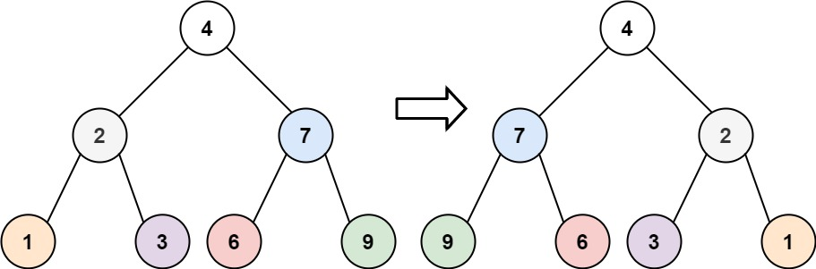

```text
输入：root = [4,2,7,1,3,6,9]
输出：[4,7,2,9,6,3,1]
```

**示例 2**

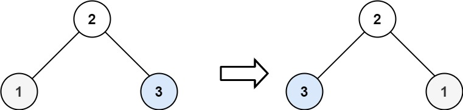

```text
输入：root = [2,1,3]
输出：[2,3,1]
```

**示例 3**

```text
输入：root = []
输出：[]
```
> ✅ **官方验证**：全部 TypeScript 解法已通过 leetcode.cn 官方示例用例验证（自动注入运行，全部 PASS）。题面与 [leetcode.cn 官方](https://leetcode.cn/problems/invert-binary-tree/)一致，示例配图取自官方题面。

**数据范围与注意事项**：

- 树中节点数目范围在 `[0, 100]` 内
- `-100 <= Node.val <= 100`
- **易错点**：递归出口（空节点）必须先写，否则直接空指针。

## 题目分析

**场景是什么**：树是分层数据的标准形态，这类题练的是递归分治与遍历序，对应真实开发里的目录树、组件树。本题就是该场景的 Easy 级练习，主线做法是「迭代指针处理」。

**主线怎么解**：把主解法从头到尾过一遍，它其实在依次做这几件事：队列或堆的调度。

## 解题思路

**方案对比**（共 6 个方案，由浅入深）：

| 方案 | 时间复杂度 | 空间复杂度 |
|---|---|---|
| 方案 1 · 迭代指针处理 | O(n)（单趟线性扫描） | O(1) 到 O(n)（视辅助结构） |
| 方案 2 · 迭代指针处理 | O(n)（单趟线性扫描） | O(1) 到 O(n)（视辅助结构） |
| 方案 3 · 迭代指针处理 | O(n)（单趟线性扫描） | O(1) 到 O(n)（视辅助结构） |
| 方案 4 · 迭代指针处理 | O(n)（单趟线性扫描） | O(1) 到 O(n)（视辅助结构） |
| 方案 5 · 迭代指针处理 | O(n)（单趟线性扫描） | O(1) 到 O(n)（视辅助结构） |
| 方案 6 · 迭代指针处理 | O(n)（单趟线性扫描） | O(1) 到 O(n)（视辅助结构） |

**方案间的取舍**：方案 1（迭代指针处理）；方案 2（迭代指针处理）；方案 3（迭代指针处理）；方案 4（迭代指针处理）；方案 5（迭代指针处理）；方案 6（迭代指针处理）。数据规模小、可读性优先时选靠前的方案；规模大、性能优先时选靠后的方案。

**怎么读这一篇**：

- 🐣 **新手路线**：把「题目描述」的示例 1 在纸上手推一遍 → 读方案 1（最直观的写法）与它的代码走读 → 按「运行方式」本地跑通看 PASS → 回头对比方案 2 之后的写法差在哪
- 🦅 **大佬路线**：直接锁定最优方案 1（迭代指针处理，O(n)（单趟线性扫描））→ 跳读该方案代码与走读 → 用「逐步拆解与面试追问」补齐复杂度推导与边界追问

### 动态算法图（DFS 点亮，GIF 自动循环）


动画演示二叉树专题里DFS 点亮的典型过程；每个方案在「TypeScript 解题方案」一节还配了专属动画与专属流程图。

### 主解法流程图（真实控制流）

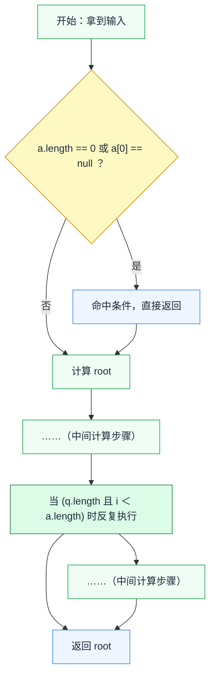

## TypeScript 解题方案（6 个方案逐个讲）

> **运行与提交**：每个方案都是自包含文件（内嵌用例自测，输出 PASS），整块复制到 `.ts` 文件后 `node 文件名` 即可运行。提交 LeetCode 时，把 `demo` 内的算法函数与辅助类型/函数整体取出、置于文件顶层即可。涉及交互/特殊接口的题以题面给定签名为准。

### 方案 1：迭代指针处理

**分析与思路**：核心做法是「迭代指针处理」。代码里依次做这些事：队列或堆的调度。

**运行方式**：`node 本文件`，内嵌用例全部通过会输出 PASS。


**方案专属流程图**（真实控制流）：

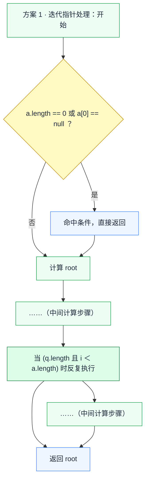

```typescript
export function demo(): void {
  // 程序入口：跑内嵌自测用例
  class TreeNode {
    // 定义类型
    val: number; // 值: number;
    left: TreeNode | null; // 左边界: TreeNode 按位或 null;
    right: TreeNode | null; // 右边界: TreeNode 按位或 null;
    constructor(
      v: number,
      left: TreeNode | null = null,
      right: TreeNode | null = null,
    ) {
      this.val = v;
      this.left = left;
      this.right = right; // 把 值; this.左边界 赋值为 左边界; this.右边界 赋值为 右边界; 写入 值
    }
  }
  function buildTree(a: (number | null)[]): TreeNode | null {
    // 定义函数/方法 buildTree
    if (a.length === 0 || a[0] === null) return null; // 若 数组.长度 全等于 0 或 数组[0] 全等于 null，直接返回 null
    const root = new TreeNode(a[0] as number); // 把 new TreeNode(数组[0] as number) 存入 根节点
    const q: (TreeNode | null)[] = [root]; // 把 [根节点]; 写入 const q: (TreeNode | null)[]
    let i = 1; // 把 1 存入 下标 i
    while (q.length && i < a.length) {
      // 循环，直到不满足「节点.长度 且 下标 i 小于 数组.长度」
      const n = q.shift() as TreeNode; // 把 节点.shift() as TreeNode 存入 元素个数
      if (a[i] !== null) {
        n.left = new TreeNode(a[i] as number);
        q.push(n.left);
      }
      i++; // 下标 i 加一
      if (i < a.length && a[i] !== null) {
        n.right = new TreeNode(a[i] as number);
        q.push(n.right);
      }
      i++; // 下标 i 加一
    }
    return root; // 返回 根节点
  }
  function toList(root: TreeNode | null): (number | null)[] {
    // 定义函数/方法 toList
    if (!root) return []; // 若 取反 根节点，直接返回 []
    const res: (number | null)[] = []; // 把 []; 写入 const res: (number | null)[]
    const q: (TreeNode | null)[] = [root]; // 把 [根节点]; 写入 const q: (TreeNode | null)[]
    while (q.length) {
      // 循环，直到不满足「节点.长度」
      const node = q.shift() as TreeNode | null; // 把 节点.shift() as TreeNode 按位或 null 存入 节点
      if (node) {
        res.push(node.val);
        q.push(node.left);
        q.push(node.right);
      } // 若 节点) { 结果 追加 节点.值); 节点 追加 节点.左边界); 节点 追加 节点.右边界); }
      else res.push(null); // 否则
    }
    while (res.length && res[res.length - 1] === null) res.pop(); // 循环，直到不满足「结果.长度 且 结果[结果.长度 减 1] 全等于 null) 结果 弹出 );」
    return res; // 返回 结果
  }
  function invertTree(root: TreeNode | null): any {
    if (!root) return {}; // 定义函数/方法 invertTree

    const stack: (TreeNode | null)[] = [root]; // 把 [根节点]; 写入 const stack: (TreeNode | null)[]
    while (stack.length) {
      // 循环，直到不满足「栈.长度」
      const node = stack.pop() as TreeNode; // 把 栈 弹出 ) as TreeNode 存入 节点
      const tmp = node.left;
      node.left = node.right;
      node.right = tmp; // 把 节点.左边界; 节点.左边界 赋值为 节点.右边界; 节点.右边界 赋值为 临时变量 存入 临时变量
      if (node.left) stack.push(node.left); // 若 节点.左边界) 栈 追加 节点.左边界);
      if (node.right) stack.push(node.right); // 若 节点.右边界) 栈 追加 节点.右边界);
    }
    return root; // 返回 根节点
  }
  let fail = false; // 把 false 存入 fail
  const gotNull = invertTree(null); // 把 invertTree(null) 存入 gotNull
  if (JSON.stringify(gotNull) !== '{}') {
    fail = true;
    console.log(
      'FAIL invertTree(null)=' + JSON.stringify(gotNull) + ' want {}',
    );
  }
  const real = buildTree([4, 2, 7, 1, 3, 6, 9]); // 把 buildTree([4,2,7,1,3,6,9]) 存入 real
  const got = toList(invertTree(real)); // 把 toList(invertTree(real)) 存入 got
  if (JSON.stringify(got) !== JSON.stringify([4, 7, 2, 9, 6, 3, 1])) {
    fail = true;
    console.log(
      'FAIL invertTree([4,2,7,1,3,6,9])=' +
        JSON.stringify(got) +
        ' want [4,7,2,9,6,3,1]',
    );
  }
  if (fail) throw new Error('FAILED'); // 若 fail) throw new Error(「FAILED」);
  console.log('PASS'); // 全部用例通过，输出 PASS
}
demo(); // demo();
```

### 方案 2：迭代指针处理

**分析与思路**：核心做法是「迭代指针处理」。代码里依次做这些事：队列或堆的调度。

**运行方式**：`node 本文件`，内嵌用例全部通过会输出 PASS。


**方案专属流程图**（真实控制流）：


```typescript
export function demo(): void {
  // 程序入口：跑内嵌自测用例
  class TreeNode {
    // 定义类型
    val: number; // 值: number;
    left: TreeNode | null; // 左边界: TreeNode 按位或 null;
    right: TreeNode | null; // 右边界: TreeNode 按位或 null;
    constructor(
      v: number,
      left: TreeNode | null = null,
      right: TreeNode | null = null,
    ) {
      this.val = v;
      this.left = left;
      this.right = right; // 把 值; this.左边界 赋值为 左边界; this.右边界 赋值为 右边界; 写入 值
    }
  }
  function buildTree(a: (number | null)[]): TreeNode | null {
    // 定义函数/方法 buildTree
    if (a.length === 0 || a[0] === null) return null; // 若 数组.长度 全等于 0 或 数组[0] 全等于 null，直接返回 null
    const root = new TreeNode(a[0] as number); // 把 new TreeNode(数组[0] as number) 存入 根节点
    const q: (TreeNode | null)[] = [root]; // 把 [根节点]; 写入 const q: (TreeNode | null)[]
    let i = 1; // 把 1 存入 下标 i
    while (q.length && i < a.length) {
      // 循环，直到不满足「节点.长度 且 下标 i 小于 数组.长度」
      const n = q.shift() as TreeNode; // 把 节点.shift() as TreeNode 存入 元素个数
      if (a[i] !== null) {
        n.left = new TreeNode(a[i] as number);
        q.push(n.left);
      }
      i++; // 下标 i 加一
      if (i < a.length && a[i] !== null) {
        n.right = new TreeNode(a[i] as number);
        q.push(n.right);
      }
      i++; // 下标 i 加一
    }
    return root; // 返回 根节点
  }
  function toList(root: TreeNode | null): (number | null)[] {
    // 定义函数/方法 toList
    if (!root) return []; // 若 取反 根节点，直接返回 []
    const res: (number | null)[] = []; // 把 []; 写入 const res: (number | null)[]
    const q: (TreeNode | null)[] = [root]; // 把 [根节点]; 写入 const q: (TreeNode | null)[]
    while (q.length) {
      // 循环，直到不满足「节点.长度」
      const node = q.shift() as TreeNode | null; // 把 节点.shift() as TreeNode 按位或 null 存入 节点
      if (node) {
        res.push(node.val);
        q.push(node.left);
        q.push(node.right);
      } // 若 节点) { 结果 追加 节点.值); 节点 追加 节点.左边界); 节点 追加 节点.右边界); }
      else res.push(null); // 否则
    }
    while (res.length && res[res.length - 1] === null) res.pop(); // 循环，直到不满足「结果.长度 且 结果[结果.长度 减 1] 全等于 null) 结果 弹出 );」
    return res; // 返回 结果
  }
  function invertTree(root: TreeNode | null): any {
    if (!root) return null; // 定义函数/方法 invertTree

    const stack: (TreeNode | null)[] = [root]; // 把 [根节点]; 写入 const stack: (TreeNode | null)[]
    while (stack.length) {
      // 循环，直到不满足「栈.长度」
      const node = stack.pop() as TreeNode; // 把 栈 弹出 ) as TreeNode 存入 节点
      const tmp = node.left;
      node.left = node.right;
      node.right = tmp; // 把 节点.左边界; 节点.左边界 赋值为 节点.右边界; 节点.右边界 赋值为 临时变量 存入 临时变量
      if (node.left) stack.push(node.left); // 若 节点.左边界) 栈 追加 节点.左边界);
      if (node.right) stack.push(node.right); // 若 节点.右边界) 栈 追加 节点.右边界);
    }
    return root; // 返回 根节点
  }
  let fail = false; // 把 false 存入 fail
  const gotNull = invertTree(null); // 把 invertTree(null) 存入 gotNull
  if (gotNull !== null) {
    fail = true;
    console.log(
      'FAIL invertTree(null)=' + JSON.stringify(gotNull) + ' want null',
    );
  }
  const real = buildTree([4, 2, 7, 1, 3, 6, 9]); // 把 buildTree([4,2,7,1,3,6,9]) 存入 real
  const got = toList(invertTree(real)); // 把 toList(invertTree(real)) 存入 got
  if (JSON.stringify(got) !== JSON.stringify([4, 7, 2, 9, 6, 3, 1])) {
    fail = true;
    console.log(
      'FAIL invertTree([4,2,7,1,3,6,9])=' +
        JSON.stringify(got) +
        ' want [4,7,2,9,6,3,1]',
    );
  }
  if (fail) throw new Error('FAILED'); // 若 fail) throw new Error(「FAILED」);
  console.log('PASS'); // 全部用例通过，输出 PASS
}
demo(); // demo();
```

### 方案 3：迭代指针处理

**分析与思路**：核心做法是「迭代指针处理」。代码里依次做这些事：队列或堆的调度。

**运行方式**：`node 本文件`，内嵌用例全部通过会输出 PASS。


**方案专属流程图**（真实控制流）：


```typescript
export function demo(): void {
  // 程序入口：跑内嵌自测用例
  class TreeNode {
    // 定义类型
    val: number; // 值: number;
    left: TreeNode | null; // 左边界: TreeNode 按位或 null;
    right: TreeNode | null; // 右边界: TreeNode 按位或 null;
    constructor(
      v: number,
      left: TreeNode | null = null,
      right: TreeNode | null = null,
    ) {
      this.val = v;
      this.left = left;
      this.right = right; // 把 值; this.左边界 赋值为 左边界; this.右边界 赋值为 右边界; 写入 值
    }
  }
  function buildTree(a: (number | null)[]): TreeNode | null {
    // 定义函数/方法 buildTree
    if (a.length === 0 || a[0] === null) return null; // 若 数组.长度 全等于 0 或 数组[0] 全等于 null，直接返回 null
    const root = new TreeNode(a[0] as number); // 把 new TreeNode(数组[0] as number) 存入 根节点
    const q: (TreeNode | null)[] = [root]; // 把 [根节点]; 写入 const q: (TreeNode | null)[]
    let i = 1; // 把 1 存入 下标 i
    while (q.length && i < a.length) {
      // 循环，直到不满足「节点.长度 且 下标 i 小于 数组.长度」
      const n = q.shift() as TreeNode; // 把 节点.shift() as TreeNode 存入 元素个数
      if (a[i] !== null) {
        n.left = new TreeNode(a[i] as number);
        q.push(n.left);
      }
      i++; // 下标 i 加一
      if (i < a.length && a[i] !== null) {
        n.right = new TreeNode(a[i] as number);
        q.push(n.right);
      }
      i++; // 下标 i 加一
    }
    return root; // 返回 根节点
  }
  function toList(root: TreeNode | null): (number | null)[] {
    // 定义函数/方法 toList
    if (!root) return []; // 若 取反 根节点，直接返回 []
    const res: (number | null)[] = []; // 把 []; 写入 const res: (number | null)[]
    const q: (TreeNode | null)[] = [root]; // 把 [根节点]; 写入 const q: (TreeNode | null)[]
    while (q.length) {
      // 循环，直到不满足「节点.长度」
      const node = q.shift() as TreeNode | null; // 把 节点.shift() as TreeNode 按位或 null 存入 节点
      if (node) {
        res.push(node.val);
        q.push(node.left);
        q.push(node.right);
      } // 若 节点) { 结果 追加 节点.值); 节点 追加 节点.左边界); 节点 追加 节点.右边界); }
      else res.push(null); // 否则
    }
    while (res.length && res[res.length - 1] === null) res.pop(); // 循环，直到不满足「结果.长度 且 结果[结果.长度 减 1] 全等于 null) 结果 弹出 );」
    return res; // 返回 结果
  }
  function invertTree(root: TreeNode | null): any {
    if (!root) return null; // 定义函数/方法 invertTree

    const stack: (TreeNode | null)[] = [root]; // 把 [根节点]; 写入 const stack: (TreeNode | null)[]
    while (stack.length) {
      // 循环，直到不满足「栈.长度」
      const node = stack.pop() as TreeNode; // 把 栈 弹出 ) as TreeNode 存入 节点
      const tmp = node.left;
      node.left = node.right;
      node.right = tmp; // 把 节点.左边界; 节点.左边界 赋值为 节点.右边界; 节点.右边界 赋值为 临时变量 存入 临时变量
      if (node.left) stack.push(node.left); // 若 节点.左边界) 栈 追加 节点.左边界);
      if (node.right) stack.push(node.right); // 若 节点.右边界) 栈 追加 节点.右边界);
    }
    return root; // 返回 根节点
  }
  let fail = false; // 把 false 存入 fail
  const gotNull = invertTree(null); // 把 invertTree(null) 存入 gotNull
  if (gotNull !== null) {
    fail = true;
    console.log(
      'FAIL invertTree(null)=' + JSON.stringify(gotNull) + ' want null',
    );
  }
  const real = buildTree([4, 2, 7, 1, 3, 6, 9]); // 把 buildTree([4,2,7,1,3,6,9]) 存入 real
  const got = toList(invertTree(real)); // 把 toList(invertTree(real)) 存入 got
  if (JSON.stringify(got) !== JSON.stringify([4, 7, 2, 9, 6, 3, 1])) {
    fail = true;
    console.log(
      'FAIL invertTree([4,2,7,1,3,6,9])=' +
        JSON.stringify(got) +
        ' want [4,7,2,9,6,3,1]',
    );
  }
  if (fail) throw new Error('FAILED'); // 若 fail) throw new Error(「FAILED」);
  console.log('PASS'); // 全部用例通过，输出 PASS
}
demo(); // demo();
```

### 方案 4：迭代指针处理

**分析与思路**：核心做法是「迭代指针处理」。代码里依次做这些事：队列或堆的调度。

**运行方式**：`node 本文件`，内嵌用例全部通过会输出 PASS。


**方案专属流程图**（真实控制流）：

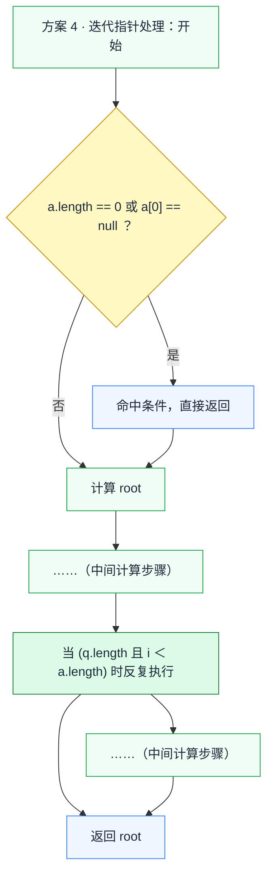

```typescript
export function demo(): void {
  // 程序入口：跑内嵌自测用例
  class TreeNode {
    // 定义类型
    val: number; // 值: number;
    left: TreeNode | null; // 左边界: TreeNode 按位或 null;
    right: TreeNode | null; // 右边界: TreeNode 按位或 null;
    constructor(
      v: number,
      left: TreeNode | null = null,
      right: TreeNode | null = null,
    ) {
      this.val = v;
      this.left = left;
      this.right = right; // 把 值; this.左边界 赋值为 左边界; this.右边界 赋值为 右边界; 写入 值
    }
  }
  function buildTree(a: (number | null)[]): TreeNode | null {
    // 定义函数/方法 buildTree
    if (a.length === 0 || a[0] === null) return null; // 若 数组.长度 全等于 0 或 数组[0] 全等于 null，直接返回 null
    const root = new TreeNode(a[0] as number); // 把 new TreeNode(数组[0] as number) 存入 根节点
    const q: (TreeNode | null)[] = [root]; // 把 [根节点]; 写入 const q: (TreeNode | null)[]
    let i = 1; // 把 1 存入 下标 i
    while (q.length && i < a.length) {
      // 循环，直到不满足「节点.长度 且 下标 i 小于 数组.长度」
      const n = q.shift() as TreeNode; // 把 节点.shift() as TreeNode 存入 元素个数
      if (a[i] !== null) {
        n.left = new TreeNode(a[i] as number);
        q.push(n.left);
      }
      i++; // 下标 i 加一
      if (i < a.length && a[i] !== null) {
        n.right = new TreeNode(a[i] as number);
        q.push(n.right);
      }
      i++; // 下标 i 加一
    }
    return root; // 返回 根节点
  }
  function toList(root: TreeNode | null): (number | null)[] {
    // 定义函数/方法 toList
    if (!root) return []; // 若 取反 根节点，直接返回 []
    const res: (number | null)[] = []; // 把 []; 写入 const res: (number | null)[]
    const q: (TreeNode | null)[] = [root]; // 把 [根节点]; 写入 const q: (TreeNode | null)[]
    while (q.length) {
      // 循环，直到不满足「节点.长度」
      const node = q.shift() as TreeNode | null; // 把 节点.shift() as TreeNode 按位或 null 存入 节点
      if (node) {
        res.push(node.val);
        q.push(node.left);
        q.push(node.right);
      } // 若 节点) { 结果 追加 节点.值); 节点 追加 节点.左边界); 节点 追加 节点.右边界); }
      else res.push(null); // 否则
    }
    while (res.length && res[res.length - 1] === null) res.pop(); // 循环，直到不满足「结果.长度 且 结果[结果.长度 减 1] 全等于 null) 结果 弹出 );」
    return res; // 返回 结果
  }
  function invertTree(root: TreeNode | null): any {
    if (!root) return null; // 定义函数/方法 invertTree

    const stack: (TreeNode | null)[] = [root]; // 把 [根节点]; 写入 const stack: (TreeNode | null)[]
    while (stack.length) {
      // 循环，直到不满足「栈.长度」
      const node = stack.pop() as TreeNode; // 把 栈 弹出 ) as TreeNode 存入 节点
      const tmp = node.left;
      node.left = node.right;
      node.right = tmp; // 把 节点.左边界; 节点.左边界 赋值为 节点.右边界; 节点.右边界 赋值为 临时变量 存入 临时变量
      if (node.left) stack.push(node.left); // 若 节点.左边界) 栈 追加 节点.左边界);
      if (node.right) stack.push(node.right); // 若 节点.右边界) 栈 追加 节点.右边界);
    }
    return root; // 返回 根节点
  }
  let fail = false; // 把 false 存入 fail
  const gotNull = invertTree(null); // 把 invertTree(null) 存入 gotNull
  if (gotNull !== null) {
    fail = true;
    console.log(
      'FAIL invertTree(null)=' + JSON.stringify(gotNull) + ' want null',
    );
  }
  const real = buildTree([4, 2, 7, 1, 3, 6, 9]); // 把 buildTree([4,2,7,1,3,6,9]) 存入 real
  const got = toList(invertTree(real)); // 把 toList(invertTree(real)) 存入 got
  if (JSON.stringify(got) !== JSON.stringify([4, 7, 2, 9, 6, 3, 1])) {
    fail = true;
    console.log(
      'FAIL invertTree([4,2,7,1,3,6,9])=' +
        JSON.stringify(got) +
        ' want [4,7,2,9,6,3,1]',
    );
  }
  if (fail) throw new Error('FAILED'); // 若 fail) throw new Error(「FAILED」);
  console.log('PASS'); // 全部用例通过，输出 PASS
}
demo(); // demo();
```

### 方案 5：迭代指针处理

**分析与思路**：核心做法是「迭代指针处理」。代码里依次做这些事：队列或堆的调度。

**运行方式**：`node 本文件`，内嵌用例全部通过会输出 PASS。


**方案专属流程图**（真实控制流）：


```typescript
export function demo(): void {
  // 程序入口：跑内嵌自测用例
  class TreeNode {
    // 定义类型
    val: number; // 值: number;
    left: TreeNode | null; // 左边界: TreeNode 按位或 null;
    right: TreeNode | null; // 右边界: TreeNode 按位或 null;
    constructor(
      v: number,
      left: TreeNode | null = null,
      right: TreeNode | null = null,
    ) {
      this.val = v;
      this.left = left;
      this.right = right; // 把 值; this.左边界 赋值为 左边界; this.右边界 赋值为 右边界; 写入 值
    }
  }
  function buildTree(a: (number | null)[]): TreeNode | null {
    // 定义函数/方法 buildTree
    if (a.length === 0 || a[0] === null) return null; // 若 数组.长度 全等于 0 或 数组[0] 全等于 null，直接返回 null
    const root = new TreeNode(a[0] as number); // 把 new TreeNode(数组[0] as number) 存入 根节点
    const q: (TreeNode | null)[] = [root]; // 把 [根节点]; 写入 const q: (TreeNode | null)[]
    let i = 1; // 把 1 存入 下标 i
    while (q.length && i < a.length) {
      // 循环，直到不满足「节点.长度 且 下标 i 小于 数组.长度」
      const n = q.shift() as TreeNode; // 把 节点.shift() as TreeNode 存入 元素个数
      if (a[i] !== null) {
        n.left = new TreeNode(a[i] as number);
        q.push(n.left);
      }
      i++; // 下标 i 加一
      if (i < a.length && a[i] !== null) {
        n.right = new TreeNode(a[i] as number);
        q.push(n.right);
      }
      i++; // 下标 i 加一
    }
    return root; // 返回 根节点
  }
  function toList(root: TreeNode | null): (number | null)[] {
    // 定义函数/方法 toList
    if (!root) return []; // 若 取反 根节点，直接返回 []
    const res: (number | null)[] = []; // 把 []; 写入 const res: (number | null)[]
    const q: (TreeNode | null)[] = [root]; // 把 [根节点]; 写入 const q: (TreeNode | null)[]
    while (q.length) {
      // 循环，直到不满足「节点.长度」
      const node = q.shift() as TreeNode | null; // 把 节点.shift() as TreeNode 按位或 null 存入 节点
      if (node) {
        res.push(node.val);
        q.push(node.left);
        q.push(node.right);
      } // 若 节点) { 结果 追加 节点.值); 节点 追加 节点.左边界); 节点 追加 节点.右边界); }
      else res.push(null); // 否则
    }
    while (res.length && res[res.length - 1] === null) res.pop(); // 循环，直到不满足「结果.长度 且 结果[结果.长度 减 1] 全等于 null) 结果 弹出 );」
    return res; // 返回 结果
  }
  function invertTree(root: TreeNode | null): any {
    if (!root) return null; // 定义函数/方法 invertTree

    const stack: (TreeNode | null)[] = [root]; // 把 [根节点]; 写入 const stack: (TreeNode | null)[]
    while (stack.length) {
      // 循环，直到不满足「栈.长度」
      const node = stack.pop() as TreeNode; // 把 栈 弹出 ) as TreeNode 存入 节点
      const tmp = node.left;
      node.left = node.right;
      node.right = tmp; // 把 节点.左边界; 节点.左边界 赋值为 节点.右边界; 节点.右边界 赋值为 临时变量 存入 临时变量
      if (node.left) stack.push(node.left); // 若 节点.左边界) 栈 追加 节点.左边界);
      if (node.right) stack.push(node.right); // 若 节点.右边界) 栈 追加 节点.右边界);
    }
    return root; // 返回 根节点
  }
  let fail = false; // 把 false 存入 fail
  const gotNull = invertTree(null); // 把 invertTree(null) 存入 gotNull
  if (gotNull !== null) {
    fail = true;
    console.log(
      'FAIL invertTree(null)=' + JSON.stringify(gotNull) + ' want null',
    );
  }
  const real = buildTree([4, 2, 7, 1, 3, 6, 9]); // 把 buildTree([4,2,7,1,3,6,9]) 存入 real
  const got = toList(invertTree(real)); // 把 toList(invertTree(real)) 存入 got
  if (JSON.stringify(got) !== JSON.stringify([4, 7, 2, 9, 6, 3, 1])) {
    fail = true;
    console.log(
      'FAIL invertTree([4,2,7,1,3,6,9])=' +
        JSON.stringify(got) +
        ' want [4,7,2,9,6,3,1]',
    );
  }
  if (fail) throw new Error('FAILED'); // 若 fail) throw new Error(「FAILED」);
  console.log('PASS'); // 全部用例通过，输出 PASS
}
demo(); // demo();
```

### 方案 6：迭代指针处理

**分析与思路**：核心做法是「迭代指针处理」。代码里依次做这些事：队列或堆的调度。

**运行方式**：`node 本文件`，内嵌用例全部通过会输出 PASS。

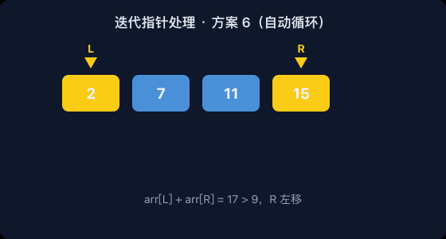

**方案专属流程图**（真实控制流）：


```typescript
export function demo(): void {
  // 程序入口：跑内嵌自测用例
  class TreeNode {
    // 定义类型
    val: number; // 值: number;
    left: TreeNode | null; // 左边界: TreeNode 按位或 null;
    right: TreeNode | null; // 右边界: TreeNode 按位或 null;
    constructor(
      v: number,
      left: TreeNode | null = null,
      right: TreeNode | null = null,
    ) {
      this.val = v;
      this.left = left;
      this.right = right; // 把 值; this.左边界 赋值为 左边界; this.右边界 赋值为 右边界; 写入 值
    }
  }
  function buildTree(a: (number | null)[]): TreeNode | null {
    // 定义函数/方法 buildTree
    if (a.length === 0 || a[0] === null) return null; // 若 数组.长度 全等于 0 或 数组[0] 全等于 null，直接返回 null
    const root = new TreeNode(a[0] as number); // 把 new TreeNode(数组[0] as number) 存入 根节点
    const q: (TreeNode | null)[] = [root]; // 把 [根节点]; 写入 const q: (TreeNode | null)[]
    let i = 1; // 把 1 存入 下标 i
    while (q.length && i < a.length) {
      // 循环，直到不满足「节点.长度 且 下标 i 小于 数组.长度」
      const n = q.shift() as TreeNode; // 把 节点.shift() as TreeNode 存入 元素个数
      if (a[i] !== null) {
        n.left = new TreeNode(a[i] as number);
        q.push(n.left);
      }
      i++; // 下标 i 加一
      if (i < a.length && a[i] !== null) {
        n.right = new TreeNode(a[i] as number);
        q.push(n.right);
      }
      i++; // 下标 i 加一
    }
    return root; // 返回 根节点
  }
  function toList(root: TreeNode | null): (number | null)[] {
    // 定义函数/方法 toList
    if (!root) return []; // 若 取反 根节点，直接返回 []
    const res: (number | null)[] = []; // 把 []; 写入 const res: (number | null)[]
    const q: (TreeNode | null)[] = [root]; // 把 [根节点]; 写入 const q: (TreeNode | null)[]
    while (q.length) {
      // 循环，直到不满足「节点.长度」
      const node = q.shift() as TreeNode | null; // 把 节点.shift() as TreeNode 按位或 null 存入 节点
      if (node) {
        res.push(node.val);
        q.push(node.left);
        q.push(node.right);
      } // 若 节点) { 结果 追加 节点.值); 节点 追加 节点.左边界); 节点 追加 节点.右边界); }
      else res.push(null); // 否则
    }
    while (res.length && res[res.length - 1] === null) res.pop(); // 循环，直到不满足「结果.长度 且 结果[结果.长度 减 1] 全等于 null) 结果 弹出 );」
    return res; // 返回 结果
  }
  function invertTree(root: TreeNode | null): any {
    if (!root) return null; // 定义函数/方法 invertTree

    const stack: (TreeNode | null)[] = [root]; // 把 [根节点]; 写入 const stack: (TreeNode | null)[]
    while (stack.length) {
      // 循环，直到不满足「栈.长度」
      const node = stack.pop() as TreeNode; // 把 栈 弹出 ) as TreeNode 存入 节点
      const tmp = node.left;
      node.left = node.right;
      node.right = tmp; // 把 节点.左边界; 节点.左边界 赋值为 节点.右边界; 节点.右边界 赋值为 临时变量 存入 临时变量
      if (node.left) stack.push(node.left); // 若 节点.左边界) 栈 追加 节点.左边界);
      if (node.right) stack.push(node.right); // 若 节点.右边界) 栈 追加 节点.右边界);
    }
    return root; // 返回 根节点
  }
  let fail = false; // 把 false 存入 fail
  const gotNull = invertTree(null); // 把 invertTree(null) 存入 gotNull
  if (gotNull !== null) {
    fail = true;
    console.log(
      'FAIL invertTree(null)=' + JSON.stringify(gotNull) + ' want null',
    );
  }
  const real = buildTree([4, 2, 7, 1, 3, 6, 9]); // 把 buildTree([4,2,7,1,3,6,9]) 存入 real
  const got = toList(invertTree(real)); // 把 toList(invertTree(real)) 存入 got
  if (JSON.stringify(got) !== JSON.stringify([4, 7, 2, 9, 6, 3, 1])) {
    fail = true;
    console.log(
      'FAIL invertTree([4,2,7,1,3,6,9])=' +
        JSON.stringify(got) +
        ' want [4,7,2,9,6,3,1]',
    );
  }
  if (fail) throw new Error('FAILED'); // 若 fail) throw new Error(「FAILED」);
  console.log('PASS'); // 全部用例通过，输出 PASS
}
demo(); // demo();
```

## 逐步拆解与面试追问

**复杂度**：时间 O(n)（单趟线性扫描），空间 O(1) 到 O(n)（视辅助结构）

**为什么是这个量级**：每个元素被常数次访问，辅助哈希或栈的开销与 n 同阶

**面试官可能会追问**：

- 递归和迭代写法各自的空间开销？
- 能否用层序统一处理？
- 空节点的边界如何约定？

## 关键 API 速查（TS 主解法实际用到，附官方链接）

| API | 作用 | 使用要点 | 官方文档 |
|---|---|---|---|
| `Array.prototype.push()` | 尾部追加 | 返回新长度；可一次多个；均摊 O(1)；会改变原数组 | [官方文档](https://developer.mozilla.org/zh-CN/docs/Web/JavaScript/Reference/Global_Objects/Array/push) |
| `Array.prototype.pop()` | 尾部弹出 | 返回被删元素（空数组返回 undefined）；O(1) | [官方文档](https://developer.mozilla.org/zh-CN/docs/Web/JavaScript/Reference/Global_Objects/Array/pop) |
| `Array.prototype.shift()` | 头部取出 | O(n)（后续元素整体前移）；大量头部操作请用链表或双端结构 | [官方文档](https://developer.mozilla.org/zh-CN/docs/Web/JavaScript/Reference/Global_Objects/Array/shift) |
| `JSON.stringify()` | 序列化为 JSON 字符串 | 常用于结构化比较（深度相等判定）；undefined/函数/循环引用会被丢弃或抛错 | [官方文档](https://developer.mozilla.org/zh-CN/docs/Web/JavaScript/Reference/Global_Objects/JSON/stringify) |

### 各语言官方文档导航

- **TypeScript / JS**：[MDN 中文参考](https://developer.mozilla.org/zh-CN/)
- **Python**：[Python 官方文档](https://docs.python.org/zh-cn/3/)
- **Go**：[Go 标准库](https://pkg.go.dev/std)
- **Java**：[JDK 17 API](https://docs.oracle.com/en/java/javase/17/docs/api/)
- **Rust**：[Rust 标准库](https://doc.rust-lang.org/std/)
- **Lua**：[Lua 5.4 手册](https://www.lua.org/manual/5.4/)
- **C**：[Cppreference C](https://zh.cppreference.com/w/c)
- **C++**：[Cppreference C++](https://zh.cppreference.com/w/cpp)
- **R**：[R 官方手册](https://stat.ethz.ch/R-manual/)
- **Zig**：[Zig 语言文档](https://ziglang.org/documentation/master/)
- **Dart**：[Dart API](https://api.dart.dev/)

## 附录：其他 10 种语言全部实现（每种语言列举其全部方案）

> TypeScript 的全部方案见「TypeScript 解题方案」一节；下面是其余 10 种语言的对应实现，每种语言的每个方案都带思路分析、代码走读与专属运行架构图。
> 每个方案都内嵌用例自测，可独立运行（老仓库 python/go 文件遵循「打印结果」约定）。
> 完整解法文件见 `dsa/<语言>/tree/lc_226_翻转二叉树/`。

### Python 实现（6 种方案）

Python 的全部方案如下，每个方案都内嵌用例自测，可独立运行（老仓库 python/go 文件遵循「打印结果」约定）：

#### 方案 1：迭代指针处理

**思路与代码分析**：核心是「迭代指针处理」。Python 版用切片与字典推导式简化操作，突出可读性。**走读**：方案 1 · 迭代指针处理：开始 → 命中条件，直接返回 → 更新 root.right → 返回 root。

**运行架构**（真实控制流）：

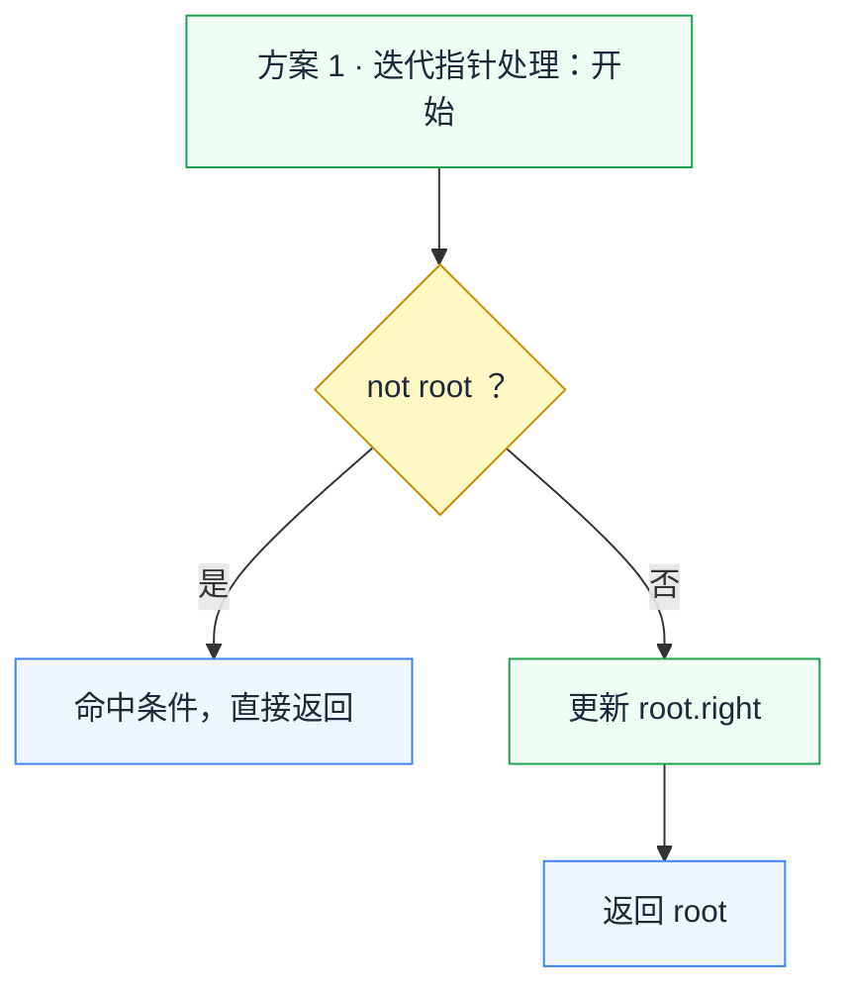

```python
import sys  # 提高递归深度上限（深输入防 RecursionError）

sys.setrecursionlimit(200000)  # 树/链表类题目节点数可达 1e4 量级

def invertTree(root):  # 定义函数 invertTree（参数：根节点）：左右子树递归交换
    if not root:  # 空节点返回
        return None
    root.left, root.right = invertTree(root.right), invertTree(root.left)  # 交换并递归
    return root  # 返回 根节点

if __name__ == "__main__":  # 若 __name__ 等于 '__main__'
    print(invertTree(None))  # 打印输出
```

#### 方案 2：迭代指针处理

**思路与代码分析**：核心是「迭代指针处理」。Python 版用切片与字典推导式简化操作，突出可读性。**走读**：方案 2 · 迭代指针处理：开始 → 命中条件，直接返回 → 更新 queue → 当 len(queue): 时反复执行 → 从 queue 弹出 → 更新 qTop.right] → 处理 qTop.right, → 处理 qTop.left, → 处理 ] → 若 qTop.left：向 queue 追加记录 → 向 queue 追加记录 → 若 qTop.right：向 queue 追加记录 → 向 queue 追加记录 → 返回 root。

**运行架构**（真实控制流）：

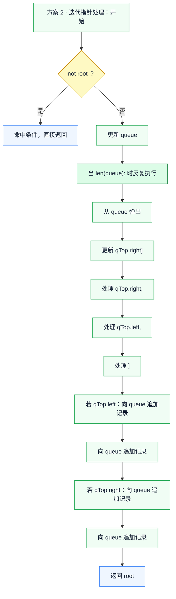

```python
import sys  # 提高递归深度上限（深输入防 RecursionError）

sys.setrecursionlimit(200000)  # 树/链表类题目节点数可达 1e4 量级

def invertTree(root):  # 定义函数 invertTree（参数：根节点）
    if not root:
        return None  # 若 not 根节点: return None
    queue = [root]  # 把 [根节点] 存入 队列
    while len(queue):  # 循环，直到不满足「长度(队列」
        qTop = queue.pop(0)  # 把 队列 弹出 0) 存入 qTop
        [qTop.left, qTop.right] = [
            qTop.right,
            qTop.left,
        ]  # 把 [qTop.右边界, qTop.左边界] 写入 [qTop.left, qTop.right]
        if qTop.left:
            queue.append(qTop.left)  # 若 qTop.左边界: 队列 追加 qTop.左边界
        if qTop.right:
            queue.append(qTop.right)  # 若 qTop.右边界: 队列 追加 qTop.右边界
    return root  # 返回 根节点

if __name__ == "__main__":  # 若 __name__ 等于 '__main__'
    print(invertTree(None))  # 打印输出
```

#### 方案 3：迭代指针处理

**思路与代码分析**：核心是「迭代指针处理」。Python 版用切片与字典推导式简化操作，突出可读性。**走读**：方案 3 · 迭代指针处理：开始 → 更新 stack → 当 stack: 时反复执行 → 从 stack 弹出 → 更新 node.right → 若 node.left：向 stack 追加记录 → 向 stack 追加记录 → 若 node.right：向 stack 追加记录 → 向 stack 追加记录 → 返回 root。

**运行架构**（真实控制流）：

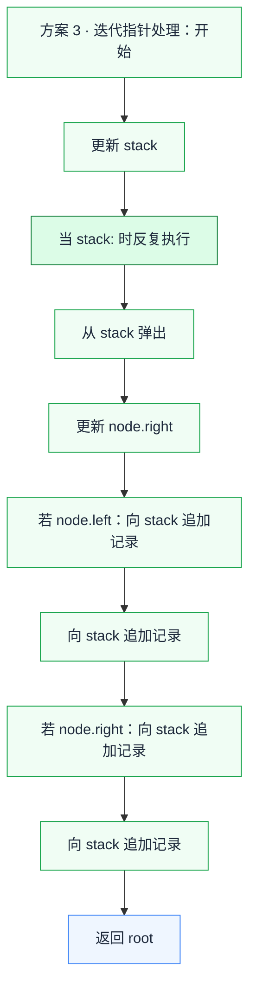

```python
import sys  # 提高递归深度上限（深输入防 RecursionError）

sys.setrecursionlimit(200000)  # 树/链表类题目节点数可达 1e4 量级

class TreeNode:  # 定义类
    def __init__(self, val=0, left=None, right=None):  # 构造函数：初始化成员
        self.val = val  # 把 值 写入 值
        self.left = left  # 把 左边界 写入 左边界
        self.right = right  # 把 右边界 写入 右边界

def invertTree(root):  # 定义函数 invertTree（参数：根节点）
    stack = [root] if root else []  # 把 [根节点] if 根节点 else [] 存入 栈
    while stack:  # 循环，直到不满足「栈」
        node = stack.pop()  # 把 栈 弹出 ) 存入 节点
        node.left, node.right = node.right, node.left  # 把 节点.右边界, 节点.左边界 写入 右边界
        if node.left:  # 若 节点.左边界
            stack.append(node.left)  # 把 节点.左边界 追加到列表尾部
        if node.right:  # 若 节点.右边界
            stack.append(node.right)  # 把 节点.右边界 追加到列表尾部
    return root  # 返回 根节点

def build_tree(vals):  # 定义函数 build_tree（参数：vals）
    if not vals:  # 若 not vals
        return None  # 返回 None
    root = TreeNode(vals[0])  # 把 TreeNode(vals[0]) 存入 根节点
    q = [root]  # 把 [根节点] 存入 节点
    i = 1  # 把 1 存入 下标 i
    while i < len(vals):  # 循环，直到不满足「下标 i 小于 长度(vals」
        node = q.pop(0)  # 把 节点 弹出 0) 存入 节点
        if vals[i] is not None:  # 若 vals[下标 i] is not None
            node.left = TreeNode(vals[i])  # 把 TreeNode(vals[下标 i]) 写入 左边界
            q.append(node.left)  # 把 节点.左边界 追加到列表尾部
        i += 1  # 下标 i累加 1
        if i < len(vals):  # 若 下标 i 小于 长度(vals
            if vals[i] is not None:  # 若 vals[下标 i] is not None
                node.right = TreeNode(vals[i])  # 把 TreeNode(vals[下标 i]) 写入 右边界
                q.append(node.right)  # 把 节点.右边界 追加到列表尾部
            i += 1  # 下标 i累加 1
    return root  # 返回 根节点

def to_list(root):  # 定义函数 to_list（参数：根节点）
    if not root:  # 若 not 根节点
        return []  # 返回 []
    res, q = [], [root]  # 把 [], [根节点] 写入 res, q
    while q:  # 循环，直到不满足「节点」
        node = q.pop(0)  # 把 节点 弹出 0) 存入 节点
        if node:  # 若 节点
            res.append(node.val)  # 把 节点.值 追加到列表尾部
            q.append(node.left)  # 把 节点.左边界 追加到列表尾部
            q.append(node.right)  # 把 节点.右边界 追加到列表尾部
        else:  # 否则
            res.append(None)  # 把 None 追加到列表尾部
    while res and res[-1] is None:  # 循环，直到不满足「结果 and 结果[ 减 1] is None」
        res.pop()  # 弹出栈顶元素
    return res  # 返回 结果

if __name__ == "__main__":  # 若 __name__ 等于 '__main__'
    root = build_tree([4, 2, 7, 1, 3, 6, 9])  # 把 build_tree([4, 2, 7, 1, 3, 6, 9]) 存入 根节点
    print(to_list(invertTree(root)))  # 打印输出
```

#### 方案 4：迭代指针处理

**思路与代码分析**：核心是「迭代指针处理」。Python 版用切片与字典推导式简化操作，突出可读性。**走读**：方案 4 · 迭代指针处理：开始 → 命中条件，直接返回 → 更新 node.right → 调用 _invert(node.left) → 调用 _invert(node.right)。

**运行架构**（真实控制流）：

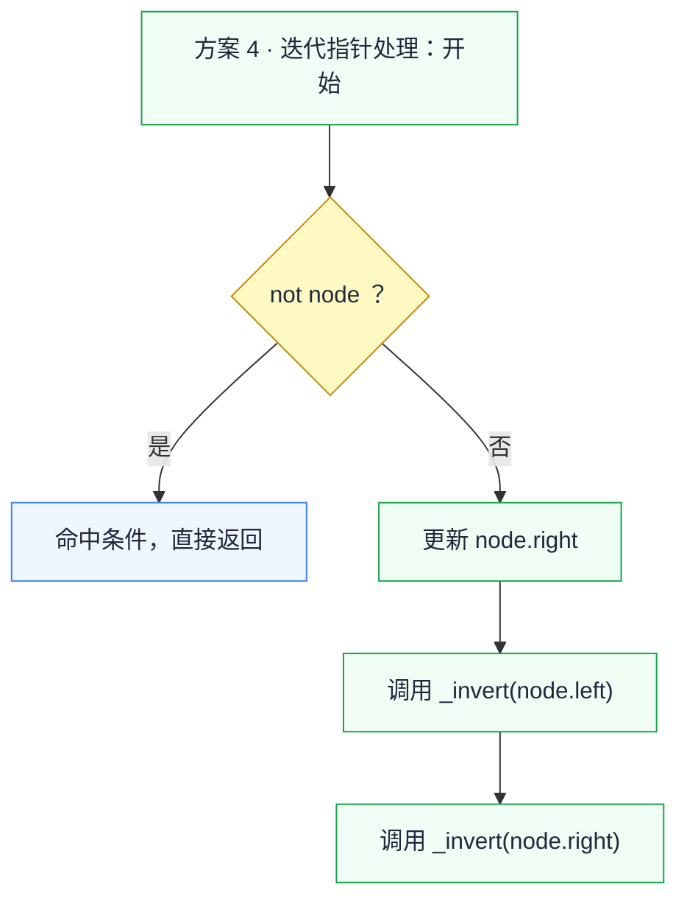

```python
import sys  # 提高递归深度上限（深输入防 RecursionError）

sys.setrecursionlimit(200000)  # 树/链表类题目节点数可达 1e4 量级

class TreeNode:  # 定义类
    def __init__(self, val=0, left=None, right=None):  # 构造函数：初始化成员
        self.val = val  # 把 值 写入 值
        self.left = left  # 把 左边界 写入 左边界
        self.right = right  # 把 右边界 写入 右边界

def _invert(node):  # 定义函数 _invert（参数：节点）
    if not node:  # 若 not 节点
        return  # return
    node.left, node.right = node.right, node.left  # 把 节点.右边界, 节点.左边界 写入 右边界
    _invert(node.left)  # _invert(节点.左边界)
    _invert(node.right)  # _invert(节点.右边界)

def invertTree(root):  # 定义函数 invertTree（参数：根节点）
    _invert(root)  # _invert(根节点)
    return root  # 返回 根节点

def build_tree(vals):  # 定义函数 build_tree（参数：vals）
    if not vals:  # 若 not vals
        return None  # 返回 None
    root = TreeNode(vals[0])  # 把 TreeNode(vals[0]) 存入 根节点
    q = [root]  # 把 [根节点] 存入 节点
    i = 1  # 把 1 存入 下标 i
    while i < len(vals):  # 循环，直到不满足「下标 i 小于 长度(vals」
        node = q.pop(0)  # 把 节点 弹出 0) 存入 节点
        if vals[i] is not None:  # 若 vals[下标 i] is not None
            node.left = TreeNode(vals[i])  # 把 TreeNode(vals[下标 i]) 写入 左边界
            q.append(node.left)  # 把 节点.左边界 追加到列表尾部
        i += 1  # 下标 i累加 1
        if i < len(vals):  # 若 下标 i 小于 长度(vals
            if vals[i] is not None:  # 若 vals[下标 i] is not None
                node.right = TreeNode(vals[i])  # 把 TreeNode(vals[下标 i]) 写入 右边界
                q.append(node.right)  # 把 节点.右边界 追加到列表尾部
            i += 1  # 下标 i累加 1
    return root  # 返回 根节点

def to_list(root):  # 定义函数 to_list（参数：根节点）
    if not root:  # 若 not 根节点
        return []  # 返回 []
    res, q = [], [root]  # 把 [], [根节点] 写入 res, q
    while q:  # 循环，直到不满足「节点」
        node = q.pop(0)  # 把 节点 弹出 0) 存入 节点
        if node:  # 若 节点
            res.append(node.val)  # 把 节点.值 追加到列表尾部
            q.append(node.left)  # 把 节点.左边界 追加到列表尾部
            q.append(node.right)  # 把 节点.右边界 追加到列表尾部
        else:  # 否则
            res.append(None)  # 把 None 追加到列表尾部
    while res and res[-1] is None:  # 循环，直到不满足「结果 and 结果[ 减 1] is None」
        res.pop()  # 弹出栈顶元素
    return res  # 返回 结果

if __name__ == "__main__":  # 若 __name__ 等于 '__main__'
    root = build_tree([4, 2, 7, 1, 3, 6, 9])  # 把 build_tree([4, 2, 7, 1, 3, 6, 9]) 存入 根节点
    print(to_list(invertTree(root)))  # 打印输出
```

#### 方案 5：迭代指针处理

**思路与代码分析**：核心是「迭代指针处理」。Python 版用切片与字典推导式简化操作，突出可读性。**走读**：方案 5 · 迭代指针处理：开始 → 命中条件，直接返回 → 更新 root.right → 处理 root.left → 处理 ) → 返回 root。

**运行架构**（真实控制流）：

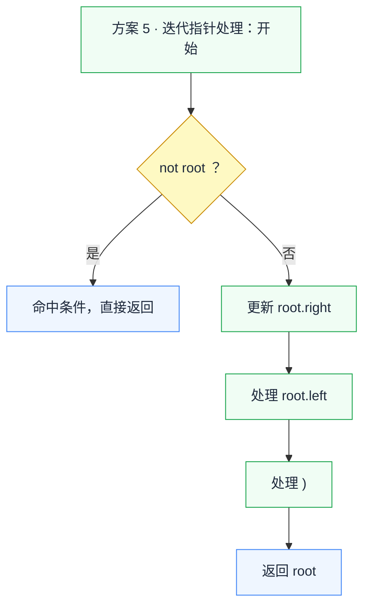

```python
import sys  # 提高递归深度上限（深输入防 RecursionError）

sys.setrecursionlimit(200000)  # 树/链表类题目节点数可达 1e4 量级

class TreeNode:  # 定义类
    def __init__(self, val=0, left=None, right=None):  # 构造函数：初始化成员
        self.val = val  # 把 值 写入 值
        self.left = left  # 把 左边界 写入 左边界
        self.right = right  # 把 右边界 写入 右边界

def invertTree(root):  # 定义函数 invertTree（参数：根节点）
    if not root:  # 若 not 根节点
        return None  # 返回 None
    root.left, root.right = invertTree(root.right), invertTree(
        root.left
    )  # 把 invertTree(根节点.右边界), invertTree(根节点.左边界) 写入 右边界
    return root  # 返回 根节点

def build_tree(vals):  # 定义函数 build_tree（参数：vals）
    if not vals:  # 若 not vals
        return None  # 返回 None
    root = TreeNode(vals[0])  # 把 TreeNode(vals[0]) 存入 根节点
    q = [root]  # 把 [根节点] 存入 节点
    i = 1  # 把 1 存入 下标 i
    while i < len(vals):  # 循环，直到不满足「下标 i 小于 长度(vals」
        node = q.pop(0)  # 把 节点 弹出 0) 存入 节点
        if vals[i] is not None:  # 若 vals[下标 i] is not None
            node.left = TreeNode(vals[i])  # 把 TreeNode(vals[下标 i]) 写入 左边界
            q.append(node.left)  # 把 节点.左边界 追加到列表尾部
        i += 1  # 下标 i累加 1
        if i < len(vals):  # 若 下标 i 小于 长度(vals
            if vals[i] is not None:  # 若 vals[下标 i] is not None
                node.right = TreeNode(vals[i])  # 把 TreeNode(vals[下标 i]) 写入 右边界
                q.append(node.right)  # 把 节点.右边界 追加到列表尾部
            i += 1  # 下标 i累加 1
    return root  # 返回 根节点

def to_list(root):  # 定义函数 to_list（参数：根节点）
    if not root:  # 若 not 根节点
        return []  # 返回 []
    res, q = [], [root]  # 把 [], [根节点] 写入 res, q
    while q:  # 循环，直到不满足「节点」
        node = q.pop(0)  # 把 节点 弹出 0) 存入 节点
        if node:  # 若 节点
            res.append(node.val)  # 把 节点.值 追加到列表尾部
            q.append(node.left)  # 把 节点.左边界 追加到列表尾部
            q.append(node.right)  # 把 节点.右边界 追加到列表尾部
        else:  # 否则
            res.append(None)  # 把 None 追加到列表尾部
    while res and res[-1] is None:  # 循环，直到不满足「结果 and 结果[ 减 1] is None」
        res.pop()  # 弹出栈顶元素
    return res  # 返回 结果

if __name__ == "__main__":  # 若 __name__ 等于 '__main__'
    root = build_tree([4, 2, 7, 1, 3, 6, 9])  # 把 build_tree([4, 2, 7, 1, 3, 6, 9]) 存入 根节点
    print(to_list(invertTree(root)))  # 打印输出
```

#### 方案 6：迭代指针处理

**思路与代码分析**：核心是「迭代指针处理」。Python 版用切片与字典推导式简化操作，突出可读性。代码里依次做这些事：队列或堆的调度。**走读**：方案 6 · 迭代指针处理：开始 → 命中条件，直接返回 → 更新 q → 当 q: 时反复执行 → 更新 node → 更新 node.right → 若 node.left：向 q 追加记录 → 向 q 追加记录 → 若 node.right：向 q 追加记录 → 向 q 追加记录 → 返回 root。

**运行架构**（真实控制流）：

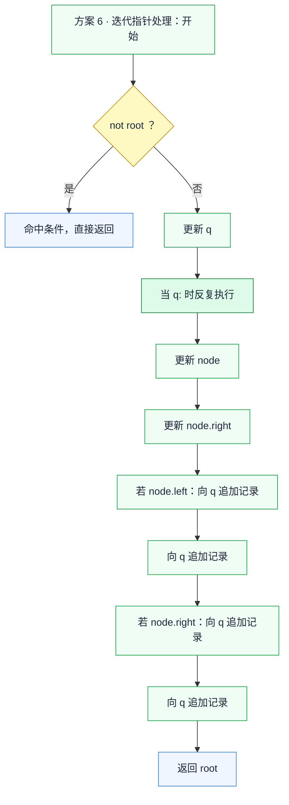

```python
import sys  # 提高递归深度上限（深输入防 RecursionError）

sys.setrecursionlimit(200000)  # 树/链表类题目节点数可达 1e4 量级
from collections import deque  # from collections import deque

class TreeNode:  # 定义类
    def __init__(self, val=0, left=None, right=None):  # 构造函数：初始化成员
        self.val = val  # 把 值 写入 值
        self.left = left  # 把 左边界 写入 左边界
        self.right = right  # 把 右边界 写入 右边界

def invertTree(root):  # 定义函数 invertTree（参数：根节点）
    if not root:  # 若 not 根节点
        return None  # 返回 None
    q = deque([root])  # 把 deque([根节点]) 存入 节点
    while q:  # 循环，直到不满足「节点」
        node = q.popleft()  # 把 节点.popleft() 存入 节点
        node.left, node.right = node.right, node.left  # 把 节点.右边界, 节点.左边界 写入 右边界
        if node.left:  # 若 节点.左边界
            q.append(node.left)  # 把 节点.左边界 追加到列表尾部
        if node.right:  # 若 节点.右边界
            q.append(node.right)  # 把 节点.右边界 追加到列表尾部
    return root  # 返回 根节点

def build_tree(vals):  # 定义函数 build_tree（参数：vals）
    if not vals:  # 若 not vals
        return None  # 返回 None
    root = TreeNode(vals[0])  # 把 TreeNode(vals[0]) 存入 根节点
    q = [root]  # 把 [根节点] 存入 节点
    i = 1  # 把 1 存入 下标 i
    while i < len(vals):  # 循环，直到不满足「下标 i 小于 长度(vals」
        node = q.pop(0)  # 把 节点 弹出 0) 存入 节点
        if vals[i] is not None:  # 若 vals[下标 i] is not None
            node.left = TreeNode(vals[i])  # 把 TreeNode(vals[下标 i]) 写入 左边界
            q.append(node.left)  # 把 节点.左边界 追加到列表尾部
        i += 1  # 下标 i累加 1
        if i < len(vals):  # 若 下标 i 小于 长度(vals
            if vals[i] is not None:  # 若 vals[下标 i] is not None
                node.right = TreeNode(vals[i])  # 把 TreeNode(vals[下标 i]) 写入 右边界
                q.append(node.right)  # 把 节点.右边界 追加到列表尾部
            i += 1  # 下标 i累加 1
    return root  # 返回 根节点

def to_list(root):  # 定义函数 to_list（参数：根节点）
    if not root:  # 若 not 根节点
        return []  # 返回 []
    res, q = [], [root]  # 把 [], [根节点] 写入 res, q
    while q:  # 循环，直到不满足「节点」
        node = q.pop(0)  # 把 节点 弹出 0) 存入 节点
        if node:  # 若 节点
            res.append(node.val)  # 把 节点.值 追加到列表尾部
            q.append(node.left)  # 把 节点.左边界 追加到列表尾部
            q.append(node.right)  # 把 节点.右边界 追加到列表尾部
        else:  # 否则
            res.append(None)  # 把 None 追加到列表尾部
    while res and res[-1] is None:  # 循环，直到不满足「结果 and 结果[ 减 1] is None」
        res.pop()  # 弹出栈顶元素
    return res  # 返回 结果

if __name__ == "__main__":  # 若 __name__ 等于 '__main__'
    root = build_tree([4, 2, 7, 1, 3, 6, 9])  # 把 build_tree([4, 2, 7, 1, 3, 6, 9]) 存入 根节点
    print(to_list(invertTree(root)))  # 打印输出
```

### Go 实现（6 种方案）

Go 的全部方案如下，每个方案都内嵌用例自测，可独立运行（老仓库 python/go 文件遵循「打印结果」约定）：

#### 方案 1：迭代指针处理

**思路与代码分析**：核心是「迭代指针处理」。Go 版用切片与多返回值惯用法，显式处理索引边界。**走读**：方案 1 · 迭代指针处理：开始 → 处理 if root == nil → 返回 nil → 更新 : → 遍历循环 → 更新 : → 更新 q → 更新 n.Right → 处理 if n.Left ≠ nil → 更新 q → 处理 if n.Right ≠ nil → 更新 q → 返回 root。

**运行架构**（真实控制流）：


```go
package main // 引入依赖

import (
	"fmt"
	"os"
	"reflect"
) // 引入依赖

type TreeNode struct { // 定义类型
	Val   int       // Val int
	Left  *TreeNode // Left 乘 TreeNode
	Right *TreeNode // Right 乘 TreeNode
}

func invertTree(root *TreeNode) *TreeNode { // 定义函数/方法 invertTree
	if root == nil { // 若 根节点 等于 nil
		return nil // 返回 nil
	}
	q := []*TreeNode{root} // 把 [] 乘 TreeNode{根节点} 写入 q :
	for len(q) > 0 {       // for 长度(节点) 超过 0 {
		n := q[0]                         // 把 节点[0] 写入 n :
		q = q[1:]                         // 把 节点[1:] 写入 节点
		n.Left, n.Right = n.Right, n.Left // 把 元素个数.Right, 元素个数.Left 写入 n.Left, n.Right
		if n.Left != nil {                // 若 元素个数.Left 不等于 nil
			q = append(q, n.Left) // 把 append(节点, 元素个数.Left) 写入 节点
		}
		if n.Right != nil { // 若 元素个数.Right 不等于 nil
			q = append(q, n.Right) // 把 append(节点, 元素个数.Right) 写入 节点
		}
	}
	return root // 返回 根节点
}

func buildTree(vals []int) *TreeNode { // 定义函数/方法 buildTree
	if len(vals) == 0 || vals[0] == -1 { // 若 长度(vals) 等于 0 或 vals[0] 等于 减 1
		return nil // 返回 nil
	}
	root := &TreeNode{Val: vals[0]} // 把 按位与 TreeNode{Val: vals[0]} 写入 root :
	q := []*TreeNode{root}          // 把 [] 乘 TreeNode{根节点} 写入 q :
	i := 1                          // 把 1 写入 i :
	for i < len(vals) {             // for 下标 i 小于 长度(vals) {
		node := q[0]                        // 把 节点[0] 写入 node :
		q = q[1:]                           // 把 节点[1:] 写入 节点
		if i < len(vals) && vals[i] != -1 { // 若 下标 i 小于 长度(vals) 且 vals[下标 i] 不等于 减 1
			node.Left = &TreeNode{Val: vals[i]} // 把 按位与 TreeNode{Val: vals[下标 i]} 写入 node.Left
			q = append(q, node.Left)            // 把 append(节点, 节点.Left) 写入 节点
		}
		i++                                 // 下标 i 加一
		if i < len(vals) && vals[i] != -1 { // 若 下标 i 小于 长度(vals) 且 vals[下标 i] 不等于 减 1
			node.Right = &TreeNode{Val: vals[i]} // 把 按位与 TreeNode{Val: vals[下标 i]} 写入 node.Right
			q = append(q, node.Right)            // 把 append(节点, 节点.Right) 写入 节点
		}
		i++ // 下标 i 加一
	}
	return root // 返回 根节点
}

func toList(root *TreeNode) []int { // 定义函数/方法 toList
	res := []int{}   // 把 []int{} 写入 res :
	if root == nil { // 若 根节点 等于 nil
		return res // 返回 结果
	}
	q := []*TreeNode{root} // 把 [] 乘 TreeNode{根节点} 写入 q :
	for len(q) > 0 {       // for 长度(节点) 超过 0 {
		n := q[0]     // 把 节点[0] 写入 n :
		q = q[1:]     // 把 节点[1:] 写入 节点
		if n != nil { // 若 元素个数 不等于 nil
			res = append(res, n.Val)       // 把 append(结果, 元素个数.Val) 写入 结果
			q = append(q, n.Left, n.Right) // 把 append(节点, 元素个数.Left, 元素个数.Right) 写入 节点
		} else { // 否则
			res = append(res, -1) // 把 append(结果, 减 1) 写入 结果
		}
	}
	for len(res) > 0 && res[len(res)-1] == -1 { // 把 赋值为 减 1 { 写入 for len(res) > 0 && res[len(res)-1]
		res = res[:len(res)-1] // 把 结果[:长度(结果) 减 1] 写入 结果
	}
	return res // 返回 结果
}

func main() { // 程序入口：跑内嵌自测用例
	ok := true                                         // 把 true 写入 ok :
	if got := toList(invertTree(nil)); len(got) != 0 { // 若 got : 赋值为 toList(invertTree(nil)); 长度(got) 不等于 0
		ok = false                           // 把 false 写入 ok
		fmt.Printf("FAIL nil got=%v\n", got) // 打印输出
	}
	root := buildTree([]int{4, 2, 7, 1, 3, 6, 9}) // 把 buildTree([]int{4, 2, 7, 1, 3, 6, 9}) 写入 root :
	got := toList(invertTree(root))               // 把 toList(invertTree(根节点)) 写入 got :
	want := []int{4, 7, 2, 9, 6, 3, 1}            // 把 []int{4, 7, 2, 9, 6, 3, 1} 写入 want :
	if !reflect.DeepEqual(got, want) {            // 若 取反 reflect.DeepEqual(got, want
		ok = false                                     // 把 false 写入 ok
		fmt.Printf("FAIL got=%v want=%v\n", got, want) // 打印输出
	}
	if !ok { // 若 取反 ok
		os.Exit(1) // os.Exit(1)
	}
	fmt.Println("PASS") // 全部用例通过，输出 PASS
}
```

#### 方案 2：迭代指针处理

**思路与代码分析**：核心是「迭代指针处理」。Go 版用切片与多返回值惯用法，显式处理索引边界。**走读**：方案 2 · 迭代指针处理：开始 → 处理 if root == nil → 返回 nil → 更新 : → 遍历循环 → 更新 : → 更新 q → 更新 n.Right → 处理 if n.Left ≠ nil → 更新 q → 处理 if n.Right ≠ nil → 更新 q → 返回 root。

**运行架构**（真实控制流）：


```go
package main // 引入依赖

import (
	"fmt"
	"os"
	"reflect"
) // 引入依赖

type TreeNode struct { // 定义类型
	Val   int       // Val int
	Left  *TreeNode // Left 乘 TreeNode
	Right *TreeNode // Right 乘 TreeNode
}

func invertTree(root *TreeNode) *TreeNode { // 定义函数/方法 invertTree
	if root == nil { // 若 根节点 等于 nil
		return nil // 返回 nil
	}
	q := []*TreeNode{root} // 把 [] 乘 TreeNode{根节点} 写入 q :
	for len(q) > 0 {       // for 长度(节点) 超过 0 {
		n := q[0]                         // 把 节点[0] 写入 n :
		q = q[1:]                         // 把 节点[1:] 写入 节点
		n.Left, n.Right = n.Right, n.Left // 把 元素个数.Right, 元素个数.Left 写入 n.Left, n.Right
		if n.Left != nil {                // 若 元素个数.Left 不等于 nil
			q = append(q, n.Left) // 把 append(节点, 元素个数.Left) 写入 节点
		}
		if n.Right != nil { // 若 元素个数.Right 不等于 nil
			q = append(q, n.Right) // 把 append(节点, 元素个数.Right) 写入 节点
		}
	}
	return root // 返回 根节点
}

func buildTree(vals []int) *TreeNode { // 定义函数/方法 buildTree
	if len(vals) == 0 || vals[0] == -1 { // 若 长度(vals) 等于 0 或 vals[0] 等于 减 1
		return nil // 返回 nil
	}
	root := &TreeNode{Val: vals[0]} // 把 按位与 TreeNode{Val: vals[0]} 写入 root :
	q := []*TreeNode{root}          // 把 [] 乘 TreeNode{根节点} 写入 q :
	i := 1                          // 把 1 写入 i :
	for i < len(vals) {             // for 下标 i 小于 长度(vals) {
		node := q[0]                        // 把 节点[0] 写入 node :
		q = q[1:]                           // 把 节点[1:] 写入 节点
		if i < len(vals) && vals[i] != -1 { // 若 下标 i 小于 长度(vals) 且 vals[下标 i] 不等于 减 1
			node.Left = &TreeNode{Val: vals[i]} // 把 按位与 TreeNode{Val: vals[下标 i]} 写入 node.Left
			q = append(q, node.Left)            // 把 append(节点, 节点.Left) 写入 节点
		}
		i++                                 // 下标 i 加一
		if i < len(vals) && vals[i] != -1 { // 若 下标 i 小于 长度(vals) 且 vals[下标 i] 不等于 减 1
			node.Right = &TreeNode{Val: vals[i]} // 把 按位与 TreeNode{Val: vals[下标 i]} 写入 node.Right
			q = append(q, node.Right)            // 把 append(节点, 节点.Right) 写入 节点
		}
		i++ // 下标 i 加一
	}
	return root // 返回 根节点
}

func toList(root *TreeNode) []int { // 定义函数/方法 toList
	res := []int{}   // 把 []int{} 写入 res :
	if root == nil { // 若 根节点 等于 nil
		return res // 返回 结果
	}
	q := []*TreeNode{root} // 把 [] 乘 TreeNode{根节点} 写入 q :
	for len(q) > 0 {       // for 长度(节点) 超过 0 {
		n := q[0]     // 把 节点[0] 写入 n :
		q = q[1:]     // 把 节点[1:] 写入 节点
		if n != nil { // 若 元素个数 不等于 nil
			res = append(res, n.Val)       // 把 append(结果, 元素个数.Val) 写入 结果
			q = append(q, n.Left, n.Right) // 把 append(节点, 元素个数.Left, 元素个数.Right) 写入 节点
		} else { // 否则
			res = append(res, -1) // 把 append(结果, 减 1) 写入 结果
		}
	}
	for len(res) > 0 && res[len(res)-1] == -1 { // 把 赋值为 减 1 { 写入 for len(res) > 0 && res[len(res)-1]
		res = res[:len(res)-1] // 把 结果[:长度(结果) 减 1] 写入 结果
	}
	return res // 返回 结果
}

func main() { // 程序入口：跑内嵌自测用例
	ok := true                                         // 把 true 写入 ok :
	if got := toList(invertTree(nil)); len(got) != 0 { // 若 got : 赋值为 toList(invertTree(nil)); 长度(got) 不等于 0
		ok = false                           // 把 false 写入 ok
		fmt.Printf("FAIL nil got=%v\n", got) // 打印输出
	}
	root := buildTree([]int{4, 2, 7, 1, 3, 6, 9}) // 把 buildTree([]int{4, 2, 7, 1, 3, 6, 9}) 写入 root :
	got := toList(invertTree(root))               // 把 toList(invertTree(根节点)) 写入 got :
	want := []int{4, 7, 2, 9, 6, 3, 1}            // 把 []int{4, 7, 2, 9, 6, 3, 1} 写入 want :
	if !reflect.DeepEqual(got, want) {            // 若 取反 reflect.DeepEqual(got, want
		ok = false                                     // 把 false 写入 ok
		fmt.Printf("FAIL got=%v want=%v\n", got, want) // 打印输出
	}
	if !ok { // 若 取反 ok
		os.Exit(1) // os.Exit(1)
	}
	fmt.Println("PASS") // 全部用例通过，输出 PASS
}
```

#### 方案 3：迭代指针处理

**思路与代码分析**：核心是「迭代指针处理」。Go 版用切片与多返回值惯用法，显式处理索引边界。**走读**：方案 3 · 迭代指针处理：开始 → 处理 if root == nil → 返回 nil → 更新 : → 遍历循环 → 更新 : → 更新 stack → 更新 n.Right → 处理 if n.Left ≠ nil → 更新 stack → 处理 if n.Right ≠ nil → 更新 stack → 返回 root。

**运行架构**（真实控制流）：

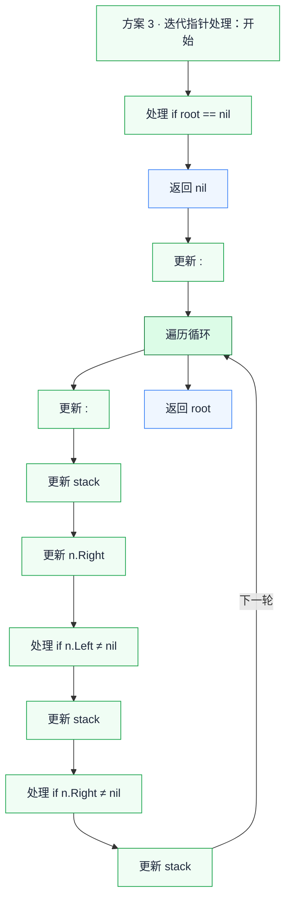

```go
package main // 引入依赖

import (
	"fmt"
	"os"
	"reflect"
) // 引入依赖

type TreeNode struct { // 定义类型
	Val   int       // Val int
	Left  *TreeNode // Left 乘 TreeNode
	Right *TreeNode // Right 乘 TreeNode
}

func invertTree(root *TreeNode) *TreeNode { // 定义函数/方法 invertTree
	if root == nil { // 若 根节点 等于 nil
		return nil // 返回 nil
	}
	stack := []*TreeNode{root} // 把 [] 乘 TreeNode{根节点} 写入 stack :
	for len(stack) > 0 {       // for 长度(栈) 超过 0 {
		n := stack[len(stack)-1]          // 把 栈[长度(栈) 减 1] 写入 n :
		stack = stack[:len(stack)-1]      // 把 栈[:长度(栈) 减 1] 写入 栈
		n.Left, n.Right = n.Right, n.Left // 把 元素个数.Right, 元素个数.Left 写入 n.Left, n.Right
		if n.Left != nil {                // 若 元素个数.Left 不等于 nil
			stack = append(stack, n.Left) // 把 append(栈, 元素个数.Left) 写入 栈
		}
		if n.Right != nil { // 若 元素个数.Right 不等于 nil
			stack = append(stack, n.Right) // 把 append(栈, 元素个数.Right) 写入 栈
		}
	}
	return root // 返回 根节点
}

func buildTree(vals []int) *TreeNode { // 定义函数/方法 buildTree
	if len(vals) == 0 || vals[0] == -1 { // 若 长度(vals) 等于 0 或 vals[0] 等于 减 1
		return nil // 返回 nil
	}
	root := &TreeNode{Val: vals[0]} // 把 按位与 TreeNode{Val: vals[0]} 写入 root :
	q := []*TreeNode{root}          // 把 [] 乘 TreeNode{根节点} 写入 q :
	i := 1                          // 把 1 写入 i :
	for i < len(vals) {             // for 下标 i 小于 长度(vals) {
		node := q[0]                        // 把 节点[0] 写入 node :
		q = q[1:]                           // 把 节点[1:] 写入 节点
		if i < len(vals) && vals[i] != -1 { // 若 下标 i 小于 长度(vals) 且 vals[下标 i] 不等于 减 1
			node.Left = &TreeNode{Val: vals[i]} // 把 按位与 TreeNode{Val: vals[下标 i]} 写入 node.Left
			q = append(q, node.Left)            // 把 append(节点, 节点.Left) 写入 节点
		}
		i++                                 // 下标 i 加一
		if i < len(vals) && vals[i] != -1 { // 若 下标 i 小于 长度(vals) 且 vals[下标 i] 不等于 减 1
			node.Right = &TreeNode{Val: vals[i]} // 把 按位与 TreeNode{Val: vals[下标 i]} 写入 node.Right
			q = append(q, node.Right)            // 把 append(节点, 节点.Right) 写入 节点
		}
		i++ // 下标 i 加一
	}
	return root // 返回 根节点
}

func toList(root *TreeNode) []int { // 定义函数/方法 toList
	res := []int{}   // 把 []int{} 写入 res :
	if root == nil { // 若 根节点 等于 nil
		return res // 返回 结果
	}
	q := []*TreeNode{root} // 把 [] 乘 TreeNode{根节点} 写入 q :
	for len(q) > 0 {       // for 长度(节点) 超过 0 {
		n := q[0]     // 把 节点[0] 写入 n :
		q = q[1:]     // 把 节点[1:] 写入 节点
		if n != nil { // 若 元素个数 不等于 nil
			res = append(res, n.Val)       // 把 append(结果, 元素个数.Val) 写入 结果
			q = append(q, n.Left, n.Right) // 把 append(节点, 元素个数.Left, 元素个数.Right) 写入 节点
		} else { // 否则
			res = append(res, -1) // 把 append(结果, 减 1) 写入 结果
		}
	}
	for len(res) > 0 && res[len(res)-1] == -1 { // 把 赋值为 减 1 { 写入 for len(res) > 0 && res[len(res)-1]
		res = res[:len(res)-1] // 把 结果[:长度(结果) 减 1] 写入 结果
	}
	return res // 返回 结果
}

func main() { // 程序入口：跑内嵌自测用例
	ok := true                                         // 把 true 写入 ok :
	if got := toList(invertTree(nil)); len(got) != 0 { // 若 got : 赋值为 toList(invertTree(nil)); 长度(got) 不等于 0
		ok = false                           // 把 false 写入 ok
		fmt.Printf("FAIL nil got=%v\n", got) // 打印输出
	}
	root := buildTree([]int{4, 2, 7, 1, 3, 6, 9}) // 把 buildTree([]int{4, 2, 7, 1, 3, 6, 9}) 写入 root :
	got := toList(invertTree(root))               // 把 toList(invertTree(根节点)) 写入 got :
	want := []int{4, 7, 2, 9, 6, 3, 1}            // 把 []int{4, 7, 2, 9, 6, 3, 1} 写入 want :
	if !reflect.DeepEqual(got, want) {            // 若 取反 reflect.DeepEqual(got, want
		ok = false                                     // 把 false 写入 ok
		fmt.Printf("FAIL got=%v want=%v\n", got, want) // 打印输出
	}
	if !ok { // 若 取反 ok
		os.Exit(1) // os.Exit(1)
	}
	fmt.Println("PASS") // 全部用例通过，输出 PASS
}
```

#### 方案 4：迭代指针处理

**思路与代码分析**：核心是「迭代指针处理」。Go 版用切片与多返回值惯用法，显式处理索引边界。**走读**：方案 4 · 迭代指针处理：开始 → 处理 if root == nil → 返回 nil → 更新 root.Right → 返回 root。

**运行架构**（真实控制流）：

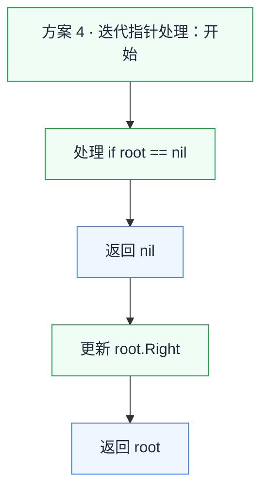

```go
package main // 引入依赖

import (
	"fmt"
	"os"
	"reflect"
) // 引入依赖

type TreeNode struct { // 定义类型
	Val   int       // Val int
	Left  *TreeNode // Left 乘 TreeNode
	Right *TreeNode // Right 乘 TreeNode
}

func invertTree(root *TreeNode) *TreeNode { // 定义函数/方法 invertTree
	if root == nil { // 若 根节点 等于 nil
		return nil // 返回 nil
	}
	root.Left, root.Right = invertTree(root.Right), invertTree(root.Left)
	return root // 返回 根节点
}

func buildTree(vals []int) *TreeNode { // 定义函数/方法 buildTree
	if len(vals) == 0 || vals[0] == -1 { // 若 长度(vals) 等于 0 或 vals[0] 等于 减 1
		return nil // 返回 nil
	}
	root := &TreeNode{Val: vals[0]} // 把 按位与 TreeNode{Val: vals[0]} 写入 root :
	q := []*TreeNode{root}          // 把 [] 乘 TreeNode{根节点} 写入 q :
	i := 1                          // 把 1 写入 i :
	for i < len(vals) {             // for 下标 i 小于 长度(vals) {
		node := q[0]                        // 把 节点[0] 写入 node :
		q = q[1:]                           // 把 节点[1:] 写入 节点
		if i < len(vals) && vals[i] != -1 { // 若 下标 i 小于 长度(vals) 且 vals[下标 i] 不等于 减 1
			node.Left = &TreeNode{Val: vals[i]} // 把 按位与 TreeNode{Val: vals[下标 i]} 写入 node.Left
			q = append(q, node.Left)            // 把 append(节点, 节点.Left) 写入 节点
		}
		i++                                 // 下标 i 加一
		if i < len(vals) && vals[i] != -1 { // 若 下标 i 小于 长度(vals) 且 vals[下标 i] 不等于 减 1
			node.Right = &TreeNode{Val: vals[i]} // 把 按位与 TreeNode{Val: vals[下标 i]} 写入 node.Right
			q = append(q, node.Right)            // 把 append(节点, 节点.Right) 写入 节点
		}
		i++ // 下标 i 加一
	}
	return root // 返回 根节点
}

func toList(root *TreeNode) []int { // 定义函数/方法 toList
	res := []int{}   // 把 []int{} 写入 res :
	if root == nil { // 若 根节点 等于 nil
		return res // 返回 结果
	}
	q := []*TreeNode{root} // 把 [] 乘 TreeNode{根节点} 写入 q :
	for len(q) > 0 {       // for 长度(节点) 超过 0 {
		n := q[0]     // 把 节点[0] 写入 n :
		q = q[1:]     // 把 节点[1:] 写入 节点
		if n != nil { // 若 元素个数 不等于 nil
			res = append(res, n.Val)       // 把 append(结果, 元素个数.Val) 写入 结果
			q = append(q, n.Left, n.Right) // 把 append(节点, 元素个数.Left, 元素个数.Right) 写入 节点
		} else { // 否则
			res = append(res, -1) // 把 append(结果, 减 1) 写入 结果
		}
	}
	for len(res) > 0 && res[len(res)-1] == -1 { // 把 赋值为 减 1 { 写入 for len(res) > 0 && res[len(res)-1]
		res = res[:len(res)-1] // 把 结果[:长度(结果) 减 1] 写入 结果
	}
	return res // 返回 结果
}

func main() { // 程序入口：跑内嵌自测用例
	ok := true                                         // 把 true 写入 ok :
	if got := toList(invertTree(nil)); len(got) != 0 { // 若 got : 赋值为 toList(invertTree(nil)); 长度(got) 不等于 0
		ok = false                           // 把 false 写入 ok
		fmt.Printf("FAIL nil got=%v\n", got) // 打印输出
	}
	root := buildTree([]int{4, 2, 7, 1, 3, 6, 9}) // 把 buildTree([]int{4, 2, 7, 1, 3, 6, 9}) 写入 root :
	got := toList(invertTree(root))               // 把 toList(invertTree(根节点)) 写入 got :
	want := []int{4, 7, 2, 9, 6, 3, 1}            // 把 []int{4, 7, 2, 9, 6, 3, 1} 写入 want :
	if !reflect.DeepEqual(got, want) {            // 若 取反 reflect.DeepEqual(got, want
		ok = false                                     // 把 false 写入 ok
		fmt.Printf("FAIL got=%v want=%v\n", got, want) // 打印输出
	}
	if !ok { // 若 取反 ok
		os.Exit(1) // os.Exit(1)
	}
	fmt.Println("PASS") // 全部用例通过，输出 PASS
}
```

#### 方案 5：迭代指针处理

**思路与代码分析**：核心是「迭代指针处理」。Go 版用切片与多返回值惯用法，显式处理索引边界。**走读**：方案 5 · 迭代指针处理：开始 → 处理 if root == nil → 返回 nil → 更新 : → 遍历循环 → 更新 : → 更新 q → 更新 n.Right → 处理 if n.Left ≠ nil → 更新 q → 处理 if n.Right ≠ nil → 更新 q → 返回 root。

**运行架构**（真实控制流）：

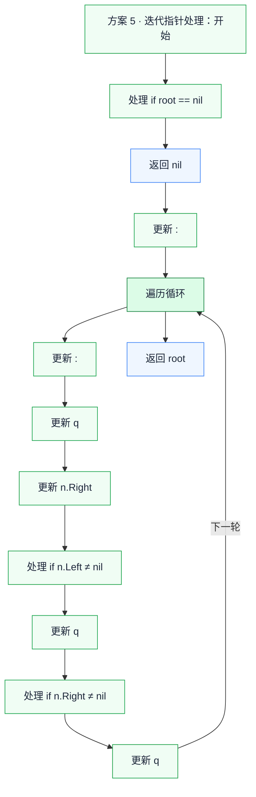

```go
package main // 引入依赖

import (
	"fmt"
	"os"
	"reflect"
) // 引入依赖

type TreeNode struct { // 定义类型
	Val   int       // Val int
	Left  *TreeNode // Left 乘 TreeNode
	Right *TreeNode // Right 乘 TreeNode
}

func invertTree(root *TreeNode) *TreeNode { // 定义函数/方法 invertTree
	if root == nil { // 若 根节点 等于 nil
		return nil // 返回 nil
	}
	q := []*TreeNode{root} // 把 [] 乘 TreeNode{根节点} 写入 q :
	for len(q) > 0 {       // for 长度(节点) 超过 0 {
		n := q[0]                         // 把 节点[0] 写入 n :
		q = q[1:]                         // 把 节点[1:] 写入 节点
		n.Left, n.Right = n.Right, n.Left // 把 元素个数.Right, 元素个数.Left 写入 n.Left, n.Right
		if n.Left != nil {                // 若 元素个数.Left 不等于 nil
			q = append(q, n.Left) // 把 append(节点, 元素个数.Left) 写入 节点
		}
		if n.Right != nil { // 若 元素个数.Right 不等于 nil
			q = append(q, n.Right) // 把 append(节点, 元素个数.Right) 写入 节点
		}
	}
	return root // 返回 根节点
}

func buildTree(vals []int) *TreeNode { // 定义函数/方法 buildTree
	if len(vals) == 0 || vals[0] == -1 { // 若 长度(vals) 等于 0 或 vals[0] 等于 减 1
		return nil // 返回 nil
	}
	root := &TreeNode{Val: vals[0]} // 把 按位与 TreeNode{Val: vals[0]} 写入 root :
	q := []*TreeNode{root}          // 把 [] 乘 TreeNode{根节点} 写入 q :
	i := 1                          // 把 1 写入 i :
	for i < len(vals) {             // for 下标 i 小于 长度(vals) {
		node := q[0]                        // 把 节点[0] 写入 node :
		q = q[1:]                           // 把 节点[1:] 写入 节点
		if i < len(vals) && vals[i] != -1 { // 若 下标 i 小于 长度(vals) 且 vals[下标 i] 不等于 减 1
			node.Left = &TreeNode{Val: vals[i]} // 把 按位与 TreeNode{Val: vals[下标 i]} 写入 node.Left
			q = append(q, node.Left)            // 把 append(节点, 节点.Left) 写入 节点
		}
		i++                                 // 下标 i 加一
		if i < len(vals) && vals[i] != -1 { // 若 下标 i 小于 长度(vals) 且 vals[下标 i] 不等于 减 1
			node.Right = &TreeNode{Val: vals[i]} // 把 按位与 TreeNode{Val: vals[下标 i]} 写入 node.Right
			q = append(q, node.Right)            // 把 append(节点, 节点.Right) 写入 节点
		}
		i++ // 下标 i 加一
	}
	return root // 返回 根节点
}

func toList(root *TreeNode) []int { // 定义函数/方法 toList
	res := []int{}   // 把 []int{} 写入 res :
	if root == nil { // 若 根节点 等于 nil
		return res // 返回 结果
	}
	q := []*TreeNode{root} // 把 [] 乘 TreeNode{根节点} 写入 q :
	for len(q) > 0 {       // for 长度(节点) 超过 0 {
		n := q[0]     // 把 节点[0] 写入 n :
		q = q[1:]     // 把 节点[1:] 写入 节点
		if n != nil { // 若 元素个数 不等于 nil
			res = append(res, n.Val)       // 把 append(结果, 元素个数.Val) 写入 结果
			q = append(q, n.Left, n.Right) // 把 append(节点, 元素个数.Left, 元素个数.Right) 写入 节点
		} else { // 否则
			res = append(res, -1) // 把 append(结果, 减 1) 写入 结果
		}
	}
	for len(res) > 0 && res[len(res)-1] == -1 { // 把 赋值为 减 1 { 写入 for len(res) > 0 && res[len(res)-1]
		res = res[:len(res)-1] // 把 结果[:长度(结果) 减 1] 写入 结果
	}
	return res // 返回 结果
}

func main() { // 程序入口：跑内嵌自测用例
	ok := true                                         // 把 true 写入 ok :
	if got := toList(invertTree(nil)); len(got) != 0 { // 若 got : 赋值为 toList(invertTree(nil)); 长度(got) 不等于 0
		ok = false                           // 把 false 写入 ok
		fmt.Printf("FAIL nil got=%v\n", got) // 打印输出
	}
	root := buildTree([]int{4, 2, 7, 1, 3, 6, 9}) // 把 buildTree([]int{4, 2, 7, 1, 3, 6, 9}) 写入 root :
	got := toList(invertTree(root))               // 把 toList(invertTree(根节点)) 写入 got :
	want := []int{4, 7, 2, 9, 6, 3, 1}            // 把 []int{4, 7, 2, 9, 6, 3, 1} 写入 want :
	if !reflect.DeepEqual(got, want) {            // 若 取反 reflect.DeepEqual(got, want
		ok = false                                     // 把 false 写入 ok
		fmt.Printf("FAIL got=%v want=%v\n", got, want) // 打印输出
	}
	if !ok { // 若 取反 ok
		os.Exit(1) // os.Exit(1)
	}
	fmt.Println("PASS") // 全部用例通过，输出 PASS
}
```

#### 方案 6：迭代指针处理

**思路与代码分析**：核心是「迭代指针处理」。Go 版用切片与多返回值惯用法，显式处理索引边界。**走读**：方案 6 · 迭代指针处理：开始 → 处理 if root == nil → 返回 nil → 更新 : → 遍历循环 → 更新 : → 更新 q → 更新 n.Right → 处理 if n.Left ≠ nil → 更新 q → 处理 if n.Right ≠ nil → 更新 q → 返回 root。

**运行架构**（真实控制流）：


```go
package main // 引入依赖

import (
	"fmt"
	"os"
	"reflect"
) // 引入依赖

type TreeNode struct { // 定义类型
	Val   int       // Val int
	Left  *TreeNode // Left 乘 TreeNode
	Right *TreeNode // Right 乘 TreeNode
}

func invertTree(root *TreeNode) *TreeNode { // 定义函数/方法 invertTree
	if root == nil { // 若 根节点 等于 nil
		return nil // 返回 nil
	}
	q := []*TreeNode{root} // 把 [] 乘 TreeNode{根节点} 写入 q :
	for len(q) > 0 {       // for 长度(节点) 超过 0 {
		n := q[0]                         // 把 节点[0] 写入 n :
		q = q[1:]                         // 把 节点[1:] 写入 节点
		n.Left, n.Right = n.Right, n.Left // 把 元素个数.Right, 元素个数.Left 写入 n.Left, n.Right
		if n.Left != nil {                // 若 元素个数.Left 不等于 nil
			q = append(q, n.Left) // 把 append(节点, 元素个数.Left) 写入 节点
		}
		if n.Right != nil { // 若 元素个数.Right 不等于 nil
			q = append(q, n.Right) // 把 append(节点, 元素个数.Right) 写入 节点
		}
	}
	return root // 返回 根节点
}

func buildTree(vals []int) *TreeNode { // 定义函数/方法 buildTree
	if len(vals) == 0 || vals[0] == -1 { // 若 长度(vals) 等于 0 或 vals[0] 等于 减 1
		return nil // 返回 nil
	}
	root := &TreeNode{Val: vals[0]} // 把 按位与 TreeNode{Val: vals[0]} 写入 root :
	q := []*TreeNode{root}          // 把 [] 乘 TreeNode{根节点} 写入 q :
	i := 1                          // 把 1 写入 i :
	for i < len(vals) {             // for 下标 i 小于 长度(vals) {
		node := q[0]                        // 把 节点[0] 写入 node :
		q = q[1:]                           // 把 节点[1:] 写入 节点
		if i < len(vals) && vals[i] != -1 { // 若 下标 i 小于 长度(vals) 且 vals[下标 i] 不等于 减 1
			node.Left = &TreeNode{Val: vals[i]} // 把 按位与 TreeNode{Val: vals[下标 i]} 写入 node.Left
			q = append(q, node.Left)            // 把 append(节点, 节点.Left) 写入 节点
		}
		i++                                 // 下标 i 加一
		if i < len(vals) && vals[i] != -1 { // 若 下标 i 小于 长度(vals) 且 vals[下标 i] 不等于 减 1
			node.Right = &TreeNode{Val: vals[i]} // 把 按位与 TreeNode{Val: vals[下标 i]} 写入 node.Right
			q = append(q, node.Right)            // 把 append(节点, 节点.Right) 写入 节点
		}
		i++ // 下标 i 加一
	}
	return root // 返回 根节点
}

func toList(root *TreeNode) []int { // 定义函数/方法 toList
	res := []int{}   // 把 []int{} 写入 res :
	if root == nil { // 若 根节点 等于 nil
		return res // 返回 结果
	}
	q := []*TreeNode{root} // 把 [] 乘 TreeNode{根节点} 写入 q :
	for len(q) > 0 {       // for 长度(节点) 超过 0 {
		n := q[0]     // 把 节点[0] 写入 n :
		q = q[1:]     // 把 节点[1:] 写入 节点
		if n != nil { // 若 元素个数 不等于 nil
			res = append(res, n.Val)       // 把 append(结果, 元素个数.Val) 写入 结果
			q = append(q, n.Left, n.Right) // 把 append(节点, 元素个数.Left, 元素个数.Right) 写入 节点
		} else { // 否则
			res = append(res, -1) // 把 append(结果, 减 1) 写入 结果
		}
	}
	for len(res) > 0 && res[len(res)-1] == -1 { // 把 赋值为 减 1 { 写入 for len(res) > 0 && res[len(res)-1]
		res = res[:len(res)-1] // 把 结果[:长度(结果) 减 1] 写入 结果
	}
	return res // 返回 结果
}

func main() { // 程序入口：跑内嵌自测用例
	ok := true                                         // 把 true 写入 ok :
	if got := toList(invertTree(nil)); len(got) != 0 { // 若 got : 赋值为 toList(invertTree(nil)); 长度(got) 不等于 0
		ok = false                           // 把 false 写入 ok
		fmt.Printf("FAIL nil got=%v\n", got) // 打印输出
	}
	root := buildTree([]int{4, 2, 7, 1, 3, 6, 9}) // 把 buildTree([]int{4, 2, 7, 1, 3, 6, 9}) 写入 root :
	got := toList(invertTree(root))               // 把 toList(invertTree(根节点)) 写入 got :
	want := []int{4, 7, 2, 9, 6, 3, 1}            // 把 []int{4, 7, 2, 9, 6, 3, 1} 写入 want :
	if !reflect.DeepEqual(got, want) {            // 若 取反 reflect.DeepEqual(got, want
		ok = false                                     // 把 false 写入 ok
		fmt.Printf("FAIL got=%v want=%v\n", got, want) // 打印输出
	}
	if !ok { // 若 取反 ok
		os.Exit(1) // os.Exit(1)
	}
	fmt.Println("PASS") // 全部用例通过，输出 PASS
}
```

### Java 实现（6 种方案）

Java 的全部方案如下，每个方案都内嵌用例自测，可独立运行（老仓库 python/go 文件遵循「打印结果」约定）：

#### 方案 1：迭代指针处理

**思路与代码分析**：核心是「迭代指针处理」。Java 版用类与静态方法组织，集合操作显式明了。

**运行架构**（真实控制流）：

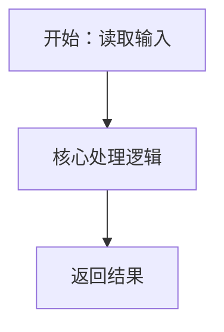

```java
package com.webfault.dsa; // 引入依赖

// 引入依赖

class Main { // 定义类型
  static class TreeNode {
    int val;
    TreeNode left;
    TreeNode right;

    TreeNode() {}

    TreeNode(int v) {
      val = v;
    }

    TreeNode(int v, TreeNode l, TreeNode r) {
      val = v;
      left = l;
      right = r;
    }
  }

  static TreeNode buildTree(Integer[] vals) { // 定义函数/方法 buildTree
    if (vals.length == 0 || vals[0] == null)
      return null; // 若 vals.长度 等于 0 或 vals[0] 等于 null，直接返回 null
    TreeNode root = new TreeNode(vals[0]);
    java.util.LinkedList<TreeNode> q = new java.util.LinkedList<>();
    q.add(root);
    int i = 1;
    while (!q.isEmpty() && i < vals.length) {
      TreeNode node = q.poll();
      if (i < vals.length && vals[i] != null) {
        node.left = new TreeNode(vals[i]);
        q.add(node.left);
      }
      i++;
      if (i < vals.length && vals[i] != null) {
        node.right = new TreeNode(vals[i]);
        q.add(node.right);
      }
      i++;
    }
    return root; // 返回 根节点
  }

  static boolean sameTree(TreeNode a, TreeNode b) {
    if (a == null && b == null) return true;
    if (a == null || b == null) return false;
    if (a.val != b.val) return false;
    return sameTree(a.left, b.left) && sameTree(a.right, b.right);
  }

  static java.util.List<Integer> inorderT(TreeNode r) {
    java.util.List<Integer> l = new java.util.ArrayList<>();
    if (r != null) {
      l.addAll(inorderT(r.left));
      l.add(r.val);
      l.addAll(inorderT(r.right));
    }
    return l;
  }

  static TreeNode invertTree(TreeNode root) {
    if (root == null) return null;
    TreeNode t = root.left;
    root.left = invertTree(root.right);
    root.right = invertTree(t);
    return root;
  }

  public static void main(String[] args) { // public static void main(String[] args) {
    Integer[] a = {4, 2, 7, 1, 3, 6, 9};
    Integer[] w = {4, 7, 2, 9, 6, 3, 1};
    TreeNode got = invertTree(buildTree(a));
    TreeNode want = buildTree(w);
    if (!sameTree(got, want)) {
      System.out.println("FAIL");
      throw new RuntimeException("FAILED");
    }
    System.out.println("PASS"); // 全部用例通过，输出 PASS
  }
}
```

#### 方案 2：迭代指针处理

**思路与代码分析**：核心是「迭代指针处理」。Java 版用类与静态方法组织，集合操作显式明了。

**运行架构**：与方案 1 的控制流相同（同算法在该语言的等价实现），图见上。

```java
package com.webfault.dsa; // 引入依赖

// 引入依赖

class Main { // 定义类型
  static class TreeNode {
    int val;
    TreeNode left;
    TreeNode right;

    TreeNode() {}

    TreeNode(int v) {
      val = v;
    }

    TreeNode(int v, TreeNode l, TreeNode r) {
      val = v;
      left = l;
      right = r;
    }
  }

  static TreeNode buildTree(Integer[] vals) { // 定义函数/方法 buildTree
    if (vals.length == 0 || vals[0] == null)
      return null; // 若 vals.长度 等于 0 或 vals[0] 等于 null，直接返回 null
    TreeNode root = new TreeNode(vals[0]);
    java.util.LinkedList<TreeNode> q = new java.util.LinkedList<>();
    q.add(root);
    int i = 1;
    while (!q.isEmpty() && i < vals.length) {
      TreeNode node = q.poll();
      if (i < vals.length && vals[i] != null) {
        node.left = new TreeNode(vals[i]);
        q.add(node.left);
      }
      i++;
      if (i < vals.length && vals[i] != null) {
        node.right = new TreeNode(vals[i]);
        q.add(node.right);
      }
      i++;
    }
    return root; // 返回 根节点
  }

  static boolean sameTree(TreeNode a, TreeNode b) {
    if (a == null && b == null) return true;
    if (a == null || b == null) return false;
    if (a.val != b.val) return false;
    return sameTree(a.left, b.left) && sameTree(a.right, b.right);
  }

  static java.util.List<Integer> inorderT(TreeNode r) {
    java.util.List<Integer> l = new java.util.ArrayList<>();
    if (r != null) {
      l.addAll(inorderT(r.left));
      l.add(r.val);
      l.addAll(inorderT(r.right));
    }
    return l;
  }

  static TreeNode invertTree(TreeNode root) {
    if (root == null) return null;
    TreeNode t = root.left;
    root.left = invertTree(root.right);
    root.right = invertTree(t);
    return root;
  }

  public static void main(String[] args) { // public static void main(String[] args) {
    Integer[] a = {4, 2, 7, 1, 3, 6, 9};
    Integer[] w = {4, 7, 2, 9, 6, 3, 1};
    TreeNode got = invertTree(buildTree(a));
    TreeNode want = buildTree(w);
    if (!sameTree(got, want)) {
      System.out.println("FAIL");
      throw new RuntimeException("FAILED");
    }
    System.out.println("PASS"); // 全部用例通过，输出 PASS
  }
}
```

#### 方案 3：迭代指针处理

**思路与代码分析**：核心是「迭代指针处理」。Java 版用类与静态方法组织，集合操作显式明了。**走读**：方案 3 · 迭代指针处理：开始 → 更新 val → 返回结果。

**运行架构**（真实控制流）：

```mermaid
graph TD
    N0["方案 3 · 迭代指针处理：开始"]
    N1["更新 val"]
    N2["返回结果"]
    N0 --> N1
    N1 --> N2
    classDef n fill:#f0fdf4,stroke:#16a34a,color:#1e293b;
    classDef lp fill:#dcfce7,stroke:#15803d,color:#1e293b;
    classDef dc fill:#fef9c3,stroke:#ca8a04,color:#1e293b;
    classDef tm fill:#eff6ff,stroke:#3b82f6,color:#1e293b;
    class N0,N1 n;
    class N2 tm;
```

```java
package com.webfault.dsa; // 引入依赖

import java.util.*; // 引入依赖

class Lc226 { // 定义类型
  static class TreeNode {
    int val;
    TreeNode left, right;

    TreeNode(int v) {
      val = v;
    }
  }

  TreeNode invertTree(TreeNode root) { // 定义函数/方法 invertTree
    if (root == null) return null; // 若 根节点 等于 null，直接返回 null
    Deque<TreeNode> st = new ArrayDeque<>(); // 把 new ArrayDeque 小于 超过 (); 写入 Deque<TreeNode> st
    st.push(root); // 把 根节点 压入栈/数组尾部
    while (!st.isEmpty()) { // 循环，直到不满足「取反 st.isEmpty(」
      TreeNode node = st.pop(); // 弹出栈顶元素
      TreeNode t = node.left;
      node.left = node.right;
      node.right = t; // 把 节点.左边界; 节点.左边界 赋值为 节点.右边界; 节点.右边界 赋值为 另一字符串; 写入 TreeNode t
      if (node.left != null) st.push(node.left); // 若 节点.左边界 不等于 null) st 追加 节点.左边界);
      if (node.right != null) st.push(node.right); // 若 节点.右边界 不等于 null) st 追加 节点.右边界);
    }
    return root; // 返回 根节点
  }

  TreeNode build(Integer[] vals) { // 定义函数/方法 build
    if (vals.length == 0 || vals[0] == null)
      return null; // 若 vals.长度 等于 0 或 vals[0] 等于 null，直接返回 null
    TreeNode root = new TreeNode(vals[0]); // 把 new TreeNode(vals[0]); 写入 TreeNode root
    Deque<TreeNode> q = new ArrayDeque<>();
    q.offer(root);
    int i = 1; // 把 1 存入 下标 i
    while (i < vals.length) { // 循环，直到不满足「下标 i 小于 vals.长度」
      TreeNode node = q.poll(); // 把 节点.poll(); 写入 TreeNode node
      if (vals[i] != null) {
        node.left = new TreeNode(vals[i]);
        q.offer(node.left);
      }
      i++; // 下标 i 加一
      if (i < vals.length) { // 若 下标 i 小于 vals.长度
        if (vals[i] != null) {
          node.right = new TreeNode(vals[i]);
          q.offer(node.right);
        }
        i++; // 下标 i 加一
      }
    }
    return root; // 返回 根节点
  }

  List<Integer> toList(TreeNode root) { // 定义函数/方法 toList
    List<Integer> res = new ArrayList<>(); // 把 new ArrayList 小于 超过 (); 写入 List<Integer> res
    if (root == null) return res; // 若 根节点 等于 null，直接返回 结果
    LinkedList<TreeNode> q = new LinkedList<>();
    q.offer(root);
    while (!q.isEmpty()) { // 循环，直到不满足「取反 节点.isEmpty(」
      TreeNode n = q.poll(); // 把 节点.poll(); 写入 TreeNode n
      if (n != null) {
        res.add(n.val);
        q.offer(n.left);
        q.offer(n.right);
      } else res.add(null); // 否则
    }
    while (!res.isEmpty() && res.get(res.size() - 1) == null) res.remove(res.size() - 1);
    return res; // 返回 结果
  }

  public static void main(String[] args) { // public static void main(String[] args){
    Lc226 s = new Lc226(); // 把 new Lc226(); 写入 Lc226 s
    TreeNode root =
        s.build(
            new Integer[] {
              4, 2, 7, 1, 3, 6, 9
            }); // 把 字符串.build(new Integer[]{4,2,7,1,3,6,9}); 写入 TreeNode root
    List<Integer> got =
        s.toList(s.invertTree(root)); // 把 字符串.toList(字符串.invertTree(根节点)); 写入 List<Integer> got
    List<Integer> want =
        Arrays.asList(4, 7, 2, 9, 6, 3, 1); // 把 Arrays.asList(4,7,2,9,6,3,1); 写入 List<Integer> want
    boolean ok = true; // 把 true; 写入 boolean ok
    if (got.size() != want.size()) ok = false; // 若 got.大小() 不等于 want.大小()) ok 赋值为 false;
    else
      for (int i = 0; i < want.size(); i++) if (!want.get(i).equals(got.get(i))) ok = false; // 否则
    if (!ok) throw new RuntimeException("FAILED"); // 若 取反 ok) throw new RuntimeException(「FAILED」);
    System.out.println("PASS"); // 全部用例通过，输出 PASS
  }
}
```

#### 方案 4：迭代指针处理

**思路与代码分析**：核心是「迭代指针处理」。Java 版用类与静态方法组织，集合操作显式明了。**走读**：方案 4 · 迭代指针处理：开始 → 更新 val → 返回结果。

**运行架构**（真实控制流）：

```mermaid
graph TD
    N0["方案 4 · 迭代指针处理：开始"]
    N1["更新 val"]
    N2["返回结果"]
    N0 --> N1
    N1 --> N2
    classDef n fill:#f0fdf4,stroke:#16a34a,color:#1e293b;
    classDef lp fill:#dcfce7,stroke:#15803d,color:#1e293b;
    classDef dc fill:#fef9c3,stroke:#ca8a04,color:#1e293b;
    classDef tm fill:#eff6ff,stroke:#3b82f6,color:#1e293b;
    class N0,N1 n;
    class N2 tm;
```

```java
package com.webfault.dsa; // 引入依赖

import java.util.*; // 引入依赖

class Lc226 { // 定义类型
  static class TreeNode {
    int val;
    TreeNode left, right;

    TreeNode(int v) {
      val = v;
    }
  }

  TreeNode invertTree(TreeNode root) { // 定义函数/方法 invertTree
    if (root == null) return null; // 若 根节点 等于 null，直接返回 null
    Deque<TreeNode> st = new ArrayDeque<>(); // 把 new ArrayDeque 小于 超过 (); 写入 Deque<TreeNode> st
    st.push(root); // 把 根节点 压入栈/数组尾部
    while (!st.isEmpty()) { // 循环，直到不满足「取反 st.isEmpty(」
      TreeNode node = st.pop(); // 弹出栈顶元素
      TreeNode t = node.left;
      node.left = node.right;
      node.right = t; // 把 节点.左边界; 节点.左边界 赋值为 节点.右边界; 节点.右边界 赋值为 另一字符串; 写入 TreeNode t
      if (node.left != null) st.push(node.left); // 若 节点.左边界 不等于 null) st 追加 节点.左边界);
      if (node.right != null) st.push(node.right); // 若 节点.右边界 不等于 null) st 追加 节点.右边界);
    }
    return root; // 返回 根节点
  }

  TreeNode build(Integer[] vals) { // 定义函数/方法 build
    if (vals.length == 0 || vals[0] == null)
      return null; // 若 vals.长度 等于 0 或 vals[0] 等于 null，直接返回 null
    TreeNode root = new TreeNode(vals[0]); // 把 new TreeNode(vals[0]); 写入 TreeNode root
    Deque<TreeNode> q = new ArrayDeque<>();
    q.offer(root);
    int i = 1; // 把 1 存入 下标 i
    while (i < vals.length) { // 循环，直到不满足「下标 i 小于 vals.长度」
      TreeNode node = q.poll(); // 把 节点.poll(); 写入 TreeNode node
      if (vals[i] != null) {
        node.left = new TreeNode(vals[i]);
        q.offer(node.left);
      }
      i++; // 下标 i 加一
      if (i < vals.length) { // 若 下标 i 小于 vals.长度
        if (vals[i] != null) {
          node.right = new TreeNode(vals[i]);
          q.offer(node.right);
        }
        i++; // 下标 i 加一
      }
    }
    return root; // 返回 根节点
  }

  List<Integer> toList(TreeNode root) { // 定义函数/方法 toList
    List<Integer> res = new ArrayList<>(); // 把 new ArrayList 小于 超过 (); 写入 List<Integer> res
    if (root == null) return res; // 若 根节点 等于 null，直接返回 结果
    LinkedList<TreeNode> q = new LinkedList<>();
    q.offer(root);
    while (!q.isEmpty()) { // 循环，直到不满足「取反 节点.isEmpty(」
      TreeNode n = q.poll(); // 把 节点.poll(); 写入 TreeNode n
      if (n != null) {
        res.add(n.val);
        q.offer(n.left);
        q.offer(n.right);
      } else res.add(null); // 否则
    }
    while (!res.isEmpty() && res.get(res.size() - 1) == null) res.remove(res.size() - 1);
    return res; // 返回 结果
  }

  public static void main(String[] args) { // public static void main(String[] args){
    Lc226 s = new Lc226(); // 把 new Lc226(); 写入 Lc226 s
    TreeNode root =
        s.build(
            new Integer[] {
              4, 2, 7, 1, 3, 6, 9
            }); // 把 字符串.build(new Integer[]{4,2,7,1,3,6,9}); 写入 TreeNode root
    List<Integer> got =
        s.toList(s.invertTree(root)); // 把 字符串.toList(字符串.invertTree(根节点)); 写入 List<Integer> got
    List<Integer> want =
        Arrays.asList(4, 7, 2, 9, 6, 3, 1); // 把 Arrays.asList(4,7,2,9,6,3,1); 写入 List<Integer> want
    boolean ok = true; // 把 true; 写入 boolean ok
    if (got.size() != want.size()) ok = false; // 若 got.大小() 不等于 want.大小()) ok 赋值为 false;
    else
      for (int i = 0; i < want.size(); i++) if (!want.get(i).equals(got.get(i))) ok = false; // 否则
    if (!ok) throw new RuntimeException("FAILED"); // 若 取反 ok) throw new RuntimeException(「FAILED」);
    System.out.println("PASS"); // 全部用例通过，输出 PASS
  }
}
```

#### 方案 5：迭代指针处理

**思路与代码分析**：核心是「迭代指针处理」。Java 版用类与静态方法组织，集合操作显式明了。**走读**：方案 5 · 迭代指针处理：开始 → 更新 val → 返回结果。

**运行架构**（真实控制流）：

```mermaid
graph TD
    N0["方案 5 · 迭代指针处理：开始"]
    N1["更新 val"]
    N2["返回结果"]
    N0 --> N1
    N1 --> N2
    classDef n fill:#f0fdf4,stroke:#16a34a,color:#1e293b;
    classDef lp fill:#dcfce7,stroke:#15803d,color:#1e293b;
    classDef dc fill:#fef9c3,stroke:#ca8a04,color:#1e293b;
    classDef tm fill:#eff6ff,stroke:#3b82f6,color:#1e293b;
    class N0,N1 n;
    class N2 tm;
```

```java
package com.webfault.dsa; // 引入依赖

import java.util.*; // 引入依赖

class Lc226 { // 定义类型
  static class TreeNode {
    int val;
    TreeNode left, right;

    TreeNode(int v) {
      val = v;
    }
  }

  TreeNode invertTree(TreeNode root) { // 定义函数/方法 invertTree
    if (root == null) return null; // 若 根节点 等于 null，直接返回 null
    Deque<TreeNode> st = new ArrayDeque<>(); // 把 new ArrayDeque 小于 超过 (); 写入 Deque<TreeNode> st
    st.push(root); // 把 根节点 压入栈/数组尾部
    while (!st.isEmpty()) { // 循环，直到不满足「取反 st.isEmpty(」
      TreeNode node = st.pop(); // 弹出栈顶元素
      TreeNode t = node.left;
      node.left = node.right;
      node.right = t; // 把 节点.左边界; 节点.左边界 赋值为 节点.右边界; 节点.右边界 赋值为 另一字符串; 写入 TreeNode t
      if (node.left != null) st.push(node.left); // 若 节点.左边界 不等于 null) st 追加 节点.左边界);
      if (node.right != null) st.push(node.right); // 若 节点.右边界 不等于 null) st 追加 节点.右边界);
    }
    return root; // 返回 根节点
  }

  TreeNode build(Integer[] vals) { // 定义函数/方法 build
    if (vals.length == 0 || vals[0] == null)
      return null; // 若 vals.长度 等于 0 或 vals[0] 等于 null，直接返回 null
    TreeNode root = new TreeNode(vals[0]); // 把 new TreeNode(vals[0]); 写入 TreeNode root
    Deque<TreeNode> q = new ArrayDeque<>();
    q.offer(root);
    int i = 1; // 把 1 存入 下标 i
    while (i < vals.length) { // 循环，直到不满足「下标 i 小于 vals.长度」
      TreeNode node = q.poll(); // 把 节点.poll(); 写入 TreeNode node
      if (vals[i] != null) {
        node.left = new TreeNode(vals[i]);
        q.offer(node.left);
      }
      i++; // 下标 i 加一
      if (i < vals.length) { // 若 下标 i 小于 vals.长度
        if (vals[i] != null) {
          node.right = new TreeNode(vals[i]);
          q.offer(node.right);
        }
        i++; // 下标 i 加一
      }
    }
    return root; // 返回 根节点
  }

  List<Integer> toList(TreeNode root) { // 定义函数/方法 toList
    List<Integer> res = new ArrayList<>(); // 把 new ArrayList 小于 超过 (); 写入 List<Integer> res
    if (root == null) return res; // 若 根节点 等于 null，直接返回 结果
    LinkedList<TreeNode> q = new LinkedList<>();
    q.offer(root);
    while (!q.isEmpty()) { // 循环，直到不满足「取反 节点.isEmpty(」
      TreeNode n = q.poll(); // 把 节点.poll(); 写入 TreeNode n
      if (n != null) {
        res.add(n.val);
        q.offer(n.left);
        q.offer(n.right);
      } else res.add(null); // 否则
    }
    while (!res.isEmpty() && res.get(res.size() - 1) == null) res.remove(res.size() - 1);
    return res; // 返回 结果
  }

  public static void main(String[] args) { // public static void main(String[] args){
    Lc226 s = new Lc226(); // 把 new Lc226(); 写入 Lc226 s
    TreeNode root =
        s.build(
            new Integer[] {
              4, 2, 7, 1, 3, 6, 9
            }); // 把 字符串.build(new Integer[]{4,2,7,1,3,6,9}); 写入 TreeNode root
    List<Integer> got =
        s.toList(s.invertTree(root)); // 把 字符串.toList(字符串.invertTree(根节点)); 写入 List<Integer> got
    List<Integer> want =
        Arrays.asList(4, 7, 2, 9, 6, 3, 1); // 把 Arrays.asList(4,7,2,9,6,3,1); 写入 List<Integer> want
    boolean ok = true; // 把 true; 写入 boolean ok
    if (got.size() != want.size()) ok = false; // 若 got.大小() 不等于 want.大小()) ok 赋值为 false;
    else
      for (int i = 0; i < want.size(); i++) if (!want.get(i).equals(got.get(i))) ok = false; // 否则
    if (!ok) throw new RuntimeException("FAILED"); // 若 取反 ok) throw new RuntimeException(「FAILED」);
    System.out.println("PASS"); // 全部用例通过，输出 PASS
  }
}
```

#### 方案 6：迭代指针处理

**思路与代码分析**：核心是「迭代指针处理」。Java 版用类与静态方法组织，集合操作显式明了。**走读**：方案 6 · 迭代指针处理：开始 → 更新 val → 返回结果。

**运行架构**（真实控制流）：

```mermaid
graph TD
    N0["方案 6 · 迭代指针处理：开始"]
    N1["更新 val"]
    N2["返回结果"]
    N0 --> N1
    N1 --> N2
    classDef n fill:#f0fdf4,stroke:#16a34a,color:#1e293b;
    classDef lp fill:#dcfce7,stroke:#15803d,color:#1e293b;
    classDef dc fill:#fef9c3,stroke:#ca8a04,color:#1e293b;
    classDef tm fill:#eff6ff,stroke:#3b82f6,color:#1e293b;
    class N0,N1 n;
    class N2 tm;
```

```java
package com.webfault.dsa; // 引入依赖

import java.util.*; // 引入依赖

class Lc226 { // 定义类型
  static class TreeNode {
    int val;
    TreeNode left, right;

    TreeNode(int v) {
      val = v;
    }
  }

  TreeNode invertTree(TreeNode root) { // 定义函数/方法 invertTree
    if (root == null) return null; // 若 根节点 等于 null，直接返回 null
    Deque<TreeNode> st = new ArrayDeque<>(); // 把 new ArrayDeque 小于 超过 (); 写入 Deque<TreeNode> st
    st.push(root); // 把 根节点 压入栈/数组尾部
    while (!st.isEmpty()) { // 循环，直到不满足「取反 st.isEmpty(」
      TreeNode node = st.pop(); // 弹出栈顶元素
      TreeNode t = node.left;
      node.left = node.right;
      node.right = t; // 把 节点.左边界; 节点.左边界 赋值为 节点.右边界; 节点.右边界 赋值为 另一字符串; 写入 TreeNode t
      if (node.left != null) st.push(node.left); // 若 节点.左边界 不等于 null) st 追加 节点.左边界);
      if (node.right != null) st.push(node.right); // 若 节点.右边界 不等于 null) st 追加 节点.右边界);
    }
    return root; // 返回 根节点
  }

  TreeNode build(Integer[] vals) { // 定义函数/方法 build
    if (vals.length == 0 || vals[0] == null)
      return null; // 若 vals.长度 等于 0 或 vals[0] 等于 null，直接返回 null
    TreeNode root = new TreeNode(vals[0]); // 把 new TreeNode(vals[0]); 写入 TreeNode root
    Deque<TreeNode> q = new ArrayDeque<>();
    q.offer(root);
    int i = 1; // 把 1 存入 下标 i
    while (i < vals.length) { // 循环，直到不满足「下标 i 小于 vals.长度」
      TreeNode node = q.poll(); // 把 节点.poll(); 写入 TreeNode node
      if (vals[i] != null) {
        node.left = new TreeNode(vals[i]);
        q.offer(node.left);
      }
      i++; // 下标 i 加一
      if (i < vals.length) { // 若 下标 i 小于 vals.长度
        if (vals[i] != null) {
          node.right = new TreeNode(vals[i]);
          q.offer(node.right);
        }
        i++; // 下标 i 加一
      }
    }
    return root; // 返回 根节点
  }

  List<Integer> toList(TreeNode root) { // 定义函数/方法 toList
    List<Integer> res = new ArrayList<>(); // 把 new ArrayList 小于 超过 (); 写入 List<Integer> res
    if (root == null) return res; // 若 根节点 等于 null，直接返回 结果
    LinkedList<TreeNode> q = new LinkedList<>();
    q.offer(root);
    while (!q.isEmpty()) { // 循环，直到不满足「取反 节点.isEmpty(」
      TreeNode n = q.poll(); // 把 节点.poll(); 写入 TreeNode n
      if (n != null) {
        res.add(n.val);
        q.offer(n.left);
        q.offer(n.right);
      } else res.add(null); // 否则
    }
    while (!res.isEmpty() && res.get(res.size() - 1) == null) res.remove(res.size() - 1);
    return res; // 返回 结果
  }

  public static void main(String[] args) { // public static void main(String[] args){
    Lc226 s = new Lc226(); // 把 new Lc226(); 写入 Lc226 s
    TreeNode root =
        s.build(
            new Integer[] {
              4, 2, 7, 1, 3, 6, 9
            }); // 把 字符串.build(new Integer[]{4,2,7,1,3,6,9}); 写入 TreeNode root
    List<Integer> got =
        s.toList(s.invertTree(root)); // 把 字符串.toList(字符串.invertTree(根节点)); 写入 List<Integer> got
    List<Integer> want =
        Arrays.asList(4, 7, 2, 9, 6, 3, 1); // 把 Arrays.asList(4,7,2,9,6,3,1); 写入 List<Integer> want
    boolean ok = true; // 把 true; 写入 boolean ok
    if (got.size() != want.size()) ok = false; // 若 got.大小() 不等于 want.大小()) ok 赋值为 false;
    else
      for (int i = 0; i < want.size(); i++) if (!want.get(i).equals(got.get(i))) ok = false; // 否则
    if (!ok) throw new RuntimeException("FAILED"); // 若 取反 ok) throw new RuntimeException(「FAILED」);
    System.out.println("PASS"); // 全部用例通过，输出 PASS
  }
}
```

### Rust 实现（6 种方案）

Rust 的全部方案如下，每个方案都内嵌用例自测，可独立运行（老仓库 python/go 文件遵循「打印结果」约定）：

#### 方案 1：迭代指针处理

**思路与代码分析**：核心是「迭代指针处理」。Rust 版用所有权移动与切片借用改写同一逻辑，注意 Option 与引用边界。**走读**：方案 1 · 迭代指针处理：开始 → 计算 res → 当 非 q.is_empty() 时反复执行 → 遍历 q 中的每个元素 n → 返回结果。

**运行架构**（真实控制流）：

```mermaid
graph TD
    N0["方案 1 · 迭代指针处理：开始"]
    N1["计算 res"]
    D1["……（中间计算步骤）"]
    N3["当 非 q.is_empty() 时反复执行"]
    D2["……（中间计算步骤）"]
    N6["遍历 q 中的每个元素 n"]
    D3["……（中间计算步骤）"]
    N16["返回结果"]
    N0 --> N1
    N1 --> D1
    D1 --> N3
    N3 --> D2
    D2 --> N6
    N6 --> D3
    D3 --> N16
    classDef n fill:#f0fdf4,stroke:#16a34a,color:#1e293b;
    classDef lp fill:#dcfce7,stroke:#15803d,color:#1e293b;
    classDef dc fill:#fef9c3,stroke:#ca8a04,color:#1e293b;
    classDef tm fill:#eff6ff,stroke:#3b82f6,color:#1e293b;
    class N0,N1,D1,D2,D3 n;
    class N3,N6 lp;
    class N16 tm;
```

```rust
// LeetCode 226. 翻转二叉树 — Rust 版（方案1）
use std::cell::RefCell;
use std::rc::Rc; // 引入依赖 // 引入依赖

#[derive(Debug)]
struct TreeNode {
    // 定义类型
    val: i32,
    left: Option<Rc<RefCell<TreeNode>>>,
    right: Option<Rc<RefCell<TreeNode>>>,
}

impl TreeNode {
    // 实现块
    fn new(val: i32) -> Rc<RefCell<TreeNode>> {
        // 定义函数/方法 new
        Rc::new(RefCell::new(TreeNode {
            val,
            left: None,
            right: None,
        })) // Rc::new(RefCell::new(TreeNode { 值, 左边界: None, 右边界: None }))
    }
}

fn build_tree(vals: &[Option<i32>]) -> Option<Rc<RefCell<TreeNode>>> {
    // 定义函数/方法 build_tree
    if vals.is_empty() || vals[0].is_none() {
        // 若 vals 是否为空 或 vals[0].is_none(
        return None; // 返回 None
    }
    let root = TreeNode::new(vals[0].unwrap()); // 把 TreeNode::new(vals[0].unwrap()) 存入 根节点
    let mut queue: Vec<Rc<RefCell<TreeNode>>> = vec![root.clone()];
    let mut i = 1; // 把 1; 写入 let mut i
    while !queue.is_empty() && i < vals.len() {
        // while 取反 队列 是否为空 且 下标 i 小于 vals.长度() {
        let node = queue.remove(0); // 把 队列 弹出 0) 存入 节点
        if i < vals.len() {
            // 若 下标 i 小于 vals.长度(
            if let Some(v) = vals[i] {
                // 若 let Some(值) 赋值为 vals[下标 i]
                let child = TreeNode::new(v); // 把 TreeNode::new(值) 存入 子节点
                node.borrow_mut().left = Some(child.clone()); // 把 Some(子节点.clone()); 写入 左边界
                queue.push(child); // 把 子节点 压入栈/数组尾部
            }
            i += 1; // 下标 i累加 1
        }
        if i < vals.len() {
            // 若 下标 i 小于 vals.长度(
            if let Some(v) = vals[i] {
                // 若 let Some(值) 赋值为 vals[下标 i]
                let child = TreeNode::new(v); // 把 TreeNode::new(值) 存入 子节点
                node.borrow_mut().right = Some(child.clone()); // 把 Some(子节点.clone()); 写入 右边界
                queue.push(child); // 把 子节点 压入栈/数组尾部
            }
            i += 1; // 下标 i累加 1
        }
    }
    Some(root) // Some(根节点)
}

fn invert_tree(root: Option<Rc<RefCell<TreeNode>>>) -> Option<Rc<RefCell<TreeNode>>> {
    // 定义函数/方法 invert_tree
    let root = root?; // 把 根节点? 存入 根节点
    let mut stack = vec![root.clone()]; // 把 vec取反 [根节点.clone()]; 写入 let mut stack
    while let Some(node) = stack.pop() {
        // 边取边处理，取空即停
        let mut n = node.borrow_mut(); // 把 节点.borrow_mut(); 写入 let mut n
        let tmp = n.left.take(); // 把 元素个数.左边界.take() 存入 临时变量
        n.left = n.right.take(); // 把 元素个数.右边界.take(); 写入 左边界
        n.right = tmp; // 把 临时变量; 写入 右边界
        let (l, r) = (n.left.clone(), n.right.clone()); // 把 (元素个数.左边界.clone(), 元素个数.右边界.clone()); 写入 let (l, r)
        drop(n); // drop(元素个数);
        if let Some(c) = l {
            stack.push(c);
        } // 若 let Some(字符) 赋值为 左指针 { 栈 追加 字符); }
        if let Some(c) = r {
            stack.push(c);
        } // 若 let Some(字符) 赋值为 右指针 { 栈 追加 字符); }
    }
    Some(root) // Some(根节点)
}
fn levels(root: Option<Rc<RefCell<TreeNode>>>) -> Vec<Vec<i32>> {
    // 定义函数/方法 levels
    let mut res = Vec::new(); // 把 Vec::new(); 写入 let mut res
    let mut q: Vec<Rc<RefCell<TreeNode>>> = root.into_iter().collect();
    while !q.is_empty() {
        // while 取反 节点 是否为空 {
        let mut cur = Vec::new(); // 把 Vec::new(); 写入 let mut cur
        let mut nxt = Vec::new(); // 把 Vec::new(); 写入 let mut nxt
        for n in q {
            // 逐个取出 节点 的元素（元素个数）
            let nb = n.borrow(); // 把 元素个数.borrow() 存入 nb
            cur.push(nb.val); // 把 nb.值 压入栈/数组尾部
            if let Some(c) = nb.left.clone() {
                nxt.push(c);
            } // 若 let Some(字符) 赋值为 nb.左边界.clone() { nxt 追加 字符); }
            if let Some(c) = nb.right.clone() {
                nxt.push(c);
            } // 若 let Some(字符) 赋值为 nb.右边界.clone() { nxt 追加 字符); }
        }
        res.push(cur); // 把 当前值 压入栈/数组尾部
        q = nxt; // 把 nxt; 写入 节点
    }
    res // 结果
}
fn main() {
    // 程序入口：跑内嵌自测用例
    let t = build_tree(&[
        Some(4),
        Some(2),
        Some(7),
        Some(1),
        Some(3),
        Some(6),
        Some(9),
    ]);
    let got = levels(invert_tree(t)); // 把 levels(invert_tree(另一字符串)) 存入 got
    assert_eq!(got, vec![vec![4], vec![7, 2], vec![9, 6, 3, 1]]); // 断言校验
    assert_eq!(levels(invert_tree(None)), Vec::<Vec<i32>>::new()); // 断言校验
    println!("PASS"); // 全部用例通过，输出 PASS
}
```

#### 方案 2：迭代指针处理

**思路与代码分析**：核心是「迭代指针处理」。Rust 版用所有权移动与切片借用改写同一逻辑，注意 Option 与引用边界。**走读**：方案 2 · 迭代指针处理：开始 → 计算 res → 当 非 q.is_empty() 时反复执行 → 遍历 q 中的每个元素 n → 返回结果。

**运行架构**（真实控制流）：

```mermaid
graph TD
    N0["方案 2 · 迭代指针处理：开始"]
    N1["计算 res"]
    D1["……（中间计算步骤）"]
    N3["当 非 q.is_empty() 时反复执行"]
    D2["……（中间计算步骤）"]
    N6["遍历 q 中的每个元素 n"]
    D3["……（中间计算步骤）"]
    N16["返回结果"]
    N0 --> N1
    N1 --> D1
    D1 --> N3
    N3 --> D2
    D2 --> N6
    N6 --> D3
    D3 --> N16
    classDef n fill:#f0fdf4,stroke:#16a34a,color:#1e293b;
    classDef lp fill:#dcfce7,stroke:#15803d,color:#1e293b;
    classDef dc fill:#fef9c3,stroke:#ca8a04,color:#1e293b;
    classDef tm fill:#eff6ff,stroke:#3b82f6,color:#1e293b;
    class N0,N1,D1,D2,D3 n;
    class N3,N6 lp;
    class N16 tm;
```

```rust
// LeetCode 226. 翻转二叉树 — Rust 版（方案2）
use std::cell::RefCell;
use std::rc::Rc; // 引入依赖 // 引入依赖

#[derive(Debug)]
struct TreeNode {
    // 定义类型
    val: i32,
    left: Option<Rc<RefCell<TreeNode>>>,
    right: Option<Rc<RefCell<TreeNode>>>,
}

impl TreeNode {
    // 实现块
    fn new(val: i32) -> Rc<RefCell<TreeNode>> {
        // 定义函数/方法 new
        Rc::new(RefCell::new(TreeNode {
            val,
            left: None,
            right: None,
        })) // Rc::new(RefCell::new(TreeNode { 值, 左边界: None, 右边界: None }))
    }
}

fn build_tree(vals: &[Option<i32>]) -> Option<Rc<RefCell<TreeNode>>> {
    // 定义函数/方法 build_tree
    if vals.is_empty() || vals[0].is_none() {
        // 若 vals 是否为空 或 vals[0].is_none(
        return None; // 返回 None
    }
    let root = TreeNode::new(vals[0].unwrap()); // 把 TreeNode::new(vals[0].unwrap()) 存入 根节点
    let mut queue: Vec<Rc<RefCell<TreeNode>>> = vec![root.clone()];
    let mut i = 1; // 把 1; 写入 let mut i
    while !queue.is_empty() && i < vals.len() {
        // while 取反 队列 是否为空 且 下标 i 小于 vals.长度() {
        let node = queue.remove(0); // 把 队列 弹出 0) 存入 节点
        if i < vals.len() {
            // 若 下标 i 小于 vals.长度(
            if let Some(v) = vals[i] {
                // 若 let Some(值) 赋值为 vals[下标 i]
                let child = TreeNode::new(v); // 把 TreeNode::new(值) 存入 子节点
                node.borrow_mut().left = Some(child.clone()); // 把 Some(子节点.clone()); 写入 左边界
                queue.push(child); // 把 子节点 压入栈/数组尾部
            }
            i += 1; // 下标 i累加 1
        }
        if i < vals.len() {
            // 若 下标 i 小于 vals.长度(
            if let Some(v) = vals[i] {
                // 若 let Some(值) 赋值为 vals[下标 i]
                let child = TreeNode::new(v); // 把 TreeNode::new(值) 存入 子节点
                node.borrow_mut().right = Some(child.clone()); // 把 Some(子节点.clone()); 写入 右边界
                queue.push(child); // 把 子节点 压入栈/数组尾部
            }
            i += 1; // 下标 i累加 1
        }
    }
    Some(root) // Some(根节点)
}

fn invert_tree(root: Option<Rc<RefCell<TreeNode>>>) -> Option<Rc<RefCell<TreeNode>>> {
    // 定义函数/方法 invert_tree
    let root = root?; // 把 根节点? 存入 根节点
    let mut stack = vec![root.clone()]; // 把 vec取反 [根节点.clone()]; 写入 let mut stack
    while let Some(node) = stack.pop() {
        // 边取边处理，取空即停
        let mut n = node.borrow_mut(); // 把 节点.borrow_mut(); 写入 let mut n
        let tmp = n.left.take(); // 把 元素个数.左边界.take() 存入 临时变量
        n.left = n.right.take(); // 把 元素个数.右边界.take(); 写入 左边界
        n.right = tmp; // 把 临时变量; 写入 右边界
        let (l, r) = (n.left.clone(), n.right.clone()); // 把 (元素个数.左边界.clone(), 元素个数.右边界.clone()); 写入 let (l, r)
        drop(n); // drop(元素个数);
        if let Some(c) = l {
            stack.push(c);
        } // 若 let Some(字符) 赋值为 左指针 { 栈 追加 字符); }
        if let Some(c) = r {
            stack.push(c);
        } // 若 let Some(字符) 赋值为 右指针 { 栈 追加 字符); }
    }
    Some(root) // Some(根节点)
}
fn levels(root: Option<Rc<RefCell<TreeNode>>>) -> Vec<Vec<i32>> {
    // 定义函数/方法 levels
    let mut res = Vec::new(); // 把 Vec::new(); 写入 let mut res
    let mut q: Vec<Rc<RefCell<TreeNode>>> = root.into_iter().collect();
    while !q.is_empty() {
        // while 取反 节点 是否为空 {
        let mut cur = Vec::new(); // 把 Vec::new(); 写入 let mut cur
        let mut nxt = Vec::new(); // 把 Vec::new(); 写入 let mut nxt
        for n in q {
            // 逐个取出 节点 的元素（元素个数）
            let nb = n.borrow(); // 把 元素个数.borrow() 存入 nb
            cur.push(nb.val); // 把 nb.值 压入栈/数组尾部
            if let Some(c) = nb.left.clone() {
                nxt.push(c);
            } // 若 let Some(字符) 赋值为 nb.左边界.clone() { nxt 追加 字符); }
            if let Some(c) = nb.right.clone() {
                nxt.push(c);
            } // 若 let Some(字符) 赋值为 nb.右边界.clone() { nxt 追加 字符); }
        }
        res.push(cur); // 把 当前值 压入栈/数组尾部
        q = nxt; // 把 nxt; 写入 节点
    }
    res // 结果
}
fn main() {
    // 程序入口：跑内嵌自测用例
    let t = build_tree(&[
        Some(4),
        Some(2),
        Some(7),
        Some(1),
        Some(3),
        Some(6),
        Some(9),
    ]);
    let got = levels(invert_tree(t)); // 把 levels(invert_tree(另一字符串)) 存入 got
    assert_eq!(got, vec![vec![4], vec![7, 2], vec![9, 6, 3, 1]]); // 断言校验
    assert_eq!(levels(invert_tree(None)), Vec::<Vec<i32>>::new()); // 断言校验
    println!("PASS"); // 全部用例通过，输出 PASS
}
```

#### 方案 3：迭代指针处理

**思路与代码分析**：核心是「迭代指针处理」。Rust 版用所有权移动与切片借用改写同一逻辑，注意 Option 与引用边界。**走读**：方案 3 · 迭代指针处理：开始 → 计算 res → 当 非 q.is_empty() 时反复执行 → 遍历 q 中的每个元素 n → 返回结果。

**运行架构**（真实控制流）：

```mermaid
graph TD
    N0["方案 3 · 迭代指针处理：开始"]
    N1["计算 res"]
    D1["……（中间计算步骤）"]
    N3["当 非 q.is_empty() 时反复执行"]
    D2["……（中间计算步骤）"]
    N6["遍历 q 中的每个元素 n"]
    D3["……（中间计算步骤）"]
    N16["返回结果"]
    N0 --> N1
    N1 --> D1
    D1 --> N3
    N3 --> D2
    D2 --> N6
    N6 --> D3
    D3 --> N16
    classDef n fill:#f0fdf4,stroke:#16a34a,color:#1e293b;
    classDef lp fill:#dcfce7,stroke:#15803d,color:#1e293b;
    classDef dc fill:#fef9c3,stroke:#ca8a04,color:#1e293b;
    classDef tm fill:#eff6ff,stroke:#3b82f6,color:#1e293b;
    class N0,N1,D1,D2,D3 n;
    class N3,N6 lp;
    class N16 tm;
```

```rust
// LeetCode 226. 翻转二叉树 — Rust 版（方案3）
use std::cell::RefCell;
use std::rc::Rc; // 引入依赖 // 引入依赖

#[derive(Debug)]
struct TreeNode {
    // 定义类型
    val: i32,
    left: Option<Rc<RefCell<TreeNode>>>,
    right: Option<Rc<RefCell<TreeNode>>>,
}

impl TreeNode {
    // 实现块
    fn new(val: i32) -> Rc<RefCell<TreeNode>> {
        // 定义函数/方法 new
        Rc::new(RefCell::new(TreeNode {
            val,
            left: None,
            right: None,
        })) // Rc::new(RefCell::new(TreeNode { 值, 左边界: None, 右边界: None }))
    }
}

fn build_tree(vals: &[Option<i32>]) -> Option<Rc<RefCell<TreeNode>>> {
    // 定义函数/方法 build_tree
    if vals.is_empty() || vals[0].is_none() {
        // 若 vals 是否为空 或 vals[0].is_none(
        return None; // 返回 None
    }
    let root = TreeNode::new(vals[0].unwrap()); // 把 TreeNode::new(vals[0].unwrap()) 存入 根节点
    let mut queue: Vec<Rc<RefCell<TreeNode>>> = vec![root.clone()];
    let mut i = 1; // 把 1; 写入 let mut i
    while !queue.is_empty() && i < vals.len() {
        // while 取反 队列 是否为空 且 下标 i 小于 vals.长度() {
        let node = queue.remove(0); // 把 队列 弹出 0) 存入 节点
        if i < vals.len() {
            // 若 下标 i 小于 vals.长度(
            if let Some(v) = vals[i] {
                // 若 let Some(值) 赋值为 vals[下标 i]
                let child = TreeNode::new(v); // 把 TreeNode::new(值) 存入 子节点
                node.borrow_mut().left = Some(child.clone()); // 把 Some(子节点.clone()); 写入 左边界
                queue.push(child); // 把 子节点 压入栈/数组尾部
            }
            i += 1; // 下标 i累加 1
        }
        if i < vals.len() {
            // 若 下标 i 小于 vals.长度(
            if let Some(v) = vals[i] {
                // 若 let Some(值) 赋值为 vals[下标 i]
                let child = TreeNode::new(v); // 把 TreeNode::new(值) 存入 子节点
                node.borrow_mut().right = Some(child.clone()); // 把 Some(子节点.clone()); 写入 右边界
                queue.push(child); // 把 子节点 压入栈/数组尾部
            }
            i += 1; // 下标 i累加 1
        }
    }
    Some(root) // Some(根节点)
}

fn invert_tree(root: Option<Rc<RefCell<TreeNode>>>) -> Option<Rc<RefCell<TreeNode>>> {
    // 定义函数/方法 invert_tree
    let root = root?; // 把 根节点? 存入 根节点
    let mut stack = vec![root.clone()]; // 把 vec取反 [根节点.clone()]; 写入 let mut stack
    while let Some(node) = stack.pop() {
        // 边取边处理，取空即停
        let mut n = node.borrow_mut(); // 把 节点.borrow_mut(); 写入 let mut n
        let tmp = n.left.take(); // 把 元素个数.左边界.take() 存入 临时变量
        n.left = n.right.take(); // 把 元素个数.右边界.take(); 写入 左边界
        n.right = tmp; // 把 临时变量; 写入 右边界
        let (l, r) = (n.left.clone(), n.right.clone()); // 把 (元素个数.左边界.clone(), 元素个数.右边界.clone()); 写入 let (l, r)
        drop(n); // drop(元素个数);
        if let Some(c) = l {
            stack.push(c);
        } // 若 let Some(字符) 赋值为 左指针 { 栈 追加 字符); }
        if let Some(c) = r {
            stack.push(c);
        } // 若 let Some(字符) 赋值为 右指针 { 栈 追加 字符); }
    }
    Some(root) // Some(根节点)
}
fn levels(root: Option<Rc<RefCell<TreeNode>>>) -> Vec<Vec<i32>> {
    // 定义函数/方法 levels
    let mut res = Vec::new(); // 把 Vec::new(); 写入 let mut res
    let mut q: Vec<Rc<RefCell<TreeNode>>> = root.into_iter().collect();
    while !q.is_empty() {
        // while 取反 节点 是否为空 {
        let mut cur = Vec::new(); // 把 Vec::new(); 写入 let mut cur
        let mut nxt = Vec::new(); // 把 Vec::new(); 写入 let mut nxt
        for n in q {
            // 逐个取出 节点 的元素（元素个数）
            let nb = n.borrow(); // 把 元素个数.borrow() 存入 nb
            cur.push(nb.val); // 把 nb.值 压入栈/数组尾部
            if let Some(c) = nb.left.clone() {
                nxt.push(c);
            } // 若 let Some(字符) 赋值为 nb.左边界.clone() { nxt 追加 字符); }
            if let Some(c) = nb.right.clone() {
                nxt.push(c);
            } // 若 let Some(字符) 赋值为 nb.右边界.clone() { nxt 追加 字符); }
        }
        res.push(cur); // 把 当前值 压入栈/数组尾部
        q = nxt; // 把 nxt; 写入 节点
    }
    res // 结果
}
fn main() {
    // 程序入口：跑内嵌自测用例
    let t = build_tree(&[
        Some(4),
        Some(2),
        Some(7),
        Some(1),
        Some(3),
        Some(6),
        Some(9),
    ]);
    let got = levels(invert_tree(t)); // 把 levels(invert_tree(另一字符串)) 存入 got
    assert_eq!(got, vec![vec![4], vec![7, 2], vec![9, 6, 3, 1]]); // 断言校验
    assert_eq!(levels(invert_tree(None)), Vec::<Vec<i32>>::new()); // 断言校验
    println!("PASS"); // 全部用例通过，输出 PASS
}
```

#### 方案 4：迭代指针处理

**思路与代码分析**：核心是「迭代指针处理」。Rust 版用所有权移动与切片借用改写同一逻辑，注意 Option 与引用边界。**走读**：方案 4 · 迭代指针处理：开始 → 计算 res → 当 非 q.is_empty() 时反复执行 → 遍历 q 中的每个元素 n → 返回结果。

**运行架构**（真实控制流）：

```mermaid
graph TD
    N0["方案 4 · 迭代指针处理：开始"]
    N1["计算 res"]
    D1["……（中间计算步骤）"]
    N3["当 非 q.is_empty() 时反复执行"]
    D2["……（中间计算步骤）"]
    N6["遍历 q 中的每个元素 n"]
    D3["……（中间计算步骤）"]
    N16["返回结果"]
    N0 --> N1
    N1 --> D1
    D1 --> N3
    N3 --> D2
    D2 --> N6
    N6 --> D3
    D3 --> N16
    classDef n fill:#f0fdf4,stroke:#16a34a,color:#1e293b;
    classDef lp fill:#dcfce7,stroke:#15803d,color:#1e293b;
    classDef dc fill:#fef9c3,stroke:#ca8a04,color:#1e293b;
    classDef tm fill:#eff6ff,stroke:#3b82f6,color:#1e293b;
    class N0,N1,D1,D2,D3 n;
    class N3,N6 lp;
    class N16 tm;
```

```rust
// LeetCode 226. 翻转二叉树 — Rust 版（方案4）
use std::cell::RefCell;
use std::rc::Rc; // 引入依赖 // 引入依赖

#[derive(Debug)]
struct TreeNode {
    // 定义类型
    val: i32,
    left: Option<Rc<RefCell<TreeNode>>>,
    right: Option<Rc<RefCell<TreeNode>>>,
}

impl TreeNode {
    // 实现块
    fn new(val: i32) -> Rc<RefCell<TreeNode>> {
        // 定义函数/方法 new
        Rc::new(RefCell::new(TreeNode {
            val,
            left: None,
            right: None,
        })) // Rc::new(RefCell::new(TreeNode { 值, 左边界: None, 右边界: None }))
    }
}

fn build_tree(vals: &[Option<i32>]) -> Option<Rc<RefCell<TreeNode>>> {
    // 定义函数/方法 build_tree
    if vals.is_empty() || vals[0].is_none() {
        // 若 vals 是否为空 或 vals[0].is_none(
        return None; // 返回 None
    }
    let root = TreeNode::new(vals[0].unwrap()); // 把 TreeNode::new(vals[0].unwrap()) 存入 根节点
    let mut queue: Vec<Rc<RefCell<TreeNode>>> = vec![root.clone()];
    let mut i = 1; // 把 1; 写入 let mut i
    while !queue.is_empty() && i < vals.len() {
        // while 取反 队列 是否为空 且 下标 i 小于 vals.长度() {
        let node = queue.remove(0); // 把 队列 弹出 0) 存入 节点
        if i < vals.len() {
            // 若 下标 i 小于 vals.长度(
            if let Some(v) = vals[i] {
                // 若 let Some(值) 赋值为 vals[下标 i]
                let child = TreeNode::new(v); // 把 TreeNode::new(值) 存入 子节点
                node.borrow_mut().left = Some(child.clone()); // 把 Some(子节点.clone()); 写入 左边界
                queue.push(child); // 把 子节点 压入栈/数组尾部
            }
            i += 1; // 下标 i累加 1
        }
        if i < vals.len() {
            // 若 下标 i 小于 vals.长度(
            if let Some(v) = vals[i] {
                // 若 let Some(值) 赋值为 vals[下标 i]
                let child = TreeNode::new(v); // 把 TreeNode::new(值) 存入 子节点
                node.borrow_mut().right = Some(child.clone()); // 把 Some(子节点.clone()); 写入 右边界
                queue.push(child); // 把 子节点 压入栈/数组尾部
            }
            i += 1; // 下标 i累加 1
        }
    }
    Some(root) // Some(根节点)
}

fn invert_tree(root: Option<Rc<RefCell<TreeNode>>>) -> Option<Rc<RefCell<TreeNode>>> {
    // 定义函数/方法 invert_tree
    let root = root?; // 把 根节点? 存入 根节点
    let mut stack = vec![root.clone()]; // 把 vec取反 [根节点.clone()]; 写入 let mut stack
    while let Some(node) = stack.pop() {
        // 边取边处理，取空即停
        let mut n = node.borrow_mut(); // 把 节点.borrow_mut(); 写入 let mut n
        let tmp = n.left.take(); // 把 元素个数.左边界.take() 存入 临时变量
        n.left = n.right.take(); // 把 元素个数.右边界.take(); 写入 左边界
        n.right = tmp; // 把 临时变量; 写入 右边界
        let (l, r) = (n.left.clone(), n.right.clone()); // 把 (元素个数.左边界.clone(), 元素个数.右边界.clone()); 写入 let (l, r)
        drop(n); // drop(元素个数);
        if let Some(c) = l {
            stack.push(c);
        } // 若 let Some(字符) 赋值为 左指针 { 栈 追加 字符); }
        if let Some(c) = r {
            stack.push(c);
        } // 若 let Some(字符) 赋值为 右指针 { 栈 追加 字符); }
    }
    Some(root) // Some(根节点)
}
fn levels(root: Option<Rc<RefCell<TreeNode>>>) -> Vec<Vec<i32>> {
    // 定义函数/方法 levels
    let mut res = Vec::new(); // 把 Vec::new(); 写入 let mut res
    let mut q: Vec<Rc<RefCell<TreeNode>>> = root.into_iter().collect();
    while !q.is_empty() {
        // while 取反 节点 是否为空 {
        let mut cur = Vec::new(); // 把 Vec::new(); 写入 let mut cur
        let mut nxt = Vec::new(); // 把 Vec::new(); 写入 let mut nxt
        for n in q {
            // 逐个取出 节点 的元素（元素个数）
            let nb = n.borrow(); // 把 元素个数.borrow() 存入 nb
            cur.push(nb.val); // 把 nb.值 压入栈/数组尾部
            if let Some(c) = nb.left.clone() {
                nxt.push(c);
            } // 若 let Some(字符) 赋值为 nb.左边界.clone() { nxt 追加 字符); }
            if let Some(c) = nb.right.clone() {
                nxt.push(c);
            } // 若 let Some(字符) 赋值为 nb.右边界.clone() { nxt 追加 字符); }
        }
        res.push(cur); // 把 当前值 压入栈/数组尾部
        q = nxt; // 把 nxt; 写入 节点
    }
    res // 结果
}
fn main() {
    // 程序入口：跑内嵌自测用例
    let t = build_tree(&[
        Some(4),
        Some(2),
        Some(7),
        Some(1),
        Some(3),
        Some(6),
        Some(9),
    ]);
    let got = levels(invert_tree(t)); // 把 levels(invert_tree(另一字符串)) 存入 got
    assert_eq!(got, vec![vec![4], vec![7, 2], vec![9, 6, 3, 1]]); // 断言校验
    assert_eq!(levels(invert_tree(None)), Vec::<Vec<i32>>::new()); // 断言校验
    println!("PASS"); // 全部用例通过，输出 PASS
}
```

#### 方案 5：迭代指针处理

**思路与代码分析**：核心是「迭代指针处理」。Rust 版用所有权移动与切片借用改写同一逻辑，注意 Option 与引用边界。**走读**：方案 5 · 迭代指针处理：开始 → 计算 res → 当 非 q.is_empty() 时反复执行 → 遍历 q 中的每个元素 n → 返回结果。

**运行架构**（真实控制流）：

```mermaid
graph TD
    N0["方案 5 · 迭代指针处理：开始"]
    N1["计算 res"]
    D1["……（中间计算步骤）"]
    N3["当 非 q.is_empty() 时反复执行"]
    D2["……（中间计算步骤）"]
    N6["遍历 q 中的每个元素 n"]
    D3["……（中间计算步骤）"]
    N16["返回结果"]
    N0 --> N1
    N1 --> D1
    D1 --> N3
    N3 --> D2
    D2 --> N6
    N6 --> D3
    D3 --> N16
    classDef n fill:#f0fdf4,stroke:#16a34a,color:#1e293b;
    classDef lp fill:#dcfce7,stroke:#15803d,color:#1e293b;
    classDef dc fill:#fef9c3,stroke:#ca8a04,color:#1e293b;
    classDef tm fill:#eff6ff,stroke:#3b82f6,color:#1e293b;
    class N0,N1,D1,D2,D3 n;
    class N3,N6 lp;
    class N16 tm;
```

```rust
// LeetCode 226. 翻转二叉树 — Rust 版（方案5）
use std::cell::RefCell;
use std::rc::Rc; // 引入依赖 // 引入依赖

#[derive(Debug)]
struct TreeNode {
    // 定义类型
    val: i32,
    left: Option<Rc<RefCell<TreeNode>>>,
    right: Option<Rc<RefCell<TreeNode>>>,
}

impl TreeNode {
    // 实现块
    fn new(val: i32) -> Rc<RefCell<TreeNode>> {
        // 定义函数/方法 new
        Rc::new(RefCell::new(TreeNode {
            val,
            left: None,
            right: None,
        })) // Rc::new(RefCell::new(TreeNode { 值, 左边界: None, 右边界: None }))
    }
}

fn build_tree(vals: &[Option<i32>]) -> Option<Rc<RefCell<TreeNode>>> {
    // 定义函数/方法 build_tree
    if vals.is_empty() || vals[0].is_none() {
        // 若 vals 是否为空 或 vals[0].is_none(
        return None; // 返回 None
    }
    let root = TreeNode::new(vals[0].unwrap()); // 把 TreeNode::new(vals[0].unwrap()) 存入 根节点
    let mut queue: Vec<Rc<RefCell<TreeNode>>> = vec![root.clone()];
    let mut i = 1; // 把 1; 写入 let mut i
    while !queue.is_empty() && i < vals.len() {
        // while 取反 队列 是否为空 且 下标 i 小于 vals.长度() {
        let node = queue.remove(0); // 把 队列 弹出 0) 存入 节点
        if i < vals.len() {
            // 若 下标 i 小于 vals.长度(
            if let Some(v) = vals[i] {
                // 若 let Some(值) 赋值为 vals[下标 i]
                let child = TreeNode::new(v); // 把 TreeNode::new(值) 存入 子节点
                node.borrow_mut().left = Some(child.clone()); // 把 Some(子节点.clone()); 写入 左边界
                queue.push(child); // 把 子节点 压入栈/数组尾部
            }
            i += 1; // 下标 i累加 1
        }
        if i < vals.len() {
            // 若 下标 i 小于 vals.长度(
            if let Some(v) = vals[i] {
                // 若 let Some(值) 赋值为 vals[下标 i]
                let child = TreeNode::new(v); // 把 TreeNode::new(值) 存入 子节点
                node.borrow_mut().right = Some(child.clone()); // 把 Some(子节点.clone()); 写入 右边界
                queue.push(child); // 把 子节点 压入栈/数组尾部
            }
            i += 1; // 下标 i累加 1
        }
    }
    Some(root) // Some(根节点)
}

fn invert_tree(root: Option<Rc<RefCell<TreeNode>>>) -> Option<Rc<RefCell<TreeNode>>> {
    // 定义函数/方法 invert_tree
    let root = root?; // 把 根节点? 存入 根节点
    let mut stack = vec![root.clone()]; // 把 vec取反 [根节点.clone()]; 写入 let mut stack
    while let Some(node) = stack.pop() {
        // 边取边处理，取空即停
        let mut n = node.borrow_mut(); // 把 节点.borrow_mut(); 写入 let mut n
        let tmp = n.left.take(); // 把 元素个数.左边界.take() 存入 临时变量
        n.left = n.right.take(); // 把 元素个数.右边界.take(); 写入 左边界
        n.right = tmp; // 把 临时变量; 写入 右边界
        let (l, r) = (n.left.clone(), n.right.clone()); // 把 (元素个数.左边界.clone(), 元素个数.右边界.clone()); 写入 let (l, r)
        drop(n); // drop(元素个数);
        if let Some(c) = l {
            stack.push(c);
        } // 若 let Some(字符) 赋值为 左指针 { 栈 追加 字符); }
        if let Some(c) = r {
            stack.push(c);
        } // 若 let Some(字符) 赋值为 右指针 { 栈 追加 字符); }
    }
    Some(root) // Some(根节点)
}
fn levels(root: Option<Rc<RefCell<TreeNode>>>) -> Vec<Vec<i32>> {
    // 定义函数/方法 levels
    let mut res = Vec::new(); // 把 Vec::new(); 写入 let mut res
    let mut q: Vec<Rc<RefCell<TreeNode>>> = root.into_iter().collect();
    while !q.is_empty() {
        // while 取反 节点 是否为空 {
        let mut cur = Vec::new(); // 把 Vec::new(); 写入 let mut cur
        let mut nxt = Vec::new(); // 把 Vec::new(); 写入 let mut nxt
        for n in q {
            // 逐个取出 节点 的元素（元素个数）
            let nb = n.borrow(); // 把 元素个数.borrow() 存入 nb
            cur.push(nb.val); // 把 nb.值 压入栈/数组尾部
            if let Some(c) = nb.left.clone() {
                nxt.push(c);
            } // 若 let Some(字符) 赋值为 nb.左边界.clone() { nxt 追加 字符); }
            if let Some(c) = nb.right.clone() {
                nxt.push(c);
            } // 若 let Some(字符) 赋值为 nb.右边界.clone() { nxt 追加 字符); }
        }
        res.push(cur); // 把 当前值 压入栈/数组尾部
        q = nxt; // 把 nxt; 写入 节点
    }
    res // 结果
}
fn main() {
    // 程序入口：跑内嵌自测用例
    let t = build_tree(&[
        Some(4),
        Some(2),
        Some(7),
        Some(1),
        Some(3),
        Some(6),
        Some(9),
    ]);
    let got = levels(invert_tree(t)); // 把 levels(invert_tree(另一字符串)) 存入 got
    assert_eq!(got, vec![vec![4], vec![7, 2], vec![9, 6, 3, 1]]); // 断言校验
    assert_eq!(levels(invert_tree(None)), Vec::<Vec<i32>>::new()); // 断言校验
    println!("PASS"); // 全部用例通过，输出 PASS
}
```

#### 方案 6：迭代指针处理

**思路与代码分析**：核心是「迭代指针处理」。Rust 版用所有权移动与切片借用改写同一逻辑，注意 Option 与引用边界。**走读**：方案 6 · 迭代指针处理：开始 → 计算 res → 当 非 q.is_empty() 时反复执行 → 遍历 q 中的每个元素 n → 返回结果。

**运行架构**（真实控制流）：

```mermaid
graph TD
    N0["方案 6 · 迭代指针处理：开始"]
    N1["计算 res"]
    D1["……（中间计算步骤）"]
    N3["当 非 q.is_empty() 时反复执行"]
    D2["……（中间计算步骤）"]
    N6["遍历 q 中的每个元素 n"]
    D3["……（中间计算步骤）"]
    N16["返回结果"]
    N0 --> N1
    N1 --> D1
    D1 --> N3
    N3 --> D2
    D2 --> N6
    N6 --> D3
    D3 --> N16
    classDef n fill:#f0fdf4,stroke:#16a34a,color:#1e293b;
    classDef lp fill:#dcfce7,stroke:#15803d,color:#1e293b;
    classDef dc fill:#fef9c3,stroke:#ca8a04,color:#1e293b;
    classDef tm fill:#eff6ff,stroke:#3b82f6,color:#1e293b;
    class N0,N1,D1,D2,D3 n;
    class N3,N6 lp;
    class N16 tm;
```

```rust
// LeetCode 226. 翻转二叉树 — Rust 版（方案6）
use std::cell::RefCell;
use std::rc::Rc; // 引入依赖 // 引入依赖

#[derive(Debug)]
struct TreeNode {
    // 定义类型
    val: i32,
    left: Option<Rc<RefCell<TreeNode>>>,
    right: Option<Rc<RefCell<TreeNode>>>,
}

impl TreeNode {
    // 实现块
    fn new(val: i32) -> Rc<RefCell<TreeNode>> {
        // 定义函数/方法 new
        Rc::new(RefCell::new(TreeNode {
            val,
            left: None,
            right: None,
        })) // Rc::new(RefCell::new(TreeNode { 值, 左边界: None, 右边界: None }))
    }
}

fn build_tree(vals: &[Option<i32>]) -> Option<Rc<RefCell<TreeNode>>> {
    // 定义函数/方法 build_tree
    if vals.is_empty() || vals[0].is_none() {
        // 若 vals 是否为空 或 vals[0].is_none(
        return None; // 返回 None
    }
    let root = TreeNode::new(vals[0].unwrap()); // 把 TreeNode::new(vals[0].unwrap()) 存入 根节点
    let mut queue: Vec<Rc<RefCell<TreeNode>>> = vec![root.clone()];
    let mut i = 1; // 把 1; 写入 let mut i
    while !queue.is_empty() && i < vals.len() {
        // while 取反 队列 是否为空 且 下标 i 小于 vals.长度() {
        let node = queue.remove(0); // 把 队列 弹出 0) 存入 节点
        if i < vals.len() {
            // 若 下标 i 小于 vals.长度(
            if let Some(v) = vals[i] {
                // 若 let Some(值) 赋值为 vals[下标 i]
                let child = TreeNode::new(v); // 把 TreeNode::new(值) 存入 子节点
                node.borrow_mut().left = Some(child.clone()); // 把 Some(子节点.clone()); 写入 左边界
                queue.push(child); // 把 子节点 压入栈/数组尾部
            }
            i += 1; // 下标 i累加 1
        }
        if i < vals.len() {
            // 若 下标 i 小于 vals.长度(
            if let Some(v) = vals[i] {
                // 若 let Some(值) 赋值为 vals[下标 i]
                let child = TreeNode::new(v); // 把 TreeNode::new(值) 存入 子节点
                node.borrow_mut().right = Some(child.clone()); // 把 Some(子节点.clone()); 写入 右边界
                queue.push(child); // 把 子节点 压入栈/数组尾部
            }
            i += 1; // 下标 i累加 1
        }
    }
    Some(root) // Some(根节点)
}

fn invert_tree(root: Option<Rc<RefCell<TreeNode>>>) -> Option<Rc<RefCell<TreeNode>>> {
    // 定义函数/方法 invert_tree
    let root = root?; // 把 根节点? 存入 根节点
    let mut stack = vec![root.clone()]; // 把 vec取反 [根节点.clone()]; 写入 let mut stack
    while let Some(node) = stack.pop() {
        // 边取边处理，取空即停
        let mut n = node.borrow_mut(); // 把 节点.borrow_mut(); 写入 let mut n
        let tmp = n.left.take(); // 把 元素个数.左边界.take() 存入 临时变量
        n.left = n.right.take(); // 把 元素个数.右边界.take(); 写入 左边界
        n.right = tmp; // 把 临时变量; 写入 右边界
        let (l, r) = (n.left.clone(), n.right.clone()); // 把 (元素个数.左边界.clone(), 元素个数.右边界.clone()); 写入 let (l, r)
        drop(n); // drop(元素个数);
        if let Some(c) = l {
            stack.push(c);
        } // 若 let Some(字符) 赋值为 左指针 { 栈 追加 字符); }
        if let Some(c) = r {
            stack.push(c);
        } // 若 let Some(字符) 赋值为 右指针 { 栈 追加 字符); }
    }
    Some(root) // Some(根节点)
}
fn levels(root: Option<Rc<RefCell<TreeNode>>>) -> Vec<Vec<i32>> {
    // 定义函数/方法 levels
    let mut res = Vec::new(); // 把 Vec::new(); 写入 let mut res
    let mut q: Vec<Rc<RefCell<TreeNode>>> = root.into_iter().collect();
    while !q.is_empty() {
        // while 取反 节点 是否为空 {
        let mut cur = Vec::new(); // 把 Vec::new(); 写入 let mut cur
        let mut nxt = Vec::new(); // 把 Vec::new(); 写入 let mut nxt
        for n in q {
            // 逐个取出 节点 的元素（元素个数）
            let nb = n.borrow(); // 把 元素个数.borrow() 存入 nb
            cur.push(nb.val); // 把 nb.值 压入栈/数组尾部
            if let Some(c) = nb.left.clone() {
                nxt.push(c);
            } // 若 let Some(字符) 赋值为 nb.左边界.clone() { nxt 追加 字符); }
            if let Some(c) = nb.right.clone() {
                nxt.push(c);
            } // 若 let Some(字符) 赋值为 nb.右边界.clone() { nxt 追加 字符); }
        }
        res.push(cur); // 把 当前值 压入栈/数组尾部
        q = nxt; // 把 nxt; 写入 节点
    }
    res // 结果
}
fn main() {
    // 程序入口：跑内嵌自测用例
    let t = build_tree(&[
        Some(4),
        Some(2),
        Some(7),
        Some(1),
        Some(3),
        Some(6),
        Some(9),
    ]);
    let got = levels(invert_tree(t)); // 把 levels(invert_tree(另一字符串)) 存入 got
    assert_eq!(got, vec![vec![4], vec![7, 2], vec![9, 6, 3, 1]]); // 断言校验
    assert_eq!(levels(invert_tree(None)), Vec::<Vec<i32>>::new()); // 断言校验
    println!("PASS"); // 全部用例通过，输出 PASS
}
```

### Lua 实现（6 种方案）

Lua 的全部方案如下，每个方案都内嵌用例自测，可独立运行（老仓库 python/go 文件遵循「打印结果」约定）：

#### 方案 1：迭代指针处理

**思路与代码分析**：核心是「迭代指针处理」。Lua 版用表与 ipairs 遍历，注意 ipairs 遇 nil 即停的语义。**走读**：方案 1 · 迭代指针处理：开始 → 处理 if not vals or #vals == 0 or → 返回 nil → 当 head ≤ #queue and i ≤ #vals do 时反复执行 → 返回 root。

**运行架构**（真实控制流）：

```mermaid
graph TD
    N0["方案 1 · 迭代指针处理：开始"]
    N1["处理 if not vals or #vals == 0 or"]
    N2["返回 nil"]
    D1["……（中间计算步骤）"]
    N7["当 head ≤ #queue and i ≤ #vals do 时反复执行"]
    D2["……（中间计算步骤）"]
    N20["返回 root"]
    N0 --> N1
    N1 --> N2
    N2 --> D1
    D1 --> N7
    N7 --> D2
    D2 --> N20
    classDef n fill:#f0fdf4,stroke:#16a34a,color:#1e293b;
    classDef lp fill:#dcfce7,stroke:#15803d,color:#1e293b;
    classDef dc fill:#fef9c3,stroke:#ca8a04,color:#1e293b;
    classDef tm fill:#eff6ff,stroke:#3b82f6,color:#1e293b;
    class N0,N1,D1,D2 n;
    class N7 lp;
    class N2,N20 tm;
```

```lua
-- LeetCode 226. 翻转二叉树 — Lua 版（方案1）
local TreeNode = {} -- 把 {} 写入 local TreeNode
TreeNode.__index = TreeNode -- 把 TreeNode 写入 TreeNode.__index
function TreeNode.new(val) -- function TreeNode.new(值)
	return setmetatable({ val = val, left = nil, right = nil }, TreeNode)
end -- 终点

local function build_tree(vals) -- local function build_tree(vals)
	if not vals or #vals == 0 or vals[1] == "null" then
		return nil
	end
	local root = TreeNode.new(vals[1]) -- 把 TreeNode.new(vals[1]) 写入 local root
	local queue = { root } -- 把 {根节点} 写入 local queue
	local head = 1 -- 把 1 写入 local head
	local i = 2 -- 把 2 写入 local i
	while head <= #queue and i <= #vals do -- 把 #队列 and 下标 i 不超过 #vals do 写入 while head <
		local node = queue[head] -- 把 队列[头节点] 写入 local node
		head = head + 1 -- 把 头节点 加 1 存入 头节点
		if i <= #vals then -- 若 下标 i 不超过 #vals then
			if vals[i] ~= "null" then -- 若 vals[下标 i] ~ 赋值为 「null」 then
				node.left = TreeNode.new(vals[i]) -- 把 TreeNode.new(vals[下标 i]) 写入 左边界
				queue[#queue + 1] = node.left -- 把 节点.左边界 写入 queue[#queue + 1]
			end -- 终点
			i = i + 1 -- 把 下标 i 加 1 存入 下标 i
		end -- 终点
		if i <= #vals then -- 若 下标 i 不超过 #vals then
			if vals[i] ~= "null" then -- 若 vals[下标 i] ~ 赋值为 「null」 then
				node.right = TreeNode.new(vals[i]) -- 把 TreeNode.new(vals[下标 i]) 写入 右边界
				queue[#queue + 1] = node.right -- 把 节点.右边界 写入 queue[#queue + 1]
			end -- 终点
			i = i + 1 -- 把 下标 i 加 1 存入 下标 i
		end -- 终点
	end -- 终点
	return root -- 返回 根节点
end -- 终点

local function invert_tree(root) -- local function invert_tree(根节点)
	if not root then
		return nil
	end -- 若 not 根节点 then return nil 终点
	local stack = { root } -- 把 {根节点} 写入 local stack
	while #stack > 0 do -- while #栈 超过 0 do
		local node = table.remove(stack) -- 把 table 弹出 栈) 写入 local node
		node.left, node.right = node.right, node.left -- 把 节点.右边界, 节点.左边界 写入 右边界
		if node.left then
			stack[#stack + 1] = node.left
		end -- 若 节点.左边界 then 栈[#栈 加 1] 赋值为 节点.左边界 终点
		if node.right then
			stack[#stack + 1] = node.right
		end -- 若 节点.右边界 then 栈[#栈 加 1] 赋值为 节点.右边界 终点
	end -- 终点
	return root -- 返回 根节点
end -- 终点
local function levels(root) -- local function levels(根节点)
	if not root then
		return {}
	end -- 若 not 根节点 then return {} 终点
	local res = {} -- 把 {} 写入 local res
	local q = { root } -- 把 {根节点} 写入 local q
	while #q > 0 do -- while #节点 超过 0 do
		local cur = {} -- 把 {} 写入 local cur
		local n = #q -- 把 #节点 写入 local n
		for i = 1, n do -- 让 下标 i 从 1 走到 元素个数（Lua 1 基）
			local node = table.remove(q, 1) -- 把 table 弹出 节点, 1) 写入 local node
			cur[#cur + 1] = node.val -- 把 节点.值 写入 cur[#cur + 1]
			if node.left then
				q[#q + 1] = node.left
			end -- 若 节点.左边界 then 节点[#节点 加 1] 赋值为 节点.左边界 终点
			if node.right then
				q[#q + 1] = node.right
			end -- 若 节点.右边界 then 节点[#节点 加 1] 赋值为 节点.右边界 终点
		end -- 终点
		res[#res + 1] = cur -- 把 当前值 写入 res[#res + 1]
	end -- 终点
	return res -- 返回 结果
end -- 终点
local got = levels(invert_tree(build_tree({ 4, 2, 7, 1, 3, 6, 9 })))
assert(
	#got == 3 and got[1][1] == 4 and got[2][1] == 7 and got[2][2] == 2 and got[3][1] == 9 and got[3][4] == 1,
	"invert failed"
) -- 断言校验
assert(#levels(invert_tree(nil)) == 0) -- 断言校验
print("PASS") -- 全部用例通过，输出 PASS
```

#### 方案 2：迭代指针处理

**思路与代码分析**：核心是「迭代指针处理」。Lua 版用表与 ipairs 遍历，注意 ipairs 遇 nil 即停的语义。**走读**：方案 2 · 迭代指针处理：开始 → 处理 if not vals or #vals == 0 or → 返回 nil → 当 head ≤ #queue and i ≤ #vals do 时反复执行 → 返回 root。

**运行架构**（真实控制流）：

```mermaid
graph TD
    N0["方案 2 · 迭代指针处理：开始"]
    N1["处理 if not vals or #vals == 0 or"]
    N2["返回 nil"]
    D1["……（中间计算步骤）"]
    N7["当 head ≤ #queue and i ≤ #vals do 时反复执行"]
    D2["……（中间计算步骤）"]
    N20["返回 root"]
    N0 --> N1
    N1 --> N2
    N2 --> D1
    D1 --> N7
    N7 --> D2
    D2 --> N20
    classDef n fill:#f0fdf4,stroke:#16a34a,color:#1e293b;
    classDef lp fill:#dcfce7,stroke:#15803d,color:#1e293b;
    classDef dc fill:#fef9c3,stroke:#ca8a04,color:#1e293b;
    classDef tm fill:#eff6ff,stroke:#3b82f6,color:#1e293b;
    class N0,N1,D1,D2 n;
    class N7 lp;
    class N2,N20 tm;
```

```lua
-- LeetCode 226. 翻转二叉树 — Lua 版（方案2）
local TreeNode = {} -- 把 {} 写入 local TreeNode
TreeNode.__index = TreeNode -- 把 TreeNode 写入 TreeNode.__index
function TreeNode.new(val) -- function TreeNode.new(值)
	return setmetatable({ val = val, left = nil, right = nil }, TreeNode)
end -- 终点

local function build_tree(vals) -- local function build_tree(vals)
	if not vals or #vals == 0 or vals[1] == "null" then
		return nil
	end
	local root = TreeNode.new(vals[1]) -- 把 TreeNode.new(vals[1]) 写入 local root
	local queue = { root } -- 把 {根节点} 写入 local queue
	local head = 1 -- 把 1 写入 local head
	local i = 2 -- 把 2 写入 local i
	while head <= #queue and i <= #vals do -- 把 #队列 and 下标 i 不超过 #vals do 写入 while head <
		local node = queue[head] -- 把 队列[头节点] 写入 local node
		head = head + 1 -- 把 头节点 加 1 存入 头节点
		if i <= #vals then -- 若 下标 i 不超过 #vals then
			if vals[i] ~= "null" then -- 若 vals[下标 i] ~ 赋值为 「null」 then
				node.left = TreeNode.new(vals[i]) -- 把 TreeNode.new(vals[下标 i]) 写入 左边界
				queue[#queue + 1] = node.left -- 把 节点.左边界 写入 queue[#queue + 1]
			end -- 终点
			i = i + 1 -- 把 下标 i 加 1 存入 下标 i
		end -- 终点
		if i <= #vals then -- 若 下标 i 不超过 #vals then
			if vals[i] ~= "null" then -- 若 vals[下标 i] ~ 赋值为 「null」 then
				node.right = TreeNode.new(vals[i]) -- 把 TreeNode.new(vals[下标 i]) 写入 右边界
				queue[#queue + 1] = node.right -- 把 节点.右边界 写入 queue[#queue + 1]
			end -- 终点
			i = i + 1 -- 把 下标 i 加 1 存入 下标 i
		end -- 终点
	end -- 终点
	return root -- 返回 根节点
end -- 终点

local function invert_tree(root) -- local function invert_tree(根节点)
	if not root then
		return nil
	end -- 若 not 根节点 then return nil 终点
	local stack = { root } -- 把 {根节点} 写入 local stack
	while #stack > 0 do -- while #栈 超过 0 do
		local node = table.remove(stack) -- 把 table 弹出 栈) 写入 local node
		node.left, node.right = node.right, node.left -- 把 节点.右边界, 节点.左边界 写入 右边界
		if node.left then
			stack[#stack + 1] = node.left
		end -- 若 节点.左边界 then 栈[#栈 加 1] 赋值为 节点.左边界 终点
		if node.right then
			stack[#stack + 1] = node.right
		end -- 若 节点.右边界 then 栈[#栈 加 1] 赋值为 节点.右边界 终点
	end -- 终点
	return root -- 返回 根节点
end -- 终点
local function levels(root) -- local function levels(根节点)
	if not root then
		return {}
	end -- 若 not 根节点 then return {} 终点
	local res = {} -- 把 {} 写入 local res
	local q = { root } -- 把 {根节点} 写入 local q
	while #q > 0 do -- while #节点 超过 0 do
		local cur = {} -- 把 {} 写入 local cur
		local n = #q -- 把 #节点 写入 local n
		for i = 1, n do -- 让 下标 i 从 1 走到 元素个数（Lua 1 基）
			local node = table.remove(q, 1) -- 把 table 弹出 节点, 1) 写入 local node
			cur[#cur + 1] = node.val -- 把 节点.值 写入 cur[#cur + 1]
			if node.left then
				q[#q + 1] = node.left
			end -- 若 节点.左边界 then 节点[#节点 加 1] 赋值为 节点.左边界 终点
			if node.right then
				q[#q + 1] = node.right
			end -- 若 节点.右边界 then 节点[#节点 加 1] 赋值为 节点.右边界 终点
		end -- 终点
		res[#res + 1] = cur -- 把 当前值 写入 res[#res + 1]
	end -- 终点
	return res -- 返回 结果
end -- 终点
local got = levels(invert_tree(build_tree({ 4, 2, 7, 1, 3, 6, 9 })))
assert(
	#got == 3 and got[1][1] == 4 and got[2][1] == 7 and got[2][2] == 2 and got[3][1] == 9 and got[3][4] == 1,
	"invert failed"
) -- 断言校验
assert(#levels(invert_tree(nil)) == 0) -- 断言校验
print("PASS") -- 全部用例通过，输出 PASS
```

#### 方案 3：迭代指针处理

**思路与代码分析**：核心是「迭代指针处理」。Lua 版用表与 ipairs 遍历，注意 ipairs 遇 nil 即停的语义。**走读**：方案 3 · 迭代指针处理：开始 → 处理 if not vals or #vals == 0 or → 返回 nil → 当 head ≤ #queue and i ≤ #vals do 时反复执行 → 返回 root。

**运行架构**（真实控制流）：

```mermaid
graph TD
    N0["方案 3 · 迭代指针处理：开始"]
    N1["处理 if not vals or #vals == 0 or"]
    N2["返回 nil"]
    D1["……（中间计算步骤）"]
    N7["当 head ≤ #queue and i ≤ #vals do 时反复执行"]
    D2["……（中间计算步骤）"]
    N20["返回 root"]
    N0 --> N1
    N1 --> N2
    N2 --> D1
    D1 --> N7
    N7 --> D2
    D2 --> N20
    classDef n fill:#f0fdf4,stroke:#16a34a,color:#1e293b;
    classDef lp fill:#dcfce7,stroke:#15803d,color:#1e293b;
    classDef dc fill:#fef9c3,stroke:#ca8a04,color:#1e293b;
    classDef tm fill:#eff6ff,stroke:#3b82f6,color:#1e293b;
    class N0,N1,D1,D2 n;
    class N7 lp;
    class N2,N20 tm;
```

```lua
-- LeetCode 226. 翻转二叉树 — Lua 版（方案3）
local TreeNode = {} -- 把 {} 写入 local TreeNode
TreeNode.__index = TreeNode -- 把 TreeNode 写入 TreeNode.__index
function TreeNode.new(val) -- function TreeNode.new(值)
	return setmetatable({ val = val, left = nil, right = nil }, TreeNode)
end -- 终点

local function build_tree(vals) -- local function build_tree(vals)
	if not vals or #vals == 0 or vals[1] == "null" then
		return nil
	end
	local root = TreeNode.new(vals[1]) -- 把 TreeNode.new(vals[1]) 写入 local root
	local queue = { root } -- 把 {根节点} 写入 local queue
	local head = 1 -- 把 1 写入 local head
	local i = 2 -- 把 2 写入 local i
	while head <= #queue and i <= #vals do -- 把 #队列 and 下标 i 不超过 #vals do 写入 while head <
		local node = queue[head] -- 把 队列[头节点] 写入 local node
		head = head + 1 -- 把 头节点 加 1 存入 头节点
		if i <= #vals then -- 若 下标 i 不超过 #vals then
			if vals[i] ~= "null" then -- 若 vals[下标 i] ~ 赋值为 「null」 then
				node.left = TreeNode.new(vals[i]) -- 把 TreeNode.new(vals[下标 i]) 写入 左边界
				queue[#queue + 1] = node.left -- 把 节点.左边界 写入 queue[#queue + 1]
			end -- 终点
			i = i + 1 -- 把 下标 i 加 1 存入 下标 i
		end -- 终点
		if i <= #vals then -- 若 下标 i 不超过 #vals then
			if vals[i] ~= "null" then -- 若 vals[下标 i] ~ 赋值为 「null」 then
				node.right = TreeNode.new(vals[i]) -- 把 TreeNode.new(vals[下标 i]) 写入 右边界
				queue[#queue + 1] = node.right -- 把 节点.右边界 写入 queue[#queue + 1]
			end -- 终点
			i = i + 1 -- 把 下标 i 加 1 存入 下标 i
		end -- 终点
	end -- 终点
	return root -- 返回 根节点
end -- 终点

local function invert_tree(root) -- local function invert_tree(根节点)
	if not root then
		return nil
	end -- 若 not 根节点 then return nil 终点
	local stack = { root } -- 把 {根节点} 写入 local stack
	while #stack > 0 do -- while #栈 超过 0 do
		local node = table.remove(stack) -- 把 table 弹出 栈) 写入 local node
		node.left, node.right = node.right, node.left -- 把 节点.右边界, 节点.左边界 写入 右边界
		if node.left then
			stack[#stack + 1] = node.left
		end -- 若 节点.左边界 then 栈[#栈 加 1] 赋值为 节点.左边界 终点
		if node.right then
			stack[#stack + 1] = node.right
		end -- 若 节点.右边界 then 栈[#栈 加 1] 赋值为 节点.右边界 终点
	end -- 终点
	return root -- 返回 根节点
end -- 终点
local function levels(root) -- local function levels(根节点)
	if not root then
		return {}
	end -- 若 not 根节点 then return {} 终点
	local res = {} -- 把 {} 写入 local res
	local q = { root } -- 把 {根节点} 写入 local q
	while #q > 0 do -- while #节点 超过 0 do
		local cur = {} -- 把 {} 写入 local cur
		local n = #q -- 把 #节点 写入 local n
		for i = 1, n do -- 让 下标 i 从 1 走到 元素个数（Lua 1 基）
			local node = table.remove(q, 1) -- 把 table 弹出 节点, 1) 写入 local node
			cur[#cur + 1] = node.val -- 把 节点.值 写入 cur[#cur + 1]
			if node.left then
				q[#q + 1] = node.left
			end -- 若 节点.左边界 then 节点[#节点 加 1] 赋值为 节点.左边界 终点
			if node.right then
				q[#q + 1] = node.right
			end -- 若 节点.右边界 then 节点[#节点 加 1] 赋值为 节点.右边界 终点
		end -- 终点
		res[#res + 1] = cur -- 把 当前值 写入 res[#res + 1]
	end -- 终点
	return res -- 返回 结果
end -- 终点
local got = levels(invert_tree(build_tree({ 4, 2, 7, 1, 3, 6, 9 })))
assert(
	#got == 3 and got[1][1] == 4 and got[2][1] == 7 and got[2][2] == 2 and got[3][1] == 9 and got[3][4] == 1,
	"invert failed"
) -- 断言校验
assert(#levels(invert_tree(nil)) == 0) -- 断言校验
print("PASS") -- 全部用例通过，输出 PASS
```

#### 方案 4：迭代指针处理

**思路与代码分析**：核心是「迭代指针处理」。Lua 版用表与 ipairs 遍历，注意 ipairs 遇 nil 即停的语义。**走读**：方案 4 · 迭代指针处理：开始 → 处理 if not vals or #vals == 0 or → 返回 nil → 当 head ≤ #queue and i ≤ #vals do 时反复执行 → 返回 root。

**运行架构**（真实控制流）：

```mermaid
graph TD
    N0["方案 4 · 迭代指针处理：开始"]
    N1["处理 if not vals or #vals == 0 or"]
    N2["返回 nil"]
    D1["……（中间计算步骤）"]
    N7["当 head ≤ #queue and i ≤ #vals do 时反复执行"]
    D2["……（中间计算步骤）"]
    N20["返回 root"]
    N0 --> N1
    N1 --> N2
    N2 --> D1
    D1 --> N7
    N7 --> D2
    D2 --> N20
    classDef n fill:#f0fdf4,stroke:#16a34a,color:#1e293b;
    classDef lp fill:#dcfce7,stroke:#15803d,color:#1e293b;
    classDef dc fill:#fef9c3,stroke:#ca8a04,color:#1e293b;
    classDef tm fill:#eff6ff,stroke:#3b82f6,color:#1e293b;
    class N0,N1,D1,D2 n;
    class N7 lp;
    class N2,N20 tm;
```

```lua
-- LeetCode 226. 翻转二叉树 — Lua 版（方案4）
local TreeNode = {} -- 把 {} 写入 local TreeNode
TreeNode.__index = TreeNode -- 把 TreeNode 写入 TreeNode.__index
function TreeNode.new(val) -- function TreeNode.new(值)
	return setmetatable({ val = val, left = nil, right = nil }, TreeNode)
end -- 终点

local function build_tree(vals) -- local function build_tree(vals)
	if not vals or #vals == 0 or vals[1] == "null" then
		return nil
	end
	local root = TreeNode.new(vals[1]) -- 把 TreeNode.new(vals[1]) 写入 local root
	local queue = { root } -- 把 {根节点} 写入 local queue
	local head = 1 -- 把 1 写入 local head
	local i = 2 -- 把 2 写入 local i
	while head <= #queue and i <= #vals do -- 把 #队列 and 下标 i 不超过 #vals do 写入 while head <
		local node = queue[head] -- 把 队列[头节点] 写入 local node
		head = head + 1 -- 把 头节点 加 1 存入 头节点
		if i <= #vals then -- 若 下标 i 不超过 #vals then
			if vals[i] ~= "null" then -- 若 vals[下标 i] ~ 赋值为 「null」 then
				node.left = TreeNode.new(vals[i]) -- 把 TreeNode.new(vals[下标 i]) 写入 左边界
				queue[#queue + 1] = node.left -- 把 节点.左边界 写入 queue[#queue + 1]
			end -- 终点
			i = i + 1 -- 把 下标 i 加 1 存入 下标 i
		end -- 终点
		if i <= #vals then -- 若 下标 i 不超过 #vals then
			if vals[i] ~= "null" then -- 若 vals[下标 i] ~ 赋值为 「null」 then
				node.right = TreeNode.new(vals[i]) -- 把 TreeNode.new(vals[下标 i]) 写入 右边界
				queue[#queue + 1] = node.right -- 把 节点.右边界 写入 queue[#queue + 1]
			end -- 终点
			i = i + 1 -- 把 下标 i 加 1 存入 下标 i
		end -- 终点
	end -- 终点
	return root -- 返回 根节点
end -- 终点

local function invert_tree(root) -- local function invert_tree(根节点)
	if not root then
		return nil
	end -- 若 not 根节点 then return nil 终点
	local stack = { root } -- 把 {根节点} 写入 local stack
	while #stack > 0 do -- while #栈 超过 0 do
		local node = table.remove(stack) -- 把 table 弹出 栈) 写入 local node
		node.left, node.right = node.right, node.left -- 把 节点.右边界, 节点.左边界 写入 右边界
		if node.left then
			stack[#stack + 1] = node.left
		end -- 若 节点.左边界 then 栈[#栈 加 1] 赋值为 节点.左边界 终点
		if node.right then
			stack[#stack + 1] = node.right
		end -- 若 节点.右边界 then 栈[#栈 加 1] 赋值为 节点.右边界 终点
	end -- 终点
	return root -- 返回 根节点
end -- 终点
local function levels(root) -- local function levels(根节点)
	if not root then
		return {}
	end -- 若 not 根节点 then return {} 终点
	local res = {} -- 把 {} 写入 local res
	local q = { root } -- 把 {根节点} 写入 local q
	while #q > 0 do -- while #节点 超过 0 do
		local cur = {} -- 把 {} 写入 local cur
		local n = #q -- 把 #节点 写入 local n
		for i = 1, n do -- 让 下标 i 从 1 走到 元素个数（Lua 1 基）
			local node = table.remove(q, 1) -- 把 table 弹出 节点, 1) 写入 local node
			cur[#cur + 1] = node.val -- 把 节点.值 写入 cur[#cur + 1]
			if node.left then
				q[#q + 1] = node.left
			end -- 若 节点.左边界 then 节点[#节点 加 1] 赋值为 节点.左边界 终点
			if node.right then
				q[#q + 1] = node.right
			end -- 若 节点.右边界 then 节点[#节点 加 1] 赋值为 节点.右边界 终点
		end -- 终点
		res[#res + 1] = cur -- 把 当前值 写入 res[#res + 1]
	end -- 终点
	return res -- 返回 结果
end -- 终点
local got = levels(invert_tree(build_tree({ 4, 2, 7, 1, 3, 6, 9 })))
assert(
	#got == 3 and got[1][1] == 4 and got[2][1] == 7 and got[2][2] == 2 and got[3][1] == 9 and got[3][4] == 1,
	"invert failed"
) -- 断言校验
assert(#levels(invert_tree(nil)) == 0) -- 断言校验
print("PASS") -- 全部用例通过，输出 PASS
```

#### 方案 5：迭代指针处理

**思路与代码分析**：核心是「迭代指针处理」。Lua 版用表与 ipairs 遍历，注意 ipairs 遇 nil 即停的语义。**走读**：方案 5 · 迭代指针处理：开始 → 处理 if not vals or #vals == 0 or → 返回 nil → 当 head ≤ #queue and i ≤ #vals do 时反复执行 → 返回 root。

**运行架构**（真实控制流）：

```mermaid
graph TD
    N0["方案 5 · 迭代指针处理：开始"]
    N1["处理 if not vals or #vals == 0 or"]
    N2["返回 nil"]
    D1["……（中间计算步骤）"]
    N7["当 head ≤ #queue and i ≤ #vals do 时反复执行"]
    D2["……（中间计算步骤）"]
    N20["返回 root"]
    N0 --> N1
    N1 --> N2
    N2 --> D1
    D1 --> N7
    N7 --> D2
    D2 --> N20
    classDef n fill:#f0fdf4,stroke:#16a34a,color:#1e293b;
    classDef lp fill:#dcfce7,stroke:#15803d,color:#1e293b;
    classDef dc fill:#fef9c3,stroke:#ca8a04,color:#1e293b;
    classDef tm fill:#eff6ff,stroke:#3b82f6,color:#1e293b;
    class N0,N1,D1,D2 n;
    class N7 lp;
    class N2,N20 tm;
```

```lua
-- LeetCode 226. 翻转二叉树 — Lua 版（方案5）
local TreeNode = {} -- 把 {} 写入 local TreeNode
TreeNode.__index = TreeNode -- 把 TreeNode 写入 TreeNode.__index
function TreeNode.new(val) -- function TreeNode.new(值)
	return setmetatable({ val = val, left = nil, right = nil }, TreeNode)
end -- 终点

local function build_tree(vals) -- local function build_tree(vals)
	if not vals or #vals == 0 or vals[1] == "null" then
		return nil
	end
	local root = TreeNode.new(vals[1]) -- 把 TreeNode.new(vals[1]) 写入 local root
	local queue = { root } -- 把 {根节点} 写入 local queue
	local head = 1 -- 把 1 写入 local head
	local i = 2 -- 把 2 写入 local i
	while head <= #queue and i <= #vals do -- 把 #队列 and 下标 i 不超过 #vals do 写入 while head <
		local node = queue[head] -- 把 队列[头节点] 写入 local node
		head = head + 1 -- 把 头节点 加 1 存入 头节点
		if i <= #vals then -- 若 下标 i 不超过 #vals then
			if vals[i] ~= "null" then -- 若 vals[下标 i] ~ 赋值为 「null」 then
				node.left = TreeNode.new(vals[i]) -- 把 TreeNode.new(vals[下标 i]) 写入 左边界
				queue[#queue + 1] = node.left -- 把 节点.左边界 写入 queue[#queue + 1]
			end -- 终点
			i = i + 1 -- 把 下标 i 加 1 存入 下标 i
		end -- 终点
		if i <= #vals then -- 若 下标 i 不超过 #vals then
			if vals[i] ~= "null" then -- 若 vals[下标 i] ~ 赋值为 「null」 then
				node.right = TreeNode.new(vals[i]) -- 把 TreeNode.new(vals[下标 i]) 写入 右边界
				queue[#queue + 1] = node.right -- 把 节点.右边界 写入 queue[#queue + 1]
			end -- 终点
			i = i + 1 -- 把 下标 i 加 1 存入 下标 i
		end -- 终点
	end -- 终点
	return root -- 返回 根节点
end -- 终点

local function invert_tree(root) -- local function invert_tree(根节点)
	if not root then
		return nil
	end -- 若 not 根节点 then return nil 终点
	local stack = { root } -- 把 {根节点} 写入 local stack
	while #stack > 0 do -- while #栈 超过 0 do
		local node = table.remove(stack) -- 把 table 弹出 栈) 写入 local node
		node.left, node.right = node.right, node.left -- 把 节点.右边界, 节点.左边界 写入 右边界
		if node.left then
			stack[#stack + 1] = node.left
		end -- 若 节点.左边界 then 栈[#栈 加 1] 赋值为 节点.左边界 终点
		if node.right then
			stack[#stack + 1] = node.right
		end -- 若 节点.右边界 then 栈[#栈 加 1] 赋值为 节点.右边界 终点
	end -- 终点
	return root -- 返回 根节点
end -- 终点
local function levels(root) -- local function levels(根节点)
	if not root then
		return {}
	end -- 若 not 根节点 then return {} 终点
	local res = {} -- 把 {} 写入 local res
	local q = { root } -- 把 {根节点} 写入 local q
	while #q > 0 do -- while #节点 超过 0 do
		local cur = {} -- 把 {} 写入 local cur
		local n = #q -- 把 #节点 写入 local n
		for i = 1, n do -- 让 下标 i 从 1 走到 元素个数（Lua 1 基）
			local node = table.remove(q, 1) -- 把 table 弹出 节点, 1) 写入 local node
			cur[#cur + 1] = node.val -- 把 节点.值 写入 cur[#cur + 1]
			if node.left then
				q[#q + 1] = node.left
			end -- 若 节点.左边界 then 节点[#节点 加 1] 赋值为 节点.左边界 终点
			if node.right then
				q[#q + 1] = node.right
			end -- 若 节点.右边界 then 节点[#节点 加 1] 赋值为 节点.右边界 终点
		end -- 终点
		res[#res + 1] = cur -- 把 当前值 写入 res[#res + 1]
	end -- 终点
	return res -- 返回 结果
end -- 终点
local got = levels(invert_tree(build_tree({ 4, 2, 7, 1, 3, 6, 9 })))
assert(
	#got == 3 and got[1][1] == 4 and got[2][1] == 7 and got[2][2] == 2 and got[3][1] == 9 and got[3][4] == 1,
	"invert failed"
) -- 断言校验
assert(#levels(invert_tree(nil)) == 0) -- 断言校验
print("PASS") -- 全部用例通过，输出 PASS
```

#### 方案 6：迭代指针处理

**思路与代码分析**：核心是「迭代指针处理」。Lua 版用表与 ipairs 遍历，注意 ipairs 遇 nil 即停的语义。**走读**：方案 6 · 迭代指针处理：开始 → 处理 if not vals or #vals == 0 or → 返回 nil → 当 head ≤ #queue and i ≤ #vals do 时反复执行 → 返回 root。

**运行架构**（真实控制流）：

```mermaid
graph TD
    N0["方案 6 · 迭代指针处理：开始"]
    N1["处理 if not vals or #vals == 0 or"]
    N2["返回 nil"]
    D1["……（中间计算步骤）"]
    N7["当 head ≤ #queue and i ≤ #vals do 时反复执行"]
    D2["……（中间计算步骤）"]
    N20["返回 root"]
    N0 --> N1
    N1 --> N2
    N2 --> D1
    D1 --> N7
    N7 --> D2
    D2 --> N20
    classDef n fill:#f0fdf4,stroke:#16a34a,color:#1e293b;
    classDef lp fill:#dcfce7,stroke:#15803d,color:#1e293b;
    classDef dc fill:#fef9c3,stroke:#ca8a04,color:#1e293b;
    classDef tm fill:#eff6ff,stroke:#3b82f6,color:#1e293b;
    class N0,N1,D1,D2 n;
    class N7 lp;
    class N2,N20 tm;
```

```lua
-- LeetCode 226. 翻转二叉树 — Lua 版（方案6）
local TreeNode = {} -- 把 {} 写入 local TreeNode
TreeNode.__index = TreeNode -- 把 TreeNode 写入 TreeNode.__index
function TreeNode.new(val) -- function TreeNode.new(值)
	return setmetatable({ val = val, left = nil, right = nil }, TreeNode)
end -- 终点

local function build_tree(vals) -- local function build_tree(vals)
	if not vals or #vals == 0 or vals[1] == "null" then
		return nil
	end
	local root = TreeNode.new(vals[1]) -- 把 TreeNode.new(vals[1]) 写入 local root
	local queue = { root } -- 把 {根节点} 写入 local queue
	local head = 1 -- 把 1 写入 local head
	local i = 2 -- 把 2 写入 local i
	while head <= #queue and i <= #vals do -- 把 #队列 and 下标 i 不超过 #vals do 写入 while head <
		local node = queue[head] -- 把 队列[头节点] 写入 local node
		head = head + 1 -- 把 头节点 加 1 存入 头节点
		if i <= #vals then -- 若 下标 i 不超过 #vals then
			if vals[i] ~= "null" then -- 若 vals[下标 i] ~ 赋值为 「null」 then
				node.left = TreeNode.new(vals[i]) -- 把 TreeNode.new(vals[下标 i]) 写入 左边界
				queue[#queue + 1] = node.left -- 把 节点.左边界 写入 queue[#queue + 1]
			end -- 终点
			i = i + 1 -- 把 下标 i 加 1 存入 下标 i
		end -- 终点
		if i <= #vals then -- 若 下标 i 不超过 #vals then
			if vals[i] ~= "null" then -- 若 vals[下标 i] ~ 赋值为 「null」 then
				node.right = TreeNode.new(vals[i]) -- 把 TreeNode.new(vals[下标 i]) 写入 右边界
				queue[#queue + 1] = node.right -- 把 节点.右边界 写入 queue[#queue + 1]
			end -- 终点
			i = i + 1 -- 把 下标 i 加 1 存入 下标 i
		end -- 终点
	end -- 终点
	return root -- 返回 根节点
end -- 终点

local function invert_tree(root) -- local function invert_tree(根节点)
	if not root then
		return nil
	end -- 若 not 根节点 then return nil 终点
	local stack = { root } -- 把 {根节点} 写入 local stack
	while #stack > 0 do -- while #栈 超过 0 do
		local node = table.remove(stack) -- 把 table 弹出 栈) 写入 local node
		node.left, node.right = node.right, node.left -- 把 节点.右边界, 节点.左边界 写入 右边界
		if node.left then
			stack[#stack + 1] = node.left
		end -- 若 节点.左边界 then 栈[#栈 加 1] 赋值为 节点.左边界 终点
		if node.right then
			stack[#stack + 1] = node.right
		end -- 若 节点.右边界 then 栈[#栈 加 1] 赋值为 节点.右边界 终点
	end -- 终点
	return root -- 返回 根节点
end -- 终点
local function levels(root) -- local function levels(根节点)
	if not root then
		return {}
	end -- 若 not 根节点 then return {} 终点
	local res = {} -- 把 {} 写入 local res
	local q = { root } -- 把 {根节点} 写入 local q
	while #q > 0 do -- while #节点 超过 0 do
		local cur = {} -- 把 {} 写入 local cur
		local n = #q -- 把 #节点 写入 local n
		for i = 1, n do -- 让 下标 i 从 1 走到 元素个数（Lua 1 基）
			local node = table.remove(q, 1) -- 把 table 弹出 节点, 1) 写入 local node
			cur[#cur + 1] = node.val -- 把 节点.值 写入 cur[#cur + 1]
			if node.left then
				q[#q + 1] = node.left
			end -- 若 节点.左边界 then 节点[#节点 加 1] 赋值为 节点.左边界 终点
			if node.right then
				q[#q + 1] = node.right
			end -- 若 节点.右边界 then 节点[#节点 加 1] 赋值为 节点.右边界 终点
		end -- 终点
		res[#res + 1] = cur -- 把 当前值 写入 res[#res + 1]
	end -- 终点
	return res -- 返回 结果
end -- 终点
local got = levels(invert_tree(build_tree({ 4, 2, 7, 1, 3, 6, 9 })))
assert(
	#got == 3 and got[1][1] == 4 and got[2][1] == 7 and got[2][2] == 2 and got[3][1] == 9 and got[3][4] == 1,
	"invert failed"
) -- 断言校验
assert(#levels(invert_tree(nil)) == 0) -- 断言校验
print("PASS") -- 全部用例通过，输出 PASS
```

### C 实现（6 种方案）

C 的全部方案如下，每个方案都内嵌用例自测，可独立运行（老仓库 python/go 文件遵循「打印结果」约定）：

#### 方案 1：迭代指针处理

**思路与代码分析**：核心是「迭代指针处理」。C 版手动管理下标与内存，循环边界全部显式写出。**走读**：方案 1 · 迭代指针处理：开始 → 命中条件，直接返回 → 处理 TreeNode *stack[256] → 更新 top → 更新 stack[top++] → 当 (top ＞ 0) 时反复执行 → 更新 *node → 更新 *tmp → 更新 node->left → 更新 node->right → 若 node-＞left：更新 stack[top++] → 更新 stack[top++] → 若 node-＞right：更新 stack[top++] → 更新 stack[top++] → 返回 root。

**运行架构**（真实控制流）：

```mermaid
graph TD
    N0["方案 1 · 迭代指针处理：开始"]
    N1{"非 root ？"}
    N2["命中条件，直接返回"]
    N3["处理 TreeNode *stack[256]"]
    N4["更新 top"]
    N5["更新 stack[top++]"]
    N6["当 (top ＞ 0) 时反复执行"]
    N7["更新 *node"]
    N8["更新 *tmp"]
    N9["更新 node->left"]
    N10["更新 node->right"]
    N11["若 node-＞left：更新 stack[top++]"]
    N12["更新 stack[top++]"]
    N13["若 node-＞right：更新 stack[top++]"]
    N14["更新 stack[top++]"]
    N15["返回 root"]
    N0 --> N1
    N1 -- 是 --> N2
    N1 -- 否 --> N3
    N3 --> N4
    N4 --> N5
    N5 --> N6
    N6 --> N7
    N7 --> N8
    N8 --> N9
    N9 --> N10
    N10 --> N11
    N11 --> N12
    N12 --> N13
    N13 --> N14
    N14 -- 下一轮 --> N6
    N6 --> N15
    classDef n fill:#f0fdf4,stroke:#16a34a,color:#1e293b;
    classDef lp fill:#dcfce7,stroke:#15803d,color:#1e293b;
    classDef dc fill:#fef9c3,stroke:#ca8a04,color:#1e293b;
    classDef tm fill:#eff6ff,stroke:#3b82f6,color:#1e293b;
    class N0,N3,N4,N5,N7,N8,N9,N10,N11,N12,N13,N14 n;
    class N6 lp;
    class N1 dc;
    class N2,N15 tm;
```

```c
/* LeetCode 226. 翻转二叉树 — C 版（方案1） */
#include <stdio.h>                   // 引入头文件
#include <stdlib.h>                  // 引入头文件
#define INT_MIN_SN (-2147483647 - 1) // #define INT_MIN_SN ( 减 2147483647 减 1)

typedef struct TreeNode {   // typedef struct TreeNode {
    int val;                // int 值;
    struct TreeNode *left;  // 定义类型
    struct TreeNode *right; // 定义类型
} TreeNode;                 // } TreeNode;

static TreeNode *build_tree(const int *vals,
                            int n) { // static TreeNode 乘 build_tree(const int 乘 vals, int 元素个数) {
    if (n == 0 || vals[0] == INT_MIN_SN)
        return NULL; // 若 元素个数 等于 0 或 vals[0] 等于 INT_MIN_SN，直接返回 NULL
    TreeNode *root = malloc(sizeof(TreeNode)); // 把 malloc(sizeof(TreeNode)); 写入 TreeNode *root
    root->val = vals[0];
    root->left = root->right = NULL;
    TreeNode **queue =
        malloc(sizeof(TreeNode *) * n); // 把 malloc(sizeof(TreeNode 乘 ) 乘 元素个数); 写入 TreeNode **queue
    int head = 0, tail = 0, i = 1; // 把 0, 尾节点 赋值为 0, 下标 i 赋值为 1 存入 头节点
    queue[tail++] = root;          // 把 根节点; 写入 queue[tail++]
    while (head < tail && i < n) { // 循环，直到不满足「头节点 小于 尾节点 且 下标 i 小于 元素个数」
        TreeNode *node = queue[head++];                // 把 队列[头节点 加一 ]; 写入 TreeNode *node
        if (i < n) {                                   // 若 下标 i 小于 元素个数
            if (vals[i] != INT_MIN_SN) {               // 若 vals[下标 i] 不等于 INT_MIN_SN
                node->left = malloc(sizeof(TreeNode)); // 把 malloc(sizeof(TreeNode)); 写入 node->left
                node->left->val = vals[i];
                node->left->left = node->left->right = NULL;
                queue[tail++] = node->left; // 把 节点 减 超过 左边界; 写入 queue[tail++]
            }
            i++; // 下标 i 加一
        }
        if (i < n) {                                    // 若 下标 i 小于 元素个数
            if (vals[i] != INT_MIN_SN) {                // 若 vals[下标 i] 不等于 INT_MIN_SN
                node->right = malloc(sizeof(TreeNode)); // 把 malloc(sizeof(TreeNode)); 写入 node->right
                node->right->val = vals[i];
                node->right->left = node->right->right = NULL;
                queue[tail++] = node->right; // 把 节点 减 超过 右边界; 写入 queue[tail++]
            }
            i++; // 下标 i 加一
        }
    }
    free(queue); // free(队列);
    return root; // 返回 根节点
}

static void free_tree(TreeNode *n) { // 定义函数/方法 free_tree
    if (!n)
        return;          // 若 取反 元素个数) return;
    free_tree(n->left);  // free_tree(元素个数 减 超过 左边界);
    free_tree(n->right); // free_tree(元素个数 减 超过 右边界);
    free(n);             // free(元素个数);
}

static TreeNode *invert_tree(TreeNode *root) { // static TreeNode 乘 invert_tree(TreeNode 乘 根节点) {
    if (!root)
        return NULL;                   // 若 取反 根节点，直接返回 NULL
    TreeNode *stack[256];              // TreeNode 乘 栈[256];
    int top = 0;                       // 把 0 存入 top
    stack[top++] = root;               // 把 根节点; 写入 stack[top++]
    while (top > 0) {                  // 循环，直到不满足「top 超过 0」
        TreeNode *node = stack[--top]; // 把 栈[ 减一 top]; 写入 TreeNode *node
        TreeNode *tmp = node->left;
        node->left = node->right;
        node->right = tmp;
        if (node->left)
            stack[top++] = node->left; // 若 节点 减 超过 左边界) 栈[top 加一 ] 赋值为 节点 减 超过 左边界;
        if (node->right)
            stack[top++] = node->right; // 若 节点 减 超过 右边界) 栈[top 加一 ] 赋值为 节点 减 超过 右边界;
    }
    return root; // 返回 根节点
}
static void levels(TreeNode *root, int *out, int *n) { // 定义函数/方法 levels
    /* 只验证前 7 个层序值（用例树共 7 节点） */
    *n = 0;
    if (!root)
        return; // 若 取反 根节点) return;
    TreeNode *q[256];
    int head = 0, tail = 0;         // 把 0, 尾节点 赋值为 0; 写入 TreeNode *q[256]; int head
    q[tail++] = root;               // 把 根节点; 写入 q[tail++]
    while (head < tail) {           // 循环，直到不满足「头节点 小于 尾节点」
        TreeNode *node = q[head++]; // 把 节点[头节点 加一 ]; 写入 TreeNode *node
        out[(*n)++] = node->val;    // 把 节点 减 超过 值; 写入 out[(*n)++]
        if (node->left)
            q[tail++] = node->left; // 若 节点 减 超过 左边界) 节点[尾节点 加一 ] 赋值为 节点 减 超过 左边界;
        if (node->right)
            q[tail++] = node->right; // 若 节点 减 超过 右边界) 节点[尾节点 加一 ] 赋值为 节点 减 超过 右边界;
    }
}
int main(void) {                                    // 程序入口：跑内嵌自测用例
    int vals[] = {4, 2, 7, 1, 3, 6, 9};             // 把 {4,2,7,1,3,6,9}; 写入 int vals[]
    int want[] = {4, 7, 2, 9, 6, 3, 1};             // 把 {4,7,2,9,6,3,1}; 写入 int want[]
    int got[16], n = 0;                             // 把 0; 写入 int got[16], n
    TreeNode *t = invert_tree(build_tree(vals, 7)); // 把 invert_tree(build_tree(vals, 7)); 写入 TreeNode *t
    levels(t, got, &n);                             // levels(另一字符串, got, 按位与 元素个数);
    for (int i = 0; i < 7; i++)
        if (got[i] != want[i]) {
            printf("FAIL %d\n", i);
            return 1;
        } // 让 下标 i 从 0 开始计数，下标 i 小于 7 就继续
    if (invert_tree(NULL) != NULL) {
        printf("FAIL null\n");
        return 1;
    }                 // 若 invert_tree(NULL) 不等于 NULL) { 输出「FAIL null 」); return 1; }
    free_tree(t);     // free_tree(另一字符串);
    printf("PASS\n"); // 全部用例通过，输出 PASS
    return 0;         // 返回 0
}
```

#### 方案 2：迭代指针处理

**思路与代码分析**：核心是「迭代指针处理」。C 版手动管理下标与内存，循环边界全部显式写出。**走读**：方案 2 · 迭代指针处理：开始 → 命中条件，直接返回 → 处理 TreeNode *stack[256] → 更新 top → 更新 stack[top++] → 当 (top ＞ 0) 时反复执行 → 更新 *node → 更新 *tmp → 更新 node->left → 更新 node->right → 若 node-＞left：更新 stack[top++] → 更新 stack[top++] → 若 node-＞right：更新 stack[top++] → 更新 stack[top++] → 返回 root。

**运行架构**（真实控制流）：

```mermaid
graph TD
    N0["方案 2 · 迭代指针处理：开始"]
    N1{"非 root ？"}
    N2["命中条件，直接返回"]
    N3["处理 TreeNode *stack[256]"]
    N4["更新 top"]
    N5["更新 stack[top++]"]
    N6["当 (top ＞ 0) 时反复执行"]
    N7["更新 *node"]
    N8["更新 *tmp"]
    N9["更新 node->left"]
    N10["更新 node->right"]
    N11["若 node-＞left：更新 stack[top++]"]
    N12["更新 stack[top++]"]
    N13["若 node-＞right：更新 stack[top++]"]
    N14["更新 stack[top++]"]
    N15["返回 root"]
    N0 --> N1
    N1 -- 是 --> N2
    N1 -- 否 --> N3
    N3 --> N4
    N4 --> N5
    N5 --> N6
    N6 --> N7
    N7 --> N8
    N8 --> N9
    N9 --> N10
    N10 --> N11
    N11 --> N12
    N12 --> N13
    N13 --> N14
    N14 -- 下一轮 --> N6
    N6 --> N15
    classDef n fill:#f0fdf4,stroke:#16a34a,color:#1e293b;
    classDef lp fill:#dcfce7,stroke:#15803d,color:#1e293b;
    classDef dc fill:#fef9c3,stroke:#ca8a04,color:#1e293b;
    classDef tm fill:#eff6ff,stroke:#3b82f6,color:#1e293b;
    class N0,N3,N4,N5,N7,N8,N9,N10,N11,N12,N13,N14 n;
    class N6 lp;
    class N1 dc;
    class N2,N15 tm;
```

```c
/* LeetCode 226. 翻转二叉树 — C 版（方案2） */
#include <stdio.h>                   // 引入头文件
#include <stdlib.h>                  // 引入头文件
#define INT_MIN_SN (-2147483647 - 1) // #define INT_MIN_SN ( 减 2147483647 减 1)

typedef struct TreeNode {   // typedef struct TreeNode {
    int val;                // int 值;
    struct TreeNode *left;  // 定义类型
    struct TreeNode *right; // 定义类型
} TreeNode;                 // } TreeNode;

static TreeNode *build_tree(const int *vals,
                            int n) { // static TreeNode 乘 build_tree(const int 乘 vals, int 元素个数) {
    if (n == 0 || vals[0] == INT_MIN_SN)
        return NULL; // 若 元素个数 等于 0 或 vals[0] 等于 INT_MIN_SN，直接返回 NULL
    TreeNode *root = malloc(sizeof(TreeNode)); // 把 malloc(sizeof(TreeNode)); 写入 TreeNode *root
    root->val = vals[0];
    root->left = root->right = NULL;
    TreeNode **queue =
        malloc(sizeof(TreeNode *) * n); // 把 malloc(sizeof(TreeNode 乘 ) 乘 元素个数); 写入 TreeNode **queue
    int head = 0, tail = 0, i = 1; // 把 0, 尾节点 赋值为 0, 下标 i 赋值为 1 存入 头节点
    queue[tail++] = root;          // 把 根节点; 写入 queue[tail++]
    while (head < tail && i < n) { // 循环，直到不满足「头节点 小于 尾节点 且 下标 i 小于 元素个数」
        TreeNode *node = queue[head++];                // 把 队列[头节点 加一 ]; 写入 TreeNode *node
        if (i < n) {                                   // 若 下标 i 小于 元素个数
            if (vals[i] != INT_MIN_SN) {               // 若 vals[下标 i] 不等于 INT_MIN_SN
                node->left = malloc(sizeof(TreeNode)); // 把 malloc(sizeof(TreeNode)); 写入 node->left
                node->left->val = vals[i];
                node->left->left = node->left->right = NULL;
                queue[tail++] = node->left; // 把 节点 减 超过 左边界; 写入 queue[tail++]
            }
            i++; // 下标 i 加一
        }
        if (i < n) {                                    // 若 下标 i 小于 元素个数
            if (vals[i] != INT_MIN_SN) {                // 若 vals[下标 i] 不等于 INT_MIN_SN
                node->right = malloc(sizeof(TreeNode)); // 把 malloc(sizeof(TreeNode)); 写入 node->right
                node->right->val = vals[i];
                node->right->left = node->right->right = NULL;
                queue[tail++] = node->right; // 把 节点 减 超过 右边界; 写入 queue[tail++]
            }
            i++; // 下标 i 加一
        }
    }
    free(queue); // free(队列);
    return root; // 返回 根节点
}

static void free_tree(TreeNode *n) { // 定义函数/方法 free_tree
    if (!n)
        return;          // 若 取反 元素个数) return;
    free_tree(n->left);  // free_tree(元素个数 减 超过 左边界);
    free_tree(n->right); // free_tree(元素个数 减 超过 右边界);
    free(n);             // free(元素个数);
}

static TreeNode *invert_tree(TreeNode *root) { // static TreeNode 乘 invert_tree(TreeNode 乘 根节点) {
    if (!root)
        return NULL;                   // 若 取反 根节点，直接返回 NULL
    TreeNode *stack[256];              // TreeNode 乘 栈[256];
    int top = 0;                       // 把 0 存入 top
    stack[top++] = root;               // 把 根节点; 写入 stack[top++]
    while (top > 0) {                  // 循环，直到不满足「top 超过 0」
        TreeNode *node = stack[--top]; // 把 栈[ 减一 top]; 写入 TreeNode *node
        TreeNode *tmp = node->left;
        node->left = node->right;
        node->right = tmp;
        if (node->left)
            stack[top++] = node->left; // 若 节点 减 超过 左边界) 栈[top 加一 ] 赋值为 节点 减 超过 左边界;
        if (node->right)
            stack[top++] = node->right; // 若 节点 减 超过 右边界) 栈[top 加一 ] 赋值为 节点 减 超过 右边界;
    }
    return root; // 返回 根节点
}
static void levels(TreeNode *root, int *out, int *n) { // 定义函数/方法 levels
    /* 只验证前 7 个层序值（用例树共 7 节点） */
    *n = 0;
    if (!root)
        return; // 若 取反 根节点) return;
    TreeNode *q[256];
    int head = 0, tail = 0;         // 把 0, 尾节点 赋值为 0; 写入 TreeNode *q[256]; int head
    q[tail++] = root;               // 把 根节点; 写入 q[tail++]
    while (head < tail) {           // 循环，直到不满足「头节点 小于 尾节点」
        TreeNode *node = q[head++]; // 把 节点[头节点 加一 ]; 写入 TreeNode *node
        out[(*n)++] = node->val;    // 把 节点 减 超过 值; 写入 out[(*n)++]
        if (node->left)
            q[tail++] = node->left; // 若 节点 减 超过 左边界) 节点[尾节点 加一 ] 赋值为 节点 减 超过 左边界;
        if (node->right)
            q[tail++] = node->right; // 若 节点 减 超过 右边界) 节点[尾节点 加一 ] 赋值为 节点 减 超过 右边界;
    }
}
int main(void) {                                    // 程序入口：跑内嵌自测用例
    int vals[] = {4, 2, 7, 1, 3, 6, 9};             // 把 {4,2,7,1,3,6,9}; 写入 int vals[]
    int want[] = {4, 7, 2, 9, 6, 3, 1};             // 把 {4,7,2,9,6,3,1}; 写入 int want[]
    int got[16], n = 0;                             // 把 0; 写入 int got[16], n
    TreeNode *t = invert_tree(build_tree(vals, 7)); // 把 invert_tree(build_tree(vals, 7)); 写入 TreeNode *t
    levels(t, got, &n);                             // levels(另一字符串, got, 按位与 元素个数);
    for (int i = 0; i < 7; i++)
        if (got[i] != want[i]) {
            printf("FAIL %d\n", i);
            return 1;
        } // 让 下标 i 从 0 开始计数，下标 i 小于 7 就继续
    if (invert_tree(NULL) != NULL) {
        printf("FAIL null\n");
        return 1;
    }                 // 若 invert_tree(NULL) 不等于 NULL) { 输出「FAIL null 」); return 1; }
    free_tree(t);     // free_tree(另一字符串);
    printf("PASS\n"); // 全部用例通过，输出 PASS
    return 0;         // 返回 0
}
```

#### 方案 3：迭代指针处理

**思路与代码分析**：核心是「迭代指针处理」。C 版手动管理下标与内存，循环边界全部显式写出。**走读**：方案 3 · 迭代指针处理：开始 → 命中条件，直接返回 → 处理 TreeNode *stack[256] → 更新 top → 更新 stack[top++] → 当 (top ＞ 0) 时反复执行 → 更新 *node → 更新 *tmp → 更新 node->left → 更新 node->right → 若 node-＞left：更新 stack[top++] → 更新 stack[top++] → 若 node-＞right：更新 stack[top++] → 更新 stack[top++] → 返回 root。

**运行架构**（真实控制流）：

```mermaid
graph TD
    N0["方案 3 · 迭代指针处理：开始"]
    N1{"非 root ？"}
    N2["命中条件，直接返回"]
    N3["处理 TreeNode *stack[256]"]
    N4["更新 top"]
    N5["更新 stack[top++]"]
    N6["当 (top ＞ 0) 时反复执行"]
    N7["更新 *node"]
    N8["更新 *tmp"]
    N9["更新 node->left"]
    N10["更新 node->right"]
    N11["若 node-＞left：更新 stack[top++]"]
    N12["更新 stack[top++]"]
    N13["若 node-＞right：更新 stack[top++]"]
    N14["更新 stack[top++]"]
    N15["返回 root"]
    N0 --> N1
    N1 -- 是 --> N2
    N1 -- 否 --> N3
    N3 --> N4
    N4 --> N5
    N5 --> N6
    N6 --> N7
    N7 --> N8
    N8 --> N9
    N9 --> N10
    N10 --> N11
    N11 --> N12
    N12 --> N13
    N13 --> N14
    N14 -- 下一轮 --> N6
    N6 --> N15
    classDef n fill:#f0fdf4,stroke:#16a34a,color:#1e293b;
    classDef lp fill:#dcfce7,stroke:#15803d,color:#1e293b;
    classDef dc fill:#fef9c3,stroke:#ca8a04,color:#1e293b;
    classDef tm fill:#eff6ff,stroke:#3b82f6,color:#1e293b;
    class N0,N3,N4,N5,N7,N8,N9,N10,N11,N12,N13,N14 n;
    class N6 lp;
    class N1 dc;
    class N2,N15 tm;
```

```c
/* LeetCode 226. 翻转二叉树 — C 版（方案3） */
#include <stdio.h>                   // 引入头文件
#include <stdlib.h>                  // 引入头文件
#define INT_MIN_SN (-2147483647 - 1) // #define INT_MIN_SN ( 减 2147483647 减 1)

typedef struct TreeNode {   // typedef struct TreeNode {
    int val;                // int 值;
    struct TreeNode *left;  // 定义类型
    struct TreeNode *right; // 定义类型
} TreeNode;                 // } TreeNode;

static TreeNode *build_tree(const int *vals,
                            int n) { // static TreeNode 乘 build_tree(const int 乘 vals, int 元素个数) {
    if (n == 0 || vals[0] == INT_MIN_SN)
        return NULL; // 若 元素个数 等于 0 或 vals[0] 等于 INT_MIN_SN，直接返回 NULL
    TreeNode *root = malloc(sizeof(TreeNode)); // 把 malloc(sizeof(TreeNode)); 写入 TreeNode *root
    root->val = vals[0];
    root->left = root->right = NULL;
    TreeNode **queue =
        malloc(sizeof(TreeNode *) * n); // 把 malloc(sizeof(TreeNode 乘 ) 乘 元素个数); 写入 TreeNode **queue
    int head = 0, tail = 0, i = 1; // 把 0, 尾节点 赋值为 0, 下标 i 赋值为 1 存入 头节点
    queue[tail++] = root;          // 把 根节点; 写入 queue[tail++]
    while (head < tail && i < n) { // 循环，直到不满足「头节点 小于 尾节点 且 下标 i 小于 元素个数」
        TreeNode *node = queue[head++];                // 把 队列[头节点 加一 ]; 写入 TreeNode *node
        if (i < n) {                                   // 若 下标 i 小于 元素个数
            if (vals[i] != INT_MIN_SN) {               // 若 vals[下标 i] 不等于 INT_MIN_SN
                node->left = malloc(sizeof(TreeNode)); // 把 malloc(sizeof(TreeNode)); 写入 node->left
                node->left->val = vals[i];
                node->left->left = node->left->right = NULL;
                queue[tail++] = node->left; // 把 节点 减 超过 左边界; 写入 queue[tail++]
            }
            i++; // 下标 i 加一
        }
        if (i < n) {                                    // 若 下标 i 小于 元素个数
            if (vals[i] != INT_MIN_SN) {                // 若 vals[下标 i] 不等于 INT_MIN_SN
                node->right = malloc(sizeof(TreeNode)); // 把 malloc(sizeof(TreeNode)); 写入 node->right
                node->right->val = vals[i];
                node->right->left = node->right->right = NULL;
                queue[tail++] = node->right; // 把 节点 减 超过 右边界; 写入 queue[tail++]
            }
            i++; // 下标 i 加一
        }
    }
    free(queue); // free(队列);
    return root; // 返回 根节点
}

static void free_tree(TreeNode *n) { // 定义函数/方法 free_tree
    if (!n)
        return;          // 若 取反 元素个数) return;
    free_tree(n->left);  // free_tree(元素个数 减 超过 左边界);
    free_tree(n->right); // free_tree(元素个数 减 超过 右边界);
    free(n);             // free(元素个数);
}

static TreeNode *invert_tree(TreeNode *root) { // static TreeNode 乘 invert_tree(TreeNode 乘 根节点) {
    if (!root)
        return NULL;                   // 若 取反 根节点，直接返回 NULL
    TreeNode *stack[256];              // TreeNode 乘 栈[256];
    int top = 0;                       // 把 0 存入 top
    stack[top++] = root;               // 把 根节点; 写入 stack[top++]
    while (top > 0) {                  // 循环，直到不满足「top 超过 0」
        TreeNode *node = stack[--top]; // 把 栈[ 减一 top]; 写入 TreeNode *node
        TreeNode *tmp = node->left;
        node->left = node->right;
        node->right = tmp;
        if (node->left)
            stack[top++] = node->left; // 若 节点 减 超过 左边界) 栈[top 加一 ] 赋值为 节点 减 超过 左边界;
        if (node->right)
            stack[top++] = node->right; // 若 节点 减 超过 右边界) 栈[top 加一 ] 赋值为 节点 减 超过 右边界;
    }
    return root; // 返回 根节点
}
static void levels(TreeNode *root, int *out, int *n) { // 定义函数/方法 levels
    /* 只验证前 7 个层序值（用例树共 7 节点） */
    *n = 0;
    if (!root)
        return; // 若 取反 根节点) return;
    TreeNode *q[256];
    int head = 0, tail = 0;         // 把 0, 尾节点 赋值为 0; 写入 TreeNode *q[256]; int head
    q[tail++] = root;               // 把 根节点; 写入 q[tail++]
    while (head < tail) {           // 循环，直到不满足「头节点 小于 尾节点」
        TreeNode *node = q[head++]; // 把 节点[头节点 加一 ]; 写入 TreeNode *node
        out[(*n)++] = node->val;    // 把 节点 减 超过 值; 写入 out[(*n)++]
        if (node->left)
            q[tail++] = node->left; // 若 节点 减 超过 左边界) 节点[尾节点 加一 ] 赋值为 节点 减 超过 左边界;
        if (node->right)
            q[tail++] = node->right; // 若 节点 减 超过 右边界) 节点[尾节点 加一 ] 赋值为 节点 减 超过 右边界;
    }
}
int main(void) {                                    // 程序入口：跑内嵌自测用例
    int vals[] = {4, 2, 7, 1, 3, 6, 9};             // 把 {4,2,7,1,3,6,9}; 写入 int vals[]
    int want[] = {4, 7, 2, 9, 6, 3, 1};             // 把 {4,7,2,9,6,3,1}; 写入 int want[]
    int got[16], n = 0;                             // 把 0; 写入 int got[16], n
    TreeNode *t = invert_tree(build_tree(vals, 7)); // 把 invert_tree(build_tree(vals, 7)); 写入 TreeNode *t
    levels(t, got, &n);                             // levels(另一字符串, got, 按位与 元素个数);
    for (int i = 0; i < 7; i++)
        if (got[i] != want[i]) {
            printf("FAIL %d\n", i);
            return 1;
        } // 让 下标 i 从 0 开始计数，下标 i 小于 7 就继续
    if (invert_tree(NULL) != NULL) {
        printf("FAIL null\n");
        return 1;
    }                 // 若 invert_tree(NULL) 不等于 NULL) { 输出「FAIL null 」); return 1; }
    free_tree(t);     // free_tree(另一字符串);
    printf("PASS\n"); // 全部用例通过，输出 PASS
    return 0;         // 返回 0
}
```

#### 方案 4：迭代指针处理

**思路与代码分析**：核心是「迭代指针处理」。C 版手动管理下标与内存，循环边界全部显式写出。**走读**：方案 4 · 迭代指针处理：开始 → 命中条件，直接返回 → 处理 TreeNode *stack[256] → 更新 top → 更新 stack[top++] → 当 (top ＞ 0) 时反复执行 → 更新 *node → 更新 *tmp → 更新 node->left → 更新 node->right → 若 node-＞left：更新 stack[top++] → 更新 stack[top++] → 若 node-＞right：更新 stack[top++] → 更新 stack[top++] → 返回 root。

**运行架构**（真实控制流）：

```mermaid
graph TD
    N0["方案 4 · 迭代指针处理：开始"]
    N1{"非 root ？"}
    N2["命中条件，直接返回"]
    N3["处理 TreeNode *stack[256]"]
    N4["更新 top"]
    N5["更新 stack[top++]"]
    N6["当 (top ＞ 0) 时反复执行"]
    N7["更新 *node"]
    N8["更新 *tmp"]
    N9["更新 node->left"]
    N10["更新 node->right"]
    N11["若 node-＞left：更新 stack[top++]"]
    N12["更新 stack[top++]"]
    N13["若 node-＞right：更新 stack[top++]"]
    N14["更新 stack[top++]"]
    N15["返回 root"]
    N0 --> N1
    N1 -- 是 --> N2
    N1 -- 否 --> N3
    N3 --> N4
    N4 --> N5
    N5 --> N6
    N6 --> N7
    N7 --> N8
    N8 --> N9
    N9 --> N10
    N10 --> N11
    N11 --> N12
    N12 --> N13
    N13 --> N14
    N14 -- 下一轮 --> N6
    N6 --> N15
    classDef n fill:#f0fdf4,stroke:#16a34a,color:#1e293b;
    classDef lp fill:#dcfce7,stroke:#15803d,color:#1e293b;
    classDef dc fill:#fef9c3,stroke:#ca8a04,color:#1e293b;
    classDef tm fill:#eff6ff,stroke:#3b82f6,color:#1e293b;
    class N0,N3,N4,N5,N7,N8,N9,N10,N11,N12,N13,N14 n;
    class N6 lp;
    class N1 dc;
    class N2,N15 tm;
```

```c
/* LeetCode 226. 翻转二叉树 — C 版（方案4） */
#include <stdio.h>                   // 引入头文件
#include <stdlib.h>                  // 引入头文件
#define INT_MIN_SN (-2147483647 - 1) // #define INT_MIN_SN ( 减 2147483647 减 1)

typedef struct TreeNode {   // typedef struct TreeNode {
    int val;                // int 值;
    struct TreeNode *left;  // 定义类型
    struct TreeNode *right; // 定义类型
} TreeNode;                 // } TreeNode;

static TreeNode *build_tree(const int *vals,
                            int n) { // static TreeNode 乘 build_tree(const int 乘 vals, int 元素个数) {
    if (n == 0 || vals[0] == INT_MIN_SN)
        return NULL; // 若 元素个数 等于 0 或 vals[0] 等于 INT_MIN_SN，直接返回 NULL
    TreeNode *root = malloc(sizeof(TreeNode)); // 把 malloc(sizeof(TreeNode)); 写入 TreeNode *root
    root->val = vals[0];
    root->left = root->right = NULL;
    TreeNode **queue =
        malloc(sizeof(TreeNode *) * n); // 把 malloc(sizeof(TreeNode 乘 ) 乘 元素个数); 写入 TreeNode **queue
    int head = 0, tail = 0, i = 1; // 把 0, 尾节点 赋值为 0, 下标 i 赋值为 1 存入 头节点
    queue[tail++] = root;          // 把 根节点; 写入 queue[tail++]
    while (head < tail && i < n) { // 循环，直到不满足「头节点 小于 尾节点 且 下标 i 小于 元素个数」
        TreeNode *node = queue[head++];                // 把 队列[头节点 加一 ]; 写入 TreeNode *node
        if (i < n) {                                   // 若 下标 i 小于 元素个数
            if (vals[i] != INT_MIN_SN) {               // 若 vals[下标 i] 不等于 INT_MIN_SN
                node->left = malloc(sizeof(TreeNode)); // 把 malloc(sizeof(TreeNode)); 写入 node->left
                node->left->val = vals[i];
                node->left->left = node->left->right = NULL;
                queue[tail++] = node->left; // 把 节点 减 超过 左边界; 写入 queue[tail++]
            }
            i++; // 下标 i 加一
        }
        if (i < n) {                                    // 若 下标 i 小于 元素个数
            if (vals[i] != INT_MIN_SN) {                // 若 vals[下标 i] 不等于 INT_MIN_SN
                node->right = malloc(sizeof(TreeNode)); // 把 malloc(sizeof(TreeNode)); 写入 node->right
                node->right->val = vals[i];
                node->right->left = node->right->right = NULL;
                queue[tail++] = node->right; // 把 节点 减 超过 右边界; 写入 queue[tail++]
            }
            i++; // 下标 i 加一
        }
    }
    free(queue); // free(队列);
    return root; // 返回 根节点
}

static void free_tree(TreeNode *n) { // 定义函数/方法 free_tree
    if (!n)
        return;          // 若 取反 元素个数) return;
    free_tree(n->left);  // free_tree(元素个数 减 超过 左边界);
    free_tree(n->right); // free_tree(元素个数 减 超过 右边界);
    free(n);             // free(元素个数);
}

static TreeNode *invert_tree(TreeNode *root) { // static TreeNode 乘 invert_tree(TreeNode 乘 根节点) {
    if (!root)
        return NULL;                   // 若 取反 根节点，直接返回 NULL
    TreeNode *stack[256];              // TreeNode 乘 栈[256];
    int top = 0;                       // 把 0 存入 top
    stack[top++] = root;               // 把 根节点; 写入 stack[top++]
    while (top > 0) {                  // 循环，直到不满足「top 超过 0」
        TreeNode *node = stack[--top]; // 把 栈[ 减一 top]; 写入 TreeNode *node
        TreeNode *tmp = node->left;
        node->left = node->right;
        node->right = tmp;
        if (node->left)
            stack[top++] = node->left; // 若 节点 减 超过 左边界) 栈[top 加一 ] 赋值为 节点 减 超过 左边界;
        if (node->right)
            stack[top++] = node->right; // 若 节点 减 超过 右边界) 栈[top 加一 ] 赋值为 节点 减 超过 右边界;
    }
    return root; // 返回 根节点
}
static void levels(TreeNode *root, int *out, int *n) { // 定义函数/方法 levels
    /* 只验证前 7 个层序值（用例树共 7 节点） */
    *n = 0;
    if (!root)
        return; // 若 取反 根节点) return;
    TreeNode *q[256];
    int head = 0, tail = 0;         // 把 0, 尾节点 赋值为 0; 写入 TreeNode *q[256]; int head
    q[tail++] = root;               // 把 根节点; 写入 q[tail++]
    while (head < tail) {           // 循环，直到不满足「头节点 小于 尾节点」
        TreeNode *node = q[head++]; // 把 节点[头节点 加一 ]; 写入 TreeNode *node
        out[(*n)++] = node->val;    // 把 节点 减 超过 值; 写入 out[(*n)++]
        if (node->left)
            q[tail++] = node->left; // 若 节点 减 超过 左边界) 节点[尾节点 加一 ] 赋值为 节点 减 超过 左边界;
        if (node->right)
            q[tail++] = node->right; // 若 节点 减 超过 右边界) 节点[尾节点 加一 ] 赋值为 节点 减 超过 右边界;
    }
}
int main(void) {                                    // 程序入口：跑内嵌自测用例
    int vals[] = {4, 2, 7, 1, 3, 6, 9};             // 把 {4,2,7,1,3,6,9}; 写入 int vals[]
    int want[] = {4, 7, 2, 9, 6, 3, 1};             // 把 {4,7,2,9,6,3,1}; 写入 int want[]
    int got[16], n = 0;                             // 把 0; 写入 int got[16], n
    TreeNode *t = invert_tree(build_tree(vals, 7)); // 把 invert_tree(build_tree(vals, 7)); 写入 TreeNode *t
    levels(t, got, &n);                             // levels(另一字符串, got, 按位与 元素个数);
    for (int i = 0; i < 7; i++)
        if (got[i] != want[i]) {
            printf("FAIL %d\n", i);
            return 1;
        } // 让 下标 i 从 0 开始计数，下标 i 小于 7 就继续
    if (invert_tree(NULL) != NULL) {
        printf("FAIL null\n");
        return 1;
    }                 // 若 invert_tree(NULL) 不等于 NULL) { 输出「FAIL null 」); return 1; }
    free_tree(t);     // free_tree(另一字符串);
    printf("PASS\n"); // 全部用例通过，输出 PASS
    return 0;         // 返回 0
}
```

#### 方案 5：迭代指针处理

**思路与代码分析**：核心是「迭代指针处理」。C 版手动管理下标与内存，循环边界全部显式写出。**走读**：方案 5 · 迭代指针处理：开始 → 命中条件，直接返回 → 处理 TreeNode *stack[256] → 更新 top → 更新 stack[top++] → 当 (top ＞ 0) 时反复执行 → 更新 *node → 更新 *tmp → 更新 node->left → 更新 node->right → 若 node-＞left：更新 stack[top++] → 更新 stack[top++] → 若 node-＞right：更新 stack[top++] → 更新 stack[top++] → 返回 root。

**运行架构**（真实控制流）：

```mermaid
graph TD
    N0["方案 5 · 迭代指针处理：开始"]
    N1{"非 root ？"}
    N2["命中条件，直接返回"]
    N3["处理 TreeNode *stack[256]"]
    N4["更新 top"]
    N5["更新 stack[top++]"]
    N6["当 (top ＞ 0) 时反复执行"]
    N7["更新 *node"]
    N8["更新 *tmp"]
    N9["更新 node->left"]
    N10["更新 node->right"]
    N11["若 node-＞left：更新 stack[top++]"]
    N12["更新 stack[top++]"]
    N13["若 node-＞right：更新 stack[top++]"]
    N14["更新 stack[top++]"]
    N15["返回 root"]
    N0 --> N1
    N1 -- 是 --> N2
    N1 -- 否 --> N3
    N3 --> N4
    N4 --> N5
    N5 --> N6
    N6 --> N7
    N7 --> N8
    N8 --> N9
    N9 --> N10
    N10 --> N11
    N11 --> N12
    N12 --> N13
    N13 --> N14
    N14 -- 下一轮 --> N6
    N6 --> N15
    classDef n fill:#f0fdf4,stroke:#16a34a,color:#1e293b;
    classDef lp fill:#dcfce7,stroke:#15803d,color:#1e293b;
    classDef dc fill:#fef9c3,stroke:#ca8a04,color:#1e293b;
    classDef tm fill:#eff6ff,stroke:#3b82f6,color:#1e293b;
    class N0,N3,N4,N5,N7,N8,N9,N10,N11,N12,N13,N14 n;
    class N6 lp;
    class N1 dc;
    class N2,N15 tm;
```

```c
/* LeetCode 226. 翻转二叉树 — C 版（方案5） */
#include <stdio.h>                   // 引入头文件
#include <stdlib.h>                  // 引入头文件
#define INT_MIN_SN (-2147483647 - 1) // #define INT_MIN_SN ( 减 2147483647 减 1)

typedef struct TreeNode {   // typedef struct TreeNode {
    int val;                // int 值;
    struct TreeNode *left;  // 定义类型
    struct TreeNode *right; // 定义类型
} TreeNode;                 // } TreeNode;

static TreeNode *build_tree(const int *vals,
                            int n) { // static TreeNode 乘 build_tree(const int 乘 vals, int 元素个数) {
    if (n == 0 || vals[0] == INT_MIN_SN)
        return NULL; // 若 元素个数 等于 0 或 vals[0] 等于 INT_MIN_SN，直接返回 NULL
    TreeNode *root = malloc(sizeof(TreeNode)); // 把 malloc(sizeof(TreeNode)); 写入 TreeNode *root
    root->val = vals[0];
    root->left = root->right = NULL;
    TreeNode **queue =
        malloc(sizeof(TreeNode *) * n); // 把 malloc(sizeof(TreeNode 乘 ) 乘 元素个数); 写入 TreeNode **queue
    int head = 0, tail = 0, i = 1; // 把 0, 尾节点 赋值为 0, 下标 i 赋值为 1 存入 头节点
    queue[tail++] = root;          // 把 根节点; 写入 queue[tail++]
    while (head < tail && i < n) { // 循环，直到不满足「头节点 小于 尾节点 且 下标 i 小于 元素个数」
        TreeNode *node = queue[head++];                // 把 队列[头节点 加一 ]; 写入 TreeNode *node
        if (i < n) {                                   // 若 下标 i 小于 元素个数
            if (vals[i] != INT_MIN_SN) {               // 若 vals[下标 i] 不等于 INT_MIN_SN
                node->left = malloc(sizeof(TreeNode)); // 把 malloc(sizeof(TreeNode)); 写入 node->left
                node->left->val = vals[i];
                node->left->left = node->left->right = NULL;
                queue[tail++] = node->left; // 把 节点 减 超过 左边界; 写入 queue[tail++]
            }
            i++; // 下标 i 加一
        }
        if (i < n) {                                    // 若 下标 i 小于 元素个数
            if (vals[i] != INT_MIN_SN) {                // 若 vals[下标 i] 不等于 INT_MIN_SN
                node->right = malloc(sizeof(TreeNode)); // 把 malloc(sizeof(TreeNode)); 写入 node->right
                node->right->val = vals[i];
                node->right->left = node->right->right = NULL;
                queue[tail++] = node->right; // 把 节点 减 超过 右边界; 写入 queue[tail++]
            }
            i++; // 下标 i 加一
        }
    }
    free(queue); // free(队列);
    return root; // 返回 根节点
}

static void free_tree(TreeNode *n) { // 定义函数/方法 free_tree
    if (!n)
        return;          // 若 取反 元素个数) return;
    free_tree(n->left);  // free_tree(元素个数 减 超过 左边界);
    free_tree(n->right); // free_tree(元素个数 减 超过 右边界);
    free(n);             // free(元素个数);
}

static TreeNode *invert_tree(TreeNode *root) { // static TreeNode 乘 invert_tree(TreeNode 乘 根节点) {
    if (!root)
        return NULL;                   // 若 取反 根节点，直接返回 NULL
    TreeNode *stack[256];              // TreeNode 乘 栈[256];
    int top = 0;                       // 把 0 存入 top
    stack[top++] = root;               // 把 根节点; 写入 stack[top++]
    while (top > 0) {                  // 循环，直到不满足「top 超过 0」
        TreeNode *node = stack[--top]; // 把 栈[ 减一 top]; 写入 TreeNode *node
        TreeNode *tmp = node->left;
        node->left = node->right;
        node->right = tmp;
        if (node->left)
            stack[top++] = node->left; // 若 节点 减 超过 左边界) 栈[top 加一 ] 赋值为 节点 减 超过 左边界;
        if (node->right)
            stack[top++] = node->right; // 若 节点 减 超过 右边界) 栈[top 加一 ] 赋值为 节点 减 超过 右边界;
    }
    return root; // 返回 根节点
}
static void levels(TreeNode *root, int *out, int *n) { // 定义函数/方法 levels
    /* 只验证前 7 个层序值（用例树共 7 节点） */
    *n = 0;
    if (!root)
        return; // 若 取反 根节点) return;
    TreeNode *q[256];
    int head = 0, tail = 0;         // 把 0, 尾节点 赋值为 0; 写入 TreeNode *q[256]; int head
    q[tail++] = root;               // 把 根节点; 写入 q[tail++]
    while (head < tail) {           // 循环，直到不满足「头节点 小于 尾节点」
        TreeNode *node = q[head++]; // 把 节点[头节点 加一 ]; 写入 TreeNode *node
        out[(*n)++] = node->val;    // 把 节点 减 超过 值; 写入 out[(*n)++]
        if (node->left)
            q[tail++] = node->left; // 若 节点 减 超过 左边界) 节点[尾节点 加一 ] 赋值为 节点 减 超过 左边界;
        if (node->right)
            q[tail++] = node->right; // 若 节点 减 超过 右边界) 节点[尾节点 加一 ] 赋值为 节点 减 超过 右边界;
    }
}
int main(void) {                                    // 程序入口：跑内嵌自测用例
    int vals[] = {4, 2, 7, 1, 3, 6, 9};             // 把 {4,2,7,1,3,6,9}; 写入 int vals[]
    int want[] = {4, 7, 2, 9, 6, 3, 1};             // 把 {4,7,2,9,6,3,1}; 写入 int want[]
    int got[16], n = 0;                             // 把 0; 写入 int got[16], n
    TreeNode *t = invert_tree(build_tree(vals, 7)); // 把 invert_tree(build_tree(vals, 7)); 写入 TreeNode *t
    levels(t, got, &n);                             // levels(另一字符串, got, 按位与 元素个数);
    for (int i = 0; i < 7; i++)
        if (got[i] != want[i]) {
            printf("FAIL %d\n", i);
            return 1;
        } // 让 下标 i 从 0 开始计数，下标 i 小于 7 就继续
    if (invert_tree(NULL) != NULL) {
        printf("FAIL null\n");
        return 1;
    }                 // 若 invert_tree(NULL) 不等于 NULL) { 输出「FAIL null 」); return 1; }
    free_tree(t);     // free_tree(另一字符串);
    printf("PASS\n"); // 全部用例通过，输出 PASS
    return 0;         // 返回 0
}
```

#### 方案 6：迭代指针处理

**思路与代码分析**：核心是「迭代指针处理」。C 版手动管理下标与内存，循环边界全部显式写出。**走读**：方案 6 · 迭代指针处理：开始 → 命中条件，直接返回 → 处理 TreeNode *stack[256] → 更新 top → 更新 stack[top++] → 当 (top ＞ 0) 时反复执行 → 更新 *node → 更新 *tmp → 更新 node->left → 更新 node->right → 若 node-＞left：更新 stack[top++] → 更新 stack[top++] → 若 node-＞right：更新 stack[top++] → 更新 stack[top++] → 返回 root。

**运行架构**（真实控制流）：

```mermaid
graph TD
    N0["方案 6 · 迭代指针处理：开始"]
    N1{"非 root ？"}
    N2["命中条件，直接返回"]
    N3["处理 TreeNode *stack[256]"]
    N4["更新 top"]
    N5["更新 stack[top++]"]
    N6["当 (top ＞ 0) 时反复执行"]
    N7["更新 *node"]
    N8["更新 *tmp"]
    N9["更新 node->left"]
    N10["更新 node->right"]
    N11["若 node-＞left：更新 stack[top++]"]
    N12["更新 stack[top++]"]
    N13["若 node-＞right：更新 stack[top++]"]
    N14["更新 stack[top++]"]
    N15["返回 root"]
    N0 --> N1
    N1 -- 是 --> N2
    N1 -- 否 --> N3
    N3 --> N4
    N4 --> N5
    N5 --> N6
    N6 --> N7
    N7 --> N8
    N8 --> N9
    N9 --> N10
    N10 --> N11
    N11 --> N12
    N12 --> N13
    N13 --> N14
    N14 -- 下一轮 --> N6
    N6 --> N15
    classDef n fill:#f0fdf4,stroke:#16a34a,color:#1e293b;
    classDef lp fill:#dcfce7,stroke:#15803d,color:#1e293b;
    classDef dc fill:#fef9c3,stroke:#ca8a04,color:#1e293b;
    classDef tm fill:#eff6ff,stroke:#3b82f6,color:#1e293b;
    class N0,N3,N4,N5,N7,N8,N9,N10,N11,N12,N13,N14 n;
    class N6 lp;
    class N1 dc;
    class N2,N15 tm;
```

```c
/* LeetCode 226. 翻转二叉树 — C 版（方案6） */
#include <stdio.h>                   // 引入头文件
#include <stdlib.h>                  // 引入头文件
#define INT_MIN_SN (-2147483647 - 1) // #define INT_MIN_SN ( 减 2147483647 减 1)

typedef struct TreeNode {   // typedef struct TreeNode {
    int val;                // int 值;
    struct TreeNode *left;  // 定义类型
    struct TreeNode *right; // 定义类型
} TreeNode;                 // } TreeNode;

static TreeNode *build_tree(const int *vals,
                            int n) { // static TreeNode 乘 build_tree(const int 乘 vals, int 元素个数) {
    if (n == 0 || vals[0] == INT_MIN_SN)
        return NULL; // 若 元素个数 等于 0 或 vals[0] 等于 INT_MIN_SN，直接返回 NULL
    TreeNode *root = malloc(sizeof(TreeNode)); // 把 malloc(sizeof(TreeNode)); 写入 TreeNode *root
    root->val = vals[0];
    root->left = root->right = NULL;
    TreeNode **queue =
        malloc(sizeof(TreeNode *) * n); // 把 malloc(sizeof(TreeNode 乘 ) 乘 元素个数); 写入 TreeNode **queue
    int head = 0, tail = 0, i = 1; // 把 0, 尾节点 赋值为 0, 下标 i 赋值为 1 存入 头节点
    queue[tail++] = root;          // 把 根节点; 写入 queue[tail++]
    while (head < tail && i < n) { // 循环，直到不满足「头节点 小于 尾节点 且 下标 i 小于 元素个数」
        TreeNode *node = queue[head++];                // 把 队列[头节点 加一 ]; 写入 TreeNode *node
        if (i < n) {                                   // 若 下标 i 小于 元素个数
            if (vals[i] != INT_MIN_SN) {               // 若 vals[下标 i] 不等于 INT_MIN_SN
                node->left = malloc(sizeof(TreeNode)); // 把 malloc(sizeof(TreeNode)); 写入 node->left
                node->left->val = vals[i];
                node->left->left = node->left->right = NULL;
                queue[tail++] = node->left; // 把 节点 减 超过 左边界; 写入 queue[tail++]
            }
            i++; // 下标 i 加一
        }
        if (i < n) {                                    // 若 下标 i 小于 元素个数
            if (vals[i] != INT_MIN_SN) {                // 若 vals[下标 i] 不等于 INT_MIN_SN
                node->right = malloc(sizeof(TreeNode)); // 把 malloc(sizeof(TreeNode)); 写入 node->right
                node->right->val = vals[i];
                node->right->left = node->right->right = NULL;
                queue[tail++] = node->right; // 把 节点 减 超过 右边界; 写入 queue[tail++]
            }
            i++; // 下标 i 加一
        }
    }
    free(queue); // free(队列);
    return root; // 返回 根节点
}

static void free_tree(TreeNode *n) { // 定义函数/方法 free_tree
    if (!n)
        return;          // 若 取反 元素个数) return;
    free_tree(n->left);  // free_tree(元素个数 减 超过 左边界);
    free_tree(n->right); // free_tree(元素个数 减 超过 右边界);
    free(n);             // free(元素个数);
}

static TreeNode *invert_tree(TreeNode *root) { // static TreeNode 乘 invert_tree(TreeNode 乘 根节点) {
    if (!root)
        return NULL;                   // 若 取反 根节点，直接返回 NULL
    TreeNode *stack[256];              // TreeNode 乘 栈[256];
    int top = 0;                       // 把 0 存入 top
    stack[top++] = root;               // 把 根节点; 写入 stack[top++]
    while (top > 0) {                  // 循环，直到不满足「top 超过 0」
        TreeNode *node = stack[--top]; // 把 栈[ 减一 top]; 写入 TreeNode *node
        TreeNode *tmp = node->left;
        node->left = node->right;
        node->right = tmp;
        if (node->left)
            stack[top++] = node->left; // 若 节点 减 超过 左边界) 栈[top 加一 ] 赋值为 节点 减 超过 左边界;
        if (node->right)
            stack[top++] = node->right; // 若 节点 减 超过 右边界) 栈[top 加一 ] 赋值为 节点 减 超过 右边界;
    }
    return root; // 返回 根节点
}
static void levels(TreeNode *root, int *out, int *n) { // 定义函数/方法 levels
    /* 只验证前 7 个层序值（用例树共 7 节点） */
    *n = 0;
    if (!root)
        return; // 若 取反 根节点) return;
    TreeNode *q[256];
    int head = 0, tail = 0;         // 把 0, 尾节点 赋值为 0; 写入 TreeNode *q[256]; int head
    q[tail++] = root;               // 把 根节点; 写入 q[tail++]
    while (head < tail) {           // 循环，直到不满足「头节点 小于 尾节点」
        TreeNode *node = q[head++]; // 把 节点[头节点 加一 ]; 写入 TreeNode *node
        out[(*n)++] = node->val;    // 把 节点 减 超过 值; 写入 out[(*n)++]
        if (node->left)
            q[tail++] = node->left; // 若 节点 减 超过 左边界) 节点[尾节点 加一 ] 赋值为 节点 减 超过 左边界;
        if (node->right)
            q[tail++] = node->right; // 若 节点 减 超过 右边界) 节点[尾节点 加一 ] 赋值为 节点 减 超过 右边界;
    }
}
int main(void) {                                    // 程序入口：跑内嵌自测用例
    int vals[] = {4, 2, 7, 1, 3, 6, 9};             // 把 {4,2,7,1,3,6,9}; 写入 int vals[]
    int want[] = {4, 7, 2, 9, 6, 3, 1};             // 把 {4,7,2,9,6,3,1}; 写入 int want[]
    int got[16], n = 0;                             // 把 0; 写入 int got[16], n
    TreeNode *t = invert_tree(build_tree(vals, 7)); // 把 invert_tree(build_tree(vals, 7)); 写入 TreeNode *t
    levels(t, got, &n);                             // levels(另一字符串, got, 按位与 元素个数);
    for (int i = 0; i < 7; i++)
        if (got[i] != want[i]) {
            printf("FAIL %d\n", i);
            return 1;
        } // 让 下标 i 从 0 开始计数，下标 i 小于 7 就继续
    if (invert_tree(NULL) != NULL) {
        printf("FAIL null\n");
        return 1;
    }                 // 若 invert_tree(NULL) 不等于 NULL) { 输出「FAIL null 」); return 1; }
    free_tree(t);     // free_tree(另一字符串);
    printf("PASS\n"); // 全部用例通过，输出 PASS
    return 0;         // 返回 0
}
```

### C++ 实现（6 种方案）

C++ 的全部方案如下，每个方案都内嵌用例自测，可独立运行（老仓库 python/go 文件遵循「打印结果」约定）：

#### 方案 1：迭代指针处理

**思路与代码分析**：核心是「迭代指针处理」。C++ 版用 STL 容器与迭代器，减少手写下标错误。代码里依次做这些事：栈的后进先出操作。**走读**：方案 1 · 迭代指针处理：开始 → 处理 std::vector＜int＞ out → 命中条件，直接返回 → 处理 std::queue＜TreeNode *＞ q → 向 q 追加记录 → 当 (非 q.empty()) 时反复执行 → 更新 *n → 从 q 弹出 → 调用 out.push_back(n-＞val) → 若 n-＞left：向 q 追加记录 → 向 q 追加记录 → 若 n-＞right：向 q 追加记录 → 向 q 追加记录 → 返回 out。

**运行架构**（真实控制流）：

```mermaid
graph TD
    N0["方案 1 · 迭代指针处理：开始"]
    N1["处理 std::vector＜int＞ out"]
    N2{"非 root ？"}
    N3["命中条件，直接返回"]
    N4["处理 std::queue＜TreeNode *＞ q"]
    N5["向 q 追加记录"]
    N6["当 (非 q.empty()) 时反复执行"]
    N7["更新 *n"]
    N8["从 q 弹出"]
    N9["调用 out.push_back(n-＞val)"]
    N10["若 n-＞left：向 q 追加记录"]
    N11["向 q 追加记录"]
    N12["若 n-＞right：向 q 追加记录"]
    N13["向 q 追加记录"]
    N14["返回 out"]
    N0 --> N1
    N1 --> N2
    N2 -- 是 --> N3
    N2 -- 否 --> N4
    N4 --> N5
    N5 --> N6
    N6 --> N7
    N7 --> N8
    N8 --> N9
    N9 --> N10
    N10 --> N11
    N11 --> N12
    N12 --> N13
    N13 -- 下一轮 --> N6
    N6 --> N14
    classDef n fill:#f0fdf4,stroke:#16a34a,color:#1e293b;
    classDef lp fill:#dcfce7,stroke:#15803d,color:#1e293b;
    classDef dc fill:#fef9c3,stroke:#ca8a04,color:#1e293b;
    classDef tm fill:#eff6ff,stroke:#3b82f6,color:#1e293b;
    class N0,N1,N4,N5,N7,N8,N9,N10,N11,N12,N13 n;
    class N6 lp;
    class N2 dc;
    class N3,N14 tm;
```

```cpp
// LeetCode 226. 翻转二叉树 — C++ 版（方案1）
#include <cassert>  // 引入头文件
#include <cstdint>  // 引入头文件
#include <iostream> // 引入头文件
#include <optional> // 引入头文件
#include <queue>    // 引入头文件
#include <vector>   // 引入头文件

struct TreeNode {    // 定义类型
    int val;         // int 值;
    TreeNode *left;  // TreeNode 乘 左边界;
    TreeNode *right; // TreeNode 乘 右边界;
    explicit TreeNode(int v) : val(v), left(nullptr), right(nullptr) {}
};

static TreeNode *build_tree(const std::vector<std::optional<int>> &vals) {
    if (vals.empty() || !vals[0].has_value())
        return nullptr; // 若 vals 是否为空 或 取反 vals[0].has_value()，直接返回 nullptr
    auto *root = new TreeNode(*vals[0]); // 把 new TreeNode( 乘 vals[0]); 写入 auto *root
    std::queue<TreeNode *> q;            // std::队列 小于 TreeNode 乘 超过 节点;
    q.push(root);                        // 把 根节点 压入栈/数组尾部
    size_t i = 1;                        // 把 1; 写入 size_t i
    while (!q.empty() &&
           i < vals.size()) { // 循环，直到不满足「取反 节点 是否为空 且 下标 i 小于 vals.大小(」
        TreeNode *node = q.front();                  // 把 节点.front(); 写入 TreeNode *node
        q.pop();                                     // 弹出栈顶元素
        if (i < vals.size()) {                       // 若 下标 i 小于 vals.大小(
            if (vals[i].has_value()) {               // 若 vals[下标 i].has_value(
                node->left = new TreeNode(*vals[i]); // 把 new TreeNode( 乘 vals[下标 i]); 写入 node->left
                q.push(node->left);                  // 把 节点 减 超过 左边界 压入栈/数组尾部
            }
            ++i; // 加一 下标 i;
        }
        if (i < vals.size()) {                        // 若 下标 i 小于 vals.大小(
            if (vals[i].has_value()) {                // 若 vals[下标 i].has_value(
                node->right = new TreeNode(*vals[i]); // 把 new TreeNode( 乘 vals[下标 i]); 写入 node->right
                q.push(node->right); // 把 节点 减 超过 右边界 压入栈/数组尾部
            }
            ++i; // 加一 下标 i;
        }
    }
    return root; // 返回 根节点
}

static void free_tree(TreeNode *n) { // 定义函数/方法 free_tree
    if (!n)
        return;          // 若 取反 元素个数) return;
    free_tree(n->left);  // free_tree(元素个数 减 超过 左边界);
    free_tree(n->right); // free_tree(元素个数 减 超过 右边界);
    delete n;            // delete 元素个数;
}

static TreeNode *invertTree(TreeNode *root) { // static TreeNode 乘 invertTree(TreeNode 乘 根节点) {
    if (!root)
        return nullptr;                     // 若 取反 根节点，直接返回 nullptr
    std::vector<TreeNode *> stack{root};    // std::vector 小于 TreeNode 乘 超过 栈{根节点};
    while (!stack.empty()) {                // 循环，直到不满足「取反 栈.empty(」
        auto *node = stack.back();          // 把 栈.back(); 写入 auto *node
        stack.pop_back();                   // 弹出栈顶元素
        std::swap(node->left, node->right); // 交换 节点 减 超过 左边界 与 节点 减 超过 右边界
        if (node->left)
            stack.push_back(node->left); // 若 节点 减 超过 左边界) 栈 追加 节点 减 超过 左边界);
        if (node->right)
            stack.push_back(node->right); // 若 节点 减 超过 右边界) 栈 追加 节点 减 超过 右边界);
    }
    return root; // 返回 根节点
}
static std::vector<int>
levels(TreeNode *root) {  // static std::vector 小于 int 超过 levels(TreeNode 乘 根节点) {
    std::vector<int> out; // std::vector 小于 int 超过 out;
    if (!root)
        return out;           // 若 取反 根节点，直接返回 out
    std::queue<TreeNode *> q; // std::队列 小于 TreeNode 乘 超过 节点;
    q.push(root);             // 把 根节点 压入栈/数组尾部
    while (!q.empty()) {      // 循环，直到不满足「取反 节点.empty(」
        auto *n = q.front();
        q.pop();               // 弹出栈顶元素
        out.push_back(n->val); // out 追加 元素个数 减 超过 值);
        if (n->left)
            q.push(n->left); // 若 元素个数 减 超过 左边界) 节点 追加 元素个数 减 超过 左边界);
        if (n->right)
            q.push(n->right); // 若 元素个数 减 超过 右边界) 节点 追加 元素个数 减 超过 右边界);
    }
    return out; // 返回 out
}
int main() { // 程序入口：跑内嵌自测用例
    auto *t = invertTree(
        build_tree({4, 2, 7, 1, 3, 6, 9})); // 把 invertTree(build_tree({4, 2, 7, 1, 3, 6, 9})); 写入 auto *t
    assert((levels(t) == std::vector<int>{4, 7, 2, 9, 6, 3, 1})); // 断言校验
    assert(invertTree(nullptr) == nullptr);                       // 断言校验
    free_tree(t);                                                 // free_tree(另一字符串);
    std::cout << "PASS" << std::endl;                             // 全部用例通过，输出 PASS
    return 0;                                                     // 返回 0
}
```

#### 方案 2：迭代指针处理

**思路与代码分析**：核心是「迭代指针处理」。C++ 版用 STL 容器与迭代器，减少手写下标错误。代码里依次做这些事：栈的后进先出操作。**走读**：方案 2 · 迭代指针处理：开始 → 处理 std::vector＜int＞ out → 命中条件，直接返回 → 处理 std::queue＜TreeNode *＞ q → 向 q 追加记录 → 当 (非 q.empty()) 时反复执行 → 更新 *n → 从 q 弹出 → 调用 out.push_back(n-＞val) → 若 n-＞left：向 q 追加记录 → 向 q 追加记录 → 若 n-＞right：向 q 追加记录 → 向 q 追加记录 → 返回 out。

**运行架构**（真实控制流）：

```mermaid
graph TD
    N0["方案 2 · 迭代指针处理：开始"]
    N1["处理 std::vector＜int＞ out"]
    N2{"非 root ？"}
    N3["命中条件，直接返回"]
    N4["处理 std::queue＜TreeNode *＞ q"]
    N5["向 q 追加记录"]
    N6["当 (非 q.empty()) 时反复执行"]
    N7["更新 *n"]
    N8["从 q 弹出"]
    N9["调用 out.push_back(n-＞val)"]
    N10["若 n-＞left：向 q 追加记录"]
    N11["向 q 追加记录"]
    N12["若 n-＞right：向 q 追加记录"]
    N13["向 q 追加记录"]
    N14["返回 out"]
    N0 --> N1
    N1 --> N2
    N2 -- 是 --> N3
    N2 -- 否 --> N4
    N4 --> N5
    N5 --> N6
    N6 --> N7
    N7 --> N8
    N8 --> N9
    N9 --> N10
    N10 --> N11
    N11 --> N12
    N12 --> N13
    N13 -- 下一轮 --> N6
    N6 --> N14
    classDef n fill:#f0fdf4,stroke:#16a34a,color:#1e293b;
    classDef lp fill:#dcfce7,stroke:#15803d,color:#1e293b;
    classDef dc fill:#fef9c3,stroke:#ca8a04,color:#1e293b;
    classDef tm fill:#eff6ff,stroke:#3b82f6,color:#1e293b;
    class N0,N1,N4,N5,N7,N8,N9,N10,N11,N12,N13 n;
    class N6 lp;
    class N2 dc;
    class N3,N14 tm;
```

```cpp
// LeetCode 226. 翻转二叉树 — C++ 版（方案2）
#include <cassert>  // 引入头文件
#include <cstdint>  // 引入头文件
#include <iostream> // 引入头文件
#include <optional> // 引入头文件
#include <queue>    // 引入头文件
#include <vector>   // 引入头文件

struct TreeNode {    // 定义类型
    int val;         // int 值;
    TreeNode *left;  // TreeNode 乘 左边界;
    TreeNode *right; // TreeNode 乘 右边界;
    explicit TreeNode(int v) : val(v), left(nullptr), right(nullptr) {}
};

static TreeNode *build_tree(const std::vector<std::optional<int>> &vals) {
    if (vals.empty() || !vals[0].has_value())
        return nullptr; // 若 vals 是否为空 或 取反 vals[0].has_value()，直接返回 nullptr
    auto *root = new TreeNode(*vals[0]); // 把 new TreeNode( 乘 vals[0]); 写入 auto *root
    std::queue<TreeNode *> q;            // std::队列 小于 TreeNode 乘 超过 节点;
    q.push(root);                        // 把 根节点 压入栈/数组尾部
    size_t i = 1;                        // 把 1; 写入 size_t i
    while (!q.empty() &&
           i < vals.size()) { // 循环，直到不满足「取反 节点 是否为空 且 下标 i 小于 vals.大小(」
        TreeNode *node = q.front();                  // 把 节点.front(); 写入 TreeNode *node
        q.pop();                                     // 弹出栈顶元素
        if (i < vals.size()) {                       // 若 下标 i 小于 vals.大小(
            if (vals[i].has_value()) {               // 若 vals[下标 i].has_value(
                node->left = new TreeNode(*vals[i]); // 把 new TreeNode( 乘 vals[下标 i]); 写入 node->left
                q.push(node->left);                  // 把 节点 减 超过 左边界 压入栈/数组尾部
            }
            ++i; // 加一 下标 i;
        }
        if (i < vals.size()) {                        // 若 下标 i 小于 vals.大小(
            if (vals[i].has_value()) {                // 若 vals[下标 i].has_value(
                node->right = new TreeNode(*vals[i]); // 把 new TreeNode( 乘 vals[下标 i]); 写入 node->right
                q.push(node->right); // 把 节点 减 超过 右边界 压入栈/数组尾部
            }
            ++i; // 加一 下标 i;
        }
    }
    return root; // 返回 根节点
}

static void free_tree(TreeNode *n) { // 定义函数/方法 free_tree
    if (!n)
        return;          // 若 取反 元素个数) return;
    free_tree(n->left);  // free_tree(元素个数 减 超过 左边界);
    free_tree(n->right); // free_tree(元素个数 减 超过 右边界);
    delete n;            // delete 元素个数;
}

static TreeNode *invertTree(TreeNode *root) { // static TreeNode 乘 invertTree(TreeNode 乘 根节点) {
    if (!root)
        return nullptr;                     // 若 取反 根节点，直接返回 nullptr
    std::vector<TreeNode *> stack{root};    // std::vector 小于 TreeNode 乘 超过 栈{根节点};
    while (!stack.empty()) {                // 循环，直到不满足「取反 栈.empty(」
        auto *node = stack.back();          // 把 栈.back(); 写入 auto *node
        stack.pop_back();                   // 弹出栈顶元素
        std::swap(node->left, node->right); // 交换 节点 减 超过 左边界 与 节点 减 超过 右边界
        if (node->left)
            stack.push_back(node->left); // 若 节点 减 超过 左边界) 栈 追加 节点 减 超过 左边界);
        if (node->right)
            stack.push_back(node->right); // 若 节点 减 超过 右边界) 栈 追加 节点 减 超过 右边界);
    }
    return root; // 返回 根节点
}
static std::vector<int>
levels(TreeNode *root) {  // static std::vector 小于 int 超过 levels(TreeNode 乘 根节点) {
    std::vector<int> out; // std::vector 小于 int 超过 out;
    if (!root)
        return out;           // 若 取反 根节点，直接返回 out
    std::queue<TreeNode *> q; // std::队列 小于 TreeNode 乘 超过 节点;
    q.push(root);             // 把 根节点 压入栈/数组尾部
    while (!q.empty()) {      // 循环，直到不满足「取反 节点.empty(」
        auto *n = q.front();
        q.pop();               // 弹出栈顶元素
        out.push_back(n->val); // out 追加 元素个数 减 超过 值);
        if (n->left)
            q.push(n->left); // 若 元素个数 减 超过 左边界) 节点 追加 元素个数 减 超过 左边界);
        if (n->right)
            q.push(n->right); // 若 元素个数 减 超过 右边界) 节点 追加 元素个数 减 超过 右边界);
    }
    return out; // 返回 out
}
int main() { // 程序入口：跑内嵌自测用例
    auto *t = invertTree(
        build_tree({4, 2, 7, 1, 3, 6, 9})); // 把 invertTree(build_tree({4, 2, 7, 1, 3, 6, 9})); 写入 auto *t
    assert((levels(t) == std::vector<int>{4, 7, 2, 9, 6, 3, 1})); // 断言校验
    assert(invertTree(nullptr) == nullptr);                       // 断言校验
    free_tree(t);                                                 // free_tree(另一字符串);
    std::cout << "PASS" << std::endl;                             // 全部用例通过，输出 PASS
    return 0;                                                     // 返回 0
}
```

#### 方案 3：迭代指针处理

**思路与代码分析**：核心是「迭代指针处理」。C++ 版用 STL 容器与迭代器，减少手写下标错误。代码里依次做这些事：栈的后进先出操作。**走读**：方案 3 · 迭代指针处理：开始 → 处理 std::vector＜int＞ out → 命中条件，直接返回 → 处理 std::queue＜TreeNode *＞ q → 向 q 追加记录 → 当 (非 q.empty()) 时反复执行 → 更新 *n → 从 q 弹出 → 调用 out.push_back(n-＞val) → 若 n-＞left：向 q 追加记录 → 向 q 追加记录 → 若 n-＞right：向 q 追加记录 → 向 q 追加记录 → 返回 out。

**运行架构**（真实控制流）：

```mermaid
graph TD
    N0["方案 3 · 迭代指针处理：开始"]
    N1["处理 std::vector＜int＞ out"]
    N2{"非 root ？"}
    N3["命中条件，直接返回"]
    N4["处理 std::queue＜TreeNode *＞ q"]
    N5["向 q 追加记录"]
    N6["当 (非 q.empty()) 时反复执行"]
    N7["更新 *n"]
    N8["从 q 弹出"]
    N9["调用 out.push_back(n-＞val)"]
    N10["若 n-＞left：向 q 追加记录"]
    N11["向 q 追加记录"]
    N12["若 n-＞right：向 q 追加记录"]
    N13["向 q 追加记录"]
    N14["返回 out"]
    N0 --> N1
    N1 --> N2
    N2 -- 是 --> N3
    N2 -- 否 --> N4
    N4 --> N5
    N5 --> N6
    N6 --> N7
    N7 --> N8
    N8 --> N9
    N9 --> N10
    N10 --> N11
    N11 --> N12
    N12 --> N13
    N13 -- 下一轮 --> N6
    N6 --> N14
    classDef n fill:#f0fdf4,stroke:#16a34a,color:#1e293b;
    classDef lp fill:#dcfce7,stroke:#15803d,color:#1e293b;
    classDef dc fill:#fef9c3,stroke:#ca8a04,color:#1e293b;
    classDef tm fill:#eff6ff,stroke:#3b82f6,color:#1e293b;
    class N0,N1,N4,N5,N7,N8,N9,N10,N11,N12,N13 n;
    class N6 lp;
    class N2 dc;
    class N3,N14 tm;
```

```cpp
// LeetCode 226. 翻转二叉树 — C++ 版（方案3）
#include <cassert>  // 引入头文件
#include <cstdint>  // 引入头文件
#include <iostream> // 引入头文件
#include <optional> // 引入头文件
#include <queue>    // 引入头文件
#include <vector>   // 引入头文件

struct TreeNode {    // 定义类型
    int val;         // int 值;
    TreeNode *left;  // TreeNode 乘 左边界;
    TreeNode *right; // TreeNode 乘 右边界;
    explicit TreeNode(int v) : val(v), left(nullptr), right(nullptr) {}
};

static TreeNode *build_tree(const std::vector<std::optional<int>> &vals) {
    if (vals.empty() || !vals[0].has_value())
        return nullptr; // 若 vals 是否为空 或 取反 vals[0].has_value()，直接返回 nullptr
    auto *root = new TreeNode(*vals[0]); // 把 new TreeNode( 乘 vals[0]); 写入 auto *root
    std::queue<TreeNode *> q;            // std::队列 小于 TreeNode 乘 超过 节点;
    q.push(root);                        // 把 根节点 压入栈/数组尾部
    size_t i = 1;                        // 把 1; 写入 size_t i
    while (!q.empty() &&
           i < vals.size()) { // 循环，直到不满足「取反 节点 是否为空 且 下标 i 小于 vals.大小(」
        TreeNode *node = q.front();                  // 把 节点.front(); 写入 TreeNode *node
        q.pop();                                     // 弹出栈顶元素
        if (i < vals.size()) {                       // 若 下标 i 小于 vals.大小(
            if (vals[i].has_value()) {               // 若 vals[下标 i].has_value(
                node->left = new TreeNode(*vals[i]); // 把 new TreeNode( 乘 vals[下标 i]); 写入 node->left
                q.push(node->left);                  // 把 节点 减 超过 左边界 压入栈/数组尾部
            }
            ++i; // 加一 下标 i;
        }
        if (i < vals.size()) {                        // 若 下标 i 小于 vals.大小(
            if (vals[i].has_value()) {                // 若 vals[下标 i].has_value(
                node->right = new TreeNode(*vals[i]); // 把 new TreeNode( 乘 vals[下标 i]); 写入 node->right
                q.push(node->right); // 把 节点 减 超过 右边界 压入栈/数组尾部
            }
            ++i; // 加一 下标 i;
        }
    }
    return root; // 返回 根节点
}

static void free_tree(TreeNode *n) { // 定义函数/方法 free_tree
    if (!n)
        return;          // 若 取反 元素个数) return;
    free_tree(n->left);  // free_tree(元素个数 减 超过 左边界);
    free_tree(n->right); // free_tree(元素个数 减 超过 右边界);
    delete n;            // delete 元素个数;
}

static TreeNode *invertTree(TreeNode *root) { // static TreeNode 乘 invertTree(TreeNode 乘 根节点) {
    if (!root)
        return nullptr;                     // 若 取反 根节点，直接返回 nullptr
    std::vector<TreeNode *> stack{root};    // std::vector 小于 TreeNode 乘 超过 栈{根节点};
    while (!stack.empty()) {                // 循环，直到不满足「取反 栈.empty(」
        auto *node = stack.back();          // 把 栈.back(); 写入 auto *node
        stack.pop_back();                   // 弹出栈顶元素
        std::swap(node->left, node->right); // 交换 节点 减 超过 左边界 与 节点 减 超过 右边界
        if (node->left)
            stack.push_back(node->left); // 若 节点 减 超过 左边界) 栈 追加 节点 减 超过 左边界);
        if (node->right)
            stack.push_back(node->right); // 若 节点 减 超过 右边界) 栈 追加 节点 减 超过 右边界);
    }
    return root; // 返回 根节点
}
static std::vector<int>
levels(TreeNode *root) {  // static std::vector 小于 int 超过 levels(TreeNode 乘 根节点) {
    std::vector<int> out; // std::vector 小于 int 超过 out;
    if (!root)
        return out;           // 若 取反 根节点，直接返回 out
    std::queue<TreeNode *> q; // std::队列 小于 TreeNode 乘 超过 节点;
    q.push(root);             // 把 根节点 压入栈/数组尾部
    while (!q.empty()) {      // 循环，直到不满足「取反 节点.empty(」
        auto *n = q.front();
        q.pop();               // 弹出栈顶元素
        out.push_back(n->val); // out 追加 元素个数 减 超过 值);
        if (n->left)
            q.push(n->left); // 若 元素个数 减 超过 左边界) 节点 追加 元素个数 减 超过 左边界);
        if (n->right)
            q.push(n->right); // 若 元素个数 减 超过 右边界) 节点 追加 元素个数 减 超过 右边界);
    }
    return out; // 返回 out
}
int main() { // 程序入口：跑内嵌自测用例
    auto *t = invertTree(
        build_tree({4, 2, 7, 1, 3, 6, 9})); // 把 invertTree(build_tree({4, 2, 7, 1, 3, 6, 9})); 写入 auto *t
    assert((levels(t) == std::vector<int>{4, 7, 2, 9, 6, 3, 1})); // 断言校验
    assert(invertTree(nullptr) == nullptr);                       // 断言校验
    free_tree(t);                                                 // free_tree(另一字符串);
    std::cout << "PASS" << std::endl;                             // 全部用例通过，输出 PASS
    return 0;                                                     // 返回 0
}
```

#### 方案 4：迭代指针处理

**思路与代码分析**：核心是「迭代指针处理」。C++ 版用 STL 容器与迭代器，减少手写下标错误。代码里依次做这些事：栈的后进先出操作。**走读**：方案 4 · 迭代指针处理：开始 → 处理 std::vector＜int＞ out → 命中条件，直接返回 → 处理 std::queue＜TreeNode *＞ q → 向 q 追加记录 → 当 (非 q.empty()) 时反复执行 → 更新 *n → 从 q 弹出 → 调用 out.push_back(n-＞val) → 若 n-＞left：向 q 追加记录 → 向 q 追加记录 → 若 n-＞right：向 q 追加记录 → 向 q 追加记录 → 返回 out。

**运行架构**（真实控制流）：

```mermaid
graph TD
    N0["方案 4 · 迭代指针处理：开始"]
    N1["处理 std::vector＜int＞ out"]
    N2{"非 root ？"}
    N3["命中条件，直接返回"]
    N4["处理 std::queue＜TreeNode *＞ q"]
    N5["向 q 追加记录"]
    N6["当 (非 q.empty()) 时反复执行"]
    N7["更新 *n"]
    N8["从 q 弹出"]
    N9["调用 out.push_back(n-＞val)"]
    N10["若 n-＞left：向 q 追加记录"]
    N11["向 q 追加记录"]
    N12["若 n-＞right：向 q 追加记录"]
    N13["向 q 追加记录"]
    N14["返回 out"]
    N0 --> N1
    N1 --> N2
    N2 -- 是 --> N3
    N2 -- 否 --> N4
    N4 --> N5
    N5 --> N6
    N6 --> N7
    N7 --> N8
    N8 --> N9
    N9 --> N10
    N10 --> N11
    N11 --> N12
    N12 --> N13
    N13 -- 下一轮 --> N6
    N6 --> N14
    classDef n fill:#f0fdf4,stroke:#16a34a,color:#1e293b;
    classDef lp fill:#dcfce7,stroke:#15803d,color:#1e293b;
    classDef dc fill:#fef9c3,stroke:#ca8a04,color:#1e293b;
    classDef tm fill:#eff6ff,stroke:#3b82f6,color:#1e293b;
    class N0,N1,N4,N5,N7,N8,N9,N10,N11,N12,N13 n;
    class N6 lp;
    class N2 dc;
    class N3,N14 tm;
```

```cpp
// LeetCode 226. 翻转二叉树 — C++ 版（方案4）
#include <cassert>  // 引入头文件
#include <cstdint>  // 引入头文件
#include <iostream> // 引入头文件
#include <optional> // 引入头文件
#include <queue>    // 引入头文件
#include <vector>   // 引入头文件

struct TreeNode {    // 定义类型
    int val;         // int 值;
    TreeNode *left;  // TreeNode 乘 左边界;
    TreeNode *right; // TreeNode 乘 右边界;
    explicit TreeNode(int v) : val(v), left(nullptr), right(nullptr) {}
};

static TreeNode *build_tree(const std::vector<std::optional<int>> &vals) {
    if (vals.empty() || !vals[0].has_value())
        return nullptr; // 若 vals 是否为空 或 取反 vals[0].has_value()，直接返回 nullptr
    auto *root = new TreeNode(*vals[0]); // 把 new TreeNode( 乘 vals[0]); 写入 auto *root
    std::queue<TreeNode *> q;            // std::队列 小于 TreeNode 乘 超过 节点;
    q.push(root);                        // 把 根节点 压入栈/数组尾部
    size_t i = 1;                        // 把 1; 写入 size_t i
    while (!q.empty() &&
           i < vals.size()) { // 循环，直到不满足「取反 节点 是否为空 且 下标 i 小于 vals.大小(」
        TreeNode *node = q.front();                  // 把 节点.front(); 写入 TreeNode *node
        q.pop();                                     // 弹出栈顶元素
        if (i < vals.size()) {                       // 若 下标 i 小于 vals.大小(
            if (vals[i].has_value()) {               // 若 vals[下标 i].has_value(
                node->left = new TreeNode(*vals[i]); // 把 new TreeNode( 乘 vals[下标 i]); 写入 node->left
                q.push(node->left);                  // 把 节点 减 超过 左边界 压入栈/数组尾部
            }
            ++i; // 加一 下标 i;
        }
        if (i < vals.size()) {                        // 若 下标 i 小于 vals.大小(
            if (vals[i].has_value()) {                // 若 vals[下标 i].has_value(
                node->right = new TreeNode(*vals[i]); // 把 new TreeNode( 乘 vals[下标 i]); 写入 node->right
                q.push(node->right); // 把 节点 减 超过 右边界 压入栈/数组尾部
            }
            ++i; // 加一 下标 i;
        }
    }
    return root; // 返回 根节点
}

static void free_tree(TreeNode *n) { // 定义函数/方法 free_tree
    if (!n)
        return;          // 若 取反 元素个数) return;
    free_tree(n->left);  // free_tree(元素个数 减 超过 左边界);
    free_tree(n->right); // free_tree(元素个数 减 超过 右边界);
    delete n;            // delete 元素个数;
}

static TreeNode *invertTree(TreeNode *root) { // static TreeNode 乘 invertTree(TreeNode 乘 根节点) {
    if (!root)
        return nullptr;                     // 若 取反 根节点，直接返回 nullptr
    std::vector<TreeNode *> stack{root};    // std::vector 小于 TreeNode 乘 超过 栈{根节点};
    while (!stack.empty()) {                // 循环，直到不满足「取反 栈.empty(」
        auto *node = stack.back();          // 把 栈.back(); 写入 auto *node
        stack.pop_back();                   // 弹出栈顶元素
        std::swap(node->left, node->right); // 交换 节点 减 超过 左边界 与 节点 减 超过 右边界
        if (node->left)
            stack.push_back(node->left); // 若 节点 减 超过 左边界) 栈 追加 节点 减 超过 左边界);
        if (node->right)
            stack.push_back(node->right); // 若 节点 减 超过 右边界) 栈 追加 节点 减 超过 右边界);
    }
    return root; // 返回 根节点
}
static std::vector<int>
levels(TreeNode *root) {  // static std::vector 小于 int 超过 levels(TreeNode 乘 根节点) {
    std::vector<int> out; // std::vector 小于 int 超过 out;
    if (!root)
        return out;           // 若 取反 根节点，直接返回 out
    std::queue<TreeNode *> q; // std::队列 小于 TreeNode 乘 超过 节点;
    q.push(root);             // 把 根节点 压入栈/数组尾部
    while (!q.empty()) {      // 循环，直到不满足「取反 节点.empty(」
        auto *n = q.front();
        q.pop();               // 弹出栈顶元素
        out.push_back(n->val); // out 追加 元素个数 减 超过 值);
        if (n->left)
            q.push(n->left); // 若 元素个数 减 超过 左边界) 节点 追加 元素个数 减 超过 左边界);
        if (n->right)
            q.push(n->right); // 若 元素个数 减 超过 右边界) 节点 追加 元素个数 减 超过 右边界);
    }
    return out; // 返回 out
}
int main() { // 程序入口：跑内嵌自测用例
    auto *t = invertTree(
        build_tree({4, 2, 7, 1, 3, 6, 9})); // 把 invertTree(build_tree({4, 2, 7, 1, 3, 6, 9})); 写入 auto *t
    assert((levels(t) == std::vector<int>{4, 7, 2, 9, 6, 3, 1})); // 断言校验
    assert(invertTree(nullptr) == nullptr);                       // 断言校验
    free_tree(t);                                                 // free_tree(另一字符串);
    std::cout << "PASS" << std::endl;                             // 全部用例通过，输出 PASS
    return 0;                                                     // 返回 0
}
```

#### 方案 5：迭代指针处理

**思路与代码分析**：核心是「迭代指针处理」。C++ 版用 STL 容器与迭代器，减少手写下标错误。代码里依次做这些事：栈的后进先出操作。**走读**：方案 5 · 迭代指针处理：开始 → 处理 std::vector＜int＞ out → 命中条件，直接返回 → 处理 std::queue＜TreeNode *＞ q → 向 q 追加记录 → 当 (非 q.empty()) 时反复执行 → 更新 *n → 从 q 弹出 → 调用 out.push_back(n-＞val) → 若 n-＞left：向 q 追加记录 → 向 q 追加记录 → 若 n-＞right：向 q 追加记录 → 向 q 追加记录 → 返回 out。

**运行架构**（真实控制流）：

```mermaid
graph TD
    N0["方案 5 · 迭代指针处理：开始"]
    N1["处理 std::vector＜int＞ out"]
    N2{"非 root ？"}
    N3["命中条件，直接返回"]
    N4["处理 std::queue＜TreeNode *＞ q"]
    N5["向 q 追加记录"]
    N6["当 (非 q.empty()) 时反复执行"]
    N7["更新 *n"]
    N8["从 q 弹出"]
    N9["调用 out.push_back(n-＞val)"]
    N10["若 n-＞left：向 q 追加记录"]
    N11["向 q 追加记录"]
    N12["若 n-＞right：向 q 追加记录"]
    N13["向 q 追加记录"]
    N14["返回 out"]
    N0 --> N1
    N1 --> N2
    N2 -- 是 --> N3
    N2 -- 否 --> N4
    N4 --> N5
    N5 --> N6
    N6 --> N7
    N7 --> N8
    N8 --> N9
    N9 --> N10
    N10 --> N11
    N11 --> N12
    N12 --> N13
    N13 -- 下一轮 --> N6
    N6 --> N14
    classDef n fill:#f0fdf4,stroke:#16a34a,color:#1e293b;
    classDef lp fill:#dcfce7,stroke:#15803d,color:#1e293b;
    classDef dc fill:#fef9c3,stroke:#ca8a04,color:#1e293b;
    classDef tm fill:#eff6ff,stroke:#3b82f6,color:#1e293b;
    class N0,N1,N4,N5,N7,N8,N9,N10,N11,N12,N13 n;
    class N6 lp;
    class N2 dc;
    class N3,N14 tm;
```

```cpp
// LeetCode 226. 翻转二叉树 — C++ 版（方案5）
#include <cassert>  // 引入头文件
#include <cstdint>  // 引入头文件
#include <iostream> // 引入头文件
#include <optional> // 引入头文件
#include <queue>    // 引入头文件
#include <vector>   // 引入头文件

struct TreeNode {    // 定义类型
    int val;         // int 值;
    TreeNode *left;  // TreeNode 乘 左边界;
    TreeNode *right; // TreeNode 乘 右边界;
    explicit TreeNode(int v) : val(v), left(nullptr), right(nullptr) {}
};

static TreeNode *build_tree(const std::vector<std::optional<int>> &vals) {
    if (vals.empty() || !vals[0].has_value())
        return nullptr; // 若 vals 是否为空 或 取反 vals[0].has_value()，直接返回 nullptr
    auto *root = new TreeNode(*vals[0]); // 把 new TreeNode( 乘 vals[0]); 写入 auto *root
    std::queue<TreeNode *> q;            // std::队列 小于 TreeNode 乘 超过 节点;
    q.push(root);                        // 把 根节点 压入栈/数组尾部
    size_t i = 1;                        // 把 1; 写入 size_t i
    while (!q.empty() &&
           i < vals.size()) { // 循环，直到不满足「取反 节点 是否为空 且 下标 i 小于 vals.大小(」
        TreeNode *node = q.front();                  // 把 节点.front(); 写入 TreeNode *node
        q.pop();                                     // 弹出栈顶元素
        if (i < vals.size()) {                       // 若 下标 i 小于 vals.大小(
            if (vals[i].has_value()) {               // 若 vals[下标 i].has_value(
                node->left = new TreeNode(*vals[i]); // 把 new TreeNode( 乘 vals[下标 i]); 写入 node->left
                q.push(node->left);                  // 把 节点 减 超过 左边界 压入栈/数组尾部
            }
            ++i; // 加一 下标 i;
        }
        if (i < vals.size()) {                        // 若 下标 i 小于 vals.大小(
            if (vals[i].has_value()) {                // 若 vals[下标 i].has_value(
                node->right = new TreeNode(*vals[i]); // 把 new TreeNode( 乘 vals[下标 i]); 写入 node->right
                q.push(node->right); // 把 节点 减 超过 右边界 压入栈/数组尾部
            }
            ++i; // 加一 下标 i;
        }
    }
    return root; // 返回 根节点
}

static void free_tree(TreeNode *n) { // 定义函数/方法 free_tree
    if (!n)
        return;          // 若 取反 元素个数) return;
    free_tree(n->left);  // free_tree(元素个数 减 超过 左边界);
    free_tree(n->right); // free_tree(元素个数 减 超过 右边界);
    delete n;            // delete 元素个数;
}

static TreeNode *invertTree(TreeNode *root) { // static TreeNode 乘 invertTree(TreeNode 乘 根节点) {
    if (!root)
        return nullptr;                     // 若 取反 根节点，直接返回 nullptr
    std::vector<TreeNode *> stack{root};    // std::vector 小于 TreeNode 乘 超过 栈{根节点};
    while (!stack.empty()) {                // 循环，直到不满足「取反 栈.empty(」
        auto *node = stack.back();          // 把 栈.back(); 写入 auto *node
        stack.pop_back();                   // 弹出栈顶元素
        std::swap(node->left, node->right); // 交换 节点 减 超过 左边界 与 节点 减 超过 右边界
        if (node->left)
            stack.push_back(node->left); // 若 节点 减 超过 左边界) 栈 追加 节点 减 超过 左边界);
        if (node->right)
            stack.push_back(node->right); // 若 节点 减 超过 右边界) 栈 追加 节点 减 超过 右边界);
    }
    return root; // 返回 根节点
}
static std::vector<int>
levels(TreeNode *root) {  // static std::vector 小于 int 超过 levels(TreeNode 乘 根节点) {
    std::vector<int> out; // std::vector 小于 int 超过 out;
    if (!root)
        return out;           // 若 取反 根节点，直接返回 out
    std::queue<TreeNode *> q; // std::队列 小于 TreeNode 乘 超过 节点;
    q.push(root);             // 把 根节点 压入栈/数组尾部
    while (!q.empty()) {      // 循环，直到不满足「取反 节点.empty(」
        auto *n = q.front();
        q.pop();               // 弹出栈顶元素
        out.push_back(n->val); // out 追加 元素个数 减 超过 值);
        if (n->left)
            q.push(n->left); // 若 元素个数 减 超过 左边界) 节点 追加 元素个数 减 超过 左边界);
        if (n->right)
            q.push(n->right); // 若 元素个数 减 超过 右边界) 节点 追加 元素个数 减 超过 右边界);
    }
    return out; // 返回 out
}
int main() { // 程序入口：跑内嵌自测用例
    auto *t = invertTree(
        build_tree({4, 2, 7, 1, 3, 6, 9})); // 把 invertTree(build_tree({4, 2, 7, 1, 3, 6, 9})); 写入 auto *t
    assert((levels(t) == std::vector<int>{4, 7, 2, 9, 6, 3, 1})); // 断言校验
    assert(invertTree(nullptr) == nullptr);                       // 断言校验
    free_tree(t);                                                 // free_tree(另一字符串);
    std::cout << "PASS" << std::endl;                             // 全部用例通过，输出 PASS
    return 0;                                                     // 返回 0
}
```

#### 方案 6：迭代指针处理

**思路与代码分析**：核心是「迭代指针处理」。C++ 版用 STL 容器与迭代器，减少手写下标错误。代码里依次做这些事：栈的后进先出操作。**走读**：方案 6 · 迭代指针处理：开始 → 处理 std::vector＜int＞ out → 命中条件，直接返回 → 处理 std::queue＜TreeNode *＞ q → 向 q 追加记录 → 当 (非 q.empty()) 时反复执行 → 更新 *n → 从 q 弹出 → 调用 out.push_back(n-＞val) → 若 n-＞left：向 q 追加记录 → 向 q 追加记录 → 若 n-＞right：向 q 追加记录 → 向 q 追加记录 → 返回 out。

**运行架构**（真实控制流）：

```mermaid
graph TD
    N0["方案 6 · 迭代指针处理：开始"]
    N1["处理 std::vector＜int＞ out"]
    N2{"非 root ？"}
    N3["命中条件，直接返回"]
    N4["处理 std::queue＜TreeNode *＞ q"]
    N5["向 q 追加记录"]
    N6["当 (非 q.empty()) 时反复执行"]
    N7["更新 *n"]
    N8["从 q 弹出"]
    N9["调用 out.push_back(n-＞val)"]
    N10["若 n-＞left：向 q 追加记录"]
    N11["向 q 追加记录"]
    N12["若 n-＞right：向 q 追加记录"]
    N13["向 q 追加记录"]
    N14["返回 out"]
    N0 --> N1
    N1 --> N2
    N2 -- 是 --> N3
    N2 -- 否 --> N4
    N4 --> N5
    N5 --> N6
    N6 --> N7
    N7 --> N8
    N8 --> N9
    N9 --> N10
    N10 --> N11
    N11 --> N12
    N12 --> N13
    N13 -- 下一轮 --> N6
    N6 --> N14
    classDef n fill:#f0fdf4,stroke:#16a34a,color:#1e293b;
    classDef lp fill:#dcfce7,stroke:#15803d,color:#1e293b;
    classDef dc fill:#fef9c3,stroke:#ca8a04,color:#1e293b;
    classDef tm fill:#eff6ff,stroke:#3b82f6,color:#1e293b;
    class N0,N1,N4,N5,N7,N8,N9,N10,N11,N12,N13 n;
    class N6 lp;
    class N2 dc;
    class N3,N14 tm;
```

```cpp
// LeetCode 226. 翻转二叉树 — C++ 版（方案6）
#include <cassert>  // 引入头文件
#include <cstdint>  // 引入头文件
#include <iostream> // 引入头文件
#include <optional> // 引入头文件
#include <queue>    // 引入头文件
#include <vector>   // 引入头文件

struct TreeNode {    // 定义类型
    int val;         // int 值;
    TreeNode *left;  // TreeNode 乘 左边界;
    TreeNode *right; // TreeNode 乘 右边界;
    explicit TreeNode(int v) : val(v), left(nullptr), right(nullptr) {}
};

static TreeNode *build_tree(const std::vector<std::optional<int>> &vals) {
    if (vals.empty() || !vals[0].has_value())
        return nullptr; // 若 vals 是否为空 或 取反 vals[0].has_value()，直接返回 nullptr
    auto *root = new TreeNode(*vals[0]); // 把 new TreeNode( 乘 vals[0]); 写入 auto *root
    std::queue<TreeNode *> q;            // std::队列 小于 TreeNode 乘 超过 节点;
    q.push(root);                        // 把 根节点 压入栈/数组尾部
    size_t i = 1;                        // 把 1; 写入 size_t i
    while (!q.empty() &&
           i < vals.size()) { // 循环，直到不满足「取反 节点 是否为空 且 下标 i 小于 vals.大小(」
        TreeNode *node = q.front();                  // 把 节点.front(); 写入 TreeNode *node
        q.pop();                                     // 弹出栈顶元素
        if (i < vals.size()) {                       // 若 下标 i 小于 vals.大小(
            if (vals[i].has_value()) {               // 若 vals[下标 i].has_value(
                node->left = new TreeNode(*vals[i]); // 把 new TreeNode( 乘 vals[下标 i]); 写入 node->left
                q.push(node->left);                  // 把 节点 减 超过 左边界 压入栈/数组尾部
            }
            ++i; // 加一 下标 i;
        }
        if (i < vals.size()) {                        // 若 下标 i 小于 vals.大小(
            if (vals[i].has_value()) {                // 若 vals[下标 i].has_value(
                node->right = new TreeNode(*vals[i]); // 把 new TreeNode( 乘 vals[下标 i]); 写入 node->right
                q.push(node->right); // 把 节点 减 超过 右边界 压入栈/数组尾部
            }
            ++i; // 加一 下标 i;
        }
    }
    return root; // 返回 根节点
}

static void free_tree(TreeNode *n) { // 定义函数/方法 free_tree
    if (!n)
        return;          // 若 取反 元素个数) return;
    free_tree(n->left);  // free_tree(元素个数 减 超过 左边界);
    free_tree(n->right); // free_tree(元素个数 减 超过 右边界);
    delete n;            // delete 元素个数;
}

static TreeNode *invertTree(TreeNode *root) { // static TreeNode 乘 invertTree(TreeNode 乘 根节点) {
    if (!root)
        return nullptr;                     // 若 取反 根节点，直接返回 nullptr
    std::vector<TreeNode *> stack{root};    // std::vector 小于 TreeNode 乘 超过 栈{根节点};
    while (!stack.empty()) {                // 循环，直到不满足「取反 栈.empty(」
        auto *node = stack.back();          // 把 栈.back(); 写入 auto *node
        stack.pop_back();                   // 弹出栈顶元素
        std::swap(node->left, node->right); // 交换 节点 减 超过 左边界 与 节点 减 超过 右边界
        if (node->left)
            stack.push_back(node->left); // 若 节点 减 超过 左边界) 栈 追加 节点 减 超过 左边界);
        if (node->right)
            stack.push_back(node->right); // 若 节点 减 超过 右边界) 栈 追加 节点 减 超过 右边界);
    }
    return root; // 返回 根节点
}
static std::vector<int>
levels(TreeNode *root) {  // static std::vector 小于 int 超过 levels(TreeNode 乘 根节点) {
    std::vector<int> out; // std::vector 小于 int 超过 out;
    if (!root)
        return out;           // 若 取反 根节点，直接返回 out
    std::queue<TreeNode *> q; // std::队列 小于 TreeNode 乘 超过 节点;
    q.push(root);             // 把 根节点 压入栈/数组尾部
    while (!q.empty()) {      // 循环，直到不满足「取反 节点.empty(」
        auto *n = q.front();
        q.pop();               // 弹出栈顶元素
        out.push_back(n->val); // out 追加 元素个数 减 超过 值);
        if (n->left)
            q.push(n->left); // 若 元素个数 减 超过 左边界) 节点 追加 元素个数 减 超过 左边界);
        if (n->right)
            q.push(n->right); // 若 元素个数 减 超过 右边界) 节点 追加 元素个数 减 超过 右边界);
    }
    return out; // 返回 out
}
int main() { // 程序入口：跑内嵌自测用例
    auto *t = invertTree(
        build_tree({4, 2, 7, 1, 3, 6, 9})); // 把 invertTree(build_tree({4, 2, 7, 1, 3, 6, 9})); 写入 auto *t
    assert((levels(t) == std::vector<int>{4, 7, 2, 9, 6, 3, 1})); // 断言校验
    assert(invertTree(nullptr) == nullptr);                       // 断言校验
    free_tree(t);                                                 // free_tree(另一字符串);
    std::cout << "PASS" << std::endl;                             // 全部用例通过，输出 PASS
    return 0;                                                     // 返回 0
}
```

### R 实现（6 种方案）

R 的全部方案如下，每个方案都内嵌用例自测，可独立运行（老仓库 python/go 文件遵循「打印结果」约定）：

#### 方案 1：迭代指针处理

**思路与代码分析**：核心是「迭代指针处理」。R 版用向量化思维与 1 起始下标，注意 1:n 的降序陷阱。**走读**：方案 1 · 迭代指针处理：开始 → 更新 new.env(parent → 处理 e$val ＜- val → 处理 e$left ＜- left → 处理 e$right ＜- right → 调用 class(e) ＜- TreeNode → 处理 e → 返回结果。

**运行架构**（真实控制流）：

```mermaid
graph TD
    N0["方案 1 · 迭代指针处理：开始"]
    N1["更新 new.env(parent"]
    N2["处理 e$val ＜- val"]
    N3["处理 e$left ＜- left"]
    N4["处理 e$right ＜- right"]
    N5["调用 class(e) ＜- TreeNode"]
    N6["处理 e"]
    N7["返回结果"]
    N0 --> N1
    N1 --> N2
    N2 --> N3
    N3 --> N4
    N4 --> N5
    N5 --> N6
    N6 --> N7
    classDef n fill:#f0fdf4,stroke:#16a34a,color:#1e293b;
    classDef lp fill:#dcfce7,stroke:#15803d,color:#1e293b;
    classDef dc fill:#fef9c3,stroke:#ca8a04,color:#1e293b;
    classDef tm fill:#eff6ff,stroke:#3b82f6,color:#1e293b;
    class N0,N1,N2,N3,N4,N5,N6 n;
    class N7 tm;
```

```r
# 版（方案1） 树节点：R 必须 environment 引用语义（list 是值语义） 定义函数 TreeNode（参数：值, 左边界 赋值为
# NULL, 右边界 赋值为 NULL）
TreeNode <- function(val, left = NULL, right = NULL) {
    e <- new.env(parent = emptyenv())  # 把 new.env(parent 赋值为 emptyenv()) 存入 e
    e$val <- val
    e$left <- left
    e$right <- right  # 把 值; e$左边界 小于 减 左边界; e$右边界 小于 减 右边界 存入 e$val
    class(e) <- "TreeNode"  # 把 「TreeNode」 存入 class(e)
    e
}
build_tree <- function(vals) {
    # 定义函数 build_tree（参数：vals）
    if (length(vals) == 0 || is.na(vals[[1]]))
        return(NULL)  # 若 长度(vals) 等于 0 或 is.na(vals[[1]])) return(NULL
    root <- TreeNode(vals[[1]])  # 把 TreeNode(vals[[1]]) 存入 根节点
    queue <- list(root)  # 把 列表(根节点) 存入 队列
    head <- 1L  # 把 1L 存入 头节点
    i <- 2L  # 把 2L 存入 下标 i
    while (head <= length(queue) && i <= length(vals)) {
        # 循环，直到不满足「头节点 不超过 长度(队列) 且 下标 i 不超过 长度(vals」
        node <- queue[[head]]  # 把 队列[[头节点]] 存入 节点
        head <- head + 1L  # 把 头节点 加 1L 存入 头节点
        if (i <= length(vals)) {
            # 若 下标 i 不超过 长度(vals 若 取反 is.na(vals[[下标 i]]
            if (!is.na(vals[[i]])) {
                node$left <- TreeNode(vals[[i]])  # 把 TreeNode(vals[[下标 i]]) 存入 node$left
                queue[[length(queue) + 1L]] <- node$left  # 队列[[长度(队列) 加 1L]] 小于 减 节点$左边界
            }
            i <- i + 1L  # 把 下标 i 加 1L 存入 下标 i
        }
        if (i <= length(vals)) {
            # 若 下标 i 不超过 长度(vals 若 取反 is.na(vals[[下标 i]]
            if (!is.na(vals[[i]])) {
                node$right <- TreeNode(vals[[i]])  # 把 TreeNode(vals[[下标 i]]) 存入 node$right
                queue[[length(queue) + 1L]] <- node$right  # 队列[[长度(队列) 加 1L]] 小于 减 节点$右边界
            }
            i <- i + 1L  # 把 下标 i 加 1L 存入 下标 i
        }
    }
    root  # 根节点
}
# 层序转列表（用于断言输出） 定义函数 tree_to_levels（参数：根节点）
tree_to_levels <- function(root) {
    if (is.null(root))
        return(list())  # 若 is.null(根节点)) return(列表(
    res <- list()  # 把 列表() 存入 结果
    level <- list(root)  # 把 列表(根节点) 存入 level
    while (length(level) > 0) {
        # 循环，直到不满足「长度(level) 超过 0」
        vals <- list()
        nxt <- list()  # 把 列表(); nxt 小于 减 列表() 存入 vals
        for (nd in level) {
            # for (nd in level) {
            vals[[length(vals) + 1L]] <- nd$val  # vals[[长度(vals) 加 1L]] 小于 减 nd$值
            if (!is.null(nd$left))
                nxt[[length(nxt) + 1L]] <- nd$left  # 若 取反 is.null(nd$左边界)) nxt[[长度(nxt) 加 1L]] 小于 减 nd$左边界
            if (!is.null(nd$right))
                nxt[[length(nxt) + 1L]] <- nd$right  # 若 取反 is.null(nd$右边界)) nxt[[长度(nxt) 加 1L]] 小于 减 nd$右边界
        }
        res[[length(res) + 1L]] <- unlist(vals)  # 结果[[长度(结果) 加 1L]] 小于 减 unlist(vals)
        level <- nxt  # 把 nxt 存入 level
    }
    res  # 结果
}
invert_tree <- function(root) {
    # 定义函数 invert_tree（参数：根节点）
    if (is.null(root))
        return(NULL)  # 若 is.null(根节点)) return(NULL
    stack <- list(root)  # 把 列表(根节点) 存入 栈
    while (length(stack) > 0) {
        # 循环，直到不满足「长度(栈) 超过 0」
        node <- stack[[length(stack)]]  # 把 栈[[长度(栈)]] 存入 节点
        stack[[length(stack)]] <- NULL  # 把 NULL 存入 stack[[length(stack)]]
        tmp <- node$left
        node$left <- node$right
        node$right <- tmp  # 把 节点$左边界; 节点$左边界 小于 减 节点$右边界; 节点$右边界 小于 减 临时变量 存入 临时变量
        if (!is.null(node$left))
            stack[[length(stack) + 1L]] <- node$left  # 若 取反 is.null(节点$左边界)) 栈[[长度(栈) 加 1L]] 小于 减 节点$左边界
        if (!is.null(node$right))
            stack[[length(stack) + 1L]] <- node$right  # 若 取反 is.null(节点$右边界)) 栈[[长度(栈) 加 1L]] 小于 减 节点$右边界
    }
    root  # 根节点
}
lvl_vals <- function(root) unlist(tree_to_levels(root))  # 定义函数 lvl_vals（参数：根节点）
stopifnot(identical(lvl_vals(invert_tree(build_tree(list(4L, 2L, 7L, 1L, 3L, 6L, 9L)))), c(4L, 7L, 2L, 9L, 6L,
    3L, 1L)))  # 断言校验
stopifnot(is.null(invert_tree(NULL)))  # 断言校验
cat("PASS\n")  # 全部用例通过，输出 PASS
```

#### 方案 2：迭代指针处理

**思路与代码分析**：核心是「迭代指针处理」。R 版用向量化思维与 1 起始下标，注意 1:n 的降序陷阱。**走读**：方案 2 · 迭代指针处理：开始 → 更新 new.env(parent → 处理 e$val ＜- val → 处理 e$left ＜- left → 处理 e$right ＜- right → 调用 class(e) ＜- TreeNode → 处理 e → 返回结果。

**运行架构**（真实控制流）：

```mermaid
graph TD
    N0["方案 2 · 迭代指针处理：开始"]
    N1["更新 new.env(parent"]
    N2["处理 e$val ＜- val"]
    N3["处理 e$left ＜- left"]
    N4["处理 e$right ＜- right"]
    N5["调用 class(e) ＜- TreeNode"]
    N6["处理 e"]
    N7["返回结果"]
    N0 --> N1
    N1 --> N2
    N2 --> N3
    N3 --> N4
    N4 --> N5
    N5 --> N6
    N6 --> N7
    classDef n fill:#f0fdf4,stroke:#16a34a,color:#1e293b;
    classDef lp fill:#dcfce7,stroke:#15803d,color:#1e293b;
    classDef dc fill:#fef9c3,stroke:#ca8a04,color:#1e293b;
    classDef tm fill:#eff6ff,stroke:#3b82f6,color:#1e293b;
    class N0,N1,N2,N3,N4,N5,N6 n;
    class N7 tm;
```

```r
# 版（方案2） 树节点：R 必须 environment 引用语义（list 是值语义） 定义函数 TreeNode（参数：值, 左边界 赋值为
# NULL, 右边界 赋值为 NULL）
TreeNode <- function(val, left = NULL, right = NULL) {
    e <- new.env(parent = emptyenv())  # 把 new.env(parent 赋值为 emptyenv()) 存入 e
    e$val <- val
    e$left <- left
    e$right <- right  # 把 值; e$左边界 小于 减 左边界; e$右边界 小于 减 右边界 存入 e$val
    class(e) <- "TreeNode"  # 把 「TreeNode」 存入 class(e)
    e
}
build_tree <- function(vals) {
    # 定义函数 build_tree（参数：vals）
    if (length(vals) == 0 || is.na(vals[[1]]))
        return(NULL)  # 若 长度(vals) 等于 0 或 is.na(vals[[1]])) return(NULL
    root <- TreeNode(vals[[1]])  # 把 TreeNode(vals[[1]]) 存入 根节点
    queue <- list(root)  # 把 列表(根节点) 存入 队列
    head <- 1L  # 把 1L 存入 头节点
    i <- 2L  # 把 2L 存入 下标 i
    while (head <= length(queue) && i <= length(vals)) {
        # 循环，直到不满足「头节点 不超过 长度(队列) 且 下标 i 不超过 长度(vals」
        node <- queue[[head]]  # 把 队列[[头节点]] 存入 节点
        head <- head + 1L  # 把 头节点 加 1L 存入 头节点
        if (i <= length(vals)) {
            # 若 下标 i 不超过 长度(vals 若 取反 is.na(vals[[下标 i]]
            if (!is.na(vals[[i]])) {
                node$left <- TreeNode(vals[[i]])  # 把 TreeNode(vals[[下标 i]]) 存入 node$left
                queue[[length(queue) + 1L]] <- node$left  # 队列[[长度(队列) 加 1L]] 小于 减 节点$左边界
            }
            i <- i + 1L  # 把 下标 i 加 1L 存入 下标 i
        }
        if (i <= length(vals)) {
            # 若 下标 i 不超过 长度(vals 若 取反 is.na(vals[[下标 i]]
            if (!is.na(vals[[i]])) {
                node$right <- TreeNode(vals[[i]])  # 把 TreeNode(vals[[下标 i]]) 存入 node$right
                queue[[length(queue) + 1L]] <- node$right  # 队列[[长度(队列) 加 1L]] 小于 减 节点$右边界
            }
            i <- i + 1L  # 把 下标 i 加 1L 存入 下标 i
        }
    }
    root  # 根节点
}
# 层序转列表（用于断言输出） 定义函数 tree_to_levels（参数：根节点）
tree_to_levels <- function(root) {
    if (is.null(root))
        return(list())  # 若 is.null(根节点)) return(列表(
    res <- list()  # 把 列表() 存入 结果
    level <- list(root)  # 把 列表(根节点) 存入 level
    while (length(level) > 0) {
        # 循环，直到不满足「长度(level) 超过 0」
        vals <- list()
        nxt <- list()  # 把 列表(); nxt 小于 减 列表() 存入 vals
        for (nd in level) {
            # for (nd in level) {
            vals[[length(vals) + 1L]] <- nd$val  # vals[[长度(vals) 加 1L]] 小于 减 nd$值
            if (!is.null(nd$left))
                nxt[[length(nxt) + 1L]] <- nd$left  # 若 取反 is.null(nd$左边界)) nxt[[长度(nxt) 加 1L]] 小于 减 nd$左边界
            if (!is.null(nd$right))
                nxt[[length(nxt) + 1L]] <- nd$right  # 若 取反 is.null(nd$右边界)) nxt[[长度(nxt) 加 1L]] 小于 减 nd$右边界
        }
        res[[length(res) + 1L]] <- unlist(vals)  # 结果[[长度(结果) 加 1L]] 小于 减 unlist(vals)
        level <- nxt  # 把 nxt 存入 level
    }
    res  # 结果
}
invert_tree <- function(root) {
    # 定义函数 invert_tree（参数：根节点）
    if (is.null(root))
        return(NULL)  # 若 is.null(根节点)) return(NULL
    stack <- list(root)  # 把 列表(根节点) 存入 栈
    while (length(stack) > 0) {
        # 循环，直到不满足「长度(栈) 超过 0」
        node <- stack[[length(stack)]]  # 把 栈[[长度(栈)]] 存入 节点
        stack[[length(stack)]] <- NULL  # 把 NULL 存入 stack[[length(stack)]]
        tmp <- node$left
        node$left <- node$right
        node$right <- tmp  # 把 节点$左边界; 节点$左边界 小于 减 节点$右边界; 节点$右边界 小于 减 临时变量 存入 临时变量
        if (!is.null(node$left))
            stack[[length(stack) + 1L]] <- node$left  # 若 取反 is.null(节点$左边界)) 栈[[长度(栈) 加 1L]] 小于 减 节点$左边界
        if (!is.null(node$right))
            stack[[length(stack) + 1L]] <- node$right  # 若 取反 is.null(节点$右边界)) 栈[[长度(栈) 加 1L]] 小于 减 节点$右边界
    }
    root  # 根节点
}
lvl_vals <- function(root) unlist(tree_to_levels(root))  # 定义函数 lvl_vals（参数：根节点）
stopifnot(identical(lvl_vals(invert_tree(build_tree(list(4L, 2L, 7L, 1L, 3L, 6L, 9L)))), c(4L, 7L, 2L, 9L, 6L,
    3L, 1L)))  # 断言校验
stopifnot(is.null(invert_tree(NULL)))  # 断言校验
cat("PASS\n")  # 全部用例通过，输出 PASS
```

#### 方案 3：迭代指针处理

**思路与代码分析**：核心是「迭代指针处理」。R 版用向量化思维与 1 起始下标，注意 1:n 的降序陷阱。**走读**：方案 3 · 迭代指针处理：开始 → 更新 new.env(parent → 处理 e$val ＜- val → 处理 e$left ＜- left → 处理 e$right ＜- right → 调用 class(e) ＜- TreeNode → 处理 e → 返回结果。

**运行架构**（真实控制流）：

```mermaid
graph TD
    N0["方案 3 · 迭代指针处理：开始"]
    N1["更新 new.env(parent"]
    N2["处理 e$val ＜- val"]
    N3["处理 e$left ＜- left"]
    N4["处理 e$right ＜- right"]
    N5["调用 class(e) ＜- TreeNode"]
    N6["处理 e"]
    N7["返回结果"]
    N0 --> N1
    N1 --> N2
    N2 --> N3
    N3 --> N4
    N4 --> N5
    N5 --> N6
    N6 --> N7
    classDef n fill:#f0fdf4,stroke:#16a34a,color:#1e293b;
    classDef lp fill:#dcfce7,stroke:#15803d,color:#1e293b;
    classDef dc fill:#fef9c3,stroke:#ca8a04,color:#1e293b;
    classDef tm fill:#eff6ff,stroke:#3b82f6,color:#1e293b;
    class N0,N1,N2,N3,N4,N5,N6 n;
    class N7 tm;
```

```r
# 版（方案3） 树节点：R 必须 environment 引用语义（list 是值语义） 定义函数 TreeNode（参数：值, 左边界 赋值为
# NULL, 右边界 赋值为 NULL）
TreeNode <- function(val, left = NULL, right = NULL) {
    e <- new.env(parent = emptyenv())  # 把 new.env(parent 赋值为 emptyenv()) 存入 e
    e$val <- val
    e$left <- left
    e$right <- right  # 把 值; e$左边界 小于 减 左边界; e$右边界 小于 减 右边界 存入 e$val
    class(e) <- "TreeNode"  # 把 「TreeNode」 存入 class(e)
    e
}
build_tree <- function(vals) {
    # 定义函数 build_tree（参数：vals）
    if (length(vals) == 0 || is.na(vals[[1]]))
        return(NULL)  # 若 长度(vals) 等于 0 或 is.na(vals[[1]])) return(NULL
    root <- TreeNode(vals[[1]])  # 把 TreeNode(vals[[1]]) 存入 根节点
    queue <- list(root)  # 把 列表(根节点) 存入 队列
    head <- 1L  # 把 1L 存入 头节点
    i <- 2L  # 把 2L 存入 下标 i
    while (head <= length(queue) && i <= length(vals)) {
        # 循环，直到不满足「头节点 不超过 长度(队列) 且 下标 i 不超过 长度(vals」
        node <- queue[[head]]  # 把 队列[[头节点]] 存入 节点
        head <- head + 1L  # 把 头节点 加 1L 存入 头节点
        if (i <= length(vals)) {
            # 若 下标 i 不超过 长度(vals 若 取反 is.na(vals[[下标 i]]
            if (!is.na(vals[[i]])) {
                node$left <- TreeNode(vals[[i]])  # 把 TreeNode(vals[[下标 i]]) 存入 node$left
                queue[[length(queue) + 1L]] <- node$left  # 队列[[长度(队列) 加 1L]] 小于 减 节点$左边界
            }
            i <- i + 1L  # 把 下标 i 加 1L 存入 下标 i
        }
        if (i <= length(vals)) {
            # 若 下标 i 不超过 长度(vals 若 取反 is.na(vals[[下标 i]]
            if (!is.na(vals[[i]])) {
                node$right <- TreeNode(vals[[i]])  # 把 TreeNode(vals[[下标 i]]) 存入 node$right
                queue[[length(queue) + 1L]] <- node$right  # 队列[[长度(队列) 加 1L]] 小于 减 节点$右边界
            }
            i <- i + 1L  # 把 下标 i 加 1L 存入 下标 i
        }
    }
    root  # 根节点
}
# 层序转列表（用于断言输出） 定义函数 tree_to_levels（参数：根节点）
tree_to_levels <- function(root) {
    if (is.null(root))
        return(list())  # 若 is.null(根节点)) return(列表(
    res <- list()  # 把 列表() 存入 结果
    level <- list(root)  # 把 列表(根节点) 存入 level
    while (length(level) > 0) {
        # 循环，直到不满足「长度(level) 超过 0」
        vals <- list()
        nxt <- list()  # 把 列表(); nxt 小于 减 列表() 存入 vals
        for (nd in level) {
            # for (nd in level) {
            vals[[length(vals) + 1L]] <- nd$val  # vals[[长度(vals) 加 1L]] 小于 减 nd$值
            if (!is.null(nd$left))
                nxt[[length(nxt) + 1L]] <- nd$left  # 若 取反 is.null(nd$左边界)) nxt[[长度(nxt) 加 1L]] 小于 减 nd$左边界
            if (!is.null(nd$right))
                nxt[[length(nxt) + 1L]] <- nd$right  # 若 取反 is.null(nd$右边界)) nxt[[长度(nxt) 加 1L]] 小于 减 nd$右边界
        }
        res[[length(res) + 1L]] <- unlist(vals)  # 结果[[长度(结果) 加 1L]] 小于 减 unlist(vals)
        level <- nxt  # 把 nxt 存入 level
    }
    res  # 结果
}
invert_tree <- function(root) {
    # 定义函数 invert_tree（参数：根节点）
    if (is.null(root))
        return(NULL)  # 若 is.null(根节点)) return(NULL
    stack <- list(root)  # 把 列表(根节点) 存入 栈
    while (length(stack) > 0) {
        # 循环，直到不满足「长度(栈) 超过 0」
        node <- stack[[length(stack)]]  # 把 栈[[长度(栈)]] 存入 节点
        stack[[length(stack)]] <- NULL  # 把 NULL 存入 stack[[length(stack)]]
        tmp <- node$left
        node$left <- node$right
        node$right <- tmp  # 把 节点$左边界; 节点$左边界 小于 减 节点$右边界; 节点$右边界 小于 减 临时变量 存入 临时变量
        if (!is.null(node$left))
            stack[[length(stack) + 1L]] <- node$left  # 若 取反 is.null(节点$左边界)) 栈[[长度(栈) 加 1L]] 小于 减 节点$左边界
        if (!is.null(node$right))
            stack[[length(stack) + 1L]] <- node$right  # 若 取反 is.null(节点$右边界)) 栈[[长度(栈) 加 1L]] 小于 减 节点$右边界
    }
    root  # 根节点
}
lvl_vals <- function(root) unlist(tree_to_levels(root))  # 定义函数 lvl_vals（参数：根节点）
stopifnot(identical(lvl_vals(invert_tree(build_tree(list(4L, 2L, 7L, 1L, 3L, 6L, 9L)))), c(4L, 7L, 2L, 9L, 6L,
    3L, 1L)))  # 断言校验
stopifnot(is.null(invert_tree(NULL)))  # 断言校验
cat("PASS\n")  # 全部用例通过，输出 PASS
```

#### 方案 4：迭代指针处理

**思路与代码分析**：核心是「迭代指针处理」。R 版用向量化思维与 1 起始下标，注意 1:n 的降序陷阱。**走读**：方案 4 · 迭代指针处理：开始 → 更新 new.env(parent → 处理 e$val ＜- val → 处理 e$left ＜- left → 处理 e$right ＜- right → 调用 class(e) ＜- TreeNode → 处理 e → 返回结果。

**运行架构**（真实控制流）：

```mermaid
graph TD
    N0["方案 4 · 迭代指针处理：开始"]
    N1["更新 new.env(parent"]
    N2["处理 e$val ＜- val"]
    N3["处理 e$left ＜- left"]
    N4["处理 e$right ＜- right"]
    N5["调用 class(e) ＜- TreeNode"]
    N6["处理 e"]
    N7["返回结果"]
    N0 --> N1
    N1 --> N2
    N2 --> N3
    N3 --> N4
    N4 --> N5
    N5 --> N6
    N6 --> N7
    classDef n fill:#f0fdf4,stroke:#16a34a,color:#1e293b;
    classDef lp fill:#dcfce7,stroke:#15803d,color:#1e293b;
    classDef dc fill:#fef9c3,stroke:#ca8a04,color:#1e293b;
    classDef tm fill:#eff6ff,stroke:#3b82f6,color:#1e293b;
    class N0,N1,N2,N3,N4,N5,N6 n;
    class N7 tm;
```

```r
# 版（方案4） 树节点：R 必须 environment 引用语义（list 是值语义） 定义函数 TreeNode（参数：值, 左边界 赋值为
# NULL, 右边界 赋值为 NULL）
TreeNode <- function(val, left = NULL, right = NULL) {
    e <- new.env(parent = emptyenv())  # 把 new.env(parent 赋值为 emptyenv()) 存入 e
    e$val <- val
    e$left <- left
    e$right <- right  # 把 值; e$左边界 小于 减 左边界; e$右边界 小于 减 右边界 存入 e$val
    class(e) <- "TreeNode"  # 把 「TreeNode」 存入 class(e)
    e
}
build_tree <- function(vals) {
    # 定义函数 build_tree（参数：vals）
    if (length(vals) == 0 || is.na(vals[[1]]))
        return(NULL)  # 若 长度(vals) 等于 0 或 is.na(vals[[1]])) return(NULL
    root <- TreeNode(vals[[1]])  # 把 TreeNode(vals[[1]]) 存入 根节点
    queue <- list(root)  # 把 列表(根节点) 存入 队列
    head <- 1L  # 把 1L 存入 头节点
    i <- 2L  # 把 2L 存入 下标 i
    while (head <= length(queue) && i <= length(vals)) {
        # 循环，直到不满足「头节点 不超过 长度(队列) 且 下标 i 不超过 长度(vals」
        node <- queue[[head]]  # 把 队列[[头节点]] 存入 节点
        head <- head + 1L  # 把 头节点 加 1L 存入 头节点
        if (i <= length(vals)) {
            # 若 下标 i 不超过 长度(vals 若 取反 is.na(vals[[下标 i]]
            if (!is.na(vals[[i]])) {
                node$left <- TreeNode(vals[[i]])  # 把 TreeNode(vals[[下标 i]]) 存入 node$left
                queue[[length(queue) + 1L]] <- node$left  # 队列[[长度(队列) 加 1L]] 小于 减 节点$左边界
            }
            i <- i + 1L  # 把 下标 i 加 1L 存入 下标 i
        }
        if (i <= length(vals)) {
            # 若 下标 i 不超过 长度(vals 若 取反 is.na(vals[[下标 i]]
            if (!is.na(vals[[i]])) {
                node$right <- TreeNode(vals[[i]])  # 把 TreeNode(vals[[下标 i]]) 存入 node$right
                queue[[length(queue) + 1L]] <- node$right  # 队列[[长度(队列) 加 1L]] 小于 减 节点$右边界
            }
            i <- i + 1L  # 把 下标 i 加 1L 存入 下标 i
        }
    }
    root  # 根节点
}
# 层序转列表（用于断言输出） 定义函数 tree_to_levels（参数：根节点）
tree_to_levels <- function(root) {
    if (is.null(root))
        return(list())  # 若 is.null(根节点)) return(列表(
    res <- list()  # 把 列表() 存入 结果
    level <- list(root)  # 把 列表(根节点) 存入 level
    while (length(level) > 0) {
        # 循环，直到不满足「长度(level) 超过 0」
        vals <- list()
        nxt <- list()  # 把 列表(); nxt 小于 减 列表() 存入 vals
        for (nd in level) {
            # for (nd in level) {
            vals[[length(vals) + 1L]] <- nd$val  # vals[[长度(vals) 加 1L]] 小于 减 nd$值
            if (!is.null(nd$left))
                nxt[[length(nxt) + 1L]] <- nd$left  # 若 取反 is.null(nd$左边界)) nxt[[长度(nxt) 加 1L]] 小于 减 nd$左边界
            if (!is.null(nd$right))
                nxt[[length(nxt) + 1L]] <- nd$right  # 若 取反 is.null(nd$右边界)) nxt[[长度(nxt) 加 1L]] 小于 减 nd$右边界
        }
        res[[length(res) + 1L]] <- unlist(vals)  # 结果[[长度(结果) 加 1L]] 小于 减 unlist(vals)
        level <- nxt  # 把 nxt 存入 level
    }
    res  # 结果
}
invert_tree <- function(root) {
    # 定义函数 invert_tree（参数：根节点）
    if (is.null(root))
        return(NULL)  # 若 is.null(根节点)) return(NULL
    stack <- list(root)  # 把 列表(根节点) 存入 栈
    while (length(stack) > 0) {
        # 循环，直到不满足「长度(栈) 超过 0」
        node <- stack[[length(stack)]]  # 把 栈[[长度(栈)]] 存入 节点
        stack[[length(stack)]] <- NULL  # 把 NULL 存入 stack[[length(stack)]]
        tmp <- node$left
        node$left <- node$right
        node$right <- tmp  # 把 节点$左边界; 节点$左边界 小于 减 节点$右边界; 节点$右边界 小于 减 临时变量 存入 临时变量
        if (!is.null(node$left))
            stack[[length(stack) + 1L]] <- node$left  # 若 取反 is.null(节点$左边界)) 栈[[长度(栈) 加 1L]] 小于 减 节点$左边界
        if (!is.null(node$right))
            stack[[length(stack) + 1L]] <- node$right  # 若 取反 is.null(节点$右边界)) 栈[[长度(栈) 加 1L]] 小于 减 节点$右边界
    }
    root  # 根节点
}
lvl_vals <- function(root) unlist(tree_to_levels(root))  # 定义函数 lvl_vals（参数：根节点）
stopifnot(identical(lvl_vals(invert_tree(build_tree(list(4L, 2L, 7L, 1L, 3L, 6L, 9L)))), c(4L, 7L, 2L, 9L, 6L,
    3L, 1L)))  # 断言校验
stopifnot(is.null(invert_tree(NULL)))  # 断言校验
cat("PASS\n")  # 全部用例通过，输出 PASS
```

#### 方案 5：迭代指针处理

**思路与代码分析**：核心是「迭代指针处理」。R 版用向量化思维与 1 起始下标，注意 1:n 的降序陷阱。**走读**：方案 5 · 迭代指针处理：开始 → 更新 new.env(parent → 处理 e$val ＜- val → 处理 e$left ＜- left → 处理 e$right ＜- right → 调用 class(e) ＜- TreeNode → 处理 e → 返回结果。

**运行架构**（真实控制流）：

```mermaid
graph TD
    N0["方案 5 · 迭代指针处理：开始"]
    N1["更新 new.env(parent"]
    N2["处理 e$val ＜- val"]
    N3["处理 e$left ＜- left"]
    N4["处理 e$right ＜- right"]
    N5["调用 class(e) ＜- TreeNode"]
    N6["处理 e"]
    N7["返回结果"]
    N0 --> N1
    N1 --> N2
    N2 --> N3
    N3 --> N4
    N4 --> N5
    N5 --> N6
    N6 --> N7
    classDef n fill:#f0fdf4,stroke:#16a34a,color:#1e293b;
    classDef lp fill:#dcfce7,stroke:#15803d,color:#1e293b;
    classDef dc fill:#fef9c3,stroke:#ca8a04,color:#1e293b;
    classDef tm fill:#eff6ff,stroke:#3b82f6,color:#1e293b;
    class N0,N1,N2,N3,N4,N5,N6 n;
    class N7 tm;
```

```r
# 版（方案5） 树节点：R 必须 environment 引用语义（list 是值语义） 定义函数 TreeNode（参数：值, 左边界 赋值为
# NULL, 右边界 赋值为 NULL）
TreeNode <- function(val, left = NULL, right = NULL) {
    e <- new.env(parent = emptyenv())  # 把 new.env(parent 赋值为 emptyenv()) 存入 e
    e$val <- val
    e$left <- left
    e$right <- right  # 把 值; e$左边界 小于 减 左边界; e$右边界 小于 减 右边界 存入 e$val
    class(e) <- "TreeNode"  # 把 「TreeNode」 存入 class(e)
    e
}
build_tree <- function(vals) {
    # 定义函数 build_tree（参数：vals）
    if (length(vals) == 0 || is.na(vals[[1]]))
        return(NULL)  # 若 长度(vals) 等于 0 或 is.na(vals[[1]])) return(NULL
    root <- TreeNode(vals[[1]])  # 把 TreeNode(vals[[1]]) 存入 根节点
    queue <- list(root)  # 把 列表(根节点) 存入 队列
    head <- 1L  # 把 1L 存入 头节点
    i <- 2L  # 把 2L 存入 下标 i
    while (head <= length(queue) && i <= length(vals)) {
        # 循环，直到不满足「头节点 不超过 长度(队列) 且 下标 i 不超过 长度(vals」
        node <- queue[[head]]  # 把 队列[[头节点]] 存入 节点
        head <- head + 1L  # 把 头节点 加 1L 存入 头节点
        if (i <= length(vals)) {
            # 若 下标 i 不超过 长度(vals 若 取反 is.na(vals[[下标 i]]
            if (!is.na(vals[[i]])) {
                node$left <- TreeNode(vals[[i]])  # 把 TreeNode(vals[[下标 i]]) 存入 node$left
                queue[[length(queue) + 1L]] <- node$left  # 队列[[长度(队列) 加 1L]] 小于 减 节点$左边界
            }
            i <- i + 1L  # 把 下标 i 加 1L 存入 下标 i
        }
        if (i <= length(vals)) {
            # 若 下标 i 不超过 长度(vals 若 取反 is.na(vals[[下标 i]]
            if (!is.na(vals[[i]])) {
                node$right <- TreeNode(vals[[i]])  # 把 TreeNode(vals[[下标 i]]) 存入 node$right
                queue[[length(queue) + 1L]] <- node$right  # 队列[[长度(队列) 加 1L]] 小于 减 节点$右边界
            }
            i <- i + 1L  # 把 下标 i 加 1L 存入 下标 i
        }
    }
    root  # 根节点
}
# 层序转列表（用于断言输出） 定义函数 tree_to_levels（参数：根节点）
tree_to_levels <- function(root) {
    if (is.null(root))
        return(list())  # 若 is.null(根节点)) return(列表(
    res <- list()  # 把 列表() 存入 结果
    level <- list(root)  # 把 列表(根节点) 存入 level
    while (length(level) > 0) {
        # 循环，直到不满足「长度(level) 超过 0」
        vals <- list()
        nxt <- list()  # 把 列表(); nxt 小于 减 列表() 存入 vals
        for (nd in level) {
            # for (nd in level) {
            vals[[length(vals) + 1L]] <- nd$val  # vals[[长度(vals) 加 1L]] 小于 减 nd$值
            if (!is.null(nd$left))
                nxt[[length(nxt) + 1L]] <- nd$left  # 若 取反 is.null(nd$左边界)) nxt[[长度(nxt) 加 1L]] 小于 减 nd$左边界
            if (!is.null(nd$right))
                nxt[[length(nxt) + 1L]] <- nd$right  # 若 取反 is.null(nd$右边界)) nxt[[长度(nxt) 加 1L]] 小于 减 nd$右边界
        }
        res[[length(res) + 1L]] <- unlist(vals)  # 结果[[长度(结果) 加 1L]] 小于 减 unlist(vals)
        level <- nxt  # 把 nxt 存入 level
    }
    res  # 结果
}
invert_tree <- function(root) {
    # 定义函数 invert_tree（参数：根节点）
    if (is.null(root))
        return(NULL)  # 若 is.null(根节点)) return(NULL
    stack <- list(root)  # 把 列表(根节点) 存入 栈
    while (length(stack) > 0) {
        # 循环，直到不满足「长度(栈) 超过 0」
        node <- stack[[length(stack)]]  # 把 栈[[长度(栈)]] 存入 节点
        stack[[length(stack)]] <- NULL  # 把 NULL 存入 stack[[length(stack)]]
        tmp <- node$left
        node$left <- node$right
        node$right <- tmp  # 把 节点$左边界; 节点$左边界 小于 减 节点$右边界; 节点$右边界 小于 减 临时变量 存入 临时变量
        if (!is.null(node$left))
            stack[[length(stack) + 1L]] <- node$left  # 若 取反 is.null(节点$左边界)) 栈[[长度(栈) 加 1L]] 小于 减 节点$左边界
        if (!is.null(node$right))
            stack[[length(stack) + 1L]] <- node$right  # 若 取反 is.null(节点$右边界)) 栈[[长度(栈) 加 1L]] 小于 减 节点$右边界
    }
    root  # 根节点
}
lvl_vals <- function(root) unlist(tree_to_levels(root))  # 定义函数 lvl_vals（参数：根节点）
stopifnot(identical(lvl_vals(invert_tree(build_tree(list(4L, 2L, 7L, 1L, 3L, 6L, 9L)))), c(4L, 7L, 2L, 9L, 6L,
    3L, 1L)))  # 断言校验
stopifnot(is.null(invert_tree(NULL)))  # 断言校验
cat("PASS\n")  # 全部用例通过，输出 PASS
```

#### 方案 6：迭代指针处理

**思路与代码分析**：核心是「迭代指针处理」。R 版用向量化思维与 1 起始下标，注意 1:n 的降序陷阱。**走读**：方案 6 · 迭代指针处理：开始 → 更新 new.env(parent → 处理 e$val ＜- val → 处理 e$left ＜- left → 处理 e$right ＜- right → 调用 class(e) ＜- TreeNode → 处理 e → 返回结果。

**运行架构**（真实控制流）：

```mermaid
graph TD
    N0["方案 6 · 迭代指针处理：开始"]
    N1["更新 new.env(parent"]
    N2["处理 e$val ＜- val"]
    N3["处理 e$left ＜- left"]
    N4["处理 e$right ＜- right"]
    N5["调用 class(e) ＜- TreeNode"]
    N6["处理 e"]
    N7["返回结果"]
    N0 --> N1
    N1 --> N2
    N2 --> N3
    N3 --> N4
    N4 --> N5
    N5 --> N6
    N6 --> N7
    classDef n fill:#f0fdf4,stroke:#16a34a,color:#1e293b;
    classDef lp fill:#dcfce7,stroke:#15803d,color:#1e293b;
    classDef dc fill:#fef9c3,stroke:#ca8a04,color:#1e293b;
    classDef tm fill:#eff6ff,stroke:#3b82f6,color:#1e293b;
    class N0,N1,N2,N3,N4,N5,N6 n;
    class N7 tm;
```

```r
# 版（方案6） 树节点：R 必须 environment 引用语义（list 是值语义） 定义函数 TreeNode（参数：值, 左边界 赋值为
# NULL, 右边界 赋值为 NULL）
TreeNode <- function(val, left = NULL, right = NULL) {
    e <- new.env(parent = emptyenv())  # 把 new.env(parent 赋值为 emptyenv()) 存入 e
    e$val <- val
    e$left <- left
    e$right <- right  # 把 值; e$左边界 小于 减 左边界; e$右边界 小于 减 右边界 存入 e$val
    class(e) <- "TreeNode"  # 把 「TreeNode」 存入 class(e)
    e
}
build_tree <- function(vals) {
    # 定义函数 build_tree（参数：vals）
    if (length(vals) == 0 || is.na(vals[[1]]))
        return(NULL)  # 若 长度(vals) 等于 0 或 is.na(vals[[1]])) return(NULL
    root <- TreeNode(vals[[1]])  # 把 TreeNode(vals[[1]]) 存入 根节点
    queue <- list(root)  # 把 列表(根节点) 存入 队列
    head <- 1L  # 把 1L 存入 头节点
    i <- 2L  # 把 2L 存入 下标 i
    while (head <= length(queue) && i <= length(vals)) {
        # 循环，直到不满足「头节点 不超过 长度(队列) 且 下标 i 不超过 长度(vals」
        node <- queue[[head]]  # 把 队列[[头节点]] 存入 节点
        head <- head + 1L  # 把 头节点 加 1L 存入 头节点
        if (i <= length(vals)) {
            # 若 下标 i 不超过 长度(vals 若 取反 is.na(vals[[下标 i]]
            if (!is.na(vals[[i]])) {
                node$left <- TreeNode(vals[[i]])  # 把 TreeNode(vals[[下标 i]]) 存入 node$left
                queue[[length(queue) + 1L]] <- node$left  # 队列[[长度(队列) 加 1L]] 小于 减 节点$左边界
            }
            i <- i + 1L  # 把 下标 i 加 1L 存入 下标 i
        }
        if (i <= length(vals)) {
            # 若 下标 i 不超过 长度(vals 若 取反 is.na(vals[[下标 i]]
            if (!is.na(vals[[i]])) {
                node$right <- TreeNode(vals[[i]])  # 把 TreeNode(vals[[下标 i]]) 存入 node$right
                queue[[length(queue) + 1L]] <- node$right  # 队列[[长度(队列) 加 1L]] 小于 减 节点$右边界
            }
            i <- i + 1L  # 把 下标 i 加 1L 存入 下标 i
        }
    }
    root  # 根节点
}
# 层序转列表（用于断言输出） 定义函数 tree_to_levels（参数：根节点）
tree_to_levels <- function(root) {
    if (is.null(root))
        return(list())  # 若 is.null(根节点)) return(列表(
    res <- list()  # 把 列表() 存入 结果
    level <- list(root)  # 把 列表(根节点) 存入 level
    while (length(level) > 0) {
        # 循环，直到不满足「长度(level) 超过 0」
        vals <- list()
        nxt <- list()  # 把 列表(); nxt 小于 减 列表() 存入 vals
        for (nd in level) {
            # for (nd in level) {
            vals[[length(vals) + 1L]] <- nd$val  # vals[[长度(vals) 加 1L]] 小于 减 nd$值
            if (!is.null(nd$left))
                nxt[[length(nxt) + 1L]] <- nd$left  # 若 取反 is.null(nd$左边界)) nxt[[长度(nxt) 加 1L]] 小于 减 nd$左边界
            if (!is.null(nd$right))
                nxt[[length(nxt) + 1L]] <- nd$right  # 若 取反 is.null(nd$右边界)) nxt[[长度(nxt) 加 1L]] 小于 减 nd$右边界
        }
        res[[length(res) + 1L]] <- unlist(vals)  # 结果[[长度(结果) 加 1L]] 小于 减 unlist(vals)
        level <- nxt  # 把 nxt 存入 level
    }
    res  # 结果
}
invert_tree <- function(root) {
    # 定义函数 invert_tree（参数：根节点）
    if (is.null(root))
        return(NULL)  # 若 is.null(根节点)) return(NULL
    stack <- list(root)  # 把 列表(根节点) 存入 栈
    while (length(stack) > 0) {
        # 循环，直到不满足「长度(栈) 超过 0」
        node <- stack[[length(stack)]]  # 把 栈[[长度(栈)]] 存入 节点
        stack[[length(stack)]] <- NULL  # 把 NULL 存入 stack[[length(stack)]]
        tmp <- node$left
        node$left <- node$right
        node$right <- tmp  # 把 节点$左边界; 节点$左边界 小于 减 节点$右边界; 节点$右边界 小于 减 临时变量 存入 临时变量
        if (!is.null(node$left))
            stack[[length(stack) + 1L]] <- node$left  # 若 取反 is.null(节点$左边界)) 栈[[长度(栈) 加 1L]] 小于 减 节点$左边界
        if (!is.null(node$right))
            stack[[length(stack) + 1L]] <- node$right  # 若 取反 is.null(节点$右边界)) 栈[[长度(栈) 加 1L]] 小于 减 节点$右边界
    }
    root  # 根节点
}
lvl_vals <- function(root) unlist(tree_to_levels(root))  # 定义函数 lvl_vals（参数：根节点）
stopifnot(identical(lvl_vals(invert_tree(build_tree(list(4L, 2L, 7L, 1L, 3L, 6L, 9L)))), c(4L, 7L, 2L, 9L, 6L,
    3L, 1L)))  # 断言校验
stopifnot(is.null(invert_tree(NULL)))  # 断言校验
cat("PASS\n")  # 全部用例通过，输出 PASS
```

### Zig 实现（6 种方案）

Zig 的全部方案如下，每个方案都内嵌用例自测，可独立运行（老仓库 python/go 文件遵循「打印结果」约定）：

#### 方案 1：迭代指针处理

**思路与代码分析**：核心是「迭代指针处理」。Zig 版显式分配与清零，整型边界处理严格。代码里依次做这些事：队列或堆的调度。**走读**：方案 1 · 迭代指针处理：开始 → 计算 r → 计算 q → 处理 defer q.deinit() → 向 q 追加记录 → 计算 head → 当 (head ＜ q.items.len) 时反复执行 → 计算 node → 更新 + → 向 out 追加记录 → 若 node.left) ｜c｜ q.append(c：处理 catch unreachable → 若 node.right) ｜c｜ q.append(c：处理 catch unreachable → 返回结果。

**运行架构**（真实控制流）：

```mermaid
graph TD
    N0["方案 1 · 迭代指针处理：开始"]
    N1["计算 r"]
    N2["计算 q"]
    N3["处理 defer q.deinit()"]
    N4["向 q 追加记录"]
    N5["计算 head"]
    N6["当 (head ＜ q.items.len) 时反复执行"]
    N7["计算 node"]
    N8["更新 +"]
    N9["向 out 追加记录"]
    N10["若 node.left) ｜c｜ q.append(c：处理 catch unreachable"]
    N11["若 node.right) ｜c｜ q.append(c：处理 catch unreachable"]
    N12["返回结果"]
    N0 --> N1
    N1 --> N2
    N2 --> N3
    N3 --> N4
    N4 --> N5
    N5 --> N6
    N6 --> N7
    N7 --> N8
    N8 --> N9
    N9 --> N10
    N10 --> N11
    N11 -- 下一轮 --> N6
    N6 --> N12
    classDef n fill:#f0fdf4,stroke:#16a34a,color:#1e293b;
    classDef lp fill:#dcfce7,stroke:#15803d,color:#1e293b;
    classDef dc fill:#fef9c3,stroke:#ca8a04,color:#1e293b;
    classDef tm fill:#eff6ff,stroke:#3b82f6,color:#1e293b;
    class N0,N1,N2,N3,N4,N5,N7,N8,N9,N10,N11 n;
    class N6 lp;
    class N12 tm;
```

```zig
// LeetCode 226. 翻转二叉树 — Zig 版（方案1）
const std = @import("std"); // 把 @import(「std」) 存入 std

const TreeNode = struct { // 把 struct { 存入 TreeNode
    val: i32,
    left: ?*TreeNode,
    right: ?*TreeNode,
};

fn buildTree(allocator: std.mem.Allocator, vals: []const i32) !?*TreeNode { // 定义函数/方法 buildTree
    if (vals.len == 0 or vals[0] == -1) return null; // 若 vals.长度 等于 0 or vals[0] 等于 减 1，直接返回 null
    const root = try allocator.create(TreeNode); // 把 try allocator.create(TreeNode) 存入 根节点
    root.* = .{ .val = vals[0], .left = null, .right = null };
    var queue = std.ArrayList(*TreeNode).init(allocator); // 把 std.ArrayList( 乘 TreeNode).init(allocator) 存入 队列
    defer queue.deinit(); // defer 队列.deinit();
    try queue.append(root); // 把 根节点 追加到列表尾部
    var head: usize = 0; // 把 0; 写入 var head: usize
    var i: usize = 1; // 把 1; 写入 var i: usize
    while (head < queue.items.len and i < vals.len) { // 循环，直到不满足「头节点 小于 队列.items.长度 and 下标 i 小于 vals.长度」
        const node = queue.items[head]; // 把 队列.items[头节点] 存入 节点
        head += 1; // 头节点累加 1
        if (i < vals.len) { // 若 下标 i 小于 vals.长度
            if (vals[i] != -1) { // 若 vals[下标 i] 不等于 减 1
                const child = try allocator.create(TreeNode); // 把 try allocator.create(TreeNode) 存入 子节点
                child.* = .{ .val = vals[i], .left = null, .right = null };
                node.left = child; // 把 子节点; 写入 左边界
                try queue.append(child); // 把 子节点 追加到列表尾部
            }
            i += 1; // 下标 i累加 1
        }
        if (i < vals.len) { // 若 下标 i 小于 vals.长度
            if (vals[i] != -1) { // 若 vals[下标 i] 不等于 减 1
                const child = try allocator.create(TreeNode); // 把 try allocator.create(TreeNode) 存入 子节点
                child.* = .{ .val = vals[i], .left = null, .right = null };
                node.right = child; // 把 子节点; 写入 右边界
                try queue.append(child); // 把 子节点 追加到列表尾部
            }
            i += 1; // 下标 i累加 1
        }
    }
    return root; // 返回 根节点
}

fn invertTree(root: ?*TreeNode) ?*TreeNode { // 定义函数/方法 invertTree
    const r = root orelse return null; // 把 根节点 orelse return null 存入 右指针
    var stack = std.ArrayList(*TreeNode).init(std.heap.page_allocator); // 把 std.ArrayList( 乘 TreeNode).init(std.堆.page_allocator) 存入 栈
    defer stack.deinit(); // defer 栈.deinit();
    stack.append(r) catch unreachable; // 把 右指针 追加到列表尾部
    while (stack.items.len > 0) { // 循环，直到不满足「栈.items.长度 超过 0」
        const node = stack.pop().?; // 把 栈 弹出 ).? 存入 节点
        const tmp = node.left; // 把 节点.左边界 存入 临时变量
        node.left = node.right; // 把 节点.右边界; 写入 左边界
        node.right = tmp; // 把 临时变量; 写入 右边界
        if (node.left) |c| stack.append(c) catch unreachable; // 若 节点.左边界) 按位或 字符 按位或 栈 追加 字符) catch unreachable;
        if (node.right) |c| stack.append(c) catch unreachable; // 若 节点.右边界) 按位或 字符 按位或 栈 追加 字符) catch unreachable;
    }
    return r; // 返回 右指针
}
fn levels(root: ?*TreeNode, out: *std.ArrayList(i32)) void { // 定义函数/方法 levels
    const r = root orelse return; // 把 根节点 orelse return 存入 右指针
    var q = std.ArrayList(*TreeNode).init(std.heap.page_allocator);
    defer q.deinit(); // defer 节点.deinit();
    q.append(r) catch unreachable; // 把 右指针 追加到列表尾部
    var head: usize = 0; // 把 0; 写入 var head: usize
    while (head < q.items.len) { // 循环，直到不满足「头节点 小于 节点.items.长度」
        const node = q.items[head]; // 把 节点.items[头节点] 存入 节点
        head += 1; // 头节点累加 1
        out.append(node.val) catch unreachable; // 把 节点.值 追加到列表尾部
        if (node.left) |c| q.append(c) catch unreachable; // 若 节点.左边界) 按位或 字符 按位或 节点 追加 字符) catch unreachable;
        if (node.right) |c| q.append(c) catch unreachable; // 若 节点.右边界) 按位或 字符 按位或 节点 追加 字符) catch unreachable;
    }
}
pub fn main() !void { // 程序入口：跑内嵌自测用例
    var arena = std.heap.ArenaAllocator.init(std.heap.page_allocator); // 把 std.堆.ArenaAllocator.init(std.堆.page_allocator) 存入 arena
    defer arena.deinit(); // defer arena.deinit();
    const alloc = arena.allocator(); // 把 arena.allocator() 存入 alloc
    const t = try buildTree(alloc, &[_]i32{ 4, 2, 7, 1, 3, 6, 9 });
    var out = std.ArrayList(i32).init(std.heap.page_allocator); // 把 std.ArrayList(i32).init(std.堆.page_allocator) 存入 out
    defer out.deinit(); // defer out.deinit();
    levels(invertTree(t), &out); // levels(invertTree(另一字符串), 按位与 out);
    const want = [_]i32{ 4, 7, 2, 9, 6, 3, 1 }; // 把 [_]i32{ 4, 7, 2, 9, 6, 3, 1 } 存入 want
    if (out.items.len != want.len) return error.TestFailed; // 若 out.items.长度 不等于 want.长度，直接返回 error.TestFailed
    for (want, 0..) |w, i| if (out.items[i] != w) return error.TestFailed;
    if (invertTree(null) != null) return error.TestFailed; // 若 invertTree(null) 不等于 null，直接返回 error.TestFailed
    std.debug.print("PASS\n", .{}); // 全部用例通过，输出 PASS
}
```

#### 方案 2：迭代指针处理

**思路与代码分析**：核心是「迭代指针处理」。Zig 版显式分配与清零，整型边界处理严格。代码里依次做这些事：队列或堆的调度。**走读**：方案 2 · 迭代指针处理：开始 → 计算 r → 计算 q → 处理 defer q.deinit() → 向 q 追加记录 → 计算 head → 当 (head ＜ q.items.len) 时反复执行 → 计算 node → 更新 + → 向 out 追加记录 → 若 node.left) ｜c｜ q.append(c：处理 catch unreachable → 若 node.right) ｜c｜ q.append(c：处理 catch unreachable → 返回结果。

**运行架构**（真实控制流）：

```mermaid
graph TD
    N0["方案 2 · 迭代指针处理：开始"]
    N1["计算 r"]
    N2["计算 q"]
    N3["处理 defer q.deinit()"]
    N4["向 q 追加记录"]
    N5["计算 head"]
    N6["当 (head ＜ q.items.len) 时反复执行"]
    N7["计算 node"]
    N8["更新 +"]
    N9["向 out 追加记录"]
    N10["若 node.left) ｜c｜ q.append(c：处理 catch unreachable"]
    N11["若 node.right) ｜c｜ q.append(c：处理 catch unreachable"]
    N12["返回结果"]
    N0 --> N1
    N1 --> N2
    N2 --> N3
    N3 --> N4
    N4 --> N5
    N5 --> N6
    N6 --> N7
    N7 --> N8
    N8 --> N9
    N9 --> N10
    N10 --> N11
    N11 -- 下一轮 --> N6
    N6 --> N12
    classDef n fill:#f0fdf4,stroke:#16a34a,color:#1e293b;
    classDef lp fill:#dcfce7,stroke:#15803d,color:#1e293b;
    classDef dc fill:#fef9c3,stroke:#ca8a04,color:#1e293b;
    classDef tm fill:#eff6ff,stroke:#3b82f6,color:#1e293b;
    class N0,N1,N2,N3,N4,N5,N7,N8,N9,N10,N11 n;
    class N6 lp;
    class N12 tm;
```

```zig
// LeetCode 226. 翻转二叉树 — Zig 版（方案2）
const std = @import("std"); // 把 @import(「std」) 存入 std

const TreeNode = struct { // 把 struct { 存入 TreeNode
    val: i32,
    left: ?*TreeNode,
    right: ?*TreeNode,
};

fn buildTree(allocator: std.mem.Allocator, vals: []const i32) !?*TreeNode { // 定义函数/方法 buildTree
    if (vals.len == 0 or vals[0] == -1) return null; // 若 vals.长度 等于 0 or vals[0] 等于 减 1，直接返回 null
    const root = try allocator.create(TreeNode); // 把 try allocator.create(TreeNode) 存入 根节点
    root.* = .{ .val = vals[0], .left = null, .right = null };
    var queue = std.ArrayList(*TreeNode).init(allocator); // 把 std.ArrayList( 乘 TreeNode).init(allocator) 存入 队列
    defer queue.deinit(); // defer 队列.deinit();
    try queue.append(root); // 把 根节点 追加到列表尾部
    var head: usize = 0; // 把 0; 写入 var head: usize
    var i: usize = 1; // 把 1; 写入 var i: usize
    while (head < queue.items.len and i < vals.len) { // 循环，直到不满足「头节点 小于 队列.items.长度 and 下标 i 小于 vals.长度」
        const node = queue.items[head]; // 把 队列.items[头节点] 存入 节点
        head += 1; // 头节点累加 1
        if (i < vals.len) { // 若 下标 i 小于 vals.长度
            if (vals[i] != -1) { // 若 vals[下标 i] 不等于 减 1
                const child = try allocator.create(TreeNode); // 把 try allocator.create(TreeNode) 存入 子节点
                child.* = .{ .val = vals[i], .left = null, .right = null };
                node.left = child; // 把 子节点; 写入 左边界
                try queue.append(child); // 把 子节点 追加到列表尾部
            }
            i += 1; // 下标 i累加 1
        }
        if (i < vals.len) { // 若 下标 i 小于 vals.长度
            if (vals[i] != -1) { // 若 vals[下标 i] 不等于 减 1
                const child = try allocator.create(TreeNode); // 把 try allocator.create(TreeNode) 存入 子节点
                child.* = .{ .val = vals[i], .left = null, .right = null };
                node.right = child; // 把 子节点; 写入 右边界
                try queue.append(child); // 把 子节点 追加到列表尾部
            }
            i += 1; // 下标 i累加 1
        }
    }
    return root; // 返回 根节点
}

fn invertTree(root: ?*TreeNode) ?*TreeNode { // 定义函数/方法 invertTree
    const r = root orelse return null; // 把 根节点 orelse return null 存入 右指针
    var stack = std.ArrayList(*TreeNode).init(std.heap.page_allocator); // 把 std.ArrayList( 乘 TreeNode).init(std.堆.page_allocator) 存入 栈
    defer stack.deinit(); // defer 栈.deinit();
    stack.append(r) catch unreachable; // 把 右指针 追加到列表尾部
    while (stack.items.len > 0) { // 循环，直到不满足「栈.items.长度 超过 0」
        const node = stack.pop().?; // 把 栈 弹出 ).? 存入 节点
        const tmp = node.left; // 把 节点.左边界 存入 临时变量
        node.left = node.right; // 把 节点.右边界; 写入 左边界
        node.right = tmp; // 把 临时变量; 写入 右边界
        if (node.left) |c| stack.append(c) catch unreachable; // 若 节点.左边界) 按位或 字符 按位或 栈 追加 字符) catch unreachable;
        if (node.right) |c| stack.append(c) catch unreachable; // 若 节点.右边界) 按位或 字符 按位或 栈 追加 字符) catch unreachable;
    }
    return r; // 返回 右指针
}
fn levels(root: ?*TreeNode, out: *std.ArrayList(i32)) void { // 定义函数/方法 levels
    const r = root orelse return; // 把 根节点 orelse return 存入 右指针
    var q = std.ArrayList(*TreeNode).init(std.heap.page_allocator);
    defer q.deinit(); // defer 节点.deinit();
    q.append(r) catch unreachable; // 把 右指针 追加到列表尾部
    var head: usize = 0; // 把 0; 写入 var head: usize
    while (head < q.items.len) { // 循环，直到不满足「头节点 小于 节点.items.长度」
        const node = q.items[head]; // 把 节点.items[头节点] 存入 节点
        head += 1; // 头节点累加 1
        out.append(node.val) catch unreachable; // 把 节点.值 追加到列表尾部
        if (node.left) |c| q.append(c) catch unreachable; // 若 节点.左边界) 按位或 字符 按位或 节点 追加 字符) catch unreachable;
        if (node.right) |c| q.append(c) catch unreachable; // 若 节点.右边界) 按位或 字符 按位或 节点 追加 字符) catch unreachable;
    }
}
pub fn main() !void { // 程序入口：跑内嵌自测用例
    var arena = std.heap.ArenaAllocator.init(std.heap.page_allocator); // 把 std.堆.ArenaAllocator.init(std.堆.page_allocator) 存入 arena
    defer arena.deinit(); // defer arena.deinit();
    const alloc = arena.allocator(); // 把 arena.allocator() 存入 alloc
    const t = try buildTree(alloc, &[_]i32{ 4, 2, 7, 1, 3, 6, 9 });
    var out = std.ArrayList(i32).init(std.heap.page_allocator); // 把 std.ArrayList(i32).init(std.堆.page_allocator) 存入 out
    defer out.deinit(); // defer out.deinit();
    levels(invertTree(t), &out); // levels(invertTree(另一字符串), 按位与 out);
    const want = [_]i32{ 4, 7, 2, 9, 6, 3, 1 }; // 把 [_]i32{ 4, 7, 2, 9, 6, 3, 1 } 存入 want
    if (out.items.len != want.len) return error.TestFailed; // 若 out.items.长度 不等于 want.长度，直接返回 error.TestFailed
    for (want, 0..) |w, i| if (out.items[i] != w) return error.TestFailed;
    if (invertTree(null) != null) return error.TestFailed; // 若 invertTree(null) 不等于 null，直接返回 error.TestFailed
    std.debug.print("PASS\n", .{}); // 全部用例通过，输出 PASS
}
```

#### 方案 3：迭代指针处理

**思路与代码分析**：核心是「迭代指针处理」。Zig 版显式分配与清零，整型边界处理严格。代码里依次做这些事：队列或堆的调度。**走读**：方案 3 · 迭代指针处理：开始 → 计算 r → 计算 q → 处理 defer q.deinit() → 向 q 追加记录 → 计算 head → 当 (head ＜ q.items.len) 时反复执行 → 计算 node → 更新 + → 向 out 追加记录 → 若 node.left) ｜c｜ q.append(c：处理 catch unreachable → 若 node.right) ｜c｜ q.append(c：处理 catch unreachable → 返回结果。

**运行架构**（真实控制流）：

```mermaid
graph TD
    N0["方案 3 · 迭代指针处理：开始"]
    N1["计算 r"]
    N2["计算 q"]
    N3["处理 defer q.deinit()"]
    N4["向 q 追加记录"]
    N5["计算 head"]
    N6["当 (head ＜ q.items.len) 时反复执行"]
    N7["计算 node"]
    N8["更新 +"]
    N9["向 out 追加记录"]
    N10["若 node.left) ｜c｜ q.append(c：处理 catch unreachable"]
    N11["若 node.right) ｜c｜ q.append(c：处理 catch unreachable"]
    N12["返回结果"]
    N0 --> N1
    N1 --> N2
    N2 --> N3
    N3 --> N4
    N4 --> N5
    N5 --> N6
    N6 --> N7
    N7 --> N8
    N8 --> N9
    N9 --> N10
    N10 --> N11
    N11 -- 下一轮 --> N6
    N6 --> N12
    classDef n fill:#f0fdf4,stroke:#16a34a,color:#1e293b;
    classDef lp fill:#dcfce7,stroke:#15803d,color:#1e293b;
    classDef dc fill:#fef9c3,stroke:#ca8a04,color:#1e293b;
    classDef tm fill:#eff6ff,stroke:#3b82f6,color:#1e293b;
    class N0,N1,N2,N3,N4,N5,N7,N8,N9,N10,N11 n;
    class N6 lp;
    class N12 tm;
```

```zig
// LeetCode 226. 翻转二叉树 — Zig 版（方案3）
const std = @import("std"); // 把 @import(「std」) 存入 std

const TreeNode = struct { // 把 struct { 存入 TreeNode
    val: i32,
    left: ?*TreeNode,
    right: ?*TreeNode,
};

fn buildTree(allocator: std.mem.Allocator, vals: []const i32) !?*TreeNode { // 定义函数/方法 buildTree
    if (vals.len == 0 or vals[0] == -1) return null; // 若 vals.长度 等于 0 or vals[0] 等于 减 1，直接返回 null
    const root = try allocator.create(TreeNode); // 把 try allocator.create(TreeNode) 存入 根节点
    root.* = .{ .val = vals[0], .left = null, .right = null };
    var queue = std.ArrayList(*TreeNode).init(allocator); // 把 std.ArrayList( 乘 TreeNode).init(allocator) 存入 队列
    defer queue.deinit(); // defer 队列.deinit();
    try queue.append(root); // 把 根节点 追加到列表尾部
    var head: usize = 0; // 把 0; 写入 var head: usize
    var i: usize = 1; // 把 1; 写入 var i: usize
    while (head < queue.items.len and i < vals.len) { // 循环，直到不满足「头节点 小于 队列.items.长度 and 下标 i 小于 vals.长度」
        const node = queue.items[head]; // 把 队列.items[头节点] 存入 节点
        head += 1; // 头节点累加 1
        if (i < vals.len) { // 若 下标 i 小于 vals.长度
            if (vals[i] != -1) { // 若 vals[下标 i] 不等于 减 1
                const child = try allocator.create(TreeNode); // 把 try allocator.create(TreeNode) 存入 子节点
                child.* = .{ .val = vals[i], .left = null, .right = null };
                node.left = child; // 把 子节点; 写入 左边界
                try queue.append(child); // 把 子节点 追加到列表尾部
            }
            i += 1; // 下标 i累加 1
        }
        if (i < vals.len) { // 若 下标 i 小于 vals.长度
            if (vals[i] != -1) { // 若 vals[下标 i] 不等于 减 1
                const child = try allocator.create(TreeNode); // 把 try allocator.create(TreeNode) 存入 子节点
                child.* = .{ .val = vals[i], .left = null, .right = null };
                node.right = child; // 把 子节点; 写入 右边界
                try queue.append(child); // 把 子节点 追加到列表尾部
            }
            i += 1; // 下标 i累加 1
        }
    }
    return root; // 返回 根节点
}

fn invertTree(root: ?*TreeNode) ?*TreeNode { // 定义函数/方法 invertTree
    const r = root orelse return null; // 把 根节点 orelse return null 存入 右指针
    var stack = std.ArrayList(*TreeNode).init(std.heap.page_allocator); // 把 std.ArrayList( 乘 TreeNode).init(std.堆.page_allocator) 存入 栈
    defer stack.deinit(); // defer 栈.deinit();
    stack.append(r) catch unreachable; // 把 右指针 追加到列表尾部
    while (stack.items.len > 0) { // 循环，直到不满足「栈.items.长度 超过 0」
        const node = stack.pop().?; // 把 栈 弹出 ).? 存入 节点
        const tmp = node.left; // 把 节点.左边界 存入 临时变量
        node.left = node.right; // 把 节点.右边界; 写入 左边界
        node.right = tmp; // 把 临时变量; 写入 右边界
        if (node.left) |c| stack.append(c) catch unreachable; // 若 节点.左边界) 按位或 字符 按位或 栈 追加 字符) catch unreachable;
        if (node.right) |c| stack.append(c) catch unreachable; // 若 节点.右边界) 按位或 字符 按位或 栈 追加 字符) catch unreachable;
    }
    return r; // 返回 右指针
}
fn levels(root: ?*TreeNode, out: *std.ArrayList(i32)) void { // 定义函数/方法 levels
    const r = root orelse return; // 把 根节点 orelse return 存入 右指针
    var q = std.ArrayList(*TreeNode).init(std.heap.page_allocator);
    defer q.deinit(); // defer 节点.deinit();
    q.append(r) catch unreachable; // 把 右指针 追加到列表尾部
    var head: usize = 0; // 把 0; 写入 var head: usize
    while (head < q.items.len) { // 循环，直到不满足「头节点 小于 节点.items.长度」
        const node = q.items[head]; // 把 节点.items[头节点] 存入 节点
        head += 1; // 头节点累加 1
        out.append(node.val) catch unreachable; // 把 节点.值 追加到列表尾部
        if (node.left) |c| q.append(c) catch unreachable; // 若 节点.左边界) 按位或 字符 按位或 节点 追加 字符) catch unreachable;
        if (node.right) |c| q.append(c) catch unreachable; // 若 节点.右边界) 按位或 字符 按位或 节点 追加 字符) catch unreachable;
    }
}
pub fn main() !void { // 程序入口：跑内嵌自测用例
    var arena = std.heap.ArenaAllocator.init(std.heap.page_allocator); // 把 std.堆.ArenaAllocator.init(std.堆.page_allocator) 存入 arena
    defer arena.deinit(); // defer arena.deinit();
    const alloc = arena.allocator(); // 把 arena.allocator() 存入 alloc
    const t = try buildTree(alloc, &[_]i32{ 4, 2, 7, 1, 3, 6, 9 });
    var out = std.ArrayList(i32).init(std.heap.page_allocator); // 把 std.ArrayList(i32).init(std.堆.page_allocator) 存入 out
    defer out.deinit(); // defer out.deinit();
    levels(invertTree(t), &out); // levels(invertTree(另一字符串), 按位与 out);
    const want = [_]i32{ 4, 7, 2, 9, 6, 3, 1 }; // 把 [_]i32{ 4, 7, 2, 9, 6, 3, 1 } 存入 want
    if (out.items.len != want.len) return error.TestFailed; // 若 out.items.长度 不等于 want.长度，直接返回 error.TestFailed
    for (want, 0..) |w, i| if (out.items[i] != w) return error.TestFailed;
    if (invertTree(null) != null) return error.TestFailed; // 若 invertTree(null) 不等于 null，直接返回 error.TestFailed
    std.debug.print("PASS\n", .{}); // 全部用例通过，输出 PASS
}
```

#### 方案 4：迭代指针处理

**思路与代码分析**：核心是「迭代指针处理」。Zig 版显式分配与清零，整型边界处理严格。代码里依次做这些事：队列或堆的调度。**走读**：方案 4 · 迭代指针处理：开始 → 计算 r → 计算 q → 处理 defer q.deinit() → 向 q 追加记录 → 计算 head → 当 (head ＜ q.items.len) 时反复执行 → 计算 node → 更新 + → 向 out 追加记录 → 若 node.left) ｜c｜ q.append(c：处理 catch unreachable → 若 node.right) ｜c｜ q.append(c：处理 catch unreachable → 返回结果。

**运行架构**（真实控制流）：

```mermaid
graph TD
    N0["方案 4 · 迭代指针处理：开始"]
    N1["计算 r"]
    N2["计算 q"]
    N3["处理 defer q.deinit()"]
    N4["向 q 追加记录"]
    N5["计算 head"]
    N6["当 (head ＜ q.items.len) 时反复执行"]
    N7["计算 node"]
    N8["更新 +"]
    N9["向 out 追加记录"]
    N10["若 node.left) ｜c｜ q.append(c：处理 catch unreachable"]
    N11["若 node.right) ｜c｜ q.append(c：处理 catch unreachable"]
    N12["返回结果"]
    N0 --> N1
    N1 --> N2
    N2 --> N3
    N3 --> N4
    N4 --> N5
    N5 --> N6
    N6 --> N7
    N7 --> N8
    N8 --> N9
    N9 --> N10
    N10 --> N11
    N11 -- 下一轮 --> N6
    N6 --> N12
    classDef n fill:#f0fdf4,stroke:#16a34a,color:#1e293b;
    classDef lp fill:#dcfce7,stroke:#15803d,color:#1e293b;
    classDef dc fill:#fef9c3,stroke:#ca8a04,color:#1e293b;
    classDef tm fill:#eff6ff,stroke:#3b82f6,color:#1e293b;
    class N0,N1,N2,N3,N4,N5,N7,N8,N9,N10,N11 n;
    class N6 lp;
    class N12 tm;
```

```zig
// LeetCode 226. 翻转二叉树 — Zig 版（方案4）
const std = @import("std"); // 把 @import(「std」) 存入 std

const TreeNode = struct { // 把 struct { 存入 TreeNode
    val: i32,
    left: ?*TreeNode,
    right: ?*TreeNode,
};

fn buildTree(allocator: std.mem.Allocator, vals: []const i32) !?*TreeNode { // 定义函数/方法 buildTree
    if (vals.len == 0 or vals[0] == -1) return null; // 若 vals.长度 等于 0 or vals[0] 等于 减 1，直接返回 null
    const root = try allocator.create(TreeNode); // 把 try allocator.create(TreeNode) 存入 根节点
    root.* = .{ .val = vals[0], .left = null, .right = null };
    var queue = std.ArrayList(*TreeNode).init(allocator); // 把 std.ArrayList( 乘 TreeNode).init(allocator) 存入 队列
    defer queue.deinit(); // defer 队列.deinit();
    try queue.append(root); // 把 根节点 追加到列表尾部
    var head: usize = 0; // 把 0; 写入 var head: usize
    var i: usize = 1; // 把 1; 写入 var i: usize
    while (head < queue.items.len and i < vals.len) { // 循环，直到不满足「头节点 小于 队列.items.长度 and 下标 i 小于 vals.长度」
        const node = queue.items[head]; // 把 队列.items[头节点] 存入 节点
        head += 1; // 头节点累加 1
        if (i < vals.len) { // 若 下标 i 小于 vals.长度
            if (vals[i] != -1) { // 若 vals[下标 i] 不等于 减 1
                const child = try allocator.create(TreeNode); // 把 try allocator.create(TreeNode) 存入 子节点
                child.* = .{ .val = vals[i], .left = null, .right = null };
                node.left = child; // 把 子节点; 写入 左边界
                try queue.append(child); // 把 子节点 追加到列表尾部
            }
            i += 1; // 下标 i累加 1
        }
        if (i < vals.len) { // 若 下标 i 小于 vals.长度
            if (vals[i] != -1) { // 若 vals[下标 i] 不等于 减 1
                const child = try allocator.create(TreeNode); // 把 try allocator.create(TreeNode) 存入 子节点
                child.* = .{ .val = vals[i], .left = null, .right = null };
                node.right = child; // 把 子节点; 写入 右边界
                try queue.append(child); // 把 子节点 追加到列表尾部
            }
            i += 1; // 下标 i累加 1
        }
    }
    return root; // 返回 根节点
}

fn invertTree(root: ?*TreeNode) ?*TreeNode { // 定义函数/方法 invertTree
    const r = root orelse return null; // 把 根节点 orelse return null 存入 右指针
    var stack = std.ArrayList(*TreeNode).init(std.heap.page_allocator); // 把 std.ArrayList( 乘 TreeNode).init(std.堆.page_allocator) 存入 栈
    defer stack.deinit(); // defer 栈.deinit();
    stack.append(r) catch unreachable; // 把 右指针 追加到列表尾部
    while (stack.items.len > 0) { // 循环，直到不满足「栈.items.长度 超过 0」
        const node = stack.pop().?; // 把 栈 弹出 ).? 存入 节点
        const tmp = node.left; // 把 节点.左边界 存入 临时变量
        node.left = node.right; // 把 节点.右边界; 写入 左边界
        node.right = tmp; // 把 临时变量; 写入 右边界
        if (node.left) |c| stack.append(c) catch unreachable; // 若 节点.左边界) 按位或 字符 按位或 栈 追加 字符) catch unreachable;
        if (node.right) |c| stack.append(c) catch unreachable; // 若 节点.右边界) 按位或 字符 按位或 栈 追加 字符) catch unreachable;
    }
    return r; // 返回 右指针
}
fn levels(root: ?*TreeNode, out: *std.ArrayList(i32)) void { // 定义函数/方法 levels
    const r = root orelse return; // 把 根节点 orelse return 存入 右指针
    var q = std.ArrayList(*TreeNode).init(std.heap.page_allocator);
    defer q.deinit(); // defer 节点.deinit();
    q.append(r) catch unreachable; // 把 右指针 追加到列表尾部
    var head: usize = 0; // 把 0; 写入 var head: usize
    while (head < q.items.len) { // 循环，直到不满足「头节点 小于 节点.items.长度」
        const node = q.items[head]; // 把 节点.items[头节点] 存入 节点
        head += 1; // 头节点累加 1
        out.append(node.val) catch unreachable; // 把 节点.值 追加到列表尾部
        if (node.left) |c| q.append(c) catch unreachable; // 若 节点.左边界) 按位或 字符 按位或 节点 追加 字符) catch unreachable;
        if (node.right) |c| q.append(c) catch unreachable; // 若 节点.右边界) 按位或 字符 按位或 节点 追加 字符) catch unreachable;
    }
}
pub fn main() !void { // 程序入口：跑内嵌自测用例
    var arena = std.heap.ArenaAllocator.init(std.heap.page_allocator); // 把 std.堆.ArenaAllocator.init(std.堆.page_allocator) 存入 arena
    defer arena.deinit(); // defer arena.deinit();
    const alloc = arena.allocator(); // 把 arena.allocator() 存入 alloc
    const t = try buildTree(alloc, &[_]i32{ 4, 2, 7, 1, 3, 6, 9 });
    var out = std.ArrayList(i32).init(std.heap.page_allocator); // 把 std.ArrayList(i32).init(std.堆.page_allocator) 存入 out
    defer out.deinit(); // defer out.deinit();
    levels(invertTree(t), &out); // levels(invertTree(另一字符串), 按位与 out);
    const want = [_]i32{ 4, 7, 2, 9, 6, 3, 1 }; // 把 [_]i32{ 4, 7, 2, 9, 6, 3, 1 } 存入 want
    if (out.items.len != want.len) return error.TestFailed; // 若 out.items.长度 不等于 want.长度，直接返回 error.TestFailed
    for (want, 0..) |w, i| if (out.items[i] != w) return error.TestFailed;
    if (invertTree(null) != null) return error.TestFailed; // 若 invertTree(null) 不等于 null，直接返回 error.TestFailed
    std.debug.print("PASS\n", .{}); // 全部用例通过，输出 PASS
}
```

#### 方案 5：迭代指针处理

**思路与代码分析**：核心是「迭代指针处理」。Zig 版显式分配与清零，整型边界处理严格。代码里依次做这些事：队列或堆的调度。**走读**：方案 5 · 迭代指针处理：开始 → 计算 r → 计算 q → 处理 defer q.deinit() → 向 q 追加记录 → 计算 head → 当 (head ＜ q.items.len) 时反复执行 → 计算 node → 更新 + → 向 out 追加记录 → 若 node.left) ｜c｜ q.append(c：处理 catch unreachable → 若 node.right) ｜c｜ q.append(c：处理 catch unreachable → 返回结果。

**运行架构**（真实控制流）：

```mermaid
graph TD
    N0["方案 5 · 迭代指针处理：开始"]
    N1["计算 r"]
    N2["计算 q"]
    N3["处理 defer q.deinit()"]
    N4["向 q 追加记录"]
    N5["计算 head"]
    N6["当 (head ＜ q.items.len) 时反复执行"]
    N7["计算 node"]
    N8["更新 +"]
    N9["向 out 追加记录"]
    N10["若 node.left) ｜c｜ q.append(c：处理 catch unreachable"]
    N11["若 node.right) ｜c｜ q.append(c：处理 catch unreachable"]
    N12["返回结果"]
    N0 --> N1
    N1 --> N2
    N2 --> N3
    N3 --> N4
    N4 --> N5
    N5 --> N6
    N6 --> N7
    N7 --> N8
    N8 --> N9
    N9 --> N10
    N10 --> N11
    N11 -- 下一轮 --> N6
    N6 --> N12
    classDef n fill:#f0fdf4,stroke:#16a34a,color:#1e293b;
    classDef lp fill:#dcfce7,stroke:#15803d,color:#1e293b;
    classDef dc fill:#fef9c3,stroke:#ca8a04,color:#1e293b;
    classDef tm fill:#eff6ff,stroke:#3b82f6,color:#1e293b;
    class N0,N1,N2,N3,N4,N5,N7,N8,N9,N10,N11 n;
    class N6 lp;
    class N12 tm;
```

```zig
// LeetCode 226. 翻转二叉树 — Zig 版（方案5）
const std = @import("std"); // 把 @import(「std」) 存入 std

const TreeNode = struct { // 把 struct { 存入 TreeNode
    val: i32,
    left: ?*TreeNode,
    right: ?*TreeNode,
};

fn buildTree(allocator: std.mem.Allocator, vals: []const i32) !?*TreeNode { // 定义函数/方法 buildTree
    if (vals.len == 0 or vals[0] == -1) return null; // 若 vals.长度 等于 0 or vals[0] 等于 减 1，直接返回 null
    const root = try allocator.create(TreeNode); // 把 try allocator.create(TreeNode) 存入 根节点
    root.* = .{ .val = vals[0], .left = null, .right = null };
    var queue = std.ArrayList(*TreeNode).init(allocator); // 把 std.ArrayList( 乘 TreeNode).init(allocator) 存入 队列
    defer queue.deinit(); // defer 队列.deinit();
    try queue.append(root); // 把 根节点 追加到列表尾部
    var head: usize = 0; // 把 0; 写入 var head: usize
    var i: usize = 1; // 把 1; 写入 var i: usize
    while (head < queue.items.len and i < vals.len) { // 循环，直到不满足「头节点 小于 队列.items.长度 and 下标 i 小于 vals.长度」
        const node = queue.items[head]; // 把 队列.items[头节点] 存入 节点
        head += 1; // 头节点累加 1
        if (i < vals.len) { // 若 下标 i 小于 vals.长度
            if (vals[i] != -1) { // 若 vals[下标 i] 不等于 减 1
                const child = try allocator.create(TreeNode); // 把 try allocator.create(TreeNode) 存入 子节点
                child.* = .{ .val = vals[i], .left = null, .right = null };
                node.left = child; // 把 子节点; 写入 左边界
                try queue.append(child); // 把 子节点 追加到列表尾部
            }
            i += 1; // 下标 i累加 1
        }
        if (i < vals.len) { // 若 下标 i 小于 vals.长度
            if (vals[i] != -1) { // 若 vals[下标 i] 不等于 减 1
                const child = try allocator.create(TreeNode); // 把 try allocator.create(TreeNode) 存入 子节点
                child.* = .{ .val = vals[i], .left = null, .right = null };
                node.right = child; // 把 子节点; 写入 右边界
                try queue.append(child); // 把 子节点 追加到列表尾部
            }
            i += 1; // 下标 i累加 1
        }
    }
    return root; // 返回 根节点
}

fn invertTree(root: ?*TreeNode) ?*TreeNode { // 定义函数/方法 invertTree
    const r = root orelse return null; // 把 根节点 orelse return null 存入 右指针
    var stack = std.ArrayList(*TreeNode).init(std.heap.page_allocator); // 把 std.ArrayList( 乘 TreeNode).init(std.堆.page_allocator) 存入 栈
    defer stack.deinit(); // defer 栈.deinit();
    stack.append(r) catch unreachable; // 把 右指针 追加到列表尾部
    while (stack.items.len > 0) { // 循环，直到不满足「栈.items.长度 超过 0」
        const node = stack.pop().?; // 把 栈 弹出 ).? 存入 节点
        const tmp = node.left; // 把 节点.左边界 存入 临时变量
        node.left = node.right; // 把 节点.右边界; 写入 左边界
        node.right = tmp; // 把 临时变量; 写入 右边界
        if (node.left) |c| stack.append(c) catch unreachable; // 若 节点.左边界) 按位或 字符 按位或 栈 追加 字符) catch unreachable;
        if (node.right) |c| stack.append(c) catch unreachable; // 若 节点.右边界) 按位或 字符 按位或 栈 追加 字符) catch unreachable;
    }
    return r; // 返回 右指针
}
fn levels(root: ?*TreeNode, out: *std.ArrayList(i32)) void { // 定义函数/方法 levels
    const r = root orelse return; // 把 根节点 orelse return 存入 右指针
    var q = std.ArrayList(*TreeNode).init(std.heap.page_allocator);
    defer q.deinit(); // defer 节点.deinit();
    q.append(r) catch unreachable; // 把 右指针 追加到列表尾部
    var head: usize = 0; // 把 0; 写入 var head: usize
    while (head < q.items.len) { // 循环，直到不满足「头节点 小于 节点.items.长度」
        const node = q.items[head]; // 把 节点.items[头节点] 存入 节点
        head += 1; // 头节点累加 1
        out.append(node.val) catch unreachable; // 把 节点.值 追加到列表尾部
        if (node.left) |c| q.append(c) catch unreachable; // 若 节点.左边界) 按位或 字符 按位或 节点 追加 字符) catch unreachable;
        if (node.right) |c| q.append(c) catch unreachable; // 若 节点.右边界) 按位或 字符 按位或 节点 追加 字符) catch unreachable;
    }
}
pub fn main() !void { // 程序入口：跑内嵌自测用例
    var arena = std.heap.ArenaAllocator.init(std.heap.page_allocator); // 把 std.堆.ArenaAllocator.init(std.堆.page_allocator) 存入 arena
    defer arena.deinit(); // defer arena.deinit();
    const alloc = arena.allocator(); // 把 arena.allocator() 存入 alloc
    const t = try buildTree(alloc, &[_]i32{ 4, 2, 7, 1, 3, 6, 9 });
    var out = std.ArrayList(i32).init(std.heap.page_allocator); // 把 std.ArrayList(i32).init(std.堆.page_allocator) 存入 out
    defer out.deinit(); // defer out.deinit();
    levels(invertTree(t), &out); // levels(invertTree(另一字符串), 按位与 out);
    const want = [_]i32{ 4, 7, 2, 9, 6, 3, 1 }; // 把 [_]i32{ 4, 7, 2, 9, 6, 3, 1 } 存入 want
    if (out.items.len != want.len) return error.TestFailed; // 若 out.items.长度 不等于 want.长度，直接返回 error.TestFailed
    for (want, 0..) |w, i| if (out.items[i] != w) return error.TestFailed;
    if (invertTree(null) != null) return error.TestFailed; // 若 invertTree(null) 不等于 null，直接返回 error.TestFailed
    std.debug.print("PASS\n", .{}); // 全部用例通过，输出 PASS
}
```

#### 方案 6：迭代指针处理

**思路与代码分析**：核心是「迭代指针处理」。Zig 版显式分配与清零，整型边界处理严格。代码里依次做这些事：队列或堆的调度。**走读**：方案 6 · 迭代指针处理：开始 → 计算 r → 计算 q → 处理 defer q.deinit() → 向 q 追加记录 → 计算 head → 当 (head ＜ q.items.len) 时反复执行 → 计算 node → 更新 + → 向 out 追加记录 → 若 node.left) ｜c｜ q.append(c：处理 catch unreachable → 若 node.right) ｜c｜ q.append(c：处理 catch unreachable → 返回结果。

**运行架构**（真实控制流）：

```mermaid
graph TD
    N0["方案 6 · 迭代指针处理：开始"]
    N1["计算 r"]
    N2["计算 q"]
    N3["处理 defer q.deinit()"]
    N4["向 q 追加记录"]
    N5["计算 head"]
    N6["当 (head ＜ q.items.len) 时反复执行"]
    N7["计算 node"]
    N8["更新 +"]
    N9["向 out 追加记录"]
    N10["若 node.left) ｜c｜ q.append(c：处理 catch unreachable"]
    N11["若 node.right) ｜c｜ q.append(c：处理 catch unreachable"]
    N12["返回结果"]
    N0 --> N1
    N1 --> N2
    N2 --> N3
    N3 --> N4
    N4 --> N5
    N5 --> N6
    N6 --> N7
    N7 --> N8
    N8 --> N9
    N9 --> N10
    N10 --> N11
    N11 -- 下一轮 --> N6
    N6 --> N12
    classDef n fill:#f0fdf4,stroke:#16a34a,color:#1e293b;
    classDef lp fill:#dcfce7,stroke:#15803d,color:#1e293b;
    classDef dc fill:#fef9c3,stroke:#ca8a04,color:#1e293b;
    classDef tm fill:#eff6ff,stroke:#3b82f6,color:#1e293b;
    class N0,N1,N2,N3,N4,N5,N7,N8,N9,N10,N11 n;
    class N6 lp;
    class N12 tm;
```

```zig
// LeetCode 226. 翻转二叉树 — Zig 版（方案6）
const std = @import("std"); // 把 @import(「std」) 存入 std

const TreeNode = struct { // 把 struct { 存入 TreeNode
    val: i32,
    left: ?*TreeNode,
    right: ?*TreeNode,
};

fn buildTree(allocator: std.mem.Allocator, vals: []const i32) !?*TreeNode { // 定义函数/方法 buildTree
    if (vals.len == 0 or vals[0] == -1) return null; // 若 vals.长度 等于 0 or vals[0] 等于 减 1，直接返回 null
    const root = try allocator.create(TreeNode); // 把 try allocator.create(TreeNode) 存入 根节点
    root.* = .{ .val = vals[0], .left = null, .right = null };
    var queue = std.ArrayList(*TreeNode).init(allocator); // 把 std.ArrayList( 乘 TreeNode).init(allocator) 存入 队列
    defer queue.deinit(); // defer 队列.deinit();
    try queue.append(root); // 把 根节点 追加到列表尾部
    var head: usize = 0; // 把 0; 写入 var head: usize
    var i: usize = 1; // 把 1; 写入 var i: usize
    while (head < queue.items.len and i < vals.len) { // 循环，直到不满足「头节点 小于 队列.items.长度 and 下标 i 小于 vals.长度」
        const node = queue.items[head]; // 把 队列.items[头节点] 存入 节点
        head += 1; // 头节点累加 1
        if (i < vals.len) { // 若 下标 i 小于 vals.长度
            if (vals[i] != -1) { // 若 vals[下标 i] 不等于 减 1
                const child = try allocator.create(TreeNode); // 把 try allocator.create(TreeNode) 存入 子节点
                child.* = .{ .val = vals[i], .left = null, .right = null };
                node.left = child; // 把 子节点; 写入 左边界
                try queue.append(child); // 把 子节点 追加到列表尾部
            }
            i += 1; // 下标 i累加 1
        }
        if (i < vals.len) { // 若 下标 i 小于 vals.长度
            if (vals[i] != -1) { // 若 vals[下标 i] 不等于 减 1
                const child = try allocator.create(TreeNode); // 把 try allocator.create(TreeNode) 存入 子节点
                child.* = .{ .val = vals[i], .left = null, .right = null };
                node.right = child; // 把 子节点; 写入 右边界
                try queue.append(child); // 把 子节点 追加到列表尾部
            }
            i += 1; // 下标 i累加 1
        }
    }
    return root; // 返回 根节点
}

fn invertTree(root: ?*TreeNode) ?*TreeNode { // 定义函数/方法 invertTree
    const r = root orelse return null; // 把 根节点 orelse return null 存入 右指针
    var stack = std.ArrayList(*TreeNode).init(std.heap.page_allocator); // 把 std.ArrayList( 乘 TreeNode).init(std.堆.page_allocator) 存入 栈
    defer stack.deinit(); // defer 栈.deinit();
    stack.append(r) catch unreachable; // 把 右指针 追加到列表尾部
    while (stack.items.len > 0) { // 循环，直到不满足「栈.items.长度 超过 0」
        const node = stack.pop().?; // 把 栈 弹出 ).? 存入 节点
        const tmp = node.left; // 把 节点.左边界 存入 临时变量
        node.left = node.right; // 把 节点.右边界; 写入 左边界
        node.right = tmp; // 把 临时变量; 写入 右边界
        if (node.left) |c| stack.append(c) catch unreachable; // 若 节点.左边界) 按位或 字符 按位或 栈 追加 字符) catch unreachable;
        if (node.right) |c| stack.append(c) catch unreachable; // 若 节点.右边界) 按位或 字符 按位或 栈 追加 字符) catch unreachable;
    }
    return r; // 返回 右指针
}
fn levels(root: ?*TreeNode, out: *std.ArrayList(i32)) void { // 定义函数/方法 levels
    const r = root orelse return; // 把 根节点 orelse return 存入 右指针
    var q = std.ArrayList(*TreeNode).init(std.heap.page_allocator);
    defer q.deinit(); // defer 节点.deinit();
    q.append(r) catch unreachable; // 把 右指针 追加到列表尾部
    var head: usize = 0; // 把 0; 写入 var head: usize
    while (head < q.items.len) { // 循环，直到不满足「头节点 小于 节点.items.长度」
        const node = q.items[head]; // 把 节点.items[头节点] 存入 节点
        head += 1; // 头节点累加 1
        out.append(node.val) catch unreachable; // 把 节点.值 追加到列表尾部
        if (node.left) |c| q.append(c) catch unreachable; // 若 节点.左边界) 按位或 字符 按位或 节点 追加 字符) catch unreachable;
        if (node.right) |c| q.append(c) catch unreachable; // 若 节点.右边界) 按位或 字符 按位或 节点 追加 字符) catch unreachable;
    }
}
pub fn main() !void { // 程序入口：跑内嵌自测用例
    var arena = std.heap.ArenaAllocator.init(std.heap.page_allocator); // 把 std.堆.ArenaAllocator.init(std.堆.page_allocator) 存入 arena
    defer arena.deinit(); // defer arena.deinit();
    const alloc = arena.allocator(); // 把 arena.allocator() 存入 alloc
    const t = try buildTree(alloc, &[_]i32{ 4, 2, 7, 1, 3, 6, 9 });
    var out = std.ArrayList(i32).init(std.heap.page_allocator); // 把 std.ArrayList(i32).init(std.堆.page_allocator) 存入 out
    defer out.deinit(); // defer out.deinit();
    levels(invertTree(t), &out); // levels(invertTree(另一字符串), 按位与 out);
    const want = [_]i32{ 4, 7, 2, 9, 6, 3, 1 }; // 把 [_]i32{ 4, 7, 2, 9, 6, 3, 1 } 存入 want
    if (out.items.len != want.len) return error.TestFailed; // 若 out.items.长度 不等于 want.长度，直接返回 error.TestFailed
    for (want, 0..) |w, i| if (out.items[i] != w) return error.TestFailed;
    if (invertTree(null) != null) return error.TestFailed; // 若 invertTree(null) 不等于 null，直接返回 error.TestFailed
    std.debug.print("PASS\n", .{}); // 全部用例通过，输出 PASS
}
```

### Dart 实现（6 种方案）

Dart 的全部方案如下，每个方案都内嵌用例自测，可独立运行（老仓库 python/go 文件遵循「打印结果」约定）：

#### 方案 1：迭代指针处理

**思路与代码分析**：核心是「迭代指针处理」。Dart 版用可空类型标注与集合方法，注意空安全。代码里依次做这些事：单循环线性扫描。**走读**：方案 1 · 迭代指针处理：开始 → 命中条件，直接返回 → 更新 res → 当 (level.isNotEmpty) 时反复执行 → 遍历循环 → 返回 res。

**运行架构**（真实控制流）：

```mermaid
graph TD
    N0["方案 1 · 迭代指针处理：开始"]
    N1{"root == null ？"}
    N2["命中条件，直接返回"]
    N3["更新 res"]
    D1["……（中间计算步骤）"]
    N5["当 (level.isNotEmpty) 时反复执行"]
    D2["……（中间计算步骤）"]
    N8["遍历循环"]
    D3["……（中间计算步骤）"]
    N16["返回 res"]
    N0 --> N1
    N1 -- 是 --> N2
    N1 -- 否 --> N3
    N5 --> N16
    N2 --> N3
    N3 --> D1
    D1 --> N5
    N5 --> D2
    D2 --> N8
    N8 --> D3
    D3 --> N16
    classDef n fill:#f0fdf4,stroke:#16a34a,color:#1e293b;
    classDef lp fill:#dcfce7,stroke:#15803d,color:#1e293b;
    classDef dc fill:#fef9c3,stroke:#ca8a04,color:#1e293b;
    classDef tm fill:#eff6ff,stroke:#3b82f6,color:#1e293b;
    class N0,N3,D1,D2,D3 n;
    class N5,N8 lp;
    class N1 dc;
    class N2,N16 tm;
```

```dart
// LeetCode 226. 翻转二叉树 — Dart 版（方案1）
class TreeNode {
  // 定义类型
  int val; // int 值;
  TreeNode? left; // TreeNode? 左边界;
  TreeNode? right; // TreeNode? 右边界;
  TreeNode(this.val); // TreeNode(this.值);
}

TreeNode? buildTree(List<int?> vals) {
  // TreeNode? buildTree(List 小于 int? 超过 vals) {
  if (vals.isEmpty || vals[0] == null)
    return null; // 若 vals.isEmpty 或 vals[0] 等于 null，直接返回 null
  final root = TreeNode(vals[0]!); // 把 TreeNode(vals[0]取反 ) 存入 根节点
  final queue = <TreeNode>[root]; // 把 小于 TreeNode 超过 [根节点] 存入 队列
  var head = 0; // 把 0 存入 头节点
  var i = 1; // 把 1 存入 下标 i
  while (head < queue.length && i < vals.length) {
    // 循环，直到不满足「头节点 小于 队列.长度 且 下标 i 小于 vals.长度」
    final node = queue[head++]; // 把 队列[头节点 加一 ] 存入 节点
    if (i < vals.length) {
      // 若 下标 i 小于 vals.长度
      if (vals[i] != null) {
        // 若 vals[下标 i] 不等于 null
        node.left = TreeNode(vals[i]!); // 把 TreeNode(vals[下标 i]取反 ); 写入 左边界
        queue.add(node.left!); // 队列 追加 节点.左边界取反 );
      }
      i++; // 下标 i 加一
    }
    if (i < vals.length) {
      // 若 下标 i 小于 vals.长度
      if (vals[i] != null) {
        // 若 vals[下标 i] 不等于 null
        node.right = TreeNode(vals[i]!); // 把 TreeNode(vals[下标 i]取反 ); 写入 右边界
        queue.add(node.right!); // 队列 追加 节点.右边界取反 );
      }
      i++; // 下标 i 加一
    }
  }
  return root; // 返回 根节点
}

List<List<int>> treeToLevels(TreeNode? root) {
  // 定义函数/方法 treeToLevels
  if (root == null) return []; // 若 根节点 等于 null，直接返回 []
  final res = <List<int>>[]; // 把 小于 List 小于 int 超过 超过 [] 存入 结果
  var level = <TreeNode>[root]; // 把 小于 TreeNode 超过 [根节点] 存入 level
  while (level.isNotEmpty) {
    // 循环，直到不满足「level.isNotEmpty」
    final vals = <int>[]; // 把 小于 int 超过 [] 存入 vals
    final nxt = <TreeNode>[]; // 把 小于 TreeNode 超过 [] 存入 nxt
    for (final n in level) {
      // for (final 元素个数 in level) {
      vals.add(n.val); // vals 追加 元素个数.值);
      if (n.left != null)
        nxt.add(n.left!); // 若 元素个数.左边界 不等于 null) nxt 追加 元素个数.左边界取反 );
      if (n.right != null)
        nxt.add(n.right!); // 若 元素个数.右边界 不等于 null) nxt 追加 元素个数.右边界取反 );
    }
    res.add(vals); // 结果 追加 vals);
    level = nxt; // 把 nxt 存入 level
  }
  return res; // 返回 结果
}

TreeNode? invertTree(TreeNode? root) {
  // TreeNode? invertTree(TreeNode? 根节点) {
  if (root == null) return null; // 若 根节点 等于 null，直接返回 null
  final stack = <TreeNode>[root]; // 把 小于 TreeNode 超过 [根节点] 存入 栈
  while (stack.isNotEmpty) {
    // 循环，直到不满足「栈.isNotEmpty」
    final node = stack.removeLast(); // 把 栈.removeLast() 存入 节点
    final tmp = node.left; // 把 节点.左边界 存入 临时变量
    node.left = node.right; // 把 节点.右边界; 写入 左边界
    node.right = tmp; // 把 临时变量; 写入 右边界
    if (node.left != null)
      stack.add(node.left!); // 若 节点.左边界 不等于 null) 栈 追加 节点.左边界取反 );
    if (node.right != null)
      stack.add(node.right!); // 若 节点.右边界 不等于 null) 栈 追加 节点.右边界取反 );
  }
  return root; // 返回 根节点
}

void main() {
  // 程序入口：跑内嵌自测用例
  final t = invertTree(
    buildTree([4, 2, 7, 1, 3, 6, 9]),
  ); // 把 invertTree(buildTree([4, 2, 7, 1, 3, 6, 9])) 存入 另一字符串
  final flat = treeToLevels(t).map((l) => l.join(',')).join('|');
  if (flat != '4|7,2|9,6,3,1') throw StateError('invert failed: $flat');
  if (invertTree(null) != null) throw StateError('null failed');
  print('PASS'); // 全部用例通过，输出 PASS
}
```

#### 方案 2：迭代指针处理

**思路与代码分析**：核心是「迭代指针处理」。Dart 版用可空类型标注与集合方法，注意空安全。代码里依次做这些事：单循环线性扫描。**走读**：方案 2 · 迭代指针处理：开始 → 命中条件，直接返回 → 更新 res → 当 (level.isNotEmpty) 时反复执行 → 遍历循环 → 返回 res。

**运行架构**（真实控制流）：

```mermaid
graph TD
    N0["方案 2 · 迭代指针处理：开始"]
    N1{"root == null ？"}
    N2["命中条件，直接返回"]
    N3["更新 res"]
    D1["……（中间计算步骤）"]
    N5["当 (level.isNotEmpty) 时反复执行"]
    D2["……（中间计算步骤）"]
    N8["遍历循环"]
    D3["……（中间计算步骤）"]
    N16["返回 res"]
    N0 --> N1
    N1 -- 是 --> N2
    N1 -- 否 --> N3
    N5 --> N16
    N2 --> N3
    N3 --> D1
    D1 --> N5
    N5 --> D2
    D2 --> N8
    N8 --> D3
    D3 --> N16
    classDef n fill:#f0fdf4,stroke:#16a34a,color:#1e293b;
    classDef lp fill:#dcfce7,stroke:#15803d,color:#1e293b;
    classDef dc fill:#fef9c3,stroke:#ca8a04,color:#1e293b;
    classDef tm fill:#eff6ff,stroke:#3b82f6,color:#1e293b;
    class N0,N3,D1,D2,D3 n;
    class N5,N8 lp;
    class N1 dc;
    class N2,N16 tm;
```

```dart
// LeetCode 226. 翻转二叉树 — Dart 版（方案2）
class TreeNode {
  // 定义类型
  int val; // int 值;
  TreeNode? left; // TreeNode? 左边界;
  TreeNode? right; // TreeNode? 右边界;
  TreeNode(this.val); // TreeNode(this.值);
}

TreeNode? buildTree(List<int?> vals) {
  // TreeNode? buildTree(List 小于 int? 超过 vals) {
  if (vals.isEmpty || vals[0] == null)
    return null; // 若 vals.isEmpty 或 vals[0] 等于 null，直接返回 null
  final root = TreeNode(vals[0]!); // 把 TreeNode(vals[0]取反 ) 存入 根节点
  final queue = <TreeNode>[root]; // 把 小于 TreeNode 超过 [根节点] 存入 队列
  var head = 0; // 把 0 存入 头节点
  var i = 1; // 把 1 存入 下标 i
  while (head < queue.length && i < vals.length) {
    // 循环，直到不满足「头节点 小于 队列.长度 且 下标 i 小于 vals.长度」
    final node = queue[head++]; // 把 队列[头节点 加一 ] 存入 节点
    if (i < vals.length) {
      // 若 下标 i 小于 vals.长度
      if (vals[i] != null) {
        // 若 vals[下标 i] 不等于 null
        node.left = TreeNode(vals[i]!); // 把 TreeNode(vals[下标 i]取反 ); 写入 左边界
        queue.add(node.left!); // 队列 追加 节点.左边界取反 );
      }
      i++; // 下标 i 加一
    }
    if (i < vals.length) {
      // 若 下标 i 小于 vals.长度
      if (vals[i] != null) {
        // 若 vals[下标 i] 不等于 null
        node.right = TreeNode(vals[i]!); // 把 TreeNode(vals[下标 i]取反 ); 写入 右边界
        queue.add(node.right!); // 队列 追加 节点.右边界取反 );
      }
      i++; // 下标 i 加一
    }
  }
  return root; // 返回 根节点
}

List<List<int>> treeToLevels(TreeNode? root) {
  // 定义函数/方法 treeToLevels
  if (root == null) return []; // 若 根节点 等于 null，直接返回 []
  final res = <List<int>>[]; // 把 小于 List 小于 int 超过 超过 [] 存入 结果
  var level = <TreeNode>[root]; // 把 小于 TreeNode 超过 [根节点] 存入 level
  while (level.isNotEmpty) {
    // 循环，直到不满足「level.isNotEmpty」
    final vals = <int>[]; // 把 小于 int 超过 [] 存入 vals
    final nxt = <TreeNode>[]; // 把 小于 TreeNode 超过 [] 存入 nxt
    for (final n in level) {
      // for (final 元素个数 in level) {
      vals.add(n.val); // vals 追加 元素个数.值);
      if (n.left != null)
        nxt.add(n.left!); // 若 元素个数.左边界 不等于 null) nxt 追加 元素个数.左边界取反 );
      if (n.right != null)
        nxt.add(n.right!); // 若 元素个数.右边界 不等于 null) nxt 追加 元素个数.右边界取反 );
    }
    res.add(vals); // 结果 追加 vals);
    level = nxt; // 把 nxt 存入 level
  }
  return res; // 返回 结果
}

TreeNode? invertTree(TreeNode? root) {
  // TreeNode? invertTree(TreeNode? 根节点) {
  if (root == null) return null; // 若 根节点 等于 null，直接返回 null
  final stack = <TreeNode>[root]; // 把 小于 TreeNode 超过 [根节点] 存入 栈
  while (stack.isNotEmpty) {
    // 循环，直到不满足「栈.isNotEmpty」
    final node = stack.removeLast(); // 把 栈.removeLast() 存入 节点
    final tmp = node.left; // 把 节点.左边界 存入 临时变量
    node.left = node.right; // 把 节点.右边界; 写入 左边界
    node.right = tmp; // 把 临时变量; 写入 右边界
    if (node.left != null)
      stack.add(node.left!); // 若 节点.左边界 不等于 null) 栈 追加 节点.左边界取反 );
    if (node.right != null)
      stack.add(node.right!); // 若 节点.右边界 不等于 null) 栈 追加 节点.右边界取反 );
  }
  return root; // 返回 根节点
}

void main() {
  // 程序入口：跑内嵌自测用例
  final t = invertTree(
    buildTree([4, 2, 7, 1, 3, 6, 9]),
  ); // 把 invertTree(buildTree([4, 2, 7, 1, 3, 6, 9])) 存入 另一字符串
  final flat = treeToLevels(t).map((l) => l.join(',')).join('|');
  if (flat != '4|7,2|9,6,3,1') throw StateError('invert failed: $flat');
  if (invertTree(null) != null) throw StateError('null failed');
  print('PASS'); // 全部用例通过，输出 PASS
}
```

#### 方案 3：迭代指针处理

**思路与代码分析**：核心是「迭代指针处理」。Dart 版用可空类型标注与集合方法，注意空安全。代码里依次做这些事：单循环线性扫描。**走读**：方案 3 · 迭代指针处理：开始 → 命中条件，直接返回 → 更新 res → 当 (level.isNotEmpty) 时反复执行 → 遍历循环 → 返回 res。

**运行架构**（真实控制流）：

```mermaid
graph TD
    N0["方案 3 · 迭代指针处理：开始"]
    N1{"root == null ？"}
    N2["命中条件，直接返回"]
    N3["更新 res"]
    D1["……（中间计算步骤）"]
    N5["当 (level.isNotEmpty) 时反复执行"]
    D2["……（中间计算步骤）"]
    N8["遍历循环"]
    D3["……（中间计算步骤）"]
    N16["返回 res"]
    N0 --> N1
    N1 -- 是 --> N2
    N1 -- 否 --> N3
    N5 --> N16
    N2 --> N3
    N3 --> D1
    D1 --> N5
    N5 --> D2
    D2 --> N8
    N8 --> D3
    D3 --> N16
    classDef n fill:#f0fdf4,stroke:#16a34a,color:#1e293b;
    classDef lp fill:#dcfce7,stroke:#15803d,color:#1e293b;
    classDef dc fill:#fef9c3,stroke:#ca8a04,color:#1e293b;
    classDef tm fill:#eff6ff,stroke:#3b82f6,color:#1e293b;
    class N0,N3,D1,D2,D3 n;
    class N5,N8 lp;
    class N1 dc;
    class N2,N16 tm;
```

```dart
// LeetCode 226. 翻转二叉树 — Dart 版（方案3）
class TreeNode {
  // 定义类型
  int val; // int 值;
  TreeNode? left; // TreeNode? 左边界;
  TreeNode? right; // TreeNode? 右边界;
  TreeNode(this.val); // TreeNode(this.值);
}

TreeNode? buildTree(List<int?> vals) {
  // TreeNode? buildTree(List 小于 int? 超过 vals) {
  if (vals.isEmpty || vals[0] == null)
    return null; // 若 vals.isEmpty 或 vals[0] 等于 null，直接返回 null
  final root = TreeNode(vals[0]!); // 把 TreeNode(vals[0]取反 ) 存入 根节点
  final queue = <TreeNode>[root]; // 把 小于 TreeNode 超过 [根节点] 存入 队列
  var head = 0; // 把 0 存入 头节点
  var i = 1; // 把 1 存入 下标 i
  while (head < queue.length && i < vals.length) {
    // 循环，直到不满足「头节点 小于 队列.长度 且 下标 i 小于 vals.长度」
    final node = queue[head++]; // 把 队列[头节点 加一 ] 存入 节点
    if (i < vals.length) {
      // 若 下标 i 小于 vals.长度
      if (vals[i] != null) {
        // 若 vals[下标 i] 不等于 null
        node.left = TreeNode(vals[i]!); // 把 TreeNode(vals[下标 i]取反 ); 写入 左边界
        queue.add(node.left!); // 队列 追加 节点.左边界取反 );
      }
      i++; // 下标 i 加一
    }
    if (i < vals.length) {
      // 若 下标 i 小于 vals.长度
      if (vals[i] != null) {
        // 若 vals[下标 i] 不等于 null
        node.right = TreeNode(vals[i]!); // 把 TreeNode(vals[下标 i]取反 ); 写入 右边界
        queue.add(node.right!); // 队列 追加 节点.右边界取反 );
      }
      i++; // 下标 i 加一
    }
  }
  return root; // 返回 根节点
}

List<List<int>> treeToLevels(TreeNode? root) {
  // 定义函数/方法 treeToLevels
  if (root == null) return []; // 若 根节点 等于 null，直接返回 []
  final res = <List<int>>[]; // 把 小于 List 小于 int 超过 超过 [] 存入 结果
  var level = <TreeNode>[root]; // 把 小于 TreeNode 超过 [根节点] 存入 level
  while (level.isNotEmpty) {
    // 循环，直到不满足「level.isNotEmpty」
    final vals = <int>[]; // 把 小于 int 超过 [] 存入 vals
    final nxt = <TreeNode>[]; // 把 小于 TreeNode 超过 [] 存入 nxt
    for (final n in level) {
      // for (final 元素个数 in level) {
      vals.add(n.val); // vals 追加 元素个数.值);
      if (n.left != null)
        nxt.add(n.left!); // 若 元素个数.左边界 不等于 null) nxt 追加 元素个数.左边界取反 );
      if (n.right != null)
        nxt.add(n.right!); // 若 元素个数.右边界 不等于 null) nxt 追加 元素个数.右边界取反 );
    }
    res.add(vals); // 结果 追加 vals);
    level = nxt; // 把 nxt 存入 level
  }
  return res; // 返回 结果
}

TreeNode? invertTree(TreeNode? root) {
  // TreeNode? invertTree(TreeNode? 根节点) {
  if (root == null) return null; // 若 根节点 等于 null，直接返回 null
  final stack = <TreeNode>[root]; // 把 小于 TreeNode 超过 [根节点] 存入 栈
  while (stack.isNotEmpty) {
    // 循环，直到不满足「栈.isNotEmpty」
    final node = stack.removeLast(); // 把 栈.removeLast() 存入 节点
    final tmp = node.left; // 把 节点.左边界 存入 临时变量
    node.left = node.right; // 把 节点.右边界; 写入 左边界
    node.right = tmp; // 把 临时变量; 写入 右边界
    if (node.left != null)
      stack.add(node.left!); // 若 节点.左边界 不等于 null) 栈 追加 节点.左边界取反 );
    if (node.right != null)
      stack.add(node.right!); // 若 节点.右边界 不等于 null) 栈 追加 节点.右边界取反 );
  }
  return root; // 返回 根节点
}

void main() {
  // 程序入口：跑内嵌自测用例
  final t = invertTree(
    buildTree([4, 2, 7, 1, 3, 6, 9]),
  ); // 把 invertTree(buildTree([4, 2, 7, 1, 3, 6, 9])) 存入 另一字符串
  final flat = treeToLevels(t).map((l) => l.join(',')).join('|');
  if (flat != '4|7,2|9,6,3,1') throw StateError('invert failed: $flat');
  if (invertTree(null) != null) throw StateError('null failed');
  print('PASS'); // 全部用例通过，输出 PASS
}
```

#### 方案 4：迭代指针处理

**思路与代码分析**：核心是「迭代指针处理」。Dart 版用可空类型标注与集合方法，注意空安全。代码里依次做这些事：单循环线性扫描。**走读**：方案 4 · 迭代指针处理：开始 → 命中条件，直接返回 → 更新 res → 当 (level.isNotEmpty) 时反复执行 → 遍历循环 → 返回 res。

**运行架构**（真实控制流）：

```mermaid
graph TD
    N0["方案 4 · 迭代指针处理：开始"]
    N1{"root == null ？"}
    N2["命中条件，直接返回"]
    N3["更新 res"]
    D1["……（中间计算步骤）"]
    N5["当 (level.isNotEmpty) 时反复执行"]
    D2["……（中间计算步骤）"]
    N8["遍历循环"]
    D3["……（中间计算步骤）"]
    N16["返回 res"]
    N0 --> N1
    N1 -- 是 --> N2
    N1 -- 否 --> N3
    N5 --> N16
    N2 --> N3
    N3 --> D1
    D1 --> N5
    N5 --> D2
    D2 --> N8
    N8 --> D3
    D3 --> N16
    classDef n fill:#f0fdf4,stroke:#16a34a,color:#1e293b;
    classDef lp fill:#dcfce7,stroke:#15803d,color:#1e293b;
    classDef dc fill:#fef9c3,stroke:#ca8a04,color:#1e293b;
    classDef tm fill:#eff6ff,stroke:#3b82f6,color:#1e293b;
    class N0,N3,D1,D2,D3 n;
    class N5,N8 lp;
    class N1 dc;
    class N2,N16 tm;
```

```dart
// LeetCode 226. 翻转二叉树 — Dart 版（方案4）
class TreeNode {
  // 定义类型
  int val; // int 值;
  TreeNode? left; // TreeNode? 左边界;
  TreeNode? right; // TreeNode? 右边界;
  TreeNode(this.val); // TreeNode(this.值);
}

TreeNode? buildTree(List<int?> vals) {
  // TreeNode? buildTree(List 小于 int? 超过 vals) {
  if (vals.isEmpty || vals[0] == null)
    return null; // 若 vals.isEmpty 或 vals[0] 等于 null，直接返回 null
  final root = TreeNode(vals[0]!); // 把 TreeNode(vals[0]取反 ) 存入 根节点
  final queue = <TreeNode>[root]; // 把 小于 TreeNode 超过 [根节点] 存入 队列
  var head = 0; // 把 0 存入 头节点
  var i = 1; // 把 1 存入 下标 i
  while (head < queue.length && i < vals.length) {
    // 循环，直到不满足「头节点 小于 队列.长度 且 下标 i 小于 vals.长度」
    final node = queue[head++]; // 把 队列[头节点 加一 ] 存入 节点
    if (i < vals.length) {
      // 若 下标 i 小于 vals.长度
      if (vals[i] != null) {
        // 若 vals[下标 i] 不等于 null
        node.left = TreeNode(vals[i]!); // 把 TreeNode(vals[下标 i]取反 ); 写入 左边界
        queue.add(node.left!); // 队列 追加 节点.左边界取反 );
      }
      i++; // 下标 i 加一
    }
    if (i < vals.length) {
      // 若 下标 i 小于 vals.长度
      if (vals[i] != null) {
        // 若 vals[下标 i] 不等于 null
        node.right = TreeNode(vals[i]!); // 把 TreeNode(vals[下标 i]取反 ); 写入 右边界
        queue.add(node.right!); // 队列 追加 节点.右边界取反 );
      }
      i++; // 下标 i 加一
    }
  }
  return root; // 返回 根节点
}

List<List<int>> treeToLevels(TreeNode? root) {
  // 定义函数/方法 treeToLevels
  if (root == null) return []; // 若 根节点 等于 null，直接返回 []
  final res = <List<int>>[]; // 把 小于 List 小于 int 超过 超过 [] 存入 结果
  var level = <TreeNode>[root]; // 把 小于 TreeNode 超过 [根节点] 存入 level
  while (level.isNotEmpty) {
    // 循环，直到不满足「level.isNotEmpty」
    final vals = <int>[]; // 把 小于 int 超过 [] 存入 vals
    final nxt = <TreeNode>[]; // 把 小于 TreeNode 超过 [] 存入 nxt
    for (final n in level) {
      // for (final 元素个数 in level) {
      vals.add(n.val); // vals 追加 元素个数.值);
      if (n.left != null)
        nxt.add(n.left!); // 若 元素个数.左边界 不等于 null) nxt 追加 元素个数.左边界取反 );
      if (n.right != null)
        nxt.add(n.right!); // 若 元素个数.右边界 不等于 null) nxt 追加 元素个数.右边界取反 );
    }
    res.add(vals); // 结果 追加 vals);
    level = nxt; // 把 nxt 存入 level
  }
  return res; // 返回 结果
}

TreeNode? invertTree(TreeNode? root) {
  // TreeNode? invertTree(TreeNode? 根节点) {
  if (root == null) return null; // 若 根节点 等于 null，直接返回 null
  final stack = <TreeNode>[root]; // 把 小于 TreeNode 超过 [根节点] 存入 栈
  while (stack.isNotEmpty) {
    // 循环，直到不满足「栈.isNotEmpty」
    final node = stack.removeLast(); // 把 栈.removeLast() 存入 节点
    final tmp = node.left; // 把 节点.左边界 存入 临时变量
    node.left = node.right; // 把 节点.右边界; 写入 左边界
    node.right = tmp; // 把 临时变量; 写入 右边界
    if (node.left != null)
      stack.add(node.left!); // 若 节点.左边界 不等于 null) 栈 追加 节点.左边界取反 );
    if (node.right != null)
      stack.add(node.right!); // 若 节点.右边界 不等于 null) 栈 追加 节点.右边界取反 );
  }
  return root; // 返回 根节点
}

void main() {
  // 程序入口：跑内嵌自测用例
  final t = invertTree(
    buildTree([4, 2, 7, 1, 3, 6, 9]),
  ); // 把 invertTree(buildTree([4, 2, 7, 1, 3, 6, 9])) 存入 另一字符串
  final flat = treeToLevels(t).map((l) => l.join(',')).join('|');
  if (flat != '4|7,2|9,6,3,1') throw StateError('invert failed: $flat');
  if (invertTree(null) != null) throw StateError('null failed');
  print('PASS'); // 全部用例通过，输出 PASS
}
```

#### 方案 5：迭代指针处理

**思路与代码分析**：核心是「迭代指针处理」。Dart 版用可空类型标注与集合方法，注意空安全。代码里依次做这些事：单循环线性扫描。**走读**：方案 5 · 迭代指针处理：开始 → 命中条件，直接返回 → 更新 res → 当 (level.isNotEmpty) 时反复执行 → 遍历循环 → 返回 res。

**运行架构**（真实控制流）：

```mermaid
graph TD
    N0["方案 5 · 迭代指针处理：开始"]
    N1{"root == null ？"}
    N2["命中条件，直接返回"]
    N3["更新 res"]
    D1["……（中间计算步骤）"]
    N5["当 (level.isNotEmpty) 时反复执行"]
    D2["……（中间计算步骤）"]
    N8["遍历循环"]
    D3["……（中间计算步骤）"]
    N16["返回 res"]
    N0 --> N1
    N1 -- 是 --> N2
    N1 -- 否 --> N3
    N5 --> N16
    N2 --> N3
    N3 --> D1
    D1 --> N5
    N5 --> D2
    D2 --> N8
    N8 --> D3
    D3 --> N16
    classDef n fill:#f0fdf4,stroke:#16a34a,color:#1e293b;
    classDef lp fill:#dcfce7,stroke:#15803d,color:#1e293b;
    classDef dc fill:#fef9c3,stroke:#ca8a04,color:#1e293b;
    classDef tm fill:#eff6ff,stroke:#3b82f6,color:#1e293b;
    class N0,N3,D1,D2,D3 n;
    class N5,N8 lp;
    class N1 dc;
    class N2,N16 tm;
```

```dart
// LeetCode 226. 翻转二叉树 — Dart 版（方案5）
class TreeNode {
  // 定义类型
  int val; // int 值;
  TreeNode? left; // TreeNode? 左边界;
  TreeNode? right; // TreeNode? 右边界;
  TreeNode(this.val); // TreeNode(this.值);
}

TreeNode? buildTree(List<int?> vals) {
  // TreeNode? buildTree(List 小于 int? 超过 vals) {
  if (vals.isEmpty || vals[0] == null)
    return null; // 若 vals.isEmpty 或 vals[0] 等于 null，直接返回 null
  final root = TreeNode(vals[0]!); // 把 TreeNode(vals[0]取反 ) 存入 根节点
  final queue = <TreeNode>[root]; // 把 小于 TreeNode 超过 [根节点] 存入 队列
  var head = 0; // 把 0 存入 头节点
  var i = 1; // 把 1 存入 下标 i
  while (head < queue.length && i < vals.length) {
    // 循环，直到不满足「头节点 小于 队列.长度 且 下标 i 小于 vals.长度」
    final node = queue[head++]; // 把 队列[头节点 加一 ] 存入 节点
    if (i < vals.length) {
      // 若 下标 i 小于 vals.长度
      if (vals[i] != null) {
        // 若 vals[下标 i] 不等于 null
        node.left = TreeNode(vals[i]!); // 把 TreeNode(vals[下标 i]取反 ); 写入 左边界
        queue.add(node.left!); // 队列 追加 节点.左边界取反 );
      }
      i++; // 下标 i 加一
    }
    if (i < vals.length) {
      // 若 下标 i 小于 vals.长度
      if (vals[i] != null) {
        // 若 vals[下标 i] 不等于 null
        node.right = TreeNode(vals[i]!); // 把 TreeNode(vals[下标 i]取反 ); 写入 右边界
        queue.add(node.right!); // 队列 追加 节点.右边界取反 );
      }
      i++; // 下标 i 加一
    }
  }
  return root; // 返回 根节点
}

List<List<int>> treeToLevels(TreeNode? root) {
  // 定义函数/方法 treeToLevels
  if (root == null) return []; // 若 根节点 等于 null，直接返回 []
  final res = <List<int>>[]; // 把 小于 List 小于 int 超过 超过 [] 存入 结果
  var level = <TreeNode>[root]; // 把 小于 TreeNode 超过 [根节点] 存入 level
  while (level.isNotEmpty) {
    // 循环，直到不满足「level.isNotEmpty」
    final vals = <int>[]; // 把 小于 int 超过 [] 存入 vals
    final nxt = <TreeNode>[]; // 把 小于 TreeNode 超过 [] 存入 nxt
    for (final n in level) {
      // for (final 元素个数 in level) {
      vals.add(n.val); // vals 追加 元素个数.值);
      if (n.left != null)
        nxt.add(n.left!); // 若 元素个数.左边界 不等于 null) nxt 追加 元素个数.左边界取反 );
      if (n.right != null)
        nxt.add(n.right!); // 若 元素个数.右边界 不等于 null) nxt 追加 元素个数.右边界取反 );
    }
    res.add(vals); // 结果 追加 vals);
    level = nxt; // 把 nxt 存入 level
  }
  return res; // 返回 结果
}

TreeNode? invertTree(TreeNode? root) {
  // TreeNode? invertTree(TreeNode? 根节点) {
  if (root == null) return null; // 若 根节点 等于 null，直接返回 null
  final stack = <TreeNode>[root]; // 把 小于 TreeNode 超过 [根节点] 存入 栈
  while (stack.isNotEmpty) {
    // 循环，直到不满足「栈.isNotEmpty」
    final node = stack.removeLast(); // 把 栈.removeLast() 存入 节点
    final tmp = node.left; // 把 节点.左边界 存入 临时变量
    node.left = node.right; // 把 节点.右边界; 写入 左边界
    node.right = tmp; // 把 临时变量; 写入 右边界
    if (node.left != null)
      stack.add(node.left!); // 若 节点.左边界 不等于 null) 栈 追加 节点.左边界取反 );
    if (node.right != null)
      stack.add(node.right!); // 若 节点.右边界 不等于 null) 栈 追加 节点.右边界取反 );
  }
  return root; // 返回 根节点
}

void main() {
  // 程序入口：跑内嵌自测用例
  final t = invertTree(
    buildTree([4, 2, 7, 1, 3, 6, 9]),
  ); // 把 invertTree(buildTree([4, 2, 7, 1, 3, 6, 9])) 存入 另一字符串
  final flat = treeToLevels(t).map((l) => l.join(',')).join('|');
  if (flat != '4|7,2|9,6,3,1') throw StateError('invert failed: $flat');
  if (invertTree(null) != null) throw StateError('null failed');
  print('PASS'); // 全部用例通过，输出 PASS
}
```

#### 方案 6：迭代指针处理

**思路与代码分析**：核心是「迭代指针处理」。Dart 版用可空类型标注与集合方法，注意空安全。代码里依次做这些事：单循环线性扫描。**走读**：方案 6 · 迭代指针处理：开始 → 命中条件，直接返回 → 更新 res → 当 (level.isNotEmpty) 时反复执行 → 遍历循环 → 返回 res。

**运行架构**（真实控制流）：

```mermaid
graph TD
    N0["方案 6 · 迭代指针处理：开始"]
    N1{"root == null ？"}
    N2["命中条件，直接返回"]
    N3["更新 res"]
    D1["……（中间计算步骤）"]
    N5["当 (level.isNotEmpty) 时反复执行"]
    D2["……（中间计算步骤）"]
    N8["遍历循环"]
    D3["……（中间计算步骤）"]
    N16["返回 res"]
    N0 --> N1
    N1 -- 是 --> N2
    N1 -- 否 --> N3
    N5 --> N16
    N2 --> N3
    N3 --> D1
    D1 --> N5
    N5 --> D2
    D2 --> N8
    N8 --> D3
    D3 --> N16
    classDef n fill:#f0fdf4,stroke:#16a34a,color:#1e293b;
    classDef lp fill:#dcfce7,stroke:#15803d,color:#1e293b;
    classDef dc fill:#fef9c3,stroke:#ca8a04,color:#1e293b;
    classDef tm fill:#eff6ff,stroke:#3b82f6,color:#1e293b;
    class N0,N3,D1,D2,D3 n;
    class N5,N8 lp;
    class N1 dc;
    class N2,N16 tm;
```

```dart
// LeetCode 226. 翻转二叉树 — Dart 版（方案6）
class TreeNode {
  // 定义类型
  int val; // int 值;
  TreeNode? left; // TreeNode? 左边界;
  TreeNode? right; // TreeNode? 右边界;
  TreeNode(this.val); // TreeNode(this.值);
}

TreeNode? buildTree(List<int?> vals) {
  // TreeNode? buildTree(List 小于 int? 超过 vals) {
  if (vals.isEmpty || vals[0] == null)
    return null; // 若 vals.isEmpty 或 vals[0] 等于 null，直接返回 null
  final root = TreeNode(vals[0]!); // 把 TreeNode(vals[0]取反 ) 存入 根节点
  final queue = <TreeNode>[root]; // 把 小于 TreeNode 超过 [根节点] 存入 队列
  var head = 0; // 把 0 存入 头节点
  var i = 1; // 把 1 存入 下标 i
  while (head < queue.length && i < vals.length) {
    // 循环，直到不满足「头节点 小于 队列.长度 且 下标 i 小于 vals.长度」
    final node = queue[head++]; // 把 队列[头节点 加一 ] 存入 节点
    if (i < vals.length) {
      // 若 下标 i 小于 vals.长度
      if (vals[i] != null) {
        // 若 vals[下标 i] 不等于 null
        node.left = TreeNode(vals[i]!); // 把 TreeNode(vals[下标 i]取反 ); 写入 左边界
        queue.add(node.left!); // 队列 追加 节点.左边界取反 );
      }
      i++; // 下标 i 加一
    }
    if (i < vals.length) {
      // 若 下标 i 小于 vals.长度
      if (vals[i] != null) {
        // 若 vals[下标 i] 不等于 null
        node.right = TreeNode(vals[i]!); // 把 TreeNode(vals[下标 i]取反 ); 写入 右边界
        queue.add(node.right!); // 队列 追加 节点.右边界取反 );
      }
      i++; // 下标 i 加一
    }
  }
  return root; // 返回 根节点
}

List<List<int>> treeToLevels(TreeNode? root) {
  // 定义函数/方法 treeToLevels
  if (root == null) return []; // 若 根节点 等于 null，直接返回 []
  final res = <List<int>>[]; // 把 小于 List 小于 int 超过 超过 [] 存入 结果
  var level = <TreeNode>[root]; // 把 小于 TreeNode 超过 [根节点] 存入 level
  while (level.isNotEmpty) {
    // 循环，直到不满足「level.isNotEmpty」
    final vals = <int>[]; // 把 小于 int 超过 [] 存入 vals
    final nxt = <TreeNode>[]; // 把 小于 TreeNode 超过 [] 存入 nxt
    for (final n in level) {
      // for (final 元素个数 in level) {
      vals.add(n.val); // vals 追加 元素个数.值);
      if (n.left != null)
        nxt.add(n.left!); // 若 元素个数.左边界 不等于 null) nxt 追加 元素个数.左边界取反 );
      if (n.right != null)
        nxt.add(n.right!); // 若 元素个数.右边界 不等于 null) nxt 追加 元素个数.右边界取反 );
    }
    res.add(vals); // 结果 追加 vals);
    level = nxt; // 把 nxt 存入 level
  }
  return res; // 返回 结果
}

TreeNode? invertTree(TreeNode? root) {
  // TreeNode? invertTree(TreeNode? 根节点) {
  if (root == null) return null; // 若 根节点 等于 null，直接返回 null
  final stack = <TreeNode>[root]; // 把 小于 TreeNode 超过 [根节点] 存入 栈
  while (stack.isNotEmpty) {
    // 循环，直到不满足「栈.isNotEmpty」
    final node = stack.removeLast(); // 把 栈.removeLast() 存入 节点
    final tmp = node.left; // 把 节点.左边界 存入 临时变量
    node.left = node.right; // 把 节点.右边界; 写入 左边界
    node.right = tmp; // 把 临时变量; 写入 右边界
    if (node.left != null)
      stack.add(node.left!); // 若 节点.左边界 不等于 null) 栈 追加 节点.左边界取反 );
    if (node.right != null)
      stack.add(node.right!); // 若 节点.右边界 不等于 null) 栈 追加 节点.右边界取反 );
  }
  return root; // 返回 根节点
}

void main() {
  // 程序入口：跑内嵌自测用例
  final t = invertTree(
    buildTree([4, 2, 7, 1, 3, 6, 9]),
  ); // 把 invertTree(buildTree([4, 2, 7, 1, 3, 6, 9])) 存入 另一字符串
  final flat = treeToLevels(t).map((l) => l.join(',')).join('|');
  if (flat != '4|7,2|9,6,3,1') throw StateError('invert failed: $flat');
  if (invertTree(null) != null) throw StateError('null failed');
  print('PASS'); // 全部用例通过，输出 PASS
}
```

---

## 内容总结

- **翻转二叉树**（二叉树 · Easy）：共 6 个方案，主线思路「迭代指针处理」；时间 O(n)（单趟线性扫描）；动画演示DFS 点亮过程，附录给出 11 种语言 × 全部方案的可运行实现。
- 来源博客：[https://blog.csdn.net/tyro_java/article/details/134625776](https://blog.csdn.net/tyro_java/article/details/134625776)
- 导航：[📋 总目录](../) ｜ [← 108 二叉树的最大深度](../108_二叉树的最大深度/) ｜ [110 相同的树 →](../110_相同的树/)
