# 110 · 相同的树（第六阶段 · 二叉树 · Medium）

> **难度**：⭐⭐ Medium ｜ **专题**：二叉树
> **学习定位**：第六阶段 · 二叉树第 110 篇 ｜ **解法数**：6
> **内容总结**：**相同的树**（二叉树 · Medium）：共 6 个方案，主线思路「迭代指针处理」；时间 O(n)（单趟线性扫描）；动画演示DFS 点亮过程，附录给出 11 种语言 × 全部方案的可运行实现。

---

## 题目描述

给你两棵二叉树的根节点 `p` 和 `q` ，编写一个函数来检验这两棵树是否相同。

如果两个树在结构上相同，并且节点具有相同的值，则认为它们是相同的。

- 主函数签名：`function treeToLevel(root: any): any[]`

**用例（来自原题）**：

**示例 1**

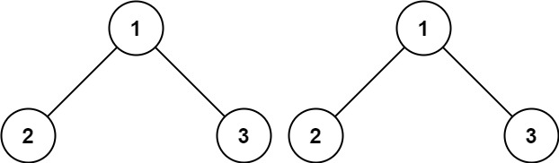

```text
输入：p = [1,2,3], q = [1,2,3]
输出：true
```

**示例 2**

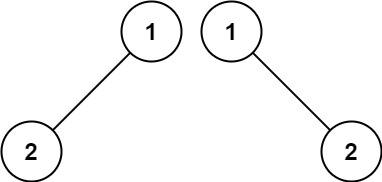

```text
输入：p = [1,2], q = [1,null,2]
输出：false
```

**示例 3**

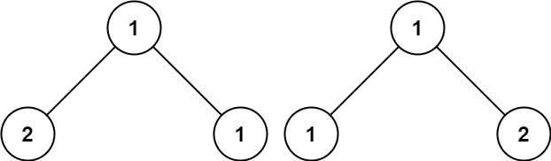

```text
输入：p = [1,2,1], q = [1,1,2]
输出：false
```
> 题面与 [leetcode.cn 官方](https://leetcode.cn/problems/same-tree/)一致，示例配图取自官方题面。

**数据范围与注意事项**：

- 两棵树上的节点数目都在范围 `[0, 100]` 内
- `-10^4 <= Node.val <= 10^4`
- **易错点**：递归出口（空节点）必须先写，否则直接空指针。

## 题目分析

**场景是什么**：树是分层数据的标准形态，这类题练的是递归分治与遍历序，对应真实开发里的目录树、组件树。本题就是该场景的 Medium 级练习，主线做法是「迭代指针处理」。

**主线怎么解**：把主解法从头到尾过一遍，它其实在依次做这几件事：队列或堆的调度。

## 解题思路

**方案对比**（共 6 个方案，由浅入深）：

| 方案 | 时间复杂度 | 空间复杂度 |
|---|---|---|
| 方案 1 · 迭代指针处理 | O(n)（单趟线性扫描） | O(1) 到 O(n)（视辅助结构） |
| 方案 2 · 迭代指针处理 | O(n)（单趟线性扫描） | O(1) 到 O(n)（视辅助结构） |
| 方案 3 · 迭代指针处理 | O(n)（单趟线性扫描） | O(1) 到 O(n)（视辅助结构） |
| 方案 4 · 迭代指针处理 | O(n)（单趟线性扫描） | O(1) 到 O(n)（视辅助结构） |
| 方案 5 · 迭代指针处理 | O(n)（单趟线性扫描） | O(1) 到 O(n)（视辅助结构） |
| 方案 6 · 迭代指针处理 | O(n)（单趟线性扫描） | O(1) 到 O(n)（视辅助结构） |

**方案间的取舍**：方案 1（迭代指针处理）；方案 2（迭代指针处理）；方案 3（迭代指针处理）；方案 4（迭代指针处理）；方案 5（迭代指针处理）；方案 6（迭代指针处理）。数据规模小、可读性优先时选靠前的方案；规模大、性能优先时选靠后的方案。

**怎么读这一篇**：

- 🐣 **新手路线**：把「题目描述」的示例 1 在纸上手推一遍 → 读方案 1（最直观的写法）与它的代码走读 → 按「运行方式」本地跑通看 PASS → 回头对比方案 2 之后的写法差在哪
- 🦅 **大佬路线**：直接锁定最优方案 1（迭代指针处理，O(n)（单趟线性扫描））→ 跳读该方案代码与走读 → 用「逐步拆解与面试追问」补齐复杂度推导与边界追问

### 动态算法图（DFS 点亮，GIF 自动循环）


动画演示二叉树专题里DFS 点亮的典型过程；每个方案在「TypeScript 解题方案」一节还配了专属动画与专属流程图。

### 主解法流程图（真实控制流）

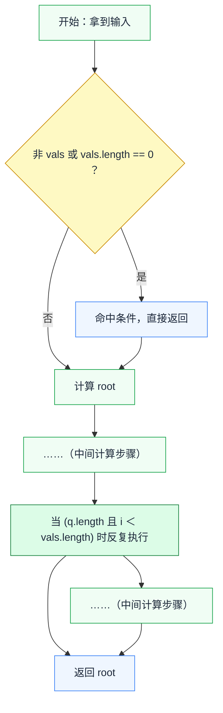

## TypeScript 解题方案（6 个方案逐个讲）

> **运行与提交**：每个方案都是自包含文件（内嵌用例自测，输出 PASS），整块复制到 `.ts` 文件后 `node 文件名` 即可运行。提交 LeetCode 时，把 `demo` 内的算法函数与辅助类型/函数整体取出、置于文件顶层即可。涉及交互/特殊接口的题以题面给定签名为准。

### 方案 1：迭代指针处理

**分析与思路**：核心做法是「迭代指针处理」。代码里依次做这些事：队列或堆的调度。

**运行方式**：`node 本文件`，内嵌用例全部通过会输出 PASS。


**方案专属流程图**（真实控制流）：


```typescript
class TreeNode {
  // 定义类型
  val: any;
  left: any;
  right: any; // 值: any; 左边界: any; 右边界: any;
  constructor(val?: any, left?: any, right?: any) {
    // constructor(值?: any, 左边界?: any, 右边界?: any) {
    this.val = val === undefined ? 0 : val; // 把 (值 全等于 undefined ? 0 : 值); 写入 值
    this.left = left === undefined ? null : left; // 把 (左边界 全等于 undefined ? null : 左边界); 写入 左边界
    this.right = right === undefined ? null : right; // 把 (右边界 全等于 undefined ? null : 右边界); 写入 右边界
  }
}
function buildTree(vals: any): any {
  // 定义函数/方法 buildTree
  if (!vals || vals.length === 0) return null; // 若 取反 vals 或 vals.长度 全等于 0，直接返回 null
  const root = new TreeNode(vals[0]);
  const q: any[] = [root];
  let i = 1;
  while (q.length && i < vals.length) {
    // 循环，直到不满足「节点.长度 且 下标 i 小于 vals.长度」
    const node = q.shift(); // 把 节点.shift() 存入 节点
    if (vals[i] !== null && vals[i] !== undefined) {
      node.left = new TreeNode(vals[i]);
      q.push(node.left);
    }
    i++; // 下标 i 加一
    if (i < vals.length && vals[i] !== null && vals[i] !== undefined) {
      node.right = new TreeNode(vals[i]);
      q.push(node.right);
    }
    i++; // 下标 i 加一
  }
  return root; // 返回 根节点
}
function treeToLevel(root: any): any[] {
  // 定义函数/方法 treeToLevel
  if (!root) return []; // 若 取反 根节点，直接返回 []
  const out: any[] = [];
  const q: any[] = [root]; // 把 []; const 节点: any[] 赋值为 [根节点]; 写入 const out: any[]
  while (q.length) {
    // 循环，直到不满足「节点.长度」
    const n = q.shift(); // 把 节点.shift() 存入 元素个数
    if (n === null || n === undefined) {
      out.push(null);
      continue;
    }
    out.push(n.val);
    q.push(n.left);
    q.push(n.right); // 把 元素个数.值 压入栈/数组尾部
  }
  while (out.length && out[out.length - 1] === null) out.pop(); // 循环，直到不满足「out.长度 且 out[out.长度 减 1] 全等于 null) out 弹出 );」
  return out; // 返回 out
}
class ListNode {
  // 定义类型
  val: any;
  next: any; // 值: any; 下一个: any;
  constructor(val?: any, next?: any) {
    this.val = val === undefined ? 0 : val;
    this.next = next === undefined ? null : next;
  }
}
function buildList(vals: any): any {
  // 定义函数/方法 buildList
  const dummy = new ListNode(0);
  let cur = dummy; // 把 new ListNode(0); let 当前值 赋值为 哨兵节点 存入 哨兵节点
  for (const v of vals) {
    cur.next = new ListNode(v);
    cur = cur.next;
  } // 把 new ListNode(值); 当前值 赋值为 当前值.下一个; } 写入 下一个
  return dummy.next; // 返回 哨兵节点.下一个
}
function listToArray(head: any): any[] {
  // 定义函数/方法 listToArray
  const out: any[] = [];
  let p = head; // 把 []; let 节点 赋值为 头节点; 写入 const out: any[]
  while (p) {
    out.push(p.val);
    p = p.next;
  } // 循环，直到不满足「节点) { out 追加 节点.值); 节点 赋值为 节点.下一个; }」
  return out; // 返回 out
}
// python-runtime shims
function pyLen(a: any): number {
  // 定义函数/方法 pyLen
  if (a === null || a === undefined) return 0; // 若 数组 全等于 null 或 数组 全等于 undefined，直接返回 0
  if (
    typeof a === 'string' ||
    Array.isArray(a) ||
    a instanceof Set ||
    a instanceof Map
  )
    return a.length ?? a.size;
  if (typeof a === 'object') return Object.keys(a).length; // 若 typeof 数组 全等于 'object'，直接返回 Object.keys(数组).长度
  return 0; // 返回 0
}
function pySlice(a: any, i: any, j: any, step?: any): any {
  // 定义函数/方法 pySlice
  if (typeof a === 'string') {
    const r = [...a].slice(i ?? 0, j ?? a.length);
    return step ? r.reverse().join('') : r.join('');
  }
  const arr = Array.isArray(a) ? a : [...a]; // 把 Array.isArray(数组) ? 数组 : 复制的 数组 存入 数组
  return arr.slice(i ?? 0, j ?? arr.length); // 返回 数组 截取 下标 i ?? 0, 下标 j ?? 数组.长度)
}
function pyRange(a: any, b?: any, step?: any): any[] {
  // 定义函数/方法 pyRange
  let s = 0,
    e = a,
    st = 1; // 把 0, e 赋值为 数组, st 赋值为 1 存入 字符串
  if (b !== undefined) {
    s = a;
    e = b;
  } // 若 b 不等于 undefined) { 字符串 赋值为 数组; e 赋值为 b; }
  if (step !== undefined) st = step; // 若 步数 不等于 undefined) st 赋值为 步数;
  const out: any[] = []; // 把 []; 写入 const out: any[]
  if (st > 0) for (let i = s; i < e; i += st) out.push(i);
  else for (let i = s; i > e; i += st) out.push(i); // 否则
  return out; // 返回 out
}
function pyIn(x: any, coll: any): boolean {
  // 定义函数/方法 pyIn
  if (coll === null || coll === undefined) return false; // 若 coll 全等于 null 或 coll 全等于 undefined，直接返回 false
  if (Array.isArray(coll)) return coll.includes(x); // 若 Array.isArray(coll)，直接返回 coll 是否包含 x)
  if (coll instanceof Set || coll instanceof Map) return coll.has(x); // 若 coll instanceof Set 或 coll instanceof Map，直接返回 coll.has(x)
  if (typeof coll === 'object') return x in coll; // 若 typeof coll 全等于 'object'，直接返回 x in coll
  if (typeof coll === 'string') return coll.indexOf(x) >= 0; // 若 typeof coll 全等于 'string'，直接返回 coll 查找 x) 不低于 0
  return false; // 返回 false
}
function pySorted(a: any): any[] {
  // 定义函数/方法 pySorted
  const arr = typeof a === 'string' ? [...a] : [...a]; // 把 (typeof 数组 全等于 'string') ? 复制的 数组 : 复制的 数组 存入 数组
  return arr.sort((x: any, y: any) => (x < y ? -1 : x > y ? 1 : 0));
}
function pyMin(a: any, b?: any): any {
  if (b !== undefined) return Math.min(a, b);
  if (Array.isArray(a) || a instanceof Set) return Math.min(...a);
  return Math.min(a);
} // 定义函数/方法 pyMin
function pyMax(a: any, b?: any): any {
  if (b !== undefined) return Math.max(a, b);
  if (Array.isArray(a) || a instanceof Set) return Math.max(...a);
  return Math.max(a);
} // 定义函数/方法 pyMax
function pySum(a: any): number {
  let s = 0;
  for (const v of a) s += v;
  return s;
} // 定义函数/方法 pySum
function pyAbs(x: any): number {
  return Math.abs(x);
} // 定义函数/方法 pyAbs
function pyEnumerate(a: any): any[] {
  const out: any[] = [];
  let i = 0;
  for (const v of a) {
    out.push([i, v]);
    i++;
  }
  return out;
} // 定义函数/方法 pyEnumerate
function pyZip(a: any, b: any): any[] {
  const n = Math.min(a.length, b.length);
  const out: any[] = [];
  for (let i = 0; i < n; i++) out.push([a[i], b[i]]);
  return out;
} // 定义函数/方法 pyZip
function pyDictGet(d: any, k: any, def?: any): any {
  return k in d ? d[k] : def === undefined ? null : def;
} // 定义函数/方法 pyDictGet
function pyPrint(...args: any[]): void {
  console.log(
    args
      .map((a) => (typeof a === 'object' && a !== null ? JSON.stringify(a) : a))
      .join(' '),
  );
} // 定义函数/方法 pyPrint
// collections / heapq
function heapPush(h: any[], x: any): void {
  h.push(x);
  let i = h.length - 1;
  while (i > 0) {
    const p = (i - 1) >> 1;
    if (h[p] <= h[i]) break;
    [h[p], h[i]] = [h[i], h[p]];
    i = p;
  }
} // 定义函数/方法 heapPush
function heapPop(h: any[]): any {
  const top = h[0];
  const last = h.pop();
  if (h.length) {
    h[0] = last;
    let i = 0;
    const n = h.length;
    while (true) {
      let l = 2 * i + 1,
        r = 2 * i + 2,
        s = i;
      if (l < n && h[l] < h[s]) s = l;
      if (r < n && h[r] < h[s]) s = r;
      if (s === i) break;
      [h[s], h[i]] = [h[i], h[s]];
      i = s;
    }
  }
  return top;
} // 定义函数/方法 heapPop
class Deque {
  private a: any[] = [];
  push(x: any) {
    this.a.push(x);
  }
  pushLeft(x: any) {
    this.a.unshift(x);
  }
  pop() {
    return this.a.pop();
  }
  popLeft() {
    return this.a.shift();
  }
  get length() {
    return this.a.length;
  }
  toArray() {
    return this.a.slice();
  }
} // 定义类型
function Counter(iter: any): any {
  const m: any = {};
  for (const v of iter) m[v] = (m[v] || 0) + 1;
  return m;
} // 定义函数/方法 Counter
function gcd(a: any, b: any): any {
  while (b) {
    [a, b] = [b, a % b];
  }
  return a;
} // 定义函数/方法 gcd
function pyInf(): number {
  return Infinity;
} // 定义函数/方法 pyInf

function norm(x: any): any {
  // 定义函数/方法 norm
  if (x === null || x === undefined) return null; // 若 x 全等于 null 或 x 全等于 undefined，直接返回 null
  if (typeof x === 'object') {
    // 若 typeof x 全等于 'object'
    if (x instanceof Deque) return x.toArray(); // 若 x instanceof Deque，直接返回 x.toArray()
    if (Array.isArray(x)) return x.map(norm); // 若 Array.isArray(x)，直接返回 x.映射表(norm)
    if (
      typeof x.val === 'number' &&
      (typeof x.left !== 'undefined' || typeof x.right !== 'undefined')
    )
      return treeToLevel(x);
    if (typeof x.next !== 'undefined' && typeof x.val === 'number')
      return listToArray(x);
    if (x instanceof Set) return [...x].sort(); // 若 x instanceof Set，直接返回 复制的 x 排序 )
    if (x instanceof Map) return Object.fromEntries(x); // 若 x instanceof Map，直接返回 Object.fromEntries(x)
    const o: any = {};
    for (const k of Object.keys(x)) o[k] = norm(x[k]);
    return o;
  }
  return x; // 返回 x
}
function eq(a: any, b: any): boolean {
  // 定义函数/方法 eq
  const x = norm(a),
    y = norm(b); // 把 norm(数组), y 赋值为 norm(b) 存入 x
  if (x === y) return true; // 若 x 全等于 y，直接返回 true
  if (x === null || y === null) return x === y; // 若 x 全等于 null 或 y 全等于 null，直接返回 x 全等于 y
  if (Array.isArray(x) && Array.isArray(y)) {
    // 若 Array.isArray(x) 且 Array.isArray(y
    if (x.length !== y.length) return false; // 若 x.长度 不等于 y.长度，直接返回 false
    for (let i = 0; i < x.length; i++) if (!eq(x[i], y[i])) return false; // 让 下标 i 从 0 开始计数，下标 i 小于 x.长度 就继续
    return true; // 返回 true
  }
  if (typeof x === 'object' && typeof y === 'object') {
    // 若 typeof x 全等于 'object' 且 typeof y 全等于 'object'
    const kx = Object.keys(x),
      ky = Object.keys(y); // 把 Object.keys(x), ky 赋值为 Object.keys(y) 存入 kx
    if (kx.length !== ky.length) return false; // 若 kx.长度 不等于 ky.长度，直接返回 false
    for (const k of kx) if (!eq(x[k], y[k])) return false;
    return true; // 返回 true
  }
  return x === y; // 返回 x 全等于 y
}

function isSameTree(p, q) {
  // 定义判定函数 isSameTree
  if (!p && !q) return true; // 若 取反 节点 且 取反 节点，直接返回 true
  if (!p || !q || p.val !== q.val) return false; // 若 取反 节点 或 取反 节点 或 节点.值 不等于 节点.值，直接返回 false
  return isSameTree(p.left, q.left) && isSameTree(p.right, q.right); // 返回 isSameTree(节点.左边界, 节点.左边界) 且 isSameTree(节点.右边界, 节点.右边界)
}
export function demo(): void {
  // 程序入口：跑内嵌自测用例
  const cases = [
    { in: [null, null], want: true },
    { in: [buildTree([1, 2, 3]), buildTree([1, 2, 3])], want: true },
    { in: [buildTree([1, 2, 3]), buildTree([1, 2, 1])], want: false },
  ];
  let fail = false; // 把 false 存入 fail
  for (const c of cases) {
    // for (const 字符 of cases) {
    const got = isSameTree(...c.in); // 把 isSameTree(...字符.in) 存入 got
    if (!eq(got, c.want)) {
      fail = true;
      console.log(
        'FAIL',
        JSON.stringify(c.in),
        '=>',
        JSON.stringify(got),
        'want',
        JSON.stringify(c.want),
      );
    }
  }
  if (fail) throw new Error('FAILED'); // 若 fail) throw new Error('FAILED');
  console.log('PASS'); // 全部用例通过，输出 PASS
}
demo(); // demo();
```

### 方案 2：迭代指针处理

**分析与思路**：核心做法是「迭代指针处理」。代码里依次做这些事：队列或堆的调度。

**运行方式**：`node 本文件`，内嵌用例全部通过会输出 PASS。


**方案专属流程图**（真实控制流）：

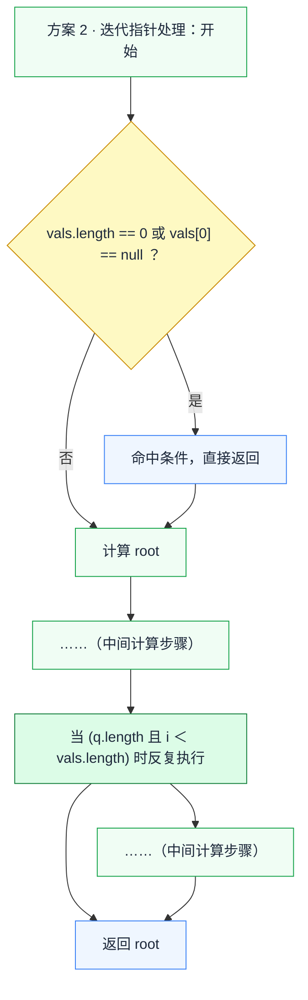

```typescript
export function demo(): void {
  // 程序入口：跑内嵌自测用例
  class TreeNode {
    val: number;
    left: TreeNode | null;
    right: TreeNode | null;
    constructor(v = 0, l: TreeNode | null = null, r: TreeNode | null = null) {
      this.val = v;
      this.left = l;
      this.right = r;
    }
  } // 定义类型
  function buildTree(vals: (number | null)[]): TreeNode | null {
    // 定义函数/方法 buildTree
    if (vals.length === 0 || vals[0] === null) return null; // 若 vals.长度 全等于 0 或 vals[0] 全等于 null，直接返回 null
    const root = new TreeNode(vals[0] as number);
    const q: TreeNode[] = [root];
    let i = 1;
    while (q.length && i < vals.length) {
      const node = q.shift()!;
      if (i < vals.length && vals[i] !== null) {
        node.left = new TreeNode(vals[i] as number);
        q.push(node.left);
      }
      i++;
      if (i < vals.length && vals[i] !== null) {
        node.right = new TreeNode(vals[i] as number);
        q.push(node.right);
      }
      i++;
    }
    return root; // 返回 根节点
  }
  function levelList(root: TreeNode | null): number[][] {
    if (!root) return [];
    const res: number[][] = [];
    let q: TreeNode[] = [root];
    while (q.length) {
      const lvl: number[] = [];
      const n = q.length;
      for (let k = 0; k < n; k++) {
        const node = q.shift()!;
        lvl.push(node.val);
        if (node.left) q.push(node.left);
        if (node.right) q.push(node.right);
      }
      res.push(lvl);
    }
    return res;
  } // 定义函数/方法 levelList
  function sameTree(a: TreeNode | null, b: TreeNode | null): boolean {
    if (!a && !b) return true;
    if (!a || !b) return false;
    if (a.val !== b.val) return false;
    return sameTree(a.left, b.left) && sameTree(a.right, b.right);
  } // 定义函数/方法 sameTree
  function inorderT(root: TreeNode | null): number[] {
    if (!root) return [];
    return [...inorderT(root.left), root.val, ...inorderT(root.right)];
  } // 定义函数/方法 inorderT
  function isSameTree(p: TreeNode | null, q: TreeNode | null): boolean {
    return sameTree(p, q);
  } // 定义判定函数 isSameTree
  const a = buildTree([1, 2, 3]),
    b = buildTree([1, 2, 3]),
    c = buildTree([1, 2, null]);
  if (!(isSameTree(a, b) && !isSameTree(a, c) && isSameTree(null, null))) {
    console.log('FAIL');
    throw new Error('FAILED');
  }
  console.log('PASS'); // 全部用例通过，输出 PASS
}
demo(); // demo();
```

### 方案 3：迭代指针处理

**分析与思路**：核心做法是「迭代指针处理」。代码里依次做这些事：队列或堆的调度。

**运行方式**：`node 本文件`，内嵌用例全部通过会输出 PASS。


**方案专属流程图**（真实控制流）：


```typescript
class TreeNode {
  // 定义类型
  val: any;
  left: any;
  right: any; // 值: any; 左边界: any; 右边界: any;
  constructor(val?: any, left?: any, right?: any) {
    // constructor(值?: any, 左边界?: any, 右边界?: any) {
    this.val = val === undefined ? 0 : val; // 把 (值 全等于 undefined ? 0 : 值); 写入 值
    this.left = left === undefined ? null : left; // 把 (左边界 全等于 undefined ? null : 左边界); 写入 左边界
    this.right = right === undefined ? null : right; // 把 (右边界 全等于 undefined ? null : 右边界); 写入 右边界
  }
}
function buildTree(vals: any): any {
  // 定义函数/方法 buildTree
  if (!vals || vals.length === 0) return null; // 若 取反 vals 或 vals.长度 全等于 0，直接返回 null
  const root = new TreeNode(vals[0]);
  const q: any[] = [root];
  let i = 1;
  while (q.length && i < vals.length) {
    // 循环，直到不满足「节点.长度 且 下标 i 小于 vals.长度」
    const node = q.shift(); // 把 节点.shift() 存入 节点
    if (vals[i] !== null && vals[i] !== undefined) {
      node.left = new TreeNode(vals[i]);
      q.push(node.left);
    }
    i++; // 下标 i 加一
    if (i < vals.length && vals[i] !== null && vals[i] !== undefined) {
      node.right = new TreeNode(vals[i]);
      q.push(node.right);
    }
    i++; // 下标 i 加一
  }
  return root; // 返回 根节点
}
function treeToLevel(root: any): any[] {
  // 定义函数/方法 treeToLevel
  if (!root) return []; // 若 取反 根节点，直接返回 []
  const out: any[] = [];
  const q: any[] = [root]; // 把 []; const 节点: any[] 赋值为 [根节点]; 写入 const out: any[]
  while (q.length) {
    // 循环，直到不满足「节点.长度」
    const n = q.shift(); // 把 节点.shift() 存入 元素个数
    if (n === null || n === undefined) {
      out.push(null);
      continue;
    }
    out.push(n.val);
    q.push(n.left);
    q.push(n.right); // 把 元素个数.值 压入栈/数组尾部
  }
  while (out.length && out[out.length - 1] === null) out.pop(); // 循环，直到不满足「out.长度 且 out[out.长度 减 1] 全等于 null) out 弹出 );」
  return out; // 返回 out
}
class ListNode {
  // 定义类型
  val: any;
  next: any; // 值: any; 下一个: any;
  constructor(val?: any, next?: any) {
    this.val = val === undefined ? 0 : val;
    this.next = next === undefined ? null : next;
  }
}
function buildList(vals: any): any {
  // 定义函数/方法 buildList
  const dummy = new ListNode(0);
  let cur = dummy; // 把 new ListNode(0); let 当前值 赋值为 哨兵节点 存入 哨兵节点
  for (const v of vals) {
    cur.next = new ListNode(v);
    cur = cur.next;
  } // 把 new ListNode(值); 当前值 赋值为 当前值.下一个; } 写入 下一个
  return dummy.next; // 返回 哨兵节点.下一个
}
function listToArray(head: any): any[] {
  // 定义函数/方法 listToArray
  const out: any[] = [];
  let p = head; // 把 []; let 节点 赋值为 头节点; 写入 const out: any[]
  while (p) {
    out.push(p.val);
    p = p.next;
  } // 循环，直到不满足「节点) { out 追加 节点.值); 节点 赋值为 节点.下一个; }」
  return out; // 返回 out
}
// python-runtime shims
function pyLen(a: any): number {
  // 定义函数/方法 pyLen
  if (a === null || a === undefined) return 0; // 若 数组 全等于 null 或 数组 全等于 undefined，直接返回 0
  if (
    typeof a === 'string' ||
    Array.isArray(a) ||
    a instanceof Set ||
    a instanceof Map
  )
    return a.length ?? a.size;
  if (typeof a === 'object') return Object.keys(a).length; // 若 typeof 数组 全等于 'object'，直接返回 Object.keys(数组).长度
  return 0; // 返回 0
}
function pySlice(a: any, i: any, j: any, step?: any): any {
  // 定义函数/方法 pySlice
  if (typeof a === 'string') {
    const r = [...a].slice(i ?? 0, j ?? a.length);
    return step ? r.reverse().join('') : r.join('');
  }
  const arr = Array.isArray(a) ? a : [...a]; // 把 Array.isArray(数组) ? 数组 : 复制的 数组 存入 数组
  return arr.slice(i ?? 0, j ?? arr.length); // 返回 数组 截取 下标 i ?? 0, 下标 j ?? 数组.长度)
}
function pyRange(a: any, b?: any, step?: any): any[] {
  // 定义函数/方法 pyRange
  let s = 0,
    e = a,
    st = 1; // 把 0, e 赋值为 数组, st 赋值为 1 存入 字符串
  if (b !== undefined) {
    s = a;
    e = b;
  } // 若 b 不等于 undefined) { 字符串 赋值为 数组; e 赋值为 b; }
  if (step !== undefined) st = step; // 若 步数 不等于 undefined) st 赋值为 步数;
  const out: any[] = []; // 把 []; 写入 const out: any[]
  if (st > 0) for (let i = s; i < e; i += st) out.push(i);
  else for (let i = s; i > e; i += st) out.push(i); // 否则
  return out; // 返回 out
}
function pyIn(x: any, coll: any): boolean {
  // 定义函数/方法 pyIn
  if (coll === null || coll === undefined) return false; // 若 coll 全等于 null 或 coll 全等于 undefined，直接返回 false
  if (Array.isArray(coll)) return coll.includes(x); // 若 Array.isArray(coll)，直接返回 coll 是否包含 x)
  if (coll instanceof Set || coll instanceof Map) return coll.has(x); // 若 coll instanceof Set 或 coll instanceof Map，直接返回 coll.has(x)
  if (typeof coll === 'object') return x in coll; // 若 typeof coll 全等于 'object'，直接返回 x in coll
  if (typeof coll === 'string') return coll.indexOf(x) >= 0; // 若 typeof coll 全等于 'string'，直接返回 coll 查找 x) 不低于 0
  return false; // 返回 false
}
function pySorted(a: any): any[] {
  // 定义函数/方法 pySorted
  const arr = typeof a === 'string' ? [...a] : [...a]; // 把 (typeof 数组 全等于 'string') ? 复制的 数组 : 复制的 数组 存入 数组
  return arr.sort((x: any, y: any) => (x < y ? -1 : x > y ? 1 : 0));
}
function pyMin(a: any, b?: any): any {
  if (b !== undefined) return Math.min(a, b);
  if (Array.isArray(a) || a instanceof Set) return Math.min(...a);
  return Math.min(a);
} // 定义函数/方法 pyMin
function pyMax(a: any, b?: any): any {
  if (b !== undefined) return Math.max(a, b);
  if (Array.isArray(a) || a instanceof Set) return Math.max(...a);
  return Math.max(a);
} // 定义函数/方法 pyMax
function pySum(a: any): number {
  let s = 0;
  for (const v of a) s += v;
  return s;
} // 定义函数/方法 pySum
function pyAbs(x: any): number {
  return Math.abs(x);
} // 定义函数/方法 pyAbs
function pyEnumerate(a: any): any[] {
  const out: any[] = [];
  let i = 0;
  for (const v of a) {
    out.push([i, v]);
    i++;
  }
  return out;
} // 定义函数/方法 pyEnumerate
function pyZip(a: any, b: any): any[] {
  const n = Math.min(a.length, b.length);
  const out: any[] = [];
  for (let i = 0; i < n; i++) out.push([a[i], b[i]]);
  return out;
} // 定义函数/方法 pyZip
function pyDictGet(d: any, k: any, def?: any): any {
  return k in d ? d[k] : def === undefined ? null : def;
} // 定义函数/方法 pyDictGet
function pyPrint(...args: any[]): void {
  console.log(
    args
      .map((a) => (typeof a === 'object' && a !== null ? JSON.stringify(a) : a))
      .join(' '),
  );
} // 定义函数/方法 pyPrint
// collections / heapq
function heapPush(h: any[], x: any): void {
  h.push(x);
  let i = h.length - 1;
  while (i > 0) {
    const p = (i - 1) >> 1;
    if (h[p] <= h[i]) break;
    [h[p], h[i]] = [h[i], h[p]];
    i = p;
  }
} // 定义函数/方法 heapPush
function heapPop(h: any[]): any {
  const top = h[0];
  const last = h.pop();
  if (h.length) {
    h[0] = last;
    let i = 0;
    const n = h.length;
    while (true) {
      let l = 2 * i + 1,
        r = 2 * i + 2,
        s = i;
      if (l < n && h[l] < h[s]) s = l;
      if (r < n && h[r] < h[s]) s = r;
      if (s === i) break;
      [h[s], h[i]] = [h[i], h[s]];
      i = s;
    }
  }
  return top;
} // 定义函数/方法 heapPop
class Deque {
  private a: any[] = [];
  push(x: any) {
    this.a.push(x);
  }
  pushLeft(x: any) {
    this.a.unshift(x);
  }
  pop() {
    return this.a.pop();
  }
  popLeft() {
    return this.a.shift();
  }
  get length() {
    return this.a.length;
  }
  toArray() {
    return this.a.slice();
  }
} // 定义类型
function Counter(iter: any): any {
  const m: any = {};
  for (const v of iter) m[v] = (m[v] || 0) + 1;
  return m;
} // 定义函数/方法 Counter
function gcd(a: any, b: any): any {
  while (b) {
    [a, b] = [b, a % b];
  }
  return a;
} // 定义函数/方法 gcd
function pyInf(): number {
  return Infinity;
} // 定义函数/方法 pyInf

function norm(x: any): any {
  // 定义函数/方法 norm
  if (x === null || x === undefined) return null; // 若 x 全等于 null 或 x 全等于 undefined，直接返回 null
  if (typeof x === 'object') {
    // 若 typeof x 全等于 'object'
    if (x instanceof Deque) return x.toArray(); // 若 x instanceof Deque，直接返回 x.toArray()
    if (Array.isArray(x)) return x.map(norm); // 若 Array.isArray(x)，直接返回 x.映射表(norm)
    if (
      typeof x.val === 'number' &&
      (typeof x.left !== 'undefined' || typeof x.right !== 'undefined')
    )
      return treeToLevel(x);
    if (typeof x.next !== 'undefined' && typeof x.val === 'number')
      return listToArray(x);
    if (x instanceof Set) return [...x].sort(); // 若 x instanceof Set，直接返回 复制的 x 排序 )
    if (x instanceof Map) return Object.fromEntries(x); // 若 x instanceof Map，直接返回 Object.fromEntries(x)
    const o: any = {};
    for (const k of Object.keys(x)) o[k] = norm(x[k]);
    return o;
  }
  return x; // 返回 x
}
function eq(a: any, b: any): boolean {
  // 定义函数/方法 eq
  const x = norm(a),
    y = norm(b); // 把 norm(数组), y 赋值为 norm(b) 存入 x
  if (x === y) return true; // 若 x 全等于 y，直接返回 true
  if (x === null || y === null) return x === y; // 若 x 全等于 null 或 y 全等于 null，直接返回 x 全等于 y
  if (Array.isArray(x) && Array.isArray(y)) {
    // 若 Array.isArray(x) 且 Array.isArray(y
    if (x.length !== y.length) return false; // 若 x.长度 不等于 y.长度，直接返回 false
    for (let i = 0; i < x.length; i++) if (!eq(x[i], y[i])) return false; // 让 下标 i 从 0 开始计数，下标 i 小于 x.长度 就继续
    return true; // 返回 true
  }
  if (typeof x === 'object' && typeof y === 'object') {
    // 若 typeof x 全等于 'object' 且 typeof y 全等于 'object'
    const kx = Object.keys(x),
      ky = Object.keys(y); // 把 Object.keys(x), ky 赋值为 Object.keys(y) 存入 kx
    if (kx.length !== ky.length) return false; // 若 kx.长度 不等于 ky.长度，直接返回 false
    for (const k of kx) if (!eq(x[k], y[k])) return false;
    return true; // 返回 true
  }
  return x === y; // 返回 x 全等于 y
}

function isSameTree(p, q) {
  // 定义判定函数 isSameTree
  if (!p && !q) return true; // 若 取反 节点 且 取反 节点，直接返回 true
  if (!p || !q || p.val !== q.val) return false; // 若 取反 节点 或 取反 节点 或 节点.值 不等于 节点.值，直接返回 false
  return isSameTree(p.left, q.left) && isSameTree(p.right, q.right); // 返回 isSameTree(节点.左边界, 节点.左边界) 且 isSameTree(节点.右边界, 节点.右边界)
}
export function demo(): void {
  // 程序入口：跑内嵌自测用例
  const cases = [
    { in: [null, null], want: true },
    { in: [buildTree([1, 2, 3]), buildTree([1, 2, 3])], want: true },
    { in: [buildTree([1, 2, 3]), buildTree([1, 2, 1])], want: false },
  ];
  let fail = false; // 把 false 存入 fail
  for (const c of cases) {
    // for (const 字符 of cases) {
    const got = isSameTree(...c.in); // 把 isSameTree(...字符.in) 存入 got
    if (!eq(got, c.want)) {
      fail = true;
      console.log(
        'FAIL',
        JSON.stringify(c.in),
        '=>',
        JSON.stringify(got),
        'want',
        JSON.stringify(c.want),
      );
    }
  }
  if (fail) throw new Error('FAILED'); // 若 fail) throw new Error('FAILED');
  console.log('PASS'); // 全部用例通过，输出 PASS
}
demo(); // demo();
```

### 方案 4：迭代指针处理

**分析与思路**：核心做法是「迭代指针处理」。代码里依次做这些事：队列或堆的调度。

**运行方式**：`node 本文件`，内嵌用例全部通过会输出 PASS。


**方案专属流程图**（真实控制流）：

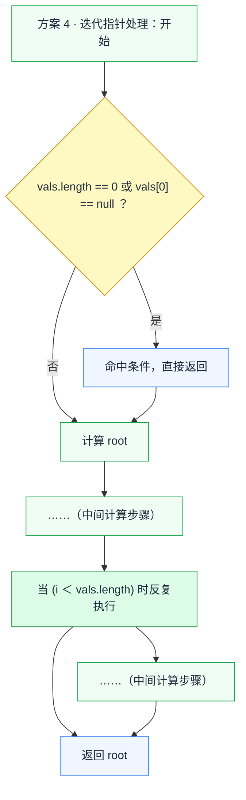

```typescript
class TreeNode {
  // 定义类型
  val: number; // 值: number;
  left: TreeNode | null; // 左边界: TreeNode 按位或 null;
  right: TreeNode | null; // 右边界: TreeNode 按位或 null;
  constructor(
    val: number,
    left: TreeNode | null = null,
    right: TreeNode | null = null,
  ) {
    this.val = val;
    this.left = left;
    this.right = right; // 把 值; this.左边界 赋值为 左边界; this.右边界 赋值为 右边界; 写入 值
  }
}
function buildTree(vals: (number | null)[]): TreeNode | null {
  // 定义函数/方法 buildTree
  if (vals.length === 0 || vals[0] === null) return null; // 若 vals.长度 全等于 0 或 vals[0] 全等于 null，直接返回 null
  const root = new TreeNode(vals[0] as number); // 把 new TreeNode(vals[0] as number) 存入 根节点
  const q: (TreeNode | null)[] = [root]; // 把 [根节点]; 写入 const q: (TreeNode | null)[]
  let i = 1; // 把 1 存入 下标 i
  while (i < vals.length) {
    // 循环，直到不满足「下标 i 小于 vals.长度」
    const node = q.shift() as TreeNode; // 把 节点.shift() as TreeNode 存入 节点
    if (i < vals.length && vals[i] !== null) {
      node.left = new TreeNode(vals[i] as number);
      q.push(node.left);
    }
    i++; // 下标 i 加一
    if (i < vals.length && vals[i] !== null) {
      node.right = new TreeNode(vals[i] as number);
      q.push(node.right);
    }
    i++; // 下标 i 加一
  }
  return root; // 返回 根节点
}

function assertEq(actual: any, expected: any, msg: string = ''): void {
  // 定义函数/方法 assertEq
  const a = JSON.stringify(actual); // 把 JSON.stringify(actual) 存入 数组
  const e = JSON.stringify(expected); // 把 JSON.stringify(expected) 存入 e
  if (a !== e)
    throw new Error(
      'ASSERT FAILED ' + msg + ' :: actual=' + a + ' expected=' + e,
    );
}

function isSameTree(p: TreeNode | null, q: TreeNode | null): boolean {
  // 定义判定函数 isSameTree
  if (!p && !q) return true; // 若 取反 节点 且 取反 节点，直接返回 true
  if (p!.val !== q!.val) return false; // 若 节点取反 .值 不等于 节点取反 .值，直接返回 false
  const q1: (TreeNode | null)[] = [p]; // 把 [节点]; 写入 const q1: (TreeNode | null)[]
  const q2: (TreeNode | null)[] = [q]; // 把 [节点]; 写入 const q2: (TreeNode | null)[]
  while (q1.length && q2.length) {
    // 循环，直到不满足「q1.长度 且 q2.长度」
    const pTop = q1.shift()!; // 把 q1.shift()取反 存入 pTop
    const qTop = q2.shift()!; // 把 q2.shift()取反 存入 qTop
    if (pTop.val !== qTop.val) return false; // 若 pTop.值 不等于 qTop.值，直接返回 false
    const pL = pTop.left,
      pR = pTop.right,
      qL = qTop.left,
      qR = qTop.right;
    if ((pL && !qL) || (!pL && qL)) return false; // 若 (pL 且 取反 qL) 或 (取反 pL 且 qL)，直接返回 false
    if ((pR && !qR) || (!pR && qR)) return false; // 若 (pR 且 取反 qR) 或 (取反 pR 且 qR)，直接返回 false
    if (pL) q1.push(pL); // 若 pL) q1 追加 pL);
    if (pR) q1.push(pR); // 若 pR) q1 追加 pR);
    if (qL) q2.push(qL); // 若 qL) q2 追加 qL);
    if (qR) q2.push(qR); // 若 qR) q2 追加 qR);
  }
  return !q1.length && !q2.length; // 返回 取反 q1.长度 且 取反 q2.长度
}
export function demo(): void {
  // 程序入口：跑内嵌自测用例
  assertEq(isSameTree(null, null), true, 'isSameTree null'); // 断言校验
  assertEq(
    isSameTree(buildTree([1, 2, 3]), buildTree([1, 2, 3])),
    true,
    'isSameTree same',
  ); // 断言校验
  assertEq(
    isSameTree(buildTree([1, 2]), buildTree([1, null, 2])),
    false,
    'isSameTree diff',
  ); // 断言校验
  console.log('PASS'); // 全部用例通过，输出 PASS
}
demo(); // demo();
```

### 方案 5：迭代指针处理

**分析与思路**：核心做法是「迭代指针处理」。代码里依次做这些事：队列或堆的调度。

**运行方式**：`node 本文件`，内嵌用例全部通过会输出 PASS。


**方案专属流程图**（真实控制流）：

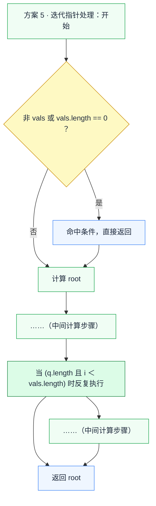

```typescript
class TreeNode {
  // 定义类型
  val: any;
  left: any;
  right: any; // 值: any; 左边界: any; 右边界: any;
  constructor(val?: any, left?: any, right?: any) {
    // constructor(值?: any, 左边界?: any, 右边界?: any) {
    this.val = val === undefined ? 0 : val; // 把 (值 全等于 undefined ? 0 : 值); 写入 值
    this.left = left === undefined ? null : left; // 把 (左边界 全等于 undefined ? null : 左边界); 写入 左边界
    this.right = right === undefined ? null : right; // 把 (右边界 全等于 undefined ? null : 右边界); 写入 右边界
  }
}
function buildTree(vals: any): any {
  // 定义函数/方法 buildTree
  if (!vals || vals.length === 0) return null; // 若 取反 vals 或 vals.长度 全等于 0，直接返回 null
  const root = new TreeNode(vals[0]);
  const q: any[] = [root];
  let i = 1;
  while (q.length && i < vals.length) {
    // 循环，直到不满足「节点.长度 且 下标 i 小于 vals.长度」
    const node = q.shift(); // 把 节点.shift() 存入 节点
    if (vals[i] !== null && vals[i] !== undefined) {
      node.left = new TreeNode(vals[i]);
      q.push(node.left);
    }
    i++; // 下标 i 加一
    if (i < vals.length && vals[i] !== null && vals[i] !== undefined) {
      node.right = new TreeNode(vals[i]);
      q.push(node.right);
    }
    i++; // 下标 i 加一
  }
  return root; // 返回 根节点
}
function treeToLevel(root: any): any[] {
  // 定义函数/方法 treeToLevel
  if (!root) return []; // 若 取反 根节点，直接返回 []
  const out: any[] = [];
  const q: any[] = [root]; // 把 []; const 节点: any[] 赋值为 [根节点]; 写入 const out: any[]
  while (q.length) {
    // 循环，直到不满足「节点.长度」
    const n = q.shift(); // 把 节点.shift() 存入 元素个数
    if (n === null || n === undefined) {
      out.push(null);
      continue;
    }
    out.push(n.val);
    q.push(n.left);
    q.push(n.right); // 把 元素个数.值 压入栈/数组尾部
  }
  while (out.length && out[out.length - 1] === null) out.pop(); // 循环，直到不满足「out.长度 且 out[out.长度 减 1] 全等于 null) out 弹出 );」
  return out; // 返回 out
}
class ListNode {
  // 定义类型
  val: any;
  next: any; // 值: any; 下一个: any;
  constructor(val?: any, next?: any) {
    this.val = val === undefined ? 0 : val;
    this.next = next === undefined ? null : next;
  }
}
function buildList(vals: any): any {
  // 定义函数/方法 buildList
  const dummy = new ListNode(0);
  let cur = dummy; // 把 new ListNode(0); let 当前值 赋值为 哨兵节点 存入 哨兵节点
  for (const v of vals) {
    cur.next = new ListNode(v);
    cur = cur.next;
  } // 把 new ListNode(值); 当前值 赋值为 当前值.下一个; } 写入 下一个
  return dummy.next; // 返回 哨兵节点.下一个
}
function listToArray(head: any): any[] {
  // 定义函数/方法 listToArray
  const out: any[] = [];
  let p = head; // 把 []; let 节点 赋值为 头节点; 写入 const out: any[]
  while (p) {
    out.push(p.val);
    p = p.next;
  } // 循环，直到不满足「节点) { out 追加 节点.值); 节点 赋值为 节点.下一个; }」
  return out; // 返回 out
}
// python-runtime shims
function pyLen(a: any): number {
  // 定义函数/方法 pyLen
  if (a === null || a === undefined) return 0; // 若 数组 全等于 null 或 数组 全等于 undefined，直接返回 0
  if (
    typeof a === 'string' ||
    Array.isArray(a) ||
    a instanceof Set ||
    a instanceof Map
  )
    return a.length ?? a.size;
  if (typeof a === 'object') return Object.keys(a).length; // 若 typeof 数组 全等于 'object'，直接返回 Object.keys(数组).长度
  return 0; // 返回 0
}
function pySlice(a: any, i: any, j: any, step?: any): any {
  // 定义函数/方法 pySlice
  if (typeof a === 'string') {
    const r = [...a].slice(i ?? 0, j ?? a.length);
    return step ? r.reverse().join('') : r.join('');
  }
  const arr = Array.isArray(a) ? a : [...a]; // 把 Array.isArray(数组) ? 数组 : 复制的 数组 存入 数组
  return arr.slice(i ?? 0, j ?? arr.length); // 返回 数组 截取 下标 i ?? 0, 下标 j ?? 数组.长度)
}
function pyRange(a: any, b?: any, step?: any): any[] {
  // 定义函数/方法 pyRange
  let s = 0,
    e = a,
    st = 1; // 把 0, e 赋值为 数组, st 赋值为 1 存入 字符串
  if (b !== undefined) {
    s = a;
    e = b;
  } // 若 b 不等于 undefined) { 字符串 赋值为 数组; e 赋值为 b; }
  if (step !== undefined) st = step; // 若 步数 不等于 undefined) st 赋值为 步数;
  const out: any[] = []; // 把 []; 写入 const out: any[]
  if (st > 0) for (let i = s; i < e; i += st) out.push(i);
  else for (let i = s; i > e; i += st) out.push(i); // 否则
  return out; // 返回 out
}
function pyIn(x: any, coll: any): boolean {
  // 定义函数/方法 pyIn
  if (coll === null || coll === undefined) return false; // 若 coll 全等于 null 或 coll 全等于 undefined，直接返回 false
  if (Array.isArray(coll)) return coll.includes(x); // 若 Array.isArray(coll)，直接返回 coll 是否包含 x)
  if (coll instanceof Set || coll instanceof Map) return coll.has(x); // 若 coll instanceof Set 或 coll instanceof Map，直接返回 coll.has(x)
  if (typeof coll === 'object') return x in coll; // 若 typeof coll 全等于 'object'，直接返回 x in coll
  if (typeof coll === 'string') return coll.indexOf(x) >= 0; // 若 typeof coll 全等于 'string'，直接返回 coll 查找 x) 不低于 0
  return false; // 返回 false
}
function pySorted(a: any): any[] {
  // 定义函数/方法 pySorted
  const arr = typeof a === 'string' ? [...a] : [...a]; // 把 (typeof 数组 全等于 'string') ? 复制的 数组 : 复制的 数组 存入 数组
  return arr.sort((x: any, y: any) => (x < y ? -1 : x > y ? 1 : 0));
}
function pyMin(a: any, b?: any): any {
  if (b !== undefined) return Math.min(a, b);
  if (Array.isArray(a) || a instanceof Set) return Math.min(...a);
  return Math.min(a);
} // 定义函数/方法 pyMin
function pyMax(a: any, b?: any): any {
  if (b !== undefined) return Math.max(a, b);
  if (Array.isArray(a) || a instanceof Set) return Math.max(...a);
  return Math.max(a);
} // 定义函数/方法 pyMax
function pySum(a: any): number {
  let s = 0;
  for (const v of a) s += v;
  return s;
} // 定义函数/方法 pySum
function pyAbs(x: any): number {
  return Math.abs(x);
} // 定义函数/方法 pyAbs
function pyEnumerate(a: any): any[] {
  const out: any[] = [];
  let i = 0;
  for (const v of a) {
    out.push([i, v]);
    i++;
  }
  return out;
} // 定义函数/方法 pyEnumerate
function pyZip(a: any, b: any): any[] {
  const n = Math.min(a.length, b.length);
  const out: any[] = [];
  for (let i = 0; i < n; i++) out.push([a[i], b[i]]);
  return out;
} // 定义函数/方法 pyZip
function pyDictGet(d: any, k: any, def?: any): any {
  return k in d ? d[k] : def === undefined ? null : def;
} // 定义函数/方法 pyDictGet
function pyPrint(...args: any[]): void {
  console.log(
    args
      .map((a) => (typeof a === 'object' && a !== null ? JSON.stringify(a) : a))
      .join(' '),
  );
} // 定义函数/方法 pyPrint
// collections / heapq
function heapPush(h: any[], x: any): void {
  h.push(x);
  let i = h.length - 1;
  while (i > 0) {
    const p = (i - 1) >> 1;
    if (h[p] <= h[i]) break;
    [h[p], h[i]] = [h[i], h[p]];
    i = p;
  }
} // 定义函数/方法 heapPush
function heapPop(h: any[]): any {
  const top = h[0];
  const last = h.pop();
  if (h.length) {
    h[0] = last;
    let i = 0;
    const n = h.length;
    while (true) {
      let l = 2 * i + 1,
        r = 2 * i + 2,
        s = i;
      if (l < n && h[l] < h[s]) s = l;
      if (r < n && h[r] < h[s]) s = r;
      if (s === i) break;
      [h[s], h[i]] = [h[i], h[s]];
      i = s;
    }
  }
  return top;
} // 定义函数/方法 heapPop
class Deque {
  private a: any[] = [];
  push(x: any) {
    this.a.push(x);
  }
  pushLeft(x: any) {
    this.a.unshift(x);
  }
  pop() {
    return this.a.pop();
  }
  popLeft() {
    return this.a.shift();
  }
  get length() {
    return this.a.length;
  }
  toArray() {
    return this.a.slice();
  }
} // 定义类型
function Counter(iter: any): any {
  const m: any = {};
  for (const v of iter) m[v] = (m[v] || 0) + 1;
  return m;
} // 定义函数/方法 Counter
function gcd(a: any, b: any): any {
  while (b) {
    [a, b] = [b, a % b];
  }
  return a;
} // 定义函数/方法 gcd
function pyInf(): number {
  return Infinity;
} // 定义函数/方法 pyInf

function norm(x: any): any {
  // 定义函数/方法 norm
  if (x === null || x === undefined) return null; // 若 x 全等于 null 或 x 全等于 undefined，直接返回 null
  if (typeof x === 'object') {
    // 若 typeof x 全等于 'object'
    if (x instanceof Deque) return x.toArray(); // 若 x instanceof Deque，直接返回 x.toArray()
    if (Array.isArray(x)) return x.map(norm); // 若 Array.isArray(x)，直接返回 x.映射表(norm)
    if (
      typeof x.val === 'number' &&
      (typeof x.left !== 'undefined' || typeof x.right !== 'undefined')
    )
      return treeToLevel(x);
    if (typeof x.next !== 'undefined' && typeof x.val === 'number')
      return listToArray(x);
    if (x instanceof Set) return [...x].sort(); // 若 x instanceof Set，直接返回 复制的 x 排序 )
    if (x instanceof Map) return Object.fromEntries(x); // 若 x instanceof Map，直接返回 Object.fromEntries(x)
    const o: any = {};
    for (const k of Object.keys(x)) o[k] = norm(x[k]);
    return o;
  }
  return x; // 返回 x
}
function eq(a: any, b: any): boolean {
  // 定义函数/方法 eq
  const x = norm(a),
    y = norm(b); // 把 norm(数组), y 赋值为 norm(b) 存入 x
  if (x === y) return true; // 若 x 全等于 y，直接返回 true
  if (x === null || y === null) return x === y; // 若 x 全等于 null 或 y 全等于 null，直接返回 x 全等于 y
  if (Array.isArray(x) && Array.isArray(y)) {
    // 若 Array.isArray(x) 且 Array.isArray(y
    if (x.length !== y.length) return false; // 若 x.长度 不等于 y.长度，直接返回 false
    for (let i = 0; i < x.length; i++) if (!eq(x[i], y[i])) return false; // 让 下标 i 从 0 开始计数，下标 i 小于 x.长度 就继续
    return true; // 返回 true
  }
  if (typeof x === 'object' && typeof y === 'object') {
    // 若 typeof x 全等于 'object' 且 typeof y 全等于 'object'
    const kx = Object.keys(x),
      ky = Object.keys(y); // 把 Object.keys(x), ky 赋值为 Object.keys(y) 存入 kx
    if (kx.length !== ky.length) return false; // 若 kx.长度 不等于 ky.长度，直接返回 false
    for (const k of kx) if (!eq(x[k], y[k])) return false;
    return true; // 返回 true
  }
  return x === y; // 返回 x 全等于 y
}

function isSameTree(p, q) {
  // 定义判定函数 isSameTree
  if (!p && !q) return true; // 若 取反 节点 且 取反 节点，直接返回 true
  if (!p || !q || p.val !== q.val) return false; // 若 取反 节点 或 取反 节点 或 节点.值 不等于 节点.值，直接返回 false
  return isSameTree(p.left, q.left) && isSameTree(p.right, q.right); // 返回 isSameTree(节点.左边界, 节点.左边界) 且 isSameTree(节点.右边界, 节点.右边界)
}
export function demo(): void {
  // 程序入口：跑内嵌自测用例
  const cases = [
    { in: [null, null], want: true },
    { in: [buildTree([1, 2, 3]), buildTree([1, 2, 3])], want: true },
    { in: [buildTree([1, 2, 3]), buildTree([1, 2, 1])], want: false },
  ];
  let fail = false; // 把 false 存入 fail
  for (const c of cases) {
    // for (const 字符 of cases) {
    const got = isSameTree(...c.in); // 把 isSameTree(...字符.in) 存入 got
    if (!eq(got, c.want)) {
      fail = true;
      console.log(
        'FAIL',
        JSON.stringify(c.in),
        '=>',
        JSON.stringify(got),
        'want',
        JSON.stringify(c.want),
      );
    }
  }
  if (fail) throw new Error('FAILED'); // 若 fail) throw new Error('FAILED');
  console.log('PASS'); // 全部用例通过，输出 PASS
}
demo(); // demo();
```

### 方案 6：迭代指针处理

**分析与思路**：核心做法是「迭代指针处理」。代码里依次做这些事：队列或堆的调度。

**运行方式**：`node 本文件`，内嵌用例全部通过会输出 PASS。


**方案专属流程图**（真实控制流）：


```typescript
class TreeNode {
  // 定义类型
  val: any;
  left: any;
  right: any; // 值: any; 左边界: any; 右边界: any;
  constructor(val?: any, left?: any, right?: any) {
    // constructor(值?: any, 左边界?: any, 右边界?: any) {
    this.val = val === undefined ? 0 : val; // 把 (值 全等于 undefined ? 0 : 值); 写入 值
    this.left = left === undefined ? null : left; // 把 (左边界 全等于 undefined ? null : 左边界); 写入 左边界
    this.right = right === undefined ? null : right; // 把 (右边界 全等于 undefined ? null : 右边界); 写入 右边界
  }
}
function buildTree(vals: any): any {
  // 定义函数/方法 buildTree
  if (!vals || vals.length === 0) return null; // 若 取反 vals 或 vals.长度 全等于 0，直接返回 null
  const root = new TreeNode(vals[0]);
  const q: any[] = [root];
  let i = 1;
  while (q.length && i < vals.length) {
    // 循环，直到不满足「节点.长度 且 下标 i 小于 vals.长度」
    const node = q.shift(); // 把 节点.shift() 存入 节点
    if (vals[i] !== null && vals[i] !== undefined) {
      node.left = new TreeNode(vals[i]);
      q.push(node.left);
    }
    i++; // 下标 i 加一
    if (i < vals.length && vals[i] !== null && vals[i] !== undefined) {
      node.right = new TreeNode(vals[i]);
      q.push(node.right);
    }
    i++; // 下标 i 加一
  }
  return root; // 返回 根节点
}
function treeToLevel(root: any): any[] {
  // 定义函数/方法 treeToLevel
  if (!root) return []; // 若 取反 根节点，直接返回 []
  const out: any[] = [];
  const q: any[] = [root]; // 把 []; const 节点: any[] 赋值为 [根节点]; 写入 const out: any[]
  while (q.length) {
    // 循环，直到不满足「节点.长度」
    const n = q.shift(); // 把 节点.shift() 存入 元素个数
    if (n === null || n === undefined) {
      out.push(null);
      continue;
    }
    out.push(n.val);
    q.push(n.left);
    q.push(n.right); // 把 元素个数.值 压入栈/数组尾部
  }
  while (out.length && out[out.length - 1] === null) out.pop(); // 循环，直到不满足「out.长度 且 out[out.长度 减 1] 全等于 null) out 弹出 );」
  return out; // 返回 out
}
class ListNode {
  // 定义类型
  val: any;
  next: any; // 值: any; 下一个: any;
  constructor(val?: any, next?: any) {
    this.val = val === undefined ? 0 : val;
    this.next = next === undefined ? null : next;
  }
}
function buildList(vals: any): any {
  // 定义函数/方法 buildList
  const dummy = new ListNode(0);
  let cur = dummy; // 把 new ListNode(0); let 当前值 赋值为 哨兵节点 存入 哨兵节点
  for (const v of vals) {
    cur.next = new ListNode(v);
    cur = cur.next;
  } // 把 new ListNode(值); 当前值 赋值为 当前值.下一个; } 写入 下一个
  return dummy.next; // 返回 哨兵节点.下一个
}
function listToArray(head: any): any[] {
  // 定义函数/方法 listToArray
  const out: any[] = [];
  let p = head; // 把 []; let 节点 赋值为 头节点; 写入 const out: any[]
  while (p) {
    out.push(p.val);
    p = p.next;
  } // 循环，直到不满足「节点) { out 追加 节点.值); 节点 赋值为 节点.下一个; }」
  return out; // 返回 out
}
// python-runtime shims
function pyLen(a: any): number {
  // 定义函数/方法 pyLen
  if (a === null || a === undefined) return 0; // 若 数组 全等于 null 或 数组 全等于 undefined，直接返回 0
  if (
    typeof a === 'string' ||
    Array.isArray(a) ||
    a instanceof Set ||
    a instanceof Map
  )
    return a.length ?? a.size;
  if (typeof a === 'object') return Object.keys(a).length; // 若 typeof 数组 全等于 'object'，直接返回 Object.keys(数组).长度
  return 0; // 返回 0
}
function pySlice(a: any, i: any, j: any, step?: any): any {
  // 定义函数/方法 pySlice
  if (typeof a === 'string') {
    const r = [...a].slice(i ?? 0, j ?? a.length);
    return step ? r.reverse().join('') : r.join('');
  }
  const arr = Array.isArray(a) ? a : [...a]; // 把 Array.isArray(数组) ? 数组 : 复制的 数组 存入 数组
  return arr.slice(i ?? 0, j ?? arr.length); // 返回 数组 截取 下标 i ?? 0, 下标 j ?? 数组.长度)
}
function pyRange(a: any, b?: any, step?: any): any[] {
  // 定义函数/方法 pyRange
  let s = 0,
    e = a,
    st = 1; // 把 0, e 赋值为 数组, st 赋值为 1 存入 字符串
  if (b !== undefined) {
    s = a;
    e = b;
  } // 若 b 不等于 undefined) { 字符串 赋值为 数组; e 赋值为 b; }
  if (step !== undefined) st = step; // 若 步数 不等于 undefined) st 赋值为 步数;
  const out: any[] = []; // 把 []; 写入 const out: any[]
  if (st > 0) for (let i = s; i < e; i += st) out.push(i);
  else for (let i = s; i > e; i += st) out.push(i); // 否则
  return out; // 返回 out
}
function pyIn(x: any, coll: any): boolean {
  // 定义函数/方法 pyIn
  if (coll === null || coll === undefined) return false; // 若 coll 全等于 null 或 coll 全等于 undefined，直接返回 false
  if (Array.isArray(coll)) return coll.includes(x); // 若 Array.isArray(coll)，直接返回 coll 是否包含 x)
  if (coll instanceof Set || coll instanceof Map) return coll.has(x); // 若 coll instanceof Set 或 coll instanceof Map，直接返回 coll.has(x)
  if (typeof coll === 'object') return x in coll; // 若 typeof coll 全等于 'object'，直接返回 x in coll
  if (typeof coll === 'string') return coll.indexOf(x) >= 0; // 若 typeof coll 全等于 'string'，直接返回 coll 查找 x) 不低于 0
  return false; // 返回 false
}
function pySorted(a: any): any[] {
  // 定义函数/方法 pySorted
  const arr = typeof a === 'string' ? [...a] : [...a]; // 把 (typeof 数组 全等于 'string') ? 复制的 数组 : 复制的 数组 存入 数组
  return arr.sort((x: any, y: any) => (x < y ? -1 : x > y ? 1 : 0));
}
function pyMin(a: any, b?: any): any {
  if (b !== undefined) return Math.min(a, b);
  if (Array.isArray(a) || a instanceof Set) return Math.min(...a);
  return Math.min(a);
} // 定义函数/方法 pyMin
function pyMax(a: any, b?: any): any {
  if (b !== undefined) return Math.max(a, b);
  if (Array.isArray(a) || a instanceof Set) return Math.max(...a);
  return Math.max(a);
} // 定义函数/方法 pyMax
function pySum(a: any): number {
  let s = 0;
  for (const v of a) s += v;
  return s;
} // 定义函数/方法 pySum
function pyAbs(x: any): number {
  return Math.abs(x);
} // 定义函数/方法 pyAbs
function pyEnumerate(a: any): any[] {
  const out: any[] = [];
  let i = 0;
  for (const v of a) {
    out.push([i, v]);
    i++;
  }
  return out;
} // 定义函数/方法 pyEnumerate
function pyZip(a: any, b: any): any[] {
  const n = Math.min(a.length, b.length);
  const out: any[] = [];
  for (let i = 0; i < n; i++) out.push([a[i], b[i]]);
  return out;
} // 定义函数/方法 pyZip
function pyDictGet(d: any, k: any, def?: any): any {
  return k in d ? d[k] : def === undefined ? null : def;
} // 定义函数/方法 pyDictGet
function pyPrint(...args: any[]): void {
  console.log(
    args
      .map((a) => (typeof a === 'object' && a !== null ? JSON.stringify(a) : a))
      .join(' '),
  );
} // 定义函数/方法 pyPrint
// collections / heapq
function heapPush(h: any[], x: any): void {
  h.push(x);
  let i = h.length - 1;
  while (i > 0) {
    const p = (i - 1) >> 1;
    if (h[p] <= h[i]) break;
    [h[p], h[i]] = [h[i], h[p]];
    i = p;
  }
} // 定义函数/方法 heapPush
function heapPop(h: any[]): any {
  const top = h[0];
  const last = h.pop();
  if (h.length) {
    h[0] = last;
    let i = 0;
    const n = h.length;
    while (true) {
      let l = 2 * i + 1,
        r = 2 * i + 2,
        s = i;
      if (l < n && h[l] < h[s]) s = l;
      if (r < n && h[r] < h[s]) s = r;
      if (s === i) break;
      [h[s], h[i]] = [h[i], h[s]];
      i = s;
    }
  }
  return top;
} // 定义函数/方法 heapPop
class Deque {
  private a: any[] = [];
  push(x: any) {
    this.a.push(x);
  }
  pushLeft(x: any) {
    this.a.unshift(x);
  }
  pop() {
    return this.a.pop();
  }
  popLeft() {
    return this.a.shift();
  }
  get length() {
    return this.a.length;
  }
  toArray() {
    return this.a.slice();
  }
} // 定义类型
function Counter(iter: any): any {
  const m: any = {};
  for (const v of iter) m[v] = (m[v] || 0) + 1;
  return m;
} // 定义函数/方法 Counter
function gcd(a: any, b: any): any {
  while (b) {
    [a, b] = [b, a % b];
  }
  return a;
} // 定义函数/方法 gcd
function pyInf(): number {
  return Infinity;
} // 定义函数/方法 pyInf

function norm(x: any): any {
  // 定义函数/方法 norm
  if (x === null || x === undefined) return null; // 若 x 全等于 null 或 x 全等于 undefined，直接返回 null
  if (typeof x === 'object') {
    // 若 typeof x 全等于 'object'
    if (x instanceof Deque) return x.toArray(); // 若 x instanceof Deque，直接返回 x.toArray()
    if (Array.isArray(x)) return x.map(norm); // 若 Array.isArray(x)，直接返回 x.映射表(norm)
    if (
      typeof x.val === 'number' &&
      (typeof x.left !== 'undefined' || typeof x.right !== 'undefined')
    )
      return treeToLevel(x);
    if (typeof x.next !== 'undefined' && typeof x.val === 'number')
      return listToArray(x);
    if (x instanceof Set) return [...x].sort(); // 若 x instanceof Set，直接返回 复制的 x 排序 )
    if (x instanceof Map) return Object.fromEntries(x); // 若 x instanceof Map，直接返回 Object.fromEntries(x)
    const o: any = {};
    for (const k of Object.keys(x)) o[k] = norm(x[k]);
    return o;
  }
  return x; // 返回 x
}
function eq(a: any, b: any): boolean {
  // 定义函数/方法 eq
  const x = norm(a),
    y = norm(b); // 把 norm(数组), y 赋值为 norm(b) 存入 x
  if (x === y) return true; // 若 x 全等于 y，直接返回 true
  if (x === null || y === null) return x === y; // 若 x 全等于 null 或 y 全等于 null，直接返回 x 全等于 y
  if (Array.isArray(x) && Array.isArray(y)) {
    // 若 Array.isArray(x) 且 Array.isArray(y
    if (x.length !== y.length) return false; // 若 x.长度 不等于 y.长度，直接返回 false
    for (let i = 0; i < x.length; i++) if (!eq(x[i], y[i])) return false; // 让 下标 i 从 0 开始计数，下标 i 小于 x.长度 就继续
    return true; // 返回 true
  }
  if (typeof x === 'object' && typeof y === 'object') {
    // 若 typeof x 全等于 'object' 且 typeof y 全等于 'object'
    const kx = Object.keys(x),
      ky = Object.keys(y); // 把 Object.keys(x), ky 赋值为 Object.keys(y) 存入 kx
    if (kx.length !== ky.length) return false; // 若 kx.长度 不等于 ky.长度，直接返回 false
    for (const k of kx) if (!eq(x[k], y[k])) return false;
    return true; // 返回 true
  }
  return x === y; // 返回 x 全等于 y
}

function isSameTree(p, q) {
  // 定义判定函数 isSameTree
  if (!p && !q) return true; // 若 取反 节点 且 取反 节点，直接返回 true
  if (!p || !q || p.val !== q.val) return false; // 若 取反 节点 或 取反 节点 或 节点.值 不等于 节点.值，直接返回 false
  return isSameTree(p.left, q.left) && isSameTree(p.right, q.right); // 返回 isSameTree(节点.左边界, 节点.左边界) 且 isSameTree(节点.右边界, 节点.右边界)
}
export function demo(): void {
  // 程序入口：跑内嵌自测用例
  const cases = [
    { in: [null, null], want: true },
    { in: [buildTree([1, 2, 3]), buildTree([1, 2, 3])], want: true },
    { in: [buildTree([1, 2, 3]), buildTree([1, 2, 1])], want: false },
  ];
  let fail = false; // 把 false 存入 fail
  for (const c of cases) {
    // for (const 字符 of cases) {
    const got = isSameTree(...c.in); // 把 isSameTree(...字符.in) 存入 got
    if (!eq(got, c.want)) {
      fail = true;
      console.log(
        'FAIL',
        JSON.stringify(c.in),
        '=>',
        JSON.stringify(got),
        'want',
        JSON.stringify(c.want),
      );
    }
  }
  if (fail) throw new Error('FAILED'); // 若 fail) throw new Error('FAILED');
  console.log('PASS'); // 全部用例通过，输出 PASS
}
demo(); // demo();
```

## 逐步拆解与面试追问

**复杂度**：时间 O(n)（单趟线性扫描），空间 O(1) 到 O(n)（视辅助结构）

**为什么是这个量级**：每个元素被常数次访问，辅助哈希或栈的开销与 n 同阶

**面试官可能会追问**：

- 递归和迭代写法各自的空间开销？
- 能否用层序统一处理？
- 空节点的边界如何约定？

## 关键 API 速查（TS 主解法实际用到，附官方链接）

| API | 作用 | 使用要点 | 官方文档 |
|---|---|---|---|
| `Array.prototype.sort()` | 原地排序 | 默认按字符串 Unicode 序（10 会排在 2 前），数字必须传 (a,b)=>a-b；V8 用 TimSort，稳定，O(n log n)；返回原数组引用 | [官方文档](https://developer.mozilla.org/zh-CN/docs/Web/JavaScript/Reference/Global_Objects/Array/sort) |
| `Array.prototype.map()` | 逐元素映射为新数组 | 回调 (v,i,arr)；返回等长新数组，不改变原数组；稀疏位跳过；链式调用注意中间数组开销 | [官方文档](https://developer.mozilla.org/zh-CN/docs/Web/JavaScript/Reference/Global_Objects/Array/map) |
| `Array.prototype.push()` | 尾部追加 | 返回新长度；可一次多个；均摊 O(1)；会改变原数组 | [官方文档](https://developer.mozilla.org/zh-CN/docs/Web/JavaScript/Reference/Global_Objects/Array/push) |
| `Array.prototype.pop()` | 尾部弹出 | 返回被删元素（空数组返回 undefined）；O(1) | [官方文档](https://developer.mozilla.org/zh-CN/docs/Web/JavaScript/Reference/Global_Objects/Array/pop) |
| `Array.prototype.shift()` | 头部取出 | O(n)（后续元素整体前移）；大量头部操作请用链表或双端结构 | [官方文档](https://developer.mozilla.org/zh-CN/docs/Web/JavaScript/Reference/Global_Objects/Array/shift) |
| `Array.prototype.unshift()` | 头部插入 | O(n)；与 shift 组合可当双端队列 | [官方文档](https://developer.mozilla.org/zh-CN/docs/Web/JavaScript/Reference/Global_Objects/Array/unshift) |
| `Array/String includes()` | 是否包含 | 数组用 SameValueZero（NaN 可判）；字符串按子串；第二个参数为起始下标 | [官方文档](https://developer.mozilla.org/zh-CN/docs/Web/JavaScript/Reference/Global_Objects/Array/includes) |
| `Array/String indexOf()` | 首次出现的下标 | 找不到返回 -1；无法判 NaN（用 includes）；字符串可传起始位 | [官方文档](https://developer.mozilla.org/zh-CN/docs/Web/JavaScript/Reference/Global_Objects/Array/indexOf) |
| `Array/String slice()` | 切片（不改原数组） | slice(start,end) 含头不含尾；负数从尾计；常用于复制数组（slice()） | [官方文档](https://developer.mozilla.org/zh-CN/docs/Web/JavaScript/Reference/Global_Objects/Array/slice) |
| `Array.prototype.join()` | 数组拼接为字符串 | undefined/null 转空串；嵌套数组会展平一层；join('') 用于字符数组还原 | [官方文档](https://developer.mozilla.org/zh-CN/docs/Web/JavaScript/Reference/Global_Objects/Array/join) |
| `Object.keys()` | 对象键名数组 | 仅自身可枚举字符串键（不含 symbol）；配 length 可当计数器 | [官方文档](https://developer.mozilla.org/zh-CN/docs/Web/JavaScript/Reference/Global_Objects/Object/keys) |
| `Object.fromEntries()` | 键值对数组转对象 | 参数为 [k,v] 可迭代；map 出来的键值对可直接转对象 | [官方文档](https://developer.mozilla.org/zh-CN/docs/Web/JavaScript/Reference/Global_Objects/Object/fromEntries) |
| `JSON.stringify()` | 序列化为 JSON 字符串 | 常用于结构化比较（深度相等判定）；undefined/函数/循环引用会被丢弃或抛错 | [官方文档](https://developer.mozilla.org/zh-CN/docs/Web/JavaScript/Reference/Global_Objects/JSON/stringify) |
| `Math.max()` | 最大值 | 配展开 Math.max(...arr)；空参返回 -Infinity；超大数组注意展开参数上限 | [官方文档](https://developer.mozilla.org/zh-CN/docs/Web/JavaScript/Reference/Global_Objects/Math/max) |
| `Math.min()` | 最小值 | 同 max；空参返回 Infinity | [官方文档](https://developer.mozilla.org/zh-CN/docs/Web/JavaScript/Reference/Global_Objects/Math/min) |
| `Math.abs()` | 绝对值 | 入参会被隐式转数字；-0 返回 +0 | [官方文档](https://developer.mozilla.org/zh-CN/docs/Web/JavaScript/Reference/Global_Objects/Math/abs) |

### 各语言官方文档导航

- **TypeScript / JS**：[MDN 中文参考](https://developer.mozilla.org/zh-CN/)
- **Python**：[Python 官方文档](https://docs.python.org/zh-cn/3/)
- **Go**：[Go 标准库](https://pkg.go.dev/std)
- **Java**：[JDK 17 API](https://docs.oracle.com/en/java/javase/17/docs/api/)
- **Rust**：[Rust 标准库](https://doc.rust-lang.org/std/)
- **Lua**：[Lua 5.4 手册](https://www.lua.org/manual/5.4/)
- **C**：[Cppreference C](https://zh.cppreference.com/w/c)
- **C++**：[Cppreference C++](https://zh.cppreference.com/w/cpp)
- **R**：[R 官方手册](https://stat.ethz.ch/R-manual/)
- **Zig**：[Zig 语言文档](https://ziglang.org/documentation/master/)
- **Dart**：[Dart API](https://api.dart.dev/)

## 附录：其他 10 种语言全部实现（每种语言列举其全部方案）

> TypeScript 的全部方案见「TypeScript 解题方案」一节；下面是其余 10 种语言的对应实现，每种语言的每个方案都带思路分析、代码走读与专属运行架构图。
> 每个方案都内嵌用例自测，可独立运行（老仓库 python/go 文件遵循「打印结果」约定）。
> 完整解法文件见 `dsa/<语言>/tree/lc_100_相同的树/`。

### Python 实现（6 种方案）

Python 的全部方案如下，每个方案都内嵌用例自测，可独立运行（老仓库 python/go 文件遵循「打印结果」约定）：

#### 方案 1：迭代指针处理

**思路与代码分析**：核心是「迭代指针处理」。Python 版用切片与字典推导式简化操作，突出可读性。**走读**：方案 1 · 迭代指针处理：开始 → 命中条件，直接返回 → 命中条件，直接返回 → 返回 isSameTree(p.left, q.left) and isSameTree( → 处理 p.right, q.right → 处理 )。

**运行架构**（真实控制流）：

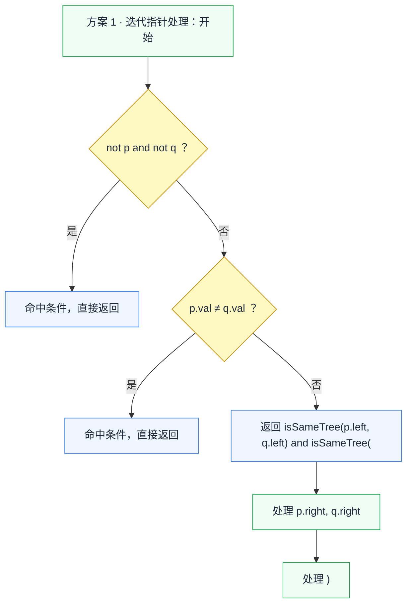

```python
import sys  # 提高递归深度上限（深输入防 RecursionError）

sys.setrecursionlimit(200000)  # 树/链表类题目节点数可达 1e4 量级

def isSameTree(p, q):  # 定义函数 isSameTree（参数：节点, 节点）
    if not p and not q:
        return True  # 若 not 节点 and not 节点: return True
    if p.val != q.val:
        return False  # 若 节点.值 不等于 节点.值: return False
    return isSameTree(p.left, q.left) and isSameTree(
        p.right, q.right
    )  # 返回 isSameTree(节点.左边界, 节点.左边界) and isSameTree(节点.右边界, 节点.右边界)

if __name__ == "__main__":  # 若 __name__ 等于 '__main__'
    print(isSameTree(None, None))  # 打印输出
```

#### 方案 2：迭代指针处理

**思路与代码分析**：核心是「迭代指针处理」。Python 版用切片与字典推导式简化操作，突出可读性。

**运行架构**（真实控制流）：

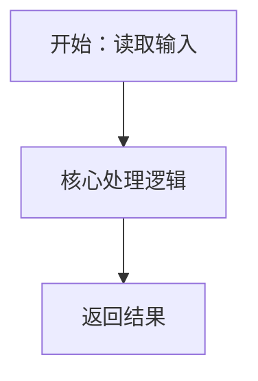

```python
import sys  # 提高递归深度上限（深输入防 RecursionError）

sys.setrecursionlimit(200000)  # 树/链表类题目节点数可达 1e4 量级

def isSameTree(p, q):  # 定义函数 isSameTree（参数：节点, 节点）
    if not p and not q:
        return True  # 若 not 节点 and not 节点: return True
    if p.val != q.val:
        return False  # 若 节点.值 不等于 节点.值: return False
    queue1 = [p]  # 把 [节点] 存入 queue1
    queue2 = [q]  # 把 [节点] 存入 queue2
    while len(queue1) and len(queue2):  # 循环，直到不满足「长度(queue1) and 长度(queue2」
        pTop = queue1.pop(0)  # 把 queue1 弹出 0) 存入 pTop
        qTop = queue2.pop(0)  # 把 queue2 弹出 0) 存入 qTop
        if pTop.val != qTop.val:
            return False  # 若 pTop.值 不等于 qTop.值: return False
        pLeft = pTop.left  # 把 pTop.左边界 存入 pLeft
        pRight = pTop.right  # 把 pTop.右边界 存入 pRight
        qLeft = qTop.left  # 把 qTop.左边界 存入 qLeft
        qRight = qTop.right  # 把 qTop.右边界 存入 qRight
        if (pLeft and not qLeft) or (not pLeft and qLeft):
            return False
        if (pRight and not qRight) or (not pRight and qRight):
            return False
        if pLeft:
            queue1.append(pLeft)  # 若 pLeft: queue1 追加 pLeft
        if pRight:
            queue1.append(pRight)  # 若 pRight: queue1 追加 pRight
        if qLeft:
            queue2.append(qLeft)  # 若 qLeft: queue2 追加 qLeft
        if qRight:
            queue2.append(qRight)  # 若 qRight: queue2 追加 qRight
    return not len(queue1) and not len(queue2)  # 返回 not 长度(queue1) and not 长度(queue2)

if __name__ == "__main__":  # 若 __name__ 等于 '__main__'
    print(isSameTree(None, None))  # 打印输出
```

#### 方案 3：迭代指针处理

**思路与代码分析**：核心是「迭代指针处理」。Python 版用切片与字典推导式简化操作，突出可读性。**走读**：方案 3 · 迭代指针处理：开始 → 命中条件，直接返回 → 命中条件，直接返回 → 返回 isSameTree(p.left, q.left) and isSameTree( → 处理 p.right, q.right → 处理 )。

**运行架构**（真实控制流）：


```python
import sys  # 提高递归深度上限（深输入防 RecursionError）

sys.setrecursionlimit(200000)  # 树/链表类题目节点数可达 1e4 量级

def isSameTree(p, q):  # 定义函数 isSameTree（参数：节点, 节点）
    if not p and not q:
        return True  # 若 not 节点 and not 节点: return True
    if p.val != q.val:
        return False  # 若 节点.值 不等于 节点.值: return False
    return isSameTree(p.left, q.left) and isSameTree(
        p.right, q.right
    )  # 返回 isSameTree(节点.左边界, 节点.左边界) and isSameTree(节点.右边界, 节点.右边界)

if __name__ == "__main__":  # 若 __name__ 等于 '__main__'
    print(isSameTree(None, None))  # 打印输出
```

#### 方案 4：迭代指针处理

**思路与代码分析**：核心是「迭代指针处理」。Python 版用切片与字典推导式简化操作，突出可读性。

**运行架构**：与方案 2 的控制流相同（同算法在该语言的等价实现），图见上。

```python
import sys  # 提高递归深度上限（深输入防 RecursionError）

sys.setrecursionlimit(200000)  # 树/链表类题目节点数可达 1e4 量级

def isSameTree(p, q):  # 定义函数 isSameTree（参数：节点, 节点）
    if not p and not q:
        return True  # 若 not 节点 and not 节点: return True
    if p.val != q.val:
        return False  # 若 节点.值 不等于 节点.值: return False
    queue1 = [p]  # 把 [节点] 存入 queue1
    queue2 = [q]  # 把 [节点] 存入 queue2
    while len(queue1) and len(queue2):  # 循环，直到不满足「长度(queue1) and 长度(queue2」
        pTop = queue1.pop(0)  # 把 queue1 弹出 0) 存入 pTop
        qTop = queue2.pop(0)  # 把 queue2 弹出 0) 存入 qTop
        if pTop.val != qTop.val:
            return False  # 若 pTop.值 不等于 qTop.值: return False
        pLeft = pTop.left  # 把 pTop.左边界 存入 pLeft
        pRight = pTop.right  # 把 pTop.右边界 存入 pRight
        qLeft = qTop.left  # 把 qTop.左边界 存入 qLeft
        qRight = qTop.right  # 把 qTop.右边界 存入 qRight
        if (pLeft and not qLeft) or (not pLeft and qLeft):
            return False
        if (pRight and not qRight) or (not pRight and qRight):
            return False
        if pLeft:
            queue1.append(pLeft)  # 若 pLeft: queue1 追加 pLeft
        if pRight:
            queue1.append(pRight)  # 若 pRight: queue1 追加 pRight
        if qLeft:
            queue2.append(qLeft)  # 若 qLeft: queue2 追加 qLeft
        if qRight:
            queue2.append(qRight)  # 若 qRight: queue2 追加 qRight
    return not len(queue1) and not len(queue2)  # 返回 not 长度(queue1) and not 长度(queue2)

if __name__ == "__main__":  # 若 __name__ 等于 '__main__'
    print(isSameTree(None, None))  # 打印输出
```

#### 方案 5：迭代指针处理

**思路与代码分析**：核心是「迭代指针处理」。Python 版用切片与字典推导式简化操作，突出可读性。**走读**：方案 5 · 迭代指针处理：开始 → 命中条件，直接返回 → 命中条件，直接返回 → 返回 isSameTree(p.left, q.left) and isSameTree( → 处理 p.right, q.right → 处理 )。

**运行架构**（真实控制流）：


```python
import sys  # 提高递归深度上限（深输入防 RecursionError）

sys.setrecursionlimit(200000)  # 树/链表类题目节点数可达 1e4 量级

def isSameTree(p, q):  # 定义函数 isSameTree（参数：节点, 节点）
    if not p and not q:
        return True  # 若 not 节点 and not 节点: return True
    if p.val != q.val:
        return False  # 若 节点.值 不等于 节点.值: return False
    return isSameTree(p.left, q.left) and isSameTree(
        p.right, q.right
    )  # 返回 isSameTree(节点.左边界, 节点.左边界) and isSameTree(节点.右边界, 节点.右边界)

if __name__ == "__main__":  # 若 __name__ 等于 '__main__'
    print(isSameTree(None, None))  # 打印输出
```

#### 方案 6：迭代指针处理

**思路与代码分析**：核心是「迭代指针处理」。Python 版用切片与字典推导式简化操作，突出可读性。

**运行架构**：与方案 2 的控制流相同（同算法在该语言的等价实现），图见上。

```python
import sys  # 提高递归深度上限（深输入防 RecursionError）

sys.setrecursionlimit(200000)  # 树/链表类题目节点数可达 1e4 量级

def isSameTree(p, q):  # 定义函数 isSameTree（参数：节点, 节点）
    if not p and not q:
        return True  # 若 not 节点 and not 节点: return True
    if p.val != q.val:
        return False  # 若 节点.值 不等于 节点.值: return False
    queue1 = [p]  # 把 [节点] 存入 queue1
    queue2 = [q]  # 把 [节点] 存入 queue2
    while len(queue1) and len(queue2):  # 循环，直到不满足「长度(queue1) and 长度(queue2」
        pTop = queue1.pop(0)  # 把 queue1 弹出 0) 存入 pTop
        qTop = queue2.pop(0)  # 把 queue2 弹出 0) 存入 qTop
        if pTop.val != qTop.val:
            return False  # 若 pTop.值 不等于 qTop.值: return False
        pLeft = pTop.left  # 把 pTop.左边界 存入 pLeft
        pRight = pTop.right  # 把 pTop.右边界 存入 pRight
        qLeft = qTop.left  # 把 qTop.左边界 存入 qLeft
        qRight = qTop.right  # 把 qTop.右边界 存入 qRight
        if (pLeft and not qLeft) or (not pLeft and qLeft):
            return False
        if (pRight and not qRight) or (not pRight and qRight):
            return False
        if pLeft:
            queue1.append(pLeft)  # 若 pLeft: queue1 追加 pLeft
        if pRight:
            queue1.append(pRight)  # 若 pRight: queue1 追加 pRight
        if qLeft:
            queue2.append(qLeft)  # 若 qLeft: queue2 追加 qLeft
        if qRight:
            queue2.append(qRight)  # 若 qRight: queue2 追加 qRight
    return not len(queue1) and not len(queue2)  # 返回 not 长度(queue1) and not 长度(queue2)

if __name__ == "__main__":  # 若 __name__ 等于 '__main__'
    print(isSameTree(None, None))  # 打印输出
```

### Go 实现（6 种方案）

Go 的全部方案如下，每个方案都内嵌用例自测，可独立运行（老仓库 python/go 文件遵循「打印结果」约定）：

#### 方案 1：迭代指针处理

**思路与代码分析**：核心是「迭代指针处理」。Go 版用切片与多返回值惯用法，显式处理索引边界。**走读**：方案 1 · 迭代指针处理：开始 → 返回 sameTree(p, q)。

**运行架构**（真实控制流）：


```go
package main // 引入依赖
import (
	"fmt"
	"os"
) // 引入依赖
type TreeNode struct {
	Val   int
	Left  *TreeNode
	Right *TreeNode
}                        // 定义类型
const NULL = -1000000000 // 把 减 1000000000 存入 NULL
func buildTree(vals []int) *TreeNode { // 定义函数/方法 buildTree
	if len(vals) == 0 || vals[0] == NULL {
		return nil
	} // 若 长度(vals) 等于 0 或 vals[0] 等于 NULL { return nil }
	root := &TreeNode{Val: vals[0]} // 把 按位与 TreeNode{Val: vals[0]} 写入 root :
	q := []*TreeNode{root}
	i := 1                            // 把 [] 乘 TreeNode{根节点}; 下标 i : 赋值为 1 写入 q :
	for len(q) > 0 && i < len(vals) { // 定义函数/方法 len
		node := q[0]
		q = q[1:] // 把 节点[0]; 节点 赋值为 节点[1:] 写入 node :
		if i < len(vals) && vals[i] != NULL {
			node.Left = &TreeNode{Val: vals[i]}
			q = append(q, node.Left)
		}
		i++
		if i < len(vals) && vals[i] != NULL {
			node.Right = &TreeNode{Val: vals[i]}
			q = append(q, node.Right)
		}
		i++
	}
	return root // 返回 根节点
}
func levelList(root *TreeNode) [][]int { // 定义函数/方法 levelList
	if root == nil {
		return [][]int{}
	} // 若 根节点 等于 nil { return [][]int{} }
	res := [][]int{}
	q := []*TreeNode{root} // 把 [][]int{}; 节点 : 赋值为 [] 乘 TreeNode{根节点} 写入 res :
	for len(q) > 0 {       // for 长度(节点) 超过 0 {
		lvl := []int{}
		n := len(q)              // 把 []int{}; 元素个数 : 赋值为 长度(节点) 写入 lvl :
		for k := 0; k < n; k++ { // 让 下标 k 从 0 开始计数
			node := q[0]
			q = q[1:]                   // 把 节点[0]; 节点 赋值为 节点[1:] 写入 node :
			lvl = append(lvl, node.Val) // 把 append(lvl, 节点.Val) 写入 lvl
			if node.Left != nil {
				q = append(q, node.Left)
			} // 若 节点.Left 不等于 nil { 节点 赋值为 append(节点, 节点.Left) }
			if node.Right != nil {
				q = append(q, node.Right)
			} // 若 节点.Right 不等于 nil { 节点 赋值为 append(节点, 节点.Right) }
		}
		res = append(res, lvl) // 把 append(结果, lvl) 写入 结果
	}
	return res // 返回 结果
}
func sameTree(a, b *TreeNode) bool { // 定义函数/方法 sameTree
	if a == nil && b == nil {
		return true
	} // 若 数组 等于 nil 且 b 等于 nil { return true }
	if a == nil || b == nil {
		return false
	} // 若 数组 等于 nil 或 b 等于 nil { return false }
	if a.Val != b.Val {
		return false
	} // 若 数组.Val 不等于 b.Val { return false }
	return sameTree(a.Left, b.Left) && sameTree(a.Right, b.Right) // 定义函数/方法 sameTree
}
func inorderT(root *TreeNode) []int { // 定义函数/方法 inorderT
	if root == nil {
		return []int{}
	} // 若 根节点 等于 nil { return []int{} }
	return append(append(inorderT(root.Left), root.Val), inorderT(root.Right)...) // 定义函数/方法 append
}
func isSameTree(p, q *TreeNode) bool { return sameTree(p, q) } // 定义判定函数 isSameTree
func main() { // 程序入口：跑内嵌自测用例
	a := buildTree([]int{1, 2, 3})
	b := buildTree([]int{1, 2, 3})
	c := buildTree([]int{1, 2, NULL})
	ok := true // 把 true 写入 ok :
	if !isSameTree(a, b) {
		ok = false
		fmt.Println("FAIL same")
	}
	if isSameTree(a, c) {
		ok = false
		fmt.Println("FAIL diff")
	}
	if !isSameTree(nil, nil) {
		ok = false
		fmt.Println("FAIL nil")
	}
	if !ok {
		os.Exit(1)
	} // 若 取反 ok { os.Exit(1) }
	fmt.Println("PASS") // 全部用例通过，输出 PASS
}
```

#### 方案 2：迭代指针处理

**思路与代码分析**：核心是「迭代指针处理」。Go 版用切片与多返回值惯用法，显式处理索引边界。

**运行架构**（真实控制流）：


```go
package main // 引入依赖

import (
	"fmt" // 「fmt」
	"os"  // 「os」
)

type TreeNode struct { // 定义类型
	Val   int       // Val int
	Left  *TreeNode // Left 乘 TreeNode
	Right *TreeNode // Right 乘 TreeNode
}

func buildTree(vals []interface{}) *TreeNode { // 定义函数/方法 buildTree
	if len(vals) == 0 || vals[0] == nil { // 若 长度(vals) 等于 0 或 vals[0] 等于 nil
		return nil // 返回 nil
	}
	root := &TreeNode{Val: vals[0].(int)} // 把 按位与 TreeNode{Val: vals[0].(int)} 写入 root :
	q := []*TreeNode{root}                // 把 [] 乘 TreeNode{根节点} 写入 q :
	i := 1                                // 把 1 写入 i :
	for len(q) > 0 && i < len(vals) {     // 定义函数/方法 len
		node := q[0]                         // 把 节点[0] 写入 node :
		q = q[1:]                            // 把 节点[1:] 写入 节点
		if i < len(vals) && vals[i] != nil { // 若 下标 i 小于 长度(vals) 且 vals[下标 i] 不等于 nil
			node.Left = &TreeNode{Val: vals[i].(int)} // 把 按位与 TreeNode{Val: vals[下标 i].(int)} 写入 node.Left
			q = append(q, node.Left)                  // 把 append(节点, 节点.Left) 写入 节点
		}
		i++                                  // 下标 i 加一
		if i < len(vals) && vals[i] != nil { // 若 下标 i 小于 长度(vals) 且 vals[下标 i] 不等于 nil
			node.Right = &TreeNode{Val: vals[i].(int)} // 把 按位与 TreeNode{Val: vals[下标 i].(int)} 写入 node.Right
			q = append(q, node.Right)                  // 把 append(节点, 节点.Right) 写入 节点
		}
		i++ // 下标 i 加一
	}
	return root // 返回 根节点
}

func isSameTree(p, q *TreeNode) bool { // 定义判定函数 isSameTree
	if p == nil && q == nil { // 若 节点 等于 nil 且 节点 等于 nil
		return true // 返回 true
	}
	if p == nil || q == nil { // 若 节点 等于 nil 或 节点 等于 nil
		return false // 返回 false
	}
	if p.Val != q.Val { // 若 节点.Val 不等于 节点.Val
		return false // 返回 false
	}
	queue1 := []*TreeNode{p}                 // 把 [] 乘 TreeNode{节点} 写入 queue1 :
	queue2 := []*TreeNode{q}                 // 把 [] 乘 TreeNode{节点} 写入 queue2 :
	for len(queue1) > 0 && len(queue2) > 0 { // for 长度(queue1) 超过 0 且 长度(queue2) 超过 0 {
		pTop := queue1[0]         // 把 queue1[0] 写入 pTop :
		queue1 = queue1[1:]       // 把 queue1[1:] 写入 queue1
		qTop := queue2[0]         // 把 queue2[0] 写入 qTop :
		queue2 = queue2[1:]       // 把 queue2[1:] 写入 queue2
		if pTop.Val != qTop.Val { // 若 pTop.Val 不等于 qTop.Val
			return false // 返回 false
		}
		pLeft, pRight := pTop.Left, pTop.Right // 把 pTop.Left, pTop.Right 写入 pLeft, pRight :
		qLeft, qRight := qTop.Left, qTop.Right // 把 qTop.Left, qTop.Right 写入 qLeft, qRight :
		if (pLeft != nil) != (qLeft != nil) {  // 若 pLeft 不等于 nil) 不等于 (qLeft 不等于 nil
			return false // 返回 false
		}
		if (pRight != nil) != (qRight != nil) { // 若 pRight 不等于 nil) 不等于 (qRight 不等于 nil
			return false // 返回 false
		}
		if pLeft != nil { // 若 pLeft 不等于 nil
			queue1 = append(queue1, pLeft) // 把 append(queue1, pLeft) 写入 queue1
		}
		if pRight != nil { // 若 pRight 不等于 nil
			queue1 = append(queue1, pRight) // 把 append(queue1, pRight) 写入 queue1
		}
		if qLeft != nil { // 若 qLeft 不等于 nil
			queue2 = append(queue2, qLeft) // 把 append(queue2, qLeft) 写入 queue2
		}
		if qRight != nil { // 若 qRight 不等于 nil
			queue2 = append(queue2, qRight) // 把 append(queue2, qRight) 写入 queue2
		}
	}
	return len(queue1) == 0 && len(queue2) == 0 // 返回 长度(queue1) 等于 0 且 长度(queue2) 等于 0
}

type tc struct { // 定义类型
	p    *TreeNode // 节点 乘 TreeNode
	q    *TreeNode // 节点 乘 TreeNode
	want bool      // want bool
}

func main() { // 程序入口：跑内嵌自测用例
	cases := []tc{ // 把 []tc{ 写入 cases :
		{buildTree(nil), buildTree(nil), true},
		{buildTree([]interface{}{1}), buildTree([]interface{}{1}), true},
		{buildTree([]interface{}{1, 2, 3}), buildTree([]interface{}{1, 2, 3}), true},
		{buildTree([]interface{}{1, 2, 3}), buildTree([]interface{}{1, 2, nil, 3}), false},
		{buildTree([]interface{}{1}), buildTree([]interface{}{2}), false},
	}
	for idx, c := range cases { // 同时取 idx 与 字符 遍历
		got := isSameTree(c.p, c.q) // 把 isSameTree(字符.节点, 字符.节点) 写入 got :
		if got != c.want {          // 若 got 不等于 字符.want
			fmt.Printf("case %d failed: got %v want %v\n", idx, got, c.want) // 打印输出
			os.Exit(1)                                                       // os.Exit(1)
		}
	}
	fmt.Println("PASS") // 全部用例通过，输出 PASS
}
```

#### 方案 3：迭代指针处理

**思路与代码分析**：核心是「迭代指针处理」。Go 版用切片与多返回值惯用法，显式处理索引边界。**走读**：方案 3 · 迭代指针处理：开始 → 返回 sameTree(p, q)。

**运行架构**（真实控制流）：

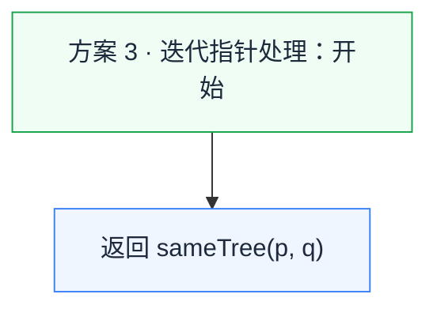

```go
package main // 引入依赖
import (
	"fmt"
	"os"
) // 引入依赖
type TreeNode struct {
	Val   int
	Left  *TreeNode
	Right *TreeNode
}                        // 定义类型
const NULL = -1000000000 // 把 减 1000000000 存入 NULL
func buildTree(vals []int) *TreeNode { // 定义函数/方法 buildTree
	if len(vals) == 0 || vals[0] == NULL {
		return nil
	} // 若 长度(vals) 等于 0 或 vals[0] 等于 NULL { return nil }
	root := &TreeNode{Val: vals[0]} // 把 按位与 TreeNode{Val: vals[0]} 写入 root :
	q := []*TreeNode{root}
	i := 1                            // 把 [] 乘 TreeNode{根节点}; 下标 i : 赋值为 1 写入 q :
	for len(q) > 0 && i < len(vals) { // 定义函数/方法 len
		node := q[0]
		q = q[1:] // 把 节点[0]; 节点 赋值为 节点[1:] 写入 node :
		if i < len(vals) && vals[i] != NULL {
			node.Left = &TreeNode{Val: vals[i]}
			q = append(q, node.Left)
		}
		i++
		if i < len(vals) && vals[i] != NULL {
			node.Right = &TreeNode{Val: vals[i]}
			q = append(q, node.Right)
		}
		i++
	}
	return root // 返回 根节点
}
func levelList(root *TreeNode) [][]int { // 定义函数/方法 levelList
	if root == nil {
		return [][]int{}
	} // 若 根节点 等于 nil { return [][]int{} }
	res := [][]int{}
	q := []*TreeNode{root} // 把 [][]int{}; 节点 : 赋值为 [] 乘 TreeNode{根节点} 写入 res :
	for len(q) > 0 {       // for 长度(节点) 超过 0 {
		lvl := []int{}
		n := len(q)              // 把 []int{}; 元素个数 : 赋值为 长度(节点) 写入 lvl :
		for k := 0; k < n; k++ { // 让 下标 k 从 0 开始计数
			node := q[0]
			q = q[1:]                   // 把 节点[0]; 节点 赋值为 节点[1:] 写入 node :
			lvl = append(lvl, node.Val) // 把 append(lvl, 节点.Val) 写入 lvl
			if node.Left != nil {
				q = append(q, node.Left)
			} // 若 节点.Left 不等于 nil { 节点 赋值为 append(节点, 节点.Left) }
			if node.Right != nil {
				q = append(q, node.Right)
			} // 若 节点.Right 不等于 nil { 节点 赋值为 append(节点, 节点.Right) }
		}
		res = append(res, lvl) // 把 append(结果, lvl) 写入 结果
	}
	return res // 返回 结果
}
func sameTree(a, b *TreeNode) bool { // 定义函数/方法 sameTree
	if a == nil && b == nil {
		return true
	} // 若 数组 等于 nil 且 b 等于 nil { return true }
	if a == nil || b == nil {
		return false
	} // 若 数组 等于 nil 或 b 等于 nil { return false }
	if a.Val != b.Val {
		return false
	} // 若 数组.Val 不等于 b.Val { return false }
	return sameTree(a.Left, b.Left) && sameTree(a.Right, b.Right) // 定义函数/方法 sameTree
}
func inorderT(root *TreeNode) []int { // 定义函数/方法 inorderT
	if root == nil {
		return []int{}
	} // 若 根节点 等于 nil { return []int{} }
	return append(append(inorderT(root.Left), root.Val), inorderT(root.Right)...) // 定义函数/方法 append
}
func isSameTree(p, q *TreeNode) bool { return sameTree(p, q) } // 定义判定函数 isSameTree
func main() { // 程序入口：跑内嵌自测用例
	a := buildTree([]int{1, 2, 3})
	b := buildTree([]int{1, 2, 3})
	c := buildTree([]int{1, 2, NULL})
	ok := true // 把 true 写入 ok :
	if !isSameTree(a, b) {
		ok = false
		fmt.Println("FAIL same")
	}
	if isSameTree(a, c) {
		ok = false
		fmt.Println("FAIL diff")
	}
	if !isSameTree(nil, nil) {
		ok = false
		fmt.Println("FAIL nil")
	}
	if !ok {
		os.Exit(1)
	} // 若 取反 ok { os.Exit(1) }
	fmt.Println("PASS") // 全部用例通过，输出 PASS
}
```

#### 方案 4：迭代指针处理

**思路与代码分析**：核心是「迭代指针处理」。Go 版用切片与多返回值惯用法，显式处理索引边界。

**运行架构**：与方案 2 的控制流相同（同算法在该语言的等价实现），图见上。

```go
package main // 引入依赖

import (
	"fmt" // 「fmt」
	"os"  // 「os」
)

type TreeNode struct { // 定义类型
	Val   int       // Val int
	Left  *TreeNode // Left 乘 TreeNode
	Right *TreeNode // Right 乘 TreeNode
}

func buildTree(vals []interface{}) *TreeNode { // 定义函数/方法 buildTree
	if len(vals) == 0 || vals[0] == nil { // 若 长度(vals) 等于 0 或 vals[0] 等于 nil
		return nil // 返回 nil
	}
	root := &TreeNode{Val: vals[0].(int)} // 把 按位与 TreeNode{Val: vals[0].(int)} 写入 root :
	q := []*TreeNode{root}                // 把 [] 乘 TreeNode{根节点} 写入 q :
	i := 1                                // 把 1 写入 i :
	for len(q) > 0 && i < len(vals) {     // 定义函数/方法 len
		node := q[0]                         // 把 节点[0] 写入 node :
		q = q[1:]                            // 把 节点[1:] 写入 节点
		if i < len(vals) && vals[i] != nil { // 若 下标 i 小于 长度(vals) 且 vals[下标 i] 不等于 nil
			node.Left = &TreeNode{Val: vals[i].(int)} // 把 按位与 TreeNode{Val: vals[下标 i].(int)} 写入 node.Left
			q = append(q, node.Left)                  // 把 append(节点, 节点.Left) 写入 节点
		}
		i++                                  // 下标 i 加一
		if i < len(vals) && vals[i] != nil { // 若 下标 i 小于 长度(vals) 且 vals[下标 i] 不等于 nil
			node.Right = &TreeNode{Val: vals[i].(int)} // 把 按位与 TreeNode{Val: vals[下标 i].(int)} 写入 node.Right
			q = append(q, node.Right)                  // 把 append(节点, 节点.Right) 写入 节点
		}
		i++ // 下标 i 加一
	}
	return root // 返回 根节点
}

func isSameTree(p, q *TreeNode) bool { // 定义判定函数 isSameTree
	if p == nil && q == nil { // 若 节点 等于 nil 且 节点 等于 nil
		return true // 返回 true
	}
	if p == nil || q == nil { // 若 节点 等于 nil 或 节点 等于 nil
		return false // 返回 false
	}
	if p.Val != q.Val { // 若 节点.Val 不等于 节点.Val
		return false // 返回 false
	}
	queue1 := []*TreeNode{p}                 // 把 [] 乘 TreeNode{节点} 写入 queue1 :
	queue2 := []*TreeNode{q}                 // 把 [] 乘 TreeNode{节点} 写入 queue2 :
	for len(queue1) > 0 && len(queue2) > 0 { // for 长度(queue1) 超过 0 且 长度(queue2) 超过 0 {
		pTop := queue1[0]         // 把 queue1[0] 写入 pTop :
		queue1 = queue1[1:]       // 把 queue1[1:] 写入 queue1
		qTop := queue2[0]         // 把 queue2[0] 写入 qTop :
		queue2 = queue2[1:]       // 把 queue2[1:] 写入 queue2
		if pTop.Val != qTop.Val { // 若 pTop.Val 不等于 qTop.Val
			return false // 返回 false
		}
		pLeft, pRight := pTop.Left, pTop.Right // 把 pTop.Left, pTop.Right 写入 pLeft, pRight :
		qLeft, qRight := qTop.Left, qTop.Right // 把 qTop.Left, qTop.Right 写入 qLeft, qRight :
		if (pLeft != nil) != (qLeft != nil) {  // 若 pLeft 不等于 nil) 不等于 (qLeft 不等于 nil
			return false // 返回 false
		}
		if (pRight != nil) != (qRight != nil) { // 若 pRight 不等于 nil) 不等于 (qRight 不等于 nil
			return false // 返回 false
		}
		if pLeft != nil { // 若 pLeft 不等于 nil
			queue1 = append(queue1, pLeft) // 把 append(queue1, pLeft) 写入 queue1
		}
		if pRight != nil { // 若 pRight 不等于 nil
			queue1 = append(queue1, pRight) // 把 append(queue1, pRight) 写入 queue1
		}
		if qLeft != nil { // 若 qLeft 不等于 nil
			queue2 = append(queue2, qLeft) // 把 append(queue2, qLeft) 写入 queue2
		}
		if qRight != nil { // 若 qRight 不等于 nil
			queue2 = append(queue2, qRight) // 把 append(queue2, qRight) 写入 queue2
		}
	}
	return len(queue1) == 0 && len(queue2) == 0 // 返回 长度(queue1) 等于 0 且 长度(queue2) 等于 0
}

type tc struct { // 定义类型
	p    *TreeNode // 节点 乘 TreeNode
	q    *TreeNode // 节点 乘 TreeNode
	want bool      // want bool
}

func main() { // 程序入口：跑内嵌自测用例
	cases := []tc{ // 把 []tc{ 写入 cases :
		{buildTree(nil), buildTree(nil), true},
		{buildTree([]interface{}{1}), buildTree([]interface{}{1}), true},
		{buildTree([]interface{}{1, 2, 3}), buildTree([]interface{}{1, 2, 3}), true},
		{buildTree([]interface{}{1, 2, 3}), buildTree([]interface{}{1, 2, nil, 3}), false},
		{buildTree([]interface{}{1}), buildTree([]interface{}{2}), false},
	}
	for idx, c := range cases { // 同时取 idx 与 字符 遍历
		got := isSameTree(c.p, c.q) // 把 isSameTree(字符.节点, 字符.节点) 写入 got :
		if got != c.want {          // 若 got 不等于 字符.want
			fmt.Printf("case %d failed: got %v want %v\n", idx, got, c.want) // 打印输出
			os.Exit(1)                                                       // os.Exit(1)
		}
	}
	fmt.Println("PASS") // 全部用例通过，输出 PASS
}
```

#### 方案 5：迭代指针处理

**思路与代码分析**：核心是「迭代指针处理」。Go 版用切片与多返回值惯用法，显式处理索引边界。**走读**：方案 5 · 迭代指针处理：开始 → 返回 sameTree(p, q)。

**运行架构**（真实控制流）：


```go
package main // 引入依赖
import (
	"fmt"
	"os"
) // 引入依赖
type TreeNode struct {
	Val   int
	Left  *TreeNode
	Right *TreeNode
}                        // 定义类型
const NULL = -1000000000 // 把 减 1000000000 存入 NULL
func buildTree(vals []int) *TreeNode { // 定义函数/方法 buildTree
	if len(vals) == 0 || vals[0] == NULL {
		return nil
	} // 若 长度(vals) 等于 0 或 vals[0] 等于 NULL { return nil }
	root := &TreeNode{Val: vals[0]} // 把 按位与 TreeNode{Val: vals[0]} 写入 root :
	q := []*TreeNode{root}
	i := 1                            // 把 [] 乘 TreeNode{根节点}; 下标 i : 赋值为 1 写入 q :
	for len(q) > 0 && i < len(vals) { // 定义函数/方法 len
		node := q[0]
		q = q[1:] // 把 节点[0]; 节点 赋值为 节点[1:] 写入 node :
		if i < len(vals) && vals[i] != NULL {
			node.Left = &TreeNode{Val: vals[i]}
			q = append(q, node.Left)
		}
		i++
		if i < len(vals) && vals[i] != NULL {
			node.Right = &TreeNode{Val: vals[i]}
			q = append(q, node.Right)
		}
		i++
	}
	return root // 返回 根节点
}
func levelList(root *TreeNode) [][]int { // 定义函数/方法 levelList
	if root == nil {
		return [][]int{}
	} // 若 根节点 等于 nil { return [][]int{} }
	res := [][]int{}
	q := []*TreeNode{root} // 把 [][]int{}; 节点 : 赋值为 [] 乘 TreeNode{根节点} 写入 res :
	for len(q) > 0 {       // for 长度(节点) 超过 0 {
		lvl := []int{}
		n := len(q)              // 把 []int{}; 元素个数 : 赋值为 长度(节点) 写入 lvl :
		for k := 0; k < n; k++ { // 让 下标 k 从 0 开始计数
			node := q[0]
			q = q[1:]                   // 把 节点[0]; 节点 赋值为 节点[1:] 写入 node :
			lvl = append(lvl, node.Val) // 把 append(lvl, 节点.Val) 写入 lvl
			if node.Left != nil {
				q = append(q, node.Left)
			} // 若 节点.Left 不等于 nil { 节点 赋值为 append(节点, 节点.Left) }
			if node.Right != nil {
				q = append(q, node.Right)
			} // 若 节点.Right 不等于 nil { 节点 赋值为 append(节点, 节点.Right) }
		}
		res = append(res, lvl) // 把 append(结果, lvl) 写入 结果
	}
	return res // 返回 结果
}
func sameTree(a, b *TreeNode) bool { // 定义函数/方法 sameTree
	if a == nil && b == nil {
		return true
	} // 若 数组 等于 nil 且 b 等于 nil { return true }
	if a == nil || b == nil {
		return false
	} // 若 数组 等于 nil 或 b 等于 nil { return false }
	if a.Val != b.Val {
		return false
	} // 若 数组.Val 不等于 b.Val { return false }
	return sameTree(a.Left, b.Left) && sameTree(a.Right, b.Right) // 定义函数/方法 sameTree
}
func inorderT(root *TreeNode) []int { // 定义函数/方法 inorderT
	if root == nil {
		return []int{}
	} // 若 根节点 等于 nil { return []int{} }
	return append(append(inorderT(root.Left), root.Val), inorderT(root.Right)...) // 定义函数/方法 append
}
func isSameTree(p, q *TreeNode) bool { return sameTree(p, q) } // 定义判定函数 isSameTree
func main() { // 程序入口：跑内嵌自测用例
	a := buildTree([]int{1, 2, 3})
	b := buildTree([]int{1, 2, 3})
	c := buildTree([]int{1, 2, NULL})
	ok := true // 把 true 写入 ok :
	if !isSameTree(a, b) {
		ok = false
		fmt.Println("FAIL same")
	}
	if isSameTree(a, c) {
		ok = false
		fmt.Println("FAIL diff")
	}
	if !isSameTree(nil, nil) {
		ok = false
		fmt.Println("FAIL nil")
	}
	if !ok {
		os.Exit(1)
	} // 若 取反 ok { os.Exit(1) }
	fmt.Println("PASS") // 全部用例通过，输出 PASS
}
```

#### 方案 6：迭代指针处理

**思路与代码分析**：核心是「迭代指针处理」。Go 版用切片与多返回值惯用法，显式处理索引边界。

**运行架构**：与方案 2 的控制流相同（同算法在该语言的等价实现），图见上。

```go
package main // 引入依赖

import (
	"fmt" // 「fmt」
	"os"  // 「os」
)

type TreeNode struct { // 定义类型
	Val   int       // Val int
	Left  *TreeNode // Left 乘 TreeNode
	Right *TreeNode // Right 乘 TreeNode
}

func buildTree(vals []interface{}) *TreeNode { // 定义函数/方法 buildTree
	if len(vals) == 0 || vals[0] == nil { // 若 长度(vals) 等于 0 或 vals[0] 等于 nil
		return nil // 返回 nil
	}
	root := &TreeNode{Val: vals[0].(int)} // 把 按位与 TreeNode{Val: vals[0].(int)} 写入 root :
	q := []*TreeNode{root}                // 把 [] 乘 TreeNode{根节点} 写入 q :
	i := 1                                // 把 1 写入 i :
	for len(q) > 0 && i < len(vals) {     // 定义函数/方法 len
		node := q[0]                         // 把 节点[0] 写入 node :
		q = q[1:]                            // 把 节点[1:] 写入 节点
		if i < len(vals) && vals[i] != nil { // 若 下标 i 小于 长度(vals) 且 vals[下标 i] 不等于 nil
			node.Left = &TreeNode{Val: vals[i].(int)} // 把 按位与 TreeNode{Val: vals[下标 i].(int)} 写入 node.Left
			q = append(q, node.Left)                  // 把 append(节点, 节点.Left) 写入 节点
		}
		i++                                  // 下标 i 加一
		if i < len(vals) && vals[i] != nil { // 若 下标 i 小于 长度(vals) 且 vals[下标 i] 不等于 nil
			node.Right = &TreeNode{Val: vals[i].(int)} // 把 按位与 TreeNode{Val: vals[下标 i].(int)} 写入 node.Right
			q = append(q, node.Right)                  // 把 append(节点, 节点.Right) 写入 节点
		}
		i++ // 下标 i 加一
	}
	return root // 返回 根节点
}

func isSameTree(p, q *TreeNode) bool { // 定义判定函数 isSameTree
	if p == nil && q == nil { // 若 节点 等于 nil 且 节点 等于 nil
		return true // 返回 true
	}
	if p == nil || q == nil { // 若 节点 等于 nil 或 节点 等于 nil
		return false // 返回 false
	}
	if p.Val != q.Val { // 若 节点.Val 不等于 节点.Val
		return false // 返回 false
	}
	queue1 := []*TreeNode{p}                 // 把 [] 乘 TreeNode{节点} 写入 queue1 :
	queue2 := []*TreeNode{q}                 // 把 [] 乘 TreeNode{节点} 写入 queue2 :
	for len(queue1) > 0 && len(queue2) > 0 { // for 长度(queue1) 超过 0 且 长度(queue2) 超过 0 {
		pTop := queue1[0]         // 把 queue1[0] 写入 pTop :
		queue1 = queue1[1:]       // 把 queue1[1:] 写入 queue1
		qTop := queue2[0]         // 把 queue2[0] 写入 qTop :
		queue2 = queue2[1:]       // 把 queue2[1:] 写入 queue2
		if pTop.Val != qTop.Val { // 若 pTop.Val 不等于 qTop.Val
			return false // 返回 false
		}
		pLeft, pRight := pTop.Left, pTop.Right // 把 pTop.Left, pTop.Right 写入 pLeft, pRight :
		qLeft, qRight := qTop.Left, qTop.Right // 把 qTop.Left, qTop.Right 写入 qLeft, qRight :
		if (pLeft != nil) != (qLeft != nil) {  // 若 pLeft 不等于 nil) 不等于 (qLeft 不等于 nil
			return false // 返回 false
		}
		if (pRight != nil) != (qRight != nil) { // 若 pRight 不等于 nil) 不等于 (qRight 不等于 nil
			return false // 返回 false
		}
		if pLeft != nil { // 若 pLeft 不等于 nil
			queue1 = append(queue1, pLeft) // 把 append(queue1, pLeft) 写入 queue1
		}
		if pRight != nil { // 若 pRight 不等于 nil
			queue1 = append(queue1, pRight) // 把 append(queue1, pRight) 写入 queue1
		}
		if qLeft != nil { // 若 qLeft 不等于 nil
			queue2 = append(queue2, qLeft) // 把 append(queue2, qLeft) 写入 queue2
		}
		if qRight != nil { // 若 qRight 不等于 nil
			queue2 = append(queue2, qRight) // 把 append(queue2, qRight) 写入 queue2
		}
	}
	return len(queue1) == 0 && len(queue2) == 0 // 返回 长度(queue1) 等于 0 且 长度(queue2) 等于 0
}

type tc struct { // 定义类型
	p    *TreeNode // 节点 乘 TreeNode
	q    *TreeNode // 节点 乘 TreeNode
	want bool      // want bool
}

func main() { // 程序入口：跑内嵌自测用例
	cases := []tc{ // 把 []tc{ 写入 cases :
		{buildTree(nil), buildTree(nil), true},
		{buildTree([]interface{}{1}), buildTree([]interface{}{1}), true},
		{buildTree([]interface{}{1, 2, 3}), buildTree([]interface{}{1, 2, 3}), true},
		{buildTree([]interface{}{1, 2, 3}), buildTree([]interface{}{1, 2, nil, 3}), false},
		{buildTree([]interface{}{1}), buildTree([]interface{}{2}), false},
	}
	for idx, c := range cases { // 同时取 idx 与 字符 遍历
		got := isSameTree(c.p, c.q) // 把 isSameTree(字符.节点, 字符.节点) 写入 got :
		if got != c.want {          // 若 got 不等于 字符.want
			fmt.Printf("case %d failed: got %v want %v\n", idx, got, c.want) // 打印输出
			os.Exit(1)                                                       // os.Exit(1)
		}
	}
	fmt.Println("PASS") // 全部用例通过，输出 PASS
}
```

### Java 实现（6 种方案）

Java 的全部方案如下，每个方案都内嵌用例自测，可独立运行（老仓库 python/go 文件遵循「打印结果」约定）：

#### 方案 1：迭代指针处理

**思路与代码分析**：核心是「迭代指针处理」。Java 版用类与静态方法组织，集合操作显式明了。**走读**：方案 1 · 迭代指针处理：开始 → 更新 val → 返回结果。

**运行架构**（真实控制流）：

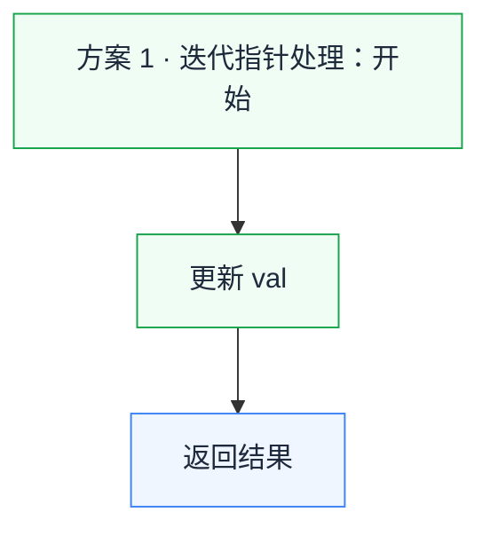

```java
package com.webfault.dsa; // 引入依赖

import java.util.*; // 引入依赖

class lc100_solution_1___1 { // 定义类型
  static class TreeNode { // static class TreeNode {
    int val; // int 值;
    TreeNode left, right; // TreeNode 左边界, 右边界;

    TreeNode(int v) {
      val = v;
    } // 把 值; } 写入 TreeNode(int v) { val
  }

  public boolean isSameTree(TreeNode p, TreeNode q) { // 定义判定函数 isSameTree
    if (p == null && q == null) return true; // 若 节点 等于 null 且 节点 等于 null，直接返回 true
    if (p == null || q == null) return false; // 若 节点 等于 null 或 节点 等于 null，直接返回 false
    if (p.val != q.val) return false; // 若 节点.值 不等于 节点.值，直接返回 false
    return isSameTree(p.left, q.left)
        && isSameTree(
            p.right, q.right); // 返回 isSameTree(节点.左边界, 节点.左边界) 且 isSameTree(节点.右边界, 节点.右边界)
  }

  static TreeNode build(Integer[] a) { // 定义函数/方法 build
    if (a.length == 0 || a[0] == null) return null; // 若 数组.长度 等于 0 或 数组[0] 等于 null，直接返回 null
    TreeNode root = new TreeNode(a[0]); // 把 new TreeNode(数组[0]); 写入 TreeNode root
    Deque<TreeNode> queue =
        new ArrayDeque<>(); // 把 new ArrayDeque 小于 超过 (); 写入 Deque<TreeNode> queue
    queue.add(root); // 队列 追加 根节点);
    int i = 1; // 把 1 存入 下标 i
    while (!queue.isEmpty() && i < a.length) { // 循环，直到不满足「取反 队列.isEmpty() 且 下标 i 小于 数组.长度」
      TreeNode node = queue.poll(); // 把 队列.poll(); 写入 TreeNode node
      if (i < a.length && a[i] != null) {
        node.left = new TreeNode(a[i]);
        queue.add(node.left);
      }
      i++; // 下标 i 加一
      if (i < a.length && a[i] != null) {
        node.right = new TreeNode(a[i]);
        queue.add(node.right);
      }
      i++; // 下标 i 加一
    }
    return root; // 返回 根节点
  }

  public static void main(String[] args) { // public static void main(String[] args) {
    lc100_solution_1___1 s =
        new lc100_solution_1___1(); // 把 new lc100_solution_1___1(); 写入 lc100_solution_1___1 s
    Object[][] cases = { // 把 { 写入 Object[][] cases
      {null, null, true},
      {new Integer[] {1, 2, 3}, new Integer[] {1, 2, 3}, true},
      {new Integer[] {1, 2}, new Integer[] {1, null, 2}, false},
      {new Integer[] {1, 2, 1}, new Integer[] {1, 1, 2}, false},
    };
    boolean ok = true; // 把 true; 写入 boolean ok
    for (Object[] c : cases) { // for (Object[] 字符 : cases) {
      TreeNode p = c[0] == null ? null : build((Integer[]) c[0]);
      TreeNode q = c[1] == null ? null : build((Integer[]) c[1]);
      boolean got = s.isSameTree(p, q); // 把 字符串.isSameTree(节点, 节点); 写入 boolean got
      if (got != (Boolean) c[2]) { // 若 got 不等于 (Boolean) 字符[2]
        ok = false; // 把 false; 写入 ok
        System.out.println(
            "FAIL isSameTree("
                + Arrays.toString((Integer[]) c[0])
                + ","
                + Arrays.toString((Integer[]) c[1])
                + ")="
                + got
                + " want "
                + c[2]); // 打印输出
      }
    }
    if (!ok) throw new RuntimeException("FAILED"); // 若 取反 ok) throw new RuntimeException(「FAILED」);
    System.out.println("PASS"); // 全部用例通过，输出 PASS
  }
}
```

#### 方案 2：迭代指针处理

**思路与代码分析**：核心是「迭代指针处理」。Java 版用类与静态方法组织，集合操作显式明了。**走读**：方案 2 · 迭代指针处理：开始 → 更新 val → 返回结果。

**运行架构**（真实控制流）：


```java
package com.webfault.dsa; // 引入依赖

import java.util.*; // 引入依赖

class lc100_solution_2___2 { // 定义类型
  static class TreeNode { // static class TreeNode {
    int val; // int 值;
    TreeNode left, right; // TreeNode 左边界, 右边界;

    TreeNode(int v) {
      val = v;
    } // 把 值; } 写入 TreeNode(int v) { val
  }

  public boolean isSameTree(TreeNode p, TreeNode q) { // 定义判定函数 isSameTree
    if (p == null && q == null) return true; // 若 节点 等于 null 且 节点 等于 null，直接返回 true
    if (p == null || q == null) return false; // 若 节点 等于 null 或 节点 等于 null，直接返回 false
    Deque<TreeNode> queue1 =
        new ArrayDeque<>(); // 把 new ArrayDeque 小于 超过 (); 写入 Deque<TreeNode> queue1
    Deque<TreeNode> queue2 =
        new ArrayDeque<>(); // 把 new ArrayDeque 小于 超过 (); 写入 Deque<TreeNode> queue2
    queue1.add(p); // queue1 追加 节点);
    queue2.add(q); // queue2 追加 节点);
    while (!queue1.isEmpty()
        && !queue2.isEmpty()) { // 循环，直到不满足「取反 queue1.isEmpty() 且 取反 queue2.isEmpty(」
      TreeNode pTop = queue1.poll(); // 把 queue1.poll(); 写入 TreeNode pTop
      TreeNode qTop = queue2.poll(); // 把 queue2.poll(); 写入 TreeNode qTop
      if (pTop.val != qTop.val) return false; // 若 pTop.值 不等于 qTop.值，直接返回 false
      TreeNode pLeft = pTop.left,
          pRight = pTop.right; // 把 pTop.左边界, pRight 赋值为 pTop.右边界; 写入 TreeNode pLeft
      TreeNode qLeft = qTop.left,
          qRight = qTop.right; // 把 qTop.左边界, qRight 赋值为 qTop.右边界; 写入 TreeNode qLeft
      if ((pLeft != null && qLeft == null) || (pLeft == null && qLeft != null)) return false;
      if ((pRight != null && qRight == null) || (pRight == null && qRight != null)) return false;
      if (pLeft != null) queue1.add(pLeft); // 若 pLeft 不等于 null) queue1 追加 pLeft);
      if (pRight != null) queue1.add(pRight); // 若 pRight 不等于 null) queue1 追加 pRight);
      if (qLeft != null) queue2.add(qLeft); // 若 qLeft 不等于 null) queue2 追加 qLeft);
      if (qRight != null) queue2.add(qRight); // 若 qRight 不等于 null) queue2 追加 qRight);
    }
    return queue1.isEmpty() && queue2.isEmpty(); // 返回 queue1.isEmpty() 且 queue2.isEmpty()
  }

  static TreeNode build(Integer[] a) { // 定义函数/方法 build
    if (a.length == 0 || a[0] == null) return null; // 若 数组.长度 等于 0 或 数组[0] 等于 null，直接返回 null
    TreeNode root = new TreeNode(a[0]); // 把 new TreeNode(数组[0]); 写入 TreeNode root
    Deque<TreeNode> queue =
        new ArrayDeque<>(); // 把 new ArrayDeque 小于 超过 (); 写入 Deque<TreeNode> queue
    queue.add(root); // 队列 追加 根节点);
    int i = 1; // 把 1 存入 下标 i
    while (!queue.isEmpty() && i < a.length) { // 循环，直到不满足「取反 队列.isEmpty() 且 下标 i 小于 数组.长度」
      TreeNode node = queue.poll(); // 把 队列.poll(); 写入 TreeNode node
      if (i < a.length && a[i] != null) {
        node.left = new TreeNode(a[i]);
        queue.add(node.left);
      }
      i++; // 下标 i 加一
      if (i < a.length && a[i] != null) {
        node.right = new TreeNode(a[i]);
        queue.add(node.right);
      }
      i++; // 下标 i 加一
    }
    return root; // 返回 根节点
  }

  public static void main(String[] args) { // public static void main(String[] args) {
    lc100_solution_2___2 s =
        new lc100_solution_2___2(); // 把 new lc100_solution_2___2(); 写入 lc100_solution_2___2 s
    Object[][] cases = { // 把 { 写入 Object[][] cases
      {null, null, true},
      {new Integer[] {1, 2, 3}, new Integer[] {1, 2, 3}, true},
      {new Integer[] {1, 2}, new Integer[] {1, null, 2}, false},
      {new Integer[] {1, 2, 1}, new Integer[] {1, 1, 2}, false},
    };
    boolean ok = true; // 把 true; 写入 boolean ok
    for (Object[] c : cases) { // for (Object[] 字符 : cases) {
      TreeNode p = c[0] == null ? null : build((Integer[]) c[0]);
      TreeNode q = c[1] == null ? null : build((Integer[]) c[1]);
      boolean got = s.isSameTree(p, q); // 把 字符串.isSameTree(节点, 节点); 写入 boolean got
      if (got != (Boolean) c[2]) { // 若 got 不等于 (Boolean) 字符[2]
        ok = false; // 把 false; 写入 ok
        System.out.println(
            "FAIL isSameTree("
                + Arrays.toString((Integer[]) c[0])
                + ","
                + Arrays.toString((Integer[]) c[1])
                + ")="
                + got
                + " want "
                + c[2]); // 打印输出
      }
    }
    if (!ok) throw new RuntimeException("FAILED"); // 若 取反 ok) throw new RuntimeException(「FAILED」);
    System.out.println("PASS"); // 全部用例通过，输出 PASS
  }
}
```

#### 方案 3：迭代指针处理

**思路与代码分析**：核心是「迭代指针处理」。Java 版用类与静态方法组织，集合操作显式明了。**走读**：方案 3 · 迭代指针处理：开始 → 更新 val → 返回结果。

**运行架构**（真实控制流）：


```java
package com.webfault.dsa; // 引入依赖

import java.util.*; // 引入依赖

class lc100_solution_3___3 { // 定义类型
  static class TreeNode {
    int val;
    TreeNode left, right;

    TreeNode(int v) {
      val = v;
    }
  }

  public static boolean isSameTree(
      TreeNode p, TreeNode q) { // public static boolean isSameTree(TreeNode 节点, TreeNode 节点) {
    if (p == null && q == null) return true; // 若 节点 等于 null 且 节点 等于 null，直接返回 true
    if (p == null || q == null) return false; // 若 节点 等于 null 或 节点 等于 null，直接返回 false
    if (p.val != q.val) return false; // 若 节点.值 不等于 节点.值，直接返回 false
    return isSameTree(p.left, q.left)
        && isSameTree(
            p.right, q.right); // 返回 isSameTree(节点.左边界, 节点.左边界) 且 isSameTree(节点.右边界, 节点.右边界)
  }

  static TreeNode build(Integer[] a) { // 定义函数/方法 build
    if (a.length == 0 || a[0] == null) return null; // 若 数组.长度 等于 0 或 数组[0] 等于 null，直接返回 null
    TreeNode root = new TreeNode(a[0]); // 把 new TreeNode(数组[0]); 写入 TreeNode root
    Deque<TreeNode> queue =
        new ArrayDeque<>(); // 把 new ArrayDeque 小于 超过 (); 写入 Deque<TreeNode> queue
    queue.add(root); // 队列 追加 根节点);
    int i = 1; // 把 1 存入 下标 i
    while (!queue.isEmpty() && i < a.length) { // 循环，直到不满足「取反 队列.isEmpty() 且 下标 i 小于 数组.长度」
      TreeNode node = queue.poll(); // 把 队列.poll(); 写入 TreeNode node
      if (i < a.length && a[i] != null) {
        node.left = new TreeNode(a[i]);
        queue.add(node.left);
      }
      i++; // 下标 i 加一
      if (i < a.length && a[i] != null) {
        node.right = new TreeNode(a[i]);
        queue.add(node.right);
      }
      i++; // 下标 i 加一
    }
    return root; // 返回 根节点
  }

  public static void main(String[] args) { // public static void main(String[] args) {
    Object[][] cases = { // 把 { 写入 Object[][] cases
      {null, null, true},
      {new Integer[] {1, 2, 3}, new Integer[] {1, 2, 3}, true},
      {new Integer[] {1, 2}, new Integer[] {1, null, 2}, false},
      {new Integer[] {1, 2, 1}, new Integer[] {1, 1, 2}, false},
    };
    boolean ok = true; // 把 true; 写入 boolean ok
    for (Object[] c : cases) { // for (Object[] 字符 : cases) {
      TreeNode p = c[0] == null ? null : build((Integer[]) c[0]);
      TreeNode q = c[1] == null ? null : build((Integer[]) c[1]);
      boolean got = isSameTree(p, q); // 把 isSameTree(节点, 节点); 写入 boolean got
      if (got != (Boolean) c[2]) { // 若 got 不等于 (Boolean) 字符[2]
        ok = false; // 把 false; 写入 ok
        System.out.println(
            "FAIL isSameTree("
                + Arrays.toString((Integer[]) c[0])
                + ","
                + Arrays.toString((Integer[]) c[1])
                + ")="
                + got
                + " want "
                + c[2]); // 打印输出
      }
    }
    if (!ok) throw new RuntimeException("FAILED"); // 若 取反 ok) throw new RuntimeException(「FAILED」);
    System.out.println("PASS"); // 全部用例通过，输出 PASS
  }
}
```

#### 方案 4：迭代指针处理

**思路与代码分析**：核心是「迭代指针处理」。Java 版用类与静态方法组织，集合操作显式明了。**走读**：方案 4 · 迭代指针处理：开始 → 更新 val → 返回结果。

**运行架构**（真实控制流）：


```java
package com.webfault.dsa; // 引入依赖

import java.util.*; // 引入依赖

class lc100_solution_4___4 { // 定义类型
  static class TreeNode { // static class TreeNode {
    int val; // int 值;
    TreeNode left; // TreeNode 左边界;
    TreeNode right; // TreeNode 右边界;

    TreeNode(int v) {
      val = v;
    } // 把 值; } 写入 TreeNode(int v) { val
  }

  public boolean isSameTree(TreeNode p, TreeNode q) { // 定义判定函数 isSameTree
    if (p == null && q == null) return true; // 若 节点 等于 null 且 节点 等于 null，直接返回 true
    if (p == null || q == null) return false; // 若 节点 等于 null 或 节点 等于 null，直接返回 false
    Deque<TreeNode> queue1 =
        new ArrayDeque<>(); // 把 new ArrayDeque 小于 超过 (); 写入 Deque<TreeNode> queue1
    Deque<TreeNode> queue2 =
        new ArrayDeque<>(); // 把 new ArrayDeque 小于 超过 (); 写入 Deque<TreeNode> queue2
    queue1.add(p); // queue1 追加 节点);
    queue2.add(q); // queue2 追加 节点);
    while (!queue1.isEmpty()
        && !queue2.isEmpty()) { // 循环，直到不满足「取反 queue1.isEmpty() 且 取反 queue2.isEmpty(」
      TreeNode pTop = queue1.poll(); // 把 queue1.poll(); 写入 TreeNode pTop
      TreeNode qTop = queue2.poll(); // 把 queue2.poll(); 写入 TreeNode qTop
      if (pTop.val != qTop.val) return false; // 若 pTop.值 不等于 qTop.值，直接返回 false
      TreeNode pLeft = pTop.left,
          pRight = pTop.right; // 把 pTop.左边界, pRight 赋值为 pTop.右边界; 写入 TreeNode pLeft
      TreeNode qLeft = qTop.left,
          qRight = qTop.right; // 把 qTop.左边界, qRight 赋值为 qTop.右边界; 写入 TreeNode qLeft
      if ((pLeft != null && qLeft == null) || (pLeft == null && qLeft != null)) return false;
      if ((pRight != null && qRight == null) || (pRight == null && qRight != null)) return false;
      if (pLeft != null) queue1.add(pLeft); // 若 pLeft 不等于 null) queue1 追加 pLeft);
      if (pRight != null) queue1.add(pRight); // 若 pRight 不等于 null) queue1 追加 pRight);
      if (qLeft != null) queue2.add(qLeft); // 若 qLeft 不等于 null) queue2 追加 qLeft);
      if (qRight != null) queue2.add(qRight); // 若 qRight 不等于 null) queue2 追加 qRight);
    }
    return queue1.isEmpty() && queue2.isEmpty(); // 返回 queue1.isEmpty() 且 queue2.isEmpty()
  }

  static TreeNode build(Integer[] a) { // 定义函数/方法 build
    if (a.length == 0 || a[0] == null) return null; // 若 数组.长度 等于 0 或 数组[0] 等于 null，直接返回 null
    TreeNode root = new TreeNode(a[0]); // 把 new TreeNode(数组[0]); 写入 TreeNode root
    Deque<TreeNode> queue =
        new ArrayDeque<>(); // 把 new ArrayDeque 小于 超过 (); 写入 Deque<TreeNode> queue
    queue.add(root); // 队列 追加 根节点);
    int i = 1; // 把 1 存入 下标 i
    while (!queue.isEmpty() && i < a.length) { // 循环，直到不满足「取反 队列.isEmpty() 且 下标 i 小于 数组.长度」
      TreeNode node = queue.poll(); // 把 队列.poll(); 写入 TreeNode node
      if (i < a.length && a[i] != null) {
        node.left = new TreeNode(a[i]);
        queue.add(node.left);
      }
      i++; // 下标 i 加一
      if (i < a.length && a[i] != null) {
        node.right = new TreeNode(a[i]);
        queue.add(node.right);
      }
      i++; // 下标 i 加一
    }
    return root; // 返回 根节点
  }

  public static void main(String[] args) { // public static void main(String[] args) {
    lc100_solution_4___4 s =
        new lc100_solution_4___4(); // 把 new lc100_solution_4___4(); 写入 lc100_solution_4___4 s
    Object[][] cases = { // 把 { 写入 Object[][] cases
      {null, null, true},
      {new Integer[] {1, 2, 3}, new Integer[] {1, 2, 3}, true},
      {new Integer[] {1, 2}, new Integer[] {1, null, 2}, false},
      {new Integer[] {1, 2, 1}, new Integer[] {1, 1, 2}, false},
    };
    boolean ok = true; // 把 true; 写入 boolean ok
    for (Object[] c : cases) { // for (Object[] 字符 : cases) {
      TreeNode p = c[0] == null ? null : build((Integer[]) c[0]);
      TreeNode q = c[1] == null ? null : build((Integer[]) c[1]);
      boolean got = s.isSameTree(p, q); // 把 字符串.isSameTree(节点, 节点); 写入 boolean got
      if (got != (Boolean) c[2]) { // 若 got 不等于 (Boolean) 字符[2]
        ok = false; // 把 false; 写入 ok
        System.out.println(
            "FAIL isSameTree("
                + Arrays.toString((Integer[]) c[0])
                + ","
                + Arrays.toString((Integer[]) c[1])
                + ")="
                + got
                + " want "
                + c[2]); // 打印输出
      }
    }
    if (!ok) throw new RuntimeException("FAILED"); // 若 取反 ok) throw new RuntimeException(「FAILED」);
    System.out.println("PASS"); // 全部用例通过，输出 PASS
  }
}
```

#### 方案 5：迭代指针处理

**思路与代码分析**：核心是「迭代指针处理」。Java 版用类与静态方法组织，集合操作显式明了。**走读**：方案 5 · 迭代指针处理：开始 → 返回 sameTree(p, q)。

**运行架构**（真实控制流）：


```java
package com.webfault.dsa; // 引入依赖

class Main { // 定义类型
  static class TreeNode {
    int val;
    TreeNode left;
    TreeNode right;

    TreeNode() {}

    TreeNode(int v) {
      val = v;
    }

    TreeNode(int v, TreeNode l, TreeNode r) {
      val = v;
      left = l;
      right = r;
    }
  }

  static TreeNode buildTree(Integer[] vals) { // 定义函数/方法 buildTree
    if (vals.length == 0 || vals[0] == null)
      return null; // 若 vals.长度 等于 0 或 vals[0] 等于 null，直接返回 null
    TreeNode root = new TreeNode(vals[0]);
    java.util.LinkedList<TreeNode> q = new java.util.LinkedList<>();
    q.add(root);
    int i = 1;
    while (!q.isEmpty() && i < vals.length) {
      TreeNode node = q.poll();
      if (i < vals.length && vals[i] != null) {
        node.left = new TreeNode(vals[i]);
        q.add(node.left);
      }
      i++;
      if (i < vals.length && vals[i] != null) {
        node.right = new TreeNode(vals[i]);
        q.add(node.right);
      }
      i++;
    }
    return root; // 返回 根节点
  }

  static boolean sameTree(TreeNode a, TreeNode b) {
    if (a == null && b == null) return true;
    if (a == null || b == null) return false;
    if (a.val != b.val) return false;
    return sameTree(a.left, b.left) && sameTree(a.right, b.right);
  }

  static java.util.List<Integer> inorderT(TreeNode r) {
    java.util.List<Integer> l = new java.util.ArrayList<>();
    if (r != null) {
      l.addAll(inorderT(r.left));
      l.add(r.val);
      l.addAll(inorderT(r.right));
    }
    return l;
  }

  static boolean isSameTree(TreeNode p, TreeNode q) {
    return sameTree(p, q);
  }

  public static void main(String[] args) { // public static void main(String[] args) {
    Integer[] a1 = {1, 2, 3};
    Integer[] a2 = {1, 2, 3};
    Integer[] a3 = {1, 2, null};
    boolean t1 =
        isSameTree(
            buildTree(a1),
            buildTree(a2)); // 把 isSameTree(buildTree(a1),buildTree(a2)); 写入 boolean t1
    boolean t2 =
        isSameTree(
            buildTree(a1),
            buildTree(a3)); // 把 isSameTree(buildTree(a1),buildTree(a3)); 写入 boolean t2
    boolean t3 = isSameTree(null, null); // 把 isSameTree(null,null); 写入 boolean t3
    if (!(t1 && !t2 && t3)) {
      System.out.println("FAIL");
      throw new RuntimeException("FAILED");
    }
    System.out.println("PASS"); // 全部用例通过，输出 PASS
  }
}
```

#### 方案 6：迭代指针处理

**思路与代码分析**：核心是「迭代指针处理」。Java 版用类与静态方法组织，集合操作显式明了。**走读**：方案 6 · 迭代指针处理：开始 → 更新 val → 返回结果。

**运行架构**（真实控制流）：

```mermaid
graph TD
    N0["方案 6 · 迭代指针处理：开始"]
    N1["更新 val"]
    N2["返回结果"]
    N0 --> N1
    N1 --> N2
    classDef n fill:#f0fdf4,stroke:#16a34a,color:#1e293b;
    classDef lp fill:#dcfce7,stroke:#15803d,color:#1e293b;
    classDef dc fill:#fef9c3,stroke:#ca8a04,color:#1e293b;
    classDef tm fill:#eff6ff,stroke:#3b82f6,color:#1e293b;
    class N0,N1 n;
    class N2 tm;
```

```java
package com.webfault.dsa; // 引入依赖

import java.util.*; // 引入依赖

class lc100_solution_6___6 { // 定义类型
  static class TreeNode { // static class TreeNode {
    int val; // int 值;
    TreeNode left, right; // TreeNode 左边界, 右边界;

    TreeNode(int v) {
      val = v;
    } // 把 值; } 写入 TreeNode(int v) { val
  }

  public boolean isSameTree(TreeNode p, TreeNode q) { // 定义判定函数 isSameTree
    if (p == null && q == null) return true; // 若 节点 等于 null 且 节点 等于 null，直接返回 true
    if (p == null || q == null) return false; // 若 节点 等于 null 或 节点 等于 null，直接返回 false
    Deque<TreeNode> queue1 =
        new ArrayDeque<>(); // 把 new ArrayDeque 小于 超过 (); 写入 Deque<TreeNode> queue1
    Deque<TreeNode> queue2 =
        new ArrayDeque<>(); // 把 new ArrayDeque 小于 超过 (); 写入 Deque<TreeNode> queue2
    queue1.add(p); // queue1 追加 节点);
    queue2.add(q); // queue2 追加 节点);
    while (!queue1.isEmpty()
        && !queue2.isEmpty()) { // 循环，直到不满足「取反 queue1.isEmpty() 且 取反 queue2.isEmpty(」
      TreeNode pTop = queue1.poll(); // 把 queue1.poll(); 写入 TreeNode pTop
      TreeNode qTop = queue2.poll(); // 把 queue2.poll(); 写入 TreeNode qTop
      if (pTop.val != qTop.val) return false; // 若 pTop.值 不等于 qTop.值，直接返回 false
      TreeNode pLeft = pTop.left,
          pRight = pTop.right; // 把 pTop.左边界, pRight 赋值为 pTop.右边界; 写入 TreeNode pLeft
      TreeNode qLeft = qTop.left,
          qRight = qTop.right; // 把 qTop.左边界, qRight 赋值为 qTop.右边界; 写入 TreeNode qLeft
      if ((pLeft != null && qLeft == null) || (pLeft == null && qLeft != null)) return false;
      if ((pRight != null && qRight == null) || (pRight == null && qRight != null)) return false;
      if (pLeft != null) queue1.add(pLeft); // 若 pLeft 不等于 null) queue1 追加 pLeft);
      if (pRight != null) queue1.add(pRight); // 若 pRight 不等于 null) queue1 追加 pRight);
      if (qLeft != null) queue2.add(qLeft); // 若 qLeft 不等于 null) queue2 追加 qLeft);
      if (qRight != null) queue2.add(qRight); // 若 qRight 不等于 null) queue2 追加 qRight);
    }
    return queue1.isEmpty() && queue2.isEmpty(); // 返回 queue1.isEmpty() 且 queue2.isEmpty()
  }

  static TreeNode build(Integer[] a) { // 定义函数/方法 build
    if (a.length == 0 || a[0] == null) return null; // 若 数组.长度 等于 0 或 数组[0] 等于 null，直接返回 null
    TreeNode root = new TreeNode(a[0]); // 把 new TreeNode(数组[0]); 写入 TreeNode root
    Deque<TreeNode> queue =
        new ArrayDeque<>(); // 把 new ArrayDeque 小于 超过 (); 写入 Deque<TreeNode> queue
    queue.add(root); // 队列 追加 根节点);
    int i = 1; // 把 1 存入 下标 i
    while (!queue.isEmpty() && i < a.length) { // 循环，直到不满足「取反 队列.isEmpty() 且 下标 i 小于 数组.长度」
      TreeNode node = queue.poll(); // 把 队列.poll(); 写入 TreeNode node
      if (i < a.length && a[i] != null) {
        node.left = new TreeNode(a[i]);
        queue.add(node.left);
      }
      i++; // 下标 i 加一
      if (i < a.length && a[i] != null) {
        node.right = new TreeNode(a[i]);
        queue.add(node.right);
      }
      i++; // 下标 i 加一
    }
    return root; // 返回 根节点
  }

  public static void main(String[] args) { // public static void main(String[] args) {
    lc100_solution_6___6 s =
        new lc100_solution_6___6(); // 把 new lc100_solution_6___6(); 写入 lc100_solution_6___6 s
    Object[][] cases = { // 把 { 写入 Object[][] cases
      {null, null, true},
      {new Integer[] {1, 2, 3}, new Integer[] {1, 2, 3}, true},
      {new Integer[] {1, 2}, new Integer[] {1, null, 2}, false},
      {new Integer[] {1, 2, 1}, new Integer[] {1, 1, 2}, false},
    };
    boolean ok = true; // 把 true; 写入 boolean ok
    for (Object[] c : cases) { // for (Object[] 字符 : cases) {
      TreeNode p = c[0] == null ? null : build((Integer[]) c[0]);
      TreeNode q = c[1] == null ? null : build((Integer[]) c[1]);
      boolean got = s.isSameTree(p, q); // 把 字符串.isSameTree(节点, 节点); 写入 boolean got
      if (got != (Boolean) c[2]) { // 若 got 不等于 (Boolean) 字符[2]
        ok = false; // 把 false; 写入 ok
        System.out.println(
            "FAIL isSameTree("
                + Arrays.toString((Integer[]) c[0])
                + ","
                + Arrays.toString((Integer[]) c[1])
                + ")="
                + got
                + " want "
                + c[2]); // 打印输出
      }
    }
    if (!ok) throw new RuntimeException("FAILED"); // 若 取反 ok) throw new RuntimeException(「FAILED」);
    System.out.println("PASS"); // 全部用例通过，输出 PASS
  }
}
```

### Rust 实现（6 种方案）

Rust 的全部方案如下，每个方案都内嵌用例自测，可独立运行（老仓库 python/go 文件遵循「打印结果」约定）：

#### 方案 1：迭代指针处理

**思路与代码分析**：核心是「迭代指针处理」。Rust 版用所有权移动与切片借用改写同一逻辑，注意 Option 与引用边界。**走读**：方案 1 · 迭代指针处理：开始 → 处理 match (p, q) → 更新 None) → 更新 Some(b)) → 计算 let (a, b) = (a.borrow() → 更新 = → 处理 且 is_same_tree(a.left.as_re → 处理 且 is_same_tree(a.right.as_r → 更新 _ → 返回结果。

**运行架构**（真实控制流）：

```mermaid
graph TD
    N0["方案 1 · 迭代指针处理：开始"]
    N1["处理 match (p, q)"]
    N2["更新 None)"]
    N3["更新 Some(b))"]
    N4["计算 let (a, b) = (a.borrow()"]
    N5["更新 ="]
    N6["处理 且 is_same_tree(a.left.as_re"]
    N7["处理 且 is_same_tree(a.right.as_r"]
    N8["更新 _"]
    N9["返回结果"]
    N0 --> N1
    N1 --> N2
    N2 --> N3
    N3 --> N4
    N4 --> N5
    N5 --> N6
    N6 --> N7
    N7 --> N8
    N8 --> N9
    classDef n fill:#f0fdf4,stroke:#16a34a,color:#1e293b;
    classDef lp fill:#dcfce7,stroke:#15803d,color:#1e293b;
    classDef dc fill:#fef9c3,stroke:#ca8a04,color:#1e293b;
    classDef tm fill:#eff6ff,stroke:#3b82f6,color:#1e293b;
    class N0,N1,N2,N3,N4,N5,N6,N7,N8 n;
    class N9 tm;
```

```rust
// LeetCode 100. 相同的树 — Rust 版（方案1）
use std::cell::RefCell;
use std::rc::Rc; // 引入依赖 // 引入依赖

#[derive(Debug)]
struct TreeNode {
    // 定义类型
    val: i32,
    left: Option<Rc<RefCell<TreeNode>>>,
    right: Option<Rc<RefCell<TreeNode>>>,
}

impl TreeNode {
    // 实现块
    fn new(val: i32) -> Rc<RefCell<TreeNode>> {
        // 定义函数/方法 new
        Rc::new(RefCell::new(TreeNode {
            val,
            left: None,
            right: None,
        })) // Rc::new(RefCell::new(TreeNode { 值, 左边界: None, 右边界: None }))
    }
}

fn build_tree(vals: &[Option<i32>]) -> Option<Rc<RefCell<TreeNode>>> {
    // 定义函数/方法 build_tree
    if vals.is_empty() || vals[0].is_none() {
        // 若 vals 是否为空 或 vals[0].is_none(
        return None; // 返回 None
    }
    let root = TreeNode::new(vals[0].unwrap()); // 把 TreeNode::new(vals[0].unwrap()) 存入 根节点
    let mut queue: Vec<Rc<RefCell<TreeNode>>> = vec![root.clone()];
    let mut i = 1; // 把 1; 写入 let mut i
    while !queue.is_empty() && i < vals.len() {
        // while 取反 队列 是否为空 且 下标 i 小于 vals.长度() {
        let node = queue.remove(0); // 把 队列 弹出 0) 存入 节点
        if i < vals.len() {
            // 若 下标 i 小于 vals.长度(
            if let Some(v) = vals[i] {
                // 若 let Some(值) 赋值为 vals[下标 i]
                let child = TreeNode::new(v); // 把 TreeNode::new(值) 存入 子节点
                node.borrow_mut().left = Some(child.clone()); // 把 Some(子节点.clone()); 写入 左边界
                queue.push(child); // 把 子节点 压入栈/数组尾部
            }
            i += 1; // 下标 i累加 1
        }
        if i < vals.len() {
            // 若 下标 i 小于 vals.长度(
            if let Some(v) = vals[i] {
                // 若 let Some(值) 赋值为 vals[下标 i]
                let child = TreeNode::new(v); // 把 TreeNode::new(值) 存入 子节点
                node.borrow_mut().right = Some(child.clone()); // 把 Some(子节点.clone()); 写入 右边界
                queue.push(child); // 把 子节点 压入栈/数组尾部
            }
            i += 1; // 下标 i累加 1
        }
    }
    Some(root) // Some(根节点)
}

fn is_same_tree(p: Option<&Rc<RefCell<TreeNode>>>, q: Option<&Rc<RefCell<TreeNode>>>) -> bool {
    // 定义判定函数 is_same_tree
    match (p, q) {
        // 按情况匹配处理
        (None, None) => true,
        (Some(a), Some(b)) => {
            let (a, b) = (a.borrow(), b.borrow()); // 把 (数组.borrow(), b.borrow()); 写入 let (a, b)
            a.val == b.val
                && is_same_tree(a.left.as_ref(), b.left.as_ref())
                && is_same_tree(a.right.as_ref(), b.right.as_ref())
        }
        _ => false,
    }
}
fn main() {
    // 程序入口：跑内嵌自测用例
    let t = |v: &[Option<i32>]| build_tree(v); // 把 按位或 值: 按位与 [Option 小于 i32 超过 ] 按位或 build_tree(值) 存入 另一字符串
    assert!(is_same_tree(None, None)); // 断言校验
    assert!(is_same_tree(
        t(&[Some(1), Some(2), Some(3)]).as_ref(),
        t(&[Some(1), Some(2), Some(3)]).as_ref()
    )); // 断言校验
    assert!(!is_same_tree(
        t(&[Some(1), Some(2), Some(3)]).as_ref(),
        t(&[Some(1), Some(2), Some(1)]).as_ref()
    )); // 断言校验
    println!("PASS"); // 全部用例通过，输出 PASS
}
```

#### 方案 2：迭代指针处理

**思路与代码分析**：核心是「迭代指针处理」。Rust 版用所有权移动与切片借用改写同一逻辑，注意 Option 与引用边界。**走读**：方案 2 · 迭代指针处理：开始 → 处理 match (p, q) → 更新 None) → 更新 Some(b)) → 计算 let (a, b) = (a.borrow() → 更新 = → 处理 且 is_same_tree(a.left.as_re → 处理 且 is_same_tree(a.right.as_r → 更新 _ → 返回结果。

**运行架构**（真实控制流）：

```mermaid
graph TD
    N0["方案 2 · 迭代指针处理：开始"]
    N1["处理 match (p, q)"]
    N2["更新 None)"]
    N3["更新 Some(b))"]
    N4["计算 let (a, b) = (a.borrow()"]
    N5["更新 ="]
    N6["处理 且 is_same_tree(a.left.as_re"]
    N7["处理 且 is_same_tree(a.right.as_r"]
    N8["更新 _"]
    N9["返回结果"]
    N0 --> N1
    N1 --> N2
    N2 --> N3
    N3 --> N4
    N4 --> N5
    N5 --> N6
    N6 --> N7
    N7 --> N8
    N8 --> N9
    classDef n fill:#f0fdf4,stroke:#16a34a,color:#1e293b;
    classDef lp fill:#dcfce7,stroke:#15803d,color:#1e293b;
    classDef dc fill:#fef9c3,stroke:#ca8a04,color:#1e293b;
    classDef tm fill:#eff6ff,stroke:#3b82f6,color:#1e293b;
    class N0,N1,N2,N3,N4,N5,N6,N7,N8 n;
    class N9 tm;
```

```rust
// LeetCode 100. 相同的树 — Rust 版（方案2）
use std::cell::RefCell;
use std::rc::Rc; // 引入依赖 // 引入依赖

#[derive(Debug)]
struct TreeNode {
    // 定义类型
    val: i32,
    left: Option<Rc<RefCell<TreeNode>>>,
    right: Option<Rc<RefCell<TreeNode>>>,
}

impl TreeNode {
    // 实现块
    fn new(val: i32) -> Rc<RefCell<TreeNode>> {
        // 定义函数/方法 new
        Rc::new(RefCell::new(TreeNode {
            val,
            left: None,
            right: None,
        })) // Rc::new(RefCell::new(TreeNode { 值, 左边界: None, 右边界: None }))
    }
}

fn build_tree(vals: &[Option<i32>]) -> Option<Rc<RefCell<TreeNode>>> {
    // 定义函数/方法 build_tree
    if vals.is_empty() || vals[0].is_none() {
        // 若 vals 是否为空 或 vals[0].is_none(
        return None; // 返回 None
    }
    let root = TreeNode::new(vals[0].unwrap()); // 把 TreeNode::new(vals[0].unwrap()) 存入 根节点
    let mut queue: Vec<Rc<RefCell<TreeNode>>> = vec![root.clone()];
    let mut i = 1; // 把 1; 写入 let mut i
    while !queue.is_empty() && i < vals.len() {
        // while 取反 队列 是否为空 且 下标 i 小于 vals.长度() {
        let node = queue.remove(0); // 把 队列 弹出 0) 存入 节点
        if i < vals.len() {
            // 若 下标 i 小于 vals.长度(
            if let Some(v) = vals[i] {
                // 若 let Some(值) 赋值为 vals[下标 i]
                let child = TreeNode::new(v); // 把 TreeNode::new(值) 存入 子节点
                node.borrow_mut().left = Some(child.clone()); // 把 Some(子节点.clone()); 写入 左边界
                queue.push(child); // 把 子节点 压入栈/数组尾部
            }
            i += 1; // 下标 i累加 1
        }
        if i < vals.len() {
            // 若 下标 i 小于 vals.长度(
            if let Some(v) = vals[i] {
                // 若 let Some(值) 赋值为 vals[下标 i]
                let child = TreeNode::new(v); // 把 TreeNode::new(值) 存入 子节点
                node.borrow_mut().right = Some(child.clone()); // 把 Some(子节点.clone()); 写入 右边界
                queue.push(child); // 把 子节点 压入栈/数组尾部
            }
            i += 1; // 下标 i累加 1
        }
    }
    Some(root) // Some(根节点)
}

fn is_same_tree(p: Option<&Rc<RefCell<TreeNode>>>, q: Option<&Rc<RefCell<TreeNode>>>) -> bool {
    // 定义判定函数 is_same_tree
    match (p, q) {
        // 按情况匹配处理
        (None, None) => true,
        (Some(a), Some(b)) => {
            let (a, b) = (a.borrow(), b.borrow()); // 把 (数组.borrow(), b.borrow()); 写入 let (a, b)
            a.val == b.val
                && is_same_tree(a.left.as_ref(), b.left.as_ref())
                && is_same_tree(a.right.as_ref(), b.right.as_ref())
        }
        _ => false,
    }
}
fn main() {
    // 程序入口：跑内嵌自测用例
    let t = |v: &[Option<i32>]| build_tree(v); // 把 按位或 值: 按位与 [Option 小于 i32 超过 ] 按位或 build_tree(值) 存入 另一字符串
    assert!(is_same_tree(None, None)); // 断言校验
    assert!(is_same_tree(
        t(&[Some(1), Some(2), Some(3)]).as_ref(),
        t(&[Some(1), Some(2), Some(3)]).as_ref()
    )); // 断言校验
    assert!(!is_same_tree(
        t(&[Some(1), Some(2), Some(3)]).as_ref(),
        t(&[Some(1), Some(2), Some(1)]).as_ref()
    )); // 断言校验
    println!("PASS"); // 全部用例通过，输出 PASS
}
```

#### 方案 3：迭代指针处理

**思路与代码分析**：核心是「迭代指针处理」。Rust 版用所有权移动与切片借用改写同一逻辑，注意 Option 与引用边界。**走读**：方案 3 · 迭代指针处理：开始 → 处理 match (p, q) → 更新 None) → 更新 Some(b)) → 计算 let (a, b) = (a.borrow() → 更新 = → 处理 且 is_same_tree(a.left.as_re → 处理 且 is_same_tree(a.right.as_r → 更新 _ → 返回结果。

**运行架构**（真实控制流）：

```mermaid
graph TD
    N0["方案 3 · 迭代指针处理：开始"]
    N1["处理 match (p, q)"]
    N2["更新 None)"]
    N3["更新 Some(b))"]
    N4["计算 let (a, b) = (a.borrow()"]
    N5["更新 ="]
    N6["处理 且 is_same_tree(a.left.as_re"]
    N7["处理 且 is_same_tree(a.right.as_r"]
    N8["更新 _"]
    N9["返回结果"]
    N0 --> N1
    N1 --> N2
    N2 --> N3
    N3 --> N4
    N4 --> N5
    N5 --> N6
    N6 --> N7
    N7 --> N8
    N8 --> N9
    classDef n fill:#f0fdf4,stroke:#16a34a,color:#1e293b;
    classDef lp fill:#dcfce7,stroke:#15803d,color:#1e293b;
    classDef dc fill:#fef9c3,stroke:#ca8a04,color:#1e293b;
    classDef tm fill:#eff6ff,stroke:#3b82f6,color:#1e293b;
    class N0,N1,N2,N3,N4,N5,N6,N7,N8 n;
    class N9 tm;
```

```rust
// LeetCode 100. 相同的树 — Rust 版（方案3）
use std::cell::RefCell;
use std::rc::Rc; // 引入依赖 // 引入依赖

#[derive(Debug)]
struct TreeNode {
    // 定义类型
    val: i32,
    left: Option<Rc<RefCell<TreeNode>>>,
    right: Option<Rc<RefCell<TreeNode>>>,
}

impl TreeNode {
    // 实现块
    fn new(val: i32) -> Rc<RefCell<TreeNode>> {
        // 定义函数/方法 new
        Rc::new(RefCell::new(TreeNode {
            val,
            left: None,
            right: None,
        })) // Rc::new(RefCell::new(TreeNode { 值, 左边界: None, 右边界: None }))
    }
}

fn build_tree(vals: &[Option<i32>]) -> Option<Rc<RefCell<TreeNode>>> {
    // 定义函数/方法 build_tree
    if vals.is_empty() || vals[0].is_none() {
        // 若 vals 是否为空 或 vals[0].is_none(
        return None; // 返回 None
    }
    let root = TreeNode::new(vals[0].unwrap()); // 把 TreeNode::new(vals[0].unwrap()) 存入 根节点
    let mut queue: Vec<Rc<RefCell<TreeNode>>> = vec![root.clone()];
    let mut i = 1; // 把 1; 写入 let mut i
    while !queue.is_empty() && i < vals.len() {
        // while 取反 队列 是否为空 且 下标 i 小于 vals.长度() {
        let node = queue.remove(0); // 把 队列 弹出 0) 存入 节点
        if i < vals.len() {
            // 若 下标 i 小于 vals.长度(
            if let Some(v) = vals[i] {
                // 若 let Some(值) 赋值为 vals[下标 i]
                let child = TreeNode::new(v); // 把 TreeNode::new(值) 存入 子节点
                node.borrow_mut().left = Some(child.clone()); // 把 Some(子节点.clone()); 写入 左边界
                queue.push(child); // 把 子节点 压入栈/数组尾部
            }
            i += 1; // 下标 i累加 1
        }
        if i < vals.len() {
            // 若 下标 i 小于 vals.长度(
            if let Some(v) = vals[i] {
                // 若 let Some(值) 赋值为 vals[下标 i]
                let child = TreeNode::new(v); // 把 TreeNode::new(值) 存入 子节点
                node.borrow_mut().right = Some(child.clone()); // 把 Some(子节点.clone()); 写入 右边界
                queue.push(child); // 把 子节点 压入栈/数组尾部
            }
            i += 1; // 下标 i累加 1
        }
    }
    Some(root) // Some(根节点)
}

fn is_same_tree(p: Option<&Rc<RefCell<TreeNode>>>, q: Option<&Rc<RefCell<TreeNode>>>) -> bool {
    // 定义判定函数 is_same_tree
    match (p, q) {
        // 按情况匹配处理
        (None, None) => true,
        (Some(a), Some(b)) => {
            let (a, b) = (a.borrow(), b.borrow()); // 把 (数组.borrow(), b.borrow()); 写入 let (a, b)
            a.val == b.val
                && is_same_tree(a.left.as_ref(), b.left.as_ref())
                && is_same_tree(a.right.as_ref(), b.right.as_ref())
        }
        _ => false,
    }
}
fn main() {
    // 程序入口：跑内嵌自测用例
    let t = |v: &[Option<i32>]| build_tree(v); // 把 按位或 值: 按位与 [Option 小于 i32 超过 ] 按位或 build_tree(值) 存入 另一字符串
    assert!(is_same_tree(None, None)); // 断言校验
    assert!(is_same_tree(
        t(&[Some(1), Some(2), Some(3)]).as_ref(),
        t(&[Some(1), Some(2), Some(3)]).as_ref()
    )); // 断言校验
    assert!(!is_same_tree(
        t(&[Some(1), Some(2), Some(3)]).as_ref(),
        t(&[Some(1), Some(2), Some(1)]).as_ref()
    )); // 断言校验
    println!("PASS"); // 全部用例通过，输出 PASS
}
```

#### 方案 4：迭代指针处理

**思路与代码分析**：核心是「迭代指针处理」。Rust 版用所有权移动与切片借用改写同一逻辑，注意 Option 与引用边界。**走读**：方案 4 · 迭代指针处理：开始 → 处理 match (p, q) → 更新 None) → 更新 Some(b)) → 计算 let (a, b) = (a.borrow() → 更新 = → 处理 且 is_same_tree(a.left.as_re → 处理 且 is_same_tree(a.right.as_r → 更新 _ → 返回结果。

**运行架构**（真实控制流）：

```mermaid
graph TD
    N0["方案 4 · 迭代指针处理：开始"]
    N1["处理 match (p, q)"]
    N2["更新 None)"]
    N3["更新 Some(b))"]
    N4["计算 let (a, b) = (a.borrow()"]
    N5["更新 ="]
    N6["处理 且 is_same_tree(a.left.as_re"]
    N7["处理 且 is_same_tree(a.right.as_r"]
    N8["更新 _"]
    N9["返回结果"]
    N0 --> N1
    N1 --> N2
    N2 --> N3
    N3 --> N4
    N4 --> N5
    N5 --> N6
    N6 --> N7
    N7 --> N8
    N8 --> N9
    classDef n fill:#f0fdf4,stroke:#16a34a,color:#1e293b;
    classDef lp fill:#dcfce7,stroke:#15803d,color:#1e293b;
    classDef dc fill:#fef9c3,stroke:#ca8a04,color:#1e293b;
    classDef tm fill:#eff6ff,stroke:#3b82f6,color:#1e293b;
    class N0,N1,N2,N3,N4,N5,N6,N7,N8 n;
    class N9 tm;
```

```rust
// LeetCode 100. 相同的树 — Rust 版（方案4）
use std::cell::RefCell;
use std::rc::Rc; // 引入依赖 // 引入依赖

#[derive(Debug)]
struct TreeNode {
    // 定义类型
    val: i32,
    left: Option<Rc<RefCell<TreeNode>>>,
    right: Option<Rc<RefCell<TreeNode>>>,
}

impl TreeNode {
    // 实现块
    fn new(val: i32) -> Rc<RefCell<TreeNode>> {
        // 定义函数/方法 new
        Rc::new(RefCell::new(TreeNode {
            val,
            left: None,
            right: None,
        })) // Rc::new(RefCell::new(TreeNode { 值, 左边界: None, 右边界: None }))
    }
}

fn build_tree(vals: &[Option<i32>]) -> Option<Rc<RefCell<TreeNode>>> {
    // 定义函数/方法 build_tree
    if vals.is_empty() || vals[0].is_none() {
        // 若 vals 是否为空 或 vals[0].is_none(
        return None; // 返回 None
    }
    let root = TreeNode::new(vals[0].unwrap()); // 把 TreeNode::new(vals[0].unwrap()) 存入 根节点
    let mut queue: Vec<Rc<RefCell<TreeNode>>> = vec![root.clone()];
    let mut i = 1; // 把 1; 写入 let mut i
    while !queue.is_empty() && i < vals.len() {
        // while 取反 队列 是否为空 且 下标 i 小于 vals.长度() {
        let node = queue.remove(0); // 把 队列 弹出 0) 存入 节点
        if i < vals.len() {
            // 若 下标 i 小于 vals.长度(
            if let Some(v) = vals[i] {
                // 若 let Some(值) 赋值为 vals[下标 i]
                let child = TreeNode::new(v); // 把 TreeNode::new(值) 存入 子节点
                node.borrow_mut().left = Some(child.clone()); // 把 Some(子节点.clone()); 写入 左边界
                queue.push(child); // 把 子节点 压入栈/数组尾部
            }
            i += 1; // 下标 i累加 1
        }
        if i < vals.len() {
            // 若 下标 i 小于 vals.长度(
            if let Some(v) = vals[i] {
                // 若 let Some(值) 赋值为 vals[下标 i]
                let child = TreeNode::new(v); // 把 TreeNode::new(值) 存入 子节点
                node.borrow_mut().right = Some(child.clone()); // 把 Some(子节点.clone()); 写入 右边界
                queue.push(child); // 把 子节点 压入栈/数组尾部
            }
            i += 1; // 下标 i累加 1
        }
    }
    Some(root) // Some(根节点)
}

fn is_same_tree(p: Option<&Rc<RefCell<TreeNode>>>, q: Option<&Rc<RefCell<TreeNode>>>) -> bool {
    // 定义判定函数 is_same_tree
    match (p, q) {
        // 按情况匹配处理
        (None, None) => true,
        (Some(a), Some(b)) => {
            let (a, b) = (a.borrow(), b.borrow()); // 把 (数组.borrow(), b.borrow()); 写入 let (a, b)
            a.val == b.val
                && is_same_tree(a.left.as_ref(), b.left.as_ref())
                && is_same_tree(a.right.as_ref(), b.right.as_ref())
        }
        _ => false,
    }
}
fn main() {
    // 程序入口：跑内嵌自测用例
    let t = |v: &[Option<i32>]| build_tree(v); // 把 按位或 值: 按位与 [Option 小于 i32 超过 ] 按位或 build_tree(值) 存入 另一字符串
    assert!(is_same_tree(None, None)); // 断言校验
    assert!(is_same_tree(
        t(&[Some(1), Some(2), Some(3)]).as_ref(),
        t(&[Some(1), Some(2), Some(3)]).as_ref()
    )); // 断言校验
    assert!(!is_same_tree(
        t(&[Some(1), Some(2), Some(3)]).as_ref(),
        t(&[Some(1), Some(2), Some(1)]).as_ref()
    )); // 断言校验
    println!("PASS"); // 全部用例通过，输出 PASS
}
```

#### 方案 5：迭代指针处理

**思路与代码分析**：核心是「迭代指针处理」。Rust 版用所有权移动与切片借用改写同一逻辑，注意 Option 与引用边界。**走读**：方案 5 · 迭代指针处理：开始 → 处理 match (p, q) → 更新 None) → 更新 Some(b)) → 计算 let (a, b) = (a.borrow() → 更新 = → 处理 且 is_same_tree(a.left.as_re → 处理 且 is_same_tree(a.right.as_r → 更新 _ → 返回结果。

**运行架构**（真实控制流）：

```mermaid
graph TD
    N0["方案 5 · 迭代指针处理：开始"]
    N1["处理 match (p, q)"]
    N2["更新 None)"]
    N3["更新 Some(b))"]
    N4["计算 let (a, b) = (a.borrow()"]
    N5["更新 ="]
    N6["处理 且 is_same_tree(a.left.as_re"]
    N7["处理 且 is_same_tree(a.right.as_r"]
    N8["更新 _"]
    N9["返回结果"]
    N0 --> N1
    N1 --> N2
    N2 --> N3
    N3 --> N4
    N4 --> N5
    N5 --> N6
    N6 --> N7
    N7 --> N8
    N8 --> N9
    classDef n fill:#f0fdf4,stroke:#16a34a,color:#1e293b;
    classDef lp fill:#dcfce7,stroke:#15803d,color:#1e293b;
    classDef dc fill:#fef9c3,stroke:#ca8a04,color:#1e293b;
    classDef tm fill:#eff6ff,stroke:#3b82f6,color:#1e293b;
    class N0,N1,N2,N3,N4,N5,N6,N7,N8 n;
    class N9 tm;
```

```rust
// LeetCode 100. 相同的树 — Rust 版（方案5）
use std::cell::RefCell;
use std::rc::Rc; // 引入依赖 // 引入依赖

#[derive(Debug)]
struct TreeNode {
    // 定义类型
    val: i32,
    left: Option<Rc<RefCell<TreeNode>>>,
    right: Option<Rc<RefCell<TreeNode>>>,
}

impl TreeNode {
    // 实现块
    fn new(val: i32) -> Rc<RefCell<TreeNode>> {
        // 定义函数/方法 new
        Rc::new(RefCell::new(TreeNode {
            val,
            left: None,
            right: None,
        })) // Rc::new(RefCell::new(TreeNode { 值, 左边界: None, 右边界: None }))
    }
}

fn build_tree(vals: &[Option<i32>]) -> Option<Rc<RefCell<TreeNode>>> {
    // 定义函数/方法 build_tree
    if vals.is_empty() || vals[0].is_none() {
        // 若 vals 是否为空 或 vals[0].is_none(
        return None; // 返回 None
    }
    let root = TreeNode::new(vals[0].unwrap()); // 把 TreeNode::new(vals[0].unwrap()) 存入 根节点
    let mut queue: Vec<Rc<RefCell<TreeNode>>> = vec![root.clone()];
    let mut i = 1; // 把 1; 写入 let mut i
    while !queue.is_empty() && i < vals.len() {
        // while 取反 队列 是否为空 且 下标 i 小于 vals.长度() {
        let node = queue.remove(0); // 把 队列 弹出 0) 存入 节点
        if i < vals.len() {
            // 若 下标 i 小于 vals.长度(
            if let Some(v) = vals[i] {
                // 若 let Some(值) 赋值为 vals[下标 i]
                let child = TreeNode::new(v); // 把 TreeNode::new(值) 存入 子节点
                node.borrow_mut().left = Some(child.clone()); // 把 Some(子节点.clone()); 写入 左边界
                queue.push(child); // 把 子节点 压入栈/数组尾部
            }
            i += 1; // 下标 i累加 1
        }
        if i < vals.len() {
            // 若 下标 i 小于 vals.长度(
            if let Some(v) = vals[i] {
                // 若 let Some(值) 赋值为 vals[下标 i]
                let child = TreeNode::new(v); // 把 TreeNode::new(值) 存入 子节点
                node.borrow_mut().right = Some(child.clone()); // 把 Some(子节点.clone()); 写入 右边界
                queue.push(child); // 把 子节点 压入栈/数组尾部
            }
            i += 1; // 下标 i累加 1
        }
    }
    Some(root) // Some(根节点)
}

fn is_same_tree(p: Option<&Rc<RefCell<TreeNode>>>, q: Option<&Rc<RefCell<TreeNode>>>) -> bool {
    // 定义判定函数 is_same_tree
    match (p, q) {
        // 按情况匹配处理
        (None, None) => true,
        (Some(a), Some(b)) => {
            let (a, b) = (a.borrow(), b.borrow()); // 把 (数组.borrow(), b.borrow()); 写入 let (a, b)
            a.val == b.val
                && is_same_tree(a.left.as_ref(), b.left.as_ref())
                && is_same_tree(a.right.as_ref(), b.right.as_ref())
        }
        _ => false,
    }
}
fn main() {
    // 程序入口：跑内嵌自测用例
    let t = |v: &[Option<i32>]| build_tree(v); // 把 按位或 值: 按位与 [Option 小于 i32 超过 ] 按位或 build_tree(值) 存入 另一字符串
    assert!(is_same_tree(None, None)); // 断言校验
    assert!(is_same_tree(
        t(&[Some(1), Some(2), Some(3)]).as_ref(),
        t(&[Some(1), Some(2), Some(3)]).as_ref()
    )); // 断言校验
    assert!(!is_same_tree(
        t(&[Some(1), Some(2), Some(3)]).as_ref(),
        t(&[Some(1), Some(2), Some(1)]).as_ref()
    )); // 断言校验
    println!("PASS"); // 全部用例通过，输出 PASS
}
```

#### 方案 6：迭代指针处理

**思路与代码分析**：核心是「迭代指针处理」。Rust 版用所有权移动与切片借用改写同一逻辑，注意 Option 与引用边界。**走读**：方案 6 · 迭代指针处理：开始 → 处理 match (p, q) → 更新 None) → 更新 Some(b)) → 计算 let (a, b) = (a.borrow() → 更新 = → 处理 且 is_same_tree(a.left.as_re → 处理 且 is_same_tree(a.right.as_r → 更新 _ → 返回结果。

**运行架构**（真实控制流）：

```mermaid
graph TD
    N0["方案 6 · 迭代指针处理：开始"]
    N1["处理 match (p, q)"]
    N2["更新 None)"]
    N3["更新 Some(b))"]
    N4["计算 let (a, b) = (a.borrow()"]
    N5["更新 ="]
    N6["处理 且 is_same_tree(a.left.as_re"]
    N7["处理 且 is_same_tree(a.right.as_r"]
    N8["更新 _"]
    N9["返回结果"]
    N0 --> N1
    N1 --> N2
    N2 --> N3
    N3 --> N4
    N4 --> N5
    N5 --> N6
    N6 --> N7
    N7 --> N8
    N8 --> N9
    classDef n fill:#f0fdf4,stroke:#16a34a,color:#1e293b;
    classDef lp fill:#dcfce7,stroke:#15803d,color:#1e293b;
    classDef dc fill:#fef9c3,stroke:#ca8a04,color:#1e293b;
    classDef tm fill:#eff6ff,stroke:#3b82f6,color:#1e293b;
    class N0,N1,N2,N3,N4,N5,N6,N7,N8 n;
    class N9 tm;
```

```rust
// LeetCode 100. 相同的树 — Rust 版（方案6）
use std::cell::RefCell;
use std::rc::Rc; // 引入依赖 // 引入依赖

#[derive(Debug)]
struct TreeNode {
    // 定义类型
    val: i32,
    left: Option<Rc<RefCell<TreeNode>>>,
    right: Option<Rc<RefCell<TreeNode>>>,
}

impl TreeNode {
    // 实现块
    fn new(val: i32) -> Rc<RefCell<TreeNode>> {
        // 定义函数/方法 new
        Rc::new(RefCell::new(TreeNode {
            val,
            left: None,
            right: None,
        })) // Rc::new(RefCell::new(TreeNode { 值, 左边界: None, 右边界: None }))
    }
}

fn build_tree(vals: &[Option<i32>]) -> Option<Rc<RefCell<TreeNode>>> {
    // 定义函数/方法 build_tree
    if vals.is_empty() || vals[0].is_none() {
        // 若 vals 是否为空 或 vals[0].is_none(
        return None; // 返回 None
    }
    let root = TreeNode::new(vals[0].unwrap()); // 把 TreeNode::new(vals[0].unwrap()) 存入 根节点
    let mut queue: Vec<Rc<RefCell<TreeNode>>> = vec![root.clone()];
    let mut i = 1; // 把 1; 写入 let mut i
    while !queue.is_empty() && i < vals.len() {
        // while 取反 队列 是否为空 且 下标 i 小于 vals.长度() {
        let node = queue.remove(0); // 把 队列 弹出 0) 存入 节点
        if i < vals.len() {
            // 若 下标 i 小于 vals.长度(
            if let Some(v) = vals[i] {
                // 若 let Some(值) 赋值为 vals[下标 i]
                let child = TreeNode::new(v); // 把 TreeNode::new(值) 存入 子节点
                node.borrow_mut().left = Some(child.clone()); // 把 Some(子节点.clone()); 写入 左边界
                queue.push(child); // 把 子节点 压入栈/数组尾部
            }
            i += 1; // 下标 i累加 1
        }
        if i < vals.len() {
            // 若 下标 i 小于 vals.长度(
            if let Some(v) = vals[i] {
                // 若 let Some(值) 赋值为 vals[下标 i]
                let child = TreeNode::new(v); // 把 TreeNode::new(值) 存入 子节点
                node.borrow_mut().right = Some(child.clone()); // 把 Some(子节点.clone()); 写入 右边界
                queue.push(child); // 把 子节点 压入栈/数组尾部
            }
            i += 1; // 下标 i累加 1
        }
    }
    Some(root) // Some(根节点)
}

fn is_same_tree(p: Option<&Rc<RefCell<TreeNode>>>, q: Option<&Rc<RefCell<TreeNode>>>) -> bool {
    // 定义判定函数 is_same_tree
    match (p, q) {
        // 按情况匹配处理
        (None, None) => true,
        (Some(a), Some(b)) => {
            let (a, b) = (a.borrow(), b.borrow()); // 把 (数组.borrow(), b.borrow()); 写入 let (a, b)
            a.val == b.val
                && is_same_tree(a.left.as_ref(), b.left.as_ref())
                && is_same_tree(a.right.as_ref(), b.right.as_ref())
        }
        _ => false,
    }
}
fn main() {
    // 程序入口：跑内嵌自测用例
    let t = |v: &[Option<i32>]| build_tree(v); // 把 按位或 值: 按位与 [Option 小于 i32 超过 ] 按位或 build_tree(值) 存入 另一字符串
    assert!(is_same_tree(None, None)); // 断言校验
    assert!(is_same_tree(
        t(&[Some(1), Some(2), Some(3)]).as_ref(),
        t(&[Some(1), Some(2), Some(3)]).as_ref()
    )); // 断言校验
    assert!(!is_same_tree(
        t(&[Some(1), Some(2), Some(3)]).as_ref(),
        t(&[Some(1), Some(2), Some(1)]).as_ref()
    )); // 断言校验
    println!("PASS"); // 全部用例通过，输出 PASS
}
```

### Lua 实现（6 种方案）

Lua 的全部方案如下，每个方案都内嵌用例自测，可独立运行（老仓库 python/go 文件遵循「打印结果」约定）：

#### 方案 1：迭代指针处理

**思路与代码分析**：核心是「迭代指针处理」。Lua 版用表与 ipairs 遍历，注意 ipairs 遇 nil 即停的语义。**走读**：方案 1 · 迭代指针处理：开始 → 处理 if not vals or #vals == 0 or → 返回 nil → 当 head ≤ #queue and i ≤ #vals do 时反复执行 → 返回 root。

**运行架构**（真实控制流）：

```mermaid
graph TD
    N0["方案 1 · 迭代指针处理：开始"]
    N1["处理 if not vals or #vals == 0 or"]
    N2["返回 nil"]
    D1["……（中间计算步骤）"]
    N7["当 head ≤ #queue and i ≤ #vals do 时反复执行"]
    D2["……（中间计算步骤）"]
    N20["返回 root"]
    N0 --> N1
    N1 --> N2
    N2 --> D1
    D1 --> N7
    N7 --> D2
    D2 --> N20
    classDef n fill:#f0fdf4,stroke:#16a34a,color:#1e293b;
    classDef lp fill:#dcfce7,stroke:#15803d,color:#1e293b;
    classDef dc fill:#fef9c3,stroke:#ca8a04,color:#1e293b;
    classDef tm fill:#eff6ff,stroke:#3b82f6,color:#1e293b;
    class N0,N1,D1,D2 n;
    class N7 lp;
    class N2,N20 tm;
```

```lua
-- LeetCode 100. 相同的树 — Lua 版（方案1）
local TreeNode = {} -- 把 {} 写入 local TreeNode
TreeNode.__index = TreeNode -- 把 TreeNode 写入 TreeNode.__index
function TreeNode.new(val) -- function TreeNode.new(值)
	return setmetatable({ val = val, left = nil, right = nil }, TreeNode)
end -- 终点

local function build_tree(vals) -- local function build_tree(vals)
	if not vals or #vals == 0 or vals[1] == "null" then
		return nil
	end
	local root = TreeNode.new(vals[1]) -- 把 TreeNode.new(vals[1]) 写入 local root
	local queue = { root } -- 把 {根节点} 写入 local queue
	local head = 1 -- 把 1 写入 local head
	local i = 2 -- 把 2 写入 local i
	while head <= #queue and i <= #vals do -- 把 #队列 and 下标 i 不超过 #vals do 写入 while head <
		local node = queue[head] -- 把 队列[头节点] 写入 local node
		head = head + 1 -- 把 头节点 加 1 存入 头节点
		if i <= #vals then -- 若 下标 i 不超过 #vals then
			if vals[i] ~= "null" then -- 若 vals[下标 i] ~ 赋值为 「null」 then
				node.left = TreeNode.new(vals[i]) -- 把 TreeNode.new(vals[下标 i]) 写入 左边界
				queue[#queue + 1] = node.left -- 把 节点.左边界 写入 queue[#queue + 1]
			end -- 终点
			i = i + 1 -- 把 下标 i 加 1 存入 下标 i
		end -- 终点
		if i <= #vals then -- 若 下标 i 不超过 #vals then
			if vals[i] ~= "null" then -- 若 vals[下标 i] ~ 赋值为 「null」 then
				node.right = TreeNode.new(vals[i]) -- 把 TreeNode.new(vals[下标 i]) 写入 右边界
				queue[#queue + 1] = node.right -- 把 节点.右边界 写入 queue[#queue + 1]
			end -- 终点
			i = i + 1 -- 把 下标 i 加 1 存入 下标 i
		end -- 终点
	end -- 终点
	return root -- 返回 根节点
end -- 终点

local function is_same_tree(p, q) -- local function is_same_tree(节点, 节点)
	if not p and not q then
		return true
	end -- 若 not 节点 and not 节点 then return true 终点
	if not p or not q or p.val ~= q.val then
		return false
	end -- 若 not 节点 or not 节点 or 节点.值 ~ 赋值为 节点.值 then return false 终点
	return is_same_tree(p.left, q.left) and is_same_tree(p.right, q.right)
end -- 终点
assert(is_same_tree(nil, nil) == true) -- 断言校验
assert(is_same_tree(build_tree({ 1, 2, 3 }), build_tree({ 1, 2, 3 })) == true) -- 断言校验
assert(is_same_tree(build_tree({ 1, 2, 3 }), build_tree({ 1, 2, 1 })) == false) -- 断言校验
print("PASS") -- 全部用例通过，输出 PASS
```

#### 方案 2：迭代指针处理

**思路与代码分析**：核心是「迭代指针处理」。Lua 版用表与 ipairs 遍历，注意 ipairs 遇 nil 即停的语义。**走读**：方案 2 · 迭代指针处理：开始 → 处理 if not vals or #vals == 0 or → 返回 nil → 当 head ≤ #queue and i ≤ #vals do 时反复执行 → 返回 root。

**运行架构**（真实控制流）：

```mermaid
graph TD
    N0["方案 2 · 迭代指针处理：开始"]
    N1["处理 if not vals or #vals == 0 or"]
    N2["返回 nil"]
    D1["……（中间计算步骤）"]
    N7["当 head ≤ #queue and i ≤ #vals do 时反复执行"]
    D2["……（中间计算步骤）"]
    N20["返回 root"]
    N0 --> N1
    N1 --> N2
    N2 --> D1
    D1 --> N7
    N7 --> D2
    D2 --> N20
    classDef n fill:#f0fdf4,stroke:#16a34a,color:#1e293b;
    classDef lp fill:#dcfce7,stroke:#15803d,color:#1e293b;
    classDef dc fill:#fef9c3,stroke:#ca8a04,color:#1e293b;
    classDef tm fill:#eff6ff,stroke:#3b82f6,color:#1e293b;
    class N0,N1,D1,D2 n;
    class N7 lp;
    class N2,N20 tm;
```

```lua
-- LeetCode 100. 相同的树 — Lua 版（方案2）
local TreeNode = {} -- 把 {} 写入 local TreeNode
TreeNode.__index = TreeNode -- 把 TreeNode 写入 TreeNode.__index
function TreeNode.new(val) -- function TreeNode.new(值)
	return setmetatable({ val = val, left = nil, right = nil }, TreeNode)
end -- 终点

local function build_tree(vals) -- local function build_tree(vals)
	if not vals or #vals == 0 or vals[1] == "null" then
		return nil
	end
	local root = TreeNode.new(vals[1]) -- 把 TreeNode.new(vals[1]) 写入 local root
	local queue = { root } -- 把 {根节点} 写入 local queue
	local head = 1 -- 把 1 写入 local head
	local i = 2 -- 把 2 写入 local i
	while head <= #queue and i <= #vals do -- 把 #队列 and 下标 i 不超过 #vals do 写入 while head <
		local node = queue[head] -- 把 队列[头节点] 写入 local node
		head = head + 1 -- 把 头节点 加 1 存入 头节点
		if i <= #vals then -- 若 下标 i 不超过 #vals then
			if vals[i] ~= "null" then -- 若 vals[下标 i] ~ 赋值为 「null」 then
				node.left = TreeNode.new(vals[i]) -- 把 TreeNode.new(vals[下标 i]) 写入 左边界
				queue[#queue + 1] = node.left -- 把 节点.左边界 写入 queue[#queue + 1]
			end -- 终点
			i = i + 1 -- 把 下标 i 加 1 存入 下标 i
		end -- 终点
		if i <= #vals then -- 若 下标 i 不超过 #vals then
			if vals[i] ~= "null" then -- 若 vals[下标 i] ~ 赋值为 「null」 then
				node.right = TreeNode.new(vals[i]) -- 把 TreeNode.new(vals[下标 i]) 写入 右边界
				queue[#queue + 1] = node.right -- 把 节点.右边界 写入 queue[#queue + 1]
			end -- 终点
			i = i + 1 -- 把 下标 i 加 1 存入 下标 i
		end -- 终点
	end -- 终点
	return root -- 返回 根节点
end -- 终点

local function is_same_tree(p, q) -- local function is_same_tree(节点, 节点)
	if not p and not q then
		return true
	end -- 若 not 节点 and not 节点 then return true 终点
	if not p or not q or p.val ~= q.val then
		return false
	end -- 若 not 节点 or not 节点 or 节点.值 ~ 赋值为 节点.值 then return false 终点
	return is_same_tree(p.left, q.left) and is_same_tree(p.right, q.right)
end -- 终点
assert(is_same_tree(nil, nil) == true) -- 断言校验
assert(is_same_tree(build_tree({ 1, 2, 3 }), build_tree({ 1, 2, 3 })) == true) -- 断言校验
assert(is_same_tree(build_tree({ 1, 2, 3 }), build_tree({ 1, 2, 1 })) == false) -- 断言校验
print("PASS") -- 全部用例通过，输出 PASS
```

#### 方案 3：迭代指针处理

**思路与代码分析**：核心是「迭代指针处理」。Lua 版用表与 ipairs 遍历，注意 ipairs 遇 nil 即停的语义。**走读**：方案 3 · 迭代指针处理：开始 → 处理 if not vals or #vals == 0 or → 返回 nil → 当 head ≤ #queue and i ≤ #vals do 时反复执行 → 返回 root。

**运行架构**（真实控制流）：

```mermaid
graph TD
    N0["方案 3 · 迭代指针处理：开始"]
    N1["处理 if not vals or #vals == 0 or"]
    N2["返回 nil"]
    D1["……（中间计算步骤）"]
    N7["当 head ≤ #queue and i ≤ #vals do 时反复执行"]
    D2["……（中间计算步骤）"]
    N20["返回 root"]
    N0 --> N1
    N1 --> N2
    N2 --> D1
    D1 --> N7
    N7 --> D2
    D2 --> N20
    classDef n fill:#f0fdf4,stroke:#16a34a,color:#1e293b;
    classDef lp fill:#dcfce7,stroke:#15803d,color:#1e293b;
    classDef dc fill:#fef9c3,stroke:#ca8a04,color:#1e293b;
    classDef tm fill:#eff6ff,stroke:#3b82f6,color:#1e293b;
    class N0,N1,D1,D2 n;
    class N7 lp;
    class N2,N20 tm;
```

```lua
-- LeetCode 100. 相同的树 — Lua 版（方案3）
local TreeNode = {} -- 把 {} 写入 local TreeNode
TreeNode.__index = TreeNode -- 把 TreeNode 写入 TreeNode.__index
function TreeNode.new(val) -- function TreeNode.new(值)
	return setmetatable({ val = val, left = nil, right = nil }, TreeNode)
end -- 终点

local function build_tree(vals) -- local function build_tree(vals)
	if not vals or #vals == 0 or vals[1] == "null" then
		return nil
	end
	local root = TreeNode.new(vals[1]) -- 把 TreeNode.new(vals[1]) 写入 local root
	local queue = { root } -- 把 {根节点} 写入 local queue
	local head = 1 -- 把 1 写入 local head
	local i = 2 -- 把 2 写入 local i
	while head <= #queue and i <= #vals do -- 把 #队列 and 下标 i 不超过 #vals do 写入 while head <
		local node = queue[head] -- 把 队列[头节点] 写入 local node
		head = head + 1 -- 把 头节点 加 1 存入 头节点
		if i <= #vals then -- 若 下标 i 不超过 #vals then
			if vals[i] ~= "null" then -- 若 vals[下标 i] ~ 赋值为 「null」 then
				node.left = TreeNode.new(vals[i]) -- 把 TreeNode.new(vals[下标 i]) 写入 左边界
				queue[#queue + 1] = node.left -- 把 节点.左边界 写入 queue[#queue + 1]
			end -- 终点
			i = i + 1 -- 把 下标 i 加 1 存入 下标 i
		end -- 终点
		if i <= #vals then -- 若 下标 i 不超过 #vals then
			if vals[i] ~= "null" then -- 若 vals[下标 i] ~ 赋值为 「null」 then
				node.right = TreeNode.new(vals[i]) -- 把 TreeNode.new(vals[下标 i]) 写入 右边界
				queue[#queue + 1] = node.right -- 把 节点.右边界 写入 queue[#queue + 1]
			end -- 终点
			i = i + 1 -- 把 下标 i 加 1 存入 下标 i
		end -- 终点
	end -- 终点
	return root -- 返回 根节点
end -- 终点

local function is_same_tree(p, q) -- local function is_same_tree(节点, 节点)
	if not p and not q then
		return true
	end -- 若 not 节点 and not 节点 then return true 终点
	if not p or not q or p.val ~= q.val then
		return false
	end -- 若 not 节点 or not 节点 or 节点.值 ~ 赋值为 节点.值 then return false 终点
	return is_same_tree(p.left, q.left) and is_same_tree(p.right, q.right)
end -- 终点
assert(is_same_tree(nil, nil) == true) -- 断言校验
assert(is_same_tree(build_tree({ 1, 2, 3 }), build_tree({ 1, 2, 3 })) == true) -- 断言校验
assert(is_same_tree(build_tree({ 1, 2, 3 }), build_tree({ 1, 2, 1 })) == false) -- 断言校验
print("PASS") -- 全部用例通过，输出 PASS
```

#### 方案 4：迭代指针处理

**思路与代码分析**：核心是「迭代指针处理」。Lua 版用表与 ipairs 遍历，注意 ipairs 遇 nil 即停的语义。**走读**：方案 4 · 迭代指针处理：开始 → 处理 if not vals or #vals == 0 or → 返回 nil → 当 head ≤ #queue and i ≤ #vals do 时反复执行 → 返回 root。

**运行架构**（真实控制流）：

```mermaid
graph TD
    N0["方案 4 · 迭代指针处理：开始"]
    N1["处理 if not vals or #vals == 0 or"]
    N2["返回 nil"]
    D1["……（中间计算步骤）"]
    N7["当 head ≤ #queue and i ≤ #vals do 时反复执行"]
    D2["……（中间计算步骤）"]
    N20["返回 root"]
    N0 --> N1
    N1 --> N2
    N2 --> D1
    D1 --> N7
    N7 --> D2
    D2 --> N20
    classDef n fill:#f0fdf4,stroke:#16a34a,color:#1e293b;
    classDef lp fill:#dcfce7,stroke:#15803d,color:#1e293b;
    classDef dc fill:#fef9c3,stroke:#ca8a04,color:#1e293b;
    classDef tm fill:#eff6ff,stroke:#3b82f6,color:#1e293b;
    class N0,N1,D1,D2 n;
    class N7 lp;
    class N2,N20 tm;
```

```lua
-- LeetCode 100. 相同的树 — Lua 版（方案4）
local TreeNode = {} -- 把 {} 写入 local TreeNode
TreeNode.__index = TreeNode -- 把 TreeNode 写入 TreeNode.__index
function TreeNode.new(val) -- function TreeNode.new(值)
	return setmetatable({ val = val, left = nil, right = nil }, TreeNode)
end -- 终点

local function build_tree(vals) -- local function build_tree(vals)
	if not vals or #vals == 0 or vals[1] == "null" then
		return nil
	end
	local root = TreeNode.new(vals[1]) -- 把 TreeNode.new(vals[1]) 写入 local root
	local queue = { root } -- 把 {根节点} 写入 local queue
	local head = 1 -- 把 1 写入 local head
	local i = 2 -- 把 2 写入 local i
	while head <= #queue and i <= #vals do -- 把 #队列 and 下标 i 不超过 #vals do 写入 while head <
		local node = queue[head] -- 把 队列[头节点] 写入 local node
		head = head + 1 -- 把 头节点 加 1 存入 头节点
		if i <= #vals then -- 若 下标 i 不超过 #vals then
			if vals[i] ~= "null" then -- 若 vals[下标 i] ~ 赋值为 「null」 then
				node.left = TreeNode.new(vals[i]) -- 把 TreeNode.new(vals[下标 i]) 写入 左边界
				queue[#queue + 1] = node.left -- 把 节点.左边界 写入 queue[#queue + 1]
			end -- 终点
			i = i + 1 -- 把 下标 i 加 1 存入 下标 i
		end -- 终点
		if i <= #vals then -- 若 下标 i 不超过 #vals then
			if vals[i] ~= "null" then -- 若 vals[下标 i] ~ 赋值为 「null」 then
				node.right = TreeNode.new(vals[i]) -- 把 TreeNode.new(vals[下标 i]) 写入 右边界
				queue[#queue + 1] = node.right -- 把 节点.右边界 写入 queue[#queue + 1]
			end -- 终点
			i = i + 1 -- 把 下标 i 加 1 存入 下标 i
		end -- 终点
	end -- 终点
	return root -- 返回 根节点
end -- 终点

local function is_same_tree(p, q) -- local function is_same_tree(节点, 节点)
	if not p and not q then
		return true
	end -- 若 not 节点 and not 节点 then return true 终点
	if not p or not q or p.val ~= q.val then
		return false
	end -- 若 not 节点 or not 节点 or 节点.值 ~ 赋值为 节点.值 then return false 终点
	return is_same_tree(p.left, q.left) and is_same_tree(p.right, q.right)
end -- 终点
assert(is_same_tree(nil, nil) == true) -- 断言校验
assert(is_same_tree(build_tree({ 1, 2, 3 }), build_tree({ 1, 2, 3 })) == true) -- 断言校验
assert(is_same_tree(build_tree({ 1, 2, 3 }), build_tree({ 1, 2, 1 })) == false) -- 断言校验
print("PASS") -- 全部用例通过，输出 PASS
```

#### 方案 5：迭代指针处理

**思路与代码分析**：核心是「迭代指针处理」。Lua 版用表与 ipairs 遍历，注意 ipairs 遇 nil 即停的语义。**走读**：方案 5 · 迭代指针处理：开始 → 处理 if not vals or #vals == 0 or → 返回 nil → 当 head ≤ #queue and i ≤ #vals do 时反复执行 → 返回 root。

**运行架构**（真实控制流）：

```mermaid
graph TD
    N0["方案 5 · 迭代指针处理：开始"]
    N1["处理 if not vals or #vals == 0 or"]
    N2["返回 nil"]
    D1["……（中间计算步骤）"]
    N7["当 head ≤ #queue and i ≤ #vals do 时反复执行"]
    D2["……（中间计算步骤）"]
    N20["返回 root"]
    N0 --> N1
    N1 --> N2
    N2 --> D1
    D1 --> N7
    N7 --> D2
    D2 --> N20
    classDef n fill:#f0fdf4,stroke:#16a34a,color:#1e293b;
    classDef lp fill:#dcfce7,stroke:#15803d,color:#1e293b;
    classDef dc fill:#fef9c3,stroke:#ca8a04,color:#1e293b;
    classDef tm fill:#eff6ff,stroke:#3b82f6,color:#1e293b;
    class N0,N1,D1,D2 n;
    class N7 lp;
    class N2,N20 tm;
```

```lua
-- LeetCode 100. 相同的树 — Lua 版（方案5）
local TreeNode = {} -- 把 {} 写入 local TreeNode
TreeNode.__index = TreeNode -- 把 TreeNode 写入 TreeNode.__index
function TreeNode.new(val) -- function TreeNode.new(值)
	return setmetatable({ val = val, left = nil, right = nil }, TreeNode)
end -- 终点

local function build_tree(vals) -- local function build_tree(vals)
	if not vals or #vals == 0 or vals[1] == "null" then
		return nil
	end
	local root = TreeNode.new(vals[1]) -- 把 TreeNode.new(vals[1]) 写入 local root
	local queue = { root } -- 把 {根节点} 写入 local queue
	local head = 1 -- 把 1 写入 local head
	local i = 2 -- 把 2 写入 local i
	while head <= #queue and i <= #vals do -- 把 #队列 and 下标 i 不超过 #vals do 写入 while head <
		local node = queue[head] -- 把 队列[头节点] 写入 local node
		head = head + 1 -- 把 头节点 加 1 存入 头节点
		if i <= #vals then -- 若 下标 i 不超过 #vals then
			if vals[i] ~= "null" then -- 若 vals[下标 i] ~ 赋值为 「null」 then
				node.left = TreeNode.new(vals[i]) -- 把 TreeNode.new(vals[下标 i]) 写入 左边界
				queue[#queue + 1] = node.left -- 把 节点.左边界 写入 queue[#queue + 1]
			end -- 终点
			i = i + 1 -- 把 下标 i 加 1 存入 下标 i
		end -- 终点
		if i <= #vals then -- 若 下标 i 不超过 #vals then
			if vals[i] ~= "null" then -- 若 vals[下标 i] ~ 赋值为 「null」 then
				node.right = TreeNode.new(vals[i]) -- 把 TreeNode.new(vals[下标 i]) 写入 右边界
				queue[#queue + 1] = node.right -- 把 节点.右边界 写入 queue[#queue + 1]
			end -- 终点
			i = i + 1 -- 把 下标 i 加 1 存入 下标 i
		end -- 终点
	end -- 终点
	return root -- 返回 根节点
end -- 终点

local function is_same_tree(p, q) -- local function is_same_tree(节点, 节点)
	if not p and not q then
		return true
	end -- 若 not 节点 and not 节点 then return true 终点
	if not p or not q or p.val ~= q.val then
		return false
	end -- 若 not 节点 or not 节点 or 节点.值 ~ 赋值为 节点.值 then return false 终点
	return is_same_tree(p.left, q.left) and is_same_tree(p.right, q.right)
end -- 终点
assert(is_same_tree(nil, nil) == true) -- 断言校验
assert(is_same_tree(build_tree({ 1, 2, 3 }), build_tree({ 1, 2, 3 })) == true) -- 断言校验
assert(is_same_tree(build_tree({ 1, 2, 3 }), build_tree({ 1, 2, 1 })) == false) -- 断言校验
print("PASS") -- 全部用例通过，输出 PASS
```

#### 方案 6：迭代指针处理

**思路与代码分析**：核心是「迭代指针处理」。Lua 版用表与 ipairs 遍历，注意 ipairs 遇 nil 即停的语义。**走读**：方案 6 · 迭代指针处理：开始 → 处理 if not vals or #vals == 0 or → 返回 nil → 当 head ≤ #queue and i ≤ #vals do 时反复执行 → 返回 root。

**运行架构**（真实控制流）：

```mermaid
graph TD
    N0["方案 6 · 迭代指针处理：开始"]
    N1["处理 if not vals or #vals == 0 or"]
    N2["返回 nil"]
    D1["……（中间计算步骤）"]
    N7["当 head ≤ #queue and i ≤ #vals do 时反复执行"]
    D2["……（中间计算步骤）"]
    N20["返回 root"]
    N0 --> N1
    N1 --> N2
    N2 --> D1
    D1 --> N7
    N7 --> D2
    D2 --> N20
    classDef n fill:#f0fdf4,stroke:#16a34a,color:#1e293b;
    classDef lp fill:#dcfce7,stroke:#15803d,color:#1e293b;
    classDef dc fill:#fef9c3,stroke:#ca8a04,color:#1e293b;
    classDef tm fill:#eff6ff,stroke:#3b82f6,color:#1e293b;
    class N0,N1,D1,D2 n;
    class N7 lp;
    class N2,N20 tm;
```

```lua
-- LeetCode 100. 相同的树 — Lua 版（方案6）
local TreeNode = {} -- 把 {} 写入 local TreeNode
TreeNode.__index = TreeNode -- 把 TreeNode 写入 TreeNode.__index
function TreeNode.new(val) -- function TreeNode.new(值)
	return setmetatable({ val = val, left = nil, right = nil }, TreeNode)
end -- 终点

local function build_tree(vals) -- local function build_tree(vals)
	if not vals or #vals == 0 or vals[1] == "null" then
		return nil
	end
	local root = TreeNode.new(vals[1]) -- 把 TreeNode.new(vals[1]) 写入 local root
	local queue = { root } -- 把 {根节点} 写入 local queue
	local head = 1 -- 把 1 写入 local head
	local i = 2 -- 把 2 写入 local i
	while head <= #queue and i <= #vals do -- 把 #队列 and 下标 i 不超过 #vals do 写入 while head <
		local node = queue[head] -- 把 队列[头节点] 写入 local node
		head = head + 1 -- 把 头节点 加 1 存入 头节点
		if i <= #vals then -- 若 下标 i 不超过 #vals then
			if vals[i] ~= "null" then -- 若 vals[下标 i] ~ 赋值为 「null」 then
				node.left = TreeNode.new(vals[i]) -- 把 TreeNode.new(vals[下标 i]) 写入 左边界
				queue[#queue + 1] = node.left -- 把 节点.左边界 写入 queue[#queue + 1]
			end -- 终点
			i = i + 1 -- 把 下标 i 加 1 存入 下标 i
		end -- 终点
		if i <= #vals then -- 若 下标 i 不超过 #vals then
			if vals[i] ~= "null" then -- 若 vals[下标 i] ~ 赋值为 「null」 then
				node.right = TreeNode.new(vals[i]) -- 把 TreeNode.new(vals[下标 i]) 写入 右边界
				queue[#queue + 1] = node.right -- 把 节点.右边界 写入 queue[#queue + 1]
			end -- 终点
			i = i + 1 -- 把 下标 i 加 1 存入 下标 i
		end -- 终点
	end -- 终点
	return root -- 返回 根节点
end -- 终点

local function is_same_tree(p, q) -- local function is_same_tree(节点, 节点)
	if not p and not q then
		return true
	end -- 若 not 节点 and not 节点 then return true 终点
	if not p or not q or p.val ~= q.val then
		return false
	end -- 若 not 节点 or not 节点 or 节点.值 ~ 赋值为 节点.值 then return false 终点
	return is_same_tree(p.left, q.left) and is_same_tree(p.right, q.right)
end -- 终点
assert(is_same_tree(nil, nil) == true) -- 断言校验
assert(is_same_tree(build_tree({ 1, 2, 3 }), build_tree({ 1, 2, 3 })) == true) -- 断言校验
assert(is_same_tree(build_tree({ 1, 2, 3 }), build_tree({ 1, 2, 1 })) == false) -- 断言校验
print("PASS") -- 全部用例通过，输出 PASS
```

### C 实现（6 种方案）

C 的全部方案如下，每个方案都内嵌用例自测，可独立运行（老仓库 python/go 文件遵循「打印结果」约定）：

#### 方案 1：迭代指针处理

**思路与代码分析**：核心是「迭代指针处理」。C 版手动管理下标与内存，循环边界全部显式写出。**走读**：方案 1 · 迭代指针处理：开始 → 命中条件，直接返回 → 命中条件，直接返回 → 返回 is_same_tree(p-＞left, q-＞left) 且 is_same_tree(p-＞right, q-＞right)。

**运行架构**（真实控制流）：

```mermaid
graph TD
    N0["方案 1 · 迭代指针处理：开始"]
    N1{"非 p 且 非 q ？"}
    N2["命中条件，直接返回"]
    N3{"非 p 或 非 q 或 p-＞val ≠ q-＞val ？"}
    N4["命中条件，直接返回"]
    N5["返回 is_same_tree(p-＞left, q-＞left) 且 is_same_tree(p-＞right, q-＞right)"]
    N0 --> N1
    N1 -- 是 --> N2
    N1 -- 否 --> N3
    N3 -- 是 --> N4
    N3 -- 否 --> N5
    classDef n fill:#f0fdf4,stroke:#16a34a,color:#1e293b;
    classDef lp fill:#dcfce7,stroke:#15803d,color:#1e293b;
    classDef dc fill:#fef9c3,stroke:#ca8a04,color:#1e293b;
    classDef tm fill:#eff6ff,stroke:#3b82f6,color:#1e293b;
    class N0 n;
    class N1,N3 dc;
    class N2,N4,N5 tm;
```

```c
/* LeetCode 100. 相同的树 — C 版（方案1） */
#include <stdio.h>                   // 引入头文件
#include <stdlib.h>                  // 引入头文件
#define INT_MIN_SN (-2147483647 - 1) // #define INT_MIN_SN ( 减 2147483647 减 1)

typedef struct TreeNode {   // typedef struct TreeNode {
    int val;                // int 值;
    struct TreeNode *left;  // 定义类型
    struct TreeNode *right; // 定义类型
} TreeNode;                 // } TreeNode;

static TreeNode *build_tree(const int *vals,
                            int n) { // static TreeNode 乘 build_tree(const int 乘 vals, int 元素个数) {
    if (n == 0 || vals[0] == INT_MIN_SN)
        return NULL; // 若 元素个数 等于 0 或 vals[0] 等于 INT_MIN_SN，直接返回 NULL
    TreeNode *root = malloc(sizeof(TreeNode)); // 把 malloc(sizeof(TreeNode)); 写入 TreeNode *root
    root->val = vals[0];
    root->left = root->right = NULL;
    TreeNode **queue =
        malloc(sizeof(TreeNode *) * n); // 把 malloc(sizeof(TreeNode 乘 ) 乘 元素个数); 写入 TreeNode **queue
    int head = 0, tail = 0, i = 1; // 把 0, 尾节点 赋值为 0, 下标 i 赋值为 1 存入 头节点
    queue[tail++] = root;          // 把 根节点; 写入 queue[tail++]
    while (head < tail && i < n) { // 循环，直到不满足「头节点 小于 尾节点 且 下标 i 小于 元素个数」
        TreeNode *node = queue[head++];                // 把 队列[头节点 加一 ]; 写入 TreeNode *node
        if (i < n) {                                   // 若 下标 i 小于 元素个数
            if (vals[i] != INT_MIN_SN) {               // 若 vals[下标 i] 不等于 INT_MIN_SN
                node->left = malloc(sizeof(TreeNode)); // 把 malloc(sizeof(TreeNode)); 写入 node->left
                node->left->val = vals[i];
                node->left->left = node->left->right = NULL;
                queue[tail++] = node->left; // 把 节点 减 超过 左边界; 写入 queue[tail++]
            }
            i++; // 下标 i 加一
        }
        if (i < n) {                                    // 若 下标 i 小于 元素个数
            if (vals[i] != INT_MIN_SN) {                // 若 vals[下标 i] 不等于 INT_MIN_SN
                node->right = malloc(sizeof(TreeNode)); // 把 malloc(sizeof(TreeNode)); 写入 node->right
                node->right->val = vals[i];
                node->right->left = node->right->right = NULL;
                queue[tail++] = node->right; // 把 节点 减 超过 右边界; 写入 queue[tail++]
            }
            i++; // 下标 i 加一
        }
    }
    free(queue); // free(队列);
    return root; // 返回 根节点
}

static void free_tree(TreeNode *n) { // 定义函数/方法 free_tree
    if (!n)
        return;          // 若 取反 元素个数) return;
    free_tree(n->left);  // free_tree(元素个数 减 超过 左边界);
    free_tree(n->right); // free_tree(元素个数 减 超过 右边界);
    free(n);             // free(元素个数);
}

static int is_same_tree(const TreeNode *p, const TreeNode *q) { // 定义判定函数 is_same_tree
    if (!p && !q)
        return 1; // 若 取反 节点 且 取反 节点，直接返回 1
    if (!p || !q || p->val != q->val)
        return 0; // 若 取反 节点 或 取反 节点 或 节点 减 超过 值 不等于 节点 减 超过 值，直接返回 0
    return is_same_tree(p->left, q->left) && is_same_tree(p->right, q->right);
}
int main(void) {                            // 程序入口：跑内嵌自测用例
    int s1[] = {1, 2, 3}, s2[] = {1, 2, 1}; // 把 {1,2,3}, s2[] 赋值为 {1,2,1}; 写入 int s1[]
    if (!is_same_tree(NULL, NULL)) {
        printf("FAIL 0\n");
        return 1;
    } // 若 取反 is_same_tree(NULL, NULL)) { 输出「FAIL 0 」); return 1; }
    if (!is_same_tree(build_tree(s1, 3), build_tree(s1, 3))) {
        printf("FAIL 1\n");
        return 1;
    }
    if (is_same_tree(build_tree(s1, 3), build_tree(s2, 3))) {
        printf("FAIL 2\n");
        return 1;
    }
    printf("PASS\n"); // 全部用例通过，输出 PASS
    return 0;         // 返回 0
}
```

#### 方案 2：迭代指针处理

**思路与代码分析**：核心是「迭代指针处理」。C 版手动管理下标与内存，循环边界全部显式写出。**走读**：方案 2 · 迭代指针处理：开始 → 命中条件，直接返回 → 命中条件，直接返回 → 返回 is_same_tree(p-＞left, q-＞left) 且 is_same_tree(p-＞right, q-＞right)。

**运行架构**（真实控制流）：

```mermaid
graph TD
    N0["方案 2 · 迭代指针处理：开始"]
    N1{"非 p 且 非 q ？"}
    N2["命中条件，直接返回"]
    N3{"非 p 或 非 q 或 p-＞val ≠ q-＞val ？"}
    N4["命中条件，直接返回"]
    N5["返回 is_same_tree(p-＞left, q-＞left) 且 is_same_tree(p-＞right, q-＞right)"]
    N0 --> N1
    N1 -- 是 --> N2
    N1 -- 否 --> N3
    N3 -- 是 --> N4
    N3 -- 否 --> N5
    classDef n fill:#f0fdf4,stroke:#16a34a,color:#1e293b;
    classDef lp fill:#dcfce7,stroke:#15803d,color:#1e293b;
    classDef dc fill:#fef9c3,stroke:#ca8a04,color:#1e293b;
    classDef tm fill:#eff6ff,stroke:#3b82f6,color:#1e293b;
    class N0 n;
    class N1,N3 dc;
    class N2,N4,N5 tm;
```

```c
/* LeetCode 100. 相同的树 — C 版（方案2） */
#include <stdio.h>                   // 引入头文件
#include <stdlib.h>                  // 引入头文件
#define INT_MIN_SN (-2147483647 - 1) // #define INT_MIN_SN ( 减 2147483647 减 1)

typedef struct TreeNode {   // typedef struct TreeNode {
    int val;                // int 值;
    struct TreeNode *left;  // 定义类型
    struct TreeNode *right; // 定义类型
} TreeNode;                 // } TreeNode;

static TreeNode *build_tree(const int *vals,
                            int n) { // static TreeNode 乘 build_tree(const int 乘 vals, int 元素个数) {
    if (n == 0 || vals[0] == INT_MIN_SN)
        return NULL; // 若 元素个数 等于 0 或 vals[0] 等于 INT_MIN_SN，直接返回 NULL
    TreeNode *root = malloc(sizeof(TreeNode)); // 把 malloc(sizeof(TreeNode)); 写入 TreeNode *root
    root->val = vals[0];
    root->left = root->right = NULL;
    TreeNode **queue =
        malloc(sizeof(TreeNode *) * n); // 把 malloc(sizeof(TreeNode 乘 ) 乘 元素个数); 写入 TreeNode **queue
    int head = 0, tail = 0, i = 1; // 把 0, 尾节点 赋值为 0, 下标 i 赋值为 1 存入 头节点
    queue[tail++] = root;          // 把 根节点; 写入 queue[tail++]
    while (head < tail && i < n) { // 循环，直到不满足「头节点 小于 尾节点 且 下标 i 小于 元素个数」
        TreeNode *node = queue[head++];                // 把 队列[头节点 加一 ]; 写入 TreeNode *node
        if (i < n) {                                   // 若 下标 i 小于 元素个数
            if (vals[i] != INT_MIN_SN) {               // 若 vals[下标 i] 不等于 INT_MIN_SN
                node->left = malloc(sizeof(TreeNode)); // 把 malloc(sizeof(TreeNode)); 写入 node->left
                node->left->val = vals[i];
                node->left->left = node->left->right = NULL;
                queue[tail++] = node->left; // 把 节点 减 超过 左边界; 写入 queue[tail++]
            }
            i++; // 下标 i 加一
        }
        if (i < n) {                                    // 若 下标 i 小于 元素个数
            if (vals[i] != INT_MIN_SN) {                // 若 vals[下标 i] 不等于 INT_MIN_SN
                node->right = malloc(sizeof(TreeNode)); // 把 malloc(sizeof(TreeNode)); 写入 node->right
                node->right->val = vals[i];
                node->right->left = node->right->right = NULL;
                queue[tail++] = node->right; // 把 节点 减 超过 右边界; 写入 queue[tail++]
            }
            i++; // 下标 i 加一
        }
    }
    free(queue); // free(队列);
    return root; // 返回 根节点
}

static void free_tree(TreeNode *n) { // 定义函数/方法 free_tree
    if (!n)
        return;          // 若 取反 元素个数) return;
    free_tree(n->left);  // free_tree(元素个数 减 超过 左边界);
    free_tree(n->right); // free_tree(元素个数 减 超过 右边界);
    free(n);             // free(元素个数);
}

static int is_same_tree(const TreeNode *p, const TreeNode *q) { // 定义判定函数 is_same_tree
    if (!p && !q)
        return 1; // 若 取反 节点 且 取反 节点，直接返回 1
    if (!p || !q || p->val != q->val)
        return 0; // 若 取反 节点 或 取反 节点 或 节点 减 超过 值 不等于 节点 减 超过 值，直接返回 0
    return is_same_tree(p->left, q->left) && is_same_tree(p->right, q->right);
}
int main(void) {                            // 程序入口：跑内嵌自测用例
    int s1[] = {1, 2, 3}, s2[] = {1, 2, 1}; // 把 {1,2,3}, s2[] 赋值为 {1,2,1}; 写入 int s1[]
    if (!is_same_tree(NULL, NULL)) {
        printf("FAIL 0\n");
        return 1;
    } // 若 取反 is_same_tree(NULL, NULL)) { 输出「FAIL 0 」); return 1; }
    if (!is_same_tree(build_tree(s1, 3), build_tree(s1, 3))) {
        printf("FAIL 1\n");
        return 1;
    }
    if (is_same_tree(build_tree(s1, 3), build_tree(s2, 3))) {
        printf("FAIL 2\n");
        return 1;
    }
    printf("PASS\n"); // 全部用例通过，输出 PASS
    return 0;         // 返回 0
}
```

#### 方案 3：迭代指针处理

**思路与代码分析**：核心是「迭代指针处理」。C 版手动管理下标与内存，循环边界全部显式写出。**走读**：方案 3 · 迭代指针处理：开始 → 命中条件，直接返回 → 命中条件，直接返回 → 返回 is_same_tree(p-＞left, q-＞left) 且 is_same_tree(p-＞right, q-＞right)。

**运行架构**（真实控制流）：

```mermaid
graph TD
    N0["方案 3 · 迭代指针处理：开始"]
    N1{"非 p 且 非 q ？"}
    N2["命中条件，直接返回"]
    N3{"非 p 或 非 q 或 p-＞val ≠ q-＞val ？"}
    N4["命中条件，直接返回"]
    N5["返回 is_same_tree(p-＞left, q-＞left) 且 is_same_tree(p-＞right, q-＞right)"]
    N0 --> N1
    N1 -- 是 --> N2
    N1 -- 否 --> N3
    N3 -- 是 --> N4
    N3 -- 否 --> N5
    classDef n fill:#f0fdf4,stroke:#16a34a,color:#1e293b;
    classDef lp fill:#dcfce7,stroke:#15803d,color:#1e293b;
    classDef dc fill:#fef9c3,stroke:#ca8a04,color:#1e293b;
    classDef tm fill:#eff6ff,stroke:#3b82f6,color:#1e293b;
    class N0 n;
    class N1,N3 dc;
    class N2,N4,N5 tm;
```

```c
/* LeetCode 100. 相同的树 — C 版（方案3） */
#include <stdio.h>                   // 引入头文件
#include <stdlib.h>                  // 引入头文件
#define INT_MIN_SN (-2147483647 - 1) // #define INT_MIN_SN ( 减 2147483647 减 1)

typedef struct TreeNode {   // typedef struct TreeNode {
    int val;                // int 值;
    struct TreeNode *left;  // 定义类型
    struct TreeNode *right; // 定义类型
} TreeNode;                 // } TreeNode;

static TreeNode *build_tree(const int *vals,
                            int n) { // static TreeNode 乘 build_tree(const int 乘 vals, int 元素个数) {
    if (n == 0 || vals[0] == INT_MIN_SN)
        return NULL; // 若 元素个数 等于 0 或 vals[0] 等于 INT_MIN_SN，直接返回 NULL
    TreeNode *root = malloc(sizeof(TreeNode)); // 把 malloc(sizeof(TreeNode)); 写入 TreeNode *root
    root->val = vals[0];
    root->left = root->right = NULL;
    TreeNode **queue =
        malloc(sizeof(TreeNode *) * n); // 把 malloc(sizeof(TreeNode 乘 ) 乘 元素个数); 写入 TreeNode **queue
    int head = 0, tail = 0, i = 1; // 把 0, 尾节点 赋值为 0, 下标 i 赋值为 1 存入 头节点
    queue[tail++] = root;          // 把 根节点; 写入 queue[tail++]
    while (head < tail && i < n) { // 循环，直到不满足「头节点 小于 尾节点 且 下标 i 小于 元素个数」
        TreeNode *node = queue[head++];                // 把 队列[头节点 加一 ]; 写入 TreeNode *node
        if (i < n) {                                   // 若 下标 i 小于 元素个数
            if (vals[i] != INT_MIN_SN) {               // 若 vals[下标 i] 不等于 INT_MIN_SN
                node->left = malloc(sizeof(TreeNode)); // 把 malloc(sizeof(TreeNode)); 写入 node->left
                node->left->val = vals[i];
                node->left->left = node->left->right = NULL;
                queue[tail++] = node->left; // 把 节点 减 超过 左边界; 写入 queue[tail++]
            }
            i++; // 下标 i 加一
        }
        if (i < n) {                                    // 若 下标 i 小于 元素个数
            if (vals[i] != INT_MIN_SN) {                // 若 vals[下标 i] 不等于 INT_MIN_SN
                node->right = malloc(sizeof(TreeNode)); // 把 malloc(sizeof(TreeNode)); 写入 node->right
                node->right->val = vals[i];
                node->right->left = node->right->right = NULL;
                queue[tail++] = node->right; // 把 节点 减 超过 右边界; 写入 queue[tail++]
            }
            i++; // 下标 i 加一
        }
    }
    free(queue); // free(队列);
    return root; // 返回 根节点
}

static void free_tree(TreeNode *n) { // 定义函数/方法 free_tree
    if (!n)
        return;          // 若 取反 元素个数) return;
    free_tree(n->left);  // free_tree(元素个数 减 超过 左边界);
    free_tree(n->right); // free_tree(元素个数 减 超过 右边界);
    free(n);             // free(元素个数);
}

static int is_same_tree(const TreeNode *p, const TreeNode *q) { // 定义判定函数 is_same_tree
    if (!p && !q)
        return 1; // 若 取反 节点 且 取反 节点，直接返回 1
    if (!p || !q || p->val != q->val)
        return 0; // 若 取反 节点 或 取反 节点 或 节点 减 超过 值 不等于 节点 减 超过 值，直接返回 0
    return is_same_tree(p->left, q->left) && is_same_tree(p->right, q->right);
}
int main(void) {                            // 程序入口：跑内嵌自测用例
    int s1[] = {1, 2, 3}, s2[] = {1, 2, 1}; // 把 {1,2,3}, s2[] 赋值为 {1,2,1}; 写入 int s1[]
    if (!is_same_tree(NULL, NULL)) {
        printf("FAIL 0\n");
        return 1;
    } // 若 取反 is_same_tree(NULL, NULL)) { 输出「FAIL 0 」); return 1; }
    if (!is_same_tree(build_tree(s1, 3), build_tree(s1, 3))) {
        printf("FAIL 1\n");
        return 1;
    }
    if (is_same_tree(build_tree(s1, 3), build_tree(s2, 3))) {
        printf("FAIL 2\n");
        return 1;
    }
    printf("PASS\n"); // 全部用例通过，输出 PASS
    return 0;         // 返回 0
}
```

#### 方案 4：迭代指针处理

**思路与代码分析**：核心是「迭代指针处理」。C 版手动管理下标与内存，循环边界全部显式写出。**走读**：方案 4 · 迭代指针处理：开始 → 命中条件，直接返回 → 命中条件，直接返回 → 返回 is_same_tree(p-＞left, q-＞left) 且 is_same_tree(p-＞right, q-＞right)。

**运行架构**（真实控制流）：

```mermaid
graph TD
    N0["方案 4 · 迭代指针处理：开始"]
    N1{"非 p 且 非 q ？"}
    N2["命中条件，直接返回"]
    N3{"非 p 或 非 q 或 p-＞val ≠ q-＞val ？"}
    N4["命中条件，直接返回"]
    N5["返回 is_same_tree(p-＞left, q-＞left) 且 is_same_tree(p-＞right, q-＞right)"]
    N0 --> N1
    N1 -- 是 --> N2
    N1 -- 否 --> N3
    N3 -- 是 --> N4
    N3 -- 否 --> N5
    classDef n fill:#f0fdf4,stroke:#16a34a,color:#1e293b;
    classDef lp fill:#dcfce7,stroke:#15803d,color:#1e293b;
    classDef dc fill:#fef9c3,stroke:#ca8a04,color:#1e293b;
    classDef tm fill:#eff6ff,stroke:#3b82f6,color:#1e293b;
    class N0 n;
    class N1,N3 dc;
    class N2,N4,N5 tm;
```

```c
/* LeetCode 100. 相同的树 — C 版（方案4） */
#include <stdio.h>                   // 引入头文件
#include <stdlib.h>                  // 引入头文件
#define INT_MIN_SN (-2147483647 - 1) // #define INT_MIN_SN ( 减 2147483647 减 1)

typedef struct TreeNode {   // typedef struct TreeNode {
    int val;                // int 值;
    struct TreeNode *left;  // 定义类型
    struct TreeNode *right; // 定义类型
} TreeNode;                 // } TreeNode;

static TreeNode *build_tree(const int *vals,
                            int n) { // static TreeNode 乘 build_tree(const int 乘 vals, int 元素个数) {
    if (n == 0 || vals[0] == INT_MIN_SN)
        return NULL; // 若 元素个数 等于 0 或 vals[0] 等于 INT_MIN_SN，直接返回 NULL
    TreeNode *root = malloc(sizeof(TreeNode)); // 把 malloc(sizeof(TreeNode)); 写入 TreeNode *root
    root->val = vals[0];
    root->left = root->right = NULL;
    TreeNode **queue =
        malloc(sizeof(TreeNode *) * n); // 把 malloc(sizeof(TreeNode 乘 ) 乘 元素个数); 写入 TreeNode **queue
    int head = 0, tail = 0, i = 1; // 把 0, 尾节点 赋值为 0, 下标 i 赋值为 1 存入 头节点
    queue[tail++] = root;          // 把 根节点; 写入 queue[tail++]
    while (head < tail && i < n) { // 循环，直到不满足「头节点 小于 尾节点 且 下标 i 小于 元素个数」
        TreeNode *node = queue[head++];                // 把 队列[头节点 加一 ]; 写入 TreeNode *node
        if (i < n) {                                   // 若 下标 i 小于 元素个数
            if (vals[i] != INT_MIN_SN) {               // 若 vals[下标 i] 不等于 INT_MIN_SN
                node->left = malloc(sizeof(TreeNode)); // 把 malloc(sizeof(TreeNode)); 写入 node->left
                node->left->val = vals[i];
                node->left->left = node->left->right = NULL;
                queue[tail++] = node->left; // 把 节点 减 超过 左边界; 写入 queue[tail++]
            }
            i++; // 下标 i 加一
        }
        if (i < n) {                                    // 若 下标 i 小于 元素个数
            if (vals[i] != INT_MIN_SN) {                // 若 vals[下标 i] 不等于 INT_MIN_SN
                node->right = malloc(sizeof(TreeNode)); // 把 malloc(sizeof(TreeNode)); 写入 node->right
                node->right->val = vals[i];
                node->right->left = node->right->right = NULL;
                queue[tail++] = node->right; // 把 节点 减 超过 右边界; 写入 queue[tail++]
            }
            i++; // 下标 i 加一
        }
    }
    free(queue); // free(队列);
    return root; // 返回 根节点
}

static void free_tree(TreeNode *n) { // 定义函数/方法 free_tree
    if (!n)
        return;          // 若 取反 元素个数) return;
    free_tree(n->left);  // free_tree(元素个数 减 超过 左边界);
    free_tree(n->right); // free_tree(元素个数 减 超过 右边界);
    free(n);             // free(元素个数);
}

static int is_same_tree(const TreeNode *p, const TreeNode *q) { // 定义判定函数 is_same_tree
    if (!p && !q)
        return 1; // 若 取反 节点 且 取反 节点，直接返回 1
    if (!p || !q || p->val != q->val)
        return 0; // 若 取反 节点 或 取反 节点 或 节点 减 超过 值 不等于 节点 减 超过 值，直接返回 0
    return is_same_tree(p->left, q->left) && is_same_tree(p->right, q->right);
}
int main(void) {                            // 程序入口：跑内嵌自测用例
    int s1[] = {1, 2, 3}, s2[] = {1, 2, 1}; // 把 {1,2,3}, s2[] 赋值为 {1,2,1}; 写入 int s1[]
    if (!is_same_tree(NULL, NULL)) {
        printf("FAIL 0\n");
        return 1;
    } // 若 取反 is_same_tree(NULL, NULL)) { 输出「FAIL 0 」); return 1; }
    if (!is_same_tree(build_tree(s1, 3), build_tree(s1, 3))) {
        printf("FAIL 1\n");
        return 1;
    }
    if (is_same_tree(build_tree(s1, 3), build_tree(s2, 3))) {
        printf("FAIL 2\n");
        return 1;
    }
    printf("PASS\n"); // 全部用例通过，输出 PASS
    return 0;         // 返回 0
}
```

#### 方案 5：迭代指针处理

**思路与代码分析**：核心是「迭代指针处理」。C 版手动管理下标与内存，循环边界全部显式写出。**走读**：方案 5 · 迭代指针处理：开始 → 命中条件，直接返回 → 命中条件，直接返回 → 返回 is_same_tree(p-＞left, q-＞left) 且 is_same_tree(p-＞right, q-＞right)。

**运行架构**（真实控制流）：

```mermaid
graph TD
    N0["方案 5 · 迭代指针处理：开始"]
    N1{"非 p 且 非 q ？"}
    N2["命中条件，直接返回"]
    N3{"非 p 或 非 q 或 p-＞val ≠ q-＞val ？"}
    N4["命中条件，直接返回"]
    N5["返回 is_same_tree(p-＞left, q-＞left) 且 is_same_tree(p-＞right, q-＞right)"]
    N0 --> N1
    N1 -- 是 --> N2
    N1 -- 否 --> N3
    N3 -- 是 --> N4
    N3 -- 否 --> N5
    classDef n fill:#f0fdf4,stroke:#16a34a,color:#1e293b;
    classDef lp fill:#dcfce7,stroke:#15803d,color:#1e293b;
    classDef dc fill:#fef9c3,stroke:#ca8a04,color:#1e293b;
    classDef tm fill:#eff6ff,stroke:#3b82f6,color:#1e293b;
    class N0 n;
    class N1,N3 dc;
    class N2,N4,N5 tm;
```

```c
/* LeetCode 100. 相同的树 — C 版（方案5） */
#include <stdio.h>                   // 引入头文件
#include <stdlib.h>                  // 引入头文件
#define INT_MIN_SN (-2147483647 - 1) // #define INT_MIN_SN ( 减 2147483647 减 1)

typedef struct TreeNode {   // typedef struct TreeNode {
    int val;                // int 值;
    struct TreeNode *left;  // 定义类型
    struct TreeNode *right; // 定义类型
} TreeNode;                 // } TreeNode;

static TreeNode *build_tree(const int *vals,
                            int n) { // static TreeNode 乘 build_tree(const int 乘 vals, int 元素个数) {
    if (n == 0 || vals[0] == INT_MIN_SN)
        return NULL; // 若 元素个数 等于 0 或 vals[0] 等于 INT_MIN_SN，直接返回 NULL
    TreeNode *root = malloc(sizeof(TreeNode)); // 把 malloc(sizeof(TreeNode)); 写入 TreeNode *root
    root->val = vals[0];
    root->left = root->right = NULL;
    TreeNode **queue =
        malloc(sizeof(TreeNode *) * n); // 把 malloc(sizeof(TreeNode 乘 ) 乘 元素个数); 写入 TreeNode **queue
    int head = 0, tail = 0, i = 1; // 把 0, 尾节点 赋值为 0, 下标 i 赋值为 1 存入 头节点
    queue[tail++] = root;          // 把 根节点; 写入 queue[tail++]
    while (head < tail && i < n) { // 循环，直到不满足「头节点 小于 尾节点 且 下标 i 小于 元素个数」
        TreeNode *node = queue[head++];                // 把 队列[头节点 加一 ]; 写入 TreeNode *node
        if (i < n) {                                   // 若 下标 i 小于 元素个数
            if (vals[i] != INT_MIN_SN) {               // 若 vals[下标 i] 不等于 INT_MIN_SN
                node->left = malloc(sizeof(TreeNode)); // 把 malloc(sizeof(TreeNode)); 写入 node->left
                node->left->val = vals[i];
                node->left->left = node->left->right = NULL;
                queue[tail++] = node->left; // 把 节点 减 超过 左边界; 写入 queue[tail++]
            }
            i++; // 下标 i 加一
        }
        if (i < n) {                                    // 若 下标 i 小于 元素个数
            if (vals[i] != INT_MIN_SN) {                // 若 vals[下标 i] 不等于 INT_MIN_SN
                node->right = malloc(sizeof(TreeNode)); // 把 malloc(sizeof(TreeNode)); 写入 node->right
                node->right->val = vals[i];
                node->right->left = node->right->right = NULL;
                queue[tail++] = node->right; // 把 节点 减 超过 右边界; 写入 queue[tail++]
            }
            i++; // 下标 i 加一
        }
    }
    free(queue); // free(队列);
    return root; // 返回 根节点
}

static void free_tree(TreeNode *n) { // 定义函数/方法 free_tree
    if (!n)
        return;          // 若 取反 元素个数) return;
    free_tree(n->left);  // free_tree(元素个数 减 超过 左边界);
    free_tree(n->right); // free_tree(元素个数 减 超过 右边界);
    free(n);             // free(元素个数);
}

static int is_same_tree(const TreeNode *p, const TreeNode *q) { // 定义判定函数 is_same_tree
    if (!p && !q)
        return 1; // 若 取反 节点 且 取反 节点，直接返回 1
    if (!p || !q || p->val != q->val)
        return 0; // 若 取反 节点 或 取反 节点 或 节点 减 超过 值 不等于 节点 减 超过 值，直接返回 0
    return is_same_tree(p->left, q->left) && is_same_tree(p->right, q->right);
}
int main(void) {                            // 程序入口：跑内嵌自测用例
    int s1[] = {1, 2, 3}, s2[] = {1, 2, 1}; // 把 {1,2,3}, s2[] 赋值为 {1,2,1}; 写入 int s1[]
    if (!is_same_tree(NULL, NULL)) {
        printf("FAIL 0\n");
        return 1;
    } // 若 取反 is_same_tree(NULL, NULL)) { 输出「FAIL 0 」); return 1; }
    if (!is_same_tree(build_tree(s1, 3), build_tree(s1, 3))) {
        printf("FAIL 1\n");
        return 1;
    }
    if (is_same_tree(build_tree(s1, 3), build_tree(s2, 3))) {
        printf("FAIL 2\n");
        return 1;
    }
    printf("PASS\n"); // 全部用例通过，输出 PASS
    return 0;         // 返回 0
}
```

#### 方案 6：迭代指针处理

**思路与代码分析**：核心是「迭代指针处理」。C 版手动管理下标与内存，循环边界全部显式写出。**走读**：方案 6 · 迭代指针处理：开始 → 命中条件，直接返回 → 命中条件，直接返回 → 返回 is_same_tree(p-＞left, q-＞left) 且 is_same_tree(p-＞right, q-＞right)。

**运行架构**（真实控制流）：

```mermaid
graph TD
    N0["方案 6 · 迭代指针处理：开始"]
    N1{"非 p 且 非 q ？"}
    N2["命中条件，直接返回"]
    N3{"非 p 或 非 q 或 p-＞val ≠ q-＞val ？"}
    N4["命中条件，直接返回"]
    N5["返回 is_same_tree(p-＞left, q-＞left) 且 is_same_tree(p-＞right, q-＞right)"]
    N0 --> N1
    N1 -- 是 --> N2
    N1 -- 否 --> N3
    N3 -- 是 --> N4
    N3 -- 否 --> N5
    classDef n fill:#f0fdf4,stroke:#16a34a,color:#1e293b;
    classDef lp fill:#dcfce7,stroke:#15803d,color:#1e293b;
    classDef dc fill:#fef9c3,stroke:#ca8a04,color:#1e293b;
    classDef tm fill:#eff6ff,stroke:#3b82f6,color:#1e293b;
    class N0 n;
    class N1,N3 dc;
    class N2,N4,N5 tm;
```

```c
/* LeetCode 100. 相同的树 — C 版（方案6） */
#include <stdio.h>                   // 引入头文件
#include <stdlib.h>                  // 引入头文件
#define INT_MIN_SN (-2147483647 - 1) // #define INT_MIN_SN ( 减 2147483647 减 1)

typedef struct TreeNode {   // typedef struct TreeNode {
    int val;                // int 值;
    struct TreeNode *left;  // 定义类型
    struct TreeNode *right; // 定义类型
} TreeNode;                 // } TreeNode;

static TreeNode *build_tree(const int *vals,
                            int n) { // static TreeNode 乘 build_tree(const int 乘 vals, int 元素个数) {
    if (n == 0 || vals[0] == INT_MIN_SN)
        return NULL; // 若 元素个数 等于 0 或 vals[0] 等于 INT_MIN_SN，直接返回 NULL
    TreeNode *root = malloc(sizeof(TreeNode)); // 把 malloc(sizeof(TreeNode)); 写入 TreeNode *root
    root->val = vals[0];
    root->left = root->right = NULL;
    TreeNode **queue =
        malloc(sizeof(TreeNode *) * n); // 把 malloc(sizeof(TreeNode 乘 ) 乘 元素个数); 写入 TreeNode **queue
    int head = 0, tail = 0, i = 1; // 把 0, 尾节点 赋值为 0, 下标 i 赋值为 1 存入 头节点
    queue[tail++] = root;          // 把 根节点; 写入 queue[tail++]
    while (head < tail && i < n) { // 循环，直到不满足「头节点 小于 尾节点 且 下标 i 小于 元素个数」
        TreeNode *node = queue[head++];                // 把 队列[头节点 加一 ]; 写入 TreeNode *node
        if (i < n) {                                   // 若 下标 i 小于 元素个数
            if (vals[i] != INT_MIN_SN) {               // 若 vals[下标 i] 不等于 INT_MIN_SN
                node->left = malloc(sizeof(TreeNode)); // 把 malloc(sizeof(TreeNode)); 写入 node->left
                node->left->val = vals[i];
                node->left->left = node->left->right = NULL;
                queue[tail++] = node->left; // 把 节点 减 超过 左边界; 写入 queue[tail++]
            }
            i++; // 下标 i 加一
        }
        if (i < n) {                                    // 若 下标 i 小于 元素个数
            if (vals[i] != INT_MIN_SN) {                // 若 vals[下标 i] 不等于 INT_MIN_SN
                node->right = malloc(sizeof(TreeNode)); // 把 malloc(sizeof(TreeNode)); 写入 node->right
                node->right->val = vals[i];
                node->right->left = node->right->right = NULL;
                queue[tail++] = node->right; // 把 节点 减 超过 右边界; 写入 queue[tail++]
            }
            i++; // 下标 i 加一
        }
    }
    free(queue); // free(队列);
    return root; // 返回 根节点
}

static void free_tree(TreeNode *n) { // 定义函数/方法 free_tree
    if (!n)
        return;          // 若 取反 元素个数) return;
    free_tree(n->left);  // free_tree(元素个数 减 超过 左边界);
    free_tree(n->right); // free_tree(元素个数 减 超过 右边界);
    free(n);             // free(元素个数);
}

static int is_same_tree(const TreeNode *p, const TreeNode *q) { // 定义判定函数 is_same_tree
    if (!p && !q)
        return 1; // 若 取反 节点 且 取反 节点，直接返回 1
    if (!p || !q || p->val != q->val)
        return 0; // 若 取反 节点 或 取反 节点 或 节点 减 超过 值 不等于 节点 减 超过 值，直接返回 0
    return is_same_tree(p->left, q->left) && is_same_tree(p->right, q->right);
}
int main(void) {                            // 程序入口：跑内嵌自测用例
    int s1[] = {1, 2, 3}, s2[] = {1, 2, 1}; // 把 {1,2,3}, s2[] 赋值为 {1,2,1}; 写入 int s1[]
    if (!is_same_tree(NULL, NULL)) {
        printf("FAIL 0\n");
        return 1;
    } // 若 取反 is_same_tree(NULL, NULL)) { 输出「FAIL 0 」); return 1; }
    if (!is_same_tree(build_tree(s1, 3), build_tree(s1, 3))) {
        printf("FAIL 1\n");
        return 1;
    }
    if (is_same_tree(build_tree(s1, 3), build_tree(s2, 3))) {
        printf("FAIL 2\n");
        return 1;
    }
    printf("PASS\n"); // 全部用例通过，输出 PASS
    return 0;         // 返回 0
}
```

### C++ 实现（6 种方案）

C++ 的全部方案如下，每个方案都内嵌用例自测，可独立运行（老仓库 python/go 文件遵循「打印结果」约定）：

#### 方案 1：迭代指针处理

**思路与代码分析**：核心是「迭代指针处理」。C++ 版用 STL 容器与迭代器，减少手写下标错误。**走读**：方案 1 · 迭代指针处理：开始 → 命中条件，直接返回 → 命中条件，直接返回 → 返回 isSameTree(p-＞left, q-＞left) 且 isSameTree(p-＞right, q-＞right)。

**运行架构**（真实控制流）：

```mermaid
graph TD
    N0["方案 1 · 迭代指针处理：开始"]
    N1{"非 p 且 非 q ？"}
    N2["命中条件，直接返回"]
    N3{"非 p 或 非 q 或 p-＞val ≠ q-＞val ？"}
    N4["命中条件，直接返回"]
    N5["返回 isSameTree(p-＞left, q-＞left) 且 isSameTree(p-＞right, q-＞right)"]
    N0 --> N1
    N1 -- 是 --> N2
    N1 -- 否 --> N3
    N3 -- 是 --> N4
    N3 -- 否 --> N5
    classDef n fill:#f0fdf4,stroke:#16a34a,color:#1e293b;
    classDef lp fill:#dcfce7,stroke:#15803d,color:#1e293b;
    classDef dc fill:#fef9c3,stroke:#ca8a04,color:#1e293b;
    classDef tm fill:#eff6ff,stroke:#3b82f6,color:#1e293b;
    class N0 n;
    class N1,N3 dc;
    class N2,N4,N5 tm;
```

```cpp
// LeetCode 100. 相同的树 — C++ 版（方案1）
#include <cassert>  // 引入头文件
#include <cstdint>  // 引入头文件
#include <iostream> // 引入头文件
#include <optional> // 引入头文件
#include <queue>    // 引入头文件
#include <vector>   // 引入头文件

struct TreeNode {    // 定义类型
    int val;         // int 值;
    TreeNode *left;  // TreeNode 乘 左边界;
    TreeNode *right; // TreeNode 乘 右边界;
    explicit TreeNode(int v) : val(v), left(nullptr), right(nullptr) {}
};

static TreeNode *build_tree(const std::vector<std::optional<int>> &vals) {
    if (vals.empty() || !vals[0].has_value())
        return nullptr; // 若 vals 是否为空 或 取反 vals[0].has_value()，直接返回 nullptr
    auto *root = new TreeNode(*vals[0]); // 把 new TreeNode( 乘 vals[0]); 写入 auto *root
    std::queue<TreeNode *> q;            // std::队列 小于 TreeNode 乘 超过 节点;
    q.push(root);                        // 把 根节点 压入栈/数组尾部
    size_t i = 1;                        // 把 1; 写入 size_t i
    while (!q.empty() &&
           i < vals.size()) { // 循环，直到不满足「取反 节点 是否为空 且 下标 i 小于 vals.大小(」
        TreeNode *node = q.front();                  // 把 节点.front(); 写入 TreeNode *node
        q.pop();                                     // 弹出栈顶元素
        if (i < vals.size()) {                       // 若 下标 i 小于 vals.大小(
            if (vals[i].has_value()) {               // 若 vals[下标 i].has_value(
                node->left = new TreeNode(*vals[i]); // 把 new TreeNode( 乘 vals[下标 i]); 写入 node->left
                q.push(node->left);                  // 把 节点 减 超过 左边界 压入栈/数组尾部
            }
            ++i; // 加一 下标 i;
        }
        if (i < vals.size()) {                        // 若 下标 i 小于 vals.大小(
            if (vals[i].has_value()) {                // 若 vals[下标 i].has_value(
                node->right = new TreeNode(*vals[i]); // 把 new TreeNode( 乘 vals[下标 i]); 写入 node->right
                q.push(node->right); // 把 节点 减 超过 右边界 压入栈/数组尾部
            }
            ++i; // 加一 下标 i;
        }
    }
    return root; // 返回 根节点
}

static void free_tree(TreeNode *n) { // 定义函数/方法 free_tree
    if (!n)
        return;          // 若 取反 元素个数) return;
    free_tree(n->left);  // free_tree(元素个数 减 超过 左边界);
    free_tree(n->right); // free_tree(元素个数 减 超过 右边界);
    delete n;            // delete 元素个数;
}

static bool isSameTree(const TreeNode *p, const TreeNode *q) { // 定义判定函数 isSameTree
    if (!p && !q)
        return true; // 若 取反 节点 且 取反 节点，直接返回 true
    if (!p || !q || p->val != q->val)
        return false; // 若 取反 节点 或 取反 节点 或 节点 减 超过 值 不等于 节点 减 超过 值，直接返回 false
    return isSameTree(p->left, q->left) && isSameTree(p->right, q->right);
}
int main() {                                                           // 程序入口：跑内嵌自测用例
    assert(isSameTree(nullptr, nullptr));                              // 断言校验
    assert(isSameTree(build_tree({1, 2, 3}), build_tree({1, 2, 3})));  // 断言校验
    assert(!isSameTree(build_tree({1, 2, 3}), build_tree({1, 2, 1}))); // 断言校验
    std::cout << "PASS" << std::endl;                                  // 全部用例通过，输出 PASS
    return 0;                                                          // 返回 0
}
```

#### 方案 2：迭代指针处理

**思路与代码分析**：核心是「迭代指针处理」。C++ 版用 STL 容器与迭代器，减少手写下标错误。**走读**：方案 2 · 迭代指针处理：开始 → 命中条件，直接返回 → 命中条件，直接返回 → 返回 isSameTree(p-＞left, q-＞left) 且 isSameTree(p-＞right, q-＞right)。

**运行架构**（真实控制流）：

```mermaid
graph TD
    N0["方案 2 · 迭代指针处理：开始"]
    N1{"非 p 且 非 q ？"}
    N2["命中条件，直接返回"]
    N3{"非 p 或 非 q 或 p-＞val ≠ q-＞val ？"}
    N4["命中条件，直接返回"]
    N5["返回 isSameTree(p-＞left, q-＞left) 且 isSameTree(p-＞right, q-＞right)"]
    N0 --> N1
    N1 -- 是 --> N2
    N1 -- 否 --> N3
    N3 -- 是 --> N4
    N3 -- 否 --> N5
    classDef n fill:#f0fdf4,stroke:#16a34a,color:#1e293b;
    classDef lp fill:#dcfce7,stroke:#15803d,color:#1e293b;
    classDef dc fill:#fef9c3,stroke:#ca8a04,color:#1e293b;
    classDef tm fill:#eff6ff,stroke:#3b82f6,color:#1e293b;
    class N0 n;
    class N1,N3 dc;
    class N2,N4,N5 tm;
```

```cpp
// LeetCode 100. 相同的树 — C++ 版（方案2）
#include <cassert>  // 引入头文件
#include <cstdint>  // 引入头文件
#include <iostream> // 引入头文件
#include <optional> // 引入头文件
#include <queue>    // 引入头文件
#include <vector>   // 引入头文件

struct TreeNode {    // 定义类型
    int val;         // int 值;
    TreeNode *left;  // TreeNode 乘 左边界;
    TreeNode *right; // TreeNode 乘 右边界;
    explicit TreeNode(int v) : val(v), left(nullptr), right(nullptr) {}
};

static TreeNode *build_tree(const std::vector<std::optional<int>> &vals) {
    if (vals.empty() || !vals[0].has_value())
        return nullptr; // 若 vals 是否为空 或 取反 vals[0].has_value()，直接返回 nullptr
    auto *root = new TreeNode(*vals[0]); // 把 new TreeNode( 乘 vals[0]); 写入 auto *root
    std::queue<TreeNode *> q;            // std::队列 小于 TreeNode 乘 超过 节点;
    q.push(root);                        // 把 根节点 压入栈/数组尾部
    size_t i = 1;                        // 把 1; 写入 size_t i
    while (!q.empty() &&
           i < vals.size()) { // 循环，直到不满足「取反 节点 是否为空 且 下标 i 小于 vals.大小(」
        TreeNode *node = q.front();                  // 把 节点.front(); 写入 TreeNode *node
        q.pop();                                     // 弹出栈顶元素
        if (i < vals.size()) {                       // 若 下标 i 小于 vals.大小(
            if (vals[i].has_value()) {               // 若 vals[下标 i].has_value(
                node->left = new TreeNode(*vals[i]); // 把 new TreeNode( 乘 vals[下标 i]); 写入 node->left
                q.push(node->left);                  // 把 节点 减 超过 左边界 压入栈/数组尾部
            }
            ++i; // 加一 下标 i;
        }
        if (i < vals.size()) {                        // 若 下标 i 小于 vals.大小(
            if (vals[i].has_value()) {                // 若 vals[下标 i].has_value(
                node->right = new TreeNode(*vals[i]); // 把 new TreeNode( 乘 vals[下标 i]); 写入 node->right
                q.push(node->right); // 把 节点 减 超过 右边界 压入栈/数组尾部
            }
            ++i; // 加一 下标 i;
        }
    }
    return root; // 返回 根节点
}

static void free_tree(TreeNode *n) { // 定义函数/方法 free_tree
    if (!n)
        return;          // 若 取反 元素个数) return;
    free_tree(n->left);  // free_tree(元素个数 减 超过 左边界);
    free_tree(n->right); // free_tree(元素个数 减 超过 右边界);
    delete n;            // delete 元素个数;
}

static bool isSameTree(const TreeNode *p, const TreeNode *q) { // 定义判定函数 isSameTree
    if (!p && !q)
        return true; // 若 取反 节点 且 取反 节点，直接返回 true
    if (!p || !q || p->val != q->val)
        return false; // 若 取反 节点 或 取反 节点 或 节点 减 超过 值 不等于 节点 减 超过 值，直接返回 false
    return isSameTree(p->left, q->left) && isSameTree(p->right, q->right);
}
int main() {                                                           // 程序入口：跑内嵌自测用例
    assert(isSameTree(nullptr, nullptr));                              // 断言校验
    assert(isSameTree(build_tree({1, 2, 3}), build_tree({1, 2, 3})));  // 断言校验
    assert(!isSameTree(build_tree({1, 2, 3}), build_tree({1, 2, 1}))); // 断言校验
    std::cout << "PASS" << std::endl;                                  // 全部用例通过，输出 PASS
    return 0;                                                          // 返回 0
}
```

#### 方案 3：迭代指针处理

**思路与代码分析**：核心是「迭代指针处理」。C++ 版用 STL 容器与迭代器，减少手写下标错误。**走读**：方案 3 · 迭代指针处理：开始 → 命中条件，直接返回 → 命中条件，直接返回 → 返回 isSameTree(p-＞left, q-＞left) 且 isSameTree(p-＞right, q-＞right)。

**运行架构**（真实控制流）：

```mermaid
graph TD
    N0["方案 3 · 迭代指针处理：开始"]
    N1{"非 p 且 非 q ？"}
    N2["命中条件，直接返回"]
    N3{"非 p 或 非 q 或 p-＞val ≠ q-＞val ？"}
    N4["命中条件，直接返回"]
    N5["返回 isSameTree(p-＞left, q-＞left) 且 isSameTree(p-＞right, q-＞right)"]
    N0 --> N1
    N1 -- 是 --> N2
    N1 -- 否 --> N3
    N3 -- 是 --> N4
    N3 -- 否 --> N5
    classDef n fill:#f0fdf4,stroke:#16a34a,color:#1e293b;
    classDef lp fill:#dcfce7,stroke:#15803d,color:#1e293b;
    classDef dc fill:#fef9c3,stroke:#ca8a04,color:#1e293b;
    classDef tm fill:#eff6ff,stroke:#3b82f6,color:#1e293b;
    class N0 n;
    class N1,N3 dc;
    class N2,N4,N5 tm;
```

```cpp
// LeetCode 100. 相同的树 — C++ 版（方案3）
#include <cassert>  // 引入头文件
#include <cstdint>  // 引入头文件
#include <iostream> // 引入头文件
#include <optional> // 引入头文件
#include <queue>    // 引入头文件
#include <vector>   // 引入头文件

struct TreeNode {    // 定义类型
    int val;         // int 值;
    TreeNode *left;  // TreeNode 乘 左边界;
    TreeNode *right; // TreeNode 乘 右边界;
    explicit TreeNode(int v) : val(v), left(nullptr), right(nullptr) {}
};

static TreeNode *build_tree(const std::vector<std::optional<int>> &vals) {
    if (vals.empty() || !vals[0].has_value())
        return nullptr; // 若 vals 是否为空 或 取反 vals[0].has_value()，直接返回 nullptr
    auto *root = new TreeNode(*vals[0]); // 把 new TreeNode( 乘 vals[0]); 写入 auto *root
    std::queue<TreeNode *> q;            // std::队列 小于 TreeNode 乘 超过 节点;
    q.push(root);                        // 把 根节点 压入栈/数组尾部
    size_t i = 1;                        // 把 1; 写入 size_t i
    while (!q.empty() &&
           i < vals.size()) { // 循环，直到不满足「取反 节点 是否为空 且 下标 i 小于 vals.大小(」
        TreeNode *node = q.front();                  // 把 节点.front(); 写入 TreeNode *node
        q.pop();                                     // 弹出栈顶元素
        if (i < vals.size()) {                       // 若 下标 i 小于 vals.大小(
            if (vals[i].has_value()) {               // 若 vals[下标 i].has_value(
                node->left = new TreeNode(*vals[i]); // 把 new TreeNode( 乘 vals[下标 i]); 写入 node->left
                q.push(node->left);                  // 把 节点 减 超过 左边界 压入栈/数组尾部
            }
            ++i; // 加一 下标 i;
        }
        if (i < vals.size()) {                        // 若 下标 i 小于 vals.大小(
            if (vals[i].has_value()) {                // 若 vals[下标 i].has_value(
                node->right = new TreeNode(*vals[i]); // 把 new TreeNode( 乘 vals[下标 i]); 写入 node->right
                q.push(node->right); // 把 节点 减 超过 右边界 压入栈/数组尾部
            }
            ++i; // 加一 下标 i;
        }
    }
    return root; // 返回 根节点
}

static void free_tree(TreeNode *n) { // 定义函数/方法 free_tree
    if (!n)
        return;          // 若 取反 元素个数) return;
    free_tree(n->left);  // free_tree(元素个数 减 超过 左边界);
    free_tree(n->right); // free_tree(元素个数 减 超过 右边界);
    delete n;            // delete 元素个数;
}

static bool isSameTree(const TreeNode *p, const TreeNode *q) { // 定义判定函数 isSameTree
    if (!p && !q)
        return true; // 若 取反 节点 且 取反 节点，直接返回 true
    if (!p || !q || p->val != q->val)
        return false; // 若 取反 节点 或 取反 节点 或 节点 减 超过 值 不等于 节点 减 超过 值，直接返回 false
    return isSameTree(p->left, q->left) && isSameTree(p->right, q->right);
}
int main() {                                                           // 程序入口：跑内嵌自测用例
    assert(isSameTree(nullptr, nullptr));                              // 断言校验
    assert(isSameTree(build_tree({1, 2, 3}), build_tree({1, 2, 3})));  // 断言校验
    assert(!isSameTree(build_tree({1, 2, 3}), build_tree({1, 2, 1}))); // 断言校验
    std::cout << "PASS" << std::endl;                                  // 全部用例通过，输出 PASS
    return 0;                                                          // 返回 0
}
```

#### 方案 4：迭代指针处理

**思路与代码分析**：核心是「迭代指针处理」。C++ 版用 STL 容器与迭代器，减少手写下标错误。**走读**：方案 4 · 迭代指针处理：开始 → 命中条件，直接返回 → 命中条件，直接返回 → 返回 isSameTree(p-＞left, q-＞left) 且 isSameTree(p-＞right, q-＞right)。

**运行架构**（真实控制流）：

```mermaid
graph TD
    N0["方案 4 · 迭代指针处理：开始"]
    N1{"非 p 且 非 q ？"}
    N2["命中条件，直接返回"]
    N3{"非 p 或 非 q 或 p-＞val ≠ q-＞val ？"}
    N4["命中条件，直接返回"]
    N5["返回 isSameTree(p-＞left, q-＞left) 且 isSameTree(p-＞right, q-＞right)"]
    N0 --> N1
    N1 -- 是 --> N2
    N1 -- 否 --> N3
    N3 -- 是 --> N4
    N3 -- 否 --> N5
    classDef n fill:#f0fdf4,stroke:#16a34a,color:#1e293b;
    classDef lp fill:#dcfce7,stroke:#15803d,color:#1e293b;
    classDef dc fill:#fef9c3,stroke:#ca8a04,color:#1e293b;
    classDef tm fill:#eff6ff,stroke:#3b82f6,color:#1e293b;
    class N0 n;
    class N1,N3 dc;
    class N2,N4,N5 tm;
```

```cpp
// LeetCode 100. 相同的树 — C++ 版（方案4）
#include <cassert>  // 引入头文件
#include <cstdint>  // 引入头文件
#include <iostream> // 引入头文件
#include <optional> // 引入头文件
#include <queue>    // 引入头文件
#include <vector>   // 引入头文件

struct TreeNode {    // 定义类型
    int val;         // int 值;
    TreeNode *left;  // TreeNode 乘 左边界;
    TreeNode *right; // TreeNode 乘 右边界;
    explicit TreeNode(int v) : val(v), left(nullptr), right(nullptr) {}
};

static TreeNode *build_tree(const std::vector<std::optional<int>> &vals) {
    if (vals.empty() || !vals[0].has_value())
        return nullptr; // 若 vals 是否为空 或 取反 vals[0].has_value()，直接返回 nullptr
    auto *root = new TreeNode(*vals[0]); // 把 new TreeNode( 乘 vals[0]); 写入 auto *root
    std::queue<TreeNode *> q;            // std::队列 小于 TreeNode 乘 超过 节点;
    q.push(root);                        // 把 根节点 压入栈/数组尾部
    size_t i = 1;                        // 把 1; 写入 size_t i
    while (!q.empty() &&
           i < vals.size()) { // 循环，直到不满足「取反 节点 是否为空 且 下标 i 小于 vals.大小(」
        TreeNode *node = q.front();                  // 把 节点.front(); 写入 TreeNode *node
        q.pop();                                     // 弹出栈顶元素
        if (i < vals.size()) {                       // 若 下标 i 小于 vals.大小(
            if (vals[i].has_value()) {               // 若 vals[下标 i].has_value(
                node->left = new TreeNode(*vals[i]); // 把 new TreeNode( 乘 vals[下标 i]); 写入 node->left
                q.push(node->left);                  // 把 节点 减 超过 左边界 压入栈/数组尾部
            }
            ++i; // 加一 下标 i;
        }
        if (i < vals.size()) {                        // 若 下标 i 小于 vals.大小(
            if (vals[i].has_value()) {                // 若 vals[下标 i].has_value(
                node->right = new TreeNode(*vals[i]); // 把 new TreeNode( 乘 vals[下标 i]); 写入 node->right
                q.push(node->right); // 把 节点 减 超过 右边界 压入栈/数组尾部
            }
            ++i; // 加一 下标 i;
        }
    }
    return root; // 返回 根节点
}

static void free_tree(TreeNode *n) { // 定义函数/方法 free_tree
    if (!n)
        return;          // 若 取反 元素个数) return;
    free_tree(n->left);  // free_tree(元素个数 减 超过 左边界);
    free_tree(n->right); // free_tree(元素个数 减 超过 右边界);
    delete n;            // delete 元素个数;
}

static bool isSameTree(const TreeNode *p, const TreeNode *q) { // 定义判定函数 isSameTree
    if (!p && !q)
        return true; // 若 取反 节点 且 取反 节点，直接返回 true
    if (!p || !q || p->val != q->val)
        return false; // 若 取反 节点 或 取反 节点 或 节点 减 超过 值 不等于 节点 减 超过 值，直接返回 false
    return isSameTree(p->left, q->left) && isSameTree(p->right, q->right);
}
int main() {                                                           // 程序入口：跑内嵌自测用例
    assert(isSameTree(nullptr, nullptr));                              // 断言校验
    assert(isSameTree(build_tree({1, 2, 3}), build_tree({1, 2, 3})));  // 断言校验
    assert(!isSameTree(build_tree({1, 2, 3}), build_tree({1, 2, 1}))); // 断言校验
    std::cout << "PASS" << std::endl;                                  // 全部用例通过，输出 PASS
    return 0;                                                          // 返回 0
}
```

#### 方案 5：迭代指针处理

**思路与代码分析**：核心是「迭代指针处理」。C++ 版用 STL 容器与迭代器，减少手写下标错误。**走读**：方案 5 · 迭代指针处理：开始 → 命中条件，直接返回 → 命中条件，直接返回 → 返回 isSameTree(p-＞left, q-＞left) 且 isSameTree(p-＞right, q-＞right)。

**运行架构**（真实控制流）：

```mermaid
graph TD
    N0["方案 5 · 迭代指针处理：开始"]
    N1{"非 p 且 非 q ？"}
    N2["命中条件，直接返回"]
    N3{"非 p 或 非 q 或 p-＞val ≠ q-＞val ？"}
    N4["命中条件，直接返回"]
    N5["返回 isSameTree(p-＞left, q-＞left) 且 isSameTree(p-＞right, q-＞right)"]
    N0 --> N1
    N1 -- 是 --> N2
    N1 -- 否 --> N3
    N3 -- 是 --> N4
    N3 -- 否 --> N5
    classDef n fill:#f0fdf4,stroke:#16a34a,color:#1e293b;
    classDef lp fill:#dcfce7,stroke:#15803d,color:#1e293b;
    classDef dc fill:#fef9c3,stroke:#ca8a04,color:#1e293b;
    classDef tm fill:#eff6ff,stroke:#3b82f6,color:#1e293b;
    class N0 n;
    class N1,N3 dc;
    class N2,N4,N5 tm;
```

```cpp
// LeetCode 100. 相同的树 — C++ 版（方案5）
#include <cassert>  // 引入头文件
#include <cstdint>  // 引入头文件
#include <iostream> // 引入头文件
#include <optional> // 引入头文件
#include <queue>    // 引入头文件
#include <vector>   // 引入头文件

struct TreeNode {    // 定义类型
    int val;         // int 值;
    TreeNode *left;  // TreeNode 乘 左边界;
    TreeNode *right; // TreeNode 乘 右边界;
    explicit TreeNode(int v) : val(v), left(nullptr), right(nullptr) {}
};

static TreeNode *build_tree(const std::vector<std::optional<int>> &vals) {
    if (vals.empty() || !vals[0].has_value())
        return nullptr; // 若 vals 是否为空 或 取反 vals[0].has_value()，直接返回 nullptr
    auto *root = new TreeNode(*vals[0]); // 把 new TreeNode( 乘 vals[0]); 写入 auto *root
    std::queue<TreeNode *> q;            // std::队列 小于 TreeNode 乘 超过 节点;
    q.push(root);                        // 把 根节点 压入栈/数组尾部
    size_t i = 1;                        // 把 1; 写入 size_t i
    while (!q.empty() &&
           i < vals.size()) { // 循环，直到不满足「取反 节点 是否为空 且 下标 i 小于 vals.大小(」
        TreeNode *node = q.front();                  // 把 节点.front(); 写入 TreeNode *node
        q.pop();                                     // 弹出栈顶元素
        if (i < vals.size()) {                       // 若 下标 i 小于 vals.大小(
            if (vals[i].has_value()) {               // 若 vals[下标 i].has_value(
                node->left = new TreeNode(*vals[i]); // 把 new TreeNode( 乘 vals[下标 i]); 写入 node->left
                q.push(node->left);                  // 把 节点 减 超过 左边界 压入栈/数组尾部
            }
            ++i; // 加一 下标 i;
        }
        if (i < vals.size()) {                        // 若 下标 i 小于 vals.大小(
            if (vals[i].has_value()) {                // 若 vals[下标 i].has_value(
                node->right = new TreeNode(*vals[i]); // 把 new TreeNode( 乘 vals[下标 i]); 写入 node->right
                q.push(node->right); // 把 节点 减 超过 右边界 压入栈/数组尾部
            }
            ++i; // 加一 下标 i;
        }
    }
    return root; // 返回 根节点
}

static void free_tree(TreeNode *n) { // 定义函数/方法 free_tree
    if (!n)
        return;          // 若 取反 元素个数) return;
    free_tree(n->left);  // free_tree(元素个数 减 超过 左边界);
    free_tree(n->right); // free_tree(元素个数 减 超过 右边界);
    delete n;            // delete 元素个数;
}

static bool isSameTree(const TreeNode *p, const TreeNode *q) { // 定义判定函数 isSameTree
    if (!p && !q)
        return true; // 若 取反 节点 且 取反 节点，直接返回 true
    if (!p || !q || p->val != q->val)
        return false; // 若 取反 节点 或 取反 节点 或 节点 减 超过 值 不等于 节点 减 超过 值，直接返回 false
    return isSameTree(p->left, q->left) && isSameTree(p->right, q->right);
}
int main() {                                                           // 程序入口：跑内嵌自测用例
    assert(isSameTree(nullptr, nullptr));                              // 断言校验
    assert(isSameTree(build_tree({1, 2, 3}), build_tree({1, 2, 3})));  // 断言校验
    assert(!isSameTree(build_tree({1, 2, 3}), build_tree({1, 2, 1}))); // 断言校验
    std::cout << "PASS" << std::endl;                                  // 全部用例通过，输出 PASS
    return 0;                                                          // 返回 0
}
```

#### 方案 6：迭代指针处理

**思路与代码分析**：核心是「迭代指针处理」。C++ 版用 STL 容器与迭代器，减少手写下标错误。**走读**：方案 6 · 迭代指针处理：开始 → 命中条件，直接返回 → 命中条件，直接返回 → 返回 isSameTree(p-＞left, q-＞left) 且 isSameTree(p-＞right, q-＞right)。

**运行架构**（真实控制流）：

```mermaid
graph TD
    N0["方案 6 · 迭代指针处理：开始"]
    N1{"非 p 且 非 q ？"}
    N2["命中条件，直接返回"]
    N3{"非 p 或 非 q 或 p-＞val ≠ q-＞val ？"}
    N4["命中条件，直接返回"]
    N5["返回 isSameTree(p-＞left, q-＞left) 且 isSameTree(p-＞right, q-＞right)"]
    N0 --> N1
    N1 -- 是 --> N2
    N1 -- 否 --> N3
    N3 -- 是 --> N4
    N3 -- 否 --> N5
    classDef n fill:#f0fdf4,stroke:#16a34a,color:#1e293b;
    classDef lp fill:#dcfce7,stroke:#15803d,color:#1e293b;
    classDef dc fill:#fef9c3,stroke:#ca8a04,color:#1e293b;
    classDef tm fill:#eff6ff,stroke:#3b82f6,color:#1e293b;
    class N0 n;
    class N1,N3 dc;
    class N2,N4,N5 tm;
```

```cpp
// LeetCode 100. 相同的树 — C++ 版（方案6）
#include <cassert>  // 引入头文件
#include <cstdint>  // 引入头文件
#include <iostream> // 引入头文件
#include <optional> // 引入头文件
#include <queue>    // 引入头文件
#include <vector>   // 引入头文件

struct TreeNode {    // 定义类型
    int val;         // int 值;
    TreeNode *left;  // TreeNode 乘 左边界;
    TreeNode *right; // TreeNode 乘 右边界;
    explicit TreeNode(int v) : val(v), left(nullptr), right(nullptr) {}
};

static TreeNode *build_tree(const std::vector<std::optional<int>> &vals) {
    if (vals.empty() || !vals[0].has_value())
        return nullptr; // 若 vals 是否为空 或 取反 vals[0].has_value()，直接返回 nullptr
    auto *root = new TreeNode(*vals[0]); // 把 new TreeNode( 乘 vals[0]); 写入 auto *root
    std::queue<TreeNode *> q;            // std::队列 小于 TreeNode 乘 超过 节点;
    q.push(root);                        // 把 根节点 压入栈/数组尾部
    size_t i = 1;                        // 把 1; 写入 size_t i
    while (!q.empty() &&
           i < vals.size()) { // 循环，直到不满足「取反 节点 是否为空 且 下标 i 小于 vals.大小(」
        TreeNode *node = q.front();                  // 把 节点.front(); 写入 TreeNode *node
        q.pop();                                     // 弹出栈顶元素
        if (i < vals.size()) {                       // 若 下标 i 小于 vals.大小(
            if (vals[i].has_value()) {               // 若 vals[下标 i].has_value(
                node->left = new TreeNode(*vals[i]); // 把 new TreeNode( 乘 vals[下标 i]); 写入 node->left
                q.push(node->left);                  // 把 节点 减 超过 左边界 压入栈/数组尾部
            }
            ++i; // 加一 下标 i;
        }
        if (i < vals.size()) {                        // 若 下标 i 小于 vals.大小(
            if (vals[i].has_value()) {                // 若 vals[下标 i].has_value(
                node->right = new TreeNode(*vals[i]); // 把 new TreeNode( 乘 vals[下标 i]); 写入 node->right
                q.push(node->right); // 把 节点 减 超过 右边界 压入栈/数组尾部
            }
            ++i; // 加一 下标 i;
        }
    }
    return root; // 返回 根节点
}

static void free_tree(TreeNode *n) { // 定义函数/方法 free_tree
    if (!n)
        return;          // 若 取反 元素个数) return;
    free_tree(n->left);  // free_tree(元素个数 减 超过 左边界);
    free_tree(n->right); // free_tree(元素个数 减 超过 右边界);
    delete n;            // delete 元素个数;
}

static bool isSameTree(const TreeNode *p, const TreeNode *q) { // 定义判定函数 isSameTree
    if (!p && !q)
        return true; // 若 取反 节点 且 取反 节点，直接返回 true
    if (!p || !q || p->val != q->val)
        return false; // 若 取反 节点 或 取反 节点 或 节点 减 超过 值 不等于 节点 减 超过 值，直接返回 false
    return isSameTree(p->left, q->left) && isSameTree(p->right, q->right);
}
int main() {                                                           // 程序入口：跑内嵌自测用例
    assert(isSameTree(nullptr, nullptr));                              // 断言校验
    assert(isSameTree(build_tree({1, 2, 3}), build_tree({1, 2, 3})));  // 断言校验
    assert(!isSameTree(build_tree({1, 2, 3}), build_tree({1, 2, 1}))); // 断言校验
    std::cout << "PASS" << std::endl;                                  // 全部用例通过，输出 PASS
    return 0;                                                          // 返回 0
}
```

### R 实现（6 种方案）

R 的全部方案如下，每个方案都内嵌用例自测，可独立运行（老仓库 python/go 文件遵循「打印结果」约定）：

#### 方案 1：迭代指针处理

**思路与代码分析**：核心是「迭代指针处理」。R 版用向量化思维与 1 起始下标，注意 1:n 的降序陷阱。**走读**：方案 1 · 迭代指针处理：开始 → 更新 new.env(parent → 处理 e$val ＜- val → 处理 e$left ＜- left → 处理 e$right ＜- right → 调用 class(e) ＜- TreeNode → 处理 e → 返回结果。

**运行架构**（真实控制流）：

```mermaid
graph TD
    N0["方案 1 · 迭代指针处理：开始"]
    N1["更新 new.env(parent"]
    N2["处理 e$val ＜- val"]
    N3["处理 e$left ＜- left"]
    N4["处理 e$right ＜- right"]
    N5["调用 class(e) ＜- TreeNode"]
    N6["处理 e"]
    N7["返回结果"]
    N0 --> N1
    N1 --> N2
    N2 --> N3
    N3 --> N4
    N4 --> N5
    N5 --> N6
    N6 --> N7
    classDef n fill:#f0fdf4,stroke:#16a34a,color:#1e293b;
    classDef lp fill:#dcfce7,stroke:#15803d,color:#1e293b;
    classDef dc fill:#fef9c3,stroke:#ca8a04,color:#1e293b;
    classDef tm fill:#eff6ff,stroke:#3b82f6,color:#1e293b;
    class N0,N1,N2,N3,N4,N5,N6 n;
    class N7 tm;
```

```r
# 版（方案1） 树节点：R 必须 environment 引用语义（list 是值语义） 定义函数 TreeNode（参数：值, 左边界 赋值为
# NULL, 右边界 赋值为 NULL）
TreeNode <- function(val, left = NULL, right = NULL) {
    e <- new.env(parent = emptyenv())  # 把 new.env(parent 赋值为 emptyenv()) 存入 e
    e$val <- val
    e$left <- left
    e$right <- right  # 把 值; e$左边界 小于 减 左边界; e$右边界 小于 减 右边界 存入 e$val
    class(e) <- "TreeNode"  # 把 「TreeNode」 存入 class(e)
    e
}
build_tree <- function(vals) {
    # 定义函数 build_tree（参数：vals）
    if (length(vals) == 0 || is.na(vals[[1]]))
        return(NULL)  # 若 长度(vals) 等于 0 或 is.na(vals[[1]])) return(NULL
    root <- TreeNode(vals[[1]])  # 把 TreeNode(vals[[1]]) 存入 根节点
    queue <- list(root)  # 把 列表(根节点) 存入 队列
    head <- 1L  # 把 1L 存入 头节点
    i <- 2L  # 把 2L 存入 下标 i
    while (head <= length(queue) && i <= length(vals)) {
        # 循环，直到不满足「头节点 不超过 长度(队列) 且 下标 i 不超过 长度(vals」
        node <- queue[[head]]  # 把 队列[[头节点]] 存入 节点
        head <- head + 1L  # 把 头节点 加 1L 存入 头节点
        if (i <= length(vals)) {
            # 若 下标 i 不超过 长度(vals 若 取反 is.na(vals[[下标 i]]
            if (!is.na(vals[[i]])) {
                node$left <- TreeNode(vals[[i]])  # 把 TreeNode(vals[[下标 i]]) 存入 node$left
                queue[[length(queue) + 1L]] <- node$left  # 队列[[长度(队列) 加 1L]] 小于 减 节点$左边界
            }
            i <- i + 1L  # 把 下标 i 加 1L 存入 下标 i
        }
        if (i <= length(vals)) {
            # 若 下标 i 不超过 长度(vals 若 取反 is.na(vals[[下标 i]]
            if (!is.na(vals[[i]])) {
                node$right <- TreeNode(vals[[i]])  # 把 TreeNode(vals[[下标 i]]) 存入 node$right
                queue[[length(queue) + 1L]] <- node$right  # 队列[[长度(队列) 加 1L]] 小于 减 节点$右边界
            }
            i <- i + 1L  # 把 下标 i 加 1L 存入 下标 i
        }
    }
    root  # 根节点
}
# 层序转列表（用于断言输出） 定义函数 tree_to_levels（参数：根节点）
tree_to_levels <- function(root) {
    if (is.null(root))
        return(list())  # 若 is.null(根节点)) return(列表(
    res <- list()  # 把 列表() 存入 结果
    level <- list(root)  # 把 列表(根节点) 存入 level
    while (length(level) > 0) {
        # 循环，直到不满足「长度(level) 超过 0」
        vals <- list()
        nxt <- list()  # 把 列表(); nxt 小于 减 列表() 存入 vals
        for (nd in level) {
            # for (nd in level) {
            vals[[length(vals) + 1L]] <- nd$val  # vals[[长度(vals) 加 1L]] 小于 减 nd$值
            if (!is.null(nd$left))
                nxt[[length(nxt) + 1L]] <- nd$left  # 若 取反 is.null(nd$左边界)) nxt[[长度(nxt) 加 1L]] 小于 减 nd$左边界
            if (!is.null(nd$right))
                nxt[[length(nxt) + 1L]] <- nd$right  # 若 取反 is.null(nd$右边界)) nxt[[长度(nxt) 加 1L]] 小于 减 nd$右边界
        }
        res[[length(res) + 1L]] <- unlist(vals)  # 结果[[长度(结果) 加 1L]] 小于 减 unlist(vals)
        level <- nxt  # 把 nxt 存入 level
    }
    res  # 结果
}
is_same_tree <- function(p, q) {
    # 定义函数 is_same_tree（参数：节点, 节点）
    if (is.null(p) && is.null(q))
        return(TRUE)  # 若 is.null(节点) 且 is.null(节点)) return(TRUE
    if (is.null(p) || is.null(q) || p$val != q$val)
        return(FALSE)  # 若 is.null(节点) 或 is.null(节点) 或 节点$值 不等于 节点$值) return(FALSE
    is_same_tree(p$left, q$left) && is_same_tree(p$right, q$right)  # is_same_tree(节点$左边界, 节点$左边界) 且 is_same_tree(节点$右边界, 节点$右边界)
}
stopifnot(is_same_tree(NULL, NULL))  # 断言校验
stopifnot(is_same_tree(build_tree(list(1L, 2L, 3L)), build_tree(list(1L, 2L, 3L))))  # 断言校验
stopifnot(!is_same_tree(build_tree(list(1L, 2L, 3L)), build_tree(list(1L, 2L, 1L))))  # 断言校验
cat("PASS\n")  # 全部用例通过，输出 PASS
```

#### 方案 2：迭代指针处理

**思路与代码分析**：核心是「迭代指针处理」。R 版用向量化思维与 1 起始下标，注意 1:n 的降序陷阱。**走读**：方案 2 · 迭代指针处理：开始 → 更新 new.env(parent → 处理 e$val ＜- val → 处理 e$left ＜- left → 处理 e$right ＜- right → 调用 class(e) ＜- TreeNode → 处理 e → 返回结果。

**运行架构**（真实控制流）：

```mermaid
graph TD
    N0["方案 2 · 迭代指针处理：开始"]
    N1["更新 new.env(parent"]
    N2["处理 e$val ＜- val"]
    N3["处理 e$left ＜- left"]
    N4["处理 e$right ＜- right"]
    N5["调用 class(e) ＜- TreeNode"]
    N6["处理 e"]
    N7["返回结果"]
    N0 --> N1
    N1 --> N2
    N2 --> N3
    N3 --> N4
    N4 --> N5
    N5 --> N6
    N6 --> N7
    classDef n fill:#f0fdf4,stroke:#16a34a,color:#1e293b;
    classDef lp fill:#dcfce7,stroke:#15803d,color:#1e293b;
    classDef dc fill:#fef9c3,stroke:#ca8a04,color:#1e293b;
    classDef tm fill:#eff6ff,stroke:#3b82f6,color:#1e293b;
    class N0,N1,N2,N3,N4,N5,N6 n;
    class N7 tm;
```

```r
# 版（方案2） 树节点：R 必须 environment 引用语义（list 是值语义） 定义函数 TreeNode（参数：值, 左边界 赋值为
# NULL, 右边界 赋值为 NULL）
TreeNode <- function(val, left = NULL, right = NULL) {
    e <- new.env(parent = emptyenv())  # 把 new.env(parent 赋值为 emptyenv()) 存入 e
    e$val <- val
    e$left <- left
    e$right <- right  # 把 值; e$左边界 小于 减 左边界; e$右边界 小于 减 右边界 存入 e$val
    class(e) <- "TreeNode"  # 把 「TreeNode」 存入 class(e)
    e
}
build_tree <- function(vals) {
    # 定义函数 build_tree（参数：vals）
    if (length(vals) == 0 || is.na(vals[[1]]))
        return(NULL)  # 若 长度(vals) 等于 0 或 is.na(vals[[1]])) return(NULL
    root <- TreeNode(vals[[1]])  # 把 TreeNode(vals[[1]]) 存入 根节点
    queue <- list(root)  # 把 列表(根节点) 存入 队列
    head <- 1L  # 把 1L 存入 头节点
    i <- 2L  # 把 2L 存入 下标 i
    while (head <= length(queue) && i <= length(vals)) {
        # 循环，直到不满足「头节点 不超过 长度(队列) 且 下标 i 不超过 长度(vals」
        node <- queue[[head]]  # 把 队列[[头节点]] 存入 节点
        head <- head + 1L  # 把 头节点 加 1L 存入 头节点
        if (i <= length(vals)) {
            # 若 下标 i 不超过 长度(vals 若 取反 is.na(vals[[下标 i]]
            if (!is.na(vals[[i]])) {
                node$left <- TreeNode(vals[[i]])  # 把 TreeNode(vals[[下标 i]]) 存入 node$left
                queue[[length(queue) + 1L]] <- node$left  # 队列[[长度(队列) 加 1L]] 小于 减 节点$左边界
            }
            i <- i + 1L  # 把 下标 i 加 1L 存入 下标 i
        }
        if (i <= length(vals)) {
            # 若 下标 i 不超过 长度(vals 若 取反 is.na(vals[[下标 i]]
            if (!is.na(vals[[i]])) {
                node$right <- TreeNode(vals[[i]])  # 把 TreeNode(vals[[下标 i]]) 存入 node$right
                queue[[length(queue) + 1L]] <- node$right  # 队列[[长度(队列) 加 1L]] 小于 减 节点$右边界
            }
            i <- i + 1L  # 把 下标 i 加 1L 存入 下标 i
        }
    }
    root  # 根节点
}
# 层序转列表（用于断言输出） 定义函数 tree_to_levels（参数：根节点）
tree_to_levels <- function(root) {
    if (is.null(root))
        return(list())  # 若 is.null(根节点)) return(列表(
    res <- list()  # 把 列表() 存入 结果
    level <- list(root)  # 把 列表(根节点) 存入 level
    while (length(level) > 0) {
        # 循环，直到不满足「长度(level) 超过 0」
        vals <- list()
        nxt <- list()  # 把 列表(); nxt 小于 减 列表() 存入 vals
        for (nd in level) {
            # for (nd in level) {
            vals[[length(vals) + 1L]] <- nd$val  # vals[[长度(vals) 加 1L]] 小于 减 nd$值
            if (!is.null(nd$left))
                nxt[[length(nxt) + 1L]] <- nd$left  # 若 取反 is.null(nd$左边界)) nxt[[长度(nxt) 加 1L]] 小于 减 nd$左边界
            if (!is.null(nd$right))
                nxt[[length(nxt) + 1L]] <- nd$right  # 若 取反 is.null(nd$右边界)) nxt[[长度(nxt) 加 1L]] 小于 减 nd$右边界
        }
        res[[length(res) + 1L]] <- unlist(vals)  # 结果[[长度(结果) 加 1L]] 小于 减 unlist(vals)
        level <- nxt  # 把 nxt 存入 level
    }
    res  # 结果
}
is_same_tree <- function(p, q) {
    # 定义函数 is_same_tree（参数：节点, 节点）
    if (is.null(p) && is.null(q))
        return(TRUE)  # 若 is.null(节点) 且 is.null(节点)) return(TRUE
    if (is.null(p) || is.null(q) || p$val != q$val)
        return(FALSE)  # 若 is.null(节点) 或 is.null(节点) 或 节点$值 不等于 节点$值) return(FALSE
    is_same_tree(p$left, q$left) && is_same_tree(p$right, q$right)  # is_same_tree(节点$左边界, 节点$左边界) 且 is_same_tree(节点$右边界, 节点$右边界)
}
stopifnot(is_same_tree(NULL, NULL))  # 断言校验
stopifnot(is_same_tree(build_tree(list(1L, 2L, 3L)), build_tree(list(1L, 2L, 3L))))  # 断言校验
stopifnot(!is_same_tree(build_tree(list(1L, 2L, 3L)), build_tree(list(1L, 2L, 1L))))  # 断言校验
cat("PASS\n")  # 全部用例通过，输出 PASS
```

#### 方案 3：迭代指针处理

**思路与代码分析**：核心是「迭代指针处理」。R 版用向量化思维与 1 起始下标，注意 1:n 的降序陷阱。**走读**：方案 3 · 迭代指针处理：开始 → 更新 new.env(parent → 处理 e$val ＜- val → 处理 e$left ＜- left → 处理 e$right ＜- right → 调用 class(e) ＜- TreeNode → 处理 e → 返回结果。

**运行架构**（真实控制流）：

```mermaid
graph TD
    N0["方案 3 · 迭代指针处理：开始"]
    N1["更新 new.env(parent"]
    N2["处理 e$val ＜- val"]
    N3["处理 e$left ＜- left"]
    N4["处理 e$right ＜- right"]
    N5["调用 class(e) ＜- TreeNode"]
    N6["处理 e"]
    N7["返回结果"]
    N0 --> N1
    N1 --> N2
    N2 --> N3
    N3 --> N4
    N4 --> N5
    N5 --> N6
    N6 --> N7
    classDef n fill:#f0fdf4,stroke:#16a34a,color:#1e293b;
    classDef lp fill:#dcfce7,stroke:#15803d,color:#1e293b;
    classDef dc fill:#fef9c3,stroke:#ca8a04,color:#1e293b;
    classDef tm fill:#eff6ff,stroke:#3b82f6,color:#1e293b;
    class N0,N1,N2,N3,N4,N5,N6 n;
    class N7 tm;
```

```r
# 版（方案3） 树节点：R 必须 environment 引用语义（list 是值语义） 定义函数 TreeNode（参数：值, 左边界 赋值为
# NULL, 右边界 赋值为 NULL）
TreeNode <- function(val, left = NULL, right = NULL) {
    e <- new.env(parent = emptyenv())  # 把 new.env(parent 赋值为 emptyenv()) 存入 e
    e$val <- val
    e$left <- left
    e$right <- right  # 把 值; e$左边界 小于 减 左边界; e$右边界 小于 减 右边界 存入 e$val
    class(e) <- "TreeNode"  # 把 「TreeNode」 存入 class(e)
    e
}
build_tree <- function(vals) {
    # 定义函数 build_tree（参数：vals）
    if (length(vals) == 0 || is.na(vals[[1]]))
        return(NULL)  # 若 长度(vals) 等于 0 或 is.na(vals[[1]])) return(NULL
    root <- TreeNode(vals[[1]])  # 把 TreeNode(vals[[1]]) 存入 根节点
    queue <- list(root)  # 把 列表(根节点) 存入 队列
    head <- 1L  # 把 1L 存入 头节点
    i <- 2L  # 把 2L 存入 下标 i
    while (head <= length(queue) && i <= length(vals)) {
        # 循环，直到不满足「头节点 不超过 长度(队列) 且 下标 i 不超过 长度(vals」
        node <- queue[[head]]  # 把 队列[[头节点]] 存入 节点
        head <- head + 1L  # 把 头节点 加 1L 存入 头节点
        if (i <= length(vals)) {
            # 若 下标 i 不超过 长度(vals 若 取反 is.na(vals[[下标 i]]
            if (!is.na(vals[[i]])) {
                node$left <- TreeNode(vals[[i]])  # 把 TreeNode(vals[[下标 i]]) 存入 node$left
                queue[[length(queue) + 1L]] <- node$left  # 队列[[长度(队列) 加 1L]] 小于 减 节点$左边界
            }
            i <- i + 1L  # 把 下标 i 加 1L 存入 下标 i
        }
        if (i <= length(vals)) {
            # 若 下标 i 不超过 长度(vals 若 取反 is.na(vals[[下标 i]]
            if (!is.na(vals[[i]])) {
                node$right <- TreeNode(vals[[i]])  # 把 TreeNode(vals[[下标 i]]) 存入 node$right
                queue[[length(queue) + 1L]] <- node$right  # 队列[[长度(队列) 加 1L]] 小于 减 节点$右边界
            }
            i <- i + 1L  # 把 下标 i 加 1L 存入 下标 i
        }
    }
    root  # 根节点
}
# 层序转列表（用于断言输出） 定义函数 tree_to_levels（参数：根节点）
tree_to_levels <- function(root) {
    if (is.null(root))
        return(list())  # 若 is.null(根节点)) return(列表(
    res <- list()  # 把 列表() 存入 结果
    level <- list(root)  # 把 列表(根节点) 存入 level
    while (length(level) > 0) {
        # 循环，直到不满足「长度(level) 超过 0」
        vals <- list()
        nxt <- list()  # 把 列表(); nxt 小于 减 列表() 存入 vals
        for (nd in level) {
            # for (nd in level) {
            vals[[length(vals) + 1L]] <- nd$val  # vals[[长度(vals) 加 1L]] 小于 减 nd$值
            if (!is.null(nd$left))
                nxt[[length(nxt) + 1L]] <- nd$left  # 若 取反 is.null(nd$左边界)) nxt[[长度(nxt) 加 1L]] 小于 减 nd$左边界
            if (!is.null(nd$right))
                nxt[[length(nxt) + 1L]] <- nd$right  # 若 取反 is.null(nd$右边界)) nxt[[长度(nxt) 加 1L]] 小于 减 nd$右边界
        }
        res[[length(res) + 1L]] <- unlist(vals)  # 结果[[长度(结果) 加 1L]] 小于 减 unlist(vals)
        level <- nxt  # 把 nxt 存入 level
    }
    res  # 结果
}
is_same_tree <- function(p, q) {
    # 定义函数 is_same_tree（参数：节点, 节点）
    if (is.null(p) && is.null(q))
        return(TRUE)  # 若 is.null(节点) 且 is.null(节点)) return(TRUE
    if (is.null(p) || is.null(q) || p$val != q$val)
        return(FALSE)  # 若 is.null(节点) 或 is.null(节点) 或 节点$值 不等于 节点$值) return(FALSE
    is_same_tree(p$left, q$left) && is_same_tree(p$right, q$right)  # is_same_tree(节点$左边界, 节点$左边界) 且 is_same_tree(节点$右边界, 节点$右边界)
}
stopifnot(is_same_tree(NULL, NULL))  # 断言校验
stopifnot(is_same_tree(build_tree(list(1L, 2L, 3L)), build_tree(list(1L, 2L, 3L))))  # 断言校验
stopifnot(!is_same_tree(build_tree(list(1L, 2L, 3L)), build_tree(list(1L, 2L, 1L))))  # 断言校验
cat("PASS\n")  # 全部用例通过，输出 PASS
```

#### 方案 4：迭代指针处理

**思路与代码分析**：核心是「迭代指针处理」。R 版用向量化思维与 1 起始下标，注意 1:n 的降序陷阱。**走读**：方案 4 · 迭代指针处理：开始 → 更新 new.env(parent → 处理 e$val ＜- val → 处理 e$left ＜- left → 处理 e$right ＜- right → 调用 class(e) ＜- TreeNode → 处理 e → 返回结果。

**运行架构**（真实控制流）：

```mermaid
graph TD
    N0["方案 4 · 迭代指针处理：开始"]
    N1["更新 new.env(parent"]
    N2["处理 e$val ＜- val"]
    N3["处理 e$left ＜- left"]
    N4["处理 e$right ＜- right"]
    N5["调用 class(e) ＜- TreeNode"]
    N6["处理 e"]
    N7["返回结果"]
    N0 --> N1
    N1 --> N2
    N2 --> N3
    N3 --> N4
    N4 --> N5
    N5 --> N6
    N6 --> N7
    classDef n fill:#f0fdf4,stroke:#16a34a,color:#1e293b;
    classDef lp fill:#dcfce7,stroke:#15803d,color:#1e293b;
    classDef dc fill:#fef9c3,stroke:#ca8a04,color:#1e293b;
    classDef tm fill:#eff6ff,stroke:#3b82f6,color:#1e293b;
    class N0,N1,N2,N3,N4,N5,N6 n;
    class N7 tm;
```

```r
# 版（方案4） 树节点：R 必须 environment 引用语义（list 是值语义） 定义函数 TreeNode（参数：值, 左边界 赋值为
# NULL, 右边界 赋值为 NULL）
TreeNode <- function(val, left = NULL, right = NULL) {
    e <- new.env(parent = emptyenv())  # 把 new.env(parent 赋值为 emptyenv()) 存入 e
    e$val <- val
    e$left <- left
    e$right <- right  # 把 值; e$左边界 小于 减 左边界; e$右边界 小于 减 右边界 存入 e$val
    class(e) <- "TreeNode"  # 把 「TreeNode」 存入 class(e)
    e
}
build_tree <- function(vals) {
    # 定义函数 build_tree（参数：vals）
    if (length(vals) == 0 || is.na(vals[[1]]))
        return(NULL)  # 若 长度(vals) 等于 0 或 is.na(vals[[1]])) return(NULL
    root <- TreeNode(vals[[1]])  # 把 TreeNode(vals[[1]]) 存入 根节点
    queue <- list(root)  # 把 列表(根节点) 存入 队列
    head <- 1L  # 把 1L 存入 头节点
    i <- 2L  # 把 2L 存入 下标 i
    while (head <= length(queue) && i <= length(vals)) {
        # 循环，直到不满足「头节点 不超过 长度(队列) 且 下标 i 不超过 长度(vals」
        node <- queue[[head]]  # 把 队列[[头节点]] 存入 节点
        head <- head + 1L  # 把 头节点 加 1L 存入 头节点
        if (i <= length(vals)) {
            # 若 下标 i 不超过 长度(vals 若 取反 is.na(vals[[下标 i]]
            if (!is.na(vals[[i]])) {
                node$left <- TreeNode(vals[[i]])  # 把 TreeNode(vals[[下标 i]]) 存入 node$left
                queue[[length(queue) + 1L]] <- node$left  # 队列[[长度(队列) 加 1L]] 小于 减 节点$左边界
            }
            i <- i + 1L  # 把 下标 i 加 1L 存入 下标 i
        }
        if (i <= length(vals)) {
            # 若 下标 i 不超过 长度(vals 若 取反 is.na(vals[[下标 i]]
            if (!is.na(vals[[i]])) {
                node$right <- TreeNode(vals[[i]])  # 把 TreeNode(vals[[下标 i]]) 存入 node$right
                queue[[length(queue) + 1L]] <- node$right  # 队列[[长度(队列) 加 1L]] 小于 减 节点$右边界
            }
            i <- i + 1L  # 把 下标 i 加 1L 存入 下标 i
        }
    }
    root  # 根节点
}
# 层序转列表（用于断言输出） 定义函数 tree_to_levels（参数：根节点）
tree_to_levels <- function(root) {
    if (is.null(root))
        return(list())  # 若 is.null(根节点)) return(列表(
    res <- list()  # 把 列表() 存入 结果
    level <- list(root)  # 把 列表(根节点) 存入 level
    while (length(level) > 0) {
        # 循环，直到不满足「长度(level) 超过 0」
        vals <- list()
        nxt <- list()  # 把 列表(); nxt 小于 减 列表() 存入 vals
        for (nd in level) {
            # for (nd in level) {
            vals[[length(vals) + 1L]] <- nd$val  # vals[[长度(vals) 加 1L]] 小于 减 nd$值
            if (!is.null(nd$left))
                nxt[[length(nxt) + 1L]] <- nd$left  # 若 取反 is.null(nd$左边界)) nxt[[长度(nxt) 加 1L]] 小于 减 nd$左边界
            if (!is.null(nd$right))
                nxt[[length(nxt) + 1L]] <- nd$right  # 若 取反 is.null(nd$右边界)) nxt[[长度(nxt) 加 1L]] 小于 减 nd$右边界
        }
        res[[length(res) + 1L]] <- unlist(vals)  # 结果[[长度(结果) 加 1L]] 小于 减 unlist(vals)
        level <- nxt  # 把 nxt 存入 level
    }
    res  # 结果
}
is_same_tree <- function(p, q) {
    # 定义函数 is_same_tree（参数：节点, 节点）
    if (is.null(p) && is.null(q))
        return(TRUE)  # 若 is.null(节点) 且 is.null(节点)) return(TRUE
    if (is.null(p) || is.null(q) || p$val != q$val)
        return(FALSE)  # 若 is.null(节点) 或 is.null(节点) 或 节点$值 不等于 节点$值) return(FALSE
    is_same_tree(p$left, q$left) && is_same_tree(p$right, q$right)  # is_same_tree(节点$左边界, 节点$左边界) 且 is_same_tree(节点$右边界, 节点$右边界)
}
stopifnot(is_same_tree(NULL, NULL))  # 断言校验
stopifnot(is_same_tree(build_tree(list(1L, 2L, 3L)), build_tree(list(1L, 2L, 3L))))  # 断言校验
stopifnot(!is_same_tree(build_tree(list(1L, 2L, 3L)), build_tree(list(1L, 2L, 1L))))  # 断言校验
cat("PASS\n")  # 全部用例通过，输出 PASS
```

#### 方案 5：迭代指针处理

**思路与代码分析**：核心是「迭代指针处理」。R 版用向量化思维与 1 起始下标，注意 1:n 的降序陷阱。**走读**：方案 5 · 迭代指针处理：开始 → 更新 new.env(parent → 处理 e$val ＜- val → 处理 e$left ＜- left → 处理 e$right ＜- right → 调用 class(e) ＜- TreeNode → 处理 e → 返回结果。

**运行架构**（真实控制流）：

```mermaid
graph TD
    N0["方案 5 · 迭代指针处理：开始"]
    N1["更新 new.env(parent"]
    N2["处理 e$val ＜- val"]
    N3["处理 e$left ＜- left"]
    N4["处理 e$right ＜- right"]
    N5["调用 class(e) ＜- TreeNode"]
    N6["处理 e"]
    N7["返回结果"]
    N0 --> N1
    N1 --> N2
    N2 --> N3
    N3 --> N4
    N4 --> N5
    N5 --> N6
    N6 --> N7
    classDef n fill:#f0fdf4,stroke:#16a34a,color:#1e293b;
    classDef lp fill:#dcfce7,stroke:#15803d,color:#1e293b;
    classDef dc fill:#fef9c3,stroke:#ca8a04,color:#1e293b;
    classDef tm fill:#eff6ff,stroke:#3b82f6,color:#1e293b;
    class N0,N1,N2,N3,N4,N5,N6 n;
    class N7 tm;
```

```r
# 版（方案5） 树节点：R 必须 environment 引用语义（list 是值语义） 定义函数 TreeNode（参数：值, 左边界 赋值为
# NULL, 右边界 赋值为 NULL）
TreeNode <- function(val, left = NULL, right = NULL) {
    e <- new.env(parent = emptyenv())  # 把 new.env(parent 赋值为 emptyenv()) 存入 e
    e$val <- val
    e$left <- left
    e$right <- right  # 把 值; e$左边界 小于 减 左边界; e$右边界 小于 减 右边界 存入 e$val
    class(e) <- "TreeNode"  # 把 「TreeNode」 存入 class(e)
    e
}
build_tree <- function(vals) {
    # 定义函数 build_tree（参数：vals）
    if (length(vals) == 0 || is.na(vals[[1]]))
        return(NULL)  # 若 长度(vals) 等于 0 或 is.na(vals[[1]])) return(NULL
    root <- TreeNode(vals[[1]])  # 把 TreeNode(vals[[1]]) 存入 根节点
    queue <- list(root)  # 把 列表(根节点) 存入 队列
    head <- 1L  # 把 1L 存入 头节点
    i <- 2L  # 把 2L 存入 下标 i
    while (head <= length(queue) && i <= length(vals)) {
        # 循环，直到不满足「头节点 不超过 长度(队列) 且 下标 i 不超过 长度(vals」
        node <- queue[[head]]  # 把 队列[[头节点]] 存入 节点
        head <- head + 1L  # 把 头节点 加 1L 存入 头节点
        if (i <= length(vals)) {
            # 若 下标 i 不超过 长度(vals 若 取反 is.na(vals[[下标 i]]
            if (!is.na(vals[[i]])) {
                node$left <- TreeNode(vals[[i]])  # 把 TreeNode(vals[[下标 i]]) 存入 node$left
                queue[[length(queue) + 1L]] <- node$left  # 队列[[长度(队列) 加 1L]] 小于 减 节点$左边界
            }
            i <- i + 1L  # 把 下标 i 加 1L 存入 下标 i
        }
        if (i <= length(vals)) {
            # 若 下标 i 不超过 长度(vals 若 取反 is.na(vals[[下标 i]]
            if (!is.na(vals[[i]])) {
                node$right <- TreeNode(vals[[i]])  # 把 TreeNode(vals[[下标 i]]) 存入 node$right
                queue[[length(queue) + 1L]] <- node$right  # 队列[[长度(队列) 加 1L]] 小于 减 节点$右边界
            }
            i <- i + 1L  # 把 下标 i 加 1L 存入 下标 i
        }
    }
    root  # 根节点
}
# 层序转列表（用于断言输出） 定义函数 tree_to_levels（参数：根节点）
tree_to_levels <- function(root) {
    if (is.null(root))
        return(list())  # 若 is.null(根节点)) return(列表(
    res <- list()  # 把 列表() 存入 结果
    level <- list(root)  # 把 列表(根节点) 存入 level
    while (length(level) > 0) {
        # 循环，直到不满足「长度(level) 超过 0」
        vals <- list()
        nxt <- list()  # 把 列表(); nxt 小于 减 列表() 存入 vals
        for (nd in level) {
            # for (nd in level) {
            vals[[length(vals) + 1L]] <- nd$val  # vals[[长度(vals) 加 1L]] 小于 减 nd$值
            if (!is.null(nd$left))
                nxt[[length(nxt) + 1L]] <- nd$left  # 若 取反 is.null(nd$左边界)) nxt[[长度(nxt) 加 1L]] 小于 减 nd$左边界
            if (!is.null(nd$right))
                nxt[[length(nxt) + 1L]] <- nd$right  # 若 取反 is.null(nd$右边界)) nxt[[长度(nxt) 加 1L]] 小于 减 nd$右边界
        }
        res[[length(res) + 1L]] <- unlist(vals)  # 结果[[长度(结果) 加 1L]] 小于 减 unlist(vals)
        level <- nxt  # 把 nxt 存入 level
    }
    res  # 结果
}
is_same_tree <- function(p, q) {
    # 定义函数 is_same_tree（参数：节点, 节点）
    if (is.null(p) && is.null(q))
        return(TRUE)  # 若 is.null(节点) 且 is.null(节点)) return(TRUE
    if (is.null(p) || is.null(q) || p$val != q$val)
        return(FALSE)  # 若 is.null(节点) 或 is.null(节点) 或 节点$值 不等于 节点$值) return(FALSE
    is_same_tree(p$left, q$left) && is_same_tree(p$right, q$right)  # is_same_tree(节点$左边界, 节点$左边界) 且 is_same_tree(节点$右边界, 节点$右边界)
}
stopifnot(is_same_tree(NULL, NULL))  # 断言校验
stopifnot(is_same_tree(build_tree(list(1L, 2L, 3L)), build_tree(list(1L, 2L, 3L))))  # 断言校验
stopifnot(!is_same_tree(build_tree(list(1L, 2L, 3L)), build_tree(list(1L, 2L, 1L))))  # 断言校验
cat("PASS\n")  # 全部用例通过，输出 PASS
```

#### 方案 6：迭代指针处理

**思路与代码分析**：核心是「迭代指针处理」。R 版用向量化思维与 1 起始下标，注意 1:n 的降序陷阱。**走读**：方案 6 · 迭代指针处理：开始 → 更新 new.env(parent → 处理 e$val ＜- val → 处理 e$left ＜- left → 处理 e$right ＜- right → 调用 class(e) ＜- TreeNode → 处理 e → 返回结果。

**运行架构**（真实控制流）：

```mermaid
graph TD
    N0["方案 6 · 迭代指针处理：开始"]
    N1["更新 new.env(parent"]
    N2["处理 e$val ＜- val"]
    N3["处理 e$left ＜- left"]
    N4["处理 e$right ＜- right"]
    N5["调用 class(e) ＜- TreeNode"]
    N6["处理 e"]
    N7["返回结果"]
    N0 --> N1
    N1 --> N2
    N2 --> N3
    N3 --> N4
    N4 --> N5
    N5 --> N6
    N6 --> N7
    classDef n fill:#f0fdf4,stroke:#16a34a,color:#1e293b;
    classDef lp fill:#dcfce7,stroke:#15803d,color:#1e293b;
    classDef dc fill:#fef9c3,stroke:#ca8a04,color:#1e293b;
    classDef tm fill:#eff6ff,stroke:#3b82f6,color:#1e293b;
    class N0,N1,N2,N3,N4,N5,N6 n;
    class N7 tm;
```

```r
# 版（方案6） 树节点：R 必须 environment 引用语义（list 是值语义） 定义函数 TreeNode（参数：值, 左边界 赋值为
# NULL, 右边界 赋值为 NULL）
TreeNode <- function(val, left = NULL, right = NULL) {
    e <- new.env(parent = emptyenv())  # 把 new.env(parent 赋值为 emptyenv()) 存入 e
    e$val <- val
    e$left <- left
    e$right <- right  # 把 值; e$左边界 小于 减 左边界; e$右边界 小于 减 右边界 存入 e$val
    class(e) <- "TreeNode"  # 把 「TreeNode」 存入 class(e)
    e
}
build_tree <- function(vals) {
    # 定义函数 build_tree（参数：vals）
    if (length(vals) == 0 || is.na(vals[[1]]))
        return(NULL)  # 若 长度(vals) 等于 0 或 is.na(vals[[1]])) return(NULL
    root <- TreeNode(vals[[1]])  # 把 TreeNode(vals[[1]]) 存入 根节点
    queue <- list(root)  # 把 列表(根节点) 存入 队列
    head <- 1L  # 把 1L 存入 头节点
    i <- 2L  # 把 2L 存入 下标 i
    while (head <= length(queue) && i <= length(vals)) {
        # 循环，直到不满足「头节点 不超过 长度(队列) 且 下标 i 不超过 长度(vals」
        node <- queue[[head]]  # 把 队列[[头节点]] 存入 节点
        head <- head + 1L  # 把 头节点 加 1L 存入 头节点
        if (i <= length(vals)) {
            # 若 下标 i 不超过 长度(vals 若 取反 is.na(vals[[下标 i]]
            if (!is.na(vals[[i]])) {
                node$left <- TreeNode(vals[[i]])  # 把 TreeNode(vals[[下标 i]]) 存入 node$left
                queue[[length(queue) + 1L]] <- node$left  # 队列[[长度(队列) 加 1L]] 小于 减 节点$左边界
            }
            i <- i + 1L  # 把 下标 i 加 1L 存入 下标 i
        }
        if (i <= length(vals)) {
            # 若 下标 i 不超过 长度(vals 若 取反 is.na(vals[[下标 i]]
            if (!is.na(vals[[i]])) {
                node$right <- TreeNode(vals[[i]])  # 把 TreeNode(vals[[下标 i]]) 存入 node$right
                queue[[length(queue) + 1L]] <- node$right  # 队列[[长度(队列) 加 1L]] 小于 减 节点$右边界
            }
            i <- i + 1L  # 把 下标 i 加 1L 存入 下标 i
        }
    }
    root  # 根节点
}
# 层序转列表（用于断言输出） 定义函数 tree_to_levels（参数：根节点）
tree_to_levels <- function(root) {
    if (is.null(root))
        return(list())  # 若 is.null(根节点)) return(列表(
    res <- list()  # 把 列表() 存入 结果
    level <- list(root)  # 把 列表(根节点) 存入 level
    while (length(level) > 0) {
        # 循环，直到不满足「长度(level) 超过 0」
        vals <- list()
        nxt <- list()  # 把 列表(); nxt 小于 减 列表() 存入 vals
        for (nd in level) {
            # for (nd in level) {
            vals[[length(vals) + 1L]] <- nd$val  # vals[[长度(vals) 加 1L]] 小于 减 nd$值
            if (!is.null(nd$left))
                nxt[[length(nxt) + 1L]] <- nd$left  # 若 取反 is.null(nd$左边界)) nxt[[长度(nxt) 加 1L]] 小于 减 nd$左边界
            if (!is.null(nd$right))
                nxt[[length(nxt) + 1L]] <- nd$right  # 若 取反 is.null(nd$右边界)) nxt[[长度(nxt) 加 1L]] 小于 减 nd$右边界
        }
        res[[length(res) + 1L]] <- unlist(vals)  # 结果[[长度(结果) 加 1L]] 小于 减 unlist(vals)
        level <- nxt  # 把 nxt 存入 level
    }
    res  # 结果
}
is_same_tree <- function(p, q) {
    # 定义函数 is_same_tree（参数：节点, 节点）
    if (is.null(p) && is.null(q))
        return(TRUE)  # 若 is.null(节点) 且 is.null(节点)) return(TRUE
    if (is.null(p) || is.null(q) || p$val != q$val)
        return(FALSE)  # 若 is.null(节点) 或 is.null(节点) 或 节点$值 不等于 节点$值) return(FALSE
    is_same_tree(p$left, q$left) && is_same_tree(p$right, q$right)  # is_same_tree(节点$左边界, 节点$左边界) 且 is_same_tree(节点$右边界, 节点$右边界)
}
stopifnot(is_same_tree(NULL, NULL))  # 断言校验
stopifnot(is_same_tree(build_tree(list(1L, 2L, 3L)), build_tree(list(1L, 2L, 3L))))  # 断言校验
stopifnot(!is_same_tree(build_tree(list(1L, 2L, 3L)), build_tree(list(1L, 2L, 1L))))  # 断言校验
cat("PASS\n")  # 全部用例通过，输出 PASS
```

### Zig 实现（6 种方案）

Zig 的全部方案如下，每个方案都内嵌用例自测，可独立运行（老仓库 python/go 文件遵循「打印结果」约定）：

#### 方案 1：迭代指针处理

**思路与代码分析**：核心是「迭代指针处理」。Zig 版显式分配与清零，整型边界处理严格。**走读**：方案 1 · 迭代指针处理：开始 → 命中条件，直接返回 → 命中条件，直接返回 → 计算 a → 计算 b → 返回 a.val == b.val and isSameTree(a.left, b.left) and isSameTree(a.right, b.right)。

**运行架构**（真实控制流）：

```mermaid
graph TD
    N0["方案 1 · 迭代指针处理：开始"]
    N1{"p == null and q == null ？"}
    N2["命中条件，直接返回"]
    N3{"p == null or q == null ？"}
    N4["命中条件，直接返回"]
    N5["计算 a"]
    N6["计算 b"]
    N7["返回 a.val == b.val and isSameTree(a.left, b.left) and isSameTree(a.right, b.right)"]
    N0 --> N1
    N1 -- 是 --> N2
    N1 -- 否 --> N3
    N3 -- 是 --> N4
    N3 -- 否 --> N5
    N5 --> N6
    N6 --> N7
    classDef n fill:#f0fdf4,stroke:#16a34a,color:#1e293b;
    classDef lp fill:#dcfce7,stroke:#15803d,color:#1e293b;
    classDef dc fill:#fef9c3,stroke:#ca8a04,color:#1e293b;
    classDef tm fill:#eff6ff,stroke:#3b82f6,color:#1e293b;
    class N0,N5,N6 n;
    class N1,N3 dc;
    class N2,N4,N7 tm;
```

```zig
// LeetCode 100. 相同的树 — Zig 版（方案1）
const std = @import("std"); // 把 @import(「std」) 存入 std

const TreeNode = struct { // 把 struct { 存入 TreeNode
    val: i32,
    left: ?*TreeNode,
    right: ?*TreeNode,
};

fn buildTree(allocator: std.mem.Allocator, vals: []const i32) !?*TreeNode { // 定义函数/方法 buildTree
    if (vals.len == 0 or vals[0] == -1) return null; // 若 vals.长度 等于 0 or vals[0] 等于 减 1，直接返回 null
    const root = try allocator.create(TreeNode); // 把 try allocator.create(TreeNode) 存入 根节点
    root.* = .{ .val = vals[0], .left = null, .right = null };
    var queue = std.ArrayList(*TreeNode).init(allocator); // 把 std.ArrayList( 乘 TreeNode).init(allocator) 存入 队列
    defer queue.deinit(); // defer 队列.deinit();
    try queue.append(root); // 把 根节点 追加到列表尾部
    var head: usize = 0; // 把 0; 写入 var head: usize
    var i: usize = 1; // 把 1; 写入 var i: usize
    while (head < queue.items.len and i < vals.len) { // 循环，直到不满足「头节点 小于 队列.items.长度 and 下标 i 小于 vals.长度」
        const node = queue.items[head]; // 把 队列.items[头节点] 存入 节点
        head += 1; // 头节点累加 1
        if (i < vals.len) { // 若 下标 i 小于 vals.长度
            if (vals[i] != -1) { // 若 vals[下标 i] 不等于 减 1
                const child = try allocator.create(TreeNode); // 把 try allocator.create(TreeNode) 存入 子节点
                child.* = .{ .val = vals[i], .left = null, .right = null };
                node.left = child; // 把 子节点; 写入 左边界
                try queue.append(child); // 把 子节点 追加到列表尾部
            }
            i += 1; // 下标 i累加 1
        }
        if (i < vals.len) { // 若 下标 i 小于 vals.长度
            if (vals[i] != -1) { // 若 vals[下标 i] 不等于 减 1
                const child = try allocator.create(TreeNode); // 把 try allocator.create(TreeNode) 存入 子节点
                child.* = .{ .val = vals[i], .left = null, .right = null };
                node.right = child; // 把 子节点; 写入 右边界
                try queue.append(child); // 把 子节点 追加到列表尾部
            }
            i += 1; // 下标 i累加 1
        }
    }
    return root; // 返回 根节点
}

fn isSameTree(p: ?*const TreeNode, q: ?*const TreeNode) bool { // 定义判定函数 isSameTree
    if (p == null and q == null) return true; // 若 节点 等于 null and 节点 等于 null，直接返回 true
    if (p == null or q == null) return false; // 若 节点 等于 null or 节点 等于 null，直接返回 false
    const a = p.?; // 把 节点.? 存入 数组
    const b = q.?; // 把 节点.? 存入 b
    return a.val == b.val and isSameTree(a.left, b.left) and isSameTree(a.right, b.right);
}
pub fn main() !void { // 程序入口：跑内嵌自测用例
    var arena = std.heap.ArenaAllocator.init(std.heap.page_allocator); // 把 std.堆.ArenaAllocator.init(std.堆.page_allocator) 存入 arena
    defer arena.deinit(); // defer arena.deinit();
    const alloc = arena.allocator(); // 把 arena.allocator() 存入 alloc
    const t1 = try buildTree(alloc, &[_]i32{ 1, 2, 3 }); // 把 try buildTree(alloc, 按位与 [_]i32{ 1, 2, 3 }) 存入 t1
    const t2 = try buildTree(alloc, &[_]i32{ 1, 2, 3 }); // 把 try buildTree(alloc, 按位与 [_]i32{ 1, 2, 3 }) 存入 t2
    const t3 = try buildTree(alloc, &[_]i32{ 1, 2, 1 }); // 把 try buildTree(alloc, 按位与 [_]i32{ 1, 2, 1 }) 存入 t3
    if (!isSameTree(null, null)) return error.TestFailed; // 若 取反 isSameTree(null, null)，直接返回 error.TestFailed
    if (!isSameTree(t1, t2)) return error.TestFailed; // 若 取反 isSameTree(t1, t2)，直接返回 error.TestFailed
    if (isSameTree(t1, t3)) return error.TestFailed; // 若 isSameTree(t1, t3)，直接返回 error.TestFailed
    std.debug.print("PASS\n", .{}); // 全部用例通过，输出 PASS
}
```

#### 方案 2：迭代指针处理

**思路与代码分析**：核心是「迭代指针处理」。Zig 版显式分配与清零，整型边界处理严格。**走读**：方案 2 · 迭代指针处理：开始 → 命中条件，直接返回 → 命中条件，直接返回 → 计算 a → 计算 b → 返回 a.val == b.val and isSameTree(a.left, b.left) and isSameTree(a.right, b.right)。

**运行架构**（真实控制流）：

```mermaid
graph TD
    N0["方案 2 · 迭代指针处理：开始"]
    N1{"p == null and q == null ？"}
    N2["命中条件，直接返回"]
    N3{"p == null or q == null ？"}
    N4["命中条件，直接返回"]
    N5["计算 a"]
    N6["计算 b"]
    N7["返回 a.val == b.val and isSameTree(a.left, b.left) and isSameTree(a.right, b.right)"]
    N0 --> N1
    N1 -- 是 --> N2
    N1 -- 否 --> N3
    N3 -- 是 --> N4
    N3 -- 否 --> N5
    N5 --> N6
    N6 --> N7
    classDef n fill:#f0fdf4,stroke:#16a34a,color:#1e293b;
    classDef lp fill:#dcfce7,stroke:#15803d,color:#1e293b;
    classDef dc fill:#fef9c3,stroke:#ca8a04,color:#1e293b;
    classDef tm fill:#eff6ff,stroke:#3b82f6,color:#1e293b;
    class N0,N5,N6 n;
    class N1,N3 dc;
    class N2,N4,N7 tm;
```

```zig
// LeetCode 100. 相同的树 — Zig 版（方案2）
const std = @import("std"); // 把 @import(「std」) 存入 std

const TreeNode = struct { // 把 struct { 存入 TreeNode
    val: i32,
    left: ?*TreeNode,
    right: ?*TreeNode,
};

fn buildTree(allocator: std.mem.Allocator, vals: []const i32) !?*TreeNode { // 定义函数/方法 buildTree
    if (vals.len == 0 or vals[0] == -1) return null; // 若 vals.长度 等于 0 or vals[0] 等于 减 1，直接返回 null
    const root = try allocator.create(TreeNode); // 把 try allocator.create(TreeNode) 存入 根节点
    root.* = .{ .val = vals[0], .left = null, .right = null };
    var queue = std.ArrayList(*TreeNode).init(allocator); // 把 std.ArrayList( 乘 TreeNode).init(allocator) 存入 队列
    defer queue.deinit(); // defer 队列.deinit();
    try queue.append(root); // 把 根节点 追加到列表尾部
    var head: usize = 0; // 把 0; 写入 var head: usize
    var i: usize = 1; // 把 1; 写入 var i: usize
    while (head < queue.items.len and i < vals.len) { // 循环，直到不满足「头节点 小于 队列.items.长度 and 下标 i 小于 vals.长度」
        const node = queue.items[head]; // 把 队列.items[头节点] 存入 节点
        head += 1; // 头节点累加 1
        if (i < vals.len) { // 若 下标 i 小于 vals.长度
            if (vals[i] != -1) { // 若 vals[下标 i] 不等于 减 1
                const child = try allocator.create(TreeNode); // 把 try allocator.create(TreeNode) 存入 子节点
                child.* = .{ .val = vals[i], .left = null, .right = null };
                node.left = child; // 把 子节点; 写入 左边界
                try queue.append(child); // 把 子节点 追加到列表尾部
            }
            i += 1; // 下标 i累加 1
        }
        if (i < vals.len) { // 若 下标 i 小于 vals.长度
            if (vals[i] != -1) { // 若 vals[下标 i] 不等于 减 1
                const child = try allocator.create(TreeNode); // 把 try allocator.create(TreeNode) 存入 子节点
                child.* = .{ .val = vals[i], .left = null, .right = null };
                node.right = child; // 把 子节点; 写入 右边界
                try queue.append(child); // 把 子节点 追加到列表尾部
            }
            i += 1; // 下标 i累加 1
        }
    }
    return root; // 返回 根节点
}

fn isSameTree(p: ?*const TreeNode, q: ?*const TreeNode) bool { // 定义判定函数 isSameTree
    if (p == null and q == null) return true; // 若 节点 等于 null and 节点 等于 null，直接返回 true
    if (p == null or q == null) return false; // 若 节点 等于 null or 节点 等于 null，直接返回 false
    const a = p.?; // 把 节点.? 存入 数组
    const b = q.?; // 把 节点.? 存入 b
    return a.val == b.val and isSameTree(a.left, b.left) and isSameTree(a.right, b.right);
}
pub fn main() !void { // 程序入口：跑内嵌自测用例
    var arena = std.heap.ArenaAllocator.init(std.heap.page_allocator); // 把 std.堆.ArenaAllocator.init(std.堆.page_allocator) 存入 arena
    defer arena.deinit(); // defer arena.deinit();
    const alloc = arena.allocator(); // 把 arena.allocator() 存入 alloc
    const t1 = try buildTree(alloc, &[_]i32{ 1, 2, 3 }); // 把 try buildTree(alloc, 按位与 [_]i32{ 1, 2, 3 }) 存入 t1
    const t2 = try buildTree(alloc, &[_]i32{ 1, 2, 3 }); // 把 try buildTree(alloc, 按位与 [_]i32{ 1, 2, 3 }) 存入 t2
    const t3 = try buildTree(alloc, &[_]i32{ 1, 2, 1 }); // 把 try buildTree(alloc, 按位与 [_]i32{ 1, 2, 1 }) 存入 t3
    if (!isSameTree(null, null)) return error.TestFailed; // 若 取反 isSameTree(null, null)，直接返回 error.TestFailed
    if (!isSameTree(t1, t2)) return error.TestFailed; // 若 取反 isSameTree(t1, t2)，直接返回 error.TestFailed
    if (isSameTree(t1, t3)) return error.TestFailed; // 若 isSameTree(t1, t3)，直接返回 error.TestFailed
    std.debug.print("PASS\n", .{}); // 全部用例通过，输出 PASS
}
```

#### 方案 3：迭代指针处理

**思路与代码分析**：核心是「迭代指针处理」。Zig 版显式分配与清零，整型边界处理严格。**走读**：方案 3 · 迭代指针处理：开始 → 命中条件，直接返回 → 命中条件，直接返回 → 计算 a → 计算 b → 返回 a.val == b.val and isSameTree(a.left, b.left) and isSameTree(a.right, b.right)。

**运行架构**（真实控制流）：

```mermaid
graph TD
    N0["方案 3 · 迭代指针处理：开始"]
    N1{"p == null and q == null ？"}
    N2["命中条件，直接返回"]
    N3{"p == null or q == null ？"}
    N4["命中条件，直接返回"]
    N5["计算 a"]
    N6["计算 b"]
    N7["返回 a.val == b.val and isSameTree(a.left, b.left) and isSameTree(a.right, b.right)"]
    N0 --> N1
    N1 -- 是 --> N2
    N1 -- 否 --> N3
    N3 -- 是 --> N4
    N3 -- 否 --> N5
    N5 --> N6
    N6 --> N7
    classDef n fill:#f0fdf4,stroke:#16a34a,color:#1e293b;
    classDef lp fill:#dcfce7,stroke:#15803d,color:#1e293b;
    classDef dc fill:#fef9c3,stroke:#ca8a04,color:#1e293b;
    classDef tm fill:#eff6ff,stroke:#3b82f6,color:#1e293b;
    class N0,N5,N6 n;
    class N1,N3 dc;
    class N2,N4,N7 tm;
```

```zig
// LeetCode 100. 相同的树 — Zig 版（方案3）
const std = @import("std"); // 把 @import(「std」) 存入 std

const TreeNode = struct { // 把 struct { 存入 TreeNode
    val: i32,
    left: ?*TreeNode,
    right: ?*TreeNode,
};

fn buildTree(allocator: std.mem.Allocator, vals: []const i32) !?*TreeNode { // 定义函数/方法 buildTree
    if (vals.len == 0 or vals[0] == -1) return null; // 若 vals.长度 等于 0 or vals[0] 等于 减 1，直接返回 null
    const root = try allocator.create(TreeNode); // 把 try allocator.create(TreeNode) 存入 根节点
    root.* = .{ .val = vals[0], .left = null, .right = null };
    var queue = std.ArrayList(*TreeNode).init(allocator); // 把 std.ArrayList( 乘 TreeNode).init(allocator) 存入 队列
    defer queue.deinit(); // defer 队列.deinit();
    try queue.append(root); // 把 根节点 追加到列表尾部
    var head: usize = 0; // 把 0; 写入 var head: usize
    var i: usize = 1; // 把 1; 写入 var i: usize
    while (head < queue.items.len and i < vals.len) { // 循环，直到不满足「头节点 小于 队列.items.长度 and 下标 i 小于 vals.长度」
        const node = queue.items[head]; // 把 队列.items[头节点] 存入 节点
        head += 1; // 头节点累加 1
        if (i < vals.len) { // 若 下标 i 小于 vals.长度
            if (vals[i] != -1) { // 若 vals[下标 i] 不等于 减 1
                const child = try allocator.create(TreeNode); // 把 try allocator.create(TreeNode) 存入 子节点
                child.* = .{ .val = vals[i], .left = null, .right = null };
                node.left = child; // 把 子节点; 写入 左边界
                try queue.append(child); // 把 子节点 追加到列表尾部
            }
            i += 1; // 下标 i累加 1
        }
        if (i < vals.len) { // 若 下标 i 小于 vals.长度
            if (vals[i] != -1) { // 若 vals[下标 i] 不等于 减 1
                const child = try allocator.create(TreeNode); // 把 try allocator.create(TreeNode) 存入 子节点
                child.* = .{ .val = vals[i], .left = null, .right = null };
                node.right = child; // 把 子节点; 写入 右边界
                try queue.append(child); // 把 子节点 追加到列表尾部
            }
            i += 1; // 下标 i累加 1
        }
    }
    return root; // 返回 根节点
}

fn isSameTree(p: ?*const TreeNode, q: ?*const TreeNode) bool { // 定义判定函数 isSameTree
    if (p == null and q == null) return true; // 若 节点 等于 null and 节点 等于 null，直接返回 true
    if (p == null or q == null) return false; // 若 节点 等于 null or 节点 等于 null，直接返回 false
    const a = p.?; // 把 节点.? 存入 数组
    const b = q.?; // 把 节点.? 存入 b
    return a.val == b.val and isSameTree(a.left, b.left) and isSameTree(a.right, b.right);
}
pub fn main() !void { // 程序入口：跑内嵌自测用例
    var arena = std.heap.ArenaAllocator.init(std.heap.page_allocator); // 把 std.堆.ArenaAllocator.init(std.堆.page_allocator) 存入 arena
    defer arena.deinit(); // defer arena.deinit();
    const alloc = arena.allocator(); // 把 arena.allocator() 存入 alloc
    const t1 = try buildTree(alloc, &[_]i32{ 1, 2, 3 }); // 把 try buildTree(alloc, 按位与 [_]i32{ 1, 2, 3 }) 存入 t1
    const t2 = try buildTree(alloc, &[_]i32{ 1, 2, 3 }); // 把 try buildTree(alloc, 按位与 [_]i32{ 1, 2, 3 }) 存入 t2
    const t3 = try buildTree(alloc, &[_]i32{ 1, 2, 1 }); // 把 try buildTree(alloc, 按位与 [_]i32{ 1, 2, 1 }) 存入 t3
    if (!isSameTree(null, null)) return error.TestFailed; // 若 取反 isSameTree(null, null)，直接返回 error.TestFailed
    if (!isSameTree(t1, t2)) return error.TestFailed; // 若 取反 isSameTree(t1, t2)，直接返回 error.TestFailed
    if (isSameTree(t1, t3)) return error.TestFailed; // 若 isSameTree(t1, t3)，直接返回 error.TestFailed
    std.debug.print("PASS\n", .{}); // 全部用例通过，输出 PASS
}
```

#### 方案 4：迭代指针处理

**思路与代码分析**：核心是「迭代指针处理」。Zig 版显式分配与清零，整型边界处理严格。**走读**：方案 4 · 迭代指针处理：开始 → 命中条件，直接返回 → 命中条件，直接返回 → 计算 a → 计算 b → 返回 a.val == b.val and isSameTree(a.left, b.left) and isSameTree(a.right, b.right)。

**运行架构**（真实控制流）：

```mermaid
graph TD
    N0["方案 4 · 迭代指针处理：开始"]
    N1{"p == null and q == null ？"}
    N2["命中条件，直接返回"]
    N3{"p == null or q == null ？"}
    N4["命中条件，直接返回"]
    N5["计算 a"]
    N6["计算 b"]
    N7["返回 a.val == b.val and isSameTree(a.left, b.left) and isSameTree(a.right, b.right)"]
    N0 --> N1
    N1 -- 是 --> N2
    N1 -- 否 --> N3
    N3 -- 是 --> N4
    N3 -- 否 --> N5
    N5 --> N6
    N6 --> N7
    classDef n fill:#f0fdf4,stroke:#16a34a,color:#1e293b;
    classDef lp fill:#dcfce7,stroke:#15803d,color:#1e293b;
    classDef dc fill:#fef9c3,stroke:#ca8a04,color:#1e293b;
    classDef tm fill:#eff6ff,stroke:#3b82f6,color:#1e293b;
    class N0,N5,N6 n;
    class N1,N3 dc;
    class N2,N4,N7 tm;
```

```zig
// LeetCode 100. 相同的树 — Zig 版（方案4）
const std = @import("std"); // 把 @import(「std」) 存入 std

const TreeNode = struct { // 把 struct { 存入 TreeNode
    val: i32,
    left: ?*TreeNode,
    right: ?*TreeNode,
};

fn buildTree(allocator: std.mem.Allocator, vals: []const i32) !?*TreeNode { // 定义函数/方法 buildTree
    if (vals.len == 0 or vals[0] == -1) return null; // 若 vals.长度 等于 0 or vals[0] 等于 减 1，直接返回 null
    const root = try allocator.create(TreeNode); // 把 try allocator.create(TreeNode) 存入 根节点
    root.* = .{ .val = vals[0], .left = null, .right = null };
    var queue = std.ArrayList(*TreeNode).init(allocator); // 把 std.ArrayList( 乘 TreeNode).init(allocator) 存入 队列
    defer queue.deinit(); // defer 队列.deinit();
    try queue.append(root); // 把 根节点 追加到列表尾部
    var head: usize = 0; // 把 0; 写入 var head: usize
    var i: usize = 1; // 把 1; 写入 var i: usize
    while (head < queue.items.len and i < vals.len) { // 循环，直到不满足「头节点 小于 队列.items.长度 and 下标 i 小于 vals.长度」
        const node = queue.items[head]; // 把 队列.items[头节点] 存入 节点
        head += 1; // 头节点累加 1
        if (i < vals.len) { // 若 下标 i 小于 vals.长度
            if (vals[i] != -1) { // 若 vals[下标 i] 不等于 减 1
                const child = try allocator.create(TreeNode); // 把 try allocator.create(TreeNode) 存入 子节点
                child.* = .{ .val = vals[i], .left = null, .right = null };
                node.left = child; // 把 子节点; 写入 左边界
                try queue.append(child); // 把 子节点 追加到列表尾部
            }
            i += 1; // 下标 i累加 1
        }
        if (i < vals.len) { // 若 下标 i 小于 vals.长度
            if (vals[i] != -1) { // 若 vals[下标 i] 不等于 减 1
                const child = try allocator.create(TreeNode); // 把 try allocator.create(TreeNode) 存入 子节点
                child.* = .{ .val = vals[i], .left = null, .right = null };
                node.right = child; // 把 子节点; 写入 右边界
                try queue.append(child); // 把 子节点 追加到列表尾部
            }
            i += 1; // 下标 i累加 1
        }
    }
    return root; // 返回 根节点
}

fn isSameTree(p: ?*const TreeNode, q: ?*const TreeNode) bool { // 定义判定函数 isSameTree
    if (p == null and q == null) return true; // 若 节点 等于 null and 节点 等于 null，直接返回 true
    if (p == null or q == null) return false; // 若 节点 等于 null or 节点 等于 null，直接返回 false
    const a = p.?; // 把 节点.? 存入 数组
    const b = q.?; // 把 节点.? 存入 b
    return a.val == b.val and isSameTree(a.left, b.left) and isSameTree(a.right, b.right);
}
pub fn main() !void { // 程序入口：跑内嵌自测用例
    var arena = std.heap.ArenaAllocator.init(std.heap.page_allocator); // 把 std.堆.ArenaAllocator.init(std.堆.page_allocator) 存入 arena
    defer arena.deinit(); // defer arena.deinit();
    const alloc = arena.allocator(); // 把 arena.allocator() 存入 alloc
    const t1 = try buildTree(alloc, &[_]i32{ 1, 2, 3 }); // 把 try buildTree(alloc, 按位与 [_]i32{ 1, 2, 3 }) 存入 t1
    const t2 = try buildTree(alloc, &[_]i32{ 1, 2, 3 }); // 把 try buildTree(alloc, 按位与 [_]i32{ 1, 2, 3 }) 存入 t2
    const t3 = try buildTree(alloc, &[_]i32{ 1, 2, 1 }); // 把 try buildTree(alloc, 按位与 [_]i32{ 1, 2, 1 }) 存入 t3
    if (!isSameTree(null, null)) return error.TestFailed; // 若 取反 isSameTree(null, null)，直接返回 error.TestFailed
    if (!isSameTree(t1, t2)) return error.TestFailed; // 若 取反 isSameTree(t1, t2)，直接返回 error.TestFailed
    if (isSameTree(t1, t3)) return error.TestFailed; // 若 isSameTree(t1, t3)，直接返回 error.TestFailed
    std.debug.print("PASS\n", .{}); // 全部用例通过，输出 PASS
}
```

#### 方案 5：迭代指针处理

**思路与代码分析**：核心是「迭代指针处理」。Zig 版显式分配与清零，整型边界处理严格。**走读**：方案 5 · 迭代指针处理：开始 → 命中条件，直接返回 → 命中条件，直接返回 → 计算 a → 计算 b → 返回 a.val == b.val and isSameTree(a.left, b.left) and isSameTree(a.right, b.right)。

**运行架构**（真实控制流）：

```mermaid
graph TD
    N0["方案 5 · 迭代指针处理：开始"]
    N1{"p == null and q == null ？"}
    N2["命中条件，直接返回"]
    N3{"p == null or q == null ？"}
    N4["命中条件，直接返回"]
    N5["计算 a"]
    N6["计算 b"]
    N7["返回 a.val == b.val and isSameTree(a.left, b.left) and isSameTree(a.right, b.right)"]
    N0 --> N1
    N1 -- 是 --> N2
    N1 -- 否 --> N3
    N3 -- 是 --> N4
    N3 -- 否 --> N5
    N5 --> N6
    N6 --> N7
    classDef n fill:#f0fdf4,stroke:#16a34a,color:#1e293b;
    classDef lp fill:#dcfce7,stroke:#15803d,color:#1e293b;
    classDef dc fill:#fef9c3,stroke:#ca8a04,color:#1e293b;
    classDef tm fill:#eff6ff,stroke:#3b82f6,color:#1e293b;
    class N0,N5,N6 n;
    class N1,N3 dc;
    class N2,N4,N7 tm;
```

```zig
// LeetCode 100. 相同的树 — Zig 版（方案5）
const std = @import("std"); // 把 @import(「std」) 存入 std

const TreeNode = struct { // 把 struct { 存入 TreeNode
    val: i32,
    left: ?*TreeNode,
    right: ?*TreeNode,
};

fn buildTree(allocator: std.mem.Allocator, vals: []const i32) !?*TreeNode { // 定义函数/方法 buildTree
    if (vals.len == 0 or vals[0] == -1) return null; // 若 vals.长度 等于 0 or vals[0] 等于 减 1，直接返回 null
    const root = try allocator.create(TreeNode); // 把 try allocator.create(TreeNode) 存入 根节点
    root.* = .{ .val = vals[0], .left = null, .right = null };
    var queue = std.ArrayList(*TreeNode).init(allocator); // 把 std.ArrayList( 乘 TreeNode).init(allocator) 存入 队列
    defer queue.deinit(); // defer 队列.deinit();
    try queue.append(root); // 把 根节点 追加到列表尾部
    var head: usize = 0; // 把 0; 写入 var head: usize
    var i: usize = 1; // 把 1; 写入 var i: usize
    while (head < queue.items.len and i < vals.len) { // 循环，直到不满足「头节点 小于 队列.items.长度 and 下标 i 小于 vals.长度」
        const node = queue.items[head]; // 把 队列.items[头节点] 存入 节点
        head += 1; // 头节点累加 1
        if (i < vals.len) { // 若 下标 i 小于 vals.长度
            if (vals[i] != -1) { // 若 vals[下标 i] 不等于 减 1
                const child = try allocator.create(TreeNode); // 把 try allocator.create(TreeNode) 存入 子节点
                child.* = .{ .val = vals[i], .left = null, .right = null };
                node.left = child; // 把 子节点; 写入 左边界
                try queue.append(child); // 把 子节点 追加到列表尾部
            }
            i += 1; // 下标 i累加 1
        }
        if (i < vals.len) { // 若 下标 i 小于 vals.长度
            if (vals[i] != -1) { // 若 vals[下标 i] 不等于 减 1
                const child = try allocator.create(TreeNode); // 把 try allocator.create(TreeNode) 存入 子节点
                child.* = .{ .val = vals[i], .left = null, .right = null };
                node.right = child; // 把 子节点; 写入 右边界
                try queue.append(child); // 把 子节点 追加到列表尾部
            }
            i += 1; // 下标 i累加 1
        }
    }
    return root; // 返回 根节点
}

fn isSameTree(p: ?*const TreeNode, q: ?*const TreeNode) bool { // 定义判定函数 isSameTree
    if (p == null and q == null) return true; // 若 节点 等于 null and 节点 等于 null，直接返回 true
    if (p == null or q == null) return false; // 若 节点 等于 null or 节点 等于 null，直接返回 false
    const a = p.?; // 把 节点.? 存入 数组
    const b = q.?; // 把 节点.? 存入 b
    return a.val == b.val and isSameTree(a.left, b.left) and isSameTree(a.right, b.right);
}
pub fn main() !void { // 程序入口：跑内嵌自测用例
    var arena = std.heap.ArenaAllocator.init(std.heap.page_allocator); // 把 std.堆.ArenaAllocator.init(std.堆.page_allocator) 存入 arena
    defer arena.deinit(); // defer arena.deinit();
    const alloc = arena.allocator(); // 把 arena.allocator() 存入 alloc
    const t1 = try buildTree(alloc, &[_]i32{ 1, 2, 3 }); // 把 try buildTree(alloc, 按位与 [_]i32{ 1, 2, 3 }) 存入 t1
    const t2 = try buildTree(alloc, &[_]i32{ 1, 2, 3 }); // 把 try buildTree(alloc, 按位与 [_]i32{ 1, 2, 3 }) 存入 t2
    const t3 = try buildTree(alloc, &[_]i32{ 1, 2, 1 }); // 把 try buildTree(alloc, 按位与 [_]i32{ 1, 2, 1 }) 存入 t3
    if (!isSameTree(null, null)) return error.TestFailed; // 若 取反 isSameTree(null, null)，直接返回 error.TestFailed
    if (!isSameTree(t1, t2)) return error.TestFailed; // 若 取反 isSameTree(t1, t2)，直接返回 error.TestFailed
    if (isSameTree(t1, t3)) return error.TestFailed; // 若 isSameTree(t1, t3)，直接返回 error.TestFailed
    std.debug.print("PASS\n", .{}); // 全部用例通过，输出 PASS
}
```

#### 方案 6：迭代指针处理

**思路与代码分析**：核心是「迭代指针处理」。Zig 版显式分配与清零，整型边界处理严格。**走读**：方案 6 · 迭代指针处理：开始 → 命中条件，直接返回 → 命中条件，直接返回 → 计算 a → 计算 b → 返回 a.val == b.val and isSameTree(a.left, b.left) and isSameTree(a.right, b.right)。

**运行架构**（真实控制流）：

```mermaid
graph TD
    N0["方案 6 · 迭代指针处理：开始"]
    N1{"p == null and q == null ？"}
    N2["命中条件，直接返回"]
    N3{"p == null or q == null ？"}
    N4["命中条件，直接返回"]
    N5["计算 a"]
    N6["计算 b"]
    N7["返回 a.val == b.val and isSameTree(a.left, b.left) and isSameTree(a.right, b.right)"]
    N0 --> N1
    N1 -- 是 --> N2
    N1 -- 否 --> N3
    N3 -- 是 --> N4
    N3 -- 否 --> N5
    N5 --> N6
    N6 --> N7
    classDef n fill:#f0fdf4,stroke:#16a34a,color:#1e293b;
    classDef lp fill:#dcfce7,stroke:#15803d,color:#1e293b;
    classDef dc fill:#fef9c3,stroke:#ca8a04,color:#1e293b;
    classDef tm fill:#eff6ff,stroke:#3b82f6,color:#1e293b;
    class N0,N5,N6 n;
    class N1,N3 dc;
    class N2,N4,N7 tm;
```

```zig
// LeetCode 100. 相同的树 — Zig 版（方案6）
const std = @import("std"); // 把 @import(「std」) 存入 std

const TreeNode = struct { // 把 struct { 存入 TreeNode
    val: i32,
    left: ?*TreeNode,
    right: ?*TreeNode,
};

fn buildTree(allocator: std.mem.Allocator, vals: []const i32) !?*TreeNode { // 定义函数/方法 buildTree
    if (vals.len == 0 or vals[0] == -1) return null; // 若 vals.长度 等于 0 or vals[0] 等于 减 1，直接返回 null
    const root = try allocator.create(TreeNode); // 把 try allocator.create(TreeNode) 存入 根节点
    root.* = .{ .val = vals[0], .left = null, .right = null };
    var queue = std.ArrayList(*TreeNode).init(allocator); // 把 std.ArrayList( 乘 TreeNode).init(allocator) 存入 队列
    defer queue.deinit(); // defer 队列.deinit();
    try queue.append(root); // 把 根节点 追加到列表尾部
    var head: usize = 0; // 把 0; 写入 var head: usize
    var i: usize = 1; // 把 1; 写入 var i: usize
    while (head < queue.items.len and i < vals.len) { // 循环，直到不满足「头节点 小于 队列.items.长度 and 下标 i 小于 vals.长度」
        const node = queue.items[head]; // 把 队列.items[头节点] 存入 节点
        head += 1; // 头节点累加 1
        if (i < vals.len) { // 若 下标 i 小于 vals.长度
            if (vals[i] != -1) { // 若 vals[下标 i] 不等于 减 1
                const child = try allocator.create(TreeNode); // 把 try allocator.create(TreeNode) 存入 子节点
                child.* = .{ .val = vals[i], .left = null, .right = null };
                node.left = child; // 把 子节点; 写入 左边界
                try queue.append(child); // 把 子节点 追加到列表尾部
            }
            i += 1; // 下标 i累加 1
        }
        if (i < vals.len) { // 若 下标 i 小于 vals.长度
            if (vals[i] != -1) { // 若 vals[下标 i] 不等于 减 1
                const child = try allocator.create(TreeNode); // 把 try allocator.create(TreeNode) 存入 子节点
                child.* = .{ .val = vals[i], .left = null, .right = null };
                node.right = child; // 把 子节点; 写入 右边界
                try queue.append(child); // 把 子节点 追加到列表尾部
            }
            i += 1; // 下标 i累加 1
        }
    }
    return root; // 返回 根节点
}

fn isSameTree(p: ?*const TreeNode, q: ?*const TreeNode) bool { // 定义判定函数 isSameTree
    if (p == null and q == null) return true; // 若 节点 等于 null and 节点 等于 null，直接返回 true
    if (p == null or q == null) return false; // 若 节点 等于 null or 节点 等于 null，直接返回 false
    const a = p.?; // 把 节点.? 存入 数组
    const b = q.?; // 把 节点.? 存入 b
    return a.val == b.val and isSameTree(a.left, b.left) and isSameTree(a.right, b.right);
}
pub fn main() !void { // 程序入口：跑内嵌自测用例
    var arena = std.heap.ArenaAllocator.init(std.heap.page_allocator); // 把 std.堆.ArenaAllocator.init(std.堆.page_allocator) 存入 arena
    defer arena.deinit(); // defer arena.deinit();
    const alloc = arena.allocator(); // 把 arena.allocator() 存入 alloc
    const t1 = try buildTree(alloc, &[_]i32{ 1, 2, 3 }); // 把 try buildTree(alloc, 按位与 [_]i32{ 1, 2, 3 }) 存入 t1
    const t2 = try buildTree(alloc, &[_]i32{ 1, 2, 3 }); // 把 try buildTree(alloc, 按位与 [_]i32{ 1, 2, 3 }) 存入 t2
    const t3 = try buildTree(alloc, &[_]i32{ 1, 2, 1 }); // 把 try buildTree(alloc, 按位与 [_]i32{ 1, 2, 1 }) 存入 t3
    if (!isSameTree(null, null)) return error.TestFailed; // 若 取反 isSameTree(null, null)，直接返回 error.TestFailed
    if (!isSameTree(t1, t2)) return error.TestFailed; // 若 取反 isSameTree(t1, t2)，直接返回 error.TestFailed
    if (isSameTree(t1, t3)) return error.TestFailed; // 若 isSameTree(t1, t3)，直接返回 error.TestFailed
    std.debug.print("PASS\n", .{}); // 全部用例通过，输出 PASS
}
```

### Dart 实现（6 种方案）

Dart 的全部方案如下，每个方案都内嵌用例自测，可独立运行（老仓库 python/go 文件遵循「打印结果」约定）：

#### 方案 1：迭代指针处理

**思路与代码分析**：核心是「迭代指针处理」。Dart 版用可空类型标注与集合方法，注意空安全。**走读**：方案 1 · 迭代指针处理：开始 → 命中条件，直接返回 → 命中条件，直接返回 → 返回 isSameTree(p.left, q.left) 且 → 调用 isSameTree( → 处理 p.right, → 处理 q.right, → 处理 )。

**运行架构**（真实控制流）：

```mermaid
graph TD
    N0["方案 1 · 迭代指针处理：开始"]
    N1{"p == null 且 q == null ？"}
    N2["命中条件，直接返回"]
    N3{"p == null 或 q == null 或 p.val ≠ q.val ？"}
    N4["命中条件，直接返回"]
    N5["返回 isSameTree(p.left, q.left) 且"]
    N6["调用 isSameTree("]
    N7["处理 p.right,"]
    N8["处理 q.right,"]
    N9["处理 )"]
    N0 --> N1
    N1 -- 是 --> N2
    N1 -- 否 --> N3
    N3 -- 是 --> N4
    N3 -- 否 --> N5
    N5 --> N6
    N6 --> N7
    N7 --> N8
    N8 --> N9
    classDef n fill:#f0fdf4,stroke:#16a34a,color:#1e293b;
    classDef lp fill:#dcfce7,stroke:#15803d,color:#1e293b;
    classDef dc fill:#fef9c3,stroke:#ca8a04,color:#1e293b;
    classDef tm fill:#eff6ff,stroke:#3b82f6,color:#1e293b;
    class N0,N6,N7,N8,N9 n;
    class N1,N3 dc;
    class N2,N4,N5 tm;
```

```dart
// LeetCode 100. 相同的树 — Dart 版（方案1）
class TreeNode {
  // 定义类型
  int val; // int 值;
  TreeNode? left; // TreeNode? 左边界;
  TreeNode? right; // TreeNode? 右边界;
  TreeNode(this.val); // TreeNode(this.值);
}

TreeNode? buildTree(List<int?> vals) {
  // TreeNode? buildTree(List 小于 int? 超过 vals) {
  if (vals.isEmpty || vals[0] == null)
    return null; // 若 vals.isEmpty 或 vals[0] 等于 null，直接返回 null
  final root = TreeNode(vals[0]!); // 把 TreeNode(vals[0]取反 ) 存入 根节点
  final queue = <TreeNode>[root]; // 把 小于 TreeNode 超过 [根节点] 存入 队列
  var head = 0; // 把 0 存入 头节点
  var i = 1; // 把 1 存入 下标 i
  while (head < queue.length && i < vals.length) {
    // 循环，直到不满足「头节点 小于 队列.长度 且 下标 i 小于 vals.长度」
    final node = queue[head++]; // 把 队列[头节点 加一 ] 存入 节点
    if (i < vals.length) {
      // 若 下标 i 小于 vals.长度
      if (vals[i] != null) {
        // 若 vals[下标 i] 不等于 null
        node.left = TreeNode(vals[i]!); // 把 TreeNode(vals[下标 i]取反 ); 写入 左边界
        queue.add(node.left!); // 队列 追加 节点.左边界取反 );
      }
      i++; // 下标 i 加一
    }
    if (i < vals.length) {
      // 若 下标 i 小于 vals.长度
      if (vals[i] != null) {
        // 若 vals[下标 i] 不等于 null
        node.right = TreeNode(vals[i]!); // 把 TreeNode(vals[下标 i]取反 ); 写入 右边界
        queue.add(node.right!); // 队列 追加 节点.右边界取反 );
      }
      i++; // 下标 i 加一
    }
  }
  return root; // 返回 根节点
}

List<List<int>> treeToLevels(TreeNode? root) {
  // 定义函数/方法 treeToLevels
  if (root == null) return []; // 若 根节点 等于 null，直接返回 []
  final res = <List<int>>[]; // 把 小于 List 小于 int 超过 超过 [] 存入 结果
  var level = <TreeNode>[root]; // 把 小于 TreeNode 超过 [根节点] 存入 level
  while (level.isNotEmpty) {
    // 循环，直到不满足「level.isNotEmpty」
    final vals = <int>[]; // 把 小于 int 超过 [] 存入 vals
    final nxt = <TreeNode>[]; // 把 小于 TreeNode 超过 [] 存入 nxt
    for (final n in level) {
      // for (final 元素个数 in level) {
      vals.add(n.val); // vals 追加 元素个数.值);
      if (n.left != null)
        nxt.add(n.left!); // 若 元素个数.左边界 不等于 null) nxt 追加 元素个数.左边界取反 );
      if (n.right != null)
        nxt.add(n.right!); // 若 元素个数.右边界 不等于 null) nxt 追加 元素个数.右边界取反 );
    }
    res.add(vals); // 结果 追加 vals);
    level = nxt; // 把 nxt 存入 level
  }
  return res; // 返回 结果
}

bool isSameTree(TreeNode? p, TreeNode? q) {
  // 定义判定函数 isSameTree
  if (p == null && q == null)
    return true; // 若 节点 等于 null 且 节点 等于 null，直接返回 true
  if (p == null || q == null || p.val != q.val)
    return false; // 若 节点 等于 null 或 节点 等于 null 或 节点.值 不等于 节点.值，直接返回 false
  return isSameTree(p.left, q.left) &&
      isSameTree(
        p.right,
        q.right,
      ); // 返回 isSameTree(节点.左边界, 节点.左边界) 且 isSameTree(节点.右边界, 节点.右边界)
}

void main() {
  // 程序入口：跑内嵌自测用例
  final t1 = buildTree([1, 2, 3]); // 把 buildTree([1, 2, 3]) 存入 t1
  final t2 = buildTree([1, 2, 3]); // 把 buildTree([1, 2, 3]) 存入 t2
  final t3 = buildTree([1, 2, 1]); // 把 buildTree([1, 2, 1]) 存入 t3
  if (!isSameTree(null, null))
    throw StateError(
      'c0',
    ); // 若 取反 isSameTree(null, null)) throw StateError('c0');
  if (!isSameTree(t1, t2))
    throw StateError('c1'); // 若 取反 isSameTree(t1, t2)) throw StateError('c1');
  if (isSameTree(t1, t3))
    throw StateError('c2'); // 若 isSameTree(t1, t3)) throw StateError('c2');
  print('PASS'); // 全部用例通过，输出 PASS
}
```

#### 方案 2：迭代指针处理

**思路与代码分析**：核心是「迭代指针处理」。Dart 版用可空类型标注与集合方法，注意空安全。**走读**：方案 2 · 迭代指针处理：开始 → 命中条件，直接返回 → 命中条件，直接返回 → 返回 isSameTree(p.left, q.left) 且 → 调用 isSameTree( → 处理 p.right, → 处理 q.right, → 处理 )。

**运行架构**（真实控制流）：

```mermaid
graph TD
    N0["方案 2 · 迭代指针处理：开始"]
    N1{"p == null 且 q == null ？"}
    N2["命中条件，直接返回"]
    N3{"p == null 或 q == null 或 p.val ≠ q.val ？"}
    N4["命中条件，直接返回"]
    N5["返回 isSameTree(p.left, q.left) 且"]
    N6["调用 isSameTree("]
    N7["处理 p.right,"]
    N8["处理 q.right,"]
    N9["处理 )"]
    N0 --> N1
    N1 -- 是 --> N2
    N1 -- 否 --> N3
    N3 -- 是 --> N4
    N3 -- 否 --> N5
    N5 --> N6
    N6 --> N7
    N7 --> N8
    N8 --> N9
    classDef n fill:#f0fdf4,stroke:#16a34a,color:#1e293b;
    classDef lp fill:#dcfce7,stroke:#15803d,color:#1e293b;
    classDef dc fill:#fef9c3,stroke:#ca8a04,color:#1e293b;
    classDef tm fill:#eff6ff,stroke:#3b82f6,color:#1e293b;
    class N0,N6,N7,N8,N9 n;
    class N1,N3 dc;
    class N2,N4,N5 tm;
```

```dart
// LeetCode 100. 相同的树 — Dart 版（方案2）
class TreeNode {
  // 定义类型
  int val; // int 值;
  TreeNode? left; // TreeNode? 左边界;
  TreeNode? right; // TreeNode? 右边界;
  TreeNode(this.val); // TreeNode(this.值);
}

TreeNode? buildTree(List<int?> vals) {
  // TreeNode? buildTree(List 小于 int? 超过 vals) {
  if (vals.isEmpty || vals[0] == null)
    return null; // 若 vals.isEmpty 或 vals[0] 等于 null，直接返回 null
  final root = TreeNode(vals[0]!); // 把 TreeNode(vals[0]取反 ) 存入 根节点
  final queue = <TreeNode>[root]; // 把 小于 TreeNode 超过 [根节点] 存入 队列
  var head = 0; // 把 0 存入 头节点
  var i = 1; // 把 1 存入 下标 i
  while (head < queue.length && i < vals.length) {
    // 循环，直到不满足「头节点 小于 队列.长度 且 下标 i 小于 vals.长度」
    final node = queue[head++]; // 把 队列[头节点 加一 ] 存入 节点
    if (i < vals.length) {
      // 若 下标 i 小于 vals.长度
      if (vals[i] != null) {
        // 若 vals[下标 i] 不等于 null
        node.left = TreeNode(vals[i]!); // 把 TreeNode(vals[下标 i]取反 ); 写入 左边界
        queue.add(node.left!); // 队列 追加 节点.左边界取反 );
      }
      i++; // 下标 i 加一
    }
    if (i < vals.length) {
      // 若 下标 i 小于 vals.长度
      if (vals[i] != null) {
        // 若 vals[下标 i] 不等于 null
        node.right = TreeNode(vals[i]!); // 把 TreeNode(vals[下标 i]取反 ); 写入 右边界
        queue.add(node.right!); // 队列 追加 节点.右边界取反 );
      }
      i++; // 下标 i 加一
    }
  }
  return root; // 返回 根节点
}

List<List<int>> treeToLevels(TreeNode? root) {
  // 定义函数/方法 treeToLevels
  if (root == null) return []; // 若 根节点 等于 null，直接返回 []
  final res = <List<int>>[]; // 把 小于 List 小于 int 超过 超过 [] 存入 结果
  var level = <TreeNode>[root]; // 把 小于 TreeNode 超过 [根节点] 存入 level
  while (level.isNotEmpty) {
    // 循环，直到不满足「level.isNotEmpty」
    final vals = <int>[]; // 把 小于 int 超过 [] 存入 vals
    final nxt = <TreeNode>[]; // 把 小于 TreeNode 超过 [] 存入 nxt
    for (final n in level) {
      // for (final 元素个数 in level) {
      vals.add(n.val); // vals 追加 元素个数.值);
      if (n.left != null)
        nxt.add(n.left!); // 若 元素个数.左边界 不等于 null) nxt 追加 元素个数.左边界取反 );
      if (n.right != null)
        nxt.add(n.right!); // 若 元素个数.右边界 不等于 null) nxt 追加 元素个数.右边界取反 );
    }
    res.add(vals); // 结果 追加 vals);
    level = nxt; // 把 nxt 存入 level
  }
  return res; // 返回 结果
}

bool isSameTree(TreeNode? p, TreeNode? q) {
  // 定义判定函数 isSameTree
  if (p == null && q == null)
    return true; // 若 节点 等于 null 且 节点 等于 null，直接返回 true
  if (p == null || q == null || p.val != q.val)
    return false; // 若 节点 等于 null 或 节点 等于 null 或 节点.值 不等于 节点.值，直接返回 false
  return isSameTree(p.left, q.left) &&
      isSameTree(
        p.right,
        q.right,
      ); // 返回 isSameTree(节点.左边界, 节点.左边界) 且 isSameTree(节点.右边界, 节点.右边界)
}

void main() {
  // 程序入口：跑内嵌自测用例
  final t1 = buildTree([1, 2, 3]); // 把 buildTree([1, 2, 3]) 存入 t1
  final t2 = buildTree([1, 2, 3]); // 把 buildTree([1, 2, 3]) 存入 t2
  final t3 = buildTree([1, 2, 1]); // 把 buildTree([1, 2, 1]) 存入 t3
  if (!isSameTree(null, null))
    throw StateError(
      'c0',
    ); // 若 取反 isSameTree(null, null)) throw StateError('c0');
  if (!isSameTree(t1, t2))
    throw StateError('c1'); // 若 取反 isSameTree(t1, t2)) throw StateError('c1');
  if (isSameTree(t1, t3))
    throw StateError('c2'); // 若 isSameTree(t1, t3)) throw StateError('c2');
  print('PASS'); // 全部用例通过，输出 PASS
}
```

#### 方案 3：迭代指针处理

**思路与代码分析**：核心是「迭代指针处理」。Dart 版用可空类型标注与集合方法，注意空安全。**走读**：方案 3 · 迭代指针处理：开始 → 命中条件，直接返回 → 命中条件，直接返回 → 返回 isSameTree(p.left, q.left) 且 → 调用 isSameTree( → 处理 p.right, → 处理 q.right, → 处理 )。

**运行架构**（真实控制流）：

```mermaid
graph TD
    N0["方案 3 · 迭代指针处理：开始"]
    N1{"p == null 且 q == null ？"}
    N2["命中条件，直接返回"]
    N3{"p == null 或 q == null 或 p.val ≠ q.val ？"}
    N4["命中条件，直接返回"]
    N5["返回 isSameTree(p.left, q.left) 且"]
    N6["调用 isSameTree("]
    N7["处理 p.right,"]
    N8["处理 q.right,"]
    N9["处理 )"]
    N0 --> N1
    N1 -- 是 --> N2
    N1 -- 否 --> N3
    N3 -- 是 --> N4
    N3 -- 否 --> N5
    N5 --> N6
    N6 --> N7
    N7 --> N8
    N8 --> N9
    classDef n fill:#f0fdf4,stroke:#16a34a,color:#1e293b;
    classDef lp fill:#dcfce7,stroke:#15803d,color:#1e293b;
    classDef dc fill:#fef9c3,stroke:#ca8a04,color:#1e293b;
    classDef tm fill:#eff6ff,stroke:#3b82f6,color:#1e293b;
    class N0,N6,N7,N8,N9 n;
    class N1,N3 dc;
    class N2,N4,N5 tm;
```

```dart
// LeetCode 100. 相同的树 — Dart 版（方案3）
class TreeNode {
  // 定义类型
  int val; // int 值;
  TreeNode? left; // TreeNode? 左边界;
  TreeNode? right; // TreeNode? 右边界;
  TreeNode(this.val); // TreeNode(this.值);
}

TreeNode? buildTree(List<int?> vals) {
  // TreeNode? buildTree(List 小于 int? 超过 vals) {
  if (vals.isEmpty || vals[0] == null)
    return null; // 若 vals.isEmpty 或 vals[0] 等于 null，直接返回 null
  final root = TreeNode(vals[0]!); // 把 TreeNode(vals[0]取反 ) 存入 根节点
  final queue = <TreeNode>[root]; // 把 小于 TreeNode 超过 [根节点] 存入 队列
  var head = 0; // 把 0 存入 头节点
  var i = 1; // 把 1 存入 下标 i
  while (head < queue.length && i < vals.length) {
    // 循环，直到不满足「头节点 小于 队列.长度 且 下标 i 小于 vals.长度」
    final node = queue[head++]; // 把 队列[头节点 加一 ] 存入 节点
    if (i < vals.length) {
      // 若 下标 i 小于 vals.长度
      if (vals[i] != null) {
        // 若 vals[下标 i] 不等于 null
        node.left = TreeNode(vals[i]!); // 把 TreeNode(vals[下标 i]取反 ); 写入 左边界
        queue.add(node.left!); // 队列 追加 节点.左边界取反 );
      }
      i++; // 下标 i 加一
    }
    if (i < vals.length) {
      // 若 下标 i 小于 vals.长度
      if (vals[i] != null) {
        // 若 vals[下标 i] 不等于 null
        node.right = TreeNode(vals[i]!); // 把 TreeNode(vals[下标 i]取反 ); 写入 右边界
        queue.add(node.right!); // 队列 追加 节点.右边界取反 );
      }
      i++; // 下标 i 加一
    }
  }
  return root; // 返回 根节点
}

List<List<int>> treeToLevels(TreeNode? root) {
  // 定义函数/方法 treeToLevels
  if (root == null) return []; // 若 根节点 等于 null，直接返回 []
  final res = <List<int>>[]; // 把 小于 List 小于 int 超过 超过 [] 存入 结果
  var level = <TreeNode>[root]; // 把 小于 TreeNode 超过 [根节点] 存入 level
  while (level.isNotEmpty) {
    // 循环，直到不满足「level.isNotEmpty」
    final vals = <int>[]; // 把 小于 int 超过 [] 存入 vals
    final nxt = <TreeNode>[]; // 把 小于 TreeNode 超过 [] 存入 nxt
    for (final n in level) {
      // for (final 元素个数 in level) {
      vals.add(n.val); // vals 追加 元素个数.值);
      if (n.left != null)
        nxt.add(n.left!); // 若 元素个数.左边界 不等于 null) nxt 追加 元素个数.左边界取反 );
      if (n.right != null)
        nxt.add(n.right!); // 若 元素个数.右边界 不等于 null) nxt 追加 元素个数.右边界取反 );
    }
    res.add(vals); // 结果 追加 vals);
    level = nxt; // 把 nxt 存入 level
  }
  return res; // 返回 结果
}

bool isSameTree(TreeNode? p, TreeNode? q) {
  // 定义判定函数 isSameTree
  if (p == null && q == null)
    return true; // 若 节点 等于 null 且 节点 等于 null，直接返回 true
  if (p == null || q == null || p.val != q.val)
    return false; // 若 节点 等于 null 或 节点 等于 null 或 节点.值 不等于 节点.值，直接返回 false
  return isSameTree(p.left, q.left) &&
      isSameTree(
        p.right,
        q.right,
      ); // 返回 isSameTree(节点.左边界, 节点.左边界) 且 isSameTree(节点.右边界, 节点.右边界)
}

void main() {
  // 程序入口：跑内嵌自测用例
  final t1 = buildTree([1, 2, 3]); // 把 buildTree([1, 2, 3]) 存入 t1
  final t2 = buildTree([1, 2, 3]); // 把 buildTree([1, 2, 3]) 存入 t2
  final t3 = buildTree([1, 2, 1]); // 把 buildTree([1, 2, 1]) 存入 t3
  if (!isSameTree(null, null))
    throw StateError(
      'c0',
    ); // 若 取反 isSameTree(null, null)) throw StateError('c0');
  if (!isSameTree(t1, t2))
    throw StateError('c1'); // 若 取反 isSameTree(t1, t2)) throw StateError('c1');
  if (isSameTree(t1, t3))
    throw StateError('c2'); // 若 isSameTree(t1, t3)) throw StateError('c2');
  print('PASS'); // 全部用例通过，输出 PASS
}
```

#### 方案 4：迭代指针处理

**思路与代码分析**：核心是「迭代指针处理」。Dart 版用可空类型标注与集合方法，注意空安全。**走读**：方案 4 · 迭代指针处理：开始 → 命中条件，直接返回 → 命中条件，直接返回 → 返回 isSameTree(p.left, q.left) 且 → 调用 isSameTree( → 处理 p.right, → 处理 q.right, → 处理 )。

**运行架构**（真实控制流）：

```mermaid
graph TD
    N0["方案 4 · 迭代指针处理：开始"]
    N1{"p == null 且 q == null ？"}
    N2["命中条件，直接返回"]
    N3{"p == null 或 q == null 或 p.val ≠ q.val ？"}
    N4["命中条件，直接返回"]
    N5["返回 isSameTree(p.left, q.left) 且"]
    N6["调用 isSameTree("]
    N7["处理 p.right,"]
    N8["处理 q.right,"]
    N9["处理 )"]
    N0 --> N1
    N1 -- 是 --> N2
    N1 -- 否 --> N3
    N3 -- 是 --> N4
    N3 -- 否 --> N5
    N5 --> N6
    N6 --> N7
    N7 --> N8
    N8 --> N9
    classDef n fill:#f0fdf4,stroke:#16a34a,color:#1e293b;
    classDef lp fill:#dcfce7,stroke:#15803d,color:#1e293b;
    classDef dc fill:#fef9c3,stroke:#ca8a04,color:#1e293b;
    classDef tm fill:#eff6ff,stroke:#3b82f6,color:#1e293b;
    class N0,N6,N7,N8,N9 n;
    class N1,N3 dc;
    class N2,N4,N5 tm;
```

```dart
// LeetCode 100. 相同的树 — Dart 版（方案4）
class TreeNode {
  // 定义类型
  int val; // int 值;
  TreeNode? left; // TreeNode? 左边界;
  TreeNode? right; // TreeNode? 右边界;
  TreeNode(this.val); // TreeNode(this.值);
}

TreeNode? buildTree(List<int?> vals) {
  // TreeNode? buildTree(List 小于 int? 超过 vals) {
  if (vals.isEmpty || vals[0] == null)
    return null; // 若 vals.isEmpty 或 vals[0] 等于 null，直接返回 null
  final root = TreeNode(vals[0]!); // 把 TreeNode(vals[0]取反 ) 存入 根节点
  final queue = <TreeNode>[root]; // 把 小于 TreeNode 超过 [根节点] 存入 队列
  var head = 0; // 把 0 存入 头节点
  var i = 1; // 把 1 存入 下标 i
  while (head < queue.length && i < vals.length) {
    // 循环，直到不满足「头节点 小于 队列.长度 且 下标 i 小于 vals.长度」
    final node = queue[head++]; // 把 队列[头节点 加一 ] 存入 节点
    if (i < vals.length) {
      // 若 下标 i 小于 vals.长度
      if (vals[i] != null) {
        // 若 vals[下标 i] 不等于 null
        node.left = TreeNode(vals[i]!); // 把 TreeNode(vals[下标 i]取反 ); 写入 左边界
        queue.add(node.left!); // 队列 追加 节点.左边界取反 );
      }
      i++; // 下标 i 加一
    }
    if (i < vals.length) {
      // 若 下标 i 小于 vals.长度
      if (vals[i] != null) {
        // 若 vals[下标 i] 不等于 null
        node.right = TreeNode(vals[i]!); // 把 TreeNode(vals[下标 i]取反 ); 写入 右边界
        queue.add(node.right!); // 队列 追加 节点.右边界取反 );
      }
      i++; // 下标 i 加一
    }
  }
  return root; // 返回 根节点
}

List<List<int>> treeToLevels(TreeNode? root) {
  // 定义函数/方法 treeToLevels
  if (root == null) return []; // 若 根节点 等于 null，直接返回 []
  final res = <List<int>>[]; // 把 小于 List 小于 int 超过 超过 [] 存入 结果
  var level = <TreeNode>[root]; // 把 小于 TreeNode 超过 [根节点] 存入 level
  while (level.isNotEmpty) {
    // 循环，直到不满足「level.isNotEmpty」
    final vals = <int>[]; // 把 小于 int 超过 [] 存入 vals
    final nxt = <TreeNode>[]; // 把 小于 TreeNode 超过 [] 存入 nxt
    for (final n in level) {
      // for (final 元素个数 in level) {
      vals.add(n.val); // vals 追加 元素个数.值);
      if (n.left != null)
        nxt.add(n.left!); // 若 元素个数.左边界 不等于 null) nxt 追加 元素个数.左边界取反 );
      if (n.right != null)
        nxt.add(n.right!); // 若 元素个数.右边界 不等于 null) nxt 追加 元素个数.右边界取反 );
    }
    res.add(vals); // 结果 追加 vals);
    level = nxt; // 把 nxt 存入 level
  }
  return res; // 返回 结果
}

bool isSameTree(TreeNode? p, TreeNode? q) {
  // 定义判定函数 isSameTree
  if (p == null && q == null)
    return true; // 若 节点 等于 null 且 节点 等于 null，直接返回 true
  if (p == null || q == null || p.val != q.val)
    return false; // 若 节点 等于 null 或 节点 等于 null 或 节点.值 不等于 节点.值，直接返回 false
  return isSameTree(p.left, q.left) &&
      isSameTree(
        p.right,
        q.right,
      ); // 返回 isSameTree(节点.左边界, 节点.左边界) 且 isSameTree(节点.右边界, 节点.右边界)
}

void main() {
  // 程序入口：跑内嵌自测用例
  final t1 = buildTree([1, 2, 3]); // 把 buildTree([1, 2, 3]) 存入 t1
  final t2 = buildTree([1, 2, 3]); // 把 buildTree([1, 2, 3]) 存入 t2
  final t3 = buildTree([1, 2, 1]); // 把 buildTree([1, 2, 1]) 存入 t3
  if (!isSameTree(null, null))
    throw StateError(
      'c0',
    ); // 若 取反 isSameTree(null, null)) throw StateError('c0');
  if (!isSameTree(t1, t2))
    throw StateError('c1'); // 若 取反 isSameTree(t1, t2)) throw StateError('c1');
  if (isSameTree(t1, t3))
    throw StateError('c2'); // 若 isSameTree(t1, t3)) throw StateError('c2');
  print('PASS'); // 全部用例通过，输出 PASS
}
```

#### 方案 5：迭代指针处理

**思路与代码分析**：核心是「迭代指针处理」。Dart 版用可空类型标注与集合方法，注意空安全。**走读**：方案 5 · 迭代指针处理：开始 → 命中条件，直接返回 → 命中条件，直接返回 → 返回 isSameTree(p.left, q.left) 且 → 调用 isSameTree( → 处理 p.right, → 处理 q.right, → 处理 )。

**运行架构**（真实控制流）：

```mermaid
graph TD
    N0["方案 5 · 迭代指针处理：开始"]
    N1{"p == null 且 q == null ？"}
    N2["命中条件，直接返回"]
    N3{"p == null 或 q == null 或 p.val ≠ q.val ？"}
    N4["命中条件，直接返回"]
    N5["返回 isSameTree(p.left, q.left) 且"]
    N6["调用 isSameTree("]
    N7["处理 p.right,"]
    N8["处理 q.right,"]
    N9["处理 )"]
    N0 --> N1
    N1 -- 是 --> N2
    N1 -- 否 --> N3
    N3 -- 是 --> N4
    N3 -- 否 --> N5
    N5 --> N6
    N6 --> N7
    N7 --> N8
    N8 --> N9
    classDef n fill:#f0fdf4,stroke:#16a34a,color:#1e293b;
    classDef lp fill:#dcfce7,stroke:#15803d,color:#1e293b;
    classDef dc fill:#fef9c3,stroke:#ca8a04,color:#1e293b;
    classDef tm fill:#eff6ff,stroke:#3b82f6,color:#1e293b;
    class N0,N6,N7,N8,N9 n;
    class N1,N3 dc;
    class N2,N4,N5 tm;
```

```dart
// LeetCode 100. 相同的树 — Dart 版（方案5）
class TreeNode {
  // 定义类型
  int val; // int 值;
  TreeNode? left; // TreeNode? 左边界;
  TreeNode? right; // TreeNode? 右边界;
  TreeNode(this.val); // TreeNode(this.值);
}

TreeNode? buildTree(List<int?> vals) {
  // TreeNode? buildTree(List 小于 int? 超过 vals) {
  if (vals.isEmpty || vals[0] == null)
    return null; // 若 vals.isEmpty 或 vals[0] 等于 null，直接返回 null
  final root = TreeNode(vals[0]!); // 把 TreeNode(vals[0]取反 ) 存入 根节点
  final queue = <TreeNode>[root]; // 把 小于 TreeNode 超过 [根节点] 存入 队列
  var head = 0; // 把 0 存入 头节点
  var i = 1; // 把 1 存入 下标 i
  while (head < queue.length && i < vals.length) {
    // 循环，直到不满足「头节点 小于 队列.长度 且 下标 i 小于 vals.长度」
    final node = queue[head++]; // 把 队列[头节点 加一 ] 存入 节点
    if (i < vals.length) {
      // 若 下标 i 小于 vals.长度
      if (vals[i] != null) {
        // 若 vals[下标 i] 不等于 null
        node.left = TreeNode(vals[i]!); // 把 TreeNode(vals[下标 i]取反 ); 写入 左边界
        queue.add(node.left!); // 队列 追加 节点.左边界取反 );
      }
      i++; // 下标 i 加一
    }
    if (i < vals.length) {
      // 若 下标 i 小于 vals.长度
      if (vals[i] != null) {
        // 若 vals[下标 i] 不等于 null
        node.right = TreeNode(vals[i]!); // 把 TreeNode(vals[下标 i]取反 ); 写入 右边界
        queue.add(node.right!); // 队列 追加 节点.右边界取反 );
      }
      i++; // 下标 i 加一
    }
  }
  return root; // 返回 根节点
}

List<List<int>> treeToLevels(TreeNode? root) {
  // 定义函数/方法 treeToLevels
  if (root == null) return []; // 若 根节点 等于 null，直接返回 []
  final res = <List<int>>[]; // 把 小于 List 小于 int 超过 超过 [] 存入 结果
  var level = <TreeNode>[root]; // 把 小于 TreeNode 超过 [根节点] 存入 level
  while (level.isNotEmpty) {
    // 循环，直到不满足「level.isNotEmpty」
    final vals = <int>[]; // 把 小于 int 超过 [] 存入 vals
    final nxt = <TreeNode>[]; // 把 小于 TreeNode 超过 [] 存入 nxt
    for (final n in level) {
      // for (final 元素个数 in level) {
      vals.add(n.val); // vals 追加 元素个数.值);
      if (n.left != null)
        nxt.add(n.left!); // 若 元素个数.左边界 不等于 null) nxt 追加 元素个数.左边界取反 );
      if (n.right != null)
        nxt.add(n.right!); // 若 元素个数.右边界 不等于 null) nxt 追加 元素个数.右边界取反 );
    }
    res.add(vals); // 结果 追加 vals);
    level = nxt; // 把 nxt 存入 level
  }
  return res; // 返回 结果
}

bool isSameTree(TreeNode? p, TreeNode? q) {
  // 定义判定函数 isSameTree
  if (p == null && q == null)
    return true; // 若 节点 等于 null 且 节点 等于 null，直接返回 true
  if (p == null || q == null || p.val != q.val)
    return false; // 若 节点 等于 null 或 节点 等于 null 或 节点.值 不等于 节点.值，直接返回 false
  return isSameTree(p.left, q.left) &&
      isSameTree(
        p.right,
        q.right,
      ); // 返回 isSameTree(节点.左边界, 节点.左边界) 且 isSameTree(节点.右边界, 节点.右边界)
}

void main() {
  // 程序入口：跑内嵌自测用例
  final t1 = buildTree([1, 2, 3]); // 把 buildTree([1, 2, 3]) 存入 t1
  final t2 = buildTree([1, 2, 3]); // 把 buildTree([1, 2, 3]) 存入 t2
  final t3 = buildTree([1, 2, 1]); // 把 buildTree([1, 2, 1]) 存入 t3
  if (!isSameTree(null, null))
    throw StateError(
      'c0',
    ); // 若 取反 isSameTree(null, null)) throw StateError('c0');
  if (!isSameTree(t1, t2))
    throw StateError('c1'); // 若 取反 isSameTree(t1, t2)) throw StateError('c1');
  if (isSameTree(t1, t3))
    throw StateError('c2'); // 若 isSameTree(t1, t3)) throw StateError('c2');
  print('PASS'); // 全部用例通过，输出 PASS
}
```

#### 方案 6：迭代指针处理

**思路与代码分析**：核心是「迭代指针处理」。Dart 版用可空类型标注与集合方法，注意空安全。**走读**：方案 6 · 迭代指针处理：开始 → 命中条件，直接返回 → 命中条件，直接返回 → 返回 isSameTree(p.left, q.left) 且 → 调用 isSameTree( → 处理 p.right, → 处理 q.right, → 处理 )。

**运行架构**（真实控制流）：

```mermaid
graph TD
    N0["方案 6 · 迭代指针处理：开始"]
    N1{"p == null 且 q == null ？"}
    N2["命中条件，直接返回"]
    N3{"p == null 或 q == null 或 p.val ≠ q.val ？"}
    N4["命中条件，直接返回"]
    N5["返回 isSameTree(p.left, q.left) 且"]
    N6["调用 isSameTree("]
    N7["处理 p.right,"]
    N8["处理 q.right,"]
    N9["处理 )"]
    N0 --> N1
    N1 -- 是 --> N2
    N1 -- 否 --> N3
    N3 -- 是 --> N4
    N3 -- 否 --> N5
    N5 --> N6
    N6 --> N7
    N7 --> N8
    N8 --> N9
    classDef n fill:#f0fdf4,stroke:#16a34a,color:#1e293b;
    classDef lp fill:#dcfce7,stroke:#15803d,color:#1e293b;
    classDef dc fill:#fef9c3,stroke:#ca8a04,color:#1e293b;
    classDef tm fill:#eff6ff,stroke:#3b82f6,color:#1e293b;
    class N0,N6,N7,N8,N9 n;
    class N1,N3 dc;
    class N2,N4,N5 tm;
```

```dart
// LeetCode 100. 相同的树 — Dart 版（方案6）
class TreeNode {
  // 定义类型
  int val; // int 值;
  TreeNode? left; // TreeNode? 左边界;
  TreeNode? right; // TreeNode? 右边界;
  TreeNode(this.val); // TreeNode(this.值);
}

TreeNode? buildTree(List<int?> vals) {
  // TreeNode? buildTree(List 小于 int? 超过 vals) {
  if (vals.isEmpty || vals[0] == null)
    return null; // 若 vals.isEmpty 或 vals[0] 等于 null，直接返回 null
  final root = TreeNode(vals[0]!); // 把 TreeNode(vals[0]取反 ) 存入 根节点
  final queue = <TreeNode>[root]; // 把 小于 TreeNode 超过 [根节点] 存入 队列
  var head = 0; // 把 0 存入 头节点
  var i = 1; // 把 1 存入 下标 i
  while (head < queue.length && i < vals.length) {
    // 循环，直到不满足「头节点 小于 队列.长度 且 下标 i 小于 vals.长度」
    final node = queue[head++]; // 把 队列[头节点 加一 ] 存入 节点
    if (i < vals.length) {
      // 若 下标 i 小于 vals.长度
      if (vals[i] != null) {
        // 若 vals[下标 i] 不等于 null
        node.left = TreeNode(vals[i]!); // 把 TreeNode(vals[下标 i]取反 ); 写入 左边界
        queue.add(node.left!); // 队列 追加 节点.左边界取反 );
      }
      i++; // 下标 i 加一
    }
    if (i < vals.length) {
      // 若 下标 i 小于 vals.长度
      if (vals[i] != null) {
        // 若 vals[下标 i] 不等于 null
        node.right = TreeNode(vals[i]!); // 把 TreeNode(vals[下标 i]取反 ); 写入 右边界
        queue.add(node.right!); // 队列 追加 节点.右边界取反 );
      }
      i++; // 下标 i 加一
    }
  }
  return root; // 返回 根节点
}

List<List<int>> treeToLevels(TreeNode? root) {
  // 定义函数/方法 treeToLevels
  if (root == null) return []; // 若 根节点 等于 null，直接返回 []
  final res = <List<int>>[]; // 把 小于 List 小于 int 超过 超过 [] 存入 结果
  var level = <TreeNode>[root]; // 把 小于 TreeNode 超过 [根节点] 存入 level
  while (level.isNotEmpty) {
    // 循环，直到不满足「level.isNotEmpty」
    final vals = <int>[]; // 把 小于 int 超过 [] 存入 vals
    final nxt = <TreeNode>[]; // 把 小于 TreeNode 超过 [] 存入 nxt
    for (final n in level) {
      // for (final 元素个数 in level) {
      vals.add(n.val); // vals 追加 元素个数.值);
      if (n.left != null)
        nxt.add(n.left!); // 若 元素个数.左边界 不等于 null) nxt 追加 元素个数.左边界取反 );
      if (n.right != null)
        nxt.add(n.right!); // 若 元素个数.右边界 不等于 null) nxt 追加 元素个数.右边界取反 );
    }
    res.add(vals); // 结果 追加 vals);
    level = nxt; // 把 nxt 存入 level
  }
  return res; // 返回 结果
}

bool isSameTree(TreeNode? p, TreeNode? q) {
  // 定义判定函数 isSameTree
  if (p == null && q == null)
    return true; // 若 节点 等于 null 且 节点 等于 null，直接返回 true
  if (p == null || q == null || p.val != q.val)
    return false; // 若 节点 等于 null 或 节点 等于 null 或 节点.值 不等于 节点.值，直接返回 false
  return isSameTree(p.left, q.left) &&
      isSameTree(
        p.right,
        q.right,
      ); // 返回 isSameTree(节点.左边界, 节点.左边界) 且 isSameTree(节点.右边界, 节点.右边界)
}

void main() {
  // 程序入口：跑内嵌自测用例
  final t1 = buildTree([1, 2, 3]); // 把 buildTree([1, 2, 3]) 存入 t1
  final t2 = buildTree([1, 2, 3]); // 把 buildTree([1, 2, 3]) 存入 t2
  final t3 = buildTree([1, 2, 1]); // 把 buildTree([1, 2, 1]) 存入 t3
  if (!isSameTree(null, null))
    throw StateError(
      'c0',
    ); // 若 取反 isSameTree(null, null)) throw StateError('c0');
  if (!isSameTree(t1, t2))
    throw StateError('c1'); // 若 取反 isSameTree(t1, t2)) throw StateError('c1');
  if (isSameTree(t1, t3))
    throw StateError('c2'); // 若 isSameTree(t1, t3)) throw StateError('c2');
  print('PASS'); // 全部用例通过，输出 PASS
}
```

---

## 内容总结

- **相同的树**（二叉树 · Medium）：共 6 个方案，主线思路「迭代指针处理」；时间 O(n)（单趟线性扫描）；动画演示DFS 点亮过程，附录给出 11 种语言 × 全部方案的可运行实现。
- 来源博客：[https://blog.csdn.net/tyro_java/article/details/134622591](https://blog.csdn.net/tyro_java/article/details/134622591)
- 导航：[📋 总目录](../) ｜ [← 109 翻转二叉树](../109_翻转二叉树/) ｜ [111 对称二叉树 →](../111_对称二叉树/)
