# 111 · 对称二叉树（第六阶段 · 二叉树 · Medium）

> **难度**：⭐⭐ Medium ｜ **专题**：二叉树
> **学习定位**：第六阶段 · 二叉树第 111 篇 ｜ **解法数**：7
> **内容总结**：**对称二叉树**（二叉树 · Medium）：共 7 个方案，主线思路「迭代指针处理」；时间 O(n)（单趟线性扫描）；动画演示DFS 点亮过程，附录给出 11 种语言 × 全部方案的可运行实现。

---

## 题目描述

给你一个二叉树的根节点 `root` ， 检查它是否轴对称。

- 主函数签名：`function isSymmetric(root: TreeNode | null): boolean`

**用例（来自原题）**：

**示例 1**

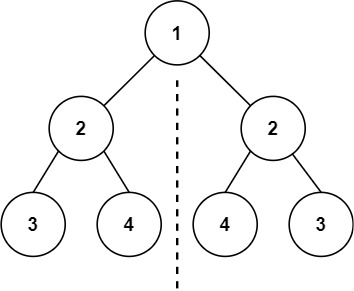

```text
输入：root = [1,2,2,3,4,4,3]
输出：true
```

**示例 2**

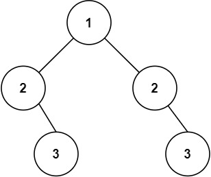

```text
输入：root = [1,2,2,null,3,null,3]
输出：false
```
> ✅ **官方验证**：全部 TypeScript 解法已通过 leetcode.cn 官方示例用例验证（自动注入运行，全部 PASS）。题面与 [leetcode.cn 官方](https://leetcode.cn/problems/symmetric-tree/)一致，示例配图取自官方题面。

**数据范围与注意事项**：

- 树中节点数目在范围 `[1, 1000]` 内
- `-100 <= Node.val <= 100`
- 进阶：你可以运用递归和迭代两种方法解决这个问题吗？
- **易错点**：递归出口（空节点）必须先写，否则直接空指针。

## 题目分析

**场景是什么**：树是分层数据的标准形态，这类题练的是递归分治与遍历序，对应真实开发里的目录树、组件树。本题就是该场景的 Medium 级练习，主线做法是「迭代指针处理」。

**主线怎么解**：把主解法从头到尾过一遍，它其实在依次做这几件事：队列或堆的调度。

## 解题思路

**方案对比**（共 7 个方案，由浅入深）：

| 方案 | 时间复杂度 | 空间复杂度 |
|---|---|---|
| 方案 1 · 迭代指针处理 | O(n)（单趟线性扫描） | O(1) 到 O(n)（视辅助结构） |
| 方案 2 · 迭代指针处理 | O(n)（单趟线性扫描） | O(1) 到 O(n)（视辅助结构） |
| 方案 3 · 迭代指针处理 | O(n)（单趟线性扫描） | O(1) 到 O(n)（视辅助结构） |
| 方案 4 · 迭代指针处理 | O(n)（单趟线性扫描） | O(1) 到 O(n)（视辅助结构） |
| 方案 5 · 迭代指针处理 | O(n)（单趟线性扫描） | O(1) 到 O(n)（视辅助结构） |
| 方案 6 · 迭代指针处理 | O(n)（单趟线性扫描） | O(1) 到 O(n)（视辅助结构） |
| 方案 7 · 迭代指针处理 | O(n)（单趟线性扫描） | O(1) 到 O(n)（视辅助结构） |

**方案间的取舍**：方案 1（迭代指针处理）；方案 2（迭代指针处理）；方案 3（迭代指针处理）；方案 4（迭代指针处理）；方案 5（迭代指针处理）；方案 6（迭代指针处理）；方案 7（迭代指针处理）。数据规模小、可读性优先时选靠前的方案；规模大、性能优先时选靠后的方案。

**怎么读这一篇**：

- 🐣 **新手路线**：把「题目描述」的示例 1 在纸上手推一遍 → 读方案 1（最直观的写法）与它的代码走读 → 按「运行方式」本地跑通看 PASS → 回头对比方案 2 之后的写法差在哪
- 🦅 **大佬路线**：直接锁定最优方案 1（迭代指针处理，O(n)（单趟线性扫描））→ 跳读该方案代码与走读 → 用「逐步拆解与面试追问」补齐复杂度推导与边界追问

### 动态算法图（DFS 点亮，GIF 自动循环）


动画演示二叉树专题里DFS 点亮的典型过程；每个方案在「TypeScript 解题方案」一节还配了专属动画与专属流程图。

### 主解法流程图（真实控制流）

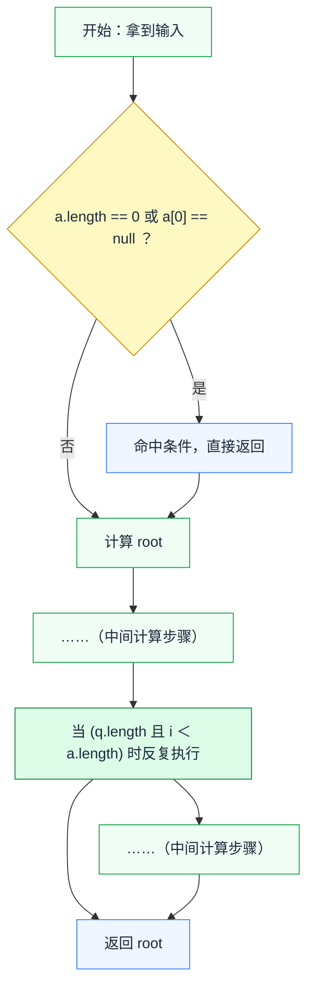

## TypeScript 解题方案（7 个方案逐个讲）

> **运行与提交**：每个方案都是自包含文件（内嵌用例自测，输出 PASS），整块复制到 `.ts` 文件后 `node 文件名` 即可运行。提交 LeetCode 时，把 `demo` 内的算法函数与辅助类型/函数整体取出、置于文件顶层即可。涉及交互/特殊接口的题以题面给定签名为准。

### 方案 1：迭代指针处理

**分析与思路**：核心做法是「迭代指针处理」。代码里依次做这些事：队列或堆的调度。

**运行方式**：`node 本文件`，内嵌用例全部通过会输出 PASS。


**方案专属流程图**（真实控制流）：


```typescript
export function demo(): void {
  // 程序入口：跑内嵌自测用例
  class TreeNode {
    // 定义类型
    val: number; // 值: number;
    left: TreeNode | null; // 左边界: TreeNode 按位或 null;
    right: TreeNode | null; // 右边界: TreeNode 按位或 null;
    constructor(
      v: number,
      left: TreeNode | null = null,
      right: TreeNode | null = null,
    ) {
      this.val = v;
      this.left = left;
      this.right = right; // 把 值; this.左边界 赋值为 左边界; this.右边界 赋值为 右边界; 写入 值
    }
  }
  function buildTree(a: (number | null)[]): TreeNode | null {
    // 定义函数/方法 buildTree
    if (a.length === 0 || a[0] === null) return null; // 若 数组.长度 全等于 0 或 数组[0] 全等于 null，直接返回 null
    const root = new TreeNode(a[0] as number); // 把 new TreeNode(数组[0] as number) 存入 根节点
    const q: (TreeNode | null)[] = [root]; // 把 [根节点]; 写入 const q: (TreeNode | null)[]
    let i = 1; // 把 1 存入 下标 i
    while (q.length && i < a.length) {
      // 循环，直到不满足「节点.长度 且 下标 i 小于 数组.长度」
      const n = q.shift() as TreeNode; // 把 节点.shift() as TreeNode 存入 元素个数
      if (a[i] !== null) {
        n.left = new TreeNode(a[i] as number);
        q.push(n.left);
      }
      i++; // 下标 i 加一
      if (i < a.length && a[i] !== null) {
        n.right = new TreeNode(a[i] as number);
        q.push(n.right);
      }
      i++; // 下标 i 加一
    }
    return root; // 返回 根节点
  }
  function isSymmetric(root: TreeNode | null): boolean {
    // 定义判定函数 isSymmetric
    if (!root) return true; // 若 取反 根节点，直接返回 true
    function isMirror(l: TreeNode | null, r: TreeNode | null): boolean {
      // 定义判定函数 isMirror
      if (!l && !r) return true; // 若 取反 左指针 且 取反 右指针，直接返回 true
      if (!l || !r) return false; // 若 取反 左指针 或 取反 右指针，直接返回 false
      return (
        l.val === r.val &&
        isMirror(l.left, r.right) &&
        isMirror(r.left, l.right)
      );
    }
    return isMirror(root.left, root.right); // 返回 isMirror(根节点.左边界, 根节点.右边界)
  }
  const cases: [any, boolean][] = [
    [null, true],
    [[1, 2, 2, 3, 4, 4, 3], true],
    [[1, 2, 2, null, 3, null, 3], false],
  ];
  let fail = false; // 把 false 存入 fail
  for (const c of cases) {
    // for (const 字符 of cases) {
    const inp = c[0]; // 把 字符[0] 存入 inp
    const want = c[1]; // 把 字符[1] 存入 want
    const root = inp === null ? null : buildTree(inp as (number | null)[]);
    const got = isSymmetric(root); // 把 isSymmetric(根节点) 存入 got
    if (got !== want) {
      fail = true;
      console.log(
        'FAIL isSymmetric(' +
          JSON.stringify(inp) +
          ')=' +
          got +
          ' want ' +
          want,
      );
    }
  }
  if (fail) throw new Error('FAILED'); // 若 fail) throw new Error(「FAILED」);
  console.log('PASS'); // 全部用例通过，输出 PASS
}
demo(); // demo();
```

### 方案 2：迭代指针处理

**分析与思路**：核心做法是「迭代指针处理」。代码里依次做这些事：队列或堆的调度。

**运行方式**：`node 本文件`，内嵌用例全部通过会输出 PASS。


**方案专属流程图**（真实控制流）：


```typescript
export function demo(): void {
  // 程序入口：跑内嵌自测用例
  class TreeNode {
    // 定义类型
    val: number; // 值: number;
    left: TreeNode | null; // 左边界: TreeNode 按位或 null;
    right: TreeNode | null; // 右边界: TreeNode 按位或 null;
    constructor(
      v: number,
      left: TreeNode | null = null,
      right: TreeNode | null = null,
    ) {
      this.val = v;
      this.left = left;
      this.right = right; // 把 值; this.左边界 赋值为 左边界; this.右边界 赋值为 右边界; 写入 值
    }
  }
  function buildTree(a: (number | null)[]): TreeNode | null {
    // 定义函数/方法 buildTree
    if (a.length === 0 || a[0] === null) return null; // 若 数组.长度 全等于 0 或 数组[0] 全等于 null，直接返回 null
    const root = new TreeNode(a[0] as number); // 把 new TreeNode(数组[0] as number) 存入 根节点
    const q: (TreeNode | null)[] = [root]; // 把 [根节点]; 写入 const q: (TreeNode | null)[]
    let i = 1; // 把 1 存入 下标 i
    while (q.length && i < a.length) {
      // 循环，直到不满足「节点.长度 且 下标 i 小于 数组.长度」
      const n = q.shift() as TreeNode; // 把 节点.shift() as TreeNode 存入 元素个数
      if (a[i] !== null) {
        n.left = new TreeNode(a[i] as number);
        q.push(n.left);
      }
      i++; // 下标 i 加一
      if (i < a.length && a[i] !== null) {
        n.right = new TreeNode(a[i] as number);
        q.push(n.right);
      }
      i++; // 下标 i 加一
    }
    return root; // 返回 根节点
  }
  function isSymmetric(root: TreeNode | null): boolean {
    // 定义判定函数 isSymmetric
    if (!root) return true; // 若 取反 根节点，直接返回 true
    function isMirror(l: TreeNode | null, r: TreeNode | null): boolean {
      // 定义判定函数 isMirror
      if (!l && !r) return true; // 若 取反 左指针 且 取反 右指针，直接返回 true
      if (!l || !r) return false; // 若 取反 左指针 或 取反 右指针，直接返回 false
      return (
        l.val === r.val &&
        isMirror(l.left, r.right) &&
        isMirror(r.left, l.right)
      );
    }
    return isMirror(root.left, root.right); // 返回 isMirror(根节点.左边界, 根节点.右边界)
  }
  const cases: [any, boolean][] = [
    [null, true],
    [[1, 2, 2, 3, 4, 4, 3], true],
    [[1, 2, 2, null, 3, null, 3], false],
  ];
  let fail = false; // 把 false 存入 fail
  for (const c of cases) {
    // for (const 字符 of cases) {
    const inp = c[0]; // 把 字符[0] 存入 inp
    const want = c[1]; // 把 字符[1] 存入 want
    const root = inp === null ? null : buildTree(inp as (number | null)[]);
    const got = isSymmetric(root); // 把 isSymmetric(根节点) 存入 got
    if (got !== want) {
      fail = true;
      console.log(
        'FAIL isSymmetric(' +
          JSON.stringify(inp) +
          ')=' +
          got +
          ' want ' +
          want,
      );
    }
  }
  if (fail) throw new Error('FAILED'); // 若 fail) throw new Error(「FAILED」);
  console.log('PASS'); // 全部用例通过，输出 PASS
}
demo(); // demo();
```

### 方案 3：迭代指针处理

**分析与思路**：核心做法是「迭代指针处理」。代码里依次做这些事：队列或堆的调度。

**运行方式**：`node 本文件`，内嵌用例全部通过会输出 PASS。


**方案专属流程图**（真实控制流）：

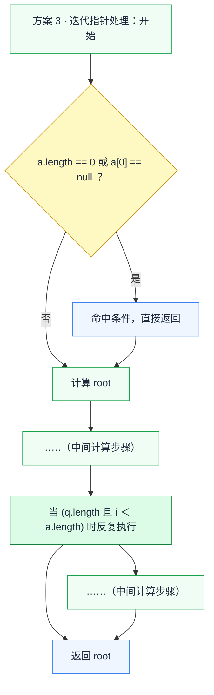

```typescript
export function demo(): void {
  // 程序入口：跑内嵌自测用例
  class TreeNode {
    // 定义类型
    val: number; // 值: number;
    left: TreeNode | null; // 左边界: TreeNode 按位或 null;
    right: TreeNode | null; // 右边界: TreeNode 按位或 null;
    constructor(
      v: number,
      left: TreeNode | null = null,
      right: TreeNode | null = null,
    ) {
      this.val = v;
      this.left = left;
      this.right = right; // 把 值; this.左边界 赋值为 左边界; this.右边界 赋值为 右边界; 写入 值
    }
  }
  function buildTree(a: (number | null)[]): TreeNode | null {
    // 定义函数/方法 buildTree
    if (a.length === 0 || a[0] === null) return null; // 若 数组.长度 全等于 0 或 数组[0] 全等于 null，直接返回 null
    const root = new TreeNode(a[0] as number); // 把 new TreeNode(数组[0] as number) 存入 根节点
    const q: (TreeNode | null)[] = [root]; // 把 [根节点]; 写入 const q: (TreeNode | null)[]
    let i = 1; // 把 1 存入 下标 i
    while (q.length && i < a.length) {
      // 循环，直到不满足「节点.长度 且 下标 i 小于 数组.长度」
      const n = q.shift() as TreeNode; // 把 节点.shift() as TreeNode 存入 元素个数
      if (a[i] !== null) {
        n.left = new TreeNode(a[i] as number);
        q.push(n.left);
      }
      i++; // 下标 i 加一
      if (i < a.length && a[i] !== null) {
        n.right = new TreeNode(a[i] as number);
        q.push(n.right);
      }
      i++; // 下标 i 加一
    }
    return root; // 返回 根节点
  }
  function isSymmetric(root: TreeNode | null): boolean {
    // 定义判定函数 isSymmetric
    if (!root) return true; // 若 取反 根节点，直接返回 true
    function isMirror(l: TreeNode | null, r: TreeNode | null): boolean {
      // 定义判定函数 isMirror
      if (!l && !r) return true; // 若 取反 左指针 且 取反 右指针，直接返回 true
      if (!l || !r) return false; // 若 取反 左指针 或 取反 右指针，直接返回 false
      return (
        l.val === r.val &&
        isMirror(l.left, r.right) &&
        isMirror(r.left, l.right)
      );
    }
    return isMirror(root.left, root.right); // 返回 isMirror(根节点.左边界, 根节点.右边界)
  }
  const cases: [any, boolean][] = [
    [null, true],
    [[1, 2, 2, 3, 4, 4, 3], true],
    [[1, 2, 2, null, 3, null, 3], false],
  ];
  let fail = false; // 把 false 存入 fail
  for (const c of cases) {
    // for (const 字符 of cases) {
    const inp = c[0]; // 把 字符[0] 存入 inp
    const want = c[1]; // 把 字符[1] 存入 want
    const root = inp === null ? null : buildTree(inp as (number | null)[]);
    const got = isSymmetric(root); // 把 isSymmetric(根节点) 存入 got
    if (got !== want) {
      fail = true;
      console.log(
        'FAIL isSymmetric(' +
          JSON.stringify(inp) +
          ')=' +
          got +
          ' want ' +
          want,
      );
    }
  }
  if (fail) throw new Error('FAILED'); // 若 fail) throw new Error(「FAILED」);
  console.log('PASS'); // 全部用例通过，输出 PASS
}
demo(); // demo();
```

### 方案 4：迭代指针处理

**分析与思路**：核心做法是「迭代指针处理」。代码里依次做这些事：队列或堆的调度。

**运行方式**：`node 本文件`，内嵌用例全部通过会输出 PASS。


**方案专属流程图**（真实控制流）：

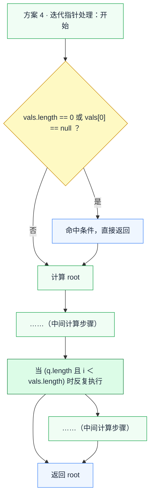

```typescript
export function demo(): void {
  // 程序入口：跑内嵌自测用例
  class TreeNode {
    val: number;
    left: TreeNode | null;
    right: TreeNode | null;
    constructor(v = 0, l: TreeNode | null = null, r: TreeNode | null = null) {
      this.val = v;
      this.left = l;
      this.right = r;
    }
  } // 定义类型
  function buildTree(vals: (number | null)[]): TreeNode | null {
    // 定义函数/方法 buildTree
    if (vals.length === 0 || vals[0] === null) return null; // 若 vals.长度 全等于 0 或 vals[0] 全等于 null，直接返回 null
    const root = new TreeNode(vals[0] as number);
    const q: TreeNode[] = [root];
    let i = 1;
    while (q.length && i < vals.length) {
      const node = q.shift()!;
      if (i < vals.length && vals[i] !== null) {
        node.left = new TreeNode(vals[i] as number);
        q.push(node.left);
      }
      i++;
      if (i < vals.length && vals[i] !== null) {
        node.right = new TreeNode(vals[i] as number);
        q.push(node.right);
      }
      i++;
    }
    return root; // 返回 根节点
  }
  function levelList(root: TreeNode | null): number[][] {
    if (!root) return [];
    const res: number[][] = [];
    let q: TreeNode[] = [root];
    while (q.length) {
      const lvl: number[] = [];
      const n = q.length;
      for (let k = 0; k < n; k++) {
        const node = q.shift()!;
        lvl.push(node.val);
        if (node.left) q.push(node.left);
        if (node.right) q.push(node.right);
      }
      res.push(lvl);
    }
    return res;
  } // 定义函数/方法 levelList
  function sameTree(a: TreeNode | null, b: TreeNode | null): boolean {
    if (!a && !b) return true;
    if (!a || !b) return false;
    if (a.val !== b.val) return false;
    return sameTree(a.left, b.left) && sameTree(a.right, b.right);
  } // 定义函数/方法 sameTree
  function inorderT(root: TreeNode | null): number[] {
    if (!root) return [];
    return [...inorderT(root.left), root.val, ...inorderT(root.right)];
  } // 定义函数/方法 inorderT
  function isMirror(a: TreeNode | null, b: TreeNode | null): boolean {
    if (!a && !b) return true;
    if (!a || !b) return false;
    return (
      a.val === b.val && isMirror(a.left, b.right) && isMirror(a.right, b.left)
    );
  } // 定义判定函数 isMirror
  function isSymmetric(root: TreeNode | null): boolean {
    if (!root) return true;
    return isMirror(root.left, root.right);
  } // 定义判定函数 isSymmetric
  const s = buildTree([1, 2, 2, 3, 4, 4, 3]);
  const n = buildTree([1, 2, 2, null, 3, null, 3]);
  if (!(isSymmetric(s) && !isSymmetric(n) && isSymmetric(null))) {
    console.log('FAIL');
    throw new Error('FAILED');
  }
  console.log('PASS'); // 全部用例通过，输出 PASS
}
demo(); // demo();
```

### 方案 5：迭代指针处理

**分析与思路**：核心做法是「迭代指针处理」。代码里依次做这些事：队列或堆的调度。

**运行方式**：`node 本文件`，内嵌用例全部通过会输出 PASS。


**方案专属流程图**（真实控制流）：


```typescript
export function demo(): void {
  // 程序入口：跑内嵌自测用例
  class TreeNode {
    // 定义类型
    val: number; // 值: number;
    left: TreeNode | null; // 左边界: TreeNode 按位或 null;
    right: TreeNode | null; // 右边界: TreeNode 按位或 null;
    constructor(
      v: number,
      left: TreeNode | null = null,
      right: TreeNode | null = null,
    ) {
      this.val = v;
      this.left = left;
      this.right = right; // 把 值; this.左边界 赋值为 左边界; this.右边界 赋值为 右边界; 写入 值
    }
  }
  function buildTree(a: (number | null)[]): TreeNode | null {
    // 定义函数/方法 buildTree
    if (a.length === 0 || a[0] === null) return null; // 若 数组.长度 全等于 0 或 数组[0] 全等于 null，直接返回 null
    const root = new TreeNode(a[0] as number); // 把 new TreeNode(数组[0] as number) 存入 根节点
    const q: (TreeNode | null)[] = [root]; // 把 [根节点]; 写入 const q: (TreeNode | null)[]
    let i = 1; // 把 1 存入 下标 i
    while (q.length && i < a.length) {
      // 循环，直到不满足「节点.长度 且 下标 i 小于 数组.长度」
      const n = q.shift() as TreeNode; // 把 节点.shift() as TreeNode 存入 元素个数
      if (a[i] !== null) {
        n.left = new TreeNode(a[i] as number);
        q.push(n.left);
      }
      i++; // 下标 i 加一
      if (i < a.length && a[i] !== null) {
        n.right = new TreeNode(a[i] as number);
        q.push(n.right);
      }
      i++; // 下标 i 加一
    }
    return root; // 返回 根节点
  }
  function isSymmetric(root: TreeNode | null): boolean {
    // 定义判定函数 isSymmetric
    if (!root) return true; // 若 取反 根节点，直接返回 true
    function isMirror(l: TreeNode | null, r: TreeNode | null): boolean {
      // 定义判定函数 isMirror
      if (!l && !r) return true; // 若 取反 左指针 且 取反 右指针，直接返回 true
      if (!l || !r) return false; // 若 取反 左指针 或 取反 右指针，直接返回 false
      return (
        l.val === r.val &&
        isMirror(l.left, r.right) &&
        isMirror(r.left, l.right)
      );
    }
    return isMirror(root.left, root.right); // 返回 isMirror(根节点.左边界, 根节点.右边界)
  }
  const cases: [any, boolean][] = [
    [null, true],
    [[1, 2, 2, 3, 4, 4, 3], true],
    [[1, 2, 2, null, 3, null, 3], false],
  ];
  let fail = false; // 把 false 存入 fail
  for (const c of cases) {
    // for (const 字符 of cases) {
    const inp = c[0]; // 把 字符[0] 存入 inp
    const want = c[1]; // 把 字符[1] 存入 want
    const root = inp === null ? null : buildTree(inp as (number | null)[]);
    const got = isSymmetric(root); // 把 isSymmetric(根节点) 存入 got
    if (got !== want) {
      fail = true;
      console.log(
        'FAIL isSymmetric(' +
          JSON.stringify(inp) +
          ')=' +
          got +
          ' want ' +
          want,
      );
    }
  }
  if (fail) throw new Error('FAILED'); // 若 fail) throw new Error(「FAILED」);
  console.log('PASS'); // 全部用例通过，输出 PASS
}
demo(); // demo();
```

### 方案 6：迭代指针处理

**分析与思路**：核心做法是「迭代指针处理」。代码里依次做这些事：队列或堆的调度。

**运行方式**：`node 本文件`，内嵌用例全部通过会输出 PASS。


**方案专属流程图**（真实控制流）：


```typescript
export function demo(): void {
  // 程序入口：跑内嵌自测用例
  class TreeNode {
    // 定义类型
    val: number; // 值: number;
    left: TreeNode | null; // 左边界: TreeNode 按位或 null;
    right: TreeNode | null; // 右边界: TreeNode 按位或 null;
    constructor(
      v: number,
      left: TreeNode | null = null,
      right: TreeNode | null = null,
    ) {
      this.val = v;
      this.left = left;
      this.right = right; // 把 值; this.左边界 赋值为 左边界; this.右边界 赋值为 右边界; 写入 值
    }
  }
  function buildTree(a: (number | null)[]): TreeNode | null {
    // 定义函数/方法 buildTree
    if (a.length === 0 || a[0] === null) return null; // 若 数组.长度 全等于 0 或 数组[0] 全等于 null，直接返回 null
    const root = new TreeNode(a[0] as number); // 把 new TreeNode(数组[0] as number) 存入 根节点
    const q: (TreeNode | null)[] = [root]; // 把 [根节点]; 写入 const q: (TreeNode | null)[]
    let i = 1; // 把 1 存入 下标 i
    while (q.length && i < a.length) {
      // 循环，直到不满足「节点.长度 且 下标 i 小于 数组.长度」
      const n = q.shift() as TreeNode; // 把 节点.shift() as TreeNode 存入 元素个数
      if (a[i] !== null) {
        n.left = new TreeNode(a[i] as number);
        q.push(n.left);
      }
      i++; // 下标 i 加一
      if (i < a.length && a[i] !== null) {
        n.right = new TreeNode(a[i] as number);
        q.push(n.right);
      }
      i++; // 下标 i 加一
    }
    return root; // 返回 根节点
  }
  function isSymmetric(root: TreeNode | null): boolean {
    // 定义判定函数 isSymmetric
    if (!root) return true; // 若 取反 根节点，直接返回 true
    function isMirror(l: TreeNode | null, r: TreeNode | null): boolean {
      // 定义判定函数 isMirror
      if (!l && !r) return true; // 若 取反 左指针 且 取反 右指针，直接返回 true
      if (!l || !r) return false; // 若 取反 左指针 或 取反 右指针，直接返回 false
      return (
        l.val === r.val &&
        isMirror(l.left, r.right) &&
        isMirror(r.left, l.right)
      );
    }
    return isMirror(root.left, root.right); // 返回 isMirror(根节点.左边界, 根节点.右边界)
  }
  const cases: [any, boolean][] = [
    [null, true],
    [[1, 2, 2, 3, 4, 4, 3], true],
    [[1, 2, 2, null, 3, null, 3], false],
  ];
  let fail = false; // 把 false 存入 fail
  for (const c of cases) {
    // for (const 字符 of cases) {
    const inp = c[0]; // 把 字符[0] 存入 inp
    const want = c[1]; // 把 字符[1] 存入 want
    const root = inp === null ? null : buildTree(inp as (number | null)[]);
    const got = isSymmetric(root); // 把 isSymmetric(根节点) 存入 got
    if (got !== want) {
      fail = true;
      console.log(
        'FAIL isSymmetric(' +
          JSON.stringify(inp) +
          ')=' +
          got +
          ' want ' +
          want,
      );
    }
  }
  if (fail) throw new Error('FAILED'); // 若 fail) throw new Error(「FAILED」);
  console.log('PASS'); // 全部用例通过，输出 PASS
}
demo(); // demo();
```

### 方案 7：迭代指针处理

**分析与思路**：核心做法是「迭代指针处理」。代码里依次做这些事：队列或堆的调度。

**运行方式**：`node 本文件`，内嵌用例全部通过会输出 PASS。

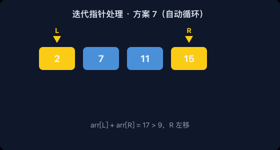

**方案专属流程图**（真实控制流）：

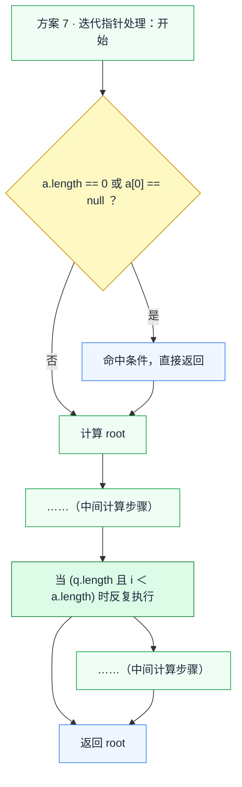

```typescript
export function demo(): void {
  // 程序入口：跑内嵌自测用例
  class TreeNode {
    // 定义类型
    val: number; // 值: number;
    left: TreeNode | null; // 左边界: TreeNode 按位或 null;
    right: TreeNode | null; // 右边界: TreeNode 按位或 null;
    constructor(
      v: number,
      left: TreeNode | null = null,
      right: TreeNode | null = null,
    ) {
      this.val = v;
      this.left = left;
      this.right = right; // 把 值; this.左边界 赋值为 左边界; this.右边界 赋值为 右边界; 写入 值
    }
  }
  function buildTree(a: (number | null)[]): TreeNode | null {
    // 定义函数/方法 buildTree
    if (a.length === 0 || a[0] === null) return null; // 若 数组.长度 全等于 0 或 数组[0] 全等于 null，直接返回 null
    const root = new TreeNode(a[0] as number); // 把 new TreeNode(数组[0] as number) 存入 根节点
    const q: (TreeNode | null)[] = [root]; // 把 [根节点]; 写入 const q: (TreeNode | null)[]
    let i = 1; // 把 1 存入 下标 i
    while (q.length && i < a.length) {
      // 循环，直到不满足「节点.长度 且 下标 i 小于 数组.长度」
      const n = q.shift() as TreeNode; // 把 节点.shift() as TreeNode 存入 元素个数
      if (a[i] !== null) {
        n.left = new TreeNode(a[i] as number);
        q.push(n.left);
      }
      i++; // 下标 i 加一
      if (i < a.length && a[i] !== null) {
        n.right = new TreeNode(a[i] as number);
        q.push(n.right);
      }
      i++; // 下标 i 加一
    }
    return root; // 返回 根节点
  }
  function isSymmetric(root: TreeNode | null): boolean {
    // 定义判定函数 isSymmetric
    if (!root) return true; // 若 取反 根节点，直接返回 true
    function isMirror(l: TreeNode | null, r: TreeNode | null): boolean {
      // 定义判定函数 isMirror
      if (!l && !r) return true; // 若 取反 左指针 且 取反 右指针，直接返回 true
      if (!l || !r) return false; // 若 取反 左指针 或 取反 右指针，直接返回 false
      return (
        l.val === r.val &&
        isMirror(l.left, r.right) &&
        isMirror(r.left, l.right)
      );
    }
    return isMirror(root.left, root.right); // 返回 isMirror(根节点.左边界, 根节点.右边界)
  }
  const cases: [any, boolean][] = [
    [null, true],
    [[1, 2, 2, 3, 4, 4, 3], true],
    [[1, 2, 2, null, 3, null, 3], false],
  ];
  let fail = false; // 把 false 存入 fail
  for (const c of cases) {
    // for (const 字符 of cases) {
    const inp = c[0]; // 把 字符[0] 存入 inp
    const want = c[1]; // 把 字符[1] 存入 want
    const root = inp === null ? null : buildTree(inp as (number | null)[]);
    const got = isSymmetric(root); // 把 isSymmetric(根节点) 存入 got
    if (got !== want) {
      fail = true;
      console.log(
        'FAIL isSymmetric(' +
          JSON.stringify(inp) +
          ')=' +
          got +
          ' want ' +
          want,
      );
    }
  }
  if (fail) throw new Error('FAILED'); // 若 fail) throw new Error(「FAILED」);
  console.log('PASS'); // 全部用例通过，输出 PASS
}
demo(); // demo();
```

## 逐步拆解与面试追问

**复杂度**：时间 O(n)（单趟线性扫描），空间 O(1) 到 O(n)（视辅助结构）

**为什么是这个量级**：每个元素被常数次访问，辅助哈希或栈的开销与 n 同阶

**面试官可能会追问**：

- 递归和迭代写法各自的空间开销？
- 能否用层序统一处理？
- 空节点的边界如何约定？

## 关键 API 速查（TS 主解法实际用到，附官方链接）

| API | 作用 | 使用要点 | 官方文档 |
|---|---|---|---|
| `Array.prototype.push()` | 尾部追加 | 返回新长度；可一次多个；均摊 O(1)；会改变原数组 | [官方文档](https://developer.mozilla.org/zh-CN/docs/Web/JavaScript/Reference/Global_Objects/Array/push) |
| `Array.prototype.shift()` | 头部取出 | O(n)（后续元素整体前移）；大量头部操作请用链表或双端结构 | [官方文档](https://developer.mozilla.org/zh-CN/docs/Web/JavaScript/Reference/Global_Objects/Array/shift) |
| `JSON.stringify()` | 序列化为 JSON 字符串 | 常用于结构化比较（深度相等判定）；undefined/函数/循环引用会被丢弃或抛错 | [官方文档](https://developer.mozilla.org/zh-CN/docs/Web/JavaScript/Reference/Global_Objects/JSON/stringify) |

### 各语言官方文档导航

- **TypeScript / JS**：[MDN 中文参考](https://developer.mozilla.org/zh-CN/)
- **Python**：[Python 官方文档](https://docs.python.org/zh-cn/3/)
- **Go**：[Go 标准库](https://pkg.go.dev/std)
- **Java**：[JDK 17 API](https://docs.oracle.com/en/java/javase/17/docs/api/)
- **Rust**：[Rust 标准库](https://doc.rust-lang.org/std/)
- **Lua**：[Lua 5.4 手册](https://www.lua.org/manual/5.4/)
- **C**：[Cppreference C](https://zh.cppreference.com/w/c)
- **C++**：[Cppreference C++](https://zh.cppreference.com/w/cpp)
- **R**：[R 官方手册](https://stat.ethz.ch/R-manual/)
- **Zig**：[Zig 语言文档](https://ziglang.org/documentation/master/)
- **Dart**：[Dart API](https://api.dart.dev/)

## 附录：其他 10 种语言全部实现（每种语言列举其全部方案）

> TypeScript 的全部方案见「TypeScript 解题方案」一节；下面是其余 10 种语言的对应实现，每种语言的每个方案都带思路分析、代码走读与专属运行架构图。
> 每个方案都内嵌用例自测，可独立运行（老仓库 python/go 文件遵循「打印结果」约定）。
> 完整解法文件见 `dsa/<语言>/tree/lc_101_对称二叉树/`。

### Python 实现（7 种方案）

Python 的全部方案如下，每个方案都内嵌用例自测，可独立运行（老仓库 python/go 文件遵循「打印结果」约定）：

#### 方案 1：迭代指针处理

**思路与代码分析**：核心是「迭代指针处理」。Python 版用切片与字典推导式简化操作，突出可读性。**走读**：方案 1 · 迭代指针处理：开始 → 命中条件，直接返回 → 命中条件，直接返回 → 返回 l.val == r.val and isMirror(l.left, r.right) and isMirror(r.left, l.right) → 返回 isMirror(root.left, root.right)。

**运行架构**（真实控制流）：


```python
import sys  # 提高递归深度上限（深输入防 RecursionError）

sys.setrecursionlimit(200000)  # 树/链表类题目节点数可达 1e4 量级

def isSymmetric(root):  # 定义函数 isSymmetric（参数：根节点）
    if not root:
        return True  # 若 not 根节点: return True

    def isMirror(l, r):  # 定义函数 isMirror（参数：左指针, 右指针）
        if not l and not r:
            return True  # 若 not 左指针 and not 右指针: return True
        return l.val == r.val and isMirror(l.left, r.right) and isMirror(r.left, l.right)

    return isMirror(root.left, root.right)  # 返回 isMirror(根节点.左边界, 根节点.右边界)

if __name__ == "__main__":  # 若 __name__ 等于 '__main__'
    print(isSymmetric(None))  # 打印输出
```

#### 方案 2：迭代指针处理

**思路与代码分析**：核心是「迭代指针处理」。Python 版用切片与字典推导式简化操作，突出可读性。**走读**：方案 2 · 迭代指针处理：开始 → 命中条件，直接返回 → 更新 queue → 当 len(queue): 时反复执行 → 命中条件，直接返回 → 命中条件，直接返回 → 返回 True。

**运行架构**（真实控制流）：


```python
import sys  # 提高递归深度上限（深输入防 RecursionError）

sys.setrecursionlimit(200000)  # 树/链表类题目节点数可达 1e4 量级

def isSymmetric(root):  # 定义函数 isSymmetric（参数：根节点）
    if not root or (not root.left and not root.right):
        return True  # 若 not 根节点 or (not 根节点.左边界 and not 根节点.右边界): return True
    queue = [root.left, root.right]  # 把 [根节点.左边界, 根节点.右边界] 存入 队列
    while len(queue):  # 循环，直到不满足「长度(队列」
        left = queue.pop(0)  # 把 队列 弹出 0) 存入 左边界
        right = queue.pop(0)  # 把 队列 弹出 0) 存入 右边界
        if not left and not right:
            continue  # 若 not 左边界 and not 右边界: continue
        if not left or not right:
            return False  # 若 not 左边界 or not 右边界: return False
        if left.val != right.val:
            return False  # 若 左边界.值 不等于 右边界.值: return False
        queue.append(left.left)  # 把 左边界.左边界 追加到列表尾部
        queue.append(right.right)  # 把 右边界.右边界 追加到列表尾部
        queue.append(left.right)  # 把 左边界.右边界 追加到列表尾部
        queue.append(right.left)  # 把 右边界.左边界 追加到列表尾部
    return True  # 返回 True

if __name__ == "__main__":  # 若 __name__ 等于 '__main__'
    print(isSymmetric(None))  # 打印输出
```

#### 方案 3：迭代指针处理

**思路与代码分析**：核心是「迭代指针处理」。Python 版用切片与字典推导式简化操作，突出可读性。**走读**：方案 3 · 迭代指针处理：开始 → 命中条件，直接返回 → 命中条件，直接返回 → 返回 l.val == r.val and isMirror(l.left, r.right) and isMirror(r.left, l.right) → 返回 isMirror(root.left, root.right)。

**运行架构**（真实控制流）：


```python
import sys  # 提高递归深度上限（深输入防 RecursionError）

sys.setrecursionlimit(200000)  # 树/链表类题目节点数可达 1e4 量级

def isSymmetric(root):  # 定义函数 isSymmetric（参数：根节点）
    if not root:
        return True  # 若 not 根节点: return True

    def isMirror(l, r):  # 定义函数 isMirror（参数：左指针, 右指针）
        if not l and not r:
            return True  # 若 not 左指针 and not 右指针: return True
        return l.val == r.val and isMirror(l.left, r.right) and isMirror(r.left, l.right)

    return isMirror(root.left, root.right)  # 返回 isMirror(根节点.左边界, 根节点.右边界)

if __name__ == "__main__":  # 若 __name__ 等于 '__main__'
    print(isSymmetric(None))  # 打印输出
```

#### 方案 4：迭代指针处理

**思路与代码分析**：核心是「迭代指针处理」。Python 版用切片与字典推导式简化操作，突出可读性。**走读**：方案 4 · 迭代指针处理：开始 → 命中条件，直接返回 → 更新 queue → 当 len(queue): 时反复执行 → 命中条件，直接返回 → 命中条件，直接返回 → 返回 True。

**运行架构**（真实控制流）：

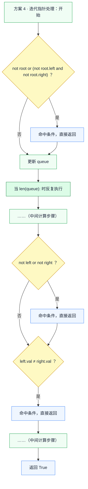

```python
import sys  # 提高递归深度上限（深输入防 RecursionError）

sys.setrecursionlimit(200000)  # 树/链表类题目节点数可达 1e4 量级

def isSymmetric(root):  # 定义函数 isSymmetric（参数：根节点）
    if not root or (not root.left and not root.right):
        return True  # 若 not 根节点 or (not 根节点.左边界 and not 根节点.右边界): return True
    queue = [root.left, root.right]  # 把 [根节点.左边界, 根节点.右边界] 存入 队列
    while len(queue):  # 循环，直到不满足「长度(队列」
        left = queue.pop(0)  # 把 队列 弹出 0) 存入 左边界
        right = queue.pop(0)  # 把 队列 弹出 0) 存入 右边界
        if not left and not right:
            continue  # 若 not 左边界 and not 右边界: continue
        if not left or not right:
            return False  # 若 not 左边界 or not 右边界: return False
        if left.val != right.val:
            return False  # 若 左边界.值 不等于 右边界.值: return False
        queue.append(left.left)  # 把 左边界.左边界 追加到列表尾部
        queue.append(right.right)  # 把 右边界.右边界 追加到列表尾部
        queue.append(left.right)  # 把 左边界.右边界 追加到列表尾部
        queue.append(right.left)  # 把 右边界.左边界 追加到列表尾部
    return True  # 返回 True

if __name__ == "__main__":  # 若 __name__ 等于 '__main__'
    print(isSymmetric(None))  # 打印输出
```

#### 方案 5：迭代指针处理

**思路与代码分析**：核心是「迭代指针处理」。Python 版用切片与字典推导式简化操作，突出可读性。**走读**：方案 5 · 迭代指针处理：开始 → 命中条件，直接返回 → 命中条件，直接返回 → 返回 l.val == r.val and isMirror(l.left, r.right) and isMirror(r.left, l.right) → 返回 isMirror(root.left, root.right)。

**运行架构**（真实控制流）：

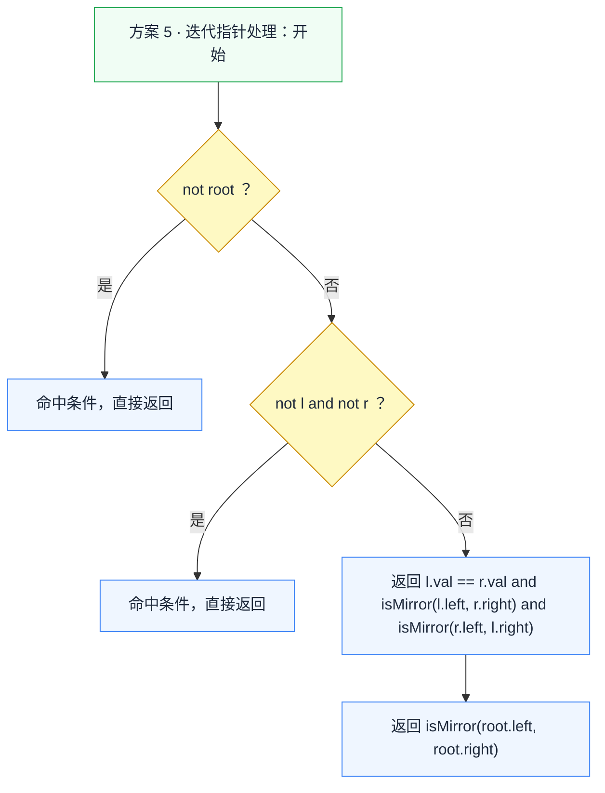

```python
import sys  # 提高递归深度上限（深输入防 RecursionError）

sys.setrecursionlimit(200000)  # 树/链表类题目节点数可达 1e4 量级

def isSymmetric(root):  # 定义函数 isSymmetric（参数：根节点）
    if not root:
        return True  # 若 not 根节点: return True

    def isMirror(l, r):  # 定义函数 isMirror（参数：左指针, 右指针）
        if not l and not r:
            return True  # 若 not 左指针 and not 右指针: return True
        return l.val == r.val and isMirror(l.left, r.right) and isMirror(r.left, l.right)

    return isMirror(root.left, root.right)  # 返回 isMirror(根节点.左边界, 根节点.右边界)

if __name__ == "__main__":  # 若 __name__ 等于 '__main__'
    print(isSymmetric(None))  # 打印输出
```

#### 方案 6：迭代指针处理

**思路与代码分析**：核心是「迭代指针处理」。Python 版用切片与字典推导式简化操作，突出可读性。**走读**：方案 6 · 迭代指针处理：开始 → 命中条件，直接返回 → 更新 queue → 当 len(queue): 时反复执行 → 命中条件，直接返回 → 命中条件，直接返回 → 返回 True。

**运行架构**（真实控制流）：


```python
import sys  # 提高递归深度上限（深输入防 RecursionError）

sys.setrecursionlimit(200000)  # 树/链表类题目节点数可达 1e4 量级

def isSymmetric(root):  # 定义函数 isSymmetric（参数：根节点）
    if not root or (not root.left and not root.right):
        return True  # 若 not 根节点 or (not 根节点.左边界 and not 根节点.右边界): return True
    queue = [root.left, root.right]  # 把 [根节点.左边界, 根节点.右边界] 存入 队列
    while len(queue):  # 循环，直到不满足「长度(队列」
        left = queue.pop(0)  # 把 队列 弹出 0) 存入 左边界
        right = queue.pop(0)  # 把 队列 弹出 0) 存入 右边界
        if not left and not right:
            continue  # 若 not 左边界 and not 右边界: continue
        if not left or not right:
            return False  # 若 not 左边界 or not 右边界: return False
        if left.val != right.val:
            return False  # 若 左边界.值 不等于 右边界.值: return False
        queue.append(left.left)  # 把 左边界.左边界 追加到列表尾部
        queue.append(right.right)  # 把 右边界.右边界 追加到列表尾部
        queue.append(left.right)  # 把 左边界.右边界 追加到列表尾部
        queue.append(right.left)  # 把 右边界.左边界 追加到列表尾部
    return True  # 返回 True

if __name__ == "__main__":  # 若 __name__ 等于 '__main__'
    print(isSymmetric(None))  # 打印输出
```

#### 方案 7：迭代指针处理

**思路与代码分析**：核心是「迭代指针处理」。Python 版用切片与字典推导式简化操作，突出可读性。**走读**：方案 7 · 迭代指针处理：开始 → 命中条件，直接返回 → 命中条件，直接返回 → 返回 l.val == r.val and isMirror(l.left, r.right) and isMirror(r.left, l.right) → 返回 isMirror(root.left, root.right)。

**运行架构**（真实控制流）：

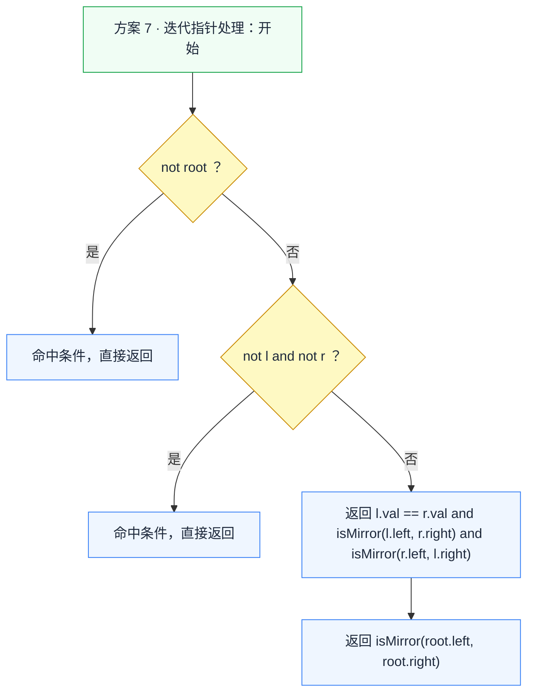

```python
import sys  # 提高递归深度上限（深输入防 RecursionError）

sys.setrecursionlimit(200000)  # 树/链表类题目节点数可达 1e4 量级

def isSymmetric(root):  # 定义函数 isSymmetric（参数：根节点）
    if not root:
        return True  # 若 not 根节点: return True

    def isMirror(l, r):  # 定义函数 isMirror（参数：左指针, 右指针）
        if not l and not r:
            return True  # 若 not 左指针 and not 右指针: return True
        return l.val == r.val and isMirror(l.left, r.right) and isMirror(r.left, l.right)

    return isMirror(root.left, root.right)  # 返回 isMirror(根节点.左边界, 根节点.右边界)

if __name__ == "__main__":  # 若 __name__ 等于 '__main__'
    print(isSymmetric(None))  # 打印输出
```

### Go 实现（7 种方案）

Go 的全部方案如下，每个方案都内嵌用例自测，可独立运行（老仓库 python/go 文件遵循「打印结果」约定）：

#### 方案 1：迭代指针处理

**思路与代码分析**：核心是「迭代指针处理」。Go 版用切片与多返回值惯用法，显式处理索引边界。**走读**：方案 1 · 迭代指针处理：开始 → 处理 if root == nil → 返回 true → 计算 isMirror → 更新 isMirror → 处理 if l == nil 且 r == nil → 返回 true → 处理 if l == nil 或 r == nil → 返回 false → 返回 l.Val == r.Val 且 isMirror(l.Left, r.Right) 且 isMirror(r.Left, l.Right) → 返回 isMirror(root.Left, root.Right)。

**运行架构**（真实控制流）：


```go
package main // 引入依赖

import (
	"fmt" // 「fmt」
	"os"  // 「os」
)

type TreeNode struct { // 定义类型
	Val   int       // Val int
	Left  *TreeNode // Left 乘 TreeNode
	Right *TreeNode // Right 乘 TreeNode
}

func buildTree(vals []interface{}) *TreeNode { // 定义函数/方法 buildTree
	if len(vals) == 0 || vals[0] == nil { // 若 长度(vals) 等于 0 或 vals[0] 等于 nil
		return nil // 返回 nil
	}
	root := &TreeNode{Val: vals[0].(int)} // 把 按位与 TreeNode{Val: vals[0].(int)} 写入 root :
	q := []*TreeNode{root}                // 把 [] 乘 TreeNode{根节点} 写入 q :
	i := 1                                // 把 1 写入 i :
	for len(q) > 0 && i < len(vals) {     // 定义函数/方法 len
		node := q[0]                         // 把 节点[0] 写入 node :
		q = q[1:]                            // 把 节点[1:] 写入 节点
		if i < len(vals) && vals[i] != nil { // 若 下标 i 小于 长度(vals) 且 vals[下标 i] 不等于 nil
			node.Left = &TreeNode{Val: vals[i].(int)} // 把 按位与 TreeNode{Val: vals[下标 i].(int)} 写入 node.Left
			q = append(q, node.Left)                  // 把 append(节点, 节点.Left) 写入 节点
		}
		i++                                  // 下标 i 加一
		if i < len(vals) && vals[i] != nil { // 若 下标 i 小于 长度(vals) 且 vals[下标 i] 不等于 nil
			node.Right = &TreeNode{Val: vals[i].(int)} // 把 按位与 TreeNode{Val: vals[下标 i].(int)} 写入 node.Right
			q = append(q, node.Right)                  // 把 append(节点, 节点.Right) 写入 节点
		}
		i++ // 下标 i 加一
	}
	return root // 返回 根节点
}

func isSymmetric(root *TreeNode) bool { // 定义判定函数 isSymmetric
	if root == nil { // 若 根节点 等于 nil
		return true // 返回 true
	}
	var isMirror func(l, r *TreeNode) bool // var isMirror func(左指针, 右指针 乘 TreeNode) bool
	isMirror = func(l, r *TreeNode) bool { // 把 func(左指针, 右指针 乘 TreeNode) bool { 写入 isMirror
		if l == nil && r == nil { // 若 左指针 等于 nil 且 右指针 等于 nil
			return true // 返回 true
		}
		if l == nil || r == nil { // 若 左指针 等于 nil 或 右指针 等于 nil
			return false // 返回 false
		}
		return l.Val == r.Val && isMirror(l.Left, r.Right) && isMirror(r.Left, l.Right)
	}
	return isMirror(root.Left, root.Right) // 定义判定函数 isMirror
}

type tc struct { // 定义类型
	root *TreeNode // 根节点 乘 TreeNode
	want bool      // want bool
}

func main() { // 程序入口：跑内嵌自测用例
	cases := []tc{ // 把 []tc{ 写入 cases :
		{buildTree(nil), true},
		{buildTree([]interface{}{1}), true},
		{buildTree([]interface{}{1, 2, 2, 3, 4, 4, 3}), true},
		{buildTree([]interface{}{1, 2, 2, 3, 4, 4, 9}), false},
	}
	for idx, c := range cases { // 同时取 idx 与 字符 遍历
		got := isSymmetric(c.root) // 把 isSymmetric(字符.根节点) 写入 got :
		if got != c.want {         // 若 got 不等于 字符.want
			fmt.Printf("case %d failed: got %v want %v\n", idx, got, c.want) // 打印输出
			os.Exit(1)                                                       // os.Exit(1)
		}
	}
	fmt.Println("PASS") // 全部用例通过，输出 PASS
}
```

#### 方案 2：迭代指针处理

**思路与代码分析**：核心是「迭代指针处理」。Go 版用切片与多返回值惯用法，显式处理索引边界。**走读**：方案 2 · 迭代指针处理：开始 → 处理 if root == nil → 返回 true → 遍历循环 → 返回 false → 返回 false → 返回 true。

**运行架构**（真实控制流）：

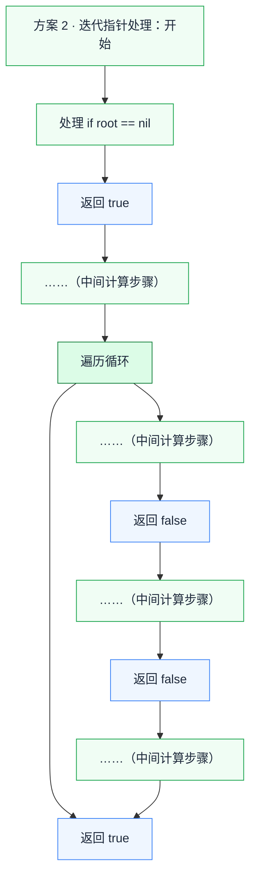

```go
package main // 引入依赖

import (
	"fmt" // 「fmt」
	"os"  // 「os」
)

type TreeNode struct { // 定义类型
	Val   int       // Val int
	Left  *TreeNode // Left 乘 TreeNode
	Right *TreeNode // Right 乘 TreeNode
}

func buildTree(vals []interface{}) *TreeNode { // 定义函数/方法 buildTree
	if len(vals) == 0 || vals[0] == nil { // 若 长度(vals) 等于 0 或 vals[0] 等于 nil
		return nil // 返回 nil
	}
	root := &TreeNode{Val: vals[0].(int)} // 把 按位与 TreeNode{Val: vals[0].(int)} 写入 root :
	q := []*TreeNode{root}                // 把 [] 乘 TreeNode{根节点} 写入 q :
	i := 1                                // 把 1 写入 i :
	for len(q) > 0 && i < len(vals) {     // 定义函数/方法 len
		node := q[0]                         // 把 节点[0] 写入 node :
		q = q[1:]                            // 把 节点[1:] 写入 节点
		if i < len(vals) && vals[i] != nil { // 若 下标 i 小于 长度(vals) 且 vals[下标 i] 不等于 nil
			node.Left = &TreeNode{Val: vals[i].(int)} // 把 按位与 TreeNode{Val: vals[下标 i].(int)} 写入 node.Left
			q = append(q, node.Left)                  // 把 append(节点, 节点.Left) 写入 节点
		}
		i++                                  // 下标 i 加一
		if i < len(vals) && vals[i] != nil { // 若 下标 i 小于 长度(vals) 且 vals[下标 i] 不等于 nil
			node.Right = &TreeNode{Val: vals[i].(int)} // 把 按位与 TreeNode{Val: vals[下标 i].(int)} 写入 node.Right
			q = append(q, node.Right)                  // 把 append(节点, 节点.Right) 写入 节点
		}
		i++ // 下标 i 加一
	}
	return root // 返回 根节点
}

func isSymmetric(root *TreeNode) bool { // 定义判定函数 isSymmetric
	if root == nil { // 若 根节点 等于 nil
		return true // 返回 true
	}
	queue := []*TreeNode{root.Left, root.Right} // 把 [] 乘 TreeNode{根节点.Left, 根节点.Right} 写入 queue :
	for len(queue) > 0 {                        // for 长度(队列) 超过 0 {
		left := queue[0]                 // 把 队列[0] 写入 left :
		queue = queue[1:]                // 把 队列[1:] 写入 队列
		right := queue[0]                // 把 队列[0] 写入 right :
		queue = queue[1:]                // 把 队列[1:] 写入 队列
		if left == nil && right == nil { // 若 左边界 等于 nil 且 右边界 等于 nil
			continue // 跳过本轮，进入下一次
		}
		if left == nil || right == nil { // 若 左边界 等于 nil 或 右边界 等于 nil
			return false // 返回 false
		}
		if left.Val != right.Val { // 若 左边界.Val 不等于 右边界.Val
			return false // 返回 false
		}
		queue = append(queue, left.Left)   // 把 append(队列, 左边界.Left) 写入 队列
		queue = append(queue, right.Right) // 把 append(队列, 右边界.Right) 写入 队列
		queue = append(queue, left.Right)  // 把 append(队列, 左边界.Right) 写入 队列
		queue = append(queue, right.Left)  // 把 append(队列, 右边界.Left) 写入 队列
	}
	return true // 返回 true
}

type tc struct { // 定义类型
	root *TreeNode // 根节点 乘 TreeNode
	want bool      // want bool
}

func main() { // 程序入口：跑内嵌自测用例
	cases := []tc{ // 把 []tc{ 写入 cases :
		{buildTree(nil), true},
		{buildTree([]interface{}{1}), true},
		{buildTree([]interface{}{1, 2, 2, 3, 4, 4, 3}), true},
		{buildTree([]interface{}{1, 2, 2, 3, 4, 4, 9}), false},
	}
	for idx, c := range cases { // 同时取 idx 与 字符 遍历
		got := isSymmetric(c.root) // 把 isSymmetric(字符.根节点) 写入 got :
		if got != c.want {         // 若 got 不等于 字符.want
			fmt.Printf("case %d failed: got %v want %v\n", idx, got, c.want) // 打印输出
			os.Exit(1)                                                       // os.Exit(1)
		}
	}
	fmt.Println("PASS") // 全部用例通过，输出 PASS
}
```

#### 方案 3：迭代指针处理

**思路与代码分析**：核心是「迭代指针处理」。Go 版用切片与多返回值惯用法，显式处理索引边界。**走读**：方案 3 · 迭代指针处理：开始 → 处理 if root == nil → 返回 true → 计算 isMirror → 更新 isMirror → 处理 if l == nil 且 r == nil → 返回 true → 处理 if l == nil 或 r == nil → 返回 false → 返回 l.Val == r.Val 且 isMirror(l.Left, r.Right) 且 isMirror(r.Left, l.Right) → 返回 isMirror(root.Left, root.Right)。

**运行架构**（真实控制流）：


```go
package main // 引入依赖

import (
	"fmt" // 「fmt」
	"os"  // 「os」
)

type TreeNode struct { // 定义类型
	Val   int       // Val int
	Left  *TreeNode // Left 乘 TreeNode
	Right *TreeNode // Right 乘 TreeNode
}

func buildTree(vals []interface{}) *TreeNode { // 定义函数/方法 buildTree
	if len(vals) == 0 || vals[0] == nil { // 若 长度(vals) 等于 0 或 vals[0] 等于 nil
		return nil // 返回 nil
	}
	root := &TreeNode{Val: vals[0].(int)} // 把 按位与 TreeNode{Val: vals[0].(int)} 写入 root :
	q := []*TreeNode{root}                // 把 [] 乘 TreeNode{根节点} 写入 q :
	i := 1                                // 把 1 写入 i :
	for len(q) > 0 && i < len(vals) {     // 定义函数/方法 len
		node := q[0]                         // 把 节点[0] 写入 node :
		q = q[1:]                            // 把 节点[1:] 写入 节点
		if i < len(vals) && vals[i] != nil { // 若 下标 i 小于 长度(vals) 且 vals[下标 i] 不等于 nil
			node.Left = &TreeNode{Val: vals[i].(int)} // 把 按位与 TreeNode{Val: vals[下标 i].(int)} 写入 node.Left
			q = append(q, node.Left)                  // 把 append(节点, 节点.Left) 写入 节点
		}
		i++                                  // 下标 i 加一
		if i < len(vals) && vals[i] != nil { // 若 下标 i 小于 长度(vals) 且 vals[下标 i] 不等于 nil
			node.Right = &TreeNode{Val: vals[i].(int)} // 把 按位与 TreeNode{Val: vals[下标 i].(int)} 写入 node.Right
			q = append(q, node.Right)                  // 把 append(节点, 节点.Right) 写入 节点
		}
		i++ // 下标 i 加一
	}
	return root // 返回 根节点
}

func isSymmetric(root *TreeNode) bool { // 定义判定函数 isSymmetric
	if root == nil { // 若 根节点 等于 nil
		return true // 返回 true
	}
	var isMirror func(l, r *TreeNode) bool // var isMirror func(左指针, 右指针 乘 TreeNode) bool
	isMirror = func(l, r *TreeNode) bool { // 把 func(左指针, 右指针 乘 TreeNode) bool { 写入 isMirror
		if l == nil && r == nil { // 若 左指针 等于 nil 且 右指针 等于 nil
			return true // 返回 true
		}
		if l == nil || r == nil { // 若 左指针 等于 nil 或 右指针 等于 nil
			return false // 返回 false
		}
		return l.Val == r.Val && isMirror(l.Left, r.Right) && isMirror(r.Left, l.Right)
	}
	return isMirror(root.Left, root.Right) // 定义判定函数 isMirror
}

type tc struct { // 定义类型
	root *TreeNode // 根节点 乘 TreeNode
	want bool      // want bool
}

func main() { // 程序入口：跑内嵌自测用例
	cases := []tc{ // 把 []tc{ 写入 cases :
		{buildTree(nil), true},
		{buildTree([]interface{}{1}), true},
		{buildTree([]interface{}{1, 2, 2, 3, 4, 4, 3}), true},
		{buildTree([]interface{}{1, 2, 2, 3, 4, 4, 9}), false},
	}
	for idx, c := range cases { // 同时取 idx 与 字符 遍历
		got := isSymmetric(c.root) // 把 isSymmetric(字符.根节点) 写入 got :
		if got != c.want {         // 若 got 不等于 字符.want
			fmt.Printf("case %d failed: got %v want %v\n", idx, got, c.want) // 打印输出
			os.Exit(1)                                                       // os.Exit(1)
		}
	}
	fmt.Println("PASS") // 全部用例通过，输出 PASS
}
```

#### 方案 4：迭代指针处理

**思路与代码分析**：核心是「迭代指针处理」。Go 版用切片与多返回值惯用法，显式处理索引边界。**走读**：方案 4 · 迭代指针处理：开始 → 处理 if root == nil → 返回 true → 返回 true → 遍历循环 → 返回 false → 返回 false → 返回 true。

**运行架构**（真实控制流）：

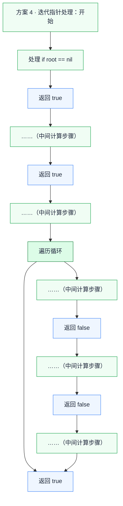

```go
package main // 引入依赖

import (
	"fmt"
	"os"
) // 引入依赖

type TreeNode struct { // 定义类型
	Val   int       // Val int
	Left  *TreeNode // Left 乘 TreeNode
	Right *TreeNode // Right 乘 TreeNode
}

func buildTree(vals []interface{}) *TreeNode { // 定义函数/方法 buildTree
	if len(vals) == 0 || vals[0] == nil { // 若 长度(vals) 等于 0 或 vals[0] 等于 nil
		return nil // 返回 nil
	}
	root := &TreeNode{Val: vals[0].(int)} // 把 按位与 TreeNode{Val: vals[0].(int)} 写入 root :
	q := []*TreeNode{root}                // 把 [] 乘 TreeNode{根节点} 写入 q :
	i := 1                                // 把 1 写入 i :
	for i < len(vals) {                   // for 下标 i 小于 长度(vals) {
		node := q[0]        // 把 节点[0] 写入 node :
		q = q[1:]           // 把 节点[1:] 写入 节点
		if vals[i] != nil { // 若 vals[下标 i] 不等于 nil
			node.Left = &TreeNode{Val: vals[i].(int)} // 把 按位与 TreeNode{Val: vals[下标 i].(int)} 写入 node.Left
			q = append(q, node.Left)                  // 把 append(节点, 节点.Left) 写入 节点
		}
		i++                // 下标 i 加一
		if i < len(vals) { // 若 下标 i 小于 长度(vals
			if vals[i] != nil { // 若 vals[下标 i] 不等于 nil
				node.Right = &TreeNode{Val: vals[i].(int)} // 把 按位与 TreeNode{Val: vals[下标 i].(int)} 写入 node.Right
				q = append(q, node.Right)                  // 把 append(节点, 节点.Right) 写入 节点
			}
			i++ // 下标 i 加一
		}
	}
	return root // 返回 根节点
}

func isSymmetric(root *TreeNode) bool { // 定义判定函数 isSymmetric
	if root == nil { // 若 根节点 等于 nil
		return true // 返回 true
	}
	if root.Left == nil && root.Right == nil { // 若 根节点.Left 等于 nil 且 根节点.Right 等于 nil
		return true // 返回 true
	}
	queue := []*TreeNode{root.Left, root.Right} // 把 [] 乘 TreeNode{根节点.Left, 根节点.Right} 写入 queue :
	for len(queue) > 0 {                        // for 长度(队列) 超过 0 {
		left := queue[0]                 // 把 队列[0] 写入 left :
		queue = queue[1:]                // 把 队列[1:] 写入 队列
		right := queue[0]                // 把 队列[0] 写入 right :
		queue = queue[1:]                // 把 队列[1:] 写入 队列
		if left == nil && right == nil { // 若 左边界 等于 nil 且 右边界 等于 nil
			continue // 跳过本轮，进入下一次
		}
		if left == nil || right == nil { // 若 左边界 等于 nil 或 右边界 等于 nil
			return false // 返回 false
		}
		if left.Val != right.Val { // 若 左边界.Val 不等于 右边界.Val
			return false // 返回 false
		}
		queue = append(queue, left.Left, right.Right, left.Right, right.Left) // 把 append(队列, 左边界.Left, 右边界.Right, 左边界.Right, 右边界.Left) 写入 队列
	}
	return true // 返回 true
}

func main() { // 程序入口：跑内嵌自测用例
	cases := []struct { // 把 []struct { 写入 cases :
		vals []interface{} // vals []interface{}
		want bool          // want bool
	}{ // }{
		{nil, true},
		{[]interface{}{1, 2, 2, 3, 4, 4, 3}, true},
		{[]interface{}{1, 2, 2, nil, 3, nil, 3}, false},
	}
	ok := true                // 把 true 写入 ok :
	for _, c := range cases { // 同时取 _ 与 字符 遍历
		if g := isSymmetric(buildTree(c.vals)); g != c.want { // 若 g : 赋值为 isSymmetric(buildTree(字符.vals)); g 不等于 字符.want
			ok = false                                            // 把 false 写入 ok
			fmt.Printf("FAIL %v=%v want %v\n", c.vals, g, c.want) // 打印输出
		}
	}
	if !ok { // 若 取反 ok
		os.Exit(1) // os.Exit(1)
	}
	fmt.Println("PASS") // 全部用例通过，输出 PASS
}
```

#### 方案 5：迭代指针处理

**思路与代码分析**：核心是「迭代指针处理」。Go 版用切片与多返回值惯用法，显式处理索引边界。**走读**：方案 5 · 迭代指针处理：开始 → 处理 if root == nil → 返回 true → 计算 isMirror → 更新 isMirror → 处理 if l == nil 且 r == nil → 返回 true → 处理 if l == nil 或 r == nil → 返回 false → 返回 l.Val == r.Val 且 isMirror(l.Left, r.Right) 且 isMirror(r.Left, l.Right) → 返回 isMirror(root.Left, root.Right)。

**运行架构**（真实控制流）：

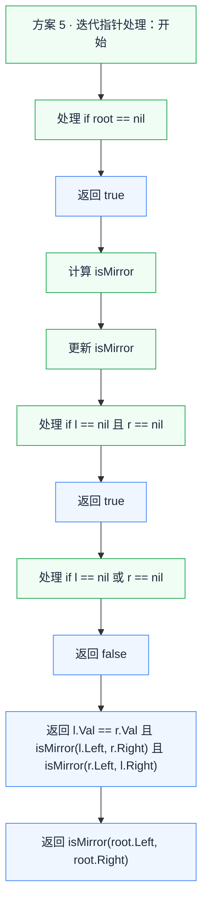

```go
package main // 引入依赖

import (
	"fmt" // 「fmt」
	"os"  // 「os」
)

type TreeNode struct { // 定义类型
	Val   int       // Val int
	Left  *TreeNode // Left 乘 TreeNode
	Right *TreeNode // Right 乘 TreeNode
}

func buildTree(vals []interface{}) *TreeNode { // 定义函数/方法 buildTree
	if len(vals) == 0 || vals[0] == nil { // 若 长度(vals) 等于 0 或 vals[0] 等于 nil
		return nil // 返回 nil
	}
	root := &TreeNode{Val: vals[0].(int)} // 把 按位与 TreeNode{Val: vals[0].(int)} 写入 root :
	q := []*TreeNode{root}                // 把 [] 乘 TreeNode{根节点} 写入 q :
	i := 1                                // 把 1 写入 i :
	for len(q) > 0 && i < len(vals) {     // 定义函数/方法 len
		node := q[0]                         // 把 节点[0] 写入 node :
		q = q[1:]                            // 把 节点[1:] 写入 节点
		if i < len(vals) && vals[i] != nil { // 若 下标 i 小于 长度(vals) 且 vals[下标 i] 不等于 nil
			node.Left = &TreeNode{Val: vals[i].(int)} // 把 按位与 TreeNode{Val: vals[下标 i].(int)} 写入 node.Left
			q = append(q, node.Left)                  // 把 append(节点, 节点.Left) 写入 节点
		}
		i++                                  // 下标 i 加一
		if i < len(vals) && vals[i] != nil { // 若 下标 i 小于 长度(vals) 且 vals[下标 i] 不等于 nil
			node.Right = &TreeNode{Val: vals[i].(int)} // 把 按位与 TreeNode{Val: vals[下标 i].(int)} 写入 node.Right
			q = append(q, node.Right)                  // 把 append(节点, 节点.Right) 写入 节点
		}
		i++ // 下标 i 加一
	}
	return root // 返回 根节点
}

func isSymmetric(root *TreeNode) bool { // 定义判定函数 isSymmetric
	if root == nil { // 若 根节点 等于 nil
		return true // 返回 true
	}
	var isMirror func(l, r *TreeNode) bool // var isMirror func(左指针, 右指针 乘 TreeNode) bool
	isMirror = func(l, r *TreeNode) bool { // 把 func(左指针, 右指针 乘 TreeNode) bool { 写入 isMirror
		if l == nil && r == nil { // 若 左指针 等于 nil 且 右指针 等于 nil
			return true // 返回 true
		}
		if l == nil || r == nil { // 若 左指针 等于 nil 或 右指针 等于 nil
			return false // 返回 false
		}
		return l.Val == r.Val && isMirror(l.Left, r.Right) && isMirror(r.Left, l.Right)
	}
	return isMirror(root.Left, root.Right) // 定义判定函数 isMirror
}

type tc struct { // 定义类型
	root *TreeNode // 根节点 乘 TreeNode
	want bool      // want bool
}

func main() { // 程序入口：跑内嵌自测用例
	cases := []tc{ // 把 []tc{ 写入 cases :
		{buildTree(nil), true},
		{buildTree([]interface{}{1}), true},
		{buildTree([]interface{}{1, 2, 2, 3, 4, 4, 3}), true},
		{buildTree([]interface{}{1, 2, 2, 3, 4, 4, 9}), false},
	}
	for idx, c := range cases { // 同时取 idx 与 字符 遍历
		got := isSymmetric(c.root) // 把 isSymmetric(字符.根节点) 写入 got :
		if got != c.want {         // 若 got 不等于 字符.want
			fmt.Printf("case %d failed: got %v want %v\n", idx, got, c.want) // 打印输出
			os.Exit(1)                                                       // os.Exit(1)
		}
	}
	fmt.Println("PASS") // 全部用例通过，输出 PASS
}
```

#### 方案 6：迭代指针处理

**思路与代码分析**：核心是「迭代指针处理」。Go 版用切片与多返回值惯用法，显式处理索引边界。**走读**：方案 6 · 迭代指针处理：开始 → 计算 isM → 更新 isM → 处理 if a == nil 且 b == nil → 返回 true → 处理 if a == nil 或 b == nil → 返回 false → 返回 a.Val == b.Val 且 isM(a.Left, b.Right) 且 isM(a.Right, b.Left) → 处理 if root == nil → 返回 true → 返回 isM(root.Left, root.Right)。

**运行架构**（真实控制流）：

```mermaid
graph TD
    N0["方案 6 · 迭代指针处理：开始"]
    N1["计算 isM"]
    N2["更新 isM"]
    N3["处理 if a == nil 且 b == nil"]
    N4["返回 true"]
    N5["处理 if a == nil 或 b == nil"]
    N6["返回 false"]
    N7["返回 a.Val == b.Val 且 isM(a.Left, b.Right) 且 isM(a.Right, b.Left)"]
    N8["处理 if root == nil"]
    N9["返回 true"]
    N10["返回 isM(root.Left, root.Right)"]
    N0 --> N1
    N1 --> N2
    N2 --> N3
    N3 --> N4
    N4 --> N5
    N5 --> N6
    N6 --> N7
    N7 --> N8
    N8 --> N9
    N9 --> N10
    classDef n fill:#f0fdf4,stroke:#16a34a,color:#1e293b;
    classDef lp fill:#dcfce7,stroke:#15803d,color:#1e293b;
    classDef dc fill:#fef9c3,stroke:#ca8a04,color:#1e293b;
    classDef tm fill:#eff6ff,stroke:#3b82f6,color:#1e293b;
    class N0,N1,N2,N3,N5,N8 n;
    class N4,N6,N7,N9,N10 tm;
```

```go
package main // 引入依赖
import (
	"fmt"
	"os"
) // 引入依赖
type TreeNode struct {
	Val   int
	Left  *TreeNode
	Right *TreeNode
}                        // 定义类型
const NULL = -1000000000 // 把 减 1000000000 存入 NULL
func buildTree(vals []int) *TreeNode { // 定义函数/方法 buildTree
	if len(vals) == 0 || vals[0] == NULL {
		return nil
	} // 若 长度(vals) 等于 0 或 vals[0] 等于 NULL { return nil }
	root := &TreeNode{Val: vals[0]} // 把 按位与 TreeNode{Val: vals[0]} 写入 root :
	q := []*TreeNode{root}
	i := 1                            // 把 [] 乘 TreeNode{根节点}; 下标 i : 赋值为 1 写入 q :
	for len(q) > 0 && i < len(vals) { // 定义函数/方法 len
		node := q[0]
		q = q[1:] // 把 节点[0]; 节点 赋值为 节点[1:] 写入 node :
		if i < len(vals) && vals[i] != NULL {
			node.Left = &TreeNode{Val: vals[i]}
			q = append(q, node.Left)
		}
		i++
		if i < len(vals) && vals[i] != NULL {
			node.Right = &TreeNode{Val: vals[i]}
			q = append(q, node.Right)
		}
		i++
	}
	return root // 返回 根节点
}
func levelList(root *TreeNode) [][]int { // 定义函数/方法 levelList
	if root == nil {
		return [][]int{}
	} // 若 根节点 等于 nil { return [][]int{} }
	res := [][]int{}
	q := []*TreeNode{root} // 把 [][]int{}; 节点 : 赋值为 [] 乘 TreeNode{根节点} 写入 res :
	for len(q) > 0 {       // for 长度(节点) 超过 0 {
		lvl := []int{}
		n := len(q)              // 把 []int{}; 元素个数 : 赋值为 长度(节点) 写入 lvl :
		for k := 0; k < n; k++ { // 让 下标 k 从 0 开始计数
			node := q[0]
			q = q[1:]                   // 把 节点[0]; 节点 赋值为 节点[1:] 写入 node :
			lvl = append(lvl, node.Val) // 把 append(lvl, 节点.Val) 写入 lvl
			if node.Left != nil {
				q = append(q, node.Left)
			} // 若 节点.Left 不等于 nil { 节点 赋值为 append(节点, 节点.Left) }
			if node.Right != nil {
				q = append(q, node.Right)
			} // 若 节点.Right 不等于 nil { 节点 赋值为 append(节点, 节点.Right) }
		}
		res = append(res, lvl) // 把 append(结果, lvl) 写入 结果
	}
	return res // 返回 结果
}
func sameTree(a, b *TreeNode) bool { // 定义函数/方法 sameTree
	if a == nil && b == nil {
		return true
	} // 若 数组 等于 nil 且 b 等于 nil { return true }
	if a == nil || b == nil {
		return false
	} // 若 数组 等于 nil 或 b 等于 nil { return false }
	if a.Val != b.Val {
		return false
	} // 若 数组.Val 不等于 b.Val { return false }
	return sameTree(a.Left, b.Left) && sameTree(a.Right, b.Right) // 定义函数/方法 sameTree
}
func inorderT(root *TreeNode) []int { // 定义函数/方法 inorderT
	if root == nil {
		return []int{}
	} // 若 根节点 等于 nil { return []int{} }
	return append(append(inorderT(root.Left), root.Val), inorderT(root.Right)...) // 定义函数/方法 append
}
func isSymmetric(root *TreeNode) bool { // 定义判定函数 isSymmetric
	var isM func(a, b *TreeNode) bool // var isM func(数组, b 乘 TreeNode) bool
	isM = func(a, b *TreeNode) bool { // 把 func(数组, b 乘 TreeNode) bool { 写入 isM
		if a == nil && b == nil {
			return true
		} // 若 数组 等于 nil 且 b 等于 nil { return true }
		if a == nil || b == nil {
			return false
		} // 若 数组 等于 nil 或 b 等于 nil { return false }
		return a.Val == b.Val && isM(a.Left, b.Right) && isM(a.Right, b.Left)
	}
	if root == nil {
		return true
	} // 若 根节点 等于 nil { return true }
	return isM(root.Left, root.Right) // 定义判定函数 isM
}
func main() { // 程序入口：跑内嵌自测用例
	sym := buildTree([]int{1, 2, 2, 3, 4, 4, 3})         // 把 buildTree([]int{1,2,2,3,4,4,3}) 写入 sym :
	nosym := buildTree([]int{1, 2, 2, NULL, 3, NULL, 3}) // 把 buildTree([]int{1,2,2,NULL,3,NULL,3}) 写入 nosym :
	ok := true                                           // 把 true 写入 ok :
	if !isSymmetric(sym) {
		ok = false
		fmt.Println("FAIL sym")
	}
	if isSymmetric(nosym) {
		ok = false
		fmt.Println("FAIL nosym")
	}
	if !isSymmetric(nil) {
		ok = false
		fmt.Println("FAIL nil")
	}
	if !ok {
		os.Exit(1)
	} // 若 取反 ok { os.Exit(1) }
	fmt.Println("PASS") // 全部用例通过，输出 PASS
}
```

#### 方案 7：迭代指针处理

**思路与代码分析**：核心是「迭代指针处理」。Go 版用切片与多返回值惯用法，显式处理索引边界。**走读**：方案 7 · 迭代指针处理：开始 → 处理 if root == nil → 返回 true → 计算 isMirror → 更新 isMirror → 处理 if l == nil 且 r == nil → 返回 true → 处理 if l == nil 或 r == nil → 返回 false → 返回 l.Val == r.Val 且 isMirror(l.Left, r.Right) 且 isMirror(r.Left, l.Right) → 返回 isMirror(root.Left, root.Right)。

**运行架构**（真实控制流）：

```mermaid
graph TD
    N0["方案 7 · 迭代指针处理：开始"]
    N1["处理 if root == nil"]
    N2["返回 true"]
    N3["计算 isMirror"]
    N4["更新 isMirror"]
    N5["处理 if l == nil 且 r == nil"]
    N6["返回 true"]
    N7["处理 if l == nil 或 r == nil"]
    N8["返回 false"]
    N9["返回 l.Val == r.Val 且 isMirror(l.Left, r.Right) 且 isMirror(r.Left, l.Right)"]
    N10["返回 isMirror(root.Left, root.Right)"]
    N0 --> N1
    N1 --> N2
    N2 --> N3
    N3 --> N4
    N4 --> N5
    N5 --> N6
    N6 --> N7
    N7 --> N8
    N8 --> N9
    N9 --> N10
    classDef n fill:#f0fdf4,stroke:#16a34a,color:#1e293b;
    classDef lp fill:#dcfce7,stroke:#15803d,color:#1e293b;
    classDef dc fill:#fef9c3,stroke:#ca8a04,color:#1e293b;
    classDef tm fill:#eff6ff,stroke:#3b82f6,color:#1e293b;
    class N0,N1,N3,N4,N5,N7 n;
    class N2,N6,N8,N9,N10 tm;
```

```go
package main // 引入依赖

import (
	"fmt" // 「fmt」
	"os"  // 「os」
)

type TreeNode struct { // 定义类型
	Val   int       // Val int
	Left  *TreeNode // Left 乘 TreeNode
	Right *TreeNode // Right 乘 TreeNode
}

func buildTree(vals []interface{}) *TreeNode { // 定义函数/方法 buildTree
	if len(vals) == 0 || vals[0] == nil { // 若 长度(vals) 等于 0 或 vals[0] 等于 nil
		return nil // 返回 nil
	}
	root := &TreeNode{Val: vals[0].(int)} // 把 按位与 TreeNode{Val: vals[0].(int)} 写入 root :
	q := []*TreeNode{root}                // 把 [] 乘 TreeNode{根节点} 写入 q :
	i := 1                                // 把 1 写入 i :
	for len(q) > 0 && i < len(vals) {     // 定义函数/方法 len
		node := q[0]                         // 把 节点[0] 写入 node :
		q = q[1:]                            // 把 节点[1:] 写入 节点
		if i < len(vals) && vals[i] != nil { // 若 下标 i 小于 长度(vals) 且 vals[下标 i] 不等于 nil
			node.Left = &TreeNode{Val: vals[i].(int)} // 把 按位与 TreeNode{Val: vals[下标 i].(int)} 写入 node.Left
			q = append(q, node.Left)                  // 把 append(节点, 节点.Left) 写入 节点
		}
		i++                                  // 下标 i 加一
		if i < len(vals) && vals[i] != nil { // 若 下标 i 小于 长度(vals) 且 vals[下标 i] 不等于 nil
			node.Right = &TreeNode{Val: vals[i].(int)} // 把 按位与 TreeNode{Val: vals[下标 i].(int)} 写入 node.Right
			q = append(q, node.Right)                  // 把 append(节点, 节点.Right) 写入 节点
		}
		i++ // 下标 i 加一
	}
	return root // 返回 根节点
}

func isSymmetric(root *TreeNode) bool { // 定义判定函数 isSymmetric
	if root == nil { // 若 根节点 等于 nil
		return true // 返回 true
	}
	var isMirror func(l, r *TreeNode) bool // var isMirror func(左指针, 右指针 乘 TreeNode) bool
	isMirror = func(l, r *TreeNode) bool { // 把 func(左指针, 右指针 乘 TreeNode) bool { 写入 isMirror
		if l == nil && r == nil { // 若 左指针 等于 nil 且 右指针 等于 nil
			return true // 返回 true
		}
		if l == nil || r == nil { // 若 左指针 等于 nil 或 右指针 等于 nil
			return false // 返回 false
		}
		return l.Val == r.Val && isMirror(l.Left, r.Right) && isMirror(r.Left, l.Right)
	}
	return isMirror(root.Left, root.Right) // 定义判定函数 isMirror
}

type tc struct { // 定义类型
	root *TreeNode // 根节点 乘 TreeNode
	want bool      // want bool
}

func main() { // 程序入口：跑内嵌自测用例
	cases := []tc{ // 把 []tc{ 写入 cases :
		{buildTree(nil), true},
		{buildTree([]interface{}{1}), true},
		{buildTree([]interface{}{1, 2, 2, 3, 4, 4, 3}), true},
		{buildTree([]interface{}{1, 2, 2, 3, 4, 4, 9}), false},
	}
	for idx, c := range cases { // 同时取 idx 与 字符 遍历
		got := isSymmetric(c.root) // 把 isSymmetric(字符.根节点) 写入 got :
		if got != c.want {         // 若 got 不等于 字符.want
			fmt.Printf("case %d failed: got %v want %v\n", idx, got, c.want) // 打印输出
			os.Exit(1)                                                       // os.Exit(1)
		}
	}
	fmt.Println("PASS") // 全部用例通过，输出 PASS
}
```

### Java 实现（7 种方案）

Java 的全部方案如下，每个方案都内嵌用例自测，可独立运行（老仓库 python/go 文件遵循「打印结果」约定）：

#### 方案 1：迭代指针处理

**思路与代码分析**：核心是「迭代指针处理」。Java 版用类与静态方法组织，集合操作显式明了。**走读**：方案 1 · 迭代指针处理：开始 → 命中条件，直接返回 → 返回 isMirror(root.left, root.right)。

**运行架构**（真实控制流）：

```mermaid
graph TD
    N0["方案 1 · 迭代指针处理：开始"]
    N1{"root == null ？"}
    N2["命中条件，直接返回"]
    N3["返回 isMirror(root.left, root.right)"]
    N0 --> N1
    N1 -- 是 --> N2
    N1 -- 否 --> N3
    classDef n fill:#f0fdf4,stroke:#16a34a,color:#1e293b;
    classDef lp fill:#dcfce7,stroke:#15803d,color:#1e293b;
    classDef dc fill:#fef9c3,stroke:#ca8a04,color:#1e293b;
    classDef tm fill:#eff6ff,stroke:#3b82f6,color:#1e293b;
    class N0 n;
    class N1 dc;
    class N2,N3 tm;
```

```java
package com.webfault.dsa; // 引入依赖

import java.util.*; // 引入依赖

class TreeNode { // 定义类型
  int val; // int 值;
  TreeNode left, right; // TreeNode 左边界, 右边界;

  TreeNode(int v) {
    val = v;
  } // 把 值;} 写入 TreeNode(int v){val
}

class Main { // 定义类型
  static TreeNode build(Integer[] vals) { // 定义函数/方法 build
    if (vals == null || vals.length == 0 || vals[0] == null)
      return null; // 若 vals 等于 null 或 vals.长度 等于 0 或 vals[0] 等于 null，直接返回 null
    TreeNode root = new TreeNode(vals[0]); // 把 new TreeNode(vals[0]); 写入 TreeNode root
    java.util.LinkedList<TreeNode> q = new java.util.LinkedList<>();
    q.add(root); // 节点 追加 根节点);
    int i = 1; // 把 1 存入 下标 i
    while (!q.isEmpty() && i < vals.length) { // 循环，直到不满足「取反 节点.isEmpty() 且 下标 i 小于 vals.长度」
      TreeNode n = q.poll(); // 把 节点.poll(); 写入 TreeNode n
      if (i < vals.length && vals[i] != null) {
        n.left = new TreeNode(vals[i]);
        q.add(n.left);
      }
      i++; // 下标 i 加一
      if (i < vals.length && vals[i] != null) {
        n.right = new TreeNode(vals[i]);
        q.add(n.right);
      }
      i++; // 下标 i 加一
    }
    return root; // 返回 根节点
  }

  static boolean isSymmetric(TreeNode root) { // 定义判定函数 isSymmetric
    if (root == null) return true; // 若 根节点 等于 null，直接返回 true
    return isMirror(root.left, root.right); // 返回 isMirror(根节点.左边界, 根节点.右边界)
  }

  static boolean isMirror(TreeNode l, TreeNode r) { // 定义判定函数 isMirror
    if (l == null && r == null) return true; // 若 左指针 等于 null 且 右指针 等于 null，直接返回 true
    return l.val == r.val && isMirror(l.left, r.right) && isMirror(r.left, l.right);
  }

  public static void main(String[] args) { // public static void main(String[] args) {
    Integer[][] cases = { // 把 { 写入 Integer[][] cases
      {1, 2, 2, 3, 4, 4, 3},
      {1, 2, 3},
      {},
      {1},
    };
    boolean[] wants = {true, false, true, true}; // 把 {true, false, true, true}; 写入 boolean[] wants
    boolean ok = true; // 把 true; 写入 boolean ok
    for (int ci = 0; ci < cases.length; ci++) { // 让 ci 从 0 开始计数，ci 小于 cases.长度 就继续
      boolean got =
          isSymmetric(build(cases[ci])); // 把 isSymmetric(build(cases[ci])); 写入 boolean got
      if (got != wants[ci]) { // 若 got 不等于 wants[ci]
        ok = false; // 把 false; 写入 ok
        System.out.println("FAIL case " + ci + " got " + got + " want " + wants[ci]); // 打印输出
      }
    }
    if (!ok) throw new RuntimeException("FAILED"); // 若 取反 ok) throw new RuntimeException(「FAILED」);
    System.out.println("PASS"); // 全部用例通过，输出 PASS
  }
}
```

#### 方案 2：迭代指针处理

**思路与代码分析**：核心是「迭代指针处理」。Java 版用类与静态方法组织，集合操作显式明了。**走读**：方案 2 · 迭代指针处理：开始 → 命中条件，直接返回 → 更新 queue → 当 (非 queue.isEmpty()) 时反复执行 → 命中条件，直接返回 → 命中条件，直接返回 → 返回 true。

**运行架构**（真实控制流）：

```mermaid
graph TD
    N0["方案 2 · 迭代指针处理：开始"]
    N1{"root == null 或 (root.left == null 且 root.right == null) ？"}
    N2["命中条件，直接返回"]
    N3["更新 queue"]
    D1["……（中间计算步骤）"]
    N6["当 (非 queue.isEmpty()) 时反复执行"]
    D2["……（中间计算步骤）"]
    N9{"left == null 且 right == null ？"}
    N10["命中条件，直接返回"]
    N11{"left.val ≠ right.val ？"}
    N12["命中条件，直接返回"]
    D3["……（中间计算步骤）"]
    N17["返回 true"]
    N0 --> N1
    N1 -- 是 --> N2
    N1 -- 否 --> N3
    N9 -- 是 --> N10
    N9 -- 否 --> N11
    N11 -- 是 --> N12
    N6 --> N17
    N2 --> N3
    N3 --> D1
    D1 --> N6
    N6 --> D2
    D2 --> N9
    N10 --> N11
    N12 --> D3
    D3 --> N17
    classDef n fill:#f0fdf4,stroke:#16a34a,color:#1e293b;
    classDef lp fill:#dcfce7,stroke:#15803d,color:#1e293b;
    classDef dc fill:#fef9c3,stroke:#ca8a04,color:#1e293b;
    classDef tm fill:#eff6ff,stroke:#3b82f6,color:#1e293b;
    class N0,N3,D1,D2,D3 n;
    class N6 lp;
    class N1,N9,N11 dc;
    class N2,N10,N12,N17 tm;
```

```java
package com.webfault.dsa; // 引入依赖

import java.util.*; // 引入依赖

class TreeNode { // 定义类型
  int val; // int 值;
  TreeNode left, right; // TreeNode 左边界, 右边界;

  TreeNode(int v) {
    val = v;
  } // 把 值;} 写入 TreeNode(int v){val
}

class Main { // 定义类型
  static TreeNode build(Integer[] vals) { // 定义函数/方法 build
    if (vals == null || vals.length == 0 || vals[0] == null)
      return null; // 若 vals 等于 null 或 vals.长度 等于 0 或 vals[0] 等于 null，直接返回 null
    TreeNode root = new TreeNode(vals[0]); // 把 new TreeNode(vals[0]); 写入 TreeNode root
    java.util.LinkedList<TreeNode> q = new java.util.LinkedList<>();
    q.add(root); // 节点 追加 根节点);
    int i = 1; // 把 1 存入 下标 i
    while (!q.isEmpty() && i < vals.length) { // 循环，直到不满足「取反 节点.isEmpty() 且 下标 i 小于 vals.长度」
      TreeNode n = q.poll(); // 把 节点.poll(); 写入 TreeNode n
      if (i < vals.length && vals[i] != null) {
        n.left = new TreeNode(vals[i]);
        q.add(n.left);
      }
      i++; // 下标 i 加一
      if (i < vals.length && vals[i] != null) {
        n.right = new TreeNode(vals[i]);
        q.add(n.right);
      }
      i++; // 下标 i 加一
    }
    return root; // 返回 根节点
  }

  static boolean isSymmetric(TreeNode root) { // 定义判定函数 isSymmetric
    if (root == null || (root.left == null && root.right == null)) return true;
    java.util.LinkedList<TreeNode> queue = new java.util.LinkedList<>();
    queue.add(root.left); // 队列 追加 根节点.左边界);
    queue.add(root.right); // 队列 追加 根节点.右边界);
    while (!queue.isEmpty()) { // 循环，直到不满足「取反 队列.isEmpty(」
      TreeNode left = queue.poll(); // 把 队列.poll(); 写入 TreeNode left
      TreeNode right = queue.poll(); // 把 队列.poll(); 写入 TreeNode right
      if (left == null && right == null) continue; // 若 左边界 等于 null 且 右边界 等于 null) continue;
      if (left == null || right == null) return false; // 若 左边界 等于 null 或 右边界 等于 null，直接返回 false
      if (left.val != right.val) return false; // 若 左边界.值 不等于 右边界.值，直接返回 false
      queue.add(left.left); // 队列 追加 左边界.左边界);
      queue.add(right.right); // 队列 追加 右边界.右边界);
      queue.add(left.right); // 队列 追加 左边界.右边界);
      queue.add(right.left); // 队列 追加 右边界.左边界);
    }
    return true; // 返回 true
  }

  public static void main(String[] args) { // public static void main(String[] args) {
    Integer[][] cases = { // 把 { 写入 Integer[][] cases
      {1, 2, 2, 3, 4, 4, 3},
      {1, 2, 3},
      {},
      {1},
    };
    boolean[] wants = {true, false, true, true}; // 把 {true, false, true, true}; 写入 boolean[] wants
    boolean ok = true; // 把 true; 写入 boolean ok
    for (int ci = 0; ci < cases.length; ci++) { // 让 ci 从 0 开始计数，ci 小于 cases.长度 就继续
      boolean got =
          isSymmetric(build(cases[ci])); // 把 isSymmetric(build(cases[ci])); 写入 boolean got
      if (got != wants[ci]) { // 若 got 不等于 wants[ci]
        ok = false; // 把 false; 写入 ok
        System.out.println("FAIL case " + ci + " got " + got + " want " + wants[ci]); // 打印输出
      }
    }
    if (!ok) throw new RuntimeException("FAILED"); // 若 取反 ok) throw new RuntimeException(「FAILED」);
    System.out.println("PASS"); // 全部用例通过，输出 PASS
  }
}
```

#### 方案 3：迭代指针处理

**思路与代码分析**：核心是「迭代指针处理」。Java 版用类与静态方法组织，集合操作显式明了。**走读**：方案 3 · 迭代指针处理：开始 → 命中条件，直接返回 → 返回 isMirror(root.left, root.right)。

**运行架构**（真实控制流）：

```mermaid
graph TD
    N0["方案 3 · 迭代指针处理：开始"]
    N1{"root == null ？"}
    N2["命中条件，直接返回"]
    N3["返回 isMirror(root.left, root.right)"]
    N0 --> N1
    N1 -- 是 --> N2
    N1 -- 否 --> N3
    classDef n fill:#f0fdf4,stroke:#16a34a,color:#1e293b;
    classDef lp fill:#dcfce7,stroke:#15803d,color:#1e293b;
    classDef dc fill:#fef9c3,stroke:#ca8a04,color:#1e293b;
    classDef tm fill:#eff6ff,stroke:#3b82f6,color:#1e293b;
    class N0 n;
    class N1 dc;
    class N2,N3 tm;
```

```java
package com.webfault.dsa; // 引入依赖

import java.util.*; // 引入依赖

class TreeNode { // 定义类型
  int val; // int 值;
  TreeNode left, right; // TreeNode 左边界, 右边界;

  TreeNode(int v) {
    val = v;
  } // 把 值;} 写入 TreeNode(int v){val
}

class Main { // 定义类型
  static TreeNode build(Integer[] vals) { // 定义函数/方法 build
    if (vals == null || vals.length == 0 || vals[0] == null)
      return null; // 若 vals 等于 null 或 vals.长度 等于 0 或 vals[0] 等于 null，直接返回 null
    TreeNode root = new TreeNode(vals[0]); // 把 new TreeNode(vals[0]); 写入 TreeNode root
    java.util.LinkedList<TreeNode> q = new java.util.LinkedList<>();
    q.add(root); // 节点 追加 根节点);
    int i = 1; // 把 1 存入 下标 i
    while (!q.isEmpty() && i < vals.length) { // 循环，直到不满足「取反 节点.isEmpty() 且 下标 i 小于 vals.长度」
      TreeNode n = q.poll(); // 把 节点.poll(); 写入 TreeNode n
      if (i < vals.length && vals[i] != null) {
        n.left = new TreeNode(vals[i]);
        q.add(n.left);
      }
      i++; // 下标 i 加一
      if (i < vals.length && vals[i] != null) {
        n.right = new TreeNode(vals[i]);
        q.add(n.right);
      }
      i++; // 下标 i 加一
    }
    return root; // 返回 根节点
  }

  static boolean isSymmetric(TreeNode root) { // 定义判定函数 isSymmetric
    if (root == null) return true; // 若 根节点 等于 null，直接返回 true
    return isMirror(root.left, root.right); // 返回 isMirror(根节点.左边界, 根节点.右边界)
  }

  static boolean isMirror(TreeNode l, TreeNode r) { // 定义判定函数 isMirror
    if (l == null && r == null) return true; // 若 左指针 等于 null 且 右指针 等于 null，直接返回 true
    return l.val == r.val && isMirror(l.left, r.right) && isMirror(r.left, l.right);
  }

  public static void main(String[] args) { // public static void main(String[] args) {
    Integer[][] cases = { // 把 { 写入 Integer[][] cases
      {1, 2, 2, 3, 4, 4, 3},
      {1, 2, 3},
      {},
      {1},
    };
    boolean[] wants = {true, false, true, true}; // 把 {true, false, true, true}; 写入 boolean[] wants
    boolean ok = true; // 把 true; 写入 boolean ok
    for (int ci = 0; ci < cases.length; ci++) { // 让 ci 从 0 开始计数，ci 小于 cases.长度 就继续
      boolean got =
          isSymmetric(build(cases[ci])); // 把 isSymmetric(build(cases[ci])); 写入 boolean got
      if (got != wants[ci]) { // 若 got 不等于 wants[ci]
        ok = false; // 把 false; 写入 ok
        System.out.println("FAIL case " + ci + " got " + got + " want " + wants[ci]); // 打印输出
      }
    }
    if (!ok) throw new RuntimeException("FAILED"); // 若 取反 ok) throw new RuntimeException(「FAILED」);
    System.out.println("PASS"); // 全部用例通过，输出 PASS
  }
}
```

#### 方案 4：迭代指针处理

**思路与代码分析**：核心是「迭代指针处理」。Java 版用类与静态方法组织，集合操作显式明了。**走读**：方案 4 · 迭代指针处理：开始 → 命中条件，直接返回 → 更新 queue → 当 (非 queue.isEmpty()) 时反复执行 → 命中条件，直接返回 → 命中条件，直接返回 → 返回 true。

**运行架构**（真实控制流）：

```mermaid
graph TD
    N0["方案 4 · 迭代指针处理：开始"]
    N1{"root == null 或 (root.left == null 且 root.right == null) ？"}
    N2["命中条件，直接返回"]
    N3["更新 queue"]
    D1["……（中间计算步骤）"]
    N6["当 (非 queue.isEmpty()) 时反复执行"]
    D2["……（中间计算步骤）"]
    N9{"left == null 且 right == null ？"}
    N10["命中条件，直接返回"]
    N11{"left.val ≠ right.val ？"}
    N12["命中条件，直接返回"]
    D3["……（中间计算步骤）"]
    N17["返回 true"]
    N0 --> N1
    N1 -- 是 --> N2
    N1 -- 否 --> N3
    N9 -- 是 --> N10
    N9 -- 否 --> N11
    N11 -- 是 --> N12
    N6 --> N17
    N2 --> N3
    N3 --> D1
    D1 --> N6
    N6 --> D2
    D2 --> N9
    N10 --> N11
    N12 --> D3
    D3 --> N17
    classDef n fill:#f0fdf4,stroke:#16a34a,color:#1e293b;
    classDef lp fill:#dcfce7,stroke:#15803d,color:#1e293b;
    classDef dc fill:#fef9c3,stroke:#ca8a04,color:#1e293b;
    classDef tm fill:#eff6ff,stroke:#3b82f6,color:#1e293b;
    class N0,N3,D1,D2,D3 n;
    class N6 lp;
    class N1,N9,N11 dc;
    class N2,N10,N12,N17 tm;
```

```java
package com.webfault.dsa; // 引入依赖

import java.util.*; // 引入依赖

class TreeNode { // 定义类型
  int val; // int 值;
  TreeNode left, right; // TreeNode 左边界, 右边界;

  TreeNode(int v) {
    val = v;
  } // 把 值;} 写入 TreeNode(int v){val
}

class Main { // 定义类型
  static TreeNode build(Integer[] vals) { // 定义函数/方法 build
    if (vals == null || vals.length == 0 || vals[0] == null)
      return null; // 若 vals 等于 null 或 vals.长度 等于 0 或 vals[0] 等于 null，直接返回 null
    TreeNode root = new TreeNode(vals[0]); // 把 new TreeNode(vals[0]); 写入 TreeNode root
    java.util.LinkedList<TreeNode> q = new java.util.LinkedList<>();
    q.add(root); // 节点 追加 根节点);
    int i = 1; // 把 1 存入 下标 i
    while (!q.isEmpty() && i < vals.length) { // 循环，直到不满足「取反 节点.isEmpty() 且 下标 i 小于 vals.长度」
      TreeNode n = q.poll(); // 把 节点.poll(); 写入 TreeNode n
      if (i < vals.length && vals[i] != null) {
        n.left = new TreeNode(vals[i]);
        q.add(n.left);
      }
      i++; // 下标 i 加一
      if (i < vals.length && vals[i] != null) {
        n.right = new TreeNode(vals[i]);
        q.add(n.right);
      }
      i++; // 下标 i 加一
    }
    return root; // 返回 根节点
  }

  static boolean isSymmetric(TreeNode root) { // 定义判定函数 isSymmetric
    if (root == null || (root.left == null && root.right == null)) return true;
    java.util.LinkedList<TreeNode> queue = new java.util.LinkedList<>();
    queue.add(root.left); // 队列 追加 根节点.左边界);
    queue.add(root.right); // 队列 追加 根节点.右边界);
    while (!queue.isEmpty()) { // 循环，直到不满足「取反 队列.isEmpty(」
      TreeNode left = queue.poll(); // 把 队列.poll(); 写入 TreeNode left
      TreeNode right = queue.poll(); // 把 队列.poll(); 写入 TreeNode right
      if (left == null && right == null) continue; // 若 左边界 等于 null 且 右边界 等于 null) continue;
      if (left == null || right == null) return false; // 若 左边界 等于 null 或 右边界 等于 null，直接返回 false
      if (left.val != right.val) return false; // 若 左边界.值 不等于 右边界.值，直接返回 false
      queue.add(left.left); // 队列 追加 左边界.左边界);
      queue.add(right.right); // 队列 追加 右边界.右边界);
      queue.add(left.right); // 队列 追加 左边界.右边界);
      queue.add(right.left); // 队列 追加 右边界.左边界);
    }
    return true; // 返回 true
  }

  public static void main(String[] args) { // public static void main(String[] args) {
    Integer[][] cases = { // 把 { 写入 Integer[][] cases
      {1, 2, 2, 3, 4, 4, 3},
      {1, 2, 3},
      {},
      {1},
    };
    boolean[] wants = {true, false, true, true}; // 把 {true, false, true, true}; 写入 boolean[] wants
    boolean ok = true; // 把 true; 写入 boolean ok
    for (int ci = 0; ci < cases.length; ci++) { // 让 ci 从 0 开始计数，ci 小于 cases.长度 就继续
      boolean got =
          isSymmetric(build(cases[ci])); // 把 isSymmetric(build(cases[ci])); 写入 boolean got
      if (got != wants[ci]) { // 若 got 不等于 wants[ci]
        ok = false; // 把 false; 写入 ok
        System.out.println("FAIL case " + ci + " got " + got + " want " + wants[ci]); // 打印输出
      }
    }
    if (!ok) throw new RuntimeException("FAILED"); // 若 取反 ok) throw new RuntimeException(「FAILED」);
    System.out.println("PASS"); // 全部用例通过，输出 PASS
  }
}
```

#### 方案 5：迭代指针处理

**思路与代码分析**：核心是「迭代指针处理」。Java 版用类与静态方法组织，集合操作显式明了。**走读**：方案 5 · 迭代指针处理：开始 → 命中条件，直接返回 → 返回 isMirror(root.left, root.right)。

**运行架构**（真实控制流）：

```mermaid
graph TD
    N0["方案 5 · 迭代指针处理：开始"]
    N1{"root == null ？"}
    N2["命中条件，直接返回"]
    N3["返回 isMirror(root.left, root.right)"]
    N0 --> N1
    N1 -- 是 --> N2
    N1 -- 否 --> N3
    classDef n fill:#f0fdf4,stroke:#16a34a,color:#1e293b;
    classDef lp fill:#dcfce7,stroke:#15803d,color:#1e293b;
    classDef dc fill:#fef9c3,stroke:#ca8a04,color:#1e293b;
    classDef tm fill:#eff6ff,stroke:#3b82f6,color:#1e293b;
    class N0 n;
    class N1 dc;
    class N2,N3 tm;
```

```java
package com.webfault.dsa; // 引入依赖

import java.util.*; // 引入依赖

class TreeNode { // 定义类型
  int val; // int 值;
  TreeNode left, right; // TreeNode 左边界, 右边界;

  TreeNode(int v) {
    val = v;
  } // 把 值;} 写入 TreeNode(int v){val
}

class Main { // 定义类型
  static TreeNode build(Integer[] vals) { // 定义函数/方法 build
    if (vals == null || vals.length == 0 || vals[0] == null)
      return null; // 若 vals 等于 null 或 vals.长度 等于 0 或 vals[0] 等于 null，直接返回 null
    TreeNode root = new TreeNode(vals[0]); // 把 new TreeNode(vals[0]); 写入 TreeNode root
    java.util.LinkedList<TreeNode> q = new java.util.LinkedList<>();
    q.add(root); // 节点 追加 根节点);
    int i = 1; // 把 1 存入 下标 i
    while (!q.isEmpty() && i < vals.length) { // 循环，直到不满足「取反 节点.isEmpty() 且 下标 i 小于 vals.长度」
      TreeNode n = q.poll(); // 把 节点.poll(); 写入 TreeNode n
      if (i < vals.length && vals[i] != null) {
        n.left = new TreeNode(vals[i]);
        q.add(n.left);
      }
      i++; // 下标 i 加一
      if (i < vals.length && vals[i] != null) {
        n.right = new TreeNode(vals[i]);
        q.add(n.right);
      }
      i++; // 下标 i 加一
    }
    return root; // 返回 根节点
  }

  static boolean isSymmetric(TreeNode root) { // 定义判定函数 isSymmetric
    if (root == null) return true; // 若 根节点 等于 null，直接返回 true
    return isMirror(root.left, root.right); // 返回 isMirror(根节点.左边界, 根节点.右边界)
  }

  static boolean isMirror(TreeNode l, TreeNode r) { // 定义判定函数 isMirror
    if (l == null && r == null) return true; // 若 左指针 等于 null 且 右指针 等于 null，直接返回 true
    return l.val == r.val && isMirror(l.left, r.right) && isMirror(r.left, l.right);
  }

  public static void main(String[] args) { // public static void main(String[] args) {
    Integer[][] cases = { // 把 { 写入 Integer[][] cases
      {1, 2, 2, 3, 4, 4, 3},
      {1, 2, 3},
      {},
      {1},
    };
    boolean[] wants = {true, false, true, true}; // 把 {true, false, true, true}; 写入 boolean[] wants
    boolean ok = true; // 把 true; 写入 boolean ok
    for (int ci = 0; ci < cases.length; ci++) { // 让 ci 从 0 开始计数，ci 小于 cases.长度 就继续
      boolean got =
          isSymmetric(build(cases[ci])); // 把 isSymmetric(build(cases[ci])); 写入 boolean got
      if (got != wants[ci]) { // 若 got 不等于 wants[ci]
        ok = false; // 把 false; 写入 ok
        System.out.println("FAIL case " + ci + " got " + got + " want " + wants[ci]); // 打印输出
      }
    }
    if (!ok) throw new RuntimeException("FAILED"); // 若 取反 ok) throw new RuntimeException(「FAILED」);
    System.out.println("PASS"); // 全部用例通过，输出 PASS
  }
}
```

#### 方案 6：迭代指针处理

**思路与代码分析**：核心是「迭代指针处理」。Java 版用类与静态方法组织，集合操作显式明了。**走读**：方案 6 · 迭代指针处理：开始 → 命中条件，直接返回 → 返回 isMirror(root.left, root.right)。

**运行架构**（真实控制流）：

```mermaid
graph TD
    N0["方案 6 · 迭代指针处理：开始"]
    N1{"root == null ？"}
    N2["命中条件，直接返回"]
    N3["返回 isMirror(root.left, root.right)"]
    N0 --> N1
    N1 -- 是 --> N2
    N1 -- 否 --> N3
    classDef n fill:#f0fdf4,stroke:#16a34a,color:#1e293b;
    classDef lp fill:#dcfce7,stroke:#15803d,color:#1e293b;
    classDef dc fill:#fef9c3,stroke:#ca8a04,color:#1e293b;
    classDef tm fill:#eff6ff,stroke:#3b82f6,color:#1e293b;
    class N0 n;
    class N1 dc;
    class N2,N3 tm;
```

```java
package com.webfault.dsa; // 引入依赖

class Main { // 定义类型
  static class TreeNode {
    int val;
    TreeNode left;
    TreeNode right;

    TreeNode() {}

    TreeNode(int v) {
      val = v;
    }

    TreeNode(int v, TreeNode l, TreeNode r) {
      val = v;
      left = l;
      right = r;
    }
  }

  static TreeNode buildTree(Integer[] vals) { // 定义函数/方法 buildTree
    if (vals.length == 0 || vals[0] == null)
      return null; // 若 vals.长度 等于 0 或 vals[0] 等于 null，直接返回 null
    TreeNode root = new TreeNode(vals[0]);
    java.util.LinkedList<TreeNode> q = new java.util.LinkedList<>();
    q.add(root);
    int i = 1;
    while (!q.isEmpty() && i < vals.length) {
      TreeNode node = q.poll();
      if (i < vals.length && vals[i] != null) {
        node.left = new TreeNode(vals[i]);
        q.add(node.left);
      }
      i++;
      if (i < vals.length && vals[i] != null) {
        node.right = new TreeNode(vals[i]);
        q.add(node.right);
      }
      i++;
    }
    return root; // 返回 根节点
  }

  static boolean sameTree(TreeNode a, TreeNode b) {
    if (a == null && b == null) return true;
    if (a == null || b == null) return false;
    if (a.val != b.val) return false;
    return sameTree(a.left, b.left) && sameTree(a.right, b.right);
  }

  static java.util.List<Integer> inorderT(TreeNode r) {
    java.util.List<Integer> l = new java.util.ArrayList<>();
    if (r != null) {
      l.addAll(inorderT(r.left));
      l.add(r.val);
      l.addAll(inorderT(r.right));
    }
    return l;
  }

  static boolean isMirror(TreeNode a, TreeNode b) {
    if (a == null && b == null) return true;
    if (a == null || b == null) return false;
    return a.val == b.val && isMirror(a.left, b.right) && isMirror(a.right, b.left);
  }

  static boolean isSymmetric(TreeNode root) {
    if (root == null) return true;
    return isMirror(root.left, root.right);
  }

  public static void main(String[] args) { // public static void main(String[] args) {
    Integer[] s = {1, 2, 2, 3, 4, 4, 3};
    Integer[] n = {1, 2, 2, null, 3, null, 3};
    if (!(isSymmetric(buildTree(s)) && !isSymmetric(buildTree(n)) && isSymmetric(null))) {
      System.out.println("FAIL");
      throw new RuntimeException("FAILED");
    }
    System.out.println("PASS"); // 全部用例通过，输出 PASS
  }
}
```

#### 方案 7：迭代指针处理

**思路与代码分析**：核心是「迭代指针处理」。Java 版用类与静态方法组织，集合操作显式明了。**走读**：方案 7 · 迭代指针处理：开始 → 命中条件，直接返回 → 返回 isMirror(root.left, root.right)。

**运行架构**（真实控制流）：

```mermaid
graph TD
    N0["方案 7 · 迭代指针处理：开始"]
    N1{"root == null ？"}
    N2["命中条件，直接返回"]
    N3["返回 isMirror(root.left, root.right)"]
    N0 --> N1
    N1 -- 是 --> N2
    N1 -- 否 --> N3
    classDef n fill:#f0fdf4,stroke:#16a34a,color:#1e293b;
    classDef lp fill:#dcfce7,stroke:#15803d,color:#1e293b;
    classDef dc fill:#fef9c3,stroke:#ca8a04,color:#1e293b;
    classDef tm fill:#eff6ff,stroke:#3b82f6,color:#1e293b;
    class N0 n;
    class N1 dc;
    class N2,N3 tm;
```

```java
package com.webfault.dsa; // 引入依赖

import java.util.*; // 引入依赖

class TreeNode { // 定义类型
  int val; // int 值;
  TreeNode left, right; // TreeNode 左边界, 右边界;

  TreeNode(int v) {
    val = v;
  } // 把 值;} 写入 TreeNode(int v){val
}

class Main { // 定义类型
  static TreeNode build(Integer[] vals) { // 定义函数/方法 build
    if (vals == null || vals.length == 0 || vals[0] == null)
      return null; // 若 vals 等于 null 或 vals.长度 等于 0 或 vals[0] 等于 null，直接返回 null
    TreeNode root = new TreeNode(vals[0]); // 把 new TreeNode(vals[0]); 写入 TreeNode root
    java.util.LinkedList<TreeNode> q = new java.util.LinkedList<>();
    q.add(root); // 节点 追加 根节点);
    int i = 1; // 把 1 存入 下标 i
    while (!q.isEmpty() && i < vals.length) { // 循环，直到不满足「取反 节点.isEmpty() 且 下标 i 小于 vals.长度」
      TreeNode n = q.poll(); // 把 节点.poll(); 写入 TreeNode n
      if (i < vals.length && vals[i] != null) {
        n.left = new TreeNode(vals[i]);
        q.add(n.left);
      }
      i++; // 下标 i 加一
      if (i < vals.length && vals[i] != null) {
        n.right = new TreeNode(vals[i]);
        q.add(n.right);
      }
      i++; // 下标 i 加一
    }
    return root; // 返回 根节点
  }

  static boolean isSymmetric(TreeNode root) { // 定义判定函数 isSymmetric
    if (root == null) return true; // 若 根节点 等于 null，直接返回 true
    return isMirror(root.left, root.right); // 返回 isMirror(根节点.左边界, 根节点.右边界)
  }

  static boolean isMirror(TreeNode l, TreeNode r) { // 定义判定函数 isMirror
    if (l == null && r == null) return true; // 若 左指针 等于 null 且 右指针 等于 null，直接返回 true
    return l.val == r.val && isMirror(l.left, r.right) && isMirror(r.left, l.right);
  }

  public static void main(String[] args) { // public static void main(String[] args) {
    Integer[][] cases = { // 把 { 写入 Integer[][] cases
      {1, 2, 2, 3, 4, 4, 3},
      {1, 2, 3},
      {},
      {1},
    };
    boolean[] wants = {true, false, true, true}; // 把 {true, false, true, true}; 写入 boolean[] wants
    boolean ok = true; // 把 true; 写入 boolean ok
    for (int ci = 0; ci < cases.length; ci++) { // 让 ci 从 0 开始计数，ci 小于 cases.长度 就继续
      boolean got =
          isSymmetric(build(cases[ci])); // 把 isSymmetric(build(cases[ci])); 写入 boolean got
      if (got != wants[ci]) { // 若 got 不等于 wants[ci]
        ok = false; // 把 false; 写入 ok
        System.out.println("FAIL case " + ci + " got " + got + " want " + wants[ci]); // 打印输出
      }
    }
    if (!ok) throw new RuntimeException("FAILED"); // 若 取反 ok) throw new RuntimeException(「FAILED」);
    System.out.println("PASS"); // 全部用例通过，输出 PASS
  }
}
```

### Rust 实现（7 种方案）

Rust 的全部方案如下，每个方案都内嵌用例自测，可独立运行（老仓库 python/go 文件遵循「打印结果」约定）：

#### 方案 1：迭代指针处理

**思路与代码分析**：核心是「迭代指针处理」。Rust 版用所有权移动与切片借用改写同一逻辑，注意 Option 与引用边界。**走读**：方案 1 · 迭代指针处理：开始 → 处理 match (l, r) → 更新 None) → 更新 Some(b)) → 计算 let (a, b) = (a.borrow() → 更新 = → 处理 且 is_mirror(a.left.as_ref() → 处理 且 is_mirror(a.right.as_ref( → 更新 _ → 计算 node → 更新 Some(x) → 更新 None → 计算 nb → 调用 is_mirror(nb.left.as_ref(), → 返回结果。

**运行架构**（真实控制流）：

```mermaid
graph TD
    N0["方案 1 · 迭代指针处理：开始"]
    N1["处理 match (l, r)"]
    N2["更新 None)"]
    N3["更新 Some(b))"]
    N4["计算 let (a, b) = (a.borrow()"]
    N5["更新 ="]
    N6["处理 且 is_mirror(a.left.as_ref()"]
    N7["处理 且 is_mirror(a.right.as_ref("]
    N8["更新 _"]
    N9["计算 node"]
    N10["更新 Some(x)"]
    N11["更新 None"]
    N12["计算 nb"]
    N13["调用 is_mirror(nb.left.as_ref(),"]
    N14["返回结果"]
    N0 --> N1
    N1 --> N2
    N2 --> N3
    N3 --> N4
    N4 --> N5
    N5 --> N6
    N6 --> N7
    N7 --> N8
    N8 --> N9
    N9 --> N10
    N10 --> N11
    N11 --> N12
    N12 --> N13
    N13 --> N14
    classDef n fill:#f0fdf4,stroke:#16a34a,color:#1e293b;
    classDef lp fill:#dcfce7,stroke:#15803d,color:#1e293b;
    classDef dc fill:#fef9c3,stroke:#ca8a04,color:#1e293b;
    classDef tm fill:#eff6ff,stroke:#3b82f6,color:#1e293b;
    class N0,N1,N2,N3,N4,N5,N6,N7,N8,N9,N10,N11,N12,N13 n;
    class N14 tm;
```

```rust
// LeetCode 101. 对称二叉树 — Rust 版（方案1）
use std::cell::RefCell;
use std::rc::Rc; // 引入依赖 // 引入依赖

#[derive(Debug)]
struct TreeNode {
    // 定义类型
    val: i32,
    left: Option<Rc<RefCell<TreeNode>>>,
    right: Option<Rc<RefCell<TreeNode>>>,
}

impl TreeNode {
    // 实现块
    fn new(val: i32) -> Rc<RefCell<TreeNode>> {
        // 定义函数/方法 new
        Rc::new(RefCell::new(TreeNode {
            val,
            left: None,
            right: None,
        })) // Rc::new(RefCell::new(TreeNode { 值, 左边界: None, 右边界: None }))
    }
}

fn build_tree(vals: &[Option<i32>]) -> Option<Rc<RefCell<TreeNode>>> {
    // 定义函数/方法 build_tree
    if vals.is_empty() || vals[0].is_none() {
        // 若 vals 是否为空 或 vals[0].is_none(
        return None; // 返回 None
    }
    let root = TreeNode::new(vals[0].unwrap()); // 把 TreeNode::new(vals[0].unwrap()) 存入 根节点
    let mut queue: Vec<Rc<RefCell<TreeNode>>> = vec![root.clone()];
    let mut i = 1; // 把 1; 写入 let mut i
    while !queue.is_empty() && i < vals.len() {
        // while 取反 队列 是否为空 且 下标 i 小于 vals.长度() {
        let node = queue.remove(0); // 把 队列 弹出 0) 存入 节点
        if i < vals.len() {
            // 若 下标 i 小于 vals.长度(
            if let Some(v) = vals[i] {
                // 若 let Some(值) 赋值为 vals[下标 i]
                let child = TreeNode::new(v); // 把 TreeNode::new(值) 存入 子节点
                node.borrow_mut().left = Some(child.clone()); // 把 Some(子节点.clone()); 写入 左边界
                queue.push(child); // 把 子节点 压入栈/数组尾部
            }
            i += 1; // 下标 i累加 1
        }
        if i < vals.len() {
            // 若 下标 i 小于 vals.长度(
            if let Some(v) = vals[i] {
                // 若 let Some(值) 赋值为 vals[下标 i]
                let child = TreeNode::new(v); // 把 TreeNode::new(值) 存入 子节点
                node.borrow_mut().right = Some(child.clone()); // 把 Some(子节点.clone()); 写入 右边界
                queue.push(child); // 把 子节点 压入栈/数组尾部
            }
            i += 1; // 下标 i累加 1
        }
    }
    Some(root) // Some(根节点)
}

fn is_symmetric(root: Option<Rc<RefCell<TreeNode>>>) -> bool {
    // 定义判定函数 is_symmetric
    fn is_mirror(l: Option<&Rc<RefCell<TreeNode>>>, r: Option<&Rc<RefCell<TreeNode>>>) -> bool {
        // 定义判定函数 is_mirror
        match (l, r) {
            // 按情况匹配处理
            (None, None) => true,
            (Some(a), Some(b)) => {
                let (a, b) = (a.borrow(), b.borrow()); // 把 (数组.borrow(), b.borrow()); 写入 let (a, b)
                a.val == b.val
                    && is_mirror(a.left.as_ref(), b.right.as_ref())
                    && is_mirror(a.right.as_ref(), b.left.as_ref())
            }
            _ => false,
        }
    }
    let node = match root {
        Some(x) => x,
        None => return true,
    };
    let nb = node.borrow(); // 把 节点.borrow() 存入 nb
    is_mirror(nb.left.as_ref(), nb.right.as_ref()) // is_mirror(nb.左边界.as_ref(), nb.右边界.as_ref())
}
fn main() {
    // 程序入口：跑内嵌自测用例
    assert!(is_symmetric(None)); // 断言校验
    assert!(is_symmetric(build_tree(&[
        Some(1),
        Some(2),
        Some(2),
        Some(3),
        Some(4),
        Some(4),
        Some(3)
    ]))); // 断言校验
    assert!(!is_symmetric(build_tree(&[
        Some(1),
        Some(2),
        Some(2),
        None,
        Some(3),
        None,
        Some(3)
    ]))); // 断言校验
    println!("PASS"); // 全部用例通过，输出 PASS
}
```

#### 方案 2：迭代指针处理

**思路与代码分析**：核心是「迭代指针处理」。Rust 版用所有权移动与切片借用改写同一逻辑，注意 Option 与引用边界。**走读**：方案 2 · 迭代指针处理：开始 → 处理 match (l, r) → 更新 None) → 更新 Some(b)) → 计算 let (a, b) = (a.borrow() → 更新 = → 处理 且 is_mirror(a.left.as_ref() → 处理 且 is_mirror(a.right.as_ref( → 更新 _ → 计算 node → 更新 Some(x) → 更新 None → 计算 nb → 调用 is_mirror(nb.left.as_ref(), → 返回结果。

**运行架构**（真实控制流）：

```mermaid
graph TD
    N0["方案 2 · 迭代指针处理：开始"]
    N1["处理 match (l, r)"]
    N2["更新 None)"]
    N3["更新 Some(b))"]
    N4["计算 let (a, b) = (a.borrow()"]
    N5["更新 ="]
    N6["处理 且 is_mirror(a.left.as_ref()"]
    N7["处理 且 is_mirror(a.right.as_ref("]
    N8["更新 _"]
    N9["计算 node"]
    N10["更新 Some(x)"]
    N11["更新 None"]
    N12["计算 nb"]
    N13["调用 is_mirror(nb.left.as_ref(),"]
    N14["返回结果"]
    N0 --> N1
    N1 --> N2
    N2 --> N3
    N3 --> N4
    N4 --> N5
    N5 --> N6
    N6 --> N7
    N7 --> N8
    N8 --> N9
    N9 --> N10
    N10 --> N11
    N11 --> N12
    N12 --> N13
    N13 --> N14
    classDef n fill:#f0fdf4,stroke:#16a34a,color:#1e293b;
    classDef lp fill:#dcfce7,stroke:#15803d,color:#1e293b;
    classDef dc fill:#fef9c3,stroke:#ca8a04,color:#1e293b;
    classDef tm fill:#eff6ff,stroke:#3b82f6,color:#1e293b;
    class N0,N1,N2,N3,N4,N5,N6,N7,N8,N9,N10,N11,N12,N13 n;
    class N14 tm;
```

```rust
// LeetCode 101. 对称二叉树 — Rust 版（方案2）
use std::cell::RefCell;
use std::rc::Rc; // 引入依赖 // 引入依赖

#[derive(Debug)]
struct TreeNode {
    // 定义类型
    val: i32,
    left: Option<Rc<RefCell<TreeNode>>>,
    right: Option<Rc<RefCell<TreeNode>>>,
}

impl TreeNode {
    // 实现块
    fn new(val: i32) -> Rc<RefCell<TreeNode>> {
        // 定义函数/方法 new
        Rc::new(RefCell::new(TreeNode {
            val,
            left: None,
            right: None,
        })) // Rc::new(RefCell::new(TreeNode { 值, 左边界: None, 右边界: None }))
    }
}

fn build_tree(vals: &[Option<i32>]) -> Option<Rc<RefCell<TreeNode>>> {
    // 定义函数/方法 build_tree
    if vals.is_empty() || vals[0].is_none() {
        // 若 vals 是否为空 或 vals[0].is_none(
        return None; // 返回 None
    }
    let root = TreeNode::new(vals[0].unwrap()); // 把 TreeNode::new(vals[0].unwrap()) 存入 根节点
    let mut queue: Vec<Rc<RefCell<TreeNode>>> = vec![root.clone()];
    let mut i = 1; // 把 1; 写入 let mut i
    while !queue.is_empty() && i < vals.len() {
        // while 取反 队列 是否为空 且 下标 i 小于 vals.长度() {
        let node = queue.remove(0); // 把 队列 弹出 0) 存入 节点
        if i < vals.len() {
            // 若 下标 i 小于 vals.长度(
            if let Some(v) = vals[i] {
                // 若 let Some(值) 赋值为 vals[下标 i]
                let child = TreeNode::new(v); // 把 TreeNode::new(值) 存入 子节点
                node.borrow_mut().left = Some(child.clone()); // 把 Some(子节点.clone()); 写入 左边界
                queue.push(child); // 把 子节点 压入栈/数组尾部
            }
            i += 1; // 下标 i累加 1
        }
        if i < vals.len() {
            // 若 下标 i 小于 vals.长度(
            if let Some(v) = vals[i] {
                // 若 let Some(值) 赋值为 vals[下标 i]
                let child = TreeNode::new(v); // 把 TreeNode::new(值) 存入 子节点
                node.borrow_mut().right = Some(child.clone()); // 把 Some(子节点.clone()); 写入 右边界
                queue.push(child); // 把 子节点 压入栈/数组尾部
            }
            i += 1; // 下标 i累加 1
        }
    }
    Some(root) // Some(根节点)
}

fn is_symmetric(root: Option<Rc<RefCell<TreeNode>>>) -> bool {
    // 定义判定函数 is_symmetric
    fn is_mirror(l: Option<&Rc<RefCell<TreeNode>>>, r: Option<&Rc<RefCell<TreeNode>>>) -> bool {
        // 定义判定函数 is_mirror
        match (l, r) {
            // 按情况匹配处理
            (None, None) => true,
            (Some(a), Some(b)) => {
                let (a, b) = (a.borrow(), b.borrow()); // 把 (数组.borrow(), b.borrow()); 写入 let (a, b)
                a.val == b.val
                    && is_mirror(a.left.as_ref(), b.right.as_ref())
                    && is_mirror(a.right.as_ref(), b.left.as_ref())
            }
            _ => false,
        }
    }
    let node = match root {
        Some(x) => x,
        None => return true,
    };
    let nb = node.borrow(); // 把 节点.borrow() 存入 nb
    is_mirror(nb.left.as_ref(), nb.right.as_ref()) // is_mirror(nb.左边界.as_ref(), nb.右边界.as_ref())
}
fn main() {
    // 程序入口：跑内嵌自测用例
    assert!(is_symmetric(None)); // 断言校验
    assert!(is_symmetric(build_tree(&[
        Some(1),
        Some(2),
        Some(2),
        Some(3),
        Some(4),
        Some(4),
        Some(3)
    ]))); // 断言校验
    assert!(!is_symmetric(build_tree(&[
        Some(1),
        Some(2),
        Some(2),
        None,
        Some(3),
        None,
        Some(3)
    ]))); // 断言校验
    println!("PASS"); // 全部用例通过，输出 PASS
}
```

#### 方案 3：迭代指针处理

**思路与代码分析**：核心是「迭代指针处理」。Rust 版用所有权移动与切片借用改写同一逻辑，注意 Option 与引用边界。**走读**：方案 3 · 迭代指针处理：开始 → 处理 match (l, r) → 更新 None) → 更新 Some(b)) → 计算 let (a, b) = (a.borrow() → 更新 = → 处理 且 is_mirror(a.left.as_ref() → 处理 且 is_mirror(a.right.as_ref( → 更新 _ → 计算 node → 更新 Some(x) → 更新 None → 计算 nb → 调用 is_mirror(nb.left.as_ref(), → 返回结果。

**运行架构**（真实控制流）：

```mermaid
graph TD
    N0["方案 3 · 迭代指针处理：开始"]
    N1["处理 match (l, r)"]
    N2["更新 None)"]
    N3["更新 Some(b))"]
    N4["计算 let (a, b) = (a.borrow()"]
    N5["更新 ="]
    N6["处理 且 is_mirror(a.left.as_ref()"]
    N7["处理 且 is_mirror(a.right.as_ref("]
    N8["更新 _"]
    N9["计算 node"]
    N10["更新 Some(x)"]
    N11["更新 None"]
    N12["计算 nb"]
    N13["调用 is_mirror(nb.left.as_ref(),"]
    N14["返回结果"]
    N0 --> N1
    N1 --> N2
    N2 --> N3
    N3 --> N4
    N4 --> N5
    N5 --> N6
    N6 --> N7
    N7 --> N8
    N8 --> N9
    N9 --> N10
    N10 --> N11
    N11 --> N12
    N12 --> N13
    N13 --> N14
    classDef n fill:#f0fdf4,stroke:#16a34a,color:#1e293b;
    classDef lp fill:#dcfce7,stroke:#15803d,color:#1e293b;
    classDef dc fill:#fef9c3,stroke:#ca8a04,color:#1e293b;
    classDef tm fill:#eff6ff,stroke:#3b82f6,color:#1e293b;
    class N0,N1,N2,N3,N4,N5,N6,N7,N8,N9,N10,N11,N12,N13 n;
    class N14 tm;
```

```rust
// LeetCode 101. 对称二叉树 — Rust 版（方案3）
use std::cell::RefCell;
use std::rc::Rc; // 引入依赖 // 引入依赖

#[derive(Debug)]
struct TreeNode {
    // 定义类型
    val: i32,
    left: Option<Rc<RefCell<TreeNode>>>,
    right: Option<Rc<RefCell<TreeNode>>>,
}

impl TreeNode {
    // 实现块
    fn new(val: i32) -> Rc<RefCell<TreeNode>> {
        // 定义函数/方法 new
        Rc::new(RefCell::new(TreeNode {
            val,
            left: None,
            right: None,
        })) // Rc::new(RefCell::new(TreeNode { 值, 左边界: None, 右边界: None }))
    }
}

fn build_tree(vals: &[Option<i32>]) -> Option<Rc<RefCell<TreeNode>>> {
    // 定义函数/方法 build_tree
    if vals.is_empty() || vals[0].is_none() {
        // 若 vals 是否为空 或 vals[0].is_none(
        return None; // 返回 None
    }
    let root = TreeNode::new(vals[0].unwrap()); // 把 TreeNode::new(vals[0].unwrap()) 存入 根节点
    let mut queue: Vec<Rc<RefCell<TreeNode>>> = vec![root.clone()];
    let mut i = 1; // 把 1; 写入 let mut i
    while !queue.is_empty() && i < vals.len() {
        // while 取反 队列 是否为空 且 下标 i 小于 vals.长度() {
        let node = queue.remove(0); // 把 队列 弹出 0) 存入 节点
        if i < vals.len() {
            // 若 下标 i 小于 vals.长度(
            if let Some(v) = vals[i] {
                // 若 let Some(值) 赋值为 vals[下标 i]
                let child = TreeNode::new(v); // 把 TreeNode::new(值) 存入 子节点
                node.borrow_mut().left = Some(child.clone()); // 把 Some(子节点.clone()); 写入 左边界
                queue.push(child); // 把 子节点 压入栈/数组尾部
            }
            i += 1; // 下标 i累加 1
        }
        if i < vals.len() {
            // 若 下标 i 小于 vals.长度(
            if let Some(v) = vals[i] {
                // 若 let Some(值) 赋值为 vals[下标 i]
                let child = TreeNode::new(v); // 把 TreeNode::new(值) 存入 子节点
                node.borrow_mut().right = Some(child.clone()); // 把 Some(子节点.clone()); 写入 右边界
                queue.push(child); // 把 子节点 压入栈/数组尾部
            }
            i += 1; // 下标 i累加 1
        }
    }
    Some(root) // Some(根节点)
}

fn is_symmetric(root: Option<Rc<RefCell<TreeNode>>>) -> bool {
    // 定义判定函数 is_symmetric
    fn is_mirror(l: Option<&Rc<RefCell<TreeNode>>>, r: Option<&Rc<RefCell<TreeNode>>>) -> bool {
        // 定义判定函数 is_mirror
        match (l, r) {
            // 按情况匹配处理
            (None, None) => true,
            (Some(a), Some(b)) => {
                let (a, b) = (a.borrow(), b.borrow()); // 把 (数组.borrow(), b.borrow()); 写入 let (a, b)
                a.val == b.val
                    && is_mirror(a.left.as_ref(), b.right.as_ref())
                    && is_mirror(a.right.as_ref(), b.left.as_ref())
            }
            _ => false,
        }
    }
    let node = match root {
        Some(x) => x,
        None => return true,
    };
    let nb = node.borrow(); // 把 节点.borrow() 存入 nb
    is_mirror(nb.left.as_ref(), nb.right.as_ref()) // is_mirror(nb.左边界.as_ref(), nb.右边界.as_ref())
}
fn main() {
    // 程序入口：跑内嵌自测用例
    assert!(is_symmetric(None)); // 断言校验
    assert!(is_symmetric(build_tree(&[
        Some(1),
        Some(2),
        Some(2),
        Some(3),
        Some(4),
        Some(4),
        Some(3)
    ]))); // 断言校验
    assert!(!is_symmetric(build_tree(&[
        Some(1),
        Some(2),
        Some(2),
        None,
        Some(3),
        None,
        Some(3)
    ]))); // 断言校验
    println!("PASS"); // 全部用例通过，输出 PASS
}
```

#### 方案 4：迭代指针处理

**思路与代码分析**：核心是「迭代指针处理」。Rust 版用所有权移动与切片借用改写同一逻辑，注意 Option 与引用边界。**走读**：方案 4 · 迭代指针处理：开始 → 处理 match (l, r) → 更新 None) → 更新 Some(b)) → 计算 let (a, b) = (a.borrow() → 更新 = → 处理 且 is_mirror(a.left.as_ref() → 处理 且 is_mirror(a.right.as_ref( → 更新 _ → 计算 node → 更新 Some(x) → 更新 None → 计算 nb → 调用 is_mirror(nb.left.as_ref(), → 返回结果。

**运行架构**（真实控制流）：

```mermaid
graph TD
    N0["方案 4 · 迭代指针处理：开始"]
    N1["处理 match (l, r)"]
    N2["更新 None)"]
    N3["更新 Some(b))"]
    N4["计算 let (a, b) = (a.borrow()"]
    N5["更新 ="]
    N6["处理 且 is_mirror(a.left.as_ref()"]
    N7["处理 且 is_mirror(a.right.as_ref("]
    N8["更新 _"]
    N9["计算 node"]
    N10["更新 Some(x)"]
    N11["更新 None"]
    N12["计算 nb"]
    N13["调用 is_mirror(nb.left.as_ref(),"]
    N14["返回结果"]
    N0 --> N1
    N1 --> N2
    N2 --> N3
    N3 --> N4
    N4 --> N5
    N5 --> N6
    N6 --> N7
    N7 --> N8
    N8 --> N9
    N9 --> N10
    N10 --> N11
    N11 --> N12
    N12 --> N13
    N13 --> N14
    classDef n fill:#f0fdf4,stroke:#16a34a,color:#1e293b;
    classDef lp fill:#dcfce7,stroke:#15803d,color:#1e293b;
    classDef dc fill:#fef9c3,stroke:#ca8a04,color:#1e293b;
    classDef tm fill:#eff6ff,stroke:#3b82f6,color:#1e293b;
    class N0,N1,N2,N3,N4,N5,N6,N7,N8,N9,N10,N11,N12,N13 n;
    class N14 tm;
```

```rust
// LeetCode 101. 对称二叉树 — Rust 版（方案4）
use std::cell::RefCell;
use std::rc::Rc; // 引入依赖 // 引入依赖

#[derive(Debug)]
struct TreeNode {
    // 定义类型
    val: i32,
    left: Option<Rc<RefCell<TreeNode>>>,
    right: Option<Rc<RefCell<TreeNode>>>,
}

impl TreeNode {
    // 实现块
    fn new(val: i32) -> Rc<RefCell<TreeNode>> {
        // 定义函数/方法 new
        Rc::new(RefCell::new(TreeNode {
            val,
            left: None,
            right: None,
        })) // Rc::new(RefCell::new(TreeNode { 值, 左边界: None, 右边界: None }))
    }
}

fn build_tree(vals: &[Option<i32>]) -> Option<Rc<RefCell<TreeNode>>> {
    // 定义函数/方法 build_tree
    if vals.is_empty() || vals[0].is_none() {
        // 若 vals 是否为空 或 vals[0].is_none(
        return None; // 返回 None
    }
    let root = TreeNode::new(vals[0].unwrap()); // 把 TreeNode::new(vals[0].unwrap()) 存入 根节点
    let mut queue: Vec<Rc<RefCell<TreeNode>>> = vec![root.clone()];
    let mut i = 1; // 把 1; 写入 let mut i
    while !queue.is_empty() && i < vals.len() {
        // while 取反 队列 是否为空 且 下标 i 小于 vals.长度() {
        let node = queue.remove(0); // 把 队列 弹出 0) 存入 节点
        if i < vals.len() {
            // 若 下标 i 小于 vals.长度(
            if let Some(v) = vals[i] {
                // 若 let Some(值) 赋值为 vals[下标 i]
                let child = TreeNode::new(v); // 把 TreeNode::new(值) 存入 子节点
                node.borrow_mut().left = Some(child.clone()); // 把 Some(子节点.clone()); 写入 左边界
                queue.push(child); // 把 子节点 压入栈/数组尾部
            }
            i += 1; // 下标 i累加 1
        }
        if i < vals.len() {
            // 若 下标 i 小于 vals.长度(
            if let Some(v) = vals[i] {
                // 若 let Some(值) 赋值为 vals[下标 i]
                let child = TreeNode::new(v); // 把 TreeNode::new(值) 存入 子节点
                node.borrow_mut().right = Some(child.clone()); // 把 Some(子节点.clone()); 写入 右边界
                queue.push(child); // 把 子节点 压入栈/数组尾部
            }
            i += 1; // 下标 i累加 1
        }
    }
    Some(root) // Some(根节点)
}

fn is_symmetric(root: Option<Rc<RefCell<TreeNode>>>) -> bool {
    // 定义判定函数 is_symmetric
    fn is_mirror(l: Option<&Rc<RefCell<TreeNode>>>, r: Option<&Rc<RefCell<TreeNode>>>) -> bool {
        // 定义判定函数 is_mirror
        match (l, r) {
            // 按情况匹配处理
            (None, None) => true,
            (Some(a), Some(b)) => {
                let (a, b) = (a.borrow(), b.borrow()); // 把 (数组.borrow(), b.borrow()); 写入 let (a, b)
                a.val == b.val
                    && is_mirror(a.left.as_ref(), b.right.as_ref())
                    && is_mirror(a.right.as_ref(), b.left.as_ref())
            }
            _ => false,
        }
    }
    let node = match root {
        Some(x) => x,
        None => return true,
    };
    let nb = node.borrow(); // 把 节点.borrow() 存入 nb
    is_mirror(nb.left.as_ref(), nb.right.as_ref()) // is_mirror(nb.左边界.as_ref(), nb.右边界.as_ref())
}
fn main() {
    // 程序入口：跑内嵌自测用例
    assert!(is_symmetric(None)); // 断言校验
    assert!(is_symmetric(build_tree(&[
        Some(1),
        Some(2),
        Some(2),
        Some(3),
        Some(4),
        Some(4),
        Some(3)
    ]))); // 断言校验
    assert!(!is_symmetric(build_tree(&[
        Some(1),
        Some(2),
        Some(2),
        None,
        Some(3),
        None,
        Some(3)
    ]))); // 断言校验
    println!("PASS"); // 全部用例通过，输出 PASS
}
```

#### 方案 5：迭代指针处理

**思路与代码分析**：核心是「迭代指针处理」。Rust 版用所有权移动与切片借用改写同一逻辑，注意 Option 与引用边界。**走读**：方案 5 · 迭代指针处理：开始 → 处理 match (l, r) → 更新 None) → 更新 Some(b)) → 计算 let (a, b) = (a.borrow() → 更新 = → 处理 且 is_mirror(a.left.as_ref() → 处理 且 is_mirror(a.right.as_ref( → 更新 _ → 计算 node → 更新 Some(x) → 更新 None → 计算 nb → 调用 is_mirror(nb.left.as_ref(), → 返回结果。

**运行架构**（真实控制流）：

```mermaid
graph TD
    N0["方案 5 · 迭代指针处理：开始"]
    N1["处理 match (l, r)"]
    N2["更新 None)"]
    N3["更新 Some(b))"]
    N4["计算 let (a, b) = (a.borrow()"]
    N5["更新 ="]
    N6["处理 且 is_mirror(a.left.as_ref()"]
    N7["处理 且 is_mirror(a.right.as_ref("]
    N8["更新 _"]
    N9["计算 node"]
    N10["更新 Some(x)"]
    N11["更新 None"]
    N12["计算 nb"]
    N13["调用 is_mirror(nb.left.as_ref(),"]
    N14["返回结果"]
    N0 --> N1
    N1 --> N2
    N2 --> N3
    N3 --> N4
    N4 --> N5
    N5 --> N6
    N6 --> N7
    N7 --> N8
    N8 --> N9
    N9 --> N10
    N10 --> N11
    N11 --> N12
    N12 --> N13
    N13 --> N14
    classDef n fill:#f0fdf4,stroke:#16a34a,color:#1e293b;
    classDef lp fill:#dcfce7,stroke:#15803d,color:#1e293b;
    classDef dc fill:#fef9c3,stroke:#ca8a04,color:#1e293b;
    classDef tm fill:#eff6ff,stroke:#3b82f6,color:#1e293b;
    class N0,N1,N2,N3,N4,N5,N6,N7,N8,N9,N10,N11,N12,N13 n;
    class N14 tm;
```

```rust
// LeetCode 101. 对称二叉树 — Rust 版（方案5）
use std::cell::RefCell;
use std::rc::Rc; // 引入依赖 // 引入依赖

#[derive(Debug)]
struct TreeNode {
    // 定义类型
    val: i32,
    left: Option<Rc<RefCell<TreeNode>>>,
    right: Option<Rc<RefCell<TreeNode>>>,
}

impl TreeNode {
    // 实现块
    fn new(val: i32) -> Rc<RefCell<TreeNode>> {
        // 定义函数/方法 new
        Rc::new(RefCell::new(TreeNode {
            val,
            left: None,
            right: None,
        })) // Rc::new(RefCell::new(TreeNode { 值, 左边界: None, 右边界: None }))
    }
}

fn build_tree(vals: &[Option<i32>]) -> Option<Rc<RefCell<TreeNode>>> {
    // 定义函数/方法 build_tree
    if vals.is_empty() || vals[0].is_none() {
        // 若 vals 是否为空 或 vals[0].is_none(
        return None; // 返回 None
    }
    let root = TreeNode::new(vals[0].unwrap()); // 把 TreeNode::new(vals[0].unwrap()) 存入 根节点
    let mut queue: Vec<Rc<RefCell<TreeNode>>> = vec![root.clone()];
    let mut i = 1; // 把 1; 写入 let mut i
    while !queue.is_empty() && i < vals.len() {
        // while 取反 队列 是否为空 且 下标 i 小于 vals.长度() {
        let node = queue.remove(0); // 把 队列 弹出 0) 存入 节点
        if i < vals.len() {
            // 若 下标 i 小于 vals.长度(
            if let Some(v) = vals[i] {
                // 若 let Some(值) 赋值为 vals[下标 i]
                let child = TreeNode::new(v); // 把 TreeNode::new(值) 存入 子节点
                node.borrow_mut().left = Some(child.clone()); // 把 Some(子节点.clone()); 写入 左边界
                queue.push(child); // 把 子节点 压入栈/数组尾部
            }
            i += 1; // 下标 i累加 1
        }
        if i < vals.len() {
            // 若 下标 i 小于 vals.长度(
            if let Some(v) = vals[i] {
                // 若 let Some(值) 赋值为 vals[下标 i]
                let child = TreeNode::new(v); // 把 TreeNode::new(值) 存入 子节点
                node.borrow_mut().right = Some(child.clone()); // 把 Some(子节点.clone()); 写入 右边界
                queue.push(child); // 把 子节点 压入栈/数组尾部
            }
            i += 1; // 下标 i累加 1
        }
    }
    Some(root) // Some(根节点)
}

fn is_symmetric(root: Option<Rc<RefCell<TreeNode>>>) -> bool {
    // 定义判定函数 is_symmetric
    fn is_mirror(l: Option<&Rc<RefCell<TreeNode>>>, r: Option<&Rc<RefCell<TreeNode>>>) -> bool {
        // 定义判定函数 is_mirror
        match (l, r) {
            // 按情况匹配处理
            (None, None) => true,
            (Some(a), Some(b)) => {
                let (a, b) = (a.borrow(), b.borrow()); // 把 (数组.borrow(), b.borrow()); 写入 let (a, b)
                a.val == b.val
                    && is_mirror(a.left.as_ref(), b.right.as_ref())
                    && is_mirror(a.right.as_ref(), b.left.as_ref())
            }
            _ => false,
        }
    }
    let node = match root {
        Some(x) => x,
        None => return true,
    };
    let nb = node.borrow(); // 把 节点.borrow() 存入 nb
    is_mirror(nb.left.as_ref(), nb.right.as_ref()) // is_mirror(nb.左边界.as_ref(), nb.右边界.as_ref())
}
fn main() {
    // 程序入口：跑内嵌自测用例
    assert!(is_symmetric(None)); // 断言校验
    assert!(is_symmetric(build_tree(&[
        Some(1),
        Some(2),
        Some(2),
        Some(3),
        Some(4),
        Some(4),
        Some(3)
    ]))); // 断言校验
    assert!(!is_symmetric(build_tree(&[
        Some(1),
        Some(2),
        Some(2),
        None,
        Some(3),
        None,
        Some(3)
    ]))); // 断言校验
    println!("PASS"); // 全部用例通过，输出 PASS
}
```

#### 方案 6：迭代指针处理

**思路与代码分析**：核心是「迭代指针处理」。Rust 版用所有权移动与切片借用改写同一逻辑，注意 Option 与引用边界。**走读**：方案 6 · 迭代指针处理：开始 → 处理 match (l, r) → 更新 None) → 更新 Some(b)) → 计算 let (a, b) = (a.borrow() → 更新 = → 处理 且 is_mirror(a.left.as_ref() → 处理 且 is_mirror(a.right.as_ref( → 更新 _ → 计算 node → 更新 Some(x) → 更新 None → 计算 nb → 调用 is_mirror(nb.left.as_ref(), → 返回结果。

**运行架构**（真实控制流）：

```mermaid
graph TD
    N0["方案 6 · 迭代指针处理：开始"]
    N1["处理 match (l, r)"]
    N2["更新 None)"]
    N3["更新 Some(b))"]
    N4["计算 let (a, b) = (a.borrow()"]
    N5["更新 ="]
    N6["处理 且 is_mirror(a.left.as_ref()"]
    N7["处理 且 is_mirror(a.right.as_ref("]
    N8["更新 _"]
    N9["计算 node"]
    N10["更新 Some(x)"]
    N11["更新 None"]
    N12["计算 nb"]
    N13["调用 is_mirror(nb.left.as_ref(),"]
    N14["返回结果"]
    N0 --> N1
    N1 --> N2
    N2 --> N3
    N3 --> N4
    N4 --> N5
    N5 --> N6
    N6 --> N7
    N7 --> N8
    N8 --> N9
    N9 --> N10
    N10 --> N11
    N11 --> N12
    N12 --> N13
    N13 --> N14
    classDef n fill:#f0fdf4,stroke:#16a34a,color:#1e293b;
    classDef lp fill:#dcfce7,stroke:#15803d,color:#1e293b;
    classDef dc fill:#fef9c3,stroke:#ca8a04,color:#1e293b;
    classDef tm fill:#eff6ff,stroke:#3b82f6,color:#1e293b;
    class N0,N1,N2,N3,N4,N5,N6,N7,N8,N9,N10,N11,N12,N13 n;
    class N14 tm;
```

```rust
// LeetCode 101. 对称二叉树 — Rust 版（方案6）
use std::cell::RefCell;
use std::rc::Rc; // 引入依赖 // 引入依赖

#[derive(Debug)]
struct TreeNode {
    // 定义类型
    val: i32,
    left: Option<Rc<RefCell<TreeNode>>>,
    right: Option<Rc<RefCell<TreeNode>>>,
}

impl TreeNode {
    // 实现块
    fn new(val: i32) -> Rc<RefCell<TreeNode>> {
        // 定义函数/方法 new
        Rc::new(RefCell::new(TreeNode {
            val,
            left: None,
            right: None,
        })) // Rc::new(RefCell::new(TreeNode { 值, 左边界: None, 右边界: None }))
    }
}

fn build_tree(vals: &[Option<i32>]) -> Option<Rc<RefCell<TreeNode>>> {
    // 定义函数/方法 build_tree
    if vals.is_empty() || vals[0].is_none() {
        // 若 vals 是否为空 或 vals[0].is_none(
        return None; // 返回 None
    }
    let root = TreeNode::new(vals[0].unwrap()); // 把 TreeNode::new(vals[0].unwrap()) 存入 根节点
    let mut queue: Vec<Rc<RefCell<TreeNode>>> = vec![root.clone()];
    let mut i = 1; // 把 1; 写入 let mut i
    while !queue.is_empty() && i < vals.len() {
        // while 取反 队列 是否为空 且 下标 i 小于 vals.长度() {
        let node = queue.remove(0); // 把 队列 弹出 0) 存入 节点
        if i < vals.len() {
            // 若 下标 i 小于 vals.长度(
            if let Some(v) = vals[i] {
                // 若 let Some(值) 赋值为 vals[下标 i]
                let child = TreeNode::new(v); // 把 TreeNode::new(值) 存入 子节点
                node.borrow_mut().left = Some(child.clone()); // 把 Some(子节点.clone()); 写入 左边界
                queue.push(child); // 把 子节点 压入栈/数组尾部
            }
            i += 1; // 下标 i累加 1
        }
        if i < vals.len() {
            // 若 下标 i 小于 vals.长度(
            if let Some(v) = vals[i] {
                // 若 let Some(值) 赋值为 vals[下标 i]
                let child = TreeNode::new(v); // 把 TreeNode::new(值) 存入 子节点
                node.borrow_mut().right = Some(child.clone()); // 把 Some(子节点.clone()); 写入 右边界
                queue.push(child); // 把 子节点 压入栈/数组尾部
            }
            i += 1; // 下标 i累加 1
        }
    }
    Some(root) // Some(根节点)
}

fn is_symmetric(root: Option<Rc<RefCell<TreeNode>>>) -> bool {
    // 定义判定函数 is_symmetric
    fn is_mirror(l: Option<&Rc<RefCell<TreeNode>>>, r: Option<&Rc<RefCell<TreeNode>>>) -> bool {
        // 定义判定函数 is_mirror
        match (l, r) {
            // 按情况匹配处理
            (None, None) => true,
            (Some(a), Some(b)) => {
                let (a, b) = (a.borrow(), b.borrow()); // 把 (数组.borrow(), b.borrow()); 写入 let (a, b)
                a.val == b.val
                    && is_mirror(a.left.as_ref(), b.right.as_ref())
                    && is_mirror(a.right.as_ref(), b.left.as_ref())
            }
            _ => false,
        }
    }
    let node = match root {
        Some(x) => x,
        None => return true,
    };
    let nb = node.borrow(); // 把 节点.borrow() 存入 nb
    is_mirror(nb.left.as_ref(), nb.right.as_ref()) // is_mirror(nb.左边界.as_ref(), nb.右边界.as_ref())
}
fn main() {
    // 程序入口：跑内嵌自测用例
    assert!(is_symmetric(None)); // 断言校验
    assert!(is_symmetric(build_tree(&[
        Some(1),
        Some(2),
        Some(2),
        Some(3),
        Some(4),
        Some(4),
        Some(3)
    ]))); // 断言校验
    assert!(!is_symmetric(build_tree(&[
        Some(1),
        Some(2),
        Some(2),
        None,
        Some(3),
        None,
        Some(3)
    ]))); // 断言校验
    println!("PASS"); // 全部用例通过，输出 PASS
}
```

#### 方案 7：迭代指针处理

**思路与代码分析**：核心是「迭代指针处理」。Rust 版用所有权移动与切片借用改写同一逻辑，注意 Option 与引用边界。**走读**：方案 7 · 迭代指针处理：开始 → 处理 match (l, r) → 更新 None) → 更新 Some(b)) → 计算 let (a, b) = (a.borrow() → 更新 = → 处理 且 is_mirror(a.left.as_ref() → 处理 且 is_mirror(a.right.as_ref( → 更新 _ → 计算 node → 更新 Some(x) → 更新 None → 计算 nb → 调用 is_mirror(nb.left.as_ref(), → 返回结果。

**运行架构**（真实控制流）：

```mermaid
graph TD
    N0["方案 7 · 迭代指针处理：开始"]
    N1["处理 match (l, r)"]
    N2["更新 None)"]
    N3["更新 Some(b))"]
    N4["计算 let (a, b) = (a.borrow()"]
    N5["更新 ="]
    N6["处理 且 is_mirror(a.left.as_ref()"]
    N7["处理 且 is_mirror(a.right.as_ref("]
    N8["更新 _"]
    N9["计算 node"]
    N10["更新 Some(x)"]
    N11["更新 None"]
    N12["计算 nb"]
    N13["调用 is_mirror(nb.left.as_ref(),"]
    N14["返回结果"]
    N0 --> N1
    N1 --> N2
    N2 --> N3
    N3 --> N4
    N4 --> N5
    N5 --> N6
    N6 --> N7
    N7 --> N8
    N8 --> N9
    N9 --> N10
    N10 --> N11
    N11 --> N12
    N12 --> N13
    N13 --> N14
    classDef n fill:#f0fdf4,stroke:#16a34a,color:#1e293b;
    classDef lp fill:#dcfce7,stroke:#15803d,color:#1e293b;
    classDef dc fill:#fef9c3,stroke:#ca8a04,color:#1e293b;
    classDef tm fill:#eff6ff,stroke:#3b82f6,color:#1e293b;
    class N0,N1,N2,N3,N4,N5,N6,N7,N8,N9,N10,N11,N12,N13 n;
    class N14 tm;
```

```rust
// LeetCode 101. 对称二叉树 — Rust 版（方案7）
use std::cell::RefCell;
use std::rc::Rc; // 引入依赖 // 引入依赖

#[derive(Debug)]
struct TreeNode {
    // 定义类型
    val: i32,
    left: Option<Rc<RefCell<TreeNode>>>,
    right: Option<Rc<RefCell<TreeNode>>>,
}

impl TreeNode {
    // 实现块
    fn new(val: i32) -> Rc<RefCell<TreeNode>> {
        // 定义函数/方法 new
        Rc::new(RefCell::new(TreeNode {
            val,
            left: None,
            right: None,
        })) // Rc::new(RefCell::new(TreeNode { 值, 左边界: None, 右边界: None }))
    }
}

fn build_tree(vals: &[Option<i32>]) -> Option<Rc<RefCell<TreeNode>>> {
    // 定义函数/方法 build_tree
    if vals.is_empty() || vals[0].is_none() {
        // 若 vals 是否为空 或 vals[0].is_none(
        return None; // 返回 None
    }
    let root = TreeNode::new(vals[0].unwrap()); // 把 TreeNode::new(vals[0].unwrap()) 存入 根节点
    let mut queue: Vec<Rc<RefCell<TreeNode>>> = vec![root.clone()];
    let mut i = 1; // 把 1; 写入 let mut i
    while !queue.is_empty() && i < vals.len() {
        // while 取反 队列 是否为空 且 下标 i 小于 vals.长度() {
        let node = queue.remove(0); // 把 队列 弹出 0) 存入 节点
        if i < vals.len() {
            // 若 下标 i 小于 vals.长度(
            if let Some(v) = vals[i] {
                // 若 let Some(值) 赋值为 vals[下标 i]
                let child = TreeNode::new(v); // 把 TreeNode::new(值) 存入 子节点
                node.borrow_mut().left = Some(child.clone()); // 把 Some(子节点.clone()); 写入 左边界
                queue.push(child); // 把 子节点 压入栈/数组尾部
            }
            i += 1; // 下标 i累加 1
        }
        if i < vals.len() {
            // 若 下标 i 小于 vals.长度(
            if let Some(v) = vals[i] {
                // 若 let Some(值) 赋值为 vals[下标 i]
                let child = TreeNode::new(v); // 把 TreeNode::new(值) 存入 子节点
                node.borrow_mut().right = Some(child.clone()); // 把 Some(子节点.clone()); 写入 右边界
                queue.push(child); // 把 子节点 压入栈/数组尾部
            }
            i += 1; // 下标 i累加 1
        }
    }
    Some(root) // Some(根节点)
}

fn is_symmetric(root: Option<Rc<RefCell<TreeNode>>>) -> bool {
    // 定义判定函数 is_symmetric
    fn is_mirror(l: Option<&Rc<RefCell<TreeNode>>>, r: Option<&Rc<RefCell<TreeNode>>>) -> bool {
        // 定义判定函数 is_mirror
        match (l, r) {
            // 按情况匹配处理
            (None, None) => true,
            (Some(a), Some(b)) => {
                let (a, b) = (a.borrow(), b.borrow()); // 把 (数组.borrow(), b.borrow()); 写入 let (a, b)
                a.val == b.val
                    && is_mirror(a.left.as_ref(), b.right.as_ref())
                    && is_mirror(a.right.as_ref(), b.left.as_ref())
            }
            _ => false,
        }
    }
    let node = match root {
        Some(x) => x,
        None => return true,
    };
    let nb = node.borrow(); // 把 节点.borrow() 存入 nb
    is_mirror(nb.left.as_ref(), nb.right.as_ref()) // is_mirror(nb.左边界.as_ref(), nb.右边界.as_ref())
}
fn main() {
    // 程序入口：跑内嵌自测用例
    assert!(is_symmetric(None)); // 断言校验
    assert!(is_symmetric(build_tree(&[
        Some(1),
        Some(2),
        Some(2),
        Some(3),
        Some(4),
        Some(4),
        Some(3)
    ]))); // 断言校验
    assert!(!is_symmetric(build_tree(&[
        Some(1),
        Some(2),
        Some(2),
        None,
        Some(3),
        None,
        Some(3)
    ]))); // 断言校验
    println!("PASS"); // 全部用例通过，输出 PASS
}
```

### Lua 实现（7 种方案）

Lua 的全部方案如下，每个方案都内嵌用例自测，可独立运行（老仓库 python/go 文件遵循「打印结果」约定）：

#### 方案 1：迭代指针处理

**思路与代码分析**：核心是「迭代指针处理」。Lua 版用表与 ipairs 遍历，注意 ipairs 遇 nil 即停的语义。**走读**：方案 1 · 迭代指针处理：开始 → 处理 if not vals or #vals == 0 or → 返回 nil → 当 head ≤ #queue and i ≤ #vals do 时反复执行 → 返回 root。

**运行架构**（真实控制流）：

```mermaid
graph TD
    N0["方案 1 · 迭代指针处理：开始"]
    N1["处理 if not vals or #vals == 0 or"]
    N2["返回 nil"]
    D1["……（中间计算步骤）"]
    N7["当 head ≤ #queue and i ≤ #vals do 时反复执行"]
    D2["……（中间计算步骤）"]
    N20["返回 root"]
    N0 --> N1
    N1 --> N2
    N2 --> D1
    D1 --> N7
    N7 --> D2
    D2 --> N20
    classDef n fill:#f0fdf4,stroke:#16a34a,color:#1e293b;
    classDef lp fill:#dcfce7,stroke:#15803d,color:#1e293b;
    classDef dc fill:#fef9c3,stroke:#ca8a04,color:#1e293b;
    classDef tm fill:#eff6ff,stroke:#3b82f6,color:#1e293b;
    class N0,N1,D1,D2 n;
    class N7 lp;
    class N2,N20 tm;
```

```lua
-- LeetCode 101. 对称二叉树 — Lua 版（方案1）
local TreeNode = {} -- 把 {} 写入 local TreeNode
TreeNode.__index = TreeNode -- 把 TreeNode 写入 TreeNode.__index
function TreeNode.new(val) -- function TreeNode.new(值)
	return setmetatable({ val = val, left = nil, right = nil }, TreeNode)
end -- 终点

local function build_tree(vals) -- local function build_tree(vals)
	if not vals or #vals == 0 or vals[1] == "null" then
		return nil
	end
	local root = TreeNode.new(vals[1]) -- 把 TreeNode.new(vals[1]) 写入 local root
	local queue = { root } -- 把 {根节点} 写入 local queue
	local head = 1 -- 把 1 写入 local head
	local i = 2 -- 把 2 写入 local i
	while head <= #queue and i <= #vals do -- 把 #队列 and 下标 i 不超过 #vals do 写入 while head <
		local node = queue[head] -- 把 队列[头节点] 写入 local node
		head = head + 1 -- 把 头节点 加 1 存入 头节点
		if i <= #vals then -- 若 下标 i 不超过 #vals then
			if vals[i] ~= "null" then -- 若 vals[下标 i] ~ 赋值为 「null」 then
				node.left = TreeNode.new(vals[i]) -- 把 TreeNode.new(vals[下标 i]) 写入 左边界
				queue[#queue + 1] = node.left -- 把 节点.左边界 写入 queue[#queue + 1]
			end -- 终点
			i = i + 1 -- 把 下标 i 加 1 存入 下标 i
		end -- 终点
		if i <= #vals then -- 若 下标 i 不超过 #vals then
			if vals[i] ~= "null" then -- 若 vals[下标 i] ~ 赋值为 「null」 then
				node.right = TreeNode.new(vals[i]) -- 把 TreeNode.new(vals[下标 i]) 写入 右边界
				queue[#queue + 1] = node.right -- 把 节点.右边界 写入 queue[#queue + 1]
			end -- 终点
			i = i + 1 -- 把 下标 i 加 1 存入 下标 i
		end -- 终点
	end -- 终点
	return root -- 返回 根节点
end -- 终点

local function is_symmetric(root) -- local function is_symmetric(根节点)
	local function is_mirror(l, r) -- local function is_mirror(左指针, 右指针)
		if not l and not r then
			return true
		end -- 若 not 左指针 and not 右指针 then return true 终点
		if not l or not r then
			return false
		end -- 若 not 左指针 or not 右指针 then return false 终点
		return l.val == r.val and is_mirror(l.left, r.right) and is_mirror(r.left, l.right)
	end -- 终点
	if not root then
		return true
	end -- 若 not 根节点 then return true 终点
	return is_mirror(root.left, root.right) -- 返回 is_mirror(根节点.左边界, 根节点.右边界)
end -- 终点
assert(is_symmetric(nil) == true) -- 断言校验
assert(is_symmetric(build_tree({ 1, 2, 2, 3, 4, 4, 3 })) == true) -- 断言校验
assert(is_symmetric(build_tree({ 1, 2, 2, "null", 3, "null", 3 })) == false) -- 断言校验
print("PASS") -- 全部用例通过，输出 PASS
```

#### 方案 2：迭代指针处理

**思路与代码分析**：核心是「迭代指针处理」。Lua 版用表与 ipairs 遍历，注意 ipairs 遇 nil 即停的语义。**走读**：方案 2 · 迭代指针处理：开始 → 处理 if not vals or #vals == 0 or → 返回 nil → 当 head ≤ #queue and i ≤ #vals do 时反复执行 → 返回 root。

**运行架构**（真实控制流）：

```mermaid
graph TD
    N0["方案 2 · 迭代指针处理：开始"]
    N1["处理 if not vals or #vals == 0 or"]
    N2["返回 nil"]
    D1["……（中间计算步骤）"]
    N7["当 head ≤ #queue and i ≤ #vals do 时反复执行"]
    D2["……（中间计算步骤）"]
    N20["返回 root"]
    N0 --> N1
    N1 --> N2
    N2 --> D1
    D1 --> N7
    N7 --> D2
    D2 --> N20
    classDef n fill:#f0fdf4,stroke:#16a34a,color:#1e293b;
    classDef lp fill:#dcfce7,stroke:#15803d,color:#1e293b;
    classDef dc fill:#fef9c3,stroke:#ca8a04,color:#1e293b;
    classDef tm fill:#eff6ff,stroke:#3b82f6,color:#1e293b;
    class N0,N1,D1,D2 n;
    class N7 lp;
    class N2,N20 tm;
```

```lua
-- LeetCode 101. 对称二叉树 — Lua 版（方案2）
local TreeNode = {} -- 把 {} 写入 local TreeNode
TreeNode.__index = TreeNode -- 把 TreeNode 写入 TreeNode.__index
function TreeNode.new(val) -- function TreeNode.new(值)
	return setmetatable({ val = val, left = nil, right = nil }, TreeNode)
end -- 终点

local function build_tree(vals) -- local function build_tree(vals)
	if not vals or #vals == 0 or vals[1] == "null" then
		return nil
	end
	local root = TreeNode.new(vals[1]) -- 把 TreeNode.new(vals[1]) 写入 local root
	local queue = { root } -- 把 {根节点} 写入 local queue
	local head = 1 -- 把 1 写入 local head
	local i = 2 -- 把 2 写入 local i
	while head <= #queue and i <= #vals do -- 把 #队列 and 下标 i 不超过 #vals do 写入 while head <
		local node = queue[head] -- 把 队列[头节点] 写入 local node
		head = head + 1 -- 把 头节点 加 1 存入 头节点
		if i <= #vals then -- 若 下标 i 不超过 #vals then
			if vals[i] ~= "null" then -- 若 vals[下标 i] ~ 赋值为 「null」 then
				node.left = TreeNode.new(vals[i]) -- 把 TreeNode.new(vals[下标 i]) 写入 左边界
				queue[#queue + 1] = node.left -- 把 节点.左边界 写入 queue[#queue + 1]
			end -- 终点
			i = i + 1 -- 把 下标 i 加 1 存入 下标 i
		end -- 终点
		if i <= #vals then -- 若 下标 i 不超过 #vals then
			if vals[i] ~= "null" then -- 若 vals[下标 i] ~ 赋值为 「null」 then
				node.right = TreeNode.new(vals[i]) -- 把 TreeNode.new(vals[下标 i]) 写入 右边界
				queue[#queue + 1] = node.right -- 把 节点.右边界 写入 queue[#queue + 1]
			end -- 终点
			i = i + 1 -- 把 下标 i 加 1 存入 下标 i
		end -- 终点
	end -- 终点
	return root -- 返回 根节点
end -- 终点

local function is_symmetric(root) -- local function is_symmetric(根节点)
	local function is_mirror(l, r) -- local function is_mirror(左指针, 右指针)
		if not l and not r then
			return true
		end -- 若 not 左指针 and not 右指针 then return true 终点
		if not l or not r then
			return false
		end -- 若 not 左指针 or not 右指针 then return false 终点
		return l.val == r.val and is_mirror(l.left, r.right) and is_mirror(r.left, l.right)
	end -- 终点
	if not root then
		return true
	end -- 若 not 根节点 then return true 终点
	return is_mirror(root.left, root.right) -- 返回 is_mirror(根节点.左边界, 根节点.右边界)
end -- 终点
assert(is_symmetric(nil) == true) -- 断言校验
assert(is_symmetric(build_tree({ 1, 2, 2, 3, 4, 4, 3 })) == true) -- 断言校验
assert(is_symmetric(build_tree({ 1, 2, 2, "null", 3, "null", 3 })) == false) -- 断言校验
print("PASS") -- 全部用例通过，输出 PASS
```

#### 方案 3：迭代指针处理

**思路与代码分析**：核心是「迭代指针处理」。Lua 版用表与 ipairs 遍历，注意 ipairs 遇 nil 即停的语义。**走读**：方案 3 · 迭代指针处理：开始 → 处理 if not vals or #vals == 0 or → 返回 nil → 当 head ≤ #queue and i ≤ #vals do 时反复执行 → 返回 root。

**运行架构**（真实控制流）：

```mermaid
graph TD
    N0["方案 3 · 迭代指针处理：开始"]
    N1["处理 if not vals or #vals == 0 or"]
    N2["返回 nil"]
    D1["……（中间计算步骤）"]
    N7["当 head ≤ #queue and i ≤ #vals do 时反复执行"]
    D2["……（中间计算步骤）"]
    N20["返回 root"]
    N0 --> N1
    N1 --> N2
    N2 --> D1
    D1 --> N7
    N7 --> D2
    D2 --> N20
    classDef n fill:#f0fdf4,stroke:#16a34a,color:#1e293b;
    classDef lp fill:#dcfce7,stroke:#15803d,color:#1e293b;
    classDef dc fill:#fef9c3,stroke:#ca8a04,color:#1e293b;
    classDef tm fill:#eff6ff,stroke:#3b82f6,color:#1e293b;
    class N0,N1,D1,D2 n;
    class N7 lp;
    class N2,N20 tm;
```

```lua
-- LeetCode 101. 对称二叉树 — Lua 版（方案3）
local TreeNode = {} -- 把 {} 写入 local TreeNode
TreeNode.__index = TreeNode -- 把 TreeNode 写入 TreeNode.__index
function TreeNode.new(val) -- function TreeNode.new(值)
	return setmetatable({ val = val, left = nil, right = nil }, TreeNode)
end -- 终点

local function build_tree(vals) -- local function build_tree(vals)
	if not vals or #vals == 0 or vals[1] == "null" then
		return nil
	end
	local root = TreeNode.new(vals[1]) -- 把 TreeNode.new(vals[1]) 写入 local root
	local queue = { root } -- 把 {根节点} 写入 local queue
	local head = 1 -- 把 1 写入 local head
	local i = 2 -- 把 2 写入 local i
	while head <= #queue and i <= #vals do -- 把 #队列 and 下标 i 不超过 #vals do 写入 while head <
		local node = queue[head] -- 把 队列[头节点] 写入 local node
		head = head + 1 -- 把 头节点 加 1 存入 头节点
		if i <= #vals then -- 若 下标 i 不超过 #vals then
			if vals[i] ~= "null" then -- 若 vals[下标 i] ~ 赋值为 「null」 then
				node.left = TreeNode.new(vals[i]) -- 把 TreeNode.new(vals[下标 i]) 写入 左边界
				queue[#queue + 1] = node.left -- 把 节点.左边界 写入 queue[#queue + 1]
			end -- 终点
			i = i + 1 -- 把 下标 i 加 1 存入 下标 i
		end -- 终点
		if i <= #vals then -- 若 下标 i 不超过 #vals then
			if vals[i] ~= "null" then -- 若 vals[下标 i] ~ 赋值为 「null」 then
				node.right = TreeNode.new(vals[i]) -- 把 TreeNode.new(vals[下标 i]) 写入 右边界
				queue[#queue + 1] = node.right -- 把 节点.右边界 写入 queue[#queue + 1]
			end -- 终点
			i = i + 1 -- 把 下标 i 加 1 存入 下标 i
		end -- 终点
	end -- 终点
	return root -- 返回 根节点
end -- 终点

local function is_symmetric(root) -- local function is_symmetric(根节点)
	local function is_mirror(l, r) -- local function is_mirror(左指针, 右指针)
		if not l and not r then
			return true
		end -- 若 not 左指针 and not 右指针 then return true 终点
		if not l or not r then
			return false
		end -- 若 not 左指针 or not 右指针 then return false 终点
		return l.val == r.val and is_mirror(l.left, r.right) and is_mirror(r.left, l.right)
	end -- 终点
	if not root then
		return true
	end -- 若 not 根节点 then return true 终点
	return is_mirror(root.left, root.right) -- 返回 is_mirror(根节点.左边界, 根节点.右边界)
end -- 终点
assert(is_symmetric(nil) == true) -- 断言校验
assert(is_symmetric(build_tree({ 1, 2, 2, 3, 4, 4, 3 })) == true) -- 断言校验
assert(is_symmetric(build_tree({ 1, 2, 2, "null", 3, "null", 3 })) == false) -- 断言校验
print("PASS") -- 全部用例通过，输出 PASS
```

#### 方案 4：迭代指针处理

**思路与代码分析**：核心是「迭代指针处理」。Lua 版用表与 ipairs 遍历，注意 ipairs 遇 nil 即停的语义。**走读**：方案 4 · 迭代指针处理：开始 → 处理 if not vals or #vals == 0 or → 返回 nil → 当 head ≤ #queue and i ≤ #vals do 时反复执行 → 返回 root。

**运行架构**（真实控制流）：

```mermaid
graph TD
    N0["方案 4 · 迭代指针处理：开始"]
    N1["处理 if not vals or #vals == 0 or"]
    N2["返回 nil"]
    D1["……（中间计算步骤）"]
    N7["当 head ≤ #queue and i ≤ #vals do 时反复执行"]
    D2["……（中间计算步骤）"]
    N20["返回 root"]
    N0 --> N1
    N1 --> N2
    N2 --> D1
    D1 --> N7
    N7 --> D2
    D2 --> N20
    classDef n fill:#f0fdf4,stroke:#16a34a,color:#1e293b;
    classDef lp fill:#dcfce7,stroke:#15803d,color:#1e293b;
    classDef dc fill:#fef9c3,stroke:#ca8a04,color:#1e293b;
    classDef tm fill:#eff6ff,stroke:#3b82f6,color:#1e293b;
    class N0,N1,D1,D2 n;
    class N7 lp;
    class N2,N20 tm;
```

```lua
-- LeetCode 101. 对称二叉树 — Lua 版（方案4）
local TreeNode = {} -- 把 {} 写入 local TreeNode
TreeNode.__index = TreeNode -- 把 TreeNode 写入 TreeNode.__index
function TreeNode.new(val) -- function TreeNode.new(值)
	return setmetatable({ val = val, left = nil, right = nil }, TreeNode)
end -- 终点

local function build_tree(vals) -- local function build_tree(vals)
	if not vals or #vals == 0 or vals[1] == "null" then
		return nil
	end
	local root = TreeNode.new(vals[1]) -- 把 TreeNode.new(vals[1]) 写入 local root
	local queue = { root } -- 把 {根节点} 写入 local queue
	local head = 1 -- 把 1 写入 local head
	local i = 2 -- 把 2 写入 local i
	while head <= #queue and i <= #vals do -- 把 #队列 and 下标 i 不超过 #vals do 写入 while head <
		local node = queue[head] -- 把 队列[头节点] 写入 local node
		head = head + 1 -- 把 头节点 加 1 存入 头节点
		if i <= #vals then -- 若 下标 i 不超过 #vals then
			if vals[i] ~= "null" then -- 若 vals[下标 i] ~ 赋值为 「null」 then
				node.left = TreeNode.new(vals[i]) -- 把 TreeNode.new(vals[下标 i]) 写入 左边界
				queue[#queue + 1] = node.left -- 把 节点.左边界 写入 queue[#queue + 1]
			end -- 终点
			i = i + 1 -- 把 下标 i 加 1 存入 下标 i
		end -- 终点
		if i <= #vals then -- 若 下标 i 不超过 #vals then
			if vals[i] ~= "null" then -- 若 vals[下标 i] ~ 赋值为 「null」 then
				node.right = TreeNode.new(vals[i]) -- 把 TreeNode.new(vals[下标 i]) 写入 右边界
				queue[#queue + 1] = node.right -- 把 节点.右边界 写入 queue[#queue + 1]
			end -- 终点
			i = i + 1 -- 把 下标 i 加 1 存入 下标 i
		end -- 终点
	end -- 终点
	return root -- 返回 根节点
end -- 终点

local function is_symmetric(root) -- local function is_symmetric(根节点)
	local function is_mirror(l, r) -- local function is_mirror(左指针, 右指针)
		if not l and not r then
			return true
		end -- 若 not 左指针 and not 右指针 then return true 终点
		if not l or not r then
			return false
		end -- 若 not 左指针 or not 右指针 then return false 终点
		return l.val == r.val and is_mirror(l.left, r.right) and is_mirror(r.left, l.right)
	end -- 终点
	if not root then
		return true
	end -- 若 not 根节点 then return true 终点
	return is_mirror(root.left, root.right) -- 返回 is_mirror(根节点.左边界, 根节点.右边界)
end -- 终点
assert(is_symmetric(nil) == true) -- 断言校验
assert(is_symmetric(build_tree({ 1, 2, 2, 3, 4, 4, 3 })) == true) -- 断言校验
assert(is_symmetric(build_tree({ 1, 2, 2, "null", 3, "null", 3 })) == false) -- 断言校验
print("PASS") -- 全部用例通过，输出 PASS
```

#### 方案 5：迭代指针处理

**思路与代码分析**：核心是「迭代指针处理」。Lua 版用表与 ipairs 遍历，注意 ipairs 遇 nil 即停的语义。**走读**：方案 5 · 迭代指针处理：开始 → 处理 if not vals or #vals == 0 or → 返回 nil → 当 head ≤ #queue and i ≤ #vals do 时反复执行 → 返回 root。

**运行架构**（真实控制流）：

```mermaid
graph TD
    N0["方案 5 · 迭代指针处理：开始"]
    N1["处理 if not vals or #vals == 0 or"]
    N2["返回 nil"]
    D1["……（中间计算步骤）"]
    N7["当 head ≤ #queue and i ≤ #vals do 时反复执行"]
    D2["……（中间计算步骤）"]
    N20["返回 root"]
    N0 --> N1
    N1 --> N2
    N2 --> D1
    D1 --> N7
    N7 --> D2
    D2 --> N20
    classDef n fill:#f0fdf4,stroke:#16a34a,color:#1e293b;
    classDef lp fill:#dcfce7,stroke:#15803d,color:#1e293b;
    classDef dc fill:#fef9c3,stroke:#ca8a04,color:#1e293b;
    classDef tm fill:#eff6ff,stroke:#3b82f6,color:#1e293b;
    class N0,N1,D1,D2 n;
    class N7 lp;
    class N2,N20 tm;
```

```lua
-- LeetCode 101. 对称二叉树 — Lua 版（方案5）
local TreeNode = {} -- 把 {} 写入 local TreeNode
TreeNode.__index = TreeNode -- 把 TreeNode 写入 TreeNode.__index
function TreeNode.new(val) -- function TreeNode.new(值)
	return setmetatable({ val = val, left = nil, right = nil }, TreeNode)
end -- 终点

local function build_tree(vals) -- local function build_tree(vals)
	if not vals or #vals == 0 or vals[1] == "null" then
		return nil
	end
	local root = TreeNode.new(vals[1]) -- 把 TreeNode.new(vals[1]) 写入 local root
	local queue = { root } -- 把 {根节点} 写入 local queue
	local head = 1 -- 把 1 写入 local head
	local i = 2 -- 把 2 写入 local i
	while head <= #queue and i <= #vals do -- 把 #队列 and 下标 i 不超过 #vals do 写入 while head <
		local node = queue[head] -- 把 队列[头节点] 写入 local node
		head = head + 1 -- 把 头节点 加 1 存入 头节点
		if i <= #vals then -- 若 下标 i 不超过 #vals then
			if vals[i] ~= "null" then -- 若 vals[下标 i] ~ 赋值为 「null」 then
				node.left = TreeNode.new(vals[i]) -- 把 TreeNode.new(vals[下标 i]) 写入 左边界
				queue[#queue + 1] = node.left -- 把 节点.左边界 写入 queue[#queue + 1]
			end -- 终点
			i = i + 1 -- 把 下标 i 加 1 存入 下标 i
		end -- 终点
		if i <= #vals then -- 若 下标 i 不超过 #vals then
			if vals[i] ~= "null" then -- 若 vals[下标 i] ~ 赋值为 「null」 then
				node.right = TreeNode.new(vals[i]) -- 把 TreeNode.new(vals[下标 i]) 写入 右边界
				queue[#queue + 1] = node.right -- 把 节点.右边界 写入 queue[#queue + 1]
			end -- 终点
			i = i + 1 -- 把 下标 i 加 1 存入 下标 i
		end -- 终点
	end -- 终点
	return root -- 返回 根节点
end -- 终点

local function is_symmetric(root) -- local function is_symmetric(根节点)
	local function is_mirror(l, r) -- local function is_mirror(左指针, 右指针)
		if not l and not r then
			return true
		end -- 若 not 左指针 and not 右指针 then return true 终点
		if not l or not r then
			return false
		end -- 若 not 左指针 or not 右指针 then return false 终点
		return l.val == r.val and is_mirror(l.left, r.right) and is_mirror(r.left, l.right)
	end -- 终点
	if not root then
		return true
	end -- 若 not 根节点 then return true 终点
	return is_mirror(root.left, root.right) -- 返回 is_mirror(根节点.左边界, 根节点.右边界)
end -- 终点
assert(is_symmetric(nil) == true) -- 断言校验
assert(is_symmetric(build_tree({ 1, 2, 2, 3, 4, 4, 3 })) == true) -- 断言校验
assert(is_symmetric(build_tree({ 1, 2, 2, "null", 3, "null", 3 })) == false) -- 断言校验
print("PASS") -- 全部用例通过，输出 PASS
```

#### 方案 6：迭代指针处理

**思路与代码分析**：核心是「迭代指针处理」。Lua 版用表与 ipairs 遍历，注意 ipairs 遇 nil 即停的语义。**走读**：方案 6 · 迭代指针处理：开始 → 处理 if not vals or #vals == 0 or → 返回 nil → 当 head ≤ #queue and i ≤ #vals do 时反复执行 → 返回 root。

**运行架构**（真实控制流）：

```mermaid
graph TD
    N0["方案 6 · 迭代指针处理：开始"]
    N1["处理 if not vals or #vals == 0 or"]
    N2["返回 nil"]
    D1["……（中间计算步骤）"]
    N7["当 head ≤ #queue and i ≤ #vals do 时反复执行"]
    D2["……（中间计算步骤）"]
    N20["返回 root"]
    N0 --> N1
    N1 --> N2
    N2 --> D1
    D1 --> N7
    N7 --> D2
    D2 --> N20
    classDef n fill:#f0fdf4,stroke:#16a34a,color:#1e293b;
    classDef lp fill:#dcfce7,stroke:#15803d,color:#1e293b;
    classDef dc fill:#fef9c3,stroke:#ca8a04,color:#1e293b;
    classDef tm fill:#eff6ff,stroke:#3b82f6,color:#1e293b;
    class N0,N1,D1,D2 n;
    class N7 lp;
    class N2,N20 tm;
```

```lua
-- LeetCode 101. 对称二叉树 — Lua 版（方案6）
local TreeNode = {} -- 把 {} 写入 local TreeNode
TreeNode.__index = TreeNode -- 把 TreeNode 写入 TreeNode.__index
function TreeNode.new(val) -- function TreeNode.new(值)
	return setmetatable({ val = val, left = nil, right = nil }, TreeNode)
end -- 终点

local function build_tree(vals) -- local function build_tree(vals)
	if not vals or #vals == 0 or vals[1] == "null" then
		return nil
	end
	local root = TreeNode.new(vals[1]) -- 把 TreeNode.new(vals[1]) 写入 local root
	local queue = { root } -- 把 {根节点} 写入 local queue
	local head = 1 -- 把 1 写入 local head
	local i = 2 -- 把 2 写入 local i
	while head <= #queue and i <= #vals do -- 把 #队列 and 下标 i 不超过 #vals do 写入 while head <
		local node = queue[head] -- 把 队列[头节点] 写入 local node
		head = head + 1 -- 把 头节点 加 1 存入 头节点
		if i <= #vals then -- 若 下标 i 不超过 #vals then
			if vals[i] ~= "null" then -- 若 vals[下标 i] ~ 赋值为 「null」 then
				node.left = TreeNode.new(vals[i]) -- 把 TreeNode.new(vals[下标 i]) 写入 左边界
				queue[#queue + 1] = node.left -- 把 节点.左边界 写入 queue[#queue + 1]
			end -- 终点
			i = i + 1 -- 把 下标 i 加 1 存入 下标 i
		end -- 终点
		if i <= #vals then -- 若 下标 i 不超过 #vals then
			if vals[i] ~= "null" then -- 若 vals[下标 i] ~ 赋值为 「null」 then
				node.right = TreeNode.new(vals[i]) -- 把 TreeNode.new(vals[下标 i]) 写入 右边界
				queue[#queue + 1] = node.right -- 把 节点.右边界 写入 queue[#queue + 1]
			end -- 终点
			i = i + 1 -- 把 下标 i 加 1 存入 下标 i
		end -- 终点
	end -- 终点
	return root -- 返回 根节点
end -- 终点

local function is_symmetric(root) -- local function is_symmetric(根节点)
	local function is_mirror(l, r) -- local function is_mirror(左指针, 右指针)
		if not l and not r then
			return true
		end -- 若 not 左指针 and not 右指针 then return true 终点
		if not l or not r then
			return false
		end -- 若 not 左指针 or not 右指针 then return false 终点
		return l.val == r.val and is_mirror(l.left, r.right) and is_mirror(r.left, l.right)
	end -- 终点
	if not root then
		return true
	end -- 若 not 根节点 then return true 终点
	return is_mirror(root.left, root.right) -- 返回 is_mirror(根节点.左边界, 根节点.右边界)
end -- 终点
assert(is_symmetric(nil) == true) -- 断言校验
assert(is_symmetric(build_tree({ 1, 2, 2, 3, 4, 4, 3 })) == true) -- 断言校验
assert(is_symmetric(build_tree({ 1, 2, 2, "null", 3, "null", 3 })) == false) -- 断言校验
print("PASS") -- 全部用例通过，输出 PASS
```

#### 方案 7：迭代指针处理

**思路与代码分析**：核心是「迭代指针处理」。Lua 版用表与 ipairs 遍历，注意 ipairs 遇 nil 即停的语义。**走读**：方案 7 · 迭代指针处理：开始 → 处理 if not vals or #vals == 0 or → 返回 nil → 当 head ≤ #queue and i ≤ #vals do 时反复执行 → 返回 root。

**运行架构**（真实控制流）：

```mermaid
graph TD
    N0["方案 7 · 迭代指针处理：开始"]
    N1["处理 if not vals or #vals == 0 or"]
    N2["返回 nil"]
    D1["……（中间计算步骤）"]
    N7["当 head ≤ #queue and i ≤ #vals do 时反复执行"]
    D2["……（中间计算步骤）"]
    N20["返回 root"]
    N0 --> N1
    N1 --> N2
    N2 --> D1
    D1 --> N7
    N7 --> D2
    D2 --> N20
    classDef n fill:#f0fdf4,stroke:#16a34a,color:#1e293b;
    classDef lp fill:#dcfce7,stroke:#15803d,color:#1e293b;
    classDef dc fill:#fef9c3,stroke:#ca8a04,color:#1e293b;
    classDef tm fill:#eff6ff,stroke:#3b82f6,color:#1e293b;
    class N0,N1,D1,D2 n;
    class N7 lp;
    class N2,N20 tm;
```

```lua
-- LeetCode 101. 对称二叉树 — Lua 版（方案7）
local TreeNode = {} -- 把 {} 写入 local TreeNode
TreeNode.__index = TreeNode -- 把 TreeNode 写入 TreeNode.__index
function TreeNode.new(val) -- function TreeNode.new(值)
	return setmetatable({ val = val, left = nil, right = nil }, TreeNode)
end -- 终点

local function build_tree(vals) -- local function build_tree(vals)
	if not vals or #vals == 0 or vals[1] == "null" then
		return nil
	end
	local root = TreeNode.new(vals[1]) -- 把 TreeNode.new(vals[1]) 写入 local root
	local queue = { root } -- 把 {根节点} 写入 local queue
	local head = 1 -- 把 1 写入 local head
	local i = 2 -- 把 2 写入 local i
	while head <= #queue and i <= #vals do -- 把 #队列 and 下标 i 不超过 #vals do 写入 while head <
		local node = queue[head] -- 把 队列[头节点] 写入 local node
		head = head + 1 -- 把 头节点 加 1 存入 头节点
		if i <= #vals then -- 若 下标 i 不超过 #vals then
			if vals[i] ~= "null" then -- 若 vals[下标 i] ~ 赋值为 「null」 then
				node.left = TreeNode.new(vals[i]) -- 把 TreeNode.new(vals[下标 i]) 写入 左边界
				queue[#queue + 1] = node.left -- 把 节点.左边界 写入 queue[#queue + 1]
			end -- 终点
			i = i + 1 -- 把 下标 i 加 1 存入 下标 i
		end -- 终点
		if i <= #vals then -- 若 下标 i 不超过 #vals then
			if vals[i] ~= "null" then -- 若 vals[下标 i] ~ 赋值为 「null」 then
				node.right = TreeNode.new(vals[i]) -- 把 TreeNode.new(vals[下标 i]) 写入 右边界
				queue[#queue + 1] = node.right -- 把 节点.右边界 写入 queue[#queue + 1]
			end -- 终点
			i = i + 1 -- 把 下标 i 加 1 存入 下标 i
		end -- 终点
	end -- 终点
	return root -- 返回 根节点
end -- 终点

local function is_symmetric(root) -- local function is_symmetric(根节点)
	local function is_mirror(l, r) -- local function is_mirror(左指针, 右指针)
		if not l and not r then
			return true
		end -- 若 not 左指针 and not 右指针 then return true 终点
		if not l or not r then
			return false
		end -- 若 not 左指针 or not 右指针 then return false 终点
		return l.val == r.val and is_mirror(l.left, r.right) and is_mirror(r.left, l.right)
	end -- 终点
	if not root then
		return true
	end -- 若 not 根节点 then return true 终点
	return is_mirror(root.left, root.right) -- 返回 is_mirror(根节点.左边界, 根节点.右边界)
end -- 终点
assert(is_symmetric(nil) == true) -- 断言校验
assert(is_symmetric(build_tree({ 1, 2, 2, 3, 4, 4, 3 })) == true) -- 断言校验
assert(is_symmetric(build_tree({ 1, 2, 2, "null", 3, "null", 3 })) == false) -- 断言校验
print("PASS") -- 全部用例通过，输出 PASS
```

### C 实现（7 种方案）

C 的全部方案如下，每个方案都内嵌用例自测，可独立运行（老仓库 python/go 文件遵循「打印结果」约定）：

#### 方案 1：迭代指针处理

**思路与代码分析**：核心是「迭代指针处理」。C 版手动管理下标与内存，循环边界全部显式写出。**走读**：方案 1 · 迭代指针处理：开始 → 命中条件，直接返回 → 返回 is_mirror(root-＞left, root-＞right)。

**运行架构**（真实控制流）：

```mermaid
graph TD
    N0["方案 1 · 迭代指针处理：开始"]
    N1{"非 root ？"}
    N2["命中条件，直接返回"]
    N3["返回 is_mirror(root-＞left, root-＞right)"]
    N0 --> N1
    N1 -- 是 --> N2
    N1 -- 否 --> N3
    classDef n fill:#f0fdf4,stroke:#16a34a,color:#1e293b;
    classDef lp fill:#dcfce7,stroke:#15803d,color:#1e293b;
    classDef dc fill:#fef9c3,stroke:#ca8a04,color:#1e293b;
    classDef tm fill:#eff6ff,stroke:#3b82f6,color:#1e293b;
    class N0 n;
    class N1 dc;
    class N2,N3 tm;
```

```c
/* LeetCode 101. 对称二叉树 — C 版（方案1） */
#include <stdio.h>                   // 引入头文件
#include <stdlib.h>                  // 引入头文件
#define INT_MIN_SN (-2147483647 - 1) // #define INT_MIN_SN ( 减 2147483647 减 1)

typedef struct TreeNode {   // typedef struct TreeNode {
    int val;                // int 值;
    struct TreeNode *left;  // 定义类型
    struct TreeNode *right; // 定义类型
} TreeNode;                 // } TreeNode;

static TreeNode *build_tree(const int *vals,
                            int n) { // static TreeNode 乘 build_tree(const int 乘 vals, int 元素个数) {
    if (n == 0 || vals[0] == INT_MIN_SN)
        return NULL; // 若 元素个数 等于 0 或 vals[0] 等于 INT_MIN_SN，直接返回 NULL
    TreeNode *root = malloc(sizeof(TreeNode)); // 把 malloc(sizeof(TreeNode)); 写入 TreeNode *root
    root->val = vals[0];
    root->left = root->right = NULL;
    TreeNode **queue =
        malloc(sizeof(TreeNode *) * n); // 把 malloc(sizeof(TreeNode 乘 ) 乘 元素个数); 写入 TreeNode **queue
    int head = 0, tail = 0, i = 1; // 把 0, 尾节点 赋值为 0, 下标 i 赋值为 1 存入 头节点
    queue[tail++] = root;          // 把 根节点; 写入 queue[tail++]
    while (head < tail && i < n) { // 循环，直到不满足「头节点 小于 尾节点 且 下标 i 小于 元素个数」
        TreeNode *node = queue[head++];                // 把 队列[头节点 加一 ]; 写入 TreeNode *node
        if (i < n) {                                   // 若 下标 i 小于 元素个数
            if (vals[i] != INT_MIN_SN) {               // 若 vals[下标 i] 不等于 INT_MIN_SN
                node->left = malloc(sizeof(TreeNode)); // 把 malloc(sizeof(TreeNode)); 写入 node->left
                node->left->val = vals[i];
                node->left->left = node->left->right = NULL;
                queue[tail++] = node->left; // 把 节点 减 超过 左边界; 写入 queue[tail++]
            }
            i++; // 下标 i 加一
        }
        if (i < n) {                                    // 若 下标 i 小于 元素个数
            if (vals[i] != INT_MIN_SN) {                // 若 vals[下标 i] 不等于 INT_MIN_SN
                node->right = malloc(sizeof(TreeNode)); // 把 malloc(sizeof(TreeNode)); 写入 node->right
                node->right->val = vals[i];
                node->right->left = node->right->right = NULL;
                queue[tail++] = node->right; // 把 节点 减 超过 右边界; 写入 queue[tail++]
            }
            i++; // 下标 i 加一
        }
    }
    free(queue); // free(队列);
    return root; // 返回 根节点
}

static void free_tree(TreeNode *n) { // 定义函数/方法 free_tree
    if (!n)
        return;          // 若 取反 元素个数) return;
    free_tree(n->left);  // free_tree(元素个数 减 超过 左边界);
    free_tree(n->right); // free_tree(元素个数 减 超过 右边界);
    free(n);             // free(元素个数);
}

static int is_mirror(const TreeNode *l, const TreeNode *r) { // 定义判定函数 is_mirror
    if (!l && !r)
        return 1; // 若 取反 左指针 且 取反 右指针，直接返回 1
    if (!l || !r || l->val != r->val)
        return 0; // 若 取反 左指针 或 取反 右指针 或 左指针 减 超过 值 不等于 右指针 减 超过 值，直接返回 0
    return is_mirror(l->left, r->right) && is_mirror(r->left, l->right);
}
static int is_symmetric(const TreeNode *root) { // 定义判定函数 is_symmetric
    if (!root)
        return 1;                              // 若 取反 根节点，直接返回 1
    return is_mirror(root->left, root->right); // 返回 is_mirror(根节点 减 超过 左边界, 根节点 减 超过 右边界)
}
int main(void) {                                        // 程序入口：跑内嵌自测用例
    int v1[] = {1, 2, 2, 3, 4, 4, 3};                   // 把 {1,2,2,3,4,4,3}; 写入 int v1[]
    int v2[] = {1, 2, 2, INT_MIN_SN, 3, INT_MIN_SN, 3}; // 把 {1,2,2,INT_MIN_SN,3,INT_MIN_SN,3}; 写入 int v2[]
    if (!is_symmetric(NULL)) {
        printf("FAIL 0\n");
        return 1;
    } // 若 取反 is_symmetric(NULL)) { 输出「FAIL 0 」); return 1; }
    if (!is_symmetric(build_tree(v1, 7))) {
        printf("FAIL 1\n");
        return 1;
    }
    if (is_symmetric(build_tree(v2, 7))) {
        printf("FAIL 2\n");
        return 1;
    }
    printf("PASS\n"); // 全部用例通过，输出 PASS
    return 0;         // 返回 0
}
```

#### 方案 2：迭代指针处理

**思路与代码分析**：核心是「迭代指针处理」。C 版手动管理下标与内存，循环边界全部显式写出。**走读**：方案 2 · 迭代指针处理：开始 → 命中条件，直接返回 → 返回 is_mirror(root-＞left, root-＞right)。

**运行架构**（真实控制流）：

```mermaid
graph TD
    N0["方案 2 · 迭代指针处理：开始"]
    N1{"非 root ？"}
    N2["命中条件，直接返回"]
    N3["返回 is_mirror(root-＞left, root-＞right)"]
    N0 --> N1
    N1 -- 是 --> N2
    N1 -- 否 --> N3
    classDef n fill:#f0fdf4,stroke:#16a34a,color:#1e293b;
    classDef lp fill:#dcfce7,stroke:#15803d,color:#1e293b;
    classDef dc fill:#fef9c3,stroke:#ca8a04,color:#1e293b;
    classDef tm fill:#eff6ff,stroke:#3b82f6,color:#1e293b;
    class N0 n;
    class N1 dc;
    class N2,N3 tm;
```

```c
/* LeetCode 101. 对称二叉树 — C 版（方案2） */
#include <stdio.h>                   // 引入头文件
#include <stdlib.h>                  // 引入头文件
#define INT_MIN_SN (-2147483647 - 1) // #define INT_MIN_SN ( 减 2147483647 减 1)

typedef struct TreeNode {   // typedef struct TreeNode {
    int val;                // int 值;
    struct TreeNode *left;  // 定义类型
    struct TreeNode *right; // 定义类型
} TreeNode;                 // } TreeNode;

static TreeNode *build_tree(const int *vals,
                            int n) { // static TreeNode 乘 build_tree(const int 乘 vals, int 元素个数) {
    if (n == 0 || vals[0] == INT_MIN_SN)
        return NULL; // 若 元素个数 等于 0 或 vals[0] 等于 INT_MIN_SN，直接返回 NULL
    TreeNode *root = malloc(sizeof(TreeNode)); // 把 malloc(sizeof(TreeNode)); 写入 TreeNode *root
    root->val = vals[0];
    root->left = root->right = NULL;
    TreeNode **queue =
        malloc(sizeof(TreeNode *) * n); // 把 malloc(sizeof(TreeNode 乘 ) 乘 元素个数); 写入 TreeNode **queue
    int head = 0, tail = 0, i = 1; // 把 0, 尾节点 赋值为 0, 下标 i 赋值为 1 存入 头节点
    queue[tail++] = root;          // 把 根节点; 写入 queue[tail++]
    while (head < tail && i < n) { // 循环，直到不满足「头节点 小于 尾节点 且 下标 i 小于 元素个数」
        TreeNode *node = queue[head++];                // 把 队列[头节点 加一 ]; 写入 TreeNode *node
        if (i < n) {                                   // 若 下标 i 小于 元素个数
            if (vals[i] != INT_MIN_SN) {               // 若 vals[下标 i] 不等于 INT_MIN_SN
                node->left = malloc(sizeof(TreeNode)); // 把 malloc(sizeof(TreeNode)); 写入 node->left
                node->left->val = vals[i];
                node->left->left = node->left->right = NULL;
                queue[tail++] = node->left; // 把 节点 减 超过 左边界; 写入 queue[tail++]
            }
            i++; // 下标 i 加一
        }
        if (i < n) {                                    // 若 下标 i 小于 元素个数
            if (vals[i] != INT_MIN_SN) {                // 若 vals[下标 i] 不等于 INT_MIN_SN
                node->right = malloc(sizeof(TreeNode)); // 把 malloc(sizeof(TreeNode)); 写入 node->right
                node->right->val = vals[i];
                node->right->left = node->right->right = NULL;
                queue[tail++] = node->right; // 把 节点 减 超过 右边界; 写入 queue[tail++]
            }
            i++; // 下标 i 加一
        }
    }
    free(queue); // free(队列);
    return root; // 返回 根节点
}

static void free_tree(TreeNode *n) { // 定义函数/方法 free_tree
    if (!n)
        return;          // 若 取反 元素个数) return;
    free_tree(n->left);  // free_tree(元素个数 减 超过 左边界);
    free_tree(n->right); // free_tree(元素个数 减 超过 右边界);
    free(n);             // free(元素个数);
}

static int is_mirror(const TreeNode *l, const TreeNode *r) { // 定义判定函数 is_mirror
    if (!l && !r)
        return 1; // 若 取反 左指针 且 取反 右指针，直接返回 1
    if (!l || !r || l->val != r->val)
        return 0; // 若 取反 左指针 或 取反 右指针 或 左指针 减 超过 值 不等于 右指针 减 超过 值，直接返回 0
    return is_mirror(l->left, r->right) && is_mirror(r->left, l->right);
}
static int is_symmetric(const TreeNode *root) { // 定义判定函数 is_symmetric
    if (!root)
        return 1;                              // 若 取反 根节点，直接返回 1
    return is_mirror(root->left, root->right); // 返回 is_mirror(根节点 减 超过 左边界, 根节点 减 超过 右边界)
}
int main(void) {                                        // 程序入口：跑内嵌自测用例
    int v1[] = {1, 2, 2, 3, 4, 4, 3};                   // 把 {1,2,2,3,4,4,3}; 写入 int v1[]
    int v2[] = {1, 2, 2, INT_MIN_SN, 3, INT_MIN_SN, 3}; // 把 {1,2,2,INT_MIN_SN,3,INT_MIN_SN,3}; 写入 int v2[]
    if (!is_symmetric(NULL)) {
        printf("FAIL 0\n");
        return 1;
    } // 若 取反 is_symmetric(NULL)) { 输出「FAIL 0 」); return 1; }
    if (!is_symmetric(build_tree(v1, 7))) {
        printf("FAIL 1\n");
        return 1;
    }
    if (is_symmetric(build_tree(v2, 7))) {
        printf("FAIL 2\n");
        return 1;
    }
    printf("PASS\n"); // 全部用例通过，输出 PASS
    return 0;         // 返回 0
}
```

#### 方案 3：迭代指针处理

**思路与代码分析**：核心是「迭代指针处理」。C 版手动管理下标与内存，循环边界全部显式写出。**走读**：方案 3 · 迭代指针处理：开始 → 命中条件，直接返回 → 返回 is_mirror(root-＞left, root-＞right)。

**运行架构**（真实控制流）：

```mermaid
graph TD
    N0["方案 3 · 迭代指针处理：开始"]
    N1{"非 root ？"}
    N2["命中条件，直接返回"]
    N3["返回 is_mirror(root-＞left, root-＞right)"]
    N0 --> N1
    N1 -- 是 --> N2
    N1 -- 否 --> N3
    classDef n fill:#f0fdf4,stroke:#16a34a,color:#1e293b;
    classDef lp fill:#dcfce7,stroke:#15803d,color:#1e293b;
    classDef dc fill:#fef9c3,stroke:#ca8a04,color:#1e293b;
    classDef tm fill:#eff6ff,stroke:#3b82f6,color:#1e293b;
    class N0 n;
    class N1 dc;
    class N2,N3 tm;
```

```c
/* LeetCode 101. 对称二叉树 — C 版（方案3） */
#include <stdio.h>                   // 引入头文件
#include <stdlib.h>                  // 引入头文件
#define INT_MIN_SN (-2147483647 - 1) // #define INT_MIN_SN ( 减 2147483647 减 1)

typedef struct TreeNode {   // typedef struct TreeNode {
    int val;                // int 值;
    struct TreeNode *left;  // 定义类型
    struct TreeNode *right; // 定义类型
} TreeNode;                 // } TreeNode;

static TreeNode *build_tree(const int *vals,
                            int n) { // static TreeNode 乘 build_tree(const int 乘 vals, int 元素个数) {
    if (n == 0 || vals[0] == INT_MIN_SN)
        return NULL; // 若 元素个数 等于 0 或 vals[0] 等于 INT_MIN_SN，直接返回 NULL
    TreeNode *root = malloc(sizeof(TreeNode)); // 把 malloc(sizeof(TreeNode)); 写入 TreeNode *root
    root->val = vals[0];
    root->left = root->right = NULL;
    TreeNode **queue =
        malloc(sizeof(TreeNode *) * n); // 把 malloc(sizeof(TreeNode 乘 ) 乘 元素个数); 写入 TreeNode **queue
    int head = 0, tail = 0, i = 1; // 把 0, 尾节点 赋值为 0, 下标 i 赋值为 1 存入 头节点
    queue[tail++] = root;          // 把 根节点; 写入 queue[tail++]
    while (head < tail && i < n) { // 循环，直到不满足「头节点 小于 尾节点 且 下标 i 小于 元素个数」
        TreeNode *node = queue[head++];                // 把 队列[头节点 加一 ]; 写入 TreeNode *node
        if (i < n) {                                   // 若 下标 i 小于 元素个数
            if (vals[i] != INT_MIN_SN) {               // 若 vals[下标 i] 不等于 INT_MIN_SN
                node->left = malloc(sizeof(TreeNode)); // 把 malloc(sizeof(TreeNode)); 写入 node->left
                node->left->val = vals[i];
                node->left->left = node->left->right = NULL;
                queue[tail++] = node->left; // 把 节点 减 超过 左边界; 写入 queue[tail++]
            }
            i++; // 下标 i 加一
        }
        if (i < n) {                                    // 若 下标 i 小于 元素个数
            if (vals[i] != INT_MIN_SN) {                // 若 vals[下标 i] 不等于 INT_MIN_SN
                node->right = malloc(sizeof(TreeNode)); // 把 malloc(sizeof(TreeNode)); 写入 node->right
                node->right->val = vals[i];
                node->right->left = node->right->right = NULL;
                queue[tail++] = node->right; // 把 节点 减 超过 右边界; 写入 queue[tail++]
            }
            i++; // 下标 i 加一
        }
    }
    free(queue); // free(队列);
    return root; // 返回 根节点
}

static void free_tree(TreeNode *n) { // 定义函数/方法 free_tree
    if (!n)
        return;          // 若 取反 元素个数) return;
    free_tree(n->left);  // free_tree(元素个数 减 超过 左边界);
    free_tree(n->right); // free_tree(元素个数 减 超过 右边界);
    free(n);             // free(元素个数);
}

static int is_mirror(const TreeNode *l, const TreeNode *r) { // 定义判定函数 is_mirror
    if (!l && !r)
        return 1; // 若 取反 左指针 且 取反 右指针，直接返回 1
    if (!l || !r || l->val != r->val)
        return 0; // 若 取反 左指针 或 取反 右指针 或 左指针 减 超过 值 不等于 右指针 减 超过 值，直接返回 0
    return is_mirror(l->left, r->right) && is_mirror(r->left, l->right);
}
static int is_symmetric(const TreeNode *root) { // 定义判定函数 is_symmetric
    if (!root)
        return 1;                              // 若 取反 根节点，直接返回 1
    return is_mirror(root->left, root->right); // 返回 is_mirror(根节点 减 超过 左边界, 根节点 减 超过 右边界)
}
int main(void) {                                        // 程序入口：跑内嵌自测用例
    int v1[] = {1, 2, 2, 3, 4, 4, 3};                   // 把 {1,2,2,3,4,4,3}; 写入 int v1[]
    int v2[] = {1, 2, 2, INT_MIN_SN, 3, INT_MIN_SN, 3}; // 把 {1,2,2,INT_MIN_SN,3,INT_MIN_SN,3}; 写入 int v2[]
    if (!is_symmetric(NULL)) {
        printf("FAIL 0\n");
        return 1;
    } // 若 取反 is_symmetric(NULL)) { 输出「FAIL 0 」); return 1; }
    if (!is_symmetric(build_tree(v1, 7))) {
        printf("FAIL 1\n");
        return 1;
    }
    if (is_symmetric(build_tree(v2, 7))) {
        printf("FAIL 2\n");
        return 1;
    }
    printf("PASS\n"); // 全部用例通过，输出 PASS
    return 0;         // 返回 0
}
```

#### 方案 4：迭代指针处理

**思路与代码分析**：核心是「迭代指针处理」。C 版手动管理下标与内存，循环边界全部显式写出。**走读**：方案 4 · 迭代指针处理：开始 → 命中条件，直接返回 → 返回 is_mirror(root-＞left, root-＞right)。

**运行架构**（真实控制流）：

```mermaid
graph TD
    N0["方案 4 · 迭代指针处理：开始"]
    N1{"非 root ？"}
    N2["命中条件，直接返回"]
    N3["返回 is_mirror(root-＞left, root-＞right)"]
    N0 --> N1
    N1 -- 是 --> N2
    N1 -- 否 --> N3
    classDef n fill:#f0fdf4,stroke:#16a34a,color:#1e293b;
    classDef lp fill:#dcfce7,stroke:#15803d,color:#1e293b;
    classDef dc fill:#fef9c3,stroke:#ca8a04,color:#1e293b;
    classDef tm fill:#eff6ff,stroke:#3b82f6,color:#1e293b;
    class N0 n;
    class N1 dc;
    class N2,N3 tm;
```

```c
/* LeetCode 101. 对称二叉树 — C 版（方案4） */
#include <stdio.h>                   // 引入头文件
#include <stdlib.h>                  // 引入头文件
#define INT_MIN_SN (-2147483647 - 1) // #define INT_MIN_SN ( 减 2147483647 减 1)

typedef struct TreeNode {   // typedef struct TreeNode {
    int val;                // int 值;
    struct TreeNode *left;  // 定义类型
    struct TreeNode *right; // 定义类型
} TreeNode;                 // } TreeNode;

static TreeNode *build_tree(const int *vals,
                            int n) { // static TreeNode 乘 build_tree(const int 乘 vals, int 元素个数) {
    if (n == 0 || vals[0] == INT_MIN_SN)
        return NULL; // 若 元素个数 等于 0 或 vals[0] 等于 INT_MIN_SN，直接返回 NULL
    TreeNode *root = malloc(sizeof(TreeNode)); // 把 malloc(sizeof(TreeNode)); 写入 TreeNode *root
    root->val = vals[0];
    root->left = root->right = NULL;
    TreeNode **queue =
        malloc(sizeof(TreeNode *) * n); // 把 malloc(sizeof(TreeNode 乘 ) 乘 元素个数); 写入 TreeNode **queue
    int head = 0, tail = 0, i = 1; // 把 0, 尾节点 赋值为 0, 下标 i 赋值为 1 存入 头节点
    queue[tail++] = root;          // 把 根节点; 写入 queue[tail++]
    while (head < tail && i < n) { // 循环，直到不满足「头节点 小于 尾节点 且 下标 i 小于 元素个数」
        TreeNode *node = queue[head++];                // 把 队列[头节点 加一 ]; 写入 TreeNode *node
        if (i < n) {                                   // 若 下标 i 小于 元素个数
            if (vals[i] != INT_MIN_SN) {               // 若 vals[下标 i] 不等于 INT_MIN_SN
                node->left = malloc(sizeof(TreeNode)); // 把 malloc(sizeof(TreeNode)); 写入 node->left
                node->left->val = vals[i];
                node->left->left = node->left->right = NULL;
                queue[tail++] = node->left; // 把 节点 减 超过 左边界; 写入 queue[tail++]
            }
            i++; // 下标 i 加一
        }
        if (i < n) {                                    // 若 下标 i 小于 元素个数
            if (vals[i] != INT_MIN_SN) {                // 若 vals[下标 i] 不等于 INT_MIN_SN
                node->right = malloc(sizeof(TreeNode)); // 把 malloc(sizeof(TreeNode)); 写入 node->right
                node->right->val = vals[i];
                node->right->left = node->right->right = NULL;
                queue[tail++] = node->right; // 把 节点 减 超过 右边界; 写入 queue[tail++]
            }
            i++; // 下标 i 加一
        }
    }
    free(queue); // free(队列);
    return root; // 返回 根节点
}

static void free_tree(TreeNode *n) { // 定义函数/方法 free_tree
    if (!n)
        return;          // 若 取反 元素个数) return;
    free_tree(n->left);  // free_tree(元素个数 减 超过 左边界);
    free_tree(n->right); // free_tree(元素个数 减 超过 右边界);
    free(n);             // free(元素个数);
}

static int is_mirror(const TreeNode *l, const TreeNode *r) { // 定义判定函数 is_mirror
    if (!l && !r)
        return 1; // 若 取反 左指针 且 取反 右指针，直接返回 1
    if (!l || !r || l->val != r->val)
        return 0; // 若 取反 左指针 或 取反 右指针 或 左指针 减 超过 值 不等于 右指针 减 超过 值，直接返回 0
    return is_mirror(l->left, r->right) && is_mirror(r->left, l->right);
}
static int is_symmetric(const TreeNode *root) { // 定义判定函数 is_symmetric
    if (!root)
        return 1;                              // 若 取反 根节点，直接返回 1
    return is_mirror(root->left, root->right); // 返回 is_mirror(根节点 减 超过 左边界, 根节点 减 超过 右边界)
}
int main(void) {                                        // 程序入口：跑内嵌自测用例
    int v1[] = {1, 2, 2, 3, 4, 4, 3};                   // 把 {1,2,2,3,4,4,3}; 写入 int v1[]
    int v2[] = {1, 2, 2, INT_MIN_SN, 3, INT_MIN_SN, 3}; // 把 {1,2,2,INT_MIN_SN,3,INT_MIN_SN,3}; 写入 int v2[]
    if (!is_symmetric(NULL)) {
        printf("FAIL 0\n");
        return 1;
    } // 若 取反 is_symmetric(NULL)) { 输出「FAIL 0 」); return 1; }
    if (!is_symmetric(build_tree(v1, 7))) {
        printf("FAIL 1\n");
        return 1;
    }
    if (is_symmetric(build_tree(v2, 7))) {
        printf("FAIL 2\n");
        return 1;
    }
    printf("PASS\n"); // 全部用例通过，输出 PASS
    return 0;         // 返回 0
}
```

#### 方案 5：迭代指针处理

**思路与代码分析**：核心是「迭代指针处理」。C 版手动管理下标与内存，循环边界全部显式写出。**走读**：方案 5 · 迭代指针处理：开始 → 命中条件，直接返回 → 返回 is_mirror(root-＞left, root-＞right)。

**运行架构**（真实控制流）：

```mermaid
graph TD
    N0["方案 5 · 迭代指针处理：开始"]
    N1{"非 root ？"}
    N2["命中条件，直接返回"]
    N3["返回 is_mirror(root-＞left, root-＞right)"]
    N0 --> N1
    N1 -- 是 --> N2
    N1 -- 否 --> N3
    classDef n fill:#f0fdf4,stroke:#16a34a,color:#1e293b;
    classDef lp fill:#dcfce7,stroke:#15803d,color:#1e293b;
    classDef dc fill:#fef9c3,stroke:#ca8a04,color:#1e293b;
    classDef tm fill:#eff6ff,stroke:#3b82f6,color:#1e293b;
    class N0 n;
    class N1 dc;
    class N2,N3 tm;
```

```c
/* LeetCode 101. 对称二叉树 — C 版（方案5） */
#include <stdio.h>                   // 引入头文件
#include <stdlib.h>                  // 引入头文件
#define INT_MIN_SN (-2147483647 - 1) // #define INT_MIN_SN ( 减 2147483647 减 1)

typedef struct TreeNode {   // typedef struct TreeNode {
    int val;                // int 值;
    struct TreeNode *left;  // 定义类型
    struct TreeNode *right; // 定义类型
} TreeNode;                 // } TreeNode;

static TreeNode *build_tree(const int *vals,
                            int n) { // static TreeNode 乘 build_tree(const int 乘 vals, int 元素个数) {
    if (n == 0 || vals[0] == INT_MIN_SN)
        return NULL; // 若 元素个数 等于 0 或 vals[0] 等于 INT_MIN_SN，直接返回 NULL
    TreeNode *root = malloc(sizeof(TreeNode)); // 把 malloc(sizeof(TreeNode)); 写入 TreeNode *root
    root->val = vals[0];
    root->left = root->right = NULL;
    TreeNode **queue =
        malloc(sizeof(TreeNode *) * n); // 把 malloc(sizeof(TreeNode 乘 ) 乘 元素个数); 写入 TreeNode **queue
    int head = 0, tail = 0, i = 1; // 把 0, 尾节点 赋值为 0, 下标 i 赋值为 1 存入 头节点
    queue[tail++] = root;          // 把 根节点; 写入 queue[tail++]
    while (head < tail && i < n) { // 循环，直到不满足「头节点 小于 尾节点 且 下标 i 小于 元素个数」
        TreeNode *node = queue[head++];                // 把 队列[头节点 加一 ]; 写入 TreeNode *node
        if (i < n) {                                   // 若 下标 i 小于 元素个数
            if (vals[i] != INT_MIN_SN) {               // 若 vals[下标 i] 不等于 INT_MIN_SN
                node->left = malloc(sizeof(TreeNode)); // 把 malloc(sizeof(TreeNode)); 写入 node->left
                node->left->val = vals[i];
                node->left->left = node->left->right = NULL;
                queue[tail++] = node->left; // 把 节点 减 超过 左边界; 写入 queue[tail++]
            }
            i++; // 下标 i 加一
        }
        if (i < n) {                                    // 若 下标 i 小于 元素个数
            if (vals[i] != INT_MIN_SN) {                // 若 vals[下标 i] 不等于 INT_MIN_SN
                node->right = malloc(sizeof(TreeNode)); // 把 malloc(sizeof(TreeNode)); 写入 node->right
                node->right->val = vals[i];
                node->right->left = node->right->right = NULL;
                queue[tail++] = node->right; // 把 节点 减 超过 右边界; 写入 queue[tail++]
            }
            i++; // 下标 i 加一
        }
    }
    free(queue); // free(队列);
    return root; // 返回 根节点
}

static void free_tree(TreeNode *n) { // 定义函数/方法 free_tree
    if (!n)
        return;          // 若 取反 元素个数) return;
    free_tree(n->left);  // free_tree(元素个数 减 超过 左边界);
    free_tree(n->right); // free_tree(元素个数 减 超过 右边界);
    free(n);             // free(元素个数);
}

static int is_mirror(const TreeNode *l, const TreeNode *r) { // 定义判定函数 is_mirror
    if (!l && !r)
        return 1; // 若 取反 左指针 且 取反 右指针，直接返回 1
    if (!l || !r || l->val != r->val)
        return 0; // 若 取反 左指针 或 取反 右指针 或 左指针 减 超过 值 不等于 右指针 减 超过 值，直接返回 0
    return is_mirror(l->left, r->right) && is_mirror(r->left, l->right);
}
static int is_symmetric(const TreeNode *root) { // 定义判定函数 is_symmetric
    if (!root)
        return 1;                              // 若 取反 根节点，直接返回 1
    return is_mirror(root->left, root->right); // 返回 is_mirror(根节点 减 超过 左边界, 根节点 减 超过 右边界)
}
int main(void) {                                        // 程序入口：跑内嵌自测用例
    int v1[] = {1, 2, 2, 3, 4, 4, 3};                   // 把 {1,2,2,3,4,4,3}; 写入 int v1[]
    int v2[] = {1, 2, 2, INT_MIN_SN, 3, INT_MIN_SN, 3}; // 把 {1,2,2,INT_MIN_SN,3,INT_MIN_SN,3}; 写入 int v2[]
    if (!is_symmetric(NULL)) {
        printf("FAIL 0\n");
        return 1;
    } // 若 取反 is_symmetric(NULL)) { 输出「FAIL 0 」); return 1; }
    if (!is_symmetric(build_tree(v1, 7))) {
        printf("FAIL 1\n");
        return 1;
    }
    if (is_symmetric(build_tree(v2, 7))) {
        printf("FAIL 2\n");
        return 1;
    }
    printf("PASS\n"); // 全部用例通过，输出 PASS
    return 0;         // 返回 0
}
```

#### 方案 6：迭代指针处理

**思路与代码分析**：核心是「迭代指针处理」。C 版手动管理下标与内存，循环边界全部显式写出。**走读**：方案 6 · 迭代指针处理：开始 → 命中条件，直接返回 → 返回 is_mirror(root-＞left, root-＞right)。

**运行架构**（真实控制流）：

```mermaid
graph TD
    N0["方案 6 · 迭代指针处理：开始"]
    N1{"非 root ？"}
    N2["命中条件，直接返回"]
    N3["返回 is_mirror(root-＞left, root-＞right)"]
    N0 --> N1
    N1 -- 是 --> N2
    N1 -- 否 --> N3
    classDef n fill:#f0fdf4,stroke:#16a34a,color:#1e293b;
    classDef lp fill:#dcfce7,stroke:#15803d,color:#1e293b;
    classDef dc fill:#fef9c3,stroke:#ca8a04,color:#1e293b;
    classDef tm fill:#eff6ff,stroke:#3b82f6,color:#1e293b;
    class N0 n;
    class N1 dc;
    class N2,N3 tm;
```

```c
/* LeetCode 101. 对称二叉树 — C 版（方案6） */
#include <stdio.h>                   // 引入头文件
#include <stdlib.h>                  // 引入头文件
#define INT_MIN_SN (-2147483647 - 1) // #define INT_MIN_SN ( 减 2147483647 减 1)

typedef struct TreeNode {   // typedef struct TreeNode {
    int val;                // int 值;
    struct TreeNode *left;  // 定义类型
    struct TreeNode *right; // 定义类型
} TreeNode;                 // } TreeNode;

static TreeNode *build_tree(const int *vals,
                            int n) { // static TreeNode 乘 build_tree(const int 乘 vals, int 元素个数) {
    if (n == 0 || vals[0] == INT_MIN_SN)
        return NULL; // 若 元素个数 等于 0 或 vals[0] 等于 INT_MIN_SN，直接返回 NULL
    TreeNode *root = malloc(sizeof(TreeNode)); // 把 malloc(sizeof(TreeNode)); 写入 TreeNode *root
    root->val = vals[0];
    root->left = root->right = NULL;
    TreeNode **queue =
        malloc(sizeof(TreeNode *) * n); // 把 malloc(sizeof(TreeNode 乘 ) 乘 元素个数); 写入 TreeNode **queue
    int head = 0, tail = 0, i = 1; // 把 0, 尾节点 赋值为 0, 下标 i 赋值为 1 存入 头节点
    queue[tail++] = root;          // 把 根节点; 写入 queue[tail++]
    while (head < tail && i < n) { // 循环，直到不满足「头节点 小于 尾节点 且 下标 i 小于 元素个数」
        TreeNode *node = queue[head++];                // 把 队列[头节点 加一 ]; 写入 TreeNode *node
        if (i < n) {                                   // 若 下标 i 小于 元素个数
            if (vals[i] != INT_MIN_SN) {               // 若 vals[下标 i] 不等于 INT_MIN_SN
                node->left = malloc(sizeof(TreeNode)); // 把 malloc(sizeof(TreeNode)); 写入 node->left
                node->left->val = vals[i];
                node->left->left = node->left->right = NULL;
                queue[tail++] = node->left; // 把 节点 减 超过 左边界; 写入 queue[tail++]
            }
            i++; // 下标 i 加一
        }
        if (i < n) {                                    // 若 下标 i 小于 元素个数
            if (vals[i] != INT_MIN_SN) {                // 若 vals[下标 i] 不等于 INT_MIN_SN
                node->right = malloc(sizeof(TreeNode)); // 把 malloc(sizeof(TreeNode)); 写入 node->right
                node->right->val = vals[i];
                node->right->left = node->right->right = NULL;
                queue[tail++] = node->right; // 把 节点 减 超过 右边界; 写入 queue[tail++]
            }
            i++; // 下标 i 加一
        }
    }
    free(queue); // free(队列);
    return root; // 返回 根节点
}

static void free_tree(TreeNode *n) { // 定义函数/方法 free_tree
    if (!n)
        return;          // 若 取反 元素个数) return;
    free_tree(n->left);  // free_tree(元素个数 减 超过 左边界);
    free_tree(n->right); // free_tree(元素个数 减 超过 右边界);
    free(n);             // free(元素个数);
}

static int is_mirror(const TreeNode *l, const TreeNode *r) { // 定义判定函数 is_mirror
    if (!l && !r)
        return 1; // 若 取反 左指针 且 取反 右指针，直接返回 1
    if (!l || !r || l->val != r->val)
        return 0; // 若 取反 左指针 或 取反 右指针 或 左指针 减 超过 值 不等于 右指针 减 超过 值，直接返回 0
    return is_mirror(l->left, r->right) && is_mirror(r->left, l->right);
}
static int is_symmetric(const TreeNode *root) { // 定义判定函数 is_symmetric
    if (!root)
        return 1;                              // 若 取反 根节点，直接返回 1
    return is_mirror(root->left, root->right); // 返回 is_mirror(根节点 减 超过 左边界, 根节点 减 超过 右边界)
}
int main(void) {                                        // 程序入口：跑内嵌自测用例
    int v1[] = {1, 2, 2, 3, 4, 4, 3};                   // 把 {1,2,2,3,4,4,3}; 写入 int v1[]
    int v2[] = {1, 2, 2, INT_MIN_SN, 3, INT_MIN_SN, 3}; // 把 {1,2,2,INT_MIN_SN,3,INT_MIN_SN,3}; 写入 int v2[]
    if (!is_symmetric(NULL)) {
        printf("FAIL 0\n");
        return 1;
    } // 若 取反 is_symmetric(NULL)) { 输出「FAIL 0 」); return 1; }
    if (!is_symmetric(build_tree(v1, 7))) {
        printf("FAIL 1\n");
        return 1;
    }
    if (is_symmetric(build_tree(v2, 7))) {
        printf("FAIL 2\n");
        return 1;
    }
    printf("PASS\n"); // 全部用例通过，输出 PASS
    return 0;         // 返回 0
}
```

#### 方案 7：迭代指针处理

**思路与代码分析**：核心是「迭代指针处理」。C 版手动管理下标与内存，循环边界全部显式写出。**走读**：方案 7 · 迭代指针处理：开始 → 命中条件，直接返回 → 返回 is_mirror(root-＞left, root-＞right)。

**运行架构**（真实控制流）：

```mermaid
graph TD
    N0["方案 7 · 迭代指针处理：开始"]
    N1{"非 root ？"}
    N2["命中条件，直接返回"]
    N3["返回 is_mirror(root-＞left, root-＞right)"]
    N0 --> N1
    N1 -- 是 --> N2
    N1 -- 否 --> N3
    classDef n fill:#f0fdf4,stroke:#16a34a,color:#1e293b;
    classDef lp fill:#dcfce7,stroke:#15803d,color:#1e293b;
    classDef dc fill:#fef9c3,stroke:#ca8a04,color:#1e293b;
    classDef tm fill:#eff6ff,stroke:#3b82f6,color:#1e293b;
    class N0 n;
    class N1 dc;
    class N2,N3 tm;
```

```c
/* LeetCode 101. 对称二叉树 — C 版（方案7） */
#include <stdio.h>                   // 引入头文件
#include <stdlib.h>                  // 引入头文件
#define INT_MIN_SN (-2147483647 - 1) // #define INT_MIN_SN ( 减 2147483647 减 1)

typedef struct TreeNode {   // typedef struct TreeNode {
    int val;                // int 值;
    struct TreeNode *left;  // 定义类型
    struct TreeNode *right; // 定义类型
} TreeNode;                 // } TreeNode;

static TreeNode *build_tree(const int *vals,
                            int n) { // static TreeNode 乘 build_tree(const int 乘 vals, int 元素个数) {
    if (n == 0 || vals[0] == INT_MIN_SN)
        return NULL; // 若 元素个数 等于 0 或 vals[0] 等于 INT_MIN_SN，直接返回 NULL
    TreeNode *root = malloc(sizeof(TreeNode)); // 把 malloc(sizeof(TreeNode)); 写入 TreeNode *root
    root->val = vals[0];
    root->left = root->right = NULL;
    TreeNode **queue =
        malloc(sizeof(TreeNode *) * n); // 把 malloc(sizeof(TreeNode 乘 ) 乘 元素个数); 写入 TreeNode **queue
    int head = 0, tail = 0, i = 1; // 把 0, 尾节点 赋值为 0, 下标 i 赋值为 1 存入 头节点
    queue[tail++] = root;          // 把 根节点; 写入 queue[tail++]
    while (head < tail && i < n) { // 循环，直到不满足「头节点 小于 尾节点 且 下标 i 小于 元素个数」
        TreeNode *node = queue[head++];                // 把 队列[头节点 加一 ]; 写入 TreeNode *node
        if (i < n) {                                   // 若 下标 i 小于 元素个数
            if (vals[i] != INT_MIN_SN) {               // 若 vals[下标 i] 不等于 INT_MIN_SN
                node->left = malloc(sizeof(TreeNode)); // 把 malloc(sizeof(TreeNode)); 写入 node->left
                node->left->val = vals[i];
                node->left->left = node->left->right = NULL;
                queue[tail++] = node->left; // 把 节点 减 超过 左边界; 写入 queue[tail++]
            }
            i++; // 下标 i 加一
        }
        if (i < n) {                                    // 若 下标 i 小于 元素个数
            if (vals[i] != INT_MIN_SN) {                // 若 vals[下标 i] 不等于 INT_MIN_SN
                node->right = malloc(sizeof(TreeNode)); // 把 malloc(sizeof(TreeNode)); 写入 node->right
                node->right->val = vals[i];
                node->right->left = node->right->right = NULL;
                queue[tail++] = node->right; // 把 节点 减 超过 右边界; 写入 queue[tail++]
            }
            i++; // 下标 i 加一
        }
    }
    free(queue); // free(队列);
    return root; // 返回 根节点
}

static void free_tree(TreeNode *n) { // 定义函数/方法 free_tree
    if (!n)
        return;          // 若 取反 元素个数) return;
    free_tree(n->left);  // free_tree(元素个数 减 超过 左边界);
    free_tree(n->right); // free_tree(元素个数 减 超过 右边界);
    free(n);             // free(元素个数);
}

static int is_mirror(const TreeNode *l, const TreeNode *r) { // 定义判定函数 is_mirror
    if (!l && !r)
        return 1; // 若 取反 左指针 且 取反 右指针，直接返回 1
    if (!l || !r || l->val != r->val)
        return 0; // 若 取反 左指针 或 取反 右指针 或 左指针 减 超过 值 不等于 右指针 减 超过 值，直接返回 0
    return is_mirror(l->left, r->right) && is_mirror(r->left, l->right);
}
static int is_symmetric(const TreeNode *root) { // 定义判定函数 is_symmetric
    if (!root)
        return 1;                              // 若 取反 根节点，直接返回 1
    return is_mirror(root->left, root->right); // 返回 is_mirror(根节点 减 超过 左边界, 根节点 减 超过 右边界)
}
int main(void) {                                        // 程序入口：跑内嵌自测用例
    int v1[] = {1, 2, 2, 3, 4, 4, 3};                   // 把 {1,2,2,3,4,4,3}; 写入 int v1[]
    int v2[] = {1, 2, 2, INT_MIN_SN, 3, INT_MIN_SN, 3}; // 把 {1,2,2,INT_MIN_SN,3,INT_MIN_SN,3}; 写入 int v2[]
    if (!is_symmetric(NULL)) {
        printf("FAIL 0\n");
        return 1;
    } // 若 取反 is_symmetric(NULL)) { 输出「FAIL 0 」); return 1; }
    if (!is_symmetric(build_tree(v1, 7))) {
        printf("FAIL 1\n");
        return 1;
    }
    if (is_symmetric(build_tree(v2, 7))) {
        printf("FAIL 2\n");
        return 1;
    }
    printf("PASS\n"); // 全部用例通过，输出 PASS
    return 0;         // 返回 0
}
```

### C++ 实现（7 种方案）

C++ 的全部方案如下，每个方案都内嵌用例自测，可独立运行（老仓库 python/go 文件遵循「打印结果」约定）：

#### 方案 1：迭代指针处理

**思路与代码分析**：核心是「迭代指针处理」。C++ 版用 STL 容器与迭代器，减少手写下标错误。**走读**：方案 1 · 迭代指针处理：开始 → 命中条件，直接返回 → 返回 isMirror(root-＞left, root-＞right)。

**运行架构**（真实控制流）：

```mermaid
graph TD
    N0["方案 1 · 迭代指针处理：开始"]
    N1{"非 root ？"}
    N2["命中条件，直接返回"]
    N3["返回 isMirror(root-＞left, root-＞right)"]
    N0 --> N1
    N1 -- 是 --> N2
    N1 -- 否 --> N3
    classDef n fill:#f0fdf4,stroke:#16a34a,color:#1e293b;
    classDef lp fill:#dcfce7,stroke:#15803d,color:#1e293b;
    classDef dc fill:#fef9c3,stroke:#ca8a04,color:#1e293b;
    classDef tm fill:#eff6ff,stroke:#3b82f6,color:#1e293b;
    class N0 n;
    class N1 dc;
    class N2,N3 tm;
```

```cpp
// LeetCode 101. 对称二叉树 — C++ 版（方案1）
#include <cassert>  // 引入头文件
#include <cstdint>  // 引入头文件
#include <iostream> // 引入头文件
#include <optional> // 引入头文件
#include <queue>    // 引入头文件
#include <vector>   // 引入头文件

struct TreeNode {    // 定义类型
    int val;         // int 值;
    TreeNode *left;  // TreeNode 乘 左边界;
    TreeNode *right; // TreeNode 乘 右边界;
    explicit TreeNode(int v) : val(v), left(nullptr), right(nullptr) {}
};

static TreeNode *build_tree(const std::vector<std::optional<int>> &vals) {
    if (vals.empty() || !vals[0].has_value())
        return nullptr; // 若 vals 是否为空 或 取反 vals[0].has_value()，直接返回 nullptr
    auto *root = new TreeNode(*vals[0]); // 把 new TreeNode( 乘 vals[0]); 写入 auto *root
    std::queue<TreeNode *> q;            // std::队列 小于 TreeNode 乘 超过 节点;
    q.push(root);                        // 把 根节点 压入栈/数组尾部
    size_t i = 1;                        // 把 1; 写入 size_t i
    while (!q.empty() &&
           i < vals.size()) { // 循环，直到不满足「取反 节点 是否为空 且 下标 i 小于 vals.大小(」
        TreeNode *node = q.front();                  // 把 节点.front(); 写入 TreeNode *node
        q.pop();                                     // 弹出栈顶元素
        if (i < vals.size()) {                       // 若 下标 i 小于 vals.大小(
            if (vals[i].has_value()) {               // 若 vals[下标 i].has_value(
                node->left = new TreeNode(*vals[i]); // 把 new TreeNode( 乘 vals[下标 i]); 写入 node->left
                q.push(node->left);                  // 把 节点 减 超过 左边界 压入栈/数组尾部
            }
            ++i; // 加一 下标 i;
        }
        if (i < vals.size()) {                        // 若 下标 i 小于 vals.大小(
            if (vals[i].has_value()) {                // 若 vals[下标 i].has_value(
                node->right = new TreeNode(*vals[i]); // 把 new TreeNode( 乘 vals[下标 i]); 写入 node->right
                q.push(node->right); // 把 节点 减 超过 右边界 压入栈/数组尾部
            }
            ++i; // 加一 下标 i;
        }
    }
    return root; // 返回 根节点
}

static void free_tree(TreeNode *n) { // 定义函数/方法 free_tree
    if (!n)
        return;          // 若 取反 元素个数) return;
    free_tree(n->left);  // free_tree(元素个数 减 超过 左边界);
    free_tree(n->right); // free_tree(元素个数 减 超过 右边界);
    delete n;            // delete 元素个数;
}

static bool isMirror(const TreeNode *l, const TreeNode *r) { // 定义判定函数 isMirror
    if (!l && !r)
        return true; // 若 取反 左指针 且 取反 右指针，直接返回 true
    if (!l || !r || l->val != r->val)
        return false; // 若 取反 左指针 或 取反 右指针 或 左指针 减 超过 值 不等于 右指针 减 超过 值，直接返回
                      // false
    return isMirror(l->left, r->right) && isMirror(r->left, l->right);
}
static bool isSymmetric(const TreeNode *root) { // 定义判定函数 isSymmetric
    if (!root)
        return true;                          // 若 取反 根节点，直接返回 true
    return isMirror(root->left, root->right); // 返回 isMirror(根节点 减 超过 左边界, 根节点 减 超过 右边界)
}
int main() {                                                // 程序入口：跑内嵌自测用例
    assert(isSymmetric(nullptr));                           // 断言校验
    assert(isSymmetric(build_tree({1, 2, 2, 3, 4, 4, 3}))); // 断言校验
    assert(!isSymmetric(build_tree({1, 2, 2, std::nullopt, 3, std::nullopt, 3}))); // 断言校验
    std::cout << "PASS" << std::endl; // 全部用例通过，输出 PASS
    return 0;                         // 返回 0
}
```

#### 方案 2：迭代指针处理

**思路与代码分析**：核心是「迭代指针处理」。C++ 版用 STL 容器与迭代器，减少手写下标错误。**走读**：方案 2 · 迭代指针处理：开始 → 命中条件，直接返回 → 返回 isMirror(root-＞left, root-＞right)。

**运行架构**（真实控制流）：

```mermaid
graph TD
    N0["方案 2 · 迭代指针处理：开始"]
    N1{"非 root ？"}
    N2["命中条件，直接返回"]
    N3["返回 isMirror(root-＞left, root-＞right)"]
    N0 --> N1
    N1 -- 是 --> N2
    N1 -- 否 --> N3
    classDef n fill:#f0fdf4,stroke:#16a34a,color:#1e293b;
    classDef lp fill:#dcfce7,stroke:#15803d,color:#1e293b;
    classDef dc fill:#fef9c3,stroke:#ca8a04,color:#1e293b;
    classDef tm fill:#eff6ff,stroke:#3b82f6,color:#1e293b;
    class N0 n;
    class N1 dc;
    class N2,N3 tm;
```

```cpp
// LeetCode 101. 对称二叉树 — C++ 版（方案2）
#include <cassert>  // 引入头文件
#include <cstdint>  // 引入头文件
#include <iostream> // 引入头文件
#include <optional> // 引入头文件
#include <queue>    // 引入头文件
#include <vector>   // 引入头文件

struct TreeNode {    // 定义类型
    int val;         // int 值;
    TreeNode *left;  // TreeNode 乘 左边界;
    TreeNode *right; // TreeNode 乘 右边界;
    explicit TreeNode(int v) : val(v), left(nullptr), right(nullptr) {}
};

static TreeNode *build_tree(const std::vector<std::optional<int>> &vals) {
    if (vals.empty() || !vals[0].has_value())
        return nullptr; // 若 vals 是否为空 或 取反 vals[0].has_value()，直接返回 nullptr
    auto *root = new TreeNode(*vals[0]); // 把 new TreeNode( 乘 vals[0]); 写入 auto *root
    std::queue<TreeNode *> q;            // std::队列 小于 TreeNode 乘 超过 节点;
    q.push(root);                        // 把 根节点 压入栈/数组尾部
    size_t i = 1;                        // 把 1; 写入 size_t i
    while (!q.empty() &&
           i < vals.size()) { // 循环，直到不满足「取反 节点 是否为空 且 下标 i 小于 vals.大小(」
        TreeNode *node = q.front();                  // 把 节点.front(); 写入 TreeNode *node
        q.pop();                                     // 弹出栈顶元素
        if (i < vals.size()) {                       // 若 下标 i 小于 vals.大小(
            if (vals[i].has_value()) {               // 若 vals[下标 i].has_value(
                node->left = new TreeNode(*vals[i]); // 把 new TreeNode( 乘 vals[下标 i]); 写入 node->left
                q.push(node->left);                  // 把 节点 减 超过 左边界 压入栈/数组尾部
            }
            ++i; // 加一 下标 i;
        }
        if (i < vals.size()) {                        // 若 下标 i 小于 vals.大小(
            if (vals[i].has_value()) {                // 若 vals[下标 i].has_value(
                node->right = new TreeNode(*vals[i]); // 把 new TreeNode( 乘 vals[下标 i]); 写入 node->right
                q.push(node->right); // 把 节点 减 超过 右边界 压入栈/数组尾部
            }
            ++i; // 加一 下标 i;
        }
    }
    return root; // 返回 根节点
}

static void free_tree(TreeNode *n) { // 定义函数/方法 free_tree
    if (!n)
        return;          // 若 取反 元素个数) return;
    free_tree(n->left);  // free_tree(元素个数 减 超过 左边界);
    free_tree(n->right); // free_tree(元素个数 减 超过 右边界);
    delete n;            // delete 元素个数;
}

static bool isMirror(const TreeNode *l, const TreeNode *r) { // 定义判定函数 isMirror
    if (!l && !r)
        return true; // 若 取反 左指针 且 取反 右指针，直接返回 true
    if (!l || !r || l->val != r->val)
        return false; // 若 取反 左指针 或 取反 右指针 或 左指针 减 超过 值 不等于 右指针 减 超过 值，直接返回
                      // false
    return isMirror(l->left, r->right) && isMirror(r->left, l->right);
}
static bool isSymmetric(const TreeNode *root) { // 定义判定函数 isSymmetric
    if (!root)
        return true;                          // 若 取反 根节点，直接返回 true
    return isMirror(root->left, root->right); // 返回 isMirror(根节点 减 超过 左边界, 根节点 减 超过 右边界)
}
int main() {                                                // 程序入口：跑内嵌自测用例
    assert(isSymmetric(nullptr));                           // 断言校验
    assert(isSymmetric(build_tree({1, 2, 2, 3, 4, 4, 3}))); // 断言校验
    assert(!isSymmetric(build_tree({1, 2, 2, std::nullopt, 3, std::nullopt, 3}))); // 断言校验
    std::cout << "PASS" << std::endl; // 全部用例通过，输出 PASS
    return 0;                         // 返回 0
}
```

#### 方案 3：迭代指针处理

**思路与代码分析**：核心是「迭代指针处理」。C++ 版用 STL 容器与迭代器，减少手写下标错误。**走读**：方案 3 · 迭代指针处理：开始 → 命中条件，直接返回 → 返回 isMirror(root-＞left, root-＞right)。

**运行架构**（真实控制流）：

```mermaid
graph TD
    N0["方案 3 · 迭代指针处理：开始"]
    N1{"非 root ？"}
    N2["命中条件，直接返回"]
    N3["返回 isMirror(root-＞left, root-＞right)"]
    N0 --> N1
    N1 -- 是 --> N2
    N1 -- 否 --> N3
    classDef n fill:#f0fdf4,stroke:#16a34a,color:#1e293b;
    classDef lp fill:#dcfce7,stroke:#15803d,color:#1e293b;
    classDef dc fill:#fef9c3,stroke:#ca8a04,color:#1e293b;
    classDef tm fill:#eff6ff,stroke:#3b82f6,color:#1e293b;
    class N0 n;
    class N1 dc;
    class N2,N3 tm;
```

```cpp
// LeetCode 101. 对称二叉树 — C++ 版（方案3）
#include <cassert>  // 引入头文件
#include <cstdint>  // 引入头文件
#include <iostream> // 引入头文件
#include <optional> // 引入头文件
#include <queue>    // 引入头文件
#include <vector>   // 引入头文件

struct TreeNode {    // 定义类型
    int val;         // int 值;
    TreeNode *left;  // TreeNode 乘 左边界;
    TreeNode *right; // TreeNode 乘 右边界;
    explicit TreeNode(int v) : val(v), left(nullptr), right(nullptr) {}
};

static TreeNode *build_tree(const std::vector<std::optional<int>> &vals) {
    if (vals.empty() || !vals[0].has_value())
        return nullptr; // 若 vals 是否为空 或 取反 vals[0].has_value()，直接返回 nullptr
    auto *root = new TreeNode(*vals[0]); // 把 new TreeNode( 乘 vals[0]); 写入 auto *root
    std::queue<TreeNode *> q;            // std::队列 小于 TreeNode 乘 超过 节点;
    q.push(root);                        // 把 根节点 压入栈/数组尾部
    size_t i = 1;                        // 把 1; 写入 size_t i
    while (!q.empty() &&
           i < vals.size()) { // 循环，直到不满足「取反 节点 是否为空 且 下标 i 小于 vals.大小(」
        TreeNode *node = q.front();                  // 把 节点.front(); 写入 TreeNode *node
        q.pop();                                     // 弹出栈顶元素
        if (i < vals.size()) {                       // 若 下标 i 小于 vals.大小(
            if (vals[i].has_value()) {               // 若 vals[下标 i].has_value(
                node->left = new TreeNode(*vals[i]); // 把 new TreeNode( 乘 vals[下标 i]); 写入 node->left
                q.push(node->left);                  // 把 节点 减 超过 左边界 压入栈/数组尾部
            }
            ++i; // 加一 下标 i;
        }
        if (i < vals.size()) {                        // 若 下标 i 小于 vals.大小(
            if (vals[i].has_value()) {                // 若 vals[下标 i].has_value(
                node->right = new TreeNode(*vals[i]); // 把 new TreeNode( 乘 vals[下标 i]); 写入 node->right
                q.push(node->right); // 把 节点 减 超过 右边界 压入栈/数组尾部
            }
            ++i; // 加一 下标 i;
        }
    }
    return root; // 返回 根节点
}

static void free_tree(TreeNode *n) { // 定义函数/方法 free_tree
    if (!n)
        return;          // 若 取反 元素个数) return;
    free_tree(n->left);  // free_tree(元素个数 减 超过 左边界);
    free_tree(n->right); // free_tree(元素个数 减 超过 右边界);
    delete n;            // delete 元素个数;
}

static bool isMirror(const TreeNode *l, const TreeNode *r) { // 定义判定函数 isMirror
    if (!l && !r)
        return true; // 若 取反 左指针 且 取反 右指针，直接返回 true
    if (!l || !r || l->val != r->val)
        return false; // 若 取反 左指针 或 取反 右指针 或 左指针 减 超过 值 不等于 右指针 减 超过 值，直接返回
                      // false
    return isMirror(l->left, r->right) && isMirror(r->left, l->right);
}
static bool isSymmetric(const TreeNode *root) { // 定义判定函数 isSymmetric
    if (!root)
        return true;                          // 若 取反 根节点，直接返回 true
    return isMirror(root->left, root->right); // 返回 isMirror(根节点 减 超过 左边界, 根节点 减 超过 右边界)
}
int main() {                                                // 程序入口：跑内嵌自测用例
    assert(isSymmetric(nullptr));                           // 断言校验
    assert(isSymmetric(build_tree({1, 2, 2, 3, 4, 4, 3}))); // 断言校验
    assert(!isSymmetric(build_tree({1, 2, 2, std::nullopt, 3, std::nullopt, 3}))); // 断言校验
    std::cout << "PASS" << std::endl; // 全部用例通过，输出 PASS
    return 0;                         // 返回 0
}
```

#### 方案 4：迭代指针处理

**思路与代码分析**：核心是「迭代指针处理」。C++ 版用 STL 容器与迭代器，减少手写下标错误。**走读**：方案 4 · 迭代指针处理：开始 → 命中条件，直接返回 → 返回 isMirror(root-＞left, root-＞right)。

**运行架构**（真实控制流）：

```mermaid
graph TD
    N0["方案 4 · 迭代指针处理：开始"]
    N1{"非 root ？"}
    N2["命中条件，直接返回"]
    N3["返回 isMirror(root-＞left, root-＞right)"]
    N0 --> N1
    N1 -- 是 --> N2
    N1 -- 否 --> N3
    classDef n fill:#f0fdf4,stroke:#16a34a,color:#1e293b;
    classDef lp fill:#dcfce7,stroke:#15803d,color:#1e293b;
    classDef dc fill:#fef9c3,stroke:#ca8a04,color:#1e293b;
    classDef tm fill:#eff6ff,stroke:#3b82f6,color:#1e293b;
    class N0 n;
    class N1 dc;
    class N2,N3 tm;
```

```cpp
// LeetCode 101. 对称二叉树 — C++ 版（方案4）
#include <cassert>  // 引入头文件
#include <cstdint>  // 引入头文件
#include <iostream> // 引入头文件
#include <optional> // 引入头文件
#include <queue>    // 引入头文件
#include <vector>   // 引入头文件

struct TreeNode {    // 定义类型
    int val;         // int 值;
    TreeNode *left;  // TreeNode 乘 左边界;
    TreeNode *right; // TreeNode 乘 右边界;
    explicit TreeNode(int v) : val(v), left(nullptr), right(nullptr) {}
};

static TreeNode *build_tree(const std::vector<std::optional<int>> &vals) {
    if (vals.empty() || !vals[0].has_value())
        return nullptr; // 若 vals 是否为空 或 取反 vals[0].has_value()，直接返回 nullptr
    auto *root = new TreeNode(*vals[0]); // 把 new TreeNode( 乘 vals[0]); 写入 auto *root
    std::queue<TreeNode *> q;            // std::队列 小于 TreeNode 乘 超过 节点;
    q.push(root);                        // 把 根节点 压入栈/数组尾部
    size_t i = 1;                        // 把 1; 写入 size_t i
    while (!q.empty() &&
           i < vals.size()) { // 循环，直到不满足「取反 节点 是否为空 且 下标 i 小于 vals.大小(」
        TreeNode *node = q.front();                  // 把 节点.front(); 写入 TreeNode *node
        q.pop();                                     // 弹出栈顶元素
        if (i < vals.size()) {                       // 若 下标 i 小于 vals.大小(
            if (vals[i].has_value()) {               // 若 vals[下标 i].has_value(
                node->left = new TreeNode(*vals[i]); // 把 new TreeNode( 乘 vals[下标 i]); 写入 node->left
                q.push(node->left);                  // 把 节点 减 超过 左边界 压入栈/数组尾部
            }
            ++i; // 加一 下标 i;
        }
        if (i < vals.size()) {                        // 若 下标 i 小于 vals.大小(
            if (vals[i].has_value()) {                // 若 vals[下标 i].has_value(
                node->right = new TreeNode(*vals[i]); // 把 new TreeNode( 乘 vals[下标 i]); 写入 node->right
                q.push(node->right); // 把 节点 减 超过 右边界 压入栈/数组尾部
            }
            ++i; // 加一 下标 i;
        }
    }
    return root; // 返回 根节点
}

static void free_tree(TreeNode *n) { // 定义函数/方法 free_tree
    if (!n)
        return;          // 若 取反 元素个数) return;
    free_tree(n->left);  // free_tree(元素个数 减 超过 左边界);
    free_tree(n->right); // free_tree(元素个数 减 超过 右边界);
    delete n;            // delete 元素个数;
}

static bool isMirror(const TreeNode *l, const TreeNode *r) { // 定义判定函数 isMirror
    if (!l && !r)
        return true; // 若 取反 左指针 且 取反 右指针，直接返回 true
    if (!l || !r || l->val != r->val)
        return false; // 若 取反 左指针 或 取反 右指针 或 左指针 减 超过 值 不等于 右指针 减 超过 值，直接返回
                      // false
    return isMirror(l->left, r->right) && isMirror(r->left, l->right);
}
static bool isSymmetric(const TreeNode *root) { // 定义判定函数 isSymmetric
    if (!root)
        return true;                          // 若 取反 根节点，直接返回 true
    return isMirror(root->left, root->right); // 返回 isMirror(根节点 减 超过 左边界, 根节点 减 超过 右边界)
}
int main() {                                                // 程序入口：跑内嵌自测用例
    assert(isSymmetric(nullptr));                           // 断言校验
    assert(isSymmetric(build_tree({1, 2, 2, 3, 4, 4, 3}))); // 断言校验
    assert(!isSymmetric(build_tree({1, 2, 2, std::nullopt, 3, std::nullopt, 3}))); // 断言校验
    std::cout << "PASS" << std::endl; // 全部用例通过，输出 PASS
    return 0;                         // 返回 0
}
```

#### 方案 5：迭代指针处理

**思路与代码分析**：核心是「迭代指针处理」。C++ 版用 STL 容器与迭代器，减少手写下标错误。**走读**：方案 5 · 迭代指针处理：开始 → 命中条件，直接返回 → 返回 isMirror(root-＞left, root-＞right)。

**运行架构**（真实控制流）：

```mermaid
graph TD
    N0["方案 5 · 迭代指针处理：开始"]
    N1{"非 root ？"}
    N2["命中条件，直接返回"]
    N3["返回 isMirror(root-＞left, root-＞right)"]
    N0 --> N1
    N1 -- 是 --> N2
    N1 -- 否 --> N3
    classDef n fill:#f0fdf4,stroke:#16a34a,color:#1e293b;
    classDef lp fill:#dcfce7,stroke:#15803d,color:#1e293b;
    classDef dc fill:#fef9c3,stroke:#ca8a04,color:#1e293b;
    classDef tm fill:#eff6ff,stroke:#3b82f6,color:#1e293b;
    class N0 n;
    class N1 dc;
    class N2,N3 tm;
```

```cpp
// LeetCode 101. 对称二叉树 — C++ 版（方案5）
#include <cassert>  // 引入头文件
#include <cstdint>  // 引入头文件
#include <iostream> // 引入头文件
#include <optional> // 引入头文件
#include <queue>    // 引入头文件
#include <vector>   // 引入头文件

struct TreeNode {    // 定义类型
    int val;         // int 值;
    TreeNode *left;  // TreeNode 乘 左边界;
    TreeNode *right; // TreeNode 乘 右边界;
    explicit TreeNode(int v) : val(v), left(nullptr), right(nullptr) {}
};

static TreeNode *build_tree(const std::vector<std::optional<int>> &vals) {
    if (vals.empty() || !vals[0].has_value())
        return nullptr; // 若 vals 是否为空 或 取反 vals[0].has_value()，直接返回 nullptr
    auto *root = new TreeNode(*vals[0]); // 把 new TreeNode( 乘 vals[0]); 写入 auto *root
    std::queue<TreeNode *> q;            // std::队列 小于 TreeNode 乘 超过 节点;
    q.push(root);                        // 把 根节点 压入栈/数组尾部
    size_t i = 1;                        // 把 1; 写入 size_t i
    while (!q.empty() &&
           i < vals.size()) { // 循环，直到不满足「取反 节点 是否为空 且 下标 i 小于 vals.大小(」
        TreeNode *node = q.front();                  // 把 节点.front(); 写入 TreeNode *node
        q.pop();                                     // 弹出栈顶元素
        if (i < vals.size()) {                       // 若 下标 i 小于 vals.大小(
            if (vals[i].has_value()) {               // 若 vals[下标 i].has_value(
                node->left = new TreeNode(*vals[i]); // 把 new TreeNode( 乘 vals[下标 i]); 写入 node->left
                q.push(node->left);                  // 把 节点 减 超过 左边界 压入栈/数组尾部
            }
            ++i; // 加一 下标 i;
        }
        if (i < vals.size()) {                        // 若 下标 i 小于 vals.大小(
            if (vals[i].has_value()) {                // 若 vals[下标 i].has_value(
                node->right = new TreeNode(*vals[i]); // 把 new TreeNode( 乘 vals[下标 i]); 写入 node->right
                q.push(node->right); // 把 节点 减 超过 右边界 压入栈/数组尾部
            }
            ++i; // 加一 下标 i;
        }
    }
    return root; // 返回 根节点
}

static void free_tree(TreeNode *n) { // 定义函数/方法 free_tree
    if (!n)
        return;          // 若 取反 元素个数) return;
    free_tree(n->left);  // free_tree(元素个数 减 超过 左边界);
    free_tree(n->right); // free_tree(元素个数 减 超过 右边界);
    delete n;            // delete 元素个数;
}

static bool isMirror(const TreeNode *l, const TreeNode *r) { // 定义判定函数 isMirror
    if (!l && !r)
        return true; // 若 取反 左指针 且 取反 右指针，直接返回 true
    if (!l || !r || l->val != r->val)
        return false; // 若 取反 左指针 或 取反 右指针 或 左指针 减 超过 值 不等于 右指针 减 超过 值，直接返回
                      // false
    return isMirror(l->left, r->right) && isMirror(r->left, l->right);
}
static bool isSymmetric(const TreeNode *root) { // 定义判定函数 isSymmetric
    if (!root)
        return true;                          // 若 取反 根节点，直接返回 true
    return isMirror(root->left, root->right); // 返回 isMirror(根节点 减 超过 左边界, 根节点 减 超过 右边界)
}
int main() {                                                // 程序入口：跑内嵌自测用例
    assert(isSymmetric(nullptr));                           // 断言校验
    assert(isSymmetric(build_tree({1, 2, 2, 3, 4, 4, 3}))); // 断言校验
    assert(!isSymmetric(build_tree({1, 2, 2, std::nullopt, 3, std::nullopt, 3}))); // 断言校验
    std::cout << "PASS" << std::endl; // 全部用例通过，输出 PASS
    return 0;                         // 返回 0
}
```

#### 方案 6：迭代指针处理

**思路与代码分析**：核心是「迭代指针处理」。C++ 版用 STL 容器与迭代器，减少手写下标错误。**走读**：方案 6 · 迭代指针处理：开始 → 命中条件，直接返回 → 返回 isMirror(root-＞left, root-＞right)。

**运行架构**（真实控制流）：

```mermaid
graph TD
    N0["方案 6 · 迭代指针处理：开始"]
    N1{"非 root ？"}
    N2["命中条件，直接返回"]
    N3["返回 isMirror(root-＞left, root-＞right)"]
    N0 --> N1
    N1 -- 是 --> N2
    N1 -- 否 --> N3
    classDef n fill:#f0fdf4,stroke:#16a34a,color:#1e293b;
    classDef lp fill:#dcfce7,stroke:#15803d,color:#1e293b;
    classDef dc fill:#fef9c3,stroke:#ca8a04,color:#1e293b;
    classDef tm fill:#eff6ff,stroke:#3b82f6,color:#1e293b;
    class N0 n;
    class N1 dc;
    class N2,N3 tm;
```

```cpp
// LeetCode 101. 对称二叉树 — C++ 版（方案6）
#include <cassert>  // 引入头文件
#include <cstdint>  // 引入头文件
#include <iostream> // 引入头文件
#include <optional> // 引入头文件
#include <queue>    // 引入头文件
#include <vector>   // 引入头文件

struct TreeNode {    // 定义类型
    int val;         // int 值;
    TreeNode *left;  // TreeNode 乘 左边界;
    TreeNode *right; // TreeNode 乘 右边界;
    explicit TreeNode(int v) : val(v), left(nullptr), right(nullptr) {}
};

static TreeNode *build_tree(const std::vector<std::optional<int>> &vals) {
    if (vals.empty() || !vals[0].has_value())
        return nullptr; // 若 vals 是否为空 或 取反 vals[0].has_value()，直接返回 nullptr
    auto *root = new TreeNode(*vals[0]); // 把 new TreeNode( 乘 vals[0]); 写入 auto *root
    std::queue<TreeNode *> q;            // std::队列 小于 TreeNode 乘 超过 节点;
    q.push(root);                        // 把 根节点 压入栈/数组尾部
    size_t i = 1;                        // 把 1; 写入 size_t i
    while (!q.empty() &&
           i < vals.size()) { // 循环，直到不满足「取反 节点 是否为空 且 下标 i 小于 vals.大小(」
        TreeNode *node = q.front();                  // 把 节点.front(); 写入 TreeNode *node
        q.pop();                                     // 弹出栈顶元素
        if (i < vals.size()) {                       // 若 下标 i 小于 vals.大小(
            if (vals[i].has_value()) {               // 若 vals[下标 i].has_value(
                node->left = new TreeNode(*vals[i]); // 把 new TreeNode( 乘 vals[下标 i]); 写入 node->left
                q.push(node->left);                  // 把 节点 减 超过 左边界 压入栈/数组尾部
            }
            ++i; // 加一 下标 i;
        }
        if (i < vals.size()) {                        // 若 下标 i 小于 vals.大小(
            if (vals[i].has_value()) {                // 若 vals[下标 i].has_value(
                node->right = new TreeNode(*vals[i]); // 把 new TreeNode( 乘 vals[下标 i]); 写入 node->right
                q.push(node->right); // 把 节点 减 超过 右边界 压入栈/数组尾部
            }
            ++i; // 加一 下标 i;
        }
    }
    return root; // 返回 根节点
}

static void free_tree(TreeNode *n) { // 定义函数/方法 free_tree
    if (!n)
        return;          // 若 取反 元素个数) return;
    free_tree(n->left);  // free_tree(元素个数 减 超过 左边界);
    free_tree(n->right); // free_tree(元素个数 减 超过 右边界);
    delete n;            // delete 元素个数;
}

static bool isMirror(const TreeNode *l, const TreeNode *r) { // 定义判定函数 isMirror
    if (!l && !r)
        return true; // 若 取反 左指针 且 取反 右指针，直接返回 true
    if (!l || !r || l->val != r->val)
        return false; // 若 取反 左指针 或 取反 右指针 或 左指针 减 超过 值 不等于 右指针 减 超过 值，直接返回
                      // false
    return isMirror(l->left, r->right) && isMirror(r->left, l->right);
}
static bool isSymmetric(const TreeNode *root) { // 定义判定函数 isSymmetric
    if (!root)
        return true;                          // 若 取反 根节点，直接返回 true
    return isMirror(root->left, root->right); // 返回 isMirror(根节点 减 超过 左边界, 根节点 减 超过 右边界)
}
int main() {                                                // 程序入口：跑内嵌自测用例
    assert(isSymmetric(nullptr));                           // 断言校验
    assert(isSymmetric(build_tree({1, 2, 2, 3, 4, 4, 3}))); // 断言校验
    assert(!isSymmetric(build_tree({1, 2, 2, std::nullopt, 3, std::nullopt, 3}))); // 断言校验
    std::cout << "PASS" << std::endl; // 全部用例通过，输出 PASS
    return 0;                         // 返回 0
}
```

#### 方案 7：迭代指针处理

**思路与代码分析**：核心是「迭代指针处理」。C++ 版用 STL 容器与迭代器，减少手写下标错误。**走读**：方案 7 · 迭代指针处理：开始 → 命中条件，直接返回 → 返回 isMirror(root-＞left, root-＞right)。

**运行架构**（真实控制流）：

```mermaid
graph TD
    N0["方案 7 · 迭代指针处理：开始"]
    N1{"非 root ？"}
    N2["命中条件，直接返回"]
    N3["返回 isMirror(root-＞left, root-＞right)"]
    N0 --> N1
    N1 -- 是 --> N2
    N1 -- 否 --> N3
    classDef n fill:#f0fdf4,stroke:#16a34a,color:#1e293b;
    classDef lp fill:#dcfce7,stroke:#15803d,color:#1e293b;
    classDef dc fill:#fef9c3,stroke:#ca8a04,color:#1e293b;
    classDef tm fill:#eff6ff,stroke:#3b82f6,color:#1e293b;
    class N0 n;
    class N1 dc;
    class N2,N3 tm;
```

```cpp
// LeetCode 101. 对称二叉树 — C++ 版（方案7）
#include <cassert>  // 引入头文件
#include <cstdint>  // 引入头文件
#include <iostream> // 引入头文件
#include <optional> // 引入头文件
#include <queue>    // 引入头文件
#include <vector>   // 引入头文件

struct TreeNode {    // 定义类型
    int val;         // int 值;
    TreeNode *left;  // TreeNode 乘 左边界;
    TreeNode *right; // TreeNode 乘 右边界;
    explicit TreeNode(int v) : val(v), left(nullptr), right(nullptr) {}
};

static TreeNode *build_tree(const std::vector<std::optional<int>> &vals) {
    if (vals.empty() || !vals[0].has_value())
        return nullptr; // 若 vals 是否为空 或 取反 vals[0].has_value()，直接返回 nullptr
    auto *root = new TreeNode(*vals[0]); // 把 new TreeNode( 乘 vals[0]); 写入 auto *root
    std::queue<TreeNode *> q;            // std::队列 小于 TreeNode 乘 超过 节点;
    q.push(root);                        // 把 根节点 压入栈/数组尾部
    size_t i = 1;                        // 把 1; 写入 size_t i
    while (!q.empty() &&
           i < vals.size()) { // 循环，直到不满足「取反 节点 是否为空 且 下标 i 小于 vals.大小(」
        TreeNode *node = q.front();                  // 把 节点.front(); 写入 TreeNode *node
        q.pop();                                     // 弹出栈顶元素
        if (i < vals.size()) {                       // 若 下标 i 小于 vals.大小(
            if (vals[i].has_value()) {               // 若 vals[下标 i].has_value(
                node->left = new TreeNode(*vals[i]); // 把 new TreeNode( 乘 vals[下标 i]); 写入 node->left
                q.push(node->left);                  // 把 节点 减 超过 左边界 压入栈/数组尾部
            }
            ++i; // 加一 下标 i;
        }
        if (i < vals.size()) {                        // 若 下标 i 小于 vals.大小(
            if (vals[i].has_value()) {                // 若 vals[下标 i].has_value(
                node->right = new TreeNode(*vals[i]); // 把 new TreeNode( 乘 vals[下标 i]); 写入 node->right
                q.push(node->right); // 把 节点 减 超过 右边界 压入栈/数组尾部
            }
            ++i; // 加一 下标 i;
        }
    }
    return root; // 返回 根节点
}

static void free_tree(TreeNode *n) { // 定义函数/方法 free_tree
    if (!n)
        return;          // 若 取反 元素个数) return;
    free_tree(n->left);  // free_tree(元素个数 减 超过 左边界);
    free_tree(n->right); // free_tree(元素个数 减 超过 右边界);
    delete n;            // delete 元素个数;
}

static bool isMirror(const TreeNode *l, const TreeNode *r) { // 定义判定函数 isMirror
    if (!l && !r)
        return true; // 若 取反 左指针 且 取反 右指针，直接返回 true
    if (!l || !r || l->val != r->val)
        return false; // 若 取反 左指针 或 取反 右指针 或 左指针 减 超过 值 不等于 右指针 减 超过 值，直接返回
                      // false
    return isMirror(l->left, r->right) && isMirror(r->left, l->right);
}
static bool isSymmetric(const TreeNode *root) { // 定义判定函数 isSymmetric
    if (!root)
        return true;                          // 若 取反 根节点，直接返回 true
    return isMirror(root->left, root->right); // 返回 isMirror(根节点 减 超过 左边界, 根节点 减 超过 右边界)
}
int main() {                                                // 程序入口：跑内嵌自测用例
    assert(isSymmetric(nullptr));                           // 断言校验
    assert(isSymmetric(build_tree({1, 2, 2, 3, 4, 4, 3}))); // 断言校验
    assert(!isSymmetric(build_tree({1, 2, 2, std::nullopt, 3, std::nullopt, 3}))); // 断言校验
    std::cout << "PASS" << std::endl; // 全部用例通过，输出 PASS
    return 0;                         // 返回 0
}
```

### R 实现（7 种方案）

R 的全部方案如下，每个方案都内嵌用例自测，可独立运行（老仓库 python/go 文件遵循「打印结果」约定）：

#### 方案 1：迭代指针处理

**思路与代码分析**：核心是「迭代指针处理」。R 版用向量化思维与 1 起始下标，注意 1:n 的降序陷阱。**走读**：方案 1 · 迭代指针处理：开始 → 更新 new.env(parent → 处理 e$val ＜- val → 处理 e$left ＜- left → 处理 e$right ＜- right → 调用 class(e) ＜- TreeNode → 处理 e → 返回结果。

**运行架构**（真实控制流）：

```mermaid
graph TD
    N0["方案 1 · 迭代指针处理：开始"]
    N1["更新 new.env(parent"]
    N2["处理 e$val ＜- val"]
    N3["处理 e$left ＜- left"]
    N4["处理 e$right ＜- right"]
    N5["调用 class(e) ＜- TreeNode"]
    N6["处理 e"]
    N7["返回结果"]
    N0 --> N1
    N1 --> N2
    N2 --> N3
    N3 --> N4
    N4 --> N5
    N5 --> N6
    N6 --> N7
    classDef n fill:#f0fdf4,stroke:#16a34a,color:#1e293b;
    classDef lp fill:#dcfce7,stroke:#15803d,color:#1e293b;
    classDef dc fill:#fef9c3,stroke:#ca8a04,color:#1e293b;
    classDef tm fill:#eff6ff,stroke:#3b82f6,color:#1e293b;
    class N0,N1,N2,N3,N4,N5,N6 n;
    class N7 tm;
```

```r
# 版（方案1） 树节点：R 必须 environment 引用语义（list 是值语义） 定义函数 TreeNode（参数：值, 左边界 赋值为
# NULL, 右边界 赋值为 NULL）
TreeNode <- function(val, left = NULL, right = NULL) {
    e <- new.env(parent = emptyenv())  # 把 new.env(parent 赋值为 emptyenv()) 存入 e
    e$val <- val
    e$left <- left
    e$right <- right  # 把 值; e$左边界 小于 减 左边界; e$右边界 小于 减 右边界 存入 e$val
    class(e) <- "TreeNode"  # 把 「TreeNode」 存入 class(e)
    e
}
build_tree <- function(vals) {
    # 定义函数 build_tree（参数：vals）
    if (length(vals) == 0 || is.na(vals[[1]]))
        return(NULL)  # 若 长度(vals) 等于 0 或 is.na(vals[[1]])) return(NULL
    root <- TreeNode(vals[[1]])  # 把 TreeNode(vals[[1]]) 存入 根节点
    queue <- list(root)  # 把 列表(根节点) 存入 队列
    head <- 1L  # 把 1L 存入 头节点
    i <- 2L  # 把 2L 存入 下标 i
    while (head <= length(queue) && i <= length(vals)) {
        # 循环，直到不满足「头节点 不超过 长度(队列) 且 下标 i 不超过 长度(vals」
        node <- queue[[head]]  # 把 队列[[头节点]] 存入 节点
        head <- head + 1L  # 把 头节点 加 1L 存入 头节点
        if (i <= length(vals)) {
            # 若 下标 i 不超过 长度(vals 若 取反 is.na(vals[[下标 i]]
            if (!is.na(vals[[i]])) {
                node$left <- TreeNode(vals[[i]])  # 把 TreeNode(vals[[下标 i]]) 存入 node$left
                queue[[length(queue) + 1L]] <- node$left  # 队列[[长度(队列) 加 1L]] 小于 减 节点$左边界
            }
            i <- i + 1L  # 把 下标 i 加 1L 存入 下标 i
        }
        if (i <= length(vals)) {
            # 若 下标 i 不超过 长度(vals 若 取反 is.na(vals[[下标 i]]
            if (!is.na(vals[[i]])) {
                node$right <- TreeNode(vals[[i]])  # 把 TreeNode(vals[[下标 i]]) 存入 node$right
                queue[[length(queue) + 1L]] <- node$right  # 队列[[长度(队列) 加 1L]] 小于 减 节点$右边界
            }
            i <- i + 1L  # 把 下标 i 加 1L 存入 下标 i
        }
    }
    root  # 根节点
}
# 层序转列表（用于断言输出） 定义函数 tree_to_levels（参数：根节点）
tree_to_levels <- function(root) {
    if (is.null(root))
        return(list())  # 若 is.null(根节点)) return(列表(
    res <- list()  # 把 列表() 存入 结果
    level <- list(root)  # 把 列表(根节点) 存入 level
    while (length(level) > 0) {
        # 循环，直到不满足「长度(level) 超过 0」
        vals <- list()
        nxt <- list()  # 把 列表(); nxt 小于 减 列表() 存入 vals
        for (nd in level) {
            # for (nd in level) {
            vals[[length(vals) + 1L]] <- nd$val  # vals[[长度(vals) 加 1L]] 小于 减 nd$值
            if (!is.null(nd$left))
                nxt[[length(nxt) + 1L]] <- nd$left  # 若 取反 is.null(nd$左边界)) nxt[[长度(nxt) 加 1L]] 小于 减 nd$左边界
            if (!is.null(nd$right))
                nxt[[length(nxt) + 1L]] <- nd$right  # 若 取反 is.null(nd$右边界)) nxt[[长度(nxt) 加 1L]] 小于 减 nd$右边界
        }
        res[[length(res) + 1L]] <- unlist(vals)  # 结果[[长度(结果) 加 1L]] 小于 减 unlist(vals)
        level <- nxt  # 把 nxt 存入 level
    }
    res  # 结果
}
is_mirror <- function(l, r) {
    # 定义函数 is_mirror（参数：左指针, 右指针）
    if (is.null(l) && is.null(r))
        return(TRUE)  # 若 is.null(左指针) 且 is.null(右指针)) return(TRUE
    if (is.null(l) || is.null(r) || l$val != r$val)
        return(FALSE)
    is_mirror(l$left, r$right) && is_mirror(r$left, l$right)  # is_mirror(左指针$左边界, 右指针$右边界) 且 is_mirror(右指针$左边界, 左指针$右边界)
}
is_symmetric <- function(root) {
    # 定义函数 is_symmetric（参数：根节点）
    if (is.null(root))
        return(TRUE)  # 若 is.null(根节点)) return(TRUE
    is_mirror(root$left, root$right)  # is_mirror(根节点$左边界, 根节点$右边界)
}
stopifnot(is_symmetric(NULL))  # 断言校验
stopifnot(is_symmetric(build_tree(list(1L, 2L, 2L, 3L, 4L, 4L, 3L))))  # 断言校验
stopifnot(!is_symmetric(build_tree(list(1L, 2L, 2L, NA, 3L, NA, 3L))))  # 断言校验
cat("PASS\n")  # 全部用例通过，输出 PASS
```

#### 方案 2：迭代指针处理

**思路与代码分析**：核心是「迭代指针处理」。R 版用向量化思维与 1 起始下标，注意 1:n 的降序陷阱。**走读**：方案 2 · 迭代指针处理：开始 → 更新 new.env(parent → 处理 e$val ＜- val → 处理 e$left ＜- left → 处理 e$right ＜- right → 调用 class(e) ＜- TreeNode → 处理 e → 返回结果。

**运行架构**（真实控制流）：

```mermaid
graph TD
    N0["方案 2 · 迭代指针处理：开始"]
    N1["更新 new.env(parent"]
    N2["处理 e$val ＜- val"]
    N3["处理 e$left ＜- left"]
    N4["处理 e$right ＜- right"]
    N5["调用 class(e) ＜- TreeNode"]
    N6["处理 e"]
    N7["返回结果"]
    N0 --> N1
    N1 --> N2
    N2 --> N3
    N3 --> N4
    N4 --> N5
    N5 --> N6
    N6 --> N7
    classDef n fill:#f0fdf4,stroke:#16a34a,color:#1e293b;
    classDef lp fill:#dcfce7,stroke:#15803d,color:#1e293b;
    classDef dc fill:#fef9c3,stroke:#ca8a04,color:#1e293b;
    classDef tm fill:#eff6ff,stroke:#3b82f6,color:#1e293b;
    class N0,N1,N2,N3,N4,N5,N6 n;
    class N7 tm;
```

```r
# 版（方案2） 树节点：R 必须 environment 引用语义（list 是值语义） 定义函数 TreeNode（参数：值, 左边界 赋值为
# NULL, 右边界 赋值为 NULL）
TreeNode <- function(val, left = NULL, right = NULL) {
    e <- new.env(parent = emptyenv())  # 把 new.env(parent 赋值为 emptyenv()) 存入 e
    e$val <- val
    e$left <- left
    e$right <- right  # 把 值; e$左边界 小于 减 左边界; e$右边界 小于 减 右边界 存入 e$val
    class(e) <- "TreeNode"  # 把 「TreeNode」 存入 class(e)
    e
}
build_tree <- function(vals) {
    # 定义函数 build_tree（参数：vals）
    if (length(vals) == 0 || is.na(vals[[1]]))
        return(NULL)  # 若 长度(vals) 等于 0 或 is.na(vals[[1]])) return(NULL
    root <- TreeNode(vals[[1]])  # 把 TreeNode(vals[[1]]) 存入 根节点
    queue <- list(root)  # 把 列表(根节点) 存入 队列
    head <- 1L  # 把 1L 存入 头节点
    i <- 2L  # 把 2L 存入 下标 i
    while (head <= length(queue) && i <= length(vals)) {
        # 循环，直到不满足「头节点 不超过 长度(队列) 且 下标 i 不超过 长度(vals」
        node <- queue[[head]]  # 把 队列[[头节点]] 存入 节点
        head <- head + 1L  # 把 头节点 加 1L 存入 头节点
        if (i <= length(vals)) {
            # 若 下标 i 不超过 长度(vals 若 取反 is.na(vals[[下标 i]]
            if (!is.na(vals[[i]])) {
                node$left <- TreeNode(vals[[i]])  # 把 TreeNode(vals[[下标 i]]) 存入 node$left
                queue[[length(queue) + 1L]] <- node$left  # 队列[[长度(队列) 加 1L]] 小于 减 节点$左边界
            }
            i <- i + 1L  # 把 下标 i 加 1L 存入 下标 i
        }
        if (i <= length(vals)) {
            # 若 下标 i 不超过 长度(vals 若 取反 is.na(vals[[下标 i]]
            if (!is.na(vals[[i]])) {
                node$right <- TreeNode(vals[[i]])  # 把 TreeNode(vals[[下标 i]]) 存入 node$right
                queue[[length(queue) + 1L]] <- node$right  # 队列[[长度(队列) 加 1L]] 小于 减 节点$右边界
            }
            i <- i + 1L  # 把 下标 i 加 1L 存入 下标 i
        }
    }
    root  # 根节点
}
# 层序转列表（用于断言输出） 定义函数 tree_to_levels（参数：根节点）
tree_to_levels <- function(root) {
    if (is.null(root))
        return(list())  # 若 is.null(根节点)) return(列表(
    res <- list()  # 把 列表() 存入 结果
    level <- list(root)  # 把 列表(根节点) 存入 level
    while (length(level) > 0) {
        # 循环，直到不满足「长度(level) 超过 0」
        vals <- list()
        nxt <- list()  # 把 列表(); nxt 小于 减 列表() 存入 vals
        for (nd in level) {
            # for (nd in level) {
            vals[[length(vals) + 1L]] <- nd$val  # vals[[长度(vals) 加 1L]] 小于 减 nd$值
            if (!is.null(nd$left))
                nxt[[length(nxt) + 1L]] <- nd$left  # 若 取反 is.null(nd$左边界)) nxt[[长度(nxt) 加 1L]] 小于 减 nd$左边界
            if (!is.null(nd$right))
                nxt[[length(nxt) + 1L]] <- nd$right  # 若 取反 is.null(nd$右边界)) nxt[[长度(nxt) 加 1L]] 小于 减 nd$右边界
        }
        res[[length(res) + 1L]] <- unlist(vals)  # 结果[[长度(结果) 加 1L]] 小于 减 unlist(vals)
        level <- nxt  # 把 nxt 存入 level
    }
    res  # 结果
}
is_mirror <- function(l, r) {
    # 定义函数 is_mirror（参数：左指针, 右指针）
    if (is.null(l) && is.null(r))
        return(TRUE)  # 若 is.null(左指针) 且 is.null(右指针)) return(TRUE
    if (is.null(l) || is.null(r) || l$val != r$val)
        return(FALSE)
    is_mirror(l$left, r$right) && is_mirror(r$left, l$right)  # is_mirror(左指针$左边界, 右指针$右边界) 且 is_mirror(右指针$左边界, 左指针$右边界)
}
is_symmetric <- function(root) {
    # 定义函数 is_symmetric（参数：根节点）
    if (is.null(root))
        return(TRUE)  # 若 is.null(根节点)) return(TRUE
    is_mirror(root$left, root$right)  # is_mirror(根节点$左边界, 根节点$右边界)
}
stopifnot(is_symmetric(NULL))  # 断言校验
stopifnot(is_symmetric(build_tree(list(1L, 2L, 2L, 3L, 4L, 4L, 3L))))  # 断言校验
stopifnot(!is_symmetric(build_tree(list(1L, 2L, 2L, NA, 3L, NA, 3L))))  # 断言校验
cat("PASS\n")  # 全部用例通过，输出 PASS
```

#### 方案 3：迭代指针处理

**思路与代码分析**：核心是「迭代指针处理」。R 版用向量化思维与 1 起始下标，注意 1:n 的降序陷阱。**走读**：方案 3 · 迭代指针处理：开始 → 更新 new.env(parent → 处理 e$val ＜- val → 处理 e$left ＜- left → 处理 e$right ＜- right → 调用 class(e) ＜- TreeNode → 处理 e → 返回结果。

**运行架构**（真实控制流）：

```mermaid
graph TD
    N0["方案 3 · 迭代指针处理：开始"]
    N1["更新 new.env(parent"]
    N2["处理 e$val ＜- val"]
    N3["处理 e$left ＜- left"]
    N4["处理 e$right ＜- right"]
    N5["调用 class(e) ＜- TreeNode"]
    N6["处理 e"]
    N7["返回结果"]
    N0 --> N1
    N1 --> N2
    N2 --> N3
    N3 --> N4
    N4 --> N5
    N5 --> N6
    N6 --> N7
    classDef n fill:#f0fdf4,stroke:#16a34a,color:#1e293b;
    classDef lp fill:#dcfce7,stroke:#15803d,color:#1e293b;
    classDef dc fill:#fef9c3,stroke:#ca8a04,color:#1e293b;
    classDef tm fill:#eff6ff,stroke:#3b82f6,color:#1e293b;
    class N0,N1,N2,N3,N4,N5,N6 n;
    class N7 tm;
```

```r
# 版（方案3） 树节点：R 必须 environment 引用语义（list 是值语义） 定义函数 TreeNode（参数：值, 左边界 赋值为
# NULL, 右边界 赋值为 NULL）
TreeNode <- function(val, left = NULL, right = NULL) {
    e <- new.env(parent = emptyenv())  # 把 new.env(parent 赋值为 emptyenv()) 存入 e
    e$val <- val
    e$left <- left
    e$right <- right  # 把 值; e$左边界 小于 减 左边界; e$右边界 小于 减 右边界 存入 e$val
    class(e) <- "TreeNode"  # 把 「TreeNode」 存入 class(e)
    e
}
build_tree <- function(vals) {
    # 定义函数 build_tree（参数：vals）
    if (length(vals) == 0 || is.na(vals[[1]]))
        return(NULL)  # 若 长度(vals) 等于 0 或 is.na(vals[[1]])) return(NULL
    root <- TreeNode(vals[[1]])  # 把 TreeNode(vals[[1]]) 存入 根节点
    queue <- list(root)  # 把 列表(根节点) 存入 队列
    head <- 1L  # 把 1L 存入 头节点
    i <- 2L  # 把 2L 存入 下标 i
    while (head <= length(queue) && i <= length(vals)) {
        # 循环，直到不满足「头节点 不超过 长度(队列) 且 下标 i 不超过 长度(vals」
        node <- queue[[head]]  # 把 队列[[头节点]] 存入 节点
        head <- head + 1L  # 把 头节点 加 1L 存入 头节点
        if (i <= length(vals)) {
            # 若 下标 i 不超过 长度(vals 若 取反 is.na(vals[[下标 i]]
            if (!is.na(vals[[i]])) {
                node$left <- TreeNode(vals[[i]])  # 把 TreeNode(vals[[下标 i]]) 存入 node$left
                queue[[length(queue) + 1L]] <- node$left  # 队列[[长度(队列) 加 1L]] 小于 减 节点$左边界
            }
            i <- i + 1L  # 把 下标 i 加 1L 存入 下标 i
        }
        if (i <= length(vals)) {
            # 若 下标 i 不超过 长度(vals 若 取反 is.na(vals[[下标 i]]
            if (!is.na(vals[[i]])) {
                node$right <- TreeNode(vals[[i]])  # 把 TreeNode(vals[[下标 i]]) 存入 node$right
                queue[[length(queue) + 1L]] <- node$right  # 队列[[长度(队列) 加 1L]] 小于 减 节点$右边界
            }
            i <- i + 1L  # 把 下标 i 加 1L 存入 下标 i
        }
    }
    root  # 根节点
}
# 层序转列表（用于断言输出） 定义函数 tree_to_levels（参数：根节点）
tree_to_levels <- function(root) {
    if (is.null(root))
        return(list())  # 若 is.null(根节点)) return(列表(
    res <- list()  # 把 列表() 存入 结果
    level <- list(root)  # 把 列表(根节点) 存入 level
    while (length(level) > 0) {
        # 循环，直到不满足「长度(level) 超过 0」
        vals <- list()
        nxt <- list()  # 把 列表(); nxt 小于 减 列表() 存入 vals
        for (nd in level) {
            # for (nd in level) {
            vals[[length(vals) + 1L]] <- nd$val  # vals[[长度(vals) 加 1L]] 小于 减 nd$值
            if (!is.null(nd$left))
                nxt[[length(nxt) + 1L]] <- nd$left  # 若 取反 is.null(nd$左边界)) nxt[[长度(nxt) 加 1L]] 小于 减 nd$左边界
            if (!is.null(nd$right))
                nxt[[length(nxt) + 1L]] <- nd$right  # 若 取反 is.null(nd$右边界)) nxt[[长度(nxt) 加 1L]] 小于 减 nd$右边界
        }
        res[[length(res) + 1L]] <- unlist(vals)  # 结果[[长度(结果) 加 1L]] 小于 减 unlist(vals)
        level <- nxt  # 把 nxt 存入 level
    }
    res  # 结果
}
is_mirror <- function(l, r) {
    # 定义函数 is_mirror（参数：左指针, 右指针）
    if (is.null(l) && is.null(r))
        return(TRUE)  # 若 is.null(左指针) 且 is.null(右指针)) return(TRUE
    if (is.null(l) || is.null(r) || l$val != r$val)
        return(FALSE)
    is_mirror(l$left, r$right) && is_mirror(r$left, l$right)  # is_mirror(左指针$左边界, 右指针$右边界) 且 is_mirror(右指针$左边界, 左指针$右边界)
}
is_symmetric <- function(root) {
    # 定义函数 is_symmetric（参数：根节点）
    if (is.null(root))
        return(TRUE)  # 若 is.null(根节点)) return(TRUE
    is_mirror(root$left, root$right)  # is_mirror(根节点$左边界, 根节点$右边界)
}
stopifnot(is_symmetric(NULL))  # 断言校验
stopifnot(is_symmetric(build_tree(list(1L, 2L, 2L, 3L, 4L, 4L, 3L))))  # 断言校验
stopifnot(!is_symmetric(build_tree(list(1L, 2L, 2L, NA, 3L, NA, 3L))))  # 断言校验
cat("PASS\n")  # 全部用例通过，输出 PASS
```

#### 方案 4：迭代指针处理

**思路与代码分析**：核心是「迭代指针处理」。R 版用向量化思维与 1 起始下标，注意 1:n 的降序陷阱。**走读**：方案 4 · 迭代指针处理：开始 → 更新 new.env(parent → 处理 e$val ＜- val → 处理 e$left ＜- left → 处理 e$right ＜- right → 调用 class(e) ＜- TreeNode → 处理 e → 返回结果。

**运行架构**（真实控制流）：

```mermaid
graph TD
    N0["方案 4 · 迭代指针处理：开始"]
    N1["更新 new.env(parent"]
    N2["处理 e$val ＜- val"]
    N3["处理 e$left ＜- left"]
    N4["处理 e$right ＜- right"]
    N5["调用 class(e) ＜- TreeNode"]
    N6["处理 e"]
    N7["返回结果"]
    N0 --> N1
    N1 --> N2
    N2 --> N3
    N3 --> N4
    N4 --> N5
    N5 --> N6
    N6 --> N7
    classDef n fill:#f0fdf4,stroke:#16a34a,color:#1e293b;
    classDef lp fill:#dcfce7,stroke:#15803d,color:#1e293b;
    classDef dc fill:#fef9c3,stroke:#ca8a04,color:#1e293b;
    classDef tm fill:#eff6ff,stroke:#3b82f6,color:#1e293b;
    class N0,N1,N2,N3,N4,N5,N6 n;
    class N7 tm;
```

```r
# 版（方案4） 树节点：R 必须 environment 引用语义（list 是值语义） 定义函数 TreeNode（参数：值, 左边界 赋值为
# NULL, 右边界 赋值为 NULL）
TreeNode <- function(val, left = NULL, right = NULL) {
    e <- new.env(parent = emptyenv())  # 把 new.env(parent 赋值为 emptyenv()) 存入 e
    e$val <- val
    e$left <- left
    e$right <- right  # 把 值; e$左边界 小于 减 左边界; e$右边界 小于 减 右边界 存入 e$val
    class(e) <- "TreeNode"  # 把 「TreeNode」 存入 class(e)
    e
}
build_tree <- function(vals) {
    # 定义函数 build_tree（参数：vals）
    if (length(vals) == 0 || is.na(vals[[1]]))
        return(NULL)  # 若 长度(vals) 等于 0 或 is.na(vals[[1]])) return(NULL
    root <- TreeNode(vals[[1]])  # 把 TreeNode(vals[[1]]) 存入 根节点
    queue <- list(root)  # 把 列表(根节点) 存入 队列
    head <- 1L  # 把 1L 存入 头节点
    i <- 2L  # 把 2L 存入 下标 i
    while (head <= length(queue) && i <= length(vals)) {
        # 循环，直到不满足「头节点 不超过 长度(队列) 且 下标 i 不超过 长度(vals」
        node <- queue[[head]]  # 把 队列[[头节点]] 存入 节点
        head <- head + 1L  # 把 头节点 加 1L 存入 头节点
        if (i <= length(vals)) {
            # 若 下标 i 不超过 长度(vals 若 取反 is.na(vals[[下标 i]]
            if (!is.na(vals[[i]])) {
                node$left <- TreeNode(vals[[i]])  # 把 TreeNode(vals[[下标 i]]) 存入 node$left
                queue[[length(queue) + 1L]] <- node$left  # 队列[[长度(队列) 加 1L]] 小于 减 节点$左边界
            }
            i <- i + 1L  # 把 下标 i 加 1L 存入 下标 i
        }
        if (i <= length(vals)) {
            # 若 下标 i 不超过 长度(vals 若 取反 is.na(vals[[下标 i]]
            if (!is.na(vals[[i]])) {
                node$right <- TreeNode(vals[[i]])  # 把 TreeNode(vals[[下标 i]]) 存入 node$right
                queue[[length(queue) + 1L]] <- node$right  # 队列[[长度(队列) 加 1L]] 小于 减 节点$右边界
            }
            i <- i + 1L  # 把 下标 i 加 1L 存入 下标 i
        }
    }
    root  # 根节点
}
# 层序转列表（用于断言输出） 定义函数 tree_to_levels（参数：根节点）
tree_to_levels <- function(root) {
    if (is.null(root))
        return(list())  # 若 is.null(根节点)) return(列表(
    res <- list()  # 把 列表() 存入 结果
    level <- list(root)  # 把 列表(根节点) 存入 level
    while (length(level) > 0) {
        # 循环，直到不满足「长度(level) 超过 0」
        vals <- list()
        nxt <- list()  # 把 列表(); nxt 小于 减 列表() 存入 vals
        for (nd in level) {
            # for (nd in level) {
            vals[[length(vals) + 1L]] <- nd$val  # vals[[长度(vals) 加 1L]] 小于 减 nd$值
            if (!is.null(nd$left))
                nxt[[length(nxt) + 1L]] <- nd$left  # 若 取反 is.null(nd$左边界)) nxt[[长度(nxt) 加 1L]] 小于 减 nd$左边界
            if (!is.null(nd$right))
                nxt[[length(nxt) + 1L]] <- nd$right  # 若 取反 is.null(nd$右边界)) nxt[[长度(nxt) 加 1L]] 小于 减 nd$右边界
        }
        res[[length(res) + 1L]] <- unlist(vals)  # 结果[[长度(结果) 加 1L]] 小于 减 unlist(vals)
        level <- nxt  # 把 nxt 存入 level
    }
    res  # 结果
}
is_mirror <- function(l, r) {
    # 定义函数 is_mirror（参数：左指针, 右指针）
    if (is.null(l) && is.null(r))
        return(TRUE)  # 若 is.null(左指针) 且 is.null(右指针)) return(TRUE
    if (is.null(l) || is.null(r) || l$val != r$val)
        return(FALSE)
    is_mirror(l$left, r$right) && is_mirror(r$left, l$right)  # is_mirror(左指针$左边界, 右指针$右边界) 且 is_mirror(右指针$左边界, 左指针$右边界)
}
is_symmetric <- function(root) {
    # 定义函数 is_symmetric（参数：根节点）
    if (is.null(root))
        return(TRUE)  # 若 is.null(根节点)) return(TRUE
    is_mirror(root$left, root$right)  # is_mirror(根节点$左边界, 根节点$右边界)
}
stopifnot(is_symmetric(NULL))  # 断言校验
stopifnot(is_symmetric(build_tree(list(1L, 2L, 2L, 3L, 4L, 4L, 3L))))  # 断言校验
stopifnot(!is_symmetric(build_tree(list(1L, 2L, 2L, NA, 3L, NA, 3L))))  # 断言校验
cat("PASS\n")  # 全部用例通过，输出 PASS
```

#### 方案 5：迭代指针处理

**思路与代码分析**：核心是「迭代指针处理」。R 版用向量化思维与 1 起始下标，注意 1:n 的降序陷阱。**走读**：方案 5 · 迭代指针处理：开始 → 更新 new.env(parent → 处理 e$val ＜- val → 处理 e$left ＜- left → 处理 e$right ＜- right → 调用 class(e) ＜- TreeNode → 处理 e → 返回结果。

**运行架构**（真实控制流）：

```mermaid
graph TD
    N0["方案 5 · 迭代指针处理：开始"]
    N1["更新 new.env(parent"]
    N2["处理 e$val ＜- val"]
    N3["处理 e$left ＜- left"]
    N4["处理 e$right ＜- right"]
    N5["调用 class(e) ＜- TreeNode"]
    N6["处理 e"]
    N7["返回结果"]
    N0 --> N1
    N1 --> N2
    N2 --> N3
    N3 --> N4
    N4 --> N5
    N5 --> N6
    N6 --> N7
    classDef n fill:#f0fdf4,stroke:#16a34a,color:#1e293b;
    classDef lp fill:#dcfce7,stroke:#15803d,color:#1e293b;
    classDef dc fill:#fef9c3,stroke:#ca8a04,color:#1e293b;
    classDef tm fill:#eff6ff,stroke:#3b82f6,color:#1e293b;
    class N0,N1,N2,N3,N4,N5,N6 n;
    class N7 tm;
```

```r
# 版（方案5） 树节点：R 必须 environment 引用语义（list 是值语义） 定义函数 TreeNode（参数：值, 左边界 赋值为
# NULL, 右边界 赋值为 NULL）
TreeNode <- function(val, left = NULL, right = NULL) {
    e <- new.env(parent = emptyenv())  # 把 new.env(parent 赋值为 emptyenv()) 存入 e
    e$val <- val
    e$left <- left
    e$right <- right  # 把 值; e$左边界 小于 减 左边界; e$右边界 小于 减 右边界 存入 e$val
    class(e) <- "TreeNode"  # 把 「TreeNode」 存入 class(e)
    e
}
build_tree <- function(vals) {
    # 定义函数 build_tree（参数：vals）
    if (length(vals) == 0 || is.na(vals[[1]]))
        return(NULL)  # 若 长度(vals) 等于 0 或 is.na(vals[[1]])) return(NULL
    root <- TreeNode(vals[[1]])  # 把 TreeNode(vals[[1]]) 存入 根节点
    queue <- list(root)  # 把 列表(根节点) 存入 队列
    head <- 1L  # 把 1L 存入 头节点
    i <- 2L  # 把 2L 存入 下标 i
    while (head <= length(queue) && i <= length(vals)) {
        # 循环，直到不满足「头节点 不超过 长度(队列) 且 下标 i 不超过 长度(vals」
        node <- queue[[head]]  # 把 队列[[头节点]] 存入 节点
        head <- head + 1L  # 把 头节点 加 1L 存入 头节点
        if (i <= length(vals)) {
            # 若 下标 i 不超过 长度(vals 若 取反 is.na(vals[[下标 i]]
            if (!is.na(vals[[i]])) {
                node$left <- TreeNode(vals[[i]])  # 把 TreeNode(vals[[下标 i]]) 存入 node$left
                queue[[length(queue) + 1L]] <- node$left  # 队列[[长度(队列) 加 1L]] 小于 减 节点$左边界
            }
            i <- i + 1L  # 把 下标 i 加 1L 存入 下标 i
        }
        if (i <= length(vals)) {
            # 若 下标 i 不超过 长度(vals 若 取反 is.na(vals[[下标 i]]
            if (!is.na(vals[[i]])) {
                node$right <- TreeNode(vals[[i]])  # 把 TreeNode(vals[[下标 i]]) 存入 node$right
                queue[[length(queue) + 1L]] <- node$right  # 队列[[长度(队列) 加 1L]] 小于 减 节点$右边界
            }
            i <- i + 1L  # 把 下标 i 加 1L 存入 下标 i
        }
    }
    root  # 根节点
}
# 层序转列表（用于断言输出） 定义函数 tree_to_levels（参数：根节点）
tree_to_levels <- function(root) {
    if (is.null(root))
        return(list())  # 若 is.null(根节点)) return(列表(
    res <- list()  # 把 列表() 存入 结果
    level <- list(root)  # 把 列表(根节点) 存入 level
    while (length(level) > 0) {
        # 循环，直到不满足「长度(level) 超过 0」
        vals <- list()
        nxt <- list()  # 把 列表(); nxt 小于 减 列表() 存入 vals
        for (nd in level) {
            # for (nd in level) {
            vals[[length(vals) + 1L]] <- nd$val  # vals[[长度(vals) 加 1L]] 小于 减 nd$值
            if (!is.null(nd$left))
                nxt[[length(nxt) + 1L]] <- nd$left  # 若 取反 is.null(nd$左边界)) nxt[[长度(nxt) 加 1L]] 小于 减 nd$左边界
            if (!is.null(nd$right))
                nxt[[length(nxt) + 1L]] <- nd$right  # 若 取反 is.null(nd$右边界)) nxt[[长度(nxt) 加 1L]] 小于 减 nd$右边界
        }
        res[[length(res) + 1L]] <- unlist(vals)  # 结果[[长度(结果) 加 1L]] 小于 减 unlist(vals)
        level <- nxt  # 把 nxt 存入 level
    }
    res  # 结果
}
is_mirror <- function(l, r) {
    # 定义函数 is_mirror（参数：左指针, 右指针）
    if (is.null(l) && is.null(r))
        return(TRUE)  # 若 is.null(左指针) 且 is.null(右指针)) return(TRUE
    if (is.null(l) || is.null(r) || l$val != r$val)
        return(FALSE)
    is_mirror(l$left, r$right) && is_mirror(r$left, l$right)  # is_mirror(左指针$左边界, 右指针$右边界) 且 is_mirror(右指针$左边界, 左指针$右边界)
}
is_symmetric <- function(root) {
    # 定义函数 is_symmetric（参数：根节点）
    if (is.null(root))
        return(TRUE)  # 若 is.null(根节点)) return(TRUE
    is_mirror(root$left, root$right)  # is_mirror(根节点$左边界, 根节点$右边界)
}
stopifnot(is_symmetric(NULL))  # 断言校验
stopifnot(is_symmetric(build_tree(list(1L, 2L, 2L, 3L, 4L, 4L, 3L))))  # 断言校验
stopifnot(!is_symmetric(build_tree(list(1L, 2L, 2L, NA, 3L, NA, 3L))))  # 断言校验
cat("PASS\n")  # 全部用例通过，输出 PASS
```

#### 方案 6：迭代指针处理

**思路与代码分析**：核心是「迭代指针处理」。R 版用向量化思维与 1 起始下标，注意 1:n 的降序陷阱。**走读**：方案 6 · 迭代指针处理：开始 → 更新 new.env(parent → 处理 e$val ＜- val → 处理 e$left ＜- left → 处理 e$right ＜- right → 调用 class(e) ＜- TreeNode → 处理 e → 返回结果。

**运行架构**（真实控制流）：

```mermaid
graph TD
    N0["方案 6 · 迭代指针处理：开始"]
    N1["更新 new.env(parent"]
    N2["处理 e$val ＜- val"]
    N3["处理 e$left ＜- left"]
    N4["处理 e$right ＜- right"]
    N5["调用 class(e) ＜- TreeNode"]
    N6["处理 e"]
    N7["返回结果"]
    N0 --> N1
    N1 --> N2
    N2 --> N3
    N3 --> N4
    N4 --> N5
    N5 --> N6
    N6 --> N7
    classDef n fill:#f0fdf4,stroke:#16a34a,color:#1e293b;
    classDef lp fill:#dcfce7,stroke:#15803d,color:#1e293b;
    classDef dc fill:#fef9c3,stroke:#ca8a04,color:#1e293b;
    classDef tm fill:#eff6ff,stroke:#3b82f6,color:#1e293b;
    class N0,N1,N2,N3,N4,N5,N6 n;
    class N7 tm;
```

```r
# 版（方案6） 树节点：R 必须 environment 引用语义（list 是值语义） 定义函数 TreeNode（参数：值, 左边界 赋值为
# NULL, 右边界 赋值为 NULL）
TreeNode <- function(val, left = NULL, right = NULL) {
    e <- new.env(parent = emptyenv())  # 把 new.env(parent 赋值为 emptyenv()) 存入 e
    e$val <- val
    e$left <- left
    e$right <- right  # 把 值; e$左边界 小于 减 左边界; e$右边界 小于 减 右边界 存入 e$val
    class(e) <- "TreeNode"  # 把 「TreeNode」 存入 class(e)
    e
}
build_tree <- function(vals) {
    # 定义函数 build_tree（参数：vals）
    if (length(vals) == 0 || is.na(vals[[1]]))
        return(NULL)  # 若 长度(vals) 等于 0 或 is.na(vals[[1]])) return(NULL
    root <- TreeNode(vals[[1]])  # 把 TreeNode(vals[[1]]) 存入 根节点
    queue <- list(root)  # 把 列表(根节点) 存入 队列
    head <- 1L  # 把 1L 存入 头节点
    i <- 2L  # 把 2L 存入 下标 i
    while (head <= length(queue) && i <= length(vals)) {
        # 循环，直到不满足「头节点 不超过 长度(队列) 且 下标 i 不超过 长度(vals」
        node <- queue[[head]]  # 把 队列[[头节点]] 存入 节点
        head <- head + 1L  # 把 头节点 加 1L 存入 头节点
        if (i <= length(vals)) {
            # 若 下标 i 不超过 长度(vals 若 取反 is.na(vals[[下标 i]]
            if (!is.na(vals[[i]])) {
                node$left <- TreeNode(vals[[i]])  # 把 TreeNode(vals[[下标 i]]) 存入 node$left
                queue[[length(queue) + 1L]] <- node$left  # 队列[[长度(队列) 加 1L]] 小于 减 节点$左边界
            }
            i <- i + 1L  # 把 下标 i 加 1L 存入 下标 i
        }
        if (i <= length(vals)) {
            # 若 下标 i 不超过 长度(vals 若 取反 is.na(vals[[下标 i]]
            if (!is.na(vals[[i]])) {
                node$right <- TreeNode(vals[[i]])  # 把 TreeNode(vals[[下标 i]]) 存入 node$right
                queue[[length(queue) + 1L]] <- node$right  # 队列[[长度(队列) 加 1L]] 小于 减 节点$右边界
            }
            i <- i + 1L  # 把 下标 i 加 1L 存入 下标 i
        }
    }
    root  # 根节点
}
# 层序转列表（用于断言输出） 定义函数 tree_to_levels（参数：根节点）
tree_to_levels <- function(root) {
    if (is.null(root))
        return(list())  # 若 is.null(根节点)) return(列表(
    res <- list()  # 把 列表() 存入 结果
    level <- list(root)  # 把 列表(根节点) 存入 level
    while (length(level) > 0) {
        # 循环，直到不满足「长度(level) 超过 0」
        vals <- list()
        nxt <- list()  # 把 列表(); nxt 小于 减 列表() 存入 vals
        for (nd in level) {
            # for (nd in level) {
            vals[[length(vals) + 1L]] <- nd$val  # vals[[长度(vals) 加 1L]] 小于 减 nd$值
            if (!is.null(nd$left))
                nxt[[length(nxt) + 1L]] <- nd$left  # 若 取反 is.null(nd$左边界)) nxt[[长度(nxt) 加 1L]] 小于 减 nd$左边界
            if (!is.null(nd$right))
                nxt[[length(nxt) + 1L]] <- nd$right  # 若 取反 is.null(nd$右边界)) nxt[[长度(nxt) 加 1L]] 小于 减 nd$右边界
        }
        res[[length(res) + 1L]] <- unlist(vals)  # 结果[[长度(结果) 加 1L]] 小于 减 unlist(vals)
        level <- nxt  # 把 nxt 存入 level
    }
    res  # 结果
}
is_mirror <- function(l, r) {
    # 定义函数 is_mirror（参数：左指针, 右指针）
    if (is.null(l) && is.null(r))
        return(TRUE)  # 若 is.null(左指针) 且 is.null(右指针)) return(TRUE
    if (is.null(l) || is.null(r) || l$val != r$val)
        return(FALSE)
    is_mirror(l$left, r$right) && is_mirror(r$left, l$right)  # is_mirror(左指针$左边界, 右指针$右边界) 且 is_mirror(右指针$左边界, 左指针$右边界)
}
is_symmetric <- function(root) {
    # 定义函数 is_symmetric（参数：根节点）
    if (is.null(root))
        return(TRUE)  # 若 is.null(根节点)) return(TRUE
    is_mirror(root$left, root$right)  # is_mirror(根节点$左边界, 根节点$右边界)
}
stopifnot(is_symmetric(NULL))  # 断言校验
stopifnot(is_symmetric(build_tree(list(1L, 2L, 2L, 3L, 4L, 4L, 3L))))  # 断言校验
stopifnot(!is_symmetric(build_tree(list(1L, 2L, 2L, NA, 3L, NA, 3L))))  # 断言校验
cat("PASS\n")  # 全部用例通过，输出 PASS
```

#### 方案 7：迭代指针处理

**思路与代码分析**：核心是「迭代指针处理」。R 版用向量化思维与 1 起始下标，注意 1:n 的降序陷阱。**走读**：方案 7 · 迭代指针处理：开始 → 更新 new.env(parent → 处理 e$val ＜- val → 处理 e$left ＜- left → 处理 e$right ＜- right → 调用 class(e) ＜- TreeNode → 处理 e → 返回结果。

**运行架构**（真实控制流）：

```mermaid
graph TD
    N0["方案 7 · 迭代指针处理：开始"]
    N1["更新 new.env(parent"]
    N2["处理 e$val ＜- val"]
    N3["处理 e$left ＜- left"]
    N4["处理 e$right ＜- right"]
    N5["调用 class(e) ＜- TreeNode"]
    N6["处理 e"]
    N7["返回结果"]
    N0 --> N1
    N1 --> N2
    N2 --> N3
    N3 --> N4
    N4 --> N5
    N5 --> N6
    N6 --> N7
    classDef n fill:#f0fdf4,stroke:#16a34a,color:#1e293b;
    classDef lp fill:#dcfce7,stroke:#15803d,color:#1e293b;
    classDef dc fill:#fef9c3,stroke:#ca8a04,color:#1e293b;
    classDef tm fill:#eff6ff,stroke:#3b82f6,color:#1e293b;
    class N0,N1,N2,N3,N4,N5,N6 n;
    class N7 tm;
```

```r
# 版（方案7） 树节点：R 必须 environment 引用语义（list 是值语义） 定义函数 TreeNode（参数：值, 左边界 赋值为
# NULL, 右边界 赋值为 NULL）
TreeNode <- function(val, left = NULL, right = NULL) {
    e <- new.env(parent = emptyenv())  # 把 new.env(parent 赋值为 emptyenv()) 存入 e
    e$val <- val
    e$left <- left
    e$right <- right  # 把 值; e$左边界 小于 减 左边界; e$右边界 小于 减 右边界 存入 e$val
    class(e) <- "TreeNode"  # 把 「TreeNode」 存入 class(e)
    e
}
build_tree <- function(vals) {
    # 定义函数 build_tree（参数：vals）
    if (length(vals) == 0 || is.na(vals[[1]]))
        return(NULL)  # 若 长度(vals) 等于 0 或 is.na(vals[[1]])) return(NULL
    root <- TreeNode(vals[[1]])  # 把 TreeNode(vals[[1]]) 存入 根节点
    queue <- list(root)  # 把 列表(根节点) 存入 队列
    head <- 1L  # 把 1L 存入 头节点
    i <- 2L  # 把 2L 存入 下标 i
    while (head <= length(queue) && i <= length(vals)) {
        # 循环，直到不满足「头节点 不超过 长度(队列) 且 下标 i 不超过 长度(vals」
        node <- queue[[head]]  # 把 队列[[头节点]] 存入 节点
        head <- head + 1L  # 把 头节点 加 1L 存入 头节点
        if (i <= length(vals)) {
            # 若 下标 i 不超过 长度(vals 若 取反 is.na(vals[[下标 i]]
            if (!is.na(vals[[i]])) {
                node$left <- TreeNode(vals[[i]])  # 把 TreeNode(vals[[下标 i]]) 存入 node$left
                queue[[length(queue) + 1L]] <- node$left  # 队列[[长度(队列) 加 1L]] 小于 减 节点$左边界
            }
            i <- i + 1L  # 把 下标 i 加 1L 存入 下标 i
        }
        if (i <= length(vals)) {
            # 若 下标 i 不超过 长度(vals 若 取反 is.na(vals[[下标 i]]
            if (!is.na(vals[[i]])) {
                node$right <- TreeNode(vals[[i]])  # 把 TreeNode(vals[[下标 i]]) 存入 node$right
                queue[[length(queue) + 1L]] <- node$right  # 队列[[长度(队列) 加 1L]] 小于 减 节点$右边界
            }
            i <- i + 1L  # 把 下标 i 加 1L 存入 下标 i
        }
    }
    root  # 根节点
}
# 层序转列表（用于断言输出） 定义函数 tree_to_levels（参数：根节点）
tree_to_levels <- function(root) {
    if (is.null(root))
        return(list())  # 若 is.null(根节点)) return(列表(
    res <- list()  # 把 列表() 存入 结果
    level <- list(root)  # 把 列表(根节点) 存入 level
    while (length(level) > 0) {
        # 循环，直到不满足「长度(level) 超过 0」
        vals <- list()
        nxt <- list()  # 把 列表(); nxt 小于 减 列表() 存入 vals
        for (nd in level) {
            # for (nd in level) {
            vals[[length(vals) + 1L]] <- nd$val  # vals[[长度(vals) 加 1L]] 小于 减 nd$值
            if (!is.null(nd$left))
                nxt[[length(nxt) + 1L]] <- nd$left  # 若 取反 is.null(nd$左边界)) nxt[[长度(nxt) 加 1L]] 小于 减 nd$左边界
            if (!is.null(nd$right))
                nxt[[length(nxt) + 1L]] <- nd$right  # 若 取反 is.null(nd$右边界)) nxt[[长度(nxt) 加 1L]] 小于 减 nd$右边界
        }
        res[[length(res) + 1L]] <- unlist(vals)  # 结果[[长度(结果) 加 1L]] 小于 减 unlist(vals)
        level <- nxt  # 把 nxt 存入 level
    }
    res  # 结果
}
is_mirror <- function(l, r) {
    # 定义函数 is_mirror（参数：左指针, 右指针）
    if (is.null(l) && is.null(r))
        return(TRUE)  # 若 is.null(左指针) 且 is.null(右指针)) return(TRUE
    if (is.null(l) || is.null(r) || l$val != r$val)
        return(FALSE)
    is_mirror(l$left, r$right) && is_mirror(r$left, l$right)  # is_mirror(左指针$左边界, 右指针$右边界) 且 is_mirror(右指针$左边界, 左指针$右边界)
}
is_symmetric <- function(root) {
    # 定义函数 is_symmetric（参数：根节点）
    if (is.null(root))
        return(TRUE)  # 若 is.null(根节点)) return(TRUE
    is_mirror(root$left, root$right)  # is_mirror(根节点$左边界, 根节点$右边界)
}
stopifnot(is_symmetric(NULL))  # 断言校验
stopifnot(is_symmetric(build_tree(list(1L, 2L, 2L, 3L, 4L, 4L, 3L))))  # 断言校验
stopifnot(!is_symmetric(build_tree(list(1L, 2L, 2L, NA, 3L, NA, 3L))))  # 断言校验
cat("PASS\n")  # 全部用例通过，输出 PASS
```

### Zig 实现（7 种方案）

Zig 的全部方案如下，每个方案都内嵌用例自测，可独立运行（老仓库 python/go 文件遵循「打印结果」约定）：

#### 方案 1：迭代指针处理

**思路与代码分析**：核心是「迭代指针处理」。Zig 版显式分配与清零，整型边界处理严格。**走读**：方案 1 · 迭代指针处理：开始 → 计算 node → 返回 isMirror(node.left, node.right)。

**运行架构**（真实控制流）：

```mermaid
graph TD
    N0["方案 1 · 迭代指针处理：开始"]
    N1["计算 node"]
    N2["返回 isMirror(node.left, node.right)"]
    N0 --> N1
    N1 --> N2
    classDef n fill:#f0fdf4,stroke:#16a34a,color:#1e293b;
    classDef lp fill:#dcfce7,stroke:#15803d,color:#1e293b;
    classDef dc fill:#fef9c3,stroke:#ca8a04,color:#1e293b;
    classDef tm fill:#eff6ff,stroke:#3b82f6,color:#1e293b;
    class N0,N1 n;
    class N2 tm;
```

```zig
// LeetCode 101. 对称二叉树 — Zig 版（方案1）
const std = @import("std"); // 把 @import(「std」) 存入 std

const TreeNode = struct { // 把 struct { 存入 TreeNode
    val: i32,
    left: ?*TreeNode,
    right: ?*TreeNode,
};

fn buildTree(allocator: std.mem.Allocator, vals: []const i32) !?*TreeNode { // 定义函数/方法 buildTree
    if (vals.len == 0 or vals[0] == -1) return null; // 若 vals.长度 等于 0 or vals[0] 等于 减 1，直接返回 null
    const root = try allocator.create(TreeNode); // 把 try allocator.create(TreeNode) 存入 根节点
    root.* = .{ .val = vals[0], .left = null, .right = null };
    var queue = std.ArrayList(*TreeNode).init(allocator); // 把 std.ArrayList( 乘 TreeNode).init(allocator) 存入 队列
    defer queue.deinit(); // defer 队列.deinit();
    try queue.append(root); // 把 根节点 追加到列表尾部
    var head: usize = 0; // 把 0; 写入 var head: usize
    var i: usize = 1; // 把 1; 写入 var i: usize
    while (head < queue.items.len and i < vals.len) { // 循环，直到不满足「头节点 小于 队列.items.长度 and 下标 i 小于 vals.长度」
        const node = queue.items[head]; // 把 队列.items[头节点] 存入 节点
        head += 1; // 头节点累加 1
        if (i < vals.len) { // 若 下标 i 小于 vals.长度
            if (vals[i] != -1) { // 若 vals[下标 i] 不等于 减 1
                const child = try allocator.create(TreeNode); // 把 try allocator.create(TreeNode) 存入 子节点
                child.* = .{ .val = vals[i], .left = null, .right = null };
                node.left = child; // 把 子节点; 写入 左边界
                try queue.append(child); // 把 子节点 追加到列表尾部
            }
            i += 1; // 下标 i累加 1
        }
        if (i < vals.len) { // 若 下标 i 小于 vals.长度
            if (vals[i] != -1) { // 若 vals[下标 i] 不等于 减 1
                const child = try allocator.create(TreeNode); // 把 try allocator.create(TreeNode) 存入 子节点
                child.* = .{ .val = vals[i], .left = null, .right = null };
                node.right = child; // 把 子节点; 写入 右边界
                try queue.append(child); // 把 子节点 追加到列表尾部
            }
            i += 1; // 下标 i累加 1
        }
    }
    return root; // 返回 根节点
}

fn isMirror(l: ?*const TreeNode, r: ?*const TreeNode) bool { // 定义判定函数 isMirror
    if (l == null and r == null) return true; // 若 左指针 等于 null and 右指针 等于 null，直接返回 true
    if (l == null or r == null) return false; // 若 左指针 等于 null or 右指针 等于 null，直接返回 false
    const a = l.?; // 把 左指针.? 存入 数组
    const b = r.?; // 把 右指针.? 存入 b
    return a.val == b.val and isMirror(a.left, b.right) and isMirror(b.left, a.right);
}
fn isSymmetric(root: ?*TreeNode) bool { // 定义判定函数 isSymmetric
    const node = root orelse return true; // 把 根节点 orelse return true 存入 节点
    return isMirror(node.left, node.right); // 返回 isMirror(节点.左边界, 节点.右边界)
}
pub fn main() !void { // 程序入口：跑内嵌自测用例
    var arena = std.heap.ArenaAllocator.init(std.heap.page_allocator); // 把 std.堆.ArenaAllocator.init(std.堆.page_allocator) 存入 arena
    defer arena.deinit(); // defer arena.deinit();
    const alloc = arena.allocator(); // 把 arena.allocator() 存入 alloc
    if (!isSymmetric(null)) return error.TestFailed; // 若 取反 isSymmetric(null)，直接返回 error.TestFailed
    if (!isSymmetric(try buildTree(alloc, &[_]i32{ 1, 2, 2, 3, 4, 4, 3 }))) return error.TestFailed;
    if (isSymmetric(try buildTree(alloc, &[_]i32{ 1, 2, 2, -1, 3, -1, 3 }))) return error.TestFailed;
    std.debug.print("PASS\n", .{}); // 全部用例通过，输出 PASS
}
```

#### 方案 2：迭代指针处理

**思路与代码分析**：核心是「迭代指针处理」。Zig 版显式分配与清零，整型边界处理严格。**走读**：方案 2 · 迭代指针处理：开始 → 计算 node → 返回 isMirror(node.left, node.right)。

**运行架构**（真实控制流）：

```mermaid
graph TD
    N0["方案 2 · 迭代指针处理：开始"]
    N1["计算 node"]
    N2["返回 isMirror(node.left, node.right)"]
    N0 --> N1
    N1 --> N2
    classDef n fill:#f0fdf4,stroke:#16a34a,color:#1e293b;
    classDef lp fill:#dcfce7,stroke:#15803d,color:#1e293b;
    classDef dc fill:#fef9c3,stroke:#ca8a04,color:#1e293b;
    classDef tm fill:#eff6ff,stroke:#3b82f6,color:#1e293b;
    class N0,N1 n;
    class N2 tm;
```

```zig
// LeetCode 101. 对称二叉树 — Zig 版（方案2）
const std = @import("std"); // 把 @import(「std」) 存入 std

const TreeNode = struct { // 把 struct { 存入 TreeNode
    val: i32,
    left: ?*TreeNode,
    right: ?*TreeNode,
};

fn buildTree(allocator: std.mem.Allocator, vals: []const i32) !?*TreeNode { // 定义函数/方法 buildTree
    if (vals.len == 0 or vals[0] == -1) return null; // 若 vals.长度 等于 0 or vals[0] 等于 减 1，直接返回 null
    const root = try allocator.create(TreeNode); // 把 try allocator.create(TreeNode) 存入 根节点
    root.* = .{ .val = vals[0], .left = null, .right = null };
    var queue = std.ArrayList(*TreeNode).init(allocator); // 把 std.ArrayList( 乘 TreeNode).init(allocator) 存入 队列
    defer queue.deinit(); // defer 队列.deinit();
    try queue.append(root); // 把 根节点 追加到列表尾部
    var head: usize = 0; // 把 0; 写入 var head: usize
    var i: usize = 1; // 把 1; 写入 var i: usize
    while (head < queue.items.len and i < vals.len) { // 循环，直到不满足「头节点 小于 队列.items.长度 and 下标 i 小于 vals.长度」
        const node = queue.items[head]; // 把 队列.items[头节点] 存入 节点
        head += 1; // 头节点累加 1
        if (i < vals.len) { // 若 下标 i 小于 vals.长度
            if (vals[i] != -1) { // 若 vals[下标 i] 不等于 减 1
                const child = try allocator.create(TreeNode); // 把 try allocator.create(TreeNode) 存入 子节点
                child.* = .{ .val = vals[i], .left = null, .right = null };
                node.left = child; // 把 子节点; 写入 左边界
                try queue.append(child); // 把 子节点 追加到列表尾部
            }
            i += 1; // 下标 i累加 1
        }
        if (i < vals.len) { // 若 下标 i 小于 vals.长度
            if (vals[i] != -1) { // 若 vals[下标 i] 不等于 减 1
                const child = try allocator.create(TreeNode); // 把 try allocator.create(TreeNode) 存入 子节点
                child.* = .{ .val = vals[i], .left = null, .right = null };
                node.right = child; // 把 子节点; 写入 右边界
                try queue.append(child); // 把 子节点 追加到列表尾部
            }
            i += 1; // 下标 i累加 1
        }
    }
    return root; // 返回 根节点
}

fn isMirror(l: ?*const TreeNode, r: ?*const TreeNode) bool { // 定义判定函数 isMirror
    if (l == null and r == null) return true; // 若 左指针 等于 null and 右指针 等于 null，直接返回 true
    if (l == null or r == null) return false; // 若 左指针 等于 null or 右指针 等于 null，直接返回 false
    const a = l.?; // 把 左指针.? 存入 数组
    const b = r.?; // 把 右指针.? 存入 b
    return a.val == b.val and isMirror(a.left, b.right) and isMirror(b.left, a.right);
}
fn isSymmetric(root: ?*TreeNode) bool { // 定义判定函数 isSymmetric
    const node = root orelse return true; // 把 根节点 orelse return true 存入 节点
    return isMirror(node.left, node.right); // 返回 isMirror(节点.左边界, 节点.右边界)
}
pub fn main() !void { // 程序入口：跑内嵌自测用例
    var arena = std.heap.ArenaAllocator.init(std.heap.page_allocator); // 把 std.堆.ArenaAllocator.init(std.堆.page_allocator) 存入 arena
    defer arena.deinit(); // defer arena.deinit();
    const alloc = arena.allocator(); // 把 arena.allocator() 存入 alloc
    if (!isSymmetric(null)) return error.TestFailed; // 若 取反 isSymmetric(null)，直接返回 error.TestFailed
    if (!isSymmetric(try buildTree(alloc, &[_]i32{ 1, 2, 2, 3, 4, 4, 3 }))) return error.TestFailed;
    if (isSymmetric(try buildTree(alloc, &[_]i32{ 1, 2, 2, -1, 3, -1, 3 }))) return error.TestFailed;
    std.debug.print("PASS\n", .{}); // 全部用例通过，输出 PASS
}
```

#### 方案 3：迭代指针处理

**思路与代码分析**：核心是「迭代指针处理」。Zig 版显式分配与清零，整型边界处理严格。**走读**：方案 3 · 迭代指针处理：开始 → 计算 node → 返回 isMirror(node.left, node.right)。

**运行架构**（真实控制流）：

```mermaid
graph TD
    N0["方案 3 · 迭代指针处理：开始"]
    N1["计算 node"]
    N2["返回 isMirror(node.left, node.right)"]
    N0 --> N1
    N1 --> N2
    classDef n fill:#f0fdf4,stroke:#16a34a,color:#1e293b;
    classDef lp fill:#dcfce7,stroke:#15803d,color:#1e293b;
    classDef dc fill:#fef9c3,stroke:#ca8a04,color:#1e293b;
    classDef tm fill:#eff6ff,stroke:#3b82f6,color:#1e293b;
    class N0,N1 n;
    class N2 tm;
```

```zig
// LeetCode 101. 对称二叉树 — Zig 版（方案3）
const std = @import("std"); // 把 @import(「std」) 存入 std

const TreeNode = struct { // 把 struct { 存入 TreeNode
    val: i32,
    left: ?*TreeNode,
    right: ?*TreeNode,
};

fn buildTree(allocator: std.mem.Allocator, vals: []const i32) !?*TreeNode { // 定义函数/方法 buildTree
    if (vals.len == 0 or vals[0] == -1) return null; // 若 vals.长度 等于 0 or vals[0] 等于 减 1，直接返回 null
    const root = try allocator.create(TreeNode); // 把 try allocator.create(TreeNode) 存入 根节点
    root.* = .{ .val = vals[0], .left = null, .right = null };
    var queue = std.ArrayList(*TreeNode).init(allocator); // 把 std.ArrayList( 乘 TreeNode).init(allocator) 存入 队列
    defer queue.deinit(); // defer 队列.deinit();
    try queue.append(root); // 把 根节点 追加到列表尾部
    var head: usize = 0; // 把 0; 写入 var head: usize
    var i: usize = 1; // 把 1; 写入 var i: usize
    while (head < queue.items.len and i < vals.len) { // 循环，直到不满足「头节点 小于 队列.items.长度 and 下标 i 小于 vals.长度」
        const node = queue.items[head]; // 把 队列.items[头节点] 存入 节点
        head += 1; // 头节点累加 1
        if (i < vals.len) { // 若 下标 i 小于 vals.长度
            if (vals[i] != -1) { // 若 vals[下标 i] 不等于 减 1
                const child = try allocator.create(TreeNode); // 把 try allocator.create(TreeNode) 存入 子节点
                child.* = .{ .val = vals[i], .left = null, .right = null };
                node.left = child; // 把 子节点; 写入 左边界
                try queue.append(child); // 把 子节点 追加到列表尾部
            }
            i += 1; // 下标 i累加 1
        }
        if (i < vals.len) { // 若 下标 i 小于 vals.长度
            if (vals[i] != -1) { // 若 vals[下标 i] 不等于 减 1
                const child = try allocator.create(TreeNode); // 把 try allocator.create(TreeNode) 存入 子节点
                child.* = .{ .val = vals[i], .left = null, .right = null };
                node.right = child; // 把 子节点; 写入 右边界
                try queue.append(child); // 把 子节点 追加到列表尾部
            }
            i += 1; // 下标 i累加 1
        }
    }
    return root; // 返回 根节点
}

fn isMirror(l: ?*const TreeNode, r: ?*const TreeNode) bool { // 定义判定函数 isMirror
    if (l == null and r == null) return true; // 若 左指针 等于 null and 右指针 等于 null，直接返回 true
    if (l == null or r == null) return false; // 若 左指针 等于 null or 右指针 等于 null，直接返回 false
    const a = l.?; // 把 左指针.? 存入 数组
    const b = r.?; // 把 右指针.? 存入 b
    return a.val == b.val and isMirror(a.left, b.right) and isMirror(b.left, a.right);
}
fn isSymmetric(root: ?*TreeNode) bool { // 定义判定函数 isSymmetric
    const node = root orelse return true; // 把 根节点 orelse return true 存入 节点
    return isMirror(node.left, node.right); // 返回 isMirror(节点.左边界, 节点.右边界)
}
pub fn main() !void { // 程序入口：跑内嵌自测用例
    var arena = std.heap.ArenaAllocator.init(std.heap.page_allocator); // 把 std.堆.ArenaAllocator.init(std.堆.page_allocator) 存入 arena
    defer arena.deinit(); // defer arena.deinit();
    const alloc = arena.allocator(); // 把 arena.allocator() 存入 alloc
    if (!isSymmetric(null)) return error.TestFailed; // 若 取反 isSymmetric(null)，直接返回 error.TestFailed
    if (!isSymmetric(try buildTree(alloc, &[_]i32{ 1, 2, 2, 3, 4, 4, 3 }))) return error.TestFailed;
    if (isSymmetric(try buildTree(alloc, &[_]i32{ 1, 2, 2, -1, 3, -1, 3 }))) return error.TestFailed;
    std.debug.print("PASS\n", .{}); // 全部用例通过，输出 PASS
}
```

#### 方案 4：迭代指针处理

**思路与代码分析**：核心是「迭代指针处理」。Zig 版显式分配与清零，整型边界处理严格。**走读**：方案 4 · 迭代指针处理：开始 → 计算 node → 返回 isMirror(node.left, node.right)。

**运行架构**（真实控制流）：

```mermaid
graph TD
    N0["方案 4 · 迭代指针处理：开始"]
    N1["计算 node"]
    N2["返回 isMirror(node.left, node.right)"]
    N0 --> N1
    N1 --> N2
    classDef n fill:#f0fdf4,stroke:#16a34a,color:#1e293b;
    classDef lp fill:#dcfce7,stroke:#15803d,color:#1e293b;
    classDef dc fill:#fef9c3,stroke:#ca8a04,color:#1e293b;
    classDef tm fill:#eff6ff,stroke:#3b82f6,color:#1e293b;
    class N0,N1 n;
    class N2 tm;
```

```zig
// LeetCode 101. 对称二叉树 — Zig 版（方案4）
const std = @import("std"); // 把 @import(「std」) 存入 std

const TreeNode = struct { // 把 struct { 存入 TreeNode
    val: i32,
    left: ?*TreeNode,
    right: ?*TreeNode,
};

fn buildTree(allocator: std.mem.Allocator, vals: []const i32) !?*TreeNode { // 定义函数/方法 buildTree
    if (vals.len == 0 or vals[0] == -1) return null; // 若 vals.长度 等于 0 or vals[0] 等于 减 1，直接返回 null
    const root = try allocator.create(TreeNode); // 把 try allocator.create(TreeNode) 存入 根节点
    root.* = .{ .val = vals[0], .left = null, .right = null };
    var queue = std.ArrayList(*TreeNode).init(allocator); // 把 std.ArrayList( 乘 TreeNode).init(allocator) 存入 队列
    defer queue.deinit(); // defer 队列.deinit();
    try queue.append(root); // 把 根节点 追加到列表尾部
    var head: usize = 0; // 把 0; 写入 var head: usize
    var i: usize = 1; // 把 1; 写入 var i: usize
    while (head < queue.items.len and i < vals.len) { // 循环，直到不满足「头节点 小于 队列.items.长度 and 下标 i 小于 vals.长度」
        const node = queue.items[head]; // 把 队列.items[头节点] 存入 节点
        head += 1; // 头节点累加 1
        if (i < vals.len) { // 若 下标 i 小于 vals.长度
            if (vals[i] != -1) { // 若 vals[下标 i] 不等于 减 1
                const child = try allocator.create(TreeNode); // 把 try allocator.create(TreeNode) 存入 子节点
                child.* = .{ .val = vals[i], .left = null, .right = null };
                node.left = child; // 把 子节点; 写入 左边界
                try queue.append(child); // 把 子节点 追加到列表尾部
            }
            i += 1; // 下标 i累加 1
        }
        if (i < vals.len) { // 若 下标 i 小于 vals.长度
            if (vals[i] != -1) { // 若 vals[下标 i] 不等于 减 1
                const child = try allocator.create(TreeNode); // 把 try allocator.create(TreeNode) 存入 子节点
                child.* = .{ .val = vals[i], .left = null, .right = null };
                node.right = child; // 把 子节点; 写入 右边界
                try queue.append(child); // 把 子节点 追加到列表尾部
            }
            i += 1; // 下标 i累加 1
        }
    }
    return root; // 返回 根节点
}

fn isMirror(l: ?*const TreeNode, r: ?*const TreeNode) bool { // 定义判定函数 isMirror
    if (l == null and r == null) return true; // 若 左指针 等于 null and 右指针 等于 null，直接返回 true
    if (l == null or r == null) return false; // 若 左指针 等于 null or 右指针 等于 null，直接返回 false
    const a = l.?; // 把 左指针.? 存入 数组
    const b = r.?; // 把 右指针.? 存入 b
    return a.val == b.val and isMirror(a.left, b.right) and isMirror(b.left, a.right);
}
fn isSymmetric(root: ?*TreeNode) bool { // 定义判定函数 isSymmetric
    const node = root orelse return true; // 把 根节点 orelse return true 存入 节点
    return isMirror(node.left, node.right); // 返回 isMirror(节点.左边界, 节点.右边界)
}
pub fn main() !void { // 程序入口：跑内嵌自测用例
    var arena = std.heap.ArenaAllocator.init(std.heap.page_allocator); // 把 std.堆.ArenaAllocator.init(std.堆.page_allocator) 存入 arena
    defer arena.deinit(); // defer arena.deinit();
    const alloc = arena.allocator(); // 把 arena.allocator() 存入 alloc
    if (!isSymmetric(null)) return error.TestFailed; // 若 取反 isSymmetric(null)，直接返回 error.TestFailed
    if (!isSymmetric(try buildTree(alloc, &[_]i32{ 1, 2, 2, 3, 4, 4, 3 }))) return error.TestFailed;
    if (isSymmetric(try buildTree(alloc, &[_]i32{ 1, 2, 2, -1, 3, -1, 3 }))) return error.TestFailed;
    std.debug.print("PASS\n", .{}); // 全部用例通过，输出 PASS
}
```

#### 方案 5：迭代指针处理

**思路与代码分析**：核心是「迭代指针处理」。Zig 版显式分配与清零，整型边界处理严格。**走读**：方案 5 · 迭代指针处理：开始 → 计算 node → 返回 isMirror(node.left, node.right)。

**运行架构**（真实控制流）：

```mermaid
graph TD
    N0["方案 5 · 迭代指针处理：开始"]
    N1["计算 node"]
    N2["返回 isMirror(node.left, node.right)"]
    N0 --> N1
    N1 --> N2
    classDef n fill:#f0fdf4,stroke:#16a34a,color:#1e293b;
    classDef lp fill:#dcfce7,stroke:#15803d,color:#1e293b;
    classDef dc fill:#fef9c3,stroke:#ca8a04,color:#1e293b;
    classDef tm fill:#eff6ff,stroke:#3b82f6,color:#1e293b;
    class N0,N1 n;
    class N2 tm;
```

```zig
// LeetCode 101. 对称二叉树 — Zig 版（方案5）
const std = @import("std"); // 把 @import(「std」) 存入 std

const TreeNode = struct { // 把 struct { 存入 TreeNode
    val: i32,
    left: ?*TreeNode,
    right: ?*TreeNode,
};

fn buildTree(allocator: std.mem.Allocator, vals: []const i32) !?*TreeNode { // 定义函数/方法 buildTree
    if (vals.len == 0 or vals[0] == -1) return null; // 若 vals.长度 等于 0 or vals[0] 等于 减 1，直接返回 null
    const root = try allocator.create(TreeNode); // 把 try allocator.create(TreeNode) 存入 根节点
    root.* = .{ .val = vals[0], .left = null, .right = null };
    var queue = std.ArrayList(*TreeNode).init(allocator); // 把 std.ArrayList( 乘 TreeNode).init(allocator) 存入 队列
    defer queue.deinit(); // defer 队列.deinit();
    try queue.append(root); // 把 根节点 追加到列表尾部
    var head: usize = 0; // 把 0; 写入 var head: usize
    var i: usize = 1; // 把 1; 写入 var i: usize
    while (head < queue.items.len and i < vals.len) { // 循环，直到不满足「头节点 小于 队列.items.长度 and 下标 i 小于 vals.长度」
        const node = queue.items[head]; // 把 队列.items[头节点] 存入 节点
        head += 1; // 头节点累加 1
        if (i < vals.len) { // 若 下标 i 小于 vals.长度
            if (vals[i] != -1) { // 若 vals[下标 i] 不等于 减 1
                const child = try allocator.create(TreeNode); // 把 try allocator.create(TreeNode) 存入 子节点
                child.* = .{ .val = vals[i], .left = null, .right = null };
                node.left = child; // 把 子节点; 写入 左边界
                try queue.append(child); // 把 子节点 追加到列表尾部
            }
            i += 1; // 下标 i累加 1
        }
        if (i < vals.len) { // 若 下标 i 小于 vals.长度
            if (vals[i] != -1) { // 若 vals[下标 i] 不等于 减 1
                const child = try allocator.create(TreeNode); // 把 try allocator.create(TreeNode) 存入 子节点
                child.* = .{ .val = vals[i], .left = null, .right = null };
                node.right = child; // 把 子节点; 写入 右边界
                try queue.append(child); // 把 子节点 追加到列表尾部
            }
            i += 1; // 下标 i累加 1
        }
    }
    return root; // 返回 根节点
}

fn isMirror(l: ?*const TreeNode, r: ?*const TreeNode) bool { // 定义判定函数 isMirror
    if (l == null and r == null) return true; // 若 左指针 等于 null and 右指针 等于 null，直接返回 true
    if (l == null or r == null) return false; // 若 左指针 等于 null or 右指针 等于 null，直接返回 false
    const a = l.?; // 把 左指针.? 存入 数组
    const b = r.?; // 把 右指针.? 存入 b
    return a.val == b.val and isMirror(a.left, b.right) and isMirror(b.left, a.right);
}
fn isSymmetric(root: ?*TreeNode) bool { // 定义判定函数 isSymmetric
    const node = root orelse return true; // 把 根节点 orelse return true 存入 节点
    return isMirror(node.left, node.right); // 返回 isMirror(节点.左边界, 节点.右边界)
}
pub fn main() !void { // 程序入口：跑内嵌自测用例
    var arena = std.heap.ArenaAllocator.init(std.heap.page_allocator); // 把 std.堆.ArenaAllocator.init(std.堆.page_allocator) 存入 arena
    defer arena.deinit(); // defer arena.deinit();
    const alloc = arena.allocator(); // 把 arena.allocator() 存入 alloc
    if (!isSymmetric(null)) return error.TestFailed; // 若 取反 isSymmetric(null)，直接返回 error.TestFailed
    if (!isSymmetric(try buildTree(alloc, &[_]i32{ 1, 2, 2, 3, 4, 4, 3 }))) return error.TestFailed;
    if (isSymmetric(try buildTree(alloc, &[_]i32{ 1, 2, 2, -1, 3, -1, 3 }))) return error.TestFailed;
    std.debug.print("PASS\n", .{}); // 全部用例通过，输出 PASS
}
```

#### 方案 6：迭代指针处理

**思路与代码分析**：核心是「迭代指针处理」。Zig 版显式分配与清零，整型边界处理严格。**走读**：方案 6 · 迭代指针处理：开始 → 计算 node → 返回 isMirror(node.left, node.right)。

**运行架构**（真实控制流）：

```mermaid
graph TD
    N0["方案 6 · 迭代指针处理：开始"]
    N1["计算 node"]
    N2["返回 isMirror(node.left, node.right)"]
    N0 --> N1
    N1 --> N2
    classDef n fill:#f0fdf4,stroke:#16a34a,color:#1e293b;
    classDef lp fill:#dcfce7,stroke:#15803d,color:#1e293b;
    classDef dc fill:#fef9c3,stroke:#ca8a04,color:#1e293b;
    classDef tm fill:#eff6ff,stroke:#3b82f6,color:#1e293b;
    class N0,N1 n;
    class N2 tm;
```

```zig
// LeetCode 101. 对称二叉树 — Zig 版（方案6）
const std = @import("std"); // 把 @import(「std」) 存入 std

const TreeNode = struct { // 把 struct { 存入 TreeNode
    val: i32,
    left: ?*TreeNode,
    right: ?*TreeNode,
};

fn buildTree(allocator: std.mem.Allocator, vals: []const i32) !?*TreeNode { // 定义函数/方法 buildTree
    if (vals.len == 0 or vals[0] == -1) return null; // 若 vals.长度 等于 0 or vals[0] 等于 减 1，直接返回 null
    const root = try allocator.create(TreeNode); // 把 try allocator.create(TreeNode) 存入 根节点
    root.* = .{ .val = vals[0], .left = null, .right = null };
    var queue = std.ArrayList(*TreeNode).init(allocator); // 把 std.ArrayList( 乘 TreeNode).init(allocator) 存入 队列
    defer queue.deinit(); // defer 队列.deinit();
    try queue.append(root); // 把 根节点 追加到列表尾部
    var head: usize = 0; // 把 0; 写入 var head: usize
    var i: usize = 1; // 把 1; 写入 var i: usize
    while (head < queue.items.len and i < vals.len) { // 循环，直到不满足「头节点 小于 队列.items.长度 and 下标 i 小于 vals.长度」
        const node = queue.items[head]; // 把 队列.items[头节点] 存入 节点
        head += 1; // 头节点累加 1
        if (i < vals.len) { // 若 下标 i 小于 vals.长度
            if (vals[i] != -1) { // 若 vals[下标 i] 不等于 减 1
                const child = try allocator.create(TreeNode); // 把 try allocator.create(TreeNode) 存入 子节点
                child.* = .{ .val = vals[i], .left = null, .right = null };
                node.left = child; // 把 子节点; 写入 左边界
                try queue.append(child); // 把 子节点 追加到列表尾部
            }
            i += 1; // 下标 i累加 1
        }
        if (i < vals.len) { // 若 下标 i 小于 vals.长度
            if (vals[i] != -1) { // 若 vals[下标 i] 不等于 减 1
                const child = try allocator.create(TreeNode); // 把 try allocator.create(TreeNode) 存入 子节点
                child.* = .{ .val = vals[i], .left = null, .right = null };
                node.right = child; // 把 子节点; 写入 右边界
                try queue.append(child); // 把 子节点 追加到列表尾部
            }
            i += 1; // 下标 i累加 1
        }
    }
    return root; // 返回 根节点
}

fn isMirror(l: ?*const TreeNode, r: ?*const TreeNode) bool { // 定义判定函数 isMirror
    if (l == null and r == null) return true; // 若 左指针 等于 null and 右指针 等于 null，直接返回 true
    if (l == null or r == null) return false; // 若 左指针 等于 null or 右指针 等于 null，直接返回 false
    const a = l.?; // 把 左指针.? 存入 数组
    const b = r.?; // 把 右指针.? 存入 b
    return a.val == b.val and isMirror(a.left, b.right) and isMirror(b.left, a.right);
}
fn isSymmetric(root: ?*TreeNode) bool { // 定义判定函数 isSymmetric
    const node = root orelse return true; // 把 根节点 orelse return true 存入 节点
    return isMirror(node.left, node.right); // 返回 isMirror(节点.左边界, 节点.右边界)
}
pub fn main() !void { // 程序入口：跑内嵌自测用例
    var arena = std.heap.ArenaAllocator.init(std.heap.page_allocator); // 把 std.堆.ArenaAllocator.init(std.堆.page_allocator) 存入 arena
    defer arena.deinit(); // defer arena.deinit();
    const alloc = arena.allocator(); // 把 arena.allocator() 存入 alloc
    if (!isSymmetric(null)) return error.TestFailed; // 若 取反 isSymmetric(null)，直接返回 error.TestFailed
    if (!isSymmetric(try buildTree(alloc, &[_]i32{ 1, 2, 2, 3, 4, 4, 3 }))) return error.TestFailed;
    if (isSymmetric(try buildTree(alloc, &[_]i32{ 1, 2, 2, -1, 3, -1, 3 }))) return error.TestFailed;
    std.debug.print("PASS\n", .{}); // 全部用例通过，输出 PASS
}
```

#### 方案 7：迭代指针处理

**思路与代码分析**：核心是「迭代指针处理」。Zig 版显式分配与清零，整型边界处理严格。**走读**：方案 7 · 迭代指针处理：开始 → 计算 node → 返回 isMirror(node.left, node.right)。

**运行架构**（真实控制流）：

```mermaid
graph TD
    N0["方案 7 · 迭代指针处理：开始"]
    N1["计算 node"]
    N2["返回 isMirror(node.left, node.right)"]
    N0 --> N1
    N1 --> N2
    classDef n fill:#f0fdf4,stroke:#16a34a,color:#1e293b;
    classDef lp fill:#dcfce7,stroke:#15803d,color:#1e293b;
    classDef dc fill:#fef9c3,stroke:#ca8a04,color:#1e293b;
    classDef tm fill:#eff6ff,stroke:#3b82f6,color:#1e293b;
    class N0,N1 n;
    class N2 tm;
```

```zig
// LeetCode 101. 对称二叉树 — Zig 版（方案7）
const std = @import("std"); // 把 @import(「std」) 存入 std

const TreeNode = struct { // 把 struct { 存入 TreeNode
    val: i32,
    left: ?*TreeNode,
    right: ?*TreeNode,
};

fn buildTree(allocator: std.mem.Allocator, vals: []const i32) !?*TreeNode { // 定义函数/方法 buildTree
    if (vals.len == 0 or vals[0] == -1) return null; // 若 vals.长度 等于 0 or vals[0] 等于 减 1，直接返回 null
    const root = try allocator.create(TreeNode); // 把 try allocator.create(TreeNode) 存入 根节点
    root.* = .{ .val = vals[0], .left = null, .right = null };
    var queue = std.ArrayList(*TreeNode).init(allocator); // 把 std.ArrayList( 乘 TreeNode).init(allocator) 存入 队列
    defer queue.deinit(); // defer 队列.deinit();
    try queue.append(root); // 把 根节点 追加到列表尾部
    var head: usize = 0; // 把 0; 写入 var head: usize
    var i: usize = 1; // 把 1; 写入 var i: usize
    while (head < queue.items.len and i < vals.len) { // 循环，直到不满足「头节点 小于 队列.items.长度 and 下标 i 小于 vals.长度」
        const node = queue.items[head]; // 把 队列.items[头节点] 存入 节点
        head += 1; // 头节点累加 1
        if (i < vals.len) { // 若 下标 i 小于 vals.长度
            if (vals[i] != -1) { // 若 vals[下标 i] 不等于 减 1
                const child = try allocator.create(TreeNode); // 把 try allocator.create(TreeNode) 存入 子节点
                child.* = .{ .val = vals[i], .left = null, .right = null };
                node.left = child; // 把 子节点; 写入 左边界
                try queue.append(child); // 把 子节点 追加到列表尾部
            }
            i += 1; // 下标 i累加 1
        }
        if (i < vals.len) { // 若 下标 i 小于 vals.长度
            if (vals[i] != -1) { // 若 vals[下标 i] 不等于 减 1
                const child = try allocator.create(TreeNode); // 把 try allocator.create(TreeNode) 存入 子节点
                child.* = .{ .val = vals[i], .left = null, .right = null };
                node.right = child; // 把 子节点; 写入 右边界
                try queue.append(child); // 把 子节点 追加到列表尾部
            }
            i += 1; // 下标 i累加 1
        }
    }
    return root; // 返回 根节点
}

fn isMirror(l: ?*const TreeNode, r: ?*const TreeNode) bool { // 定义判定函数 isMirror
    if (l == null and r == null) return true; // 若 左指针 等于 null and 右指针 等于 null，直接返回 true
    if (l == null or r == null) return false; // 若 左指针 等于 null or 右指针 等于 null，直接返回 false
    const a = l.?; // 把 左指针.? 存入 数组
    const b = r.?; // 把 右指针.? 存入 b
    return a.val == b.val and isMirror(a.left, b.right) and isMirror(b.left, a.right);
}
fn isSymmetric(root: ?*TreeNode) bool { // 定义判定函数 isSymmetric
    const node = root orelse return true; // 把 根节点 orelse return true 存入 节点
    return isMirror(node.left, node.right); // 返回 isMirror(节点.左边界, 节点.右边界)
}
pub fn main() !void { // 程序入口：跑内嵌自测用例
    var arena = std.heap.ArenaAllocator.init(std.heap.page_allocator); // 把 std.堆.ArenaAllocator.init(std.堆.page_allocator) 存入 arena
    defer arena.deinit(); // defer arena.deinit();
    const alloc = arena.allocator(); // 把 arena.allocator() 存入 alloc
    if (!isSymmetric(null)) return error.TestFailed; // 若 取反 isSymmetric(null)，直接返回 error.TestFailed
    if (!isSymmetric(try buildTree(alloc, &[_]i32{ 1, 2, 2, 3, 4, 4, 3 }))) return error.TestFailed;
    if (isSymmetric(try buildTree(alloc, &[_]i32{ 1, 2, 2, -1, 3, -1, 3 }))) return error.TestFailed;
    std.debug.print("PASS\n", .{}); // 全部用例通过，输出 PASS
}
```

### Dart 实现（7 种方案）

Dart 的全部方案如下，每个方案都内嵌用例自测，可独立运行（老仓库 python/go 文件遵循「打印结果」约定）：

#### 方案 1：迭代指针处理

**思路与代码分析**：核心是「迭代指针处理」。Dart 版用可空类型标注与集合方法，注意空安全。**走读**：方案 1 · 迭代指针处理：开始 → 处理 bool isMirror(TreeNode? l, T → 命中条件，直接返回 → 命中条件，直接返回 → 返回 isMirror(l.left, r.right) 且 → 调用 isMirror( → 处理 r.left, → 处理 l.right, → 处理 ) → 命中条件，直接返回 → 返回 isMirror(root.left, root.right)。

**运行架构**（真实控制流）：

```mermaid
graph TD
    N0["方案 1 · 迭代指针处理：开始"]
    N1["处理 bool isMirror(TreeNode? l, T"]
    N2{"l == null 且 r == null ？"}
    N3["命中条件，直接返回"]
    N4{"l == null 或 r == null 或 l.val ≠ r.val ？"}
    N5["命中条件，直接返回"]
    N6["返回 isMirror(l.left, r.right) 且"]
    N7["调用 isMirror("]
    N8["处理 r.left,"]
    N9["处理 l.right,"]
    N10["处理 )"]
    N11{"root == null ？"}
    N12["命中条件，直接返回"]
    N13["返回 isMirror(root.left, root.right)"]
    N0 --> N1
    N1 --> N2
    N2 -- 是 --> N3
    N2 -- 否 --> N4
    N4 -- 是 --> N5
    N4 -- 否 --> N6
    N6 --> N7
    N7 --> N8
    N8 --> N9
    N9 --> N10
    N10 --> N11
    N11 -- 是 --> N12
    N11 -- 否 --> N13
    classDef n fill:#f0fdf4,stroke:#16a34a,color:#1e293b;
    classDef lp fill:#dcfce7,stroke:#15803d,color:#1e293b;
    classDef dc fill:#fef9c3,stroke:#ca8a04,color:#1e293b;
    classDef tm fill:#eff6ff,stroke:#3b82f6,color:#1e293b;
    class N0,N1,N7,N8,N9,N10 n;
    class N2,N4,N11 dc;
    class N3,N5,N6,N12,N13 tm;
```

```dart
// LeetCode 101. 对称二叉树 — Dart 版（方案1）
class TreeNode {
  // 定义类型
  int val; // int 值;
  TreeNode? left; // TreeNode? 左边界;
  TreeNode? right; // TreeNode? 右边界;
  TreeNode(this.val); // TreeNode(this.值);
}

TreeNode? buildTree(List<int?> vals) {
  // TreeNode? buildTree(List 小于 int? 超过 vals) {
  if (vals.isEmpty || vals[0] == null)
    return null; // 若 vals.isEmpty 或 vals[0] 等于 null，直接返回 null
  final root = TreeNode(vals[0]!); // 把 TreeNode(vals[0]取反 ) 存入 根节点
  final queue = <TreeNode>[root]; // 把 小于 TreeNode 超过 [根节点] 存入 队列
  var head = 0; // 把 0 存入 头节点
  var i = 1; // 把 1 存入 下标 i
  while (head < queue.length && i < vals.length) {
    // 循环，直到不满足「头节点 小于 队列.长度 且 下标 i 小于 vals.长度」
    final node = queue[head++]; // 把 队列[头节点 加一 ] 存入 节点
    if (i < vals.length) {
      // 若 下标 i 小于 vals.长度
      if (vals[i] != null) {
        // 若 vals[下标 i] 不等于 null
        node.left = TreeNode(vals[i]!); // 把 TreeNode(vals[下标 i]取反 ); 写入 左边界
        queue.add(node.left!); // 队列 追加 节点.左边界取反 );
      }
      i++; // 下标 i 加一
    }
    if (i < vals.length) {
      // 若 下标 i 小于 vals.长度
      if (vals[i] != null) {
        // 若 vals[下标 i] 不等于 null
        node.right = TreeNode(vals[i]!); // 把 TreeNode(vals[下标 i]取反 ); 写入 右边界
        queue.add(node.right!); // 队列 追加 节点.右边界取反 );
      }
      i++; // 下标 i 加一
    }
  }
  return root; // 返回 根节点
}

List<List<int>> treeToLevels(TreeNode? root) {
  // 定义函数/方法 treeToLevels
  if (root == null) return []; // 若 根节点 等于 null，直接返回 []
  final res = <List<int>>[]; // 把 小于 List 小于 int 超过 超过 [] 存入 结果
  var level = <TreeNode>[root]; // 把 小于 TreeNode 超过 [根节点] 存入 level
  while (level.isNotEmpty) {
    // 循环，直到不满足「level.isNotEmpty」
    final vals = <int>[]; // 把 小于 int 超过 [] 存入 vals
    final nxt = <TreeNode>[]; // 把 小于 TreeNode 超过 [] 存入 nxt
    for (final n in level) {
      // for (final 元素个数 in level) {
      vals.add(n.val); // vals 追加 元素个数.值);
      if (n.left != null)
        nxt.add(n.left!); // 若 元素个数.左边界 不等于 null) nxt 追加 元素个数.左边界取反 );
      if (n.right != null)
        nxt.add(n.right!); // 若 元素个数.右边界 不等于 null) nxt 追加 元素个数.右边界取反 );
    }
    res.add(vals); // 结果 追加 vals);
    level = nxt; // 把 nxt 存入 level
  }
  return res; // 返回 结果
}

bool isSymmetric(TreeNode? root) {
  // 定义判定函数 isSymmetric
  bool isMirror(TreeNode? l, TreeNode? r) {
    // 定义判定函数 isMirror
    if (l == null && r == null)
      return true; // 若 左指针 等于 null 且 右指针 等于 null，直接返回 true
    if (l == null || r == null || l.val != r.val)
      return false; // 若 左指针 等于 null 或 右指针 等于 null 或 左指针.值 不等于 右指针.值，直接返回 false
    return isMirror(l.left, r.right) &&
        isMirror(
          r.left,
          l.right,
        ); // 返回 isMirror(左指针.左边界, 右指针.右边界) 且 isMirror(右指针.左边界, 左指针.右边界)
  }

  if (root == null) return true; // 若 根节点 等于 null，直接返回 true
  return isMirror(root.left, root.right); // 返回 isMirror(根节点.左边界, 根节点.右边界)
}

void main() {
  // 程序入口：跑内嵌自测用例
  if (!isSymmetric(null))
    throw StateError('c0'); // 若 取反 isSymmetric(null)) throw StateError('c0');
  if (!isSymmetric(buildTree([1, 2, 2, 3, 4, 4, 3]))) throw StateError('c1');
  if (isSymmetric(buildTree([1, 2, 2, null, 3, null, 3])))
    throw StateError('c2');
  print('PASS'); // 全部用例通过，输出 PASS
}
```

#### 方案 2：迭代指针处理

**思路与代码分析**：核心是「迭代指针处理」。Dart 版用可空类型标注与集合方法，注意空安全。**走读**：方案 2 · 迭代指针处理：开始 → 处理 bool isMirror(TreeNode? l, T → 命中条件，直接返回 → 命中条件，直接返回 → 返回 isMirror(l.left, r.right) 且 → 调用 isMirror( → 处理 r.left, → 处理 l.right, → 处理 ) → 命中条件，直接返回 → 返回 isMirror(root.left, root.right)。

**运行架构**（真实控制流）：

```mermaid
graph TD
    N0["方案 2 · 迭代指针处理：开始"]
    N1["处理 bool isMirror(TreeNode? l, T"]
    N2{"l == null 且 r == null ？"}
    N3["命中条件，直接返回"]
    N4{"l == null 或 r == null 或 l.val ≠ r.val ？"}
    N5["命中条件，直接返回"]
    N6["返回 isMirror(l.left, r.right) 且"]
    N7["调用 isMirror("]
    N8["处理 r.left,"]
    N9["处理 l.right,"]
    N10["处理 )"]
    N11{"root == null ？"}
    N12["命中条件，直接返回"]
    N13["返回 isMirror(root.left, root.right)"]
    N0 --> N1
    N1 --> N2
    N2 -- 是 --> N3
    N2 -- 否 --> N4
    N4 -- 是 --> N5
    N4 -- 否 --> N6
    N6 --> N7
    N7 --> N8
    N8 --> N9
    N9 --> N10
    N10 --> N11
    N11 -- 是 --> N12
    N11 -- 否 --> N13
    classDef n fill:#f0fdf4,stroke:#16a34a,color:#1e293b;
    classDef lp fill:#dcfce7,stroke:#15803d,color:#1e293b;
    classDef dc fill:#fef9c3,stroke:#ca8a04,color:#1e293b;
    classDef tm fill:#eff6ff,stroke:#3b82f6,color:#1e293b;
    class N0,N1,N7,N8,N9,N10 n;
    class N2,N4,N11 dc;
    class N3,N5,N6,N12,N13 tm;
```

```dart
// LeetCode 101. 对称二叉树 — Dart 版（方案2）
class TreeNode {
  // 定义类型
  int val; // int 值;
  TreeNode? left; // TreeNode? 左边界;
  TreeNode? right; // TreeNode? 右边界;
  TreeNode(this.val); // TreeNode(this.值);
}

TreeNode? buildTree(List<int?> vals) {
  // TreeNode? buildTree(List 小于 int? 超过 vals) {
  if (vals.isEmpty || vals[0] == null)
    return null; // 若 vals.isEmpty 或 vals[0] 等于 null，直接返回 null
  final root = TreeNode(vals[0]!); // 把 TreeNode(vals[0]取反 ) 存入 根节点
  final queue = <TreeNode>[root]; // 把 小于 TreeNode 超过 [根节点] 存入 队列
  var head = 0; // 把 0 存入 头节点
  var i = 1; // 把 1 存入 下标 i
  while (head < queue.length && i < vals.length) {
    // 循环，直到不满足「头节点 小于 队列.长度 且 下标 i 小于 vals.长度」
    final node = queue[head++]; // 把 队列[头节点 加一 ] 存入 节点
    if (i < vals.length) {
      // 若 下标 i 小于 vals.长度
      if (vals[i] != null) {
        // 若 vals[下标 i] 不等于 null
        node.left = TreeNode(vals[i]!); // 把 TreeNode(vals[下标 i]取反 ); 写入 左边界
        queue.add(node.left!); // 队列 追加 节点.左边界取反 );
      }
      i++; // 下标 i 加一
    }
    if (i < vals.length) {
      // 若 下标 i 小于 vals.长度
      if (vals[i] != null) {
        // 若 vals[下标 i] 不等于 null
        node.right = TreeNode(vals[i]!); // 把 TreeNode(vals[下标 i]取反 ); 写入 右边界
        queue.add(node.right!); // 队列 追加 节点.右边界取反 );
      }
      i++; // 下标 i 加一
    }
  }
  return root; // 返回 根节点
}

List<List<int>> treeToLevels(TreeNode? root) {
  // 定义函数/方法 treeToLevels
  if (root == null) return []; // 若 根节点 等于 null，直接返回 []
  final res = <List<int>>[]; // 把 小于 List 小于 int 超过 超过 [] 存入 结果
  var level = <TreeNode>[root]; // 把 小于 TreeNode 超过 [根节点] 存入 level
  while (level.isNotEmpty) {
    // 循环，直到不满足「level.isNotEmpty」
    final vals = <int>[]; // 把 小于 int 超过 [] 存入 vals
    final nxt = <TreeNode>[]; // 把 小于 TreeNode 超过 [] 存入 nxt
    for (final n in level) {
      // for (final 元素个数 in level) {
      vals.add(n.val); // vals 追加 元素个数.值);
      if (n.left != null)
        nxt.add(n.left!); // 若 元素个数.左边界 不等于 null) nxt 追加 元素个数.左边界取反 );
      if (n.right != null)
        nxt.add(n.right!); // 若 元素个数.右边界 不等于 null) nxt 追加 元素个数.右边界取反 );
    }
    res.add(vals); // 结果 追加 vals);
    level = nxt; // 把 nxt 存入 level
  }
  return res; // 返回 结果
}

bool isSymmetric(TreeNode? root) {
  // 定义判定函数 isSymmetric
  bool isMirror(TreeNode? l, TreeNode? r) {
    // 定义判定函数 isMirror
    if (l == null && r == null)
      return true; // 若 左指针 等于 null 且 右指针 等于 null，直接返回 true
    if (l == null || r == null || l.val != r.val)
      return false; // 若 左指针 等于 null 或 右指针 等于 null 或 左指针.值 不等于 右指针.值，直接返回 false
    return isMirror(l.left, r.right) &&
        isMirror(
          r.left,
          l.right,
        ); // 返回 isMirror(左指针.左边界, 右指针.右边界) 且 isMirror(右指针.左边界, 左指针.右边界)
  }

  if (root == null) return true; // 若 根节点 等于 null，直接返回 true
  return isMirror(root.left, root.right); // 返回 isMirror(根节点.左边界, 根节点.右边界)
}

void main() {
  // 程序入口：跑内嵌自测用例
  if (!isSymmetric(null))
    throw StateError('c0'); // 若 取反 isSymmetric(null)) throw StateError('c0');
  if (!isSymmetric(buildTree([1, 2, 2, 3, 4, 4, 3]))) throw StateError('c1');
  if (isSymmetric(buildTree([1, 2, 2, null, 3, null, 3])))
    throw StateError('c2');
  print('PASS'); // 全部用例通过，输出 PASS
}
```

#### 方案 3：迭代指针处理

**思路与代码分析**：核心是「迭代指针处理」。Dart 版用可空类型标注与集合方法，注意空安全。**走读**：方案 3 · 迭代指针处理：开始 → 处理 bool isMirror(TreeNode? l, T → 命中条件，直接返回 → 命中条件，直接返回 → 返回 isMirror(l.left, r.right) 且 → 调用 isMirror( → 处理 r.left, → 处理 l.right, → 处理 ) → 命中条件，直接返回 → 返回 isMirror(root.left, root.right)。

**运行架构**（真实控制流）：

```mermaid
graph TD
    N0["方案 3 · 迭代指针处理：开始"]
    N1["处理 bool isMirror(TreeNode? l, T"]
    N2{"l == null 且 r == null ？"}
    N3["命中条件，直接返回"]
    N4{"l == null 或 r == null 或 l.val ≠ r.val ？"}
    N5["命中条件，直接返回"]
    N6["返回 isMirror(l.left, r.right) 且"]
    N7["调用 isMirror("]
    N8["处理 r.left,"]
    N9["处理 l.right,"]
    N10["处理 )"]
    N11{"root == null ？"}
    N12["命中条件，直接返回"]
    N13["返回 isMirror(root.left, root.right)"]
    N0 --> N1
    N1 --> N2
    N2 -- 是 --> N3
    N2 -- 否 --> N4
    N4 -- 是 --> N5
    N4 -- 否 --> N6
    N6 --> N7
    N7 --> N8
    N8 --> N9
    N9 --> N10
    N10 --> N11
    N11 -- 是 --> N12
    N11 -- 否 --> N13
    classDef n fill:#f0fdf4,stroke:#16a34a,color:#1e293b;
    classDef lp fill:#dcfce7,stroke:#15803d,color:#1e293b;
    classDef dc fill:#fef9c3,stroke:#ca8a04,color:#1e293b;
    classDef tm fill:#eff6ff,stroke:#3b82f6,color:#1e293b;
    class N0,N1,N7,N8,N9,N10 n;
    class N2,N4,N11 dc;
    class N3,N5,N6,N12,N13 tm;
```

```dart
// LeetCode 101. 对称二叉树 — Dart 版（方案3）
class TreeNode {
  // 定义类型
  int val; // int 值;
  TreeNode? left; // TreeNode? 左边界;
  TreeNode? right; // TreeNode? 右边界;
  TreeNode(this.val); // TreeNode(this.值);
}

TreeNode? buildTree(List<int?> vals) {
  // TreeNode? buildTree(List 小于 int? 超过 vals) {
  if (vals.isEmpty || vals[0] == null)
    return null; // 若 vals.isEmpty 或 vals[0] 等于 null，直接返回 null
  final root = TreeNode(vals[0]!); // 把 TreeNode(vals[0]取反 ) 存入 根节点
  final queue = <TreeNode>[root]; // 把 小于 TreeNode 超过 [根节点] 存入 队列
  var head = 0; // 把 0 存入 头节点
  var i = 1; // 把 1 存入 下标 i
  while (head < queue.length && i < vals.length) {
    // 循环，直到不满足「头节点 小于 队列.长度 且 下标 i 小于 vals.长度」
    final node = queue[head++]; // 把 队列[头节点 加一 ] 存入 节点
    if (i < vals.length) {
      // 若 下标 i 小于 vals.长度
      if (vals[i] != null) {
        // 若 vals[下标 i] 不等于 null
        node.left = TreeNode(vals[i]!); // 把 TreeNode(vals[下标 i]取反 ); 写入 左边界
        queue.add(node.left!); // 队列 追加 节点.左边界取反 );
      }
      i++; // 下标 i 加一
    }
    if (i < vals.length) {
      // 若 下标 i 小于 vals.长度
      if (vals[i] != null) {
        // 若 vals[下标 i] 不等于 null
        node.right = TreeNode(vals[i]!); // 把 TreeNode(vals[下标 i]取反 ); 写入 右边界
        queue.add(node.right!); // 队列 追加 节点.右边界取反 );
      }
      i++; // 下标 i 加一
    }
  }
  return root; // 返回 根节点
}

List<List<int>> treeToLevels(TreeNode? root) {
  // 定义函数/方法 treeToLevels
  if (root == null) return []; // 若 根节点 等于 null，直接返回 []
  final res = <List<int>>[]; // 把 小于 List 小于 int 超过 超过 [] 存入 结果
  var level = <TreeNode>[root]; // 把 小于 TreeNode 超过 [根节点] 存入 level
  while (level.isNotEmpty) {
    // 循环，直到不满足「level.isNotEmpty」
    final vals = <int>[]; // 把 小于 int 超过 [] 存入 vals
    final nxt = <TreeNode>[]; // 把 小于 TreeNode 超过 [] 存入 nxt
    for (final n in level) {
      // for (final 元素个数 in level) {
      vals.add(n.val); // vals 追加 元素个数.值);
      if (n.left != null)
        nxt.add(n.left!); // 若 元素个数.左边界 不等于 null) nxt 追加 元素个数.左边界取反 );
      if (n.right != null)
        nxt.add(n.right!); // 若 元素个数.右边界 不等于 null) nxt 追加 元素个数.右边界取反 );
    }
    res.add(vals); // 结果 追加 vals);
    level = nxt; // 把 nxt 存入 level
  }
  return res; // 返回 结果
}

bool isSymmetric(TreeNode? root) {
  // 定义判定函数 isSymmetric
  bool isMirror(TreeNode? l, TreeNode? r) {
    // 定义判定函数 isMirror
    if (l == null && r == null)
      return true; // 若 左指针 等于 null 且 右指针 等于 null，直接返回 true
    if (l == null || r == null || l.val != r.val)
      return false; // 若 左指针 等于 null 或 右指针 等于 null 或 左指针.值 不等于 右指针.值，直接返回 false
    return isMirror(l.left, r.right) &&
        isMirror(
          r.left,
          l.right,
        ); // 返回 isMirror(左指针.左边界, 右指针.右边界) 且 isMirror(右指针.左边界, 左指针.右边界)
  }

  if (root == null) return true; // 若 根节点 等于 null，直接返回 true
  return isMirror(root.left, root.right); // 返回 isMirror(根节点.左边界, 根节点.右边界)
}

void main() {
  // 程序入口：跑内嵌自测用例
  if (!isSymmetric(null))
    throw StateError('c0'); // 若 取反 isSymmetric(null)) throw StateError('c0');
  if (!isSymmetric(buildTree([1, 2, 2, 3, 4, 4, 3]))) throw StateError('c1');
  if (isSymmetric(buildTree([1, 2, 2, null, 3, null, 3])))
    throw StateError('c2');
  print('PASS'); // 全部用例通过，输出 PASS
}
```

#### 方案 4：迭代指针处理

**思路与代码分析**：核心是「迭代指针处理」。Dart 版用可空类型标注与集合方法，注意空安全。**走读**：方案 4 · 迭代指针处理：开始 → 处理 bool isMirror(TreeNode? l, T → 命中条件，直接返回 → 命中条件，直接返回 → 返回 isMirror(l.left, r.right) 且 → 调用 isMirror( → 处理 r.left, → 处理 l.right, → 处理 ) → 命中条件，直接返回 → 返回 isMirror(root.left, root.right)。

**运行架构**（真实控制流）：

```mermaid
graph TD
    N0["方案 4 · 迭代指针处理：开始"]
    N1["处理 bool isMirror(TreeNode? l, T"]
    N2{"l == null 且 r == null ？"}
    N3["命中条件，直接返回"]
    N4{"l == null 或 r == null 或 l.val ≠ r.val ？"}
    N5["命中条件，直接返回"]
    N6["返回 isMirror(l.left, r.right) 且"]
    N7["调用 isMirror("]
    N8["处理 r.left,"]
    N9["处理 l.right,"]
    N10["处理 )"]
    N11{"root == null ？"}
    N12["命中条件，直接返回"]
    N13["返回 isMirror(root.left, root.right)"]
    N0 --> N1
    N1 --> N2
    N2 -- 是 --> N3
    N2 -- 否 --> N4
    N4 -- 是 --> N5
    N4 -- 否 --> N6
    N6 --> N7
    N7 --> N8
    N8 --> N9
    N9 --> N10
    N10 --> N11
    N11 -- 是 --> N12
    N11 -- 否 --> N13
    classDef n fill:#f0fdf4,stroke:#16a34a,color:#1e293b;
    classDef lp fill:#dcfce7,stroke:#15803d,color:#1e293b;
    classDef dc fill:#fef9c3,stroke:#ca8a04,color:#1e293b;
    classDef tm fill:#eff6ff,stroke:#3b82f6,color:#1e293b;
    class N0,N1,N7,N8,N9,N10 n;
    class N2,N4,N11 dc;
    class N3,N5,N6,N12,N13 tm;
```

```dart
// LeetCode 101. 对称二叉树 — Dart 版（方案4）
class TreeNode {
  // 定义类型
  int val; // int 值;
  TreeNode? left; // TreeNode? 左边界;
  TreeNode? right; // TreeNode? 右边界;
  TreeNode(this.val); // TreeNode(this.值);
}

TreeNode? buildTree(List<int?> vals) {
  // TreeNode? buildTree(List 小于 int? 超过 vals) {
  if (vals.isEmpty || vals[0] == null)
    return null; // 若 vals.isEmpty 或 vals[0] 等于 null，直接返回 null
  final root = TreeNode(vals[0]!); // 把 TreeNode(vals[0]取反 ) 存入 根节点
  final queue = <TreeNode>[root]; // 把 小于 TreeNode 超过 [根节点] 存入 队列
  var head = 0; // 把 0 存入 头节点
  var i = 1; // 把 1 存入 下标 i
  while (head < queue.length && i < vals.length) {
    // 循环，直到不满足「头节点 小于 队列.长度 且 下标 i 小于 vals.长度」
    final node = queue[head++]; // 把 队列[头节点 加一 ] 存入 节点
    if (i < vals.length) {
      // 若 下标 i 小于 vals.长度
      if (vals[i] != null) {
        // 若 vals[下标 i] 不等于 null
        node.left = TreeNode(vals[i]!); // 把 TreeNode(vals[下标 i]取反 ); 写入 左边界
        queue.add(node.left!); // 队列 追加 节点.左边界取反 );
      }
      i++; // 下标 i 加一
    }
    if (i < vals.length) {
      // 若 下标 i 小于 vals.长度
      if (vals[i] != null) {
        // 若 vals[下标 i] 不等于 null
        node.right = TreeNode(vals[i]!); // 把 TreeNode(vals[下标 i]取反 ); 写入 右边界
        queue.add(node.right!); // 队列 追加 节点.右边界取反 );
      }
      i++; // 下标 i 加一
    }
  }
  return root; // 返回 根节点
}

List<List<int>> treeToLevels(TreeNode? root) {
  // 定义函数/方法 treeToLevels
  if (root == null) return []; // 若 根节点 等于 null，直接返回 []
  final res = <List<int>>[]; // 把 小于 List 小于 int 超过 超过 [] 存入 结果
  var level = <TreeNode>[root]; // 把 小于 TreeNode 超过 [根节点] 存入 level
  while (level.isNotEmpty) {
    // 循环，直到不满足「level.isNotEmpty」
    final vals = <int>[]; // 把 小于 int 超过 [] 存入 vals
    final nxt = <TreeNode>[]; // 把 小于 TreeNode 超过 [] 存入 nxt
    for (final n in level) {
      // for (final 元素个数 in level) {
      vals.add(n.val); // vals 追加 元素个数.值);
      if (n.left != null)
        nxt.add(n.left!); // 若 元素个数.左边界 不等于 null) nxt 追加 元素个数.左边界取反 );
      if (n.right != null)
        nxt.add(n.right!); // 若 元素个数.右边界 不等于 null) nxt 追加 元素个数.右边界取反 );
    }
    res.add(vals); // 结果 追加 vals);
    level = nxt; // 把 nxt 存入 level
  }
  return res; // 返回 结果
}

bool isSymmetric(TreeNode? root) {
  // 定义判定函数 isSymmetric
  bool isMirror(TreeNode? l, TreeNode? r) {
    // 定义判定函数 isMirror
    if (l == null && r == null)
      return true; // 若 左指针 等于 null 且 右指针 等于 null，直接返回 true
    if (l == null || r == null || l.val != r.val)
      return false; // 若 左指针 等于 null 或 右指针 等于 null 或 左指针.值 不等于 右指针.值，直接返回 false
    return isMirror(l.left, r.right) &&
        isMirror(
          r.left,
          l.right,
        ); // 返回 isMirror(左指针.左边界, 右指针.右边界) 且 isMirror(右指针.左边界, 左指针.右边界)
  }

  if (root == null) return true; // 若 根节点 等于 null，直接返回 true
  return isMirror(root.left, root.right); // 返回 isMirror(根节点.左边界, 根节点.右边界)
}

void main() {
  // 程序入口：跑内嵌自测用例
  if (!isSymmetric(null))
    throw StateError('c0'); // 若 取反 isSymmetric(null)) throw StateError('c0');
  if (!isSymmetric(buildTree([1, 2, 2, 3, 4, 4, 3]))) throw StateError('c1');
  if (isSymmetric(buildTree([1, 2, 2, null, 3, null, 3])))
    throw StateError('c2');
  print('PASS'); // 全部用例通过，输出 PASS
}
```

#### 方案 5：迭代指针处理

**思路与代码分析**：核心是「迭代指针处理」。Dart 版用可空类型标注与集合方法，注意空安全。**走读**：方案 5 · 迭代指针处理：开始 → 处理 bool isMirror(TreeNode? l, T → 命中条件，直接返回 → 命中条件，直接返回 → 返回 isMirror(l.left, r.right) 且 → 调用 isMirror( → 处理 r.left, → 处理 l.right, → 处理 ) → 命中条件，直接返回 → 返回 isMirror(root.left, root.right)。

**运行架构**（真实控制流）：

```mermaid
graph TD
    N0["方案 5 · 迭代指针处理：开始"]
    N1["处理 bool isMirror(TreeNode? l, T"]
    N2{"l == null 且 r == null ？"}
    N3["命中条件，直接返回"]
    N4{"l == null 或 r == null 或 l.val ≠ r.val ？"}
    N5["命中条件，直接返回"]
    N6["返回 isMirror(l.left, r.right) 且"]
    N7["调用 isMirror("]
    N8["处理 r.left,"]
    N9["处理 l.right,"]
    N10["处理 )"]
    N11{"root == null ？"}
    N12["命中条件，直接返回"]
    N13["返回 isMirror(root.left, root.right)"]
    N0 --> N1
    N1 --> N2
    N2 -- 是 --> N3
    N2 -- 否 --> N4
    N4 -- 是 --> N5
    N4 -- 否 --> N6
    N6 --> N7
    N7 --> N8
    N8 --> N9
    N9 --> N10
    N10 --> N11
    N11 -- 是 --> N12
    N11 -- 否 --> N13
    classDef n fill:#f0fdf4,stroke:#16a34a,color:#1e293b;
    classDef lp fill:#dcfce7,stroke:#15803d,color:#1e293b;
    classDef dc fill:#fef9c3,stroke:#ca8a04,color:#1e293b;
    classDef tm fill:#eff6ff,stroke:#3b82f6,color:#1e293b;
    class N0,N1,N7,N8,N9,N10 n;
    class N2,N4,N11 dc;
    class N3,N5,N6,N12,N13 tm;
```

```dart
// LeetCode 101. 对称二叉树 — Dart 版（方案5）
class TreeNode {
  // 定义类型
  int val; // int 值;
  TreeNode? left; // TreeNode? 左边界;
  TreeNode? right; // TreeNode? 右边界;
  TreeNode(this.val); // TreeNode(this.值);
}

TreeNode? buildTree(List<int?> vals) {
  // TreeNode? buildTree(List 小于 int? 超过 vals) {
  if (vals.isEmpty || vals[0] == null)
    return null; // 若 vals.isEmpty 或 vals[0] 等于 null，直接返回 null
  final root = TreeNode(vals[0]!); // 把 TreeNode(vals[0]取反 ) 存入 根节点
  final queue = <TreeNode>[root]; // 把 小于 TreeNode 超过 [根节点] 存入 队列
  var head = 0; // 把 0 存入 头节点
  var i = 1; // 把 1 存入 下标 i
  while (head < queue.length && i < vals.length) {
    // 循环，直到不满足「头节点 小于 队列.长度 且 下标 i 小于 vals.长度」
    final node = queue[head++]; // 把 队列[头节点 加一 ] 存入 节点
    if (i < vals.length) {
      // 若 下标 i 小于 vals.长度
      if (vals[i] != null) {
        // 若 vals[下标 i] 不等于 null
        node.left = TreeNode(vals[i]!); // 把 TreeNode(vals[下标 i]取反 ); 写入 左边界
        queue.add(node.left!); // 队列 追加 节点.左边界取反 );
      }
      i++; // 下标 i 加一
    }
    if (i < vals.length) {
      // 若 下标 i 小于 vals.长度
      if (vals[i] != null) {
        // 若 vals[下标 i] 不等于 null
        node.right = TreeNode(vals[i]!); // 把 TreeNode(vals[下标 i]取反 ); 写入 右边界
        queue.add(node.right!); // 队列 追加 节点.右边界取反 );
      }
      i++; // 下标 i 加一
    }
  }
  return root; // 返回 根节点
}

List<List<int>> treeToLevels(TreeNode? root) {
  // 定义函数/方法 treeToLevels
  if (root == null) return []; // 若 根节点 等于 null，直接返回 []
  final res = <List<int>>[]; // 把 小于 List 小于 int 超过 超过 [] 存入 结果
  var level = <TreeNode>[root]; // 把 小于 TreeNode 超过 [根节点] 存入 level
  while (level.isNotEmpty) {
    // 循环，直到不满足「level.isNotEmpty」
    final vals = <int>[]; // 把 小于 int 超过 [] 存入 vals
    final nxt = <TreeNode>[]; // 把 小于 TreeNode 超过 [] 存入 nxt
    for (final n in level) {
      // for (final 元素个数 in level) {
      vals.add(n.val); // vals 追加 元素个数.值);
      if (n.left != null)
        nxt.add(n.left!); // 若 元素个数.左边界 不等于 null) nxt 追加 元素个数.左边界取反 );
      if (n.right != null)
        nxt.add(n.right!); // 若 元素个数.右边界 不等于 null) nxt 追加 元素个数.右边界取反 );
    }
    res.add(vals); // 结果 追加 vals);
    level = nxt; // 把 nxt 存入 level
  }
  return res; // 返回 结果
}

bool isSymmetric(TreeNode? root) {
  // 定义判定函数 isSymmetric
  bool isMirror(TreeNode? l, TreeNode? r) {
    // 定义判定函数 isMirror
    if (l == null && r == null)
      return true; // 若 左指针 等于 null 且 右指针 等于 null，直接返回 true
    if (l == null || r == null || l.val != r.val)
      return false; // 若 左指针 等于 null 或 右指针 等于 null 或 左指针.值 不等于 右指针.值，直接返回 false
    return isMirror(l.left, r.right) &&
        isMirror(
          r.left,
          l.right,
        ); // 返回 isMirror(左指针.左边界, 右指针.右边界) 且 isMirror(右指针.左边界, 左指针.右边界)
  }

  if (root == null) return true; // 若 根节点 等于 null，直接返回 true
  return isMirror(root.left, root.right); // 返回 isMirror(根节点.左边界, 根节点.右边界)
}

void main() {
  // 程序入口：跑内嵌自测用例
  if (!isSymmetric(null))
    throw StateError('c0'); // 若 取反 isSymmetric(null)) throw StateError('c0');
  if (!isSymmetric(buildTree([1, 2, 2, 3, 4, 4, 3]))) throw StateError('c1');
  if (isSymmetric(buildTree([1, 2, 2, null, 3, null, 3])))
    throw StateError('c2');
  print('PASS'); // 全部用例通过，输出 PASS
}
```

#### 方案 6：迭代指针处理

**思路与代码分析**：核心是「迭代指针处理」。Dart 版用可空类型标注与集合方法，注意空安全。**走读**：方案 6 · 迭代指针处理：开始 → 处理 bool isMirror(TreeNode? l, T → 命中条件，直接返回 → 命中条件，直接返回 → 返回 isMirror(l.left, r.right) 且 → 调用 isMirror( → 处理 r.left, → 处理 l.right, → 处理 ) → 命中条件，直接返回 → 返回 isMirror(root.left, root.right)。

**运行架构**（真实控制流）：

```mermaid
graph TD
    N0["方案 6 · 迭代指针处理：开始"]
    N1["处理 bool isMirror(TreeNode? l, T"]
    N2{"l == null 且 r == null ？"}
    N3["命中条件，直接返回"]
    N4{"l == null 或 r == null 或 l.val ≠ r.val ？"}
    N5["命中条件，直接返回"]
    N6["返回 isMirror(l.left, r.right) 且"]
    N7["调用 isMirror("]
    N8["处理 r.left,"]
    N9["处理 l.right,"]
    N10["处理 )"]
    N11{"root == null ？"}
    N12["命中条件，直接返回"]
    N13["返回 isMirror(root.left, root.right)"]
    N0 --> N1
    N1 --> N2
    N2 -- 是 --> N3
    N2 -- 否 --> N4
    N4 -- 是 --> N5
    N4 -- 否 --> N6
    N6 --> N7
    N7 --> N8
    N8 --> N9
    N9 --> N10
    N10 --> N11
    N11 -- 是 --> N12
    N11 -- 否 --> N13
    classDef n fill:#f0fdf4,stroke:#16a34a,color:#1e293b;
    classDef lp fill:#dcfce7,stroke:#15803d,color:#1e293b;
    classDef dc fill:#fef9c3,stroke:#ca8a04,color:#1e293b;
    classDef tm fill:#eff6ff,stroke:#3b82f6,color:#1e293b;
    class N0,N1,N7,N8,N9,N10 n;
    class N2,N4,N11 dc;
    class N3,N5,N6,N12,N13 tm;
```

```dart
// LeetCode 101. 对称二叉树 — Dart 版（方案6）
class TreeNode {
  // 定义类型
  int val; // int 值;
  TreeNode? left; // TreeNode? 左边界;
  TreeNode? right; // TreeNode? 右边界;
  TreeNode(this.val); // TreeNode(this.值);
}

TreeNode? buildTree(List<int?> vals) {
  // TreeNode? buildTree(List 小于 int? 超过 vals) {
  if (vals.isEmpty || vals[0] == null)
    return null; // 若 vals.isEmpty 或 vals[0] 等于 null，直接返回 null
  final root = TreeNode(vals[0]!); // 把 TreeNode(vals[0]取反 ) 存入 根节点
  final queue = <TreeNode>[root]; // 把 小于 TreeNode 超过 [根节点] 存入 队列
  var head = 0; // 把 0 存入 头节点
  var i = 1; // 把 1 存入 下标 i
  while (head < queue.length && i < vals.length) {
    // 循环，直到不满足「头节点 小于 队列.长度 且 下标 i 小于 vals.长度」
    final node = queue[head++]; // 把 队列[头节点 加一 ] 存入 节点
    if (i < vals.length) {
      // 若 下标 i 小于 vals.长度
      if (vals[i] != null) {
        // 若 vals[下标 i] 不等于 null
        node.left = TreeNode(vals[i]!); // 把 TreeNode(vals[下标 i]取反 ); 写入 左边界
        queue.add(node.left!); // 队列 追加 节点.左边界取反 );
      }
      i++; // 下标 i 加一
    }
    if (i < vals.length) {
      // 若 下标 i 小于 vals.长度
      if (vals[i] != null) {
        // 若 vals[下标 i] 不等于 null
        node.right = TreeNode(vals[i]!); // 把 TreeNode(vals[下标 i]取反 ); 写入 右边界
        queue.add(node.right!); // 队列 追加 节点.右边界取反 );
      }
      i++; // 下标 i 加一
    }
  }
  return root; // 返回 根节点
}

List<List<int>> treeToLevels(TreeNode? root) {
  // 定义函数/方法 treeToLevels
  if (root == null) return []; // 若 根节点 等于 null，直接返回 []
  final res = <List<int>>[]; // 把 小于 List 小于 int 超过 超过 [] 存入 结果
  var level = <TreeNode>[root]; // 把 小于 TreeNode 超过 [根节点] 存入 level
  while (level.isNotEmpty) {
    // 循环，直到不满足「level.isNotEmpty」
    final vals = <int>[]; // 把 小于 int 超过 [] 存入 vals
    final nxt = <TreeNode>[]; // 把 小于 TreeNode 超过 [] 存入 nxt
    for (final n in level) {
      // for (final 元素个数 in level) {
      vals.add(n.val); // vals 追加 元素个数.值);
      if (n.left != null)
        nxt.add(n.left!); // 若 元素个数.左边界 不等于 null) nxt 追加 元素个数.左边界取反 );
      if (n.right != null)
        nxt.add(n.right!); // 若 元素个数.右边界 不等于 null) nxt 追加 元素个数.右边界取反 );
    }
    res.add(vals); // 结果 追加 vals);
    level = nxt; // 把 nxt 存入 level
  }
  return res; // 返回 结果
}

bool isSymmetric(TreeNode? root) {
  // 定义判定函数 isSymmetric
  bool isMirror(TreeNode? l, TreeNode? r) {
    // 定义判定函数 isMirror
    if (l == null && r == null)
      return true; // 若 左指针 等于 null 且 右指针 等于 null，直接返回 true
    if (l == null || r == null || l.val != r.val)
      return false; // 若 左指针 等于 null 或 右指针 等于 null 或 左指针.值 不等于 右指针.值，直接返回 false
    return isMirror(l.left, r.right) &&
        isMirror(
          r.left,
          l.right,
        ); // 返回 isMirror(左指针.左边界, 右指针.右边界) 且 isMirror(右指针.左边界, 左指针.右边界)
  }

  if (root == null) return true; // 若 根节点 等于 null，直接返回 true
  return isMirror(root.left, root.right); // 返回 isMirror(根节点.左边界, 根节点.右边界)
}

void main() {
  // 程序入口：跑内嵌自测用例
  if (!isSymmetric(null))
    throw StateError('c0'); // 若 取反 isSymmetric(null)) throw StateError('c0');
  if (!isSymmetric(buildTree([1, 2, 2, 3, 4, 4, 3]))) throw StateError('c1');
  if (isSymmetric(buildTree([1, 2, 2, null, 3, null, 3])))
    throw StateError('c2');
  print('PASS'); // 全部用例通过，输出 PASS
}
```

#### 方案 7：迭代指针处理

**思路与代码分析**：核心是「迭代指针处理」。Dart 版用可空类型标注与集合方法，注意空安全。**走读**：方案 7 · 迭代指针处理：开始 → 处理 bool isMirror(TreeNode? l, T → 命中条件，直接返回 → 命中条件，直接返回 → 返回 isMirror(l.left, r.right) 且 → 调用 isMirror( → 处理 r.left, → 处理 l.right, → 处理 ) → 命中条件，直接返回 → 返回 isMirror(root.left, root.right)。

**运行架构**（真实控制流）：

```mermaid
graph TD
    N0["方案 7 · 迭代指针处理：开始"]
    N1["处理 bool isMirror(TreeNode? l, T"]
    N2{"l == null 且 r == null ？"}
    N3["命中条件，直接返回"]
    N4{"l == null 或 r == null 或 l.val ≠ r.val ？"}
    N5["命中条件，直接返回"]
    N6["返回 isMirror(l.left, r.right) 且"]
    N7["调用 isMirror("]
    N8["处理 r.left,"]
    N9["处理 l.right,"]
    N10["处理 )"]
    N11{"root == null ？"}
    N12["命中条件，直接返回"]
    N13["返回 isMirror(root.left, root.right)"]
    N0 --> N1
    N1 --> N2
    N2 -- 是 --> N3
    N2 -- 否 --> N4
    N4 -- 是 --> N5
    N4 -- 否 --> N6
    N6 --> N7
    N7 --> N8
    N8 --> N9
    N9 --> N10
    N10 --> N11
    N11 -- 是 --> N12
    N11 -- 否 --> N13
    classDef n fill:#f0fdf4,stroke:#16a34a,color:#1e293b;
    classDef lp fill:#dcfce7,stroke:#15803d,color:#1e293b;
    classDef dc fill:#fef9c3,stroke:#ca8a04,color:#1e293b;
    classDef tm fill:#eff6ff,stroke:#3b82f6,color:#1e293b;
    class N0,N1,N7,N8,N9,N10 n;
    class N2,N4,N11 dc;
    class N3,N5,N6,N12,N13 tm;
```

```dart
// LeetCode 101. 对称二叉树 — Dart 版（方案7）
class TreeNode {
  // 定义类型
  int val; // int 值;
  TreeNode? left; // TreeNode? 左边界;
  TreeNode? right; // TreeNode? 右边界;
  TreeNode(this.val); // TreeNode(this.值);
}

TreeNode? buildTree(List<int?> vals) {
  // TreeNode? buildTree(List 小于 int? 超过 vals) {
  if (vals.isEmpty || vals[0] == null)
    return null; // 若 vals.isEmpty 或 vals[0] 等于 null，直接返回 null
  final root = TreeNode(vals[0]!); // 把 TreeNode(vals[0]取反 ) 存入 根节点
  final queue = <TreeNode>[root]; // 把 小于 TreeNode 超过 [根节点] 存入 队列
  var head = 0; // 把 0 存入 头节点
  var i = 1; // 把 1 存入 下标 i
  while (head < queue.length && i < vals.length) {
    // 循环，直到不满足「头节点 小于 队列.长度 且 下标 i 小于 vals.长度」
    final node = queue[head++]; // 把 队列[头节点 加一 ] 存入 节点
    if (i < vals.length) {
      // 若 下标 i 小于 vals.长度
      if (vals[i] != null) {
        // 若 vals[下标 i] 不等于 null
        node.left = TreeNode(vals[i]!); // 把 TreeNode(vals[下标 i]取反 ); 写入 左边界
        queue.add(node.left!); // 队列 追加 节点.左边界取反 );
      }
      i++; // 下标 i 加一
    }
    if (i < vals.length) {
      // 若 下标 i 小于 vals.长度
      if (vals[i] != null) {
        // 若 vals[下标 i] 不等于 null
        node.right = TreeNode(vals[i]!); // 把 TreeNode(vals[下标 i]取反 ); 写入 右边界
        queue.add(node.right!); // 队列 追加 节点.右边界取反 );
      }
      i++; // 下标 i 加一
    }
  }
  return root; // 返回 根节点
}

List<List<int>> treeToLevels(TreeNode? root) {
  // 定义函数/方法 treeToLevels
  if (root == null) return []; // 若 根节点 等于 null，直接返回 []
  final res = <List<int>>[]; // 把 小于 List 小于 int 超过 超过 [] 存入 结果
  var level = <TreeNode>[root]; // 把 小于 TreeNode 超过 [根节点] 存入 level
  while (level.isNotEmpty) {
    // 循环，直到不满足「level.isNotEmpty」
    final vals = <int>[]; // 把 小于 int 超过 [] 存入 vals
    final nxt = <TreeNode>[]; // 把 小于 TreeNode 超过 [] 存入 nxt
    for (final n in level) {
      // for (final 元素个数 in level) {
      vals.add(n.val); // vals 追加 元素个数.值);
      if (n.left != null)
        nxt.add(n.left!); // 若 元素个数.左边界 不等于 null) nxt 追加 元素个数.左边界取反 );
      if (n.right != null)
        nxt.add(n.right!); // 若 元素个数.右边界 不等于 null) nxt 追加 元素个数.右边界取反 );
    }
    res.add(vals); // 结果 追加 vals);
    level = nxt; // 把 nxt 存入 level
  }
  return res; // 返回 结果
}

bool isSymmetric(TreeNode? root) {
  // 定义判定函数 isSymmetric
  bool isMirror(TreeNode? l, TreeNode? r) {
    // 定义判定函数 isMirror
    if (l == null && r == null)
      return true; // 若 左指针 等于 null 且 右指针 等于 null，直接返回 true
    if (l == null || r == null || l.val != r.val)
      return false; // 若 左指针 等于 null 或 右指针 等于 null 或 左指针.值 不等于 右指针.值，直接返回 false
    return isMirror(l.left, r.right) &&
        isMirror(
          r.left,
          l.right,
        ); // 返回 isMirror(左指针.左边界, 右指针.右边界) 且 isMirror(右指针.左边界, 左指针.右边界)
  }

  if (root == null) return true; // 若 根节点 等于 null，直接返回 true
  return isMirror(root.left, root.right); // 返回 isMirror(根节点.左边界, 根节点.右边界)
}

void main() {
  // 程序入口：跑内嵌自测用例
  if (!isSymmetric(null))
    throw StateError('c0'); // 若 取反 isSymmetric(null)) throw StateError('c0');
  if (!isSymmetric(buildTree([1, 2, 2, 3, 4, 4, 3]))) throw StateError('c1');
  if (isSymmetric(buildTree([1, 2, 2, null, 3, null, 3])))
    throw StateError('c2');
  print('PASS'); // 全部用例通过，输出 PASS
}
```

---

## 内容总结

- **对称二叉树**（二叉树 · Medium）：共 7 个方案，主线思路「迭代指针处理」；时间 O(n)（单趟线性扫描）；动画演示DFS 点亮过程，附录给出 11 种语言 × 全部方案的可运行实现。
- 来源博客：[https://blog.csdn.net/tyro_java/article/details/134623793](https://blog.csdn.net/tyro_java/article/details/134623793)
- 导航：[📋 总目录](../) ｜ [← 110 相同的树](../110_相同的树/) ｜ [112 二叉树的层序遍历 →](../112_二叉树的层序遍历/)
