# 113 · 二叉树的层序遍历 ii（第六阶段 · 二叉树 · Medium）

> **难度**：⭐⭐ Medium ｜ **专题**：二叉树
> **学习定位**：第六阶段 · 二叉树第 113 篇 ｜ **解法数**：2
> **内容总结**：**二叉树的层序遍历 ii**（二叉树 · Medium）：共 2 个方案，主线思路「迭代指针处理」；时间 O(n)（单趟线性扫描）；动画演示DFS 点亮过程，附录给出 11 种语言 × 全部方案的可运行实现。

---

## 题目描述

给你二叉树的根节点 `root` ，返回其节点值 自底向上的层序遍历 。 （即按从叶子节点所在层到根节点所在的层，逐层从左向右遍历）

- 主函数签名：`function inorder(root: TreeNode | null, out: number[] = []): number[]`

**用例（来自原题）**：

**示例 1**

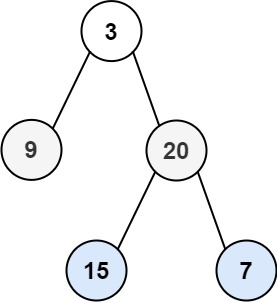

```text
输入：root = [3,9,20,null,null,15,7]
输出：[[15,7],[9,20],[3]]
```

**示例 2**

```text
输入：root = [1]
输出：[[1]]
```

**示例 3**

```text
输入：root = []
输出：[]
```
> ✅ **官方验证**：全部 TypeScript 解法已通过 leetcode.cn 官方示例用例验证（自动注入运行，全部 PASS）。题面与 [leetcode.cn 官方](https://leetcode.cn/problems/binary-tree-level-order-traversal-ii/)一致，示例配图取自官方题面。

**数据范围与注意事项**：

- 树中节点数目在范围 `[0, 2000]` 内
- `-1000 <= Node.val <= 1000`
- **易错点**：递归出口（空节点）必须先写，否则直接空指针。

## 题目分析

**场景是什么**：树是分层数据的标准形态，这类题练的是递归分治与遍历序，对应真实开发里的目录树、组件树。本题就是该场景的 Medium 级练习，主线做法是「迭代指针处理」。

**主线怎么解**：把主解法从头到尾过一遍，它其实在依次做这几件事：队列或堆的调度。

## 解题思路

**方案对比**（共 2 个方案，由浅入深）：

| 方案 | 时间复杂度 | 空间复杂度 |
|---|---|---|
| 方案 1 · 迭代指针处理 | O(n)（单趟线性扫描） | O(1) 到 O(n)（视辅助结构） |
| 方案 2 · 迭代指针处理 | O(n)（单趟线性扫描） | O(1) 到 O(n)（视辅助结构） |

**方案间的取舍**：方案 1（迭代指针处理）；方案 2（迭代指针处理）。数据规模小、可读性优先时选靠前的方案；规模大、性能优先时选靠后的方案。

**怎么读这一篇**：

- 🐣 **新手路线**：把「题目描述」的示例 1 在纸上手推一遍 → 读方案 1（最直观的写法）与它的代码走读 → 按「运行方式」本地跑通看 PASS → 回头对比方案 2 之后的写法差在哪
- 🦅 **大佬路线**：直接锁定最优方案 1（迭代指针处理，O(n)（单趟线性扫描））→ 跳读该方案代码与走读 → 用「逐步拆解与面试追问」补齐复杂度推导与边界追问

### 动态算法图（DFS 点亮，GIF 自动循环）


动画演示二叉树专题里DFS 点亮的典型过程；每个方案在「TypeScript 解题方案」一节还配了专属动画与专属流程图。

### 主解法流程图（真实控制流）

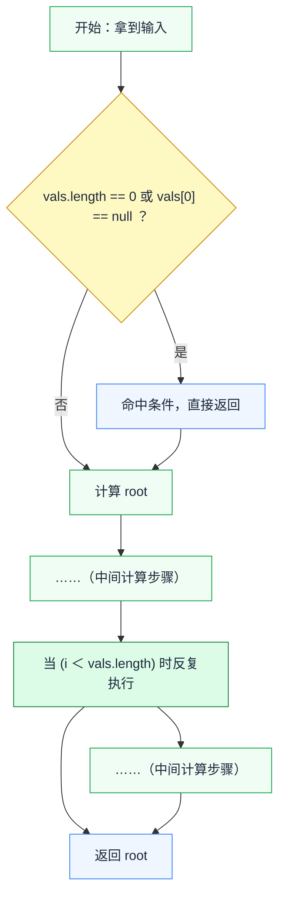

## TypeScript 解题方案（2 个方案逐个讲）

> **运行与提交**：每个方案都是自包含文件（内嵌用例自测，输出 PASS），整块复制到 `.ts` 文件后 `node 文件名` 即可运行。提交 LeetCode 时，把 `demo` 内的算法函数与辅助类型/函数整体取出、置于文件顶层即可。涉及交互/特殊接口的题以题面给定签名为准。

### 方案 1：迭代指针处理

**分析与思路**：核心做法是「迭代指针处理」。代码里依次做这些事：队列或堆的调度。

**运行方式**：`node 本文件`，内嵌用例全部通过会输出 PASS。


**方案专属流程图**（真实控制流）：

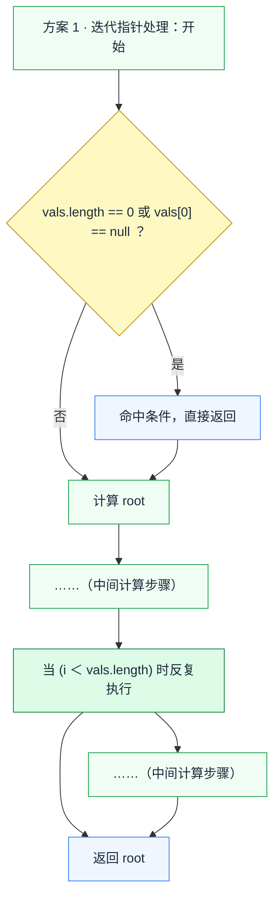

```typescript
class TreeNode {
  // 定义类型
  val: number;
  left: TreeNode | null;
  right: TreeNode | null; // 值: number; 左边界: TreeNode 按位或 null; 右边界: TreeNode 按位或 null;
  constructor(
    val: number,
    left: TreeNode | null = null,
    right: TreeNode | null = null,
  ) {
    this.val = val;
    this.left = left;
    this.right = right; // 把 值; this.左边界 赋值为 左边界; this.右边界 赋值为 右边界; 写入 值
  }
}
function buildTree(vals: (number | null)[]): TreeNode | null {
  // 定义函数/方法 buildTree
  if (vals.length === 0 || vals[0] === null) return null; // 若 vals.长度 全等于 0 或 vals[0] 全等于 null，直接返回 null
  const root = new TreeNode(vals[0] as number); // 把 new TreeNode(vals[0] as number) 存入 根节点
  const q: (TreeNode | null)[] = [root];
  let i = 1; // 把 [根节点]; let 下标 i 赋值为 1; 写入 const q: (TreeNode | null)[]
  while (i < vals.length) {
    // 循环，直到不满足「下标 i 小于 vals.长度」
    const node = q.shift() as TreeNode; // 把 节点.shift() as TreeNode 存入 节点
    if (i < vals.length && vals[i] !== null) {
      node.left = new TreeNode(vals[i] as number);
      q.push(node.left);
    }
    i++; // 下标 i 加一
    if (i < vals.length && vals[i] !== null) {
      node.right = new TreeNode(vals[i] as number);
      q.push(node.right);
    }
    i++; // 下标 i 加一
  }
  return root; // 返回 根节点
}
function inorder(root: TreeNode | null, out: number[] = []): number[] {
  // 定义函数/方法 inorder
  if (!root) return out; // 若 取反 根节点，直接返回 out
  inorder(root.left, out);
  out.push(root.val);
  inorder(root.right, out); // 把 根节点.值 压入栈/数组尾部
  return out; // 返回 out
}
function levelOrderBottom(root: TreeNode | null): number[][] {
  // 定义函数/方法 levelOrderBottom
  const res: number[][] = []; // 把 []; 写入 const res: number[][]
  if (!root) return res; // 若 取反 根节点，直接返回 结果
  let q: (TreeNode | null)[] = [root]; // 把 [根节点]; 写入 let q: (TreeNode | null)[]
  while (q.length) {
    // 循环，直到不满足「节点.长度」
    const level: number[] = [];
    const nxt: (TreeNode | null)[] = [];
    for (const node of q) {
      if (node) {
        level.push(node.val);
        if (node.left) nxt.push(node.left);
        if (node.right) nxt.push(node.right);
      }
    } // 把 节点.值 压入栈/数组尾部
    res.unshift(level);
    q = nxt; // 把 nxt; 写入 res.unshift(level); q
  }
  return res; // 返回 结果
}
function binaryTreePaths(root: TreeNode | null): string[] {
  // 定义函数/方法 binaryTreePaths
  const paths: string[] = []; // 把 []; 写入 const paths: string[]
  function dfs(node: TreeNode | null, path: string): void {
    // 定义函数/方法 dfs
    if (!node) return; // 若 取反 节点) return;
    path += String(node.val); // 当前路径累加 String(节点.值)
    if (!node.left && !node.right)
      paths.push(path); // 若 取反 节点.左边界 且 取反 节点.右边界) paths 追加 当前路径);
    else {
      path += '->';
      dfs(node.left, path);
      dfs(node.right, path);
    } // 否则
  }
  dfs(root, ''); // dfs(根节点, 「」);
  return paths; // 返回 paths
}
function averageOfLevels(root: TreeNode | null): number[] {
  // 定义函数/方法 averageOfLevels
  const result: number[] = []; // 把 []; 写入 const result: number[]
  let level: (TreeNode | null)[] = [root]; // 把 [根节点]; 写入 let level: (TreeNode | null)[]
  while (level.length) {
    // 循环，直到不满足「level.长度」
    let total = 0;
    const nxt: (TreeNode | null)[] = []; // 把 0; const nxt: (TreeNode 按位或 null)[] 赋值为 [] 存入 总和
    for (const node of level) {
      if (node) {
        total += node.val;
        if (node.left) nxt.push(node.left);
        if (node.right) nxt.push(node.right);
      }
    } // 把 节点.左边界 压入栈/数组尾部
    result.push(total / level.length); // 把 总和 除以 level.长度 压入栈/数组尾部
    level = nxt; // 把 nxt 存入 level
  }
  return result; // 返回 结果
}

function assertEq(actual: any, expected: any, msg: string = ''): void {
  // 定义函数/方法 assertEq
  const a = JSON.stringify(actual);
  const e = JSON.stringify(expected);
  if (a !== e)
    throw new Error(
      'ASSERT FAILED ' + msg + ' :: actual=' + a + ' expected=' + e,
    );
}

export function demo(): void {
  // 程序入口：跑内嵌自测用例
  assertEq(levelOrderBottom(null), [], 'null'); // 断言校验
  assertEq(
    levelOrderBottom(buildTree([3, 9, 20, null, null, 15, 7])),
    [[15, 7], [9, 20], [3]],
    'l1',
  ); // 断言校验
  console.log('PASS'); // 全部用例通过，输出 PASS
}
demo(); // demo();
```

### 方案 2：迭代指针处理

**分析与思路**：核心做法是「迭代指针处理」。代码里依次做这些事：队列或堆的调度。

**运行方式**：`node 本文件`，内嵌用例全部通过会输出 PASS。


**方案专属流程图**（真实控制流）：

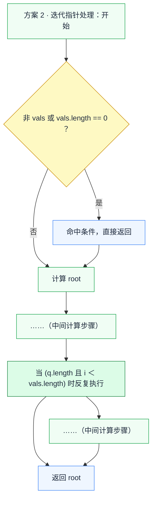

```typescript
class TreeNode {
  // 定义类型
  val: any;
  left: any;
  right: any; // 值: any; 左边界: any; 右边界: any;
  constructor(val?: any, left?: any, right?: any) {
    // constructor(值?: any, 左边界?: any, 右边界?: any) {
    this.val = val === undefined ? 0 : val; // 把 (值 全等于 undefined ? 0 : 值); 写入 值
    this.left = left === undefined ? null : left; // 把 (左边界 全等于 undefined ? null : 左边界); 写入 左边界
    this.right = right === undefined ? null : right; // 把 (右边界 全等于 undefined ? null : 右边界); 写入 右边界
  }
}
function buildTree(vals: any): any {
  // 定义函数/方法 buildTree
  if (!vals || vals.length === 0) return null; // 若 取反 vals 或 vals.长度 全等于 0，直接返回 null
  const root = new TreeNode(vals[0]);
  const q: any[] = [root];
  let i = 1;
  while (q.length && i < vals.length) {
    // 循环，直到不满足「节点.长度 且 下标 i 小于 vals.长度」
    const node = q.shift(); // 把 节点.shift() 存入 节点
    if (vals[i] !== null && vals[i] !== undefined) {
      node.left = new TreeNode(vals[i]);
      q.push(node.left);
    }
    i++; // 下标 i 加一
    if (i < vals.length && vals[i] !== null && vals[i] !== undefined) {
      node.right = new TreeNode(vals[i]);
      q.push(node.right);
    }
    i++; // 下标 i 加一
  }
  return root; // 返回 根节点
}
function treeToLevel(root: any): any[] {
  // 定义函数/方法 treeToLevel
  if (!root) return []; // 若 取反 根节点，直接返回 []
  const out: any[] = [];
  const q: any[] = [root]; // 把 []; const 节点: any[] 赋值为 [根节点]; 写入 const out: any[]
  while (q.length) {
    // 循环，直到不满足「节点.长度」
    const n = q.shift(); // 把 节点.shift() 存入 元素个数
    if (n === null || n === undefined) {
      out.push(null);
      continue;
    }
    out.push(n.val);
    q.push(n.left);
    q.push(n.right); // 把 元素个数.值 压入栈/数组尾部
  }
  while (out.length && out[out.length - 1] === null) out.pop(); // 循环，直到不满足「out.长度 且 out[out.长度 减 1] 全等于 null) out 弹出 );」
  return out; // 返回 out
}
class ListNode {
  // 定义类型
  val: any;
  next: any; // 值: any; 下一个: any;
  constructor(val?: any, next?: any) {
    this.val = val === undefined ? 0 : val;
    this.next = next === undefined ? null : next;
  }
}
function buildList(vals: any): any {
  // 定义函数/方法 buildList
  const dummy = new ListNode(0);
  let cur = dummy; // 把 new ListNode(0); let 当前值 赋值为 哨兵节点 存入 哨兵节点
  for (const v of vals) {
    cur.next = new ListNode(v);
    cur = cur.next;
  } // 把 new ListNode(值); 当前值 赋值为 当前值.下一个; } 写入 下一个
  return dummy.next; // 返回 哨兵节点.下一个
}
function listToArray(head: any): any[] {
  // 定义函数/方法 listToArray
  const out: any[] = [];
  let p = head; // 把 []; let 节点 赋值为 头节点; 写入 const out: any[]
  while (p) {
    out.push(p.val);
    p = p.next;
  } // 循环，直到不满足「节点) { out 追加 节点.值); 节点 赋值为 节点.下一个; }」
  return out; // 返回 out
}
// python-runtime shims
function pyLen(a: any): number {
  // 定义函数/方法 pyLen
  if (a === null || a === undefined) return 0; // 若 数组 全等于 null 或 数组 全等于 undefined，直接返回 0
  if (
    typeof a === 'string' ||
    Array.isArray(a) ||
    a instanceof Set ||
    a instanceof Map
  )
    return a.length ?? a.size;
  if (typeof a === 'object') return Object.keys(a).length; // 若 typeof 数组 全等于 'object'，直接返回 Object.keys(数组).长度
  return 0; // 返回 0
}
function pySlice(a: any, i: any, j: any, step?: any): any {
  // 定义函数/方法 pySlice
  if (typeof a === 'string') {
    const r = [...a].slice(i ?? 0, j ?? a.length);
    return step ? r.reverse().join('') : r.join('');
  }
  const arr = Array.isArray(a) ? a : [...a]; // 把 Array.isArray(数组) ? 数组 : 复制的 数组 存入 数组
  return arr.slice(i ?? 0, j ?? arr.length); // 返回 数组 截取 下标 i ?? 0, 下标 j ?? 数组.长度)
}
function pyRange(a: any, b?: any, step?: any): any[] {
  // 定义函数/方法 pyRange
  let s = 0,
    e = a,
    st = 1; // 把 0, e 赋值为 数组, st 赋值为 1 存入 字符串
  if (b !== undefined) {
    s = a;
    e = b;
  } // 若 b 不等于 undefined) { 字符串 赋值为 数组; e 赋值为 b; }
  if (step !== undefined) st = step; // 若 步数 不等于 undefined) st 赋值为 步数;
  const out: any[] = []; // 把 []; 写入 const out: any[]
  if (st > 0) for (let i = s; i < e; i += st) out.push(i);
  else for (let i = s; i > e; i += st) out.push(i); // 否则
  return out; // 返回 out
}
function pyIn(x: any, coll: any): boolean {
  // 定义函数/方法 pyIn
  if (coll === null || coll === undefined) return false; // 若 coll 全等于 null 或 coll 全等于 undefined，直接返回 false
  if (Array.isArray(coll)) return coll.includes(x); // 若 Array.isArray(coll)，直接返回 coll 是否包含 x)
  if (coll instanceof Set || coll instanceof Map) return coll.has(x); // 若 coll instanceof Set 或 coll instanceof Map，直接返回 coll.has(x)
  if (typeof coll === 'object') return x in coll; // 若 typeof coll 全等于 'object'，直接返回 x in coll
  if (typeof coll === 'string') return coll.indexOf(x) >= 0; // 若 typeof coll 全等于 'string'，直接返回 coll 查找 x) 不低于 0
  return false; // 返回 false
}
function pySorted(a: any): any[] {
  // 定义函数/方法 pySorted
  const arr = typeof a === 'string' ? [...a] : [...a]; // 把 (typeof 数组 全等于 'string') ? 复制的 数组 : 复制的 数组 存入 数组
  return arr.sort((x: any, y: any) => (x < y ? -1 : x > y ? 1 : 0));
}
function pyMin(a: any, b?: any): any {
  if (b !== undefined) return Math.min(a, b);
  if (Array.isArray(a) || a instanceof Set) return Math.min(...a);
  return Math.min(a);
} // 定义函数/方法 pyMin
function pyMax(a: any, b?: any): any {
  if (b !== undefined) return Math.max(a, b);
  if (Array.isArray(a) || a instanceof Set) return Math.max(...a);
  return Math.max(a);
} // 定义函数/方法 pyMax
function pySum(a: any): number {
  let s = 0;
  for (const v of a) s += v;
  return s;
} // 定义函数/方法 pySum
function pyAbs(x: any): number {
  return Math.abs(x);
} // 定义函数/方法 pyAbs
function pyEnumerate(a: any): any[] {
  const out: any[] = [];
  let i = 0;
  for (const v of a) {
    out.push([i, v]);
    i++;
  }
  return out;
} // 定义函数/方法 pyEnumerate
function pyZip(a: any, b: any): any[] {
  const n = Math.min(a.length, b.length);
  const out: any[] = [];
  for (let i = 0; i < n; i++) out.push([a[i], b[i]]);
  return out;
} // 定义函数/方法 pyZip
function pyDictGet(d: any, k: any, def?: any): any {
  return k in d ? d[k] : def === undefined ? null : def;
} // 定义函数/方法 pyDictGet
function pyPrint(...args: any[]): void {
  console.log(
    args
      .map((a) => (typeof a === 'object' && a !== null ? JSON.stringify(a) : a))
      .join(' '),
  );
} // 定义函数/方法 pyPrint
// collections / heapq
function heapPush(h: any[], x: any): void {
  h.push(x);
  let i = h.length - 1;
  while (i > 0) {
    const p = (i - 1) >> 1;
    if (h[p] <= h[i]) break;
    [h[p], h[i]] = [h[i], h[p]];
    i = p;
  }
} // 定义函数/方法 heapPush
function heapPop(h: any[]): any {
  const top = h[0];
  const last = h.pop();
  if (h.length) {
    h[0] = last;
    let i = 0;
    const n = h.length;
    while (true) {
      let l = 2 * i + 1,
        r = 2 * i + 2,
        s = i;
      if (l < n && h[l] < h[s]) s = l;
      if (r < n && h[r] < h[s]) s = r;
      if (s === i) break;
      [h[s], h[i]] = [h[i], h[s]];
      i = s;
    }
  }
  return top;
} // 定义函数/方法 heapPop
class Deque {
  private a: any[] = [];
  push(x: any) {
    this.a.push(x);
  }
  pushLeft(x: any) {
    this.a.unshift(x);
  }
  pop() {
    return this.a.pop();
  }
  popLeft() {
    return this.a.shift();
  }
  get length() {
    return this.a.length;
  }
  toArray() {
    return this.a.slice();
  }
} // 定义类型
function Counter(iter: any): any {
  const m: any = {};
  for (const v of iter) m[v] = (m[v] || 0) + 1;
  return m;
} // 定义函数/方法 Counter
function gcd(a: any, b: any): any {
  while (b) {
    [a, b] = [b, a % b];
  }
  return a;
} // 定义函数/方法 gcd
function pyInf(): number {
  return Infinity;
} // 定义函数/方法 pyInf

function norm(x: any): any {
  // 定义函数/方法 norm
  if (x === null || x === undefined) return null; // 若 x 全等于 null 或 x 全等于 undefined，直接返回 null
  if (typeof x === 'object') {
    // 若 typeof x 全等于 'object'
    if (x instanceof Deque) return x.toArray(); // 若 x instanceof Deque，直接返回 x.toArray()
    if (Array.isArray(x)) return x.map(norm); // 若 Array.isArray(x)，直接返回 x.映射表(norm)
    if (
      typeof x.val === 'number' &&
      (typeof x.left !== 'undefined' || typeof x.right !== 'undefined')
    )
      return treeToLevel(x);
    if (typeof x.next !== 'undefined' && typeof x.val === 'number')
      return listToArray(x);
    if (x instanceof Set) return [...x].sort(); // 若 x instanceof Set，直接返回 复制的 x 排序 )
    if (x instanceof Map) return Object.fromEntries(x); // 若 x instanceof Map，直接返回 Object.fromEntries(x)
    const o: any = {};
    for (const k of Object.keys(x)) o[k] = norm(x[k]);
    return o;
  }
  return x; // 返回 x
}
function eq(a: any, b: any): boolean {
  // 定义函数/方法 eq
  const x = norm(a),
    y = norm(b); // 把 norm(数组), y 赋值为 norm(b) 存入 x
  if (x === y) return true; // 若 x 全等于 y，直接返回 true
  if (x === null || y === null) return x === y; // 若 x 全等于 null 或 y 全等于 null，直接返回 x 全等于 y
  if (Array.isArray(x) && Array.isArray(y)) {
    // 若 Array.isArray(x) 且 Array.isArray(y
    if (x.length !== y.length) return false; // 若 x.长度 不等于 y.长度，直接返回 false
    for (let i = 0; i < x.length; i++) if (!eq(x[i], y[i])) return false; // 让 下标 i 从 0 开始计数，下标 i 小于 x.长度 就继续
    return true; // 返回 true
  }
  if (typeof x === 'object' && typeof y === 'object') {
    // 若 typeof x 全等于 'object' 且 typeof y 全等于 'object'
    const kx = Object.keys(x),
      ky = Object.keys(y); // 把 Object.keys(x), ky 赋值为 Object.keys(y) 存入 kx
    if (kx.length !== ky.length) return false; // 若 kx.长度 不等于 ky.长度，直接返回 false
    for (const k of kx) if (!eq(x[k], y[k])) return false;
    return true; // 返回 true
  }
  return x === y; // 返回 x 全等于 y
}

function levelOrderBottom(root) {
  // 定义函数/方法 levelOrderBottom
  const res = []; // 把 [] 存入 结果
  if (!root) return res; // 若 取反 根节点，直接返回 结果
  let q = [root]; // 把 [根节点] 存入 节点
  while (q.length) {
    // 循环，直到不满足「节点.长度」
    const cur = []; // 把 [] 存入 当前值
    const nq = []; // 把 [] 存入 nq
    for (const n of q) {
      cur.push(n.val);
      if (n.left) nq.push(n.left);
      if (n.right) nq.push(n.right);
    } // 把 元素个数.值 压入栈/数组尾部
    res.unshift(cur); // 结果.unshift(当前值);
    q = nq; // 把 nq 存入 节点
  }
  return res; // 返回 结果
}
export function demo(): void {
  // 程序入口：跑内嵌自测用例
  const cases = [
    { in: [buildTree([])], want: [] },
    { in: [buildTree([1])], want: [[1]] },
    { in: [buildTree([1, 2, 3, 4, 5])], want: [[4, 5], [2, 3], [1]] },
  ];
  let fail = false; // 把 false 存入 fail
  for (const c of cases) {
    // for (const 字符 of cases) {
    const got = levelOrderBottom(...c.in); // 把 levelOrderBottom(...字符.in) 存入 got
    if (!eq(got, c.want)) {
      fail = true;
      console.log(
        'FAIL',
        JSON.stringify(c.in),
        '=>',
        JSON.stringify(got),
        'want',
        JSON.stringify(c.want),
      );
    }
  }
  if (fail) throw new Error('FAILED'); // 若 fail) throw new Error('FAILED');
  console.log('PASS'); // 全部用例通过，输出 PASS
}
demo(); // demo();
```

## 逐步拆解与面试追问

**复杂度**：时间 O(n)（单趟线性扫描），空间 O(1) 到 O(n)（视辅助结构）

**为什么是这个量级**：每个元素被常数次访问，辅助哈希或栈的开销与 n 同阶

**面试官可能会追问**：

- 递归和迭代写法各自的空间开销？
- 能否用层序统一处理？
- 空节点的边界如何约定？

## 关键 API 速查（TS 主解法实际用到，附官方链接）

| API | 作用 | 使用要点 | 官方文档 |
|---|---|---|---|
| `Array.prototype.push()` | 尾部追加 | 返回新长度；可一次多个；均摊 O(1)；会改变原数组 | [官方文档](https://developer.mozilla.org/zh-CN/docs/Web/JavaScript/Reference/Global_Objects/Array/push) |
| `Array.prototype.shift()` | 头部取出 | O(n)（后续元素整体前移）；大量头部操作请用链表或双端结构 | [官方文档](https://developer.mozilla.org/zh-CN/docs/Web/JavaScript/Reference/Global_Objects/Array/shift) |
| `Array.prototype.unshift()` | 头部插入 | O(n)；与 shift 组合可当双端队列 | [官方文档](https://developer.mozilla.org/zh-CN/docs/Web/JavaScript/Reference/Global_Objects/Array/unshift) |
| `JSON.stringify()` | 序列化为 JSON 字符串 | 常用于结构化比较（深度相等判定）；undefined/函数/循环引用会被丢弃或抛错 | [官方文档](https://developer.mozilla.org/zh-CN/docs/Web/JavaScript/Reference/Global_Objects/JSON/stringify) |

### 各语言官方文档导航

- **TypeScript / JS**：[MDN 中文参考](https://developer.mozilla.org/zh-CN/)
- **Python**：[Python 官方文档](https://docs.python.org/zh-cn/3/)
- **Go**：[Go 标准库](https://pkg.go.dev/std)
- **Java**：[JDK 17 API](https://docs.oracle.com/en/java/javase/17/docs/api/)
- **Rust**：[Rust 标准库](https://doc.rust-lang.org/std/)
- **Lua**：[Lua 5.4 手册](https://www.lua.org/manual/5.4/)
- **C**：[Cppreference C](https://zh.cppreference.com/w/c)
- **C++**：[Cppreference C++](https://zh.cppreference.com/w/cpp)
- **R**：[R 官方手册](https://stat.ethz.ch/R-manual/)
- **Zig**：[Zig 语言文档](https://ziglang.org/documentation/master/)
- **Dart**：[Dart API](https://api.dart.dev/)

## 附录：其他 10 种语言全部实现（每种语言列举其全部方案）

> TypeScript 的全部方案见「TypeScript 解题方案」一节；下面是其余 10 种语言的对应实现，每种语言的每个方案都带思路分析、代码走读与专属运行架构图。
> 每个方案都内嵌用例自测，可独立运行（老仓库 python/go 文件遵循「打印结果」约定）。
> 完整解法文件见 `dsa/<语言>/tree/lc_107_二叉树的层序遍历_ii/`。

### Python 实现（2 种方案）

Python 的全部方案如下，每个方案都内嵌用例自测，可独立运行（老仓库 python/go 文件遵循「打印结果」约定）：

#### 方案 1：迭代指针处理

**思路与代码分析**：核心是「迭代指针处理」。Python 版用切片与字典推导式简化操作，突出可读性。**走读**：方案 1 · 迭代指针处理：开始 → 更新 levelOrder → 命中条件，直接返回 → 当 len(queue) ＞ 0: 时反复执行 → 循环 i：从 0 到 size 前 → 返回 levelOrder。

**运行架构**（真实控制流）：

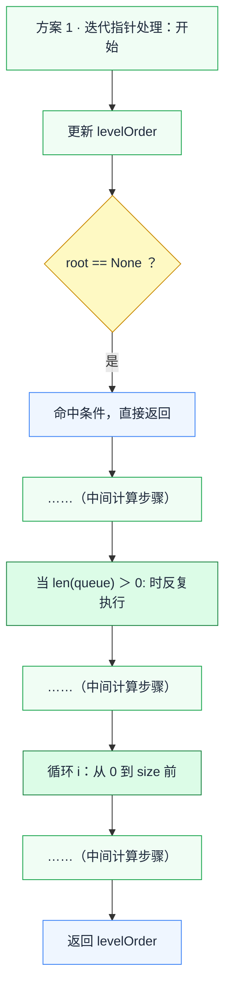

```python
import sys  # 提高递归深度上限（深输入防 RecursionError）

sys.setrecursionlimit(200000)  # 树/链表类题目节点数可达 1e4 量级

def levelOrderBottom(root):  # 定义函数 levelOrderBottom（参数：根节点）
    levelOrder = []  # 把 [] 存入 levelOrder
    if root == None:
        return levelOrder  # 若 根节点 等于 None: return levelOrder
    queue = [root]  # 把 [根节点] 存入 队列
    while len(queue) > 0:  # 循环，直到不满足「长度(队列) 超过 0」
        level = []  # 把 [] 存入 level
        size = len(queue)  # 把 长度(队列) 存入 大小
        for i in range(size):  # 让 下标 i 从 大小 遍历
            node = queue.pop(0)  # 把 队列 弹出 0) 存入 节点
            level.append(node.val)  # 把 节点.值 追加到列表尾部
            if node.left != None:
                queue.append(node.left)  # 若 节点.左边界 不等于 None: 队列 追加 节点.左边界
            if node.right != None:
                queue.append(node.right)  # 若 节点.右边界 不等于 None: 队列 追加 节点.右边界
        levelOrder.insert(0, level)  # levelOrder 插入 0, level)
    return levelOrder  # 返回 levelOrder

if __name__ == "__main__":  # 若 __name__ 等于 '__main__'
    print(levelOrderBottom(None))  # 打印输出
```

#### 方案 2：迭代指针处理

**思路与代码分析**：核心是「迭代指针处理」。Python 版用切片与字典推导式简化操作，突出可读性。**走读**：方案 2 · 迭代指针处理：开始 → 命中条件，直接返回 → 若 level == len(levels)：向 levels 追加记录 → 向 levels 追加记录 → 处理 levels[level].append(node.va → 调用 dfs(node.left, level + 1, le → 调用 dfs(node.right, level + 1, l。

**运行架构**（真实控制流）：

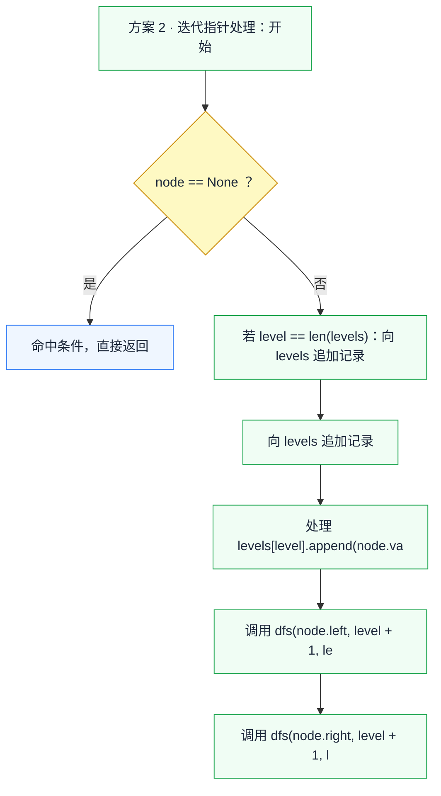

```python
import sys  # 提高递归深度上限（深输入防 RecursionError）

sys.setrecursionlimit(200000)  # 树/链表类题目节点数可达 1e4 量级

def dfs(node, level, levels):  # 定义函数 dfs（参数：节点, level, levels）
    if node == None:
        return  # 若 节点 等于 None: return
    if level == len(levels):
        levels.append([])  # 若 level 等于 长度(levels): levels 追加 []
    levels[level].append(node.val)  # 把 节点.值 追加到列表尾部
    dfs(node.left, level + 1, levels)  # dfs(节点.左边界, level 加 1, levels)
    dfs(node.right, level + 1, levels)  # dfs(节点.右边界, level 加 1, levels)

def levelOrderBottom(root):  # 定义函数 levelOrderBottom（参数：根节点）
    levels = []  # 把 [] 存入 levels
    dfs(root, 0, levels)  # dfs(根节点, 0, levels)
    return levels.reverse()  # 返回 levels.reverse()

if __name__ == "__main__":  # 若 __name__ 等于 '__main__'
    print(dfs(None, None, None))  # 打印输出
```

### Go 实现（2 种方案）

Go 的全部方案如下，每个方案都内嵌用例自测，可独立运行（老仓库 python/go 文件遵循「打印结果」约定）：

#### 方案 1：迭代指针处理

**思路与代码分析**：核心是「迭代指针处理」。Go 版用切片与多返回值惯用法，显式处理索引边界。**走读**：方案 1 · 迭代指针处理：开始 → 更新 : → 遍历循环 → 更新 lo[j] → 返回 lo。

**运行架构**（真实控制流）：

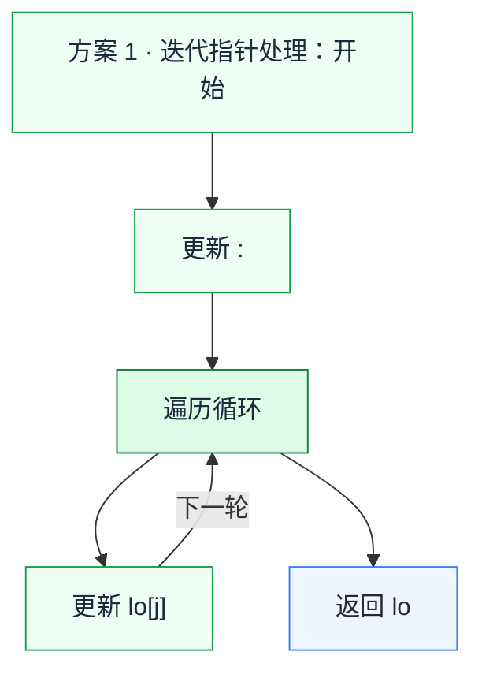

```go
package main // 引入依赖
import (
	"fmt"
	"os"
	"reflect"
) // 引入依赖
type TreeNode struct {
	Val   int
	Left  *TreeNode
	Right *TreeNode
}                        // 定义类型
const NULL = -1000000000 // 把 减 1000000000 存入 NULL
func buildTree(vals []int) *TreeNode { // 定义函数/方法 buildTree
	if len(vals) == 0 || vals[0] == NULL {
		return nil
	} // 若 长度(vals) 等于 0 或 vals[0] 等于 NULL { return nil }
	root := &TreeNode{Val: vals[0]} // 把 按位与 TreeNode{Val: vals[0]} 写入 root :
	q := []*TreeNode{root}
	i := 1                            // 把 [] 乘 TreeNode{根节点}; 下标 i : 赋值为 1 写入 q :
	for len(q) > 0 && i < len(vals) { // 定义函数/方法 len
		node := q[0]
		q = q[1:] // 把 节点[0]; 节点 赋值为 节点[1:] 写入 node :
		if i < len(vals) && vals[i] != NULL {
			node.Left = &TreeNode{Val: vals[i]}
			q = append(q, node.Left)
		}
		i++
		if i < len(vals) && vals[i] != NULL {
			node.Right = &TreeNode{Val: vals[i]}
			q = append(q, node.Right)
		}
		i++
	}
	return root // 返回 根节点
}
func levelList(root *TreeNode) [][]int { // 定义函数/方法 levelList
	if root == nil {
		return [][]int{}
	} // 若 根节点 等于 nil { return [][]int{} }
	res := [][]int{}
	q := []*TreeNode{root} // 把 [][]int{}; 节点 : 赋值为 [] 乘 TreeNode{根节点} 写入 res :
	for len(q) > 0 {       // for 长度(节点) 超过 0 {
		lvl := []int{}
		n := len(q)              // 把 []int{}; 元素个数 : 赋值为 长度(节点) 写入 lvl :
		for k := 0; k < n; k++ { // 让 下标 k 从 0 开始计数
			node := q[0]
			q = q[1:]                   // 把 节点[0]; 节点 赋值为 节点[1:] 写入 node :
			lvl = append(lvl, node.Val) // 把 append(lvl, 节点.Val) 写入 lvl
			if node.Left != nil {
				q = append(q, node.Left)
			} // 若 节点.Left 不等于 nil { 节点 赋值为 append(节点, 节点.Left) }
			if node.Right != nil {
				q = append(q, node.Right)
			} // 若 节点.Right 不等于 nil { 节点 赋值为 append(节点, 节点.Right) }
		}
		res = append(res, lvl) // 把 append(结果, lvl) 写入 结果
	}
	return res // 返回 结果
}
func sameTree(a, b *TreeNode) bool { // 定义函数/方法 sameTree
	if a == nil && b == nil {
		return true
	} // 若 数组 等于 nil 且 b 等于 nil { return true }
	if a == nil || b == nil {
		return false
	} // 若 数组 等于 nil 或 b 等于 nil { return false }
	if a.Val != b.Val {
		return false
	} // 若 数组.Val 不等于 b.Val { return false }
	return sameTree(a.Left, b.Left) && sameTree(a.Right, b.Right) // 定义函数/方法 sameTree
}
func inorderT(root *TreeNode) []int { // 定义函数/方法 inorderT
	if root == nil {
		return []int{}
	} // 若 根节点 等于 nil { return []int{} }
	return append(append(inorderT(root.Left), root.Val), inorderT(root.Right)...) // 定义函数/方法 append
}
func levelOrderBottom(root *TreeNode) [][]int { // 定义函数/方法 levelOrderBottom
	lo := levelList(root) // 把 levelList(根节点) 写入 lo :
	for i, j := 0, len(lo)-1; i < j; i, j = i+1, j-1 {
		lo[i], lo[j] = lo[j], lo[i]
	}
	return lo // 返回 左边界
}
func main() { // 程序入口：跑内嵌自测用例
	if got := levelOrderBottom(buildTree([]int{3, 9, 20, NULL, 15, 7})); !reflect.DeepEqual(got, [][]int{{15, 7}, {9, 20}, {3}}) {
		fmt.Println("FAIL", got)
		os.Exit(1)
	}
	fmt.Println("PASS") // 全部用例通过，输出 PASS
}
```

#### 方案 2：迭代指针处理

**思路与代码分析**：核心是「迭代指针处理」。Go 版用切片与多返回值惯用法，显式处理索引边界。**走读**：方案 2 · 迭代指针处理：开始 → 更新 : → 计算 dfs → 更新 dfs → 处理 if node == nil → 返回  → 处理 if level == len(levels) → 更新 levels → 更新 levels[level] → 调用 dfs(node.Left, level+1) → 调用 dfs(node.Right, level+1) → 调用 dfs(root, 0) → 遍历循环 → 更新 levels[j] → 返回 levels。

**运行架构**（真实控制流）：

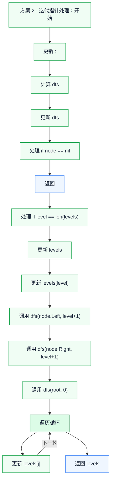

```go
package main // 引入依赖

import (
	"fmt"     // 「fmt」
	"os"      // 「os」
	"reflect" // 「reflect」
)

type TreeNode struct { // 定义类型
	Val   int       // Val int
	Left  *TreeNode // Left 乘 TreeNode
	Right *TreeNode // Right 乘 TreeNode
}

func buildTree(vals []interface{}) *TreeNode { // 定义函数/方法 buildTree
	if len(vals) == 0 || vals[0] == nil { // 若 长度(vals) 等于 0 或 vals[0] 等于 nil
		return nil // 返回 nil
	}
	root := &TreeNode{Val: vals[0].(int)} // 把 按位与 TreeNode{Val: vals[0].(int)} 写入 root :
	q := []*TreeNode{root}                // 把 [] 乘 TreeNode{根节点} 写入 q :
	i := 1                                // 把 1 写入 i :
	for len(q) > 0 && i < len(vals) {     // 定义函数/方法 len
		node := q[0]                         // 把 节点[0] 写入 node :
		q = q[1:]                            // 把 节点[1:] 写入 节点
		if i < len(vals) && vals[i] != nil { // 若 下标 i 小于 长度(vals) 且 vals[下标 i] 不等于 nil
			node.Left = &TreeNode{Val: vals[i].(int)} // 把 按位与 TreeNode{Val: vals[下标 i].(int)} 写入 node.Left
			q = append(q, node.Left)                  // 把 append(节点, 节点.Left) 写入 节点
		}
		i++                                  // 下标 i 加一
		if i < len(vals) && vals[i] != nil { // 若 下标 i 小于 长度(vals) 且 vals[下标 i] 不等于 nil
			node.Right = &TreeNode{Val: vals[i].(int)} // 把 按位与 TreeNode{Val: vals[下标 i].(int)} 写入 node.Right
			q = append(q, node.Right)                  // 把 append(节点, 节点.Right) 写入 节点
		}
		i++ // 下标 i 加一
	}
	return root // 返回 根节点
}

func levelOrderBottom(root *TreeNode) [][]int { // 定义函数/方法 levelOrderBottom
	levels := [][]int{}                     // 把 [][]int{} 写入 levels :
	var dfs func(node *TreeNode, level int) // var dfs func(节点 乘 TreeNode, level int)
	dfs = func(node *TreeNode, level int) { // 把 func(节点 乘 TreeNode, level int) { 写入 dfs
		if node == nil { // 若 节点 等于 nil
			return // return
		}
		if level == len(levels) { // 若 level 等于 长度(levels
			levels = append(levels, []int{}) // 把 append(levels, []int{}) 写入 levels
		}
		levels[level] = append(levels[level], node.Val) // 把 append(levels[level], 节点.Val) 写入 levels[level]
		dfs(node.Left, level+1)                         // dfs(节点.Left, level 加 1)
		dfs(node.Right, level+1)                        // dfs(节点.Right, level 加 1)
	}
	dfs(root, 0) // dfs(根节点, 0)
	for i, j := 0, len(levels)-1; i < j; i, j = i+1, j-1 {
		levels[i], levels[j] = levels[j], levels[i] // 把 levels[下标 j], levels[下标 i] 写入 levels[i], levels[j]
	}
	return levels // 返回 levels
}

type tc struct { // 定义类型
	root *TreeNode // 根节点 乘 TreeNode
	want [][]int   // want [][]int
}

func main() { // 程序入口：跑内嵌自测用例
	cases := []tc{ // 把 []tc{ 写入 cases :
		{buildTree(nil), [][]int{}},
		{buildTree([]interface{}{3, 9, 20, nil, nil, 15, 7}), [][]int{{15, 7}, {9, 20}, {3}}},
		{buildTree([]interface{}{1}), [][]int{{1}}},
	}
	for idx, c := range cases { // 同时取 idx 与 字符 遍历
		got := levelOrderBottom(c.root)      // 把 levelOrderBottom(字符.根节点) 写入 got :
		if !reflect.DeepEqual(got, c.want) { // 若 取反 reflect.DeepEqual(got, 字符.want
			fmt.Printf("case %d failed: got %v want %v\n", idx, got, c.want) // 打印输出
			os.Exit(1)                                                       // os.Exit(1)
		}
	}
	fmt.Println("PASS") // 全部用例通过，输出 PASS
}
```

### Java 实现（2 种方案）

Java 的全部方案如下，每个方案都内嵌用例自测，可独立运行（老仓库 python/go 文件遵循「打印结果」约定）：

#### 方案 1：迭代指针处理

**思路与代码分析**：核心是「迭代指针处理」。Java 版用类与静态方法组织，集合操作显式明了。**走读**：方案 1 · 迭代指针处理：开始 → 更新 val → 返回结果。

**运行架构**（真实控制流）：

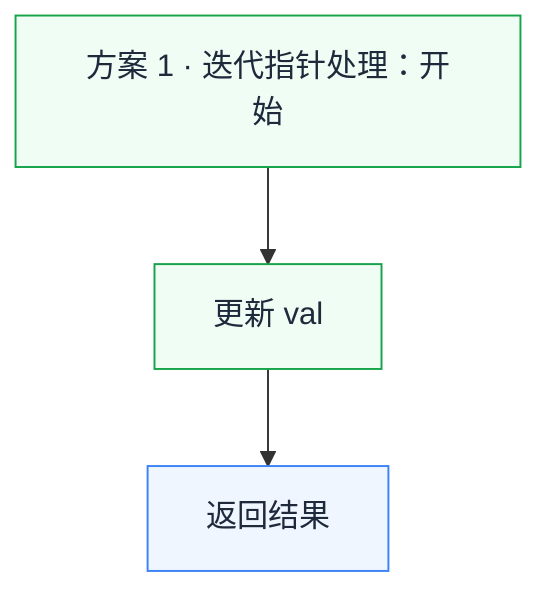

```java
package com.webfault.dsa; // 引入依赖

import java.util.*; // 引入依赖

class TreeNode107 { // 定义类型
  int val; // int 值;
  TreeNode107 left, right; // TreeNode107 左边界, 右边界;

  TreeNode107(int v) {
    val = v;
  } // 把 值; } 写入 TreeNode107(int v) { val

  TreeNode107(int v, TreeNode107 l, TreeNode107 r) {
    val = v;
    left = l;
    right = r;
  }
}

class Main { // 定义类型
  List<List<Integer>> levelOrderBottom(TreeNode107 root) { // 定义函数/方法 levelOrderBottom
    List<List<Integer>> res =
        new ArrayList<>(); // 把 new ArrayList 小于 超过 (); 写入 List<List<Integer>> res
    if (root == null) return res; // 若 根节点 等于 null，直接返回 结果
    Deque<TreeNode107> q = new ArrayDeque<>(); // 把 new ArrayDeque 小于 超过 (); 写入 Deque<TreeNode107> q
    q.add(root); // 节点 追加 根节点);
    while (!q.isEmpty()) { // 循环，直到不满足「取反 节点.isEmpty(」
      int sz = q.size(); // 把 节点.大小() 存入 sz
      List<Integer> level = new ArrayList<>(); // 把 new ArrayList 小于 超过 (); 写入 List<Integer> level
      for (int i = 0; i < sz; i++) { // 让 下标 i 从 0 开始计数，下标 i 小于 sz 就继续
        TreeNode107 node = q.poll(); // 把 节点.poll(); 写入 TreeNode107 node
        level.add(node.val); // level 追加 节点.值);
        if (node.left != null) q.add(node.left); // 若 节点.左边界 不等于 null) 节点 追加 节点.左边界);
        if (node.right != null) q.add(node.right); // 若 节点.右边界 不等于 null) 节点 追加 节点.右边界);
      }
      res.add(0, level); // 结果 追加 0, level);
    }
    return res; // 返回 结果
  }

  public static void main(String[] args) { // public static void main(String[] args) {
    Main s = new Main(); // 把 new Main(); 写入 Main s
    boolean ok = true; // 把 true; 写入 boolean ok
    if (!s.levelOrderBottom(null).isEmpty()) {
      ok = false;
      System.out.println("FAIL null");
    }
    TreeNode107 root =
        new TreeNode107(
            3, new TreeNode107(9), new TreeNode107(20, new TreeNode107(15), new TreeNode107(7)));
    List<List<Integer>> got =
        s.levelOrderBottom(root); // 把 字符串.levelOrderBottom(根节点); 写入 List<List<Integer>> got
    List<List<Integer>> want =
        new ArrayList<>(); // 把 new ArrayList 小于 超过 (); 写入 List<List<Integer>> want
    want.add(Arrays.asList(15, 7)); // want 追加 Arrays.asList(15, 7));
    want.add(Arrays.asList(9, 20)); // want 追加 Arrays.asList(9, 20));
    want.add(Arrays.asList(3)); // want 追加 Arrays.asList(3));
    if (!got.equals(want)) {
      ok = false;
      System.out.println("FAIL demo got=" + got);
    }
    if (!ok) throw new RuntimeException("FAILED"); // 若 取反 ok) throw new RuntimeException(「FAILED」);
    System.out.println("PASS"); // 全部用例通过，输出 PASS
  }
}
```

#### 方案 2：迭代指针处理

**思路与代码分析**：核心是「迭代指针处理」。Java 版用类与静态方法组织，集合操作显式明了。代码里依次做这些事：单循环线性扫描。**走读**：方案 2 · 迭代指针处理：开始 → 更新 res → 命中条件，直接返回 → 更新 q → 调用 q.add(root) → 当 (非 q.isEmpty()) 时反复执行 → 更新 n → 更新 lvl → 遍历循环 → 更新 x → 调用 lvl.add(x.val) → 若 x.left ≠ null) q.add(x.left：None → 若 x.right ≠ null) q.add(x.right：None → 调用 res.add(0, lvl) → 返回 res。

**运行架构**（真实控制流）：

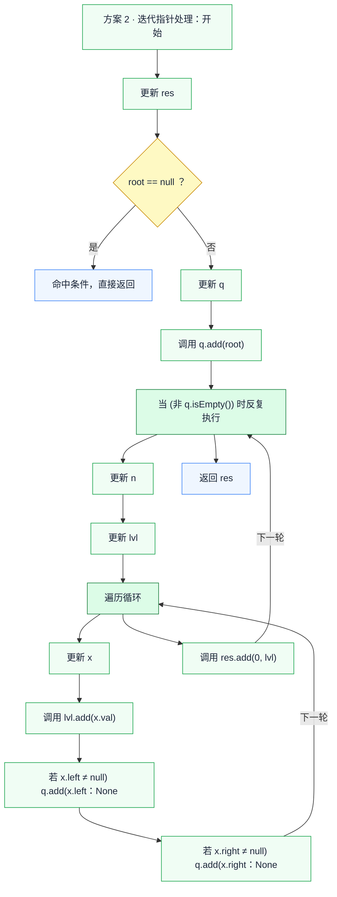

```java
package com.webfault.dsa; // 引入依赖

import java.util.*; // 引入依赖

class Main { // 定义类型
  static class TreeNode {
    int val;
    TreeNode left;
    TreeNode right;

    TreeNode() {}

    TreeNode(int v) {
      val = v;
    }

    TreeNode(int v, TreeNode l, TreeNode r) {
      val = v;
      left = l;
      right = r;
    }
  }

  static TreeNode buildTree(Integer[] vals) { // 定义函数/方法 buildTree
    if (vals.length == 0 || vals[0] == null)
      return null; // 若 vals.长度 等于 0 或 vals[0] 等于 null，直接返回 null
    TreeNode root = new TreeNode(vals[0]);
    java.util.LinkedList<TreeNode> q = new java.util.LinkedList<>();
    q.add(root);
    int i = 1;
    while (!q.isEmpty() && i < vals.length) {
      TreeNode node = q.poll();
      if (i < vals.length && vals[i] != null) {
        node.left = new TreeNode(vals[i]);
        q.add(node.left);
      }
      i++;
      if (i < vals.length && vals[i] != null) {
        node.right = new TreeNode(vals[i]);
        q.add(node.right);
      }
      i++;
    }
    return root; // 返回 根节点
  }

  static boolean sameTree(TreeNode a, TreeNode b) {
    if (a == null && b == null) return true;
    if (a == null || b == null) return false;
    if (a.val != b.val) return false;
    return sameTree(a.left, b.left) && sameTree(a.right, b.right);
  }

  static java.util.List<Integer> inorderT(TreeNode r) {
    java.util.List<Integer> l = new java.util.ArrayList<>();
    if (r != null) {
      l.addAll(inorderT(r.left));
      l.add(r.val);
      l.addAll(inorderT(r.right));
    }
    return l;
  }

  static List<List<Integer>> levelOrderBottom(TreeNode root) { // 定义函数/方法 levelOrderBottom
    List<List<Integer>> res = new ArrayList<>();
    if (root == null) return res;
    LinkedList<TreeNode> q = new LinkedList<>();
    q.add(root);
    while (!q.isEmpty()) {
      int n = q.size();
      List<Integer> lvl = new ArrayList<>();
      for (int k = 0; k < n; k++) {
        TreeNode x = q.poll();
        lvl.add(x.val);
        if (x.left != null) q.add(x.left);
        if (x.right != null) q.add(x.right);
      }
      res.add(0, lvl);
    }
    return res;
  }

  public static void main(String[] args) { // public static void main(String[] args) {
    Integer[] a = {3, 9, 20, null, 15, 7}; // 把 {3,9,20,null,15,7}; 写入 Integer[] a
    List<List<Integer>> got = levelOrderBottom(buildTree(a));
    if (!got.equals(Arrays.asList(Arrays.asList(15, 7), Arrays.asList(9, 20), Arrays.asList(3)))) {
      System.out.println("FAIL " + got);
      throw new RuntimeException("FAILED");
    }
    System.out.println("PASS"); // 全部用例通过，输出 PASS
  }
}
```

### Rust 实现（2 种方案）

Rust 的全部方案如下，每个方案都内嵌用例自测，可独立运行（老仓库 python/go 文件遵循「打印结果」约定）：

#### 方案 1：迭代指针处理

**思路与代码分析**：核心是「迭代指针处理」。Rust 版用所有权移动与切片借用改写同一逻辑，注意 Option 与引用边界。**走读**：方案 1 · 迭代指针处理：开始 → 计算 root → 当 非 q.is_empty() 时反复执行 → 遍历 0..size 中的每个元素 _ → 返回结果。

**运行架构**（真实控制流）：

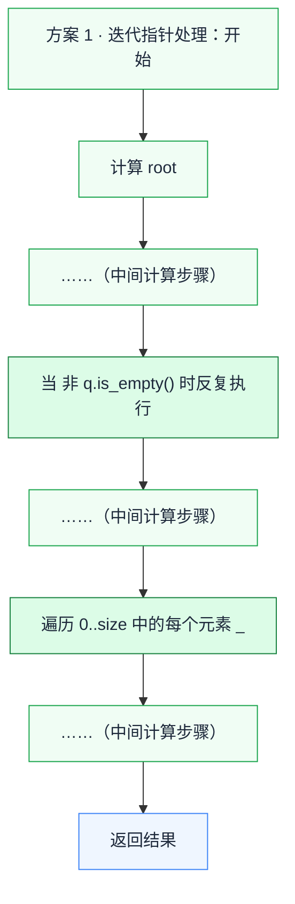

```rust
// LeetCode 107. 二叉树的层序遍历 II — Rust 版（方案1）
use std::cell::RefCell;
use std::rc::Rc; // 引入依赖 // 引入依赖

#[derive(Debug)]
struct TreeNode {
    // 定义类型
    val: i32,
    left: Option<Rc<RefCell<TreeNode>>>,
    right: Option<Rc<RefCell<TreeNode>>>,
}

impl TreeNode {
    // 实现块
    fn new(val: i32) -> Rc<RefCell<TreeNode>> {
        // 定义函数/方法 new
        Rc::new(RefCell::new(TreeNode {
            val,
            left: None,
            right: None,
        })) // Rc::new(RefCell::new(TreeNode { 值, 左边界: None, 右边界: None }))
    }
}

fn build_tree(vals: &[Option<i32>]) -> Option<Rc<RefCell<TreeNode>>> {
    // 定义函数/方法 build_tree
    if vals.is_empty() || vals[0].is_none() {
        // 若 vals 是否为空 或 vals[0].is_none(
        return None; // 返回 None
    }
    let root = TreeNode::new(vals[0].unwrap()); // 把 TreeNode::new(vals[0].unwrap()) 存入 根节点
    let mut queue: Vec<Rc<RefCell<TreeNode>>> = vec![root.clone()];
    let mut i = 1; // 把 1; 写入 let mut i
    while !queue.is_empty() && i < vals.len() {
        // while 取反 队列 是否为空 且 下标 i 小于 vals.长度() {
        let node = queue.remove(0); // 把 队列 弹出 0) 存入 节点
        if i < vals.len() {
            // 若 下标 i 小于 vals.长度(
            if let Some(v) = vals[i] {
                // 若 let Some(值) 赋值为 vals[下标 i]
                let child = TreeNode::new(v); // 把 TreeNode::new(值) 存入 子节点
                node.borrow_mut().left = Some(child.clone()); // 把 Some(子节点.clone()); 写入 左边界
                queue.push(child); // 把 子节点 压入栈/数组尾部
            }
            i += 1; // 下标 i累加 1
        }
        if i < vals.len() {
            // 若 下标 i 小于 vals.长度(
            if let Some(v) = vals[i] {
                // 若 let Some(值) 赋值为 vals[下标 i]
                let child = TreeNode::new(v); // 把 TreeNode::new(值) 存入 子节点
                node.borrow_mut().right = Some(child.clone()); // 把 Some(子节点.clone()); 写入 右边界
                queue.push(child); // 把 子节点 压入栈/数组尾部
            }
            i += 1; // 下标 i累加 1
        }
    }
    Some(root) // Some(根节点)
}

fn level_order_bottom(root: Option<Rc<RefCell<TreeNode>>>) -> Vec<Vec<i32>> {
    // 定义函数/方法 level_order_bottom
    let root = match root {
        Some(x) => x,
        None => return vec![],
    };
    let mut res = Vec::new(); // 把 Vec::new(); 写入 let mut res
    let mut q = vec![root]; // 把 vec取反 [根节点]; 写入 let mut q
    while !q.is_empty() {
        // while 取反 节点 是否为空 {
        let size = q.len(); // 把 节点.长度() 存入 大小
        let mut level = Vec::new(); // 把 Vec::new(); 写入 let mut level
        for _ in 0..size {
            // 逐个取出 0 的元素（_）
            let node = q.remove(0); // 把 节点 弹出 0) 存入 节点
            let nb = node.borrow(); // 把 节点.borrow() 存入 nb
            level.push(nb.val); // 把 nb.值 压入栈/数组尾部
            if let Some(c) = nb.left.clone() {
                q.push(c);
            } // 若 let Some(字符) 赋值为 nb.左边界.clone() { 节点 追加 字符); }
            if let Some(c) = nb.right.clone() {
                q.push(c);
            } // 若 let Some(字符) 赋值为 nb.右边界.clone() { 节点 追加 字符); }
        }
        res.insert(0, level); // 结果 插入 0, level);
    }
    res // 结果
}
fn main() {
    // 程序入口：跑内嵌自测用例
    assert_eq!(level_order_bottom(None), Vec::<Vec<i32>>::new()); // 断言校验
    assert_eq!(
        level_order_bottom(build_tree(&[
            Some(3),
            Some(9),
            Some(20),
            None,
            None,
            Some(15),
            Some(7)
        ])),
        vec![vec![15, 7], vec![9, 20], vec![3]]
    ); // 断言校验
    println!("PASS"); // 全部用例通过，输出 PASS
}
```

#### 方案 2：迭代指针处理

**思路与代码分析**：核心是「迭代指针处理」。Rust 版用所有权移动与切片借用改写同一逻辑，注意 Option 与引用边界。**走读**：方案 2 · 迭代指针处理：开始 → 计算 root → 当 非 q.is_empty() 时反复执行 → 遍历 0..size 中的每个元素 _ → 返回结果。

**运行架构**（真实控制流）：


```rust
// LeetCode 107. 二叉树的层序遍历 II — Rust 版（方案2）
use std::cell::RefCell;
use std::rc::Rc; // 引入依赖 // 引入依赖

#[derive(Debug)]
struct TreeNode {
    // 定义类型
    val: i32,
    left: Option<Rc<RefCell<TreeNode>>>,
    right: Option<Rc<RefCell<TreeNode>>>,
}

impl TreeNode {
    // 实现块
    fn new(val: i32) -> Rc<RefCell<TreeNode>> {
        // 定义函数/方法 new
        Rc::new(RefCell::new(TreeNode {
            val,
            left: None,
            right: None,
        })) // Rc::new(RefCell::new(TreeNode { 值, 左边界: None, 右边界: None }))
    }
}

fn build_tree(vals: &[Option<i32>]) -> Option<Rc<RefCell<TreeNode>>> {
    // 定义函数/方法 build_tree
    if vals.is_empty() || vals[0].is_none() {
        // 若 vals 是否为空 或 vals[0].is_none(
        return None; // 返回 None
    }
    let root = TreeNode::new(vals[0].unwrap()); // 把 TreeNode::new(vals[0].unwrap()) 存入 根节点
    let mut queue: Vec<Rc<RefCell<TreeNode>>> = vec![root.clone()];
    let mut i = 1; // 把 1; 写入 let mut i
    while !queue.is_empty() && i < vals.len() {
        // while 取反 队列 是否为空 且 下标 i 小于 vals.长度() {
        let node = queue.remove(0); // 把 队列 弹出 0) 存入 节点
        if i < vals.len() {
            // 若 下标 i 小于 vals.长度(
            if let Some(v) = vals[i] {
                // 若 let Some(值) 赋值为 vals[下标 i]
                let child = TreeNode::new(v); // 把 TreeNode::new(值) 存入 子节点
                node.borrow_mut().left = Some(child.clone()); // 把 Some(子节点.clone()); 写入 左边界
                queue.push(child); // 把 子节点 压入栈/数组尾部
            }
            i += 1; // 下标 i累加 1
        }
        if i < vals.len() {
            // 若 下标 i 小于 vals.长度(
            if let Some(v) = vals[i] {
                // 若 let Some(值) 赋值为 vals[下标 i]
                let child = TreeNode::new(v); // 把 TreeNode::new(值) 存入 子节点
                node.borrow_mut().right = Some(child.clone()); // 把 Some(子节点.clone()); 写入 右边界
                queue.push(child); // 把 子节点 压入栈/数组尾部
            }
            i += 1; // 下标 i累加 1
        }
    }
    Some(root) // Some(根节点)
}

fn level_order_bottom(root: Option<Rc<RefCell<TreeNode>>>) -> Vec<Vec<i32>> {
    // 定义函数/方法 level_order_bottom
    let root = match root {
        Some(x) => x,
        None => return vec![],
    };
    let mut res = Vec::new(); // 把 Vec::new(); 写入 let mut res
    let mut q = vec![root]; // 把 vec取反 [根节点]; 写入 let mut q
    while !q.is_empty() {
        // while 取反 节点 是否为空 {
        let size = q.len(); // 把 节点.长度() 存入 大小
        let mut level = Vec::new(); // 把 Vec::new(); 写入 let mut level
        for _ in 0..size {
            // 逐个取出 0 的元素（_）
            let node = q.remove(0); // 把 节点 弹出 0) 存入 节点
            let nb = node.borrow(); // 把 节点.borrow() 存入 nb
            level.push(nb.val); // 把 nb.值 压入栈/数组尾部
            if let Some(c) = nb.left.clone() {
                q.push(c);
            } // 若 let Some(字符) 赋值为 nb.左边界.clone() { 节点 追加 字符); }
            if let Some(c) = nb.right.clone() {
                q.push(c);
            } // 若 let Some(字符) 赋值为 nb.右边界.clone() { 节点 追加 字符); }
        }
        res.insert(0, level); // 结果 插入 0, level);
    }
    res // 结果
}
fn main() {
    // 程序入口：跑内嵌自测用例
    assert_eq!(level_order_bottom(None), Vec::<Vec<i32>>::new()); // 断言校验
    assert_eq!(
        level_order_bottom(build_tree(&[
            Some(3),
            Some(9),
            Some(20),
            None,
            None,
            Some(15),
            Some(7)
        ])),
        vec![vec![15, 7], vec![9, 20], vec![3]]
    ); // 断言校验
    println!("PASS"); // 全部用例通过，输出 PASS
}
```

### Lua 实现（2 种方案）

Lua 的全部方案如下，每个方案都内嵌用例自测，可独立运行（老仓库 python/go 文件遵循「打印结果」约定）：

#### 方案 1：迭代指针处理

**思路与代码分析**：核心是「迭代指针处理」。Lua 版用表与 ipairs 遍历，注意 ipairs 遇 nil 即停的语义。**走读**：方案 1 · 迭代指针处理：开始 → 处理 if not vals or #vals == 0 or → 返回 nil → 当 head ≤ #queue and i ≤ #vals do 时反复执行 → 返回 root。

**运行架构**（真实控制流）：

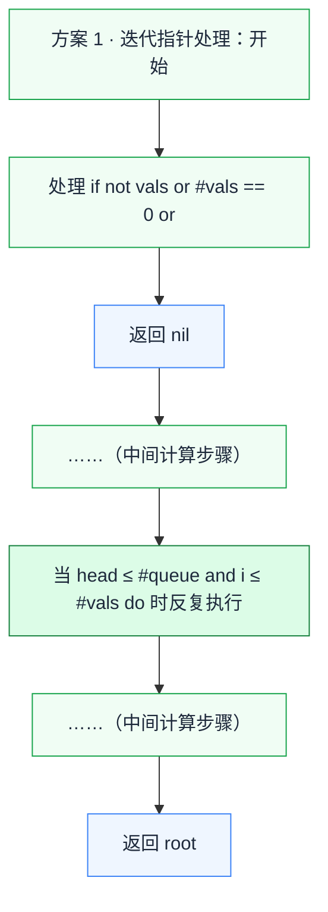

```lua
-- LeetCode 107. 二叉树的层序遍历 II — Lua 版（方案1）
local TreeNode = {} -- 把 {} 写入 local TreeNode
TreeNode.__index = TreeNode -- 把 TreeNode 写入 TreeNode.__index
function TreeNode.new(val) -- function TreeNode.new(值)
	return setmetatable({ val = val, left = nil, right = nil }, TreeNode)
end -- 终点

local function build_tree(vals) -- local function build_tree(vals)
	if not vals or #vals == 0 or vals[1] == "null" then
		return nil
	end
	local root = TreeNode.new(vals[1]) -- 把 TreeNode.new(vals[1]) 写入 local root
	local queue = { root } -- 把 {根节点} 写入 local queue
	local head = 1 -- 把 1 写入 local head
	local i = 2 -- 把 2 写入 local i
	while head <= #queue and i <= #vals do -- 把 #队列 and 下标 i 不超过 #vals do 写入 while head <
		local node = queue[head] -- 把 队列[头节点] 写入 local node
		head = head + 1 -- 把 头节点 加 1 存入 头节点
		if i <= #vals then -- 若 下标 i 不超过 #vals then
			if vals[i] ~= "null" then -- 若 vals[下标 i] ~ 赋值为 「null」 then
				node.left = TreeNode.new(vals[i]) -- 把 TreeNode.new(vals[下标 i]) 写入 左边界
				queue[#queue + 1] = node.left -- 把 节点.左边界 写入 queue[#queue + 1]
			end -- 终点
			i = i + 1 -- 把 下标 i 加 1 存入 下标 i
		end -- 终点
		if i <= #vals then -- 若 下标 i 不超过 #vals then
			if vals[i] ~= "null" then -- 若 vals[下标 i] ~ 赋值为 「null」 then
				node.right = TreeNode.new(vals[i]) -- 把 TreeNode.new(vals[下标 i]) 写入 右边界
				queue[#queue + 1] = node.right -- 把 节点.右边界 写入 queue[#queue + 1]
			end -- 终点
			i = i + 1 -- 把 下标 i 加 1 存入 下标 i
		end -- 终点
	end -- 终点
	return root -- 返回 根节点
end -- 终点

local function level_order_bottom(root) -- local function level_order_bottom(根节点)
	if not root then
		return {}
	end -- 若 not 根节点 then return {} 终点
	local res = {} -- 把 {} 写入 local res
	local q = { root } -- 把 {根节点} 写入 local q
	while #q > 0 do -- while #节点 超过 0 do
		local size = #q -- 把 #节点 写入 local size
		local level = {} -- 把 {} 写入 local level
		for _ = 1, size do -- 让 _ 从 1 走到 大小（Lua 1 基）
			local node = table.remove(q, 1) -- 把 table 弹出 节点, 1) 写入 local node
			level[#level + 1] = node.val -- 把 节点.值 写入 level[#level + 1]
			if node.left then
				q[#q + 1] = node.left
			end -- 若 节点.左边界 then 节点[#节点 加 1] 赋值为 节点.左边界 终点
			if node.right then
				q[#q + 1] = node.right
			end -- 若 节点.右边界 then 节点[#节点 加 1] 赋值为 节点.右边界 终点
		end -- 终点
		table.insert(res, 1, level) -- table 插入 结果, 1, level)
	end -- 终点
	return res -- 返回 结果
end -- 终点
local function s(t)
	local p = {}
	for i, l in ipairs(t) do
		p[i] = table.concat(l, ",")
	end
	return table.concat(p, "|")
end -- 打印输出
assert(s(level_order_bottom(nil)) == "") -- 断言校验
assert(s(level_order_bottom(build_tree({ 3, 9, 20, "null", "null", 15, 7 }))) == "15,7|9,20|3") -- 断言校验
print("PASS") -- 全部用例通过，输出 PASS
```

#### 方案 2：迭代指针处理

**思路与代码分析**：核心是「迭代指针处理」。Lua 版用表与 ipairs 遍历，注意 ipairs 遇 nil 即停的语义。**走读**：方案 2 · 迭代指针处理：开始 → 处理 if not vals or #vals == 0 or → 返回 nil → 当 head ≤ #queue and i ≤ #vals do 时反复执行 → 返回 root。

**运行架构**（真实控制流）：

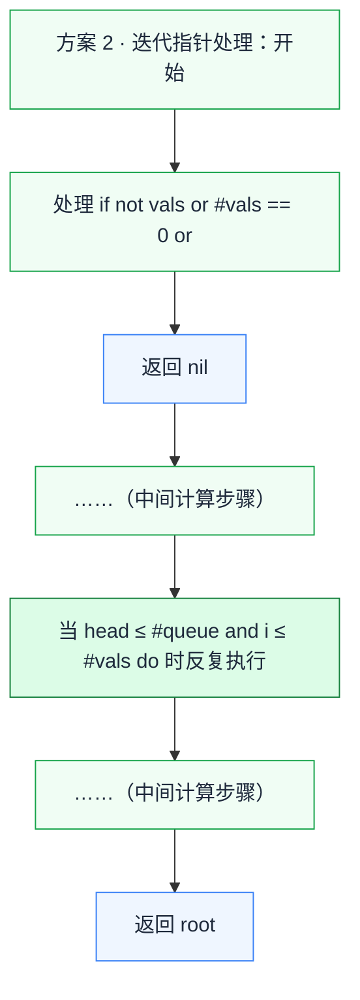

```lua
-- LeetCode 107. 二叉树的层序遍历 II — Lua 版（方案2）
local TreeNode = {} -- 把 {} 写入 local TreeNode
TreeNode.__index = TreeNode -- 把 TreeNode 写入 TreeNode.__index
function TreeNode.new(val) -- function TreeNode.new(值)
	return setmetatable({ val = val, left = nil, right = nil }, TreeNode)
end -- 终点

local function build_tree(vals) -- local function build_tree(vals)
	if not vals or #vals == 0 or vals[1] == "null" then
		return nil
	end
	local root = TreeNode.new(vals[1]) -- 把 TreeNode.new(vals[1]) 写入 local root
	local queue = { root } -- 把 {根节点} 写入 local queue
	local head = 1 -- 把 1 写入 local head
	local i = 2 -- 把 2 写入 local i
	while head <= #queue and i <= #vals do -- 把 #队列 and 下标 i 不超过 #vals do 写入 while head <
		local node = queue[head] -- 把 队列[头节点] 写入 local node
		head = head + 1 -- 把 头节点 加 1 存入 头节点
		if i <= #vals then -- 若 下标 i 不超过 #vals then
			if vals[i] ~= "null" then -- 若 vals[下标 i] ~ 赋值为 「null」 then
				node.left = TreeNode.new(vals[i]) -- 把 TreeNode.new(vals[下标 i]) 写入 左边界
				queue[#queue + 1] = node.left -- 把 节点.左边界 写入 queue[#queue + 1]
			end -- 终点
			i = i + 1 -- 把 下标 i 加 1 存入 下标 i
		end -- 终点
		if i <= #vals then -- 若 下标 i 不超过 #vals then
			if vals[i] ~= "null" then -- 若 vals[下标 i] ~ 赋值为 「null」 then
				node.right = TreeNode.new(vals[i]) -- 把 TreeNode.new(vals[下标 i]) 写入 右边界
				queue[#queue + 1] = node.right -- 把 节点.右边界 写入 queue[#queue + 1]
			end -- 终点
			i = i + 1 -- 把 下标 i 加 1 存入 下标 i
		end -- 终点
	end -- 终点
	return root -- 返回 根节点
end -- 终点

local function level_order_bottom(root) -- local function level_order_bottom(根节点)
	if not root then
		return {}
	end -- 若 not 根节点 then return {} 终点
	local res = {} -- 把 {} 写入 local res
	local q = { root } -- 把 {根节点} 写入 local q
	while #q > 0 do -- while #节点 超过 0 do
		local size = #q -- 把 #节点 写入 local size
		local level = {} -- 把 {} 写入 local level
		for _ = 1, size do -- 让 _ 从 1 走到 大小（Lua 1 基）
			local node = table.remove(q, 1) -- 把 table 弹出 节点, 1) 写入 local node
			level[#level + 1] = node.val -- 把 节点.值 写入 level[#level + 1]
			if node.left then
				q[#q + 1] = node.left
			end -- 若 节点.左边界 then 节点[#节点 加 1] 赋值为 节点.左边界 终点
			if node.right then
				q[#q + 1] = node.right
			end -- 若 节点.右边界 then 节点[#节点 加 1] 赋值为 节点.右边界 终点
		end -- 终点
		table.insert(res, 1, level) -- table 插入 结果, 1, level)
	end -- 终点
	return res -- 返回 结果
end -- 终点
local function s(t)
	local p = {}
	for i, l in ipairs(t) do
		p[i] = table.concat(l, ",")
	end
	return table.concat(p, "|")
end -- 打印输出
assert(s(level_order_bottom(nil)) == "") -- 断言校验
assert(s(level_order_bottom(build_tree({ 3, 9, 20, "null", "null", 15, 7 }))) == "15,7|9,20|3") -- 断言校验
print("PASS") -- 全部用例通过，输出 PASS
```

### C 实现（2 种方案）

C 的全部方案如下，每个方案都内嵌用例自测，可独立运行（老仓库 python/go 文件遵循「打印结果」约定）：

#### 方案 1：迭代指针处理

**思路与代码分析**：核心是「迭代指针处理」。C 版手动管理下标与内存，循环边界全部显式写出。代码里依次做这些事：双重循环遍历。**走读**：方案 1 · 迭代指针处理：开始 → 命中条件，直接返回 → 处理 TreeNode *q[4096] → 当 (head ＜ tail) 时反复执行 → 遍历循环 → 遍历循环 → 遍历循环 → 返回 nl。

**运行架构**（真实控制流）：


```c
/* LeetCode 107. 二叉树的层序遍历 II — C 版（方案1） */
#include <stdio.h>                   // 引入头文件
#include <stdlib.h>                  // 引入头文件
#define INT_MIN_SN (-2147483647 - 1) // #define INT_MIN_SN ( 减 2147483647 减 1)

typedef struct TreeNode {   // typedef struct TreeNode {
    int val;                // int 值;
    struct TreeNode *left;  // 定义类型
    struct TreeNode *right; // 定义类型
} TreeNode;                 // } TreeNode;

static TreeNode *build_tree(const int *vals,
                            int n) { // static TreeNode 乘 build_tree(const int 乘 vals, int 元素个数) {
    if (n == 0 || vals[0] == INT_MIN_SN)
        return NULL; // 若 元素个数 等于 0 或 vals[0] 等于 INT_MIN_SN，直接返回 NULL
    TreeNode *root = malloc(sizeof(TreeNode)); // 把 malloc(sizeof(TreeNode)); 写入 TreeNode *root
    root->val = vals[0];
    root->left = root->right = NULL;
    TreeNode **queue =
        malloc(sizeof(TreeNode *) * n); // 把 malloc(sizeof(TreeNode 乘 ) 乘 元素个数); 写入 TreeNode **queue
    int head = 0, tail = 0, i = 1; // 把 0, 尾节点 赋值为 0, 下标 i 赋值为 1 存入 头节点
    queue[tail++] = root;          // 把 根节点; 写入 queue[tail++]
    while (head < tail && i < n) { // 循环，直到不满足「头节点 小于 尾节点 且 下标 i 小于 元素个数」
        TreeNode *node = queue[head++];                // 把 队列[头节点 加一 ]; 写入 TreeNode *node
        if (i < n) {                                   // 若 下标 i 小于 元素个数
            if (vals[i] != INT_MIN_SN) {               // 若 vals[下标 i] 不等于 INT_MIN_SN
                node->left = malloc(sizeof(TreeNode)); // 把 malloc(sizeof(TreeNode)); 写入 node->left
                node->left->val = vals[i];
                node->left->left = node->left->right = NULL;
                queue[tail++] = node->left; // 把 节点 减 超过 左边界; 写入 queue[tail++]
            }
            i++; // 下标 i 加一
        }
        if (i < n) {                                    // 若 下标 i 小于 元素个数
            if (vals[i] != INT_MIN_SN) {                // 若 vals[下标 i] 不等于 INT_MIN_SN
                node->right = malloc(sizeof(TreeNode)); // 把 malloc(sizeof(TreeNode)); 写入 node->right
                node->right->val = vals[i];
                node->right->left = node->right->right = NULL;
                queue[tail++] = node->right; // 把 节点 减 超过 右边界; 写入 queue[tail++]
            }
            i++; // 下标 i 加一
        }
    }
    free(queue); // free(队列);
    return root; // 返回 根节点
}

static void free_tree(TreeNode *n) { // 定义函数/方法 free_tree
    if (!n)
        return;          // 若 取反 元素个数) return;
    free_tree(n->left);  // free_tree(元素个数 减 超过 左边界);
    free_tree(n->right); // free_tree(元素个数 减 超过 右边界);
    free(n);             // free(元素个数);
}

static int level_order_bottom(TreeNode *root, int out[][64],
                              int levels[]) { // 定义函数/方法 level_order_bottom
    if (!root) {
        return 0;
    }                                    // 若 取反 根节点) { return 0; }
    TreeNode *q[4096];                   // TreeNode 乘 节点[4096];
    int head = 0, tail = 0;              // 把 0, 尾节点 赋值为 0 存入 头节点
    int tmp[64][64], tl[64], nl = 0;     // 把 0; 写入 int tmp[64][64], tl[64], nl
    q[tail++] = root;                    // 把 根节点; 写入 q[tail++]
    while (head < tail) {                // 循环，直到不满足「头节点 小于 尾节点」
        int size = tail - head, cnt = 0; // 把 尾节点 减 头节点, 计数 赋值为 0 存入 大小
        for (int i = 0; i < size; i++) { // 让 下标 i 从 0 开始计数，下标 i 小于 大小 就继续
            TreeNode *n = q[head++];     // 把 节点[头节点 加一 ]; 写入 TreeNode *n
            tmp[nl][cnt++] = n->val;     // 把 元素个数 减 超过 值; 写入 tmp[nl][cnt++]
            if (n->left)
                q[tail++] =
                    n->left; // 若 元素个数 减 超过 左边界) 节点[尾节点 加一 ] 赋值为 元素个数 减 超过 左边界;
            if (n->right)
                q[tail++] = n->right; // 若 元素个数 减 超过 右边界) 节点[尾节点 加一 ] 赋值为 元素个数 减
                                      // 超过 右边界;
        }
        tl[nl++] = cnt; // 把 计数; 写入 tl[nl++]
    }
    for (int i = 0; i < nl; i++) { /* 反转 */ // 让 下标 i 从 0 开始计数，下标 i 小于 nl 就继续
        levels[i] = tl[nl - 1 - i];           // 把 tl[nl 减 1 减 下标 i]; 写入 levels[i]
        for (int j = 0; j < tl[nl - 1 - i]; j++)
            out[i][j] =
                tmp[nl - 1 - i][j]; // 让 下标 j 从 0 开始计数，下标 j 小于 tl[nl 减 1 减 下标 i] 就继续
    }
    return nl; // 返回 nl
}
int main(void) { // 程序入口：跑内嵌自测用例
    int v[] = {3,          9,  20, INT_MIN_SN,
               INT_MIN_SN, 15, 7};  // 把 {3,9,20,INT_MIN_SN,INT_MIN_SN,15,7}; 写入 int v[]
    int out[64][64], levels[64], n; // int out[64][64], levels[64], 元素个数;
    if (level_order_bottom(NULL, out, levels) != 0) {
        printf("FAIL 0\n");
        return 1;
    }
    n = level_order_bottom(build_tree(v, 7), out,
                           levels); // 把 level_order_bottom(build_tree(值, 7), out, levels); 写入 元素个数
    if (n != 3 || out[0][0] != 15 || out[0][1] != 7 || out[1][0] != 9 || out[1][1] != 20 || out[2][0] != 3) {
        printf("FAIL 1\n");
        return 1;
    }
    printf("PASS\n"); // 全部用例通过，输出 PASS
    return 0;         // 返回 0
}
```

#### 方案 2：迭代指针处理

**思路与代码分析**：核心是「迭代指针处理」。C 版手动管理下标与内存，循环边界全部显式写出。代码里依次做这些事：双重循环遍历。**走读**：方案 2 · 迭代指针处理：开始 → 命中条件，直接返回 → 处理 TreeNode *q[4096] → 当 (head ＜ tail) 时反复执行 → 遍历循环 → 遍历循环 → 遍历循环 → 返回 nl。

**运行架构**（真实控制流）：

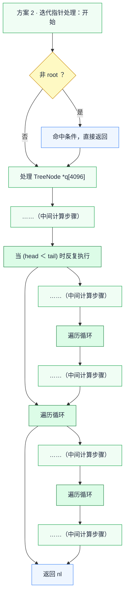

```c
/* LeetCode 107. 二叉树的层序遍历 II — C 版（方案2） */
#include <stdio.h>                   // 引入头文件
#include <stdlib.h>                  // 引入头文件
#define INT_MIN_SN (-2147483647 - 1) // #define INT_MIN_SN ( 减 2147483647 减 1)

typedef struct TreeNode {   // typedef struct TreeNode {
    int val;                // int 值;
    struct TreeNode *left;  // 定义类型
    struct TreeNode *right; // 定义类型
} TreeNode;                 // } TreeNode;

static TreeNode *build_tree(const int *vals,
                            int n) { // static TreeNode 乘 build_tree(const int 乘 vals, int 元素个数) {
    if (n == 0 || vals[0] == INT_MIN_SN)
        return NULL; // 若 元素个数 等于 0 或 vals[0] 等于 INT_MIN_SN，直接返回 NULL
    TreeNode *root = malloc(sizeof(TreeNode)); // 把 malloc(sizeof(TreeNode)); 写入 TreeNode *root
    root->val = vals[0];
    root->left = root->right = NULL;
    TreeNode **queue =
        malloc(sizeof(TreeNode *) * n); // 把 malloc(sizeof(TreeNode 乘 ) 乘 元素个数); 写入 TreeNode **queue
    int head = 0, tail = 0, i = 1; // 把 0, 尾节点 赋值为 0, 下标 i 赋值为 1 存入 头节点
    queue[tail++] = root;          // 把 根节点; 写入 queue[tail++]
    while (head < tail && i < n) { // 循环，直到不满足「头节点 小于 尾节点 且 下标 i 小于 元素个数」
        TreeNode *node = queue[head++];                // 把 队列[头节点 加一 ]; 写入 TreeNode *node
        if (i < n) {                                   // 若 下标 i 小于 元素个数
            if (vals[i] != INT_MIN_SN) {               // 若 vals[下标 i] 不等于 INT_MIN_SN
                node->left = malloc(sizeof(TreeNode)); // 把 malloc(sizeof(TreeNode)); 写入 node->left
                node->left->val = vals[i];
                node->left->left = node->left->right = NULL;
                queue[tail++] = node->left; // 把 节点 减 超过 左边界; 写入 queue[tail++]
            }
            i++; // 下标 i 加一
        }
        if (i < n) {                                    // 若 下标 i 小于 元素个数
            if (vals[i] != INT_MIN_SN) {                // 若 vals[下标 i] 不等于 INT_MIN_SN
                node->right = malloc(sizeof(TreeNode)); // 把 malloc(sizeof(TreeNode)); 写入 node->right
                node->right->val = vals[i];
                node->right->left = node->right->right = NULL;
                queue[tail++] = node->right; // 把 节点 减 超过 右边界; 写入 queue[tail++]
            }
            i++; // 下标 i 加一
        }
    }
    free(queue); // free(队列);
    return root; // 返回 根节点
}

static void free_tree(TreeNode *n) { // 定义函数/方法 free_tree
    if (!n)
        return;          // 若 取反 元素个数) return;
    free_tree(n->left);  // free_tree(元素个数 减 超过 左边界);
    free_tree(n->right); // free_tree(元素个数 减 超过 右边界);
    free(n);             // free(元素个数);
}

static int level_order_bottom(TreeNode *root, int out[][64],
                              int levels[]) { // 定义函数/方法 level_order_bottom
    if (!root) {
        return 0;
    }                                    // 若 取反 根节点) { return 0; }
    TreeNode *q[4096];                   // TreeNode 乘 节点[4096];
    int head = 0, tail = 0;              // 把 0, 尾节点 赋值为 0 存入 头节点
    int tmp[64][64], tl[64], nl = 0;     // 把 0; 写入 int tmp[64][64], tl[64], nl
    q[tail++] = root;                    // 把 根节点; 写入 q[tail++]
    while (head < tail) {                // 循环，直到不满足「头节点 小于 尾节点」
        int size = tail - head, cnt = 0; // 把 尾节点 减 头节点, 计数 赋值为 0 存入 大小
        for (int i = 0; i < size; i++) { // 让 下标 i 从 0 开始计数，下标 i 小于 大小 就继续
            TreeNode *n = q[head++];     // 把 节点[头节点 加一 ]; 写入 TreeNode *n
            tmp[nl][cnt++] = n->val;     // 把 元素个数 减 超过 值; 写入 tmp[nl][cnt++]
            if (n->left)
                q[tail++] =
                    n->left; // 若 元素个数 减 超过 左边界) 节点[尾节点 加一 ] 赋值为 元素个数 减 超过 左边界;
            if (n->right)
                q[tail++] = n->right; // 若 元素个数 减 超过 右边界) 节点[尾节点 加一 ] 赋值为 元素个数 减
                                      // 超过 右边界;
        }
        tl[nl++] = cnt; // 把 计数; 写入 tl[nl++]
    }
    for (int i = 0; i < nl; i++) { /* 反转 */ // 让 下标 i 从 0 开始计数，下标 i 小于 nl 就继续
        levels[i] = tl[nl - 1 - i];           // 把 tl[nl 减 1 减 下标 i]; 写入 levels[i]
        for (int j = 0; j < tl[nl - 1 - i]; j++)
            out[i][j] =
                tmp[nl - 1 - i][j]; // 让 下标 j 从 0 开始计数，下标 j 小于 tl[nl 减 1 减 下标 i] 就继续
    }
    return nl; // 返回 nl
}
int main(void) { // 程序入口：跑内嵌自测用例
    int v[] = {3,          9,  20, INT_MIN_SN,
               INT_MIN_SN, 15, 7};  // 把 {3,9,20,INT_MIN_SN,INT_MIN_SN,15,7}; 写入 int v[]
    int out[64][64], levels[64], n; // int out[64][64], levels[64], 元素个数;
    if (level_order_bottom(NULL, out, levels) != 0) {
        printf("FAIL 0\n");
        return 1;
    }
    n = level_order_bottom(build_tree(v, 7), out,
                           levels); // 把 level_order_bottom(build_tree(值, 7), out, levels); 写入 元素个数
    if (n != 3 || out[0][0] != 15 || out[0][1] != 7 || out[1][0] != 9 || out[1][1] != 20 || out[2][0] != 3) {
        printf("FAIL 1\n");
        return 1;
    }
    printf("PASS\n"); // 全部用例通过，输出 PASS
    return 0;         // 返回 0
}
```

### C++ 实现（2 种方案）

C++ 的全部方案如下，每个方案都内嵌用例自测，可独立运行（老仓库 python/go 文件遵循「打印结果」约定）：

#### 方案 1：迭代指针处理

**思路与代码分析**：核心是「迭代指针处理」。C++ 版用 STL 容器与迭代器，减少手写下标错误。代码里依次做这些事：单循环线性扫描；栈的后进先出操作。**走读**：方案 1 · 迭代指针处理：开始 → 处理 std::vector＜std::vector＜int＞ → 命中条件，直接返回 → 当 (非 q.empty()) 时反复执行 → 遍历循环 → 返回 res。

**运行架构**（真实控制流）：


```cpp
// LeetCode 107. 二叉树的层序遍历 II — C++ 版（方案1）
#include <cassert>  // 引入头文件
#include <cstdint>  // 引入头文件
#include <iostream> // 引入头文件
#include <optional> // 引入头文件
#include <queue>    // 引入头文件
#include <vector>   // 引入头文件

struct TreeNode {    // 定义类型
    int val;         // int 值;
    TreeNode *left;  // TreeNode 乘 左边界;
    TreeNode *right; // TreeNode 乘 右边界;
    explicit TreeNode(int v) : val(v), left(nullptr), right(nullptr) {}
};

static TreeNode *build_tree(const std::vector<std::optional<int>> &vals) {
    if (vals.empty() || !vals[0].has_value())
        return nullptr; // 若 vals 是否为空 或 取反 vals[0].has_value()，直接返回 nullptr
    auto *root = new TreeNode(*vals[0]); // 把 new TreeNode( 乘 vals[0]); 写入 auto *root
    std::queue<TreeNode *> q;            // std::队列 小于 TreeNode 乘 超过 节点;
    q.push(root);                        // 把 根节点 压入栈/数组尾部
    size_t i = 1;                        // 把 1; 写入 size_t i
    while (!q.empty() &&
           i < vals.size()) { // 循环，直到不满足「取反 节点 是否为空 且 下标 i 小于 vals.大小(」
        TreeNode *node = q.front();                  // 把 节点.front(); 写入 TreeNode *node
        q.pop();                                     // 弹出栈顶元素
        if (i < vals.size()) {                       // 若 下标 i 小于 vals.大小(
            if (vals[i].has_value()) {               // 若 vals[下标 i].has_value(
                node->left = new TreeNode(*vals[i]); // 把 new TreeNode( 乘 vals[下标 i]); 写入 node->left
                q.push(node->left);                  // 把 节点 减 超过 左边界 压入栈/数组尾部
            }
            ++i; // 加一 下标 i;
        }
        if (i < vals.size()) {                        // 若 下标 i 小于 vals.大小(
            if (vals[i].has_value()) {                // 若 vals[下标 i].has_value(
                node->right = new TreeNode(*vals[i]); // 把 new TreeNode( 乘 vals[下标 i]); 写入 node->right
                q.push(node->right); // 把 节点 减 超过 右边界 压入栈/数组尾部
            }
            ++i; // 加一 下标 i;
        }
    }
    return root; // 返回 根节点
}

static void free_tree(TreeNode *n) { // 定义函数/方法 free_tree
    if (!n)
        return;          // 若 取反 元素个数) return;
    free_tree(n->left);  // free_tree(元素个数 减 超过 左边界);
    free_tree(n->right); // free_tree(元素个数 减 超过 右边界);
    delete n;            // delete 元素个数;
}

static std::vector<std::vector<int>> levelOrderBottom(TreeNode *root) {
    std::vector<std::vector<int>> res; // std::vector 小于 std::vector 小于 int 超过 超过 结果;
    if (!root)
        return res;                            // 若 取反 根节点，直接返回 结果
    std::queue<TreeNode *> q;                  // std::队列 小于 TreeNode 乘 超过 节点;
    q.push(root);                              // 把 根节点 压入栈/数组尾部
    while (!q.empty()) {                       // 循环，直到不满足「取反 节点.empty(」
        int size = static_cast<int>(q.size()); // 把 static_cast 小于 int 超过 (节点.大小()) 存入 大小
        std::vector<int> level;                // std::vector 小于 int 超过 level;
        for (int i = 0; i < size; ++i) { // 让 下标 i 从 0 开始计数，下标 i 小于 大小 就继续
            auto *n = q.front();         // 把 节点.front(); 写入 auto *n
            q.pop();                     // 弹出栈顶元素
            level.push_back(n->val);     // level 追加 元素个数 减 超过 值);
            if (n->left)
                q.push(n->left); // 若 元素个数 减 超过 左边界) 节点 追加 元素个数 减 超过 左边界);
            if (n->right)
                q.push(n->right); // 若 元素个数 减 超过 右边界) 节点 追加 元素个数 减 超过 右边界);
        }
        res.insert(res.begin(), std::move(level)); // 结果 插入 结果 迭代位置 , std::move(level));
    }
    return res; // 返回 结果
}
int main() { // 程序入口：跑内嵌自测用例
    assert((levelOrderBottom(nullptr) == std::vector<std::vector<int>>{})); // 断言校验
    assert((levelOrderBottom(build_tree({3, 9, 20, std::nullopt, std::nullopt, 15, 7})) ==
            std::vector<std::vector<int>>{{15, 7}, {9, 20}, {3}})); // 断言校验
    std::cout << "PASS" << std::endl;                               // 全部用例通过，输出 PASS
    return 0;                                                       // 返回 0
}
```

#### 方案 2：迭代指针处理

**思路与代码分析**：核心是「迭代指针处理」。C++ 版用 STL 容器与迭代器，减少手写下标错误。代码里依次做这些事：单循环线性扫描；栈的后进先出操作。**走读**：方案 2 · 迭代指针处理：开始 → 处理 std::vector＜std::vector＜int＞ → 命中条件，直接返回 → 当 (非 q.empty()) 时反复执行 → 遍历循环 → 返回 res。

**运行架构**（真实控制流）：

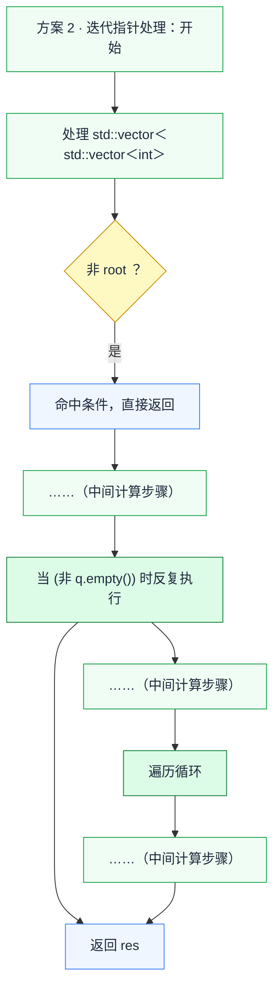

```cpp
// LeetCode 107. 二叉树的层序遍历 II — C++ 版（方案2）
#include <cassert>  // 引入头文件
#include <cstdint>  // 引入头文件
#include <iostream> // 引入头文件
#include <optional> // 引入头文件
#include <queue>    // 引入头文件
#include <vector>   // 引入头文件

struct TreeNode {    // 定义类型
    int val;         // int 值;
    TreeNode *left;  // TreeNode 乘 左边界;
    TreeNode *right; // TreeNode 乘 右边界;
    explicit TreeNode(int v) : val(v), left(nullptr), right(nullptr) {}
};

static TreeNode *build_tree(const std::vector<std::optional<int>> &vals) {
    if (vals.empty() || !vals[0].has_value())
        return nullptr; // 若 vals 是否为空 或 取反 vals[0].has_value()，直接返回 nullptr
    auto *root = new TreeNode(*vals[0]); // 把 new TreeNode( 乘 vals[0]); 写入 auto *root
    std::queue<TreeNode *> q;            // std::队列 小于 TreeNode 乘 超过 节点;
    q.push(root);                        // 把 根节点 压入栈/数组尾部
    size_t i = 1;                        // 把 1; 写入 size_t i
    while (!q.empty() &&
           i < vals.size()) { // 循环，直到不满足「取反 节点 是否为空 且 下标 i 小于 vals.大小(」
        TreeNode *node = q.front();                  // 把 节点.front(); 写入 TreeNode *node
        q.pop();                                     // 弹出栈顶元素
        if (i < vals.size()) {                       // 若 下标 i 小于 vals.大小(
            if (vals[i].has_value()) {               // 若 vals[下标 i].has_value(
                node->left = new TreeNode(*vals[i]); // 把 new TreeNode( 乘 vals[下标 i]); 写入 node->left
                q.push(node->left);                  // 把 节点 减 超过 左边界 压入栈/数组尾部
            }
            ++i; // 加一 下标 i;
        }
        if (i < vals.size()) {                        // 若 下标 i 小于 vals.大小(
            if (vals[i].has_value()) {                // 若 vals[下标 i].has_value(
                node->right = new TreeNode(*vals[i]); // 把 new TreeNode( 乘 vals[下标 i]); 写入 node->right
                q.push(node->right); // 把 节点 减 超过 右边界 压入栈/数组尾部
            }
            ++i; // 加一 下标 i;
        }
    }
    return root; // 返回 根节点
}

static void free_tree(TreeNode *n) { // 定义函数/方法 free_tree
    if (!n)
        return;          // 若 取反 元素个数) return;
    free_tree(n->left);  // free_tree(元素个数 减 超过 左边界);
    free_tree(n->right); // free_tree(元素个数 减 超过 右边界);
    delete n;            // delete 元素个数;
}

static std::vector<std::vector<int>> levelOrderBottom(TreeNode *root) {
    std::vector<std::vector<int>> res; // std::vector 小于 std::vector 小于 int 超过 超过 结果;
    if (!root)
        return res;                            // 若 取反 根节点，直接返回 结果
    std::queue<TreeNode *> q;                  // std::队列 小于 TreeNode 乘 超过 节点;
    q.push(root);                              // 把 根节点 压入栈/数组尾部
    while (!q.empty()) {                       // 循环，直到不满足「取反 节点.empty(」
        int size = static_cast<int>(q.size()); // 把 static_cast 小于 int 超过 (节点.大小()) 存入 大小
        std::vector<int> level;                // std::vector 小于 int 超过 level;
        for (int i = 0; i < size; ++i) { // 让 下标 i 从 0 开始计数，下标 i 小于 大小 就继续
            auto *n = q.front();         // 把 节点.front(); 写入 auto *n
            q.pop();                     // 弹出栈顶元素
            level.push_back(n->val);     // level 追加 元素个数 减 超过 值);
            if (n->left)
                q.push(n->left); // 若 元素个数 减 超过 左边界) 节点 追加 元素个数 减 超过 左边界);
            if (n->right)
                q.push(n->right); // 若 元素个数 减 超过 右边界) 节点 追加 元素个数 减 超过 右边界);
        }
        res.insert(res.begin(), std::move(level)); // 结果 插入 结果 迭代位置 , std::move(level));
    }
    return res; // 返回 结果
}
int main() { // 程序入口：跑内嵌自测用例
    assert((levelOrderBottom(nullptr) == std::vector<std::vector<int>>{})); // 断言校验
    assert((levelOrderBottom(build_tree({3, 9, 20, std::nullopt, std::nullopt, 15, 7})) ==
            std::vector<std::vector<int>>{{15, 7}, {9, 20}, {3}})); // 断言校验
    std::cout << "PASS" << std::endl;                               // 全部用例通过，输出 PASS
    return 0;                                                       // 返回 0
}
```

### R 实现（2 种方案）

R 的全部方案如下，每个方案都内嵌用例自测，可独立运行（老仓库 python/go 文件遵循「打印结果」约定）：

#### 方案 1：迭代指针处理

**思路与代码分析**：核心是「迭代指针处理」。R 版用向量化思维与 1 起始下标，注意 1:n 的降序陷阱。**走读**：方案 1 · 迭代指针处理：开始 → 更新 new.env(parent → 处理 e$val ＜- val → 处理 e$left ＜- left → 处理 e$right ＜- right → 调用 class(e) ＜- TreeNode → 处理 e → 返回结果。

**运行架构**（真实控制流）：

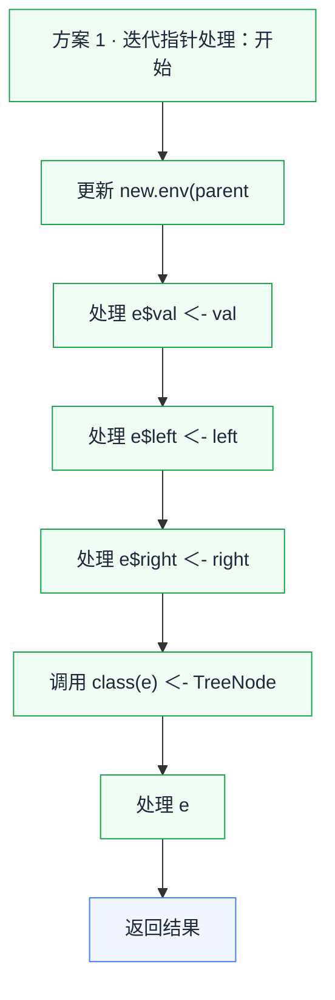

```r
# R 版（方案1） 树节点：R 必须 environment 引用语义（list 是值语义） 定义函数 TreeNode（参数：值, 左边界
# 赋值为 NULL, 右边界 赋值为 NULL）
TreeNode <- function(val, left = NULL, right = NULL) {
    e <- new.env(parent = emptyenv())  # 把 new.env(parent 赋值为 emptyenv()) 存入 e
    e$val <- val
    e$left <- left
    e$right <- right  # 把 值; e$左边界 小于 减 左边界; e$右边界 小于 减 右边界 存入 e$val
    class(e) <- "TreeNode"  # 把 「TreeNode」 存入 class(e)
    e
}
build_tree <- function(vals) {
    # 定义函数 build_tree（参数：vals）
    if (length(vals) == 0 || is.na(vals[[1]]))
        return(NULL)  # 若 长度(vals) 等于 0 或 is.na(vals[[1]])) return(NULL
    root <- TreeNode(vals[[1]])  # 把 TreeNode(vals[[1]]) 存入 根节点
    queue <- list(root)  # 把 列表(根节点) 存入 队列
    head <- 1L  # 把 1L 存入 头节点
    i <- 2L  # 把 2L 存入 下标 i
    while (head <= length(queue) && i <= length(vals)) {
        # 循环，直到不满足「头节点 不超过 长度(队列) 且 下标 i 不超过 长度(vals」
        node <- queue[[head]]  # 把 队列[[头节点]] 存入 节点
        head <- head + 1L  # 把 头节点 加 1L 存入 头节点
        if (i <= length(vals)) {
            # 若 下标 i 不超过 长度(vals 若 取反 is.na(vals[[下标 i]]
            if (!is.na(vals[[i]])) {
                node$left <- TreeNode(vals[[i]])  # 把 TreeNode(vals[[下标 i]]) 存入 node$left
                queue[[length(queue) + 1L]] <- node$left  # 队列[[长度(队列) 加 1L]] 小于 减 节点$左边界
            }
            i <- i + 1L  # 把 下标 i 加 1L 存入 下标 i
        }
        if (i <= length(vals)) {
            # 若 下标 i 不超过 长度(vals 若 取反 is.na(vals[[下标 i]]
            if (!is.na(vals[[i]])) {
                node$right <- TreeNode(vals[[i]])  # 把 TreeNode(vals[[下标 i]]) 存入 node$right
                queue[[length(queue) + 1L]] <- node$right  # 队列[[长度(队列) 加 1L]] 小于 减 节点$右边界
            }
            i <- i + 1L  # 把 下标 i 加 1L 存入 下标 i
        }
    }
    root  # 根节点
}
# 层序转列表（用于断言输出） 定义函数 tree_to_levels（参数：根节点）
tree_to_levels <- function(root) {
    if (is.null(root))
        return(list())  # 若 is.null(根节点)) return(列表(
    res <- list()  # 把 列表() 存入 结果
    level <- list(root)  # 把 列表(根节点) 存入 level
    while (length(level) > 0) {
        # 循环，直到不满足「长度(level) 超过 0」
        vals <- list()
        nxt <- list()  # 把 列表(); nxt 小于 减 列表() 存入 vals
        for (nd in level) {
            # for (nd in level) {
            vals[[length(vals) + 1L]] <- nd$val  # vals[[长度(vals) 加 1L]] 小于 减 nd$值
            if (!is.null(nd$left))
                nxt[[length(nxt) + 1L]] <- nd$left  # 若 取反 is.null(nd$左边界)) nxt[[长度(nxt) 加 1L]] 小于 减 nd$左边界
            if (!is.null(nd$right))
                nxt[[length(nxt) + 1L]] <- nd$right  # 若 取反 is.null(nd$右边界)) nxt[[长度(nxt) 加 1L]] 小于 减 nd$右边界
        }
        res[[length(res) + 1L]] <- unlist(vals)  # 结果[[长度(结果) 加 1L]] 小于 减 unlist(vals)
        level <- nxt  # 把 nxt 存入 level
    }
    res  # 结果
}
level_order_bottom <- function(root) rev(tree_to_levels(root))  # 定义函数 level_order_bottom（参数：根节点）
stopifnot(identical(level_order_bottom(NULL), list()))  # 断言校验
stopifnot(identical(level_order_bottom(build_tree(list(3L, 9L, 20L, NA, NA, 15L, 7L))), list(c(15L, 7L), c(9L,
    20L), 3L)))  # 断言校验
cat("PASS\n")  # 全部用例通过，输出 PASS
```

#### 方案 2：迭代指针处理

**思路与代码分析**：核心是「迭代指针处理」。R 版用向量化思维与 1 起始下标，注意 1:n 的降序陷阱。**走读**：方案 2 · 迭代指针处理：开始 → 更新 new.env(parent → 处理 e$val ＜- val → 处理 e$left ＜- left → 处理 e$right ＜- right → 调用 class(e) ＜- TreeNode → 处理 e → 返回结果。

**运行架构**（真实控制流）：

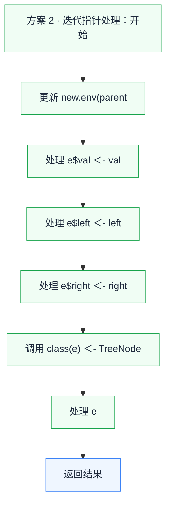

```r
# R 版（方案2） 树节点：R 必须 environment 引用语义（list 是值语义） 定义函数 TreeNode（参数：值, 左边界
# 赋值为 NULL, 右边界 赋值为 NULL）
TreeNode <- function(val, left = NULL, right = NULL) {
    e <- new.env(parent = emptyenv())  # 把 new.env(parent 赋值为 emptyenv()) 存入 e
    e$val <- val
    e$left <- left
    e$right <- right  # 把 值; e$左边界 小于 减 左边界; e$右边界 小于 减 右边界 存入 e$val
    class(e) <- "TreeNode"  # 把 「TreeNode」 存入 class(e)
    e
}
build_tree <- function(vals) {
    # 定义函数 build_tree（参数：vals）
    if (length(vals) == 0 || is.na(vals[[1]]))
        return(NULL)  # 若 长度(vals) 等于 0 或 is.na(vals[[1]])) return(NULL
    root <- TreeNode(vals[[1]])  # 把 TreeNode(vals[[1]]) 存入 根节点
    queue <- list(root)  # 把 列表(根节点) 存入 队列
    head <- 1L  # 把 1L 存入 头节点
    i <- 2L  # 把 2L 存入 下标 i
    while (head <= length(queue) && i <= length(vals)) {
        # 循环，直到不满足「头节点 不超过 长度(队列) 且 下标 i 不超过 长度(vals」
        node <- queue[[head]]  # 把 队列[[头节点]] 存入 节点
        head <- head + 1L  # 把 头节点 加 1L 存入 头节点
        if (i <= length(vals)) {
            # 若 下标 i 不超过 长度(vals 若 取反 is.na(vals[[下标 i]]
            if (!is.na(vals[[i]])) {
                node$left <- TreeNode(vals[[i]])  # 把 TreeNode(vals[[下标 i]]) 存入 node$left
                queue[[length(queue) + 1L]] <- node$left  # 队列[[长度(队列) 加 1L]] 小于 减 节点$左边界
            }
            i <- i + 1L  # 把 下标 i 加 1L 存入 下标 i
        }
        if (i <= length(vals)) {
            # 若 下标 i 不超过 长度(vals 若 取反 is.na(vals[[下标 i]]
            if (!is.na(vals[[i]])) {
                node$right <- TreeNode(vals[[i]])  # 把 TreeNode(vals[[下标 i]]) 存入 node$right
                queue[[length(queue) + 1L]] <- node$right  # 队列[[长度(队列) 加 1L]] 小于 减 节点$右边界
            }
            i <- i + 1L  # 把 下标 i 加 1L 存入 下标 i
        }
    }
    root  # 根节点
}
# 层序转列表（用于断言输出） 定义函数 tree_to_levels（参数：根节点）
tree_to_levels <- function(root) {
    if (is.null(root))
        return(list())  # 若 is.null(根节点)) return(列表(
    res <- list()  # 把 列表() 存入 结果
    level <- list(root)  # 把 列表(根节点) 存入 level
    while (length(level) > 0) {
        # 循环，直到不满足「长度(level) 超过 0」
        vals <- list()
        nxt <- list()  # 把 列表(); nxt 小于 减 列表() 存入 vals
        for (nd in level) {
            # for (nd in level) {
            vals[[length(vals) + 1L]] <- nd$val  # vals[[长度(vals) 加 1L]] 小于 减 nd$值
            if (!is.null(nd$left))
                nxt[[length(nxt) + 1L]] <- nd$left  # 若 取反 is.null(nd$左边界)) nxt[[长度(nxt) 加 1L]] 小于 减 nd$左边界
            if (!is.null(nd$right))
                nxt[[length(nxt) + 1L]] <- nd$right  # 若 取反 is.null(nd$右边界)) nxt[[长度(nxt) 加 1L]] 小于 减 nd$右边界
        }
        res[[length(res) + 1L]] <- unlist(vals)  # 结果[[长度(结果) 加 1L]] 小于 减 unlist(vals)
        level <- nxt  # 把 nxt 存入 level
    }
    res  # 结果
}
level_order_bottom <- function(root) rev(tree_to_levels(root))  # 定义函数 level_order_bottom（参数：根节点）
stopifnot(identical(level_order_bottom(NULL), list()))  # 断言校验
stopifnot(identical(level_order_bottom(build_tree(list(3L, 9L, 20L, NA, NA, 15L, 7L))), list(c(15L, 7L), c(9L,
    20L), 3L)))  # 断言校验
cat("PASS\n")  # 全部用例通过，输出 PASS
```

### Zig 实现（2 种方案）

Zig 的全部方案如下，每个方案都内嵌用例自测，可独立运行（老仓库 python/go 文件遵循「打印结果」约定）：

#### 方案 1：迭代指针处理

**思路与代码分析**：核心是「迭代指针处理」。Zig 版显式分配与清零，整型边界处理严格。代码里依次做这些事：单循环线性扫描。**走读**：方案 1 · 迭代指针处理：开始 → 计算 res → 当 (head ＜ q.items.len) 时反复执行 → 遍历集合元素 → 返回 res。

**运行架构**（真实控制流）：

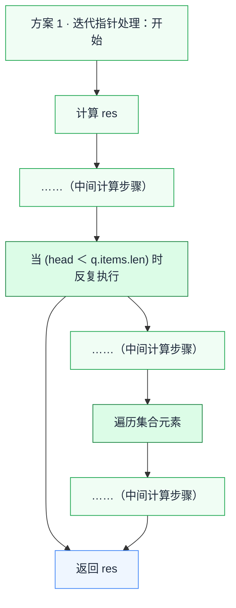

```zig
// LeetCode 107. 二叉树的层序遍历 II — Zig 版（方案1）
const std = @import("std"); // 把 @import(「std」) 存入 std

const TreeNode = struct { // 把 struct { 存入 TreeNode
    val: i32,
    left: ?*TreeNode,
    right: ?*TreeNode,
};

fn buildTree(allocator: std.mem.Allocator, vals: []const i32) !?*TreeNode { // 定义函数/方法 buildTree
    if (vals.len == 0 or vals[0] == -1) return null; // 若 vals.长度 等于 0 or vals[0] 等于 减 1，直接返回 null
    const root = try allocator.create(TreeNode); // 把 try allocator.create(TreeNode) 存入 根节点
    root.* = .{ .val = vals[0], .left = null, .right = null };
    var queue = std.ArrayList(*TreeNode).init(allocator); // 把 std.ArrayList( 乘 TreeNode).init(allocator) 存入 队列
    defer queue.deinit(); // defer 队列.deinit();
    try queue.append(root); // 把 根节点 追加到列表尾部
    var head: usize = 0; // 把 0; 写入 var head: usize
    var i: usize = 1; // 把 1; 写入 var i: usize
    while (head < queue.items.len and i < vals.len) { // 循环，直到不满足「头节点 小于 队列.items.长度 and 下标 i 小于 vals.长度」
        const node = queue.items[head]; // 把 队列.items[头节点] 存入 节点
        head += 1; // 头节点累加 1
        if (i < vals.len) { // 若 下标 i 小于 vals.长度
            if (vals[i] != -1) { // 若 vals[下标 i] 不等于 减 1
                const child = try allocator.create(TreeNode); // 把 try allocator.create(TreeNode) 存入 子节点
                child.* = .{ .val = vals[i], .left = null, .right = null };
                node.left = child; // 把 子节点; 写入 左边界
                try queue.append(child); // 把 子节点 追加到列表尾部
            }
            i += 1; // 下标 i累加 1
        }
        if (i < vals.len) { // 若 下标 i 小于 vals.长度
            if (vals[i] != -1) { // 若 vals[下标 i] 不等于 减 1
                const child = try allocator.create(TreeNode); // 把 try allocator.create(TreeNode) 存入 子节点
                child.* = .{ .val = vals[i], .left = null, .right = null };
                node.right = child; // 把 子节点; 写入 右边界
                try queue.append(child); // 把 子节点 追加到列表尾部
            }
            i += 1; // 下标 i累加 1
        }
    }
    return root; // 返回 根节点
}

fn levelOrderBottom(root: ?*TreeNode, alloc: std.mem.Allocator) std.ArrayList(std.ArrayList(i32)) { // 定义函数/方法 levelOrderBottom
    var res = std.ArrayList(std.ArrayList(i32)).init(alloc); // 把 std.ArrayList(std.ArrayList(i32)).init(alloc) 存入 结果
    const r = root orelse return res; // 把 根节点 orelse return 结果 存入 右指针
    var q = std.ArrayList(*TreeNode).init(alloc); // 把 std.ArrayList( 乘 TreeNode).init(alloc) 存入 节点
    q.append(r) catch unreachable; // 把 右指针 追加到列表尾部
    var head: usize = 0; // 把 0; 写入 var head: usize
    while (head < q.items.len) { // 循环，直到不满足「头节点 小于 节点.items.长度」
        const size = q.items.len - head; // 把 节点.items.长度 减 头节点 存入 大小
        var level = std.ArrayList(i32).init(alloc); // 把 std.ArrayList(i32).init(alloc) 存入 level
        for (0..size) |_| { // 让 _ 从 0 走到 大小 减一
            const node = q.items[head]; // 把 节点.items[头节点] 存入 节点
            head += 1; // 头节点累加 1
            level.append(node.val) catch unreachable; // 把 节点.值 追加到列表尾部
            if (node.left) |c| q.append(c) catch unreachable; // 若 节点.左边界) 按位或 字符 按位或 节点 追加 字符) catch unreachable;
            if (node.right) |c| q.append(c) catch unreachable; // 若 节点.右边界) 按位或 字符 按位或 节点 追加 字符) catch unreachable;
        }
        res.insert(0, level) catch unreachable; // 结果 插入 0, level) catch unreachable;
    }
    return res; // 返回 结果
}
pub fn main() !void { // 程序入口：跑内嵌自测用例
    var arena = std.heap.ArenaAllocator.init(std.heap.page_allocator); // 把 std.堆.ArenaAllocator.init(std.堆.page_allocator) 存入 arena
    defer arena.deinit(); // defer arena.deinit();
    const alloc = arena.allocator(); // 把 arena.allocator() 存入 alloc
    if (levelOrderBottom(null, alloc).items.len != 0) return error.TestFailed;
    const res = levelOrderBottom(try buildTree(alloc, &[_]i32{ 3, 9, 20, -1, -1, 15, 7 }), alloc);
    if (res.items.len != 3) return error.TestFailed; // 若 结果.items.长度 不等于 3，直接返回 error.TestFailed
    if (res.items[0].items[0] != 15 or res.items[0].items[1] != 7) return error.TestFailed;
    if (res.items[1].items[0] != 9 or res.items[1].items[1] != 20) return error.TestFailed;
    if (res.items[2].items[0] != 3) return error.TestFailed; // 若 结果.items[2].items[0] 不等于 3，直接返回 error.TestFailed
    std.debug.print("PASS\n", .{}); // 全部用例通过，输出 PASS
}
```

#### 方案 2：迭代指针处理

**思路与代码分析**：核心是「迭代指针处理」。Zig 版显式分配与清零，整型边界处理严格。代码里依次做这些事：单循环线性扫描。**走读**：方案 2 · 迭代指针处理：开始 → 计算 res → 当 (head ＜ q.items.len) 时反复执行 → 遍历集合元素 → 返回 res。

**运行架构**（真实控制流）：

```mermaid
graph TD
    N0["方案 2 · 迭代指针处理：开始"]
    N1["计算 res"]
    D1["……（中间计算步骤）"]
    N6["当 (head ＜ q.items.len) 时反复执行"]
    D2["……（中间计算步骤）"]
    N9["遍历集合元素"]
    D3["……（中间计算步骤）"]
    N16["返回 res"]
    N0 --> N1
    N6 --> N16
    N1 --> D1
    D1 --> N6
    N6 --> D2
    D2 --> N9
    N9 --> D3
    D3 --> N16
    classDef n fill:#f0fdf4,stroke:#16a34a,color:#1e293b;
    classDef lp fill:#dcfce7,stroke:#15803d,color:#1e293b;
    classDef dc fill:#fef9c3,stroke:#ca8a04,color:#1e293b;
    classDef tm fill:#eff6ff,stroke:#3b82f6,color:#1e293b;
    class N0,N1,D1,D2,D3 n;
    class N6,N9 lp;
    class N16 tm;
```

```zig
// LeetCode 107. 二叉树的层序遍历 II — Zig 版（方案2）
const std = @import("std"); // 把 @import(「std」) 存入 std

const TreeNode = struct { // 把 struct { 存入 TreeNode
    val: i32,
    left: ?*TreeNode,
    right: ?*TreeNode,
};

fn buildTree(allocator: std.mem.Allocator, vals: []const i32) !?*TreeNode { // 定义函数/方法 buildTree
    if (vals.len == 0 or vals[0] == -1) return null; // 若 vals.长度 等于 0 or vals[0] 等于 减 1，直接返回 null
    const root = try allocator.create(TreeNode); // 把 try allocator.create(TreeNode) 存入 根节点
    root.* = .{ .val = vals[0], .left = null, .right = null };
    var queue = std.ArrayList(*TreeNode).init(allocator); // 把 std.ArrayList( 乘 TreeNode).init(allocator) 存入 队列
    defer queue.deinit(); // defer 队列.deinit();
    try queue.append(root); // 把 根节点 追加到列表尾部
    var head: usize = 0; // 把 0; 写入 var head: usize
    var i: usize = 1; // 把 1; 写入 var i: usize
    while (head < queue.items.len and i < vals.len) { // 循环，直到不满足「头节点 小于 队列.items.长度 and 下标 i 小于 vals.长度」
        const node = queue.items[head]; // 把 队列.items[头节点] 存入 节点
        head += 1; // 头节点累加 1
        if (i < vals.len) { // 若 下标 i 小于 vals.长度
            if (vals[i] != -1) { // 若 vals[下标 i] 不等于 减 1
                const child = try allocator.create(TreeNode); // 把 try allocator.create(TreeNode) 存入 子节点
                child.* = .{ .val = vals[i], .left = null, .right = null };
                node.left = child; // 把 子节点; 写入 左边界
                try queue.append(child); // 把 子节点 追加到列表尾部
            }
            i += 1; // 下标 i累加 1
        }
        if (i < vals.len) { // 若 下标 i 小于 vals.长度
            if (vals[i] != -1) { // 若 vals[下标 i] 不等于 减 1
                const child = try allocator.create(TreeNode); // 把 try allocator.create(TreeNode) 存入 子节点
                child.* = .{ .val = vals[i], .left = null, .right = null };
                node.right = child; // 把 子节点; 写入 右边界
                try queue.append(child); // 把 子节点 追加到列表尾部
            }
            i += 1; // 下标 i累加 1
        }
    }
    return root; // 返回 根节点
}

fn levelOrderBottom(root: ?*TreeNode, alloc: std.mem.Allocator) std.ArrayList(std.ArrayList(i32)) { // 定义函数/方法 levelOrderBottom
    var res = std.ArrayList(std.ArrayList(i32)).init(alloc); // 把 std.ArrayList(std.ArrayList(i32)).init(alloc) 存入 结果
    const r = root orelse return res; // 把 根节点 orelse return 结果 存入 右指针
    var q = std.ArrayList(*TreeNode).init(alloc); // 把 std.ArrayList( 乘 TreeNode).init(alloc) 存入 节点
    q.append(r) catch unreachable; // 把 右指针 追加到列表尾部
    var head: usize = 0; // 把 0; 写入 var head: usize
    while (head < q.items.len) { // 循环，直到不满足「头节点 小于 节点.items.长度」
        const size = q.items.len - head; // 把 节点.items.长度 减 头节点 存入 大小
        var level = std.ArrayList(i32).init(alloc); // 把 std.ArrayList(i32).init(alloc) 存入 level
        for (0..size) |_| { // 让 _ 从 0 走到 大小 减一
            const node = q.items[head]; // 把 节点.items[头节点] 存入 节点
            head += 1; // 头节点累加 1
            level.append(node.val) catch unreachable; // 把 节点.值 追加到列表尾部
            if (node.left) |c| q.append(c) catch unreachable; // 若 节点.左边界) 按位或 字符 按位或 节点 追加 字符) catch unreachable;
            if (node.right) |c| q.append(c) catch unreachable; // 若 节点.右边界) 按位或 字符 按位或 节点 追加 字符) catch unreachable;
        }
        res.insert(0, level) catch unreachable; // 结果 插入 0, level) catch unreachable;
    }
    return res; // 返回 结果
}
pub fn main() !void { // 程序入口：跑内嵌自测用例
    var arena = std.heap.ArenaAllocator.init(std.heap.page_allocator); // 把 std.堆.ArenaAllocator.init(std.堆.page_allocator) 存入 arena
    defer arena.deinit(); // defer arena.deinit();
    const alloc = arena.allocator(); // 把 arena.allocator() 存入 alloc
    if (levelOrderBottom(null, alloc).items.len != 0) return error.TestFailed;
    const res = levelOrderBottom(try buildTree(alloc, &[_]i32{ 3, 9, 20, -1, -1, 15, 7 }), alloc);
    if (res.items.len != 3) return error.TestFailed; // 若 结果.items.长度 不等于 3，直接返回 error.TestFailed
    if (res.items[0].items[0] != 15 or res.items[0].items[1] != 7) return error.TestFailed;
    if (res.items[1].items[0] != 9 or res.items[1].items[1] != 20) return error.TestFailed;
    if (res.items[2].items[0] != 3) return error.TestFailed; // 若 结果.items[2].items[0] 不等于 3，直接返回 error.TestFailed
    std.debug.print("PASS\n", .{}); // 全部用例通过，输出 PASS
}
```

### Dart 实现（2 种方案）

Dart 的全部方案如下，每个方案都内嵌用例自测，可独立运行（老仓库 python/go 文件遵循「打印结果」约定）：

#### 方案 1：迭代指针处理

**思路与代码分析**：核心是「迭代指针处理」。Dart 版用可空类型标注与集合方法，注意空安全。代码里依次做这些事：单循环线性扫描。**走读**：方案 1 · 迭代指针处理：开始 → 命中条件，直接返回 → 更新 res → 当 (head ＜ q.length) 时反复执行 → 遍历循环 → 返回 res。

**运行架构**（真实控制流）：

```mermaid
graph TD
    N0["方案 1 · 迭代指针处理：开始"]
    N1{"root == null ？"}
    N2["命中条件，直接返回"]
    N3["更新 res"]
    D1["……（中间计算步骤）"]
    N6["当 (head ＜ q.length) 时反复执行"]
    D2["……（中间计算步骤）"]
    N9["遍历循环"]
    D3["……（中间计算步骤）"]
    N17["返回 res"]
    N0 --> N1
    N1 -- 是 --> N2
    N1 -- 否 --> N3
    N6 --> N17
    N2 --> N3
    N3 --> D1
    D1 --> N6
    N6 --> D2
    D2 --> N9
    N9 --> D3
    D3 --> N17
    classDef n fill:#f0fdf4,stroke:#16a34a,color:#1e293b;
    classDef lp fill:#dcfce7,stroke:#15803d,color:#1e293b;
    classDef dc fill:#fef9c3,stroke:#ca8a04,color:#1e293b;
    classDef tm fill:#eff6ff,stroke:#3b82f6,color:#1e293b;
    class N0,N3,D1,D2,D3 n;
    class N6,N9 lp;
    class N1 dc;
    class N2,N17 tm;
```

```dart
// LeetCode 107. 二叉树的层序遍历 II — Dart 版（方案1）
class TreeNode {
  // 定义类型
  int val; // int 值;
  TreeNode? left; // TreeNode? 左边界;
  TreeNode? right; // TreeNode? 右边界;
  TreeNode(this.val); // TreeNode(this.值);
}

TreeNode? buildTree(List<int?> vals) {
  // TreeNode? buildTree(List 小于 int? 超过 vals) {
  if (vals.isEmpty || vals[0] == null)
    return null; // 若 vals.isEmpty 或 vals[0] 等于 null，直接返回 null
  final root = TreeNode(vals[0]!); // 把 TreeNode(vals[0]取反 ) 存入 根节点
  final queue = <TreeNode>[root]; // 把 小于 TreeNode 超过 [根节点] 存入 队列
  var head = 0; // 把 0 存入 头节点
  var i = 1; // 把 1 存入 下标 i
  while (head < queue.length && i < vals.length) {
    // 循环，直到不满足「头节点 小于 队列.长度 且 下标 i 小于 vals.长度」
    final node = queue[head++]; // 把 队列[头节点 加一 ] 存入 节点
    if (i < vals.length) {
      // 若 下标 i 小于 vals.长度
      if (vals[i] != null) {
        // 若 vals[下标 i] 不等于 null
        node.left = TreeNode(vals[i]!); // 把 TreeNode(vals[下标 i]取反 ); 写入 左边界
        queue.add(node.left!); // 队列 追加 节点.左边界取反 );
      }
      i++; // 下标 i 加一
    }
    if (i < vals.length) {
      // 若 下标 i 小于 vals.长度
      if (vals[i] != null) {
        // 若 vals[下标 i] 不等于 null
        node.right = TreeNode(vals[i]!); // 把 TreeNode(vals[下标 i]取反 ); 写入 右边界
        queue.add(node.right!); // 队列 追加 节点.右边界取反 );
      }
      i++; // 下标 i 加一
    }
  }
  return root; // 返回 根节点
}

List<List<int>> treeToLevels(TreeNode? root) {
  // 定义函数/方法 treeToLevels
  if (root == null) return []; // 若 根节点 等于 null，直接返回 []
  final res = <List<int>>[]; // 把 小于 List 小于 int 超过 超过 [] 存入 结果
  var level = <TreeNode>[root]; // 把 小于 TreeNode 超过 [根节点] 存入 level
  while (level.isNotEmpty) {
    // 循环，直到不满足「level.isNotEmpty」
    final vals = <int>[]; // 把 小于 int 超过 [] 存入 vals
    final nxt = <TreeNode>[]; // 把 小于 TreeNode 超过 [] 存入 nxt
    for (final n in level) {
      // for (final 元素个数 in level) {
      vals.add(n.val); // vals 追加 元素个数.值);
      if (n.left != null)
        nxt.add(n.left!); // 若 元素个数.左边界 不等于 null) nxt 追加 元素个数.左边界取反 );
      if (n.right != null)
        nxt.add(n.right!); // 若 元素个数.右边界 不等于 null) nxt 追加 元素个数.右边界取反 );
    }
    res.add(vals); // 结果 追加 vals);
    level = nxt; // 把 nxt 存入 level
  }
  return res; // 返回 结果
}

List<List<int>> levelOrderBottom(TreeNode? root) {
  // 定义函数/方法 levelOrderBottom
  if (root == null) return []; // 若 根节点 等于 null，直接返回 []
  final res = <List<int>>[]; // 把 小于 List 小于 int 超过 超过 [] 存入 结果
  final q = <TreeNode>[root]; // 把 小于 TreeNode 超过 [根节点] 存入 节点
  var head = 0; // 把 0 存入 头节点
  while (head < q.length) {
    // 循环，直到不满足「头节点 小于 节点.长度」
    final size = q.length - head; // 把 节点.长度 减 头节点 存入 大小
    final level = <int>[]; // 把 小于 int 超过 [] 存入 level
    for (var i = 0; i < size; i++) {
      // 让 下标 i 从 0 开始计数，下标 i 小于 大小 就继续
      final n = q[head++]; // 把 节点[头节点 加一 ] 存入 元素个数
      level.add(n.val); // level 追加 元素个数.值);
      if (n.left != null)
        q.add(n.left!); // 若 元素个数.左边界 不等于 null) 节点 追加 元素个数.左边界取反 );
      if (n.right != null)
        q.add(n.right!); // 若 元素个数.右边界 不等于 null) 节点 追加 元素个数.右边界取反 );
    }
    res.insert(0, level); // 结果 插入 0, level);
  }
  return res; // 返回 结果
}

String s(List<List<int>> t) => t.map((l) => l.join(',')).join('|');
void main() {
  // 程序入口：跑内嵌自测用例
  if (s(levelOrderBottom(null)) != '') throw StateError('c0');
  if (s(levelOrderBottom(buildTree([3, 9, 20, null, null, 15, 7]))) !=
      '15,7|9,20|3')
    throw StateError('c1');
  print('PASS'); // 全部用例通过，输出 PASS
}
```

#### 方案 2：迭代指针处理

**思路与代码分析**：核心是「迭代指针处理」。Dart 版用可空类型标注与集合方法，注意空安全。代码里依次做这些事：单循环线性扫描。**走读**：方案 2 · 迭代指针处理：开始 → 命中条件，直接返回 → 更新 res → 当 (head ＜ q.length) 时反复执行 → 遍历循环 → 返回 res。

**运行架构**（真实控制流）：

```mermaid
graph TD
    N0["方案 2 · 迭代指针处理：开始"]
    N1{"root == null ？"}
    N2["命中条件，直接返回"]
    N3["更新 res"]
    D1["……（中间计算步骤）"]
    N6["当 (head ＜ q.length) 时反复执行"]
    D2["……（中间计算步骤）"]
    N9["遍历循环"]
    D3["……（中间计算步骤）"]
    N17["返回 res"]
    N0 --> N1
    N1 -- 是 --> N2
    N1 -- 否 --> N3
    N6 --> N17
    N2 --> N3
    N3 --> D1
    D1 --> N6
    N6 --> D2
    D2 --> N9
    N9 --> D3
    D3 --> N17
    classDef n fill:#f0fdf4,stroke:#16a34a,color:#1e293b;
    classDef lp fill:#dcfce7,stroke:#15803d,color:#1e293b;
    classDef dc fill:#fef9c3,stroke:#ca8a04,color:#1e293b;
    classDef tm fill:#eff6ff,stroke:#3b82f6,color:#1e293b;
    class N0,N3,D1,D2,D3 n;
    class N6,N9 lp;
    class N1 dc;
    class N2,N17 tm;
```

```dart
// LeetCode 107. 二叉树的层序遍历 II — Dart 版（方案2）
class TreeNode {
  // 定义类型
  int val; // int 值;
  TreeNode? left; // TreeNode? 左边界;
  TreeNode? right; // TreeNode? 右边界;
  TreeNode(this.val); // TreeNode(this.值);
}

TreeNode? buildTree(List<int?> vals) {
  // TreeNode? buildTree(List 小于 int? 超过 vals) {
  if (vals.isEmpty || vals[0] == null)
    return null; // 若 vals.isEmpty 或 vals[0] 等于 null，直接返回 null
  final root = TreeNode(vals[0]!); // 把 TreeNode(vals[0]取反 ) 存入 根节点
  final queue = <TreeNode>[root]; // 把 小于 TreeNode 超过 [根节点] 存入 队列
  var head = 0; // 把 0 存入 头节点
  var i = 1; // 把 1 存入 下标 i
  while (head < queue.length && i < vals.length) {
    // 循环，直到不满足「头节点 小于 队列.长度 且 下标 i 小于 vals.长度」
    final node = queue[head++]; // 把 队列[头节点 加一 ] 存入 节点
    if (i < vals.length) {
      // 若 下标 i 小于 vals.长度
      if (vals[i] != null) {
        // 若 vals[下标 i] 不等于 null
        node.left = TreeNode(vals[i]!); // 把 TreeNode(vals[下标 i]取反 ); 写入 左边界
        queue.add(node.left!); // 队列 追加 节点.左边界取反 );
      }
      i++; // 下标 i 加一
    }
    if (i < vals.length) {
      // 若 下标 i 小于 vals.长度
      if (vals[i] != null) {
        // 若 vals[下标 i] 不等于 null
        node.right = TreeNode(vals[i]!); // 把 TreeNode(vals[下标 i]取反 ); 写入 右边界
        queue.add(node.right!); // 队列 追加 节点.右边界取反 );
      }
      i++; // 下标 i 加一
    }
  }
  return root; // 返回 根节点
}

List<List<int>> treeToLevels(TreeNode? root) {
  // 定义函数/方法 treeToLevels
  if (root == null) return []; // 若 根节点 等于 null，直接返回 []
  final res = <List<int>>[]; // 把 小于 List 小于 int 超过 超过 [] 存入 结果
  var level = <TreeNode>[root]; // 把 小于 TreeNode 超过 [根节点] 存入 level
  while (level.isNotEmpty) {
    // 循环，直到不满足「level.isNotEmpty」
    final vals = <int>[]; // 把 小于 int 超过 [] 存入 vals
    final nxt = <TreeNode>[]; // 把 小于 TreeNode 超过 [] 存入 nxt
    for (final n in level) {
      // for (final 元素个数 in level) {
      vals.add(n.val); // vals 追加 元素个数.值);
      if (n.left != null)
        nxt.add(n.left!); // 若 元素个数.左边界 不等于 null) nxt 追加 元素个数.左边界取反 );
      if (n.right != null)
        nxt.add(n.right!); // 若 元素个数.右边界 不等于 null) nxt 追加 元素个数.右边界取反 );
    }
    res.add(vals); // 结果 追加 vals);
    level = nxt; // 把 nxt 存入 level
  }
  return res; // 返回 结果
}

List<List<int>> levelOrderBottom(TreeNode? root) {
  // 定义函数/方法 levelOrderBottom
  if (root == null) return []; // 若 根节点 等于 null，直接返回 []
  final res = <List<int>>[]; // 把 小于 List 小于 int 超过 超过 [] 存入 结果
  final q = <TreeNode>[root]; // 把 小于 TreeNode 超过 [根节点] 存入 节点
  var head = 0; // 把 0 存入 头节点
  while (head < q.length) {
    // 循环，直到不满足「头节点 小于 节点.长度」
    final size = q.length - head; // 把 节点.长度 减 头节点 存入 大小
    final level = <int>[]; // 把 小于 int 超过 [] 存入 level
    for (var i = 0; i < size; i++) {
      // 让 下标 i 从 0 开始计数，下标 i 小于 大小 就继续
      final n = q[head++]; // 把 节点[头节点 加一 ] 存入 元素个数
      level.add(n.val); // level 追加 元素个数.值);
      if (n.left != null)
        q.add(n.left!); // 若 元素个数.左边界 不等于 null) 节点 追加 元素个数.左边界取反 );
      if (n.right != null)
        q.add(n.right!); // 若 元素个数.右边界 不等于 null) 节点 追加 元素个数.右边界取反 );
    }
    res.insert(0, level); // 结果 插入 0, level);
  }
  return res; // 返回 结果
}

String s(List<List<int>> t) => t.map((l) => l.join(',')).join('|');
void main() {
  // 程序入口：跑内嵌自测用例
  if (s(levelOrderBottom(null)) != '') throw StateError('c0');
  if (s(levelOrderBottom(buildTree([3, 9, 20, null, null, 15, 7]))) !=
      '15,7|9,20|3')
    throw StateError('c1');
  print('PASS'); // 全部用例通过，输出 PASS
}
```

---

## 内容总结

- **二叉树的层序遍历 ii**（二叉树 · Medium）：共 2 个方案，主线思路「迭代指针处理」；时间 O(n)（单趟线性扫描）；动画演示DFS 点亮过程，附录给出 11 种语言 × 全部方案的可运行实现。
- 来源博客：[https://blog.csdn.net/tyro_java/article/details/144992608](https://blog.csdn.net/tyro_java/article/details/144992608)
- 导航：[📋 总目录](../) ｜ [← 112 二叉树的层序遍历](../112_二叉树的层序遍历/) ｜ [114 将有序数组转换为二叉搜索树 →](../114_将有序数组转换为二叉搜索树/)
