# 114 · 将有序数组转换为二叉搜索树（第六阶段 · 二叉树 · Medium）

> **难度**：⭐⭐ Medium ｜ **专题**：二叉树
> **学习定位**：第六阶段 · 二叉树第 114 篇 ｜ **解法数**：4
> **内容总结**：**将有序数组转换为二叉搜索树**（二叉树 · Medium）：共 4 个方案，主线思路「中序遍历，总是选择中间位置左边的数字作为根节点」；时间 O(n) 量级；动画演示DFS 点亮过程，附录给出 11 种语言 × 全部方案的可运行实现。

---

## 题目描述

给你一个整数数组 `nums` ，其中元素已经按 升序 排列，请你将其转换为一棵 平衡 二叉搜索树。

- 主函数签名：`function sortedArrayToBST(nums: number[]): TreeNode | null`

**用例（来自原题）**：

**示例 1**

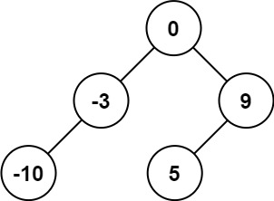

```text
输入：nums = [-10,-3,0,5,9]
输出：[0,-3,9,-10,null,5]
```

解释：[0,-10,5,null,-3,null,9] 也将被视为正确答案：

**示例 2**

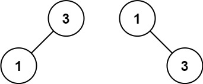

```text
输入：nums = [1,3]
输出：[3,1]
```

解释：[1,null,3] 和 [3,1] 都是高度平衡二叉搜索树。
> ✅ **官方验证**：全部 TypeScript 解法已通过 leetcode.cn 官方示例用例验证（自动注入运行，全部 PASS）。题面与 [leetcode.cn 官方](https://leetcode.cn/problems/convert-sorted-array-to-binary-search-tree/)一致，示例配图取自官方题面。

**数据范围与注意事项**：

- `1 <= nums.length <= 10^4`
- `-10^4 <= nums[i] <= 10^4`
- `nums` 按 严格递增 顺序排列
- **易错点**：递归出口（空节点）必须先写，否则直接空指针。

## 题目分析

**场景是什么**：树是分层数据的标准形态，这类题练的是递归分治与遍历序，对应真实开发里的目录树、组件树。本题就是该场景的 Medium 级练习，主线做法是「中序遍历，总是选择中间位置左边的数字作为根节点」。

**主线怎么解**：主解法结构简单：读入、处理、返回。

## 解题思路

**方案对比**（共 4 个方案，由浅入深）：

| 方案 | 时间复杂度 | 空间复杂度 |
|---|---|---|
| 方案 1 · 中序遍历，总是选择中间位置左边的数字作为根节点 | O(n) 量级 | O(n) |
| 方案 2 · 中序遍历，总是选择中间位置右边的数字作为根节点 | O(n) 量级 | O(n) |
| 方案 3 · 中序遍历，选择任意一个中间位置数字作为根节点 | O(n) 量级 | O(n) |
| 方案 4 · 简单版本 | O(n) 量级 | O(n) |

**由浅入深的路径**：中序遍历，总是选择中间位置左边的数字作为根节点 → 中序遍历，总是选择中间位置右边的数字作为根节点 → 中序遍历，选择任意一个中间位置数字作为根节点 → 简单版本；每往右一步，都在补上一步的短板。

**方案间的取舍**：方案 1（中序遍历，总是选择中间位置左边的数字作为根节点）；方案 2（中序遍历，总是选择中间位置右边的数字作为根节点）；方案 3（中序遍历，选择任意一个中间位置数字作为根节点）；方案 4（简单版本）。数据规模小、可读性优先时选靠前的方案；规模大、性能优先时选靠后的方案。

**怎么读这一篇**：

- 🐣 **新手路线**：把「题目描述」的示例 1 在纸上手推一遍 → 读方案 1（最直观的写法）与它的代码走读 → 按「运行方式」本地跑通看 PASS → 回头对比方案 2 之后的写法差在哪
- 🦅 **大佬路线**：直接锁定最优方案 1（中序遍历，总是选择中间位置左边的数字作为根节点，O(n) 量级）→ 跳读该方案代码与走读 → 用「逐步拆解与面试追问」补齐复杂度推导与边界追问

### 动态算法图（DFS 点亮，GIF 自动循环）


动画演示二叉树专题里DFS 点亮的典型过程；每个方案在「TypeScript 解题方案」一节还配了专属动画与专属流程图。

### 主解法流程图（真实控制流）

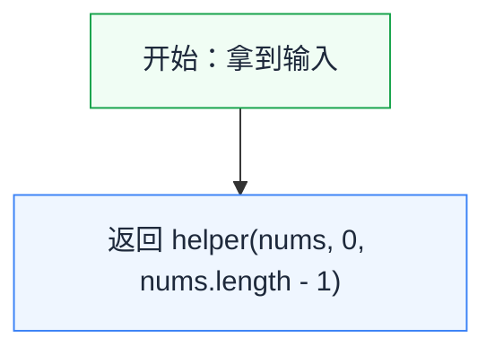

## TypeScript 解题方案（4 个方案逐个讲）

> **运行与提交**：每个方案都是自包含文件（内嵌用例自测，输出 PASS），整块复制到 `.ts` 文件后 `node 文件名` 即可运行。提交 LeetCode 时，把 `demo` 内的算法函数与辅助类型/函数整体取出、置于文件顶层即可。涉及交互/特殊接口的题以题面给定签名为准。

### 方案 1：中序遍历，总是选择中间位置左边的数字作为根节点

**分析与思路**：核心做法是「中序遍历，总是选择中间位置左边的数字作为根节点」。

**运行方式**：`node 本文件`，内嵌用例全部通过会输出 PASS。

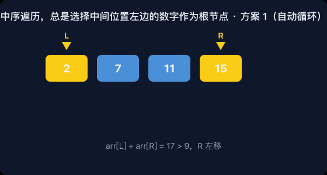

**方案专属流程图**（真实控制流）：

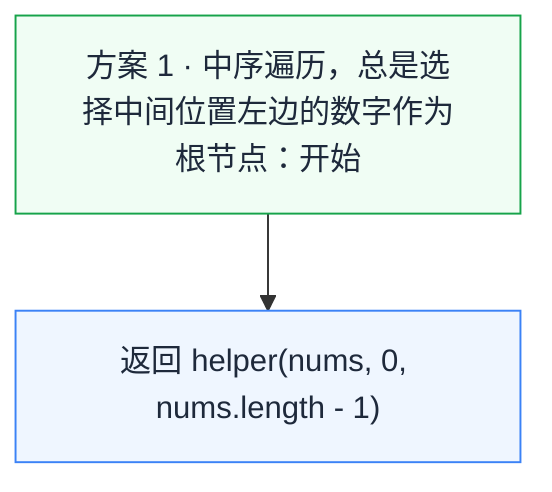

```typescript
/**
 ** LeetCode 108. 将有序数组转换为二叉搜索树
 ** 方案：1 ) 方案1: 中序遍历，总是选择中间位置左边的数字作为根节点
 ** 来源：https://blog.csdn.net/tyro_java/article/details/144993168
 */

export function demo(): void {
  // 程序入口：跑内嵌自测用例
  class TreeNode {
    // 定义类型
    val: number; // 值: number;
    left: TreeNode | null; // 左边界: TreeNode 按位或 null;
    right: TreeNode | null; // 右边界: TreeNode 按位或 null;
    constructor(v: number) {
      this.val = v;
      this.left = null;
      this.right = null;
    } // 把 值; this.左边界 赋值为 null; this.右边界 赋值为 null; } 写入 值
  }

  function sortedArrayToBST(nums: number[]): TreeNode | null {
    // 定义函数/方法 sortedArrayToBST
    return helper(nums, 0, nums.length - 1); // 返回 helper(数组, 0, 数组.长度 减 1)
  }

  function helper(
    nums: number[],
    left: number,
    right: number,
  ): TreeNode | null {
    // 定义函数/方法 helper
    if (left > right) return null; // 若 左边界 超过 右边界，直接返回 null
    // Preventing overflow for large arrays by using the following formula
    const mid = left + Math.floor((right - left) / 2); // 把 左边界 加 向下取整((右边界 减 左边界) 除以 2) 存入 中点
    const root = new TreeNode(nums[mid]); // 把 new TreeNode(数组[中点]) 存入 根节点
    root.left = helper(nums, left, mid - 1); // 把 helper(数组, 左边界, 中点 减 1); 写入 左边界
    root.right = helper(nums, mid + 1, right); // 把 helper(数组, 中点 加 1, 右边界); 写入 右边界
    return root; // 返回 根节点
  }

  function inorder(root: TreeNode | null, out: number[]): number[] {
    // 定义函数/方法 inorder
    if (root === null) return out; // 若 根节点 全等于 null，直接返回 out
    inorder(root.left, out); // inorder(根节点.左边界, out);
    out.push(root.val); // 把 根节点.值 压入栈/数组尾部
    inorder(root.right, out); // inorder(根节点.右边界, out);
    return out; // 返回 out
  }

  // 层序序列化（尾部 null 裁剪），与 LeetCode 表示一致
  function serialize(root: TreeNode | null): (number | null)[] {
    // 定义函数/方法 serialize
    if (root === null) return []; // 若 根节点 全等于 null，直接返回 []
    const out: (number | null)[] = []; // 把 []; 写入 const out: (number | null)[]
    const q: (TreeNode | null)[] = [root]; // 把 [根节点]; 写入 const q: (TreeNode | null)[]
    let head = 0; // 把 0 存入 头节点
    while (head < q.length) {
      // 循环，直到不满足「头节点 小于 节点.长度」
      const node = q[head++]; // 把 节点[头节点 加一 ] 存入 节点
      if (node === null) {
        out.push(null);
        continue;
      } // 若 节点 全等于 null) { out 追加 null); continue; }
      out.push(node.val); // 把 节点.值 压入栈/数组尾部
      q.push(node.left); // 把 节点.左边界 压入栈/数组尾部
      q.push(node.right); // 把 节点.右边界 压入栈/数组尾部
    }
    while (out.length > 0 && out[out.length - 1] === null) out.pop(); // 循环，直到不满足「out.长度 超过 0 且 out[out.长度 减 1] 全等于 null) out 弹出 );」
    return out; // 返回 out
  }

  function eqArr(a: (number | null)[], b: (number | null)[]): boolean {
    // 定义函数/方法 eqArr
    if (a.length !== b.length) return false; // 若 数组.长度 不等于 b.长度，直接返回 false
    for (let i = 0; i < a.length; i++) if (a[i] !== b[i]) return false; // 让 下标 i 从 0 开始计数，下标 i 小于 数组.长度 就继续
    return true; // 返回 true
  }

  const cases: { in: number[]; want: (number | null)[] }[] = [
    { in: [-10, -3, 0, 5, 9], want: [0, -10, 5, null, -3, null, 9] },
    { in: [1], want: [1] },
    { in: [], want: [] },
    { in: [1, 2, 3, 4, 5, 6, 7], want: [4, 2, 6, 1, 3, 5, 7] },
  ];

  let fail = false; // 把 false 存入 fail
  for (const c of cases) {
    // for (const 字符 of cases) {
    const got = serialize(sortedArrayToBST(c.in)); // 把 serialize(sortedArrayToBST(字符.in)) 存入 got
    if (!eqArr(got, c.want)) {
      // 若 取反 eqArr(got, 字符.want
      fail = true; // 把 true 存入 fail
      console.log(
        'FAIL sortedArrayToBST(' +
          JSON.stringify(c.in) +
          ')=' +
          JSON.stringify(got) +
          ' want ' +
          JSON.stringify(c.want),
      ); // 打印输出
    }
    // 附加性质：中序序列必须等于排序后的输入（BST 不变量）
    const io = inorder(sortedArrayToBST(c.in), []); // 把 inorder(sortedArrayToBST(字符.in), []) 存入 io
    const sorted = c.in.slice().sort((a, b) => a - b);
    if (!eqArr(io, sorted)) {
      // 若 取反 eqArr(io, sorted
      fail = true; // 把 true 存入 fail
      console.log(
        'FAIL inorder(' +
          JSON.stringify(c.in) +
          ')=' +
          JSON.stringify(io) +
          ' want sorted ' +
          JSON.stringify(sorted),
      ); // 打印输出
    }
  }
  if (fail) throw new Error('FAILED'); // 若 fail) throw new Error(「FAILED」);
  console.log('PASS'); // 全部用例通过，输出 PASS
}
demo(); // demo();
```

### 方案 2：中序遍历，总是选择中间位置右边的数字作为根节点

**分析与思路**：核心做法是「中序遍历，总是选择中间位置右边的数字作为根节点」。

**运行方式**：`node 本文件`，内嵌用例全部通过会输出 PASS。

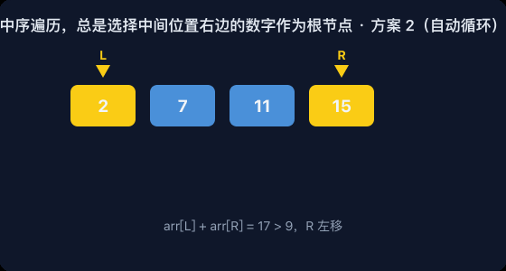

**方案专属流程图**（真实控制流）：


```typescript
/**
 ** LeetCode 108. 将有序数组转换为二叉搜索树
 ** 方案：2 ) 方案2: 中序遍历，总是选择中间位置右边的数字作为根节点
 ** 来源：https://blog.csdn.net/tyro_java/article/details/144993168
 */

export function demo(): void {
  // 程序入口：跑内嵌自测用例
  class TreeNode {
    // 定义类型
    val: number; // 值: number;
    left: TreeNode | null; // 左边界: TreeNode 按位或 null;
    right: TreeNode | null; // 右边界: TreeNode 按位或 null;
    constructor(v: number) {
      this.val = v;
      this.left = null;
      this.right = null;
    } // 把 值; this.左边界 赋值为 null; this.右边界 赋值为 null; } 写入 值
  }

  function sortedArrayToBST(nums: number[]): TreeNode | null {
    // 定义函数/方法 sortedArrayToBST
    return helper(nums, 0, nums.length - 1); // 返回 helper(数组, 0, 数组.长度 减 1)
  }

  function helper(
    nums: number[],
    left: number,
    right: number,
  ): TreeNode | null {
    // 定义函数/方法 helper
    if (left > right) return null; // 若 左边界 超过 右边界，直接返回 null

    // 总是选择中间位置右边的数字作为根节点
    const mid = Math.floor((left + right + 1) / 2); // 加1保证了当长度为偶数时取右中位数
    const root = new TreeNode(nums[mid]); // 把 new TreeNode(数组[中点]) 存入 根节点

    root.left = helper(nums, left, mid - 1); // 把 helper(数组, 左边界, 中点 减 1); 写入 左边界
    root.right = helper(nums, mid + 1, right); // 把 helper(数组, 中点 加 1, 右边界); 写入 右边界

    return root; // 返回 根节点
  }

  function inorder(root: TreeNode | null, out: number[]): number[] {
    // 定义函数/方法 inorder
    if (root === null) return out; // 若 根节点 全等于 null，直接返回 out
    inorder(root.left, out); // inorder(根节点.左边界, out);
    out.push(root.val); // 把 根节点.值 压入栈/数组尾部
    inorder(root.right, out); // inorder(根节点.右边界, out);
    return out; // 返回 out
  }

  // 层序序列化（尾部 null 裁剪），与 LeetCode 表示一致
  function serialize(root: TreeNode | null): (number | null)[] {
    // 定义函数/方法 serialize
    if (root === null) return []; // 若 根节点 全等于 null，直接返回 []
    const out: (number | null)[] = []; // 把 []; 写入 const out: (number | null)[]
    const q: (TreeNode | null)[] = [root]; // 把 [根节点]; 写入 const q: (TreeNode | null)[]
    let head = 0; // 把 0 存入 头节点
    while (head < q.length) {
      // 循环，直到不满足「头节点 小于 节点.长度」
      const node = q[head++]; // 把 节点[头节点 加一 ] 存入 节点
      if (node === null) {
        out.push(null);
        continue;
      } // 若 节点 全等于 null) { out 追加 null); continue; }
      out.push(node.val); // 把 节点.值 压入栈/数组尾部
      q.push(node.left); // 把 节点.左边界 压入栈/数组尾部
      q.push(node.right); // 把 节点.右边界 压入栈/数组尾部
    }
    while (out.length > 0 && out[out.length - 1] === null) out.pop(); // 循环，直到不满足「out.长度 超过 0 且 out[out.长度 减 1] 全等于 null) out 弹出 );」
    return out; // 返回 out
  }

  function eqArr(a: (number | null)[], b: (number | null)[]): boolean {
    // 定义函数/方法 eqArr
    if (a.length !== b.length) return false; // 若 数组.长度 不等于 b.长度，直接返回 false
    for (let i = 0; i < a.length; i++) if (a[i] !== b[i]) return false; // 让 下标 i 从 0 开始计数，下标 i 小于 数组.长度 就继续
    return true; // 返回 true
  }

  const cases: { in: number[]; want: (number | null)[] }[] = [
    { in: [-10, -3, 0, 5, 9], want: [0, -3, 9, -10, null, 5] },
    { in: [1], want: [1] },
    { in: [], want: [] },
    { in: [1, 2, 3, 4, 5, 6, 7], want: [4, 2, 6, 1, 3, 5, 7] },
  ];

  let fail = false; // 把 false 存入 fail
  for (const c of cases) {
    // for (const 字符 of cases) {
    const got = serialize(sortedArrayToBST(c.in)); // 把 serialize(sortedArrayToBST(字符.in)) 存入 got
    if (!eqArr(got, c.want)) {
      // 若 取反 eqArr(got, 字符.want
      fail = true; // 把 true 存入 fail
      console.log(
        'FAIL sortedArrayToBST(' +
          JSON.stringify(c.in) +
          ')=' +
          JSON.stringify(got) +
          ' want ' +
          JSON.stringify(c.want),
      ); // 打印输出
    }
    // 附加性质：中序序列必须等于排序后的输入（BST 不变量）
    const io = inorder(sortedArrayToBST(c.in), []); // 把 inorder(sortedArrayToBST(字符.in), []) 存入 io
    const sorted = c.in.slice().sort((a, b) => a - b);
    if (!eqArr(io, sorted)) {
      // 若 取反 eqArr(io, sorted
      fail = true; // 把 true 存入 fail
      console.log(
        'FAIL inorder(' +
          JSON.stringify(c.in) +
          ')=' +
          JSON.stringify(io) +
          ' want sorted ' +
          JSON.stringify(sorted),
      ); // 打印输出
    }
  }
  if (fail) throw new Error('FAILED'); // 若 fail) throw new Error(「FAILED」);
  console.log('PASS'); // 全部用例通过，输出 PASS
}
demo(); // demo();
```

### 方案 3：中序遍历，选择任意一个中间位置数字作为根节点

**分析与思路**：核心做法是「中序遍历，选择任意一个中间位置数字作为根节点」。

**运行方式**：`node 本文件`，内嵌用例全部通过会输出 PASS。

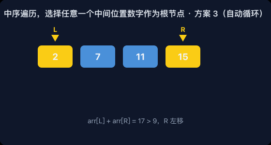

**方案专属流程图**（真实控制流）：

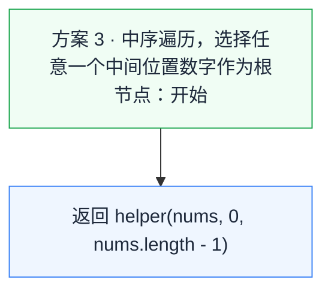

```typescript
/**
 ** LeetCode 108. 将有序数组转换为二叉搜索树
 ** 方案：3 ) 方案3: 中序遍历，选择任意一个中间位置数字作为根节点
 ** 来源：https://blog.csdn.net/tyro_java/article/details/144993168
 */

export function demo(): void {
  // 程序入口：跑内嵌自测用例
  class TreeNode {
    // 定义类型
    val: number; // 值: number;
    left: TreeNode | null; // 左边界: TreeNode 按位或 null;
    right: TreeNode | null; // 右边界: TreeNode 按位或 null;
    constructor(v: number) {
      this.val = v;
      this.left = null;
      this.right = null;
    } // 把 值; this.左边界 赋值为 null; this.右边界 赋值为 null; } 写入 值
  }

  function sortedArrayToBST(nums: number[]): TreeNode | null {
    // 定义函数/方法 sortedArrayToBST
    return helper(nums, 0, nums.length - 1); // 返回 helper(数组, 0, 数组.长度 减 1)
  }

  function helper(
    nums: number[],
    left: number,
    right: number,
  ): TreeNode | null {
    // 定义函数/方法 helper
    if (left > right) return null; // 若 左边界 超过 右边界，直接返回 null

    // 随机选取一个合法根，得到不同但同样合法的 BST（保留原"变体"意图）
    const mid = left + Math.floor(Math.random() * (right - left + 1)); // 把 左边界 加 向下取整(Math.random() 乘 (右边界 减 左边界 加 1)) 存入 中点
    const root = new TreeNode(nums[mid]); // 把 new TreeNode(数组[中点]) 存入 根节点
    root.left = helper(nums, left, mid - 1); // 把 helper(数组, 左边界, 中点 减 1); 写入 左边界
    root.right = helper(nums, mid + 1, right); // 把 helper(数组, 中点 加 1, 右边界); 写入 右边界
    return root; // 返回 根节点
  }

  function inorder(root: TreeNode | null, out: number[]): number[] {
    // 定义函数/方法 inorder
    if (root === null) return out; // 若 根节点 全等于 null，直接返回 out
    inorder(root.left, out); // inorder(根节点.左边界, out);
    out.push(root.val); // 把 根节点.值 压入栈/数组尾部
    inorder(root.right, out); // inorder(根节点.右边界, out);
    return out; // 返回 out
  }

  // 校验 BST 不变量：左子树全部小于 root，右子树全部大于 root
  function isValidBST(
    root: TreeNode | null,
    lo: number | null,
    hi: number | null,
  ): boolean {
    // 定义判定函数 isValidBST
    if (root === null) return true; // 若 根节点 全等于 null，直接返回 true
    if (lo !== null && root.val <= lo) return false; // 若 左边界 不等于 null 且 根节点.值 不超过 左边界，直接返回 false
    if (hi !== null && root.val >= hi) return false; // 若 右边界 不等于 null 且 根节点.值 不低于 右边界，直接返回 false
    return (
      isValidBST(root.left, lo, root.val) &&
      isValidBST(root.right, root.val, hi)
    );
  }

  function eqArr(a: number[], b: number[]): boolean {
    // 定义函数/方法 eqArr
    if (a.length !== b.length) return false; // 若 数组.长度 不等于 b.长度，直接返回 false
    for (let i = 0; i < a.length; i++) if (a[i] !== b[i]) return false; // 让 下标 i 从 0 开始计数，下标 i 小于 数组.长度 就继续
    return true; // 返回 true
  }

  const cases: number[][] = [
    [-10, -3, 0, 5, 9],
    [1],
    [],
    [1, 2, 3, 4, 5, 6, 7],
  ];

  let fail = false; // 把 false 存入 fail
  for (const c of cases) {
    // for (const 字符 of cases) {
    const root = sortedArrayToBST(c); // 把 sortedArrayToBST(字符) 存入 根节点
    // 随机中点使树形不确定，但中序遍历必须恒等于排序后的输入
    const io = inorder(root, []); // 把 inorder(根节点, []) 存入 io
    const sorted = c.slice().sort((a, b) => a - b);
    if (!eqArr(io, sorted)) {
      // 若 取反 eqArr(io, sorted
      fail = true; // 把 true 存入 fail
      console.log(
        'FAIL inorder(' +
          JSON.stringify(c) +
          ')=' +
          JSON.stringify(io) +
          ' want sorted ' +
          JSON.stringify(sorted),
      ); // 打印输出
    }
    if (!isValidBST(root, null, null)) {
      // 若 取反 isValidBST(根节点, null, null
      fail = true; // 把 true 存入 fail
      console.log('FAIL isValidBST(' + JSON.stringify(c) + ')=false'); // 打印输出
    }
  }
  if (fail) throw new Error('FAILED'); // 若 fail) throw new Error(「FAILED」);
  console.log('PASS'); // 全部用例通过，输出 PASS
}
demo(); // demo();
```

### 方案 4：简单版本

**分析与思路**：核心做法是「简单版本」。

**运行方式**：`node 本文件`，内嵌用例全部通过会输出 PASS。


**方案专属流程图**（真实控制流）：

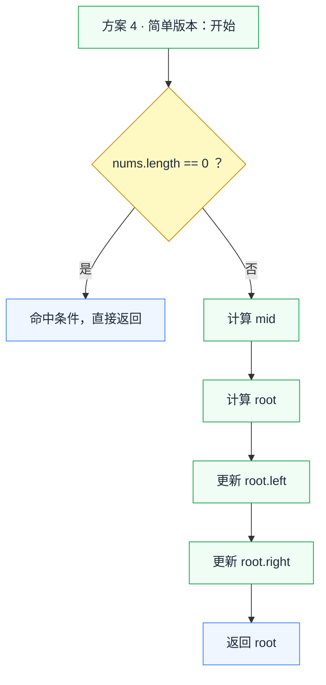

```typescript
/**
 ** LeetCode 108. 将有序数组转换为二叉搜索树
 ** 方案：4 ) 方案4: 简单版本
 ** 来源：https://blog.csdn.net/tyro_java/article/details/144993168
 */

export function demo(): void {
  // 程序入口：跑内嵌自测用例
  class TreeNode {
    // 定义类型
    val: number; // 值: number;
    left: TreeNode | null; // 左边界: TreeNode 按位或 null;
    right: TreeNode | null; // 右边界: TreeNode 按位或 null;
    constructor(v: number) {
      this.val = v;
      this.left = null;
      this.right = null;
    } // 把 值; this.左边界 赋值为 null; this.右边界 赋值为 null; } 写入 值
  }

  function sortedArrayToBST(nums: number[]): TreeNode | null {
    // 定义函数/方法 sortedArrayToBST
    if (nums.length === 0) return null; // 若 数组.长度 全等于 0，直接返回 null
    // 二叉搜索树的中序遍历，就是升序列表
    // 数组中间的位置，可以作为树的根节点
    const mid = Math.floor(nums.length / 2); // 把 向下取整(数组.长度 除以 2) 存入 中点
    const root = new TreeNode(nums[mid]); // 把 new TreeNode(数组[中点]) 存入 根节点
    root.left = sortedArrayToBST(nums.slice(0, mid)); // 把 sortedArrayToBST(数组 截取 0, 中点)); 写入 左边界
    root.right = sortedArrayToBST(nums.slice(mid + 1)); // 把 sortedArrayToBST(数组 截取 中点 加 1)); 写入 右边界
    return root; // 返回 根节点
  }

  function inorder(root: TreeNode | null, out: number[]): number[] {
    // 定义函数/方法 inorder
    if (root === null) return out; // 若 根节点 全等于 null，直接返回 out
    inorder(root.left, out); // inorder(根节点.左边界, out);
    out.push(root.val); // 把 根节点.值 压入栈/数组尾部
    inorder(root.right, out); // inorder(根节点.右边界, out);
    return out; // 返回 out
  }

  // 层序序列化（尾部 null 裁剪），与 LeetCode 表示一致
  function serialize(root: TreeNode | null): (number | null)[] {
    // 定义函数/方法 serialize
    if (root === null) return []; // 若 根节点 全等于 null，直接返回 []
    const out: (number | null)[] = []; // 把 []; 写入 const out: (number | null)[]
    const q: (TreeNode | null)[] = [root]; // 把 [根节点]; 写入 const q: (TreeNode | null)[]
    let head = 0; // 把 0 存入 头节点
    while (head < q.length) {
      // 循环，直到不满足「头节点 小于 节点.长度」
      const node = q[head++]; // 把 节点[头节点 加一 ] 存入 节点
      if (node === null) {
        out.push(null);
        continue;
      } // 若 节点 全等于 null) { out 追加 null); continue; }
      out.push(node.val); // 把 节点.值 压入栈/数组尾部
      q.push(node.left); // 把 节点.左边界 压入栈/数组尾部
      q.push(node.right); // 把 节点.右边界 压入栈/数组尾部
    }
    while (out.length > 0 && out[out.length - 1] === null) out.pop(); // 循环，直到不满足「out.长度 超过 0 且 out[out.长度 减 1] 全等于 null) out 弹出 );」
    return out; // 返回 out
  }

  function eqArr(a: (number | null)[], b: (number | null)[]): boolean {
    // 定义函数/方法 eqArr
    if (a.length !== b.length) return false; // 若 数组.长度 不等于 b.长度，直接返回 false
    for (let i = 0; i < a.length; i++) if (a[i] !== b[i]) return false; // 让 下标 i 从 0 开始计数，下标 i 小于 数组.长度 就继续
    return true; // 返回 true
  }

  const cases: { in: number[]; want: (number | null)[] }[] = [
    { in: [-10, -3, 0, 5, 9], want: [0, -3, 9, -10, null, 5] },
    { in: [1], want: [1] },
    { in: [], want: [] },
    { in: [1, 2, 3, 4, 5, 6, 7], want: [4, 2, 6, 1, 3, 5, 7] },
  ];

  let fail = false; // 把 false 存入 fail
  for (const c of cases) {
    // for (const 字符 of cases) {
    const got = serialize(sortedArrayToBST(c.in)); // 把 serialize(sortedArrayToBST(字符.in)) 存入 got
    if (!eqArr(got, c.want)) {
      // 若 取反 eqArr(got, 字符.want
      fail = true; // 把 true 存入 fail
      console.log(
        'FAIL sortedArrayToBST(' +
          JSON.stringify(c.in) +
          ')=' +
          JSON.stringify(got) +
          ' want ' +
          JSON.stringify(c.want),
      ); // 打印输出
    }
    // 附加性质：中序序列必须等于排序后的输入（BST 不变量）
    const io = inorder(sortedArrayToBST(c.in), []); // 把 inorder(sortedArrayToBST(字符.in), []) 存入 io
    const sorted = c.in.slice().sort((a, b) => a - b);
    if (!eqArr(io, sorted)) {
      // 若 取反 eqArr(io, sorted
      fail = true; // 把 true 存入 fail
      console.log(
        'FAIL inorder(' +
          JSON.stringify(c.in) +
          ')=' +
          JSON.stringify(io) +
          ' want sorted ' +
          JSON.stringify(sorted),
      ); // 打印输出
    }
  }
  if (fail) throw new Error('FAILED'); // 若 fail) throw new Error(「FAILED」);
  console.log('PASS'); // 全部用例通过，输出 PASS
}
demo(); // demo();
```

## 逐步拆解与面试追问

**复杂度**：时间 O(n) 量级，空间 O(n)

**为什么是这个量级**：整体只对数据做有限趟处理

**面试官可能会追问**：

- 递归和迭代写法各自的空间开销？
- 能否用层序统一处理？
- 空节点的边界如何约定？

## 关键 API 速查（TS 主解法实际用到，附官方链接）

| API | 作用 | 使用要点 | 官方文档 |
|---|---|---|---|
| `Array.prototype.sort()` | 原地排序 | 默认按字符串 Unicode 序（10 会排在 2 前），数字必须传 (a,b)=>a-b；V8 用 TimSort，稳定，O(n log n)；返回原数组引用 | [官方文档](https://developer.mozilla.org/zh-CN/docs/Web/JavaScript/Reference/Global_Objects/Array/sort) |
| `Array.prototype.push()` | 尾部追加 | 返回新长度；可一次多个；均摊 O(1)；会改变原数组 | [官方文档](https://developer.mozilla.org/zh-CN/docs/Web/JavaScript/Reference/Global_Objects/Array/push) |
| `Array.prototype.pop()` | 尾部弹出 | 返回被删元素（空数组返回 undefined）；O(1) | [官方文档](https://developer.mozilla.org/zh-CN/docs/Web/JavaScript/Reference/Global_Objects/Array/pop) |
| `Array/String slice()` | 切片（不改原数组） | slice(start,end) 含头不含尾；负数从尾计；常用于复制数组（slice()） | [官方文档](https://developer.mozilla.org/zh-CN/docs/Web/JavaScript/Reference/Global_Objects/Array/slice) |
| `JSON.stringify()` | 序列化为 JSON 字符串 | 常用于结构化比较（深度相等判定）；undefined/函数/循环引用会被丢弃或抛错 | [官方文档](https://developer.mozilla.org/zh-CN/docs/Web/JavaScript/Reference/Global_Objects/JSON/stringify) |
| `Math.floor()` | 向下取整 | 负数向负无穷（-1.5 → -2）；大数用位运算前注意 2^31 界 | [官方文档](https://developer.mozilla.org/zh-CN/docs/Web/JavaScript/Reference/Global_Objects/Math/floor) |

### 各语言官方文档导航

- **TypeScript / JS**：[MDN 中文参考](https://developer.mozilla.org/zh-CN/)
- **Python**：[Python 官方文档](https://docs.python.org/zh-cn/3/)
- **Go**：[Go 标准库](https://pkg.go.dev/std)
- **Java**：[JDK 17 API](https://docs.oracle.com/en/java/javase/17/docs/api/)
- **Rust**：[Rust 标准库](https://doc.rust-lang.org/std/)
- **Lua**：[Lua 5.4 手册](https://www.lua.org/manual/5.4/)
- **C**：[Cppreference C](https://zh.cppreference.com/w/c)
- **C++**：[Cppreference C++](https://zh.cppreference.com/w/cpp)
- **R**：[R 官方手册](https://stat.ethz.ch/R-manual/)
- **Zig**：[Zig 语言文档](https://ziglang.org/documentation/master/)
- **Dart**：[Dart API](https://api.dart.dev/)

## 附录：其他 10 种语言全部实现（每种语言列举其全部方案）

> TypeScript 的全部方案见「TypeScript 解题方案」一节；下面是其余 10 种语言的对应实现，每种语言的每个方案都带思路分析、代码走读与专属运行架构图。
> 每个方案都内嵌用例自测，可独立运行（老仓库 python/go 文件遵循「打印结果」约定）。
> 完整解法文件见 `dsa/<语言>/tree/lc_108_将有序数组转换为二叉搜索树/`。

### Python 实现（4 种方案）

Python 的全部方案如下，每个方案都内嵌用例自测，可独立运行（老仓库 python/go 文件遵循「打印结果」约定）：

#### 方案 1：中序遍历，总是选择中间位置左边的数字作为根节点

**思路与代码分析**：核心是「中序遍历，总是选择中间位置左边的数字作为根节点」。Python 版用切片与字典推导式简化操作，突出可读性。**走读**：方案 1 · 中序遍历，总是选择中间位置左边的数字作为根节点：开始 → 返回 helper(nums, 0, len(nums) - 1)。

**运行架构**（真实控制流）：


```python
import sys  # 提高递归深度上限（深输入防 RecursionError）

sys.setrecursionlimit(200000)  # 树/链表类题目节点数可达 1e4 量级

class TreeNode:  # 定义类
    def __init__(self, val=0, left=None, right=None):  # 构造函数：初始化成员
        self.val = val  # 把 值 写入 值
        self.left = left  # 把 左边界 写入 左边界
        self.right = right  # 把 右边界 写入 右边界

def sortedArrayToBST(nums):  # 定义函数 sortedArrayToBST（参数：数组）
    return helper(nums, 0, len(nums) - 1)  # 返回 helper(数组, 0, 长度(数组) 减 1)

def helper(nums, left, right):  # 定义函数 helper（参数：数组, 左边界, 右边界）
    if left > right:  # 若 左边界 超过 右边界
        return None  # 返回 None
    mid = left + (right - left) // 2  # 把 左边界 加 (右边界 减 左边界) 除以 除以 2 存入 中点
    root = TreeNode(nums[mid])  # 把 TreeNode(数组[中点]) 存入 根节点
    root.left = helper(nums, left, mid - 1)  # 把 helper(数组, 左边界, 中点 减 1) 写入 左边界
    root.right = helper(nums, mid + 1, right)  # 把 helper(数组, 中点 加 1, 右边界) 写入 右边界
    return root  # 返回 根节点

def inorder(root):  # 定义函数 inorder（参数：根节点）
    if not root:  # 若 not 根节点
        return []  # 返回 []
    return (
        inorder(root.left) + [root.val] + inorder(root.right)
    )  # 返回 inorder(根节点.左边界) 加 [根节点.值] 加 inorder(根节点.右边界)

if __name__ == "__main__":  # 若 __name__ 等于 '__main__'
    root = sortedArrayToBST([1, 2, 3])  # 把 sortedArrayToBST([1, 2, 3]) 存入 根节点
    print(inorder(root))  # 打印输出
```

#### 方案 2：中序遍历，总是选择中间位置右边的数字作为根节点

**思路与代码分析**：核心是「中序遍历，总是选择中间位置右边的数字作为根节点」。Python 版用切片与字典推导式简化操作，突出可读性。**走读**：方案 2 · 中序遍历，总是选择中间位置右边的数字作为根节点：开始 → 返回 helper(nums, 0, len(nums) - 1)。

**运行架构**（真实控制流）：

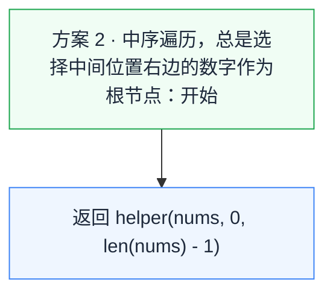

```python
import sys  # 提高递归深度上限（深输入防 RecursionError）

sys.setrecursionlimit(200000)  # 树/链表类题目节点数可达 1e4 量级

class TreeNode:  # 定义类
    def __init__(self, val=0, left=None, right=None):  # 构造函数：初始化成员
        self.val = val  # 把 值 写入 值
        self.left = left  # 把 左边界 写入 左边界
        self.right = right  # 把 右边界 写入 右边界

def sortedArrayToBST(nums):  # 定义函数 sortedArrayToBST（参数：数组）
    return helper(nums, 0, len(nums) - 1)  # 返回 helper(数组, 0, 长度(数组) 减 1)

def helper(nums, left, right):  # 定义函数 helper（参数：数组, 左边界, 右边界）
    if left > right:  # 若 左边界 超过 右边界
        return None  # 返回 None
    mid = (left + right + 1) // 2  # 把 (左边界 加 右边界 加 1) 除以 除以 2 存入 中点
    root = TreeNode(nums[mid])  # 把 TreeNode(数组[中点]) 存入 根节点
    root.left = helper(nums, left, mid - 1)  # 把 helper(数组, 左边界, 中点 减 1) 写入 左边界
    root.right = helper(nums, mid + 1, right)  # 把 helper(数组, 中点 加 1, 右边界) 写入 右边界
    return root  # 返回 根节点

def inorder(root):  # 定义函数 inorder（参数：根节点）
    if not root:  # 若 not 根节点
        return []  # 返回 []
    return (
        inorder(root.left) + [root.val] + inorder(root.right)
    )  # 返回 inorder(根节点.左边界) 加 [根节点.值] 加 inorder(根节点.右边界)

if __name__ == "__main__":  # 若 __name__ 等于 '__main__'
    root = sortedArrayToBST([1, 2, 3])  # 把 sortedArrayToBST([1, 2, 3]) 存入 根节点
    print(inorder(root))  # 打印输出
```

#### 方案 3：中序遍历，选择任意一个中间位置数字作为根节点

**思路与代码分析**：核心是「中序遍历，选择任意一个中间位置数字作为根节点」。Python 版用切片与字典推导式简化操作，突出可读性。**走读**：方案 3 · 中序遍历，选择任意一个中间位置数字作为根节点：开始 → 返回 helper(nums, 0, len(nums) - 1)。

**运行架构**（真实控制流）：

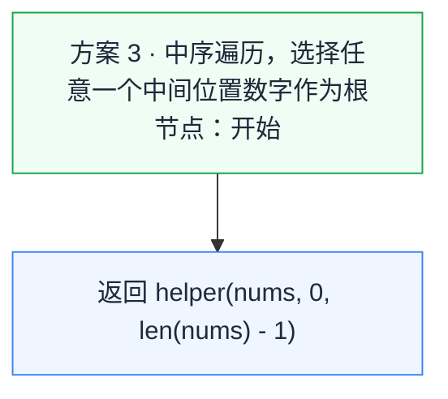

```python
import sys  # 提高递归深度上限（深输入防 RecursionError）

sys.setrecursionlimit(200000)  # 树/链表类题目节点数可达 1e4 量级
import random  # 引入依赖

class TreeNode:  # 定义类
    def __init__(self, val=0, left=None, right=None):  # 构造函数：初始化成员
        self.val = val  # 把 值 写入 值
        self.left = left  # 把 左边界 写入 左边界
        self.right = right  # 把 右边界 写入 右边界

def sortedArrayToBST(nums):  # 定义函数 sortedArrayToBST（参数：数组）
    return helper(nums, 0, len(nums) - 1)  # 返回 helper(数组, 0, 长度(数组) 减 1)

def helper(nums, left, right):  # 定义函数 helper（参数：数组, 左边界, 右边界）
    if left > right:  # 若 左边界 超过 右边界
        return None  # 返回 None
    # 随机选取一个合法根，得到不同但同样平衡的 BST（保留原“变体”意图）
    mid = random.randint(left, right)  # 把 random.randint(左边界, 右边界) 存入 中点
    root = TreeNode(nums[mid])  # 把 TreeNode(数组[中点]) 存入 根节点
    root.left = helper(nums, left, mid - 1)  # 把 helper(数组, 左边界, 中点 减 1) 写入 左边界
    root.right = helper(nums, mid + 1, right)  # 把 helper(数组, 中点 加 1, 右边界) 写入 右边界
    return root  # 返回 根节点

def inorder(root):  # 定义函数 inorder（参数：根节点）
    if not root:  # 若 not 根节点
        return []  # 返回 []
    return (
        inorder(root.left) + [root.val] + inorder(root.right)
    )  # 返回 inorder(根节点.左边界) 加 [根节点.值] 加 inorder(根节点.右边界)

if __name__ == "__main__":  # 若 __name__ 等于 '__main__'
    root = sortedArrayToBST([1, 2, 3])  # 把 sortedArrayToBST([1, 2, 3]) 存入 根节点
    print(inorder(root))  # 打印输出
```

#### 方案 4：简单版本

**思路与代码分析**：核心是「简单版本」。Python 版用切片与字典推导式简化操作，突出可读性。**走读**：方案 4 · 简单版本：开始 → 命中条件，直接返回 → 更新 mid → 更新 root → 更新 root.left → 更新 root.right → 返回 root。

**运行架构**（真实控制流）：

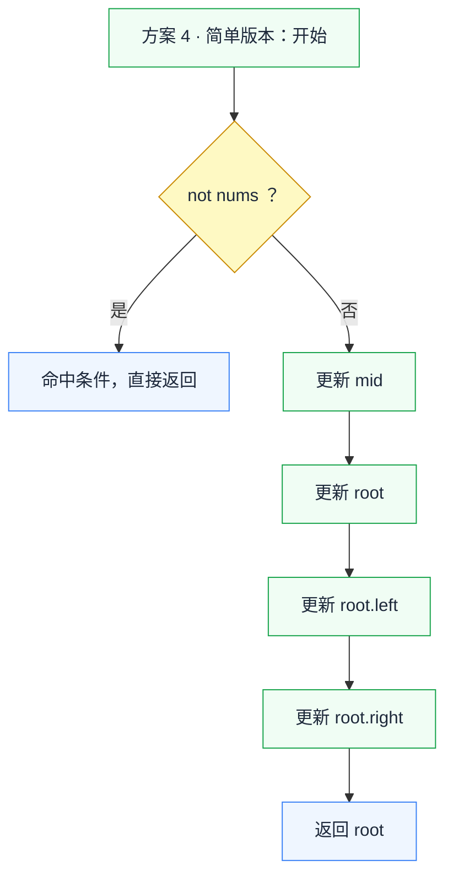

```python
import sys  # 提高递归深度上限（深输入防 RecursionError）

sys.setrecursionlimit(200000)  # 树/链表类题目节点数可达 1e4 量级

class TreeNode:  # 定义类
    def __init__(self, val=0, left=None, right=None):  # 构造函数：初始化成员
        self.val = val  # 把 值 写入 值
        self.left = left  # 把 左边界 写入 左边界
        self.right = right  # 把 右边界 写入 右边界

def sortedArrayToBST(nums):  # 定义函数 sortedArrayToBST（参数：数组）
    if not nums:  # 若 not 数组
        return None  # 返回 None
    mid = len(nums) // 2  # 把 长度(数组) 除以 除以 2 存入 中点
    root = TreeNode(nums[mid])  # 把 TreeNode(数组[中点]) 存入 根节点
    root.left = sortedArrayToBST(nums[:mid])  # 把 sortedArrayToBST(数组[:中点]) 写入 左边界
    root.right = sortedArrayToBST(nums[mid + 1 :])  # 把 sortedArrayToBST(数组[中点 加 1:]) 写入 右边界
    return root  # 返回 根节点

def inorder(root):  # 定义函数 inorder（参数：根节点）
    if not root:  # 若 not 根节点
        return []  # 返回 []
    return (
        inorder(root.left) + [root.val] + inorder(root.right)
    )  # 返回 inorder(根节点.左边界) 加 [根节点.值] 加 inorder(根节点.右边界)

if __name__ == "__main__":  # 若 __name__ 等于 '__main__'
    root = sortedArrayToBST([1, 2, 3])  # 把 sortedArrayToBST([1, 2, 3]) 存入 根节点
    print(inorder(root))  # 打印输出
```

### Go 实现（4 种方案）

Go 的全部方案如下，每个方案都内嵌用例自测，可独立运行（老仓库 python/go 文件遵循「打印结果」约定）：

#### 方案 1：中序遍历，总是选择中间位置左边的数字作为根节点

**思路与代码分析**：核心是「中序遍历，总是选择中间位置左边的数字作为根节点」。Go 版用切片与多返回值惯用法，显式处理索引边界。**走读**：方案 1 · 中序遍历，总是选择中间位置左边的数字作为根节点：开始 → 处理 if root == nil → 返回 []int → 返回 append(append(inorderT(root.Left), root.Val), inorderT(root.Right)...)。

**运行架构**（真实控制流）：

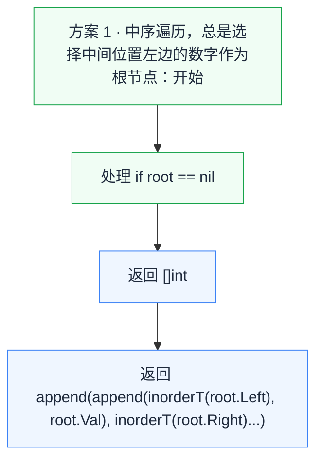

```go
package main // 引入依赖
import (
	"fmt"
	"os"
	"reflect"
) // 引入依赖
type TreeNode struct {
	Val   int
	Left  *TreeNode
	Right *TreeNode
}                        // 定义类型
const NULL = -1000000000 // 把 减 1000000000 存入 NULL
func buildTree(vals []int) *TreeNode { // 定义函数/方法 buildTree
	if len(vals) == 0 || vals[0] == NULL {
		return nil
	} // 若 长度(vals) 等于 0 或 vals[0] 等于 NULL { return nil }
	root := &TreeNode{Val: vals[0]} // 把 按位与 TreeNode{Val: vals[0]} 写入 root :
	q := []*TreeNode{root}
	i := 1                            // 把 [] 乘 TreeNode{根节点}; 下标 i : 赋值为 1 写入 q :
	for len(q) > 0 && i < len(vals) { // 定义函数/方法 len
		node := q[0]
		q = q[1:] // 把 节点[0]; 节点 赋值为 节点[1:] 写入 node :
		if i < len(vals) && vals[i] != NULL {
			node.Left = &TreeNode{Val: vals[i]}
			q = append(q, node.Left)
		}
		i++
		if i < len(vals) && vals[i] != NULL {
			node.Right = &TreeNode{Val: vals[i]}
			q = append(q, node.Right)
		}
		i++
	}
	return root // 返回 根节点
}
func levelList(root *TreeNode) [][]int { // 定义函数/方法 levelList
	if root == nil {
		return [][]int{}
	} // 若 根节点 等于 nil { return [][]int{} }
	res := [][]int{}
	q := []*TreeNode{root} // 把 [][]int{}; 节点 : 赋值为 [] 乘 TreeNode{根节点} 写入 res :
	for len(q) > 0 {       // for 长度(节点) 超过 0 {
		lvl := []int{}
		n := len(q)              // 把 []int{}; 元素个数 : 赋值为 长度(节点) 写入 lvl :
		for k := 0; k < n; k++ { // 让 下标 k 从 0 开始计数
			node := q[0]
			q = q[1:]                   // 把 节点[0]; 节点 赋值为 节点[1:] 写入 node :
			lvl = append(lvl, node.Val) // 把 append(lvl, 节点.Val) 写入 lvl
			if node.Left != nil {
				q = append(q, node.Left)
			} // 若 节点.Left 不等于 nil { 节点 赋值为 append(节点, 节点.Left) }
			if node.Right != nil {
				q = append(q, node.Right)
			} // 若 节点.Right 不等于 nil { 节点 赋值为 append(节点, 节点.Right) }
		}
		res = append(res, lvl) // 把 append(结果, lvl) 写入 结果
	}
	return res // 返回 结果
}
func sameTree(a, b *TreeNode) bool { // 定义函数/方法 sameTree
	if a == nil && b == nil {
		return true
	} // 若 数组 等于 nil 且 b 等于 nil { return true }
	if a == nil || b == nil {
		return false
	} // 若 数组 等于 nil 或 b 等于 nil { return false }
	if a.Val != b.Val {
		return false
	} // 若 数组.Val 不等于 b.Val { return false }
	return sameTree(a.Left, b.Left) && sameTree(a.Right, b.Right) // 定义函数/方法 sameTree
}
func inorderT(root *TreeNode) []int { // 定义函数/方法 inorderT
	if root == nil {
		return []int{}
	} // 若 根节点 等于 nil { return []int{} }
	return append(append(inorderT(root.Left), root.Val), inorderT(root.Right)...) // 定义函数/方法 append
}
func sortedArrayToBST(nums []int) *TreeNode { // 定义函数/方法 sortedArrayToBST
	var build func(int, int) *TreeNode // var build func(int, int) 乘 TreeNode
	build = func(l, r int) *TreeNode { // 把 func(左指针, 右指针 int) 乘 TreeNode { 写入 build
		if l > r {
			return nil
		} // 若 左指针 超过 右指针 { return nil }
		m := (l + r) / 2 // 把 (左指针 加 右指针) 除以 2 写入 m :
		return &TreeNode{Val: nums[m], Left: build(l, m-1), Right: build(m+1, r)}
	}
	return build(0, len(nums)-1) // 定义函数/方法 build
}
func main() { // 程序入口：跑内嵌自测用例
	inorder := inorderT(sortedArrayToBST([]int{1, 2, 3})) // 把 inorderT(sortedArrayToBST([]int{1,2,3})) 写入 inorder :
	if !reflect.DeepEqual(inorder, []int{1, 2, 3}) {
		fmt.Println("FAIL", inorder)
		os.Exit(1)
	}
	inorder = inorderT(sortedArrayToBST([]int{-10, -3, 0, 5, 9}))
	if !reflect.DeepEqual(inorder, []int{-10, -3, 0, 5, 9}) {
		fmt.Println("FAIL", inorder)
		os.Exit(1)
	}
	fmt.Println("PASS") // 全部用例通过，输出 PASS
}
```

#### 方案 2：中序遍历，总是选择中间位置右边的数字作为根节点

**思路与代码分析**：核心是「中序遍历，总是选择中间位置右边的数字作为根节点」。Go 版用切片与多返回值惯用法，显式处理索引边界。**走读**：方案 2 · 中序遍历，总是选择中间位置右边的数字作为根节点：开始 → 处理 if root == nil → 返回 []int → 更新 : → 更新 res → 更新 res → 更新 res → 返回 res。

**运行架构**（真实控制流）：

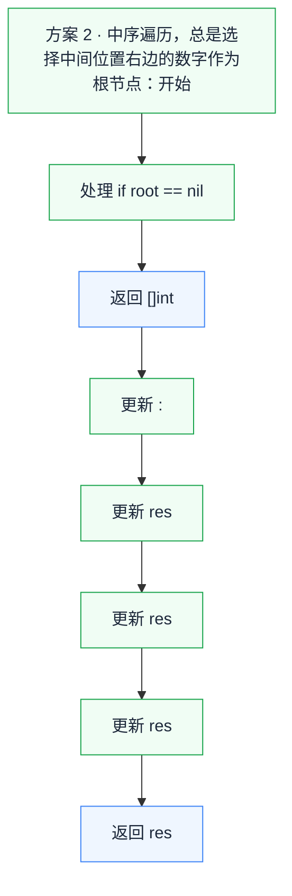

```go
package main // 引入依赖

import (
	"fmt"     // 「fmt」
	"os"      // 「os」
	"reflect" // 「reflect」
)

type TreeNode struct { // 定义类型
	Val   int       // Val int
	Left  *TreeNode // Left 乘 TreeNode
	Right *TreeNode // Right 乘 TreeNode
}

func sortedArrayToBST(nums []int) *TreeNode { // 定义函数/方法 sortedArrayToBST
	var helper func(left, right int) *TreeNode // var helper func(左边界, 右边界 int) 乘 TreeNode
	helper = func(left, right int) *TreeNode { // 把 func(左边界, 右边界 int) 乘 TreeNode { 写入 helper
		if left > right { // 若 左边界 超过 右边界
			return nil // 返回 nil
		}
		mid := (left + right + 1) / 2     // 把 (左边界 加 右边界 加 1) 除以 2 写入 mid :
		root := &TreeNode{Val: nums[mid]} // 把 按位与 TreeNode{Val: 数组[中点]} 写入 root :
		root.Left = helper(left, mid-1)   // 把 helper(左边界, 中点 减 1) 写入 root.Left
		root.Right = helper(mid+1, right) // 把 helper(中点 加 1, 右边界) 写入 root.Right
		return root                       // 返回 根节点
	}
	return helper(0, len(nums)-1) // 定义函数/方法 helper
}

func inorder(root *TreeNode) []int { // 定义函数/方法 inorder
	if root == nil { // 若 根节点 等于 nil
		return []int{} // 返回 []int{}
	}
	res := []int{}                            // 把 []int{} 写入 res :
	res = append(res, inorder(root.Left)...)  // 把 append(结果, inorder(根节点.Left)...) 写入 结果
	res = append(res, root.Val)               // 把 append(结果, 根节点.Val) 写入 结果
	res = append(res, inorder(root.Right)...) // 把 append(结果, inorder(根节点.Right)...) 写入 结果
	return res                                // 返回 结果
}

type tc struct { // 定义类型
	nums []int // 数组 []int
	want []int // want []int
}

func main() { // 程序入口：跑内嵌自测用例
	cases := []tc{ // 把 []tc{ 写入 cases :
		{[]int{}, []int{}},
		{[]int{1}, []int{1}},
		{[]int{1, 2, 3}, []int{1, 2, 3}},
		{[]int{1, 2, 3, 4, 5}, []int{1, 2, 3, 4, 5}},
	}
	for idx, c := range cases { // 同时取 idx 与 字符 遍历
		got := inorder(sortedArrayToBST(c.nums)) // 把 inorder(sortedArrayToBST(字符.数组)) 写入 got :
		if !reflect.DeepEqual(got, c.want) {     // 若 取反 reflect.DeepEqual(got, 字符.want
			fmt.Printf("case %d failed: got %v want %v\n", idx, got, c.want) // 打印输出
			os.Exit(1)                                                       // os.Exit(1)
		}
	}
	fmt.Println("PASS") // 全部用例通过，输出 PASS
}
```

#### 方案 3：中序遍历，选择任意一个中间位置数字作为根节点

**思路与代码分析**：核心是「中序遍历，选择任意一个中间位置数字作为根节点」。Go 版用切片与多返回值惯用法，显式处理索引边界。**走读**：方案 3 · 中序遍历，选择任意一个中间位置数字作为根节点：开始 → 处理 if root == nil → 返回 []int → 更新 : → 更新 res → 更新 res → 更新 res → 返回 res。

**运行架构**（真实控制流）：

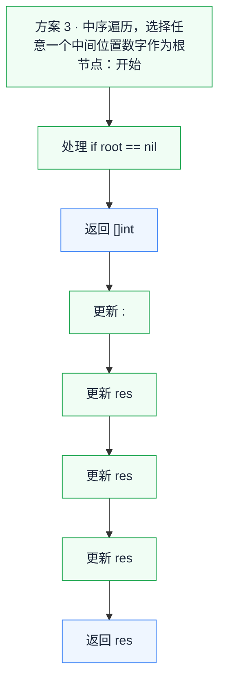

```go
package main // 引入依赖

import (
	"fmt"     // 「fmt」
	"os"      // 「os」
	"reflect" // 「reflect」
)

type TreeNode struct { // 定义类型
	Val   int       // Val int
	Left  *TreeNode // Left 乘 TreeNode
	Right *TreeNode // Right 乘 TreeNode
}

func sortedArrayToBST(nums []int) *TreeNode { // 定义函数/方法 sortedArrayToBST
	var helper func(left, right int) *TreeNode // var helper func(左边界, 右边界 int) 乘 TreeNode
	helper = func(left, right int) *TreeNode { // 把 func(左边界, 右边界 int) 乘 TreeNode { 写入 helper
		if left > right { // 若 左边界 超过 右边界
			return nil // 返回 nil
		}
		mid := (left + right) / 2         // 把 (左边界 加 右边界) 除以 2 写入 mid :
		root := &TreeNode{Val: nums[mid]} // 把 按位与 TreeNode{Val: 数组[中点]} 写入 root :
		root.Left = helper(left, mid-1)   // 把 helper(左边界, 中点 减 1) 写入 root.Left
		root.Right = helper(mid+1, right) // 把 helper(中点 加 1, 右边界) 写入 root.Right
		return root                       // 返回 根节点
	}
	return helper(0, len(nums)-1) // 定义函数/方法 helper
}

func inorder(root *TreeNode) []int { // 定义函数/方法 inorder
	if root == nil { // 若 根节点 等于 nil
		return []int{} // 返回 []int{}
	}
	res := []int{}                            // 把 []int{} 写入 res :
	res = append(res, inorder(root.Left)...)  // 把 append(结果, inorder(根节点.Left)...) 写入 结果
	res = append(res, root.Val)               // 把 append(结果, 根节点.Val) 写入 结果
	res = append(res, inorder(root.Right)...) // 把 append(结果, inorder(根节点.Right)...) 写入 结果
	return res                                // 返回 结果
}

type tc struct { // 定义类型
	nums []int // 数组 []int
	want []int // want []int
}

func main() { // 程序入口：跑内嵌自测用例
	cases := []tc{ // 把 []tc{ 写入 cases :
		{[]int{}, []int{}},
		{[]int{1}, []int{1}},
		{[]int{1, 2, 3}, []int{1, 2, 3}},
		{[]int{1, 2, 3, 4, 5}, []int{1, 2, 3, 4, 5}},
	}
	for idx, c := range cases { // 同时取 idx 与 字符 遍历
		got := inorder(sortedArrayToBST(c.nums)) // 把 inorder(sortedArrayToBST(字符.数组)) 写入 got :
		if !reflect.DeepEqual(got, c.want) {     // 若 取反 reflect.DeepEqual(got, 字符.want
			fmt.Printf("case %d failed: got %v want %v\n", idx, got, c.want) // 打印输出
			os.Exit(1)                                                       // os.Exit(1)
		}
	}
	fmt.Println("PASS") // 全部用例通过，输出 PASS
}
```

#### 方案 4：简单版本

**思路与代码分析**：核心是「简单版本」。Go 版用切片与多返回值惯用法，显式处理索引边界。**走读**：方案 4 · 简单版本：开始 → 处理 if root == nil → 返回 []int → 返回 append(append(inorderT(root.Left), root.Val), inorderT(root.Right)...)。

**运行架构**（真实控制流）：

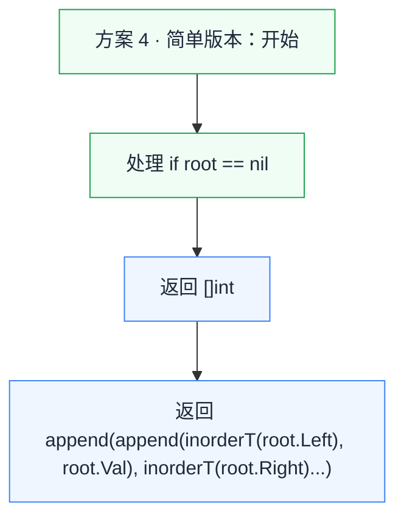

```go
package main // 引入依赖
import (
	"fmt"
	"os"
	"reflect"
) // 引入依赖
type TreeNode struct {
	Val   int
	Left  *TreeNode
	Right *TreeNode
}                        // 定义类型
const NULL = -1000000000 // 把 减 1000000000 存入 NULL
func buildTree(vals []int) *TreeNode { // 定义函数/方法 buildTree
	if len(vals) == 0 || vals[0] == NULL {
		return nil
	} // 若 长度(vals) 等于 0 或 vals[0] 等于 NULL { return nil }
	root := &TreeNode{Val: vals[0]} // 把 按位与 TreeNode{Val: vals[0]} 写入 root :
	q := []*TreeNode{root}
	i := 1                            // 把 [] 乘 TreeNode{根节点}; 下标 i : 赋值为 1 写入 q :
	for len(q) > 0 && i < len(vals) { // 定义函数/方法 len
		node := q[0]
		q = q[1:] // 把 节点[0]; 节点 赋值为 节点[1:] 写入 node :
		if i < len(vals) && vals[i] != NULL {
			node.Left = &TreeNode{Val: vals[i]}
			q = append(q, node.Left)
		}
		i++
		if i < len(vals) && vals[i] != NULL {
			node.Right = &TreeNode{Val: vals[i]}
			q = append(q, node.Right)
		}
		i++
	}
	return root // 返回 根节点
}
func levelList(root *TreeNode) [][]int { // 定义函数/方法 levelList
	if root == nil {
		return [][]int{}
	} // 若 根节点 等于 nil { return [][]int{} }
	res := [][]int{}
	q := []*TreeNode{root} // 把 [][]int{}; 节点 : 赋值为 [] 乘 TreeNode{根节点} 写入 res :
	for len(q) > 0 {       // for 长度(节点) 超过 0 {
		lvl := []int{}
		n := len(q)              // 把 []int{}; 元素个数 : 赋值为 长度(节点) 写入 lvl :
		for k := 0; k < n; k++ { // 让 下标 k 从 0 开始计数
			node := q[0]
			q = q[1:]                   // 把 节点[0]; 节点 赋值为 节点[1:] 写入 node :
			lvl = append(lvl, node.Val) // 把 append(lvl, 节点.Val) 写入 lvl
			if node.Left != nil {
				q = append(q, node.Left)
			} // 若 节点.Left 不等于 nil { 节点 赋值为 append(节点, 节点.Left) }
			if node.Right != nil {
				q = append(q, node.Right)
			} // 若 节点.Right 不等于 nil { 节点 赋值为 append(节点, 节点.Right) }
		}
		res = append(res, lvl) // 把 append(结果, lvl) 写入 结果
	}
	return res // 返回 结果
}
func sameTree(a, b *TreeNode) bool { // 定义函数/方法 sameTree
	if a == nil && b == nil {
		return true
	} // 若 数组 等于 nil 且 b 等于 nil { return true }
	if a == nil || b == nil {
		return false
	} // 若 数组 等于 nil 或 b 等于 nil { return false }
	if a.Val != b.Val {
		return false
	} // 若 数组.Val 不等于 b.Val { return false }
	return sameTree(a.Left, b.Left) && sameTree(a.Right, b.Right) // 定义函数/方法 sameTree
}
func inorderT(root *TreeNode) []int { // 定义函数/方法 inorderT
	if root == nil {
		return []int{}
	} // 若 根节点 等于 nil { return []int{} }
	return append(append(inorderT(root.Left), root.Val), inorderT(root.Right)...) // 定义函数/方法 append
}
func sortedArrayToBST(nums []int) *TreeNode { // 定义函数/方法 sortedArrayToBST
	var build func(int, int) *TreeNode // var build func(int, int) 乘 TreeNode
	build = func(l, r int) *TreeNode { // 把 func(左指针, 右指针 int) 乘 TreeNode { 写入 build
		if l > r {
			return nil
		} // 若 左指针 超过 右指针 { return nil }
		m := (l + r) / 2 // 把 (左指针 加 右指针) 除以 2 写入 m :
		return &TreeNode{Val: nums[m], Left: build(l, m-1), Right: build(m+1, r)}
	}
	return build(0, len(nums)-1) // 定义函数/方法 build
}
func main() { // 程序入口：跑内嵌自测用例
	inorder := inorderT(sortedArrayToBST([]int{1, 2, 3})) // 把 inorderT(sortedArrayToBST([]int{1,2,3})) 写入 inorder :
	if !reflect.DeepEqual(inorder, []int{1, 2, 3}) {
		fmt.Println("FAIL", inorder)
		os.Exit(1)
	}
	inorder = inorderT(sortedArrayToBST([]int{-10, -3, 0, 5, 9}))
	if !reflect.DeepEqual(inorder, []int{-10, -3, 0, 5, 9}) {
		fmt.Println("FAIL", inorder)
		os.Exit(1)
	}
	fmt.Println("PASS") // 全部用例通过，输出 PASS
}
```

### Java 实现（4 种方案）

Java 的全部方案如下，每个方案都内嵌用例自测，可独立运行（老仓库 python/go 文件遵循「打印结果」约定）：

#### 方案 1：中序遍历，总是选择中间位置左边的数字作为根节点

**思路与代码分析**：核心是「中序遍历，总是选择中间位置左边的数字作为根节点」。Java 版用类与静态方法组织，集合操作显式明了。**走读**：方案 1 · 中序遍历，总是选择中间位置左边的数字作为根节点：开始 → 更新 val → 返回结果。

**运行架构**（真实控制流）：

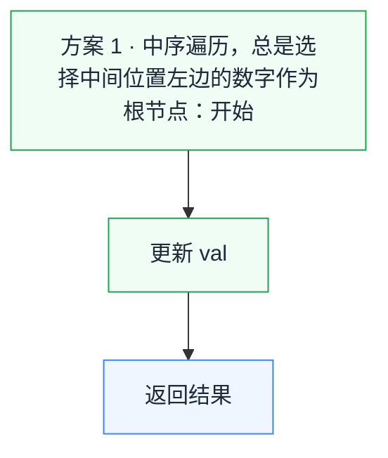

```java
package com.webfault.dsa; // 引入依赖

import java.util.*; // 引入依赖

class lc108_solution_1_1_____1_________________________ { // 定义类型
  static class TreeNode { // static class TreeNode {
    int val; // int 值;
    TreeNode left, right; // TreeNode 左边界, 右边界;

    TreeNode(int v) {
      val = v;
    } // 把 值; } 写入 TreeNode(int v) { val
  }

  public TreeNode sortedArrayToBST(int[] nums) { // 定义函数/方法 sortedArrayToBST
    return helper(nums, 0, nums.length - 1); // 返回 helper(数组, 0, 数组.长度 减 1)
  }

  private TreeNode helper(int[] nums, int left, int right) { // 定义函数/方法 helper
    if (left > right) return null; // 若 左边界 超过 右边界，直接返回 null
    int mid = left + (right - left) / 2; // 把 左边界 加 (右边界 减 左边界) 除以 2 存入 中点
    TreeNode root = new TreeNode(nums[mid]); // 把 new TreeNode(数组[中点]); 写入 TreeNode root
    root.left = helper(nums, left, mid - 1); // 把 helper(数组, 左边界, 中点 减 1); 写入 左边界
    root.right = helper(nums, mid + 1, right); // 把 helper(数组, 中点 加 1, 右边界); 写入 右边界
    return root; // 返回 根节点
  }

  static List<Integer> inorder(TreeNode root) { // 定义函数/方法 inorder
    List<Integer> res = new ArrayList<>(); // 把 new ArrayList 小于 超过 (); 写入 List<Integer> res
    if (root == null) return res; // 若 根节点 等于 null，直接返回 结果
    res.addAll(inorder(root.left)); // 结果.addAll(inorder(根节点.左边界));
    res.add(root.val); // 结果 追加 根节点.值);
    res.addAll(inorder(root.right)); // 结果.addAll(inorder(根节点.右边界));
    return res; // 返回 结果
  }

  static int height(TreeNode n) { // 定义函数/方法 height
    if (n == null) return 0; // 若 元素个数 等于 null，直接返回 0
    return Math.max(height(n.left), height(n.right))
        + 1; // 返回 Math.取较大值 height(元素个数.左边界), height(元素个数.右边界)) 加 1
  }

  static boolean isBalanced(TreeNode n) { // 定义判定函数 isBalanced
    if (n == null) return true; // 若 元素个数 等于 null，直接返回 true
    return Math.abs(height(n.left) - height(n.right))
            <= 1 // 返回 Math.取绝对值 height(元素个数.左边界) 减 height(元素个数.右边界)) 不超过 1
        && isBalanced(n.left)
        && isBalanced(n.right); // 且 isBalanced(元素个数.左边界) 且 isBalanced(元素个数.右边界);
  }

  public static void main(String[] args) { // public static void main(String[] args) {
    lc108_solution_1_1_____1_________________________ s =
        new lc108_solution_1_1_____1_________________________();
    int[][] ins = {
      {1, 2, 3}, {}, {1}, {-10, -3, 0, 5, 9}
    }; // 把 {{1,2,3}, {}, {1}, { 减 10, 减 3,0,5,9}}; 写入 int[][] ins
    int[][] wants = {
      {1, 2, 3}, {}, {1}, {-10, -3, 0, 5, 9}
    }; // 把 {{1,2,3}, {}, {1}, { 减 10, 减 3,0,5,9}}; 写入 int[][] wants
    int[] rootWants = {2, 0, 1, 0}; // 把 {2, 0, 1, 0}; 写入 int[] rootWants
    boolean ok = true; // 把 true; 写入 boolean ok
    for (int i = 0; i < ins.length; i++) { // 让 下标 i 从 0 开始计数，下标 i 小于 ins.长度 就继续
      TreeNode root =
          s.sortedArrayToBST(ins[i]); // 把 字符串.sortedArrayToBST(ins[下标 i]); 写入 TreeNode root
      List<Integer> got = inorder(root); // 把 inorder(根节点); 写入 List<Integer> got
      List<Integer> want = new ArrayList<>(); // 把 new ArrayList 小于 超过 (); 写入 List<Integer> want
      for (int v : wants[i]) want.add(v); // for (int 值 : wants[下标 i]) want 追加 值);
      if (!got.equals(want)) {
        ok = false;
        System.out.println("FAIL inorder " + Arrays.toString(ins[i]) + "=" + got + " want " + want);
      }
      if (!isBalanced(root)) {
        ok = false;
        System.out.println("FAIL not balanced " + Arrays.toString(ins[i]));
      }
      if (ins[i].length > 0 && root.val != rootWants[i]) {
        ok = false;
        System.out.println("FAIL root " + root.val + " want " + rootWants[i]);
      }
      if (ins[i].length == 0 && root != null) {
        ok = false;
        System.out.println("FAIL empty should be null");
      }
    }
    if (!ok) throw new RuntimeException("FAILED"); // 若 取反 ok) throw new RuntimeException(「FAILED」);
    System.out.println("PASS"); // 全部用例通过，输出 PASS
  }
}
```

#### 方案 2：中序遍历，总是选择中间位置右边的数字作为根节点

**思路与代码分析**：核心是「中序遍历，总是选择中间位置右边的数字作为根节点」。Java 版用类与静态方法组织，集合操作显式明了。**走读**：方案 2 · 中序遍历，总是选择中间位置右边的数字作为根节点：开始 → 更新 l → 若 r ≠ null 则： → 调用 l.addAll(inorderT(r.left)) → 调用 l.add(r.val) → 调用 l.addAll(inorderT(r.right)) → 返回 l。

**运行架构**（真实控制流）：

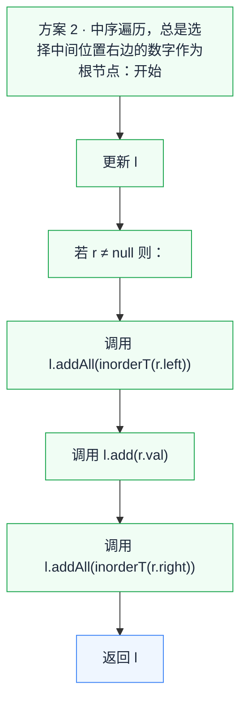

```java
package com.webfault.dsa; // 引入依赖

import java.util.*; // 引入依赖

class Main { // 定义类型
  static class TreeNode {
    int val;
    TreeNode left;
    TreeNode right;

    TreeNode() {}

    TreeNode(int v) {
      val = v;
    }

    TreeNode(int v, TreeNode l, TreeNode r) {
      val = v;
      left = l;
      right = r;
    }
  }

  static TreeNode buildTree(Integer[] vals) { // 定义函数/方法 buildTree
    if (vals.length == 0 || vals[0] == null)
      return null; // 若 vals.长度 等于 0 或 vals[0] 等于 null，直接返回 null
    TreeNode root = new TreeNode(vals[0]);
    java.util.LinkedList<TreeNode> q = new java.util.LinkedList<>();
    q.add(root);
    int i = 1;
    while (!q.isEmpty() && i < vals.length) {
      TreeNode node = q.poll();
      if (i < vals.length && vals[i] != null) {
        node.left = new TreeNode(vals[i]);
        q.add(node.left);
      }
      i++;
      if (i < vals.length && vals[i] != null) {
        node.right = new TreeNode(vals[i]);
        q.add(node.right);
      }
      i++;
    }
    return root; // 返回 根节点
  }

  static boolean sameTree(TreeNode a, TreeNode b) {
    if (a == null && b == null) return true;
    if (a == null || b == null) return false;
    if (a.val != b.val) return false;
    return sameTree(a.left, b.left) && sameTree(a.right, b.right);
  }

  static java.util.List<Integer> inorderT(TreeNode r) {
    java.util.List<Integer> l = new java.util.ArrayList<>();
    if (r != null) {
      l.addAll(inorderT(r.left));
      l.add(r.val);
      l.addAll(inorderT(r.right));
    }
    return l;
  }

  static int[] numsArr; // static int[] numsArr;

  static TreeNode build(int l, int r) {
    if (l > r) return null;
    int m = l + (r - l) / 2;
    return new TreeNode(numsArr[m], build(l, m - 1), build(m + 1, r));
  }

  static TreeNode sortedArrayToBST(int[] nums) {
    numsArr = nums;
    return build(0, nums.length - 1);
  }

  public static void main(String[] args) { // public static void main(String[] args) {
    if (!inorderT(sortedArrayToBST(new int[] {1, 2, 3})).equals(Arrays.asList(1, 2, 3))) {
      System.out.println("FAIL");
      throw new RuntimeException("FAILED");
    }
    if (!inorderT(sortedArrayToBST(new int[] {-10, -3, 0, 5, 9}))
        .equals(Arrays.asList(-10, -3, 0, 5, 9))) {
      System.out.println("FAIL");
      throw new RuntimeException("FAILED");
    }
    System.out.println("PASS"); // 全部用例通过，输出 PASS
  }
}
```

#### 方案 3：中序遍历，选择任意一个中间位置数字作为根节点

**思路与代码分析**：核心是「中序遍历，选择任意一个中间位置数字作为根节点」。Java 版用类与静态方法组织，集合操作显式明了。**走读**：方案 3 · 中序遍历，选择任意一个中间位置数字作为根节点：开始 → 更新 val → 返回结果。

**运行架构**（真实控制流）：

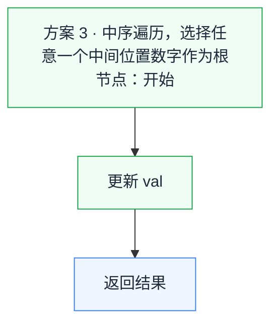

```java
package com.webfault.dsa; // 引入依赖

import java.util.*; // 引入依赖

class lc108_solution_3_3_____3________________________ { // 定义类型
  static class TreeNode { // static class TreeNode {
    int val; // int 值;
    TreeNode left, right; // TreeNode 左边界, 右边界;

    TreeNode(int v) {
      val = v;
    } // 把 值; } 写入 TreeNode(int v) { val
  }

  public TreeNode sortedArrayToBST(int[] nums) { // 定义函数/方法 sortedArrayToBST
    return helper(nums, 0, nums.length - 1); // 返回 helper(数组, 0, 数组.长度 减 1)
  }

  private TreeNode helper(int[] nums, int left, int right) { // 定义函数/方法 helper
    if (left > right) return null; // 若 左边界 超过 右边界，直接返回 null
    int mid = left + (right - left) / 2; // 把 左边界 加 (右边界 减 左边界) 除以 2 存入 中点
    TreeNode root = new TreeNode(nums[mid]); // 把 new TreeNode(数组[中点]); 写入 TreeNode root
    root.left = helper(nums, left, mid - 1); // 把 helper(数组, 左边界, 中点 减 1); 写入 左边界
    root.right = helper(nums, mid + 1, right); // 把 helper(数组, 中点 加 1, 右边界); 写入 右边界
    return root; // 返回 根节点
  }

  static List<Integer> inorder(TreeNode root) { // 定义函数/方法 inorder
    List<Integer> res = new ArrayList<>(); // 把 new ArrayList 小于 超过 (); 写入 List<Integer> res
    if (root == null) return res; // 若 根节点 等于 null，直接返回 结果
    res.addAll(inorder(root.left)); // 结果.addAll(inorder(根节点.左边界));
    res.add(root.val); // 结果 追加 根节点.值);
    res.addAll(inorder(root.right)); // 结果.addAll(inorder(根节点.右边界));
    return res; // 返回 结果
  }

  static int height(TreeNode n) { // 定义函数/方法 height
    if (n == null) return 0; // 若 元素个数 等于 null，直接返回 0
    return Math.max(height(n.left), height(n.right))
        + 1; // 返回 Math.取较大值 height(元素个数.左边界), height(元素个数.右边界)) 加 1
  }

  static boolean isBalanced(TreeNode n) { // 定义判定函数 isBalanced
    if (n == null) return true; // 若 元素个数 等于 null，直接返回 true
    return Math.abs(height(n.left) - height(n.right))
            <= 1 // 返回 Math.取绝对值 height(元素个数.左边界) 减 height(元素个数.右边界)) 不超过 1
        && isBalanced(n.left)
        && isBalanced(n.right); // 且 isBalanced(元素个数.左边界) 且 isBalanced(元素个数.右边界);
  }

  public static void main(String[] args) { // public static void main(String[] args) {
    lc108_solution_3_3_____3________________________ s =
        new lc108_solution_3_3_____3________________________();
    int[][] ins = {
      {1, 2, 3}, {}, {1}, {-10, -3, 0, 5, 9}
    }; // 把 {{1,2,3}, {}, {1}, { 减 10, 减 3,0,5,9}}; 写入 int[][] ins
    int[][] wants = {
      {1, 2, 3}, {}, {1}, {-10, -3, 0, 5, 9}
    }; // 把 {{1,2,3}, {}, {1}, { 减 10, 减 3,0,5,9}}; 写入 int[][] wants
    int[] rootWants = {2, 0, 1, 0}; // 把 {2, 0, 1, 0}; 写入 int[] rootWants
    boolean ok = true; // 把 true; 写入 boolean ok
    for (int i = 0; i < ins.length; i++) { // 让 下标 i 从 0 开始计数，下标 i 小于 ins.长度 就继续
      TreeNode root =
          s.sortedArrayToBST(ins[i]); // 把 字符串.sortedArrayToBST(ins[下标 i]); 写入 TreeNode root
      List<Integer> got = inorder(root); // 把 inorder(根节点); 写入 List<Integer> got
      List<Integer> want = new ArrayList<>(); // 把 new ArrayList 小于 超过 (); 写入 List<Integer> want
      for (int v : wants[i]) want.add(v); // for (int 值 : wants[下标 i]) want 追加 值);
      if (!got.equals(want)) {
        ok = false;
        System.out.println("FAIL inorder " + Arrays.toString(ins[i]) + "=" + got + " want " + want);
      }
      if (!isBalanced(root)) {
        ok = false;
        System.out.println("FAIL not balanced " + Arrays.toString(ins[i]));
      }
      if (ins[i].length > 0 && root.val != rootWants[i]) {
        ok = false;
        System.out.println("FAIL root " + root.val + " want " + rootWants[i]);
      }
      if (ins[i].length == 0 && root != null) {
        ok = false;
        System.out.println("FAIL empty should be null");
      }
    }
    if (!ok) throw new RuntimeException("FAILED"); // 若 取反 ok) throw new RuntimeException(「FAILED」);
    System.out.println("PASS"); // 全部用例通过，输出 PASS
  }
}
```

#### 方案 4：简单版本

**思路与代码分析**：核心是「简单版本」。Java 版用类与静态方法组织，集合操作显式明了。**走读**：方案 4 · 简单版本：开始 → 更新 val → 返回结果。

**运行架构**（真实控制流）：

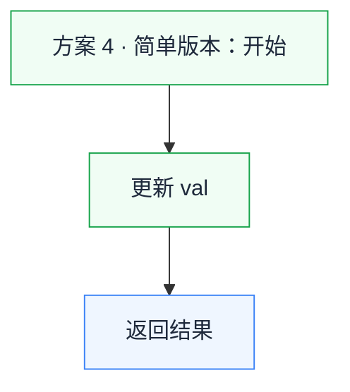

```java
package com.webfault.dsa; // 引入依赖

import java.util.*; // 引入依赖

class lc108_solution_4_4_____4______ { // 定义类型
  static class TreeNode { // static class TreeNode {
    int val; // int 值;
    TreeNode left, right; // TreeNode 左边界, 右边界;

    TreeNode(int v) {
      val = v;
    } // 把 值; } 写入 TreeNode(int v) { val
  }

  public TreeNode sortedArrayToBST(int[] nums) { // 定义函数/方法 sortedArrayToBST
    if (nums.length == 0) return null; // 若 数组.长度 等于 0，直接返回 null
    int mid = nums.length / 2; // 把 数组.长度 除以 2 存入 中点
    TreeNode root = new TreeNode(nums[mid]); // 把 new TreeNode(数组[中点]); 写入 TreeNode root
    root.left =
        sortedArrayToBST(
            Arrays.copyOfRange(
                nums, 0, mid)); // 把 sortedArrayToBST(Arrays.copyOfRange(数组, 0, 中点)); 写入 左边界
    root.right = sortedArrayToBST(Arrays.copyOfRange(nums, mid + 1, nums.length));
    return root; // 返回 根节点
  }

  static List<Integer> inorder(TreeNode root) { // 定义函数/方法 inorder
    List<Integer> res = new ArrayList<>(); // 把 new ArrayList 小于 超过 (); 写入 List<Integer> res
    if (root == null) return res; // 若 根节点 等于 null，直接返回 结果
    res.addAll(inorder(root.left)); // 结果.addAll(inorder(根节点.左边界));
    res.add(root.val); // 结果 追加 根节点.值);
    res.addAll(inorder(root.right)); // 结果.addAll(inorder(根节点.右边界));
    return res; // 返回 结果
  }

  static int height(TreeNode n) { // 定义函数/方法 height
    if (n == null) return 0; // 若 元素个数 等于 null，直接返回 0
    return Math.max(height(n.left), height(n.right))
        + 1; // 返回 Math.取较大值 height(元素个数.左边界), height(元素个数.右边界)) 加 1
  }

  static boolean isBalanced(TreeNode n) { // 定义判定函数 isBalanced
    if (n == null) return true; // 若 元素个数 等于 null，直接返回 true
    return Math.abs(height(n.left) - height(n.right))
            <= 1 // 返回 Math.取绝对值 height(元素个数.左边界) 减 height(元素个数.右边界)) 不超过 1
        && isBalanced(n.left)
        && isBalanced(n.right); // 且 isBalanced(元素个数.左边界) 且 isBalanced(元素个数.右边界);
  }

  public static void main(String[] args) { // public static void main(String[] args) {
    lc108_solution_4_4_____4______ s = new lc108_solution_4_4_____4______();
    int[][] ins = {
      {1, 2, 3}, {}, {1}, {-10, -3, 0, 5, 9}
    }; // 把 {{1,2,3}, {}, {1}, { 减 10, 减 3,0,5,9}}; 写入 int[][] ins
    int[][] wants = {
      {1, 2, 3}, {}, {1}, {-10, -3, 0, 5, 9}
    }; // 把 {{1,2,3}, {}, {1}, { 减 10, 减 3,0,5,9}}; 写入 int[][] wants
    int[] rootWants = {2, 0, 1, 0}; // 把 {2, 0, 1, 0}; 写入 int[] rootWants
    boolean ok = true; // 把 true; 写入 boolean ok
    for (int i = 0; i < ins.length; i++) { // 让 下标 i 从 0 开始计数，下标 i 小于 ins.长度 就继续
      TreeNode root =
          s.sortedArrayToBST(ins[i]); // 把 字符串.sortedArrayToBST(ins[下标 i]); 写入 TreeNode root
      List<Integer> got = inorder(root); // 把 inorder(根节点); 写入 List<Integer> got
      List<Integer> want = new ArrayList<>(); // 把 new ArrayList 小于 超过 (); 写入 List<Integer> want
      for (int v : wants[i]) want.add(v); // for (int 值 : wants[下标 i]) want 追加 值);
      if (!got.equals(want)) {
        ok = false;
        System.out.println("FAIL inorder " + Arrays.toString(ins[i]) + "=" + got + " want " + want);
      }
      if (!isBalanced(root)) {
        ok = false;
        System.out.println("FAIL not balanced " + Arrays.toString(ins[i]));
      }
      if (ins[i].length > 0 && root.val != rootWants[i]) {
        ok = false;
        System.out.println("FAIL root " + root.val + " want " + rootWants[i]);
      }
      if (ins[i].length == 0 && root != null) {
        ok = false;
        System.out.println("FAIL empty should be null");
      }
    }
    if (!ok) throw new RuntimeException("FAILED"); // 若 取反 ok) throw new RuntimeException(「FAILED」);
    System.out.println("PASS"); // 全部用例通过，输出 PASS
  }
}
```

### Rust 实现（4 种方案）

Rust 的全部方案如下，每个方案都内嵌用例自测，可独立运行（老仓库 python/go 文件遵循「打印结果」约定）：

#### 方案 1：中序遍历，总是选择中间位置左边的数字作为根节点

**思路与代码分析**：核心是「中序遍历，总是选择中间位置左边的数字作为根节点」。Rust 版用所有权移动与切片借用改写同一逻辑，注意 Option 与引用边界。**走读**：方案 1 · 中序遍历，总是选择中间位置左边的数字作为根节点：开始 → 处理 match (p, q) → 更新 None) → 更新 Some(b)) → 计算 let (a, b) = (a.borrow() → 更新 = → 处理 且 same_tree(a.left.as_ref() → 处理 且 same_tree(a.right.as_ref( → 更新 _ → 返回结果。

**运行架构**（真实控制流）：

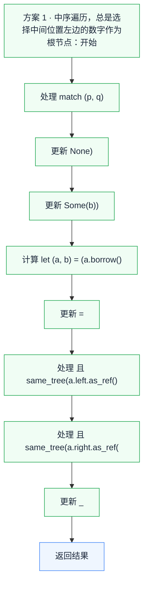

```rust
// LeetCode 108. 将有序数组转换为二叉搜索树 — Rust 版（方案1）
use std::cell::RefCell;
use std::rc::Rc; // 引入依赖 // 引入依赖

#[derive(Debug)]
struct TreeNode {
    // 定义类型
    val: i32,
    left: Option<Rc<RefCell<TreeNode>>>,
    right: Option<Rc<RefCell<TreeNode>>>,
}

impl TreeNode {
    // 实现块
    fn new(val: i32) -> Rc<RefCell<TreeNode>> {
        // 定义函数/方法 new
        Rc::new(RefCell::new(TreeNode {
            val,
            left: None,
            right: None,
        })) // Rc::new(RefCell::new(TreeNode { 值, 左边界: None, 右边界: None }))
    }
}

fn build_tree(vals: &[Option<i32>]) -> Option<Rc<RefCell<TreeNode>>> {
    // 定义函数/方法 build_tree
    if vals.is_empty() || vals[0].is_none() {
        // 若 vals 是否为空 或 vals[0].is_none(
        return None; // 返回 None
    }
    let root = TreeNode::new(vals[0].unwrap()); // 把 TreeNode::new(vals[0].unwrap()) 存入 根节点
    let mut queue: Vec<Rc<RefCell<TreeNode>>> = vec![root.clone()];
    let mut i = 1; // 把 1; 写入 let mut i
    while !queue.is_empty() && i < vals.len() {
        // while 取反 队列 是否为空 且 下标 i 小于 vals.长度() {
        let node = queue.remove(0); // 把 队列 弹出 0) 存入 节点
        if i < vals.len() {
            // 若 下标 i 小于 vals.长度(
            if let Some(v) = vals[i] {
                // 若 let Some(值) 赋值为 vals[下标 i]
                let child = TreeNode::new(v); // 把 TreeNode::new(值) 存入 子节点
                node.borrow_mut().left = Some(child.clone()); // 把 Some(子节点.clone()); 写入 左边界
                queue.push(child); // 把 子节点 压入栈/数组尾部
            }
            i += 1; // 下标 i累加 1
        }
        if i < vals.len() {
            // 若 下标 i 小于 vals.长度(
            if let Some(v) = vals[i] {
                // 若 let Some(值) 赋值为 vals[下标 i]
                let child = TreeNode::new(v); // 把 TreeNode::new(值) 存入 子节点
                node.borrow_mut().right = Some(child.clone()); // 把 Some(子节点.clone()); 写入 右边界
                queue.push(child); // 把 子节点 压入栈/数组尾部
            }
            i += 1; // 下标 i累加 1
        }
    }
    Some(root) // Some(根节点)
}
fn same_tree(p: Option<&Rc<RefCell<TreeNode>>>, q: Option<&Rc<RefCell<TreeNode>>>) -> bool {
    // 定义函数/方法 same_tree
    match (p, q) {
        // 按情况匹配处理
        (None, None) => true,
        (Some(a), Some(b)) => {
            let (a, b) = (a.borrow(), b.borrow());
            a.val == b.val
                && same_tree(a.left.as_ref(), b.left.as_ref())
                && same_tree(a.right.as_ref(), b.right.as_ref())
        }
        _ => false,
    }
}
fn levels_flat(root: Option<Rc<RefCell<TreeNode>>>) -> Vec<i32> {
    // 定义函数/方法 levels_flat
    let mut out = Vec::new(); // 把 Vec::new(); 写入 let mut out
    let mut q: Vec<Rc<RefCell<TreeNode>>> = root.into_iter().collect();
    while !q.is_empty() {
        // while 取反 节点 是否为空 {
        let mut nxt = Vec::new(); // 把 Vec::new(); 写入 let mut nxt
        for n in q {
            let b = n.borrow();
            out.push(b.val);
            if let Some(c) = b.left.clone() {
                nxt.push(c);
            }
            if let Some(c) = b.right.clone() {
                nxt.push(c);
            }
        } // 逐个取出 节点 的元素（元素个数）
        q = nxt; // 把 nxt; 写入 节点
    }
    out // out
}

fn helper(nums: &[i32], left: usize, right: isize) -> Option<Rc<RefCell<TreeNode>>> {
    // 定义函数/方法 helper
    if left as isize > right {
        return None;
    } // 若 左边界 as isize 超过 右边界 { return None; }
    let mid = (left as isize + (right - left as isize) / 2) as usize; // 把 (左边界 as isize 加 (右边界 减 左边界 as isize) 除以 2) as usize 存入 中点
    let root = TreeNode::new(nums[mid]); // 把 TreeNode::new(数组[中点]) 存入 根节点
    root.borrow_mut().left = helper(nums, left, mid as isize - 1); // 把 helper(数组, 左边界, 中点 as isize 减 1); 写入 左边界
    root.borrow_mut().right = helper(nums, mid + 1, right); // 把 helper(数组, 中点 加 1, 右边界); 写入 右边界
    Some(root) // Some(根节点)
}
fn sorted_array_to_bst(nums: Vec<i32>) -> Option<Rc<RefCell<TreeNode>>> {
    // 定义函数/方法 sorted_array_to_bst
    if nums.is_empty() {
        return None;
    } // 若 数组 是否为空 { return None; }
    helper(&nums, 0, nums.len() as isize - 1) // helper( 按位与 数组, 0, 数组.长度() as isize 减 1)
}
fn main() {
    // 程序入口：跑内嵌自测用例
    let got = sorted_array_to_bst(vec![-10, -3, 0, 5, 9]); // 把 sorted_array_to_bst(vec取反 [ 减 10, 减 3, 0, 5, 9]) 存入 got
    let want = build_tree(&[Some(0), Some(-10), Some(5), None, Some(-3), None, Some(9)]);
    assert!(same_tree(got.as_ref(), want.as_ref())); // 断言校验
    assert!(same_tree(
        sorted_array_to_bst(vec![1]).as_ref(),
        build_tree(&[Some(1)]).as_ref()
    )); // 断言校验
    assert!(sorted_array_to_bst(vec![]).is_none()); // 断言校验
    println!("PASS"); // 全部用例通过，输出 PASS
}
```

#### 方案 2：中序遍历，总是选择中间位置右边的数字作为根节点

**思路与代码分析**：核心是「中序遍历，总是选择中间位置右边的数字作为根节点」。Rust 版用所有权移动与切片借用改写同一逻辑，注意 Option 与引用边界。**走读**：方案 2 · 中序遍历，总是选择中间位置右边的数字作为根节点：开始 → 处理 match (p, q) → 更新 None) → 更新 Some(b)) → 计算 let (a, b) = (a.borrow() → 更新 = → 处理 且 same_tree(a.left.as_ref() → 处理 且 same_tree(a.right.as_ref( → 更新 _ → 返回结果。

**运行架构**（真实控制流）：


```rust
// LeetCode 108. 将有序数组转换为二叉搜索树 — Rust 版（方案2）
use std::cell::RefCell;
use std::rc::Rc; // 引入依赖 // 引入依赖

#[derive(Debug)]
struct TreeNode {
    // 定义类型
    val: i32,
    left: Option<Rc<RefCell<TreeNode>>>,
    right: Option<Rc<RefCell<TreeNode>>>,
}

impl TreeNode {
    // 实现块
    fn new(val: i32) -> Rc<RefCell<TreeNode>> {
        // 定义函数/方法 new
        Rc::new(RefCell::new(TreeNode {
            val,
            left: None,
            right: None,
        })) // Rc::new(RefCell::new(TreeNode { 值, 左边界: None, 右边界: None }))
    }
}

fn build_tree(vals: &[Option<i32>]) -> Option<Rc<RefCell<TreeNode>>> {
    // 定义函数/方法 build_tree
    if vals.is_empty() || vals[0].is_none() {
        // 若 vals 是否为空 或 vals[0].is_none(
        return None; // 返回 None
    }
    let root = TreeNode::new(vals[0].unwrap()); // 把 TreeNode::new(vals[0].unwrap()) 存入 根节点
    let mut queue: Vec<Rc<RefCell<TreeNode>>> = vec![root.clone()];
    let mut i = 1; // 把 1; 写入 let mut i
    while !queue.is_empty() && i < vals.len() {
        // while 取反 队列 是否为空 且 下标 i 小于 vals.长度() {
        let node = queue.remove(0); // 把 队列 弹出 0) 存入 节点
        if i < vals.len() {
            // 若 下标 i 小于 vals.长度(
            if let Some(v) = vals[i] {
                // 若 let Some(值) 赋值为 vals[下标 i]
                let child = TreeNode::new(v); // 把 TreeNode::new(值) 存入 子节点
                node.borrow_mut().left = Some(child.clone()); // 把 Some(子节点.clone()); 写入 左边界
                queue.push(child); // 把 子节点 压入栈/数组尾部
            }
            i += 1; // 下标 i累加 1
        }
        if i < vals.len() {
            // 若 下标 i 小于 vals.长度(
            if let Some(v) = vals[i] {
                // 若 let Some(值) 赋值为 vals[下标 i]
                let child = TreeNode::new(v); // 把 TreeNode::new(值) 存入 子节点
                node.borrow_mut().right = Some(child.clone()); // 把 Some(子节点.clone()); 写入 右边界
                queue.push(child); // 把 子节点 压入栈/数组尾部
            }
            i += 1; // 下标 i累加 1
        }
    }
    Some(root) // Some(根节点)
}
fn same_tree(p: Option<&Rc<RefCell<TreeNode>>>, q: Option<&Rc<RefCell<TreeNode>>>) -> bool {
    // 定义函数/方法 same_tree
    match (p, q) {
        // 按情况匹配处理
        (None, None) => true,
        (Some(a), Some(b)) => {
            let (a, b) = (a.borrow(), b.borrow());
            a.val == b.val
                && same_tree(a.left.as_ref(), b.left.as_ref())
                && same_tree(a.right.as_ref(), b.right.as_ref())
        }
        _ => false,
    }
}
fn levels_flat(root: Option<Rc<RefCell<TreeNode>>>) -> Vec<i32> {
    // 定义函数/方法 levels_flat
    let mut out = Vec::new(); // 把 Vec::new(); 写入 let mut out
    let mut q: Vec<Rc<RefCell<TreeNode>>> = root.into_iter().collect();
    while !q.is_empty() {
        // while 取反 节点 是否为空 {
        let mut nxt = Vec::new(); // 把 Vec::new(); 写入 let mut nxt
        for n in q {
            let b = n.borrow();
            out.push(b.val);
            if let Some(c) = b.left.clone() {
                nxt.push(c);
            }
            if let Some(c) = b.right.clone() {
                nxt.push(c);
            }
        } // 逐个取出 节点 的元素（元素个数）
        q = nxt; // 把 nxt; 写入 节点
    }
    out // out
}

fn helper(nums: &[i32], left: usize, right: isize) -> Option<Rc<RefCell<TreeNode>>> {
    // 定义函数/方法 helper
    if left as isize > right {
        return None;
    } // 若 左边界 as isize 超过 右边界 { return None; }
    let mid = (left as isize + (right - left as isize) / 2) as usize; // 把 (左边界 as isize 加 (右边界 减 左边界 as isize) 除以 2) as usize 存入 中点
    let root = TreeNode::new(nums[mid]); // 把 TreeNode::new(数组[中点]) 存入 根节点
    root.borrow_mut().left = helper(nums, left, mid as isize - 1); // 把 helper(数组, 左边界, 中点 as isize 减 1); 写入 左边界
    root.borrow_mut().right = helper(nums, mid + 1, right); // 把 helper(数组, 中点 加 1, 右边界); 写入 右边界
    Some(root) // Some(根节点)
}
fn sorted_array_to_bst(nums: Vec<i32>) -> Option<Rc<RefCell<TreeNode>>> {
    // 定义函数/方法 sorted_array_to_bst
    if nums.is_empty() {
        return None;
    } // 若 数组 是否为空 { return None; }
    helper(&nums, 0, nums.len() as isize - 1) // helper( 按位与 数组, 0, 数组.长度() as isize 减 1)
}
fn main() {
    // 程序入口：跑内嵌自测用例
    let got = sorted_array_to_bst(vec![-10, -3, 0, 5, 9]); // 把 sorted_array_to_bst(vec取反 [ 减 10, 减 3, 0, 5, 9]) 存入 got
    let want = build_tree(&[Some(0), Some(-10), Some(5), None, Some(-3), None, Some(9)]);
    assert!(same_tree(got.as_ref(), want.as_ref())); // 断言校验
    assert!(same_tree(
        sorted_array_to_bst(vec![1]).as_ref(),
        build_tree(&[Some(1)]).as_ref()
    )); // 断言校验
    assert!(sorted_array_to_bst(vec![]).is_none()); // 断言校验
    println!("PASS"); // 全部用例通过，输出 PASS
}
```

#### 方案 3：中序遍历，选择任意一个中间位置数字作为根节点

**思路与代码分析**：核心是「中序遍历，选择任意一个中间位置数字作为根节点」。Rust 版用所有权移动与切片借用改写同一逻辑，注意 Option 与引用边界。**走读**：方案 3 · 中序遍历，选择任意一个中间位置数字作为根节点：开始 → 处理 match (p, q) → 更新 None) → 更新 Some(b)) → 计算 let (a, b) = (a.borrow() → 更新 = → 处理 且 same_tree(a.left.as_ref() → 处理 且 same_tree(a.right.as_ref( → 更新 _ → 返回结果。

**运行架构**（真实控制流）：

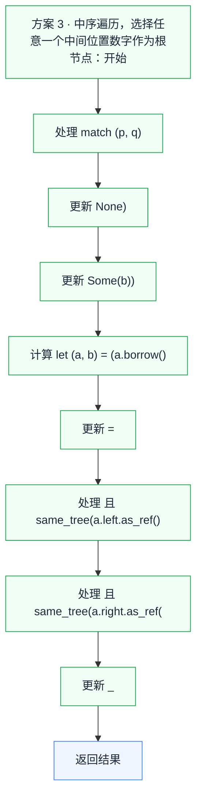

```rust
// LeetCode 108. 将有序数组转换为二叉搜索树 — Rust 版（方案3）
use std::cell::RefCell;
use std::rc::Rc; // 引入依赖 // 引入依赖

#[derive(Debug)]
struct TreeNode {
    // 定义类型
    val: i32,
    left: Option<Rc<RefCell<TreeNode>>>,
    right: Option<Rc<RefCell<TreeNode>>>,
}

impl TreeNode {
    // 实现块
    fn new(val: i32) -> Rc<RefCell<TreeNode>> {
        // 定义函数/方法 new
        Rc::new(RefCell::new(TreeNode {
            val,
            left: None,
            right: None,
        })) // Rc::new(RefCell::new(TreeNode { 值, 左边界: None, 右边界: None }))
    }
}

fn build_tree(vals: &[Option<i32>]) -> Option<Rc<RefCell<TreeNode>>> {
    // 定义函数/方法 build_tree
    if vals.is_empty() || vals[0].is_none() {
        // 若 vals 是否为空 或 vals[0].is_none(
        return None; // 返回 None
    }
    let root = TreeNode::new(vals[0].unwrap()); // 把 TreeNode::new(vals[0].unwrap()) 存入 根节点
    let mut queue: Vec<Rc<RefCell<TreeNode>>> = vec![root.clone()];
    let mut i = 1; // 把 1; 写入 let mut i
    while !queue.is_empty() && i < vals.len() {
        // while 取反 队列 是否为空 且 下标 i 小于 vals.长度() {
        let node = queue.remove(0); // 把 队列 弹出 0) 存入 节点
        if i < vals.len() {
            // 若 下标 i 小于 vals.长度(
            if let Some(v) = vals[i] {
                // 若 let Some(值) 赋值为 vals[下标 i]
                let child = TreeNode::new(v); // 把 TreeNode::new(值) 存入 子节点
                node.borrow_mut().left = Some(child.clone()); // 把 Some(子节点.clone()); 写入 左边界
                queue.push(child); // 把 子节点 压入栈/数组尾部
            }
            i += 1; // 下标 i累加 1
        }
        if i < vals.len() {
            // 若 下标 i 小于 vals.长度(
            if let Some(v) = vals[i] {
                // 若 let Some(值) 赋值为 vals[下标 i]
                let child = TreeNode::new(v); // 把 TreeNode::new(值) 存入 子节点
                node.borrow_mut().right = Some(child.clone()); // 把 Some(子节点.clone()); 写入 右边界
                queue.push(child); // 把 子节点 压入栈/数组尾部
            }
            i += 1; // 下标 i累加 1
        }
    }
    Some(root) // Some(根节点)
}
fn same_tree(p: Option<&Rc<RefCell<TreeNode>>>, q: Option<&Rc<RefCell<TreeNode>>>) -> bool {
    // 定义函数/方法 same_tree
    match (p, q) {
        // 按情况匹配处理
        (None, None) => true,
        (Some(a), Some(b)) => {
            let (a, b) = (a.borrow(), b.borrow());
            a.val == b.val
                && same_tree(a.left.as_ref(), b.left.as_ref())
                && same_tree(a.right.as_ref(), b.right.as_ref())
        }
        _ => false,
    }
}
fn levels_flat(root: Option<Rc<RefCell<TreeNode>>>) -> Vec<i32> {
    // 定义函数/方法 levels_flat
    let mut out = Vec::new(); // 把 Vec::new(); 写入 let mut out
    let mut q: Vec<Rc<RefCell<TreeNode>>> = root.into_iter().collect();
    while !q.is_empty() {
        // while 取反 节点 是否为空 {
        let mut nxt = Vec::new(); // 把 Vec::new(); 写入 let mut nxt
        for n in q {
            let b = n.borrow();
            out.push(b.val);
            if let Some(c) = b.left.clone() {
                nxt.push(c);
            }
            if let Some(c) = b.right.clone() {
                nxt.push(c);
            }
        } // 逐个取出 节点 的元素（元素个数）
        q = nxt; // 把 nxt; 写入 节点
    }
    out // out
}

fn helper(nums: &[i32], left: usize, right: isize) -> Option<Rc<RefCell<TreeNode>>> {
    // 定义函数/方法 helper
    if left as isize > right {
        return None;
    } // 若 左边界 as isize 超过 右边界 { return None; }
    let mid = (left as isize + (right - left as isize) / 2) as usize; // 把 (左边界 as isize 加 (右边界 减 左边界 as isize) 除以 2) as usize 存入 中点
    let root = TreeNode::new(nums[mid]); // 把 TreeNode::new(数组[中点]) 存入 根节点
    root.borrow_mut().left = helper(nums, left, mid as isize - 1); // 把 helper(数组, 左边界, 中点 as isize 减 1); 写入 左边界
    root.borrow_mut().right = helper(nums, mid + 1, right); // 把 helper(数组, 中点 加 1, 右边界); 写入 右边界
    Some(root) // Some(根节点)
}
fn sorted_array_to_bst(nums: Vec<i32>) -> Option<Rc<RefCell<TreeNode>>> {
    // 定义函数/方法 sorted_array_to_bst
    if nums.is_empty() {
        return None;
    } // 若 数组 是否为空 { return None; }
    helper(&nums, 0, nums.len() as isize - 1) // helper( 按位与 数组, 0, 数组.长度() as isize 减 1)
}
fn main() {
    // 程序入口：跑内嵌自测用例
    let got = sorted_array_to_bst(vec![-10, -3, 0, 5, 9]); // 把 sorted_array_to_bst(vec取反 [ 减 10, 减 3, 0, 5, 9]) 存入 got
    let want = build_tree(&[Some(0), Some(-10), Some(5), None, Some(-3), None, Some(9)]);
    assert!(same_tree(got.as_ref(), want.as_ref())); // 断言校验
    assert!(same_tree(
        sorted_array_to_bst(vec![1]).as_ref(),
        build_tree(&[Some(1)]).as_ref()
    )); // 断言校验
    assert!(sorted_array_to_bst(vec![]).is_none()); // 断言校验
    println!("PASS"); // 全部用例通过，输出 PASS
}
```

#### 方案 4：简单版本

**思路与代码分析**：核心是「简单版本」。Rust 版用所有权移动与切片借用改写同一逻辑，注意 Option 与引用边界。**走读**：方案 4 · 简单版本：开始 → 处理 match (p, q) → 更新 None) → 更新 Some(b)) → 计算 let (a, b) = (a.borrow() → 更新 = → 处理 且 same_tree(a.left.as_ref() → 处理 且 same_tree(a.right.as_ref( → 更新 _ → 返回结果。

**运行架构**（真实控制流）：

```mermaid
graph TD
    N0["方案 4 · 简单版本：开始"]
    N1["处理 match (p, q)"]
    N2["更新 None)"]
    N3["更新 Some(b))"]
    N4["计算 let (a, b) = (a.borrow()"]
    N5["更新 ="]
    N6["处理 且 same_tree(a.left.as_ref()"]
    N7["处理 且 same_tree(a.right.as_ref("]
    N8["更新 _"]
    N9["返回结果"]
    N0 --> N1
    N1 --> N2
    N2 --> N3
    N3 --> N4
    N4 --> N5
    N5 --> N6
    N6 --> N7
    N7 --> N8
    N8 --> N9
    classDef n fill:#f0fdf4,stroke:#16a34a,color:#1e293b;
    classDef lp fill:#dcfce7,stroke:#15803d,color:#1e293b;
    classDef dc fill:#fef9c3,stroke:#ca8a04,color:#1e293b;
    classDef tm fill:#eff6ff,stroke:#3b82f6,color:#1e293b;
    class N0,N1,N2,N3,N4,N5,N6,N7,N8 n;
    class N9 tm;
```

```rust
// LeetCode 108. 将有序数组转换为二叉搜索树 — Rust 版（方案4）
use std::cell::RefCell;
use std::rc::Rc; // 引入依赖 // 引入依赖

#[derive(Debug)]
struct TreeNode {
    // 定义类型
    val: i32,
    left: Option<Rc<RefCell<TreeNode>>>,
    right: Option<Rc<RefCell<TreeNode>>>,
}

impl TreeNode {
    // 实现块
    fn new(val: i32) -> Rc<RefCell<TreeNode>> {
        // 定义函数/方法 new
        Rc::new(RefCell::new(TreeNode {
            val,
            left: None,
            right: None,
        })) // Rc::new(RefCell::new(TreeNode { 值, 左边界: None, 右边界: None }))
    }
}

fn build_tree(vals: &[Option<i32>]) -> Option<Rc<RefCell<TreeNode>>> {
    // 定义函数/方法 build_tree
    if vals.is_empty() || vals[0].is_none() {
        // 若 vals 是否为空 或 vals[0].is_none(
        return None; // 返回 None
    }
    let root = TreeNode::new(vals[0].unwrap()); // 把 TreeNode::new(vals[0].unwrap()) 存入 根节点
    let mut queue: Vec<Rc<RefCell<TreeNode>>> = vec![root.clone()];
    let mut i = 1; // 把 1; 写入 let mut i
    while !queue.is_empty() && i < vals.len() {
        // while 取反 队列 是否为空 且 下标 i 小于 vals.长度() {
        let node = queue.remove(0); // 把 队列 弹出 0) 存入 节点
        if i < vals.len() {
            // 若 下标 i 小于 vals.长度(
            if let Some(v) = vals[i] {
                // 若 let Some(值) 赋值为 vals[下标 i]
                let child = TreeNode::new(v); // 把 TreeNode::new(值) 存入 子节点
                node.borrow_mut().left = Some(child.clone()); // 把 Some(子节点.clone()); 写入 左边界
                queue.push(child); // 把 子节点 压入栈/数组尾部
            }
            i += 1; // 下标 i累加 1
        }
        if i < vals.len() {
            // 若 下标 i 小于 vals.长度(
            if let Some(v) = vals[i] {
                // 若 let Some(值) 赋值为 vals[下标 i]
                let child = TreeNode::new(v); // 把 TreeNode::new(值) 存入 子节点
                node.borrow_mut().right = Some(child.clone()); // 把 Some(子节点.clone()); 写入 右边界
                queue.push(child); // 把 子节点 压入栈/数组尾部
            }
            i += 1; // 下标 i累加 1
        }
    }
    Some(root) // Some(根节点)
}
fn same_tree(p: Option<&Rc<RefCell<TreeNode>>>, q: Option<&Rc<RefCell<TreeNode>>>) -> bool {
    // 定义函数/方法 same_tree
    match (p, q) {
        // 按情况匹配处理
        (None, None) => true,
        (Some(a), Some(b)) => {
            let (a, b) = (a.borrow(), b.borrow());
            a.val == b.val
                && same_tree(a.left.as_ref(), b.left.as_ref())
                && same_tree(a.right.as_ref(), b.right.as_ref())
        }
        _ => false,
    }
}
fn levels_flat(root: Option<Rc<RefCell<TreeNode>>>) -> Vec<i32> {
    // 定义函数/方法 levels_flat
    let mut out = Vec::new(); // 把 Vec::new(); 写入 let mut out
    let mut q: Vec<Rc<RefCell<TreeNode>>> = root.into_iter().collect();
    while !q.is_empty() {
        // while 取反 节点 是否为空 {
        let mut nxt = Vec::new(); // 把 Vec::new(); 写入 let mut nxt
        for n in q {
            let b = n.borrow();
            out.push(b.val);
            if let Some(c) = b.left.clone() {
                nxt.push(c);
            }
            if let Some(c) = b.right.clone() {
                nxt.push(c);
            }
        } // 逐个取出 节点 的元素（元素个数）
        q = nxt; // 把 nxt; 写入 节点
    }
    out // out
}

fn helper(nums: &[i32], left: usize, right: isize) -> Option<Rc<RefCell<TreeNode>>> {
    // 定义函数/方法 helper
    if left as isize > right {
        return None;
    } // 若 左边界 as isize 超过 右边界 { return None; }
    let mid = (left as isize + (right - left as isize) / 2) as usize; // 把 (左边界 as isize 加 (右边界 减 左边界 as isize) 除以 2) as usize 存入 中点
    let root = TreeNode::new(nums[mid]); // 把 TreeNode::new(数组[中点]) 存入 根节点
    root.borrow_mut().left = helper(nums, left, mid as isize - 1); // 把 helper(数组, 左边界, 中点 as isize 减 1); 写入 左边界
    root.borrow_mut().right = helper(nums, mid + 1, right); // 把 helper(数组, 中点 加 1, 右边界); 写入 右边界
    Some(root) // Some(根节点)
}
fn sorted_array_to_bst(nums: Vec<i32>) -> Option<Rc<RefCell<TreeNode>>> {
    // 定义函数/方法 sorted_array_to_bst
    if nums.is_empty() {
        return None;
    } // 若 数组 是否为空 { return None; }
    helper(&nums, 0, nums.len() as isize - 1) // helper( 按位与 数组, 0, 数组.长度() as isize 减 1)
}
fn main() {
    // 程序入口：跑内嵌自测用例
    let got = sorted_array_to_bst(vec![-10, -3, 0, 5, 9]); // 把 sorted_array_to_bst(vec取反 [ 减 10, 减 3, 0, 5, 9]) 存入 got
    let want = build_tree(&[Some(0), Some(-10), Some(5), None, Some(-3), None, Some(9)]);
    assert!(same_tree(got.as_ref(), want.as_ref())); // 断言校验
    assert!(same_tree(
        sorted_array_to_bst(vec![1]).as_ref(),
        build_tree(&[Some(1)]).as_ref()
    )); // 断言校验
    assert!(sorted_array_to_bst(vec![]).is_none()); // 断言校验
    println!("PASS"); // 全部用例通过，输出 PASS
}
```

### Lua 实现（4 种方案）

Lua 的全部方案如下，每个方案都内嵌用例自测，可独立运行（老仓库 python/go 文件遵循「打印结果」约定）：

#### 方案 1：中序遍历，总是选择中间位置左边的数字作为根节点

**思路与代码分析**：核心是「中序遍历，总是选择中间位置左边的数字作为根节点」。Lua 版用表与 ipairs 遍历，注意 ipairs 遇 nil 即停的语义。**走读**：方案 1 · 中序遍历，总是选择中间位置左边的数字作为根节点：开始 → 处理 if not vals or #vals == 0 or → 返回 nil → 当 head ≤ #queue and i ≤ #vals do 时反复执行 → 返回 root。

**运行架构**（真实控制流）：

```mermaid
graph TD
    N0["方案 1 · 中序遍历，总是选择中间位置左边的数字作为根节点：开始"]
    N1["处理 if not vals or #vals == 0 or"]
    N2["返回 nil"]
    D1["……（中间计算步骤）"]
    N7["当 head ≤ #queue and i ≤ #vals do 时反复执行"]
    D2["……（中间计算步骤）"]
    N20["返回 root"]
    N0 --> N1
    N1 --> N2
    N2 --> D1
    D1 --> N7
    N7 --> D2
    D2 --> N20
    classDef n fill:#f0fdf4,stroke:#16a34a,color:#1e293b;
    classDef lp fill:#dcfce7,stroke:#15803d,color:#1e293b;
    classDef dc fill:#fef9c3,stroke:#ca8a04,color:#1e293b;
    classDef tm fill:#eff6ff,stroke:#3b82f6,color:#1e293b;
    class N0,N1,D1,D2 n;
    class N7 lp;
    class N2,N20 tm;
```

```lua
-- LeetCode 108. 将有序数组转换为二叉搜索树 — Lua 版（方案1）
local TreeNode = {} -- 把 {} 写入 local TreeNode
TreeNode.__index = TreeNode -- 把 TreeNode 写入 TreeNode.__index
function TreeNode.new(val) -- function TreeNode.new(值)
	return setmetatable({ val = val, left = nil, right = nil }, TreeNode)
end -- 终点

local function build_tree(vals) -- local function build_tree(vals)
	if not vals or #vals == 0 or vals[1] == "null" then
		return nil
	end
	local root = TreeNode.new(vals[1]) -- 把 TreeNode.new(vals[1]) 写入 local root
	local queue = { root } -- 把 {根节点} 写入 local queue
	local head = 1 -- 把 1 写入 local head
	local i = 2 -- 把 2 写入 local i
	while head <= #queue and i <= #vals do -- 把 #队列 and 下标 i 不超过 #vals do 写入 while head <
		local node = queue[head] -- 把 队列[头节点] 写入 local node
		head = head + 1 -- 把 头节点 加 1 存入 头节点
		if i <= #vals then -- 若 下标 i 不超过 #vals then
			if vals[i] ~= "null" then -- 若 vals[下标 i] ~ 赋值为 「null」 then
				node.left = TreeNode.new(vals[i]) -- 把 TreeNode.new(vals[下标 i]) 写入 左边界
				queue[#queue + 1] = node.left -- 把 节点.左边界 写入 queue[#queue + 1]
			end -- 终点
			i = i + 1 -- 把 下标 i 加 1 存入 下标 i
		end -- 终点
		if i <= #vals then -- 若 下标 i 不超过 #vals then
			if vals[i] ~= "null" then -- 若 vals[下标 i] ~ 赋值为 「null」 then
				node.right = TreeNode.new(vals[i]) -- 把 TreeNode.new(vals[下标 i]) 写入 右边界
				queue[#queue + 1] = node.right -- 把 节点.右边界 写入 queue[#queue + 1]
			end -- 终点
			i = i + 1 -- 把 下标 i 加 1 存入 下标 i
		end -- 终点
	end -- 终点
	return root -- 返回 根节点
end -- 终点
local function same_tree(p, q) -- local function same_tree(节点, 节点)
	if not p and not q then
		return true
	end -- 若 not 节点 and not 节点 then return true 终点
	if not p or not q or p.val ~= q.val then
		return false
	end -- 若 not 节点 or not 节点 or 节点.值 ~ 赋值为 节点.值 then return false 终点
	return same_tree(p.left, q.left) and same_tree(p.right, q.right) -- 返回 same_tree(节点.左边界, 节点.左边界) and same_tree(节点.右边界, 节点.右边界)
end -- 终点
local function levels_flat(root) -- local function levels_flat(根节点)
	if not root then
		return {}
	end -- 若 not 根节点 then return {} 终点
	local out, q = {}, { root } -- 把 {}, {根节点} 写入 local out, q
	while #q > 0 do -- while #节点 超过 0 do
		local n = #q -- 把 #节点 写入 local n
		for _ = 1, n do -- 让 _ 从 1 走到 元素个数（Lua 1 基）
			local node = table.remove(q, 1) -- 把 table 弹出 节点, 1) 写入 local node
			out[#out + 1] = node.val -- 把 节点.值 写入 out[#out + 1]
			if node.left then
				q[#q + 1] = node.left
			end -- 若 节点.左边界 then 节点[#节点 加 1] 赋值为 节点.左边界 终点
			if node.right then
				q[#q + 1] = node.right
			end -- 若 节点.右边界 then 节点[#节点 加 1] 赋值为 节点.右边界 终点
		end -- 终点
	end -- 终点
	return out -- 返回 out
end -- 终点
local function eq(a, b) -- local function eq(数组, b)
	if #a ~= #b then
		return false
	end -- 若 #数组 ~ 赋值为 #b then return false 终点
	for i = 1, #a do
		if a[i] ~= b[i] then
			return false
		end
	end
	return true -- 返回 true
end -- 终点

local function helper(nums, left, right) -- local function helper(数组, 左边界, 右边界)
	if left > right then
		return nil
	end -- 若 左边界 超过 右边界 then return nil 终点
	local mid = left + math.floor((right - left) / 2) -- 把 左边界 加 math.floor((右边界 减 左边界) 除以 2) 写入 local mid
	local root = TreeNode.new(nums[mid]) -- 把 TreeNode.new(数组[中点]) 写入 local root
	root.left = helper(nums, left, mid - 1) -- 把 helper(数组, 左边界, 中点 减 1) 写入 左边界
	root.right = helper(nums, mid + 1, right) -- 把 helper(数组, 中点 加 1, 右边界) 写入 右边界
	return root -- 返回 根节点
end -- 终点
local function sorted_array_to_bst(nums) -- local function sorted_array_to_bst(数组)
	if #nums == 0 then
		return nil
	end -- 若 #数组 等于 0 then return nil 终点
	return helper(nums, 1, #nums) -- 返回 helper(数组, 1, #数组)
end -- 终点
assert(same_tree(sorted_array_to_bst({ -10, -3, 0, 5, 9 }), build_tree({ 0, -10, 5, "null", -3, "null", 9 }))) -- 断言校验
assert(same_tree(sorted_array_to_bst({ 1 }), build_tree({ 1 }))) -- 断言校验
assert(sorted_array_to_bst({}) == nil) -- 断言校验
print("PASS") -- 全部用例通过，输出 PASS
```

#### 方案 2：中序遍历，总是选择中间位置右边的数字作为根节点

**思路与代码分析**：核心是「中序遍历，总是选择中间位置右边的数字作为根节点」。Lua 版用表与 ipairs 遍历，注意 ipairs 遇 nil 即停的语义。**走读**：方案 2 · 中序遍历，总是选择中间位置右边的数字作为根节点：开始 → 处理 if not vals or #vals == 0 or → 返回 nil → 当 head ≤ #queue and i ≤ #vals do 时反复执行 → 返回 root。

**运行架构**（真实控制流）：

```mermaid
graph TD
    N0["方案 2 · 中序遍历，总是选择中间位置右边的数字作为根节点：开始"]
    N1["处理 if not vals or #vals == 0 or"]
    N2["返回 nil"]
    D1["……（中间计算步骤）"]
    N7["当 head ≤ #queue and i ≤ #vals do 时反复执行"]
    D2["……（中间计算步骤）"]
    N20["返回 root"]
    N0 --> N1
    N1 --> N2
    N2 --> D1
    D1 --> N7
    N7 --> D2
    D2 --> N20
    classDef n fill:#f0fdf4,stroke:#16a34a,color:#1e293b;
    classDef lp fill:#dcfce7,stroke:#15803d,color:#1e293b;
    classDef dc fill:#fef9c3,stroke:#ca8a04,color:#1e293b;
    classDef tm fill:#eff6ff,stroke:#3b82f6,color:#1e293b;
    class N0,N1,D1,D2 n;
    class N7 lp;
    class N2,N20 tm;
```

```lua
-- LeetCode 108. 将有序数组转换为二叉搜索树 — Lua 版（方案2）
local TreeNode = {} -- 把 {} 写入 local TreeNode
TreeNode.__index = TreeNode -- 把 TreeNode 写入 TreeNode.__index
function TreeNode.new(val) -- function TreeNode.new(值)
	return setmetatable({ val = val, left = nil, right = nil }, TreeNode)
end -- 终点

local function build_tree(vals) -- local function build_tree(vals)
	if not vals or #vals == 0 or vals[1] == "null" then
		return nil
	end
	local root = TreeNode.new(vals[1]) -- 把 TreeNode.new(vals[1]) 写入 local root
	local queue = { root } -- 把 {根节点} 写入 local queue
	local head = 1 -- 把 1 写入 local head
	local i = 2 -- 把 2 写入 local i
	while head <= #queue and i <= #vals do -- 把 #队列 and 下标 i 不超过 #vals do 写入 while head <
		local node = queue[head] -- 把 队列[头节点] 写入 local node
		head = head + 1 -- 把 头节点 加 1 存入 头节点
		if i <= #vals then -- 若 下标 i 不超过 #vals then
			if vals[i] ~= "null" then -- 若 vals[下标 i] ~ 赋值为 「null」 then
				node.left = TreeNode.new(vals[i]) -- 把 TreeNode.new(vals[下标 i]) 写入 左边界
				queue[#queue + 1] = node.left -- 把 节点.左边界 写入 queue[#queue + 1]
			end -- 终点
			i = i + 1 -- 把 下标 i 加 1 存入 下标 i
		end -- 终点
		if i <= #vals then -- 若 下标 i 不超过 #vals then
			if vals[i] ~= "null" then -- 若 vals[下标 i] ~ 赋值为 「null」 then
				node.right = TreeNode.new(vals[i]) -- 把 TreeNode.new(vals[下标 i]) 写入 右边界
				queue[#queue + 1] = node.right -- 把 节点.右边界 写入 queue[#queue + 1]
			end -- 终点
			i = i + 1 -- 把 下标 i 加 1 存入 下标 i
		end -- 终点
	end -- 终点
	return root -- 返回 根节点
end -- 终点
local function same_tree(p, q) -- local function same_tree(节点, 节点)
	if not p and not q then
		return true
	end -- 若 not 节点 and not 节点 then return true 终点
	if not p or not q or p.val ~= q.val then
		return false
	end -- 若 not 节点 or not 节点 or 节点.值 ~ 赋值为 节点.值 then return false 终点
	return same_tree(p.left, q.left) and same_tree(p.right, q.right) -- 返回 same_tree(节点.左边界, 节点.左边界) and same_tree(节点.右边界, 节点.右边界)
end -- 终点
local function levels_flat(root) -- local function levels_flat(根节点)
	if not root then
		return {}
	end -- 若 not 根节点 then return {} 终点
	local out, q = {}, { root } -- 把 {}, {根节点} 写入 local out, q
	while #q > 0 do -- while #节点 超过 0 do
		local n = #q -- 把 #节点 写入 local n
		for _ = 1, n do -- 让 _ 从 1 走到 元素个数（Lua 1 基）
			local node = table.remove(q, 1) -- 把 table 弹出 节点, 1) 写入 local node
			out[#out + 1] = node.val -- 把 节点.值 写入 out[#out + 1]
			if node.left then
				q[#q + 1] = node.left
			end -- 若 节点.左边界 then 节点[#节点 加 1] 赋值为 节点.左边界 终点
			if node.right then
				q[#q + 1] = node.right
			end -- 若 节点.右边界 then 节点[#节点 加 1] 赋值为 节点.右边界 终点
		end -- 终点
	end -- 终点
	return out -- 返回 out
end -- 终点
local function eq(a, b) -- local function eq(数组, b)
	if #a ~= #b then
		return false
	end -- 若 #数组 ~ 赋值为 #b then return false 终点
	for i = 1, #a do
		if a[i] ~= b[i] then
			return false
		end
	end
	return true -- 返回 true
end -- 终点

local function helper(nums, left, right) -- local function helper(数组, 左边界, 右边界)
	if left > right then
		return nil
	end -- 若 左边界 超过 右边界 then return nil 终点
	local mid = left + math.floor((right - left) / 2) -- 把 左边界 加 math.floor((右边界 减 左边界) 除以 2) 写入 local mid
	local root = TreeNode.new(nums[mid]) -- 把 TreeNode.new(数组[中点]) 写入 local root
	root.left = helper(nums, left, mid - 1) -- 把 helper(数组, 左边界, 中点 减 1) 写入 左边界
	root.right = helper(nums, mid + 1, right) -- 把 helper(数组, 中点 加 1, 右边界) 写入 右边界
	return root -- 返回 根节点
end -- 终点
local function sorted_array_to_bst(nums) -- local function sorted_array_to_bst(数组)
	if #nums == 0 then
		return nil
	end -- 若 #数组 等于 0 then return nil 终点
	return helper(nums, 1, #nums) -- 返回 helper(数组, 1, #数组)
end -- 终点
assert(same_tree(sorted_array_to_bst({ -10, -3, 0, 5, 9 }), build_tree({ 0, -10, 5, "null", -3, "null", 9 }))) -- 断言校验
assert(same_tree(sorted_array_to_bst({ 1 }), build_tree({ 1 }))) -- 断言校验
assert(sorted_array_to_bst({}) == nil) -- 断言校验
print("PASS") -- 全部用例通过，输出 PASS
```

#### 方案 3：中序遍历，选择任意一个中间位置数字作为根节点

**思路与代码分析**：核心是「中序遍历，选择任意一个中间位置数字作为根节点」。Lua 版用表与 ipairs 遍历，注意 ipairs 遇 nil 即停的语义。**走读**：方案 3 · 中序遍历，选择任意一个中间位置数字作为根节点：开始 → 处理 if not vals or #vals == 0 or → 返回 nil → 当 head ≤ #queue and i ≤ #vals do 时反复执行 → 返回 root。

**运行架构**（真实控制流）：

```mermaid
graph TD
    N0["方案 3 · 中序遍历，选择任意一个中间位置数字作为根节点：开始"]
    N1["处理 if not vals or #vals == 0 or"]
    N2["返回 nil"]
    D1["……（中间计算步骤）"]
    N7["当 head ≤ #queue and i ≤ #vals do 时反复执行"]
    D2["……（中间计算步骤）"]
    N20["返回 root"]
    N0 --> N1
    N1 --> N2
    N2 --> D1
    D1 --> N7
    N7 --> D2
    D2 --> N20
    classDef n fill:#f0fdf4,stroke:#16a34a,color:#1e293b;
    classDef lp fill:#dcfce7,stroke:#15803d,color:#1e293b;
    classDef dc fill:#fef9c3,stroke:#ca8a04,color:#1e293b;
    classDef tm fill:#eff6ff,stroke:#3b82f6,color:#1e293b;
    class N0,N1,D1,D2 n;
    class N7 lp;
    class N2,N20 tm;
```

```lua
-- LeetCode 108. 将有序数组转换为二叉搜索树 — Lua 版（方案3）
local TreeNode = {} -- 把 {} 写入 local TreeNode
TreeNode.__index = TreeNode -- 把 TreeNode 写入 TreeNode.__index
function TreeNode.new(val) -- function TreeNode.new(值)
	return setmetatable({ val = val, left = nil, right = nil }, TreeNode)
end -- 终点

local function build_tree(vals) -- local function build_tree(vals)
	if not vals or #vals == 0 or vals[1] == "null" then
		return nil
	end
	local root = TreeNode.new(vals[1]) -- 把 TreeNode.new(vals[1]) 写入 local root
	local queue = { root } -- 把 {根节点} 写入 local queue
	local head = 1 -- 把 1 写入 local head
	local i = 2 -- 把 2 写入 local i
	while head <= #queue and i <= #vals do -- 把 #队列 and 下标 i 不超过 #vals do 写入 while head <
		local node = queue[head] -- 把 队列[头节点] 写入 local node
		head = head + 1 -- 把 头节点 加 1 存入 头节点
		if i <= #vals then -- 若 下标 i 不超过 #vals then
			if vals[i] ~= "null" then -- 若 vals[下标 i] ~ 赋值为 「null」 then
				node.left = TreeNode.new(vals[i]) -- 把 TreeNode.new(vals[下标 i]) 写入 左边界
				queue[#queue + 1] = node.left -- 把 节点.左边界 写入 queue[#queue + 1]
			end -- 终点
			i = i + 1 -- 把 下标 i 加 1 存入 下标 i
		end -- 终点
		if i <= #vals then -- 若 下标 i 不超过 #vals then
			if vals[i] ~= "null" then -- 若 vals[下标 i] ~ 赋值为 「null」 then
				node.right = TreeNode.new(vals[i]) -- 把 TreeNode.new(vals[下标 i]) 写入 右边界
				queue[#queue + 1] = node.right -- 把 节点.右边界 写入 queue[#queue + 1]
			end -- 终点
			i = i + 1 -- 把 下标 i 加 1 存入 下标 i
		end -- 终点
	end -- 终点
	return root -- 返回 根节点
end -- 终点
local function same_tree(p, q) -- local function same_tree(节点, 节点)
	if not p and not q then
		return true
	end -- 若 not 节点 and not 节点 then return true 终点
	if not p or not q or p.val ~= q.val then
		return false
	end -- 若 not 节点 or not 节点 or 节点.值 ~ 赋值为 节点.值 then return false 终点
	return same_tree(p.left, q.left) and same_tree(p.right, q.right) -- 返回 same_tree(节点.左边界, 节点.左边界) and same_tree(节点.右边界, 节点.右边界)
end -- 终点
local function levels_flat(root) -- local function levels_flat(根节点)
	if not root then
		return {}
	end -- 若 not 根节点 then return {} 终点
	local out, q = {}, { root } -- 把 {}, {根节点} 写入 local out, q
	while #q > 0 do -- while #节点 超过 0 do
		local n = #q -- 把 #节点 写入 local n
		for _ = 1, n do -- 让 _ 从 1 走到 元素个数（Lua 1 基）
			local node = table.remove(q, 1) -- 把 table 弹出 节点, 1) 写入 local node
			out[#out + 1] = node.val -- 把 节点.值 写入 out[#out + 1]
			if node.left then
				q[#q + 1] = node.left
			end -- 若 节点.左边界 then 节点[#节点 加 1] 赋值为 节点.左边界 终点
			if node.right then
				q[#q + 1] = node.right
			end -- 若 节点.右边界 then 节点[#节点 加 1] 赋值为 节点.右边界 终点
		end -- 终点
	end -- 终点
	return out -- 返回 out
end -- 终点
local function eq(a, b) -- local function eq(数组, b)
	if #a ~= #b then
		return false
	end -- 若 #数组 ~ 赋值为 #b then return false 终点
	for i = 1, #a do
		if a[i] ~= b[i] then
			return false
		end
	end
	return true -- 返回 true
end -- 终点

local function helper(nums, left, right) -- local function helper(数组, 左边界, 右边界)
	if left > right then
		return nil
	end -- 若 左边界 超过 右边界 then return nil 终点
	local mid = left + math.floor((right - left) / 2) -- 把 左边界 加 math.floor((右边界 减 左边界) 除以 2) 写入 local mid
	local root = TreeNode.new(nums[mid]) -- 把 TreeNode.new(数组[中点]) 写入 local root
	root.left = helper(nums, left, mid - 1) -- 把 helper(数组, 左边界, 中点 减 1) 写入 左边界
	root.right = helper(nums, mid + 1, right) -- 把 helper(数组, 中点 加 1, 右边界) 写入 右边界
	return root -- 返回 根节点
end -- 终点
local function sorted_array_to_bst(nums) -- local function sorted_array_to_bst(数组)
	if #nums == 0 then
		return nil
	end -- 若 #数组 等于 0 then return nil 终点
	return helper(nums, 1, #nums) -- 返回 helper(数组, 1, #数组)
end -- 终点
assert(same_tree(sorted_array_to_bst({ -10, -3, 0, 5, 9 }), build_tree({ 0, -10, 5, "null", -3, "null", 9 }))) -- 断言校验
assert(same_tree(sorted_array_to_bst({ 1 }), build_tree({ 1 }))) -- 断言校验
assert(sorted_array_to_bst({}) == nil) -- 断言校验
print("PASS") -- 全部用例通过，输出 PASS
```

#### 方案 4：简单版本

**思路与代码分析**：核心是「简单版本」。Lua 版用表与 ipairs 遍历，注意 ipairs 遇 nil 即停的语义。**走读**：方案 4 · 简单版本：开始 → 处理 if not vals or #vals == 0 or → 返回 nil → 当 head ≤ #queue and i ≤ #vals do 时反复执行 → 返回 root。

**运行架构**（真实控制流）：

```mermaid
graph TD
    N0["方案 4 · 简单版本：开始"]
    N1["处理 if not vals or #vals == 0 or"]
    N2["返回 nil"]
    D1["……（中间计算步骤）"]
    N7["当 head ≤ #queue and i ≤ #vals do 时反复执行"]
    D2["……（中间计算步骤）"]
    N20["返回 root"]
    N0 --> N1
    N1 --> N2
    N2 --> D1
    D1 --> N7
    N7 --> D2
    D2 --> N20
    classDef n fill:#f0fdf4,stroke:#16a34a,color:#1e293b;
    classDef lp fill:#dcfce7,stroke:#15803d,color:#1e293b;
    classDef dc fill:#fef9c3,stroke:#ca8a04,color:#1e293b;
    classDef tm fill:#eff6ff,stroke:#3b82f6,color:#1e293b;
    class N0,N1,D1,D2 n;
    class N7 lp;
    class N2,N20 tm;
```

```lua
-- LeetCode 108. 将有序数组转换为二叉搜索树 — Lua 版（方案4）
local TreeNode = {} -- 把 {} 写入 local TreeNode
TreeNode.__index = TreeNode -- 把 TreeNode 写入 TreeNode.__index
function TreeNode.new(val) -- function TreeNode.new(值)
	return setmetatable({ val = val, left = nil, right = nil }, TreeNode)
end -- 终点

local function build_tree(vals) -- local function build_tree(vals)
	if not vals or #vals == 0 or vals[1] == "null" then
		return nil
	end
	local root = TreeNode.new(vals[1]) -- 把 TreeNode.new(vals[1]) 写入 local root
	local queue = { root } -- 把 {根节点} 写入 local queue
	local head = 1 -- 把 1 写入 local head
	local i = 2 -- 把 2 写入 local i
	while head <= #queue and i <= #vals do -- 把 #队列 and 下标 i 不超过 #vals do 写入 while head <
		local node = queue[head] -- 把 队列[头节点] 写入 local node
		head = head + 1 -- 把 头节点 加 1 存入 头节点
		if i <= #vals then -- 若 下标 i 不超过 #vals then
			if vals[i] ~= "null" then -- 若 vals[下标 i] ~ 赋值为 「null」 then
				node.left = TreeNode.new(vals[i]) -- 把 TreeNode.new(vals[下标 i]) 写入 左边界
				queue[#queue + 1] = node.left -- 把 节点.左边界 写入 queue[#queue + 1]
			end -- 终点
			i = i + 1 -- 把 下标 i 加 1 存入 下标 i
		end -- 终点
		if i <= #vals then -- 若 下标 i 不超过 #vals then
			if vals[i] ~= "null" then -- 若 vals[下标 i] ~ 赋值为 「null」 then
				node.right = TreeNode.new(vals[i]) -- 把 TreeNode.new(vals[下标 i]) 写入 右边界
				queue[#queue + 1] = node.right -- 把 节点.右边界 写入 queue[#queue + 1]
			end -- 终点
			i = i + 1 -- 把 下标 i 加 1 存入 下标 i
		end -- 终点
	end -- 终点
	return root -- 返回 根节点
end -- 终点
local function same_tree(p, q) -- local function same_tree(节点, 节点)
	if not p and not q then
		return true
	end -- 若 not 节点 and not 节点 then return true 终点
	if not p or not q or p.val ~= q.val then
		return false
	end -- 若 not 节点 or not 节点 or 节点.值 ~ 赋值为 节点.值 then return false 终点
	return same_tree(p.left, q.left) and same_tree(p.right, q.right) -- 返回 same_tree(节点.左边界, 节点.左边界) and same_tree(节点.右边界, 节点.右边界)
end -- 终点
local function levels_flat(root) -- local function levels_flat(根节点)
	if not root then
		return {}
	end -- 若 not 根节点 then return {} 终点
	local out, q = {}, { root } -- 把 {}, {根节点} 写入 local out, q
	while #q > 0 do -- while #节点 超过 0 do
		local n = #q -- 把 #节点 写入 local n
		for _ = 1, n do -- 让 _ 从 1 走到 元素个数（Lua 1 基）
			local node = table.remove(q, 1) -- 把 table 弹出 节点, 1) 写入 local node
			out[#out + 1] = node.val -- 把 节点.值 写入 out[#out + 1]
			if node.left then
				q[#q + 1] = node.left
			end -- 若 节点.左边界 then 节点[#节点 加 1] 赋值为 节点.左边界 终点
			if node.right then
				q[#q + 1] = node.right
			end -- 若 节点.右边界 then 节点[#节点 加 1] 赋值为 节点.右边界 终点
		end -- 终点
	end -- 终点
	return out -- 返回 out
end -- 终点
local function eq(a, b) -- local function eq(数组, b)
	if #a ~= #b then
		return false
	end -- 若 #数组 ~ 赋值为 #b then return false 终点
	for i = 1, #a do
		if a[i] ~= b[i] then
			return false
		end
	end
	return true -- 返回 true
end -- 终点

local function helper(nums, left, right) -- local function helper(数组, 左边界, 右边界)
	if left > right then
		return nil
	end -- 若 左边界 超过 右边界 then return nil 终点
	local mid = left + math.floor((right - left) / 2) -- 把 左边界 加 math.floor((右边界 减 左边界) 除以 2) 写入 local mid
	local root = TreeNode.new(nums[mid]) -- 把 TreeNode.new(数组[中点]) 写入 local root
	root.left = helper(nums, left, mid - 1) -- 把 helper(数组, 左边界, 中点 减 1) 写入 左边界
	root.right = helper(nums, mid + 1, right) -- 把 helper(数组, 中点 加 1, 右边界) 写入 右边界
	return root -- 返回 根节点
end -- 终点
local function sorted_array_to_bst(nums) -- local function sorted_array_to_bst(数组)
	if #nums == 0 then
		return nil
	end -- 若 #数组 等于 0 then return nil 终点
	return helper(nums, 1, #nums) -- 返回 helper(数组, 1, #数组)
end -- 终点
assert(same_tree(sorted_array_to_bst({ -10, -3, 0, 5, 9 }), build_tree({ 0, -10, 5, "null", -3, "null", 9 }))) -- 断言校验
assert(same_tree(sorted_array_to_bst({ 1 }), build_tree({ 1 }))) -- 断言校验
assert(sorted_array_to_bst({}) == nil) -- 断言校验
print("PASS") -- 全部用例通过，输出 PASS
```

### C 实现（4 种方案）

C 的全部方案如下，每个方案都内嵌用例自测，可独立运行（老仓库 python/go 文件遵循「打印结果」约定）：

#### 方案 1：中序遍历，总是选择中间位置左边的数字作为根节点

**思路与代码分析**：核心是「中序遍历，总是选择中间位置左边的数字作为根节点」。C 版手动管理下标与内存，循环边界全部显式写出。**走读**：方案 1 · 中序遍历，总是选择中间位置左边的数字作为根节点：开始 → 命中条件，直接返回 → 返回 helper(nums, 0, n - 1)。

**运行架构**（真实控制流）：

```mermaid
graph TD
    N0["方案 1 · 中序遍历，总是选择中间位置左边的数字作为根节点：开始"]
    N1{"n == 0 ？"}
    N2["命中条件，直接返回"]
    N3["返回 helper(nums, 0, n - 1)"]
    N0 --> N1
    N1 -- 是 --> N2
    N1 -- 否 --> N3
    classDef n fill:#f0fdf4,stroke:#16a34a,color:#1e293b;
    classDef lp fill:#dcfce7,stroke:#15803d,color:#1e293b;
    classDef dc fill:#fef9c3,stroke:#ca8a04,color:#1e293b;
    classDef tm fill:#eff6ff,stroke:#3b82f6,color:#1e293b;
    class N0 n;
    class N1 dc;
    class N2,N3 tm;
```

```c
/* LeetCode 108. 将有序数组转换为二叉搜索树 — C 版（方案1） */
#include <stdio.h>                   // 引入头文件
#include <stdlib.h>                  // 引入头文件
#define INT_MIN_SN (-2147483647 - 1) // #define INT_MIN_SN ( 减 2147483647 减 1)

typedef struct TreeNode {   // typedef struct TreeNode {
    int val;                // int 值;
    struct TreeNode *left;  // 定义类型
    struct TreeNode *right; // 定义类型
} TreeNode;                 // } TreeNode;

static TreeNode *build_tree(const int *vals,
                            int n) { // static TreeNode 乘 build_tree(const int 乘 vals, int 元素个数) {
    if (n == 0 || vals[0] == INT_MIN_SN)
        return NULL; // 若 元素个数 等于 0 或 vals[0] 等于 INT_MIN_SN，直接返回 NULL
    TreeNode *root = malloc(sizeof(TreeNode)); // 把 malloc(sizeof(TreeNode)); 写入 TreeNode *root
    root->val = vals[0];
    root->left = root->right = NULL;
    TreeNode **queue =
        malloc(sizeof(TreeNode *) * n); // 把 malloc(sizeof(TreeNode 乘 ) 乘 元素个数); 写入 TreeNode **queue
    int head = 0, tail = 0, i = 1; // 把 0, 尾节点 赋值为 0, 下标 i 赋值为 1 存入 头节点
    queue[tail++] = root;          // 把 根节点; 写入 queue[tail++]
    while (head < tail && i < n) { // 循环，直到不满足「头节点 小于 尾节点 且 下标 i 小于 元素个数」
        TreeNode *node = queue[head++];                // 把 队列[头节点 加一 ]; 写入 TreeNode *node
        if (i < n) {                                   // 若 下标 i 小于 元素个数
            if (vals[i] != INT_MIN_SN) {               // 若 vals[下标 i] 不等于 INT_MIN_SN
                node->left = malloc(sizeof(TreeNode)); // 把 malloc(sizeof(TreeNode)); 写入 node->left
                node->left->val = vals[i];
                node->left->left = node->left->right = NULL;
                queue[tail++] = node->left; // 把 节点 减 超过 左边界; 写入 queue[tail++]
            }
            i++; // 下标 i 加一
        }
        if (i < n) {                                    // 若 下标 i 小于 元素个数
            if (vals[i] != INT_MIN_SN) {                // 若 vals[下标 i] 不等于 INT_MIN_SN
                node->right = malloc(sizeof(TreeNode)); // 把 malloc(sizeof(TreeNode)); 写入 node->right
                node->right->val = vals[i];
                node->right->left = node->right->right = NULL;
                queue[tail++] = node->right; // 把 节点 减 超过 右边界; 写入 queue[tail++]
            }
            i++; // 下标 i 加一
        }
    }
    free(queue); // free(队列);
    return root; // 返回 根节点
}

static void free_tree(TreeNode *n) { // 定义函数/方法 free_tree
    if (!n)
        return;          // 若 取反 元素个数) return;
    free_tree(n->left);  // free_tree(元素个数 减 超过 左边界);
    free_tree(n->right); // free_tree(元素个数 减 超过 右边界);
    free(n);             // free(元素个数);
}
static int same_tree(const TreeNode *p, const TreeNode *q) { // 定义函数/方法 same_tree
    if (!p && !q)
        return 1; // 若 取反 节点 且 取反 节点，直接返回 1
    if (!p || !q || p->val != q->val)
        return 0; // 若 取反 节点 或 取反 节点 或 节点 减 超过 值 不等于 节点 减 超过 值，直接返回 0
    return same_tree(p->left, q->left) && same_tree(p->right, q->right);
}
static int levels_flat(TreeNode *root, int out[]) { // 定义函数/方法 levels_flat
    if (!root)
        return 0; // 若 取反 根节点，直接返回 0
    TreeNode *q[4096];
    int head = 0, tail = 0, cnt = 0; // 把 0, 尾节点 赋值为 0, 计数 赋值为 0; 写入 TreeNode *q[4096]; int head
    q[tail++] = root;                // 把 根节点; 写入 q[tail++]
    while (head < tail) {        // 循环，直到不满足「头节点 小于 尾节点」
        TreeNode *n = q[head++]; // 把 节点[头节点 加一 ]; 写入 TreeNode *n
        out[cnt++] = n->val;     // 把 元素个数 减 超过 值; 写入 out[cnt++]
        if (n->left)
            q[tail++] =
                n->left; // 若 元素个数 减 超过 左边界) 节点[尾节点 加一 ] 赋值为 元素个数 减 超过 左边界;
        if (n->right)
            q[tail++] =
                n->right; // 若 元素个数 减 超过 右边界) 节点[尾节点 加一 ] 赋值为 元素个数 减 超过 右边界;
    }
    return cnt; // 返回 计数
}
static int eqarr(const int *a, int n, const int *b, int m) { // 定义函数/方法 eqarr
    if (n != m)
        return 0; // 若 元素个数 不等于 映射表，直接返回 0
    for (int i = 0; i < n; i++)
        if (a[i] != b[i])
            return 0; // 让 下标 i 从 0 开始计数，下标 i 小于 元素个数 就继续
    return 1;         // 返回 1
}

static TreeNode *helper(const int *nums, int left,
                        int right) { // static TreeNode 乘 helper(const int 乘 数组, int 左边界, int 右边界) {
    if (left > right)
        return NULL;                     // 若 左边界 超过 右边界，直接返回 NULL
    int mid = left + (right - left) / 2; // 把 左边界 加 (右边界 减 左边界) 除以 2 存入 中点
    TreeNode *root = malloc(sizeof(TreeNode)); // 把 malloc(sizeof(TreeNode)); 写入 TreeNode *root
    root->val = nums[mid];
    root->left = root->right = NULL;
    root->left = helper(nums, left, mid - 1); // 把 helper(数组, 左边界, 中点 减 1); 写入 root->left
    root->right = helper(nums, mid + 1, right); // 把 helper(数组, 中点 加 1, 右边界); 写入 root->right
    return root;                                // 返回 根节点
}
static TreeNode *sorted_array_to_bst(const int *nums, int n) {
    if (n == 0)
        return NULL;               // 若 元素个数 等于 0，直接返回 NULL
    return helper(nums, 0, n - 1); // 返回 helper(数组, 0, 元素个数 减 1)
}
int main(void) {                    // 程序入口：跑内嵌自测用例
    int in1[] = {-10, -3, 0, 5, 9}; // 把 { 减 10, 减 3,0,5,9}; 写入 int in1[]
    int w1[] = {0,  -10,        5, INT_MIN_SN,
                -3, INT_MIN_SN, 9}; // 把 {0, 减 10,5,INT_MIN_SN, 减 3,INT_MIN_SN,9}; 写入 int w1[]
    TreeNode *got = sorted_array_to_bst(in1, 5); // 把 sorted_array_to_bst(in1, 5); 写入 TreeNode *got
    TreeNode *want = build_tree(w1, 7);          // 把 build_tree(w1, 7); 写入 TreeNode *want
    if (!same_tree(got, want)) {
        printf("FAIL 1\n");
        return 1;
    }                // 若 取反 same_tree(got, want)) { 输出「FAIL 1 」); return 1; }
    int in2[] = {1}; // 把 {1}; 写入 int in2[]
    TreeNode *got2 = sorted_array_to_bst(in2, 1); // 把 sorted_array_to_bst(in2, 1); 写入 TreeNode *got2
    int w2[] = {1};                               // 把 {1}; 写入 int w2[]
    if (!same_tree(got2, build_tree(w2, 1))) {
        printf("FAIL 2\n");
        return 1;
    }
    if (sorted_array_to_bst(NULL, 0) != NULL) {
        printf("FAIL 3\n");
        return 1;
    }
    printf("PASS\n"); // 全部用例通过，输出 PASS
    return 0;         // 返回 0
}
```

#### 方案 2：中序遍历，总是选择中间位置右边的数字作为根节点

**思路与代码分析**：核心是「中序遍历，总是选择中间位置右边的数字作为根节点」。C 版手动管理下标与内存，循环边界全部显式写出。**走读**：方案 2 · 中序遍历，总是选择中间位置右边的数字作为根节点：开始 → 命中条件，直接返回 → 返回 helper(nums, 0, n - 1)。

**运行架构**（真实控制流）：

```mermaid
graph TD
    N0["方案 2 · 中序遍历，总是选择中间位置右边的数字作为根节点：开始"]
    N1{"n == 0 ？"}
    N2["命中条件，直接返回"]
    N3["返回 helper(nums, 0, n - 1)"]
    N0 --> N1
    N1 -- 是 --> N2
    N1 -- 否 --> N3
    classDef n fill:#f0fdf4,stroke:#16a34a,color:#1e293b;
    classDef lp fill:#dcfce7,stroke:#15803d,color:#1e293b;
    classDef dc fill:#fef9c3,stroke:#ca8a04,color:#1e293b;
    classDef tm fill:#eff6ff,stroke:#3b82f6,color:#1e293b;
    class N0 n;
    class N1 dc;
    class N2,N3 tm;
```

```c
/* LeetCode 108. 将有序数组转换为二叉搜索树 — C 版（方案2） */
#include <stdio.h>                   // 引入头文件
#include <stdlib.h>                  // 引入头文件
#define INT_MIN_SN (-2147483647 - 1) // #define INT_MIN_SN ( 减 2147483647 减 1)

typedef struct TreeNode {   // typedef struct TreeNode {
    int val;                // int 值;
    struct TreeNode *left;  // 定义类型
    struct TreeNode *right; // 定义类型
} TreeNode;                 // } TreeNode;

static TreeNode *build_tree(const int *vals,
                            int n) { // static TreeNode 乘 build_tree(const int 乘 vals, int 元素个数) {
    if (n == 0 || vals[0] == INT_MIN_SN)
        return NULL; // 若 元素个数 等于 0 或 vals[0] 等于 INT_MIN_SN，直接返回 NULL
    TreeNode *root = malloc(sizeof(TreeNode)); // 把 malloc(sizeof(TreeNode)); 写入 TreeNode *root
    root->val = vals[0];
    root->left = root->right = NULL;
    TreeNode **queue =
        malloc(sizeof(TreeNode *) * n); // 把 malloc(sizeof(TreeNode 乘 ) 乘 元素个数); 写入 TreeNode **queue
    int head = 0, tail = 0, i = 1; // 把 0, 尾节点 赋值为 0, 下标 i 赋值为 1 存入 头节点
    queue[tail++] = root;          // 把 根节点; 写入 queue[tail++]
    while (head < tail && i < n) { // 循环，直到不满足「头节点 小于 尾节点 且 下标 i 小于 元素个数」
        TreeNode *node = queue[head++];                // 把 队列[头节点 加一 ]; 写入 TreeNode *node
        if (i < n) {                                   // 若 下标 i 小于 元素个数
            if (vals[i] != INT_MIN_SN) {               // 若 vals[下标 i] 不等于 INT_MIN_SN
                node->left = malloc(sizeof(TreeNode)); // 把 malloc(sizeof(TreeNode)); 写入 node->left
                node->left->val = vals[i];
                node->left->left = node->left->right = NULL;
                queue[tail++] = node->left; // 把 节点 减 超过 左边界; 写入 queue[tail++]
            }
            i++; // 下标 i 加一
        }
        if (i < n) {                                    // 若 下标 i 小于 元素个数
            if (vals[i] != INT_MIN_SN) {                // 若 vals[下标 i] 不等于 INT_MIN_SN
                node->right = malloc(sizeof(TreeNode)); // 把 malloc(sizeof(TreeNode)); 写入 node->right
                node->right->val = vals[i];
                node->right->left = node->right->right = NULL;
                queue[tail++] = node->right; // 把 节点 减 超过 右边界; 写入 queue[tail++]
            }
            i++; // 下标 i 加一
        }
    }
    free(queue); // free(队列);
    return root; // 返回 根节点
}

static void free_tree(TreeNode *n) { // 定义函数/方法 free_tree
    if (!n)
        return;          // 若 取反 元素个数) return;
    free_tree(n->left);  // free_tree(元素个数 减 超过 左边界);
    free_tree(n->right); // free_tree(元素个数 减 超过 右边界);
    free(n);             // free(元素个数);
}
static int same_tree(const TreeNode *p, const TreeNode *q) { // 定义函数/方法 same_tree
    if (!p && !q)
        return 1; // 若 取反 节点 且 取反 节点，直接返回 1
    if (!p || !q || p->val != q->val)
        return 0; // 若 取反 节点 或 取反 节点 或 节点 减 超过 值 不等于 节点 减 超过 值，直接返回 0
    return same_tree(p->left, q->left) && same_tree(p->right, q->right);
}
static int levels_flat(TreeNode *root, int out[]) { // 定义函数/方法 levels_flat
    if (!root)
        return 0; // 若 取反 根节点，直接返回 0
    TreeNode *q[4096];
    int head = 0, tail = 0, cnt = 0; // 把 0, 尾节点 赋值为 0, 计数 赋值为 0; 写入 TreeNode *q[4096]; int head
    q[tail++] = root;                // 把 根节点; 写入 q[tail++]
    while (head < tail) {        // 循环，直到不满足「头节点 小于 尾节点」
        TreeNode *n = q[head++]; // 把 节点[头节点 加一 ]; 写入 TreeNode *n
        out[cnt++] = n->val;     // 把 元素个数 减 超过 值; 写入 out[cnt++]
        if (n->left)
            q[tail++] =
                n->left; // 若 元素个数 减 超过 左边界) 节点[尾节点 加一 ] 赋值为 元素个数 减 超过 左边界;
        if (n->right)
            q[tail++] =
                n->right; // 若 元素个数 减 超过 右边界) 节点[尾节点 加一 ] 赋值为 元素个数 减 超过 右边界;
    }
    return cnt; // 返回 计数
}
static int eqarr(const int *a, int n, const int *b, int m) { // 定义函数/方法 eqarr
    if (n != m)
        return 0; // 若 元素个数 不等于 映射表，直接返回 0
    for (int i = 0; i < n; i++)
        if (a[i] != b[i])
            return 0; // 让 下标 i 从 0 开始计数，下标 i 小于 元素个数 就继续
    return 1;         // 返回 1
}

static TreeNode *helper(const int *nums, int left,
                        int right) { // static TreeNode 乘 helper(const int 乘 数组, int 左边界, int 右边界) {
    if (left > right)
        return NULL;                     // 若 左边界 超过 右边界，直接返回 NULL
    int mid = left + (right - left) / 2; // 把 左边界 加 (右边界 减 左边界) 除以 2 存入 中点
    TreeNode *root = malloc(sizeof(TreeNode)); // 把 malloc(sizeof(TreeNode)); 写入 TreeNode *root
    root->val = nums[mid];
    root->left = root->right = NULL;
    root->left = helper(nums, left, mid - 1); // 把 helper(数组, 左边界, 中点 减 1); 写入 root->left
    root->right = helper(nums, mid + 1, right); // 把 helper(数组, 中点 加 1, 右边界); 写入 root->right
    return root;                                // 返回 根节点
}
static TreeNode *sorted_array_to_bst(const int *nums, int n) {
    if (n == 0)
        return NULL;               // 若 元素个数 等于 0，直接返回 NULL
    return helper(nums, 0, n - 1); // 返回 helper(数组, 0, 元素个数 减 1)
}
int main(void) {                    // 程序入口：跑内嵌自测用例
    int in1[] = {-10, -3, 0, 5, 9}; // 把 { 减 10, 减 3,0,5,9}; 写入 int in1[]
    int w1[] = {0,  -10,        5, INT_MIN_SN,
                -3, INT_MIN_SN, 9}; // 把 {0, 减 10,5,INT_MIN_SN, 减 3,INT_MIN_SN,9}; 写入 int w1[]
    TreeNode *got = sorted_array_to_bst(in1, 5); // 把 sorted_array_to_bst(in1, 5); 写入 TreeNode *got
    TreeNode *want = build_tree(w1, 7);          // 把 build_tree(w1, 7); 写入 TreeNode *want
    if (!same_tree(got, want)) {
        printf("FAIL 1\n");
        return 1;
    }                // 若 取反 same_tree(got, want)) { 输出「FAIL 1 」); return 1; }
    int in2[] = {1}; // 把 {1}; 写入 int in2[]
    TreeNode *got2 = sorted_array_to_bst(in2, 1); // 把 sorted_array_to_bst(in2, 1); 写入 TreeNode *got2
    int w2[] = {1};                               // 把 {1}; 写入 int w2[]
    if (!same_tree(got2, build_tree(w2, 1))) {
        printf("FAIL 2\n");
        return 1;
    }
    if (sorted_array_to_bst(NULL, 0) != NULL) {
        printf("FAIL 3\n");
        return 1;
    }
    printf("PASS\n"); // 全部用例通过，输出 PASS
    return 0;         // 返回 0
}
```

#### 方案 3：中序遍历，选择任意一个中间位置数字作为根节点

**思路与代码分析**：核心是「中序遍历，选择任意一个中间位置数字作为根节点」。C 版手动管理下标与内存，循环边界全部显式写出。**走读**：方案 3 · 中序遍历，选择任意一个中间位置数字作为根节点：开始 → 命中条件，直接返回 → 返回 helper(nums, 0, n - 1)。

**运行架构**（真实控制流）：

```mermaid
graph TD
    N0["方案 3 · 中序遍历，选择任意一个中间位置数字作为根节点：开始"]
    N1{"n == 0 ？"}
    N2["命中条件，直接返回"]
    N3["返回 helper(nums, 0, n - 1)"]
    N0 --> N1
    N1 -- 是 --> N2
    N1 -- 否 --> N3
    classDef n fill:#f0fdf4,stroke:#16a34a,color:#1e293b;
    classDef lp fill:#dcfce7,stroke:#15803d,color:#1e293b;
    classDef dc fill:#fef9c3,stroke:#ca8a04,color:#1e293b;
    classDef tm fill:#eff6ff,stroke:#3b82f6,color:#1e293b;
    class N0 n;
    class N1 dc;
    class N2,N3 tm;
```

```c
/* LeetCode 108. 将有序数组转换为二叉搜索树 — C 版（方案3） */
#include <stdio.h>                   // 引入头文件
#include <stdlib.h>                  // 引入头文件
#define INT_MIN_SN (-2147483647 - 1) // #define INT_MIN_SN ( 减 2147483647 减 1)

typedef struct TreeNode {   // typedef struct TreeNode {
    int val;                // int 值;
    struct TreeNode *left;  // 定义类型
    struct TreeNode *right; // 定义类型
} TreeNode;                 // } TreeNode;

static TreeNode *build_tree(const int *vals,
                            int n) { // static TreeNode 乘 build_tree(const int 乘 vals, int 元素个数) {
    if (n == 0 || vals[0] == INT_MIN_SN)
        return NULL; // 若 元素个数 等于 0 或 vals[0] 等于 INT_MIN_SN，直接返回 NULL
    TreeNode *root = malloc(sizeof(TreeNode)); // 把 malloc(sizeof(TreeNode)); 写入 TreeNode *root
    root->val = vals[0];
    root->left = root->right = NULL;
    TreeNode **queue =
        malloc(sizeof(TreeNode *) * n); // 把 malloc(sizeof(TreeNode 乘 ) 乘 元素个数); 写入 TreeNode **queue
    int head = 0, tail = 0, i = 1; // 把 0, 尾节点 赋值为 0, 下标 i 赋值为 1 存入 头节点
    queue[tail++] = root;          // 把 根节点; 写入 queue[tail++]
    while (head < tail && i < n) { // 循环，直到不满足「头节点 小于 尾节点 且 下标 i 小于 元素个数」
        TreeNode *node = queue[head++];                // 把 队列[头节点 加一 ]; 写入 TreeNode *node
        if (i < n) {                                   // 若 下标 i 小于 元素个数
            if (vals[i] != INT_MIN_SN) {               // 若 vals[下标 i] 不等于 INT_MIN_SN
                node->left = malloc(sizeof(TreeNode)); // 把 malloc(sizeof(TreeNode)); 写入 node->left
                node->left->val = vals[i];
                node->left->left = node->left->right = NULL;
                queue[tail++] = node->left; // 把 节点 减 超过 左边界; 写入 queue[tail++]
            }
            i++; // 下标 i 加一
        }
        if (i < n) {                                    // 若 下标 i 小于 元素个数
            if (vals[i] != INT_MIN_SN) {                // 若 vals[下标 i] 不等于 INT_MIN_SN
                node->right = malloc(sizeof(TreeNode)); // 把 malloc(sizeof(TreeNode)); 写入 node->right
                node->right->val = vals[i];
                node->right->left = node->right->right = NULL;
                queue[tail++] = node->right; // 把 节点 减 超过 右边界; 写入 queue[tail++]
            }
            i++; // 下标 i 加一
        }
    }
    free(queue); // free(队列);
    return root; // 返回 根节点
}

static void free_tree(TreeNode *n) { // 定义函数/方法 free_tree
    if (!n)
        return;          // 若 取反 元素个数) return;
    free_tree(n->left);  // free_tree(元素个数 减 超过 左边界);
    free_tree(n->right); // free_tree(元素个数 减 超过 右边界);
    free(n);             // free(元素个数);
}
static int same_tree(const TreeNode *p, const TreeNode *q) { // 定义函数/方法 same_tree
    if (!p && !q)
        return 1; // 若 取反 节点 且 取反 节点，直接返回 1
    if (!p || !q || p->val != q->val)
        return 0; // 若 取反 节点 或 取反 节点 或 节点 减 超过 值 不等于 节点 减 超过 值，直接返回 0
    return same_tree(p->left, q->left) && same_tree(p->right, q->right);
}
static int levels_flat(TreeNode *root, int out[]) { // 定义函数/方法 levels_flat
    if (!root)
        return 0; // 若 取反 根节点，直接返回 0
    TreeNode *q[4096];
    int head = 0, tail = 0, cnt = 0; // 把 0, 尾节点 赋值为 0, 计数 赋值为 0; 写入 TreeNode *q[4096]; int head
    q[tail++] = root;                // 把 根节点; 写入 q[tail++]
    while (head < tail) {        // 循环，直到不满足「头节点 小于 尾节点」
        TreeNode *n = q[head++]; // 把 节点[头节点 加一 ]; 写入 TreeNode *n
        out[cnt++] = n->val;     // 把 元素个数 减 超过 值; 写入 out[cnt++]
        if (n->left)
            q[tail++] =
                n->left; // 若 元素个数 减 超过 左边界) 节点[尾节点 加一 ] 赋值为 元素个数 减 超过 左边界;
        if (n->right)
            q[tail++] =
                n->right; // 若 元素个数 减 超过 右边界) 节点[尾节点 加一 ] 赋值为 元素个数 减 超过 右边界;
    }
    return cnt; // 返回 计数
}
static int eqarr(const int *a, int n, const int *b, int m) { // 定义函数/方法 eqarr
    if (n != m)
        return 0; // 若 元素个数 不等于 映射表，直接返回 0
    for (int i = 0; i < n; i++)
        if (a[i] != b[i])
            return 0; // 让 下标 i 从 0 开始计数，下标 i 小于 元素个数 就继续
    return 1;         // 返回 1
}

static TreeNode *helper(const int *nums, int left,
                        int right) { // static TreeNode 乘 helper(const int 乘 数组, int 左边界, int 右边界) {
    if (left > right)
        return NULL;                     // 若 左边界 超过 右边界，直接返回 NULL
    int mid = left + (right - left) / 2; // 把 左边界 加 (右边界 减 左边界) 除以 2 存入 中点
    TreeNode *root = malloc(sizeof(TreeNode)); // 把 malloc(sizeof(TreeNode)); 写入 TreeNode *root
    root->val = nums[mid];
    root->left = root->right = NULL;
    root->left = helper(nums, left, mid - 1); // 把 helper(数组, 左边界, 中点 减 1); 写入 root->left
    root->right = helper(nums, mid + 1, right); // 把 helper(数组, 中点 加 1, 右边界); 写入 root->right
    return root;                                // 返回 根节点
}
static TreeNode *sorted_array_to_bst(const int *nums, int n) {
    if (n == 0)
        return NULL;               // 若 元素个数 等于 0，直接返回 NULL
    return helper(nums, 0, n - 1); // 返回 helper(数组, 0, 元素个数 减 1)
}
int main(void) {                    // 程序入口：跑内嵌自测用例
    int in1[] = {-10, -3, 0, 5, 9}; // 把 { 减 10, 减 3,0,5,9}; 写入 int in1[]
    int w1[] = {0,  -10,        5, INT_MIN_SN,
                -3, INT_MIN_SN, 9}; // 把 {0, 减 10,5,INT_MIN_SN, 减 3,INT_MIN_SN,9}; 写入 int w1[]
    TreeNode *got = sorted_array_to_bst(in1, 5); // 把 sorted_array_to_bst(in1, 5); 写入 TreeNode *got
    TreeNode *want = build_tree(w1, 7);          // 把 build_tree(w1, 7); 写入 TreeNode *want
    if (!same_tree(got, want)) {
        printf("FAIL 1\n");
        return 1;
    }                // 若 取反 same_tree(got, want)) { 输出「FAIL 1 」); return 1; }
    int in2[] = {1}; // 把 {1}; 写入 int in2[]
    TreeNode *got2 = sorted_array_to_bst(in2, 1); // 把 sorted_array_to_bst(in2, 1); 写入 TreeNode *got2
    int w2[] = {1};                               // 把 {1}; 写入 int w2[]
    if (!same_tree(got2, build_tree(w2, 1))) {
        printf("FAIL 2\n");
        return 1;
    }
    if (sorted_array_to_bst(NULL, 0) != NULL) {
        printf("FAIL 3\n");
        return 1;
    }
    printf("PASS\n"); // 全部用例通过，输出 PASS
    return 0;         // 返回 0
}
```

#### 方案 4：简单版本

**思路与代码分析**：核心是「简单版本」。C 版手动管理下标与内存，循环边界全部显式写出。**走读**：方案 4 · 简单版本：开始 → 命中条件，直接返回 → 返回 helper(nums, 0, n - 1)。

**运行架构**（真实控制流）：

```mermaid
graph TD
    N0["方案 4 · 简单版本：开始"]
    N1{"n == 0 ？"}
    N2["命中条件，直接返回"]
    N3["返回 helper(nums, 0, n - 1)"]
    N0 --> N1
    N1 -- 是 --> N2
    N1 -- 否 --> N3
    classDef n fill:#f0fdf4,stroke:#16a34a,color:#1e293b;
    classDef lp fill:#dcfce7,stroke:#15803d,color:#1e293b;
    classDef dc fill:#fef9c3,stroke:#ca8a04,color:#1e293b;
    classDef tm fill:#eff6ff,stroke:#3b82f6,color:#1e293b;
    class N0 n;
    class N1 dc;
    class N2,N3 tm;
```

```c
/* LeetCode 108. 将有序数组转换为二叉搜索树 — C 版（方案4） */
#include <stdio.h>                   // 引入头文件
#include <stdlib.h>                  // 引入头文件
#define INT_MIN_SN (-2147483647 - 1) // #define INT_MIN_SN ( 减 2147483647 减 1)

typedef struct TreeNode {   // typedef struct TreeNode {
    int val;                // int 值;
    struct TreeNode *left;  // 定义类型
    struct TreeNode *right; // 定义类型
} TreeNode;                 // } TreeNode;

static TreeNode *build_tree(const int *vals,
                            int n) { // static TreeNode 乘 build_tree(const int 乘 vals, int 元素个数) {
    if (n == 0 || vals[0] == INT_MIN_SN)
        return NULL; // 若 元素个数 等于 0 或 vals[0] 等于 INT_MIN_SN，直接返回 NULL
    TreeNode *root = malloc(sizeof(TreeNode)); // 把 malloc(sizeof(TreeNode)); 写入 TreeNode *root
    root->val = vals[0];
    root->left = root->right = NULL;
    TreeNode **queue =
        malloc(sizeof(TreeNode *) * n); // 把 malloc(sizeof(TreeNode 乘 ) 乘 元素个数); 写入 TreeNode **queue
    int head = 0, tail = 0, i = 1; // 把 0, 尾节点 赋值为 0, 下标 i 赋值为 1 存入 头节点
    queue[tail++] = root;          // 把 根节点; 写入 queue[tail++]
    while (head < tail && i < n) { // 循环，直到不满足「头节点 小于 尾节点 且 下标 i 小于 元素个数」
        TreeNode *node = queue[head++];                // 把 队列[头节点 加一 ]; 写入 TreeNode *node
        if (i < n) {                                   // 若 下标 i 小于 元素个数
            if (vals[i] != INT_MIN_SN) {               // 若 vals[下标 i] 不等于 INT_MIN_SN
                node->left = malloc(sizeof(TreeNode)); // 把 malloc(sizeof(TreeNode)); 写入 node->left
                node->left->val = vals[i];
                node->left->left = node->left->right = NULL;
                queue[tail++] = node->left; // 把 节点 减 超过 左边界; 写入 queue[tail++]
            }
            i++; // 下标 i 加一
        }
        if (i < n) {                                    // 若 下标 i 小于 元素个数
            if (vals[i] != INT_MIN_SN) {                // 若 vals[下标 i] 不等于 INT_MIN_SN
                node->right = malloc(sizeof(TreeNode)); // 把 malloc(sizeof(TreeNode)); 写入 node->right
                node->right->val = vals[i];
                node->right->left = node->right->right = NULL;
                queue[tail++] = node->right; // 把 节点 减 超过 右边界; 写入 queue[tail++]
            }
            i++; // 下标 i 加一
        }
    }
    free(queue); // free(队列);
    return root; // 返回 根节点
}

static void free_tree(TreeNode *n) { // 定义函数/方法 free_tree
    if (!n)
        return;          // 若 取反 元素个数) return;
    free_tree(n->left);  // free_tree(元素个数 减 超过 左边界);
    free_tree(n->right); // free_tree(元素个数 减 超过 右边界);
    free(n);             // free(元素个数);
}
static int same_tree(const TreeNode *p, const TreeNode *q) { // 定义函数/方法 same_tree
    if (!p && !q)
        return 1; // 若 取反 节点 且 取反 节点，直接返回 1
    if (!p || !q || p->val != q->val)
        return 0; // 若 取反 节点 或 取反 节点 或 节点 减 超过 值 不等于 节点 减 超过 值，直接返回 0
    return same_tree(p->left, q->left) && same_tree(p->right, q->right);
}
static int levels_flat(TreeNode *root, int out[]) { // 定义函数/方法 levels_flat
    if (!root)
        return 0; // 若 取反 根节点，直接返回 0
    TreeNode *q[4096];
    int head = 0, tail = 0, cnt = 0; // 把 0, 尾节点 赋值为 0, 计数 赋值为 0; 写入 TreeNode *q[4096]; int head
    q[tail++] = root;                // 把 根节点; 写入 q[tail++]
    while (head < tail) {        // 循环，直到不满足「头节点 小于 尾节点」
        TreeNode *n = q[head++]; // 把 节点[头节点 加一 ]; 写入 TreeNode *n
        out[cnt++] = n->val;     // 把 元素个数 减 超过 值; 写入 out[cnt++]
        if (n->left)
            q[tail++] =
                n->left; // 若 元素个数 减 超过 左边界) 节点[尾节点 加一 ] 赋值为 元素个数 减 超过 左边界;
        if (n->right)
            q[tail++] =
                n->right; // 若 元素个数 减 超过 右边界) 节点[尾节点 加一 ] 赋值为 元素个数 减 超过 右边界;
    }
    return cnt; // 返回 计数
}
static int eqarr(const int *a, int n, const int *b, int m) { // 定义函数/方法 eqarr
    if (n != m)
        return 0; // 若 元素个数 不等于 映射表，直接返回 0
    for (int i = 0; i < n; i++)
        if (a[i] != b[i])
            return 0; // 让 下标 i 从 0 开始计数，下标 i 小于 元素个数 就继续
    return 1;         // 返回 1
}

static TreeNode *helper(const int *nums, int left,
                        int right) { // static TreeNode 乘 helper(const int 乘 数组, int 左边界, int 右边界) {
    if (left > right)
        return NULL;                     // 若 左边界 超过 右边界，直接返回 NULL
    int mid = left + (right - left) / 2; // 把 左边界 加 (右边界 减 左边界) 除以 2 存入 中点
    TreeNode *root = malloc(sizeof(TreeNode)); // 把 malloc(sizeof(TreeNode)); 写入 TreeNode *root
    root->val = nums[mid];
    root->left = root->right = NULL;
    root->left = helper(nums, left, mid - 1); // 把 helper(数组, 左边界, 中点 减 1); 写入 root->left
    root->right = helper(nums, mid + 1, right); // 把 helper(数组, 中点 加 1, 右边界); 写入 root->right
    return root;                                // 返回 根节点
}
static TreeNode *sorted_array_to_bst(const int *nums, int n) {
    if (n == 0)
        return NULL;               // 若 元素个数 等于 0，直接返回 NULL
    return helper(nums, 0, n - 1); // 返回 helper(数组, 0, 元素个数 减 1)
}
int main(void) {                    // 程序入口：跑内嵌自测用例
    int in1[] = {-10, -3, 0, 5, 9}; // 把 { 减 10, 减 3,0,5,9}; 写入 int in1[]
    int w1[] = {0,  -10,        5, INT_MIN_SN,
                -3, INT_MIN_SN, 9}; // 把 {0, 减 10,5,INT_MIN_SN, 减 3,INT_MIN_SN,9}; 写入 int w1[]
    TreeNode *got = sorted_array_to_bst(in1, 5); // 把 sorted_array_to_bst(in1, 5); 写入 TreeNode *got
    TreeNode *want = build_tree(w1, 7);          // 把 build_tree(w1, 7); 写入 TreeNode *want
    if (!same_tree(got, want)) {
        printf("FAIL 1\n");
        return 1;
    }                // 若 取反 same_tree(got, want)) { 输出「FAIL 1 」); return 1; }
    int in2[] = {1}; // 把 {1}; 写入 int in2[]
    TreeNode *got2 = sorted_array_to_bst(in2, 1); // 把 sorted_array_to_bst(in2, 1); 写入 TreeNode *got2
    int w2[] = {1};                               // 把 {1}; 写入 int w2[]
    if (!same_tree(got2, build_tree(w2, 1))) {
        printf("FAIL 2\n");
        return 1;
    }
    if (sorted_array_to_bst(NULL, 0) != NULL) {
        printf("FAIL 3\n");
        return 1;
    }
    printf("PASS\n"); // 全部用例通过，输出 PASS
    return 0;         // 返回 0
}
```

### C++ 实现（4 种方案）

C++ 的全部方案如下，每个方案都内嵌用例自测，可独立运行（老仓库 python/go 文件遵循「打印结果」约定）：

#### 方案 1：中序遍历，总是选择中间位置左边的数字作为根节点

**思路与代码分析**：核心是「中序遍历，总是选择中间位置左边的数字作为根节点」。C++ 版用 STL 容器与迭代器，减少手写下标错误。**走读**：方案 1 · 中序遍历，总是选择中间位置左边的数字作为根节点：开始 → 命中条件，直接返回 → 命中条件，直接返回 → 返回 sameTree(p-＞left, q-＞left) 且 sameTree(p-＞right, q-＞right)。

**运行架构**（真实控制流）：

```mermaid
graph TD
    N0["方案 1 · 中序遍历，总是选择中间位置左边的数字作为根节点：开始"]
    N1{"非 p 且 非 q ？"}
    N2["命中条件，直接返回"]
    N3{"非 p 或 非 q 或 p-＞val ≠ q-＞val ？"}
    N4["命中条件，直接返回"]
    N5["返回 sameTree(p-＞left, q-＞left) 且 sameTree(p-＞right, q-＞right)"]
    N0 --> N1
    N1 -- 是 --> N2
    N1 -- 否 --> N3
    N3 -- 是 --> N4
    N3 -- 否 --> N5
    classDef n fill:#f0fdf4,stroke:#16a34a,color:#1e293b;
    classDef lp fill:#dcfce7,stroke:#15803d,color:#1e293b;
    classDef dc fill:#fef9c3,stroke:#ca8a04,color:#1e293b;
    classDef tm fill:#eff6ff,stroke:#3b82f6,color:#1e293b;
    class N0 n;
    class N1,N3 dc;
    class N2,N4,N5 tm;
```

```cpp
// LeetCode 108. 将有序数组转换为二叉搜索树 — C++ 版（方案1）
#include <cassert>  // 引入头文件
#include <cstdint>  // 引入头文件
#include <iostream> // 引入头文件
#include <optional> // 引入头文件
#include <queue>    // 引入头文件
#include <vector>   // 引入头文件

struct TreeNode {    // 定义类型
    int val;         // int 值;
    TreeNode *left;  // TreeNode 乘 左边界;
    TreeNode *right; // TreeNode 乘 右边界;
    explicit TreeNode(int v) : val(v), left(nullptr), right(nullptr) {}
};

static TreeNode *build_tree(const std::vector<std::optional<int>> &vals) {
    if (vals.empty() || !vals[0].has_value())
        return nullptr; // 若 vals 是否为空 或 取反 vals[0].has_value()，直接返回 nullptr
    auto *root = new TreeNode(*vals[0]); // 把 new TreeNode( 乘 vals[0]); 写入 auto *root
    std::queue<TreeNode *> q;            // std::队列 小于 TreeNode 乘 超过 节点;
    q.push(root);                        // 把 根节点 压入栈/数组尾部
    size_t i = 1;                        // 把 1; 写入 size_t i
    while (!q.empty() &&
           i < vals.size()) { // 循环，直到不满足「取反 节点 是否为空 且 下标 i 小于 vals.大小(」
        TreeNode *node = q.front();                  // 把 节点.front(); 写入 TreeNode *node
        q.pop();                                     // 弹出栈顶元素
        if (i < vals.size()) {                       // 若 下标 i 小于 vals.大小(
            if (vals[i].has_value()) {               // 若 vals[下标 i].has_value(
                node->left = new TreeNode(*vals[i]); // 把 new TreeNode( 乘 vals[下标 i]); 写入 node->left
                q.push(node->left);                  // 把 节点 减 超过 左边界 压入栈/数组尾部
            }
            ++i; // 加一 下标 i;
        }
        if (i < vals.size()) {                        // 若 下标 i 小于 vals.大小(
            if (vals[i].has_value()) {                // 若 vals[下标 i].has_value(
                node->right = new TreeNode(*vals[i]); // 把 new TreeNode( 乘 vals[下标 i]); 写入 node->right
                q.push(node->right); // 把 节点 减 超过 右边界 压入栈/数组尾部
            }
            ++i; // 加一 下标 i;
        }
    }
    return root; // 返回 根节点
}

static void free_tree(TreeNode *n) { // 定义函数/方法 free_tree
    if (!n)
        return;          // 若 取反 元素个数) return;
    free_tree(n->left);  // free_tree(元素个数 减 超过 左边界);
    free_tree(n->right); // free_tree(元素个数 减 超过 右边界);
    delete n;            // delete 元素个数;
}
static bool sameTree(const TreeNode *p, const TreeNode *q) { // 定义函数/方法 sameTree
    if (!p && !q)
        return true; // 若 取反 节点 且 取反 节点，直接返回 true
    if (!p || !q || p->val != q->val)
        return false; // 若 取反 节点 或 取反 节点 或 节点 减 超过 值 不等于 节点 减 超过 值，直接返回 false
    return sameTree(p->left, q->left) && sameTree(p->right, q->right);
}
static std::vector<int>
levelsFlat(TreeNode *root) { // static std::vector 小于 int 超过 levelsFlat(TreeNode 乘 根节点) {
    std::vector<int> out;    // std::vector 小于 int 超过 out;
    if (!root)
        return out;           // 若 取反 根节点，直接返回 out
    std::queue<TreeNode *> q; // std::队列 小于 TreeNode 乘 超过 节点;
    q.push(root);             // 把 根节点 压入栈/数组尾部
    while (!q.empty()) {      // 循环，直到不满足「取反 节点.empty(」
        auto *n = q.front();
        q.pop();               // 弹出栈顶元素
        out.push_back(n->val); // out 追加 元素个数 减 超过 值);
        if (n->left)
            q.push(n->left); // 若 元素个数 减 超过 左边界) 节点 追加 元素个数 减 超过 左边界);
        if (n->right)
            q.push(n->right); // 若 元素个数 减 超过 右边界) 节点 追加 元素个数 减 超过 右边界);
    }
    return out; // 返回 out
}

static TreeNode *helper(const std::vector<int> &nums, int left, int right) {
    if (left > right)
        return nullptr;                  // 若 左边界 超过 右边界，直接返回 nullptr
    int mid = left + (right - left) / 2; // 把 左边界 加 (右边界 减 左边界) 除以 2 存入 中点
    auto *root = new TreeNode(nums[mid]);     // 把 new TreeNode(数组[中点]); 写入 auto *root
    root->left = helper(nums, left, mid - 1); // 把 helper(数组, 左边界, 中点 减 1); 写入 root->left
    root->right = helper(nums, mid + 1, right); // 把 helper(数组, 中点 加 1, 右边界); 写入 root->right
    return root;                                // 返回 根节点
}
static TreeNode *sortedArrayToBST(const std::vector<int> &nums) {
    if (nums.empty())
        return nullptr; // 若 数组 是否为空，直接返回 nullptr
    return helper(nums, 0,
                  static_cast<int>(nums.size()) -
                      1); // 返回 helper(数组, 0, static_cast 小于 int 超过 (数组.大小()) 减 1)
}
int main() { // 程序入口：跑内嵌自测用例
    assert(sameTree(sortedArrayToBST({-10, -3, 0, 5, 9}),
                    build_tree({0, -10, 5, std::nullopt, -3, std::nullopt, 9}))); // 断言校验
    assert(sameTree(sortedArrayToBST({1}), build_tree({1})));                     // 断言校验
    assert(sortedArrayToBST({}) == nullptr);                                      // 断言校验
    std::cout << "PASS" << std::endl; // 全部用例通过，输出 PASS
    return 0;                         // 返回 0
}
```

#### 方案 2：中序遍历，总是选择中间位置右边的数字作为根节点

**思路与代码分析**：核心是「中序遍历，总是选择中间位置右边的数字作为根节点」。C++ 版用 STL 容器与迭代器，减少手写下标错误。**走读**：方案 2 · 中序遍历，总是选择中间位置右边的数字作为根节点：开始 → 命中条件，直接返回 → 命中条件，直接返回 → 返回 sameTree(p-＞left, q-＞left) 且 sameTree(p-＞right, q-＞right)。

**运行架构**（真实控制流）：

```mermaid
graph TD
    N0["方案 2 · 中序遍历，总是选择中间位置右边的数字作为根节点：开始"]
    N1{"非 p 且 非 q ？"}
    N2["命中条件，直接返回"]
    N3{"非 p 或 非 q 或 p-＞val ≠ q-＞val ？"}
    N4["命中条件，直接返回"]
    N5["返回 sameTree(p-＞left, q-＞left) 且 sameTree(p-＞right, q-＞right)"]
    N0 --> N1
    N1 -- 是 --> N2
    N1 -- 否 --> N3
    N3 -- 是 --> N4
    N3 -- 否 --> N5
    classDef n fill:#f0fdf4,stroke:#16a34a,color:#1e293b;
    classDef lp fill:#dcfce7,stroke:#15803d,color:#1e293b;
    classDef dc fill:#fef9c3,stroke:#ca8a04,color:#1e293b;
    classDef tm fill:#eff6ff,stroke:#3b82f6,color:#1e293b;
    class N0 n;
    class N1,N3 dc;
    class N2,N4,N5 tm;
```

```cpp
// LeetCode 108. 将有序数组转换为二叉搜索树 — C++ 版（方案2）
#include <cassert>  // 引入头文件
#include <cstdint>  // 引入头文件
#include <iostream> // 引入头文件
#include <optional> // 引入头文件
#include <queue>    // 引入头文件
#include <vector>   // 引入头文件

struct TreeNode {    // 定义类型
    int val;         // int 值;
    TreeNode *left;  // TreeNode 乘 左边界;
    TreeNode *right; // TreeNode 乘 右边界;
    explicit TreeNode(int v) : val(v), left(nullptr), right(nullptr) {}
};

static TreeNode *build_tree(const std::vector<std::optional<int>> &vals) {
    if (vals.empty() || !vals[0].has_value())
        return nullptr; // 若 vals 是否为空 或 取反 vals[0].has_value()，直接返回 nullptr
    auto *root = new TreeNode(*vals[0]); // 把 new TreeNode( 乘 vals[0]); 写入 auto *root
    std::queue<TreeNode *> q;            // std::队列 小于 TreeNode 乘 超过 节点;
    q.push(root);                        // 把 根节点 压入栈/数组尾部
    size_t i = 1;                        // 把 1; 写入 size_t i
    while (!q.empty() &&
           i < vals.size()) { // 循环，直到不满足「取反 节点 是否为空 且 下标 i 小于 vals.大小(」
        TreeNode *node = q.front();                  // 把 节点.front(); 写入 TreeNode *node
        q.pop();                                     // 弹出栈顶元素
        if (i < vals.size()) {                       // 若 下标 i 小于 vals.大小(
            if (vals[i].has_value()) {               // 若 vals[下标 i].has_value(
                node->left = new TreeNode(*vals[i]); // 把 new TreeNode( 乘 vals[下标 i]); 写入 node->left
                q.push(node->left);                  // 把 节点 减 超过 左边界 压入栈/数组尾部
            }
            ++i; // 加一 下标 i;
        }
        if (i < vals.size()) {                        // 若 下标 i 小于 vals.大小(
            if (vals[i].has_value()) {                // 若 vals[下标 i].has_value(
                node->right = new TreeNode(*vals[i]); // 把 new TreeNode( 乘 vals[下标 i]); 写入 node->right
                q.push(node->right); // 把 节点 减 超过 右边界 压入栈/数组尾部
            }
            ++i; // 加一 下标 i;
        }
    }
    return root; // 返回 根节点
}

static void free_tree(TreeNode *n) { // 定义函数/方法 free_tree
    if (!n)
        return;          // 若 取反 元素个数) return;
    free_tree(n->left);  // free_tree(元素个数 减 超过 左边界);
    free_tree(n->right); // free_tree(元素个数 减 超过 右边界);
    delete n;            // delete 元素个数;
}
static bool sameTree(const TreeNode *p, const TreeNode *q) { // 定义函数/方法 sameTree
    if (!p && !q)
        return true; // 若 取反 节点 且 取反 节点，直接返回 true
    if (!p || !q || p->val != q->val)
        return false; // 若 取反 节点 或 取反 节点 或 节点 减 超过 值 不等于 节点 减 超过 值，直接返回 false
    return sameTree(p->left, q->left) && sameTree(p->right, q->right);
}
static std::vector<int>
levelsFlat(TreeNode *root) { // static std::vector 小于 int 超过 levelsFlat(TreeNode 乘 根节点) {
    std::vector<int> out;    // std::vector 小于 int 超过 out;
    if (!root)
        return out;           // 若 取反 根节点，直接返回 out
    std::queue<TreeNode *> q; // std::队列 小于 TreeNode 乘 超过 节点;
    q.push(root);             // 把 根节点 压入栈/数组尾部
    while (!q.empty()) {      // 循环，直到不满足「取反 节点.empty(」
        auto *n = q.front();
        q.pop();               // 弹出栈顶元素
        out.push_back(n->val); // out 追加 元素个数 减 超过 值);
        if (n->left)
            q.push(n->left); // 若 元素个数 减 超过 左边界) 节点 追加 元素个数 减 超过 左边界);
        if (n->right)
            q.push(n->right); // 若 元素个数 减 超过 右边界) 节点 追加 元素个数 减 超过 右边界);
    }
    return out; // 返回 out
}

static TreeNode *helper(const std::vector<int> &nums, int left, int right) {
    if (left > right)
        return nullptr;                  // 若 左边界 超过 右边界，直接返回 nullptr
    int mid = left + (right - left) / 2; // 把 左边界 加 (右边界 减 左边界) 除以 2 存入 中点
    auto *root = new TreeNode(nums[mid]);     // 把 new TreeNode(数组[中点]); 写入 auto *root
    root->left = helper(nums, left, mid - 1); // 把 helper(数组, 左边界, 中点 减 1); 写入 root->left
    root->right = helper(nums, mid + 1, right); // 把 helper(数组, 中点 加 1, 右边界); 写入 root->right
    return root;                                // 返回 根节点
}
static TreeNode *sortedArrayToBST(const std::vector<int> &nums) {
    if (nums.empty())
        return nullptr; // 若 数组 是否为空，直接返回 nullptr
    return helper(nums, 0,
                  static_cast<int>(nums.size()) -
                      1); // 返回 helper(数组, 0, static_cast 小于 int 超过 (数组.大小()) 减 1)
}
int main() { // 程序入口：跑内嵌自测用例
    assert(sameTree(sortedArrayToBST({-10, -3, 0, 5, 9}),
                    build_tree({0, -10, 5, std::nullopt, -3, std::nullopt, 9}))); // 断言校验
    assert(sameTree(sortedArrayToBST({1}), build_tree({1})));                     // 断言校验
    assert(sortedArrayToBST({}) == nullptr);                                      // 断言校验
    std::cout << "PASS" << std::endl; // 全部用例通过，输出 PASS
    return 0;                         // 返回 0
}
```

#### 方案 3：中序遍历，选择任意一个中间位置数字作为根节点

**思路与代码分析**：核心是「中序遍历，选择任意一个中间位置数字作为根节点」。C++ 版用 STL 容器与迭代器，减少手写下标错误。**走读**：方案 3 · 中序遍历，选择任意一个中间位置数字作为根节点：开始 → 命中条件，直接返回 → 命中条件，直接返回 → 返回 sameTree(p-＞left, q-＞left) 且 sameTree(p-＞right, q-＞right)。

**运行架构**（真实控制流）：

```mermaid
graph TD
    N0["方案 3 · 中序遍历，选择任意一个中间位置数字作为根节点：开始"]
    N1{"非 p 且 非 q ？"}
    N2["命中条件，直接返回"]
    N3{"非 p 或 非 q 或 p-＞val ≠ q-＞val ？"}
    N4["命中条件，直接返回"]
    N5["返回 sameTree(p-＞left, q-＞left) 且 sameTree(p-＞right, q-＞right)"]
    N0 --> N1
    N1 -- 是 --> N2
    N1 -- 否 --> N3
    N3 -- 是 --> N4
    N3 -- 否 --> N5
    classDef n fill:#f0fdf4,stroke:#16a34a,color:#1e293b;
    classDef lp fill:#dcfce7,stroke:#15803d,color:#1e293b;
    classDef dc fill:#fef9c3,stroke:#ca8a04,color:#1e293b;
    classDef tm fill:#eff6ff,stroke:#3b82f6,color:#1e293b;
    class N0 n;
    class N1,N3 dc;
    class N2,N4,N5 tm;
```

```cpp
// LeetCode 108. 将有序数组转换为二叉搜索树 — C++ 版（方案3）
#include <cassert>  // 引入头文件
#include <cstdint>  // 引入头文件
#include <iostream> // 引入头文件
#include <optional> // 引入头文件
#include <queue>    // 引入头文件
#include <vector>   // 引入头文件

struct TreeNode {    // 定义类型
    int val;         // int 值;
    TreeNode *left;  // TreeNode 乘 左边界;
    TreeNode *right; // TreeNode 乘 右边界;
    explicit TreeNode(int v) : val(v), left(nullptr), right(nullptr) {}
};

static TreeNode *build_tree(const std::vector<std::optional<int>> &vals) {
    if (vals.empty() || !vals[0].has_value())
        return nullptr; // 若 vals 是否为空 或 取反 vals[0].has_value()，直接返回 nullptr
    auto *root = new TreeNode(*vals[0]); // 把 new TreeNode( 乘 vals[0]); 写入 auto *root
    std::queue<TreeNode *> q;            // std::队列 小于 TreeNode 乘 超过 节点;
    q.push(root);                        // 把 根节点 压入栈/数组尾部
    size_t i = 1;                        // 把 1; 写入 size_t i
    while (!q.empty() &&
           i < vals.size()) { // 循环，直到不满足「取反 节点 是否为空 且 下标 i 小于 vals.大小(」
        TreeNode *node = q.front();                  // 把 节点.front(); 写入 TreeNode *node
        q.pop();                                     // 弹出栈顶元素
        if (i < vals.size()) {                       // 若 下标 i 小于 vals.大小(
            if (vals[i].has_value()) {               // 若 vals[下标 i].has_value(
                node->left = new TreeNode(*vals[i]); // 把 new TreeNode( 乘 vals[下标 i]); 写入 node->left
                q.push(node->left);                  // 把 节点 减 超过 左边界 压入栈/数组尾部
            }
            ++i; // 加一 下标 i;
        }
        if (i < vals.size()) {                        // 若 下标 i 小于 vals.大小(
            if (vals[i].has_value()) {                // 若 vals[下标 i].has_value(
                node->right = new TreeNode(*vals[i]); // 把 new TreeNode( 乘 vals[下标 i]); 写入 node->right
                q.push(node->right); // 把 节点 减 超过 右边界 压入栈/数组尾部
            }
            ++i; // 加一 下标 i;
        }
    }
    return root; // 返回 根节点
}

static void free_tree(TreeNode *n) { // 定义函数/方法 free_tree
    if (!n)
        return;          // 若 取反 元素个数) return;
    free_tree(n->left);  // free_tree(元素个数 减 超过 左边界);
    free_tree(n->right); // free_tree(元素个数 减 超过 右边界);
    delete n;            // delete 元素个数;
}
static bool sameTree(const TreeNode *p, const TreeNode *q) { // 定义函数/方法 sameTree
    if (!p && !q)
        return true; // 若 取反 节点 且 取反 节点，直接返回 true
    if (!p || !q || p->val != q->val)
        return false; // 若 取反 节点 或 取反 节点 或 节点 减 超过 值 不等于 节点 减 超过 值，直接返回 false
    return sameTree(p->left, q->left) && sameTree(p->right, q->right);
}
static std::vector<int>
levelsFlat(TreeNode *root) { // static std::vector 小于 int 超过 levelsFlat(TreeNode 乘 根节点) {
    std::vector<int> out;    // std::vector 小于 int 超过 out;
    if (!root)
        return out;           // 若 取反 根节点，直接返回 out
    std::queue<TreeNode *> q; // std::队列 小于 TreeNode 乘 超过 节点;
    q.push(root);             // 把 根节点 压入栈/数组尾部
    while (!q.empty()) {      // 循环，直到不满足「取反 节点.empty(」
        auto *n = q.front();
        q.pop();               // 弹出栈顶元素
        out.push_back(n->val); // out 追加 元素个数 减 超过 值);
        if (n->left)
            q.push(n->left); // 若 元素个数 减 超过 左边界) 节点 追加 元素个数 减 超过 左边界);
        if (n->right)
            q.push(n->right); // 若 元素个数 减 超过 右边界) 节点 追加 元素个数 减 超过 右边界);
    }
    return out; // 返回 out
}

static TreeNode *helper(const std::vector<int> &nums, int left, int right) {
    if (left > right)
        return nullptr;                  // 若 左边界 超过 右边界，直接返回 nullptr
    int mid = left + (right - left) / 2; // 把 左边界 加 (右边界 减 左边界) 除以 2 存入 中点
    auto *root = new TreeNode(nums[mid]);     // 把 new TreeNode(数组[中点]); 写入 auto *root
    root->left = helper(nums, left, mid - 1); // 把 helper(数组, 左边界, 中点 减 1); 写入 root->left
    root->right = helper(nums, mid + 1, right); // 把 helper(数组, 中点 加 1, 右边界); 写入 root->right
    return root;                                // 返回 根节点
}
static TreeNode *sortedArrayToBST(const std::vector<int> &nums) {
    if (nums.empty())
        return nullptr; // 若 数组 是否为空，直接返回 nullptr
    return helper(nums, 0,
                  static_cast<int>(nums.size()) -
                      1); // 返回 helper(数组, 0, static_cast 小于 int 超过 (数组.大小()) 减 1)
}
int main() { // 程序入口：跑内嵌自测用例
    assert(sameTree(sortedArrayToBST({-10, -3, 0, 5, 9}),
                    build_tree({0, -10, 5, std::nullopt, -3, std::nullopt, 9}))); // 断言校验
    assert(sameTree(sortedArrayToBST({1}), build_tree({1})));                     // 断言校验
    assert(sortedArrayToBST({}) == nullptr);                                      // 断言校验
    std::cout << "PASS" << std::endl; // 全部用例通过，输出 PASS
    return 0;                         // 返回 0
}
```

#### 方案 4：简单版本

**思路与代码分析**：核心是「简单版本」。C++ 版用 STL 容器与迭代器，减少手写下标错误。**走读**：方案 4 · 简单版本：开始 → 命中条件，直接返回 → 命中条件，直接返回 → 返回 sameTree(p-＞left, q-＞left) 且 sameTree(p-＞right, q-＞right)。

**运行架构**（真实控制流）：

```mermaid
graph TD
    N0["方案 4 · 简单版本：开始"]
    N1{"非 p 且 非 q ？"}
    N2["命中条件，直接返回"]
    N3{"非 p 或 非 q 或 p-＞val ≠ q-＞val ？"}
    N4["命中条件，直接返回"]
    N5["返回 sameTree(p-＞left, q-＞left) 且 sameTree(p-＞right, q-＞right)"]
    N0 --> N1
    N1 -- 是 --> N2
    N1 -- 否 --> N3
    N3 -- 是 --> N4
    N3 -- 否 --> N5
    classDef n fill:#f0fdf4,stroke:#16a34a,color:#1e293b;
    classDef lp fill:#dcfce7,stroke:#15803d,color:#1e293b;
    classDef dc fill:#fef9c3,stroke:#ca8a04,color:#1e293b;
    classDef tm fill:#eff6ff,stroke:#3b82f6,color:#1e293b;
    class N0 n;
    class N1,N3 dc;
    class N2,N4,N5 tm;
```

```cpp
// LeetCode 108. 将有序数组转换为二叉搜索树 — C++ 版（方案4）
#include <cassert>  // 引入头文件
#include <cstdint>  // 引入头文件
#include <iostream> // 引入头文件
#include <optional> // 引入头文件
#include <queue>    // 引入头文件
#include <vector>   // 引入头文件

struct TreeNode {    // 定义类型
    int val;         // int 值;
    TreeNode *left;  // TreeNode 乘 左边界;
    TreeNode *right; // TreeNode 乘 右边界;
    explicit TreeNode(int v) : val(v), left(nullptr), right(nullptr) {}
};

static TreeNode *build_tree(const std::vector<std::optional<int>> &vals) {
    if (vals.empty() || !vals[0].has_value())
        return nullptr; // 若 vals 是否为空 或 取反 vals[0].has_value()，直接返回 nullptr
    auto *root = new TreeNode(*vals[0]); // 把 new TreeNode( 乘 vals[0]); 写入 auto *root
    std::queue<TreeNode *> q;            // std::队列 小于 TreeNode 乘 超过 节点;
    q.push(root);                        // 把 根节点 压入栈/数组尾部
    size_t i = 1;                        // 把 1; 写入 size_t i
    while (!q.empty() &&
           i < vals.size()) { // 循环，直到不满足「取反 节点 是否为空 且 下标 i 小于 vals.大小(」
        TreeNode *node = q.front();                  // 把 节点.front(); 写入 TreeNode *node
        q.pop();                                     // 弹出栈顶元素
        if (i < vals.size()) {                       // 若 下标 i 小于 vals.大小(
            if (vals[i].has_value()) {               // 若 vals[下标 i].has_value(
                node->left = new TreeNode(*vals[i]); // 把 new TreeNode( 乘 vals[下标 i]); 写入 node->left
                q.push(node->left);                  // 把 节点 减 超过 左边界 压入栈/数组尾部
            }
            ++i; // 加一 下标 i;
        }
        if (i < vals.size()) {                        // 若 下标 i 小于 vals.大小(
            if (vals[i].has_value()) {                // 若 vals[下标 i].has_value(
                node->right = new TreeNode(*vals[i]); // 把 new TreeNode( 乘 vals[下标 i]); 写入 node->right
                q.push(node->right); // 把 节点 减 超过 右边界 压入栈/数组尾部
            }
            ++i; // 加一 下标 i;
        }
    }
    return root; // 返回 根节点
}

static void free_tree(TreeNode *n) { // 定义函数/方法 free_tree
    if (!n)
        return;          // 若 取反 元素个数) return;
    free_tree(n->left);  // free_tree(元素个数 减 超过 左边界);
    free_tree(n->right); // free_tree(元素个数 减 超过 右边界);
    delete n;            // delete 元素个数;
}
static bool sameTree(const TreeNode *p, const TreeNode *q) { // 定义函数/方法 sameTree
    if (!p && !q)
        return true; // 若 取反 节点 且 取反 节点，直接返回 true
    if (!p || !q || p->val != q->val)
        return false; // 若 取反 节点 或 取反 节点 或 节点 减 超过 值 不等于 节点 减 超过 值，直接返回 false
    return sameTree(p->left, q->left) && sameTree(p->right, q->right);
}
static std::vector<int>
levelsFlat(TreeNode *root) { // static std::vector 小于 int 超过 levelsFlat(TreeNode 乘 根节点) {
    std::vector<int> out;    // std::vector 小于 int 超过 out;
    if (!root)
        return out;           // 若 取反 根节点，直接返回 out
    std::queue<TreeNode *> q; // std::队列 小于 TreeNode 乘 超过 节点;
    q.push(root);             // 把 根节点 压入栈/数组尾部
    while (!q.empty()) {      // 循环，直到不满足「取反 节点.empty(」
        auto *n = q.front();
        q.pop();               // 弹出栈顶元素
        out.push_back(n->val); // out 追加 元素个数 减 超过 值);
        if (n->left)
            q.push(n->left); // 若 元素个数 减 超过 左边界) 节点 追加 元素个数 减 超过 左边界);
        if (n->right)
            q.push(n->right); // 若 元素个数 减 超过 右边界) 节点 追加 元素个数 减 超过 右边界);
    }
    return out; // 返回 out
}

static TreeNode *helper(const std::vector<int> &nums, int left, int right) {
    if (left > right)
        return nullptr;                  // 若 左边界 超过 右边界，直接返回 nullptr
    int mid = left + (right - left) / 2; // 把 左边界 加 (右边界 减 左边界) 除以 2 存入 中点
    auto *root = new TreeNode(nums[mid]);     // 把 new TreeNode(数组[中点]); 写入 auto *root
    root->left = helper(nums, left, mid - 1); // 把 helper(数组, 左边界, 中点 减 1); 写入 root->left
    root->right = helper(nums, mid + 1, right); // 把 helper(数组, 中点 加 1, 右边界); 写入 root->right
    return root;                                // 返回 根节点
}
static TreeNode *sortedArrayToBST(const std::vector<int> &nums) {
    if (nums.empty())
        return nullptr; // 若 数组 是否为空，直接返回 nullptr
    return helper(nums, 0,
                  static_cast<int>(nums.size()) -
                      1); // 返回 helper(数组, 0, static_cast 小于 int 超过 (数组.大小()) 减 1)
}
int main() { // 程序入口：跑内嵌自测用例
    assert(sameTree(sortedArrayToBST({-10, -3, 0, 5, 9}),
                    build_tree({0, -10, 5, std::nullopt, -3, std::nullopt, 9}))); // 断言校验
    assert(sameTree(sortedArrayToBST({1}), build_tree({1})));                     // 断言校验
    assert(sortedArrayToBST({}) == nullptr);                                      // 断言校验
    std::cout << "PASS" << std::endl; // 全部用例通过，输出 PASS
    return 0;                         // 返回 0
}
```

### R 实现（4 种方案）

R 的全部方案如下，每个方案都内嵌用例自测，可独立运行（老仓库 python/go 文件遵循「打印结果」约定）：

#### 方案 1：中序遍历，总是选择中间位置左边的数字作为根节点

**思路与代码分析**：核心是「中序遍历，总是选择中间位置左边的数字作为根节点」。R 版用向量化思维与 1 起始下标，注意 1:n 的降序陷阱。**走读**：方案 1 · 中序遍历，总是选择中间位置左边的数字作为根节点：开始 → 更新 new.env(parent → 处理 e$val ＜- val → 处理 e$left ＜- left → 处理 e$right ＜- right → 调用 class(e) ＜- TreeNode → 处理 e → 返回结果。

**运行架构**（真实控制流）：

```mermaid
graph TD
    N0["方案 1 · 中序遍历，总是选择中间位置左边的数字作为根节点：开始"]
    N1["更新 new.env(parent"]
    N2["处理 e$val ＜- val"]
    N3["处理 e$left ＜- left"]
    N4["处理 e$right ＜- right"]
    N5["调用 class(e) ＜- TreeNode"]
    N6["处理 e"]
    N7["返回结果"]
    N0 --> N1
    N1 --> N2
    N2 --> N3
    N3 --> N4
    N4 --> N5
    N5 --> N6
    N6 --> N7
    classDef n fill:#f0fdf4,stroke:#16a34a,color:#1e293b;
    classDef lp fill:#dcfce7,stroke:#15803d,color:#1e293b;
    classDef dc fill:#fef9c3,stroke:#ca8a04,color:#1e293b;
    classDef tm fill:#eff6ff,stroke:#3b82f6,color:#1e293b;
    class N0,N1,N2,N3,N4,N5,N6 n;
    class N7 tm;
```

```r
# 将有序数组转换为二叉搜索树 — R 版（方案1） 树节点：R 必须 environment 引用语义（list 是值语义） 定义函数
# TreeNode（参数：值, 左边界 赋值为 NULL, 右边界 赋值为 NULL）
TreeNode <- function(val, left = NULL, right = NULL) {
    e <- new.env(parent = emptyenv())  # 把 new.env(parent 赋值为 emptyenv()) 存入 e
    e$val <- val
    e$left <- left
    e$right <- right  # 把 值; e$左边界 小于 减 左边界; e$右边界 小于 减 右边界 存入 e$val
    class(e) <- "TreeNode"  # 把 「TreeNode」 存入 class(e)
    e
}
build_tree <- function(vals) {
    # 定义函数 build_tree（参数：vals）
    if (length(vals) == 0 || is.na(vals[[1]]))
        return(NULL)  # 若 长度(vals) 等于 0 或 is.na(vals[[1]])) return(NULL
    root <- TreeNode(vals[[1]])  # 把 TreeNode(vals[[1]]) 存入 根节点
    queue <- list(root)  # 把 列表(根节点) 存入 队列
    head <- 1L  # 把 1L 存入 头节点
    i <- 2L  # 把 2L 存入 下标 i
    while (head <= length(queue) && i <= length(vals)) {
        # 循环，直到不满足「头节点 不超过 长度(队列) 且 下标 i 不超过 长度(vals」
        node <- queue[[head]]  # 把 队列[[头节点]] 存入 节点
        head <- head + 1L  # 把 头节点 加 1L 存入 头节点
        if (i <= length(vals)) {
            # 若 下标 i 不超过 长度(vals 若 取反 is.na(vals[[下标 i]]
            if (!is.na(vals[[i]])) {
                node$left <- TreeNode(vals[[i]])  # 把 TreeNode(vals[[下标 i]]) 存入 node$left
                queue[[length(queue) + 1L]] <- node$left  # 队列[[长度(队列) 加 1L]] 小于 减 节点$左边界
            }
            i <- i + 1L  # 把 下标 i 加 1L 存入 下标 i
        }
        if (i <= length(vals)) {
            # 若 下标 i 不超过 长度(vals 若 取反 is.na(vals[[下标 i]]
            if (!is.na(vals[[i]])) {
                node$right <- TreeNode(vals[[i]])  # 把 TreeNode(vals[[下标 i]]) 存入 node$right
                queue[[length(queue) + 1L]] <- node$right  # 队列[[长度(队列) 加 1L]] 小于 减 节点$右边界
            }
            i <- i + 1L  # 把 下标 i 加 1L 存入 下标 i
        }
    }
    root  # 根节点
}
# 层序转列表（用于断言输出） 定义函数 tree_to_levels（参数：根节点）
tree_to_levels <- function(root) {
    if (is.null(root))
        return(list())  # 若 is.null(根节点)) return(列表(
    res <- list()  # 把 列表() 存入 结果
    level <- list(root)  # 把 列表(根节点) 存入 level
    while (length(level) > 0) {
        # 循环，直到不满足「长度(level) 超过 0」
        vals <- list()
        nxt <- list()  # 把 列表(); nxt 小于 减 列表() 存入 vals
        for (nd in level) {
            # for (nd in level) {
            vals[[length(vals) + 1L]] <- nd$val  # vals[[长度(vals) 加 1L]] 小于 减 nd$值
            if (!is.null(nd$left))
                nxt[[length(nxt) + 1L]] <- nd$left  # 若 取反 is.null(nd$左边界)) nxt[[长度(nxt) 加 1L]] 小于 减 nd$左边界
            if (!is.null(nd$right))
                nxt[[length(nxt) + 1L]] <- nd$right  # 若 取反 is.null(nd$右边界)) nxt[[长度(nxt) 加 1L]] 小于 减 nd$右边界
        }
        res[[length(res) + 1L]] <- unlist(vals)  # 结果[[长度(结果) 加 1L]] 小于 减 unlist(vals)
        level <- nxt  # 把 nxt 存入 level
    }
    res  # 结果
}
same_tree <- function(p, q) {
    # 定义函数 same_tree（参数：节点, 节点）
    if (is.null(p) && is.null(q))
        return(TRUE)  # 若 is.null(节点) 且 is.null(节点)) return(TRUE
    if (is.null(p) || is.null(q) || p$val != q$val)
        return(FALSE)  # 若 is.null(节点) 或 is.null(节点) 或 节点$值 不等于 节点$值) return(FALSE
    same_tree(p$left, q$left) && same_tree(p$right, q$right)  # same_tree(节点$左边界, 节点$左边界) 且 same_tree(节点$右边界, 节点$右边界)
}
levels_flat <- function(root) unlist(tree_to_levels(root))  # 定义函数 levels_flat（参数：根节点）
helper <- function(nums, left, right) {
    # 定义函数 helper（参数：数组, 左边界, 右边界）
    if (left > right)
        return(NULL)  # 若 左边界 超过 右边界) return(NULL
    mid <- left + (right - left)%/%2L  # 把 左边界 加 (右边界 减 左边界) 对…取模 除以 对…取模 2L 存入 中点
    root <- TreeNode(nums[mid])  # 把 TreeNode(数组[中点]) 存入 根节点
    root$left <- helper(nums, left, mid - 1L)  # 把 helper(数组, 左边界, 中点 减 1L) 存入 root$left
    root$right <- helper(nums, mid + 1L, right)  # 把 helper(数组, 中点 加 1L, 右边界) 存入 root$right
    root  # 根节点
}
sorted_array_to_bst <- function(nums) {
    # 定义函数 sorted_array_to_bst（参数：数组）
    if (length(nums) == 0L)
        return(NULL)  # 若 长度(数组) 等于 0L) return(NULL
    helper(nums, 1L, length(nums))  # helper(数组, 1L, 长度(数组))
}
stopifnot(same_tree(sorted_array_to_bst(c(-10L, -3L, 0L, 5L, 9L)), build_tree(list(0L, -10L, 5L, NA, -3L, NA, 9L))))  # 断言校验
stopifnot(same_tree(sorted_array_to_bst(1L), build_tree(list(1L))))  # 断言校验
stopifnot(is.null(sorted_array_to_bst(integer(0))))  # 断言校验
cat("PASS\n")  # 全部用例通过，输出 PASS
```

#### 方案 2：中序遍历，总是选择中间位置右边的数字作为根节点

**思路与代码分析**：核心是「中序遍历，总是选择中间位置右边的数字作为根节点」。R 版用向量化思维与 1 起始下标，注意 1:n 的降序陷阱。**走读**：方案 2 · 中序遍历，总是选择中间位置右边的数字作为根节点：开始 → 更新 new.env(parent → 处理 e$val ＜- val → 处理 e$left ＜- left → 处理 e$right ＜- right → 调用 class(e) ＜- TreeNode → 处理 e → 返回结果。

**运行架构**（真实控制流）：

```mermaid
graph TD
    N0["方案 2 · 中序遍历，总是选择中间位置右边的数字作为根节点：开始"]
    N1["更新 new.env(parent"]
    N2["处理 e$val ＜- val"]
    N3["处理 e$left ＜- left"]
    N4["处理 e$right ＜- right"]
    N5["调用 class(e) ＜- TreeNode"]
    N6["处理 e"]
    N7["返回结果"]
    N0 --> N1
    N1 --> N2
    N2 --> N3
    N3 --> N4
    N4 --> N5
    N5 --> N6
    N6 --> N7
    classDef n fill:#f0fdf4,stroke:#16a34a,color:#1e293b;
    classDef lp fill:#dcfce7,stroke:#15803d,color:#1e293b;
    classDef dc fill:#fef9c3,stroke:#ca8a04,color:#1e293b;
    classDef tm fill:#eff6ff,stroke:#3b82f6,color:#1e293b;
    class N0,N1,N2,N3,N4,N5,N6 n;
    class N7 tm;
```

```r
# 将有序数组转换为二叉搜索树 — R 版（方案2） 树节点：R 必须 environment 引用语义（list 是值语义） 定义函数
# TreeNode（参数：值, 左边界 赋值为 NULL, 右边界 赋值为 NULL）
TreeNode <- function(val, left = NULL, right = NULL) {
    e <- new.env(parent = emptyenv())  # 把 new.env(parent 赋值为 emptyenv()) 存入 e
    e$val <- val
    e$left <- left
    e$right <- right  # 把 值; e$左边界 小于 减 左边界; e$右边界 小于 减 右边界 存入 e$val
    class(e) <- "TreeNode"  # 把 「TreeNode」 存入 class(e)
    e
}
build_tree <- function(vals) {
    # 定义函数 build_tree（参数：vals）
    if (length(vals) == 0 || is.na(vals[[1]]))
        return(NULL)  # 若 长度(vals) 等于 0 或 is.na(vals[[1]])) return(NULL
    root <- TreeNode(vals[[1]])  # 把 TreeNode(vals[[1]]) 存入 根节点
    queue <- list(root)  # 把 列表(根节点) 存入 队列
    head <- 1L  # 把 1L 存入 头节点
    i <- 2L  # 把 2L 存入 下标 i
    while (head <= length(queue) && i <= length(vals)) {
        # 循环，直到不满足「头节点 不超过 长度(队列) 且 下标 i 不超过 长度(vals」
        node <- queue[[head]]  # 把 队列[[头节点]] 存入 节点
        head <- head + 1L  # 把 头节点 加 1L 存入 头节点
        if (i <= length(vals)) {
            # 若 下标 i 不超过 长度(vals 若 取反 is.na(vals[[下标 i]]
            if (!is.na(vals[[i]])) {
                node$left <- TreeNode(vals[[i]])  # 把 TreeNode(vals[[下标 i]]) 存入 node$left
                queue[[length(queue) + 1L]] <- node$left  # 队列[[长度(队列) 加 1L]] 小于 减 节点$左边界
            }
            i <- i + 1L  # 把 下标 i 加 1L 存入 下标 i
        }
        if (i <= length(vals)) {
            # 若 下标 i 不超过 长度(vals 若 取反 is.na(vals[[下标 i]]
            if (!is.na(vals[[i]])) {
                node$right <- TreeNode(vals[[i]])  # 把 TreeNode(vals[[下标 i]]) 存入 node$right
                queue[[length(queue) + 1L]] <- node$right  # 队列[[长度(队列) 加 1L]] 小于 减 节点$右边界
            }
            i <- i + 1L  # 把 下标 i 加 1L 存入 下标 i
        }
    }
    root  # 根节点
}
# 层序转列表（用于断言输出） 定义函数 tree_to_levels（参数：根节点）
tree_to_levels <- function(root) {
    if (is.null(root))
        return(list())  # 若 is.null(根节点)) return(列表(
    res <- list()  # 把 列表() 存入 结果
    level <- list(root)  # 把 列表(根节点) 存入 level
    while (length(level) > 0) {
        # 循环，直到不满足「长度(level) 超过 0」
        vals <- list()
        nxt <- list()  # 把 列表(); nxt 小于 减 列表() 存入 vals
        for (nd in level) {
            # for (nd in level) {
            vals[[length(vals) + 1L]] <- nd$val  # vals[[长度(vals) 加 1L]] 小于 减 nd$值
            if (!is.null(nd$left))
                nxt[[length(nxt) + 1L]] <- nd$left  # 若 取反 is.null(nd$左边界)) nxt[[长度(nxt) 加 1L]] 小于 减 nd$左边界
            if (!is.null(nd$right))
                nxt[[length(nxt) + 1L]] <- nd$right  # 若 取反 is.null(nd$右边界)) nxt[[长度(nxt) 加 1L]] 小于 减 nd$右边界
        }
        res[[length(res) + 1L]] <- unlist(vals)  # 结果[[长度(结果) 加 1L]] 小于 减 unlist(vals)
        level <- nxt  # 把 nxt 存入 level
    }
    res  # 结果
}
same_tree <- function(p, q) {
    # 定义函数 same_tree（参数：节点, 节点）
    if (is.null(p) && is.null(q))
        return(TRUE)  # 若 is.null(节点) 且 is.null(节点)) return(TRUE
    if (is.null(p) || is.null(q) || p$val != q$val)
        return(FALSE)  # 若 is.null(节点) 或 is.null(节点) 或 节点$值 不等于 节点$值) return(FALSE
    same_tree(p$left, q$left) && same_tree(p$right, q$right)  # same_tree(节点$左边界, 节点$左边界) 且 same_tree(节点$右边界, 节点$右边界)
}
levels_flat <- function(root) unlist(tree_to_levels(root))  # 定义函数 levels_flat（参数：根节点）
helper <- function(nums, left, right) {
    # 定义函数 helper（参数：数组, 左边界, 右边界）
    if (left > right)
        return(NULL)  # 若 左边界 超过 右边界) return(NULL
    mid <- left + (right - left)%/%2L  # 把 左边界 加 (右边界 减 左边界) 对…取模 除以 对…取模 2L 存入 中点
    root <- TreeNode(nums[mid])  # 把 TreeNode(数组[中点]) 存入 根节点
    root$left <- helper(nums, left, mid - 1L)  # 把 helper(数组, 左边界, 中点 减 1L) 存入 root$left
    root$right <- helper(nums, mid + 1L, right)  # 把 helper(数组, 中点 加 1L, 右边界) 存入 root$right
    root  # 根节点
}
sorted_array_to_bst <- function(nums) {
    # 定义函数 sorted_array_to_bst（参数：数组）
    if (length(nums) == 0L)
        return(NULL)  # 若 长度(数组) 等于 0L) return(NULL
    helper(nums, 1L, length(nums))  # helper(数组, 1L, 长度(数组))
}
stopifnot(same_tree(sorted_array_to_bst(c(-10L, -3L, 0L, 5L, 9L)), build_tree(list(0L, -10L, 5L, NA, -3L, NA, 9L))))  # 断言校验
stopifnot(same_tree(sorted_array_to_bst(1L), build_tree(list(1L))))  # 断言校验
stopifnot(is.null(sorted_array_to_bst(integer(0))))  # 断言校验
cat("PASS\n")  # 全部用例通过，输出 PASS
```

#### 方案 3：中序遍历，选择任意一个中间位置数字作为根节点

**思路与代码分析**：核心是「中序遍历，选择任意一个中间位置数字作为根节点」。R 版用向量化思维与 1 起始下标，注意 1:n 的降序陷阱。**走读**：方案 3 · 中序遍历，选择任意一个中间位置数字作为根节点：开始 → 更新 new.env(parent → 处理 e$val ＜- val → 处理 e$left ＜- left → 处理 e$right ＜- right → 调用 class(e) ＜- TreeNode → 处理 e → 返回结果。

**运行架构**（真实控制流）：

```mermaid
graph TD
    N0["方案 3 · 中序遍历，选择任意一个中间位置数字作为根节点：开始"]
    N1["更新 new.env(parent"]
    N2["处理 e$val ＜- val"]
    N3["处理 e$left ＜- left"]
    N4["处理 e$right ＜- right"]
    N5["调用 class(e) ＜- TreeNode"]
    N6["处理 e"]
    N7["返回结果"]
    N0 --> N1
    N1 --> N2
    N2 --> N3
    N3 --> N4
    N4 --> N5
    N5 --> N6
    N6 --> N7
    classDef n fill:#f0fdf4,stroke:#16a34a,color:#1e293b;
    classDef lp fill:#dcfce7,stroke:#15803d,color:#1e293b;
    classDef dc fill:#fef9c3,stroke:#ca8a04,color:#1e293b;
    classDef tm fill:#eff6ff,stroke:#3b82f6,color:#1e293b;
    class N0,N1,N2,N3,N4,N5,N6 n;
    class N7 tm;
```

```r
# 将有序数组转换为二叉搜索树 — R 版（方案3） 树节点：R 必须 environment 引用语义（list 是值语义） 定义函数
# TreeNode（参数：值, 左边界 赋值为 NULL, 右边界 赋值为 NULL）
TreeNode <- function(val, left = NULL, right = NULL) {
    e <- new.env(parent = emptyenv())  # 把 new.env(parent 赋值为 emptyenv()) 存入 e
    e$val <- val
    e$left <- left
    e$right <- right  # 把 值; e$左边界 小于 减 左边界; e$右边界 小于 减 右边界 存入 e$val
    class(e) <- "TreeNode"  # 把 「TreeNode」 存入 class(e)
    e
}
build_tree <- function(vals) {
    # 定义函数 build_tree（参数：vals）
    if (length(vals) == 0 || is.na(vals[[1]]))
        return(NULL)  # 若 长度(vals) 等于 0 或 is.na(vals[[1]])) return(NULL
    root <- TreeNode(vals[[1]])  # 把 TreeNode(vals[[1]]) 存入 根节点
    queue <- list(root)  # 把 列表(根节点) 存入 队列
    head <- 1L  # 把 1L 存入 头节点
    i <- 2L  # 把 2L 存入 下标 i
    while (head <= length(queue) && i <= length(vals)) {
        # 循环，直到不满足「头节点 不超过 长度(队列) 且 下标 i 不超过 长度(vals」
        node <- queue[[head]]  # 把 队列[[头节点]] 存入 节点
        head <- head + 1L  # 把 头节点 加 1L 存入 头节点
        if (i <= length(vals)) {
            # 若 下标 i 不超过 长度(vals 若 取反 is.na(vals[[下标 i]]
            if (!is.na(vals[[i]])) {
                node$left <- TreeNode(vals[[i]])  # 把 TreeNode(vals[[下标 i]]) 存入 node$left
                queue[[length(queue) + 1L]] <- node$left  # 队列[[长度(队列) 加 1L]] 小于 减 节点$左边界
            }
            i <- i + 1L  # 把 下标 i 加 1L 存入 下标 i
        }
        if (i <= length(vals)) {
            # 若 下标 i 不超过 长度(vals 若 取反 is.na(vals[[下标 i]]
            if (!is.na(vals[[i]])) {
                node$right <- TreeNode(vals[[i]])  # 把 TreeNode(vals[[下标 i]]) 存入 node$right
                queue[[length(queue) + 1L]] <- node$right  # 队列[[长度(队列) 加 1L]] 小于 减 节点$右边界
            }
            i <- i + 1L  # 把 下标 i 加 1L 存入 下标 i
        }
    }
    root  # 根节点
}
# 层序转列表（用于断言输出） 定义函数 tree_to_levels（参数：根节点）
tree_to_levels <- function(root) {
    if (is.null(root))
        return(list())  # 若 is.null(根节点)) return(列表(
    res <- list()  # 把 列表() 存入 结果
    level <- list(root)  # 把 列表(根节点) 存入 level
    while (length(level) > 0) {
        # 循环，直到不满足「长度(level) 超过 0」
        vals <- list()
        nxt <- list()  # 把 列表(); nxt 小于 减 列表() 存入 vals
        for (nd in level) {
            # for (nd in level) {
            vals[[length(vals) + 1L]] <- nd$val  # vals[[长度(vals) 加 1L]] 小于 减 nd$值
            if (!is.null(nd$left))
                nxt[[length(nxt) + 1L]] <- nd$left  # 若 取反 is.null(nd$左边界)) nxt[[长度(nxt) 加 1L]] 小于 减 nd$左边界
            if (!is.null(nd$right))
                nxt[[length(nxt) + 1L]] <- nd$right  # 若 取反 is.null(nd$右边界)) nxt[[长度(nxt) 加 1L]] 小于 减 nd$右边界
        }
        res[[length(res) + 1L]] <- unlist(vals)  # 结果[[长度(结果) 加 1L]] 小于 减 unlist(vals)
        level <- nxt  # 把 nxt 存入 level
    }
    res  # 结果
}
same_tree <- function(p, q) {
    # 定义函数 same_tree（参数：节点, 节点）
    if (is.null(p) && is.null(q))
        return(TRUE)  # 若 is.null(节点) 且 is.null(节点)) return(TRUE
    if (is.null(p) || is.null(q) || p$val != q$val)
        return(FALSE)  # 若 is.null(节点) 或 is.null(节点) 或 节点$值 不等于 节点$值) return(FALSE
    same_tree(p$left, q$left) && same_tree(p$right, q$right)  # same_tree(节点$左边界, 节点$左边界) 且 same_tree(节点$右边界, 节点$右边界)
}
levels_flat <- function(root) unlist(tree_to_levels(root))  # 定义函数 levels_flat（参数：根节点）
helper <- function(nums, left, right) {
    # 定义函数 helper（参数：数组, 左边界, 右边界）
    if (left > right)
        return(NULL)  # 若 左边界 超过 右边界) return(NULL
    mid <- left + (right - left)%/%2L  # 把 左边界 加 (右边界 减 左边界) 对…取模 除以 对…取模 2L 存入 中点
    root <- TreeNode(nums[mid])  # 把 TreeNode(数组[中点]) 存入 根节点
    root$left <- helper(nums, left, mid - 1L)  # 把 helper(数组, 左边界, 中点 减 1L) 存入 root$left
    root$right <- helper(nums, mid + 1L, right)  # 把 helper(数组, 中点 加 1L, 右边界) 存入 root$right
    root  # 根节点
}
sorted_array_to_bst <- function(nums) {
    # 定义函数 sorted_array_to_bst（参数：数组）
    if (length(nums) == 0L)
        return(NULL)  # 若 长度(数组) 等于 0L) return(NULL
    helper(nums, 1L, length(nums))  # helper(数组, 1L, 长度(数组))
}
stopifnot(same_tree(sorted_array_to_bst(c(-10L, -3L, 0L, 5L, 9L)), build_tree(list(0L, -10L, 5L, NA, -3L, NA, 9L))))  # 断言校验
stopifnot(same_tree(sorted_array_to_bst(1L), build_tree(list(1L))))  # 断言校验
stopifnot(is.null(sorted_array_to_bst(integer(0))))  # 断言校验
cat("PASS\n")  # 全部用例通过，输出 PASS
```

#### 方案 4：简单版本

**思路与代码分析**：核心是「简单版本」。R 版用向量化思维与 1 起始下标，注意 1:n 的降序陷阱。**走读**：方案 4 · 简单版本：开始 → 更新 new.env(parent → 处理 e$val ＜- val → 处理 e$left ＜- left → 处理 e$right ＜- right → 调用 class(e) ＜- TreeNode → 处理 e → 返回结果。

**运行架构**（真实控制流）：

```mermaid
graph TD
    N0["方案 4 · 简单版本：开始"]
    N1["更新 new.env(parent"]
    N2["处理 e$val ＜- val"]
    N3["处理 e$left ＜- left"]
    N4["处理 e$right ＜- right"]
    N5["调用 class(e) ＜- TreeNode"]
    N6["处理 e"]
    N7["返回结果"]
    N0 --> N1
    N1 --> N2
    N2 --> N3
    N3 --> N4
    N4 --> N5
    N5 --> N6
    N6 --> N7
    classDef n fill:#f0fdf4,stroke:#16a34a,color:#1e293b;
    classDef lp fill:#dcfce7,stroke:#15803d,color:#1e293b;
    classDef dc fill:#fef9c3,stroke:#ca8a04,color:#1e293b;
    classDef tm fill:#eff6ff,stroke:#3b82f6,color:#1e293b;
    class N0,N1,N2,N3,N4,N5,N6 n;
    class N7 tm;
```

```r
# 将有序数组转换为二叉搜索树 — R 版（方案4） 树节点：R 必须 environment 引用语义（list 是值语义） 定义函数
# TreeNode（参数：值, 左边界 赋值为 NULL, 右边界 赋值为 NULL）
TreeNode <- function(val, left = NULL, right = NULL) {
    e <- new.env(parent = emptyenv())  # 把 new.env(parent 赋值为 emptyenv()) 存入 e
    e$val <- val
    e$left <- left
    e$right <- right  # 把 值; e$左边界 小于 减 左边界; e$右边界 小于 减 右边界 存入 e$val
    class(e) <- "TreeNode"  # 把 「TreeNode」 存入 class(e)
    e
}
build_tree <- function(vals) {
    # 定义函数 build_tree（参数：vals）
    if (length(vals) == 0 || is.na(vals[[1]]))
        return(NULL)  # 若 长度(vals) 等于 0 或 is.na(vals[[1]])) return(NULL
    root <- TreeNode(vals[[1]])  # 把 TreeNode(vals[[1]]) 存入 根节点
    queue <- list(root)  # 把 列表(根节点) 存入 队列
    head <- 1L  # 把 1L 存入 头节点
    i <- 2L  # 把 2L 存入 下标 i
    while (head <= length(queue) && i <= length(vals)) {
        # 循环，直到不满足「头节点 不超过 长度(队列) 且 下标 i 不超过 长度(vals」
        node <- queue[[head]]  # 把 队列[[头节点]] 存入 节点
        head <- head + 1L  # 把 头节点 加 1L 存入 头节点
        if (i <= length(vals)) {
            # 若 下标 i 不超过 长度(vals 若 取反 is.na(vals[[下标 i]]
            if (!is.na(vals[[i]])) {
                node$left <- TreeNode(vals[[i]])  # 把 TreeNode(vals[[下标 i]]) 存入 node$left
                queue[[length(queue) + 1L]] <- node$left  # 队列[[长度(队列) 加 1L]] 小于 减 节点$左边界
            }
            i <- i + 1L  # 把 下标 i 加 1L 存入 下标 i
        }
        if (i <= length(vals)) {
            # 若 下标 i 不超过 长度(vals 若 取反 is.na(vals[[下标 i]]
            if (!is.na(vals[[i]])) {
                node$right <- TreeNode(vals[[i]])  # 把 TreeNode(vals[[下标 i]]) 存入 node$right
                queue[[length(queue) + 1L]] <- node$right  # 队列[[长度(队列) 加 1L]] 小于 减 节点$右边界
            }
            i <- i + 1L  # 把 下标 i 加 1L 存入 下标 i
        }
    }
    root  # 根节点
}
# 层序转列表（用于断言输出） 定义函数 tree_to_levels（参数：根节点）
tree_to_levels <- function(root) {
    if (is.null(root))
        return(list())  # 若 is.null(根节点)) return(列表(
    res <- list()  # 把 列表() 存入 结果
    level <- list(root)  # 把 列表(根节点) 存入 level
    while (length(level) > 0) {
        # 循环，直到不满足「长度(level) 超过 0」
        vals <- list()
        nxt <- list()  # 把 列表(); nxt 小于 减 列表() 存入 vals
        for (nd in level) {
            # for (nd in level) {
            vals[[length(vals) + 1L]] <- nd$val  # vals[[长度(vals) 加 1L]] 小于 减 nd$值
            if (!is.null(nd$left))
                nxt[[length(nxt) + 1L]] <- nd$left  # 若 取反 is.null(nd$左边界)) nxt[[长度(nxt) 加 1L]] 小于 减 nd$左边界
            if (!is.null(nd$right))
                nxt[[length(nxt) + 1L]] <- nd$right  # 若 取反 is.null(nd$右边界)) nxt[[长度(nxt) 加 1L]] 小于 减 nd$右边界
        }
        res[[length(res) + 1L]] <- unlist(vals)  # 结果[[长度(结果) 加 1L]] 小于 减 unlist(vals)
        level <- nxt  # 把 nxt 存入 level
    }
    res  # 结果
}
same_tree <- function(p, q) {
    # 定义函数 same_tree（参数：节点, 节点）
    if (is.null(p) && is.null(q))
        return(TRUE)  # 若 is.null(节点) 且 is.null(节点)) return(TRUE
    if (is.null(p) || is.null(q) || p$val != q$val)
        return(FALSE)  # 若 is.null(节点) 或 is.null(节点) 或 节点$值 不等于 节点$值) return(FALSE
    same_tree(p$left, q$left) && same_tree(p$right, q$right)  # same_tree(节点$左边界, 节点$左边界) 且 same_tree(节点$右边界, 节点$右边界)
}
levels_flat <- function(root) unlist(tree_to_levels(root))  # 定义函数 levels_flat（参数：根节点）
helper <- function(nums, left, right) {
    # 定义函数 helper（参数：数组, 左边界, 右边界）
    if (left > right)
        return(NULL)  # 若 左边界 超过 右边界) return(NULL
    mid <- left + (right - left)%/%2L  # 把 左边界 加 (右边界 减 左边界) 对…取模 除以 对…取模 2L 存入 中点
    root <- TreeNode(nums[mid])  # 把 TreeNode(数组[中点]) 存入 根节点
    root$left <- helper(nums, left, mid - 1L)  # 把 helper(数组, 左边界, 中点 减 1L) 存入 root$left
    root$right <- helper(nums, mid + 1L, right)  # 把 helper(数组, 中点 加 1L, 右边界) 存入 root$right
    root  # 根节点
}
sorted_array_to_bst <- function(nums) {
    # 定义函数 sorted_array_to_bst（参数：数组）
    if (length(nums) == 0L)
        return(NULL)  # 若 长度(数组) 等于 0L) return(NULL
    helper(nums, 1L, length(nums))  # helper(数组, 1L, 长度(数组))
}
stopifnot(same_tree(sorted_array_to_bst(c(-10L, -3L, 0L, 5L, 9L)), build_tree(list(0L, -10L, 5L, NA, -3L, NA, 9L))))  # 断言校验
stopifnot(same_tree(sorted_array_to_bst(1L), build_tree(list(1L))))  # 断言校验
stopifnot(is.null(sorted_array_to_bst(integer(0))))  # 断言校验
cat("PASS\n")  # 全部用例通过，输出 PASS
```

### Zig 实现（4 种方案）

Zig 的全部方案如下，每个方案都内嵌用例自测，可独立运行（老仓库 python/go 文件遵循「打印结果」约定）：

#### 方案 1：中序遍历，总是选择中间位置左边的数字作为根节点

**思路与代码分析**：核心是「中序遍历，总是选择中间位置左边的数字作为根节点」。Zig 版显式分配与清零，整型边界处理严格。**走读**：方案 1 · 中序遍历，总是选择中间位置左边的数字作为根节点：开始 → 命中条件，直接返回 → 返回 helper(nums, 0, @as(isize, @intCast(nums.len)) - 1, alloc)。

**运行架构**（真实控制流）：

```mermaid
graph TD
    N0["方案 1 · 中序遍历，总是选择中间位置左边的数字作为根节点：开始"]
    N1{"nums.len == 0 ？"}
    N2["命中条件，直接返回"]
    N3["返回 helper(nums, 0, @as(isize, @intCast(nums.len)) - 1, alloc)"]
    N0 --> N1
    N1 -- 是 --> N2
    N1 -- 否 --> N3
    classDef n fill:#f0fdf4,stroke:#16a34a,color:#1e293b;
    classDef lp fill:#dcfce7,stroke:#15803d,color:#1e293b;
    classDef dc fill:#fef9c3,stroke:#ca8a04,color:#1e293b;
    classDef tm fill:#eff6ff,stroke:#3b82f6,color:#1e293b;
    class N0 n;
    class N1 dc;
    class N2,N3 tm;
```

```zig
// LeetCode 108. 将有序数组转换为二叉搜索树 — Zig 版（方案1）
const std = @import("std"); // 把 @import(「std」) 存入 std

const TreeNode = struct { // 把 struct { 存入 TreeNode
    val: i32,
    left: ?*TreeNode,
    right: ?*TreeNode,
};

fn buildTree(allocator: std.mem.Allocator, vals: []const i32) !?*TreeNode { // 定义函数/方法 buildTree
    if (vals.len == 0 or vals[0] == -1) return null; // 若 vals.长度 等于 0 or vals[0] 等于 减 1，直接返回 null
    const root = try allocator.create(TreeNode); // 把 try allocator.create(TreeNode) 存入 根节点
    root.* = .{ .val = vals[0], .left = null, .right = null };
    var queue = std.ArrayList(*TreeNode).init(allocator); // 把 std.ArrayList( 乘 TreeNode).init(allocator) 存入 队列
    defer queue.deinit(); // defer 队列.deinit();
    try queue.append(root); // 把 根节点 追加到列表尾部
    var head: usize = 0; // 把 0; 写入 var head: usize
    var i: usize = 1; // 把 1; 写入 var i: usize
    while (head < queue.items.len and i < vals.len) { // 循环，直到不满足「头节点 小于 队列.items.长度 and 下标 i 小于 vals.长度」
        const node = queue.items[head]; // 把 队列.items[头节点] 存入 节点
        head += 1; // 头节点累加 1
        if (i < vals.len) { // 若 下标 i 小于 vals.长度
            if (vals[i] != -1) { // 若 vals[下标 i] 不等于 减 1
                const child = try allocator.create(TreeNode); // 把 try allocator.create(TreeNode) 存入 子节点
                child.* = .{ .val = vals[i], .left = null, .right = null };
                node.left = child; // 把 子节点; 写入 左边界
                try queue.append(child); // 把 子节点 追加到列表尾部
            }
            i += 1; // 下标 i累加 1
        }
        if (i < vals.len) { // 若 下标 i 小于 vals.长度
            if (vals[i] != -1) { // 若 vals[下标 i] 不等于 减 1
                const child = try allocator.create(TreeNode); // 把 try allocator.create(TreeNode) 存入 子节点
                child.* = .{ .val = vals[i], .left = null, .right = null };
                node.right = child; // 把 子节点; 写入 右边界
                try queue.append(child); // 把 子节点 追加到列表尾部
            }
            i += 1; // 下标 i累加 1
        }
    }
    return root; // 返回 根节点
}
fn sameTree(p: ?*const TreeNode, q: ?*const TreeNode) bool { // 定义函数/方法 sameTree
    if (p == null and q == null) return true; // 若 节点 等于 null and 节点 等于 null，直接返回 true
    if (p == null or q == null) return false; // 若 节点 等于 null or 节点 等于 null，直接返回 false
    const a = p.?; // 把 节点.? 存入 数组
    const b = q.?; // 把 节点.? 存入 b
    return a.val == b.val and sameTree(a.left, b.left) and sameTree(a.right, b.right);
}
fn levelsFlat(root: ?*TreeNode, out: *std.ArrayList(i32)) void { // 定义函数/方法 levelsFlat
    const r = root orelse return; // 把 根节点 orelse return 存入 右指针
    var q = std.ArrayList(*TreeNode).init(std.heap.page_allocator);
    defer q.deinit(); // defer 节点.deinit();
    q.append(r) catch unreachable; // 把 右指针 追加到列表尾部
    var head: usize = 0; // 把 0; 写入 var head: usize
    while (head < q.items.len) { // 循环，直到不满足「头节点 小于 节点.items.长度」
        const node = q.items[head]; // 把 节点.items[头节点] 存入 节点
        head += 1; // 头节点累加 1
        out.append(node.val) catch unreachable; // 把 节点.值 追加到列表尾部
        if (node.left) |c| q.append(c) catch unreachable; // 若 节点.左边界) 按位或 字符 按位或 节点 追加 字符) catch unreachable;
        if (node.right) |c| q.append(c) catch unreachable; // 若 节点.右边界) 按位或 字符 按位或 节点 追加 字符) catch unreachable;
    }
}

fn helper(nums: []const i32, left: isize, right: isize, alloc: std.mem.Allocator) !?*TreeNode { // 定义函数/方法 helper
    if (left > right) return null; // 若 左边界 超过 右边界，直接返回 null
    const mid = left + @divTrunc(right - left, 2); // 把 左边界 加 @divTrunc(右边界 减 左边界, 2) 存入 中点
    const root = try alloc.create(TreeNode); // 把 try alloc.create(TreeNode) 存入 根节点
    root.* = .{ .val = nums[@intCast(mid)], .left = null, .right = null };
    root.left = try helper(nums, left, mid - 1, alloc); // 把 try helper(数组, 左边界, 中点 减 1, alloc); 写入 左边界
    root.right = try helper(nums, mid + 1, right, alloc); // 把 try helper(数组, 中点 加 1, 右边界, alloc); 写入 右边界
    return root; // 返回 根节点
}
fn sortedArrayToBST(nums: []const i32, alloc: std.mem.Allocator) !?*TreeNode { // 定义函数/方法 sortedArrayToBST
    if (nums.len == 0) return null; // 若 数组.长度 等于 0，直接返回 null
    return helper(nums, 0, @as(isize, @intCast(nums.len)) - 1, alloc); // 返回 helper(数组, 0, @as(isize, @intCast(数组.长度)) 减 1, alloc)
}
pub fn main() !void { // 程序入口：跑内嵌自测用例
    var arena = std.heap.ArenaAllocator.init(std.heap.page_allocator); // 把 std.堆.ArenaAllocator.init(std.堆.page_allocator) 存入 arena
    defer arena.deinit(); // defer arena.deinit();
    const alloc = arena.allocator(); // 把 arena.allocator() 存入 alloc
    const got = try sortedArrayToBST(&[_]i32{ -10, -3, 0, 5, 9 }, alloc);
    const want = try buildTree(alloc, &[_]i32{ 0, -10, 5, -1, -3, -1, 9 });
    if (!sameTree(got, want)) return error.TestFailed; // 若 取反 sameTree(got, want)，直接返回 error.TestFailed
    const got2 = try sortedArrayToBST(&[_]i32{1}, alloc); // 把 try sortedArrayToBST( 按位与 [_]i32{1}, alloc) 存入 got2
    const want2 = try buildTree(alloc, &[_]i32{1}); // 把 try buildTree(alloc, 按位与 [_]i32{1}) 存入 want2
    if (!sameTree(got2, want2)) return error.TestFailed; // 若 取反 sameTree(got2, want2)，直接返回 error.TestFailed
    if ((try sortedArrayToBST(&[_]i32{}, alloc)) != null) return error.TestFailed;
    std.debug.print("PASS\n", .{}); // 全部用例通过，输出 PASS
}
```

#### 方案 2：中序遍历，总是选择中间位置右边的数字作为根节点

**思路与代码分析**：核心是「中序遍历，总是选择中间位置右边的数字作为根节点」。Zig 版显式分配与清零，整型边界处理严格。**走读**：方案 2 · 中序遍历，总是选择中间位置右边的数字作为根节点：开始 → 命中条件，直接返回 → 返回 helper(nums, 0, @as(isize, @intCast(nums.len)) - 1, alloc)。

**运行架构**（真实控制流）：

```mermaid
graph TD
    N0["方案 2 · 中序遍历，总是选择中间位置右边的数字作为根节点：开始"]
    N1{"nums.len == 0 ？"}
    N2["命中条件，直接返回"]
    N3["返回 helper(nums, 0, @as(isize, @intCast(nums.len)) - 1, alloc)"]
    N0 --> N1
    N1 -- 是 --> N2
    N1 -- 否 --> N3
    classDef n fill:#f0fdf4,stroke:#16a34a,color:#1e293b;
    classDef lp fill:#dcfce7,stroke:#15803d,color:#1e293b;
    classDef dc fill:#fef9c3,stroke:#ca8a04,color:#1e293b;
    classDef tm fill:#eff6ff,stroke:#3b82f6,color:#1e293b;
    class N0 n;
    class N1 dc;
    class N2,N3 tm;
```

```zig
// LeetCode 108. 将有序数组转换为二叉搜索树 — Zig 版（方案2）
const std = @import("std"); // 把 @import(「std」) 存入 std

const TreeNode = struct { // 把 struct { 存入 TreeNode
    val: i32,
    left: ?*TreeNode,
    right: ?*TreeNode,
};

fn buildTree(allocator: std.mem.Allocator, vals: []const i32) !?*TreeNode { // 定义函数/方法 buildTree
    if (vals.len == 0 or vals[0] == -1) return null; // 若 vals.长度 等于 0 or vals[0] 等于 减 1，直接返回 null
    const root = try allocator.create(TreeNode); // 把 try allocator.create(TreeNode) 存入 根节点
    root.* = .{ .val = vals[0], .left = null, .right = null };
    var queue = std.ArrayList(*TreeNode).init(allocator); // 把 std.ArrayList( 乘 TreeNode).init(allocator) 存入 队列
    defer queue.deinit(); // defer 队列.deinit();
    try queue.append(root); // 把 根节点 追加到列表尾部
    var head: usize = 0; // 把 0; 写入 var head: usize
    var i: usize = 1; // 把 1; 写入 var i: usize
    while (head < queue.items.len and i < vals.len) { // 循环，直到不满足「头节点 小于 队列.items.长度 and 下标 i 小于 vals.长度」
        const node = queue.items[head]; // 把 队列.items[头节点] 存入 节点
        head += 1; // 头节点累加 1
        if (i < vals.len) { // 若 下标 i 小于 vals.长度
            if (vals[i] != -1) { // 若 vals[下标 i] 不等于 减 1
                const child = try allocator.create(TreeNode); // 把 try allocator.create(TreeNode) 存入 子节点
                child.* = .{ .val = vals[i], .left = null, .right = null };
                node.left = child; // 把 子节点; 写入 左边界
                try queue.append(child); // 把 子节点 追加到列表尾部
            }
            i += 1; // 下标 i累加 1
        }
        if (i < vals.len) { // 若 下标 i 小于 vals.长度
            if (vals[i] != -1) { // 若 vals[下标 i] 不等于 减 1
                const child = try allocator.create(TreeNode); // 把 try allocator.create(TreeNode) 存入 子节点
                child.* = .{ .val = vals[i], .left = null, .right = null };
                node.right = child; // 把 子节点; 写入 右边界
                try queue.append(child); // 把 子节点 追加到列表尾部
            }
            i += 1; // 下标 i累加 1
        }
    }
    return root; // 返回 根节点
}
fn sameTree(p: ?*const TreeNode, q: ?*const TreeNode) bool { // 定义函数/方法 sameTree
    if (p == null and q == null) return true; // 若 节点 等于 null and 节点 等于 null，直接返回 true
    if (p == null or q == null) return false; // 若 节点 等于 null or 节点 等于 null，直接返回 false
    const a = p.?; // 把 节点.? 存入 数组
    const b = q.?; // 把 节点.? 存入 b
    return a.val == b.val and sameTree(a.left, b.left) and sameTree(a.right, b.right);
}
fn levelsFlat(root: ?*TreeNode, out: *std.ArrayList(i32)) void { // 定义函数/方法 levelsFlat
    const r = root orelse return; // 把 根节点 orelse return 存入 右指针
    var q = std.ArrayList(*TreeNode).init(std.heap.page_allocator);
    defer q.deinit(); // defer 节点.deinit();
    q.append(r) catch unreachable; // 把 右指针 追加到列表尾部
    var head: usize = 0; // 把 0; 写入 var head: usize
    while (head < q.items.len) { // 循环，直到不满足「头节点 小于 节点.items.长度」
        const node = q.items[head]; // 把 节点.items[头节点] 存入 节点
        head += 1; // 头节点累加 1
        out.append(node.val) catch unreachable; // 把 节点.值 追加到列表尾部
        if (node.left) |c| q.append(c) catch unreachable; // 若 节点.左边界) 按位或 字符 按位或 节点 追加 字符) catch unreachable;
        if (node.right) |c| q.append(c) catch unreachable; // 若 节点.右边界) 按位或 字符 按位或 节点 追加 字符) catch unreachable;
    }
}

fn helper(nums: []const i32, left: isize, right: isize, alloc: std.mem.Allocator) !?*TreeNode { // 定义函数/方法 helper
    if (left > right) return null; // 若 左边界 超过 右边界，直接返回 null
    const mid = left + @divTrunc(right - left, 2); // 把 左边界 加 @divTrunc(右边界 减 左边界, 2) 存入 中点
    const root = try alloc.create(TreeNode); // 把 try alloc.create(TreeNode) 存入 根节点
    root.* = .{ .val = nums[@intCast(mid)], .left = null, .right = null };
    root.left = try helper(nums, left, mid - 1, alloc); // 把 try helper(数组, 左边界, 中点 减 1, alloc); 写入 左边界
    root.right = try helper(nums, mid + 1, right, alloc); // 把 try helper(数组, 中点 加 1, 右边界, alloc); 写入 右边界
    return root; // 返回 根节点
}
fn sortedArrayToBST(nums: []const i32, alloc: std.mem.Allocator) !?*TreeNode { // 定义函数/方法 sortedArrayToBST
    if (nums.len == 0) return null; // 若 数组.长度 等于 0，直接返回 null
    return helper(nums, 0, @as(isize, @intCast(nums.len)) - 1, alloc); // 返回 helper(数组, 0, @as(isize, @intCast(数组.长度)) 减 1, alloc)
}
pub fn main() !void { // 程序入口：跑内嵌自测用例
    var arena = std.heap.ArenaAllocator.init(std.heap.page_allocator); // 把 std.堆.ArenaAllocator.init(std.堆.page_allocator) 存入 arena
    defer arena.deinit(); // defer arena.deinit();
    const alloc = arena.allocator(); // 把 arena.allocator() 存入 alloc
    const got = try sortedArrayToBST(&[_]i32{ -10, -3, 0, 5, 9 }, alloc);
    const want = try buildTree(alloc, &[_]i32{ 0, -10, 5, -1, -3, -1, 9 });
    if (!sameTree(got, want)) return error.TestFailed; // 若 取反 sameTree(got, want)，直接返回 error.TestFailed
    const got2 = try sortedArrayToBST(&[_]i32{1}, alloc); // 把 try sortedArrayToBST( 按位与 [_]i32{1}, alloc) 存入 got2
    const want2 = try buildTree(alloc, &[_]i32{1}); // 把 try buildTree(alloc, 按位与 [_]i32{1}) 存入 want2
    if (!sameTree(got2, want2)) return error.TestFailed; // 若 取反 sameTree(got2, want2)，直接返回 error.TestFailed
    if ((try sortedArrayToBST(&[_]i32{}, alloc)) != null) return error.TestFailed;
    std.debug.print("PASS\n", .{}); // 全部用例通过，输出 PASS
}
```

#### 方案 3：中序遍历，选择任意一个中间位置数字作为根节点

**思路与代码分析**：核心是「中序遍历，选择任意一个中间位置数字作为根节点」。Zig 版显式分配与清零，整型边界处理严格。**走读**：方案 3 · 中序遍历，选择任意一个中间位置数字作为根节点：开始 → 命中条件，直接返回 → 返回 helper(nums, 0, @as(isize, @intCast(nums.len)) - 1, alloc)。

**运行架构**（真实控制流）：

```mermaid
graph TD
    N0["方案 3 · 中序遍历，选择任意一个中间位置数字作为根节点：开始"]
    N1{"nums.len == 0 ？"}
    N2["命中条件，直接返回"]
    N3["返回 helper(nums, 0, @as(isize, @intCast(nums.len)) - 1, alloc)"]
    N0 --> N1
    N1 -- 是 --> N2
    N1 -- 否 --> N3
    classDef n fill:#f0fdf4,stroke:#16a34a,color:#1e293b;
    classDef lp fill:#dcfce7,stroke:#15803d,color:#1e293b;
    classDef dc fill:#fef9c3,stroke:#ca8a04,color:#1e293b;
    classDef tm fill:#eff6ff,stroke:#3b82f6,color:#1e293b;
    class N0 n;
    class N1 dc;
    class N2,N3 tm;
```

```zig
// LeetCode 108. 将有序数组转换为二叉搜索树 — Zig 版（方案3）
const std = @import("std"); // 把 @import(「std」) 存入 std

const TreeNode = struct { // 把 struct { 存入 TreeNode
    val: i32,
    left: ?*TreeNode,
    right: ?*TreeNode,
};

fn buildTree(allocator: std.mem.Allocator, vals: []const i32) !?*TreeNode { // 定义函数/方法 buildTree
    if (vals.len == 0 or vals[0] == -1) return null; // 若 vals.长度 等于 0 or vals[0] 等于 减 1，直接返回 null
    const root = try allocator.create(TreeNode); // 把 try allocator.create(TreeNode) 存入 根节点
    root.* = .{ .val = vals[0], .left = null, .right = null };
    var queue = std.ArrayList(*TreeNode).init(allocator); // 把 std.ArrayList( 乘 TreeNode).init(allocator) 存入 队列
    defer queue.deinit(); // defer 队列.deinit();
    try queue.append(root); // 把 根节点 追加到列表尾部
    var head: usize = 0; // 把 0; 写入 var head: usize
    var i: usize = 1; // 把 1; 写入 var i: usize
    while (head < queue.items.len and i < vals.len) { // 循环，直到不满足「头节点 小于 队列.items.长度 and 下标 i 小于 vals.长度」
        const node = queue.items[head]; // 把 队列.items[头节点] 存入 节点
        head += 1; // 头节点累加 1
        if (i < vals.len) { // 若 下标 i 小于 vals.长度
            if (vals[i] != -1) { // 若 vals[下标 i] 不等于 减 1
                const child = try allocator.create(TreeNode); // 把 try allocator.create(TreeNode) 存入 子节点
                child.* = .{ .val = vals[i], .left = null, .right = null };
                node.left = child; // 把 子节点; 写入 左边界
                try queue.append(child); // 把 子节点 追加到列表尾部
            }
            i += 1; // 下标 i累加 1
        }
        if (i < vals.len) { // 若 下标 i 小于 vals.长度
            if (vals[i] != -1) { // 若 vals[下标 i] 不等于 减 1
                const child = try allocator.create(TreeNode); // 把 try allocator.create(TreeNode) 存入 子节点
                child.* = .{ .val = vals[i], .left = null, .right = null };
                node.right = child; // 把 子节点; 写入 右边界
                try queue.append(child); // 把 子节点 追加到列表尾部
            }
            i += 1; // 下标 i累加 1
        }
    }
    return root; // 返回 根节点
}
fn sameTree(p: ?*const TreeNode, q: ?*const TreeNode) bool { // 定义函数/方法 sameTree
    if (p == null and q == null) return true; // 若 节点 等于 null and 节点 等于 null，直接返回 true
    if (p == null or q == null) return false; // 若 节点 等于 null or 节点 等于 null，直接返回 false
    const a = p.?; // 把 节点.? 存入 数组
    const b = q.?; // 把 节点.? 存入 b
    return a.val == b.val and sameTree(a.left, b.left) and sameTree(a.right, b.right);
}
fn levelsFlat(root: ?*TreeNode, out: *std.ArrayList(i32)) void { // 定义函数/方法 levelsFlat
    const r = root orelse return; // 把 根节点 orelse return 存入 右指针
    var q = std.ArrayList(*TreeNode).init(std.heap.page_allocator);
    defer q.deinit(); // defer 节点.deinit();
    q.append(r) catch unreachable; // 把 右指针 追加到列表尾部
    var head: usize = 0; // 把 0; 写入 var head: usize
    while (head < q.items.len) { // 循环，直到不满足「头节点 小于 节点.items.长度」
        const node = q.items[head]; // 把 节点.items[头节点] 存入 节点
        head += 1; // 头节点累加 1
        out.append(node.val) catch unreachable; // 把 节点.值 追加到列表尾部
        if (node.left) |c| q.append(c) catch unreachable; // 若 节点.左边界) 按位或 字符 按位或 节点 追加 字符) catch unreachable;
        if (node.right) |c| q.append(c) catch unreachable; // 若 节点.右边界) 按位或 字符 按位或 节点 追加 字符) catch unreachable;
    }
}

fn helper(nums: []const i32, left: isize, right: isize, alloc: std.mem.Allocator) !?*TreeNode { // 定义函数/方法 helper
    if (left > right) return null; // 若 左边界 超过 右边界，直接返回 null
    const mid = left + @divTrunc(right - left, 2); // 把 左边界 加 @divTrunc(右边界 减 左边界, 2) 存入 中点
    const root = try alloc.create(TreeNode); // 把 try alloc.create(TreeNode) 存入 根节点
    root.* = .{ .val = nums[@intCast(mid)], .left = null, .right = null };
    root.left = try helper(nums, left, mid - 1, alloc); // 把 try helper(数组, 左边界, 中点 减 1, alloc); 写入 左边界
    root.right = try helper(nums, mid + 1, right, alloc); // 把 try helper(数组, 中点 加 1, 右边界, alloc); 写入 右边界
    return root; // 返回 根节点
}
fn sortedArrayToBST(nums: []const i32, alloc: std.mem.Allocator) !?*TreeNode { // 定义函数/方法 sortedArrayToBST
    if (nums.len == 0) return null; // 若 数组.长度 等于 0，直接返回 null
    return helper(nums, 0, @as(isize, @intCast(nums.len)) - 1, alloc); // 返回 helper(数组, 0, @as(isize, @intCast(数组.长度)) 减 1, alloc)
}
pub fn main() !void { // 程序入口：跑内嵌自测用例
    var arena = std.heap.ArenaAllocator.init(std.heap.page_allocator); // 把 std.堆.ArenaAllocator.init(std.堆.page_allocator) 存入 arena
    defer arena.deinit(); // defer arena.deinit();
    const alloc = arena.allocator(); // 把 arena.allocator() 存入 alloc
    const got = try sortedArrayToBST(&[_]i32{ -10, -3, 0, 5, 9 }, alloc);
    const want = try buildTree(alloc, &[_]i32{ 0, -10, 5, -1, -3, -1, 9 });
    if (!sameTree(got, want)) return error.TestFailed; // 若 取反 sameTree(got, want)，直接返回 error.TestFailed
    const got2 = try sortedArrayToBST(&[_]i32{1}, alloc); // 把 try sortedArrayToBST( 按位与 [_]i32{1}, alloc) 存入 got2
    const want2 = try buildTree(alloc, &[_]i32{1}); // 把 try buildTree(alloc, 按位与 [_]i32{1}) 存入 want2
    if (!sameTree(got2, want2)) return error.TestFailed; // 若 取反 sameTree(got2, want2)，直接返回 error.TestFailed
    if ((try sortedArrayToBST(&[_]i32{}, alloc)) != null) return error.TestFailed;
    std.debug.print("PASS\n", .{}); // 全部用例通过，输出 PASS
}
```

#### 方案 4：简单版本

**思路与代码分析**：核心是「简单版本」。Zig 版显式分配与清零，整型边界处理严格。**走读**：方案 4 · 简单版本：开始 → 命中条件，直接返回 → 返回 helper(nums, 0, @as(isize, @intCast(nums.len)) - 1, alloc)。

**运行架构**（真实控制流）：

```mermaid
graph TD
    N0["方案 4 · 简单版本：开始"]
    N1{"nums.len == 0 ？"}
    N2["命中条件，直接返回"]
    N3["返回 helper(nums, 0, @as(isize, @intCast(nums.len)) - 1, alloc)"]
    N0 --> N1
    N1 -- 是 --> N2
    N1 -- 否 --> N3
    classDef n fill:#f0fdf4,stroke:#16a34a,color:#1e293b;
    classDef lp fill:#dcfce7,stroke:#15803d,color:#1e293b;
    classDef dc fill:#fef9c3,stroke:#ca8a04,color:#1e293b;
    classDef tm fill:#eff6ff,stroke:#3b82f6,color:#1e293b;
    class N0 n;
    class N1 dc;
    class N2,N3 tm;
```

```zig
// LeetCode 108. 将有序数组转换为二叉搜索树 — Zig 版（方案4）
const std = @import("std"); // 把 @import(「std」) 存入 std

const TreeNode = struct { // 把 struct { 存入 TreeNode
    val: i32,
    left: ?*TreeNode,
    right: ?*TreeNode,
};

fn buildTree(allocator: std.mem.Allocator, vals: []const i32) !?*TreeNode { // 定义函数/方法 buildTree
    if (vals.len == 0 or vals[0] == -1) return null; // 若 vals.长度 等于 0 or vals[0] 等于 减 1，直接返回 null
    const root = try allocator.create(TreeNode); // 把 try allocator.create(TreeNode) 存入 根节点
    root.* = .{ .val = vals[0], .left = null, .right = null };
    var queue = std.ArrayList(*TreeNode).init(allocator); // 把 std.ArrayList( 乘 TreeNode).init(allocator) 存入 队列
    defer queue.deinit(); // defer 队列.deinit();
    try queue.append(root); // 把 根节点 追加到列表尾部
    var head: usize = 0; // 把 0; 写入 var head: usize
    var i: usize = 1; // 把 1; 写入 var i: usize
    while (head < queue.items.len and i < vals.len) { // 循环，直到不满足「头节点 小于 队列.items.长度 and 下标 i 小于 vals.长度」
        const node = queue.items[head]; // 把 队列.items[头节点] 存入 节点
        head += 1; // 头节点累加 1
        if (i < vals.len) { // 若 下标 i 小于 vals.长度
            if (vals[i] != -1) { // 若 vals[下标 i] 不等于 减 1
                const child = try allocator.create(TreeNode); // 把 try allocator.create(TreeNode) 存入 子节点
                child.* = .{ .val = vals[i], .left = null, .right = null };
                node.left = child; // 把 子节点; 写入 左边界
                try queue.append(child); // 把 子节点 追加到列表尾部
            }
            i += 1; // 下标 i累加 1
        }
        if (i < vals.len) { // 若 下标 i 小于 vals.长度
            if (vals[i] != -1) { // 若 vals[下标 i] 不等于 减 1
                const child = try allocator.create(TreeNode); // 把 try allocator.create(TreeNode) 存入 子节点
                child.* = .{ .val = vals[i], .left = null, .right = null };
                node.right = child; // 把 子节点; 写入 右边界
                try queue.append(child); // 把 子节点 追加到列表尾部
            }
            i += 1; // 下标 i累加 1
        }
    }
    return root; // 返回 根节点
}
fn sameTree(p: ?*const TreeNode, q: ?*const TreeNode) bool { // 定义函数/方法 sameTree
    if (p == null and q == null) return true; // 若 节点 等于 null and 节点 等于 null，直接返回 true
    if (p == null or q == null) return false; // 若 节点 等于 null or 节点 等于 null，直接返回 false
    const a = p.?; // 把 节点.? 存入 数组
    const b = q.?; // 把 节点.? 存入 b
    return a.val == b.val and sameTree(a.left, b.left) and sameTree(a.right, b.right);
}
fn levelsFlat(root: ?*TreeNode, out: *std.ArrayList(i32)) void { // 定义函数/方法 levelsFlat
    const r = root orelse return; // 把 根节点 orelse return 存入 右指针
    var q = std.ArrayList(*TreeNode).init(std.heap.page_allocator);
    defer q.deinit(); // defer 节点.deinit();
    q.append(r) catch unreachable; // 把 右指针 追加到列表尾部
    var head: usize = 0; // 把 0; 写入 var head: usize
    while (head < q.items.len) { // 循环，直到不满足「头节点 小于 节点.items.长度」
        const node = q.items[head]; // 把 节点.items[头节点] 存入 节点
        head += 1; // 头节点累加 1
        out.append(node.val) catch unreachable; // 把 节点.值 追加到列表尾部
        if (node.left) |c| q.append(c) catch unreachable; // 若 节点.左边界) 按位或 字符 按位或 节点 追加 字符) catch unreachable;
        if (node.right) |c| q.append(c) catch unreachable; // 若 节点.右边界) 按位或 字符 按位或 节点 追加 字符) catch unreachable;
    }
}

fn helper(nums: []const i32, left: isize, right: isize, alloc: std.mem.Allocator) !?*TreeNode { // 定义函数/方法 helper
    if (left > right) return null; // 若 左边界 超过 右边界，直接返回 null
    const mid = left + @divTrunc(right - left, 2); // 把 左边界 加 @divTrunc(右边界 减 左边界, 2) 存入 中点
    const root = try alloc.create(TreeNode); // 把 try alloc.create(TreeNode) 存入 根节点
    root.* = .{ .val = nums[@intCast(mid)], .left = null, .right = null };
    root.left = try helper(nums, left, mid - 1, alloc); // 把 try helper(数组, 左边界, 中点 减 1, alloc); 写入 左边界
    root.right = try helper(nums, mid + 1, right, alloc); // 把 try helper(数组, 中点 加 1, 右边界, alloc); 写入 右边界
    return root; // 返回 根节点
}
fn sortedArrayToBST(nums: []const i32, alloc: std.mem.Allocator) !?*TreeNode { // 定义函数/方法 sortedArrayToBST
    if (nums.len == 0) return null; // 若 数组.长度 等于 0，直接返回 null
    return helper(nums, 0, @as(isize, @intCast(nums.len)) - 1, alloc); // 返回 helper(数组, 0, @as(isize, @intCast(数组.长度)) 减 1, alloc)
}
pub fn main() !void { // 程序入口：跑内嵌自测用例
    var arena = std.heap.ArenaAllocator.init(std.heap.page_allocator); // 把 std.堆.ArenaAllocator.init(std.堆.page_allocator) 存入 arena
    defer arena.deinit(); // defer arena.deinit();
    const alloc = arena.allocator(); // 把 arena.allocator() 存入 alloc
    const got = try sortedArrayToBST(&[_]i32{ -10, -3, 0, 5, 9 }, alloc);
    const want = try buildTree(alloc, &[_]i32{ 0, -10, 5, -1, -3, -1, 9 });
    if (!sameTree(got, want)) return error.TestFailed; // 若 取反 sameTree(got, want)，直接返回 error.TestFailed
    const got2 = try sortedArrayToBST(&[_]i32{1}, alloc); // 把 try sortedArrayToBST( 按位与 [_]i32{1}, alloc) 存入 got2
    const want2 = try buildTree(alloc, &[_]i32{1}); // 把 try buildTree(alloc, 按位与 [_]i32{1}) 存入 want2
    if (!sameTree(got2, want2)) return error.TestFailed; // 若 取反 sameTree(got2, want2)，直接返回 error.TestFailed
    if ((try sortedArrayToBST(&[_]i32{}, alloc)) != null) return error.TestFailed;
    std.debug.print("PASS\n", .{}); // 全部用例通过，输出 PASS
}
```

### Dart 实现（4 种方案）

Dart 的全部方案如下，每个方案都内嵌用例自测，可独立运行（老仓库 python/go 文件遵循「打印结果」约定）：

#### 方案 1：中序遍历，总是选择中间位置左边的数字作为根节点

**思路与代码分析**：核心是「中序遍历，总是选择中间位置左边的数字作为根节点」。Dart 版用可空类型标注与集合方法，注意空安全。**走读**：方案 1 · 中序遍历，总是选择中间位置左边的数字作为根节点：开始 → 命中条件，直接返回 → 命中条件，直接返回 → 返回 sameTree(p.left, q.left) 且 → 调用 sameTree( → 处理 p.right, → 处理 q.right, → 处理 )。

**运行架构**（真实控制流）：

```mermaid
graph TD
    N0["方案 1 · 中序遍历，总是选择中间位置左边的数字作为根节点：开始"]
    N1{"p == null 且 q == null ？"}
    N2["命中条件，直接返回"]
    N3{"p == null 或 q == null 或 p.val ≠ q.val ？"}
    N4["命中条件，直接返回"]
    N5["返回 sameTree(p.left, q.left) 且"]
    N6["调用 sameTree("]
    N7["处理 p.right,"]
    N8["处理 q.right,"]
    N9["处理 )"]
    N0 --> N1
    N1 -- 是 --> N2
    N1 -- 否 --> N3
    N3 -- 是 --> N4
    N3 -- 否 --> N5
    N5 --> N6
    N6 --> N7
    N7 --> N8
    N8 --> N9
    classDef n fill:#f0fdf4,stroke:#16a34a,color:#1e293b;
    classDef lp fill:#dcfce7,stroke:#15803d,color:#1e293b;
    classDef dc fill:#fef9c3,stroke:#ca8a04,color:#1e293b;
    classDef tm fill:#eff6ff,stroke:#3b82f6,color:#1e293b;
    class N0,N6,N7,N8,N9 n;
    class N1,N3 dc;
    class N2,N4,N5 tm;
```

```dart
// LeetCode 108. 将有序数组转换为二叉搜索树 — Dart 版（方案1）
class TreeNode {
  // 定义类型
  int val; // int 值;
  TreeNode? left; // TreeNode? 左边界;
  TreeNode? right; // TreeNode? 右边界;
  TreeNode(this.val); // TreeNode(this.值);
}

TreeNode? buildTree(List<int?> vals) {
  // TreeNode? buildTree(List 小于 int? 超过 vals) {
  if (vals.isEmpty || vals[0] == null)
    return null; // 若 vals.isEmpty 或 vals[0] 等于 null，直接返回 null
  final root = TreeNode(vals[0]!); // 把 TreeNode(vals[0]取反 ) 存入 根节点
  final queue = <TreeNode>[root]; // 把 小于 TreeNode 超过 [根节点] 存入 队列
  var head = 0; // 把 0 存入 头节点
  var i = 1; // 把 1 存入 下标 i
  while (head < queue.length && i < vals.length) {
    // 循环，直到不满足「头节点 小于 队列.长度 且 下标 i 小于 vals.长度」
    final node = queue[head++]; // 把 队列[头节点 加一 ] 存入 节点
    if (i < vals.length) {
      // 若 下标 i 小于 vals.长度
      if (vals[i] != null) {
        // 若 vals[下标 i] 不等于 null
        node.left = TreeNode(vals[i]!); // 把 TreeNode(vals[下标 i]取反 ); 写入 左边界
        queue.add(node.left!); // 队列 追加 节点.左边界取反 );
      }
      i++; // 下标 i 加一
    }
    if (i < vals.length) {
      // 若 下标 i 小于 vals.长度
      if (vals[i] != null) {
        // 若 vals[下标 i] 不等于 null
        node.right = TreeNode(vals[i]!); // 把 TreeNode(vals[下标 i]取反 ); 写入 右边界
        queue.add(node.right!); // 队列 追加 节点.右边界取反 );
      }
      i++; // 下标 i 加一
    }
  }
  return root; // 返回 根节点
}

List<List<int>> treeToLevels(TreeNode? root) {
  // 定义函数/方法 treeToLevels
  if (root == null) return []; // 若 根节点 等于 null，直接返回 []
  final res = <List<int>>[]; // 把 小于 List 小于 int 超过 超过 [] 存入 结果
  var level = <TreeNode>[root]; // 把 小于 TreeNode 超过 [根节点] 存入 level
  while (level.isNotEmpty) {
    // 循环，直到不满足「level.isNotEmpty」
    final vals = <int>[]; // 把 小于 int 超过 [] 存入 vals
    final nxt = <TreeNode>[]; // 把 小于 TreeNode 超过 [] 存入 nxt
    for (final n in level) {
      // for (final 元素个数 in level) {
      vals.add(n.val); // vals 追加 元素个数.值);
      if (n.left != null)
        nxt.add(n.left!); // 若 元素个数.左边界 不等于 null) nxt 追加 元素个数.左边界取反 );
      if (n.right != null)
        nxt.add(n.right!); // 若 元素个数.右边界 不等于 null) nxt 追加 元素个数.右边界取反 );
    }
    res.add(vals); // 结果 追加 vals);
    level = nxt; // 把 nxt 存入 level
  }
  return res; // 返回 结果
}

bool sameTree(TreeNode? p, TreeNode? q) {
  // 定义函数/方法 sameTree
  if (p == null && q == null)
    return true; // 若 节点 等于 null 且 节点 等于 null，直接返回 true
  if (p == null || q == null || p.val != q.val)
    return false; // 若 节点 等于 null 或 节点 等于 null 或 节点.值 不等于 节点.值，直接返回 false
  return sameTree(p.left, q.left) &&
      sameTree(
        p.right,
        q.right,
      ); // 返回 sameTree(节点.左边界, 节点.左边界) 且 sameTree(节点.右边界, 节点.右边界)
}

List<int> levelsFlat(TreeNode? root) {
  // 定义函数/方法 levelsFlat
  if (root == null) return []; // 若 根节点 等于 null，直接返回 []
  final out = <int>[]; // 把 小于 int 超过 [] 存入 out
  final q = <TreeNode>[root]; // 把 小于 TreeNode 超过 [根节点] 存入 节点
  var head = 0; // 把 0 存入 头节点
  while (head < q.length) {
    // 循环，直到不满足「头节点 小于 节点.长度」
    final n = q[head++]; // 把 节点[头节点 加一 ] 存入 元素个数
    out.add(n.val); // out 追加 元素个数.值);
    if (n.left != null)
      q.add(n.left!); // 若 元素个数.左边界 不等于 null) 节点 追加 元素个数.左边界取反 );
    if (n.right != null)
      q.add(n.right!); // 若 元素个数.右边界 不等于 null) 节点 追加 元素个数.右边界取反 );
  }
  return out; // 返回 out
}

TreeNode? helper(List<int> nums, int left, int right) {
  // TreeNode? helper(List 小于 int 超过 数组, int 左边界, int 右边界) {
  if (left > right) return null; // 若 左边界 超过 右边界，直接返回 null
  final mid = left + (right - left) ~/ 2; // 把 左边界 加 (右边界 减 左边界) ~ 除以 2 存入 中点
  final root = TreeNode(nums[mid]); // 把 TreeNode(数组[中点]) 存入 根节点
  root.left = helper(nums, left, mid - 1); // 把 helper(数组, 左边界, 中点 减 1); 写入 左边界
  root.right = helper(
    nums,
    mid + 1,
    right,
  ); // 把 helper(数组, 中点 加 1, 右边界); 写入 右边界
  return root; // 返回 根节点
}

TreeNode? sortedArrayToBST(List<int> nums) {
  // TreeNode? sortedArrayToBST(List 小于 int 超过 数组) {
  if (nums.isEmpty) return null; // 若 数组.isEmpty，直接返回 null
  return helper(nums, 0, nums.length - 1); // 返回 helper(数组, 0, 数组.长度 减 1)
}

void main() {
  // 程序入口：跑内嵌自测用例
  if (!sameTree(
    sortedArrayToBST([-10, -3, 0, 5, 9]),
    buildTree([0, -10, 5, null, -3, null, 9]),
  ))
    throw StateError('c1');
  if (!sameTree(sortedArrayToBST([1]), buildTree([1]))) throw StateError('c2');
  if (sortedArrayToBST([]) != null)
    throw StateError(
      'c3',
    ); // 若 sortedArrayToBST([]) 不等于 null) throw StateError('c3');
  print('PASS'); // 全部用例通过，输出 PASS
}
```

#### 方案 2：中序遍历，总是选择中间位置右边的数字作为根节点

**思路与代码分析**：核心是「中序遍历，总是选择中间位置右边的数字作为根节点」。Dart 版用可空类型标注与集合方法，注意空安全。**走读**：方案 2 · 中序遍历，总是选择中间位置右边的数字作为根节点：开始 → 命中条件，直接返回 → 命中条件，直接返回 → 返回 sameTree(p.left, q.left) 且 → 调用 sameTree( → 处理 p.right, → 处理 q.right, → 处理 )。

**运行架构**（真实控制流）：

```mermaid
graph TD
    N0["方案 2 · 中序遍历，总是选择中间位置右边的数字作为根节点：开始"]
    N1{"p == null 且 q == null ？"}
    N2["命中条件，直接返回"]
    N3{"p == null 或 q == null 或 p.val ≠ q.val ？"}
    N4["命中条件，直接返回"]
    N5["返回 sameTree(p.left, q.left) 且"]
    N6["调用 sameTree("]
    N7["处理 p.right,"]
    N8["处理 q.right,"]
    N9["处理 )"]
    N0 --> N1
    N1 -- 是 --> N2
    N1 -- 否 --> N3
    N3 -- 是 --> N4
    N3 -- 否 --> N5
    N5 --> N6
    N6 --> N7
    N7 --> N8
    N8 --> N9
    classDef n fill:#f0fdf4,stroke:#16a34a,color:#1e293b;
    classDef lp fill:#dcfce7,stroke:#15803d,color:#1e293b;
    classDef dc fill:#fef9c3,stroke:#ca8a04,color:#1e293b;
    classDef tm fill:#eff6ff,stroke:#3b82f6,color:#1e293b;
    class N0,N6,N7,N8,N9 n;
    class N1,N3 dc;
    class N2,N4,N5 tm;
```

```dart
// LeetCode 108. 将有序数组转换为二叉搜索树 — Dart 版（方案2）
class TreeNode {
  // 定义类型
  int val; // int 值;
  TreeNode? left; // TreeNode? 左边界;
  TreeNode? right; // TreeNode? 右边界;
  TreeNode(this.val); // TreeNode(this.值);
}

TreeNode? buildTree(List<int?> vals) {
  // TreeNode? buildTree(List 小于 int? 超过 vals) {
  if (vals.isEmpty || vals[0] == null)
    return null; // 若 vals.isEmpty 或 vals[0] 等于 null，直接返回 null
  final root = TreeNode(vals[0]!); // 把 TreeNode(vals[0]取反 ) 存入 根节点
  final queue = <TreeNode>[root]; // 把 小于 TreeNode 超过 [根节点] 存入 队列
  var head = 0; // 把 0 存入 头节点
  var i = 1; // 把 1 存入 下标 i
  while (head < queue.length && i < vals.length) {
    // 循环，直到不满足「头节点 小于 队列.长度 且 下标 i 小于 vals.长度」
    final node = queue[head++]; // 把 队列[头节点 加一 ] 存入 节点
    if (i < vals.length) {
      // 若 下标 i 小于 vals.长度
      if (vals[i] != null) {
        // 若 vals[下标 i] 不等于 null
        node.left = TreeNode(vals[i]!); // 把 TreeNode(vals[下标 i]取反 ); 写入 左边界
        queue.add(node.left!); // 队列 追加 节点.左边界取反 );
      }
      i++; // 下标 i 加一
    }
    if (i < vals.length) {
      // 若 下标 i 小于 vals.长度
      if (vals[i] != null) {
        // 若 vals[下标 i] 不等于 null
        node.right = TreeNode(vals[i]!); // 把 TreeNode(vals[下标 i]取反 ); 写入 右边界
        queue.add(node.right!); // 队列 追加 节点.右边界取反 );
      }
      i++; // 下标 i 加一
    }
  }
  return root; // 返回 根节点
}

List<List<int>> treeToLevels(TreeNode? root) {
  // 定义函数/方法 treeToLevels
  if (root == null) return []; // 若 根节点 等于 null，直接返回 []
  final res = <List<int>>[]; // 把 小于 List 小于 int 超过 超过 [] 存入 结果
  var level = <TreeNode>[root]; // 把 小于 TreeNode 超过 [根节点] 存入 level
  while (level.isNotEmpty) {
    // 循环，直到不满足「level.isNotEmpty」
    final vals = <int>[]; // 把 小于 int 超过 [] 存入 vals
    final nxt = <TreeNode>[]; // 把 小于 TreeNode 超过 [] 存入 nxt
    for (final n in level) {
      // for (final 元素个数 in level) {
      vals.add(n.val); // vals 追加 元素个数.值);
      if (n.left != null)
        nxt.add(n.left!); // 若 元素个数.左边界 不等于 null) nxt 追加 元素个数.左边界取反 );
      if (n.right != null)
        nxt.add(n.right!); // 若 元素个数.右边界 不等于 null) nxt 追加 元素个数.右边界取反 );
    }
    res.add(vals); // 结果 追加 vals);
    level = nxt; // 把 nxt 存入 level
  }
  return res; // 返回 结果
}

bool sameTree(TreeNode? p, TreeNode? q) {
  // 定义函数/方法 sameTree
  if (p == null && q == null)
    return true; // 若 节点 等于 null 且 节点 等于 null，直接返回 true
  if (p == null || q == null || p.val != q.val)
    return false; // 若 节点 等于 null 或 节点 等于 null 或 节点.值 不等于 节点.值，直接返回 false
  return sameTree(p.left, q.left) &&
      sameTree(
        p.right,
        q.right,
      ); // 返回 sameTree(节点.左边界, 节点.左边界) 且 sameTree(节点.右边界, 节点.右边界)
}

List<int> levelsFlat(TreeNode? root) {
  // 定义函数/方法 levelsFlat
  if (root == null) return []; // 若 根节点 等于 null，直接返回 []
  final out = <int>[]; // 把 小于 int 超过 [] 存入 out
  final q = <TreeNode>[root]; // 把 小于 TreeNode 超过 [根节点] 存入 节点
  var head = 0; // 把 0 存入 头节点
  while (head < q.length) {
    // 循环，直到不满足「头节点 小于 节点.长度」
    final n = q[head++]; // 把 节点[头节点 加一 ] 存入 元素个数
    out.add(n.val); // out 追加 元素个数.值);
    if (n.left != null)
      q.add(n.left!); // 若 元素个数.左边界 不等于 null) 节点 追加 元素个数.左边界取反 );
    if (n.right != null)
      q.add(n.right!); // 若 元素个数.右边界 不等于 null) 节点 追加 元素个数.右边界取反 );
  }
  return out; // 返回 out
}

TreeNode? helper(List<int> nums, int left, int right) {
  // TreeNode? helper(List 小于 int 超过 数组, int 左边界, int 右边界) {
  if (left > right) return null; // 若 左边界 超过 右边界，直接返回 null
  final mid = left + (right - left) ~/ 2; // 把 左边界 加 (右边界 减 左边界) ~ 除以 2 存入 中点
  final root = TreeNode(nums[mid]); // 把 TreeNode(数组[中点]) 存入 根节点
  root.left = helper(nums, left, mid - 1); // 把 helper(数组, 左边界, 中点 减 1); 写入 左边界
  root.right = helper(
    nums,
    mid + 1,
    right,
  ); // 把 helper(数组, 中点 加 1, 右边界); 写入 右边界
  return root; // 返回 根节点
}

TreeNode? sortedArrayToBST(List<int> nums) {
  // TreeNode? sortedArrayToBST(List 小于 int 超过 数组) {
  if (nums.isEmpty) return null; // 若 数组.isEmpty，直接返回 null
  return helper(nums, 0, nums.length - 1); // 返回 helper(数组, 0, 数组.长度 减 1)
}

void main() {
  // 程序入口：跑内嵌自测用例
  if (!sameTree(
    sortedArrayToBST([-10, -3, 0, 5, 9]),
    buildTree([0, -10, 5, null, -3, null, 9]),
  ))
    throw StateError('c1');
  if (!sameTree(sortedArrayToBST([1]), buildTree([1]))) throw StateError('c2');
  if (sortedArrayToBST([]) != null)
    throw StateError(
      'c3',
    ); // 若 sortedArrayToBST([]) 不等于 null) throw StateError('c3');
  print('PASS'); // 全部用例通过，输出 PASS
}
```

#### 方案 3：中序遍历，选择任意一个中间位置数字作为根节点

**思路与代码分析**：核心是「中序遍历，选择任意一个中间位置数字作为根节点」。Dart 版用可空类型标注与集合方法，注意空安全。**走读**：方案 3 · 中序遍历，选择任意一个中间位置数字作为根节点：开始 → 命中条件，直接返回 → 命中条件，直接返回 → 返回 sameTree(p.left, q.left) 且 → 调用 sameTree( → 处理 p.right, → 处理 q.right, → 处理 )。

**运行架构**（真实控制流）：

```mermaid
graph TD
    N0["方案 3 · 中序遍历，选择任意一个中间位置数字作为根节点：开始"]
    N1{"p == null 且 q == null ？"}
    N2["命中条件，直接返回"]
    N3{"p == null 或 q == null 或 p.val ≠ q.val ？"}
    N4["命中条件，直接返回"]
    N5["返回 sameTree(p.left, q.left) 且"]
    N6["调用 sameTree("]
    N7["处理 p.right,"]
    N8["处理 q.right,"]
    N9["处理 )"]
    N0 --> N1
    N1 -- 是 --> N2
    N1 -- 否 --> N3
    N3 -- 是 --> N4
    N3 -- 否 --> N5
    N5 --> N6
    N6 --> N7
    N7 --> N8
    N8 --> N9
    classDef n fill:#f0fdf4,stroke:#16a34a,color:#1e293b;
    classDef lp fill:#dcfce7,stroke:#15803d,color:#1e293b;
    classDef dc fill:#fef9c3,stroke:#ca8a04,color:#1e293b;
    classDef tm fill:#eff6ff,stroke:#3b82f6,color:#1e293b;
    class N0,N6,N7,N8,N9 n;
    class N1,N3 dc;
    class N2,N4,N5 tm;
```

```dart
// LeetCode 108. 将有序数组转换为二叉搜索树 — Dart 版（方案3）
class TreeNode {
  // 定义类型
  int val; // int 值;
  TreeNode? left; // TreeNode? 左边界;
  TreeNode? right; // TreeNode? 右边界;
  TreeNode(this.val); // TreeNode(this.值);
}

TreeNode? buildTree(List<int?> vals) {
  // TreeNode? buildTree(List 小于 int? 超过 vals) {
  if (vals.isEmpty || vals[0] == null)
    return null; // 若 vals.isEmpty 或 vals[0] 等于 null，直接返回 null
  final root = TreeNode(vals[0]!); // 把 TreeNode(vals[0]取反 ) 存入 根节点
  final queue = <TreeNode>[root]; // 把 小于 TreeNode 超过 [根节点] 存入 队列
  var head = 0; // 把 0 存入 头节点
  var i = 1; // 把 1 存入 下标 i
  while (head < queue.length && i < vals.length) {
    // 循环，直到不满足「头节点 小于 队列.长度 且 下标 i 小于 vals.长度」
    final node = queue[head++]; // 把 队列[头节点 加一 ] 存入 节点
    if (i < vals.length) {
      // 若 下标 i 小于 vals.长度
      if (vals[i] != null) {
        // 若 vals[下标 i] 不等于 null
        node.left = TreeNode(vals[i]!); // 把 TreeNode(vals[下标 i]取反 ); 写入 左边界
        queue.add(node.left!); // 队列 追加 节点.左边界取反 );
      }
      i++; // 下标 i 加一
    }
    if (i < vals.length) {
      // 若 下标 i 小于 vals.长度
      if (vals[i] != null) {
        // 若 vals[下标 i] 不等于 null
        node.right = TreeNode(vals[i]!); // 把 TreeNode(vals[下标 i]取反 ); 写入 右边界
        queue.add(node.right!); // 队列 追加 节点.右边界取反 );
      }
      i++; // 下标 i 加一
    }
  }
  return root; // 返回 根节点
}

List<List<int>> treeToLevels(TreeNode? root) {
  // 定义函数/方法 treeToLevels
  if (root == null) return []; // 若 根节点 等于 null，直接返回 []
  final res = <List<int>>[]; // 把 小于 List 小于 int 超过 超过 [] 存入 结果
  var level = <TreeNode>[root]; // 把 小于 TreeNode 超过 [根节点] 存入 level
  while (level.isNotEmpty) {
    // 循环，直到不满足「level.isNotEmpty」
    final vals = <int>[]; // 把 小于 int 超过 [] 存入 vals
    final nxt = <TreeNode>[]; // 把 小于 TreeNode 超过 [] 存入 nxt
    for (final n in level) {
      // for (final 元素个数 in level) {
      vals.add(n.val); // vals 追加 元素个数.值);
      if (n.left != null)
        nxt.add(n.left!); // 若 元素个数.左边界 不等于 null) nxt 追加 元素个数.左边界取反 );
      if (n.right != null)
        nxt.add(n.right!); // 若 元素个数.右边界 不等于 null) nxt 追加 元素个数.右边界取反 );
    }
    res.add(vals); // 结果 追加 vals);
    level = nxt; // 把 nxt 存入 level
  }
  return res; // 返回 结果
}

bool sameTree(TreeNode? p, TreeNode? q) {
  // 定义函数/方法 sameTree
  if (p == null && q == null)
    return true; // 若 节点 等于 null 且 节点 等于 null，直接返回 true
  if (p == null || q == null || p.val != q.val)
    return false; // 若 节点 等于 null 或 节点 等于 null 或 节点.值 不等于 节点.值，直接返回 false
  return sameTree(p.left, q.left) &&
      sameTree(
        p.right,
        q.right,
      ); // 返回 sameTree(节点.左边界, 节点.左边界) 且 sameTree(节点.右边界, 节点.右边界)
}

List<int> levelsFlat(TreeNode? root) {
  // 定义函数/方法 levelsFlat
  if (root == null) return []; // 若 根节点 等于 null，直接返回 []
  final out = <int>[]; // 把 小于 int 超过 [] 存入 out
  final q = <TreeNode>[root]; // 把 小于 TreeNode 超过 [根节点] 存入 节点
  var head = 0; // 把 0 存入 头节点
  while (head < q.length) {
    // 循环，直到不满足「头节点 小于 节点.长度」
    final n = q[head++]; // 把 节点[头节点 加一 ] 存入 元素个数
    out.add(n.val); // out 追加 元素个数.值);
    if (n.left != null)
      q.add(n.left!); // 若 元素个数.左边界 不等于 null) 节点 追加 元素个数.左边界取反 );
    if (n.right != null)
      q.add(n.right!); // 若 元素个数.右边界 不等于 null) 节点 追加 元素个数.右边界取反 );
  }
  return out; // 返回 out
}

TreeNode? helper(List<int> nums, int left, int right) {
  // TreeNode? helper(List 小于 int 超过 数组, int 左边界, int 右边界) {
  if (left > right) return null; // 若 左边界 超过 右边界，直接返回 null
  final mid = left + (right - left) ~/ 2; // 把 左边界 加 (右边界 减 左边界) ~ 除以 2 存入 中点
  final root = TreeNode(nums[mid]); // 把 TreeNode(数组[中点]) 存入 根节点
  root.left = helper(nums, left, mid - 1); // 把 helper(数组, 左边界, 中点 减 1); 写入 左边界
  root.right = helper(
    nums,
    mid + 1,
    right,
  ); // 把 helper(数组, 中点 加 1, 右边界); 写入 右边界
  return root; // 返回 根节点
}

TreeNode? sortedArrayToBST(List<int> nums) {
  // TreeNode? sortedArrayToBST(List 小于 int 超过 数组) {
  if (nums.isEmpty) return null; // 若 数组.isEmpty，直接返回 null
  return helper(nums, 0, nums.length - 1); // 返回 helper(数组, 0, 数组.长度 减 1)
}

void main() {
  // 程序入口：跑内嵌自测用例
  if (!sameTree(
    sortedArrayToBST([-10, -3, 0, 5, 9]),
    buildTree([0, -10, 5, null, -3, null, 9]),
  ))
    throw StateError('c1');
  if (!sameTree(sortedArrayToBST([1]), buildTree([1]))) throw StateError('c2');
  if (sortedArrayToBST([]) != null)
    throw StateError(
      'c3',
    ); // 若 sortedArrayToBST([]) 不等于 null) throw StateError('c3');
  print('PASS'); // 全部用例通过，输出 PASS
}
```

#### 方案 4：简单版本

**思路与代码分析**：核心是「简单版本」。Dart 版用可空类型标注与集合方法，注意空安全。**走读**：方案 4 · 简单版本：开始 → 命中条件，直接返回 → 命中条件，直接返回 → 返回 sameTree(p.left, q.left) 且 → 调用 sameTree( → 处理 p.right, → 处理 q.right, → 处理 )。

**运行架构**（真实控制流）：

```mermaid
graph TD
    N0["方案 4 · 简单版本：开始"]
    N1{"p == null 且 q == null ？"}
    N2["命中条件，直接返回"]
    N3{"p == null 或 q == null 或 p.val ≠ q.val ？"}
    N4["命中条件，直接返回"]
    N5["返回 sameTree(p.left, q.left) 且"]
    N6["调用 sameTree("]
    N7["处理 p.right,"]
    N8["处理 q.right,"]
    N9["处理 )"]
    N0 --> N1
    N1 -- 是 --> N2
    N1 -- 否 --> N3
    N3 -- 是 --> N4
    N3 -- 否 --> N5
    N5 --> N6
    N6 --> N7
    N7 --> N8
    N8 --> N9
    classDef n fill:#f0fdf4,stroke:#16a34a,color:#1e293b;
    classDef lp fill:#dcfce7,stroke:#15803d,color:#1e293b;
    classDef dc fill:#fef9c3,stroke:#ca8a04,color:#1e293b;
    classDef tm fill:#eff6ff,stroke:#3b82f6,color:#1e293b;
    class N0,N6,N7,N8,N9 n;
    class N1,N3 dc;
    class N2,N4,N5 tm;
```

```dart
// LeetCode 108. 将有序数组转换为二叉搜索树 — Dart 版（方案4）
class TreeNode {
  // 定义类型
  int val; // int 值;
  TreeNode? left; // TreeNode? 左边界;
  TreeNode? right; // TreeNode? 右边界;
  TreeNode(this.val); // TreeNode(this.值);
}

TreeNode? buildTree(List<int?> vals) {
  // TreeNode? buildTree(List 小于 int? 超过 vals) {
  if (vals.isEmpty || vals[0] == null)
    return null; // 若 vals.isEmpty 或 vals[0] 等于 null，直接返回 null
  final root = TreeNode(vals[0]!); // 把 TreeNode(vals[0]取反 ) 存入 根节点
  final queue = <TreeNode>[root]; // 把 小于 TreeNode 超过 [根节点] 存入 队列
  var head = 0; // 把 0 存入 头节点
  var i = 1; // 把 1 存入 下标 i
  while (head < queue.length && i < vals.length) {
    // 循环，直到不满足「头节点 小于 队列.长度 且 下标 i 小于 vals.长度」
    final node = queue[head++]; // 把 队列[头节点 加一 ] 存入 节点
    if (i < vals.length) {
      // 若 下标 i 小于 vals.长度
      if (vals[i] != null) {
        // 若 vals[下标 i] 不等于 null
        node.left = TreeNode(vals[i]!); // 把 TreeNode(vals[下标 i]取反 ); 写入 左边界
        queue.add(node.left!); // 队列 追加 节点.左边界取反 );
      }
      i++; // 下标 i 加一
    }
    if (i < vals.length) {
      // 若 下标 i 小于 vals.长度
      if (vals[i] != null) {
        // 若 vals[下标 i] 不等于 null
        node.right = TreeNode(vals[i]!); // 把 TreeNode(vals[下标 i]取反 ); 写入 右边界
        queue.add(node.right!); // 队列 追加 节点.右边界取反 );
      }
      i++; // 下标 i 加一
    }
  }
  return root; // 返回 根节点
}

List<List<int>> treeToLevels(TreeNode? root) {
  // 定义函数/方法 treeToLevels
  if (root == null) return []; // 若 根节点 等于 null，直接返回 []
  final res = <List<int>>[]; // 把 小于 List 小于 int 超过 超过 [] 存入 结果
  var level = <TreeNode>[root]; // 把 小于 TreeNode 超过 [根节点] 存入 level
  while (level.isNotEmpty) {
    // 循环，直到不满足「level.isNotEmpty」
    final vals = <int>[]; // 把 小于 int 超过 [] 存入 vals
    final nxt = <TreeNode>[]; // 把 小于 TreeNode 超过 [] 存入 nxt
    for (final n in level) {
      // for (final 元素个数 in level) {
      vals.add(n.val); // vals 追加 元素个数.值);
      if (n.left != null)
        nxt.add(n.left!); // 若 元素个数.左边界 不等于 null) nxt 追加 元素个数.左边界取反 );
      if (n.right != null)
        nxt.add(n.right!); // 若 元素个数.右边界 不等于 null) nxt 追加 元素个数.右边界取反 );
    }
    res.add(vals); // 结果 追加 vals);
    level = nxt; // 把 nxt 存入 level
  }
  return res; // 返回 结果
}

bool sameTree(TreeNode? p, TreeNode? q) {
  // 定义函数/方法 sameTree
  if (p == null && q == null)
    return true; // 若 节点 等于 null 且 节点 等于 null，直接返回 true
  if (p == null || q == null || p.val != q.val)
    return false; // 若 节点 等于 null 或 节点 等于 null 或 节点.值 不等于 节点.值，直接返回 false
  return sameTree(p.left, q.left) &&
      sameTree(
        p.right,
        q.right,
      ); // 返回 sameTree(节点.左边界, 节点.左边界) 且 sameTree(节点.右边界, 节点.右边界)
}

List<int> levelsFlat(TreeNode? root) {
  // 定义函数/方法 levelsFlat
  if (root == null) return []; // 若 根节点 等于 null，直接返回 []
  final out = <int>[]; // 把 小于 int 超过 [] 存入 out
  final q = <TreeNode>[root]; // 把 小于 TreeNode 超过 [根节点] 存入 节点
  var head = 0; // 把 0 存入 头节点
  while (head < q.length) {
    // 循环，直到不满足「头节点 小于 节点.长度」
    final n = q[head++]; // 把 节点[头节点 加一 ] 存入 元素个数
    out.add(n.val); // out 追加 元素个数.值);
    if (n.left != null)
      q.add(n.left!); // 若 元素个数.左边界 不等于 null) 节点 追加 元素个数.左边界取反 );
    if (n.right != null)
      q.add(n.right!); // 若 元素个数.右边界 不等于 null) 节点 追加 元素个数.右边界取反 );
  }
  return out; // 返回 out
}

TreeNode? helper(List<int> nums, int left, int right) {
  // TreeNode? helper(List 小于 int 超过 数组, int 左边界, int 右边界) {
  if (left > right) return null; // 若 左边界 超过 右边界，直接返回 null
  final mid = left + (right - left) ~/ 2; // 把 左边界 加 (右边界 减 左边界) ~ 除以 2 存入 中点
  final root = TreeNode(nums[mid]); // 把 TreeNode(数组[中点]) 存入 根节点
  root.left = helper(nums, left, mid - 1); // 把 helper(数组, 左边界, 中点 减 1); 写入 左边界
  root.right = helper(
    nums,
    mid + 1,
    right,
  ); // 把 helper(数组, 中点 加 1, 右边界); 写入 右边界
  return root; // 返回 根节点
}

TreeNode? sortedArrayToBST(List<int> nums) {
  // TreeNode? sortedArrayToBST(List 小于 int 超过 数组) {
  if (nums.isEmpty) return null; // 若 数组.isEmpty，直接返回 null
  return helper(nums, 0, nums.length - 1); // 返回 helper(数组, 0, 数组.长度 减 1)
}

void main() {
  // 程序入口：跑内嵌自测用例
  if (!sameTree(
    sortedArrayToBST([-10, -3, 0, 5, 9]),
    buildTree([0, -10, 5, null, -3, null, 9]),
  ))
    throw StateError('c1');
  if (!sameTree(sortedArrayToBST([1]), buildTree([1]))) throw StateError('c2');
  if (sortedArrayToBST([]) != null)
    throw StateError(
      'c3',
    ); // 若 sortedArrayToBST([]) 不等于 null) throw StateError('c3');
  print('PASS'); // 全部用例通过，输出 PASS
}
```

---

## 内容总结

- **将有序数组转换为二叉搜索树**（二叉树 · Medium）：共 4 个方案，主线思路「中序遍历，总是选择中间位置左边的数字作为根节点」；时间 O(n) 量级；动画演示DFS 点亮过程，附录给出 11 种语言 × 全部方案的可运行实现。
- 来源博客：[https://blog.csdn.net/tyro_java/article/details/144993168](https://blog.csdn.net/tyro_java/article/details/144993168)
- 导航：[📋 总目录](../) ｜ [← 113 二叉树的层序遍历 ii](../113_二叉树的层序遍历_ii/) ｜ [115 有序链表转换二叉搜索树 →](../115_有序链表转换二叉搜索树/)
