# 115 · 有序链表转换二叉搜索树（第六阶段 · 二叉树 · Medium）

> **难度**：⭐⭐ Medium ｜ **专题**：二叉树
> **学习定位**：第六阶段 · 二叉树第 115 篇 ｜ **解法数**：4
> **内容总结**：**有序链表转换二叉搜索树**（二叉树 · Medium）：共 4 个方案，主线思路「单趟扫描」；时间 O(n)（单趟线性扫描）；动画演示DFS 点亮过程，附录给出 11 种语言 × 全部方案的可运行实现。

---

## 题目描述

给定一个单链表的头节点 `head` ，其中的元素 按升序排序 ，将其转换为 平衡 二叉搜索树。

- 主函数签名：`function listToArr(head: ListNode | null): number[]`

**用例（来自原题）**：

**示例 1**

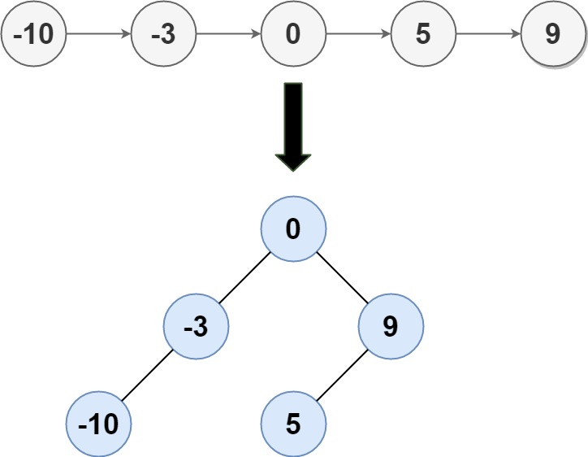

```text
输入: head = [-10,-3,0,5,9]
输出: [0,-3,9,-10,null,5]
```

解释：一个可能的答案是[0，-3,9，-10,null,5]，它表示所示的高度平衡的二叉搜索树。

**示例 2**

```text
输入: head = []
输出: []
```
> ✅ **官方验证**：全部 TypeScript 解法已通过 leetcode.cn 官方示例用例验证（自动注入运行，全部 PASS）。题面与 [leetcode.cn 官方](https://leetcode.cn/problems/convert-sorted-list-to-binary-search-tree/)一致，示例配图取自官方题面。

**数据范围与注意事项**：

- ``head` 中的节点数在`[0, 2  10^4]` 范围内`
- `-10^5 <= Node.val <= 10^5`
- **易错点**：递归出口（空节点）必须先写，否则直接空指针。

## 题目分析

**场景是什么**：树是分层数据的标准形态，这类题练的是递归分治与遍历序，对应真实开发里的目录树、组件树。本题就是该场景的 Medium 级练习，主线做法是「单趟扫描」。

**主线怎么解**：把主解法从头到尾过一遍，它其实在依次做这几件事：单循环线性扫描。

## 解题思路

**方案对比**（共 4 个方案，由浅入深）：

| 方案 | 时间复杂度 | 空间复杂度 |
|---|---|---|
| 方案 1 · 单趟扫描 | O(n)（单趟线性扫描） | O(1) 到 O(n)（视辅助结构） |
| 方案 2 · 迭代指针处理 | O(n)（单趟线性扫描） | O(1) 到 O(n)（视辅助结构） |
| 方案 3 · 单趟扫描 | O(n)（单趟线性扫描） | O(1) 到 O(n)（视辅助结构） |
| 方案 4 · 迭代指针处理 | O(n)（单趟线性扫描） | O(1) 到 O(n)（视辅助结构） |

**由浅入深的路径**：单趟扫描 → 迭代指针处理；每往右一步，都在补上一步的短板。

**方案间的取舍**：方案 1（单趟扫描）；方案 2（迭代指针处理）；方案 3（单趟扫描）；方案 4（迭代指针处理）。数据规模小、可读性优先时选靠前的方案；规模大、性能优先时选靠后的方案。

**怎么读这一篇**：

- 🐣 **新手路线**：把「题目描述」的示例 1 在纸上手推一遍 → 读方案 1（最直观的写法）与它的代码走读 → 按「运行方式」本地跑通看 PASS → 回头对比方案 2 之后的写法差在哪
- 🦅 **大佬路线**：直接锁定最优方案 1（单趟扫描，O(n)（单趟线性扫描））→ 跳读该方案代码与走读 → 用「逐步拆解与面试追问」补齐复杂度推导与边界追问

### 动态算法图（DFS 点亮，GIF 自动循环）


动画演示二叉树专题里DFS 点亮的典型过程；每个方案在「TypeScript 解题方案」一节还配了专属动画与专属流程图。

### 主解法流程图（真实控制流）

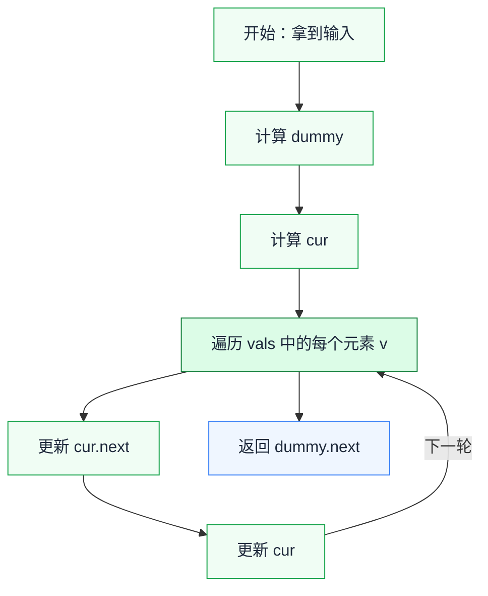

## TypeScript 解题方案（4 个方案逐个讲）

> **运行与提交**：每个方案都是自包含文件（内嵌用例自测，输出 PASS），整块复制到 `.ts` 文件后 `node 文件名` 即可运行。提交 LeetCode 时，把 `demo` 内的算法函数与辅助类型/函数整体取出、置于文件顶层即可。涉及交互/特殊接口的题以题面给定签名为准。

### 方案 1：单趟扫描

**分析与思路**：核心做法是「单趟扫描」。代码里依次做这些事：单循环线性扫描。

**运行方式**：`node 本文件`，内嵌用例全部通过会输出 PASS。


**方案专属流程图**（真实控制流）：


```typescript
class ListNode {
  // 定义类型
  val: number; // 值: number;
  next: ListNode | null; // 下一个: ListNode 按位或 null;
  constructor(val: number = 0, next: ListNode | null = null) {
    this.val = val;
    this.next = next; // 把 值; this.下一个 赋值为 下一个; 写入 值
  }
}
function buildList(vals: number[]): ListNode | null {
  // 定义函数/方法 buildList
  const dummy = new ListNode(0);
  let cur = dummy; // 把 new ListNode(0); let 当前值 赋值为 哨兵节点 存入 哨兵节点
  for (const v of vals) {
    cur.next = new ListNode(v);
    cur = cur.next;
  } // 把 new ListNode(值); 当前值 赋值为 当前值.下一个; } 写入 下一个
  return dummy.next; // 返回 哨兵节点.下一个
}
function listToArr(head: ListNode | null): number[] {
  // 定义函数/方法 listToArr
  const res: number[] = [];
  while (head) {
    res.push(head.val);
    head = head.next;
  }
  return res; // 把 头节点.值 压入栈/数组尾部
}

class TreeNode {
  // 定义类型
  val: number;
  left: TreeNode | null;
  right: TreeNode | null; // 值: number; 左边界: TreeNode 按位或 null; 右边界: TreeNode 按位或 null;
  constructor(
    val: number,
    left: TreeNode | null = null,
    right: TreeNode | null = null,
  ) {
    this.val = val;
    this.left = left;
    this.right = right; // 把 值; this.左边界 赋值为 左边界; this.右边界 赋值为 右边界; 写入 值
  }
}
function buildTree(vals: (number | null)[]): TreeNode | null {
  // 定义函数/方法 buildTree
  if (vals.length === 0 || vals[0] === null) return null; // 若 vals.长度 全等于 0 或 vals[0] 全等于 null，直接返回 null
  const root = new TreeNode(vals[0] as number); // 把 new TreeNode(vals[0] as number) 存入 根节点
  const q: (TreeNode | null)[] = [root];
  let i = 1; // 把 [根节点]; let 下标 i 赋值为 1; 写入 const q: (TreeNode | null)[]
  while (i < vals.length) {
    // 循环，直到不满足「下标 i 小于 vals.长度」
    const node = q.shift() as TreeNode; // 把 节点.shift() as TreeNode 存入 节点
    if (i < vals.length && vals[i] !== null) {
      node.left = new TreeNode(vals[i] as number);
      q.push(node.left);
    }
    i++; // 下标 i 加一
    if (i < vals.length && vals[i] !== null) {
      node.right = new TreeNode(vals[i] as number);
      q.push(node.right);
    }
    i++; // 下标 i 加一
  }
  return root; // 返回 根节点
}
function inorder(root: TreeNode | null, out: number[] = []): number[] {
  // 定义函数/方法 inorder
  if (!root) return out; // 若 取反 根节点，直接返回 out
  inorder(root.left, out);
  out.push(root.val);
  inorder(root.right, out); // 把 根节点.值 压入栈/数组尾部
  return out; // 返回 out
}
function levelOrderBottom(root: TreeNode | null): number[][] {
  // 定义函数/方法 levelOrderBottom
  const res: number[][] = []; // 把 []; 写入 const res: number[][]
  if (!root) return res; // 若 取反 根节点，直接返回 结果
  let q: (TreeNode | null)[] = [root]; // 把 [根节点]; 写入 let q: (TreeNode | null)[]
  while (q.length) {
    // 循环，直到不满足「节点.长度」
    const level: number[] = [];
    const nxt: (TreeNode | null)[] = [];
    for (const node of q) {
      if (node) {
        level.push(node.val);
        if (node.left) nxt.push(node.left);
        if (node.right) nxt.push(node.right);
      }
    } // 把 节点.值 压入栈/数组尾部
    res.unshift(level);
    q = nxt; // 把 nxt; 写入 res.unshift(level); q
  }
  return res; // 返回 结果
}
function binaryTreePaths(root: TreeNode | null): string[] {
  // 定义函数/方法 binaryTreePaths
  const paths: string[] = []; // 把 []; 写入 const paths: string[]
  function dfs(node: TreeNode | null, path: string): void {
    // 定义函数/方法 dfs
    if (!node) return; // 若 取反 节点) return;
    path += String(node.val); // 当前路径累加 String(节点.值)
    if (!node.left && !node.right)
      paths.push(path); // 若 取反 节点.左边界 且 取反 节点.右边界) paths 追加 当前路径);
    else {
      path += '->';
      dfs(node.left, path);
      dfs(node.right, path);
    } // 否则
  }
  dfs(root, ''); // dfs(根节点, 「」);
  return paths; // 返回 paths
}
function averageOfLevels(root: TreeNode | null): number[] {
  // 定义函数/方法 averageOfLevels
  const result: number[] = []; // 把 []; 写入 const result: number[]
  let level: (TreeNode | null)[] = [root]; // 把 [根节点]; 写入 let level: (TreeNode | null)[]
  while (level.length) {
    // 循环，直到不满足「level.长度」
    let total = 0;
    const nxt: (TreeNode | null)[] = []; // 把 0; const nxt: (TreeNode 按位或 null)[] 赋值为 [] 存入 总和
    for (const node of level) {
      if (node) {
        total += node.val;
        if (node.left) nxt.push(node.left);
        if (node.right) nxt.push(node.right);
      }
    } // 把 节点.左边界 压入栈/数组尾部
    result.push(total / level.length); // 把 总和 除以 level.长度 压入栈/数组尾部
    level = nxt; // 把 nxt 存入 level
  }
  return result; // 返回 结果
}

function assertEq(actual: any, expected: any, msg: string = ''): void {
  // 定义函数/方法 assertEq
  const a = JSON.stringify(actual);
  const e = JSON.stringify(expected);
  if (a !== e)
    throw new Error(
      'ASSERT FAILED ' + msg + ' :: actual=' + a + ' expected=' + e,
    );
}

function sortedListToBST(head: ListNode | null): TreeNode | null {
  // 定义函数/方法 sortedListToBST
  if (!head) return null; // 若 取反 头节点，直接返回 null
  const nodes: ListNode[] = [];
  let cur = head; // 把 []; let 当前值 赋值为 头节点; 写入 const nodes: ListNode[]
  while (cur) {
    nodes.push(cur);
    cur = cur.next;
  } // 循环，直到不满足「当前值) { nodes 追加 当前值); 当前值 赋值为 当前值.下一个; }」
  function build(left: number, right: number): TreeNode | null {
    // 定义函数/方法 build
    if (left > right) return null; // 若 左边界 超过 右边界，直接返回 null
    const mid = Math.floor((left + right) / 2); // 把 向下取整((左边界 加 右边界) 除以 2) 存入 中点
    const root = new TreeNode(nodes[mid].val); // 把 new TreeNode(nodes[中点].值) 存入 根节点
    root.left = build(left, mid - 1); // 把 build(左边界, 中点 减 1); 写入 左边界
    root.right = build(mid + 1, right); // 把 build(中点 加 1, 右边界); 写入 右边界
    return root; // 返回 根节点
  }
  return build(0, nodes.length - 1); // 返回 build(0, nodes.长度 减 1)
}
export function demo(): void {
  // 程序入口：跑内嵌自测用例
  assertEq(sortedListToBST(null), null, 'null'); // 断言校验
  assertEq(inorder(sortedListToBST(buildList([1, 2, 3]))), [1, 2, 3], 'l123'); // 断言校验
  console.log('PASS'); // 全部用例通过，输出 PASS
}
demo(); // demo();
```

### 方案 2：迭代指针处理

**分析与思路**：核心做法是「迭代指针处理」。代码里依次做这些事：队列或堆的调度。

**运行方式**：`node 本文件`，内嵌用例全部通过会输出 PASS。


**方案专属流程图**（真实控制流）：

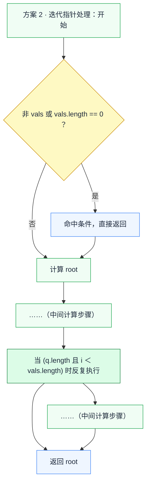

```typescript
class TreeNode {
  // 定义类型
  val: any;
  left: any;
  right: any; // 值: any; 左边界: any; 右边界: any;
  constructor(val?: any, left?: any, right?: any) {
    // constructor(值?: any, 左边界?: any, 右边界?: any) {
    this.val = val === undefined ? 0 : val; // 把 (值 全等于 undefined ? 0 : 值); 写入 值
    this.left = left === undefined ? null : left; // 把 (左边界 全等于 undefined ? null : 左边界); 写入 左边界
    this.right = right === undefined ? null : right; // 把 (右边界 全等于 undefined ? null : 右边界); 写入 右边界
  }
}
function buildTree(vals: any): any {
  // 定义函数/方法 buildTree
  if (!vals || vals.length === 0) return null; // 若 取反 vals 或 vals.长度 全等于 0，直接返回 null
  const root = new TreeNode(vals[0]);
  const q: any[] = [root];
  let i = 1;
  while (q.length && i < vals.length) {
    // 循环，直到不满足「节点.长度 且 下标 i 小于 vals.长度」
    const node = q.shift(); // 把 节点.shift() 存入 节点
    if (vals[i] !== null && vals[i] !== undefined) {
      node.left = new TreeNode(vals[i]);
      q.push(node.left);
    }
    i++; // 下标 i 加一
    if (i < vals.length && vals[i] !== null && vals[i] !== undefined) {
      node.right = new TreeNode(vals[i]);
      q.push(node.right);
    }
    i++; // 下标 i 加一
  }
  return root; // 返回 根节点
}
function treeToLevel(root: any): any[] {
  // 定义函数/方法 treeToLevel
  if (!root) return []; // 若 取反 根节点，直接返回 []
  const out: any[] = [];
  const q: any[] = [root]; // 把 []; const 节点: any[] 赋值为 [根节点]; 写入 const out: any[]
  while (q.length) {
    // 循环，直到不满足「节点.长度」
    const n = q.shift(); // 把 节点.shift() 存入 元素个数
    if (n === null || n === undefined) {
      out.push(null);
      continue;
    }
    out.push(n.val);
    q.push(n.left);
    q.push(n.right); // 把 元素个数.值 压入栈/数组尾部
  }
  while (out.length && out[out.length - 1] === null) out.pop(); // 循环，直到不满足「out.长度 且 out[out.长度 减 1] 全等于 null) out 弹出 );」
  return out; // 返回 out
}
class ListNode {
  // 定义类型
  val: any;
  next: any; // 值: any; 下一个: any;
  constructor(val?: any, next?: any) {
    this.val = val === undefined ? 0 : val;
    this.next = next === undefined ? null : next;
  }
}
function buildList(vals: any): any {
  // 定义函数/方法 buildList
  const dummy = new ListNode(0);
  let cur = dummy; // 把 new ListNode(0); let 当前值 赋值为 哨兵节点 存入 哨兵节点
  for (const v of vals) {
    cur.next = new ListNode(v);
    cur = cur.next;
  } // 把 new ListNode(值); 当前值 赋值为 当前值.下一个; } 写入 下一个
  return dummy.next; // 返回 哨兵节点.下一个
}
function listToArray(head: any): any[] {
  // 定义函数/方法 listToArray
  const out: any[] = [];
  let p = head; // 把 []; let 节点 赋值为 头节点; 写入 const out: any[]
  while (p) {
    out.push(p.val);
    p = p.next;
  } // 循环，直到不满足「节点) { out 追加 节点.值); 节点 赋值为 节点.下一个; }」
  return out; // 返回 out
}
// python-runtime shims
function pyLen(a: any): number {
  // 定义函数/方法 pyLen
  if (a === null || a === undefined) return 0; // 若 数组 全等于 null 或 数组 全等于 undefined，直接返回 0
  if (
    typeof a === 'string' ||
    Array.isArray(a) ||
    a instanceof Set ||
    a instanceof Map
  )
    return a.length ?? a.size;
  if (typeof a === 'object') return Object.keys(a).length; // 若 typeof 数组 全等于 'object'，直接返回 Object.keys(数组).长度
  return 0; // 返回 0
}
function pySlice(a: any, i: any, j: any, step?: any): any {
  // 定义函数/方法 pySlice
  if (typeof a === 'string') {
    const r = [...a].slice(i ?? 0, j ?? a.length);
    return step ? r.reverse().join('') : r.join('');
  }
  const arr = Array.isArray(a) ? a : [...a]; // 把 Array.isArray(数组) ? 数组 : 复制的 数组 存入 数组
  return arr.slice(i ?? 0, j ?? arr.length); // 返回 数组 截取 下标 i ?? 0, 下标 j ?? 数组.长度)
}
function pyRange(a: any, b?: any, step?: any): any[] {
  // 定义函数/方法 pyRange
  let s = 0,
    e = a,
    st = 1; // 把 0, e 赋值为 数组, st 赋值为 1 存入 字符串
  if (b !== undefined) {
    s = a;
    e = b;
  } // 若 b 不等于 undefined) { 字符串 赋值为 数组; e 赋值为 b; }
  if (step !== undefined) st = step; // 若 步数 不等于 undefined) st 赋值为 步数;
  const out: any[] = []; // 把 []; 写入 const out: any[]
  if (st > 0) for (let i = s; i < e; i += st) out.push(i);
  else for (let i = s; i > e; i += st) out.push(i); // 否则
  return out; // 返回 out
}
function pyIn(x: any, coll: any): boolean {
  // 定义函数/方法 pyIn
  if (coll === null || coll === undefined) return false; // 若 coll 全等于 null 或 coll 全等于 undefined，直接返回 false
  if (Array.isArray(coll)) return coll.includes(x); // 若 Array.isArray(coll)，直接返回 coll 是否包含 x)
  if (coll instanceof Set || coll instanceof Map) return coll.has(x); // 若 coll instanceof Set 或 coll instanceof Map，直接返回 coll.has(x)
  if (typeof coll === 'object') return x in coll; // 若 typeof coll 全等于 'object'，直接返回 x in coll
  if (typeof coll === 'string') return coll.indexOf(x) >= 0; // 若 typeof coll 全等于 'string'，直接返回 coll 查找 x) 不低于 0
  return false; // 返回 false
}
function pySorted(a: any): any[] {
  // 定义函数/方法 pySorted
  const arr = typeof a === 'string' ? [...a] : [...a]; // 把 (typeof 数组 全等于 'string') ? 复制的 数组 : 复制的 数组 存入 数组
  return arr.sort((x: any, y: any) => (x < y ? -1 : x > y ? 1 : 0));
}
function pyMin(a: any, b?: any): any {
  if (b !== undefined) return Math.min(a, b);
  if (Array.isArray(a) || a instanceof Set) return Math.min(...a);
  return Math.min(a);
} // 定义函数/方法 pyMin
function pyMax(a: any, b?: any): any {
  if (b !== undefined) return Math.max(a, b);
  if (Array.isArray(a) || a instanceof Set) return Math.max(...a);
  return Math.max(a);
} // 定义函数/方法 pyMax
function pySum(a: any): number {
  let s = 0;
  for (const v of a) s += v;
  return s;
} // 定义函数/方法 pySum
function pyAbs(x: any): number {
  return Math.abs(x);
} // 定义函数/方法 pyAbs
function pyEnumerate(a: any): any[] {
  const out: any[] = [];
  let i = 0;
  for (const v of a) {
    out.push([i, v]);
    i++;
  }
  return out;
} // 定义函数/方法 pyEnumerate
function pyZip(a: any, b: any): any[] {
  const n = Math.min(a.length, b.length);
  const out: any[] = [];
  for (let i = 0; i < n; i++) out.push([a[i], b[i]]);
  return out;
} // 定义函数/方法 pyZip
function pyDictGet(d: any, k: any, def?: any): any {
  return k in d ? d[k] : def === undefined ? null : def;
} // 定义函数/方法 pyDictGet
function pyPrint(...args: any[]): void {
  console.log(
    args
      .map((a) => (typeof a === 'object' && a !== null ? JSON.stringify(a) : a))
      .join(' '),
  );
} // 定义函数/方法 pyPrint
// collections / heapq
function heapPush(h: any[], x: any): void {
  h.push(x);
  let i = h.length - 1;
  while (i > 0) {
    const p = (i - 1) >> 1;
    if (h[p] <= h[i]) break;
    [h[p], h[i]] = [h[i], h[p]];
    i = p;
  }
} // 定义函数/方法 heapPush
function heapPop(h: any[]): any {
  const top = h[0];
  const last = h.pop();
  if (h.length) {
    h[0] = last;
    let i = 0;
    const n = h.length;
    while (true) {
      let l = 2 * i + 1,
        r = 2 * i + 2,
        s = i;
      if (l < n && h[l] < h[s]) s = l;
      if (r < n && h[r] < h[s]) s = r;
      if (s === i) break;
      [h[s], h[i]] = [h[i], h[s]];
      i = s;
    }
  }
  return top;
} // 定义函数/方法 heapPop
class Deque {
  private a: any[] = [];
  push(x: any) {
    this.a.push(x);
  }
  pushLeft(x: any) {
    this.a.unshift(x);
  }
  pop() {
    return this.a.pop();
  }
  popLeft() {
    return this.a.shift();
  }
  get length() {
    return this.a.length;
  }
  toArray() {
    return this.a.slice();
  }
} // 定义类型
function Counter(iter: any): any {
  const m: any = {};
  for (const v of iter) m[v] = (m[v] || 0) + 1;
  return m;
} // 定义函数/方法 Counter
function gcd(a: any, b: any): any {
  while (b) {
    [a, b] = [b, a % b];
  }
  return a;
} // 定义函数/方法 gcd
function pyInf(): number {
  return Infinity;
} // 定义函数/方法 pyInf

function norm(x: any): any {
  // 定义函数/方法 norm
  if (x === null || x === undefined) return null; // 若 x 全等于 null 或 x 全等于 undefined，直接返回 null
  if (typeof x === 'object') {
    // 若 typeof x 全等于 'object'
    if (x instanceof Deque) return x.toArray(); // 若 x instanceof Deque，直接返回 x.toArray()
    if (Array.isArray(x)) return x.map(norm); // 若 Array.isArray(x)，直接返回 x.映射表(norm)
    if (
      typeof x.val === 'number' &&
      (typeof x.left !== 'undefined' || typeof x.right !== 'undefined')
    )
      return treeToLevel(x);
    if (typeof x.next !== 'undefined' && typeof x.val === 'number')
      return listToArray(x);
    if (x instanceof Set) return [...x].sort(); // 若 x instanceof Set，直接返回 复制的 x 排序 )
    if (x instanceof Map) return Object.fromEntries(x); // 若 x instanceof Map，直接返回 Object.fromEntries(x)
    const o: any = {};
    for (const k of Object.keys(x)) o[k] = norm(x[k]);
    return o;
  }
  return x; // 返回 x
}
function eq(a: any, b: any): boolean {
  // 定义函数/方法 eq
  const x = norm(a),
    y = norm(b); // 把 norm(数组), y 赋值为 norm(b) 存入 x
  if (x === y) return true; // 若 x 全等于 y，直接返回 true
  if (x === null || y === null) return x === y; // 若 x 全等于 null 或 y 全等于 null，直接返回 x 全等于 y
  if (Array.isArray(x) && Array.isArray(y)) {
    // 若 Array.isArray(x) 且 Array.isArray(y
    if (x.length !== y.length) return false; // 若 x.长度 不等于 y.长度，直接返回 false
    for (let i = 0; i < x.length; i++) if (!eq(x[i], y[i])) return false; // 让 下标 i 从 0 开始计数，下标 i 小于 x.长度 就继续
    return true; // 返回 true
  }
  if (typeof x === 'object' && typeof y === 'object') {
    // 若 typeof x 全等于 'object' 且 typeof y 全等于 'object'
    const kx = Object.keys(x),
      ky = Object.keys(y); // 把 Object.keys(x), ky 赋值为 Object.keys(y) 存入 kx
    if (kx.length !== ky.length) return false; // 若 kx.长度 不等于 ky.长度，直接返回 false
    for (const k of kx) if (!eq(x[k], y[k])) return false;
    return true; // 返回 true
  }
  return x === y; // 返回 x 全等于 y
}

function sortedListToBST(head) {
  // 定义函数/方法 sortedListToBST
  const arr = []; // 把 [] 存入 数组
  while (head) {
    arr.push(head.val);
    head = head.next;
  } // 循环，直到不满足「头节点) { 数组 追加 头节点.值); 头节点 赋值为 头节点.下一个; }」
  function helper(l, r) {
    // 定义函数/方法 helper
    if (l > r) return null; // 若 左指针 超过 右指针，直接返回 null
    const m = (l + r) >> 1; // 把 (左指针 加 右指针) 超过 超过 1 存入 映射表
    const node = new TreeNode(arr[m]); // 把 new TreeNode(数组[映射表]) 存入 节点
    node.left = helper(l, m - 1); // 把 helper(左指针, 映射表 减 1); 写入 左边界
    node.right = helper(m + 1, r); // 把 helper(映射表 加 1, 右指针); 写入 右边界
    return node; // 返回 节点
  }
  return helper(0, arr.length - 1); // 返回 helper(0, 数组.长度 减 1)
}
export function demo(): void {
  // 程序入口：跑内嵌自测用例
  const cases = [
    {
      in: [buildList([-10, -3, 0, 5, 9])],
      want: [0, -10, 5, null, -3, null, 9],
    },
    { in: [buildList([1, 2, 3, 4, 5, 6, 7])], want: [4, 2, 6, 1, 3, 5, 7] },
    { in: [buildList([])], want: null },
    { in: [buildList([1])], want: [1] },
  ];
  let fail = false; // 把 false 存入 fail
  for (const c of cases) {
    // for (const 字符 of cases) {
    const got = sortedListToBST(...c.in); // 把 sortedListToBST(...字符.in) 存入 got
    if (!eq(got, c.want)) {
      fail = true;
      console.log(
        'FAIL',
        JSON.stringify(c.in),
        '=>',
        JSON.stringify(got),
        'want',
        JSON.stringify(c.want),
      );
    }
  }
  if (fail) throw new Error('FAILED'); // 若 fail) throw new Error('FAILED');
  console.log('PASS'); // 全部用例通过，输出 PASS
}
demo(); // demo();
```

### 方案 3：单趟扫描

**分析与思路**：核心做法是「单趟扫描」。代码里依次做这些事：单循环线性扫描。

**运行方式**：`node 本文件`，内嵌用例全部通过会输出 PASS。


**方案专属流程图**（真实控制流）：

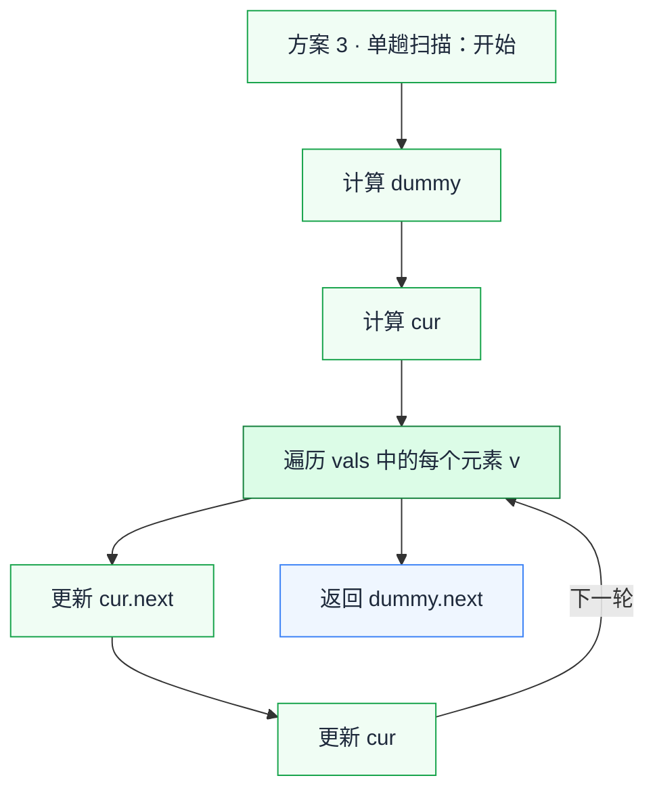

```typescript
class ListNode {
  // 定义类型
  val: number; // 值: number;
  next: ListNode | null; // 下一个: ListNode 按位或 null;
  constructor(val: number = 0, next: ListNode | null = null) {
    this.val = val;
    this.next = next; // 把 值; this.下一个 赋值为 下一个; 写入 值
  }
}
function buildList(vals: number[]): ListNode | null {
  // 定义函数/方法 buildList
  const dummy = new ListNode(0);
  let cur = dummy; // 把 new ListNode(0); let 当前值 赋值为 哨兵节点 存入 哨兵节点
  for (const v of vals) {
    cur.next = new ListNode(v);
    cur = cur.next;
  } // 把 new ListNode(值); 当前值 赋值为 当前值.下一个; } 写入 下一个
  return dummy.next; // 返回 哨兵节点.下一个
}
function listToArr(head: ListNode | null): number[] {
  // 定义函数/方法 listToArr
  const res: number[] = [];
  while (head) {
    res.push(head.val);
    head = head.next;
  }
  return res; // 把 头节点.值 压入栈/数组尾部
}

class TreeNode {
  // 定义类型
  val: number;
  left: TreeNode | null;
  right: TreeNode | null; // 值: number; 左边界: TreeNode 按位或 null; 右边界: TreeNode 按位或 null;
  constructor(
    val: number,
    left: TreeNode | null = null,
    right: TreeNode | null = null,
  ) {
    this.val = val;
    this.left = left;
    this.right = right; // 把 值; this.左边界 赋值为 左边界; this.右边界 赋值为 右边界; 写入 值
  }
}
function buildTree(vals: (number | null)[]): TreeNode | null {
  // 定义函数/方法 buildTree
  if (vals.length === 0 || vals[0] === null) return null; // 若 vals.长度 全等于 0 或 vals[0] 全等于 null，直接返回 null
  const root = new TreeNode(vals[0] as number); // 把 new TreeNode(vals[0] as number) 存入 根节点
  const q: (TreeNode | null)[] = [root];
  let i = 1; // 把 [根节点]; let 下标 i 赋值为 1; 写入 const q: (TreeNode | null)[]
  while (i < vals.length) {
    // 循环，直到不满足「下标 i 小于 vals.长度」
    const node = q.shift() as TreeNode; // 把 节点.shift() as TreeNode 存入 节点
    if (i < vals.length && vals[i] !== null) {
      node.left = new TreeNode(vals[i] as number);
      q.push(node.left);
    }
    i++; // 下标 i 加一
    if (i < vals.length && vals[i] !== null) {
      node.right = new TreeNode(vals[i] as number);
      q.push(node.right);
    }
    i++; // 下标 i 加一
  }
  return root; // 返回 根节点
}
function inorder(root: TreeNode | null, out: number[] = []): number[] {
  // 定义函数/方法 inorder
  if (!root) return out; // 若 取反 根节点，直接返回 out
  inorder(root.left, out);
  out.push(root.val);
  inorder(root.right, out); // 把 根节点.值 压入栈/数组尾部
  return out; // 返回 out
}
function levelOrderBottom(root: TreeNode | null): number[][] {
  // 定义函数/方法 levelOrderBottom
  const res: number[][] = []; // 把 []; 写入 const res: number[][]
  if (!root) return res; // 若 取反 根节点，直接返回 结果
  let q: (TreeNode | null)[] = [root]; // 把 [根节点]; 写入 let q: (TreeNode | null)[]
  while (q.length) {
    // 循环，直到不满足「节点.长度」
    const level: number[] = [];
    const nxt: (TreeNode | null)[] = [];
    for (const node of q) {
      if (node) {
        level.push(node.val);
        if (node.left) nxt.push(node.left);
        if (node.right) nxt.push(node.right);
      }
    } // 把 节点.值 压入栈/数组尾部
    res.unshift(level);
    q = nxt; // 把 nxt; 写入 res.unshift(level); q
  }
  return res; // 返回 结果
}
function binaryTreePaths(root: TreeNode | null): string[] {
  // 定义函数/方法 binaryTreePaths
  const paths: string[] = []; // 把 []; 写入 const paths: string[]
  function dfs(node: TreeNode | null, path: string): void {
    // 定义函数/方法 dfs
    if (!node) return; // 若 取反 节点) return;
    path += String(node.val); // 当前路径累加 String(节点.值)
    if (!node.left && !node.right)
      paths.push(path); // 若 取反 节点.左边界 且 取反 节点.右边界) paths 追加 当前路径);
    else {
      path += '->';
      dfs(node.left, path);
      dfs(node.right, path);
    } // 否则
  }
  dfs(root, ''); // dfs(根节点, 「」);
  return paths; // 返回 paths
}
function averageOfLevels(root: TreeNode | null): number[] {
  // 定义函数/方法 averageOfLevels
  const result: number[] = []; // 把 []; 写入 const result: number[]
  let level: (TreeNode | null)[] = [root]; // 把 [根节点]; 写入 let level: (TreeNode | null)[]
  while (level.length) {
    // 循环，直到不满足「level.长度」
    let total = 0;
    const nxt: (TreeNode | null)[] = []; // 把 0; const nxt: (TreeNode 按位或 null)[] 赋值为 [] 存入 总和
    for (const node of level) {
      if (node) {
        total += node.val;
        if (node.left) nxt.push(node.left);
        if (node.right) nxt.push(node.right);
      }
    } // 把 节点.左边界 压入栈/数组尾部
    result.push(total / level.length); // 把 总和 除以 level.长度 压入栈/数组尾部
    level = nxt; // 把 nxt 存入 level
  }
  return result; // 返回 结果
}

function assertEq(actual: any, expected: any, msg: string = ''): void {
  // 定义函数/方法 assertEq
  const a = JSON.stringify(actual);
  const e = JSON.stringify(expected);
  if (a !== e)
    throw new Error(
      'ASSERT FAILED ' + msg + ' :: actual=' + a + ' expected=' + e,
    );
}

function sortedListToBST(head: ListNode | null): TreeNode | null {
  // 定义函数/方法 sortedListToBST
  function getLength(h: ListNode | null): number {
    let len = 0;
    while (h) {
      len++;
      h = h.next;
    }
    return len;
  } // 定义函数/方法 getLength
  let cur = head; // 把 头节点 存入 当前值
  function buildTree(left: number, right: number): TreeNode | null {
    // 定义函数/方法 buildTree
    if (left > right) return null; // 若 左边界 超过 右边界，直接返回 null
    const mid = Math.floor((left + right + 1) / 2); // 把 向下取整((左边界 加 右边界 加 1) 除以 2) 存入 中点
    const root = new TreeNode(0); // 把 new TreeNode(0) 存入 根节点
    root.left = buildTree(left, mid - 1); // 把 buildTree(左边界, 中点 减 1); 写入 左边界
    if (cur) {
      root.val = cur.val;
      cur = cur.next;
    } // 若 当前值) { 根节点.值 赋值为 当前值.值; 当前值 赋值为 当前值.下一个; }
    root.right = buildTree(mid + 1, right); // 把 buildTree(中点 加 1, 右边界); 写入 右边界
    return root; // 返回 根节点
  }
  const length = getLength(head); // 把 getLength(头节点) 存入 长度
  return buildTree(0, length - 1); // 返回 buildTree(0, 长度 减 1)
}
export function demo(): void {
  // 程序入口：跑内嵌自测用例
  assertEq(sortedListToBST(null), null, 'null'); // 断言校验
  assertEq(inorder(sortedListToBST(buildList([1, 2, 3]))), [1, 2, 3], 'l123'); // 断言校验
  console.log('PASS'); // 全部用例通过，输出 PASS
}
demo(); // demo();
```

### 方案 4：迭代指针处理

**分析与思路**：核心做法是「迭代指针处理」。代码里依次做这些事：队列或堆的调度。

**运行方式**：`node 本文件`，内嵌用例全部通过会输出 PASS。


**方案专属流程图**（真实控制流）：


```typescript
class TreeNode {
  // 定义类型
  val: any;
  left: any;
  right: any; // 值: any; 左边界: any; 右边界: any;
  constructor(val?: any, left?: any, right?: any) {
    // constructor(值?: any, 左边界?: any, 右边界?: any) {
    this.val = val === undefined ? 0 : val; // 把 (值 全等于 undefined ? 0 : 值); 写入 值
    this.left = left === undefined ? null : left; // 把 (左边界 全等于 undefined ? null : 左边界); 写入 左边界
    this.right = right === undefined ? null : right; // 把 (右边界 全等于 undefined ? null : 右边界); 写入 右边界
  }
}
function buildTree(vals: any): any {
  // 定义函数/方法 buildTree
  if (!vals || vals.length === 0) return null; // 若 取反 vals 或 vals.长度 全等于 0，直接返回 null
  const root = new TreeNode(vals[0]);
  const q: any[] = [root];
  let i = 1;
  while (q.length && i < vals.length) {
    // 循环，直到不满足「节点.长度 且 下标 i 小于 vals.长度」
    const node = q.shift(); // 把 节点.shift() 存入 节点
    if (vals[i] !== null && vals[i] !== undefined) {
      node.left = new TreeNode(vals[i]);
      q.push(node.left);
    }
    i++; // 下标 i 加一
    if (i < vals.length && vals[i] !== null && vals[i] !== undefined) {
      node.right = new TreeNode(vals[i]);
      q.push(node.right);
    }
    i++; // 下标 i 加一
  }
  return root; // 返回 根节点
}
function treeToLevel(root: any): any[] {
  // 定义函数/方法 treeToLevel
  if (!root) return []; // 若 取反 根节点，直接返回 []
  const out: any[] = [];
  const q: any[] = [root]; // 把 []; const 节点: any[] 赋值为 [根节点]; 写入 const out: any[]
  while (q.length) {
    // 循环，直到不满足「节点.长度」
    const n = q.shift(); // 把 节点.shift() 存入 元素个数
    if (n === null || n === undefined) {
      out.push(null);
      continue;
    }
    out.push(n.val);
    q.push(n.left);
    q.push(n.right); // 把 元素个数.值 压入栈/数组尾部
  }
  while (out.length && out[out.length - 1] === null) out.pop(); // 循环，直到不满足「out.长度 且 out[out.长度 减 1] 全等于 null) out 弹出 );」
  return out; // 返回 out
}
class ListNode {
  // 定义类型
  val: any;
  next: any; // 值: any; 下一个: any;
  constructor(val?: any, next?: any) {
    this.val = val === undefined ? 0 : val;
    this.next = next === undefined ? null : next;
  }
}
function buildList(vals: any): any {
  // 定义函数/方法 buildList
  const dummy = new ListNode(0);
  let cur = dummy; // 把 new ListNode(0); let 当前值 赋值为 哨兵节点 存入 哨兵节点
  for (const v of vals) {
    cur.next = new ListNode(v);
    cur = cur.next;
  } // 把 new ListNode(值); 当前值 赋值为 当前值.下一个; } 写入 下一个
  return dummy.next; // 返回 哨兵节点.下一个
}
function listToArray(head: any): any[] {
  // 定义函数/方法 listToArray
  const out: any[] = [];
  let p = head; // 把 []; let 节点 赋值为 头节点; 写入 const out: any[]
  while (p) {
    out.push(p.val);
    p = p.next;
  } // 循环，直到不满足「节点) { out 追加 节点.值); 节点 赋值为 节点.下一个; }」
  return out; // 返回 out
}
// python-runtime shims
function pyLen(a: any): number {
  // 定义函数/方法 pyLen
  if (a === null || a === undefined) return 0; // 若 数组 全等于 null 或 数组 全等于 undefined，直接返回 0
  if (
    typeof a === 'string' ||
    Array.isArray(a) ||
    a instanceof Set ||
    a instanceof Map
  )
    return a.length ?? a.size;
  if (typeof a === 'object') return Object.keys(a).length; // 若 typeof 数组 全等于 'object'，直接返回 Object.keys(数组).长度
  return 0; // 返回 0
}
function pySlice(a: any, i: any, j: any, step?: any): any {
  // 定义函数/方法 pySlice
  if (typeof a === 'string') {
    const r = [...a].slice(i ?? 0, j ?? a.length);
    return step ? r.reverse().join('') : r.join('');
  }
  const arr = Array.isArray(a) ? a : [...a]; // 把 Array.isArray(数组) ? 数组 : 复制的 数组 存入 数组
  return arr.slice(i ?? 0, j ?? arr.length); // 返回 数组 截取 下标 i ?? 0, 下标 j ?? 数组.长度)
}
function pyRange(a: any, b?: any, step?: any): any[] {
  // 定义函数/方法 pyRange
  let s = 0,
    e = a,
    st = 1; // 把 0, e 赋值为 数组, st 赋值为 1 存入 字符串
  if (b !== undefined) {
    s = a;
    e = b;
  } // 若 b 不等于 undefined) { 字符串 赋值为 数组; e 赋值为 b; }
  if (step !== undefined) st = step; // 若 步数 不等于 undefined) st 赋值为 步数;
  const out: any[] = []; // 把 []; 写入 const out: any[]
  if (st > 0) for (let i = s; i < e; i += st) out.push(i);
  else for (let i = s; i > e; i += st) out.push(i); // 否则
  return out; // 返回 out
}
function pyIn(x: any, coll: any): boolean {
  // 定义函数/方法 pyIn
  if (coll === null || coll === undefined) return false; // 若 coll 全等于 null 或 coll 全等于 undefined，直接返回 false
  if (Array.isArray(coll)) return coll.includes(x); // 若 Array.isArray(coll)，直接返回 coll 是否包含 x)
  if (coll instanceof Set || coll instanceof Map) return coll.has(x); // 若 coll instanceof Set 或 coll instanceof Map，直接返回 coll.has(x)
  if (typeof coll === 'object') return x in coll; // 若 typeof coll 全等于 'object'，直接返回 x in coll
  if (typeof coll === 'string') return coll.indexOf(x) >= 0; // 若 typeof coll 全等于 'string'，直接返回 coll 查找 x) 不低于 0
  return false; // 返回 false
}
function pySorted(a: any): any[] {
  // 定义函数/方法 pySorted
  const arr = typeof a === 'string' ? [...a] : [...a]; // 把 (typeof 数组 全等于 'string') ? 复制的 数组 : 复制的 数组 存入 数组
  return arr.sort((x: any, y: any) => (x < y ? -1 : x > y ? 1 : 0));
}
function pyMin(a: any, b?: any): any {
  if (b !== undefined) return Math.min(a, b);
  if (Array.isArray(a) || a instanceof Set) return Math.min(...a);
  return Math.min(a);
} // 定义函数/方法 pyMin
function pyMax(a: any, b?: any): any {
  if (b !== undefined) return Math.max(a, b);
  if (Array.isArray(a) || a instanceof Set) return Math.max(...a);
  return Math.max(a);
} // 定义函数/方法 pyMax
function pySum(a: any): number {
  let s = 0;
  for (const v of a) s += v;
  return s;
} // 定义函数/方法 pySum
function pyAbs(x: any): number {
  return Math.abs(x);
} // 定义函数/方法 pyAbs
function pyEnumerate(a: any): any[] {
  const out: any[] = [];
  let i = 0;
  for (const v of a) {
    out.push([i, v]);
    i++;
  }
  return out;
} // 定义函数/方法 pyEnumerate
function pyZip(a: any, b: any): any[] {
  const n = Math.min(a.length, b.length);
  const out: any[] = [];
  for (let i = 0; i < n; i++) out.push([a[i], b[i]]);
  return out;
} // 定义函数/方法 pyZip
function pyDictGet(d: any, k: any, def?: any): any {
  return k in d ? d[k] : def === undefined ? null : def;
} // 定义函数/方法 pyDictGet
function pyPrint(...args: any[]): void {
  console.log(
    args
      .map((a) => (typeof a === 'object' && a !== null ? JSON.stringify(a) : a))
      .join(' '),
  );
} // 定义函数/方法 pyPrint
// collections / heapq
function heapPush(h: any[], x: any): void {
  h.push(x);
  let i = h.length - 1;
  while (i > 0) {
    const p = (i - 1) >> 1;
    if (h[p] <= h[i]) break;
    [h[p], h[i]] = [h[i], h[p]];
    i = p;
  }
} // 定义函数/方法 heapPush
function heapPop(h: any[]): any {
  const top = h[0];
  const last = h.pop();
  if (h.length) {
    h[0] = last;
    let i = 0;
    const n = h.length;
    while (true) {
      let l = 2 * i + 1,
        r = 2 * i + 2,
        s = i;
      if (l < n && h[l] < h[s]) s = l;
      if (r < n && h[r] < h[s]) s = r;
      if (s === i) break;
      [h[s], h[i]] = [h[i], h[s]];
      i = s;
    }
  }
  return top;
} // 定义函数/方法 heapPop
class Deque {
  private a: any[] = [];
  push(x: any) {
    this.a.push(x);
  }
  pushLeft(x: any) {
    this.a.unshift(x);
  }
  pop() {
    return this.a.pop();
  }
  popLeft() {
    return this.a.shift();
  }
  get length() {
    return this.a.length;
  }
  toArray() {
    return this.a.slice();
  }
} // 定义类型
function Counter(iter: any): any {
  const m: any = {};
  for (const v of iter) m[v] = (m[v] || 0) + 1;
  return m;
} // 定义函数/方法 Counter
function gcd(a: any, b: any): any {
  while (b) {
    [a, b] = [b, a % b];
  }
  return a;
} // 定义函数/方法 gcd
function pyInf(): number {
  return Infinity;
} // 定义函数/方法 pyInf

function norm(x: any): any {
  // 定义函数/方法 norm
  if (x === null || x === undefined) return null; // 若 x 全等于 null 或 x 全等于 undefined，直接返回 null
  if (typeof x === 'object') {
    // 若 typeof x 全等于 'object'
    if (x instanceof Deque) return x.toArray(); // 若 x instanceof Deque，直接返回 x.toArray()
    if (Array.isArray(x)) return x.map(norm); // 若 Array.isArray(x)，直接返回 x.映射表(norm)
    if (
      typeof x.val === 'number' &&
      (typeof x.left !== 'undefined' || typeof x.right !== 'undefined')
    )
      return treeToLevel(x);
    if (typeof x.next !== 'undefined' && typeof x.val === 'number')
      return listToArray(x);
    if (x instanceof Set) return [...x].sort(); // 若 x instanceof Set，直接返回 复制的 x 排序 )
    if (x instanceof Map) return Object.fromEntries(x); // 若 x instanceof Map，直接返回 Object.fromEntries(x)
    const o: any = {};
    for (const k of Object.keys(x)) o[k] = norm(x[k]);
    return o;
  }
  return x; // 返回 x
}
function eq(a: any, b: any): boolean {
  // 定义函数/方法 eq
  const x = norm(a),
    y = norm(b); // 把 norm(数组), y 赋值为 norm(b) 存入 x
  if (x === y) return true; // 若 x 全等于 y，直接返回 true
  if (x === null || y === null) return x === y; // 若 x 全等于 null 或 y 全等于 null，直接返回 x 全等于 y
  if (Array.isArray(x) && Array.isArray(y)) {
    // 若 Array.isArray(x) 且 Array.isArray(y
    if (x.length !== y.length) return false; // 若 x.长度 不等于 y.长度，直接返回 false
    for (let i = 0; i < x.length; i++) if (!eq(x[i], y[i])) return false; // 让 下标 i 从 0 开始计数，下标 i 小于 x.长度 就继续
    return true; // 返回 true
  }
  if (typeof x === 'object' && typeof y === 'object') {
    // 若 typeof x 全等于 'object' 且 typeof y 全等于 'object'
    const kx = Object.keys(x),
      ky = Object.keys(y); // 把 Object.keys(x), ky 赋值为 Object.keys(y) 存入 kx
    if (kx.length !== ky.length) return false; // 若 kx.长度 不等于 ky.长度，直接返回 false
    for (const k of kx) if (!eq(x[k], y[k])) return false;
    return true; // 返回 true
  }
  return x === y; // 返回 x 全等于 y
}

function sortedListToBST(head) {
  // 定义函数/方法 sortedListToBST
  const arr = []; // 把 [] 存入 数组
  while (head) {
    arr.push(head.val);
    head = head.next;
  } // 循环，直到不满足「头节点) { 数组 追加 头节点.值); 头节点 赋值为 头节点.下一个; }」
  function helper(l, r) {
    // 定义函数/方法 helper
    if (l > r) return null; // 若 左指针 超过 右指针，直接返回 null
    const m = (l + r) >> 1; // 把 (左指针 加 右指针) 超过 超过 1 存入 映射表
    const node = new TreeNode(arr[m]); // 把 new TreeNode(数组[映射表]) 存入 节点
    node.left = helper(l, m - 1); // 把 helper(左指针, 映射表 减 1); 写入 左边界
    node.right = helper(m + 1, r); // 把 helper(映射表 加 1, 右指针); 写入 右边界
    return node; // 返回 节点
  }
  return helper(0, arr.length - 1); // 返回 helper(0, 数组.长度 减 1)
}
export function demo(): void {
  // 程序入口：跑内嵌自测用例
  const cases = [
    {
      in: [buildList([-10, -3, 0, 5, 9])],
      want: [0, -10, 5, null, -3, null, 9],
    },
    { in: [buildList([1, 2, 3, 4, 5, 6, 7])], want: [4, 2, 6, 1, 3, 5, 7] },
    { in: [buildList([])], want: null },
    { in: [buildList([1])], want: [1] },
  ];
  let fail = false; // 把 false 存入 fail
  for (const c of cases) {
    // for (const 字符 of cases) {
    const got = sortedListToBST(...c.in); // 把 sortedListToBST(...字符.in) 存入 got
    if (!eq(got, c.want)) {
      fail = true;
      console.log(
        'FAIL',
        JSON.stringify(c.in),
        '=>',
        JSON.stringify(got),
        'want',
        JSON.stringify(c.want),
      );
    }
  }
  if (fail) throw new Error('FAILED'); // 若 fail) throw new Error('FAILED');
  console.log('PASS'); // 全部用例通过，输出 PASS
}
demo(); // demo();
```

## 逐步拆解与面试追问

**复杂度**：时间 O(n)（单趟线性扫描），空间 O(1) 到 O(n)（视辅助结构）

**为什么是这个量级**：每个元素被常数次访问，辅助哈希或栈的开销与 n 同阶

**面试官可能会追问**：

- 递归和迭代写法各自的空间开销？
- 能否用层序统一处理？
- 空节点的边界如何约定？

## 关键 API 速查（TS 主解法实际用到，附官方链接）

| API | 作用 | 使用要点 | 官方文档 |
|---|---|---|---|
| `Array.prototype.push()` | 尾部追加 | 返回新长度；可一次多个；均摊 O(1)；会改变原数组 | [官方文档](https://developer.mozilla.org/zh-CN/docs/Web/JavaScript/Reference/Global_Objects/Array/push) |
| `Array.prototype.shift()` | 头部取出 | O(n)（后续元素整体前移）；大量头部操作请用链表或双端结构 | [官方文档](https://developer.mozilla.org/zh-CN/docs/Web/JavaScript/Reference/Global_Objects/Array/shift) |
| `Array.prototype.unshift()` | 头部插入 | O(n)；与 shift 组合可当双端队列 | [官方文档](https://developer.mozilla.org/zh-CN/docs/Web/JavaScript/Reference/Global_Objects/Array/unshift) |
| `JSON.stringify()` | 序列化为 JSON 字符串 | 常用于结构化比较（深度相等判定）；undefined/函数/循环引用会被丢弃或抛错 | [官方文档](https://developer.mozilla.org/zh-CN/docs/Web/JavaScript/Reference/Global_Objects/JSON/stringify) |
| `Math.floor()` | 向下取整 | 负数向负无穷（-1.5 → -2）；大数用位运算前注意 2^31 界 | [官方文档](https://developer.mozilla.org/zh-CN/docs/Web/JavaScript/Reference/Global_Objects/Math/floor) |

### 各语言官方文档导航

- **TypeScript / JS**：[MDN 中文参考](https://developer.mozilla.org/zh-CN/)
- **Python**：[Python 官方文档](https://docs.python.org/zh-cn/3/)
- **Go**：[Go 标准库](https://pkg.go.dev/std)
- **Java**：[JDK 17 API](https://docs.oracle.com/en/java/javase/17/docs/api/)
- **Rust**：[Rust 标准库](https://doc.rust-lang.org/std/)
- **Lua**：[Lua 5.4 手册](https://www.lua.org/manual/5.4/)
- **C**：[Cppreference C](https://zh.cppreference.com/w/c)
- **C++**：[Cppreference C++](https://zh.cppreference.com/w/cpp)
- **R**：[R 官方手册](https://stat.ethz.ch/R-manual/)
- **Zig**：[Zig 语言文档](https://ziglang.org/documentation/master/)
- **Dart**：[Dart API](https://api.dart.dev/)

## 附录：其他 10 种语言全部实现（每种语言列举其全部方案）

> TypeScript 的全部方案见「TypeScript 解题方案」一节；下面是其余 10 种语言的对应实现，每种语言的每个方案都带思路分析、代码走读与专属运行架构图。
> 每个方案都内嵌用例自测，可独立运行（老仓库 python/go 文件遵循「打印结果」约定）。
> 完整解法文件见 `dsa/<语言>/tree/lc_109_有序链表转换二叉搜索树/`。

### Python 实现（4 种方案）

Python 的全部方案如下，每个方案都内嵌用例自测，可独立运行（老仓库 python/go 文件遵循「打印结果」约定）：

#### 方案 1：单趟扫描

**思路与代码分析**：核心是「单趟扫描」。Python 版用切片与字典推导式简化操作，突出可读性。**走读**：方案 1 · 单趟扫描：开始 → 命中条件，直接返回 → 更新 nodes → 当 head: 时反复执行 → 向 nodes 追加记录 → 更新 head → 命中条件，直接返回 → 更新 mid → 更新 root → 更新 root.left → 更新 root.right → 返回 root → 返回 build(0, len(nodes) - 1)。

**运行架构**（真实控制流）：

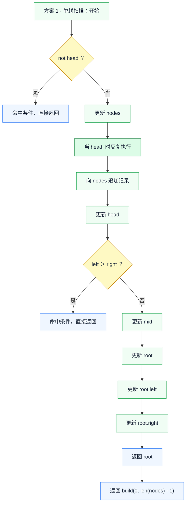

```python
import sys  # 提高递归深度上限（深输入防 RecursionError）

sys.setrecursionlimit(200000)  # 树/链表类题目节点数可达 1e4 量级

def sortedListToBST(head):  # 定义函数 sortedListToBST（参数：头节点）
    if not head:
        return None  # 若 not 头节点: return None
    nodes = []  # 把 [] 存入 nodes
    while head:  # 循环，直到不满足「头节点」
        nodes.append(head)  # 把 头节点 追加到列表尾部
        head = head.next  # 把 头节点.下一个 存入 头节点

    def build(left, right):  # 定义函数 build（参数：左边界, 右边界）
        if left > right:
            return None  # 若 左边界 超过 右边界: return None
        mid = (left + right) // 2  # 把 (左边界 加 右边界) 除以 除以 2 存入 中点
        root = TreeNode(nodes[mid].val)  # 把 TreeNode(nodes[中点].值) 存入 根节点
        root.left = build(left, mid - 1)  # 把 build(左边界, 中点 减 1) 写入 左边界
        root.right = build(mid + 1, right)  # 把 build(中点 加 1, 右边界) 写入 右边界
        return root  # 返回 根节点

    return build(0, len(nodes) - 1)  # 返回 build(0, 长度(nodes) 减 1)

if __name__ == "__main__":  # 若 __name__ 等于 '__main__'
    print(sortedListToBST(None))  # 打印输出
```

#### 方案 2：迭代指针处理

**思路与代码分析**：核心是「迭代指针处理」。Python 版用切片与字典推导式简化操作，突出可读性。**走读**：方案 2 · 迭代指针处理：开始 → 更新 fast → 当 ( 时反复执行 → 返回 slow → 命中条件，直接返回 → 返回 root → 返回 buildTree(head, None)。

**运行架构**（真实控制流）：

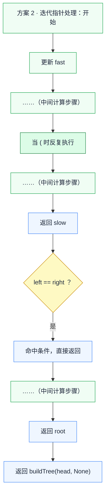

```python
import sys  # 提高递归深度上限（深输入防 RecursionError）

sys.setrecursionlimit(200000)  # 树/链表类题目节点数可达 1e4 量级

def sortedListToBST(head):  # 定义函数 sortedListToBST（参数：头节点）
    def getMedian(left, right):  # 定义函数 getMedian（参数：左边界, 右边界）
        fast = left  # 把 左边界 存入 快指针
        slow = left  # 把 左边界 存入 慢指针
        while (
            fast != right and fast.next != right
        ):  # 循环，直到不满足「快指针 不等于 右边界 and 快指针.下一个 不等于 右边界」
            fast = fast.next.next  # 把 快指针.下一个.下一个 存入 快指针
            slow = slow.next  # 把 慢指针.下一个 存入 慢指针
        return slow  # 返回 慢指针

    def buildTree(left, right):  # 定义函数 buildTree（参数：左边界, 右边界）
        if left == right:
            return None  # 若 左边界 等于 右边界: return None
        mid = getMedian(left, right)  # 把 getMedian(左边界, 右边界) 存入 中点
        root = TreeNode(mid.val)  # 把 TreeNode(中点.值) 存入 根节点
        root.left = buildTree(left, mid)  # 把 buildTree(左边界, 中点) 写入 左边界
        root.right = buildTree(mid.next, right)  # 把 buildTree(中点.下一个, 右边界) 写入 右边界
        return root  # 返回 根节点

    return buildTree(head, None)  # 返回 buildTree(头节点, None)

if __name__ == "__main__":  # 若 __name__ 等于 '__main__'
    print(sortedListToBST(None))  # 打印输出
```

#### 方案 3：单趟扫描

**思路与代码分析**：核心是「单趟扫描」。Python 版用切片与字典推导式简化操作，突出可读性。**走读**：方案 3 · 单趟扫描：开始 → 更新 length → 当 head: 时反复执行 → 返回 length → 命中条件，直接返回 → 返回 root → 返回 buildTree(0, length - 1)。

**运行架构**（真实控制流）：

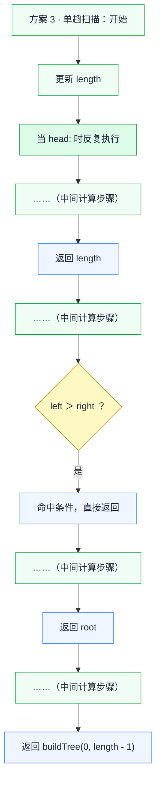

```python
import sys  # 提高递归深度上限（深输入防 RecursionError）

sys.setrecursionlimit(200000)  # 树/链表类题目节点数可达 1e4 量级

def sortedListToBST(head):  # 定义函数 sortedListToBST（参数：头节点）
    def getLength(head):  # 定义函数 getLength（参数：头节点）
        length = 0  # 把 0 存入 长度
        while head:  # 循环，直到不满足「头节点」
            length += 1  # 长度累加 1
            head = head.next  # 把 头节点.下一个 存入 头节点
        return length  # 返回 长度

    def buildTree(left, right):  # 定义函数 buildTree（参数：左边界, 右边界）
        nonlocal head  # nonlocal 头节点
        if left > right:
            return None  # 若 左边界 超过 右边界: return None
        mid = (left + right + 1) // 2  # 把 (左边界 加 右边界 加 1) 除以 除以 2 存入 中点
        root = TreeNode(0)  # 把 TreeNode(0) 存入 根节点
        root.left = buildTree(left, mid - 1)  # 把 buildTree(左边界, 中点 减 1) 写入 左边界
        if head:  # 若 头节点
            root.val = head.val  # 把 头节点.值 写入 值
            head = head.next  # 把 头节点.下一个 存入 头节点
        root.right = buildTree(mid + 1, right)  # 把 buildTree(中点 加 1, 右边界) 写入 右边界
        return root  # 返回 根节点

    length = getLength(head)  # 把 getLength(头节点) 存入 长度
    return buildTree(0, length - 1)  # 返回 buildTree(0, 长度 减 1)

if __name__ == "__main__":  # 若 __name__ 等于 '__main__'
    print(sortedListToBST(None))  # 打印输出
```

#### 方案 4：迭代指针处理

**思路与代码分析**：核心是「迭代指针处理」。Python 版用切片与字典推导式简化操作，突出可读性。**走读**：方案 4 · 迭代指针处理：开始 → 命中条件，直接返回 → 更新 fast → 更新 slow → 当 ( 时反复执行 → 更新 ! → 处理 ): → 更新 slow → 更新 fast → 更新 root → 更新 root.left → 更新 root.right → 返回 root → 返回 travese(head, None)。

**运行架构**（真实控制流）：

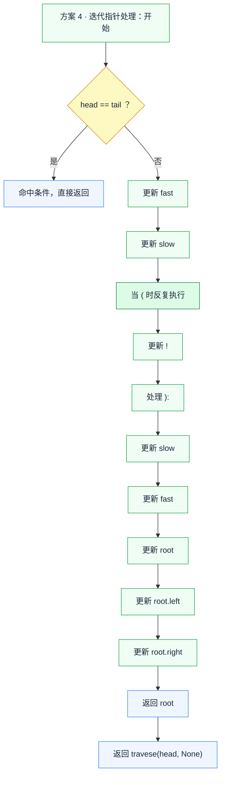

```python
import sys  # 提高递归深度上限（深输入防 RecursionError）

sys.setrecursionlimit(200000)  # 树/链表类题目节点数可达 1e4 量级

def sortedListToBST(head):  # 定义函数 sortedListToBST（参数：头节点）
    def travese(head, tail):  # 定义函数 travese（参数：头节点, 尾节点）
        if head == tail:
            return None  # 若 头节点 等于 尾节点: return None
        fast = head  # 把 头节点 存入 快指针
        slow = head  # 把 头节点 存入 慢指针
        while (
            fast != tail and fast.next != tail
        ):  # 循环，直到不满足「快指针 不等于 尾节点 and 快指针.下一个 不等于 尾节点」
            slow = slow.next  # 把 慢指针.下一个 存入 慢指针
            fast = fast.next.next  # 把 快指针.下一个.下一个 存入 快指针
        root = TreeNode(slow.val)  # 把 TreeNode(慢指针.值) 存入 根节点
        root.left = travese(head, slow)  # 把 travese(头节点,慢指针) 写入 左边界
        root.right = travese(slow.next, tail)  # 把 travese(慢指针.下一个,尾节点) 写入 右边界
        return root  # 返回 根节点

    return travese(head, None)  # 返回 travese(头节点, None)

if __name__ == "__main__":  # 若 __name__ 等于 '__main__'
    print(sortedListToBST(None))  # 打印输出
```

### Go 实现（4 种方案）

Go 的全部方案如下，每个方案都内嵌用例自测，可独立运行（老仓库 python/go 文件遵循「打印结果」约定）：

#### 方案 1：单趟扫描

**思路与代码分析**：核心是「单趟扫描」。Go 版用切片与多返回值惯用法，显式处理索引边界。

**运行架构**（真实控制流）：

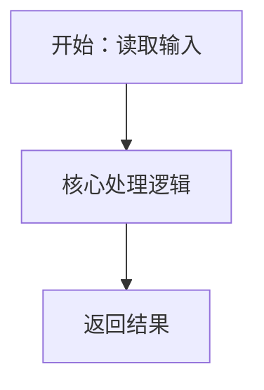

```go
package main // 引入依赖

import (
	"fmt"
	"os"
	"reflect"
) // 引入依赖

type ListNode struct {
	Val  int
	Next *ListNode
}                      // 定义类型
type TreeNode struct { // 定义类型
	Val   int       // Val int
	Left  *TreeNode // Left 乘 TreeNode
	Right *TreeNode // Right 乘 TreeNode
}

func buildList(vals []int) *ListNode { // 定义函数/方法 buildList
	dummy := &ListNode{}     // 把 按位与 ListNode{} 写入 dummy :
	cur := dummy             // 把 哨兵节点 写入 cur :
	for _, v := range vals { // 同时取 _ 与 值 遍历
		cur.Next = &ListNode{Val: v} // 把 按位与 ListNode{Val: 值} 写入 cur.Next
		cur = cur.Next               // 把 当前值.Next 写入 当前值
	}
	return dummy.Next // 返回 哨兵节点.Next
}

func treeLevel(root *TreeNode) []interface{} { // 定义函数/方法 treeLevel
	if root == nil { // 若 根节点 等于 nil
		return []interface{}{} // 返回 []interface{}{}
	}
	res := []interface{}{} // 把 []interface{}{} 写入 res :
	q := []*TreeNode{root} // 把 [] 乘 TreeNode{根节点} 写入 q :
	for len(q) > 0 {       // for 长度(节点) 超过 0 {
		n := q[0]     // 把 节点[0] 写入 n :
		q = q[1:]     // 把 节点[1:] 写入 节点
		if n == nil { // 若 元素个数 等于 nil
			res = append(res, nil) // 把 append(结果, nil) 写入 结果
			continue               // 跳过本轮，进入下一次
		}
		res = append(res, n.Val)       // 把 append(结果, 元素个数.Val) 写入 结果
		q = append(q, n.Left, n.Right) // 把 append(节点, 元素个数.Left, 元素个数.Right) 写入 节点
	}
	for len(res) > 0 { // for 长度(结果) 超过 0 {
		if res[len(res)-1] != nil { // 若 结果[长度(结果) 减 1] 不等于 nil
			break // 跳出循环
		}
		res = res[:len(res)-1] // 把 结果[:长度(结果) 减 1] 写入 结果
	}
	return res // 返回 结果
}

func sortedListToBST(head *ListNode) *TreeNode { // 定义函数/方法 sortedListToBST
	if head == nil { // 若 头节点 等于 nil
		return nil // 返回 nil
	}
	var nodes []*ListNode // var nodes [] 乘 ListNode
	for head != nil {     // 把 nil { 写入 for head !
		nodes = append(nodes, head) // 把 append(nodes, 头节点) 写入 nodes
		head = head.Next            // 把 头节点.Next 写入 头节点
	}
	var build func(int, int) *TreeNode // var build func(int, int) 乘 TreeNode
	build = func(l, r int) *TreeNode { // 把 func(左指针, 右指针 int) 乘 TreeNode { 写入 build
		if l > r { // 若 左指针 超过 右指针
			return nil // 返回 nil
		}
		mid := (l + r) / 2                     // 把 (左指针 加 右指针) 除以 2 写入 mid :
		root := &TreeNode{Val: nodes[mid].Val} // 把 按位与 TreeNode{Val: nodes[中点].Val} 写入 root :
		root.Left = build(l, mid-1)            // 把 build(左指针, 中点 减 1) 写入 root.Left
		root.Right = build(mid+1, r)           // 把 build(中点 加 1, 右指针) 写入 root.Right
		return root                            // 返回 根节点
	}
	return build(0, len(nodes)-1) // 定义函数/方法 build
}

func main() { // 程序入口：跑内嵌自测用例
	cases := []struct { // 把 []struct { 写入 cases :
		vals []int         // vals []int
		want []interface{} // want []interface{}
	}{ // }{
		{nil, []interface{}{}},
		{[]int{-10, -3, 0, 5, 9}, []interface{}{0, -10, 5, nil, -3, nil, 9}},
	}
	ok := true                // 把 true 写入 ok :
	for _, c := range cases { // 同时取 _ 与 字符 遍历
		if g := treeLevel(sortedListToBST(buildList(c.vals))); !reflect.DeepEqual(g, c.want) {
			ok = false                                            // 把 false 写入 ok
			fmt.Printf("FAIL %v=%v want %v\n", c.vals, g, c.want) // 打印输出
		}
	}
	if !ok { // 若 取反 ok
		os.Exit(1) // os.Exit(1)
	}
	fmt.Println("PASS") // 全部用例通过，输出 PASS
}
```

#### 方案 2：迭代指针处理

**思路与代码分析**：核心是「迭代指针处理」。Go 版用切片与多返回值惯用法，显式处理索引边界。**走读**：方案 2 · 迭代指针处理：开始 → 处理 if root == nil → 返回 []int → 更新 : → 更新 res → 更新 res → 更新 res → 返回 res。

**运行架构**（真实控制流）：


```go
package main // 引入依赖

import (
	"fmt"     // 「fmt」
	"os"      // 「os」
	"reflect" // 「reflect」
)

type TreeNode struct { // 定义类型
	Val   int       // Val int
	Left  *TreeNode // Left 乘 TreeNode
	Right *TreeNode // Right 乘 TreeNode
}

type ListNode struct { // 定义类型
	Val  int       // Val int
	Next *ListNode // Next 乘 ListNode
}

func buildList(vals []int) *ListNode { // 定义函数/方法 buildList
	if len(vals) == 0 { // 若 长度(vals) 等于 0
		return nil // 返回 nil
	}
	head := &ListNode{Val: vals[0]} // 把 按位与 ListNode{Val: vals[0]} 写入 head :
	cur := head                     // 把 头节点 写入 cur :
	for _, v := range vals[1:] {    // 同时取 _ 与 值 遍历
		cur.Next = &ListNode{Val: v} // 把 按位与 ListNode{Val: 值} 写入 cur.Next
		cur = cur.Next               // 把 当前值.Next 写入 当前值
	}
	return head // 返回 头节点
}

func listVals(head *ListNode) []int { // 定义函数/方法 listVals
	res := []int{}    // 把 []int{} 写入 res :
	for head != nil { // 把 nil { 写入 for head !
		res = append(res, head.Val) // 把 append(结果, 头节点.Val) 写入 结果
		head = head.Next            // 把 头节点.Next 写入 头节点
	}
	return res // 返回 结果
}

func inorder(root *TreeNode) []int { // 定义函数/方法 inorder
	if root == nil { // 若 根节点 等于 nil
		return []int{} // 返回 []int{}
	}
	res := []int{}                            // 把 []int{} 写入 res :
	res = append(res, inorder(root.Left)...)  // 把 append(结果, inorder(根节点.Left)...) 写入 结果
	res = append(res, root.Val)               // 把 append(结果, 根节点.Val) 写入 结果
	res = append(res, inorder(root.Right)...) // 把 append(结果, inorder(根节点.Right)...) 写入 结果
	return res                                // 返回 结果
}

func sortedListToBST(head *ListNode) *TreeNode { // 定义函数/方法 sortedListToBST
	var getMedian func(left, right *ListNode) *ListNode // var getMedian func(左边界, 右边界 乘 ListNode) 乘 ListNode
	getMedian = func(left, right *ListNode) *ListNode { // 把 func(左边界, 右边界 乘 ListNode) 乘 ListNode { 写入 getMedian
		fast := left                              // 把 左边界 写入 fast :
		slow := left                              // 把 左边界 写入 slow :
		for fast != right && fast.Next != right { // 把 右边界 且 快指针.Next 不等于 右边界 { 写入 for fast !
			fast = fast.Next.Next // 把 快指针.Next.Next 写入 快指针
			slow = slow.Next      // 把 慢指针.Next 写入 慢指针
		}
		return slow // 返回 慢指针
	}
	var buildTree func(left, right *ListNode) *TreeNode // var buildTree func(左边界, 右边界 乘 ListNode) 乘 TreeNode
	buildTree = func(left, right *ListNode) *TreeNode { // 把 func(左边界, 右边界 乘 ListNode) 乘 TreeNode { 写入 buildTree
		if left == right { // 若 左边界 等于 右边界
			return nil // 返回 nil
		}
		mid := getMedian(left, right)           // 把 getMedian(左边界, 右边界) 写入 mid :
		root := &TreeNode{Val: mid.Val}         // 把 按位与 TreeNode{Val: 中点.Val} 写入 root :
		root.Left = buildTree(left, mid)        // 把 buildTree(左边界, 中点) 写入 root.Left
		root.Right = buildTree(mid.Next, right) // 把 buildTree(中点.Next, 右边界) 写入 root.Right
		return root                             // 返回 根节点
	}
	return buildTree(head, nil) // 定义函数/方法 buildTree
}

type tc struct { // 定义类型
	vals []int // vals []int
	want []int // want []int
}

func main() { // 程序入口：跑内嵌自测用例
	cases := []tc{ // 把 []tc{ 写入 cases :
		{[]int{}, []int{}},
		{[]int{1, 2, 3}, []int{1, 2, 3}},
		{[]int{1, 2, 3, 4, 5, 6, 7}, []int{1, 2, 3, 4, 5, 6, 7}},
	}
	for idx, c := range cases { // 同时取 idx 与 字符 遍历
		head := buildList(c.vals)             // 把 buildList(字符.vals) 写入 head :
		got := inorder(sortedListToBST(head)) // 把 inorder(sortedListToBST(头节点)) 写入 got :
		if !reflect.DeepEqual(got, c.want) {  // 若 取反 reflect.DeepEqual(got, 字符.want
			fmt.Printf("case %d failed: got %v want %v\n", idx, got, c.want) // 打印输出
			os.Exit(1)                                                       // os.Exit(1)
		}
	}
	fmt.Println("PASS") // 全部用例通过，输出 PASS
}
```

#### 方案 3：单趟扫描

**思路与代码分析**：核心是「单趟扫描」。Go 版用切片与多返回值惯用法，显式处理索引边界。

**运行架构**：与方案 1 的控制流相同（同算法在该语言的等价实现），图见上。

```go
package main // 引入依赖

import (
	"fmt"
	"os"
	"reflect"
) // 引入依赖

type ListNode struct {
	Val  int
	Next *ListNode
}                      // 定义类型
type TreeNode struct { // 定义类型
	Val   int       // Val int
	Left  *TreeNode // Left 乘 TreeNode
	Right *TreeNode // Right 乘 TreeNode
}

func buildList(vals []int) *ListNode { // 定义函数/方法 buildList
	dummy := &ListNode{}     // 把 按位与 ListNode{} 写入 dummy :
	cur := dummy             // 把 哨兵节点 写入 cur :
	for _, v := range vals { // 同时取 _ 与 值 遍历
		cur.Next = &ListNode{Val: v} // 把 按位与 ListNode{Val: 值} 写入 cur.Next
		cur = cur.Next               // 把 当前值.Next 写入 当前值
	}
	return dummy.Next // 返回 哨兵节点.Next
}

func treeLevel(root *TreeNode) []interface{} { // 定义函数/方法 treeLevel
	if root == nil { // 若 根节点 等于 nil
		return []interface{}{} // 返回 []interface{}{}
	}
	res := []interface{}{} // 把 []interface{}{} 写入 res :
	q := []*TreeNode{root} // 把 [] 乘 TreeNode{根节点} 写入 q :
	for len(q) > 0 {       // for 长度(节点) 超过 0 {
		n := q[0]     // 把 节点[0] 写入 n :
		q = q[1:]     // 把 节点[1:] 写入 节点
		if n == nil { // 若 元素个数 等于 nil
			res = append(res, nil) // 把 append(结果, nil) 写入 结果
			continue               // 跳过本轮，进入下一次
		}
		res = append(res, n.Val)       // 把 append(结果, 元素个数.Val) 写入 结果
		q = append(q, n.Left, n.Right) // 把 append(节点, 元素个数.Left, 元素个数.Right) 写入 节点
	}
	for len(res) > 0 { // for 长度(结果) 超过 0 {
		if res[len(res)-1] != nil { // 若 结果[长度(结果) 减 1] 不等于 nil
			break // 跳出循环
		}
		res = res[:len(res)-1] // 把 结果[:长度(结果) 减 1] 写入 结果
	}
	return res // 返回 结果
}

func sortedListToBST(head *ListNode) *TreeNode { // 定义函数/方法 sortedListToBST
	length := 0                           // 把 0 写入 length :
	for p := head; p != nil; p = p.Next { // 把 头节点; 节点 不等于 nil; 节点 赋值为 节点.Next { 写入 for p :
		length++ // 长度 加一
	}
	var build func(int, int) *TreeNode // var build func(int, int) 乘 TreeNode
	build = func(l, r int) *TreeNode { // 把 func(左指针, 右指针 int) 乘 TreeNode { 写入 build
		if l > r { // 若 左指针 超过 右指针
			return nil // 返回 nil
		}
		mid := (l + r + 1) / 2       // 把 (左指针 加 右指针 加 1) 除以 2 写入 mid :
		root := &TreeNode{}          // 把 按位与 TreeNode{} 写入 root :
		root.Left = build(l, mid-1)  // 把 build(左指针, 中点 减 1) 写入 root.Left
		root.Val = head.Val          // 把 头节点.Val 写入 root.Val
		head = head.Next             // 把 头节点.Next 写入 头节点
		root.Right = build(mid+1, r) // 把 build(中点 加 1, 右指针) 写入 root.Right
		return root                  // 返回 根节点
	}
	return build(0, length-1) // 定义函数/方法 build
}

func main() { // 程序入口：跑内嵌自测用例
	cases := []struct { // 把 []struct { 写入 cases :
		vals []int         // vals []int
		want []interface{} // want []interface{}
	}{ // }{
		{nil, []interface{}{}},
		{[]int{-10, -3, 0, 5, 9}, []interface{}{0, -3, 9, -10, nil, 5}},
	}
	ok := true                // 把 true 写入 ok :
	for _, c := range cases { // 同时取 _ 与 字符 遍历
		if g := treeLevel(sortedListToBST(buildList(c.vals))); !reflect.DeepEqual(g, c.want) {
			ok = false                                            // 把 false 写入 ok
			fmt.Printf("FAIL %v=%v want %v\n", c.vals, g, c.want) // 打印输出
		}
	}
	if !ok { // 若 取反 ok
		os.Exit(1) // os.Exit(1)
	}
	fmt.Println("PASS") // 全部用例通过，输出 PASS
}
```

#### 方案 4：迭代指针处理

**思路与代码分析**：核心是「迭代指针处理」。Go 版用切片与多返回值惯用法，显式处理索引边界。**走读**：方案 4 · 迭代指针处理：开始 → 处理 if root == nil → 返回 []int → 更新 : → 更新 res → 更新 res → 更新 res → 返回 res。

**运行架构**（真实控制流）：

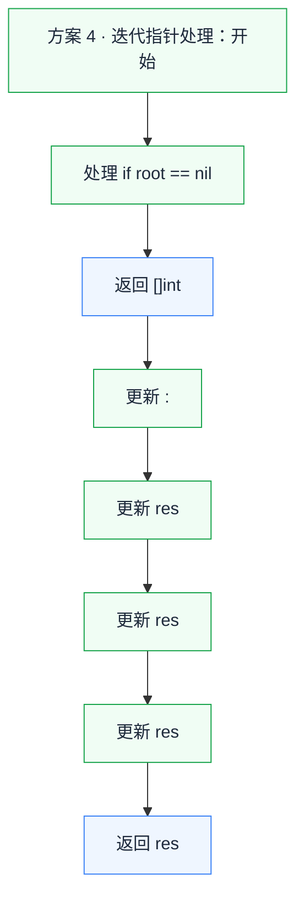

```go
package main // 引入依赖

import (
	"fmt"     // 「fmt」
	"os"      // 「os」
	"reflect" // 「reflect」
)

type TreeNode struct { // 定义类型
	Val   int       // Val int
	Left  *TreeNode // Left 乘 TreeNode
	Right *TreeNode // Right 乘 TreeNode
}

type ListNode struct { // 定义类型
	Val  int       // Val int
	Next *ListNode // Next 乘 ListNode
}

func buildList(vals []int) *ListNode { // 定义函数/方法 buildList
	if len(vals) == 0 { // 若 长度(vals) 等于 0
		return nil // 返回 nil
	}
	head := &ListNode{Val: vals[0]} // 把 按位与 ListNode{Val: vals[0]} 写入 head :
	cur := head                     // 把 头节点 写入 cur :
	for _, v := range vals[1:] {    // 同时取 _ 与 值 遍历
		cur.Next = &ListNode{Val: v} // 把 按位与 ListNode{Val: 值} 写入 cur.Next
		cur = cur.Next               // 把 当前值.Next 写入 当前值
	}
	return head // 返回 头节点
}

func listVals(head *ListNode) []int { // 定义函数/方法 listVals
	res := []int{}    // 把 []int{} 写入 res :
	for head != nil { // 把 nil { 写入 for head !
		res = append(res, head.Val) // 把 append(结果, 头节点.Val) 写入 结果
		head = head.Next            // 把 头节点.Next 写入 头节点
	}
	return res // 返回 结果
}

func inorder(root *TreeNode) []int { // 定义函数/方法 inorder
	if root == nil { // 若 根节点 等于 nil
		return []int{} // 返回 []int{}
	}
	res := []int{}                            // 把 []int{} 写入 res :
	res = append(res, inorder(root.Left)...)  // 把 append(结果, inorder(根节点.Left)...) 写入 结果
	res = append(res, root.Val)               // 把 append(结果, 根节点.Val) 写入 结果
	res = append(res, inorder(root.Right)...) // 把 append(结果, inorder(根节点.Right)...) 写入 结果
	return res                                // 返回 结果
}

func sortedListToBST(head *ListNode) *TreeNode { // 定义函数/方法 sortedListToBST
	var travese func(head, tail *ListNode) *TreeNode // var travese func(头节点, 尾节点 乘 ListNode) 乘 TreeNode
	travese = func(head, tail *ListNode) *TreeNode { // 把 func(头节点, 尾节点 乘 ListNode) 乘 TreeNode { 写入 travese
		if head == tail { // 若 头节点 等于 尾节点
			return nil // 返回 nil
		}
		fast := head                            // 把 头节点 写入 fast :
		slow := head                            // 把 头节点 写入 slow :
		for fast != tail && fast.Next != tail { // 把 尾节点 且 快指针.Next 不等于 尾节点 { 写入 for fast !
			slow = slow.Next      // 把 慢指针.Next 写入 慢指针
			fast = fast.Next.Next // 把 快指针.Next.Next 写入 快指针
		}
		root := &TreeNode{Val: slow.Val}      // 把 按位与 TreeNode{Val: 慢指针.Val} 写入 root :
		root.Left = travese(head, slow)       // 把 travese(头节点, 慢指针) 写入 root.Left
		root.Right = travese(slow.Next, tail) // 把 travese(慢指针.Next, 尾节点) 写入 root.Right
		return root                           // 返回 根节点
	}
	return travese(head, nil) // 定义函数/方法 travese
}

type tc struct { // 定义类型
	vals []int // vals []int
	want []int // want []int
}

func main() { // 程序入口：跑内嵌自测用例
	cases := []tc{ // 把 []tc{ 写入 cases :
		{[]int{}, []int{}},
		{[]int{1, 2, 3}, []int{1, 2, 3}},
		{[]int{1, 2, 3, 4, 5, 6, 7}, []int{1, 2, 3, 4, 5, 6, 7}},
	}
	for idx, c := range cases { // 同时取 idx 与 字符 遍历
		head := buildList(c.vals)             // 把 buildList(字符.vals) 写入 head :
		got := inorder(sortedListToBST(head)) // 把 inorder(sortedListToBST(头节点)) 写入 got :
		if !reflect.DeepEqual(got, c.want) {  // 若 取反 reflect.DeepEqual(got, 字符.want
			fmt.Printf("case %d failed: got %v want %v\n", idx, got, c.want) // 打印输出
			os.Exit(1)                                                       // os.Exit(1)
		}
	}
	fmt.Println("PASS") // 全部用例通过，输出 PASS
}
```

### Java 实现（4 种方案）

Java 的全部方案如下，每个方案都内嵌用例自测，可独立运行（老仓库 python/go 文件遵循「打印结果」约定）：

#### 方案 1：单趟扫描

**思路与代码分析**：核心是「单趟扫描」。Java 版用类与静态方法组织，集合操作显式明了。**走读**：方案 1 · 单趟扫描：开始 → 更新 val → 返回结果。

**运行架构**（真实控制流）：

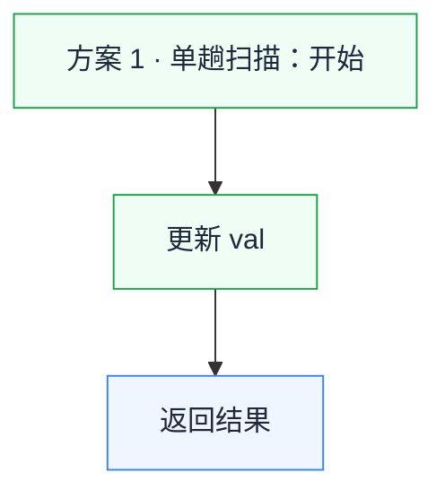

```java
package com.webfault.dsa; // 引入依赖

class ListNode { // 定义类型
  int val; // int 值;
  ListNode next; // ListNode 下一个;

  ListNode(int v) {
    val = v;
  } // 把 值; } 写入 ListNode(int v) { val
}

class TreeNode109 { // 定义类型
  int val; // int 值;
  TreeNode109 left; // TreeNode109 左边界;
  TreeNode109 right; // TreeNode109 右边界;

  TreeNode109(int v) {
    val = v;
  } // 把 值; } 写入 TreeNode109(int v) { val
}

class Main { // 定义类型
  java.util.List<ListNode> nodeList; // java.util.List 小于 ListNode 超过 nodeList;

  TreeNode109 build(int left, int right) { // 定义函数/方法 build
    if (left > right) return null; // 若 左边界 超过 右边界，直接返回 null
    int mid = left + (right - left) / 2; // 把 (左边界 加 右边界) 除以 2 存入 中点
    TreeNode109 root =
        new TreeNode109(
            nodeList.get(mid).val); // 把 new TreeNode109(nodeList 查找 中点).值); 写入 TreeNode109 root
    root.left = build(left, mid - 1); // 把 build(左边界, 中点 减 1); 写入 左边界
    root.right = build(mid + 1, right); // 把 build(中点 加 1, 右边界); 写入 右边界
    return root; // 返回 根节点
  }

  TreeNode109 sortedListToBST(ListNode head) { // 定义函数/方法 sortedListToBST
    nodeList = new java.util.ArrayList<>(); // 把 new java.util.ArrayList 小于 超过 (); 写入 nodeList
    ListNode p = head; // 把 头节点; 写入 ListNode p
    while (p != null) {
      nodeList.add(p);
      p = p.next;
    } // 循环，直到不满足「节点 不等于 null) { nodeList 追加 节点); 节点 赋值为 节点.下一个; }」
    return build(0, nodeList.size() - 1); // 返回 build(0, nodeList.大小() 减 1)
  }

  static ListNode buildList(int[] vals) { // 定义函数/方法 buildList
    ListNode head = null, cur = null; // 把 null, 当前值 赋值为 null; 写入 ListNode head
    for (int v : vals) { // for (int 值 : vals) {
      ListNode n = new ListNode(v); // 把 new ListNode(值); 写入 ListNode n
      if (head == null) head = n;
      else cur.next = n; // 若 头节点 等于 null) 头节点 赋值为 元素个数; else 当前值.下一个 赋值为 元素个数;
      cur = n; // 把 元素个数; 写入 当前值
    }
    return head; // 返回 头节点
  }

  static void inorder(TreeNode109 r, java.util.List<Integer> out) { // 定义函数/方法 inorder
    if (r == null) return; // 若 右指针 等于 null) return;
    inorder(r.left, out); // inorder(右指针.左边界, out);
    out.add(r.val); // out 追加 右指针.值);
    inorder(r.right, out); // inorder(右指针.右边界, out);
  }

  static int height(TreeNode109 r) { // 定义函数/方法 height
    if (r == null) return 0; // 若 右指针 等于 null，直接返回 0
    return 1
        + Math.max(
            height(r.left), height(r.right)); // 返回 1 加 Math.取较大值 height(右指针.左边界), height(右指针.右边界))
  }

  static boolean isBalanced(TreeNode109 r) { // 定义判定函数 isBalanced
    if (r == null) return true; // 若 右指针 等于 null，直接返回 true
    if (Math.abs(height(r.left) - height(r.right)) > 1) return false;
    return isBalanced(r.left)
        && isBalanced(r.right); // 返回 isBalanced(右指针.左边界) 且 isBalanced(右指针.右边界)
  }

  static boolean check(TreeNode109 r, int[] expected) { // 定义判定函数 check
    java.util.List<Integer> io = new java.util.ArrayList<>();
    inorder(r, io); // inorder(右指针, io);
    if (io.size() != expected.length) return false; // 若 io.大小() 不等于 expected.长度，直接返回 false
    for (int i = 0; i < expected.length; i++)
      if (io.get(i) != expected[i]) return false; // 让 下标 i 从 0 开始计数，下标 i 小于 expected.长度 就继续
    return isBalanced(r); // 返回 isBalanced(右指针)
  }

  public static void main(String[] args) { // public static void main(String[] args) {
    Main s = new Main(); // 把 new Main(); 写入 Main s
    boolean ok = true; // 把 true; 写入 boolean ok
    if (s.sortedListToBST(null) != null) {
      ok = false;
      System.out.println("FAIL null case");
    }
    TreeNode109 r = s.sortedListToBST(buildList(new int[] {-10, -3, 0, 5, 9}));
    if (!check(r, new int[] {-10, -3, 0, 5, 9})) {
      ok = false;
      System.out.println("FAIL list case");
    }
    if (!ok) throw new RuntimeException("FAILED"); // 若 取反 ok) throw new RuntimeException(「FAILED」);
    System.out.println("PASS"); // 全部用例通过，输出 PASS
  }
}
```

#### 方案 2：迭代指针处理

**思路与代码分析**：核心是「迭代指针处理」。Java 版用类与静态方法组织，集合操作显式明了。**走读**：方案 2 · 迭代指针处理：开始 → 更新 val → 返回结果。

**运行架构**（真实控制流）：

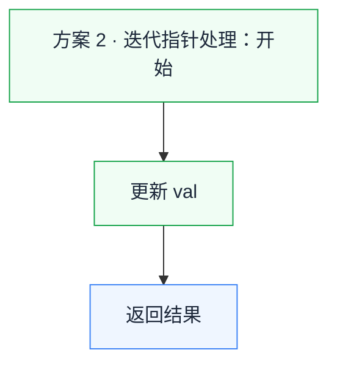

```java
package com.webfault.dsa; // 引入依赖

class ListNode { // 定义类型
  int val; // int 值;
  ListNode next; // ListNode 下一个;

  ListNode(int v) {
    val = v;
  } // 把 值; } 写入 ListNode(int v) { val
}

class TreeNode109 { // 定义类型
  int val; // int 值;
  TreeNode109 left; // TreeNode109 左边界;
  TreeNode109 right; // TreeNode109 右边界;

  TreeNode109(int v) {
    val = v;
  } // 把 值; } 写入 TreeNode109(int v) { val
}

class Main { // 定义类型
  ListNode getMedian(ListNode left, ListNode right) { // 定义函数/方法 getMedian
    ListNode fast = left, slow = left; // 把 左边界, 慢指针 赋值为 左边界; 写入 ListNode fast
    while (fast != right && fast.next != right) {
      fast = fast.next.next;
      slow = slow.next;
    }
    return slow; // 返回 慢指针
  }

  TreeNode109 buildTree(ListNode left, ListNode right) { // 定义函数/方法 buildTree
    if (left == right) return null; // 若 左边界 等于 右边界，直接返回 null
    ListNode mid = getMedian(left, right); // 把 getMedian(左边界, 右边界); 写入 ListNode mid
    TreeNode109 root = new TreeNode109(mid.val); // 把 new TreeNode109(中点.值); 写入 TreeNode109 root
    root.left = buildTree(left, mid); // 把 buildTree(左边界, 中点); 写入 左边界
    root.right = buildTree(mid.next, right); // 把 buildTree(中点.下一个, 右边界); 写入 右边界
    return root; // 返回 根节点
  }

  TreeNode109 sortedListToBST(ListNode head) {
    return buildTree(head, null);
  }

  static ListNode buildList(int[] vals) { // 定义函数/方法 buildList
    ListNode head = null, cur = null; // 把 null, 当前值 赋值为 null; 写入 ListNode head
    for (int v : vals) { // for (int 值 : vals) {
      ListNode n = new ListNode(v); // 把 new ListNode(值); 写入 ListNode n
      if (head == null) head = n;
      else cur.next = n; // 若 头节点 等于 null) 头节点 赋值为 元素个数; else 当前值.下一个 赋值为 元素个数;
      cur = n; // 把 元素个数; 写入 当前值
    }
    return head; // 返回 头节点
  }

  static void inorder(TreeNode109 r, java.util.List<Integer> out) { // 定义函数/方法 inorder
    if (r == null) return; // 若 右指针 等于 null) return;
    inorder(r.left, out); // inorder(右指针.左边界, out);
    out.add(r.val); // out 追加 右指针.值);
    inorder(r.right, out); // inorder(右指针.右边界, out);
  }

  static int height(TreeNode109 r) { // 定义函数/方法 height
    if (r == null) return 0; // 若 右指针 等于 null，直接返回 0
    return 1
        + Math.max(
            height(r.left), height(r.right)); // 返回 1 加 Math.取较大值 height(右指针.左边界), height(右指针.右边界))
  }

  static boolean isBalanced(TreeNode109 r) { // 定义判定函数 isBalanced
    if (r == null) return true; // 若 右指针 等于 null，直接返回 true
    if (Math.abs(height(r.left) - height(r.right)) > 1) return false;
    return isBalanced(r.left)
        && isBalanced(r.right); // 返回 isBalanced(右指针.左边界) 且 isBalanced(右指针.右边界)
  }

  static boolean check(TreeNode109 r, int[] expected) { // 定义判定函数 check
    java.util.List<Integer> io = new java.util.ArrayList<>();
    inorder(r, io); // inorder(右指针, io);
    if (io.size() != expected.length) return false; // 若 io.大小() 不等于 expected.长度，直接返回 false
    for (int i = 0; i < expected.length; i++)
      if (io.get(i) != expected[i]) return false; // 让 下标 i 从 0 开始计数，下标 i 小于 expected.长度 就继续
    return isBalanced(r); // 返回 isBalanced(右指针)
  }

  public static void main(String[] args) { // public static void main(String[] args) {
    Main s = new Main(); // 把 new Main(); 写入 Main s
    boolean ok = true; // 把 true; 写入 boolean ok
    if (s.sortedListToBST(null) != null) {
      ok = false;
      System.out.println("FAIL null case");
    }
    TreeNode109 r = s.sortedListToBST(buildList(new int[] {-10, -3, 0, 5, 9}));
    if (!check(r, new int[] {-10, -3, 0, 5, 9})) {
      ok = false;
      System.out.println("FAIL list case");
    }
    if (!ok) throw new RuntimeException("FAILED"); // 若 取反 ok) throw new RuntimeException(「FAILED」);
    System.out.println("PASS"); // 全部用例通过，输出 PASS
  }
}
```

#### 方案 3：单趟扫描

**思路与代码分析**：核心是「单趟扫描」。Java 版用类与静态方法组织，集合操作显式明了。**走读**：方案 3 · 单趟扫描：开始 → 更新 val → 返回结果。

**运行架构**（真实控制流）：


```java
package com.webfault.dsa; // 引入依赖

class ListNode { // 定义类型
  int val; // int 值;
  ListNode next; // ListNode 下一个;

  ListNode(int v) {
    val = v;
  } // 把 值; } 写入 ListNode(int v) { val
}

class TreeNode109 { // 定义类型
  int val; // int 值;
  TreeNode109 left; // TreeNode109 左边界;
  TreeNode109 right; // TreeNode109 右边界;

  TreeNode109(int v) {
    val = v;
  } // 把 值; } 写入 TreeNode109(int v) { val
}

class Main { // 定义类型
  ListNode cur; // ListNode 当前值;

  int getLength(ListNode head) {
    int l = 0;
    while (head != null) {
      l++;
      head = head.next;
    }
    return l;
  }

  TreeNode109 buildTree(int left, int right) { // 定义函数/方法 buildTree
    if (left > right) return null; // 若 左边界 超过 右边界，直接返回 null
    int mid = (left + right + 1) / 2; // 把 (左边界 加 右边界 加 1) 除以 2 存入 中点
    TreeNode109 root = new TreeNode109(0); // 把 new TreeNode109(0); 写入 TreeNode109 root
    root.left = buildTree(left, mid - 1); // 把 buildTree(左边界, 中点 减 1); 写入 左边界
    if (cur != null) {
      root.val = cur.val;
      cur = cur.next;
    } // 若 当前值 不等于 null) { 根节点.值 赋值为 当前值.值; 当前值 赋值为 当前值.下一个; }
    root.right = buildTree(mid + 1, right); // 把 buildTree(中点 加 1, 右边界); 写入 右边界
    return root; // 返回 根节点
  }

  TreeNode109 sortedListToBST(ListNode head) {
    cur = head;
    int len = getLength(head);
    return buildTree(0, len - 1);
  }

  static ListNode buildList(int[] vals) { // 定义函数/方法 buildList
    ListNode head = null, cur = null; // 把 null, 当前值 赋值为 null; 写入 ListNode head
    for (int v : vals) { // for (int 值 : vals) {
      ListNode n = new ListNode(v); // 把 new ListNode(值); 写入 ListNode n
      if (head == null) head = n;
      else cur.next = n; // 若 头节点 等于 null) 头节点 赋值为 元素个数; else 当前值.下一个 赋值为 元素个数;
      cur = n; // 把 元素个数; 写入 当前值
    }
    return head; // 返回 头节点
  }

  static void inorder(TreeNode109 r, java.util.List<Integer> out) { // 定义函数/方法 inorder
    if (r == null) return; // 若 右指针 等于 null) return;
    inorder(r.left, out); // inorder(右指针.左边界, out);
    out.add(r.val); // out 追加 右指针.值);
    inorder(r.right, out); // inorder(右指针.右边界, out);
  }

  static int height(TreeNode109 r) { // 定义函数/方法 height
    if (r == null) return 0; // 若 右指针 等于 null，直接返回 0
    return 1
        + Math.max(
            height(r.left), height(r.right)); // 返回 1 加 Math.取较大值 height(右指针.左边界), height(右指针.右边界))
  }

  static boolean isBalanced(TreeNode109 r) { // 定义判定函数 isBalanced
    if (r == null) return true; // 若 右指针 等于 null，直接返回 true
    if (Math.abs(height(r.left) - height(r.right)) > 1) return false;
    return isBalanced(r.left)
        && isBalanced(r.right); // 返回 isBalanced(右指针.左边界) 且 isBalanced(右指针.右边界)
  }

  static boolean check(TreeNode109 r, int[] expected) { // 定义判定函数 check
    java.util.List<Integer> io = new java.util.ArrayList<>();
    inorder(r, io); // inorder(右指针, io);
    if (io.size() != expected.length) return false; // 若 io.大小() 不等于 expected.长度，直接返回 false
    for (int i = 0; i < expected.length; i++)
      if (io.get(i) != expected[i]) return false; // 让 下标 i 从 0 开始计数，下标 i 小于 expected.长度 就继续
    return isBalanced(r); // 返回 isBalanced(右指针)
  }

  public static void main(String[] args) { // public static void main(String[] args) {
    Main s = new Main(); // 把 new Main(); 写入 Main s
    boolean ok = true; // 把 true; 写入 boolean ok
    if (s.sortedListToBST(null) != null) {
      ok = false;
      System.out.println("FAIL null case");
    }
    TreeNode109 r = s.sortedListToBST(buildList(new int[] {-10, -3, 0, 5, 9}));
    if (!check(r, new int[] {-10, -3, 0, 5, 9})) {
      ok = false;
      System.out.println("FAIL list case");
    }
    if (!ok) throw new RuntimeException("FAILED"); // 若 取反 ok) throw new RuntimeException(「FAILED」);
    System.out.println("PASS"); // 全部用例通过，输出 PASS
  }
}
```

#### 方案 4：迭代指针处理

**思路与代码分析**：核心是「迭代指针处理」。Java 版用类与静态方法组织，集合操作显式明了。**走读**：方案 4 · 迭代指针处理：开始 → 更新 val → 返回结果。

**运行架构**（真实控制流）：


```java
package com.webfault.dsa; // 引入依赖

class ListNode { // 定义类型
  int val; // int 值;
  ListNode next; // ListNode 下一个;

  ListNode(int v) {
    val = v;
  } // 把 值; } 写入 ListNode(int v) { val
}

class TreeNode109 { // 定义类型
  int val; // int 值;
  TreeNode109 left; // TreeNode109 左边界;
  TreeNode109 right; // TreeNode109 右边界;

  TreeNode109(int v) {
    val = v;
  } // 把 值; } 写入 TreeNode109(int v) { val
}

class Main { // 定义类型
  TreeNode109 travese(ListNode head, ListNode tail) { // 定义函数/方法 travese
    if (head == tail) return null; // 若 头节点 等于 尾节点，直接返回 null
    ListNode fast = head, slow = head; // 把 头节点, 慢指针 赋值为 头节点; 写入 ListNode fast
    while (fast != tail && fast.next != tail) {
      slow = slow.next;
      fast = fast.next.next;
    }
    TreeNode109 root = new TreeNode109(slow.val); // 把 new TreeNode109(慢指针.值); 写入 TreeNode109 root
    root.left = travese(head, slow); // 把 travese(头节点, 慢指针); 写入 左边界
    root.right = travese(slow.next, tail); // 把 travese(慢指针.下一个, 尾节点); 写入 右边界
    return root; // 返回 根节点
  }

  TreeNode109 sortedListToBST(ListNode head) {
    return travese(head, null);
  }

  static ListNode buildList(int[] vals) { // 定义函数/方法 buildList
    ListNode head = null, cur = null; // 把 null, 当前值 赋值为 null; 写入 ListNode head
    for (int v : vals) { // for (int 值 : vals) {
      ListNode n = new ListNode(v); // 把 new ListNode(值); 写入 ListNode n
      if (head == null) head = n;
      else cur.next = n; // 若 头节点 等于 null) 头节点 赋值为 元素个数; else 当前值.下一个 赋值为 元素个数;
      cur = n; // 把 元素个数; 写入 当前值
    }
    return head; // 返回 头节点
  }

  static void inorder(TreeNode109 r, java.util.List<Integer> out) { // 定义函数/方法 inorder
    if (r == null) return; // 若 右指针 等于 null) return;
    inorder(r.left, out); // inorder(右指针.左边界, out);
    out.add(r.val); // out 追加 右指针.值);
    inorder(r.right, out); // inorder(右指针.右边界, out);
  }

  static int height(TreeNode109 r) { // 定义函数/方法 height
    if (r == null) return 0; // 若 右指针 等于 null，直接返回 0
    return 1
        + Math.max(
            height(r.left), height(r.right)); // 返回 1 加 Math.取较大值 height(右指针.左边界), height(右指针.右边界))
  }

  static boolean isBalanced(TreeNode109 r) { // 定义判定函数 isBalanced
    if (r == null) return true; // 若 右指针 等于 null，直接返回 true
    if (Math.abs(height(r.left) - height(r.right)) > 1) return false;
    return isBalanced(r.left)
        && isBalanced(r.right); // 返回 isBalanced(右指针.左边界) 且 isBalanced(右指针.右边界)
  }

  static boolean check(TreeNode109 r, int[] expected) { // 定义判定函数 check
    java.util.List<Integer> io = new java.util.ArrayList<>();
    inorder(r, io); // inorder(右指针, io);
    if (io.size() != expected.length) return false; // 若 io.大小() 不等于 expected.长度，直接返回 false
    for (int i = 0; i < expected.length; i++)
      if (io.get(i) != expected[i]) return false; // 让 下标 i 从 0 开始计数，下标 i 小于 expected.长度 就继续
    return isBalanced(r); // 返回 isBalanced(右指针)
  }

  public static void main(String[] args) { // public static void main(String[] args) {
    Main s = new Main(); // 把 new Main(); 写入 Main s
    boolean ok = true; // 把 true; 写入 boolean ok
    if (s.sortedListToBST(null) != null) {
      ok = false;
      System.out.println("FAIL null case");
    }
    TreeNode109 r = s.sortedListToBST(buildList(new int[] {-10, -3, 0, 5, 9}));
    if (!check(r, new int[] {-10, -3, 0, 5, 9})) {
      ok = false;
      System.out.println("FAIL list case");
    }
    if (!ok) throw new RuntimeException("FAILED"); // 若 取反 ok) throw new RuntimeException(「FAILED」);
    System.out.println("PASS"); // 全部用例通过，输出 PASS
  }
}
```

### Rust 实现（4 种方案）

Rust 的全部方案如下，每个方案都内嵌用例自测，可独立运行（老仓库 python/go 文件遵循「打印结果」约定）：

#### 方案 1：单趟扫描

**思路与代码分析**：核心是「单趟扫描」。Rust 版用所有权移动与切片借用改写同一逻辑，注意 Option 与引用边界。**走读**：方案 1 · 单趟扫描：开始 → 计算 nodes → 计算 cur → 当 let Some(n) = cur 时反复执行 → 向 nodes 追加记录 → 更新 cur → 处理 if left ＞ right → 返回 None → 计算 mid → 计算 root → 更新 root.borrow_mut().left → 更新 root.borrow_mut().right → 调用 Some(root) → 处理 if nodes.is_empty() → 处理 None → 调用 build(&nodes, 0, nodes.len()。

**运行架构**（真实控制流）：

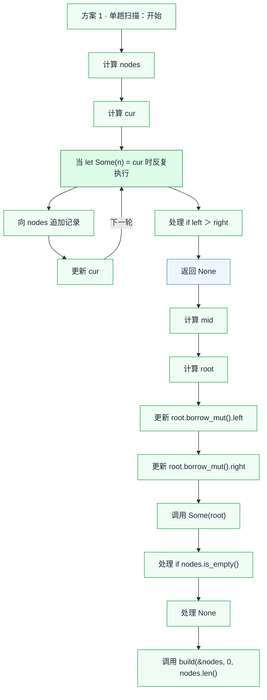

```rust
// LeetCode 109. 有序链表转换二叉搜索树 — Rust 版（方案1）
use std::cell::RefCell;
use std::rc::Rc; // 引入依赖 // 引入依赖

#[derive(Debug)]
struct TreeNode {
    // 定义类型
    val: i32,
    left: Option<Rc<RefCell<TreeNode>>>,
    right: Option<Rc<RefCell<TreeNode>>>,
}

impl TreeNode {
    // 实现块
    fn new(val: i32) -> Rc<RefCell<TreeNode>> {
        // 定义函数/方法 new
        Rc::new(RefCell::new(TreeNode {
            val,
            left: None,
            right: None,
        })) // Rc::new(RefCell::new(TreeNode { 值, 左边界: None, 右边界: None }))
    }
}

fn build_tree(vals: &[Option<i32>]) -> Option<Rc<RefCell<TreeNode>>> {
    // 定义函数/方法 build_tree
    if vals.is_empty() || vals[0].is_none() {
        // 若 vals 是否为空 或 vals[0].is_none(
        return None; // 返回 None
    }
    let root = TreeNode::new(vals[0].unwrap()); // 把 TreeNode::new(vals[0].unwrap()) 存入 根节点
    let mut queue: Vec<Rc<RefCell<TreeNode>>> = vec![root.clone()];
    let mut i = 1; // 把 1; 写入 let mut i
    while !queue.is_empty() && i < vals.len() {
        // while 取反 队列 是否为空 且 下标 i 小于 vals.长度() {
        let node = queue.remove(0); // 把 队列 弹出 0) 存入 节点
        if i < vals.len() {
            // 若 下标 i 小于 vals.长度(
            if let Some(v) = vals[i] {
                // 若 let Some(值) 赋值为 vals[下标 i]
                let child = TreeNode::new(v); // 把 TreeNode::new(值) 存入 子节点
                node.borrow_mut().left = Some(child.clone()); // 把 Some(子节点.clone()); 写入 左边界
                queue.push(child); // 把 子节点 压入栈/数组尾部
            }
            i += 1; // 下标 i累加 1
        }
        if i < vals.len() {
            // 若 下标 i 小于 vals.长度(
            if let Some(v) = vals[i] {
                // 若 let Some(值) 赋值为 vals[下标 i]
                let child = TreeNode::new(v); // 把 TreeNode::new(值) 存入 子节点
                node.borrow_mut().right = Some(child.clone()); // 把 Some(子节点.clone()); 写入 右边界
                queue.push(child); // 把 子节点 压入栈/数组尾部
            }
            i += 1; // 下标 i累加 1
        }
    }
    Some(root) // Some(根节点)
}

#[derive(Debug)]
struct ListNode {
    val: i32,
    next: Option<Box<ListNode>>,
} // 定义类型
fn build_list(vals: &[i32]) -> Option<Box<ListNode>> {
    // 定义函数/方法 build_list
    let mut head: Option<Box<ListNode>> = None; // 把 None; 写入 let mut head: Option<Box<ListNode>>
    for &v in vals.iter().rev() {
        // for 按位与 值 in vals.iter().rev() {
        let mut n = Box::new(ListNode { val: v, next: None }); // 把 Box::new(ListNode { 值: 值, 下一个: None }); 写入 let mut n
        n.next = head; // 把 头节点; 写入 下一个
        head = Some(n); // 把 Some(元素个数); 写入 头节点
    }
    head // 头节点
}
fn sorted_list_to_bst(head: Option<Box<ListNode>>) -> Option<Rc<RefCell<TreeNode>>> {
    // 定义函数/方法 sorted_list_to_bst
    let mut nodes: Vec<i32> = Vec::new(); // 把 Vec::new(); 写入 let mut nodes: Vec<i32>
    let mut cur = &head; // 把 按位与 头节点; 写入 let mut cur
    while let Some(n) = cur {
        // 边取边处理，取空即停
        nodes.push(n.val); // 把 元素个数.值 压入栈/数组尾部
        cur = &n.next; // 把 按位与 元素个数.下一个; 写入 当前值
    }
    fn build(nodes: &[i32], left: isize, right: isize) -> Option<Rc<RefCell<TreeNode>>> {
        // 定义函数/方法 build
        if left > right {
            return None;
        } // 若 左边界 超过 右边界 { return None; }
        let mid = left + (right - left) / 2; // 把 左边界 加 (右边界 减 左边界) 除以 2 存入 中点
        let root = TreeNode::new(nodes[mid as usize]); // 把 TreeNode::new(nodes[中点 as usize]) 存入 根节点
        root.borrow_mut().left = build(nodes, left, mid - 1); // 把 build(nodes, 左边界, 中点 减 1); 写入 左边界
        root.borrow_mut().right = build(nodes, mid + 1, right); // 把 build(nodes, 中点 加 1, 右边界); 写入 右边界
        Some(root) // Some(根节点)
    }
    if nodes.is_empty() {
        None
    } else {
        build(&nodes, 0, nodes.len() as isize - 1)
    }
}
fn inorder(n: Option<&Rc<RefCell<TreeNode>>>, out: &mut Vec<i32>) {
    // 定义函数/方法 inorder
    let node = match n {
        Some(x) => x,
        None => return,
    };
    let nb = node.borrow(); // 把 节点.borrow() 存入 nb
    inorder(nb.left.as_ref(), out); // inorder(nb.左边界.as_ref(), out);
    out.push(nb.val); // 把 nb.值 压入栈/数组尾部
    inorder(nb.right.as_ref(), out); // inorder(nb.右边界.as_ref(), out);
}
fn main() {
    // 程序入口：跑内嵌自测用例
    assert!(sorted_list_to_bst(None).is_none()); // 断言校验
    let t = sorted_list_to_bst(build_list(&[1, 2, 3])); // 把 sorted_list_to_bst(build_list( 按位与 [1, 2, 3])) 存入 另一字符串
    let mut out = Vec::new(); // 把 Vec::new(); 写入 let mut out
    inorder(t.as_ref(), &mut out); // inorder(另一字符串.as_ref(), 按位与 mut out);
    assert_eq!(out, vec![1, 2, 3]); // 断言校验
                                    // 结构验证：[1,2,3] 中点 2 为根
    let mut lvl = std::collections::VecDeque::new(); // 把 std::collections::VecDeque::new(); 写入 let mut lvl
    lvl.push_back(t.clone().unwrap()); // lvl 追加 另一字符串.clone().unwrap());
    let mut flat = Vec::new(); // 把 Vec::new(); 写入 let mut flat
    while let Some(n) = lvl.pop_front() {
        // 边取边处理，取空即停
        let nb = n.borrow(); // 把 元素个数.borrow() 存入 nb
        flat.push(nb.val); // 把 nb.值 压入栈/数组尾部
        if let Some(c) = nb.left.clone() {
            lvl.push_back(c);
        } // 若 let Some(字符) 赋值为 nb.左边界.clone() { lvl 追加 字符); }
        if let Some(c) = nb.right.clone() {
            lvl.push_back(c);
        } // 若 let Some(字符) 赋值为 nb.右边界.clone() { lvl 追加 字符); }
    }
    assert_eq!(flat, vec![2, 1, 3]); // 断言校验
    println!("PASS"); // 全部用例通过，输出 PASS
}
```

#### 方案 2：迭代指针处理

**思路与代码分析**：核心是「迭代指针处理」。Rust 版用所有权移动与切片借用改写同一逻辑，注意 Option 与引用边界。**走读**：方案 2 · 迭代指针处理：开始 → 计算 nodes → 计算 cur → 当 let Some(n) = cur 时反复执行 → 向 nodes 追加记录 → 更新 cur → 处理 if left ＞ right → 返回 None → 计算 mid → 计算 root → 更新 root.borrow_mut().left → 更新 root.borrow_mut().right → 调用 Some(root) → 处理 if nodes.is_empty() → 处理 None → 调用 build(&nodes, 0, nodes.len()。

**运行架构**（真实控制流）：


```rust
// LeetCode 109. 有序链表转换二叉搜索树 — Rust 版（方案2）
use std::cell::RefCell;
use std::rc::Rc; // 引入依赖 // 引入依赖

#[derive(Debug)]
struct TreeNode {
    // 定义类型
    val: i32,
    left: Option<Rc<RefCell<TreeNode>>>,
    right: Option<Rc<RefCell<TreeNode>>>,
}

impl TreeNode {
    // 实现块
    fn new(val: i32) -> Rc<RefCell<TreeNode>> {
        // 定义函数/方法 new
        Rc::new(RefCell::new(TreeNode {
            val,
            left: None,
            right: None,
        })) // Rc::new(RefCell::new(TreeNode { 值, 左边界: None, 右边界: None }))
    }
}

fn build_tree(vals: &[Option<i32>]) -> Option<Rc<RefCell<TreeNode>>> {
    // 定义函数/方法 build_tree
    if vals.is_empty() || vals[0].is_none() {
        // 若 vals 是否为空 或 vals[0].is_none(
        return None; // 返回 None
    }
    let root = TreeNode::new(vals[0].unwrap()); // 把 TreeNode::new(vals[0].unwrap()) 存入 根节点
    let mut queue: Vec<Rc<RefCell<TreeNode>>> = vec![root.clone()];
    let mut i = 1; // 把 1; 写入 let mut i
    while !queue.is_empty() && i < vals.len() {
        // while 取反 队列 是否为空 且 下标 i 小于 vals.长度() {
        let node = queue.remove(0); // 把 队列 弹出 0) 存入 节点
        if i < vals.len() {
            // 若 下标 i 小于 vals.长度(
            if let Some(v) = vals[i] {
                // 若 let Some(值) 赋值为 vals[下标 i]
                let child = TreeNode::new(v); // 把 TreeNode::new(值) 存入 子节点
                node.borrow_mut().left = Some(child.clone()); // 把 Some(子节点.clone()); 写入 左边界
                queue.push(child); // 把 子节点 压入栈/数组尾部
            }
            i += 1; // 下标 i累加 1
        }
        if i < vals.len() {
            // 若 下标 i 小于 vals.长度(
            if let Some(v) = vals[i] {
                // 若 let Some(值) 赋值为 vals[下标 i]
                let child = TreeNode::new(v); // 把 TreeNode::new(值) 存入 子节点
                node.borrow_mut().right = Some(child.clone()); // 把 Some(子节点.clone()); 写入 右边界
                queue.push(child); // 把 子节点 压入栈/数组尾部
            }
            i += 1; // 下标 i累加 1
        }
    }
    Some(root) // Some(根节点)
}

#[derive(Debug)]
struct ListNode {
    val: i32,
    next: Option<Box<ListNode>>,
} // 定义类型
fn build_list(vals: &[i32]) -> Option<Box<ListNode>> {
    // 定义函数/方法 build_list
    let mut head: Option<Box<ListNode>> = None; // 把 None; 写入 let mut head: Option<Box<ListNode>>
    for &v in vals.iter().rev() {
        // for 按位与 值 in vals.iter().rev() {
        let mut n = Box::new(ListNode { val: v, next: None }); // 把 Box::new(ListNode { 值: 值, 下一个: None }); 写入 let mut n
        n.next = head; // 把 头节点; 写入 下一个
        head = Some(n); // 把 Some(元素个数); 写入 头节点
    }
    head // 头节点
}
fn sorted_list_to_bst(head: Option<Box<ListNode>>) -> Option<Rc<RefCell<TreeNode>>> {
    // 定义函数/方法 sorted_list_to_bst
    let mut nodes: Vec<i32> = Vec::new(); // 把 Vec::new(); 写入 let mut nodes: Vec<i32>
    let mut cur = &head; // 把 按位与 头节点; 写入 let mut cur
    while let Some(n) = cur {
        // 边取边处理，取空即停
        nodes.push(n.val); // 把 元素个数.值 压入栈/数组尾部
        cur = &n.next; // 把 按位与 元素个数.下一个; 写入 当前值
    }
    fn build(nodes: &[i32], left: isize, right: isize) -> Option<Rc<RefCell<TreeNode>>> {
        // 定义函数/方法 build
        if left > right {
            return None;
        } // 若 左边界 超过 右边界 { return None; }
        let mid = left + (right - left) / 2; // 把 左边界 加 (右边界 减 左边界) 除以 2 存入 中点
        let root = TreeNode::new(nodes[mid as usize]); // 把 TreeNode::new(nodes[中点 as usize]) 存入 根节点
        root.borrow_mut().left = build(nodes, left, mid - 1); // 把 build(nodes, 左边界, 中点 减 1); 写入 左边界
        root.borrow_mut().right = build(nodes, mid + 1, right); // 把 build(nodes, 中点 加 1, 右边界); 写入 右边界
        Some(root) // Some(根节点)
    }
    if nodes.is_empty() {
        None
    } else {
        build(&nodes, 0, nodes.len() as isize - 1)
    }
}
fn inorder(n: Option<&Rc<RefCell<TreeNode>>>, out: &mut Vec<i32>) {
    // 定义函数/方法 inorder
    let node = match n {
        Some(x) => x,
        None => return,
    };
    let nb = node.borrow(); // 把 节点.borrow() 存入 nb
    inorder(nb.left.as_ref(), out); // inorder(nb.左边界.as_ref(), out);
    out.push(nb.val); // 把 nb.值 压入栈/数组尾部
    inorder(nb.right.as_ref(), out); // inorder(nb.右边界.as_ref(), out);
}
fn main() {
    // 程序入口：跑内嵌自测用例
    assert!(sorted_list_to_bst(None).is_none()); // 断言校验
    let t = sorted_list_to_bst(build_list(&[1, 2, 3])); // 把 sorted_list_to_bst(build_list( 按位与 [1, 2, 3])) 存入 另一字符串
    let mut out = Vec::new(); // 把 Vec::new(); 写入 let mut out
    inorder(t.as_ref(), &mut out); // inorder(另一字符串.as_ref(), 按位与 mut out);
    assert_eq!(out, vec![1, 2, 3]); // 断言校验
                                    // 结构验证：[1,2,3] 中点 2 为根
    let mut lvl = std::collections::VecDeque::new(); // 把 std::collections::VecDeque::new(); 写入 let mut lvl
    lvl.push_back(t.clone().unwrap()); // lvl 追加 另一字符串.clone().unwrap());
    let mut flat = Vec::new(); // 把 Vec::new(); 写入 let mut flat
    while let Some(n) = lvl.pop_front() {
        // 边取边处理，取空即停
        let nb = n.borrow(); // 把 元素个数.borrow() 存入 nb
        flat.push(nb.val); // 把 nb.值 压入栈/数组尾部
        if let Some(c) = nb.left.clone() {
            lvl.push_back(c);
        } // 若 let Some(字符) 赋值为 nb.左边界.clone() { lvl 追加 字符); }
        if let Some(c) = nb.right.clone() {
            lvl.push_back(c);
        } // 若 let Some(字符) 赋值为 nb.右边界.clone() { lvl 追加 字符); }
    }
    assert_eq!(flat, vec![2, 1, 3]); // 断言校验
    println!("PASS"); // 全部用例通过，输出 PASS
}
```

#### 方案 3：单趟扫描

**思路与代码分析**：核心是「单趟扫描」。Rust 版用所有权移动与切片借用改写同一逻辑，注意 Option 与引用边界。**走读**：方案 3 · 单趟扫描：开始 → 计算 nodes → 计算 cur → 当 let Some(n) = cur 时反复执行 → 向 nodes 追加记录 → 更新 cur → 处理 if left ＞ right → 返回 None → 计算 mid → 计算 root → 更新 root.borrow_mut().left → 更新 root.borrow_mut().right → 调用 Some(root) → 处理 if nodes.is_empty() → 处理 None → 调用 build(&nodes, 0, nodes.len()。

**运行架构**（真实控制流）：


```rust
// LeetCode 109. 有序链表转换二叉搜索树 — Rust 版（方案3）
use std::cell::RefCell;
use std::rc::Rc; // 引入依赖 // 引入依赖

#[derive(Debug)]
struct TreeNode {
    // 定义类型
    val: i32,
    left: Option<Rc<RefCell<TreeNode>>>,
    right: Option<Rc<RefCell<TreeNode>>>,
}

impl TreeNode {
    // 实现块
    fn new(val: i32) -> Rc<RefCell<TreeNode>> {
        // 定义函数/方法 new
        Rc::new(RefCell::new(TreeNode {
            val,
            left: None,
            right: None,
        })) // Rc::new(RefCell::new(TreeNode { 值, 左边界: None, 右边界: None }))
    }
}

fn build_tree(vals: &[Option<i32>]) -> Option<Rc<RefCell<TreeNode>>> {
    // 定义函数/方法 build_tree
    if vals.is_empty() || vals[0].is_none() {
        // 若 vals 是否为空 或 vals[0].is_none(
        return None; // 返回 None
    }
    let root = TreeNode::new(vals[0].unwrap()); // 把 TreeNode::new(vals[0].unwrap()) 存入 根节点
    let mut queue: Vec<Rc<RefCell<TreeNode>>> = vec![root.clone()];
    let mut i = 1; // 把 1; 写入 let mut i
    while !queue.is_empty() && i < vals.len() {
        // while 取反 队列 是否为空 且 下标 i 小于 vals.长度() {
        let node = queue.remove(0); // 把 队列 弹出 0) 存入 节点
        if i < vals.len() {
            // 若 下标 i 小于 vals.长度(
            if let Some(v) = vals[i] {
                // 若 let Some(值) 赋值为 vals[下标 i]
                let child = TreeNode::new(v); // 把 TreeNode::new(值) 存入 子节点
                node.borrow_mut().left = Some(child.clone()); // 把 Some(子节点.clone()); 写入 左边界
                queue.push(child); // 把 子节点 压入栈/数组尾部
            }
            i += 1; // 下标 i累加 1
        }
        if i < vals.len() {
            // 若 下标 i 小于 vals.长度(
            if let Some(v) = vals[i] {
                // 若 let Some(值) 赋值为 vals[下标 i]
                let child = TreeNode::new(v); // 把 TreeNode::new(值) 存入 子节点
                node.borrow_mut().right = Some(child.clone()); // 把 Some(子节点.clone()); 写入 右边界
                queue.push(child); // 把 子节点 压入栈/数组尾部
            }
            i += 1; // 下标 i累加 1
        }
    }
    Some(root) // Some(根节点)
}

#[derive(Debug)]
struct ListNode {
    val: i32,
    next: Option<Box<ListNode>>,
} // 定义类型
fn build_list(vals: &[i32]) -> Option<Box<ListNode>> {
    // 定义函数/方法 build_list
    let mut head: Option<Box<ListNode>> = None; // 把 None; 写入 let mut head: Option<Box<ListNode>>
    for &v in vals.iter().rev() {
        // for 按位与 值 in vals.iter().rev() {
        let mut n = Box::new(ListNode { val: v, next: None }); // 把 Box::new(ListNode { 值: 值, 下一个: None }); 写入 let mut n
        n.next = head; // 把 头节点; 写入 下一个
        head = Some(n); // 把 Some(元素个数); 写入 头节点
    }
    head // 头节点
}
fn sorted_list_to_bst(head: Option<Box<ListNode>>) -> Option<Rc<RefCell<TreeNode>>> {
    // 定义函数/方法 sorted_list_to_bst
    let mut nodes: Vec<i32> = Vec::new(); // 把 Vec::new(); 写入 let mut nodes: Vec<i32>
    let mut cur = &head; // 把 按位与 头节点; 写入 let mut cur
    while let Some(n) = cur {
        // 边取边处理，取空即停
        nodes.push(n.val); // 把 元素个数.值 压入栈/数组尾部
        cur = &n.next; // 把 按位与 元素个数.下一个; 写入 当前值
    }
    fn build(nodes: &[i32], left: isize, right: isize) -> Option<Rc<RefCell<TreeNode>>> {
        // 定义函数/方法 build
        if left > right {
            return None;
        } // 若 左边界 超过 右边界 { return None; }
        let mid = left + (right - left) / 2; // 把 左边界 加 (右边界 减 左边界) 除以 2 存入 中点
        let root = TreeNode::new(nodes[mid as usize]); // 把 TreeNode::new(nodes[中点 as usize]) 存入 根节点
        root.borrow_mut().left = build(nodes, left, mid - 1); // 把 build(nodes, 左边界, 中点 减 1); 写入 左边界
        root.borrow_mut().right = build(nodes, mid + 1, right); // 把 build(nodes, 中点 加 1, 右边界); 写入 右边界
        Some(root) // Some(根节点)
    }
    if nodes.is_empty() {
        None
    } else {
        build(&nodes, 0, nodes.len() as isize - 1)
    }
}
fn inorder(n: Option<&Rc<RefCell<TreeNode>>>, out: &mut Vec<i32>) {
    // 定义函数/方法 inorder
    let node = match n {
        Some(x) => x,
        None => return,
    };
    let nb = node.borrow(); // 把 节点.borrow() 存入 nb
    inorder(nb.left.as_ref(), out); // inorder(nb.左边界.as_ref(), out);
    out.push(nb.val); // 把 nb.值 压入栈/数组尾部
    inorder(nb.right.as_ref(), out); // inorder(nb.右边界.as_ref(), out);
}
fn main() {
    // 程序入口：跑内嵌自测用例
    assert!(sorted_list_to_bst(None).is_none()); // 断言校验
    let t = sorted_list_to_bst(build_list(&[1, 2, 3])); // 把 sorted_list_to_bst(build_list( 按位与 [1, 2, 3])) 存入 另一字符串
    let mut out = Vec::new(); // 把 Vec::new(); 写入 let mut out
    inorder(t.as_ref(), &mut out); // inorder(另一字符串.as_ref(), 按位与 mut out);
    assert_eq!(out, vec![1, 2, 3]); // 断言校验
                                    // 结构验证：[1,2,3] 中点 2 为根
    let mut lvl = std::collections::VecDeque::new(); // 把 std::collections::VecDeque::new(); 写入 let mut lvl
    lvl.push_back(t.clone().unwrap()); // lvl 追加 另一字符串.clone().unwrap());
    let mut flat = Vec::new(); // 把 Vec::new(); 写入 let mut flat
    while let Some(n) = lvl.pop_front() {
        // 边取边处理，取空即停
        let nb = n.borrow(); // 把 元素个数.borrow() 存入 nb
        flat.push(nb.val); // 把 nb.值 压入栈/数组尾部
        if let Some(c) = nb.left.clone() {
            lvl.push_back(c);
        } // 若 let Some(字符) 赋值为 nb.左边界.clone() { lvl 追加 字符); }
        if let Some(c) = nb.right.clone() {
            lvl.push_back(c);
        } // 若 let Some(字符) 赋值为 nb.右边界.clone() { lvl 追加 字符); }
    }
    assert_eq!(flat, vec![2, 1, 3]); // 断言校验
    println!("PASS"); // 全部用例通过，输出 PASS
}
```

#### 方案 4：迭代指针处理

**思路与代码分析**：核心是「迭代指针处理」。Rust 版用所有权移动与切片借用改写同一逻辑，注意 Option 与引用边界。**走读**：方案 4 · 迭代指针处理：开始 → 计算 nodes → 计算 cur → 当 let Some(n) = cur 时反复执行 → 向 nodes 追加记录 → 更新 cur → 处理 if left ＞ right → 返回 None → 计算 mid → 计算 root → 更新 root.borrow_mut().left → 更新 root.borrow_mut().right → 调用 Some(root) → 处理 if nodes.is_empty() → 处理 None → 调用 build(&nodes, 0, nodes.len()。

**运行架构**（真实控制流）：

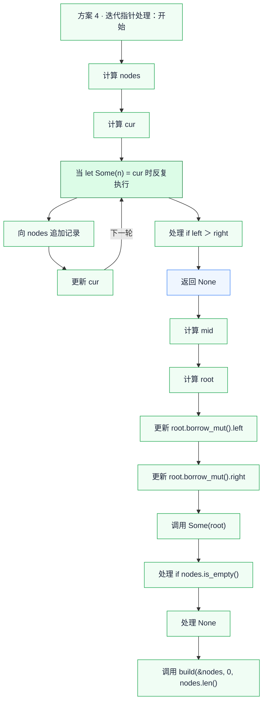

```rust
// LeetCode 109. 有序链表转换二叉搜索树 — Rust 版（方案4）
use std::cell::RefCell;
use std::rc::Rc; // 引入依赖 // 引入依赖

#[derive(Debug)]
struct TreeNode {
    // 定义类型
    val: i32,
    left: Option<Rc<RefCell<TreeNode>>>,
    right: Option<Rc<RefCell<TreeNode>>>,
}

impl TreeNode {
    // 实现块
    fn new(val: i32) -> Rc<RefCell<TreeNode>> {
        // 定义函数/方法 new
        Rc::new(RefCell::new(TreeNode {
            val,
            left: None,
            right: None,
        })) // Rc::new(RefCell::new(TreeNode { 值, 左边界: None, 右边界: None }))
    }
}

fn build_tree(vals: &[Option<i32>]) -> Option<Rc<RefCell<TreeNode>>> {
    // 定义函数/方法 build_tree
    if vals.is_empty() || vals[0].is_none() {
        // 若 vals 是否为空 或 vals[0].is_none(
        return None; // 返回 None
    }
    let root = TreeNode::new(vals[0].unwrap()); // 把 TreeNode::new(vals[0].unwrap()) 存入 根节点
    let mut queue: Vec<Rc<RefCell<TreeNode>>> = vec![root.clone()];
    let mut i = 1; // 把 1; 写入 let mut i
    while !queue.is_empty() && i < vals.len() {
        // while 取反 队列 是否为空 且 下标 i 小于 vals.长度() {
        let node = queue.remove(0); // 把 队列 弹出 0) 存入 节点
        if i < vals.len() {
            // 若 下标 i 小于 vals.长度(
            if let Some(v) = vals[i] {
                // 若 let Some(值) 赋值为 vals[下标 i]
                let child = TreeNode::new(v); // 把 TreeNode::new(值) 存入 子节点
                node.borrow_mut().left = Some(child.clone()); // 把 Some(子节点.clone()); 写入 左边界
                queue.push(child); // 把 子节点 压入栈/数组尾部
            }
            i += 1; // 下标 i累加 1
        }
        if i < vals.len() {
            // 若 下标 i 小于 vals.长度(
            if let Some(v) = vals[i] {
                // 若 let Some(值) 赋值为 vals[下标 i]
                let child = TreeNode::new(v); // 把 TreeNode::new(值) 存入 子节点
                node.borrow_mut().right = Some(child.clone()); // 把 Some(子节点.clone()); 写入 右边界
                queue.push(child); // 把 子节点 压入栈/数组尾部
            }
            i += 1; // 下标 i累加 1
        }
    }
    Some(root) // Some(根节点)
}

#[derive(Debug)]
struct ListNode {
    val: i32,
    next: Option<Box<ListNode>>,
} // 定义类型
fn build_list(vals: &[i32]) -> Option<Box<ListNode>> {
    // 定义函数/方法 build_list
    let mut head: Option<Box<ListNode>> = None; // 把 None; 写入 let mut head: Option<Box<ListNode>>
    for &v in vals.iter().rev() {
        // for 按位与 值 in vals.iter().rev() {
        let mut n = Box::new(ListNode { val: v, next: None }); // 把 Box::new(ListNode { 值: 值, 下一个: None }); 写入 let mut n
        n.next = head; // 把 头节点; 写入 下一个
        head = Some(n); // 把 Some(元素个数); 写入 头节点
    }
    head // 头节点
}
fn sorted_list_to_bst(head: Option<Box<ListNode>>) -> Option<Rc<RefCell<TreeNode>>> {
    // 定义函数/方法 sorted_list_to_bst
    let mut nodes: Vec<i32> = Vec::new(); // 把 Vec::new(); 写入 let mut nodes: Vec<i32>
    let mut cur = &head; // 把 按位与 头节点; 写入 let mut cur
    while let Some(n) = cur {
        // 边取边处理，取空即停
        nodes.push(n.val); // 把 元素个数.值 压入栈/数组尾部
        cur = &n.next; // 把 按位与 元素个数.下一个; 写入 当前值
    }
    fn build(nodes: &[i32], left: isize, right: isize) -> Option<Rc<RefCell<TreeNode>>> {
        // 定义函数/方法 build
        if left > right {
            return None;
        } // 若 左边界 超过 右边界 { return None; }
        let mid = left + (right - left) / 2; // 把 左边界 加 (右边界 减 左边界) 除以 2 存入 中点
        let root = TreeNode::new(nodes[mid as usize]); // 把 TreeNode::new(nodes[中点 as usize]) 存入 根节点
        root.borrow_mut().left = build(nodes, left, mid - 1); // 把 build(nodes, 左边界, 中点 减 1); 写入 左边界
        root.borrow_mut().right = build(nodes, mid + 1, right); // 把 build(nodes, 中点 加 1, 右边界); 写入 右边界
        Some(root) // Some(根节点)
    }
    if nodes.is_empty() {
        None
    } else {
        build(&nodes, 0, nodes.len() as isize - 1)
    }
}
fn inorder(n: Option<&Rc<RefCell<TreeNode>>>, out: &mut Vec<i32>) {
    // 定义函数/方法 inorder
    let node = match n {
        Some(x) => x,
        None => return,
    };
    let nb = node.borrow(); // 把 节点.borrow() 存入 nb
    inorder(nb.left.as_ref(), out); // inorder(nb.左边界.as_ref(), out);
    out.push(nb.val); // 把 nb.值 压入栈/数组尾部
    inorder(nb.right.as_ref(), out); // inorder(nb.右边界.as_ref(), out);
}
fn main() {
    // 程序入口：跑内嵌自测用例
    assert!(sorted_list_to_bst(None).is_none()); // 断言校验
    let t = sorted_list_to_bst(build_list(&[1, 2, 3])); // 把 sorted_list_to_bst(build_list( 按位与 [1, 2, 3])) 存入 另一字符串
    let mut out = Vec::new(); // 把 Vec::new(); 写入 let mut out
    inorder(t.as_ref(), &mut out); // inorder(另一字符串.as_ref(), 按位与 mut out);
    assert_eq!(out, vec![1, 2, 3]); // 断言校验
                                    // 结构验证：[1,2,3] 中点 2 为根
    let mut lvl = std::collections::VecDeque::new(); // 把 std::collections::VecDeque::new(); 写入 let mut lvl
    lvl.push_back(t.clone().unwrap()); // lvl 追加 另一字符串.clone().unwrap());
    let mut flat = Vec::new(); // 把 Vec::new(); 写入 let mut flat
    while let Some(n) = lvl.pop_front() {
        // 边取边处理，取空即停
        let nb = n.borrow(); // 把 元素个数.borrow() 存入 nb
        flat.push(nb.val); // 把 nb.值 压入栈/数组尾部
        if let Some(c) = nb.left.clone() {
            lvl.push_back(c);
        } // 若 let Some(字符) 赋值为 nb.左边界.clone() { lvl 追加 字符); }
        if let Some(c) = nb.right.clone() {
            lvl.push_back(c);
        } // 若 let Some(字符) 赋值为 nb.右边界.clone() { lvl 追加 字符); }
    }
    assert_eq!(flat, vec![2, 1, 3]); // 断言校验
    println!("PASS"); // 全部用例通过，输出 PASS
}
```

### Lua 实现（4 种方案）

Lua 的全部方案如下，每个方案都内嵌用例自测，可独立运行（老仓库 python/go 文件遵循「打印结果」约定）：

#### 方案 1：单趟扫描

**思路与代码分析**：核心是「单趟扫描」。Lua 版用表与 ipairs 遍历，注意 ipairs 遇 nil 即停的语义。**走读**：方案 1 · 单趟扫描：开始 → 处理 if not vals or #vals == 0 or → 返回 nil → 当 head ≤ #queue and i ≤ #vals do 时反复执行 → 返回 root。

**运行架构**（真实控制流）：

```mermaid
graph TD
    N0["方案 1 · 单趟扫描：开始"]
    N1["处理 if not vals or #vals == 0 or"]
    N2["返回 nil"]
    D1["……（中间计算步骤）"]
    N7["当 head ≤ #queue and i ≤ #vals do 时反复执行"]
    D2["……（中间计算步骤）"]
    N20["返回 root"]
    N0 --> N1
    N1 --> N2
    N2 --> D1
    D1 --> N7
    N7 --> D2
    D2 --> N20
    classDef n fill:#f0fdf4,stroke:#16a34a,color:#1e293b;
    classDef lp fill:#dcfce7,stroke:#15803d,color:#1e293b;
    classDef dc fill:#fef9c3,stroke:#ca8a04,color:#1e293b;
    classDef tm fill:#eff6ff,stroke:#3b82f6,color:#1e293b;
    class N0,N1,D1,D2 n;
    class N7 lp;
    class N2,N20 tm;
```

```lua
-- LeetCode 109. 有序链表转换二叉搜索树 — Lua 版（方案1）
local TreeNode = {} -- 把 {} 写入 local TreeNode
TreeNode.__index = TreeNode -- 把 TreeNode 写入 TreeNode.__index
function TreeNode.new(val) -- function TreeNode.new(值)
	return setmetatable({ val = val, left = nil, right = nil }, TreeNode)
end -- 终点

local function build_tree(vals) -- local function build_tree(vals)
	if not vals or #vals == 0 or vals[1] == "null" then
		return nil
	end
	local root = TreeNode.new(vals[1]) -- 把 TreeNode.new(vals[1]) 写入 local root
	local queue = { root } -- 把 {根节点} 写入 local queue
	local head = 1 -- 把 1 写入 local head
	local i = 2 -- 把 2 写入 local i
	while head <= #queue and i <= #vals do -- 把 #队列 and 下标 i 不超过 #vals do 写入 while head <
		local node = queue[head] -- 把 队列[头节点] 写入 local node
		head = head + 1 -- 把 头节点 加 1 存入 头节点
		if i <= #vals then -- 若 下标 i 不超过 #vals then
			if vals[i] ~= "null" then -- 若 vals[下标 i] ~ 赋值为 「null」 then
				node.left = TreeNode.new(vals[i]) -- 把 TreeNode.new(vals[下标 i]) 写入 左边界
				queue[#queue + 1] = node.left -- 把 节点.左边界 写入 queue[#queue + 1]
			end -- 终点
			i = i + 1 -- 把 下标 i 加 1 存入 下标 i
		end -- 终点
		if i <= #vals then -- 若 下标 i 不超过 #vals then
			if vals[i] ~= "null" then -- 若 vals[下标 i] ~ 赋值为 「null」 then
				node.right = TreeNode.new(vals[i]) -- 把 TreeNode.new(vals[下标 i]) 写入 右边界
				queue[#queue + 1] = node.right -- 把 节点.右边界 写入 queue[#queue + 1]
			end -- 终点
			i = i + 1 -- 把 下标 i 加 1 存入 下标 i
		end -- 终点
	end -- 终点
	return root -- 返回 根节点
end -- 终点

local ListNode = {} -- 把 {} 写入 local ListNode
ListNode.__index = ListNode -- 把 ListNode 写入 ListNode.__index
function ListNode.new(val, next)
	return setmetatable({ val = val, next = next }, ListNode)
end
local function build_list(vals) -- local function build_list(vals)
	local head, cur = nil, nil -- 把 nil, nil 写入 local head, cur
	for _, v in ipairs(vals) do -- 遍历取 值
		local n = ListNode.new(v) -- 把 ListNode.new(值) 写入 local n
		if not head then
			head, cur = n, n
		else
			cur.next, cur = n, n
		end
	end -- 终点
	return head -- 返回 头节点
end -- 终点
local function sorted_list_to_bst(head) -- local function sorted_list_to_bst(头节点)
	local nodes = {} -- 把 {} 写入 local nodes
	local cur = head -- 把 头节点 写入 local cur
	while cur do
		nodes[#nodes + 1] = cur.val
		cur = cur.next
	end
	local function build(left, right) -- local function build(左边界, 右边界)
		if left > right then
			return nil
		end -- 若 左边界 超过 右边界 then return nil 终点
		local mid = left + math.floor((right - left) / 2) -- 把 左边界 加 math.floor((右边界 减 左边界) 除以 2) 写入 local mid
		local root = TreeNode.new(nodes[mid]) -- 把 TreeNode.new(nodes[中点]) 写入 local root
		root.left = build(left, mid - 1) -- 把 build(左边界, 中点 减 1) 写入 左边界
		root.right = build(mid + 1, right) -- 把 build(中点 加 1, 右边界) 写入 右边界
		return root -- 返回 根节点
	end -- 终点
	if #nodes == 0 then
		return nil
	end -- 若 #nodes 等于 0 then return nil 终点
	return build(1, #nodes) -- 返回 build(1, #nodes)
end -- 终点
local function inorder(n, out) -- local function inorder(元素个数, out)
	if not n then
		return
	end -- 若 not 元素个数 then return 终点
	inorder(n.left, out) -- inorder(元素个数.左边界, out)
	out[#out + 1] = n.val -- 把 元素个数.值 写入 out[#out + 1]
	inorder(n.right, out) -- inorder(元素个数.右边界, out)
end -- 终点
assert(sorted_list_to_bst(nil) == nil) -- 断言校验
local t = sorted_list_to_bst(build_list({ 1, 2, 3 })) -- 把 sorted_list_to_bst(build_list({1, 2, 3})) 写入 local t
local out = {} -- 把 {} 写入 local out
inorder(t, out) -- inorder(另一字符串, out)
assert(#out == 3 and out[1] == 1 and out[2] == 2 and out[3] == 3) -- 断言校验
-- 结构验证：层序 [2,1,3]
local q, flat = { t }, {} -- 把 {另一字符串}, {} 写入 local q, flat
while #q > 0 do -- while #节点 超过 0 do
	local n = table.remove(q, 1) -- 把 table 弹出 节点, 1) 写入 local n
	flat[#flat + 1] = n.val -- 把 元素个数.值 写入 flat[#flat + 1]
	if n.left then
		q[#q + 1] = n.left
	end -- 若 元素个数.左边界 then 节点[#节点 加 1] 赋值为 元素个数.左边界 终点
	if n.right then
		q[#q + 1] = n.right
	end -- 若 元素个数.右边界 then 节点[#节点 加 1] 赋值为 元素个数.右边界 终点
end -- 终点
assert(#flat == 3 and flat[1] == 2 and flat[2] == 1 and flat[3] == 3) -- 断言校验
print("PASS") -- 全部用例通过，输出 PASS
```

#### 方案 2：迭代指针处理

**思路与代码分析**：核心是「迭代指针处理」。Lua 版用表与 ipairs 遍历，注意 ipairs 遇 nil 即停的语义。**走读**：方案 2 · 迭代指针处理：开始 → 处理 if not vals or #vals == 0 or → 返回 nil → 当 head ≤ #queue and i ≤ #vals do 时反复执行 → 返回 root。

**运行架构**（真实控制流）：

```mermaid
graph TD
    N0["方案 2 · 迭代指针处理：开始"]
    N1["处理 if not vals or #vals == 0 or"]
    N2["返回 nil"]
    D1["……（中间计算步骤）"]
    N7["当 head ≤ #queue and i ≤ #vals do 时反复执行"]
    D2["……（中间计算步骤）"]
    N20["返回 root"]
    N0 --> N1
    N1 --> N2
    N2 --> D1
    D1 --> N7
    N7 --> D2
    D2 --> N20
    classDef n fill:#f0fdf4,stroke:#16a34a,color:#1e293b;
    classDef lp fill:#dcfce7,stroke:#15803d,color:#1e293b;
    classDef dc fill:#fef9c3,stroke:#ca8a04,color:#1e293b;
    classDef tm fill:#eff6ff,stroke:#3b82f6,color:#1e293b;
    class N0,N1,D1,D2 n;
    class N7 lp;
    class N2,N20 tm;
```

```lua
-- LeetCode 109. 有序链表转换二叉搜索树 — Lua 版（方案2）
local TreeNode = {} -- 把 {} 写入 local TreeNode
TreeNode.__index = TreeNode -- 把 TreeNode 写入 TreeNode.__index
function TreeNode.new(val) -- function TreeNode.new(值)
	return setmetatable({ val = val, left = nil, right = nil }, TreeNode)
end -- 终点

local function build_tree(vals) -- local function build_tree(vals)
	if not vals or #vals == 0 or vals[1] == "null" then
		return nil
	end
	local root = TreeNode.new(vals[1]) -- 把 TreeNode.new(vals[1]) 写入 local root
	local queue = { root } -- 把 {根节点} 写入 local queue
	local head = 1 -- 把 1 写入 local head
	local i = 2 -- 把 2 写入 local i
	while head <= #queue and i <= #vals do -- 把 #队列 and 下标 i 不超过 #vals do 写入 while head <
		local node = queue[head] -- 把 队列[头节点] 写入 local node
		head = head + 1 -- 把 头节点 加 1 存入 头节点
		if i <= #vals then -- 若 下标 i 不超过 #vals then
			if vals[i] ~= "null" then -- 若 vals[下标 i] ~ 赋值为 「null」 then
				node.left = TreeNode.new(vals[i]) -- 把 TreeNode.new(vals[下标 i]) 写入 左边界
				queue[#queue + 1] = node.left -- 把 节点.左边界 写入 queue[#queue + 1]
			end -- 终点
			i = i + 1 -- 把 下标 i 加 1 存入 下标 i
		end -- 终点
		if i <= #vals then -- 若 下标 i 不超过 #vals then
			if vals[i] ~= "null" then -- 若 vals[下标 i] ~ 赋值为 「null」 then
				node.right = TreeNode.new(vals[i]) -- 把 TreeNode.new(vals[下标 i]) 写入 右边界
				queue[#queue + 1] = node.right -- 把 节点.右边界 写入 queue[#queue + 1]
			end -- 终点
			i = i + 1 -- 把 下标 i 加 1 存入 下标 i
		end -- 终点
	end -- 终点
	return root -- 返回 根节点
end -- 终点

local ListNode = {} -- 把 {} 写入 local ListNode
ListNode.__index = ListNode -- 把 ListNode 写入 ListNode.__index
function ListNode.new(val, next)
	return setmetatable({ val = val, next = next }, ListNode)
end
local function build_list(vals) -- local function build_list(vals)
	local head, cur = nil, nil -- 把 nil, nil 写入 local head, cur
	for _, v in ipairs(vals) do -- 遍历取 值
		local n = ListNode.new(v) -- 把 ListNode.new(值) 写入 local n
		if not head then
			head, cur = n, n
		else
			cur.next, cur = n, n
		end
	end -- 终点
	return head -- 返回 头节点
end -- 终点
local function sorted_list_to_bst(head) -- local function sorted_list_to_bst(头节点)
	local nodes = {} -- 把 {} 写入 local nodes
	local cur = head -- 把 头节点 写入 local cur
	while cur do
		nodes[#nodes + 1] = cur.val
		cur = cur.next
	end
	local function build(left, right) -- local function build(左边界, 右边界)
		if left > right then
			return nil
		end -- 若 左边界 超过 右边界 then return nil 终点
		local mid = left + math.floor((right - left) / 2) -- 把 左边界 加 math.floor((右边界 减 左边界) 除以 2) 写入 local mid
		local root = TreeNode.new(nodes[mid]) -- 把 TreeNode.new(nodes[中点]) 写入 local root
		root.left = build(left, mid - 1) -- 把 build(左边界, 中点 减 1) 写入 左边界
		root.right = build(mid + 1, right) -- 把 build(中点 加 1, 右边界) 写入 右边界
		return root -- 返回 根节点
	end -- 终点
	if #nodes == 0 then
		return nil
	end -- 若 #nodes 等于 0 then return nil 终点
	return build(1, #nodes) -- 返回 build(1, #nodes)
end -- 终点
local function inorder(n, out) -- local function inorder(元素个数, out)
	if not n then
		return
	end -- 若 not 元素个数 then return 终点
	inorder(n.left, out) -- inorder(元素个数.左边界, out)
	out[#out + 1] = n.val -- 把 元素个数.值 写入 out[#out + 1]
	inorder(n.right, out) -- inorder(元素个数.右边界, out)
end -- 终点
assert(sorted_list_to_bst(nil) == nil) -- 断言校验
local t = sorted_list_to_bst(build_list({ 1, 2, 3 })) -- 把 sorted_list_to_bst(build_list({1, 2, 3})) 写入 local t
local out = {} -- 把 {} 写入 local out
inorder(t, out) -- inorder(另一字符串, out)
assert(#out == 3 and out[1] == 1 and out[2] == 2 and out[3] == 3) -- 断言校验
-- 结构验证：层序 [2,1,3]
local q, flat = { t }, {} -- 把 {另一字符串}, {} 写入 local q, flat
while #q > 0 do -- while #节点 超过 0 do
	local n = table.remove(q, 1) -- 把 table 弹出 节点, 1) 写入 local n
	flat[#flat + 1] = n.val -- 把 元素个数.值 写入 flat[#flat + 1]
	if n.left then
		q[#q + 1] = n.left
	end -- 若 元素个数.左边界 then 节点[#节点 加 1] 赋值为 元素个数.左边界 终点
	if n.right then
		q[#q + 1] = n.right
	end -- 若 元素个数.右边界 then 节点[#节点 加 1] 赋值为 元素个数.右边界 终点
end -- 终点
assert(#flat == 3 and flat[1] == 2 and flat[2] == 1 and flat[3] == 3) -- 断言校验
print("PASS") -- 全部用例通过，输出 PASS
```

#### 方案 3：单趟扫描

**思路与代码分析**：核心是「单趟扫描」。Lua 版用表与 ipairs 遍历，注意 ipairs 遇 nil 即停的语义。**走读**：方案 3 · 单趟扫描：开始 → 处理 if not vals or #vals == 0 or → 返回 nil → 当 head ≤ #queue and i ≤ #vals do 时反复执行 → 返回 root。

**运行架构**（真实控制流）：

```mermaid
graph TD
    N0["方案 3 · 单趟扫描：开始"]
    N1["处理 if not vals or #vals == 0 or"]
    N2["返回 nil"]
    D1["……（中间计算步骤）"]
    N7["当 head ≤ #queue and i ≤ #vals do 时反复执行"]
    D2["……（中间计算步骤）"]
    N20["返回 root"]
    N0 --> N1
    N1 --> N2
    N2 --> D1
    D1 --> N7
    N7 --> D2
    D2 --> N20
    classDef n fill:#f0fdf4,stroke:#16a34a,color:#1e293b;
    classDef lp fill:#dcfce7,stroke:#15803d,color:#1e293b;
    classDef dc fill:#fef9c3,stroke:#ca8a04,color:#1e293b;
    classDef tm fill:#eff6ff,stroke:#3b82f6,color:#1e293b;
    class N0,N1,D1,D2 n;
    class N7 lp;
    class N2,N20 tm;
```

```lua
-- LeetCode 109. 有序链表转换二叉搜索树 — Lua 版（方案3）
local TreeNode = {} -- 把 {} 写入 local TreeNode
TreeNode.__index = TreeNode -- 把 TreeNode 写入 TreeNode.__index
function TreeNode.new(val) -- function TreeNode.new(值)
	return setmetatable({ val = val, left = nil, right = nil }, TreeNode)
end -- 终点

local function build_tree(vals) -- local function build_tree(vals)
	if not vals or #vals == 0 or vals[1] == "null" then
		return nil
	end
	local root = TreeNode.new(vals[1]) -- 把 TreeNode.new(vals[1]) 写入 local root
	local queue = { root } -- 把 {根节点} 写入 local queue
	local head = 1 -- 把 1 写入 local head
	local i = 2 -- 把 2 写入 local i
	while head <= #queue and i <= #vals do -- 把 #队列 and 下标 i 不超过 #vals do 写入 while head <
		local node = queue[head] -- 把 队列[头节点] 写入 local node
		head = head + 1 -- 把 头节点 加 1 存入 头节点
		if i <= #vals then -- 若 下标 i 不超过 #vals then
			if vals[i] ~= "null" then -- 若 vals[下标 i] ~ 赋值为 「null」 then
				node.left = TreeNode.new(vals[i]) -- 把 TreeNode.new(vals[下标 i]) 写入 左边界
				queue[#queue + 1] = node.left -- 把 节点.左边界 写入 queue[#queue + 1]
			end -- 终点
			i = i + 1 -- 把 下标 i 加 1 存入 下标 i
		end -- 终点
		if i <= #vals then -- 若 下标 i 不超过 #vals then
			if vals[i] ~= "null" then -- 若 vals[下标 i] ~ 赋值为 「null」 then
				node.right = TreeNode.new(vals[i]) -- 把 TreeNode.new(vals[下标 i]) 写入 右边界
				queue[#queue + 1] = node.right -- 把 节点.右边界 写入 queue[#queue + 1]
			end -- 终点
			i = i + 1 -- 把 下标 i 加 1 存入 下标 i
		end -- 终点
	end -- 终点
	return root -- 返回 根节点
end -- 终点

local ListNode = {} -- 把 {} 写入 local ListNode
ListNode.__index = ListNode -- 把 ListNode 写入 ListNode.__index
function ListNode.new(val, next)
	return setmetatable({ val = val, next = next }, ListNode)
end
local function build_list(vals) -- local function build_list(vals)
	local head, cur = nil, nil -- 把 nil, nil 写入 local head, cur
	for _, v in ipairs(vals) do -- 遍历取 值
		local n = ListNode.new(v) -- 把 ListNode.new(值) 写入 local n
		if not head then
			head, cur = n, n
		else
			cur.next, cur = n, n
		end
	end -- 终点
	return head -- 返回 头节点
end -- 终点
local function sorted_list_to_bst(head) -- local function sorted_list_to_bst(头节点)
	local nodes = {} -- 把 {} 写入 local nodes
	local cur = head -- 把 头节点 写入 local cur
	while cur do
		nodes[#nodes + 1] = cur.val
		cur = cur.next
	end
	local function build(left, right) -- local function build(左边界, 右边界)
		if left > right then
			return nil
		end -- 若 左边界 超过 右边界 then return nil 终点
		local mid = left + math.floor((right - left) / 2) -- 把 左边界 加 math.floor((右边界 减 左边界) 除以 2) 写入 local mid
		local root = TreeNode.new(nodes[mid]) -- 把 TreeNode.new(nodes[中点]) 写入 local root
		root.left = build(left, mid - 1) -- 把 build(左边界, 中点 减 1) 写入 左边界
		root.right = build(mid + 1, right) -- 把 build(中点 加 1, 右边界) 写入 右边界
		return root -- 返回 根节点
	end -- 终点
	if #nodes == 0 then
		return nil
	end -- 若 #nodes 等于 0 then return nil 终点
	return build(1, #nodes) -- 返回 build(1, #nodes)
end -- 终点
local function inorder(n, out) -- local function inorder(元素个数, out)
	if not n then
		return
	end -- 若 not 元素个数 then return 终点
	inorder(n.left, out) -- inorder(元素个数.左边界, out)
	out[#out + 1] = n.val -- 把 元素个数.值 写入 out[#out + 1]
	inorder(n.right, out) -- inorder(元素个数.右边界, out)
end -- 终点
assert(sorted_list_to_bst(nil) == nil) -- 断言校验
local t = sorted_list_to_bst(build_list({ 1, 2, 3 })) -- 把 sorted_list_to_bst(build_list({1, 2, 3})) 写入 local t
local out = {} -- 把 {} 写入 local out
inorder(t, out) -- inorder(另一字符串, out)
assert(#out == 3 and out[1] == 1 and out[2] == 2 and out[3] == 3) -- 断言校验
-- 结构验证：层序 [2,1,3]
local q, flat = { t }, {} -- 把 {另一字符串}, {} 写入 local q, flat
while #q > 0 do -- while #节点 超过 0 do
	local n = table.remove(q, 1) -- 把 table 弹出 节点, 1) 写入 local n
	flat[#flat + 1] = n.val -- 把 元素个数.值 写入 flat[#flat + 1]
	if n.left then
		q[#q + 1] = n.left
	end -- 若 元素个数.左边界 then 节点[#节点 加 1] 赋值为 元素个数.左边界 终点
	if n.right then
		q[#q + 1] = n.right
	end -- 若 元素个数.右边界 then 节点[#节点 加 1] 赋值为 元素个数.右边界 终点
end -- 终点
assert(#flat == 3 and flat[1] == 2 and flat[2] == 1 and flat[3] == 3) -- 断言校验
print("PASS") -- 全部用例通过，输出 PASS
```

#### 方案 4：迭代指针处理

**思路与代码分析**：核心是「迭代指针处理」。Lua 版用表与 ipairs 遍历，注意 ipairs 遇 nil 即停的语义。**走读**：方案 4 · 迭代指针处理：开始 → 处理 if not vals or #vals == 0 or → 返回 nil → 当 head ≤ #queue and i ≤ #vals do 时反复执行 → 返回 root。

**运行架构**（真实控制流）：

```mermaid
graph TD
    N0["方案 4 · 迭代指针处理：开始"]
    N1["处理 if not vals or #vals == 0 or"]
    N2["返回 nil"]
    D1["……（中间计算步骤）"]
    N7["当 head ≤ #queue and i ≤ #vals do 时反复执行"]
    D2["……（中间计算步骤）"]
    N20["返回 root"]
    N0 --> N1
    N1 --> N2
    N2 --> D1
    D1 --> N7
    N7 --> D2
    D2 --> N20
    classDef n fill:#f0fdf4,stroke:#16a34a,color:#1e293b;
    classDef lp fill:#dcfce7,stroke:#15803d,color:#1e293b;
    classDef dc fill:#fef9c3,stroke:#ca8a04,color:#1e293b;
    classDef tm fill:#eff6ff,stroke:#3b82f6,color:#1e293b;
    class N0,N1,D1,D2 n;
    class N7 lp;
    class N2,N20 tm;
```

```lua
-- LeetCode 109. 有序链表转换二叉搜索树 — Lua 版（方案4）
local TreeNode = {} -- 把 {} 写入 local TreeNode
TreeNode.__index = TreeNode -- 把 TreeNode 写入 TreeNode.__index
function TreeNode.new(val) -- function TreeNode.new(值)
	return setmetatable({ val = val, left = nil, right = nil }, TreeNode)
end -- 终点

local function build_tree(vals) -- local function build_tree(vals)
	if not vals or #vals == 0 or vals[1] == "null" then
		return nil
	end
	local root = TreeNode.new(vals[1]) -- 把 TreeNode.new(vals[1]) 写入 local root
	local queue = { root } -- 把 {根节点} 写入 local queue
	local head = 1 -- 把 1 写入 local head
	local i = 2 -- 把 2 写入 local i
	while head <= #queue and i <= #vals do -- 把 #队列 and 下标 i 不超过 #vals do 写入 while head <
		local node = queue[head] -- 把 队列[头节点] 写入 local node
		head = head + 1 -- 把 头节点 加 1 存入 头节点
		if i <= #vals then -- 若 下标 i 不超过 #vals then
			if vals[i] ~= "null" then -- 若 vals[下标 i] ~ 赋值为 「null」 then
				node.left = TreeNode.new(vals[i]) -- 把 TreeNode.new(vals[下标 i]) 写入 左边界
				queue[#queue + 1] = node.left -- 把 节点.左边界 写入 queue[#queue + 1]
			end -- 终点
			i = i + 1 -- 把 下标 i 加 1 存入 下标 i
		end -- 终点
		if i <= #vals then -- 若 下标 i 不超过 #vals then
			if vals[i] ~= "null" then -- 若 vals[下标 i] ~ 赋值为 「null」 then
				node.right = TreeNode.new(vals[i]) -- 把 TreeNode.new(vals[下标 i]) 写入 右边界
				queue[#queue + 1] = node.right -- 把 节点.右边界 写入 queue[#queue + 1]
			end -- 终点
			i = i + 1 -- 把 下标 i 加 1 存入 下标 i
		end -- 终点
	end -- 终点
	return root -- 返回 根节点
end -- 终点

local ListNode = {} -- 把 {} 写入 local ListNode
ListNode.__index = ListNode -- 把 ListNode 写入 ListNode.__index
function ListNode.new(val, next)
	return setmetatable({ val = val, next = next }, ListNode)
end
local function build_list(vals) -- local function build_list(vals)
	local head, cur = nil, nil -- 把 nil, nil 写入 local head, cur
	for _, v in ipairs(vals) do -- 遍历取 值
		local n = ListNode.new(v) -- 把 ListNode.new(值) 写入 local n
		if not head then
			head, cur = n, n
		else
			cur.next, cur = n, n
		end
	end -- 终点
	return head -- 返回 头节点
end -- 终点
local function sorted_list_to_bst(head) -- local function sorted_list_to_bst(头节点)
	local nodes = {} -- 把 {} 写入 local nodes
	local cur = head -- 把 头节点 写入 local cur
	while cur do
		nodes[#nodes + 1] = cur.val
		cur = cur.next
	end
	local function build(left, right) -- local function build(左边界, 右边界)
		if left > right then
			return nil
		end -- 若 左边界 超过 右边界 then return nil 终点
		local mid = left + math.floor((right - left) / 2) -- 把 左边界 加 math.floor((右边界 减 左边界) 除以 2) 写入 local mid
		local root = TreeNode.new(nodes[mid]) -- 把 TreeNode.new(nodes[中点]) 写入 local root
		root.left = build(left, mid - 1) -- 把 build(左边界, 中点 减 1) 写入 左边界
		root.right = build(mid + 1, right) -- 把 build(中点 加 1, 右边界) 写入 右边界
		return root -- 返回 根节点
	end -- 终点
	if #nodes == 0 then
		return nil
	end -- 若 #nodes 等于 0 then return nil 终点
	return build(1, #nodes) -- 返回 build(1, #nodes)
end -- 终点
local function inorder(n, out) -- local function inorder(元素个数, out)
	if not n then
		return
	end -- 若 not 元素个数 then return 终点
	inorder(n.left, out) -- inorder(元素个数.左边界, out)
	out[#out + 1] = n.val -- 把 元素个数.值 写入 out[#out + 1]
	inorder(n.right, out) -- inorder(元素个数.右边界, out)
end -- 终点
assert(sorted_list_to_bst(nil) == nil) -- 断言校验
local t = sorted_list_to_bst(build_list({ 1, 2, 3 })) -- 把 sorted_list_to_bst(build_list({1, 2, 3})) 写入 local t
local out = {} -- 把 {} 写入 local out
inorder(t, out) -- inorder(另一字符串, out)
assert(#out == 3 and out[1] == 1 and out[2] == 2 and out[3] == 3) -- 断言校验
-- 结构验证：层序 [2,1,3]
local q, flat = { t }, {} -- 把 {另一字符串}, {} 写入 local q, flat
while #q > 0 do -- while #节点 超过 0 do
	local n = table.remove(q, 1) -- 把 table 弹出 节点, 1) 写入 local n
	flat[#flat + 1] = n.val -- 把 元素个数.值 写入 flat[#flat + 1]
	if n.left then
		q[#q + 1] = n.left
	end -- 若 元素个数.左边界 then 节点[#节点 加 1] 赋值为 元素个数.左边界 终点
	if n.right then
		q[#q + 1] = n.right
	end -- 若 元素个数.右边界 then 节点[#节点 加 1] 赋值为 元素个数.右边界 终点
end -- 终点
assert(#flat == 3 and flat[1] == 2 and flat[2] == 1 and flat[3] == 3) -- 断言校验
print("PASS") -- 全部用例通过，输出 PASS
```

### C 实现（4 种方案）

C 的全部方案如下，每个方案都内嵌用例自测，可独立运行（老仓库 python/go 文件遵循「打印结果」约定）：

#### 方案 1：单趟扫描

**思路与代码分析**：核心是「单趟扫描」。C 版手动管理下标与内存，循环边界全部显式写出。代码里依次做这些事：单循环线性扫描。**走读**：方案 1 · 单趟扫描：开始 → 更新 n → 遍历循环 → 更新 nodes[n++] → 命中条件，直接返回 → 返回 build_bst(nodes, 0, n - 1)。

**运行架构**（真实控制流）：

```mermaid
graph TD
    N0["方案 1 · 单趟扫描：开始"]
    N1["更新 n"]
    N2["遍历循环"]
    N3["更新 nodes[n++]"]
    N4{"n == 0 ？"}
    N5["命中条件，直接返回"]
    N6["返回 build_bst(nodes, 0, n - 1)"]
    N0 --> N1
    N1 --> N2
    N2 --> N3
    N3 --> N4
    N4 -- 是 --> N5
    N4 -- 否 --> N6
    classDef n fill:#f0fdf4,stroke:#16a34a,color:#1e293b;
    classDef lp fill:#dcfce7,stroke:#15803d,color:#1e293b;
    classDef dc fill:#fef9c3,stroke:#ca8a04,color:#1e293b;
    classDef tm fill:#eff6ff,stroke:#3b82f6,color:#1e293b;
    class N0,N1,N3 n;
    class N2 lp;
    class N4 dc;
    class N5,N6 tm;
```

```c
/* LeetCode 109. 有序链表转换二叉搜索树 — C 版（方案1） */
#include <stdio.h>                   // 引入头文件
#include <stdlib.h>                  // 引入头文件
#define INT_MIN_SN (-2147483647 - 1) // #define INT_MIN_SN ( 减 2147483647 减 1)

typedef struct TreeNode {   // typedef struct TreeNode {
    int val;                // int 值;
    struct TreeNode *left;  // 定义类型
    struct TreeNode *right; // 定义类型
} TreeNode;                 // } TreeNode;

static TreeNode *build_tree(const int *vals,
                            int n) { // static TreeNode 乘 build_tree(const int 乘 vals, int 元素个数) {
    if (n == 0 || vals[0] == INT_MIN_SN)
        return NULL; // 若 元素个数 等于 0 或 vals[0] 等于 INT_MIN_SN，直接返回 NULL
    TreeNode *root = malloc(sizeof(TreeNode)); // 把 malloc(sizeof(TreeNode)); 写入 TreeNode *root
    root->val = vals[0];
    root->left = root->right = NULL;
    TreeNode **queue =
        malloc(sizeof(TreeNode *) * n); // 把 malloc(sizeof(TreeNode 乘 ) 乘 元素个数); 写入 TreeNode **queue
    int head = 0, tail = 0, i = 1; // 把 0, 尾节点 赋值为 0, 下标 i 赋值为 1 存入 头节点
    queue[tail++] = root;          // 把 根节点; 写入 queue[tail++]
    while (head < tail && i < n) { // 循环，直到不满足「头节点 小于 尾节点 且 下标 i 小于 元素个数」
        TreeNode *node = queue[head++];                // 把 队列[头节点 加一 ]; 写入 TreeNode *node
        if (i < n) {                                   // 若 下标 i 小于 元素个数
            if (vals[i] != INT_MIN_SN) {               // 若 vals[下标 i] 不等于 INT_MIN_SN
                node->left = malloc(sizeof(TreeNode)); // 把 malloc(sizeof(TreeNode)); 写入 node->left
                node->left->val = vals[i];
                node->left->left = node->left->right = NULL;
                queue[tail++] = node->left; // 把 节点 减 超过 左边界; 写入 queue[tail++]
            }
            i++; // 下标 i 加一
        }
        if (i < n) {                                    // 若 下标 i 小于 元素个数
            if (vals[i] != INT_MIN_SN) {                // 若 vals[下标 i] 不等于 INT_MIN_SN
                node->right = malloc(sizeof(TreeNode)); // 把 malloc(sizeof(TreeNode)); 写入 node->right
                node->right->val = vals[i];
                node->right->left = node->right->right = NULL;
                queue[tail++] = node->right; // 把 节点 减 超过 右边界; 写入 queue[tail++]
            }
            i++; // 下标 i 加一
        }
    }
    free(queue); // free(队列);
    return root; // 返回 根节点
}

static void free_tree(TreeNode *n) { // 定义函数/方法 free_tree
    if (!n)
        return;          // 若 取反 元素个数) return;
    free_tree(n->left);  // free_tree(元素个数 减 超过 左边界);
    free_tree(n->right); // free_tree(元素个数 减 超过 右边界);
    free(n);             // free(元素个数);
}

typedef struct ListNode {
    int val;
    struct ListNode *next;
} ListNode;
static ListNode *build_list(const int *vals,
                            int n) { // static ListNode 乘 build_list(const int 乘 vals, int 元素个数) {
    ListNode *head = NULL, **cur = &head; // 把 NULL, 乘 乘 当前值 赋值为 按位与 头节点; 写入 ListNode *head
    for (int i = 0; i < n; i++) { // 让 下标 i 从 0 开始计数，下标 i 小于 元素个数 就继续
        ListNode *node = malloc(sizeof(ListNode)); // 把 malloc(sizeof(ListNode)); 写入 ListNode *node
        node->val = vals[i];
        node->next = NULL; // 把 vals[下标 i]; 节点 减 超过 下一个 赋值为 NULL; 写入 node->val
        *cur = node;
        cur = &node->next;
    }
    return head; // 返回 头节点
}
static TreeNode *build_bst(const int *nodes, int left, int right) {
    if (left > right)
        return NULL;                     // 若 左边界 超过 右边界，直接返回 NULL
    int mid = left + (right - left) / 2; // 把 左边界 加 (右边界 减 左边界) 除以 2 存入 中点
    TreeNode *root = malloc(sizeof(TreeNode)); // 把 malloc(sizeof(TreeNode)); 写入 TreeNode *root
    root->val = nodes[mid];
    root->left = root->right = NULL;
    root->left = build_bst(nodes, left, mid - 1); // 把 build_bst(nodes, 左边界, 中点 减 1); 写入 root->left
    root->right =
        build_bst(nodes, mid + 1, right); // 把 build_bst(nodes, 中点 加 1, 右边界); 写入 root->right
    return root;                          // 返回 根节点
}
static TreeNode *
sorted_list_to_bst(ListNode *head) { // static TreeNode 乘 sorted_list_to_bst(ListNode 乘 头节点) {
    int nodes[4096], n = 0;          // 把 0; 写入 int nodes[4096], n
    for (ListNode *c = head; c; c = c->next)
        nodes[n++] = c->val;
    if (n == 0)
        return NULL;                   // 若 元素个数 等于 0，直接返回 NULL
    return build_bst(nodes, 0, n - 1); // 返回 build_bst(nodes, 0, 元素个数 减 1)
}
static void free_list(ListNode *h) {
    while (h) {
        ListNode *n = h->next;
        free(h);
        h = n;
    }
}
int main(void) { // 程序入口：跑内嵌自测用例
    if (sorted_list_to_bst(NULL) != NULL) {
        printf("FAIL 0\n");
        return 1;
    }
    int vals[] = {1, 2, 3};              // 把 {1, 2, 3}; 写入 int vals[]
    ListNode *l = build_list(vals, 3);   // 把 build_list(vals, 3); 写入 ListNode *l
    TreeNode *t = sorted_list_to_bst(l); // 把 sorted_list_to_bst(左指针); 写入 TreeNode *t
    /* 中序 [1,2,3] 且层序 [2,1,3] */
    if (t->val != 2 || t->left->val != 1 || t->right->val != 3) {
        printf("FAIL shape\n");
        return 1;
    }
    if (!(t->left->left == NULL && t->left->right == NULL && t->right->left == NULL &&
          t->right->right == NULL)) {
        printf("FAIL leaves\n");
        return 1;
    }
    free_list(l);     // free_list(左指针);
    free_tree(t);     // free_tree(另一字符串);
    printf("PASS\n"); // 全部用例通过，输出 PASS
    return 0;         // 返回 0
}
```

#### 方案 2：迭代指针处理

**思路与代码分析**：核心是「迭代指针处理」。C 版手动管理下标与内存，循环边界全部显式写出。代码里依次做这些事：单循环线性扫描。**走读**：方案 2 · 迭代指针处理：开始 → 更新 n → 遍历循环 → 更新 nodes[n++] → 命中条件，直接返回 → 返回 build_bst(nodes, 0, n - 1)。

**运行架构**（真实控制流）：

```mermaid
graph TD
    N0["方案 2 · 迭代指针处理：开始"]
    N1["更新 n"]
    N2["遍历循环"]
    N3["更新 nodes[n++]"]
    N4{"n == 0 ？"}
    N5["命中条件，直接返回"]
    N6["返回 build_bst(nodes, 0, n - 1)"]
    N0 --> N1
    N1 --> N2
    N2 --> N3
    N3 --> N4
    N4 -- 是 --> N5
    N4 -- 否 --> N6
    classDef n fill:#f0fdf4,stroke:#16a34a,color:#1e293b;
    classDef lp fill:#dcfce7,stroke:#15803d,color:#1e293b;
    classDef dc fill:#fef9c3,stroke:#ca8a04,color:#1e293b;
    classDef tm fill:#eff6ff,stroke:#3b82f6,color:#1e293b;
    class N0,N1,N3 n;
    class N2 lp;
    class N4 dc;
    class N5,N6 tm;
```

```c
/* LeetCode 109. 有序链表转换二叉搜索树 — C 版（方案2） */
#include <stdio.h>                   // 引入头文件
#include <stdlib.h>                  // 引入头文件
#define INT_MIN_SN (-2147483647 - 1) // #define INT_MIN_SN ( 减 2147483647 减 1)

typedef struct TreeNode {   // typedef struct TreeNode {
    int val;                // int 值;
    struct TreeNode *left;  // 定义类型
    struct TreeNode *right; // 定义类型
} TreeNode;                 // } TreeNode;

static TreeNode *build_tree(const int *vals,
                            int n) { // static TreeNode 乘 build_tree(const int 乘 vals, int 元素个数) {
    if (n == 0 || vals[0] == INT_MIN_SN)
        return NULL; // 若 元素个数 等于 0 或 vals[0] 等于 INT_MIN_SN，直接返回 NULL
    TreeNode *root = malloc(sizeof(TreeNode)); // 把 malloc(sizeof(TreeNode)); 写入 TreeNode *root
    root->val = vals[0];
    root->left = root->right = NULL;
    TreeNode **queue =
        malloc(sizeof(TreeNode *) * n); // 把 malloc(sizeof(TreeNode 乘 ) 乘 元素个数); 写入 TreeNode **queue
    int head = 0, tail = 0, i = 1; // 把 0, 尾节点 赋值为 0, 下标 i 赋值为 1 存入 头节点
    queue[tail++] = root;          // 把 根节点; 写入 queue[tail++]
    while (head < tail && i < n) { // 循环，直到不满足「头节点 小于 尾节点 且 下标 i 小于 元素个数」
        TreeNode *node = queue[head++];                // 把 队列[头节点 加一 ]; 写入 TreeNode *node
        if (i < n) {                                   // 若 下标 i 小于 元素个数
            if (vals[i] != INT_MIN_SN) {               // 若 vals[下标 i] 不等于 INT_MIN_SN
                node->left = malloc(sizeof(TreeNode)); // 把 malloc(sizeof(TreeNode)); 写入 node->left
                node->left->val = vals[i];
                node->left->left = node->left->right = NULL;
                queue[tail++] = node->left; // 把 节点 减 超过 左边界; 写入 queue[tail++]
            }
            i++; // 下标 i 加一
        }
        if (i < n) {                                    // 若 下标 i 小于 元素个数
            if (vals[i] != INT_MIN_SN) {                // 若 vals[下标 i] 不等于 INT_MIN_SN
                node->right = malloc(sizeof(TreeNode)); // 把 malloc(sizeof(TreeNode)); 写入 node->right
                node->right->val = vals[i];
                node->right->left = node->right->right = NULL;
                queue[tail++] = node->right; // 把 节点 减 超过 右边界; 写入 queue[tail++]
            }
            i++; // 下标 i 加一
        }
    }
    free(queue); // free(队列);
    return root; // 返回 根节点
}

static void free_tree(TreeNode *n) { // 定义函数/方法 free_tree
    if (!n)
        return;          // 若 取反 元素个数) return;
    free_tree(n->left);  // free_tree(元素个数 减 超过 左边界);
    free_tree(n->right); // free_tree(元素个数 减 超过 右边界);
    free(n);             // free(元素个数);
}

typedef struct ListNode {
    int val;
    struct ListNode *next;
} ListNode;
static ListNode *build_list(const int *vals,
                            int n) { // static ListNode 乘 build_list(const int 乘 vals, int 元素个数) {
    ListNode *head = NULL, **cur = &head; // 把 NULL, 乘 乘 当前值 赋值为 按位与 头节点; 写入 ListNode *head
    for (int i = 0; i < n; i++) { // 让 下标 i 从 0 开始计数，下标 i 小于 元素个数 就继续
        ListNode *node = malloc(sizeof(ListNode)); // 把 malloc(sizeof(ListNode)); 写入 ListNode *node
        node->val = vals[i];
        node->next = NULL; // 把 vals[下标 i]; 节点 减 超过 下一个 赋值为 NULL; 写入 node->val
        *cur = node;
        cur = &node->next;
    }
    return head; // 返回 头节点
}
static TreeNode *build_bst(const int *nodes, int left, int right) {
    if (left > right)
        return NULL;                     // 若 左边界 超过 右边界，直接返回 NULL
    int mid = left + (right - left) / 2; // 把 左边界 加 (右边界 减 左边界) 除以 2 存入 中点
    TreeNode *root = malloc(sizeof(TreeNode)); // 把 malloc(sizeof(TreeNode)); 写入 TreeNode *root
    root->val = nodes[mid];
    root->left = root->right = NULL;
    root->left = build_bst(nodes, left, mid - 1); // 把 build_bst(nodes, 左边界, 中点 减 1); 写入 root->left
    root->right =
        build_bst(nodes, mid + 1, right); // 把 build_bst(nodes, 中点 加 1, 右边界); 写入 root->right
    return root;                          // 返回 根节点
}
static TreeNode *
sorted_list_to_bst(ListNode *head) { // static TreeNode 乘 sorted_list_to_bst(ListNode 乘 头节点) {
    int nodes[4096], n = 0;          // 把 0; 写入 int nodes[4096], n
    for (ListNode *c = head; c; c = c->next)
        nodes[n++] = c->val;
    if (n == 0)
        return NULL;                   // 若 元素个数 等于 0，直接返回 NULL
    return build_bst(nodes, 0, n - 1); // 返回 build_bst(nodes, 0, 元素个数 减 1)
}
static void free_list(ListNode *h) {
    while (h) {
        ListNode *n = h->next;
        free(h);
        h = n;
    }
}
int main(void) { // 程序入口：跑内嵌自测用例
    if (sorted_list_to_bst(NULL) != NULL) {
        printf("FAIL 0\n");
        return 1;
    }
    int vals[] = {1, 2, 3};              // 把 {1, 2, 3}; 写入 int vals[]
    ListNode *l = build_list(vals, 3);   // 把 build_list(vals, 3); 写入 ListNode *l
    TreeNode *t = sorted_list_to_bst(l); // 把 sorted_list_to_bst(左指针); 写入 TreeNode *t
    /* 中序 [1,2,3] 且层序 [2,1,3] */
    if (t->val != 2 || t->left->val != 1 || t->right->val != 3) {
        printf("FAIL shape\n");
        return 1;
    }
    if (!(t->left->left == NULL && t->left->right == NULL && t->right->left == NULL &&
          t->right->right == NULL)) {
        printf("FAIL leaves\n");
        return 1;
    }
    free_list(l);     // free_list(左指针);
    free_tree(t);     // free_tree(另一字符串);
    printf("PASS\n"); // 全部用例通过，输出 PASS
    return 0;         // 返回 0
}
```

#### 方案 3：单趟扫描

**思路与代码分析**：核心是「单趟扫描」。C 版手动管理下标与内存，循环边界全部显式写出。代码里依次做这些事：单循环线性扫描。**走读**：方案 3 · 单趟扫描：开始 → 更新 n → 遍历循环 → 更新 nodes[n++] → 命中条件，直接返回 → 返回 build_bst(nodes, 0, n - 1)。

**运行架构**（真实控制流）：

```mermaid
graph TD
    N0["方案 3 · 单趟扫描：开始"]
    N1["更新 n"]
    N2["遍历循环"]
    N3["更新 nodes[n++]"]
    N4{"n == 0 ？"}
    N5["命中条件，直接返回"]
    N6["返回 build_bst(nodes, 0, n - 1)"]
    N0 --> N1
    N1 --> N2
    N2 --> N3
    N3 --> N4
    N4 -- 是 --> N5
    N4 -- 否 --> N6
    classDef n fill:#f0fdf4,stroke:#16a34a,color:#1e293b;
    classDef lp fill:#dcfce7,stroke:#15803d,color:#1e293b;
    classDef dc fill:#fef9c3,stroke:#ca8a04,color:#1e293b;
    classDef tm fill:#eff6ff,stroke:#3b82f6,color:#1e293b;
    class N0,N1,N3 n;
    class N2 lp;
    class N4 dc;
    class N5,N6 tm;
```

```c
/* LeetCode 109. 有序链表转换二叉搜索树 — C 版（方案3） */
#include <stdio.h>                   // 引入头文件
#include <stdlib.h>                  // 引入头文件
#define INT_MIN_SN (-2147483647 - 1) // #define INT_MIN_SN ( 减 2147483647 减 1)

typedef struct TreeNode {   // typedef struct TreeNode {
    int val;                // int 值;
    struct TreeNode *left;  // 定义类型
    struct TreeNode *right; // 定义类型
} TreeNode;                 // } TreeNode;

static TreeNode *build_tree(const int *vals,
                            int n) { // static TreeNode 乘 build_tree(const int 乘 vals, int 元素个数) {
    if (n == 0 || vals[0] == INT_MIN_SN)
        return NULL; // 若 元素个数 等于 0 或 vals[0] 等于 INT_MIN_SN，直接返回 NULL
    TreeNode *root = malloc(sizeof(TreeNode)); // 把 malloc(sizeof(TreeNode)); 写入 TreeNode *root
    root->val = vals[0];
    root->left = root->right = NULL;
    TreeNode **queue =
        malloc(sizeof(TreeNode *) * n); // 把 malloc(sizeof(TreeNode 乘 ) 乘 元素个数); 写入 TreeNode **queue
    int head = 0, tail = 0, i = 1; // 把 0, 尾节点 赋值为 0, 下标 i 赋值为 1 存入 头节点
    queue[tail++] = root;          // 把 根节点; 写入 queue[tail++]
    while (head < tail && i < n) { // 循环，直到不满足「头节点 小于 尾节点 且 下标 i 小于 元素个数」
        TreeNode *node = queue[head++];                // 把 队列[头节点 加一 ]; 写入 TreeNode *node
        if (i < n) {                                   // 若 下标 i 小于 元素个数
            if (vals[i] != INT_MIN_SN) {               // 若 vals[下标 i] 不等于 INT_MIN_SN
                node->left = malloc(sizeof(TreeNode)); // 把 malloc(sizeof(TreeNode)); 写入 node->left
                node->left->val = vals[i];
                node->left->left = node->left->right = NULL;
                queue[tail++] = node->left; // 把 节点 减 超过 左边界; 写入 queue[tail++]
            }
            i++; // 下标 i 加一
        }
        if (i < n) {                                    // 若 下标 i 小于 元素个数
            if (vals[i] != INT_MIN_SN) {                // 若 vals[下标 i] 不等于 INT_MIN_SN
                node->right = malloc(sizeof(TreeNode)); // 把 malloc(sizeof(TreeNode)); 写入 node->right
                node->right->val = vals[i];
                node->right->left = node->right->right = NULL;
                queue[tail++] = node->right; // 把 节点 减 超过 右边界; 写入 queue[tail++]
            }
            i++; // 下标 i 加一
        }
    }
    free(queue); // free(队列);
    return root; // 返回 根节点
}

static void free_tree(TreeNode *n) { // 定义函数/方法 free_tree
    if (!n)
        return;          // 若 取反 元素个数) return;
    free_tree(n->left);  // free_tree(元素个数 减 超过 左边界);
    free_tree(n->right); // free_tree(元素个数 减 超过 右边界);
    free(n);             // free(元素个数);
}

typedef struct ListNode {
    int val;
    struct ListNode *next;
} ListNode;
static ListNode *build_list(const int *vals,
                            int n) { // static ListNode 乘 build_list(const int 乘 vals, int 元素个数) {
    ListNode *head = NULL, **cur = &head; // 把 NULL, 乘 乘 当前值 赋值为 按位与 头节点; 写入 ListNode *head
    for (int i = 0; i < n; i++) { // 让 下标 i 从 0 开始计数，下标 i 小于 元素个数 就继续
        ListNode *node = malloc(sizeof(ListNode)); // 把 malloc(sizeof(ListNode)); 写入 ListNode *node
        node->val = vals[i];
        node->next = NULL; // 把 vals[下标 i]; 节点 减 超过 下一个 赋值为 NULL; 写入 node->val
        *cur = node;
        cur = &node->next;
    }
    return head; // 返回 头节点
}
static TreeNode *build_bst(const int *nodes, int left, int right) {
    if (left > right)
        return NULL;                     // 若 左边界 超过 右边界，直接返回 NULL
    int mid = left + (right - left) / 2; // 把 左边界 加 (右边界 减 左边界) 除以 2 存入 中点
    TreeNode *root = malloc(sizeof(TreeNode)); // 把 malloc(sizeof(TreeNode)); 写入 TreeNode *root
    root->val = nodes[mid];
    root->left = root->right = NULL;
    root->left = build_bst(nodes, left, mid - 1); // 把 build_bst(nodes, 左边界, 中点 减 1); 写入 root->left
    root->right =
        build_bst(nodes, mid + 1, right); // 把 build_bst(nodes, 中点 加 1, 右边界); 写入 root->right
    return root;                          // 返回 根节点
}
static TreeNode *
sorted_list_to_bst(ListNode *head) { // static TreeNode 乘 sorted_list_to_bst(ListNode 乘 头节点) {
    int nodes[4096], n = 0;          // 把 0; 写入 int nodes[4096], n
    for (ListNode *c = head; c; c = c->next)
        nodes[n++] = c->val;
    if (n == 0)
        return NULL;                   // 若 元素个数 等于 0，直接返回 NULL
    return build_bst(nodes, 0, n - 1); // 返回 build_bst(nodes, 0, 元素个数 减 1)
}
static void free_list(ListNode *h) {
    while (h) {
        ListNode *n = h->next;
        free(h);
        h = n;
    }
}
int main(void) { // 程序入口：跑内嵌自测用例
    if (sorted_list_to_bst(NULL) != NULL) {
        printf("FAIL 0\n");
        return 1;
    }
    int vals[] = {1, 2, 3};              // 把 {1, 2, 3}; 写入 int vals[]
    ListNode *l = build_list(vals, 3);   // 把 build_list(vals, 3); 写入 ListNode *l
    TreeNode *t = sorted_list_to_bst(l); // 把 sorted_list_to_bst(左指针); 写入 TreeNode *t
    /* 中序 [1,2,3] 且层序 [2,1,3] */
    if (t->val != 2 || t->left->val != 1 || t->right->val != 3) {
        printf("FAIL shape\n");
        return 1;
    }
    if (!(t->left->left == NULL && t->left->right == NULL && t->right->left == NULL &&
          t->right->right == NULL)) {
        printf("FAIL leaves\n");
        return 1;
    }
    free_list(l);     // free_list(左指针);
    free_tree(t);     // free_tree(另一字符串);
    printf("PASS\n"); // 全部用例通过，输出 PASS
    return 0;         // 返回 0
}
```

#### 方案 4：迭代指针处理

**思路与代码分析**：核心是「迭代指针处理」。C 版手动管理下标与内存，循环边界全部显式写出。代码里依次做这些事：单循环线性扫描。**走读**：方案 4 · 迭代指针处理：开始 → 更新 n → 遍历循环 → 更新 nodes[n++] → 命中条件，直接返回 → 返回 build_bst(nodes, 0, n - 1)。

**运行架构**（真实控制流）：

```mermaid
graph TD
    N0["方案 4 · 迭代指针处理：开始"]
    N1["更新 n"]
    N2["遍历循环"]
    N3["更新 nodes[n++]"]
    N4{"n == 0 ？"}
    N5["命中条件，直接返回"]
    N6["返回 build_bst(nodes, 0, n - 1)"]
    N0 --> N1
    N1 --> N2
    N2 --> N3
    N3 --> N4
    N4 -- 是 --> N5
    N4 -- 否 --> N6
    classDef n fill:#f0fdf4,stroke:#16a34a,color:#1e293b;
    classDef lp fill:#dcfce7,stroke:#15803d,color:#1e293b;
    classDef dc fill:#fef9c3,stroke:#ca8a04,color:#1e293b;
    classDef tm fill:#eff6ff,stroke:#3b82f6,color:#1e293b;
    class N0,N1,N3 n;
    class N2 lp;
    class N4 dc;
    class N5,N6 tm;
```

```c
/* LeetCode 109. 有序链表转换二叉搜索树 — C 版（方案4） */
#include <stdio.h>                   // 引入头文件
#include <stdlib.h>                  // 引入头文件
#define INT_MIN_SN (-2147483647 - 1) // #define INT_MIN_SN ( 减 2147483647 减 1)

typedef struct TreeNode {   // typedef struct TreeNode {
    int val;                // int 值;
    struct TreeNode *left;  // 定义类型
    struct TreeNode *right; // 定义类型
} TreeNode;                 // } TreeNode;

static TreeNode *build_tree(const int *vals,
                            int n) { // static TreeNode 乘 build_tree(const int 乘 vals, int 元素个数) {
    if (n == 0 || vals[0] == INT_MIN_SN)
        return NULL; // 若 元素个数 等于 0 或 vals[0] 等于 INT_MIN_SN，直接返回 NULL
    TreeNode *root = malloc(sizeof(TreeNode)); // 把 malloc(sizeof(TreeNode)); 写入 TreeNode *root
    root->val = vals[0];
    root->left = root->right = NULL;
    TreeNode **queue =
        malloc(sizeof(TreeNode *) * n); // 把 malloc(sizeof(TreeNode 乘 ) 乘 元素个数); 写入 TreeNode **queue
    int head = 0, tail = 0, i = 1; // 把 0, 尾节点 赋值为 0, 下标 i 赋值为 1 存入 头节点
    queue[tail++] = root;          // 把 根节点; 写入 queue[tail++]
    while (head < tail && i < n) { // 循环，直到不满足「头节点 小于 尾节点 且 下标 i 小于 元素个数」
        TreeNode *node = queue[head++];                // 把 队列[头节点 加一 ]; 写入 TreeNode *node
        if (i < n) {                                   // 若 下标 i 小于 元素个数
            if (vals[i] != INT_MIN_SN) {               // 若 vals[下标 i] 不等于 INT_MIN_SN
                node->left = malloc(sizeof(TreeNode)); // 把 malloc(sizeof(TreeNode)); 写入 node->left
                node->left->val = vals[i];
                node->left->left = node->left->right = NULL;
                queue[tail++] = node->left; // 把 节点 减 超过 左边界; 写入 queue[tail++]
            }
            i++; // 下标 i 加一
        }
        if (i < n) {                                    // 若 下标 i 小于 元素个数
            if (vals[i] != INT_MIN_SN) {                // 若 vals[下标 i] 不等于 INT_MIN_SN
                node->right = malloc(sizeof(TreeNode)); // 把 malloc(sizeof(TreeNode)); 写入 node->right
                node->right->val = vals[i];
                node->right->left = node->right->right = NULL;
                queue[tail++] = node->right; // 把 节点 减 超过 右边界; 写入 queue[tail++]
            }
            i++; // 下标 i 加一
        }
    }
    free(queue); // free(队列);
    return root; // 返回 根节点
}

static void free_tree(TreeNode *n) { // 定义函数/方法 free_tree
    if (!n)
        return;          // 若 取反 元素个数) return;
    free_tree(n->left);  // free_tree(元素个数 减 超过 左边界);
    free_tree(n->right); // free_tree(元素个数 减 超过 右边界);
    free(n);             // free(元素个数);
}

typedef struct ListNode {
    int val;
    struct ListNode *next;
} ListNode;
static ListNode *build_list(const int *vals,
                            int n) { // static ListNode 乘 build_list(const int 乘 vals, int 元素个数) {
    ListNode *head = NULL, **cur = &head; // 把 NULL, 乘 乘 当前值 赋值为 按位与 头节点; 写入 ListNode *head
    for (int i = 0; i < n; i++) { // 让 下标 i 从 0 开始计数，下标 i 小于 元素个数 就继续
        ListNode *node = malloc(sizeof(ListNode)); // 把 malloc(sizeof(ListNode)); 写入 ListNode *node
        node->val = vals[i];
        node->next = NULL; // 把 vals[下标 i]; 节点 减 超过 下一个 赋值为 NULL; 写入 node->val
        *cur = node;
        cur = &node->next;
    }
    return head; // 返回 头节点
}
static TreeNode *build_bst(const int *nodes, int left, int right) {
    if (left > right)
        return NULL;                     // 若 左边界 超过 右边界，直接返回 NULL
    int mid = left + (right - left) / 2; // 把 左边界 加 (右边界 减 左边界) 除以 2 存入 中点
    TreeNode *root = malloc(sizeof(TreeNode)); // 把 malloc(sizeof(TreeNode)); 写入 TreeNode *root
    root->val = nodes[mid];
    root->left = root->right = NULL;
    root->left = build_bst(nodes, left, mid - 1); // 把 build_bst(nodes, 左边界, 中点 减 1); 写入 root->left
    root->right =
        build_bst(nodes, mid + 1, right); // 把 build_bst(nodes, 中点 加 1, 右边界); 写入 root->right
    return root;                          // 返回 根节点
}
static TreeNode *
sorted_list_to_bst(ListNode *head) { // static TreeNode 乘 sorted_list_to_bst(ListNode 乘 头节点) {
    int nodes[4096], n = 0;          // 把 0; 写入 int nodes[4096], n
    for (ListNode *c = head; c; c = c->next)
        nodes[n++] = c->val;
    if (n == 0)
        return NULL;                   // 若 元素个数 等于 0，直接返回 NULL
    return build_bst(nodes, 0, n - 1); // 返回 build_bst(nodes, 0, 元素个数 减 1)
}
static void free_list(ListNode *h) {
    while (h) {
        ListNode *n = h->next;
        free(h);
        h = n;
    }
}
int main(void) { // 程序入口：跑内嵌自测用例
    if (sorted_list_to_bst(NULL) != NULL) {
        printf("FAIL 0\n");
        return 1;
    }
    int vals[] = {1, 2, 3};              // 把 {1, 2, 3}; 写入 int vals[]
    ListNode *l = build_list(vals, 3);   // 把 build_list(vals, 3); 写入 ListNode *l
    TreeNode *t = sorted_list_to_bst(l); // 把 sorted_list_to_bst(左指针); 写入 TreeNode *t
    /* 中序 [1,2,3] 且层序 [2,1,3] */
    if (t->val != 2 || t->left->val != 1 || t->right->val != 3) {
        printf("FAIL shape\n");
        return 1;
    }
    if (!(t->left->left == NULL && t->left->right == NULL && t->right->left == NULL &&
          t->right->right == NULL)) {
        printf("FAIL leaves\n");
        return 1;
    }
    free_list(l);     // free_list(左指针);
    free_tree(t);     // free_tree(另一字符串);
    printf("PASS\n"); // 全部用例通过，输出 PASS
    return 0;         // 返回 0
}
```

### C++ 实现（4 种方案）

C++ 的全部方案如下，每个方案都内嵌用例自测，可独立运行（老仓库 python/go 文件遵循「打印结果」约定）：

#### 方案 1：单趟扫描

**思路与代码分析**：核心是「单趟扫描」。C++ 版用 STL 容器与迭代器，减少手写下标错误。代码里依次做这些事：单循环线性扫描。**走读**：方案 1 · 单趟扫描：开始 → 处理 std::vector＜int＞ nodes → 遍历循环 → 调用 nodes.push_back(c-＞val) → 命中条件，直接返回 → 返回 buildBst(nodes, 0, static_cast＜int＞(nodes.size()) - 1)。

**运行架构**（真实控制流）：

```mermaid
graph TD
    N0["方案 1 · 单趟扫描：开始"]
    N1["处理 std::vector＜int＞ nodes"]
    N2["遍历循环"]
    N3["调用 nodes.push_back(c-＞val)"]
    N4{"nodes.empty() ？"}
    N5["命中条件，直接返回"]
    N6["返回 buildBst(nodes, 0, static_cast＜int＞(nodes.size()) - 1)"]
    N0 --> N1
    N1 --> N2
    N2 --> N3
    N3 --> N4
    N4 -- 是 --> N5
    N4 -- 否 --> N6
    classDef n fill:#f0fdf4,stroke:#16a34a,color:#1e293b;
    classDef lp fill:#dcfce7,stroke:#15803d,color:#1e293b;
    classDef dc fill:#fef9c3,stroke:#ca8a04,color:#1e293b;
    classDef tm fill:#eff6ff,stroke:#3b82f6,color:#1e293b;
    class N0,N1,N3 n;
    class N2 lp;
    class N4 dc;
    class N5,N6 tm;
```

```cpp
// LeetCode 109. 有序链表转换二叉搜索树 — C++ 版（方案1）
#include <cassert>  // 引入头文件
#include <cstdint>  // 引入头文件
#include <iostream> // 引入头文件
#include <optional> // 引入头文件
#include <queue>    // 引入头文件
#include <vector>   // 引入头文件

struct TreeNode {    // 定义类型
    int val;         // int 值;
    TreeNode *left;  // TreeNode 乘 左边界;
    TreeNode *right; // TreeNode 乘 右边界;
    explicit TreeNode(int v) : val(v), left(nullptr), right(nullptr) {}
};

static TreeNode *build_tree(const std::vector<std::optional<int>> &vals) {
    if (vals.empty() || !vals[0].has_value())
        return nullptr; // 若 vals 是否为空 或 取反 vals[0].has_value()，直接返回 nullptr
    auto *root = new TreeNode(*vals[0]); // 把 new TreeNode( 乘 vals[0]); 写入 auto *root
    std::queue<TreeNode *> q;            // std::队列 小于 TreeNode 乘 超过 节点;
    q.push(root);                        // 把 根节点 压入栈/数组尾部
    size_t i = 1;                        // 把 1; 写入 size_t i
    while (!q.empty() &&
           i < vals.size()) { // 循环，直到不满足「取反 节点 是否为空 且 下标 i 小于 vals.大小(」
        TreeNode *node = q.front();                  // 把 节点.front(); 写入 TreeNode *node
        q.pop();                                     // 弹出栈顶元素
        if (i < vals.size()) {                       // 若 下标 i 小于 vals.大小(
            if (vals[i].has_value()) {               // 若 vals[下标 i].has_value(
                node->left = new TreeNode(*vals[i]); // 把 new TreeNode( 乘 vals[下标 i]); 写入 node->left
                q.push(node->left);                  // 把 节点 减 超过 左边界 压入栈/数组尾部
            }
            ++i; // 加一 下标 i;
        }
        if (i < vals.size()) {                        // 若 下标 i 小于 vals.大小(
            if (vals[i].has_value()) {                // 若 vals[下标 i].has_value(
                node->right = new TreeNode(*vals[i]); // 把 new TreeNode( 乘 vals[下标 i]); 写入 node->right
                q.push(node->right); // 把 节点 减 超过 右边界 压入栈/数组尾部
            }
            ++i; // 加一 下标 i;
        }
    }
    return root; // 返回 根节点
}

static void free_tree(TreeNode *n) { // 定义函数/方法 free_tree
    if (!n)
        return;          // 若 取反 元素个数) return;
    free_tree(n->left);  // free_tree(元素个数 减 超过 左边界);
    free_tree(n->right); // free_tree(元素个数 减 超过 右边界);
    delete n;            // delete 元素个数;
}

struct ListNode {   // 定义类型
    int val;        // int 值;
    ListNode *next; // ListNode 乘 下一个;
    explicit ListNode(int v)
        : val(v), next(nullptr) {} // explicit ListNode(int 值) : 值(值), 下一个(nullptr) {}
};
static ListNode *buildList(const std::vector<int> &vals) {
    ListNode dummy(0);               // ListNode 哨兵节点(0);
    ListNode *cur = &dummy;          // 把 按位与 哨兵节点; 写入 ListNode *cur
    for (int v : vals) {             // for (int 值 : vals) {
        cur->next = new ListNode(v); // 把 new ListNode(值); 写入 cur->next
        cur = cur->next;             // 把 当前值 减 超过 下一个; 写入 当前值
    }
    return dummy.next; // 返回 哨兵节点.下一个
}
static TreeNode *buildBst(const std::vector<int> &nodes, int left, int right) {
    if (left > right)
        return nullptr;                  // 若 左边界 超过 右边界，直接返回 nullptr
    int mid = left + (right - left) / 2; // 把 左边界 加 (右边界 减 左边界) 除以 2 存入 中点
    auto *root = new TreeNode(nodes[mid]);       // 把 new TreeNode(nodes[中点]); 写入 auto *root
    root->left = buildBst(nodes, left, mid - 1); // 把 buildBst(nodes, 左边界, 中点 减 1); 写入 root->left
    root->right = buildBst(nodes, mid + 1, right); // 把 buildBst(nodes, 中点 加 1, 右边界); 写入 root->right
    return root;                                   // 返回 根节点
}
static TreeNode *sortedListToBST(ListNode *head) { // static TreeNode 乘 sortedListToBST(ListNode 乘 头节点) {
    std::vector<int> nodes;                        // std::vector 小于 int 超过 nodes;
    for (ListNode *c = head; c; c = c->next)
        nodes.push_back(c->val);
    if (nodes.empty())
        return nullptr; // 若 nodes 是否为空，直接返回 nullptr
    return buildBst(nodes, 0, static_cast<int>(nodes.size()) - 1);
}
static void inorder(TreeNode *n, std::vector<int> &out) { // 定义函数/方法 inorder
    if (!n)
        return;             // 若 取反 元素个数) return;
    inorder(n->left, out);  // inorder(元素个数 减 超过 左边界, out);
    out.push_back(n->val);  // out 追加 元素个数 减 超过 值);
    inorder(n->right, out); // inorder(元素个数 减 超过 右边界, out);
}
int main() {                                         // 程序入口：跑内嵌自测用例
    assert(sortedListToBST(nullptr) == nullptr);     // 断言校验
    auto *t = sortedListToBST(buildList({1, 2, 3})); // 把 sortedListToBST(buildList({1, 2, 3})); 写入 auto *t
    std::vector<int> out;                            // std::vector 小于 int 超过 out;
    inorder(t, out);                                 // inorder(另一字符串, out);
    assert((out == std::vector<int>{1, 2, 3}));      // 断言校验
    assert(t->val == 2 && t->left->val == 1 && t->right->val == 3); // 断言校验
    std::cout << "PASS" << std::endl;                               // 全部用例通过，输出 PASS
    return 0;                                                       // 返回 0
}
```

#### 方案 2：迭代指针处理

**思路与代码分析**：核心是「迭代指针处理」。C++ 版用 STL 容器与迭代器，减少手写下标错误。代码里依次做这些事：单循环线性扫描。**走读**：方案 2 · 迭代指针处理：开始 → 处理 std::vector＜int＞ nodes → 遍历循环 → 调用 nodes.push_back(c-＞val) → 命中条件，直接返回 → 返回 buildBst(nodes, 0, static_cast＜int＞(nodes.size()) - 1)。

**运行架构**（真实控制流）：

```mermaid
graph TD
    N0["方案 2 · 迭代指针处理：开始"]
    N1["处理 std::vector＜int＞ nodes"]
    N2["遍历循环"]
    N3["调用 nodes.push_back(c-＞val)"]
    N4{"nodes.empty() ？"}
    N5["命中条件，直接返回"]
    N6["返回 buildBst(nodes, 0, static_cast＜int＞(nodes.size()) - 1)"]
    N0 --> N1
    N1 --> N2
    N2 --> N3
    N3 --> N4
    N4 -- 是 --> N5
    N4 -- 否 --> N6
    classDef n fill:#f0fdf4,stroke:#16a34a,color:#1e293b;
    classDef lp fill:#dcfce7,stroke:#15803d,color:#1e293b;
    classDef dc fill:#fef9c3,stroke:#ca8a04,color:#1e293b;
    classDef tm fill:#eff6ff,stroke:#3b82f6,color:#1e293b;
    class N0,N1,N3 n;
    class N2 lp;
    class N4 dc;
    class N5,N6 tm;
```

```cpp
// LeetCode 109. 有序链表转换二叉搜索树 — C++ 版（方案2）
#include <cassert>  // 引入头文件
#include <cstdint>  // 引入头文件
#include <iostream> // 引入头文件
#include <optional> // 引入头文件
#include <queue>    // 引入头文件
#include <vector>   // 引入头文件

struct TreeNode {    // 定义类型
    int val;         // int 值;
    TreeNode *left;  // TreeNode 乘 左边界;
    TreeNode *right; // TreeNode 乘 右边界;
    explicit TreeNode(int v) : val(v), left(nullptr), right(nullptr) {}
};

static TreeNode *build_tree(const std::vector<std::optional<int>> &vals) {
    if (vals.empty() || !vals[0].has_value())
        return nullptr; // 若 vals 是否为空 或 取反 vals[0].has_value()，直接返回 nullptr
    auto *root = new TreeNode(*vals[0]); // 把 new TreeNode( 乘 vals[0]); 写入 auto *root
    std::queue<TreeNode *> q;            // std::队列 小于 TreeNode 乘 超过 节点;
    q.push(root);                        // 把 根节点 压入栈/数组尾部
    size_t i = 1;                        // 把 1; 写入 size_t i
    while (!q.empty() &&
           i < vals.size()) { // 循环，直到不满足「取反 节点 是否为空 且 下标 i 小于 vals.大小(」
        TreeNode *node = q.front();                  // 把 节点.front(); 写入 TreeNode *node
        q.pop();                                     // 弹出栈顶元素
        if (i < vals.size()) {                       // 若 下标 i 小于 vals.大小(
            if (vals[i].has_value()) {               // 若 vals[下标 i].has_value(
                node->left = new TreeNode(*vals[i]); // 把 new TreeNode( 乘 vals[下标 i]); 写入 node->left
                q.push(node->left);                  // 把 节点 减 超过 左边界 压入栈/数组尾部
            }
            ++i; // 加一 下标 i;
        }
        if (i < vals.size()) {                        // 若 下标 i 小于 vals.大小(
            if (vals[i].has_value()) {                // 若 vals[下标 i].has_value(
                node->right = new TreeNode(*vals[i]); // 把 new TreeNode( 乘 vals[下标 i]); 写入 node->right
                q.push(node->right); // 把 节点 减 超过 右边界 压入栈/数组尾部
            }
            ++i; // 加一 下标 i;
        }
    }
    return root; // 返回 根节点
}

static void free_tree(TreeNode *n) { // 定义函数/方法 free_tree
    if (!n)
        return;          // 若 取反 元素个数) return;
    free_tree(n->left);  // free_tree(元素个数 减 超过 左边界);
    free_tree(n->right); // free_tree(元素个数 减 超过 右边界);
    delete n;            // delete 元素个数;
}

struct ListNode {   // 定义类型
    int val;        // int 值;
    ListNode *next; // ListNode 乘 下一个;
    explicit ListNode(int v)
        : val(v), next(nullptr) {} // explicit ListNode(int 值) : 值(值), 下一个(nullptr) {}
};
static ListNode *buildList(const std::vector<int> &vals) {
    ListNode dummy(0);               // ListNode 哨兵节点(0);
    ListNode *cur = &dummy;          // 把 按位与 哨兵节点; 写入 ListNode *cur
    for (int v : vals) {             // for (int 值 : vals) {
        cur->next = new ListNode(v); // 把 new ListNode(值); 写入 cur->next
        cur = cur->next;             // 把 当前值 减 超过 下一个; 写入 当前值
    }
    return dummy.next; // 返回 哨兵节点.下一个
}
static TreeNode *buildBst(const std::vector<int> &nodes, int left, int right) {
    if (left > right)
        return nullptr;                  // 若 左边界 超过 右边界，直接返回 nullptr
    int mid = left + (right - left) / 2; // 把 左边界 加 (右边界 减 左边界) 除以 2 存入 中点
    auto *root = new TreeNode(nodes[mid]);       // 把 new TreeNode(nodes[中点]); 写入 auto *root
    root->left = buildBst(nodes, left, mid - 1); // 把 buildBst(nodes, 左边界, 中点 减 1); 写入 root->left
    root->right = buildBst(nodes, mid + 1, right); // 把 buildBst(nodes, 中点 加 1, 右边界); 写入 root->right
    return root;                                   // 返回 根节点
}
static TreeNode *sortedListToBST(ListNode *head) { // static TreeNode 乘 sortedListToBST(ListNode 乘 头节点) {
    std::vector<int> nodes;                        // std::vector 小于 int 超过 nodes;
    for (ListNode *c = head; c; c = c->next)
        nodes.push_back(c->val);
    if (nodes.empty())
        return nullptr; // 若 nodes 是否为空，直接返回 nullptr
    return buildBst(nodes, 0, static_cast<int>(nodes.size()) - 1);
}
static void inorder(TreeNode *n, std::vector<int> &out) { // 定义函数/方法 inorder
    if (!n)
        return;             // 若 取反 元素个数) return;
    inorder(n->left, out);  // inorder(元素个数 减 超过 左边界, out);
    out.push_back(n->val);  // out 追加 元素个数 减 超过 值);
    inorder(n->right, out); // inorder(元素个数 减 超过 右边界, out);
}
int main() {                                         // 程序入口：跑内嵌自测用例
    assert(sortedListToBST(nullptr) == nullptr);     // 断言校验
    auto *t = sortedListToBST(buildList({1, 2, 3})); // 把 sortedListToBST(buildList({1, 2, 3})); 写入 auto *t
    std::vector<int> out;                            // std::vector 小于 int 超过 out;
    inorder(t, out);                                 // inorder(另一字符串, out);
    assert((out == std::vector<int>{1, 2, 3}));      // 断言校验
    assert(t->val == 2 && t->left->val == 1 && t->right->val == 3); // 断言校验
    std::cout << "PASS" << std::endl;                               // 全部用例通过，输出 PASS
    return 0;                                                       // 返回 0
}
```

#### 方案 3：单趟扫描

**思路与代码分析**：核心是「单趟扫描」。C++ 版用 STL 容器与迭代器，减少手写下标错误。代码里依次做这些事：单循环线性扫描。**走读**：方案 3 · 单趟扫描：开始 → 处理 std::vector＜int＞ nodes → 遍历循环 → 调用 nodes.push_back(c-＞val) → 命中条件，直接返回 → 返回 buildBst(nodes, 0, static_cast＜int＞(nodes.size()) - 1)。

**运行架构**（真实控制流）：

```mermaid
graph TD
    N0["方案 3 · 单趟扫描：开始"]
    N1["处理 std::vector＜int＞ nodes"]
    N2["遍历循环"]
    N3["调用 nodes.push_back(c-＞val)"]
    N4{"nodes.empty() ？"}
    N5["命中条件，直接返回"]
    N6["返回 buildBst(nodes, 0, static_cast＜int＞(nodes.size()) - 1)"]
    N0 --> N1
    N1 --> N2
    N2 --> N3
    N3 --> N4
    N4 -- 是 --> N5
    N4 -- 否 --> N6
    classDef n fill:#f0fdf4,stroke:#16a34a,color:#1e293b;
    classDef lp fill:#dcfce7,stroke:#15803d,color:#1e293b;
    classDef dc fill:#fef9c3,stroke:#ca8a04,color:#1e293b;
    classDef tm fill:#eff6ff,stroke:#3b82f6,color:#1e293b;
    class N0,N1,N3 n;
    class N2 lp;
    class N4 dc;
    class N5,N6 tm;
```

```cpp
// LeetCode 109. 有序链表转换二叉搜索树 — C++ 版（方案3）
#include <cassert>  // 引入头文件
#include <cstdint>  // 引入头文件
#include <iostream> // 引入头文件
#include <optional> // 引入头文件
#include <queue>    // 引入头文件
#include <vector>   // 引入头文件

struct TreeNode {    // 定义类型
    int val;         // int 值;
    TreeNode *left;  // TreeNode 乘 左边界;
    TreeNode *right; // TreeNode 乘 右边界;
    explicit TreeNode(int v) : val(v), left(nullptr), right(nullptr) {}
};

static TreeNode *build_tree(const std::vector<std::optional<int>> &vals) {
    if (vals.empty() || !vals[0].has_value())
        return nullptr; // 若 vals 是否为空 或 取反 vals[0].has_value()，直接返回 nullptr
    auto *root = new TreeNode(*vals[0]); // 把 new TreeNode( 乘 vals[0]); 写入 auto *root
    std::queue<TreeNode *> q;            // std::队列 小于 TreeNode 乘 超过 节点;
    q.push(root);                        // 把 根节点 压入栈/数组尾部
    size_t i = 1;                        // 把 1; 写入 size_t i
    while (!q.empty() &&
           i < vals.size()) { // 循环，直到不满足「取反 节点 是否为空 且 下标 i 小于 vals.大小(」
        TreeNode *node = q.front();                  // 把 节点.front(); 写入 TreeNode *node
        q.pop();                                     // 弹出栈顶元素
        if (i < vals.size()) {                       // 若 下标 i 小于 vals.大小(
            if (vals[i].has_value()) {               // 若 vals[下标 i].has_value(
                node->left = new TreeNode(*vals[i]); // 把 new TreeNode( 乘 vals[下标 i]); 写入 node->left
                q.push(node->left);                  // 把 节点 减 超过 左边界 压入栈/数组尾部
            }
            ++i; // 加一 下标 i;
        }
        if (i < vals.size()) {                        // 若 下标 i 小于 vals.大小(
            if (vals[i].has_value()) {                // 若 vals[下标 i].has_value(
                node->right = new TreeNode(*vals[i]); // 把 new TreeNode( 乘 vals[下标 i]); 写入 node->right
                q.push(node->right); // 把 节点 减 超过 右边界 压入栈/数组尾部
            }
            ++i; // 加一 下标 i;
        }
    }
    return root; // 返回 根节点
}

static void free_tree(TreeNode *n) { // 定义函数/方法 free_tree
    if (!n)
        return;          // 若 取反 元素个数) return;
    free_tree(n->left);  // free_tree(元素个数 减 超过 左边界);
    free_tree(n->right); // free_tree(元素个数 减 超过 右边界);
    delete n;            // delete 元素个数;
}

struct ListNode {   // 定义类型
    int val;        // int 值;
    ListNode *next; // ListNode 乘 下一个;
    explicit ListNode(int v)
        : val(v), next(nullptr) {} // explicit ListNode(int 值) : 值(值), 下一个(nullptr) {}
};
static ListNode *buildList(const std::vector<int> &vals) {
    ListNode dummy(0);               // ListNode 哨兵节点(0);
    ListNode *cur = &dummy;          // 把 按位与 哨兵节点; 写入 ListNode *cur
    for (int v : vals) {             // for (int 值 : vals) {
        cur->next = new ListNode(v); // 把 new ListNode(值); 写入 cur->next
        cur = cur->next;             // 把 当前值 减 超过 下一个; 写入 当前值
    }
    return dummy.next; // 返回 哨兵节点.下一个
}
static TreeNode *buildBst(const std::vector<int> &nodes, int left, int right) {
    if (left > right)
        return nullptr;                  // 若 左边界 超过 右边界，直接返回 nullptr
    int mid = left + (right - left) / 2; // 把 左边界 加 (右边界 减 左边界) 除以 2 存入 中点
    auto *root = new TreeNode(nodes[mid]);       // 把 new TreeNode(nodes[中点]); 写入 auto *root
    root->left = buildBst(nodes, left, mid - 1); // 把 buildBst(nodes, 左边界, 中点 减 1); 写入 root->left
    root->right = buildBst(nodes, mid + 1, right); // 把 buildBst(nodes, 中点 加 1, 右边界); 写入 root->right
    return root;                                   // 返回 根节点
}
static TreeNode *sortedListToBST(ListNode *head) { // static TreeNode 乘 sortedListToBST(ListNode 乘 头节点) {
    std::vector<int> nodes;                        // std::vector 小于 int 超过 nodes;
    for (ListNode *c = head; c; c = c->next)
        nodes.push_back(c->val);
    if (nodes.empty())
        return nullptr; // 若 nodes 是否为空，直接返回 nullptr
    return buildBst(nodes, 0, static_cast<int>(nodes.size()) - 1);
}
static void inorder(TreeNode *n, std::vector<int> &out) { // 定义函数/方法 inorder
    if (!n)
        return;             // 若 取反 元素个数) return;
    inorder(n->left, out);  // inorder(元素个数 减 超过 左边界, out);
    out.push_back(n->val);  // out 追加 元素个数 减 超过 值);
    inorder(n->right, out); // inorder(元素个数 减 超过 右边界, out);
}
int main() {                                         // 程序入口：跑内嵌自测用例
    assert(sortedListToBST(nullptr) == nullptr);     // 断言校验
    auto *t = sortedListToBST(buildList({1, 2, 3})); // 把 sortedListToBST(buildList({1, 2, 3})); 写入 auto *t
    std::vector<int> out;                            // std::vector 小于 int 超过 out;
    inorder(t, out);                                 // inorder(另一字符串, out);
    assert((out == std::vector<int>{1, 2, 3}));      // 断言校验
    assert(t->val == 2 && t->left->val == 1 && t->right->val == 3); // 断言校验
    std::cout << "PASS" << std::endl;                               // 全部用例通过，输出 PASS
    return 0;                                                       // 返回 0
}
```

#### 方案 4：迭代指针处理

**思路与代码分析**：核心是「迭代指针处理」。C++ 版用 STL 容器与迭代器，减少手写下标错误。代码里依次做这些事：单循环线性扫描。**走读**：方案 4 · 迭代指针处理：开始 → 处理 std::vector＜int＞ nodes → 遍历循环 → 调用 nodes.push_back(c-＞val) → 命中条件，直接返回 → 返回 buildBst(nodes, 0, static_cast＜int＞(nodes.size()) - 1)。

**运行架构**（真实控制流）：

```mermaid
graph TD
    N0["方案 4 · 迭代指针处理：开始"]
    N1["处理 std::vector＜int＞ nodes"]
    N2["遍历循环"]
    N3["调用 nodes.push_back(c-＞val)"]
    N4{"nodes.empty() ？"}
    N5["命中条件，直接返回"]
    N6["返回 buildBst(nodes, 0, static_cast＜int＞(nodes.size()) - 1)"]
    N0 --> N1
    N1 --> N2
    N2 --> N3
    N3 --> N4
    N4 -- 是 --> N5
    N4 -- 否 --> N6
    classDef n fill:#f0fdf4,stroke:#16a34a,color:#1e293b;
    classDef lp fill:#dcfce7,stroke:#15803d,color:#1e293b;
    classDef dc fill:#fef9c3,stroke:#ca8a04,color:#1e293b;
    classDef tm fill:#eff6ff,stroke:#3b82f6,color:#1e293b;
    class N0,N1,N3 n;
    class N2 lp;
    class N4 dc;
    class N5,N6 tm;
```

```cpp
// LeetCode 109. 有序链表转换二叉搜索树 — C++ 版（方案4）
#include <cassert>  // 引入头文件
#include <cstdint>  // 引入头文件
#include <iostream> // 引入头文件
#include <optional> // 引入头文件
#include <queue>    // 引入头文件
#include <vector>   // 引入头文件

struct TreeNode {    // 定义类型
    int val;         // int 值;
    TreeNode *left;  // TreeNode 乘 左边界;
    TreeNode *right; // TreeNode 乘 右边界;
    explicit TreeNode(int v) : val(v), left(nullptr), right(nullptr) {}
};

static TreeNode *build_tree(const std::vector<std::optional<int>> &vals) {
    if (vals.empty() || !vals[0].has_value())
        return nullptr; // 若 vals 是否为空 或 取反 vals[0].has_value()，直接返回 nullptr
    auto *root = new TreeNode(*vals[0]); // 把 new TreeNode( 乘 vals[0]); 写入 auto *root
    std::queue<TreeNode *> q;            // std::队列 小于 TreeNode 乘 超过 节点;
    q.push(root);                        // 把 根节点 压入栈/数组尾部
    size_t i = 1;                        // 把 1; 写入 size_t i
    while (!q.empty() &&
           i < vals.size()) { // 循环，直到不满足「取反 节点 是否为空 且 下标 i 小于 vals.大小(」
        TreeNode *node = q.front();                  // 把 节点.front(); 写入 TreeNode *node
        q.pop();                                     // 弹出栈顶元素
        if (i < vals.size()) {                       // 若 下标 i 小于 vals.大小(
            if (vals[i].has_value()) {               // 若 vals[下标 i].has_value(
                node->left = new TreeNode(*vals[i]); // 把 new TreeNode( 乘 vals[下标 i]); 写入 node->left
                q.push(node->left);                  // 把 节点 减 超过 左边界 压入栈/数组尾部
            }
            ++i; // 加一 下标 i;
        }
        if (i < vals.size()) {                        // 若 下标 i 小于 vals.大小(
            if (vals[i].has_value()) {                // 若 vals[下标 i].has_value(
                node->right = new TreeNode(*vals[i]); // 把 new TreeNode( 乘 vals[下标 i]); 写入 node->right
                q.push(node->right); // 把 节点 减 超过 右边界 压入栈/数组尾部
            }
            ++i; // 加一 下标 i;
        }
    }
    return root; // 返回 根节点
}

static void free_tree(TreeNode *n) { // 定义函数/方法 free_tree
    if (!n)
        return;          // 若 取反 元素个数) return;
    free_tree(n->left);  // free_tree(元素个数 减 超过 左边界);
    free_tree(n->right); // free_tree(元素个数 减 超过 右边界);
    delete n;            // delete 元素个数;
}

struct ListNode {   // 定义类型
    int val;        // int 值;
    ListNode *next; // ListNode 乘 下一个;
    explicit ListNode(int v)
        : val(v), next(nullptr) {} // explicit ListNode(int 值) : 值(值), 下一个(nullptr) {}
};
static ListNode *buildList(const std::vector<int> &vals) {
    ListNode dummy(0);               // ListNode 哨兵节点(0);
    ListNode *cur = &dummy;          // 把 按位与 哨兵节点; 写入 ListNode *cur
    for (int v : vals) {             // for (int 值 : vals) {
        cur->next = new ListNode(v); // 把 new ListNode(值); 写入 cur->next
        cur = cur->next;             // 把 当前值 减 超过 下一个; 写入 当前值
    }
    return dummy.next; // 返回 哨兵节点.下一个
}
static TreeNode *buildBst(const std::vector<int> &nodes, int left, int right) {
    if (left > right)
        return nullptr;                  // 若 左边界 超过 右边界，直接返回 nullptr
    int mid = left + (right - left) / 2; // 把 左边界 加 (右边界 减 左边界) 除以 2 存入 中点
    auto *root = new TreeNode(nodes[mid]);       // 把 new TreeNode(nodes[中点]); 写入 auto *root
    root->left = buildBst(nodes, left, mid - 1); // 把 buildBst(nodes, 左边界, 中点 减 1); 写入 root->left
    root->right = buildBst(nodes, mid + 1, right); // 把 buildBst(nodes, 中点 加 1, 右边界); 写入 root->right
    return root;                                   // 返回 根节点
}
static TreeNode *sortedListToBST(ListNode *head) { // static TreeNode 乘 sortedListToBST(ListNode 乘 头节点) {
    std::vector<int> nodes;                        // std::vector 小于 int 超过 nodes;
    for (ListNode *c = head; c; c = c->next)
        nodes.push_back(c->val);
    if (nodes.empty())
        return nullptr; // 若 nodes 是否为空，直接返回 nullptr
    return buildBst(nodes, 0, static_cast<int>(nodes.size()) - 1);
}
static void inorder(TreeNode *n, std::vector<int> &out) { // 定义函数/方法 inorder
    if (!n)
        return;             // 若 取反 元素个数) return;
    inorder(n->left, out);  // inorder(元素个数 减 超过 左边界, out);
    out.push_back(n->val);  // out 追加 元素个数 减 超过 值);
    inorder(n->right, out); // inorder(元素个数 减 超过 右边界, out);
}
int main() {                                         // 程序入口：跑内嵌自测用例
    assert(sortedListToBST(nullptr) == nullptr);     // 断言校验
    auto *t = sortedListToBST(buildList({1, 2, 3})); // 把 sortedListToBST(buildList({1, 2, 3})); 写入 auto *t
    std::vector<int> out;                            // std::vector 小于 int 超过 out;
    inorder(t, out);                                 // inorder(另一字符串, out);
    assert((out == std::vector<int>{1, 2, 3}));      // 断言校验
    assert(t->val == 2 && t->left->val == 1 && t->right->val == 3); // 断言校验
    std::cout << "PASS" << std::endl;                               // 全部用例通过，输出 PASS
    return 0;                                                       // 返回 0
}
```

### R 实现（4 种方案）

R 的全部方案如下，每个方案都内嵌用例自测，可独立运行（老仓库 python/go 文件遵循「打印结果」约定）：

#### 方案 1：单趟扫描

**思路与代码分析**：核心是「单趟扫描」。R 版用向量化思维与 1 起始下标，注意 1:n 的降序陷阱。**走读**：方案 1 · 单趟扫描：开始 → 更新 new.env(parent → 处理 e$val ＜- val → 处理 e$left ＜- left → 处理 e$right ＜- right → 调用 class(e) ＜- TreeNode → 处理 e → 返回结果。

**运行架构**（真实控制流）：

```mermaid
graph TD
    N0["方案 1 · 单趟扫描：开始"]
    N1["更新 new.env(parent"]
    N2["处理 e$val ＜- val"]
    N3["处理 e$left ＜- left"]
    N4["处理 e$right ＜- right"]
    N5["调用 class(e) ＜- TreeNode"]
    N6["处理 e"]
    N7["返回结果"]
    N0 --> N1
    N1 --> N2
    N2 --> N3
    N3 --> N4
    N4 --> N5
    N5 --> N6
    N6 --> N7
    classDef n fill:#f0fdf4,stroke:#16a34a,color:#1e293b;
    classDef lp fill:#dcfce7,stroke:#15803d,color:#1e293b;
    classDef dc fill:#fef9c3,stroke:#ca8a04,color:#1e293b;
    classDef tm fill:#eff6ff,stroke:#3b82f6,color:#1e293b;
    class N0,N1,N2,N3,N4,N5,N6 n;
    class N7 tm;
```

```r
# 有序链表转换二叉搜索树 — R 版（方案1） 树节点：R 必须 environment 引用语义（list 是值语义） 定义函数
# TreeNode（参数：值, 左边界 赋值为 NULL, 右边界 赋值为 NULL）
TreeNode <- function(val, left = NULL, right = NULL) {
    e <- new.env(parent = emptyenv())  # 把 new.env(parent 赋值为 emptyenv()) 存入 e
    e$val <- val
    e$left <- left
    e$right <- right  # 把 值; e$左边界 小于 减 左边界; e$右边界 小于 减 右边界 存入 e$val
    class(e) <- "TreeNode"  # 把 「TreeNode」 存入 class(e)
    e
}
build_tree <- function(vals) {
    # 定义函数 build_tree（参数：vals）
    if (length(vals) == 0 || is.na(vals[[1]]))
        return(NULL)  # 若 长度(vals) 等于 0 或 is.na(vals[[1]])) return(NULL
    root <- TreeNode(vals[[1]])  # 把 TreeNode(vals[[1]]) 存入 根节点
    queue <- list(root)  # 把 列表(根节点) 存入 队列
    head <- 1L  # 把 1L 存入 头节点
    i <- 2L  # 把 2L 存入 下标 i
    while (head <= length(queue) && i <= length(vals)) {
        # 循环，直到不满足「头节点 不超过 长度(队列) 且 下标 i 不超过 长度(vals」
        node <- queue[[head]]  # 把 队列[[头节点]] 存入 节点
        head <- head + 1L  # 把 头节点 加 1L 存入 头节点
        if (i <= length(vals)) {
            # 若 下标 i 不超过 长度(vals 若 取反 is.na(vals[[下标 i]]
            if (!is.na(vals[[i]])) {
                node$left <- TreeNode(vals[[i]])  # 把 TreeNode(vals[[下标 i]]) 存入 node$left
                queue[[length(queue) + 1L]] <- node$left  # 队列[[长度(队列) 加 1L]] 小于 减 节点$左边界
            }
            i <- i + 1L  # 把 下标 i 加 1L 存入 下标 i
        }
        if (i <= length(vals)) {
            # 若 下标 i 不超过 长度(vals 若 取反 is.na(vals[[下标 i]]
            if (!is.na(vals[[i]])) {
                node$right <- TreeNode(vals[[i]])  # 把 TreeNode(vals[[下标 i]]) 存入 node$right
                queue[[length(queue) + 1L]] <- node$right  # 队列[[长度(队列) 加 1L]] 小于 减 节点$右边界
            }
            i <- i + 1L  # 把 下标 i 加 1L 存入 下标 i
        }
    }
    root  # 根节点
}
# 层序转列表（用于断言输出） 定义函数 tree_to_levels（参数：根节点）
tree_to_levels <- function(root) {
    if (is.null(root))
        return(list())  # 若 is.null(根节点)) return(列表(
    res <- list()  # 把 列表() 存入 结果
    level <- list(root)  # 把 列表(根节点) 存入 level
    while (length(level) > 0) {
        # 循环，直到不满足「长度(level) 超过 0」
        vals <- list()
        nxt <- list()  # 把 列表(); nxt 小于 减 列表() 存入 vals
        for (nd in level) {
            # for (nd in level) {
            vals[[length(vals) + 1L]] <- nd$val  # vals[[长度(vals) 加 1L]] 小于 减 nd$值
            if (!is.null(nd$left))
                nxt[[length(nxt) + 1L]] <- nd$left  # 若 取反 is.null(nd$左边界)) nxt[[长度(nxt) 加 1L]] 小于 减 nd$左边界
            if (!is.null(nd$right))
                nxt[[length(nxt) + 1L]] <- nd$right  # 若 取反 is.null(nd$右边界)) nxt[[长度(nxt) 加 1L]] 小于 减 nd$右边界
        }
        res[[length(res) + 1L]] <- unlist(vals)  # 结果[[长度(结果) 加 1L]] 小于 减 unlist(vals)
        level <- nxt  # 把 nxt 存入 level
    }
    res  # 结果
}
ListNode <- function(val, nxt = NULL) {
    e <- new.env(parent = emptyenv())
    e$val <- val
    e$nxt <- nxt
    class(e) <- "ListNode"
    e
}  # 定义函数 ListNode（参数：值, nxt 赋值为 NULL）
build_list <- function(vals) {
    # 定义函数 build_list（参数：vals）
    head <- NULL
    cur <- NULL  # 把 NULL; 当前值 小于 减 NULL 存入 头节点
    for (v in vals) {
        # for (值 in vals) {
        n <- ListNode(v)  # 把 ListNode(值) 存入 元素个数
        if (is.null(head)) {
            head <- n
            cur <- n
        } else {
            cur$nxt <- n
            cur <- n
        }
    }
    head  # 头节点
}
sorted_list_to_bst <- function(head) {
    # 定义函数 sorted_list_to_bst（参数：头节点）
    nodes <- integer(0)
    cur <- head  # 把 integer(0); 当前值 小于 减 头节点 存入 nodes
    while (!is.null(cur)) {
        nodes[[length(nodes) + 1L]] <- cur$val
        cur <- cur$nxt
    }
    if (length(nodes) == 0L)
        return(NULL)  # 若 长度(nodes) 等于 0L) return(NULL
    build <- function(left, right) {
        # 定义函数 build（参数：左边界, 右边界）
        if (left > right)
            return(NULL)  # 若 左边界 超过 右边界) return(NULL
        mid <- left + (right - left)%/%2L  # 把 左边界 加 (右边界 减 左边界) 对…取模 除以 对…取模 2L 存入 中点
        root <- TreeNode(nodes[mid])  # 把 TreeNode(nodes[中点]) 存入 根节点
        root$left <- build(left, mid - 1L)  # 把 build(左边界, 中点 减 1L) 存入 root$left
        root$right <- build(mid + 1L, right)  # 把 build(中点 加 1L, 右边界) 存入 root$right
        root  # 根节点
    }
    build(1L, length(nodes))  # build(1L, 长度(nodes))
}
inorder_fn <- function(n) {
    # 定义函数 inorder_fn（参数：元素个数）
    if (is.null(n))
        return(integer(0))  # 若 is.null(元素个数)) return(integer(0
    c(inorder_fn(n$left), n$val, inorder_fn(n$right))  # 字符(inorder_fn(元素个数$左边界), 元素个数$值, inorder_fn(元素个数$右边界))
}
stopifnot(is.null(sorted_list_to_bst(NULL)))  # 断言校验
t <- sorted_list_to_bst(build_list(c(1L, 2L, 3L)))  # 把 sorted_list_to_bst(build_list(字符(1L, 2L, 3L))) 存入 另一字符串
out <- inorder_fn(t)  # 把 inorder_fn(另一字符串) 存入 out
stopifnot(identical(out, c(1L, 2L, 3L)))  # 断言校验
stopifnot(t$val == 2L, t$left$val == 1L, t$right$val == 3L)  # 断言校验
cat("PASS\n")  # 全部用例通过，输出 PASS
```

#### 方案 2：迭代指针处理

**思路与代码分析**：核心是「迭代指针处理」。R 版用向量化思维与 1 起始下标，注意 1:n 的降序陷阱。**走读**：方案 2 · 迭代指针处理：开始 → 更新 new.env(parent → 处理 e$val ＜- val → 处理 e$left ＜- left → 处理 e$right ＜- right → 调用 class(e) ＜- TreeNode → 处理 e → 返回结果。

**运行架构**（真实控制流）：

```mermaid
graph TD
    N0["方案 2 · 迭代指针处理：开始"]
    N1["更新 new.env(parent"]
    N2["处理 e$val ＜- val"]
    N3["处理 e$left ＜- left"]
    N4["处理 e$right ＜- right"]
    N5["调用 class(e) ＜- TreeNode"]
    N6["处理 e"]
    N7["返回结果"]
    N0 --> N1
    N1 --> N2
    N2 --> N3
    N3 --> N4
    N4 --> N5
    N5 --> N6
    N6 --> N7
    classDef n fill:#f0fdf4,stroke:#16a34a,color:#1e293b;
    classDef lp fill:#dcfce7,stroke:#15803d,color:#1e293b;
    classDef dc fill:#fef9c3,stroke:#ca8a04,color:#1e293b;
    classDef tm fill:#eff6ff,stroke:#3b82f6,color:#1e293b;
    class N0,N1,N2,N3,N4,N5,N6 n;
    class N7 tm;
```

```r
# 有序链表转换二叉搜索树 — R 版（方案2） 树节点：R 必须 environment 引用语义（list 是值语义） 定义函数
# TreeNode（参数：值, 左边界 赋值为 NULL, 右边界 赋值为 NULL）
TreeNode <- function(val, left = NULL, right = NULL) {
    e <- new.env(parent = emptyenv())  # 把 new.env(parent 赋值为 emptyenv()) 存入 e
    e$val <- val
    e$left <- left
    e$right <- right  # 把 值; e$左边界 小于 减 左边界; e$右边界 小于 减 右边界 存入 e$val
    class(e) <- "TreeNode"  # 把 「TreeNode」 存入 class(e)
    e
}
build_tree <- function(vals) {
    # 定义函数 build_tree（参数：vals）
    if (length(vals) == 0 || is.na(vals[[1]]))
        return(NULL)  # 若 长度(vals) 等于 0 或 is.na(vals[[1]])) return(NULL
    root <- TreeNode(vals[[1]])  # 把 TreeNode(vals[[1]]) 存入 根节点
    queue <- list(root)  # 把 列表(根节点) 存入 队列
    head <- 1L  # 把 1L 存入 头节点
    i <- 2L  # 把 2L 存入 下标 i
    while (head <= length(queue) && i <= length(vals)) {
        # 循环，直到不满足「头节点 不超过 长度(队列) 且 下标 i 不超过 长度(vals」
        node <- queue[[head]]  # 把 队列[[头节点]] 存入 节点
        head <- head + 1L  # 把 头节点 加 1L 存入 头节点
        if (i <= length(vals)) {
            # 若 下标 i 不超过 长度(vals 若 取反 is.na(vals[[下标 i]]
            if (!is.na(vals[[i]])) {
                node$left <- TreeNode(vals[[i]])  # 把 TreeNode(vals[[下标 i]]) 存入 node$left
                queue[[length(queue) + 1L]] <- node$left  # 队列[[长度(队列) 加 1L]] 小于 减 节点$左边界
            }
            i <- i + 1L  # 把 下标 i 加 1L 存入 下标 i
        }
        if (i <= length(vals)) {
            # 若 下标 i 不超过 长度(vals 若 取反 is.na(vals[[下标 i]]
            if (!is.na(vals[[i]])) {
                node$right <- TreeNode(vals[[i]])  # 把 TreeNode(vals[[下标 i]]) 存入 node$right
                queue[[length(queue) + 1L]] <- node$right  # 队列[[长度(队列) 加 1L]] 小于 减 节点$右边界
            }
            i <- i + 1L  # 把 下标 i 加 1L 存入 下标 i
        }
    }
    root  # 根节点
}
# 层序转列表（用于断言输出） 定义函数 tree_to_levels（参数：根节点）
tree_to_levels <- function(root) {
    if (is.null(root))
        return(list())  # 若 is.null(根节点)) return(列表(
    res <- list()  # 把 列表() 存入 结果
    level <- list(root)  # 把 列表(根节点) 存入 level
    while (length(level) > 0) {
        # 循环，直到不满足「长度(level) 超过 0」
        vals <- list()
        nxt <- list()  # 把 列表(); nxt 小于 减 列表() 存入 vals
        for (nd in level) {
            # for (nd in level) {
            vals[[length(vals) + 1L]] <- nd$val  # vals[[长度(vals) 加 1L]] 小于 减 nd$值
            if (!is.null(nd$left))
                nxt[[length(nxt) + 1L]] <- nd$left  # 若 取反 is.null(nd$左边界)) nxt[[长度(nxt) 加 1L]] 小于 减 nd$左边界
            if (!is.null(nd$right))
                nxt[[length(nxt) + 1L]] <- nd$right  # 若 取反 is.null(nd$右边界)) nxt[[长度(nxt) 加 1L]] 小于 减 nd$右边界
        }
        res[[length(res) + 1L]] <- unlist(vals)  # 结果[[长度(结果) 加 1L]] 小于 减 unlist(vals)
        level <- nxt  # 把 nxt 存入 level
    }
    res  # 结果
}
ListNode <- function(val, nxt = NULL) {
    e <- new.env(parent = emptyenv())
    e$val <- val
    e$nxt <- nxt
    class(e) <- "ListNode"
    e
}  # 定义函数 ListNode（参数：值, nxt 赋值为 NULL）
build_list <- function(vals) {
    # 定义函数 build_list（参数：vals）
    head <- NULL
    cur <- NULL  # 把 NULL; 当前值 小于 减 NULL 存入 头节点
    for (v in vals) {
        # for (值 in vals) {
        n <- ListNode(v)  # 把 ListNode(值) 存入 元素个数
        if (is.null(head)) {
            head <- n
            cur <- n
        } else {
            cur$nxt <- n
            cur <- n
        }
    }
    head  # 头节点
}
sorted_list_to_bst <- function(head) {
    # 定义函数 sorted_list_to_bst（参数：头节点）
    nodes <- integer(0)
    cur <- head  # 把 integer(0); 当前值 小于 减 头节点 存入 nodes
    while (!is.null(cur)) {
        nodes[[length(nodes) + 1L]] <- cur$val
        cur <- cur$nxt
    }
    if (length(nodes) == 0L)
        return(NULL)  # 若 长度(nodes) 等于 0L) return(NULL
    build <- function(left, right) {
        # 定义函数 build（参数：左边界, 右边界）
        if (left > right)
            return(NULL)  # 若 左边界 超过 右边界) return(NULL
        mid <- left + (right - left)%/%2L  # 把 左边界 加 (右边界 减 左边界) 对…取模 除以 对…取模 2L 存入 中点
        root <- TreeNode(nodes[mid])  # 把 TreeNode(nodes[中点]) 存入 根节点
        root$left <- build(left, mid - 1L)  # 把 build(左边界, 中点 减 1L) 存入 root$left
        root$right <- build(mid + 1L, right)  # 把 build(中点 加 1L, 右边界) 存入 root$right
        root  # 根节点
    }
    build(1L, length(nodes))  # build(1L, 长度(nodes))
}
inorder_fn <- function(n) {
    # 定义函数 inorder_fn（参数：元素个数）
    if (is.null(n))
        return(integer(0))  # 若 is.null(元素个数)) return(integer(0
    c(inorder_fn(n$left), n$val, inorder_fn(n$right))  # 字符(inorder_fn(元素个数$左边界), 元素个数$值, inorder_fn(元素个数$右边界))
}
stopifnot(is.null(sorted_list_to_bst(NULL)))  # 断言校验
t <- sorted_list_to_bst(build_list(c(1L, 2L, 3L)))  # 把 sorted_list_to_bst(build_list(字符(1L, 2L, 3L))) 存入 另一字符串
out <- inorder_fn(t)  # 把 inorder_fn(另一字符串) 存入 out
stopifnot(identical(out, c(1L, 2L, 3L)))  # 断言校验
stopifnot(t$val == 2L, t$left$val == 1L, t$right$val == 3L)  # 断言校验
cat("PASS\n")  # 全部用例通过，输出 PASS
```

#### 方案 3：单趟扫描

**思路与代码分析**：核心是「单趟扫描」。R 版用向量化思维与 1 起始下标，注意 1:n 的降序陷阱。**走读**：方案 3 · 单趟扫描：开始 → 更新 new.env(parent → 处理 e$val ＜- val → 处理 e$left ＜- left → 处理 e$right ＜- right → 调用 class(e) ＜- TreeNode → 处理 e → 返回结果。

**运行架构**（真实控制流）：

```mermaid
graph TD
    N0["方案 3 · 单趟扫描：开始"]
    N1["更新 new.env(parent"]
    N2["处理 e$val ＜- val"]
    N3["处理 e$left ＜- left"]
    N4["处理 e$right ＜- right"]
    N5["调用 class(e) ＜- TreeNode"]
    N6["处理 e"]
    N7["返回结果"]
    N0 --> N1
    N1 --> N2
    N2 --> N3
    N3 --> N4
    N4 --> N5
    N5 --> N6
    N6 --> N7
    classDef n fill:#f0fdf4,stroke:#16a34a,color:#1e293b;
    classDef lp fill:#dcfce7,stroke:#15803d,color:#1e293b;
    classDef dc fill:#fef9c3,stroke:#ca8a04,color:#1e293b;
    classDef tm fill:#eff6ff,stroke:#3b82f6,color:#1e293b;
    class N0,N1,N2,N3,N4,N5,N6 n;
    class N7 tm;
```

```r
# 有序链表转换二叉搜索树 — R 版（方案3） 树节点：R 必须 environment 引用语义（list 是值语义） 定义函数
# TreeNode（参数：值, 左边界 赋值为 NULL, 右边界 赋值为 NULL）
TreeNode <- function(val, left = NULL, right = NULL) {
    e <- new.env(parent = emptyenv())  # 把 new.env(parent 赋值为 emptyenv()) 存入 e
    e$val <- val
    e$left <- left
    e$right <- right  # 把 值; e$左边界 小于 减 左边界; e$右边界 小于 减 右边界 存入 e$val
    class(e) <- "TreeNode"  # 把 「TreeNode」 存入 class(e)
    e
}
build_tree <- function(vals) {
    # 定义函数 build_tree（参数：vals）
    if (length(vals) == 0 || is.na(vals[[1]]))
        return(NULL)  # 若 长度(vals) 等于 0 或 is.na(vals[[1]])) return(NULL
    root <- TreeNode(vals[[1]])  # 把 TreeNode(vals[[1]]) 存入 根节点
    queue <- list(root)  # 把 列表(根节点) 存入 队列
    head <- 1L  # 把 1L 存入 头节点
    i <- 2L  # 把 2L 存入 下标 i
    while (head <= length(queue) && i <= length(vals)) {
        # 循环，直到不满足「头节点 不超过 长度(队列) 且 下标 i 不超过 长度(vals」
        node <- queue[[head]]  # 把 队列[[头节点]] 存入 节点
        head <- head + 1L  # 把 头节点 加 1L 存入 头节点
        if (i <= length(vals)) {
            # 若 下标 i 不超过 长度(vals 若 取反 is.na(vals[[下标 i]]
            if (!is.na(vals[[i]])) {
                node$left <- TreeNode(vals[[i]])  # 把 TreeNode(vals[[下标 i]]) 存入 node$left
                queue[[length(queue) + 1L]] <- node$left  # 队列[[长度(队列) 加 1L]] 小于 减 节点$左边界
            }
            i <- i + 1L  # 把 下标 i 加 1L 存入 下标 i
        }
        if (i <= length(vals)) {
            # 若 下标 i 不超过 长度(vals 若 取反 is.na(vals[[下标 i]]
            if (!is.na(vals[[i]])) {
                node$right <- TreeNode(vals[[i]])  # 把 TreeNode(vals[[下标 i]]) 存入 node$right
                queue[[length(queue) + 1L]] <- node$right  # 队列[[长度(队列) 加 1L]] 小于 减 节点$右边界
            }
            i <- i + 1L  # 把 下标 i 加 1L 存入 下标 i
        }
    }
    root  # 根节点
}
# 层序转列表（用于断言输出） 定义函数 tree_to_levels（参数：根节点）
tree_to_levels <- function(root) {
    if (is.null(root))
        return(list())  # 若 is.null(根节点)) return(列表(
    res <- list()  # 把 列表() 存入 结果
    level <- list(root)  # 把 列表(根节点) 存入 level
    while (length(level) > 0) {
        # 循环，直到不满足「长度(level) 超过 0」
        vals <- list()
        nxt <- list()  # 把 列表(); nxt 小于 减 列表() 存入 vals
        for (nd in level) {
            # for (nd in level) {
            vals[[length(vals) + 1L]] <- nd$val  # vals[[长度(vals) 加 1L]] 小于 减 nd$值
            if (!is.null(nd$left))
                nxt[[length(nxt) + 1L]] <- nd$left  # 若 取反 is.null(nd$左边界)) nxt[[长度(nxt) 加 1L]] 小于 减 nd$左边界
            if (!is.null(nd$right))
                nxt[[length(nxt) + 1L]] <- nd$right  # 若 取反 is.null(nd$右边界)) nxt[[长度(nxt) 加 1L]] 小于 减 nd$右边界
        }
        res[[length(res) + 1L]] <- unlist(vals)  # 结果[[长度(结果) 加 1L]] 小于 减 unlist(vals)
        level <- nxt  # 把 nxt 存入 level
    }
    res  # 结果
}
ListNode <- function(val, nxt = NULL) {
    e <- new.env(parent = emptyenv())
    e$val <- val
    e$nxt <- nxt
    class(e) <- "ListNode"
    e
}  # 定义函数 ListNode（参数：值, nxt 赋值为 NULL）
build_list <- function(vals) {
    # 定义函数 build_list（参数：vals）
    head <- NULL
    cur <- NULL  # 把 NULL; 当前值 小于 减 NULL 存入 头节点
    for (v in vals) {
        # for (值 in vals) {
        n <- ListNode(v)  # 把 ListNode(值) 存入 元素个数
        if (is.null(head)) {
            head <- n
            cur <- n
        } else {
            cur$nxt <- n
            cur <- n
        }
    }
    head  # 头节点
}
sorted_list_to_bst <- function(head) {
    # 定义函数 sorted_list_to_bst（参数：头节点）
    nodes <- integer(0)
    cur <- head  # 把 integer(0); 当前值 小于 减 头节点 存入 nodes
    while (!is.null(cur)) {
        nodes[[length(nodes) + 1L]] <- cur$val
        cur <- cur$nxt
    }
    if (length(nodes) == 0L)
        return(NULL)  # 若 长度(nodes) 等于 0L) return(NULL
    build <- function(left, right) {
        # 定义函数 build（参数：左边界, 右边界）
        if (left > right)
            return(NULL)  # 若 左边界 超过 右边界) return(NULL
        mid <- left + (right - left)%/%2L  # 把 左边界 加 (右边界 减 左边界) 对…取模 除以 对…取模 2L 存入 中点
        root <- TreeNode(nodes[mid])  # 把 TreeNode(nodes[中点]) 存入 根节点
        root$left <- build(left, mid - 1L)  # 把 build(左边界, 中点 减 1L) 存入 root$left
        root$right <- build(mid + 1L, right)  # 把 build(中点 加 1L, 右边界) 存入 root$right
        root  # 根节点
    }
    build(1L, length(nodes))  # build(1L, 长度(nodes))
}
inorder_fn <- function(n) {
    # 定义函数 inorder_fn（参数：元素个数）
    if (is.null(n))
        return(integer(0))  # 若 is.null(元素个数)) return(integer(0
    c(inorder_fn(n$left), n$val, inorder_fn(n$right))  # 字符(inorder_fn(元素个数$左边界), 元素个数$值, inorder_fn(元素个数$右边界))
}
stopifnot(is.null(sorted_list_to_bst(NULL)))  # 断言校验
t <- sorted_list_to_bst(build_list(c(1L, 2L, 3L)))  # 把 sorted_list_to_bst(build_list(字符(1L, 2L, 3L))) 存入 另一字符串
out <- inorder_fn(t)  # 把 inorder_fn(另一字符串) 存入 out
stopifnot(identical(out, c(1L, 2L, 3L)))  # 断言校验
stopifnot(t$val == 2L, t$left$val == 1L, t$right$val == 3L)  # 断言校验
cat("PASS\n")  # 全部用例通过，输出 PASS
```

#### 方案 4：迭代指针处理

**思路与代码分析**：核心是「迭代指针处理」。R 版用向量化思维与 1 起始下标，注意 1:n 的降序陷阱。**走读**：方案 4 · 迭代指针处理：开始 → 更新 new.env(parent → 处理 e$val ＜- val → 处理 e$left ＜- left → 处理 e$right ＜- right → 调用 class(e) ＜- TreeNode → 处理 e → 返回结果。

**运行架构**（真实控制流）：

```mermaid
graph TD
    N0["方案 4 · 迭代指针处理：开始"]
    N1["更新 new.env(parent"]
    N2["处理 e$val ＜- val"]
    N3["处理 e$left ＜- left"]
    N4["处理 e$right ＜- right"]
    N5["调用 class(e) ＜- TreeNode"]
    N6["处理 e"]
    N7["返回结果"]
    N0 --> N1
    N1 --> N2
    N2 --> N3
    N3 --> N4
    N4 --> N5
    N5 --> N6
    N6 --> N7
    classDef n fill:#f0fdf4,stroke:#16a34a,color:#1e293b;
    classDef lp fill:#dcfce7,stroke:#15803d,color:#1e293b;
    classDef dc fill:#fef9c3,stroke:#ca8a04,color:#1e293b;
    classDef tm fill:#eff6ff,stroke:#3b82f6,color:#1e293b;
    class N0,N1,N2,N3,N4,N5,N6 n;
    class N7 tm;
```

```r
# 有序链表转换二叉搜索树 — R 版（方案4） 树节点：R 必须 environment 引用语义（list 是值语义） 定义函数
# TreeNode（参数：值, 左边界 赋值为 NULL, 右边界 赋值为 NULL）
TreeNode <- function(val, left = NULL, right = NULL) {
    e <- new.env(parent = emptyenv())  # 把 new.env(parent 赋值为 emptyenv()) 存入 e
    e$val <- val
    e$left <- left
    e$right <- right  # 把 值; e$左边界 小于 减 左边界; e$右边界 小于 减 右边界 存入 e$val
    class(e) <- "TreeNode"  # 把 「TreeNode」 存入 class(e)
    e
}
build_tree <- function(vals) {
    # 定义函数 build_tree（参数：vals）
    if (length(vals) == 0 || is.na(vals[[1]]))
        return(NULL)  # 若 长度(vals) 等于 0 或 is.na(vals[[1]])) return(NULL
    root <- TreeNode(vals[[1]])  # 把 TreeNode(vals[[1]]) 存入 根节点
    queue <- list(root)  # 把 列表(根节点) 存入 队列
    head <- 1L  # 把 1L 存入 头节点
    i <- 2L  # 把 2L 存入 下标 i
    while (head <= length(queue) && i <= length(vals)) {
        # 循环，直到不满足「头节点 不超过 长度(队列) 且 下标 i 不超过 长度(vals」
        node <- queue[[head]]  # 把 队列[[头节点]] 存入 节点
        head <- head + 1L  # 把 头节点 加 1L 存入 头节点
        if (i <= length(vals)) {
            # 若 下标 i 不超过 长度(vals 若 取反 is.na(vals[[下标 i]]
            if (!is.na(vals[[i]])) {
                node$left <- TreeNode(vals[[i]])  # 把 TreeNode(vals[[下标 i]]) 存入 node$left
                queue[[length(queue) + 1L]] <- node$left  # 队列[[长度(队列) 加 1L]] 小于 减 节点$左边界
            }
            i <- i + 1L  # 把 下标 i 加 1L 存入 下标 i
        }
        if (i <= length(vals)) {
            # 若 下标 i 不超过 长度(vals 若 取反 is.na(vals[[下标 i]]
            if (!is.na(vals[[i]])) {
                node$right <- TreeNode(vals[[i]])  # 把 TreeNode(vals[[下标 i]]) 存入 node$right
                queue[[length(queue) + 1L]] <- node$right  # 队列[[长度(队列) 加 1L]] 小于 减 节点$右边界
            }
            i <- i + 1L  # 把 下标 i 加 1L 存入 下标 i
        }
    }
    root  # 根节点
}
# 层序转列表（用于断言输出） 定义函数 tree_to_levels（参数：根节点）
tree_to_levels <- function(root) {
    if (is.null(root))
        return(list())  # 若 is.null(根节点)) return(列表(
    res <- list()  # 把 列表() 存入 结果
    level <- list(root)  # 把 列表(根节点) 存入 level
    while (length(level) > 0) {
        # 循环，直到不满足「长度(level) 超过 0」
        vals <- list()
        nxt <- list()  # 把 列表(); nxt 小于 减 列表() 存入 vals
        for (nd in level) {
            # for (nd in level) {
            vals[[length(vals) + 1L]] <- nd$val  # vals[[长度(vals) 加 1L]] 小于 减 nd$值
            if (!is.null(nd$left))
                nxt[[length(nxt) + 1L]] <- nd$left  # 若 取反 is.null(nd$左边界)) nxt[[长度(nxt) 加 1L]] 小于 减 nd$左边界
            if (!is.null(nd$right))
                nxt[[length(nxt) + 1L]] <- nd$right  # 若 取反 is.null(nd$右边界)) nxt[[长度(nxt) 加 1L]] 小于 减 nd$右边界
        }
        res[[length(res) + 1L]] <- unlist(vals)  # 结果[[长度(结果) 加 1L]] 小于 减 unlist(vals)
        level <- nxt  # 把 nxt 存入 level
    }
    res  # 结果
}
ListNode <- function(val, nxt = NULL) {
    e <- new.env(parent = emptyenv())
    e$val <- val
    e$nxt <- nxt
    class(e) <- "ListNode"
    e
}  # 定义函数 ListNode（参数：值, nxt 赋值为 NULL）
build_list <- function(vals) {
    # 定义函数 build_list（参数：vals）
    head <- NULL
    cur <- NULL  # 把 NULL; 当前值 小于 减 NULL 存入 头节点
    for (v in vals) {
        # for (值 in vals) {
        n <- ListNode(v)  # 把 ListNode(值) 存入 元素个数
        if (is.null(head)) {
            head <- n
            cur <- n
        } else {
            cur$nxt <- n
            cur <- n
        }
    }
    head  # 头节点
}
sorted_list_to_bst <- function(head) {
    # 定义函数 sorted_list_to_bst（参数：头节点）
    nodes <- integer(0)
    cur <- head  # 把 integer(0); 当前值 小于 减 头节点 存入 nodes
    while (!is.null(cur)) {
        nodes[[length(nodes) + 1L]] <- cur$val
        cur <- cur$nxt
    }
    if (length(nodes) == 0L)
        return(NULL)  # 若 长度(nodes) 等于 0L) return(NULL
    build <- function(left, right) {
        # 定义函数 build（参数：左边界, 右边界）
        if (left > right)
            return(NULL)  # 若 左边界 超过 右边界) return(NULL
        mid <- left + (right - left)%/%2L  # 把 左边界 加 (右边界 减 左边界) 对…取模 除以 对…取模 2L 存入 中点
        root <- TreeNode(nodes[mid])  # 把 TreeNode(nodes[中点]) 存入 根节点
        root$left <- build(left, mid - 1L)  # 把 build(左边界, 中点 减 1L) 存入 root$left
        root$right <- build(mid + 1L, right)  # 把 build(中点 加 1L, 右边界) 存入 root$right
        root  # 根节点
    }
    build(1L, length(nodes))  # build(1L, 长度(nodes))
}
inorder_fn <- function(n) {
    # 定义函数 inorder_fn（参数：元素个数）
    if (is.null(n))
        return(integer(0))  # 若 is.null(元素个数)) return(integer(0
    c(inorder_fn(n$left), n$val, inorder_fn(n$right))  # 字符(inorder_fn(元素个数$左边界), 元素个数$值, inorder_fn(元素个数$右边界))
}
stopifnot(is.null(sorted_list_to_bst(NULL)))  # 断言校验
t <- sorted_list_to_bst(build_list(c(1L, 2L, 3L)))  # 把 sorted_list_to_bst(build_list(字符(1L, 2L, 3L))) 存入 另一字符串
out <- inorder_fn(t)  # 把 inorder_fn(另一字符串) 存入 out
stopifnot(identical(out, c(1L, 2L, 3L)))  # 断言校验
stopifnot(t$val == 2L, t$left$val == 1L, t$right$val == 3L)  # 断言校验
cat("PASS\n")  # 全部用例通过，输出 PASS
```

### Zig 实现（4 种方案）

Zig 的全部方案如下，每个方案都内嵌用例自测，可独立运行（老仓库 python/go 文件遵循「打印结果」约定）：

#### 方案 1：单趟扫描

**思路与代码分析**：核心是「单趟扫描」。Zig 版显式分配与清零，整型边界处理严格。**走读**：方案 1 · 单趟扫描：开始 → 计算 nodes → 计算 cur → 当 (cur) ｜c｜ 时反复执行 → 向 nodes 追加记录 → 更新 cur → 命中条件，直接返回 → 返回 buildBst(nodes.items, 0, @as(isize, @intCast(nodes.items.len)) - 1, alloc)。

**运行架构**（真实控制流）：

```mermaid
graph TD
    N0["方案 1 · 单趟扫描：开始"]
    N1["计算 nodes"]
    N2["计算 cur"]
    N3["当 (cur) ｜c｜ 时反复执行"]
    N4["向 nodes 追加记录"]
    N5["更新 cur"]
    N6{"nodes.items.len == 0 ？"}
    N7["命中条件，直接返回"]
    N8["返回 buildBst(nodes.items, 0, @as(isize, @intCast(nodes.items.len)) - 1, alloc)"]
    N0 --> N1
    N1 --> N2
    N2 --> N3
    N3 --> N4
    N4 --> N5
    N5 -- 下一轮 --> N3
    N3 --> N6
    N6 -- 是 --> N7
    N6 -- 否 --> N8
    classDef n fill:#f0fdf4,stroke:#16a34a,color:#1e293b;
    classDef lp fill:#dcfce7,stroke:#15803d,color:#1e293b;
    classDef dc fill:#fef9c3,stroke:#ca8a04,color:#1e293b;
    classDef tm fill:#eff6ff,stroke:#3b82f6,color:#1e293b;
    class N0,N1,N2,N4,N5 n;
    class N3 lp;
    class N6 dc;
    class N7,N8 tm;
```

```zig
// LeetCode 109. 有序链表转换二叉搜索树 — Zig 版（方案1）
const std = @import("std"); // 把 @import(「std」) 存入 std

const TreeNode = struct { // 把 struct { 存入 TreeNode
    val: i32,
    left: ?*TreeNode,
    right: ?*TreeNode,
};

fn buildTree(allocator: std.mem.Allocator, vals: []const i32) !?*TreeNode { // 定义函数/方法 buildTree
    if (vals.len == 0 or vals[0] == -1) return null; // 若 vals.长度 等于 0 or vals[0] 等于 减 1，直接返回 null
    const root = try allocator.create(TreeNode); // 把 try allocator.create(TreeNode) 存入 根节点
    root.* = .{ .val = vals[0], .left = null, .right = null };
    var queue = std.ArrayList(*TreeNode).init(allocator); // 把 std.ArrayList( 乘 TreeNode).init(allocator) 存入 队列
    defer queue.deinit(); // defer 队列.deinit();
    try queue.append(root); // 把 根节点 追加到列表尾部
    var head: usize = 0; // 把 0; 写入 var head: usize
    var i: usize = 1; // 把 1; 写入 var i: usize
    while (head < queue.items.len and i < vals.len) { // 循环，直到不满足「头节点 小于 队列.items.长度 and 下标 i 小于 vals.长度」
        const node = queue.items[head]; // 把 队列.items[头节点] 存入 节点
        head += 1; // 头节点累加 1
        if (i < vals.len) { // 若 下标 i 小于 vals.长度
            if (vals[i] != -1) { // 若 vals[下标 i] 不等于 减 1
                const child = try allocator.create(TreeNode); // 把 try allocator.create(TreeNode) 存入 子节点
                child.* = .{ .val = vals[i], .left = null, .right = null };
                node.left = child; // 把 子节点; 写入 左边界
                try queue.append(child); // 把 子节点 追加到列表尾部
            }
            i += 1; // 下标 i累加 1
        }
        if (i < vals.len) { // 若 下标 i 小于 vals.长度
            if (vals[i] != -1) { // 若 vals[下标 i] 不等于 减 1
                const child = try allocator.create(TreeNode); // 把 try allocator.create(TreeNode) 存入 子节点
                child.* = .{ .val = vals[i], .left = null, .right = null };
                node.right = child; // 把 子节点; 写入 右边界
                try queue.append(child); // 把 子节点 追加到列表尾部
            }
            i += 1; // 下标 i累加 1
        }
    }
    return root; // 返回 根节点
}

const ListNode = struct { val: i32, next: ?*ListNode }; // 把 struct { 值: i32, 下一个: ? 乘 ListNode } 存入 ListNode
fn buildList(alloc: std.mem.Allocator, vals: []const i32) ?*ListNode { // 定义函数/方法 buildList
    var head: ?*ListNode = null; // 把 null; 写入 var head: ?*ListNode
    var tail: ?*ListNode = null; // 把 null; 写入 var tail: ?*ListNode
    for (vals) |v| { // 逐个取出 vals 的元素（值）
        const n = alloc.create(ListNode) catch unreachable; // 把 alloc.create(ListNode) catch unreachable 存入 元素个数
        n.* = .{ .val = v, .next = null }; // 把 { .值 赋值为 值, .下一个 赋值为 null }; 写入 n.*
        if (tail) |t| t.next = n else head = n; // 若 尾节点) 按位或 另一字符串 按位或 另一字符串.下一个 赋值为 元素个数 else 头节点 赋值为 元素个数;
        tail = n; // 把 元素个数; 写入 尾节点
    }
    return head; // 返回 头节点
}
fn buildBst(nodes: []const i32, left: isize, right: isize, alloc: std.mem.Allocator) ?*TreeNode { // 定义函数/方法 buildBst
    if (left > right) return null; // 若 左边界 超过 右边界，直接返回 null
    const mid = left + @divTrunc(right - left, 2); // 把 左边界 加 @divTrunc(右边界 减 左边界, 2) 存入 中点
    const root = alloc.create(TreeNode) catch unreachable; // 把 alloc.create(TreeNode) catch unreachable 存入 根节点
    root.* = .{ .val = nodes[@intCast(mid)], .left = null, .right = null };
    root.left = buildBst(nodes, left, mid - 1, alloc); // 把 buildBst(nodes, 左边界, 中点 减 1, alloc); 写入 左边界
    root.right = buildBst(nodes, mid + 1, right, alloc); // 把 buildBst(nodes, 中点 加 1, 右边界, alloc); 写入 右边界
    return root; // 返回 根节点
}
fn sortedListToBST(head: ?*ListNode, alloc: std.mem.Allocator) ?*TreeNode { // 定义函数/方法 sortedListToBST
    var nodes = std.ArrayList(i32).init(alloc); // 把 std.ArrayList(i32).init(alloc) 存入 nodes
    var cur = head; // 把 头节点 存入 当前值
    while (cur) |c| { // 循环，直到不满足「当前值) 按位或 字符 按位或」
        nodes.append(c.val) catch unreachable; // 把 字符.值 追加到列表尾部
        cur = c.next; // 把 字符.下一个; 写入 当前值
    }
    if (nodes.items.len == 0) return null; // 若 nodes.items.长度 等于 0，直接返回 null
    return buildBst(nodes.items, 0, @as(isize, @intCast(nodes.items.len)) - 1, alloc);
}
fn inorderFn(n: ?*TreeNode, out: *std.ArrayList(i32)) void { // 定义函数/方法 inorderFn
    const node = n orelse return; // 把 元素个数 orelse return 存入 节点
    inorderFn(node.left, out); // inorderFn(节点.左边界, out);
    out.append(node.val) catch unreachable; // 把 节点.值 追加到列表尾部
    inorderFn(node.right, out); // inorderFn(节点.右边界, out);
}
pub fn main() !void { // 程序入口：跑内嵌自测用例
    var arena = std.heap.ArenaAllocator.init(std.heap.page_allocator); // 把 std.堆.ArenaAllocator.init(std.堆.page_allocator) 存入 arena
    defer arena.deinit(); // defer arena.deinit();
    const alloc = arena.allocator(); // 把 arena.allocator() 存入 alloc
    if (sortedListToBST(null, alloc) != null) return error.TestFailed;
    const t = sortedListToBST(buildList(alloc, &[_]i32{ 1, 2, 3 }), alloc).?;
    var out = std.ArrayList(i32).init(std.heap.page_allocator); // 把 std.ArrayList(i32).init(std.堆.page_allocator) 存入 out
    defer out.deinit(); // defer out.deinit();
    inorderFn(t, &out); // inorderFn(另一字符串, 按位与 out);
    const want = [_]i32{ 1, 2, 3 }; // 把 [_]i32{ 1, 2, 3 } 存入 want
    if (out.items.len != want.len) return error.TestFailed; // 若 out.items.长度 不等于 want.长度，直接返回 error.TestFailed
    for (want, 0..) |w, i| if (out.items[i] != w) return error.TestFailed;
    if (t.val != 2 or t.left.?.val != 1 or t.right.?.val != 3) return error.TestFailed;
    std.debug.print("PASS\n", .{}); // 全部用例通过，输出 PASS
}
```

#### 方案 2：迭代指针处理

**思路与代码分析**：核心是「迭代指针处理」。Zig 版显式分配与清零，整型边界处理严格。**走读**：方案 2 · 迭代指针处理：开始 → 计算 nodes → 计算 cur → 当 (cur) ｜c｜ 时反复执行 → 向 nodes 追加记录 → 更新 cur → 命中条件，直接返回 → 返回 buildBst(nodes.items, 0, @as(isize, @intCast(nodes.items.len)) - 1, alloc)。

**运行架构**（真实控制流）：

```mermaid
graph TD
    N0["方案 2 · 迭代指针处理：开始"]
    N1["计算 nodes"]
    N2["计算 cur"]
    N3["当 (cur) ｜c｜ 时反复执行"]
    N4["向 nodes 追加记录"]
    N5["更新 cur"]
    N6{"nodes.items.len == 0 ？"}
    N7["命中条件，直接返回"]
    N8["返回 buildBst(nodes.items, 0, @as(isize, @intCast(nodes.items.len)) - 1, alloc)"]
    N0 --> N1
    N1 --> N2
    N2 --> N3
    N3 --> N4
    N4 --> N5
    N5 -- 下一轮 --> N3
    N3 --> N6
    N6 -- 是 --> N7
    N6 -- 否 --> N8
    classDef n fill:#f0fdf4,stroke:#16a34a,color:#1e293b;
    classDef lp fill:#dcfce7,stroke:#15803d,color:#1e293b;
    classDef dc fill:#fef9c3,stroke:#ca8a04,color:#1e293b;
    classDef tm fill:#eff6ff,stroke:#3b82f6,color:#1e293b;
    class N0,N1,N2,N4,N5 n;
    class N3 lp;
    class N6 dc;
    class N7,N8 tm;
```

```zig
// LeetCode 109. 有序链表转换二叉搜索树 — Zig 版（方案2）
const std = @import("std"); // 把 @import(「std」) 存入 std

const TreeNode = struct { // 把 struct { 存入 TreeNode
    val: i32,
    left: ?*TreeNode,
    right: ?*TreeNode,
};

fn buildTree(allocator: std.mem.Allocator, vals: []const i32) !?*TreeNode { // 定义函数/方法 buildTree
    if (vals.len == 0 or vals[0] == -1) return null; // 若 vals.长度 等于 0 or vals[0] 等于 减 1，直接返回 null
    const root = try allocator.create(TreeNode); // 把 try allocator.create(TreeNode) 存入 根节点
    root.* = .{ .val = vals[0], .left = null, .right = null };
    var queue = std.ArrayList(*TreeNode).init(allocator); // 把 std.ArrayList( 乘 TreeNode).init(allocator) 存入 队列
    defer queue.deinit(); // defer 队列.deinit();
    try queue.append(root); // 把 根节点 追加到列表尾部
    var head: usize = 0; // 把 0; 写入 var head: usize
    var i: usize = 1; // 把 1; 写入 var i: usize
    while (head < queue.items.len and i < vals.len) { // 循环，直到不满足「头节点 小于 队列.items.长度 and 下标 i 小于 vals.长度」
        const node = queue.items[head]; // 把 队列.items[头节点] 存入 节点
        head += 1; // 头节点累加 1
        if (i < vals.len) { // 若 下标 i 小于 vals.长度
            if (vals[i] != -1) { // 若 vals[下标 i] 不等于 减 1
                const child = try allocator.create(TreeNode); // 把 try allocator.create(TreeNode) 存入 子节点
                child.* = .{ .val = vals[i], .left = null, .right = null };
                node.left = child; // 把 子节点; 写入 左边界
                try queue.append(child); // 把 子节点 追加到列表尾部
            }
            i += 1; // 下标 i累加 1
        }
        if (i < vals.len) { // 若 下标 i 小于 vals.长度
            if (vals[i] != -1) { // 若 vals[下标 i] 不等于 减 1
                const child = try allocator.create(TreeNode); // 把 try allocator.create(TreeNode) 存入 子节点
                child.* = .{ .val = vals[i], .left = null, .right = null };
                node.right = child; // 把 子节点; 写入 右边界
                try queue.append(child); // 把 子节点 追加到列表尾部
            }
            i += 1; // 下标 i累加 1
        }
    }
    return root; // 返回 根节点
}

const ListNode = struct { val: i32, next: ?*ListNode }; // 把 struct { 值: i32, 下一个: ? 乘 ListNode } 存入 ListNode
fn buildList(alloc: std.mem.Allocator, vals: []const i32) ?*ListNode { // 定义函数/方法 buildList
    var head: ?*ListNode = null; // 把 null; 写入 var head: ?*ListNode
    var tail: ?*ListNode = null; // 把 null; 写入 var tail: ?*ListNode
    for (vals) |v| { // 逐个取出 vals 的元素（值）
        const n = alloc.create(ListNode) catch unreachable; // 把 alloc.create(ListNode) catch unreachable 存入 元素个数
        n.* = .{ .val = v, .next = null }; // 把 { .值 赋值为 值, .下一个 赋值为 null }; 写入 n.*
        if (tail) |t| t.next = n else head = n; // 若 尾节点) 按位或 另一字符串 按位或 另一字符串.下一个 赋值为 元素个数 else 头节点 赋值为 元素个数;
        tail = n; // 把 元素个数; 写入 尾节点
    }
    return head; // 返回 头节点
}
fn buildBst(nodes: []const i32, left: isize, right: isize, alloc: std.mem.Allocator) ?*TreeNode { // 定义函数/方法 buildBst
    if (left > right) return null; // 若 左边界 超过 右边界，直接返回 null
    const mid = left + @divTrunc(right - left, 2); // 把 左边界 加 @divTrunc(右边界 减 左边界, 2) 存入 中点
    const root = alloc.create(TreeNode) catch unreachable; // 把 alloc.create(TreeNode) catch unreachable 存入 根节点
    root.* = .{ .val = nodes[@intCast(mid)], .left = null, .right = null };
    root.left = buildBst(nodes, left, mid - 1, alloc); // 把 buildBst(nodes, 左边界, 中点 减 1, alloc); 写入 左边界
    root.right = buildBst(nodes, mid + 1, right, alloc); // 把 buildBst(nodes, 中点 加 1, 右边界, alloc); 写入 右边界
    return root; // 返回 根节点
}
fn sortedListToBST(head: ?*ListNode, alloc: std.mem.Allocator) ?*TreeNode { // 定义函数/方法 sortedListToBST
    var nodes = std.ArrayList(i32).init(alloc); // 把 std.ArrayList(i32).init(alloc) 存入 nodes
    var cur = head; // 把 头节点 存入 当前值
    while (cur) |c| { // 循环，直到不满足「当前值) 按位或 字符 按位或」
        nodes.append(c.val) catch unreachable; // 把 字符.值 追加到列表尾部
        cur = c.next; // 把 字符.下一个; 写入 当前值
    }
    if (nodes.items.len == 0) return null; // 若 nodes.items.长度 等于 0，直接返回 null
    return buildBst(nodes.items, 0, @as(isize, @intCast(nodes.items.len)) - 1, alloc);
}
fn inorderFn(n: ?*TreeNode, out: *std.ArrayList(i32)) void { // 定义函数/方法 inorderFn
    const node = n orelse return; // 把 元素个数 orelse return 存入 节点
    inorderFn(node.left, out); // inorderFn(节点.左边界, out);
    out.append(node.val) catch unreachable; // 把 节点.值 追加到列表尾部
    inorderFn(node.right, out); // inorderFn(节点.右边界, out);
}
pub fn main() !void { // 程序入口：跑内嵌自测用例
    var arena = std.heap.ArenaAllocator.init(std.heap.page_allocator); // 把 std.堆.ArenaAllocator.init(std.堆.page_allocator) 存入 arena
    defer arena.deinit(); // defer arena.deinit();
    const alloc = arena.allocator(); // 把 arena.allocator() 存入 alloc
    if (sortedListToBST(null, alloc) != null) return error.TestFailed;
    const t = sortedListToBST(buildList(alloc, &[_]i32{ 1, 2, 3 }), alloc).?;
    var out = std.ArrayList(i32).init(std.heap.page_allocator); // 把 std.ArrayList(i32).init(std.堆.page_allocator) 存入 out
    defer out.deinit(); // defer out.deinit();
    inorderFn(t, &out); // inorderFn(另一字符串, 按位与 out);
    const want = [_]i32{ 1, 2, 3 }; // 把 [_]i32{ 1, 2, 3 } 存入 want
    if (out.items.len != want.len) return error.TestFailed; // 若 out.items.长度 不等于 want.长度，直接返回 error.TestFailed
    for (want, 0..) |w, i| if (out.items[i] != w) return error.TestFailed;
    if (t.val != 2 or t.left.?.val != 1 or t.right.?.val != 3) return error.TestFailed;
    std.debug.print("PASS\n", .{}); // 全部用例通过，输出 PASS
}
```

#### 方案 3：单趟扫描

**思路与代码分析**：核心是「单趟扫描」。Zig 版显式分配与清零，整型边界处理严格。**走读**：方案 3 · 单趟扫描：开始 → 计算 nodes → 计算 cur → 当 (cur) ｜c｜ 时反复执行 → 向 nodes 追加记录 → 更新 cur → 命中条件，直接返回 → 返回 buildBst(nodes.items, 0, @as(isize, @intCast(nodes.items.len)) - 1, alloc)。

**运行架构**（真实控制流）：

```mermaid
graph TD
    N0["方案 3 · 单趟扫描：开始"]
    N1["计算 nodes"]
    N2["计算 cur"]
    N3["当 (cur) ｜c｜ 时反复执行"]
    N4["向 nodes 追加记录"]
    N5["更新 cur"]
    N6{"nodes.items.len == 0 ？"}
    N7["命中条件，直接返回"]
    N8["返回 buildBst(nodes.items, 0, @as(isize, @intCast(nodes.items.len)) - 1, alloc)"]
    N0 --> N1
    N1 --> N2
    N2 --> N3
    N3 --> N4
    N4 --> N5
    N5 -- 下一轮 --> N3
    N3 --> N6
    N6 -- 是 --> N7
    N6 -- 否 --> N8
    classDef n fill:#f0fdf4,stroke:#16a34a,color:#1e293b;
    classDef lp fill:#dcfce7,stroke:#15803d,color:#1e293b;
    classDef dc fill:#fef9c3,stroke:#ca8a04,color:#1e293b;
    classDef tm fill:#eff6ff,stroke:#3b82f6,color:#1e293b;
    class N0,N1,N2,N4,N5 n;
    class N3 lp;
    class N6 dc;
    class N7,N8 tm;
```

```zig
// LeetCode 109. 有序链表转换二叉搜索树 — Zig 版（方案3）
const std = @import("std"); // 把 @import(「std」) 存入 std

const TreeNode = struct { // 把 struct { 存入 TreeNode
    val: i32,
    left: ?*TreeNode,
    right: ?*TreeNode,
};

fn buildTree(allocator: std.mem.Allocator, vals: []const i32) !?*TreeNode { // 定义函数/方法 buildTree
    if (vals.len == 0 or vals[0] == -1) return null; // 若 vals.长度 等于 0 or vals[0] 等于 减 1，直接返回 null
    const root = try allocator.create(TreeNode); // 把 try allocator.create(TreeNode) 存入 根节点
    root.* = .{ .val = vals[0], .left = null, .right = null };
    var queue = std.ArrayList(*TreeNode).init(allocator); // 把 std.ArrayList( 乘 TreeNode).init(allocator) 存入 队列
    defer queue.deinit(); // defer 队列.deinit();
    try queue.append(root); // 把 根节点 追加到列表尾部
    var head: usize = 0; // 把 0; 写入 var head: usize
    var i: usize = 1; // 把 1; 写入 var i: usize
    while (head < queue.items.len and i < vals.len) { // 循环，直到不满足「头节点 小于 队列.items.长度 and 下标 i 小于 vals.长度」
        const node = queue.items[head]; // 把 队列.items[头节点] 存入 节点
        head += 1; // 头节点累加 1
        if (i < vals.len) { // 若 下标 i 小于 vals.长度
            if (vals[i] != -1) { // 若 vals[下标 i] 不等于 减 1
                const child = try allocator.create(TreeNode); // 把 try allocator.create(TreeNode) 存入 子节点
                child.* = .{ .val = vals[i], .left = null, .right = null };
                node.left = child; // 把 子节点; 写入 左边界
                try queue.append(child); // 把 子节点 追加到列表尾部
            }
            i += 1; // 下标 i累加 1
        }
        if (i < vals.len) { // 若 下标 i 小于 vals.长度
            if (vals[i] != -1) { // 若 vals[下标 i] 不等于 减 1
                const child = try allocator.create(TreeNode); // 把 try allocator.create(TreeNode) 存入 子节点
                child.* = .{ .val = vals[i], .left = null, .right = null };
                node.right = child; // 把 子节点; 写入 右边界
                try queue.append(child); // 把 子节点 追加到列表尾部
            }
            i += 1; // 下标 i累加 1
        }
    }
    return root; // 返回 根节点
}

const ListNode = struct { val: i32, next: ?*ListNode }; // 把 struct { 值: i32, 下一个: ? 乘 ListNode } 存入 ListNode
fn buildList(alloc: std.mem.Allocator, vals: []const i32) ?*ListNode { // 定义函数/方法 buildList
    var head: ?*ListNode = null; // 把 null; 写入 var head: ?*ListNode
    var tail: ?*ListNode = null; // 把 null; 写入 var tail: ?*ListNode
    for (vals) |v| { // 逐个取出 vals 的元素（值）
        const n = alloc.create(ListNode) catch unreachable; // 把 alloc.create(ListNode) catch unreachable 存入 元素个数
        n.* = .{ .val = v, .next = null }; // 把 { .值 赋值为 值, .下一个 赋值为 null }; 写入 n.*
        if (tail) |t| t.next = n else head = n; // 若 尾节点) 按位或 另一字符串 按位或 另一字符串.下一个 赋值为 元素个数 else 头节点 赋值为 元素个数;
        tail = n; // 把 元素个数; 写入 尾节点
    }
    return head; // 返回 头节点
}
fn buildBst(nodes: []const i32, left: isize, right: isize, alloc: std.mem.Allocator) ?*TreeNode { // 定义函数/方法 buildBst
    if (left > right) return null; // 若 左边界 超过 右边界，直接返回 null
    const mid = left + @divTrunc(right - left, 2); // 把 左边界 加 @divTrunc(右边界 减 左边界, 2) 存入 中点
    const root = alloc.create(TreeNode) catch unreachable; // 把 alloc.create(TreeNode) catch unreachable 存入 根节点
    root.* = .{ .val = nodes[@intCast(mid)], .left = null, .right = null };
    root.left = buildBst(nodes, left, mid - 1, alloc); // 把 buildBst(nodes, 左边界, 中点 减 1, alloc); 写入 左边界
    root.right = buildBst(nodes, mid + 1, right, alloc); // 把 buildBst(nodes, 中点 加 1, 右边界, alloc); 写入 右边界
    return root; // 返回 根节点
}
fn sortedListToBST(head: ?*ListNode, alloc: std.mem.Allocator) ?*TreeNode { // 定义函数/方法 sortedListToBST
    var nodes = std.ArrayList(i32).init(alloc); // 把 std.ArrayList(i32).init(alloc) 存入 nodes
    var cur = head; // 把 头节点 存入 当前值
    while (cur) |c| { // 循环，直到不满足「当前值) 按位或 字符 按位或」
        nodes.append(c.val) catch unreachable; // 把 字符.值 追加到列表尾部
        cur = c.next; // 把 字符.下一个; 写入 当前值
    }
    if (nodes.items.len == 0) return null; // 若 nodes.items.长度 等于 0，直接返回 null
    return buildBst(nodes.items, 0, @as(isize, @intCast(nodes.items.len)) - 1, alloc);
}
fn inorderFn(n: ?*TreeNode, out: *std.ArrayList(i32)) void { // 定义函数/方法 inorderFn
    const node = n orelse return; // 把 元素个数 orelse return 存入 节点
    inorderFn(node.left, out); // inorderFn(节点.左边界, out);
    out.append(node.val) catch unreachable; // 把 节点.值 追加到列表尾部
    inorderFn(node.right, out); // inorderFn(节点.右边界, out);
}
pub fn main() !void { // 程序入口：跑内嵌自测用例
    var arena = std.heap.ArenaAllocator.init(std.heap.page_allocator); // 把 std.堆.ArenaAllocator.init(std.堆.page_allocator) 存入 arena
    defer arena.deinit(); // defer arena.deinit();
    const alloc = arena.allocator(); // 把 arena.allocator() 存入 alloc
    if (sortedListToBST(null, alloc) != null) return error.TestFailed;
    const t = sortedListToBST(buildList(alloc, &[_]i32{ 1, 2, 3 }), alloc).?;
    var out = std.ArrayList(i32).init(std.heap.page_allocator); // 把 std.ArrayList(i32).init(std.堆.page_allocator) 存入 out
    defer out.deinit(); // defer out.deinit();
    inorderFn(t, &out); // inorderFn(另一字符串, 按位与 out);
    const want = [_]i32{ 1, 2, 3 }; // 把 [_]i32{ 1, 2, 3 } 存入 want
    if (out.items.len != want.len) return error.TestFailed; // 若 out.items.长度 不等于 want.长度，直接返回 error.TestFailed
    for (want, 0..) |w, i| if (out.items[i] != w) return error.TestFailed;
    if (t.val != 2 or t.left.?.val != 1 or t.right.?.val != 3) return error.TestFailed;
    std.debug.print("PASS\n", .{}); // 全部用例通过，输出 PASS
}
```

#### 方案 4：迭代指针处理

**思路与代码分析**：核心是「迭代指针处理」。Zig 版显式分配与清零，整型边界处理严格。**走读**：方案 4 · 迭代指针处理：开始 → 计算 nodes → 计算 cur → 当 (cur) ｜c｜ 时反复执行 → 向 nodes 追加记录 → 更新 cur → 命中条件，直接返回 → 返回 buildBst(nodes.items, 0, @as(isize, @intCast(nodes.items.len)) - 1, alloc)。

**运行架构**（真实控制流）：

```mermaid
graph TD
    N0["方案 4 · 迭代指针处理：开始"]
    N1["计算 nodes"]
    N2["计算 cur"]
    N3["当 (cur) ｜c｜ 时反复执行"]
    N4["向 nodes 追加记录"]
    N5["更新 cur"]
    N6{"nodes.items.len == 0 ？"}
    N7["命中条件，直接返回"]
    N8["返回 buildBst(nodes.items, 0, @as(isize, @intCast(nodes.items.len)) - 1, alloc)"]
    N0 --> N1
    N1 --> N2
    N2 --> N3
    N3 --> N4
    N4 --> N5
    N5 -- 下一轮 --> N3
    N3 --> N6
    N6 -- 是 --> N7
    N6 -- 否 --> N8
    classDef n fill:#f0fdf4,stroke:#16a34a,color:#1e293b;
    classDef lp fill:#dcfce7,stroke:#15803d,color:#1e293b;
    classDef dc fill:#fef9c3,stroke:#ca8a04,color:#1e293b;
    classDef tm fill:#eff6ff,stroke:#3b82f6,color:#1e293b;
    class N0,N1,N2,N4,N5 n;
    class N3 lp;
    class N6 dc;
    class N7,N8 tm;
```

```zig
// LeetCode 109. 有序链表转换二叉搜索树 — Zig 版（方案4）
const std = @import("std"); // 把 @import(「std」) 存入 std

const TreeNode = struct { // 把 struct { 存入 TreeNode
    val: i32,
    left: ?*TreeNode,
    right: ?*TreeNode,
};

fn buildTree(allocator: std.mem.Allocator, vals: []const i32) !?*TreeNode { // 定义函数/方法 buildTree
    if (vals.len == 0 or vals[0] == -1) return null; // 若 vals.长度 等于 0 or vals[0] 等于 减 1，直接返回 null
    const root = try allocator.create(TreeNode); // 把 try allocator.create(TreeNode) 存入 根节点
    root.* = .{ .val = vals[0], .left = null, .right = null };
    var queue = std.ArrayList(*TreeNode).init(allocator); // 把 std.ArrayList( 乘 TreeNode).init(allocator) 存入 队列
    defer queue.deinit(); // defer 队列.deinit();
    try queue.append(root); // 把 根节点 追加到列表尾部
    var head: usize = 0; // 把 0; 写入 var head: usize
    var i: usize = 1; // 把 1; 写入 var i: usize
    while (head < queue.items.len and i < vals.len) { // 循环，直到不满足「头节点 小于 队列.items.长度 and 下标 i 小于 vals.长度」
        const node = queue.items[head]; // 把 队列.items[头节点] 存入 节点
        head += 1; // 头节点累加 1
        if (i < vals.len) { // 若 下标 i 小于 vals.长度
            if (vals[i] != -1) { // 若 vals[下标 i] 不等于 减 1
                const child = try allocator.create(TreeNode); // 把 try allocator.create(TreeNode) 存入 子节点
                child.* = .{ .val = vals[i], .left = null, .right = null };
                node.left = child; // 把 子节点; 写入 左边界
                try queue.append(child); // 把 子节点 追加到列表尾部
            }
            i += 1; // 下标 i累加 1
        }
        if (i < vals.len) { // 若 下标 i 小于 vals.长度
            if (vals[i] != -1) { // 若 vals[下标 i] 不等于 减 1
                const child = try allocator.create(TreeNode); // 把 try allocator.create(TreeNode) 存入 子节点
                child.* = .{ .val = vals[i], .left = null, .right = null };
                node.right = child; // 把 子节点; 写入 右边界
                try queue.append(child); // 把 子节点 追加到列表尾部
            }
            i += 1; // 下标 i累加 1
        }
    }
    return root; // 返回 根节点
}

const ListNode = struct { val: i32, next: ?*ListNode }; // 把 struct { 值: i32, 下一个: ? 乘 ListNode } 存入 ListNode
fn buildList(alloc: std.mem.Allocator, vals: []const i32) ?*ListNode { // 定义函数/方法 buildList
    var head: ?*ListNode = null; // 把 null; 写入 var head: ?*ListNode
    var tail: ?*ListNode = null; // 把 null; 写入 var tail: ?*ListNode
    for (vals) |v| { // 逐个取出 vals 的元素（值）
        const n = alloc.create(ListNode) catch unreachable; // 把 alloc.create(ListNode) catch unreachable 存入 元素个数
        n.* = .{ .val = v, .next = null }; // 把 { .值 赋值为 值, .下一个 赋值为 null }; 写入 n.*
        if (tail) |t| t.next = n else head = n; // 若 尾节点) 按位或 另一字符串 按位或 另一字符串.下一个 赋值为 元素个数 else 头节点 赋值为 元素个数;
        tail = n; // 把 元素个数; 写入 尾节点
    }
    return head; // 返回 头节点
}
fn buildBst(nodes: []const i32, left: isize, right: isize, alloc: std.mem.Allocator) ?*TreeNode { // 定义函数/方法 buildBst
    if (left > right) return null; // 若 左边界 超过 右边界，直接返回 null
    const mid = left + @divTrunc(right - left, 2); // 把 左边界 加 @divTrunc(右边界 减 左边界, 2) 存入 中点
    const root = alloc.create(TreeNode) catch unreachable; // 把 alloc.create(TreeNode) catch unreachable 存入 根节点
    root.* = .{ .val = nodes[@intCast(mid)], .left = null, .right = null };
    root.left = buildBst(nodes, left, mid - 1, alloc); // 把 buildBst(nodes, 左边界, 中点 减 1, alloc); 写入 左边界
    root.right = buildBst(nodes, mid + 1, right, alloc); // 把 buildBst(nodes, 中点 加 1, 右边界, alloc); 写入 右边界
    return root; // 返回 根节点
}
fn sortedListToBST(head: ?*ListNode, alloc: std.mem.Allocator) ?*TreeNode { // 定义函数/方法 sortedListToBST
    var nodes = std.ArrayList(i32).init(alloc); // 把 std.ArrayList(i32).init(alloc) 存入 nodes
    var cur = head; // 把 头节点 存入 当前值
    while (cur) |c| { // 循环，直到不满足「当前值) 按位或 字符 按位或」
        nodes.append(c.val) catch unreachable; // 把 字符.值 追加到列表尾部
        cur = c.next; // 把 字符.下一个; 写入 当前值
    }
    if (nodes.items.len == 0) return null; // 若 nodes.items.长度 等于 0，直接返回 null
    return buildBst(nodes.items, 0, @as(isize, @intCast(nodes.items.len)) - 1, alloc);
}
fn inorderFn(n: ?*TreeNode, out: *std.ArrayList(i32)) void { // 定义函数/方法 inorderFn
    const node = n orelse return; // 把 元素个数 orelse return 存入 节点
    inorderFn(node.left, out); // inorderFn(节点.左边界, out);
    out.append(node.val) catch unreachable; // 把 节点.值 追加到列表尾部
    inorderFn(node.right, out); // inorderFn(节点.右边界, out);
}
pub fn main() !void { // 程序入口：跑内嵌自测用例
    var arena = std.heap.ArenaAllocator.init(std.heap.page_allocator); // 把 std.堆.ArenaAllocator.init(std.堆.page_allocator) 存入 arena
    defer arena.deinit(); // defer arena.deinit();
    const alloc = arena.allocator(); // 把 arena.allocator() 存入 alloc
    if (sortedListToBST(null, alloc) != null) return error.TestFailed;
    const t = sortedListToBST(buildList(alloc, &[_]i32{ 1, 2, 3 }), alloc).?;
    var out = std.ArrayList(i32).init(std.heap.page_allocator); // 把 std.ArrayList(i32).init(std.堆.page_allocator) 存入 out
    defer out.deinit(); // defer out.deinit();
    inorderFn(t, &out); // inorderFn(另一字符串, 按位与 out);
    const want = [_]i32{ 1, 2, 3 }; // 把 [_]i32{ 1, 2, 3 } 存入 want
    if (out.items.len != want.len) return error.TestFailed; // 若 out.items.长度 不等于 want.长度，直接返回 error.TestFailed
    for (want, 0..) |w, i| if (out.items[i] != w) return error.TestFailed;
    if (t.val != 2 or t.left.?.val != 1 or t.right.?.val != 3) return error.TestFailed;
    std.debug.print("PASS\n", .{}); // 全部用例通过，输出 PASS
}
```

### Dart 实现（4 种方案）

Dart 的全部方案如下，每个方案都内嵌用例自测，可独立运行（老仓库 python/go 文件遵循「打印结果」约定）：

#### 方案 1：单趟扫描

**思路与代码分析**：核心是「单趟扫描」。Dart 版用可空类型标注与集合方法，注意空安全。**走读**：方案 1 · 单趟扫描：开始 → 命中条件，直接返回 → 调用 inorder(n.left, out) → 调用 out.add(n.val) → 调用 inorder(n.right, out)。

**运行架构**（真实控制流）：

```mermaid
graph TD
    N0["方案 1 · 单趟扫描：开始"]
    N1{"n == null ？"}
    N2["命中条件，直接返回"]
    N3["调用 inorder(n.left, out)"]
    N4["调用 out.add(n.val)"]
    N5["调用 inorder(n.right, out)"]
    N0 --> N1
    N1 -- 是 --> N2
    N1 -- 否 --> N3
    N3 --> N4
    N4 --> N5
    classDef n fill:#f0fdf4,stroke:#16a34a,color:#1e293b;
    classDef lp fill:#dcfce7,stroke:#15803d,color:#1e293b;
    classDef dc fill:#fef9c3,stroke:#ca8a04,color:#1e293b;
    classDef tm fill:#eff6ff,stroke:#3b82f6,color:#1e293b;
    class N0,N3,N4,N5 n;
    class N1 dc;
    class N2 tm;
```

```dart
// LeetCode 109. 有序链表转换二叉搜索树 — Dart 版（方案1）
class TreeNode {
  // 定义类型
  int val; // int 值;
  TreeNode? left; // TreeNode? 左边界;
  TreeNode? right; // TreeNode? 右边界;
  TreeNode(this.val); // TreeNode(this.值);
}

TreeNode? buildTree(List<int?> vals) {
  // TreeNode? buildTree(List 小于 int? 超过 vals) {
  if (vals.isEmpty || vals[0] == null)
    return null; // 若 vals.isEmpty 或 vals[0] 等于 null，直接返回 null
  final root = TreeNode(vals[0]!); // 把 TreeNode(vals[0]取反 ) 存入 根节点
  final queue = <TreeNode>[root]; // 把 小于 TreeNode 超过 [根节点] 存入 队列
  var head = 0; // 把 0 存入 头节点
  var i = 1; // 把 1 存入 下标 i
  while (head < queue.length && i < vals.length) {
    // 循环，直到不满足「头节点 小于 队列.长度 且 下标 i 小于 vals.长度」
    final node = queue[head++]; // 把 队列[头节点 加一 ] 存入 节点
    if (i < vals.length) {
      // 若 下标 i 小于 vals.长度
      if (vals[i] != null) {
        // 若 vals[下标 i] 不等于 null
        node.left = TreeNode(vals[i]!); // 把 TreeNode(vals[下标 i]取反 ); 写入 左边界
        queue.add(node.left!); // 队列 追加 节点.左边界取反 );
      }
      i++; // 下标 i 加一
    }
    if (i < vals.length) {
      // 若 下标 i 小于 vals.长度
      if (vals[i] != null) {
        // 若 vals[下标 i] 不等于 null
        node.right = TreeNode(vals[i]!); // 把 TreeNode(vals[下标 i]取反 ); 写入 右边界
        queue.add(node.right!); // 队列 追加 节点.右边界取反 );
      }
      i++; // 下标 i 加一
    }
  }
  return root; // 返回 根节点
}

List<List<int>> treeToLevels(TreeNode? root) {
  // 定义函数/方法 treeToLevels
  if (root == null) return []; // 若 根节点 等于 null，直接返回 []
  final res = <List<int>>[]; // 把 小于 List 小于 int 超过 超过 [] 存入 结果
  var level = <TreeNode>[root]; // 把 小于 TreeNode 超过 [根节点] 存入 level
  while (level.isNotEmpty) {
    // 循环，直到不满足「level.isNotEmpty」
    final vals = <int>[]; // 把 小于 int 超过 [] 存入 vals
    final nxt = <TreeNode>[]; // 把 小于 TreeNode 超过 [] 存入 nxt
    for (final n in level) {
      // for (final 元素个数 in level) {
      vals.add(n.val); // vals 追加 元素个数.值);
      if (n.left != null)
        nxt.add(n.left!); // 若 元素个数.左边界 不等于 null) nxt 追加 元素个数.左边界取反 );
      if (n.right != null)
        nxt.add(n.right!); // 若 元素个数.右边界 不等于 null) nxt 追加 元素个数.右边界取反 );
    }
    res.add(vals); // 结果 追加 vals);
    level = nxt; // 把 nxt 存入 level
  }
  return res; // 返回 结果
}

class LNode {
  // 定义类型
  final int val; // final int 值;
  LNode? next; // LNode? 下一个;
  LNode(this.val); // LNode(this.值);
}

LNode? buildList(List<int> vals) {
  // LNode? buildList(List 小于 int 超过 vals) {
  LNode? head; // LNode? 头节点;
  LNode? cur; // LNode? 当前值;
  for (final v in vals) {
    // for (final 值 in vals) {
    final n = LNode(v); // 把 LNode(值) 存入 元素个数
    if (head == null) {
      // 若 头节点 等于 null
      head = n; // 把 元素个数 存入 头节点
    } else {
      // 否则
      cur!.next = n; // 把 元素个数; 写入 下一个
    }
    cur = n; // 把 元素个数 存入 当前值
  }
  return head; // 返回 头节点
}

TreeNode? buildBst(List<int> nodes, int left, int right) {
  // TreeNode? buildBst(List 小于 int 超过 nodes, int 左边界, int 右边界) {
  if (left > right) return null; // 若 左边界 超过 右边界，直接返回 null
  final mid = left + (right - left) ~/ 2; // 把 左边界 加 (右边界 减 左边界) ~ 除以 2 存入 中点
  final root = TreeNode(nodes[mid]); // 把 TreeNode(nodes[中点]) 存入 根节点
  root.left = buildBst(
    nodes,
    left,
    mid - 1,
  ); // 把 buildBst(nodes, 左边界, 中点 减 1); 写入 左边界
  root.right = buildBst(
    nodes,
    mid + 1,
    right,
  ); // 把 buildBst(nodes, 中点 加 1, 右边界); 写入 右边界
  return root; // 返回 根节点
}

TreeNode? sortedListToBST(LNode? head) {
  // TreeNode? sortedListToBST(LNode? 头节点) {
  final nodes = <int>[]; // 把 小于 int 超过 [] 存入 nodes
  var cur = head; // 把 头节点 存入 当前值
  while (cur != null) {
    // 循环，直到不满足「当前值 不等于 null」
    nodes.add(cur.val); // nodes 追加 当前值.值);
    cur = cur.next; // 把 当前值.下一个 存入 当前值
  }
  if (nodes.isEmpty) return null; // 若 nodes.isEmpty，直接返回 null
  return buildBst(
    nodes,
    0,
    nodes.length - 1,
  ); // 返回 buildBst(nodes, 0, nodes.长度 减 1)
}

void inorder(TreeNode? n, List<int> out) {
  // 定义函数/方法 inorder
  if (n == null) return; // 若 元素个数 等于 null) return;
  inorder(n.left, out); // inorder(元素个数.左边界, out);
  out.add(n.val); // out 追加 元素个数.值);
  inorder(n.right, out); // inorder(元素个数.右边界, out);
}

void main() {
  // 程序入口：跑内嵌自测用例
  if (sortedListToBST(null) != null)
    throw StateError(
      'c0',
    ); // 若 sortedListToBST(null) 不等于 null) throw StateError('c0');
  final t = sortedListToBST(
    buildList([1, 2, 3]),
  ); // 把 sortedListToBST(buildList([1, 2, 3])) 存入 另一字符串
  final out = <int>[]; // 把 小于 int 超过 [] 存入 out
  inorder(t, out); // inorder(另一字符串, out);
  if (out.toString() != '[1, 2, 3]')
    throw StateError(
      'c1',
    ); // 若 out.toString() 不等于 '[1, 2, 3]') throw StateError('c1');
  if (t!.val != 2 || t.left!.val != 1 || t.right!.val != 3)
    throw StateError('c2');
  print('PASS'); // 全部用例通过，输出 PASS
}
```

#### 方案 2：迭代指针处理

**思路与代码分析**：核心是「迭代指针处理」。Dart 版用可空类型标注与集合方法，注意空安全。**走读**：方案 2 · 迭代指针处理：开始 → 命中条件，直接返回 → 调用 inorder(n.left, out) → 调用 out.add(n.val) → 调用 inorder(n.right, out)。

**运行架构**（真实控制流）：

```mermaid
graph TD
    N0["方案 2 · 迭代指针处理：开始"]
    N1{"n == null ？"}
    N2["命中条件，直接返回"]
    N3["调用 inorder(n.left, out)"]
    N4["调用 out.add(n.val)"]
    N5["调用 inorder(n.right, out)"]
    N0 --> N1
    N1 -- 是 --> N2
    N1 -- 否 --> N3
    N3 --> N4
    N4 --> N5
    classDef n fill:#f0fdf4,stroke:#16a34a,color:#1e293b;
    classDef lp fill:#dcfce7,stroke:#15803d,color:#1e293b;
    classDef dc fill:#fef9c3,stroke:#ca8a04,color:#1e293b;
    classDef tm fill:#eff6ff,stroke:#3b82f6,color:#1e293b;
    class N0,N3,N4,N5 n;
    class N1 dc;
    class N2 tm;
```

```dart
// LeetCode 109. 有序链表转换二叉搜索树 — Dart 版（方案2）
class TreeNode {
  // 定义类型
  int val; // int 值;
  TreeNode? left; // TreeNode? 左边界;
  TreeNode? right; // TreeNode? 右边界;
  TreeNode(this.val); // TreeNode(this.值);
}

TreeNode? buildTree(List<int?> vals) {
  // TreeNode? buildTree(List 小于 int? 超过 vals) {
  if (vals.isEmpty || vals[0] == null)
    return null; // 若 vals.isEmpty 或 vals[0] 等于 null，直接返回 null
  final root = TreeNode(vals[0]!); // 把 TreeNode(vals[0]取反 ) 存入 根节点
  final queue = <TreeNode>[root]; // 把 小于 TreeNode 超过 [根节点] 存入 队列
  var head = 0; // 把 0 存入 头节点
  var i = 1; // 把 1 存入 下标 i
  while (head < queue.length && i < vals.length) {
    // 循环，直到不满足「头节点 小于 队列.长度 且 下标 i 小于 vals.长度」
    final node = queue[head++]; // 把 队列[头节点 加一 ] 存入 节点
    if (i < vals.length) {
      // 若 下标 i 小于 vals.长度
      if (vals[i] != null) {
        // 若 vals[下标 i] 不等于 null
        node.left = TreeNode(vals[i]!); // 把 TreeNode(vals[下标 i]取反 ); 写入 左边界
        queue.add(node.left!); // 队列 追加 节点.左边界取反 );
      }
      i++; // 下标 i 加一
    }
    if (i < vals.length) {
      // 若 下标 i 小于 vals.长度
      if (vals[i] != null) {
        // 若 vals[下标 i] 不等于 null
        node.right = TreeNode(vals[i]!); // 把 TreeNode(vals[下标 i]取反 ); 写入 右边界
        queue.add(node.right!); // 队列 追加 节点.右边界取反 );
      }
      i++; // 下标 i 加一
    }
  }
  return root; // 返回 根节点
}

List<List<int>> treeToLevels(TreeNode? root) {
  // 定义函数/方法 treeToLevels
  if (root == null) return []; // 若 根节点 等于 null，直接返回 []
  final res = <List<int>>[]; // 把 小于 List 小于 int 超过 超过 [] 存入 结果
  var level = <TreeNode>[root]; // 把 小于 TreeNode 超过 [根节点] 存入 level
  while (level.isNotEmpty) {
    // 循环，直到不满足「level.isNotEmpty」
    final vals = <int>[]; // 把 小于 int 超过 [] 存入 vals
    final nxt = <TreeNode>[]; // 把 小于 TreeNode 超过 [] 存入 nxt
    for (final n in level) {
      // for (final 元素个数 in level) {
      vals.add(n.val); // vals 追加 元素个数.值);
      if (n.left != null)
        nxt.add(n.left!); // 若 元素个数.左边界 不等于 null) nxt 追加 元素个数.左边界取反 );
      if (n.right != null)
        nxt.add(n.right!); // 若 元素个数.右边界 不等于 null) nxt 追加 元素个数.右边界取反 );
    }
    res.add(vals); // 结果 追加 vals);
    level = nxt; // 把 nxt 存入 level
  }
  return res; // 返回 结果
}

class LNode {
  // 定义类型
  final int val; // final int 值;
  LNode? next; // LNode? 下一个;
  LNode(this.val); // LNode(this.值);
}

LNode? buildList(List<int> vals) {
  // LNode? buildList(List 小于 int 超过 vals) {
  LNode? head; // LNode? 头节点;
  LNode? cur; // LNode? 当前值;
  for (final v in vals) {
    // for (final 值 in vals) {
    final n = LNode(v); // 把 LNode(值) 存入 元素个数
    if (head == null) {
      // 若 头节点 等于 null
      head = n; // 把 元素个数 存入 头节点
    } else {
      // 否则
      cur!.next = n; // 把 元素个数; 写入 下一个
    }
    cur = n; // 把 元素个数 存入 当前值
  }
  return head; // 返回 头节点
}

TreeNode? buildBst(List<int> nodes, int left, int right) {
  // TreeNode? buildBst(List 小于 int 超过 nodes, int 左边界, int 右边界) {
  if (left > right) return null; // 若 左边界 超过 右边界，直接返回 null
  final mid = left + (right - left) ~/ 2; // 把 左边界 加 (右边界 减 左边界) ~ 除以 2 存入 中点
  final root = TreeNode(nodes[mid]); // 把 TreeNode(nodes[中点]) 存入 根节点
  root.left = buildBst(
    nodes,
    left,
    mid - 1,
  ); // 把 buildBst(nodes, 左边界, 中点 减 1); 写入 左边界
  root.right = buildBst(
    nodes,
    mid + 1,
    right,
  ); // 把 buildBst(nodes, 中点 加 1, 右边界); 写入 右边界
  return root; // 返回 根节点
}

TreeNode? sortedListToBST(LNode? head) {
  // TreeNode? sortedListToBST(LNode? 头节点) {
  final nodes = <int>[]; // 把 小于 int 超过 [] 存入 nodes
  var cur = head; // 把 头节点 存入 当前值
  while (cur != null) {
    // 循环，直到不满足「当前值 不等于 null」
    nodes.add(cur.val); // nodes 追加 当前值.值);
    cur = cur.next; // 把 当前值.下一个 存入 当前值
  }
  if (nodes.isEmpty) return null; // 若 nodes.isEmpty，直接返回 null
  return buildBst(
    nodes,
    0,
    nodes.length - 1,
  ); // 返回 buildBst(nodes, 0, nodes.长度 减 1)
}

void inorder(TreeNode? n, List<int> out) {
  // 定义函数/方法 inorder
  if (n == null) return; // 若 元素个数 等于 null) return;
  inorder(n.left, out); // inorder(元素个数.左边界, out);
  out.add(n.val); // out 追加 元素个数.值);
  inorder(n.right, out); // inorder(元素个数.右边界, out);
}

void main() {
  // 程序入口：跑内嵌自测用例
  if (sortedListToBST(null) != null)
    throw StateError(
      'c0',
    ); // 若 sortedListToBST(null) 不等于 null) throw StateError('c0');
  final t = sortedListToBST(
    buildList([1, 2, 3]),
  ); // 把 sortedListToBST(buildList([1, 2, 3])) 存入 另一字符串
  final out = <int>[]; // 把 小于 int 超过 [] 存入 out
  inorder(t, out); // inorder(另一字符串, out);
  if (out.toString() != '[1, 2, 3]')
    throw StateError(
      'c1',
    ); // 若 out.toString() 不等于 '[1, 2, 3]') throw StateError('c1');
  if (t!.val != 2 || t.left!.val != 1 || t.right!.val != 3)
    throw StateError('c2');
  print('PASS'); // 全部用例通过，输出 PASS
}
```

#### 方案 3：单趟扫描

**思路与代码分析**：核心是「单趟扫描」。Dart 版用可空类型标注与集合方法，注意空安全。**走读**：方案 3 · 单趟扫描：开始 → 命中条件，直接返回 → 调用 inorder(n.left, out) → 调用 out.add(n.val) → 调用 inorder(n.right, out)。

**运行架构**（真实控制流）：

```mermaid
graph TD
    N0["方案 3 · 单趟扫描：开始"]
    N1{"n == null ？"}
    N2["命中条件，直接返回"]
    N3["调用 inorder(n.left, out)"]
    N4["调用 out.add(n.val)"]
    N5["调用 inorder(n.right, out)"]
    N0 --> N1
    N1 -- 是 --> N2
    N1 -- 否 --> N3
    N3 --> N4
    N4 --> N5
    classDef n fill:#f0fdf4,stroke:#16a34a,color:#1e293b;
    classDef lp fill:#dcfce7,stroke:#15803d,color:#1e293b;
    classDef dc fill:#fef9c3,stroke:#ca8a04,color:#1e293b;
    classDef tm fill:#eff6ff,stroke:#3b82f6,color:#1e293b;
    class N0,N3,N4,N5 n;
    class N1 dc;
    class N2 tm;
```

```dart
// LeetCode 109. 有序链表转换二叉搜索树 — Dart 版（方案3）
class TreeNode {
  // 定义类型
  int val; // int 值;
  TreeNode? left; // TreeNode? 左边界;
  TreeNode? right; // TreeNode? 右边界;
  TreeNode(this.val); // TreeNode(this.值);
}

TreeNode? buildTree(List<int?> vals) {
  // TreeNode? buildTree(List 小于 int? 超过 vals) {
  if (vals.isEmpty || vals[0] == null)
    return null; // 若 vals.isEmpty 或 vals[0] 等于 null，直接返回 null
  final root = TreeNode(vals[0]!); // 把 TreeNode(vals[0]取反 ) 存入 根节点
  final queue = <TreeNode>[root]; // 把 小于 TreeNode 超过 [根节点] 存入 队列
  var head = 0; // 把 0 存入 头节点
  var i = 1; // 把 1 存入 下标 i
  while (head < queue.length && i < vals.length) {
    // 循环，直到不满足「头节点 小于 队列.长度 且 下标 i 小于 vals.长度」
    final node = queue[head++]; // 把 队列[头节点 加一 ] 存入 节点
    if (i < vals.length) {
      // 若 下标 i 小于 vals.长度
      if (vals[i] != null) {
        // 若 vals[下标 i] 不等于 null
        node.left = TreeNode(vals[i]!); // 把 TreeNode(vals[下标 i]取反 ); 写入 左边界
        queue.add(node.left!); // 队列 追加 节点.左边界取反 );
      }
      i++; // 下标 i 加一
    }
    if (i < vals.length) {
      // 若 下标 i 小于 vals.长度
      if (vals[i] != null) {
        // 若 vals[下标 i] 不等于 null
        node.right = TreeNode(vals[i]!); // 把 TreeNode(vals[下标 i]取反 ); 写入 右边界
        queue.add(node.right!); // 队列 追加 节点.右边界取反 );
      }
      i++; // 下标 i 加一
    }
  }
  return root; // 返回 根节点
}

List<List<int>> treeToLevels(TreeNode? root) {
  // 定义函数/方法 treeToLevels
  if (root == null) return []; // 若 根节点 等于 null，直接返回 []
  final res = <List<int>>[]; // 把 小于 List 小于 int 超过 超过 [] 存入 结果
  var level = <TreeNode>[root]; // 把 小于 TreeNode 超过 [根节点] 存入 level
  while (level.isNotEmpty) {
    // 循环，直到不满足「level.isNotEmpty」
    final vals = <int>[]; // 把 小于 int 超过 [] 存入 vals
    final nxt = <TreeNode>[]; // 把 小于 TreeNode 超过 [] 存入 nxt
    for (final n in level) {
      // for (final 元素个数 in level) {
      vals.add(n.val); // vals 追加 元素个数.值);
      if (n.left != null)
        nxt.add(n.left!); // 若 元素个数.左边界 不等于 null) nxt 追加 元素个数.左边界取反 );
      if (n.right != null)
        nxt.add(n.right!); // 若 元素个数.右边界 不等于 null) nxt 追加 元素个数.右边界取反 );
    }
    res.add(vals); // 结果 追加 vals);
    level = nxt; // 把 nxt 存入 level
  }
  return res; // 返回 结果
}

class LNode {
  // 定义类型
  final int val; // final int 值;
  LNode? next; // LNode? 下一个;
  LNode(this.val); // LNode(this.值);
}

LNode? buildList(List<int> vals) {
  // LNode? buildList(List 小于 int 超过 vals) {
  LNode? head; // LNode? 头节点;
  LNode? cur; // LNode? 当前值;
  for (final v in vals) {
    // for (final 值 in vals) {
    final n = LNode(v); // 把 LNode(值) 存入 元素个数
    if (head == null) {
      // 若 头节点 等于 null
      head = n; // 把 元素个数 存入 头节点
    } else {
      // 否则
      cur!.next = n; // 把 元素个数; 写入 下一个
    }
    cur = n; // 把 元素个数 存入 当前值
  }
  return head; // 返回 头节点
}

TreeNode? buildBst(List<int> nodes, int left, int right) {
  // TreeNode? buildBst(List 小于 int 超过 nodes, int 左边界, int 右边界) {
  if (left > right) return null; // 若 左边界 超过 右边界，直接返回 null
  final mid = left + (right - left) ~/ 2; // 把 左边界 加 (右边界 减 左边界) ~ 除以 2 存入 中点
  final root = TreeNode(nodes[mid]); // 把 TreeNode(nodes[中点]) 存入 根节点
  root.left = buildBst(
    nodes,
    left,
    mid - 1,
  ); // 把 buildBst(nodes, 左边界, 中点 减 1); 写入 左边界
  root.right = buildBst(
    nodes,
    mid + 1,
    right,
  ); // 把 buildBst(nodes, 中点 加 1, 右边界); 写入 右边界
  return root; // 返回 根节点
}

TreeNode? sortedListToBST(LNode? head) {
  // TreeNode? sortedListToBST(LNode? 头节点) {
  final nodes = <int>[]; // 把 小于 int 超过 [] 存入 nodes
  var cur = head; // 把 头节点 存入 当前值
  while (cur != null) {
    // 循环，直到不满足「当前值 不等于 null」
    nodes.add(cur.val); // nodes 追加 当前值.值);
    cur = cur.next; // 把 当前值.下一个 存入 当前值
  }
  if (nodes.isEmpty) return null; // 若 nodes.isEmpty，直接返回 null
  return buildBst(
    nodes,
    0,
    nodes.length - 1,
  ); // 返回 buildBst(nodes, 0, nodes.长度 减 1)
}

void inorder(TreeNode? n, List<int> out) {
  // 定义函数/方法 inorder
  if (n == null) return; // 若 元素个数 等于 null) return;
  inorder(n.left, out); // inorder(元素个数.左边界, out);
  out.add(n.val); // out 追加 元素个数.值);
  inorder(n.right, out); // inorder(元素个数.右边界, out);
}

void main() {
  // 程序入口：跑内嵌自测用例
  if (sortedListToBST(null) != null)
    throw StateError(
      'c0',
    ); // 若 sortedListToBST(null) 不等于 null) throw StateError('c0');
  final t = sortedListToBST(
    buildList([1, 2, 3]),
  ); // 把 sortedListToBST(buildList([1, 2, 3])) 存入 另一字符串
  final out = <int>[]; // 把 小于 int 超过 [] 存入 out
  inorder(t, out); // inorder(另一字符串, out);
  if (out.toString() != '[1, 2, 3]')
    throw StateError(
      'c1',
    ); // 若 out.toString() 不等于 '[1, 2, 3]') throw StateError('c1');
  if (t!.val != 2 || t.left!.val != 1 || t.right!.val != 3)
    throw StateError('c2');
  print('PASS'); // 全部用例通过，输出 PASS
}
```

#### 方案 4：迭代指针处理

**思路与代码分析**：核心是「迭代指针处理」。Dart 版用可空类型标注与集合方法，注意空安全。**走读**：方案 4 · 迭代指针处理：开始 → 命中条件，直接返回 → 调用 inorder(n.left, out) → 调用 out.add(n.val) → 调用 inorder(n.right, out)。

**运行架构**（真实控制流）：

```mermaid
graph TD
    N0["方案 4 · 迭代指针处理：开始"]
    N1{"n == null ？"}
    N2["命中条件，直接返回"]
    N3["调用 inorder(n.left, out)"]
    N4["调用 out.add(n.val)"]
    N5["调用 inorder(n.right, out)"]
    N0 --> N1
    N1 -- 是 --> N2
    N1 -- 否 --> N3
    N3 --> N4
    N4 --> N5
    classDef n fill:#f0fdf4,stroke:#16a34a,color:#1e293b;
    classDef lp fill:#dcfce7,stroke:#15803d,color:#1e293b;
    classDef dc fill:#fef9c3,stroke:#ca8a04,color:#1e293b;
    classDef tm fill:#eff6ff,stroke:#3b82f6,color:#1e293b;
    class N0,N3,N4,N5 n;
    class N1 dc;
    class N2 tm;
```

```dart
// LeetCode 109. 有序链表转换二叉搜索树 — Dart 版（方案4）
class TreeNode {
  // 定义类型
  int val; // int 值;
  TreeNode? left; // TreeNode? 左边界;
  TreeNode? right; // TreeNode? 右边界;
  TreeNode(this.val); // TreeNode(this.值);
}

TreeNode? buildTree(List<int?> vals) {
  // TreeNode? buildTree(List 小于 int? 超过 vals) {
  if (vals.isEmpty || vals[0] == null)
    return null; // 若 vals.isEmpty 或 vals[0] 等于 null，直接返回 null
  final root = TreeNode(vals[0]!); // 把 TreeNode(vals[0]取反 ) 存入 根节点
  final queue = <TreeNode>[root]; // 把 小于 TreeNode 超过 [根节点] 存入 队列
  var head = 0; // 把 0 存入 头节点
  var i = 1; // 把 1 存入 下标 i
  while (head < queue.length && i < vals.length) {
    // 循环，直到不满足「头节点 小于 队列.长度 且 下标 i 小于 vals.长度」
    final node = queue[head++]; // 把 队列[头节点 加一 ] 存入 节点
    if (i < vals.length) {
      // 若 下标 i 小于 vals.长度
      if (vals[i] != null) {
        // 若 vals[下标 i] 不等于 null
        node.left = TreeNode(vals[i]!); // 把 TreeNode(vals[下标 i]取反 ); 写入 左边界
        queue.add(node.left!); // 队列 追加 节点.左边界取反 );
      }
      i++; // 下标 i 加一
    }
    if (i < vals.length) {
      // 若 下标 i 小于 vals.长度
      if (vals[i] != null) {
        // 若 vals[下标 i] 不等于 null
        node.right = TreeNode(vals[i]!); // 把 TreeNode(vals[下标 i]取反 ); 写入 右边界
        queue.add(node.right!); // 队列 追加 节点.右边界取反 );
      }
      i++; // 下标 i 加一
    }
  }
  return root; // 返回 根节点
}

List<List<int>> treeToLevels(TreeNode? root) {
  // 定义函数/方法 treeToLevels
  if (root == null) return []; // 若 根节点 等于 null，直接返回 []
  final res = <List<int>>[]; // 把 小于 List 小于 int 超过 超过 [] 存入 结果
  var level = <TreeNode>[root]; // 把 小于 TreeNode 超过 [根节点] 存入 level
  while (level.isNotEmpty) {
    // 循环，直到不满足「level.isNotEmpty」
    final vals = <int>[]; // 把 小于 int 超过 [] 存入 vals
    final nxt = <TreeNode>[]; // 把 小于 TreeNode 超过 [] 存入 nxt
    for (final n in level) {
      // for (final 元素个数 in level) {
      vals.add(n.val); // vals 追加 元素个数.值);
      if (n.left != null)
        nxt.add(n.left!); // 若 元素个数.左边界 不等于 null) nxt 追加 元素个数.左边界取反 );
      if (n.right != null)
        nxt.add(n.right!); // 若 元素个数.右边界 不等于 null) nxt 追加 元素个数.右边界取反 );
    }
    res.add(vals); // 结果 追加 vals);
    level = nxt; // 把 nxt 存入 level
  }
  return res; // 返回 结果
}

class LNode {
  // 定义类型
  final int val; // final int 值;
  LNode? next; // LNode? 下一个;
  LNode(this.val); // LNode(this.值);
}

LNode? buildList(List<int> vals) {
  // LNode? buildList(List 小于 int 超过 vals) {
  LNode? head; // LNode? 头节点;
  LNode? cur; // LNode? 当前值;
  for (final v in vals) {
    // for (final 值 in vals) {
    final n = LNode(v); // 把 LNode(值) 存入 元素个数
    if (head == null) {
      // 若 头节点 等于 null
      head = n; // 把 元素个数 存入 头节点
    } else {
      // 否则
      cur!.next = n; // 把 元素个数; 写入 下一个
    }
    cur = n; // 把 元素个数 存入 当前值
  }
  return head; // 返回 头节点
}

TreeNode? buildBst(List<int> nodes, int left, int right) {
  // TreeNode? buildBst(List 小于 int 超过 nodes, int 左边界, int 右边界) {
  if (left > right) return null; // 若 左边界 超过 右边界，直接返回 null
  final mid = left + (right - left) ~/ 2; // 把 左边界 加 (右边界 减 左边界) ~ 除以 2 存入 中点
  final root = TreeNode(nodes[mid]); // 把 TreeNode(nodes[中点]) 存入 根节点
  root.left = buildBst(
    nodes,
    left,
    mid - 1,
  ); // 把 buildBst(nodes, 左边界, 中点 减 1); 写入 左边界
  root.right = buildBst(
    nodes,
    mid + 1,
    right,
  ); // 把 buildBst(nodes, 中点 加 1, 右边界); 写入 右边界
  return root; // 返回 根节点
}

TreeNode? sortedListToBST(LNode? head) {
  // TreeNode? sortedListToBST(LNode? 头节点) {
  final nodes = <int>[]; // 把 小于 int 超过 [] 存入 nodes
  var cur = head; // 把 头节点 存入 当前值
  while (cur != null) {
    // 循环，直到不满足「当前值 不等于 null」
    nodes.add(cur.val); // nodes 追加 当前值.值);
    cur = cur.next; // 把 当前值.下一个 存入 当前值
  }
  if (nodes.isEmpty) return null; // 若 nodes.isEmpty，直接返回 null
  return buildBst(
    nodes,
    0,
    nodes.length - 1,
  ); // 返回 buildBst(nodes, 0, nodes.长度 减 1)
}

void inorder(TreeNode? n, List<int> out) {
  // 定义函数/方法 inorder
  if (n == null) return; // 若 元素个数 等于 null) return;
  inorder(n.left, out); // inorder(元素个数.左边界, out);
  out.add(n.val); // out 追加 元素个数.值);
  inorder(n.right, out); // inorder(元素个数.右边界, out);
}

void main() {
  // 程序入口：跑内嵌自测用例
  if (sortedListToBST(null) != null)
    throw StateError(
      'c0',
    ); // 若 sortedListToBST(null) 不等于 null) throw StateError('c0');
  final t = sortedListToBST(
    buildList([1, 2, 3]),
  ); // 把 sortedListToBST(buildList([1, 2, 3])) 存入 另一字符串
  final out = <int>[]; // 把 小于 int 超过 [] 存入 out
  inorder(t, out); // inorder(另一字符串, out);
  if (out.toString() != '[1, 2, 3]')
    throw StateError(
      'c1',
    ); // 若 out.toString() 不等于 '[1, 2, 3]') throw StateError('c1');
  if (t!.val != 2 || t.left!.val != 1 || t.right!.val != 3)
    throw StateError('c2');
  print('PASS'); // 全部用例通过，输出 PASS
}
```

---

## 内容总结

- **有序链表转换二叉搜索树**（二叉树 · Medium）：共 4 个方案，主线思路「单趟扫描」；时间 O(n)（单趟线性扫描）；动画演示DFS 点亮过程，附录给出 11 种语言 × 全部方案的可运行实现。
- 来源博客：[https://blog.csdn.net/tyro_java/article/details/144993713](https://blog.csdn.net/tyro_java/article/details/144993713)
- 导航：[📋 总目录](../) ｜ [← 114 将有序数组转换为二叉搜索树](../114_将有序数组转换为二叉搜索树/) ｜ [116 平衡二叉树 →](../116_平衡二叉树/)
