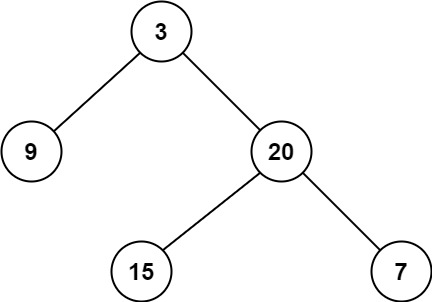
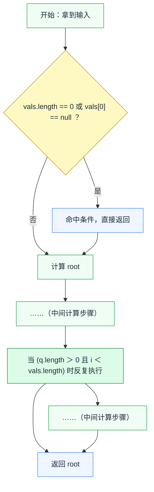
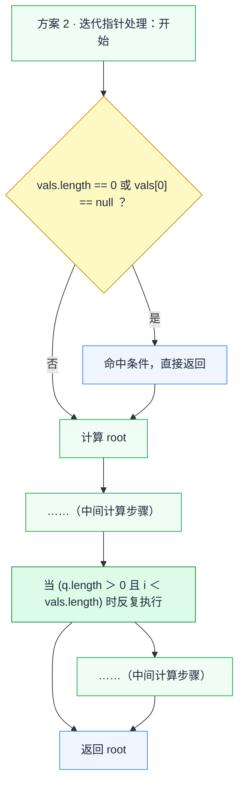
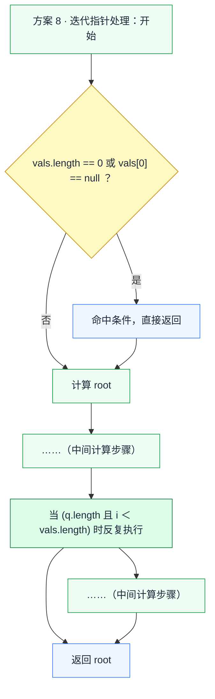
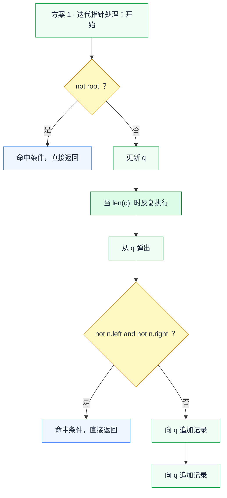
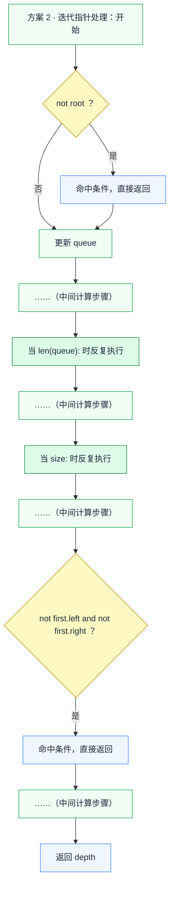
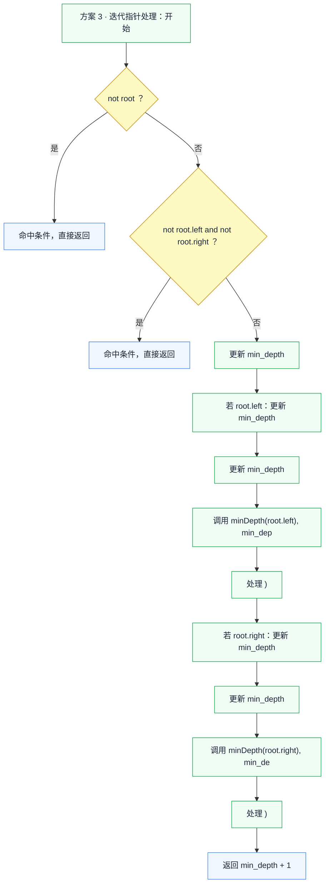
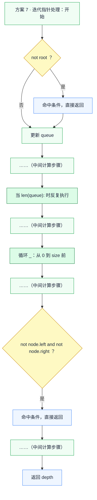
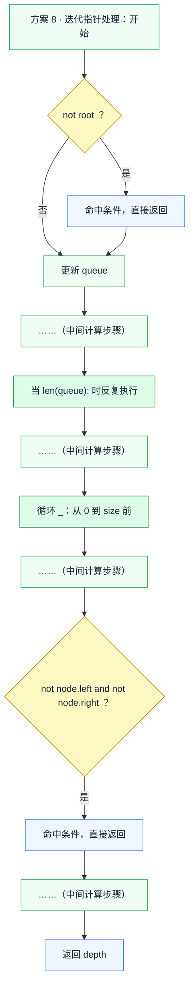
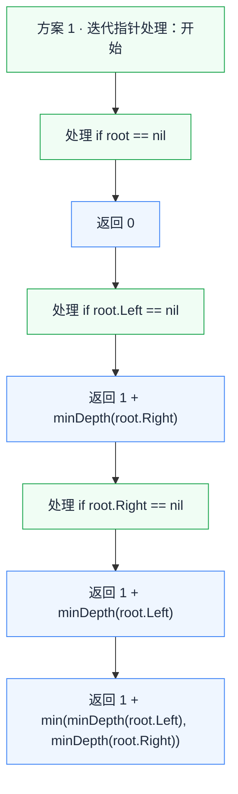

# 117 · 二叉树的最小深度（第六阶段 · 二叉树 · Medium）

> **难度**：⭐⭐ Medium ｜ **专题**：二叉树
> **学习定位**：第六阶段 · 二叉树第 117 篇 ｜ **解法数**：9
> **内容总结**：**二叉树的最小深度**（二叉树 · Medium）：共 9 个方案，主线思路「迭代指针处理」；时间 O(n)（单趟线性扫描）；动画演示DFS 点亮过程，附录给出 11 种语言 × 全部方案的可运行实现。

---

## 题目描述

给定一个二叉树，找出其最小深度。

最小深度是从根节点到最近叶子节点的最短路径上的节点数量。

说明：叶子节点是指没有子节点的节点。

- 主函数签名：`function minDepth(root: TreeNode | null): number`

**用例（来自原题）**：

**示例 1**



```text
输入：root = [3,9,20,null,null,15,7]
输出：2
```

**示例 2**

```text
输入：root = [2,null,3,null,4,null,5,null,6]
输出：5
```
> ✅ **官方验证**：全部 TypeScript 解法已通过 leetcode.cn 官方示例用例验证（自动注入运行，全部 PASS）。题面与 [leetcode.cn 官方](https://leetcode.cn/problems/minimum-depth-of-binary-tree/)一致，示例配图取自官方题面。

**数据范围与注意事项**：

- `树中节点数的范围在 `[0, 10^5]` 内`
- `-1000 <= Node.val <= 1000`
- **易错点**：递归出口（空节点）必须先写，否则直接空指针。

## 题目分析

**场景是什么**：树是分层数据的标准形态，这类题练的是递归分治与遍历序，对应真实开发里的目录树、组件树。本题就是该场景的 Medium 级练习，主线做法是「迭代指针处理」。

**主线怎么解**：把主解法从头到尾过一遍，它其实在依次做这几件事：队列或堆的调度。

## 解题思路

**方案对比**（共 9 个方案，由浅入深）：

| 方案 | 时间复杂度 | 空间复杂度 |
|---|---|---|
| 方案 1 · 迭代指针处理 | O(n)（单趟线性扫描） | O(1) 到 O(n)（视辅助结构） |
| 方案 2 · 迭代指针处理 | O(n)（单趟线性扫描） | O(1) 到 O(n)（视辅助结构） |
| 方案 3 · 迭代指针处理 | O(n)（单趟线性扫描） | O(1) 到 O(n)（视辅助结构） |
| 方案 4 · 迭代指针处理 | O(n)（单趟线性扫描） | O(1) 到 O(n)（视辅助结构） |
| 方案 5 · 迭代指针处理 | O(n)（单趟线性扫描） | O(1) 到 O(n)（视辅助结构） |
| 方案 6 · 迭代指针处理 | O(n)（单趟线性扫描） | O(1) 到 O(n)（视辅助结构） |
| 方案 7 · 迭代指针处理 | O(n)（单趟线性扫描） | O(1) 到 O(n)（视辅助结构） |
| 方案 8 · 迭代指针处理 | O(n)（单趟线性扫描） | O(1) 到 O(n)（视辅助结构） |
| 方案 9 · 迭代指针处理 | O(n)（单趟线性扫描） | O(1) 到 O(n)（视辅助结构） |

**方案间的取舍**：方案 1（迭代指针处理）；方案 2（迭代指针处理）；方案 3（迭代指针处理）；方案 4（迭代指针处理）；方案 5（迭代指针处理）；方案 6（迭代指针处理）；方案 7（迭代指针处理）；方案 8（迭代指针处理）；方案 9（迭代指针处理）。数据规模小、可读性优先时选靠前的方案；规模大、性能优先时选靠后的方案。

**怎么读这一篇**：

- 🐣 **新手路线**：把「题目描述」的示例 1 在纸上手推一遍 → 读方案 1（最直观的写法）与它的代码走读 → 按「运行方式」本地跑通看 PASS → 回头对比方案 2 之后的写法差在哪
- 🦅 **大佬路线**：直接锁定最优方案 1（迭代指针处理，O(n)（单趟线性扫描））→ 跳读该方案代码与走读 → 用「逐步拆解与面试追问」补齐复杂度推导与边界追问

### 动态算法图（DFS 点亮，GIF 自动循环）


动画演示二叉树专题里DFS 点亮的典型过程；每个方案在「TypeScript 解题方案」一节还配了专属动画与专属流程图。

### 主解法流程图（真实控制流）



## TypeScript 解题方案（9 个方案逐个讲）

> **运行与提交**：每个方案都是自包含文件（内嵌用例自测，输出 PASS），整块复制到 `.ts` 文件后 `node 文件名` 即可运行。提交 LeetCode 时，把 `demo` 内的算法函数与辅助类型/函数整体取出、置于文件顶层即可。涉及交互/特殊接口的题以题面给定签名为准。

### 方案 1：迭代指针处理

**分析与思路**：核心做法是「迭代指针处理」。代码里依次做这些事：队列或堆的调度。

**运行方式**：`node 本文件`，内嵌用例全部通过会输出 PASS。


**方案专属流程图**（真实控制流）：


```typescript
export function demo(): void {
  // 程序入口：跑内嵌自测用例
  class TreeNode {
    // 定义类型
    val: number; // 值: number;
    left: TreeNode | null; // 左边界: TreeNode 按位或 null;
    right: TreeNode | null; // 右边界: TreeNode 按位或 null;
    constructor(v: number) {
      this.val = v;
      this.left = null;
      this.right = null;
    } // 把 值; this.左边界 赋值为 null; this.右边界 赋值为 null; } 写入 值
  }

  function buildTree(vals: (number | null)[]): TreeNode | null {
    // 定义函数/方法 buildTree
    if (vals.length === 0 || vals[0] === null) return null; // 若 vals.长度 全等于 0 或 vals[0] 全等于 null，直接返回 null
    const root = new TreeNode(vals[0]); // 把 new TreeNode(vals[0]) 存入 根节点
    const q: TreeNode[] = [root]; // 把 [根节点]; 写入 const q: TreeNode[]
    let i = 1; // 把 1 存入 下标 i
    while (q.length > 0 && i < vals.length) {
      // 循环，直到不满足「节点.长度 超过 0 且 下标 i 小于 vals.长度」
      const node = q.shift() as TreeNode; // 把 节点.shift() as TreeNode 存入 节点
      if (i < vals.length && vals[i] !== null) {
        // 若 下标 i 小于 vals.长度 且 vals[下标 i] 不等于 null
        node.left = new TreeNode(vals[i] as number); // 把 new TreeNode(vals[下标 i] as number); 写入 左边界
        q.push(node.left); // 把 节点.左边界 压入栈/数组尾部
      }
      i++; // 下标 i 加一
      if (i < vals.length && vals[i] !== null) {
        // 若 下标 i 小于 vals.长度 且 vals[下标 i] 不等于 null
        node.right = new TreeNode(vals[i] as number); // 把 new TreeNode(vals[下标 i] as number); 写入 右边界
        q.push(node.right); // 把 节点.右边界 压入栈/数组尾部
      }
      i++; // 下标 i 加一
    }
    return root; // 返回 根节点
  }

  function minDepth(root: TreeNode | null): number {
    // 定义函数/方法 minDepth
    if (!root) return 0; // 若 取反 根节点，直接返回 0
    const q: [TreeNode, number][] = [[root, 1]]; // 队列传递根节点和层级
    while (q.length) {
      // 循环，直到不满足「节点.长度」
      const [n, l] = q.shift() as [TreeNode, number]; // 取出队首元素和层级
      if (!n.left && !n.right) return l; // 遇到叶子节点直接返回层级
      if (n.left) q.push([n.left, l + 1]); // 若 元素个数.左边界) 节点 追加 [元素个数.左边界, 左指针 加 1]);
      if (n.right) q.push([n.right, l + 1]); // 若 元素个数.右边界) 节点 追加 [元素个数.右边界, 左指针 加 1]);
    }
    return 0; // 返回 0
  }

  const cases: { in: (number | null)[]; want: number }[] = [
    { in: [3, 9, 20, null, null, 15, 7], want: 2 },
    { in: [2, null, 3, null, 4, null, 5, null, 6], want: 5 },
    { in: [], want: 0 },
    { in: [1], want: 1 },
    { in: [1, 2], want: 2 },
    { in: [1, 2, 3, 4, 5], want: 2 },
  ];
  let fail = false; // 把 false 存入 fail
  for (const c of cases) {
    // for (const 字符 of cases) {
    const got = minDepth(buildTree(c.in)); // 把 minDepth(buildTree(字符.in)) 存入 got
    if (got !== c.want) {
      // 若 got 不等于 字符.want
      fail = true; // 把 true 存入 fail
      console.log('FAIL minDepth(%o)=%d want %d', c.in, got, c.want); // 打印输出
    }
  }
  if (fail) throw new Error('FAILED'); // 若 fail) throw new Error(「FAILED」);
  console.log('PASS'); // 全部用例通过，输出 PASS
}
demo(); // demo();
```

### 方案 2：迭代指针处理

**分析与思路**：核心做法是「迭代指针处理」。代码里依次做这些事：队列或堆的调度。

**运行方式**：`node 本文件`，内嵌用例全部通过会输出 PASS。


**方案专属流程图**（真实控制流）：



```typescript
export function demo(): void {
  // 程序入口：跑内嵌自测用例
  class TreeNode {
    // 定义类型
    val: number; // 值: number;
    left: TreeNode | null; // 左边界: TreeNode 按位或 null;
    right: TreeNode | null; // 右边界: TreeNode 按位或 null;
    constructor(v: number) {
      this.val = v;
      this.left = null;
      this.right = null;
    } // 把 值; this.左边界 赋值为 null; this.右边界 赋值为 null; } 写入 值
  }

  function buildTree(vals: (number | null)[]): TreeNode | null {
    // 定义函数/方法 buildTree
    if (vals.length === 0 || vals[0] === null) return null; // 若 vals.长度 全等于 0 或 vals[0] 全等于 null，直接返回 null
    const root = new TreeNode(vals[0]); // 把 new TreeNode(vals[0]) 存入 根节点
    const q: TreeNode[] = [root]; // 把 [根节点]; 写入 const q: TreeNode[]
    let i = 1; // 把 1 存入 下标 i
    while (q.length > 0 && i < vals.length) {
      // 循环，直到不满足「节点.长度 超过 0 且 下标 i 小于 vals.长度」
      const node = q.shift() as TreeNode; // 把 节点.shift() as TreeNode 存入 节点
      if (i < vals.length && vals[i] !== null) {
        // 若 下标 i 小于 vals.长度 且 vals[下标 i] 不等于 null
        node.left = new TreeNode(vals[i] as number); // 把 new TreeNode(vals[下标 i] as number); 写入 左边界
        q.push(node.left); // 把 节点.左边界 压入栈/数组尾部
      }
      i++; // 下标 i 加一
      if (i < vals.length && vals[i] !== null) {
        // 若 下标 i 小于 vals.长度 且 vals[下标 i] 不等于 null
        node.right = new TreeNode(vals[i] as number); // 把 new TreeNode(vals[下标 i] as number); 写入 右边界
        q.push(node.right); // 把 节点.右边界 压入栈/数组尾部
      }
      i++; // 下标 i 加一
    }
    return root; // 返回 根节点
  }

  function minDepth(root: TreeNode | null): number {
    // 定义函数/方法 minDepth
    const queue: TreeNode[] = []; // 把 []; 写入 const queue: TreeNode[]
    let depth = 0; // 最小深度
    if (root) queue.push(root); // 若 根节点) 队列 追加 根节点);
    while (queue.length) {
      // 循环，直到不满足「队列.长度」
      const size = queue.length; // 获取一层的节点数量
      depth++; // 深度 加一
      let s = size; // 把 大小 存入 字符串
      while (s--) {
        // 获取一层的所有节点
        const first = queue.shift() as TreeNode; // 队首出
        if (first.left) queue.push(first.left); // 同一层左侧入队
        if (first.right) queue.push(first.right); // 同一层右侧入队
        if (!first.left && !first.right) return depth; // 到叶子节点即可返回
      }
    }
    return depth; // 返回 深度
  }

  const cases: { in: (number | null)[]; want: number }[] = [
    { in: [3, 9, 20, null, null, 15, 7], want: 2 },
    { in: [2, null, 3, null, 4, null, 5, null, 6], want: 5 },
    { in: [], want: 0 },
    { in: [1], want: 1 },
    { in: [1, 2], want: 2 },
    { in: [1, 2, 3, 4, 5], want: 2 },
  ];
  let fail = false; // 把 false 存入 fail
  for (const c of cases) {
    // for (const 字符 of cases) {
    const got = minDepth(buildTree(c.in)); // 把 minDepth(buildTree(字符.in)) 存入 got
    if (got !== c.want) {
      // 若 got 不等于 字符.want
      fail = true; // 把 true 存入 fail
      console.log('FAIL minDepth(%o)=%d want %d', c.in, got, c.want); // 打印输出
    }
  }
  if (fail) throw new Error('FAILED'); // 若 fail) throw new Error(「FAILED」);
  console.log('PASS'); // 全部用例通过，输出 PASS
}
demo(); // demo();
```

### 方案 3：迭代指针处理

**分析与思路**：核心做法是「迭代指针处理」。代码里依次做这些事：队列或堆的调度。

**运行方式**：`node 本文件`，内嵌用例全部通过会输出 PASS。


**方案专属流程图**（真实控制流）：


```typescript
export function demo(): void {
  // 程序入口：跑内嵌自测用例
  class TreeNode {
    // 定义类型
    val: number; // 值: number;
    left: TreeNode | null; // 左边界: TreeNode 按位或 null;
    right: TreeNode | null; // 右边界: TreeNode 按位或 null;
    constructor(v: number) {
      this.val = v;
      this.left = null;
      this.right = null;
    } // 把 值; this.左边界 赋值为 null; this.右边界 赋值为 null; } 写入 值
  }

  function buildTree(vals: (number | null)[]): TreeNode | null {
    // 定义函数/方法 buildTree
    if (vals.length === 0 || vals[0] === null) return null; // 若 vals.长度 全等于 0 或 vals[0] 全等于 null，直接返回 null
    const root = new TreeNode(vals[0]); // 把 new TreeNode(vals[0]) 存入 根节点
    const q: TreeNode[] = [root]; // 把 [根节点]; 写入 const q: TreeNode[]
    let i = 1; // 把 1 存入 下标 i
    while (q.length > 0 && i < vals.length) {
      // 循环，直到不满足「节点.长度 超过 0 且 下标 i 小于 vals.长度」
      const node = q.shift() as TreeNode; // 把 节点.shift() as TreeNode 存入 节点
      if (i < vals.length && vals[i] !== null) {
        // 若 下标 i 小于 vals.长度 且 vals[下标 i] 不等于 null
        node.left = new TreeNode(vals[i] as number); // 把 new TreeNode(vals[下标 i] as number); 写入 左边界
        q.push(node.left); // 把 节点.左边界 压入栈/数组尾部
      }
      i++; // 下标 i 加一
      if (i < vals.length && vals[i] !== null) {
        // 若 下标 i 小于 vals.长度 且 vals[下标 i] 不等于 null
        node.right = new TreeNode(vals[i] as number); // 把 new TreeNode(vals[下标 i] as number); 写入 右边界
        q.push(node.right); // 把 节点.右边界 压入栈/数组尾部
      }
      i++; // 下标 i 加一
    }
    return root; // 返回 根节点
  }

  function minDepth(root: TreeNode | null): number {
    // 定义函数/方法 minDepth
    // 无节点情形
    if (!root) return 0; // 若 取反 根节点，直接返回 0
    // 没有孩子节点场景
    if (!root.left && !root.right) return 1; // 若 取反 根节点.左边界 且 取反 根节点.右边界，直接返回 1
    // 初始化最小值
    let minDepthVal = Number.MAX_SAFE_INTEGER; // 把 Number.MAX_SAFE_INTEGER 存入 minDepthVal
    // 对左子树进行遍历
    if (root.left) minDepthVal = Math.min(minDepth(root.left), minDepthVal);
    // 对右子树进行遍历
    if (root.right) minDepthVal = Math.min(minDepth(root.right), minDepthVal);
    // 当前最小值 + 1 并返回
    return minDepthVal + 1; // 返回 minDepthVal 加 1
  }

  const cases: { in: (number | null)[]; want: number }[] = [
    { in: [3, 9, 20, null, null, 15, 7], want: 2 },
    { in: [2, null, 3, null, 4, null, 5, null, 6], want: 5 },
    { in: [], want: 0 },
    { in: [1], want: 1 },
    { in: [1, 2], want: 2 },
    { in: [1, 2, 3, 4, 5], want: 2 },
  ];
  let fail = false; // 把 false 存入 fail
  for (const c of cases) {
    // for (const 字符 of cases) {
    const got = minDepth(buildTree(c.in)); // 把 minDepth(buildTree(字符.in)) 存入 got
    if (got !== c.want) {
      // 若 got 不等于 字符.want
      fail = true; // 把 true 存入 fail
      console.log('FAIL minDepth(%o)=%d want %d', c.in, got, c.want); // 打印输出
    }
  }
  if (fail) throw new Error('FAILED'); // 若 fail) throw new Error(「FAILED」);
  console.log('PASS'); // 全部用例通过，输出 PASS
}
demo(); // demo();
```

### 方案 4：迭代指针处理

**分析与思路**：核心做法是「迭代指针处理」。代码里依次做这些事：队列或堆的调度。

**运行方式**：`node 本文件`，内嵌用例全部通过会输出 PASS。


**方案专属流程图**（真实控制流）：


```typescript
export function demo(): void {
  // 程序入口：跑内嵌自测用例
  class TreeNode {
    // 定义类型
    val: number; // 值: number;
    left: TreeNode | null; // 左边界: TreeNode 按位或 null;
    right: TreeNode | null; // 右边界: TreeNode 按位或 null;
    constructor(v: number) {
      this.val = v;
      this.left = null;
      this.right = null;
    } // 把 值; this.左边界 赋值为 null; this.右边界 赋值为 null; } 写入 值
  }

  function buildTree(vals: (number | null)[]): TreeNode | null {
    // 定义函数/方法 buildTree
    if (vals.length === 0 || vals[0] === null) return null; // 若 vals.长度 全等于 0 或 vals[0] 全等于 null，直接返回 null
    const root = new TreeNode(vals[0]); // 把 new TreeNode(vals[0]) 存入 根节点
    const q: TreeNode[] = [root]; // 把 [根节点]; 写入 const q: TreeNode[]
    let i = 1; // 把 1 存入 下标 i
    while (q.length > 0 && i < vals.length) {
      // 循环，直到不满足「节点.长度 超过 0 且 下标 i 小于 vals.长度」
      const node = q.shift() as TreeNode; // 把 节点.shift() as TreeNode 存入 节点
      if (i < vals.length && vals[i] !== null) {
        // 若 下标 i 小于 vals.长度 且 vals[下标 i] 不等于 null
        node.left = new TreeNode(vals[i] as number); // 把 new TreeNode(vals[下标 i] as number); 写入 左边界
        q.push(node.left); // 把 节点.左边界 压入栈/数组尾部
      }
      i++; // 下标 i 加一
      if (i < vals.length && vals[i] !== null) {
        // 若 下标 i 小于 vals.长度 且 vals[下标 i] 不等于 null
        node.right = new TreeNode(vals[i] as number); // 把 new TreeNode(vals[下标 i] as number); 写入 右边界
        q.push(node.right); // 把 节点.右边界 压入栈/数组尾部
      }
      i++; // 下标 i 加一
    }
    return root; // 返回 根节点
  }

  // 方案1 BFS：按层遍历，遇到第一个叶子节点即返回当前层深度
  function minDepth(root: TreeNode | null): number {
    // 定义函数/方法 minDepth
    if (!root) return 0; // 若 取反 根节点，直接返回 0
    const queue: TreeNode[] = [root]; // 把 [根节点]; 写入 const queue: TreeNode[]
    let depth = 0; // 把 0 存入 深度
    while (queue.length) {
      // 循环，直到不满足「队列.长度」
      const size = queue.length; // 把 队列.长度 存入 大小
      depth++; // 深度 加一
      for (let k = 0; k < size; k++) {
        // 让 下标 k 从 0 开始计数，下标 k 小于 大小 就继续
        const node = queue.shift() as TreeNode; // 把 队列.shift() as TreeNode 存入 节点
        if (!node.left && !node.right) return depth; // 若 取反 节点.左边界 且 取反 节点.右边界，直接返回 深度
        if (node.left) queue.push(node.left); // 若 节点.左边界) 队列 追加 节点.左边界);
        if (node.right) queue.push(node.right); // 若 节点.右边界) 队列 追加 节点.右边界);
      }
    }
    return depth; // 返回 深度
  }

  const cases: { in: (number | null)[]; want: number }[] = [
    { in: [3, 9, 20, null, null, 15, 7], want: 2 },
    { in: [2, null, 3, null, 4, null, 5, null, 6], want: 5 },
    { in: [], want: 0 },
    { in: [1], want: 1 },
    { in: [1, 2], want: 2 },
    { in: [1, 2, 3, 4, 5], want: 2 },
  ];
  let fail = false; // 把 false 存入 fail
  for (const c of cases) {
    // for (const 字符 of cases) {
    const got = minDepth(buildTree(c.in)); // 把 minDepth(buildTree(字符.in)) 存入 got
    if (got !== c.want) {
      // 若 got 不等于 字符.want
      fail = true; // 把 true 存入 fail
      console.log('FAIL minDepth(%o)=%d want %d', c.in, got, c.want); // 打印输出
    }
  }
  if (fail) throw new Error('FAILED'); // 若 fail) throw new Error(「FAILED」);
  console.log('PASS'); // 全部用例通过，输出 PASS
}
demo(); // demo();
```

### 方案 5：迭代指针处理

**分析与思路**：核心做法是「迭代指针处理」。代码里依次做这些事：队列或堆的调度。

**运行方式**：`node 本文件`，内嵌用例全部通过会输出 PASS。


**方案专属流程图**（真实控制流）：


```typescript
export function demo(): void {
  // 程序入口：跑内嵌自测用例
  class TreeNode {
    // 定义类型
    val: number; // 值: number;
    left: TreeNode | null; // 左边界: TreeNode 按位或 null;
    right: TreeNode | null; // 右边界: TreeNode 按位或 null;
    constructor(v: number) {
      this.val = v;
      this.left = null;
      this.right = null;
    } // 把 值; this.左边界 赋值为 null; this.右边界 赋值为 null; } 写入 值
  }

  function buildTree(vals: (number | null)[]): TreeNode | null {
    // 定义函数/方法 buildTree
    if (vals.length === 0 || vals[0] === null) return null; // 若 vals.长度 全等于 0 或 vals[0] 全等于 null，直接返回 null
    const root = new TreeNode(vals[0]); // 把 new TreeNode(vals[0]) 存入 根节点
    const q: TreeNode[] = [root]; // 把 [根节点]; 写入 const q: TreeNode[]
    let i = 1; // 把 1 存入 下标 i
    while (q.length > 0 && i < vals.length) {
      // 循环，直到不满足「节点.长度 超过 0 且 下标 i 小于 vals.长度」
      const node = q.shift() as TreeNode; // 把 节点.shift() as TreeNode 存入 节点
      if (i < vals.length && vals[i] !== null) {
        // 若 下标 i 小于 vals.长度 且 vals[下标 i] 不等于 null
        node.left = new TreeNode(vals[i] as number); // 把 new TreeNode(vals[下标 i] as number); 写入 左边界
        q.push(node.left); // 把 节点.左边界 压入栈/数组尾部
      }
      i++; // 下标 i 加一
      if (i < vals.length && vals[i] !== null) {
        // 若 下标 i 小于 vals.长度 且 vals[下标 i] 不等于 null
        node.right = new TreeNode(vals[i] as number); // 把 new TreeNode(vals[下标 i] as number); 写入 右边界
        q.push(node.right); // 把 节点.右边界 压入栈/数组尾部
      }
      i++; // 下标 i 加一
    }
    return root; // 返回 根节点
  }

  // 方案2 BFS：按层遍历，每层深度 +1，遇到叶子节点返回
  function minDepth(root: TreeNode | null): number {
    // 定义函数/方法 minDepth
    if (!root) return 0; // 若 取反 根节点，直接返回 0
    const queue: TreeNode[] = [root]; // 把 [根节点]; 写入 const queue: TreeNode[]
    let depth = 0; // 把 0 存入 深度
    while (queue.length) {
      // 循环，直到不满足「队列.长度」
      const size = queue.length; // 把 队列.长度 存入 大小
      depth++; // 深度 加一
      for (let k = 0; k < size; k++) {
        // 让 下标 k 从 0 开始计数，下标 k 小于 大小 就继续
        const node = queue.shift() as TreeNode; // 把 队列.shift() as TreeNode 存入 节点
        if (!node.left && !node.right) return depth; // 若 取反 节点.左边界 且 取反 节点.右边界，直接返回 深度
        if (node.left) queue.push(node.left); // 若 节点.左边界) 队列 追加 节点.左边界);
        if (node.right) queue.push(node.right); // 若 节点.右边界) 队列 追加 节点.右边界);
      }
    }
    return depth; // 返回 深度
  }

  const cases: { in: (number | null)[]; want: number }[] = [
    { in: [3, 9, 20, null, null, 15, 7], want: 2 },
    { in: [2, null, 3, null, 4, null, 5, null, 6], want: 5 },
    { in: [], want: 0 },
    { in: [1], want: 1 },
    { in: [1, 2], want: 2 },
    { in: [1, 2, 3, 4, 5], want: 2 },
  ];
  let fail = false; // 把 false 存入 fail
  for (const c of cases) {
    // for (const 字符 of cases) {
    const got = minDepth(buildTree(c.in)); // 把 minDepth(buildTree(字符.in)) 存入 got
    if (got !== c.want) {
      // 若 got 不等于 字符.want
      fail = true; // 把 true 存入 fail
      console.log('FAIL minDepth(%o)=%d want %d', c.in, got, c.want); // 打印输出
    }
  }
  if (fail) throw new Error('FAILED'); // 若 fail) throw new Error(「FAILED」);
  console.log('PASS'); // 全部用例通过，输出 PASS
}
demo(); // demo();
```

### 方案 6：迭代指针处理

**分析与思路**：核心做法是「迭代指针处理」。代码里依次做这些事：队列或堆的调度。

**运行方式**：`node 本文件`，内嵌用例全部通过会输出 PASS。


**方案专属流程图**（真实控制流）：


```typescript
export function demo(): void {
  // 程序入口：跑内嵌自测用例
  class TreeNode {
    // 定义类型
    val: number; // 值: number;
    left: TreeNode | null; // 左边界: TreeNode 按位或 null;
    right: TreeNode | null; // 右边界: TreeNode 按位或 null;
    constructor(v: number) {
      this.val = v;
      this.left = null;
      this.right = null;
    } // 把 值; this.左边界 赋值为 null; this.右边界 赋值为 null; } 写入 值
  }

  function buildTree(vals: (number | null)[]): TreeNode | null {
    // 定义函数/方法 buildTree
    if (vals.length === 0 || vals[0] === null) return null; // 若 vals.长度 全等于 0 或 vals[0] 全等于 null，直接返回 null
    const root = new TreeNode(vals[0]); // 把 new TreeNode(vals[0]) 存入 根节点
    const q: TreeNode[] = [root]; // 把 [根节点]; 写入 const q: TreeNode[]
    let i = 1; // 把 1 存入 下标 i
    while (q.length > 0 && i < vals.length) {
      // 循环，直到不满足「节点.长度 超过 0 且 下标 i 小于 vals.长度」
      const node = q.shift() as TreeNode; // 把 节点.shift() as TreeNode 存入 节点
      if (i < vals.length && vals[i] !== null) {
        // 若 下标 i 小于 vals.长度 且 vals[下标 i] 不等于 null
        node.left = new TreeNode(vals[i] as number); // 把 new TreeNode(vals[下标 i] as number); 写入 左边界
        q.push(node.left); // 把 节点.左边界 压入栈/数组尾部
      }
      i++; // 下标 i 加一
      if (i < vals.length && vals[i] !== null) {
        // 若 下标 i 小于 vals.长度 且 vals[下标 i] 不等于 null
        node.right = new TreeNode(vals[i] as number); // 把 new TreeNode(vals[下标 i] as number); 写入 右边界
        q.push(node.right); // 把 节点.右边界 压入栈/数组尾部
      }
      i++; // 下标 i 加一
    }
    return root; // 返回 根节点
  }

  // 方案3 BFS：层序遍历，逐层扩展，首个叶子所在层即最小深度
  function minDepth(root: TreeNode | null): number {
    // 定义函数/方法 minDepth
    if (!root) return 0; // 若 取反 根节点，直接返回 0
    const queue: TreeNode[] = [root]; // 把 [根节点]; 写入 const queue: TreeNode[]
    let depth = 0; // 把 0 存入 深度
    while (queue.length) {
      // 循环，直到不满足「队列.长度」
      const size = queue.length; // 把 队列.长度 存入 大小
      depth++; // 深度 加一
      for (let k = 0; k < size; k++) {
        // 让 下标 k 从 0 开始计数，下标 k 小于 大小 就继续
        const node = queue.shift() as TreeNode; // 把 队列.shift() as TreeNode 存入 节点
        if (!node.left && !node.right) return depth; // 若 取反 节点.左边界 且 取反 节点.右边界，直接返回 深度
        if (node.left) queue.push(node.left); // 若 节点.左边界) 队列 追加 节点.左边界);
        if (node.right) queue.push(node.right); // 若 节点.右边界) 队列 追加 节点.右边界);
      }
    }
    return depth; // 返回 深度
  }

  const cases: { in: (number | null)[]; want: number }[] = [
    { in: [3, 9, 20, null, null, 15, 7], want: 2 },
    { in: [2, null, 3, null, 4, null, 5, null, 6], want: 5 },
    { in: [], want: 0 },
    { in: [1], want: 1 },
    { in: [1, 2], want: 2 },
    { in: [1, 2, 3, 4, 5], want: 2 },
  ];
  let fail = false; // 把 false 存入 fail
  for (const c of cases) {
    // for (const 字符 of cases) {
    const got = minDepth(buildTree(c.in)); // 把 minDepth(buildTree(字符.in)) 存入 got
    if (got !== c.want) {
      // 若 got 不等于 字符.want
      fail = true; // 把 true 存入 fail
      console.log('FAIL minDepth(%o)=%d want %d', c.in, got, c.want); // 打印输出
    }
  }
  if (fail) throw new Error('FAILED'); // 若 fail) throw new Error(「FAILED」);
  console.log('PASS'); // 全部用例通过，输出 PASS
}
demo(); // demo();
```

### 方案 7：迭代指针处理

**分析与思路**：核心做法是「迭代指针处理」。代码里依次做这些事：队列或堆的调度。

**运行方式**：`node 本文件`，内嵌用例全部通过会输出 PASS。


**方案专属流程图**（真实控制流）：


```typescript
export function demo(): void {
  // 程序入口：跑内嵌自测用例
  class TreeNode {
    // 定义类型
    val: number; // 值: number;
    left: TreeNode | null; // 左边界: TreeNode 按位或 null;
    right: TreeNode | null; // 右边界: TreeNode 按位或 null;
    constructor(v: number) {
      this.val = v;
      this.left = null;
      this.right = null;
    } // 把 值; this.左边界 赋值为 null; this.右边界 赋值为 null; } 写入 值
  }

  function buildTree(vals: (number | null)[]): TreeNode | null {
    // 定义函数/方法 buildTree
    if (vals.length === 0 || vals[0] === null) return null; // 若 vals.长度 全等于 0 或 vals[0] 全等于 null，直接返回 null
    const root = new TreeNode(vals[0]); // 把 new TreeNode(vals[0]) 存入 根节点
    const q: TreeNode[] = [root]; // 把 [根节点]; 写入 const q: TreeNode[]
    let i = 1; // 把 1 存入 下标 i
    while (q.length > 0 && i < vals.length) {
      // 循环，直到不满足「节点.长度 超过 0 且 下标 i 小于 vals.长度」
      const node = q.shift() as TreeNode; // 把 节点.shift() as TreeNode 存入 节点
      if (i < vals.length && vals[i] !== null) {
        // 若 下标 i 小于 vals.长度 且 vals[下标 i] 不等于 null
        node.left = new TreeNode(vals[i] as number); // 把 new TreeNode(vals[下标 i] as number); 写入 左边界
        q.push(node.left); // 把 节点.左边界 压入栈/数组尾部
      }
      i++; // 下标 i 加一
      if (i < vals.length && vals[i] !== null) {
        // 若 下标 i 小于 vals.长度 且 vals[下标 i] 不等于 null
        node.right = new TreeNode(vals[i] as number); // 把 new TreeNode(vals[下标 i] as number); 写入 右边界
        q.push(node.right); // 把 节点.右边界 压入栈/数组尾部
      }
      i++; // 下标 i 加一
    }
    return root; // 返回 根节点
  }

  // 方案1 BFS：队列按层扩展，遇到第一个没有孩子的节点即返回所在层
  function minDepth(root: TreeNode | null): number {
    // 定义函数/方法 minDepth
    if (!root) return 0; // 若 取反 根节点，直接返回 0
    const queue: TreeNode[] = [root]; // 把 [根节点]; 写入 const queue: TreeNode[]
    let depth = 0; // 把 0 存入 深度
    while (queue.length) {
      // 循环，直到不满足「队列.长度」
      const size = queue.length; // 把 队列.长度 存入 大小
      depth++; // 深度 加一
      for (let k = 0; k < size; k++) {
        // 让 下标 k 从 0 开始计数，下标 k 小于 大小 就继续
        const node = queue.shift() as TreeNode; // 把 队列.shift() as TreeNode 存入 节点
        if (!node.left && !node.right) return depth; // 若 取反 节点.左边界 且 取反 节点.右边界，直接返回 深度
        if (node.left) queue.push(node.left); // 若 节点.左边界) 队列 追加 节点.左边界);
        if (node.right) queue.push(node.right); // 若 节点.右边界) 队列 追加 节点.右边界);
      }
    }
    return depth; // 返回 深度
  }

  const cases: { in: (number | null)[]; want: number }[] = [
    { in: [3, 9, 20, null, null, 15, 7], want: 2 },
    { in: [2, null, 3, null, 4, null, 5, null, 6], want: 5 },
    { in: [], want: 0 },
    { in: [1], want: 1 },
    { in: [1, 2], want: 2 },
    { in: [1, 2, 3, 4, 5], want: 2 },
  ];
  let fail = false; // 把 false 存入 fail
  for (const c of cases) {
    // for (const 字符 of cases) {
    const got = minDepth(buildTree(c.in)); // 把 minDepth(buildTree(字符.in)) 存入 got
    if (got !== c.want) {
      // 若 got 不等于 字符.want
      fail = true; // 把 true 存入 fail
      console.log('FAIL minDepth(%o)=%d want %d', c.in, got, c.want); // 打印输出
    }
  }
  if (fail) throw new Error('FAILED'); // 若 fail) throw new Error(「FAILED」);
  console.log('PASS'); // 全部用例通过，输出 PASS
}
demo(); // demo();
```

### 方案 8：迭代指针处理

**分析与思路**：核心做法是「迭代指针处理」。代码里依次做这些事：队列或堆的调度。

**运行方式**：`node 本文件`，内嵌用例全部通过会输出 PASS。


**方案专属流程图**（真实控制流）：



```typescript
export function demo(): void {
  // 程序入口：跑内嵌自测用例
  class TreeNode {
    val: number;
    left: TreeNode | null;
    right: TreeNode | null;
    constructor(v = 0, l: TreeNode | null = null, r: TreeNode | null = null) {
      this.val = v;
      this.left = l;
      this.right = r;
    }
  } // 定义类型
  function buildTree(vals: (number | null)[]): TreeNode | null {
    // 定义函数/方法 buildTree
    if (vals.length === 0 || vals[0] === null) return null; // 若 vals.长度 全等于 0 或 vals[0] 全等于 null，直接返回 null
    const root = new TreeNode(vals[0] as number);
    const q: TreeNode[] = [root];
    let i = 1;
    while (q.length && i < vals.length) {
      const node = q.shift()!;
      if (i < vals.length && vals[i] !== null) {
        node.left = new TreeNode(vals[i] as number);
        q.push(node.left);
      }
      i++;
      if (i < vals.length && vals[i] !== null) {
        node.right = new TreeNode(vals[i] as number);
        q.push(node.right);
      }
      i++;
    }
    return root; // 返回 根节点
  }
  function levelList(root: TreeNode | null): number[][] {
    if (!root) return [];
    const res: number[][] = [];
    let q: TreeNode[] = [root];
    while (q.length) {
      const lvl: number[] = [];
      const n = q.length;
      for (let k = 0; k < n; k++) {
        const node = q.shift()!;
        lvl.push(node.val);
        if (node.left) q.push(node.left);
        if (node.right) q.push(node.right);
      }
      res.push(lvl);
    }
    return res;
  } // 定义函数/方法 levelList
  function sameTree(a: TreeNode | null, b: TreeNode | null): boolean {
    if (!a && !b) return true;
    if (!a || !b) return false;
    if (a.val !== b.val) return false;
    return sameTree(a.left, b.left) && sameTree(a.right, b.right);
  } // 定义函数/方法 sameTree
  function inorderT(root: TreeNode | null): number[] {
    if (!root) return [];
    return [...inorderT(root.left), root.val, ...inorderT(root.right)];
  } // 定义函数/方法 inorderT
  function minDepth(root: TreeNode | null): number {
    if (!root) return 0;
    if (!root.left) return 1 + minDepth(root.right);
    if (!root.right) return 1 + minDepth(root.left);
    return 1 + Math.min(minDepth(root.left), minDepth(root.right));
  } // 定义函数/方法 minDepth
  const cases = [
    { in: [3, 9, 20, null, 15, 7], want: 3 },
    { in: [1, 2, 3, 4, 5, null, null, null, 6], want: 2 },
    { in: [], want: 0 },
  ];
  let fail = false; // 把 false 存入 fail
  for (const c of cases) {
    const got = minDepth(buildTree(c.in));
    if (got !== c.want) {
      fail = true;
      console.log('FAIL ' + got);
    }
  } // 打印输出
  if (fail) throw new Error('FAILED'); // 若 fail) throw new Error(「FAILED」);
  console.log('PASS'); // 全部用例通过，输出 PASS
}
demo(); // demo();
```

### 方案 9：迭代指针处理

**分析与思路**：核心做法是「迭代指针处理」。代码里依次做这些事：队列或堆的调度。

**运行方式**：`node 本文件`，内嵌用例全部通过会输出 PASS。


**方案专属流程图**（真实控制流）：


```typescript
export function demo(): void {
  // 程序入口：跑内嵌自测用例
  class TreeNode {
    val: number;
    left: TreeNode | null;
    right: TreeNode | null;
    constructor(v = 0, l: TreeNode | null = null, r: TreeNode | null = null) {
      this.val = v;
      this.left = l;
      this.right = r;
    }
  } // 定义类型
  function buildTree(vals: (number | null)[]): TreeNode | null {
    // 定义函数/方法 buildTree
    if (vals.length === 0 || vals[0] === null) return null; // 若 vals.长度 全等于 0 或 vals[0] 全等于 null，直接返回 null
    const root = new TreeNode(vals[0] as number);
    const q: TreeNode[] = [root];
    let i = 1;
    while (q.length && i < vals.length) {
      const node = q.shift()!;
      if (i < vals.length && vals[i] !== null) {
        node.left = new TreeNode(vals[i] as number);
        q.push(node.left);
      }
      i++;
      if (i < vals.length && vals[i] !== null) {
        node.right = new TreeNode(vals[i] as number);
        q.push(node.right);
      }
      i++;
    }
    return root; // 返回 根节点
  }
  function levelList(root: TreeNode | null): number[][] {
    if (!root) return [];
    const res: number[][] = [];
    let q: TreeNode[] = [root];
    while (q.length) {
      const lvl: number[] = [];
      const n = q.length;
      for (let k = 0; k < n; k++) {
        const node = q.shift()!;
        lvl.push(node.val);
        if (node.left) q.push(node.left);
        if (node.right) q.push(node.right);
      }
      res.push(lvl);
    }
    return res;
  } // 定义函数/方法 levelList
  function sameTree(a: TreeNode | null, b: TreeNode | null): boolean {
    if (!a && !b) return true;
    if (!a || !b) return false;
    if (a.val !== b.val) return false;
    return sameTree(a.left, b.left) && sameTree(a.right, b.right);
  } // 定义函数/方法 sameTree
  function inorderT(root: TreeNode | null): number[] {
    if (!root) return [];
    return [...inorderT(root.left), root.val, ...inorderT(root.right)];
  } // 定义函数/方法 inorderT
  function minDepth(root: TreeNode | null): number {
    if (!root) return 0;
    if (!root.left) return 1 + minDepth(root.right);
    if (!root.right) return 1 + minDepth(root.left);
    return 1 + Math.min(minDepth(root.left), minDepth(root.right));
  } // 定义函数/方法 minDepth
  const cases = [
    { in: [3, 9, 20, null, 15, 7], want: 3 },
    { in: [1, 2, 3, 4, 5, null, null, null, 6], want: 2 },
    { in: [], want: 0 },
  ];
  let fail = false; // 把 false 存入 fail
  for (const c of cases) {
    const got = minDepth(buildTree(c.in));
    if (got !== c.want) {
      fail = true;
      console.log('FAIL ' + got);
    }
  } // 打印输出
  if (fail) throw new Error('FAILED'); // 若 fail) throw new Error(「FAILED」);
  console.log('PASS'); // 全部用例通过，输出 PASS
}
demo(); // demo();
```

## 逐步拆解与面试追问

**复杂度**：时间 O(n)（单趟线性扫描），空间 O(1) 到 O(n)（视辅助结构）

**为什么是这个量级**：每个元素被常数次访问，辅助哈希或栈的开销与 n 同阶

**面试官可能会追问**：

- 递归和迭代写法各自的空间开销？
- 能否用层序统一处理？
- 空节点的边界如何约定？

## 关键 API 速查（TS 主解法实际用到，附官方链接）

| API | 作用 | 使用要点 | 官方文档 |
|---|---|---|---|
| `Array.prototype.push()` | 尾部追加 | 返回新长度；可一次多个；均摊 O(1)；会改变原数组 | [官方文档](https://developer.mozilla.org/zh-CN/docs/Web/JavaScript/Reference/Global_Objects/Array/push) |
| `Array.prototype.shift()` | 头部取出 | O(n)（后续元素整体前移）；大量头部操作请用链表或双端结构 | [官方文档](https://developer.mozilla.org/zh-CN/docs/Web/JavaScript/Reference/Global_Objects/Array/shift) |

### 各语言官方文档导航

- **TypeScript / JS**：[MDN 中文参考](https://developer.mozilla.org/zh-CN/)
- **Python**：[Python 官方文档](https://docs.python.org/zh-cn/3/)
- **Go**：[Go 标准库](https://pkg.go.dev/std)
- **Java**：[JDK 17 API](https://docs.oracle.com/en/java/javase/17/docs/api/)
- **Rust**：[Rust 标准库](https://doc.rust-lang.org/std/)
- **Lua**：[Lua 5.4 手册](https://www.lua.org/manual/5.4/)
- **C**：[Cppreference C](https://zh.cppreference.com/w/c)
- **C++**：[Cppreference C++](https://zh.cppreference.com/w/cpp)
- **R**：[R 官方手册](https://stat.ethz.ch/R-manual/)
- **Zig**：[Zig 语言文档](https://ziglang.org/documentation/master/)
- **Dart**：[Dart API](https://api.dart.dev/)

## 附录：其他 10 种语言全部实现（每种语言列举其全部方案）

> TypeScript 的全部方案见「TypeScript 解题方案」一节；下面是其余 10 种语言的对应实现，每种语言的每个方案都带思路分析、代码走读与专属运行架构图。
> 每个方案都内嵌用例自测，可独立运行（老仓库 python/go 文件遵循「打印结果」约定）。
> 完整解法文件见 `dsa/<语言>/tree/lc_111_二叉树的最小深度/`。

### Python 实现（9 种方案）

Python 的全部方案如下，每个方案都内嵌用例自测，可独立运行（老仓库 python/go 文件遵循「打印结果」约定）：

#### 方案 1：迭代指针处理

**思路与代码分析**：核心是「迭代指针处理」。Python 版用切片与字典推导式简化操作，突出可读性。**走读**：方案 1 · 迭代指针处理：开始 → 命中条件，直接返回 → 更新 q → 当 len(q): 时反复执行 → 从 q 弹出 → 命中条件，直接返回 → 向 q 追加记录 → 向 q 追加记录。

**运行架构**（真实控制流）：



```python
import sys  # 提高递归深度上限（深输入防 RecursionError）

sys.setrecursionlimit(200000)  # 树/链表类题目节点数可达 1e4 量级

def minDepth(root):  # 定义函数 minDepth（参数：根节点）
    if not root:
        return 0  # 若 not 根节点: return 0
    q = [[root, 1]]  # 把 [[根节点, 1]] 存入 节点
    while len(q):  # 循环，直到不满足「长度(节点」
        [n, l] = q.pop(0)  # 把 节点 弹出 0) 写入 [n, l]
        if not n.left and not n.right:  # 若 not 元素个数.左边界 and not 元素个数.右边界
            return l  # 返回 左指针
        n.left and q.append([n.left, l + 1])  # 把 [元素个数.左边界, 左指针 加 1] 追加到列表尾部
        n.right and q.append([n.right, l + 1])  # 把 [元素个数.右边界,左指针 加 1] 追加到列表尾部

if __name__ == "__main__":  # 若 __name__ 等于 '__main__'
    print(minDepth(None))  # 打印输出
```

#### 方案 2：迭代指针处理

**思路与代码分析**：核心是「迭代指针处理」。Python 版用切片与字典推导式简化操作，突出可读性。**走读**：方案 2 · 迭代指针处理：开始 → 命中条件，直接返回 → 更新 queue → 当 len(queue): 时反复执行 → 当 size: 时反复执行 → 命中条件，直接返回 → 返回 depth。

**运行架构**（真实控制流）：



```python
import sys  # 提高递归深度上限（深输入防 RecursionError）

sys.setrecursionlimit(200000)  # 树/链表类题目节点数可达 1e4 量级

def minDepth(root):  # 定义函数 minDepth（参数：根节点）
    if not root:
        return 0  # 若 not 根节点: return 0
    queue = [root]  # 把 [根节点] 存入 队列
    depth = 0  # 把 0 存入 深度
    while len(queue):  # 循环，直到不满足「长度(队列」
        size = len(queue)  # 把 长度(队列) 存入 大小
        depth += 1  # 深度累加 1
        while size:  # 循环，直到不满足「大小」
            first = queue.pop(0)  # 把 队列 弹出 0) 存入 first
            if first.left:
                queue.append(first.left)  # 若 first.左边界: 队列 追加 first.左边界
            if first.right:
                queue.append(first.right)  # 若 first.右边界: 队列 追加 first.右边界
            if not first.left and not first.right:
                return depth  # 若 not first.左边界 and not first.右边界: return 深度
            size -= 1  # 大小累减 1
    return depth  # 返回 深度

if __name__ == "__main__":  # 若 __name__ 等于 '__main__'
    print(minDepth(None))  # 打印输出
```

#### 方案 3：迭代指针处理

**思路与代码分析**：核心是「迭代指针处理」。Python 版用切片与字典推导式简化操作，突出可读性。**走读**：方案 3 · 迭代指针处理：开始 → 命中条件，直接返回 → 命中条件，直接返回 → 更新 min_depth → 若 root.left：更新 min_depth → 更新 min_depth → 调用 minDepth(root.left), min_dep → 处理 ) → 若 root.right：更新 min_depth → 更新 min_depth → 调用 minDepth(root.right), min_de → 处理 ) → 返回 min_depth + 1。

**运行架构**（真实控制流）：



```python
import sys  # 提高递归深度上限（深输入防 RecursionError）

sys.setrecursionlimit(200000)  # 树/链表类题目节点数可达 1e4 量级

def minDepth(root):  # 定义函数 minDepth（参数：根节点）
    if not root:
        return 0  # 若 not 根节点: return 0
    if not root.left and not root.right:
        return 1  # 若 not 根节点.左边界 and not 根节点.右边界: return 1
    min_depth = float("inf")  # 把 float('inf') 存入 min_depth
    if root.left:
        min_depth = min(
            minDepth(root.left), min_depth
        )  # 若 根节点.左边界: min_depth 赋值为 取较小值 minDepth(根节点.左边界), min_depth
    if root.right:
        min_depth = min(
            minDepth(root.right), min_depth
        )  # 若 根节点.右边界: min_depth 赋值为 取较小值 minDepth(根节点.右边界), min_depth
    return min_depth + 1  # 返回 min_depth 加 1

if __name__ == "__main__":  # 若 __name__ 等于 '__main__'
    print(minDepth(None))  # 打印输出
```

#### 方案 4：迭代指针处理

**思路与代码分析**：核心是「迭代指针处理」。Python 版用切片与字典推导式简化操作，突出可读性。**走读**：方案 4 · 迭代指针处理：开始 → 命中条件，直接返回 → 更新 queue → 当 len(queue): 时反复执行 → 循环 _：从 0 到 size 前 → 命中条件，直接返回 → 返回 depth。

**运行架构**（真实控制流）：


```python
import sys  # 提高递归深度上限（深输入防 RecursionError）

sys.setrecursionlimit(200000)  # 树/链表类题目节点数可达 1e4 量级

def minDepth(root):  # 定义函数 minDepth（参数：根节点）
    if not root:
        return 0  # 若 not 根节点: return 0
    queue = [root]  # 把 [根节点] 存入 队列
    depth = 0  # 把 0 存入 深度
    while len(queue):  # 循环，直到不满足「长度(队列」
        size = len(queue)  # 把 长度(队列) 存入 大小
        depth += 1  # 深度累加 1
        for _ in range(size):  # 让 _ 从 大小 遍历
            node = queue.pop(0)  # 把 队列 弹出 0) 存入 节点
            if not node.left and not node.right:
                return depth  # 若 not 节点.左边界 and not 节点.右边界: return 深度
            if node.left:
                queue.append(node.left)  # 若 节点.左边界: 队列 追加 节点.左边界
            if node.right:
                queue.append(node.right)  # 若 节点.右边界: 队列 追加 节点.右边界
    return depth  # 返回 深度

if __name__ == "__main__":  # 若 __name__ 等于 '__main__'
    print(minDepth(None))  # 打印输出
```

#### 方案 5：迭代指针处理

**思路与代码分析**：核心是「迭代指针处理」。Python 版用切片与字典推导式简化操作，突出可读性。**走读**：方案 5 · 迭代指针处理：开始 → 命中条件，直接返回 → 更新 queue → 当 len(queue): 时反复执行 → 循环 _：从 0 到 size 前 → 命中条件，直接返回 → 返回 depth。

**运行架构**（真实控制流）：


```python
import sys  # 提高递归深度上限（深输入防 RecursionError）

sys.setrecursionlimit(200000)  # 树/链表类题目节点数可达 1e4 量级

def minDepth(root):  # 定义函数 minDepth（参数：根节点）
    if not root:
        return 0  # 若 not 根节点: return 0
    queue = [root]  # 把 [根节点] 存入 队列
    depth = 0  # 把 0 存入 深度
    while len(queue):  # 循环，直到不满足「长度(队列」
        size = len(queue)  # 把 长度(队列) 存入 大小
        depth += 1  # 深度累加 1
        for _ in range(size):  # 让 _ 从 大小 遍历
            node = queue.pop(0)  # 把 队列 弹出 0) 存入 节点
            if not node.left and not node.right:
                return depth  # 若 not 节点.左边界 and not 节点.右边界: return 深度
            if node.left:
                queue.append(node.left)  # 若 节点.左边界: 队列 追加 节点.左边界
            if node.right:
                queue.append(node.right)  # 若 节点.右边界: 队列 追加 节点.右边界
    return depth  # 返回 深度

if __name__ == "__main__":  # 若 __name__ 等于 '__main__'
    print(minDepth(None))  # 打印输出
```

#### 方案 6：迭代指针处理

**思路与代码分析**：核心是「迭代指针处理」。Python 版用切片与字典推导式简化操作，突出可读性。**走读**：方案 6 · 迭代指针处理：开始 → 命中条件，直接返回 → 更新 queue → 当 len(queue): 时反复执行 → 循环 _：从 0 到 size 前 → 命中条件，直接返回 → 返回 depth。

**运行架构**（真实控制流）：


```python
import sys  # 提高递归深度上限（深输入防 RecursionError）

sys.setrecursionlimit(200000)  # 树/链表类题目节点数可达 1e4 量级

def minDepth(root):  # 定义函数 minDepth（参数：根节点）
    if not root:
        return 0  # 若 not 根节点: return 0
    queue = [root]  # 把 [根节点] 存入 队列
    depth = 0  # 把 0 存入 深度
    while len(queue):  # 循环，直到不满足「长度(队列」
        size = len(queue)  # 把 长度(队列) 存入 大小
        depth += 1  # 深度累加 1
        for _ in range(size):  # 让 _ 从 大小 遍历
            node = queue.pop(0)  # 把 队列 弹出 0) 存入 节点
            if not node.left and not node.right:
                return depth  # 若 not 节点.左边界 and not 节点.右边界: return 深度
            if node.left:
                queue.append(node.left)  # 若 节点.左边界: 队列 追加 节点.左边界
            if node.right:
                queue.append(node.right)  # 若 节点.右边界: 队列 追加 节点.右边界
    return depth  # 返回 深度

if __name__ == "__main__":  # 若 __name__ 等于 '__main__'
    print(minDepth(None))  # 打印输出
```

#### 方案 7：迭代指针处理

**思路与代码分析**：核心是「迭代指针处理」。Python 版用切片与字典推导式简化操作，突出可读性。**走读**：方案 7 · 迭代指针处理：开始 → 命中条件，直接返回 → 更新 queue → 当 len(queue): 时反复执行 → 循环 _：从 0 到 size 前 → 命中条件，直接返回 → 返回 depth。

**运行架构**（真实控制流）：



```python
import sys  # 提高递归深度上限（深输入防 RecursionError）

sys.setrecursionlimit(200000)  # 树/链表类题目节点数可达 1e4 量级

def minDepth(root):  # 定义函数 minDepth（参数：根节点）
    if not root:
        return 0  # 若 not 根节点: return 0
    queue = [root]  # 把 [根节点] 存入 队列
    depth = 0  # 把 0 存入 深度
    while len(queue):  # 循环，直到不满足「长度(队列」
        size = len(queue)  # 把 长度(队列) 存入 大小
        depth += 1  # 深度累加 1
        for _ in range(size):  # 让 _ 从 大小 遍历
            node = queue.pop(0)  # 把 队列 弹出 0) 存入 节点
            if not node.left and not node.right:
                return depth  # 若 not 节点.左边界 and not 节点.右边界: return 深度
            if node.left:
                queue.append(node.left)  # 若 节点.左边界: 队列 追加 节点.左边界
            if node.right:
                queue.append(node.right)  # 若 节点.右边界: 队列 追加 节点.右边界
    return depth  # 返回 深度

if __name__ == "__main__":  # 若 __name__ 等于 '__main__'
    print(minDepth(None))  # 打印输出
```

#### 方案 8：迭代指针处理

**思路与代码分析**：核心是「迭代指针处理」。Python 版用切片与字典推导式简化操作，突出可读性。**走读**：方案 8 · 迭代指针处理：开始 → 命中条件，直接返回 → 更新 queue → 当 len(queue): 时反复执行 → 循环 _：从 0 到 size 前 → 命中条件，直接返回 → 返回 depth。

**运行架构**（真实控制流）：



```python
import sys  # 提高递归深度上限（深输入防 RecursionError）

sys.setrecursionlimit(200000)  # 树/链表类题目节点数可达 1e4 量级

def minDepth(root):  # 定义函数 minDepth（参数：根节点）
    if not root:
        return 0  # 若 not 根节点: return 0
    queue = [root]  # 把 [根节点] 存入 队列
    depth = 0  # 把 0 存入 深度
    while len(queue):  # 循环，直到不满足「长度(队列」
        size = len(queue)  # 把 长度(队列) 存入 大小
        depth += 1  # 深度累加 1
        for _ in range(size):  # 让 _ 从 大小 遍历
            node = queue.pop(0)  # 把 队列 弹出 0) 存入 节点
            if not node.left and not node.right:
                return depth  # 若 not 节点.左边界 and not 节点.右边界: return 深度
            if node.left:
                queue.append(node.left)  # 若 节点.左边界: 队列 追加 节点.左边界
            if node.right:
                queue.append(node.right)  # 若 节点.右边界: 队列 追加 节点.右边界
    return depth  # 返回 深度

if __name__ == "__main__":  # 若 __name__ 等于 '__main__'
    print(minDepth(None))  # 打印输出
```

#### 方案 9：迭代指针处理

**思路与代码分析**：核心是「迭代指针处理」。Python 版用切片与字典推导式简化操作，突出可读性。**走读**：方案 9 · 迭代指针处理：开始 → 命中条件，直接返回 → 更新 queue → 当 len(queue): 时反复执行 → 循环 _：从 0 到 size 前 → 命中条件，直接返回 → 返回 depth。

**运行架构**（真实控制流）：


```python
import sys  # 提高递归深度上限（深输入防 RecursionError）

sys.setrecursionlimit(200000)  # 树/链表类题目节点数可达 1e4 量级

def minDepth(root):  # 定义函数 minDepth（参数：根节点）
    if not root:
        return 0  # 若 not 根节点: return 0
    queue = [root]  # 把 [根节点] 存入 队列
    depth = 0  # 把 0 存入 深度
    while len(queue):  # 循环，直到不满足「长度(队列」
        size = len(queue)  # 把 长度(队列) 存入 大小
        depth += 1  # 深度累加 1
        for _ in range(size):  # 让 _ 从 大小 遍历
            node = queue.pop(0)  # 把 队列 弹出 0) 存入 节点
            if not node.left and not node.right:
                return depth  # 若 not 节点.左边界 and not 节点.右边界: return 深度
            if node.left:
                queue.append(node.left)  # 若 节点.左边界: 队列 追加 节点.左边界
            if node.right:
                queue.append(node.right)  # 若 节点.右边界: 队列 追加 节点.右边界
    return depth  # 返回 深度

if __name__ == "__main__":  # 若 __name__ 等于 '__main__'
    print(minDepth(None))  # 打印输出
```

### Go 实现（9 种方案）

Go 的全部方案如下，每个方案都内嵌用例自测，可独立运行（老仓库 python/go 文件遵循「打印结果」约定）：

#### 方案 1：迭代指针处理

**思路与代码分析**：核心是「迭代指针处理」。Go 版用切片与多返回值惯用法，显式处理索引边界。**走读**：方案 1 · 迭代指针处理：开始 → 处理 if root == nil → 返回 0 → 处理 if root.Left == nil → 返回 1 + minDepth(root.Right) → 处理 if root.Right == nil → 返回 1 + minDepth(root.Left) → 返回 1 + min(minDepth(root.Left), minDepth(root.Right))。

**运行架构**（真实控制流）：



```go
package main // 引入依赖
import (
	"fmt"
	"os"
) // 引入依赖
type TreeNode struct {
	Val   int
	Left  *TreeNode
	Right *TreeNode
}                        // 定义类型
const NULL = -1000000000 // 把 减 1000000000 存入 NULL
func buildTree(vals []int) *TreeNode { // 定义函数/方法 buildTree
	if len(vals) == 0 || vals[0] == NULL {
		return nil
	} // 若 长度(vals) 等于 0 或 vals[0] 等于 NULL { return nil }
	root := &TreeNode{Val: vals[0]} // 把 按位与 TreeNode{Val: vals[0]} 写入 root :
	q := []*TreeNode{root}
	i := 1                            // 把 [] 乘 TreeNode{根节点}; 下标 i : 赋值为 1 写入 q :
	for len(q) > 0 && i < len(vals) { // 定义函数/方法 len
		node := q[0]
		q = q[1:] // 把 节点[0]; 节点 赋值为 节点[1:] 写入 node :
		if i < len(vals) && vals[i] != NULL {
			node.Left = &TreeNode{Val: vals[i]}
			q = append(q, node.Left)
		}
		i++
		if i < len(vals) && vals[i] != NULL {
			node.Right = &TreeNode{Val: vals[i]}
			q = append(q, node.Right)
		}
		i++
	}
	return root // 返回 根节点
}
func levelList(root *TreeNode) [][]int { // 定义函数/方法 levelList
	if root == nil {
		return [][]int{}
	} // 若 根节点 等于 nil { return [][]int{} }
	res := [][]int{}
	q := []*TreeNode{root} // 把 [][]int{}; 节点 : 赋值为 [] 乘 TreeNode{根节点} 写入 res :
	for len(q) > 0 {       // for 长度(节点) 超过 0 {
		lvl := []int{}
		n := len(q)              // 把 []int{}; 元素个数 : 赋值为 长度(节点) 写入 lvl :
		for k := 0; k < n; k++ { // 让 下标 k 从 0 开始计数
			node := q[0]
			q = q[1:]                   // 把 节点[0]; 节点 赋值为 节点[1:] 写入 node :
			lvl = append(lvl, node.Val) // 把 append(lvl, 节点.Val) 写入 lvl
			if node.Left != nil {
				q = append(q, node.Left)
			} // 若 节点.Left 不等于 nil { 节点 赋值为 append(节点, 节点.Left) }
			if node.Right != nil {
				q = append(q, node.Right)
			} // 若 节点.Right 不等于 nil { 节点 赋值为 append(节点, 节点.Right) }
		}
		res = append(res, lvl) // 把 append(结果, lvl) 写入 结果
	}
	return res // 返回 结果
}
func sameTree(a, b *TreeNode) bool { // 定义函数/方法 sameTree
	if a == nil && b == nil {
		return true
	} // 若 数组 等于 nil 且 b 等于 nil { return true }
	if a == nil || b == nil {
		return false
	} // 若 数组 等于 nil 或 b 等于 nil { return false }
	if a.Val != b.Val {
		return false
	} // 若 数组.Val 不等于 b.Val { return false }
	return sameTree(a.Left, b.Left) && sameTree(a.Right, b.Right) // 定义函数/方法 sameTree
}
func inorderT(root *TreeNode) []int { // 定义函数/方法 inorderT
	if root == nil {
		return []int{}
	} // 若 根节点 等于 nil { return []int{} }
	return append(append(inorderT(root.Left), root.Val), inorderT(root.Right)...) // 定义函数/方法 append
}
func minDepth(root *TreeNode) int { // 定义函数/方法 minDepth
	if root == nil {
		return 0
	} // 若 根节点 等于 nil { return 0 }
	if root.Left == nil {
		return 1 + minDepth(root.Right)
	} // 若 根节点.Left 等于 nil { return 1 加 minDepth(根节点.Right) }
	if root.Right == nil {
		return 1 + minDepth(root.Left)
	} // 若 根节点.Right 等于 nil { return 1 加 minDepth(根节点.Left) }
	return 1 + min(minDepth(root.Left), minDepth(root.Right)) // 返回 1 加 取较小值 minDepth(根节点.Left), minDepth(根节点.Right))
}
func min(a, b int) int {
	if a < b {
		return a
	}
	return b
} // 定义函数/方法 min
func main() { // 程序入口：跑内嵌自测用例
	cases := []struct {
		in   []int
		want int
	}{ // 把 []struct{ in []int; want int }{ 写入 cases :
		{[]int{3, 9, 20, NULL, 15, 7}, 3},
		{[]int{1, 2, 3, 4, 5, NULL, NULL, NULL, 6}, 2},
		{[]int{}, 0},
	}
	ok := true                // 把 true 写入 ok :
	for _, c := range cases { // 同时取 _ 与 字符 遍历
		if got := minDepth(buildTree(c.in)); got != c.want {
			ok = false
			fmt.Printf("FAIL %v want %v\n", got, c.want)
		}
	}
	if !ok {
		os.Exit(1)
	} // 若 取反 ok { os.Exit(1) }
	fmt.Println("PASS") // 全部用例通过，输出 PASS
}
```

#### 方案 2：迭代指针处理

**思路与代码分析**：核心是「迭代指针处理」。Go 版用切片与多返回值惯用法，显式处理索引边界。**走读**：方案 2 · 迭代指针处理：开始 → 处理 if root == nil → 返回 0 → 遍历循环 → 遍历循环 → 返回 depth → 返回 depth。

**运行架构**（真实控制流）：

```mermaid
graph TD
    N0["方案 2 · 迭代指针处理：开始"]
    N1["处理 if root == nil"]
    N2["返回 0"]
    D1["……（中间计算步骤）"]
    N5["遍历循环"]
    D2["……（中间计算步骤）"]
    N8["遍历循环"]
    D3["……（中间计算步骤）"]
    N16["返回 depth"]
    D4["……（中间计算步骤）"]
    N18["返回 depth"]
    N0 --> N1
    N1 --> N2
    N8 -- 下一轮 --> N5
    N5 --> N18
    N2 --> D1
    D1 --> N5
    N5 --> D2
    D2 --> N8
    N8 --> D3
    D3 --> N16
    N16 --> D4
    D4 --> N18
    classDef n fill:#f0fdf4,stroke:#16a34a,color:#1e293b;
    classDef lp fill:#dcfce7,stroke:#15803d,color:#1e293b;
    classDef dc fill:#fef9c3,stroke:#ca8a04,color:#1e293b;
    classDef tm fill:#eff6ff,stroke:#3b82f6,color:#1e293b;
    class N0,N1,D1,D2,D3,D4 n;
    class N5,N8 lp;
    class N2,N16,N18 tm;
```

```go
package main // 引入依赖

import (
	"fmt" // 「fmt」
	"os"  // 「os」
)

type TreeNode struct { // 定义类型
	Val   int       // Val int
	Left  *TreeNode // Left 乘 TreeNode
	Right *TreeNode // Right 乘 TreeNode
}

func buildTree(vals []interface{}) *TreeNode { // 定义函数/方法 buildTree
	if len(vals) == 0 || vals[0] == nil { // 若 长度(vals) 等于 0 或 vals[0] 等于 nil
		return nil // 返回 nil
	}
	root := &TreeNode{Val: vals[0].(int)} // 把 按位与 TreeNode{Val: vals[0].(int)} 写入 root :
	q := []*TreeNode{root}                // 把 [] 乘 TreeNode{根节点} 写入 q :
	i := 1                                // 把 1 写入 i :
	for len(q) > 0 && i < len(vals) {     // 定义函数/方法 len
		node := q[0]                         // 把 节点[0] 写入 node :
		q = q[1:]                            // 把 节点[1:] 写入 节点
		if i < len(vals) && vals[i] != nil { // 若 下标 i 小于 长度(vals) 且 vals[下标 i] 不等于 nil
			node.Left = &TreeNode{Val: vals[i].(int)} // 把 按位与 TreeNode{Val: vals[下标 i].(int)} 写入 node.Left
			q = append(q, node.Left)                  // 把 append(节点, 节点.Left) 写入 节点
		}
		i++                                  // 下标 i 加一
		if i < len(vals) && vals[i] != nil { // 若 下标 i 小于 长度(vals) 且 vals[下标 i] 不等于 nil
			node.Right = &TreeNode{Val: vals[i].(int)} // 把 按位与 TreeNode{Val: vals[下标 i].(int)} 写入 node.Right
			q = append(q, node.Right)                  // 把 append(节点, 节点.Right) 写入 节点
		}
		i++ // 下标 i 加一
	}
	return root // 返回 根节点
}

func minDepth(root *TreeNode) int { // 定义函数/方法 minDepth
	if root == nil { // 若 根节点 等于 nil
		return 0 // 返回 0
	}
	queue := []*TreeNode{root} // 把 [] 乘 TreeNode{根节点} 写入 queue :
	depth := 0                 // 把 0 写入 depth :
	for len(queue) > 0 {       // for 长度(队列) 超过 0 {
		size := len(queue) // 把 长度(队列) 写入 size :
		depth++            // 深度 加一
		for size > 0 {     // for 大小 超过 0 {
			first := queue[0]      // 把 队列[0] 写入 first :
			queue = queue[1:]      // 把 队列[1:] 写入 队列
			if first.Left != nil { // 若 first.Left 不等于 nil
				queue = append(queue, first.Left) // 把 append(队列, first.Left) 写入 队列
			}
			if first.Right != nil { // 若 first.Right 不等于 nil
				queue = append(queue, first.Right) // 把 append(队列, first.Right) 写入 队列
			}
			if first.Left == nil && first.Right == nil { // 若 first.Left 等于 nil 且 first.Right 等于 nil
				return depth // 返回 深度
			}
			size-- // 大小 减一
		}
	}
	return depth // 返回 深度
}

type tc struct { // 定义类型
	root *TreeNode // 根节点 乘 TreeNode
	want int       // want int
}

func main() { // 程序入口：跑内嵌自测用例
	cases := []tc{ // 把 []tc{ 写入 cases :
		{buildTree(nil), 0},
		{buildTree([]interface{}{1}), 1},
		{buildTree([]interface{}{3, 9, 20, nil, nil, 15, 7}), 2},
		{buildTree([]interface{}{1, 2, 3, 4, 5, 6, 7}), 3},
		{buildTree([]interface{}{1, 2, nil, 3, nil, 4, nil, 5}), 5},
	}
	for idx, c := range cases { // 同时取 idx 与 字符 遍历
		got := minDepth(c.root) // 把 minDepth(字符.根节点) 写入 got :
		if got != c.want {      // 若 got 不等于 字符.want
			fmt.Printf("case %d failed: got %v want %v\n", idx, got, c.want) // 打印输出
			os.Exit(1)                                                       // os.Exit(1)
		}
	}
	fmt.Println("PASS") // 全部用例通过，输出 PASS
}
```

#### 方案 3：迭代指针处理

**思路与代码分析**：核心是「迭代指针处理」。Go 版用切片与多返回值惯用法，显式处理索引边界。**走读**：方案 3 · 迭代指针处理：开始 → 处理 if root == nil → 返回 0 → 处理 if root.Left == nil 且 root. → 返回 1 → 更新 : → 处理 if root.Left ≠ nil → 更新 minD → 处理 if root.Right ≠ nil → 更新 minD → 返回 minD + 1。

**运行架构**（真实控制流）：

```mermaid
graph TD
    N0["方案 3 · 迭代指针处理：开始"]
    N1["处理 if root == nil"]
    N2["返回 0"]
    N3["处理 if root.Left == nil 且 root."]
    N4["返回 1"]
    N5["更新 :"]
    N6["处理 if root.Left ≠ nil"]
    N7["更新 minD"]
    N8["处理 if root.Right ≠ nil"]
    N9["更新 minD"]
    N10["返回 minD + 1"]
    N0 --> N1
    N1 --> N2
    N2 --> N3
    N3 --> N4
    N4 --> N5
    N5 --> N6
    N6 --> N7
    N7 --> N8
    N8 --> N9
    N9 --> N10
    classDef n fill:#f0fdf4,stroke:#16a34a,color:#1e293b;
    classDef lp fill:#dcfce7,stroke:#15803d,color:#1e293b;
    classDef dc fill:#fef9c3,stroke:#ca8a04,color:#1e293b;
    classDef tm fill:#eff6ff,stroke:#3b82f6,color:#1e293b;
    class N0,N1,N3,N5,N6,N7,N8,N9 n;
    class N2,N4,N10 tm;
```

```go
package main // 引入依赖

import (
	"fmt" // 「fmt」
	"os"  // 「os」
)

type TreeNode struct { // 定义类型
	Val   int       // Val int
	Left  *TreeNode // Left 乘 TreeNode
	Right *TreeNode // Right 乘 TreeNode
}

func buildTree(vals []interface{}) *TreeNode { // 定义函数/方法 buildTree
	if len(vals) == 0 || vals[0] == nil { // 若 长度(vals) 等于 0 或 vals[0] 等于 nil
		return nil // 返回 nil
	}
	root := &TreeNode{Val: vals[0].(int)} // 把 按位与 TreeNode{Val: vals[0].(int)} 写入 root :
	q := []*TreeNode{root}                // 把 [] 乘 TreeNode{根节点} 写入 q :
	i := 1                                // 把 1 写入 i :
	for len(q) > 0 && i < len(vals) {     // 定义函数/方法 len
		node := q[0]                         // 把 节点[0] 写入 node :
		q = q[1:]                            // 把 节点[1:] 写入 节点
		if i < len(vals) && vals[i] != nil { // 若 下标 i 小于 长度(vals) 且 vals[下标 i] 不等于 nil
			node.Left = &TreeNode{Val: vals[i].(int)} // 把 按位与 TreeNode{Val: vals[下标 i].(int)} 写入 node.Left
			q = append(q, node.Left)                  // 把 append(节点, 节点.Left) 写入 节点
		}
		i++                                  // 下标 i 加一
		if i < len(vals) && vals[i] != nil { // 若 下标 i 小于 长度(vals) 且 vals[下标 i] 不等于 nil
			node.Right = &TreeNode{Val: vals[i].(int)} // 把 按位与 TreeNode{Val: vals[下标 i].(int)} 写入 node.Right
			q = append(q, node.Right)                  // 把 append(节点, 节点.Right) 写入 节点
		}
		i++ // 下标 i 加一
	}
	return root // 返回 根节点
}

func min(a, b int) int { // 定义函数/方法 min
	if a < b { // 若 数组 小于 b
		return a // 返回 数组
	}
	return b // 返回 b
}

func minDepth(root *TreeNode) int { // 定义函数/方法 minDepth
	if root == nil { // 若 根节点 等于 nil
		return 0 // 返回 0
	}
	if root.Left == nil && root.Right == nil { // 若 根节点.Left 等于 nil 且 根节点.Right 等于 nil
		return 1 // 返回 1
	}
	minD := int(^uint(0) >> 1) // 把 int( 按位异或 uint(0) 超过 超过 1) 写入 minD :
	if root.Left != nil {      // 若 根节点.Left 不等于 nil
		minD = min(minD, minDepth(root.Left)) // 把 取较小值 minD, minDepth(根节点.Left)) 写入 minD
	}
	if root.Right != nil { // 若 根节点.Right 不等于 nil
		minD = min(minD, minDepth(root.Right)) // 把 取较小值 minD, minDepth(根节点.Right)) 写入 minD
	}
	return minD + 1 // 返回 minD 加 1
}

type tc struct { // 定义类型
	root *TreeNode // 根节点 乘 TreeNode
	want int       // want int
}

func main() { // 程序入口：跑内嵌自测用例
	cases := []tc{ // 把 []tc{ 写入 cases :
		{buildTree(nil), 0},
		{buildTree([]interface{}{1}), 1},
		{buildTree([]interface{}{3, 9, 20, nil, nil, 15, 7}), 2},
		{buildTree([]interface{}{1, 2, 3, 4, 5, 6, 7}), 3},
		{buildTree([]interface{}{1, 2, nil, 3, nil, 4, nil, 5}), 5},
	}
	for idx, c := range cases { // 同时取 idx 与 字符 遍历
		got := minDepth(c.root) // 把 minDepth(字符.根节点) 写入 got :
		if got != c.want {      // 若 got 不等于 字符.want
			fmt.Printf("case %d failed: got %v want %v\n", idx, got, c.want) // 打印输出
			os.Exit(1)                                                       // os.Exit(1)
		}
	}
	fmt.Println("PASS") // 全部用例通过，输出 PASS
}
```

#### 方案 4：迭代指针处理

**思路与代码分析**：核心是「迭代指针处理」。Go 版用切片与多返回值惯用法，显式处理索引边界。**走读**：方案 4 · 迭代指针处理：开始 → 处理 if root == nil → 返回 0 → 遍历循环 → 遍历循环 → 返回 depth → 返回 depth。

**运行架构**（真实控制流）：

```mermaid
graph TD
    N0["方案 4 · 迭代指针处理：开始"]
    N1["处理 if root == nil"]
    N2["返回 0"]
    D1["……（中间计算步骤）"]
    N5["遍历循环"]
    D2["……（中间计算步骤）"]
    N8["遍历循环"]
    D3["……（中间计算步骤）"]
    N12["返回 depth"]
    D4["……（中间计算步骤）"]
    N17["返回 depth"]
    N0 --> N1
    N1 --> N2
    N8 -- 下一轮 --> N5
    N5 --> N17
    N2 --> D1
    D1 --> N5
    N5 --> D2
    D2 --> N8
    N8 --> D3
    D3 --> N12
    N12 --> D4
    D4 --> N17
    classDef n fill:#f0fdf4,stroke:#16a34a,color:#1e293b;
    classDef lp fill:#dcfce7,stroke:#15803d,color:#1e293b;
    classDef dc fill:#fef9c3,stroke:#ca8a04,color:#1e293b;
    classDef tm fill:#eff6ff,stroke:#3b82f6,color:#1e293b;
    class N0,N1,D1,D2,D3,D4 n;
    class N5,N8 lp;
    class N2,N12,N17 tm;
```

```go
package main // 引入依赖

import (
	"fmt"
	"os"
) // 引入依赖

type TreeNode struct { // 定义类型
	Val   int       // Val int
	Left  *TreeNode // Left 乘 TreeNode
	Right *TreeNode // Right 乘 TreeNode
}

func buildTree(vals []interface{}) *TreeNode { // 定义函数/方法 buildTree
	if len(vals) == 0 || vals[0] == nil { // 若 长度(vals) 等于 0 或 vals[0] 等于 nil
		return nil // 返回 nil
	}
	root := &TreeNode{Val: vals[0].(int)} // 把 按位与 TreeNode{Val: vals[0].(int)} 写入 root :
	q := []*TreeNode{root}                // 把 [] 乘 TreeNode{根节点} 写入 q :
	i := 1                                // 把 1 写入 i :
	for i < len(vals) {                   // for 下标 i 小于 长度(vals) {
		node := q[0]        // 把 节点[0] 写入 node :
		q = q[1:]           // 把 节点[1:] 写入 节点
		if vals[i] != nil { // 若 vals[下标 i] 不等于 nil
			node.Left = &TreeNode{Val: vals[i].(int)} // 把 按位与 TreeNode{Val: vals[下标 i].(int)} 写入 node.Left
			q = append(q, node.Left)                  // 把 append(节点, 节点.Left) 写入 节点
		}
		i++                // 下标 i 加一
		if i < len(vals) { // 若 下标 i 小于 长度(vals
			if vals[i] != nil { // 若 vals[下标 i] 不等于 nil
				node.Right = &TreeNode{Val: vals[i].(int)} // 把 按位与 TreeNode{Val: vals[下标 i].(int)} 写入 node.Right
				q = append(q, node.Right)                  // 把 append(节点, 节点.Right) 写入 节点
			}
			i++ // 下标 i 加一
		}
	}
	return root // 返回 根节点
}

func minDepth(root *TreeNode) int { // 定义函数/方法 minDepth
	if root == nil { // 若 根节点 等于 nil
		return 0 // 返回 0
	}
	q := []*TreeNode{root} // 把 [] 乘 TreeNode{根节点} 写入 q :
	depth := 0             // 把 0 写入 depth :
	for len(q) > 0 {       // for 长度(节点) 超过 0 {
		size := len(q)              // 把 长度(节点) 写入 size :
		depth++                     // 深度 加一
		for i := 0; i < size; i++ { // 让 下标 i 从 0 开始计数
			n := q[0]                            // 把 节点[0] 写入 n :
			q = q[1:]                            // 把 节点[1:] 写入 节点
			if n.Left == nil && n.Right == nil { // 若 元素个数.Left 等于 nil 且 元素个数.Right 等于 nil
				return depth // 返回 深度
			}
			if n.Left != nil { // 若 元素个数.Left 不等于 nil
				q = append(q, n.Left) // 把 append(节点, 元素个数.Left) 写入 节点
			}
			if n.Right != nil { // 若 元素个数.Right 不等于 nil
				q = append(q, n.Right) // 把 append(节点, 元素个数.Right) 写入 节点
			}
		}
	}
	return depth // 返回 深度
}

func main() { // 程序入口：跑内嵌自测用例
	cases := []struct { // 把 []struct { 写入 cases :
		vals []interface{} // vals []interface{}
		want int           // want int
	}{ // }{
		{nil, 0},
		{[]interface{}{3, 9, 20, nil, nil, 15, 7}, 2},
	}
	ok := true                // 把 true 写入 ok :
	for _, c := range cases { // 同时取 _ 与 字符 遍历
		if g := minDepth(buildTree(c.vals)); g != c.want { // 若 g : 赋值为 minDepth(buildTree(字符.vals)); g 不等于 字符.want
			ok = false                                            // 把 false 写入 ok
			fmt.Printf("FAIL %v=%v want %v\n", c.vals, g, c.want) // 打印输出
		}
	}
	if !ok { // 若 取反 ok
		os.Exit(1) // os.Exit(1)
	}
	fmt.Println("PASS") // 全部用例通过，输出 PASS
}
```

#### 方案 5：迭代指针处理

**思路与代码分析**：核心是「迭代指针处理」。Go 版用切片与多返回值惯用法，显式处理索引边界。**走读**：方案 5 · 迭代指针处理：开始 → 处理 if root == nil → 返回 0 → 遍历循环 → 遍历循环 → 返回 depth → 返回 depth。

**运行架构**（真实控制流）：

```mermaid
graph TD
    N0["方案 5 · 迭代指针处理：开始"]
    N1["处理 if root == nil"]
    N2["返回 0"]
    D1["……（中间计算步骤）"]
    N5["遍历循环"]
    D2["……（中间计算步骤）"]
    N8["遍历循环"]
    D3["……（中间计算步骤）"]
    N12["返回 depth"]
    D4["……（中间计算步骤）"]
    N17["返回 depth"]
    N0 --> N1
    N1 --> N2
    N8 -- 下一轮 --> N5
    N5 --> N17
    N2 --> D1
    D1 --> N5
    N5 --> D2
    D2 --> N8
    N8 --> D3
    D3 --> N12
    N12 --> D4
    D4 --> N17
    classDef n fill:#f0fdf4,stroke:#16a34a,color:#1e293b;
    classDef lp fill:#dcfce7,stroke:#15803d,color:#1e293b;
    classDef dc fill:#fef9c3,stroke:#ca8a04,color:#1e293b;
    classDef tm fill:#eff6ff,stroke:#3b82f6,color:#1e293b;
    class N0,N1,D1,D2,D3,D4 n;
    class N5,N8 lp;
    class N2,N12,N17 tm;
```

```go
package main // 引入依赖

import (
	"fmt" // 「fmt」
	"os"  // 「os」
)

type TreeNode struct { // 定义类型
	Val   int       // Val int
	Left  *TreeNode // Left 乘 TreeNode
	Right *TreeNode // Right 乘 TreeNode
}

func buildTree(vals []interface{}) *TreeNode { // 定义函数/方法 buildTree
	if len(vals) == 0 || vals[0] == nil { // 若 长度(vals) 等于 0 或 vals[0] 等于 nil
		return nil // 返回 nil
	}
	root := &TreeNode{Val: vals[0].(int)} // 把 按位与 TreeNode{Val: vals[0].(int)} 写入 root :
	q := []*TreeNode{root}                // 把 [] 乘 TreeNode{根节点} 写入 q :
	i := 1                                // 把 1 写入 i :
	for len(q) > 0 && i < len(vals) {     // 定义函数/方法 len
		node := q[0]                         // 把 节点[0] 写入 node :
		q = q[1:]                            // 把 节点[1:] 写入 节点
		if i < len(vals) && vals[i] != nil { // 若 下标 i 小于 长度(vals) 且 vals[下标 i] 不等于 nil
			node.Left = &TreeNode{Val: vals[i].(int)} // 把 按位与 TreeNode{Val: vals[下标 i].(int)} 写入 node.Left
			q = append(q, node.Left)                  // 把 append(节点, 节点.Left) 写入 节点
		}
		i++                                  // 下标 i 加一
		if i < len(vals) && vals[i] != nil { // 若 下标 i 小于 长度(vals) 且 vals[下标 i] 不等于 nil
			node.Right = &TreeNode{Val: vals[i].(int)} // 把 按位与 TreeNode{Val: vals[下标 i].(int)} 写入 node.Right
			q = append(q, node.Right)                  // 把 append(节点, 节点.Right) 写入 节点
		}
		i++ // 下标 i 加一
	}
	return root // 返回 根节点
}

func minDepth(root *TreeNode) int { // 定义函数/方法 minDepth
	if root == nil { // 若 根节点 等于 nil
		return 0 // 返回 0
	}
	queue := []*TreeNode{root} // 把 [] 乘 TreeNode{根节点} 写入 queue :
	depth := 0                 // 把 0 写入 depth :
	for len(queue) > 0 {       // for 长度(队列) 超过 0 {
		size := len(queue)          // 把 长度(队列) 写入 size :
		depth++                     // 深度 加一
		for i := 0; i < size; i++ { // 让 下标 i 从 0 开始计数
			node := queue[0]                           // 把 队列[0] 写入 node :
			queue = queue[1:]                          // 把 队列[1:] 写入 队列
			if node.Left == nil && node.Right == nil { // 若 节点.Left 等于 nil 且 节点.Right 等于 nil
				return depth // 返回 深度
			}
			if node.Left != nil { // 若 节点.Left 不等于 nil
				queue = append(queue, node.Left) // 把 append(队列, 节点.Left) 写入 队列
			}
			if node.Right != nil { // 若 节点.Right 不等于 nil
				queue = append(queue, node.Right) // 把 append(队列, 节点.Right) 写入 队列
			}
		}
	}
	return depth // 返回 深度
}

type tc struct { // 定义类型
	root *TreeNode // 根节点 乘 TreeNode
	want int       // want int
}

func main() { // 程序入口：跑内嵌自测用例
	cases := []tc{ // 把 []tc{ 写入 cases :
		{buildTree(nil), 0},
		{buildTree([]interface{}{1}), 1},
		{buildTree([]interface{}{3, 9, 20, nil, nil, 15, 7}), 2},
		{buildTree([]interface{}{1, 2, 3, 4, 5, 6, 7}), 3},
		{buildTree([]interface{}{1, 2, nil, 3, nil, 4, nil, 5}), 5},
	}
	for idx, c := range cases { // 同时取 idx 与 字符 遍历
		got := minDepth(c.root) // 把 minDepth(字符.根节点) 写入 got :
		if got != c.want {      // 若 got 不等于 字符.want
			fmt.Printf("case %d failed: got %v want %v\n", idx, got, c.want) // 打印输出
			os.Exit(1)                                                       // os.Exit(1)
		}
	}
	fmt.Println("PASS") // 全部用例通过，输出 PASS
}
```

#### 方案 6：迭代指针处理

**思路与代码分析**：核心是「迭代指针处理」。Go 版用切片与多返回值惯用法，显式处理索引边界。**走读**：方案 6 · 迭代指针处理：开始 → 处理 if root == nil → 返回 0 → 遍历循环 → 遍历循环 → 返回 depth → 返回 depth。

**运行架构**（真实控制流）：

```mermaid
graph TD
    N0["方案 6 · 迭代指针处理：开始"]
    N1["处理 if root == nil"]
    N2["返回 0"]
    D1["……（中间计算步骤）"]
    N5["遍历循环"]
    D2["……（中间计算步骤）"]
    N8["遍历循环"]
    D3["……（中间计算步骤）"]
    N12["返回 depth"]
    D4["……（中间计算步骤）"]
    N17["返回 depth"]
    N0 --> N1
    N1 --> N2
    N8 -- 下一轮 --> N5
    N5 --> N17
    N2 --> D1
    D1 --> N5
    N5 --> D2
    D2 --> N8
    N8 --> D3
    D3 --> N12
    N12 --> D4
    D4 --> N17
    classDef n fill:#f0fdf4,stroke:#16a34a,color:#1e293b;
    classDef lp fill:#dcfce7,stroke:#15803d,color:#1e293b;
    classDef dc fill:#fef9c3,stroke:#ca8a04,color:#1e293b;
    classDef tm fill:#eff6ff,stroke:#3b82f6,color:#1e293b;
    class N0,N1,D1,D2,D3,D4 n;
    class N5,N8 lp;
    class N2,N12,N17 tm;
```

```go
package main // 引入依赖

import (
	"fmt" // 「fmt」
	"os"  // 「os」
)

type TreeNode struct { // 定义类型
	Val   int       // Val int
	Left  *TreeNode // Left 乘 TreeNode
	Right *TreeNode // Right 乘 TreeNode
}

func buildTree(vals []interface{}) *TreeNode { // 定义函数/方法 buildTree
	if len(vals) == 0 || vals[0] == nil { // 若 长度(vals) 等于 0 或 vals[0] 等于 nil
		return nil // 返回 nil
	}
	root := &TreeNode{Val: vals[0].(int)} // 把 按位与 TreeNode{Val: vals[0].(int)} 写入 root :
	q := []*TreeNode{root}                // 把 [] 乘 TreeNode{根节点} 写入 q :
	i := 1                                // 把 1 写入 i :
	for len(q) > 0 && i < len(vals) {     // 定义函数/方法 len
		node := q[0]                         // 把 节点[0] 写入 node :
		q = q[1:]                            // 把 节点[1:] 写入 节点
		if i < len(vals) && vals[i] != nil { // 若 下标 i 小于 长度(vals) 且 vals[下标 i] 不等于 nil
			node.Left = &TreeNode{Val: vals[i].(int)} // 把 按位与 TreeNode{Val: vals[下标 i].(int)} 写入 node.Left
			q = append(q, node.Left)                  // 把 append(节点, 节点.Left) 写入 节点
		}
		i++                                  // 下标 i 加一
		if i < len(vals) && vals[i] != nil { // 若 下标 i 小于 长度(vals) 且 vals[下标 i] 不等于 nil
			node.Right = &TreeNode{Val: vals[i].(int)} // 把 按位与 TreeNode{Val: vals[下标 i].(int)} 写入 node.Right
			q = append(q, node.Right)                  // 把 append(节点, 节点.Right) 写入 节点
		}
		i++ // 下标 i 加一
	}
	return root // 返回 根节点
}

func minDepth(root *TreeNode) int { // 定义函数/方法 minDepth
	if root == nil { // 若 根节点 等于 nil
		return 0 // 返回 0
	}
	queue := []*TreeNode{root} // 把 [] 乘 TreeNode{根节点} 写入 queue :
	depth := 0                 // 把 0 写入 depth :
	for len(queue) > 0 {       // for 长度(队列) 超过 0 {
		size := len(queue)          // 把 长度(队列) 写入 size :
		depth++                     // 深度 加一
		for i := 0; i < size; i++ { // 让 下标 i 从 0 开始计数
			node := queue[0]                           // 把 队列[0] 写入 node :
			queue = queue[1:]                          // 把 队列[1:] 写入 队列
			if node.Left == nil && node.Right == nil { // 若 节点.Left 等于 nil 且 节点.Right 等于 nil
				return depth // 返回 深度
			}
			if node.Left != nil { // 若 节点.Left 不等于 nil
				queue = append(queue, node.Left) // 把 append(队列, 节点.Left) 写入 队列
			}
			if node.Right != nil { // 若 节点.Right 不等于 nil
				queue = append(queue, node.Right) // 把 append(队列, 节点.Right) 写入 队列
			}
		}
	}
	return depth // 返回 深度
}

type tc struct { // 定义类型
	root *TreeNode // 根节点 乘 TreeNode
	want int       // want int
}

func main() { // 程序入口：跑内嵌自测用例
	cases := []tc{ // 把 []tc{ 写入 cases :
		{buildTree(nil), 0},
		{buildTree([]interface{}{1}), 1},
		{buildTree([]interface{}{3, 9, 20, nil, nil, 15, 7}), 2},
		{buildTree([]interface{}{1, 2, 3, 4, 5, 6, 7}), 3},
		{buildTree([]interface{}{1, 2, nil, 3, nil, 4, nil, 5}), 5},
	}
	for idx, c := range cases { // 同时取 idx 与 字符 遍历
		got := minDepth(c.root) // 把 minDepth(字符.根节点) 写入 got :
		if got != c.want {      // 若 got 不等于 字符.want
			fmt.Printf("case %d failed: got %v want %v\n", idx, got, c.want) // 打印输出
			os.Exit(1)                                                       // os.Exit(1)
		}
	}
	fmt.Println("PASS") // 全部用例通过，输出 PASS
}
```

#### 方案 7：迭代指针处理

**思路与代码分析**：核心是「迭代指针处理」。Go 版用切片与多返回值惯用法，显式处理索引边界。**走读**：方案 7 · 迭代指针处理：开始 → 处理 if root == nil → 返回 0 → 遍历循环 → 遍历循环 → 返回 depth → 返回 depth。

**运行架构**（真实控制流）：

```mermaid
graph TD
    N0["方案 7 · 迭代指针处理：开始"]
    N1["处理 if root == nil"]
    N2["返回 0"]
    D1["……（中间计算步骤）"]
    N5["遍历循环"]
    D2["……（中间计算步骤）"]
    N8["遍历循环"]
    D3["……（中间计算步骤）"]
    N12["返回 depth"]
    D4["……（中间计算步骤）"]
    N17["返回 depth"]
    N0 --> N1
    N1 --> N2
    N8 -- 下一轮 --> N5
    N5 --> N17
    N2 --> D1
    D1 --> N5
    N5 --> D2
    D2 --> N8
    N8 --> D3
    D3 --> N12
    N12 --> D4
    D4 --> N17
    classDef n fill:#f0fdf4,stroke:#16a34a,color:#1e293b;
    classDef lp fill:#dcfce7,stroke:#15803d,color:#1e293b;
    classDef dc fill:#fef9c3,stroke:#ca8a04,color:#1e293b;
    classDef tm fill:#eff6ff,stroke:#3b82f6,color:#1e293b;
    class N0,N1,D1,D2,D3,D4 n;
    class N5,N8 lp;
    class N2,N12,N17 tm;
```

```go
package main // 引入依赖

import (
	"fmt" // 「fmt」
	"os"  // 「os」
)

type TreeNode struct { // 定义类型
	Val   int       // Val int
	Left  *TreeNode // Left 乘 TreeNode
	Right *TreeNode // Right 乘 TreeNode
}

func buildTree(vals []interface{}) *TreeNode { // 定义函数/方法 buildTree
	if len(vals) == 0 || vals[0] == nil { // 若 长度(vals) 等于 0 或 vals[0] 等于 nil
		return nil // 返回 nil
	}
	root := &TreeNode{Val: vals[0].(int)} // 把 按位与 TreeNode{Val: vals[0].(int)} 写入 root :
	q := []*TreeNode{root}                // 把 [] 乘 TreeNode{根节点} 写入 q :
	i := 1                                // 把 1 写入 i :
	for len(q) > 0 && i < len(vals) {     // 定义函数/方法 len
		node := q[0]                         // 把 节点[0] 写入 node :
		q = q[1:]                            // 把 节点[1:] 写入 节点
		if i < len(vals) && vals[i] != nil { // 若 下标 i 小于 长度(vals) 且 vals[下标 i] 不等于 nil
			node.Left = &TreeNode{Val: vals[i].(int)} // 把 按位与 TreeNode{Val: vals[下标 i].(int)} 写入 node.Left
			q = append(q, node.Left)                  // 把 append(节点, 节点.Left) 写入 节点
		}
		i++                                  // 下标 i 加一
		if i < len(vals) && vals[i] != nil { // 若 下标 i 小于 长度(vals) 且 vals[下标 i] 不等于 nil
			node.Right = &TreeNode{Val: vals[i].(int)} // 把 按位与 TreeNode{Val: vals[下标 i].(int)} 写入 node.Right
			q = append(q, node.Right)                  // 把 append(节点, 节点.Right) 写入 节点
		}
		i++ // 下标 i 加一
	}
	return root // 返回 根节点
}

func minDepth(root *TreeNode) int { // 定义函数/方法 minDepth
	if root == nil { // 若 根节点 等于 nil
		return 0 // 返回 0
	}
	queue := []*TreeNode{root} // 把 [] 乘 TreeNode{根节点} 写入 queue :
	depth := 0                 // 把 0 写入 depth :
	for len(queue) > 0 {       // for 长度(队列) 超过 0 {
		size := len(queue)          // 把 长度(队列) 写入 size :
		depth++                     // 深度 加一
		for i := 0; i < size; i++ { // 让 下标 i 从 0 开始计数
			node := queue[0]                           // 把 队列[0] 写入 node :
			queue = queue[1:]                          // 把 队列[1:] 写入 队列
			if node.Left == nil && node.Right == nil { // 若 节点.Left 等于 nil 且 节点.Right 等于 nil
				return depth // 返回 深度
			}
			if node.Left != nil { // 若 节点.Left 不等于 nil
				queue = append(queue, node.Left) // 把 append(队列, 节点.Left) 写入 队列
			}
			if node.Right != nil { // 若 节点.Right 不等于 nil
				queue = append(queue, node.Right) // 把 append(队列, 节点.Right) 写入 队列
			}
		}
	}
	return depth // 返回 深度
}

type tc struct { // 定义类型
	root *TreeNode // 根节点 乘 TreeNode
	want int       // want int
}

func main() { // 程序入口：跑内嵌自测用例
	cases := []tc{ // 把 []tc{ 写入 cases :
		{buildTree(nil), 0},
		{buildTree([]interface{}{1}), 1},
		{buildTree([]interface{}{3, 9, 20, nil, nil, 15, 7}), 2},
		{buildTree([]interface{}{1, 2, 3, 4, 5, 6, 7}), 3},
		{buildTree([]interface{}{1, 2, nil, 3, nil, 4, nil, 5}), 5},
	}
	for idx, c := range cases { // 同时取 idx 与 字符 遍历
		got := minDepth(c.root) // 把 minDepth(字符.根节点) 写入 got :
		if got != c.want {      // 若 got 不等于 字符.want
			fmt.Printf("case %d failed: got %v want %v\n", idx, got, c.want) // 打印输出
			os.Exit(1)                                                       // os.Exit(1)
		}
	}
	fmt.Println("PASS") // 全部用例通过，输出 PASS
}
```

#### 方案 8：迭代指针处理

**思路与代码分析**：核心是「迭代指针处理」。Go 版用切片与多返回值惯用法，显式处理索引边界。**走读**：方案 8 · 迭代指针处理：开始 → 处理 if root == nil → 返回 0 → 遍历循环 → 遍历循环 → 返回 depth → 返回 depth。

**运行架构**（真实控制流）：

```mermaid
graph TD
    N0["方案 8 · 迭代指针处理：开始"]
    N1["处理 if root == nil"]
    N2["返回 0"]
    D1["……（中间计算步骤）"]
    N5["遍历循环"]
    D2["……（中间计算步骤）"]
    N8["遍历循环"]
    D3["……（中间计算步骤）"]
    N12["返回 depth"]
    D4["……（中间计算步骤）"]
    N17["返回 depth"]
    N0 --> N1
    N1 --> N2
    N8 -- 下一轮 --> N5
    N5 --> N17
    N2 --> D1
    D1 --> N5
    N5 --> D2
    D2 --> N8
    N8 --> D3
    D3 --> N12
    N12 --> D4
    D4 --> N17
    classDef n fill:#f0fdf4,stroke:#16a34a,color:#1e293b;
    classDef lp fill:#dcfce7,stroke:#15803d,color:#1e293b;
    classDef dc fill:#fef9c3,stroke:#ca8a04,color:#1e293b;
    classDef tm fill:#eff6ff,stroke:#3b82f6,color:#1e293b;
    class N0,N1,D1,D2,D3,D4 n;
    class N5,N8 lp;
    class N2,N12,N17 tm;
```

```go
package main // 引入依赖

import (
	"fmt" // 「fmt」
	"os"  // 「os」
)

type TreeNode struct { // 定义类型
	Val   int       // Val int
	Left  *TreeNode // Left 乘 TreeNode
	Right *TreeNode // Right 乘 TreeNode
}

func buildTree(vals []interface{}) *TreeNode { // 定义函数/方法 buildTree
	if len(vals) == 0 || vals[0] == nil { // 若 长度(vals) 等于 0 或 vals[0] 等于 nil
		return nil // 返回 nil
	}
	root := &TreeNode{Val: vals[0].(int)} // 把 按位与 TreeNode{Val: vals[0].(int)} 写入 root :
	q := []*TreeNode{root}                // 把 [] 乘 TreeNode{根节点} 写入 q :
	i := 1                                // 把 1 写入 i :
	for len(q) > 0 && i < len(vals) {     // 定义函数/方法 len
		node := q[0]                         // 把 节点[0] 写入 node :
		q = q[1:]                            // 把 节点[1:] 写入 节点
		if i < len(vals) && vals[i] != nil { // 若 下标 i 小于 长度(vals) 且 vals[下标 i] 不等于 nil
			node.Left = &TreeNode{Val: vals[i].(int)} // 把 按位与 TreeNode{Val: vals[下标 i].(int)} 写入 node.Left
			q = append(q, node.Left)                  // 把 append(节点, 节点.Left) 写入 节点
		}
		i++                                  // 下标 i 加一
		if i < len(vals) && vals[i] != nil { // 若 下标 i 小于 长度(vals) 且 vals[下标 i] 不等于 nil
			node.Right = &TreeNode{Val: vals[i].(int)} // 把 按位与 TreeNode{Val: vals[下标 i].(int)} 写入 node.Right
			q = append(q, node.Right)                  // 把 append(节点, 节点.Right) 写入 节点
		}
		i++ // 下标 i 加一
	}
	return root // 返回 根节点
}

func minDepth(root *TreeNode) int { // 定义函数/方法 minDepth
	if root == nil { // 若 根节点 等于 nil
		return 0 // 返回 0
	}
	queue := []*TreeNode{root} // 把 [] 乘 TreeNode{根节点} 写入 queue :
	depth := 0                 // 把 0 写入 depth :
	for len(queue) > 0 {       // for 长度(队列) 超过 0 {
		size := len(queue)          // 把 长度(队列) 写入 size :
		depth++                     // 深度 加一
		for i := 0; i < size; i++ { // 让 下标 i 从 0 开始计数
			node := queue[0]                           // 把 队列[0] 写入 node :
			queue = queue[1:]                          // 把 队列[1:] 写入 队列
			if node.Left == nil && node.Right == nil { // 若 节点.Left 等于 nil 且 节点.Right 等于 nil
				return depth // 返回 深度
			}
			if node.Left != nil { // 若 节点.Left 不等于 nil
				queue = append(queue, node.Left) // 把 append(队列, 节点.Left) 写入 队列
			}
			if node.Right != nil { // 若 节点.Right 不等于 nil
				queue = append(queue, node.Right) // 把 append(队列, 节点.Right) 写入 队列
			}
		}
	}
	return depth // 返回 深度
}

type tc struct { // 定义类型
	root *TreeNode // 根节点 乘 TreeNode
	want int       // want int
}

func main() { // 程序入口：跑内嵌自测用例
	cases := []tc{ // 把 []tc{ 写入 cases :
		{buildTree(nil), 0},
		{buildTree([]interface{}{1}), 1},
		{buildTree([]interface{}{3, 9, 20, nil, nil, 15, 7}), 2},
		{buildTree([]interface{}{1, 2, 3, 4, 5, 6, 7}), 3},
		{buildTree([]interface{}{1, 2, nil, 3, nil, 4, nil, 5}), 5},
	}
	for idx, c := range cases { // 同时取 idx 与 字符 遍历
		got := minDepth(c.root) // 把 minDepth(字符.根节点) 写入 got :
		if got != c.want {      // 若 got 不等于 字符.want
			fmt.Printf("case %d failed: got %v want %v\n", idx, got, c.want) // 打印输出
			os.Exit(1)                                                       // os.Exit(1)
		}
	}
	fmt.Println("PASS") // 全部用例通过，输出 PASS
}
```

#### 方案 9：迭代指针处理

**思路与代码分析**：核心是「迭代指针处理」。Go 版用切片与多返回值惯用法，显式处理索引边界。**走读**：方案 9 · 迭代指针处理：开始 → 处理 if root == nil → 返回 0 → 遍历循环 → 遍历循环 → 返回 depth → 返回 depth。

**运行架构**（真实控制流）：

```mermaid
graph TD
    N0["方案 9 · 迭代指针处理：开始"]
    N1["处理 if root == nil"]
    N2["返回 0"]
    D1["……（中间计算步骤）"]
    N5["遍历循环"]
    D2["……（中间计算步骤）"]
    N8["遍历循环"]
    D3["……（中间计算步骤）"]
    N12["返回 depth"]
    D4["……（中间计算步骤）"]
    N17["返回 depth"]
    N0 --> N1
    N1 --> N2
    N8 -- 下一轮 --> N5
    N5 --> N17
    N2 --> D1
    D1 --> N5
    N5 --> D2
    D2 --> N8
    N8 --> D3
    D3 --> N12
    N12 --> D4
    D4 --> N17
    classDef n fill:#f0fdf4,stroke:#16a34a,color:#1e293b;
    classDef lp fill:#dcfce7,stroke:#15803d,color:#1e293b;
    classDef dc fill:#fef9c3,stroke:#ca8a04,color:#1e293b;
    classDef tm fill:#eff6ff,stroke:#3b82f6,color:#1e293b;
    class N0,N1,D1,D2,D3,D4 n;
    class N5,N8 lp;
    class N2,N12,N17 tm;
```

```go
package main // 引入依赖

import (
	"fmt"
	"os"
) // 引入依赖

type TreeNode struct { // 定义类型
	Val   int       // Val int
	Left  *TreeNode // Left 乘 TreeNode
	Right *TreeNode // Right 乘 TreeNode
}

func buildTree(vals []interface{}) *TreeNode { // 定义函数/方法 buildTree
	if len(vals) == 0 || vals[0] == nil { // 若 长度(vals) 等于 0 或 vals[0] 等于 nil
		return nil // 返回 nil
	}
	root := &TreeNode{Val: vals[0].(int)} // 把 按位与 TreeNode{Val: vals[0].(int)} 写入 root :
	q := []*TreeNode{root}                // 把 [] 乘 TreeNode{根节点} 写入 q :
	i := 1                                // 把 1 写入 i :
	for i < len(vals) {                   // for 下标 i 小于 长度(vals) {
		node := q[0]        // 把 节点[0] 写入 node :
		q = q[1:]           // 把 节点[1:] 写入 节点
		if vals[i] != nil { // 若 vals[下标 i] 不等于 nil
			node.Left = &TreeNode{Val: vals[i].(int)} // 把 按位与 TreeNode{Val: vals[下标 i].(int)} 写入 node.Left
			q = append(q, node.Left)                  // 把 append(节点, 节点.Left) 写入 节点
		}
		i++                // 下标 i 加一
		if i < len(vals) { // 若 下标 i 小于 长度(vals
			if vals[i] != nil { // 若 vals[下标 i] 不等于 nil
				node.Right = &TreeNode{Val: vals[i].(int)} // 把 按位与 TreeNode{Val: vals[下标 i].(int)} 写入 node.Right
				q = append(q, node.Right)                  // 把 append(节点, 节点.Right) 写入 节点
			}
			i++ // 下标 i 加一
		}
	}
	return root // 返回 根节点
}

func minDepth(root *TreeNode) int { // 定义函数/方法 minDepth
	if root == nil { // 若 根节点 等于 nil
		return 0 // 返回 0
	}
	q := []*TreeNode{root} // 把 [] 乘 TreeNode{根节点} 写入 q :
	depth := 0             // 把 0 写入 depth :
	for len(q) > 0 {       // for 长度(节点) 超过 0 {
		size := len(q)              // 把 长度(节点) 写入 size :
		depth++                     // 深度 加一
		for i := 0; i < size; i++ { // 让 下标 i 从 0 开始计数
			n := q[0]                            // 把 节点[0] 写入 n :
			q = q[1:]                            // 把 节点[1:] 写入 节点
			if n.Left == nil && n.Right == nil { // 若 元素个数.Left 等于 nil 且 元素个数.Right 等于 nil
				return depth // 返回 深度
			}
			if n.Left != nil { // 若 元素个数.Left 不等于 nil
				q = append(q, n.Left) // 把 append(节点, 元素个数.Left) 写入 节点
			}
			if n.Right != nil { // 若 元素个数.Right 不等于 nil
				q = append(q, n.Right) // 把 append(节点, 元素个数.Right) 写入 节点
			}
		}
	}
	return depth // 返回 深度
}

func main() { // 程序入口：跑内嵌自测用例
	cases := []struct { // 把 []struct { 写入 cases :
		vals []interface{} // vals []interface{}
		want int           // want int
	}{ // }{
		{nil, 0},
		{[]interface{}{3, 9, 20, nil, nil, 15, 7}, 2},
	}
	ok := true                // 把 true 写入 ok :
	for _, c := range cases { // 同时取 _ 与 字符 遍历
		if g := minDepth(buildTree(c.vals)); g != c.want { // 若 g : 赋值为 minDepth(buildTree(字符.vals)); g 不等于 字符.want
			ok = false                                            // 把 false 写入 ok
			fmt.Printf("FAIL %v=%v want %v\n", c.vals, g, c.want) // 打印输出
		}
	}
	if !ok { // 若 取反 ok
		os.Exit(1) // os.Exit(1)
	}
	fmt.Println("PASS") // 全部用例通过，输出 PASS
}
```

### Java 实现（9 种方案）

Java 的全部方案如下，每个方案都内嵌用例自测，可独立运行（老仓库 python/go 文件遵循「打印结果」约定）：

#### 方案 1：迭代指针处理

**思路与代码分析**：核心是「迭代指针处理」。Java 版用类与静态方法组织，集合操作显式明了。**走读**：方案 1 · 迭代指针处理：开始 → 更新 val → 返回结果。

**运行架构**（真实控制流）：

```mermaid
graph TD
    N0["方案 1 · 迭代指针处理：开始"]
    N1["更新 val"]
    N2["返回结果"]
    N0 --> N1
    N1 --> N2
    classDef n fill:#f0fdf4,stroke:#16a34a,color:#1e293b;
    classDef lp fill:#dcfce7,stroke:#15803d,color:#1e293b;
    classDef dc fill:#fef9c3,stroke:#ca8a04,color:#1e293b;
    classDef tm fill:#eff6ff,stroke:#3b82f6,color:#1e293b;
    class N0,N1 n;
    class N2 tm;
```

```java
package com.webfault.dsa; // 引入依赖

import java.util.*; // 引入依赖

class lc111_solution_1___1 { // 定义类型
  static class TreeNode { // static class TreeNode {
    int val; // int 值;
    TreeNode left, right; // TreeNode 左边界, 右边界;

    TreeNode(int v) {
      val = v;
    } // 把 值; } 写入 TreeNode(int v) { val
  }

  public int minDepth(TreeNode root) { // 定义函数/方法 minDepth
    if (root == null) return 0; // 若 根节点 等于 null，直接返回 0
    Deque<TreeNode> q = new ArrayDeque<>(); // 把 new ArrayDeque 小于 超过 (); 写入 Deque<TreeNode> q
    Deque<Integer> lv = new ArrayDeque<>(); // 把 new ArrayDeque 小于 超过 (); 写入 Deque<Integer> lv
    q.add(root); // 节点 追加 根节点);
    lv.add(1); // lv 追加 1);
    while (!q.isEmpty()) { // 循环，直到不满足「取反 节点.isEmpty(」
      TreeNode n = q.poll(); // 把 节点.poll(); 写入 TreeNode n
      int l = lv.poll(); // 把 lv.poll() 存入 左指针
      if (n.left == null && n.right == null)
        return l; // 若 元素个数.左边界 等于 null 且 元素个数.右边界 等于 null，直接返回 左指针
      if (n.left != null) {
        q.add(n.left);
        lv.add(l + 1);
      } // 若 元素个数.左边界 不等于 null) { 节点 追加 元素个数.左边界); lv 追加 左指针 加 1); }
      if (n.right != null) {
        q.add(n.right);
        lv.add(l + 1);
      } // 若 元素个数.右边界 不等于 null) { 节点 追加 元素个数.右边界); lv 追加 左指针 加 1); }
    }
    return 0; // 返回 0
  }

  static TreeNode build(Integer[] a) { // 定义函数/方法 build
    if (a.length == 0 || a[0] == null) return null; // 若 数组.长度 等于 0 或 数组[0] 等于 null，直接返回 null
    TreeNode root = new TreeNode(a[0]); // 把 new TreeNode(数组[0]); 写入 TreeNode root
    Deque<TreeNode> queue =
        new ArrayDeque<>(); // 把 new ArrayDeque 小于 超过 (); 写入 Deque<TreeNode> queue
    queue.add(root); // 队列 追加 根节点);
    int i = 1; // 把 1 存入 下标 i
    while (!queue.isEmpty() && i < a.length) { // 循环，直到不满足「取反 队列.isEmpty() 且 下标 i 小于 数组.长度」
      TreeNode node = queue.poll(); // 把 队列.poll(); 写入 TreeNode node
      if (i < a.length && a[i] != null) {
        node.left = new TreeNode(a[i]);
        queue.add(node.left);
      }
      i++; // 下标 i 加一
      if (i < a.length && a[i] != null) {
        node.right = new TreeNode(a[i]);
        queue.add(node.right);
      }
      i++; // 下标 i 加一
    }
    return root; // 返回 根节点
  }

  public static void main(String[] args) { // public static void main(String[] args) {
    lc111_solution_1___1 s =
        new lc111_solution_1___1(); // 把 new lc111_solution_1___1(); 写入 lc111_solution_1___1 s
    Object[][] cases = { // 把 { 写入 Object[][] cases
      {null, 0},
      {new Integer[] {3, 9, 20, null, null, 15, 7}, 2},
      {new Integer[] {2, null, 3, null, 4, null, 5, null, 6}, 5},
      {new Integer[] {1}, 1},
      {new Integer[] {1, 2, 3, 4, 5}, 2},
    };
    boolean ok = true; // 把 true; 写入 boolean ok
    for (Object[] c : cases) { // for (Object[] 字符 : cases) {
      TreeNode root = c[0] == null ? null : build((Integer[]) c[0]);
      int got = s.minDepth(root); // 把 字符串.minDepth(根节点) 存入 got
      if (got != (Integer) c[1]) { // 若 got 不等于 (Integer) 字符[1]
        ok = false; // 把 false; 写入 ok
        System.out.println(
            "FAIL minDepth("
                + Arrays.toString((Integer[]) c[0])
                + ")="
                + got
                + " want "
                + c[1]); // 打印输出
      }
    }
    if (!ok) throw new RuntimeException("FAILED"); // 若 取反 ok) throw new RuntimeException(「FAILED」);
    System.out.println("PASS"); // 全部用例通过，输出 PASS
  }
}
```

#### 方案 2：迭代指针处理

**思路与代码分析**：核心是「迭代指针处理」。Java 版用类与静态方法组织，集合操作显式明了。**走读**：方案 2 · 迭代指针处理：开始 → 更新 val → 返回结果。

**运行架构**（真实控制流）：

```mermaid
graph TD
    N0["方案 2 · 迭代指针处理：开始"]
    N1["更新 val"]
    N2["返回结果"]
    N0 --> N1
    N1 --> N2
    classDef n fill:#f0fdf4,stroke:#16a34a,color:#1e293b;
    classDef lp fill:#dcfce7,stroke:#15803d,color:#1e293b;
    classDef dc fill:#fef9c3,stroke:#ca8a04,color:#1e293b;
    classDef tm fill:#eff6ff,stroke:#3b82f6,color:#1e293b;
    class N0,N1 n;
    class N2 tm;
```

```java
package com.webfault.dsa; // 引入依赖

import java.util.*; // 引入依赖

class lc111_solution_2___2 { // 定义类型
  static class TreeNode { // static class TreeNode {
    int val; // int 值;
    TreeNode left, right; // TreeNode 左边界, 右边界;

    TreeNode(int v) {
      val = v;
    } // 把 值; } 写入 TreeNode(int v) { val
  }

  public int minDepth(TreeNode root) { // 定义函数/方法 minDepth
    if (root == null) return 0; // 若 根节点 等于 null，直接返回 0
    Deque<TreeNode> queue =
        new ArrayDeque<>(); // 把 new ArrayDeque 小于 超过 (); 写入 Deque<TreeNode> queue
    queue.add(root); // 队列 追加 根节点);
    int depth = 0; // 把 0 存入 深度
    while (!queue.isEmpty()) { // 循环，直到不满足「取反 队列.isEmpty(」
      int size = queue.size(); // 把 队列.大小() 存入 大小
      depth += 1; // 深度累加 1
      while (size > 0) { // 循环，直到不满足「大小 超过 0」
        TreeNode first = queue.poll(); // 把 队列.poll(); 写入 TreeNode first
        if (first.left != null) queue.add(first.left); // 若 first.左边界 不等于 null) 队列 追加 first.左边界);
        if (first.right != null) queue.add(first.right); // 若 first.右边界 不等于 null) 队列 追加 first.右边界);
        if (first.left == null && first.right == null)
          return depth; // 若 first.左边界 等于 null 且 first.右边界 等于 null，直接返回 深度
        size -= 1; // 大小累减 1
      }
    }
    return depth; // 返回 深度
  }

  static TreeNode build(Integer[] a) { // 定义函数/方法 build
    if (a.length == 0 || a[0] == null) return null; // 若 数组.长度 等于 0 或 数组[0] 等于 null，直接返回 null
    TreeNode root = new TreeNode(a[0]); // 把 new TreeNode(数组[0]); 写入 TreeNode root
    Deque<TreeNode> queue =
        new ArrayDeque<>(); // 把 new ArrayDeque 小于 超过 (); 写入 Deque<TreeNode> queue
    queue.add(root); // 队列 追加 根节点);
    int i = 1; // 把 1 存入 下标 i
    while (!queue.isEmpty() && i < a.length) { // 循环，直到不满足「取反 队列.isEmpty() 且 下标 i 小于 数组.长度」
      TreeNode node = queue.poll(); // 把 队列.poll(); 写入 TreeNode node
      if (i < a.length && a[i] != null) {
        node.left = new TreeNode(a[i]);
        queue.add(node.left);
      }
      i++; // 下标 i 加一
      if (i < a.length && a[i] != null) {
        node.right = new TreeNode(a[i]);
        queue.add(node.right);
      }
      i++; // 下标 i 加一
    }
    return root; // 返回 根节点
  }

  public static void main(String[] args) { // public static void main(String[] args) {
    lc111_solution_2___2 s =
        new lc111_solution_2___2(); // 把 new lc111_solution_2___2(); 写入 lc111_solution_2___2 s
    Object[][] cases = { // 把 { 写入 Object[][] cases
      {null, 0},
      {new Integer[] {3, 9, 20, null, null, 15, 7}, 2},
      {new Integer[] {2, null, 3, null, 4, null, 5, null, 6}, 5},
      {new Integer[] {1}, 1},
      {new Integer[] {1, 2, 3, 4, 5}, 2},
    };
    boolean ok = true; // 把 true; 写入 boolean ok
    for (Object[] c : cases) { // for (Object[] 字符 : cases) {
      TreeNode root = c[0] == null ? null : build((Integer[]) c[0]);
      int got = s.minDepth(root); // 把 字符串.minDepth(根节点) 存入 got
      if (got != (Integer) c[1]) { // 若 got 不等于 (Integer) 字符[1]
        ok = false; // 把 false; 写入 ok
        System.out.println(
            "FAIL minDepth("
                + Arrays.toString((Integer[]) c[0])
                + ")="
                + got
                + " want "
                + c[1]); // 打印输出
      }
    }
    if (!ok) throw new RuntimeException("FAILED"); // 若 取反 ok) throw new RuntimeException(「FAILED」);
    System.out.println("PASS"); // 全部用例通过，输出 PASS
  }
}
```

#### 方案 3：迭代指针处理

**思路与代码分析**：核心是「迭代指针处理」。Java 版用类与静态方法组织，集合操作显式明了。**走读**：方案 3 · 迭代指针处理：开始 → 更新 val → 返回结果。

**运行架构**（真实控制流）：

```mermaid
graph TD
    N0["方案 3 · 迭代指针处理：开始"]
    N1["更新 val"]
    N2["返回结果"]
    N0 --> N1
    N1 --> N2
    classDef n fill:#f0fdf4,stroke:#16a34a,color:#1e293b;
    classDef lp fill:#dcfce7,stroke:#15803d,color:#1e293b;
    classDef dc fill:#fef9c3,stroke:#ca8a04,color:#1e293b;
    classDef tm fill:#eff6ff,stroke:#3b82f6,color:#1e293b;
    class N0,N1 n;
    class N2 tm;
```

```java
package com.webfault.dsa; // 引入依赖

import java.util.*; // 引入依赖

class lc111_solution_3___3 { // 定义类型
  static class TreeNode { // static class TreeNode {
    int val; // int 值;
    TreeNode left, right; // TreeNode 左边界, 右边界;

    TreeNode(int v) {
      val = v;
    } // 把 值; } 写入 TreeNode(int v) { val
  }

  public int minDepth(TreeNode root) { // 定义函数/方法 minDepth
    if (root == null) return 0; // 若 根节点 等于 null，直接返回 0
    if (root.left == null && root.right == null)
      return 1; // 若 根节点.左边界 等于 null 且 根节点.右边界 等于 null，直接返回 1
    int minDepth = Integer.MAX_VALUE; // 把 Integer.MAX_VALUE 存入 minDepth
    if (root.left != null) minDepth = Math.min(minDepth(root.left), minDepth);
    if (root.right != null) minDepth = Math.min(minDepth(root.right), minDepth);
    return minDepth + 1; // 返回 minDepth 加 1
  }

  static TreeNode build(Integer[] a) { // 定义函数/方法 build
    if (a.length == 0 || a[0] == null) return null; // 若 数组.长度 等于 0 或 数组[0] 等于 null，直接返回 null
    TreeNode root = new TreeNode(a[0]); // 把 new TreeNode(数组[0]); 写入 TreeNode root
    Deque<TreeNode> queue =
        new ArrayDeque<>(); // 把 new ArrayDeque 小于 超过 (); 写入 Deque<TreeNode> queue
    queue.add(root); // 队列 追加 根节点);
    int i = 1; // 把 1 存入 下标 i
    while (!queue.isEmpty() && i < a.length) { // 循环，直到不满足「取反 队列.isEmpty() 且 下标 i 小于 数组.长度」
      TreeNode node = queue.poll(); // 把 队列.poll(); 写入 TreeNode node
      if (i < a.length && a[i] != null) {
        node.left = new TreeNode(a[i]);
        queue.add(node.left);
      }
      i++; // 下标 i 加一
      if (i < a.length && a[i] != null) {
        node.right = new TreeNode(a[i]);
        queue.add(node.right);
      }
      i++; // 下标 i 加一
    }
    return root; // 返回 根节点
  }

  public static void main(String[] args) { // public static void main(String[] args) {
    lc111_solution_3___3 s =
        new lc111_solution_3___3(); // 把 new lc111_solution_3___3(); 写入 lc111_solution_3___3 s
    Object[][] cases = { // 把 { 写入 Object[][] cases
      {null, 0},
      {new Integer[] {3, 9, 20, null, null, 15, 7}, 2},
      {new Integer[] {2, null, 3, null, 4, null, 5, null, 6}, 5},
      {new Integer[] {1}, 1},
      {new Integer[] {1, 2, 3, 4, 5}, 2},
    };
    boolean ok = true; // 把 true; 写入 boolean ok
    for (Object[] c : cases) { // for (Object[] 字符 : cases) {
      TreeNode root = c[0] == null ? null : build((Integer[]) c[0]);
      int got = s.minDepth(root); // 把 字符串.minDepth(根节点) 存入 got
      if (got != (Integer) c[1]) { // 若 got 不等于 (Integer) 字符[1]
        ok = false; // 把 false; 写入 ok
        System.out.println(
            "FAIL minDepth("
                + Arrays.toString((Integer[]) c[0])
                + ")="
                + got
                + " want "
                + c[1]); // 打印输出
      }
    }
    if (!ok) throw new RuntimeException("FAILED"); // 若 取反 ok) throw new RuntimeException(「FAILED」);
    System.out.println("PASS"); // 全部用例通过，输出 PASS
  }
}
```

#### 方案 4：迭代指针处理

**思路与代码分析**：核心是「迭代指针处理」。Java 版用类与静态方法组织，集合操作显式明了。**走读**：方案 4 · 迭代指针处理：开始 → 命中条件，直接返回 → 命中条件，直接返回 → 返回 1 + Math.min(minDepth(root.left), minDepth(root.right))。

**运行架构**（真实控制流）：

```mermaid
graph TD
    N0["方案 4 · 迭代指针处理：开始"]
    N1{"root == null ？"}
    N2["命中条件，直接返回"]
    N3{"root.left == null) return 1 + minDepth(root.right ？"}
    N4["命中条件，直接返回"]
    N5["返回 1 + Math.min(minDepth(root.left), minDepth(root.right))"]
    N0 --> N1
    N1 -- 是 --> N2
    N1 -- 否 --> N3
    N3 -- 是 --> N4
    N3 -- 否 --> N5
    classDef n fill:#f0fdf4,stroke:#16a34a,color:#1e293b;
    classDef lp fill:#dcfce7,stroke:#15803d,color:#1e293b;
    classDef dc fill:#fef9c3,stroke:#ca8a04,color:#1e293b;
    classDef tm fill:#eff6ff,stroke:#3b82f6,color:#1e293b;
    class N0 n;
    class N1,N3 dc;
    class N2,N4,N5 tm;
```

```java
package com.webfault.dsa; // 引入依赖

class Main { // 定义类型
  static class TreeNode {
    int val;
    TreeNode left;
    TreeNode right;

    TreeNode() {}

    TreeNode(int v) {
      val = v;
    }

    TreeNode(int v, TreeNode l, TreeNode r) {
      val = v;
      left = l;
      right = r;
    }
  }

  static TreeNode buildTree(Integer[] vals) { // 定义函数/方法 buildTree
    if (vals.length == 0 || vals[0] == null)
      return null; // 若 vals.长度 等于 0 或 vals[0] 等于 null，直接返回 null
    TreeNode root = new TreeNode(vals[0]);
    java.util.LinkedList<TreeNode> q = new java.util.LinkedList<>();
    q.add(root);
    int i = 1;
    while (!q.isEmpty() && i < vals.length) {
      TreeNode node = q.poll();
      if (i < vals.length && vals[i] != null) {
        node.left = new TreeNode(vals[i]);
        q.add(node.left);
      }
      i++;
      if (i < vals.length && vals[i] != null) {
        node.right = new TreeNode(vals[i]);
        q.add(node.right);
      }
      i++;
    }
    return root; // 返回 根节点
  }

  static boolean sameTree(TreeNode a, TreeNode b) {
    if (a == null && b == null) return true;
    if (a == null || b == null) return false;
    if (a.val != b.val) return false;
    return sameTree(a.left, b.left) && sameTree(a.right, b.right);
  }

  static java.util.List<Integer> inorderT(TreeNode r) {
    java.util.List<Integer> l = new java.util.ArrayList<>();
    if (r != null) {
      l.addAll(inorderT(r.left));
      l.add(r.val);
      l.addAll(inorderT(r.right));
    }
    return l;
  }

  static int minDepth(TreeNode root) {
    if (root == null) return 0;
    if (root.left == null) return 1 + minDepth(root.right);
    if (root.right == null) return 1 + minDepth(root.left);
    return 1 + Math.min(minDepth(root.left), minDepth(root.right));
  }

  public static void main(String[] args) { // public static void main(String[] args) {
    Object[][] ins = {{3, 9, 20, null, 15, 7}, {1, 2, 3, 4, 5, null, null, null, 6}, {}};
    int[] ws = {2, 3, 0}; // 把 {2,3,0}; 写入 int[] ws
    // use Integer arrays
    Integer[][][] data = {{{3, 9, 20, null, 15, 7}}, {{1, 2, 3, 4, 5, null, null, null, 6}}, {{}}};
    boolean ok = true; // 把 true; 写入 boolean ok
    Integer[] a1 = {3, 9, 20, null, 15, 7};
    Integer[] a2 = {1, 2, 3, 4, 5, null, null, null, 6};
    Integer[] a3 = {};
    Integer[][] arr = {a1, a2, a3};
    int[] want = {3, 2, 0}; // 把 {a1,a2,a3}; int[] want 赋值为 {3,2,0}; 写入 Integer[][] arr
    for (int i = 0; i < arr.length; i++) {
      int got = minDepth(buildTree(arr[i]));
      if (got != want[i]) {
        ok = false;
        System.out.println("FAIL " + got);
      }
    } // 让 下标 i 从 0 开始计数，下标 i 小于 数组.长度 就继续
    if (!ok) throw new RuntimeException("FAILED"); // 若 取反 ok) throw new RuntimeException(「FAILED」);
    System.out.println("PASS"); // 全部用例通过，输出 PASS
  }
}
```

#### 方案 5：迭代指针处理

**思路与代码分析**：核心是「迭代指针处理」。Java 版用类与静态方法组织，集合操作显式明了。**走读**：方案 5 · 迭代指针处理：开始 → 更新 val → 返回结果。

**运行架构**（真实控制流）：

```mermaid
graph TD
    N0["方案 5 · 迭代指针处理：开始"]
    N1["更新 val"]
    N2["返回结果"]
    N0 --> N1
    N1 --> N2
    classDef n fill:#f0fdf4,stroke:#16a34a,color:#1e293b;
    classDef lp fill:#dcfce7,stroke:#15803d,color:#1e293b;
    classDef dc fill:#fef9c3,stroke:#ca8a04,color:#1e293b;
    classDef tm fill:#eff6ff,stroke:#3b82f6,color:#1e293b;
    class N0,N1 n;
    class N2 tm;
```

```java
package com.webfault.dsa; // 引入依赖

import java.util.*; // 引入依赖

class lc111_solution_5_2_____2_____BFS______ { // 定义类型
  static class TreeNode { // static class TreeNode {
    int val; // int 值;
    TreeNode left, right; // TreeNode 左边界, 右边界;

    TreeNode(int v) {
      val = v;
    } // 把 值; } 写入 TreeNode(int v) { val
  }

  public int minDepth(TreeNode root) { // 定义函数/方法 minDepth
    if (root == null) return 0; // 若 根节点 等于 null，直接返回 0
    Deque<TreeNode> queue =
        new ArrayDeque<>(); // 把 new ArrayDeque 小于 超过 (); 写入 Deque<TreeNode> queue
    queue.add(root); // 队列 追加 根节点);
    int depth = 0; // 把 0 存入 深度
    while (!queue.isEmpty()) { // 循环，直到不满足「取反 队列.isEmpty(」
      int size = queue.size(); // 把 队列.大小() 存入 大小
      depth += 1; // 深度累加 1
      for (int t = 0; t < size; t++) { // 让 另一字符串 从 0 开始计数，另一字符串 小于 大小 就继续
        TreeNode node = queue.poll(); // 把 队列.poll(); 写入 TreeNode node
        if (node.left == null && node.right == null)
          return depth; // 若 节点.左边界 等于 null 且 节点.右边界 等于 null，直接返回 深度
        if (node.left != null) queue.add(node.left); // 若 节点.左边界 不等于 null) 队列 追加 节点.左边界);
        if (node.right != null) queue.add(node.right); // 若 节点.右边界 不等于 null) 队列 追加 节点.右边界);
      }
    }
    return depth; // 返回 深度
  }

  static TreeNode build(Integer[] a) { // 定义函数/方法 build
    if (a.length == 0 || a[0] == null) return null; // 若 数组.长度 等于 0 或 数组[0] 等于 null，直接返回 null
    TreeNode root = new TreeNode(a[0]); // 把 new TreeNode(数组[0]); 写入 TreeNode root
    Deque<TreeNode> queue =
        new ArrayDeque<>(); // 把 new ArrayDeque 小于 超过 (); 写入 Deque<TreeNode> queue
    queue.add(root); // 队列 追加 根节点);
    int i = 1; // 把 1 存入 下标 i
    while (!queue.isEmpty() && i < a.length) { // 循环，直到不满足「取反 队列.isEmpty() 且 下标 i 小于 数组.长度」
      TreeNode node = queue.poll(); // 把 队列.poll(); 写入 TreeNode node
      if (i < a.length && a[i] != null) {
        node.left = new TreeNode(a[i]);
        queue.add(node.left);
      }
      i++; // 下标 i 加一
      if (i < a.length && a[i] != null) {
        node.right = new TreeNode(a[i]);
        queue.add(node.right);
      }
      i++; // 下标 i 加一
    }
    return root; // 返回 根节点
  }

  public static void main(String[] args) { // public static void main(String[] args) {
    lc111_solution_5_2_____2_____BFS______ s = new lc111_solution_5_2_____2_____BFS______();
    Object[][] cases = { // 把 { 写入 Object[][] cases
      {null, 0},
      {new Integer[] {3, 9, 20, null, null, 15, 7}, 2},
      {new Integer[] {2, null, 3, null, 4, null, 5, null, 6}, 5},
      {new Integer[] {1}, 1},
      {new Integer[] {1, 2, 3, 4, 5}, 2},
    };
    boolean ok = true; // 把 true; 写入 boolean ok
    for (Object[] c : cases) { // for (Object[] 字符 : cases) {
      TreeNode root = c[0] == null ? null : build((Integer[]) c[0]);
      int got = s.minDepth(root); // 把 字符串.minDepth(根节点) 存入 got
      if (got != (Integer) c[1]) { // 若 got 不等于 (Integer) 字符[1]
        ok = false; // 把 false; 写入 ok
        System.out.println(
            "FAIL minDepth("
                + Arrays.toString((Integer[]) c[0])
                + ")="
                + got
                + " want "
                + c[1]); // 打印输出
      }
    }
    if (!ok) throw new RuntimeException("FAILED"); // 若 取反 ok) throw new RuntimeException(「FAILED」);
    System.out.println("PASS"); // 全部用例通过，输出 PASS
  }
}
```

#### 方案 6：迭代指针处理

**思路与代码分析**：核心是「迭代指针处理」。Java 版用类与静态方法组织，集合操作显式明了。**走读**：方案 6 · 迭代指针处理：开始 → 更新 val → 返回结果。

**运行架构**（真实控制流）：

```mermaid
graph TD
    N0["方案 6 · 迭代指针处理：开始"]
    N1["更新 val"]
    N2["返回结果"]
    N0 --> N1
    N1 --> N2
    classDef n fill:#f0fdf4,stroke:#16a34a,color:#1e293b;
    classDef lp fill:#dcfce7,stroke:#15803d,color:#1e293b;
    classDef dc fill:#fef9c3,stroke:#ca8a04,color:#1e293b;
    classDef tm fill:#eff6ff,stroke:#3b82f6,color:#1e293b;
    class N0,N1 n;
    class N2 tm;
```

```java
package com.webfault.dsa; // 引入依赖

import java.util.*; // 引入依赖

class lc111_solution_6_3_____3____ { // 定义类型
  static class TreeNode { // static class TreeNode {
    int val; // int 值;
    TreeNode left, right; // TreeNode 左边界, 右边界;

    TreeNode(int v) {
      val = v;
    } // 把 值; } 写入 TreeNode(int v) { val
  }

  public int minDepth(TreeNode root) { // 定义函数/方法 minDepth
    if (root == null) return 0; // 若 根节点 等于 null，直接返回 0
    Deque<TreeNode> queue =
        new ArrayDeque<>(); // 把 new ArrayDeque 小于 超过 (); 写入 Deque<TreeNode> queue
    queue.add(root); // 队列 追加 根节点);
    int depth = 0; // 把 0 存入 深度
    while (!queue.isEmpty()) { // 循环，直到不满足「取反 队列.isEmpty(」
      int size = queue.size(); // 把 队列.大小() 存入 大小
      depth += 1; // 深度累加 1
      for (int t = 0; t < size; t++) { // 让 另一字符串 从 0 开始计数，另一字符串 小于 大小 就继续
        TreeNode node = queue.poll(); // 把 队列.poll(); 写入 TreeNode node
        if (node.left == null && node.right == null)
          return depth; // 若 节点.左边界 等于 null 且 节点.右边界 等于 null，直接返回 深度
        if (node.left != null) queue.add(node.left); // 若 节点.左边界 不等于 null) 队列 追加 节点.左边界);
        if (node.right != null) queue.add(node.right); // 若 节点.右边界 不等于 null) 队列 追加 节点.右边界);
      }
    }
    return depth; // 返回 深度
  }

  static TreeNode build(Integer[] a) { // 定义函数/方法 build
    if (a.length == 0 || a[0] == null) return null; // 若 数组.长度 等于 0 或 数组[0] 等于 null，直接返回 null
    TreeNode root = new TreeNode(a[0]); // 把 new TreeNode(数组[0]); 写入 TreeNode root
    Deque<TreeNode> queue =
        new ArrayDeque<>(); // 把 new ArrayDeque 小于 超过 (); 写入 Deque<TreeNode> queue
    queue.add(root); // 队列 追加 根节点);
    int i = 1; // 把 1 存入 下标 i
    while (!queue.isEmpty() && i < a.length) { // 循环，直到不满足「取反 队列.isEmpty() 且 下标 i 小于 数组.长度」
      TreeNode node = queue.poll(); // 把 队列.poll(); 写入 TreeNode node
      if (i < a.length && a[i] != null) {
        node.left = new TreeNode(a[i]);
        queue.add(node.left);
      }
      i++; // 下标 i 加一
      if (i < a.length && a[i] != null) {
        node.right = new TreeNode(a[i]);
        queue.add(node.right);
      }
      i++; // 下标 i 加一
    }
    return root; // 返回 根节点
  }

  public static void main(String[] args) { // public static void main(String[] args) {
    lc111_solution_6_3_____3____ s = new lc111_solution_6_3_____3____();
    Object[][] cases = { // 把 { 写入 Object[][] cases
      {null, 0},
      {new Integer[] {3, 9, 20, null, null, 15, 7}, 2},
      {new Integer[] {2, null, 3, null, 4, null, 5, null, 6}, 5},
      {new Integer[] {1}, 1},
      {new Integer[] {1, 2, 3, 4, 5}, 2},
    };
    boolean ok = true; // 把 true; 写入 boolean ok
    for (Object[] c : cases) { // for (Object[] 字符 : cases) {
      TreeNode root = c[0] == null ? null : build((Integer[]) c[0]);
      int got = s.minDepth(root); // 把 字符串.minDepth(根节点) 存入 got
      if (got != (Integer) c[1]) { // 若 got 不等于 (Integer) 字符[1]
        ok = false; // 把 false; 写入 ok
        System.out.println(
            "FAIL minDepth("
                + Arrays.toString((Integer[]) c[0])
                + ")="
                + got
                + " want "
                + c[1]); // 打印输出
      }
    }
    if (!ok) throw new RuntimeException("FAILED"); // 若 取反 ok) throw new RuntimeException(「FAILED」);
    System.out.println("PASS"); // 全部用例通过，输出 PASS
  }
}
```

#### 方案 7：迭代指针处理

**思路与代码分析**：核心是「迭代指针处理」。Java 版用类与静态方法组织，集合操作显式明了。**走读**：方案 7 · 迭代指针处理：开始 → 更新 val → 返回结果。

**运行架构**（真实控制流）：

```mermaid
graph TD
    N0["方案 7 · 迭代指针处理：开始"]
    N1["更新 val"]
    N2["返回结果"]
    N0 --> N1
    N1 --> N2
    classDef n fill:#f0fdf4,stroke:#16a34a,color:#1e293b;
    classDef lp fill:#dcfce7,stroke:#15803d,color:#1e293b;
    classDef dc fill:#fef9c3,stroke:#ca8a04,color:#1e293b;
    classDef tm fill:#eff6ff,stroke:#3b82f6,color:#1e293b;
    class N0,N1 n;
    class N2 tm;
```

```java
package com.webfault.dsa; // 引入依赖

import java.util.*; // 引入依赖

class lc111_solution_7_1_____1_____BFS_ { // 定义类型
  static class TreeNode { // static class TreeNode {
    int val; // int 值;
    TreeNode left, right; // TreeNode 左边界, 右边界;

    TreeNode(int v) {
      val = v;
    } // 把 值; } 写入 TreeNode(int v) { val
  }

  public int minDepth(TreeNode root) { // 定义函数/方法 minDepth
    if (root == null) return 0; // 若 根节点 等于 null，直接返回 0
    Deque<TreeNode> queue =
        new ArrayDeque<>(); // 把 new ArrayDeque 小于 超过 (); 写入 Deque<TreeNode> queue
    queue.add(root); // 队列 追加 根节点);
    int depth = 0; // 把 0 存入 深度
    while (!queue.isEmpty()) { // 循环，直到不满足「取反 队列.isEmpty(」
      int size = queue.size(); // 把 队列.大小() 存入 大小
      depth += 1; // 深度累加 1
      for (int t = 0; t < size; t++) { // 让 另一字符串 从 0 开始计数，另一字符串 小于 大小 就继续
        TreeNode node = queue.poll(); // 把 队列.poll(); 写入 TreeNode node
        if (node.left == null && node.right == null)
          return depth; // 若 节点.左边界 等于 null 且 节点.右边界 等于 null，直接返回 深度
        if (node.left != null) queue.add(node.left); // 若 节点.左边界 不等于 null) 队列 追加 节点.左边界);
        if (node.right != null) queue.add(node.right); // 若 节点.右边界 不等于 null) 队列 追加 节点.右边界);
      }
    }
    return depth; // 返回 深度
  }

  static TreeNode build(Integer[] a) { // 定义函数/方法 build
    if (a.length == 0 || a[0] == null) return null; // 若 数组.长度 等于 0 或 数组[0] 等于 null，直接返回 null
    TreeNode root = new TreeNode(a[0]); // 把 new TreeNode(数组[0]); 写入 TreeNode root
    Deque<TreeNode> queue =
        new ArrayDeque<>(); // 把 new ArrayDeque 小于 超过 (); 写入 Deque<TreeNode> queue
    queue.add(root); // 队列 追加 根节点);
    int i = 1; // 把 1 存入 下标 i
    while (!queue.isEmpty() && i < a.length) { // 循环，直到不满足「取反 队列.isEmpty() 且 下标 i 小于 数组.长度」
      TreeNode node = queue.poll(); // 把 队列.poll(); 写入 TreeNode node
      if (i < a.length && a[i] != null) {
        node.left = new TreeNode(a[i]);
        queue.add(node.left);
      }
      i++; // 下标 i 加一
      if (i < a.length && a[i] != null) {
        node.right = new TreeNode(a[i]);
        queue.add(node.right);
      }
      i++; // 下标 i 加一
    }
    return root; // 返回 根节点
  }

  public static void main(String[] args) { // public static void main(String[] args) {
    lc111_solution_7_1_____1_____BFS_ s = new lc111_solution_7_1_____1_____BFS_();
    Object[][] cases = { // 把 { 写入 Object[][] cases
      {null, 0},
      {new Integer[] {3, 9, 20, null, null, 15, 7}, 2},
      {new Integer[] {2, null, 3, null, 4, null, 5, null, 6}, 5},
      {new Integer[] {1}, 1},
      {new Integer[] {1, 2, 3, 4, 5}, 2},
    };
    boolean ok = true; // 把 true; 写入 boolean ok
    for (Object[] c : cases) { // for (Object[] 字符 : cases) {
      TreeNode root = c[0] == null ? null : build((Integer[]) c[0]);
      int got = s.minDepth(root); // 把 字符串.minDepth(根节点) 存入 got
      if (got != (Integer) c[1]) { // 若 got 不等于 (Integer) 字符[1]
        ok = false; // 把 false; 写入 ok
        System.out.println(
            "FAIL minDepth("
                + Arrays.toString((Integer[]) c[0])
                + ")="
                + got
                + " want "
                + c[1]); // 打印输出
      }
    }
    if (!ok) throw new RuntimeException("FAILED"); // 若 取反 ok) throw new RuntimeException(「FAILED」);
    System.out.println("PASS"); // 全部用例通过，输出 PASS
  }
}
```

#### 方案 8：迭代指针处理

**思路与代码分析**：核心是「迭代指针处理」。Java 版用类与静态方法组织，集合操作显式明了。**走读**：方案 8 · 迭代指针处理：开始 → 更新 val → 返回结果。

**运行架构**（真实控制流）：

```mermaid
graph TD
    N0["方案 8 · 迭代指针处理：开始"]
    N1["更新 val"]
    N2["返回结果"]
    N0 --> N1
    N1 --> N2
    classDef n fill:#f0fdf4,stroke:#16a34a,color:#1e293b;
    classDef lp fill:#dcfce7,stroke:#15803d,color:#1e293b;
    classDef dc fill:#fef9c3,stroke:#ca8a04,color:#1e293b;
    classDef tm fill:#eff6ff,stroke:#3b82f6,color:#1e293b;
    class N0,N1 n;
    class N2 tm;
```

```java
package com.webfault.dsa; // 引入依赖

import java.util.*; // 引入依赖

class lc111_solution_8_2_____2_____BFS______ { // 定义类型
  static class TreeNode { // static class TreeNode {
    int val; // int 值;
    TreeNode left, right; // TreeNode 左边界, 右边界;

    TreeNode(int v) {
      val = v;
    } // 把 值; } 写入 TreeNode(int v) { val
  }

  public int minDepth(TreeNode root) { // 定义函数/方法 minDepth
    if (root == null) return 0; // 若 根节点 等于 null，直接返回 0
    Deque<TreeNode> queue =
        new ArrayDeque<>(); // 把 new ArrayDeque 小于 超过 (); 写入 Deque<TreeNode> queue
    queue.add(root); // 队列 追加 根节点);
    int depth = 0; // 把 0 存入 深度
    while (!queue.isEmpty()) { // 循环，直到不满足「取反 队列.isEmpty(」
      int size = queue.size(); // 把 队列.大小() 存入 大小
      depth += 1; // 深度累加 1
      for (int t = 0; t < size; t++) { // 让 另一字符串 从 0 开始计数，另一字符串 小于 大小 就继续
        TreeNode node = queue.poll(); // 把 队列.poll(); 写入 TreeNode node
        if (node.left == null && node.right == null)
          return depth; // 若 节点.左边界 等于 null 且 节点.右边界 等于 null，直接返回 深度
        if (node.left != null) queue.add(node.left); // 若 节点.左边界 不等于 null) 队列 追加 节点.左边界);
        if (node.right != null) queue.add(node.right); // 若 节点.右边界 不等于 null) 队列 追加 节点.右边界);
      }
    }
    return depth; // 返回 深度
  }

  static TreeNode build(Integer[] a) { // 定义函数/方法 build
    if (a.length == 0 || a[0] == null) return null; // 若 数组.长度 等于 0 或 数组[0] 等于 null，直接返回 null
    TreeNode root = new TreeNode(a[0]); // 把 new TreeNode(数组[0]); 写入 TreeNode root
    Deque<TreeNode> queue =
        new ArrayDeque<>(); // 把 new ArrayDeque 小于 超过 (); 写入 Deque<TreeNode> queue
    queue.add(root); // 队列 追加 根节点);
    int i = 1; // 把 1 存入 下标 i
    while (!queue.isEmpty() && i < a.length) { // 循环，直到不满足「取反 队列.isEmpty() 且 下标 i 小于 数组.长度」
      TreeNode node = queue.poll(); // 把 队列.poll(); 写入 TreeNode node
      if (i < a.length && a[i] != null) {
        node.left = new TreeNode(a[i]);
        queue.add(node.left);
      }
      i++; // 下标 i 加一
      if (i < a.length && a[i] != null) {
        node.right = new TreeNode(a[i]);
        queue.add(node.right);
      }
      i++; // 下标 i 加一
    }
    return root; // 返回 根节点
  }

  public static void main(String[] args) { // public static void main(String[] args) {
    lc111_solution_8_2_____2_____BFS______ s = new lc111_solution_8_2_____2_____BFS______();
    Object[][] cases = { // 把 { 写入 Object[][] cases
      {null, 0},
      {new Integer[] {3, 9, 20, null, null, 15, 7}, 2},
      {new Integer[] {2, null, 3, null, 4, null, 5, null, 6}, 5},
      {new Integer[] {1}, 1},
      {new Integer[] {1, 2, 3, 4, 5}, 2},
    };
    boolean ok = true; // 把 true; 写入 boolean ok
    for (Object[] c : cases) { // for (Object[] 字符 : cases) {
      TreeNode root = c[0] == null ? null : build((Integer[]) c[0]);
      int got = s.minDepth(root); // 把 字符串.minDepth(根节点) 存入 got
      if (got != (Integer) c[1]) { // 若 got 不等于 (Integer) 字符[1]
        ok = false; // 把 false; 写入 ok
        System.out.println(
            "FAIL minDepth("
                + Arrays.toString((Integer[]) c[0])
                + ")="
                + got
                + " want "
                + c[1]); // 打印输出
      }
    }
    if (!ok) throw new RuntimeException("FAILED"); // 若 取反 ok) throw new RuntimeException(「FAILED」);
    System.out.println("PASS"); // 全部用例通过，输出 PASS
  }
}
```

#### 方案 9：迭代指针处理

**思路与代码分析**：核心是「迭代指针处理」。Java 版用类与静态方法组织，集合操作显式明了。**走读**：方案 9 · 迭代指针处理：开始 → 更新 val → 返回结果。

**运行架构**（真实控制流）：

```mermaid
graph TD
    N0["方案 9 · 迭代指针处理：开始"]
    N1["更新 val"]
    N2["返回结果"]
    N0 --> N1
    N1 --> N2
    classDef n fill:#f0fdf4,stroke:#16a34a,color:#1e293b;
    classDef lp fill:#dcfce7,stroke:#15803d,color:#1e293b;
    classDef dc fill:#fef9c3,stroke:#ca8a04,color:#1e293b;
    classDef tm fill:#eff6ff,stroke:#3b82f6,color:#1e293b;
    class N0,N1 n;
    class N2 tm;
```

```java
package com.webfault.dsa; // 引入依赖

import java.util.*; // 引入依赖

class lc111_solution_9_3_____3____ { // 定义类型
  static class TreeNode { // static class TreeNode {
    int val; // int 值;
    TreeNode left, right; // TreeNode 左边界, 右边界;

    TreeNode(int v) {
      val = v;
    } // 把 值; } 写入 TreeNode(int v) { val
  }

  public int minDepth(TreeNode root) { // 定义函数/方法 minDepth
    if (root == null) return 0; // 若 根节点 等于 null，直接返回 0
    Deque<TreeNode> queue =
        new ArrayDeque<>(); // 把 new ArrayDeque 小于 超过 (); 写入 Deque<TreeNode> queue
    queue.add(root); // 队列 追加 根节点);
    int depth = 0; // 把 0 存入 深度
    while (!queue.isEmpty()) { // 循环，直到不满足「取反 队列.isEmpty(」
      int size = queue.size(); // 把 队列.大小() 存入 大小
      depth += 1; // 深度累加 1
      for (int t = 0; t < size; t++) { // 让 另一字符串 从 0 开始计数，另一字符串 小于 大小 就继续
        TreeNode node = queue.poll(); // 把 队列.poll(); 写入 TreeNode node
        if (node.left == null && node.right == null)
          return depth; // 若 节点.左边界 等于 null 且 节点.右边界 等于 null，直接返回 深度
        if (node.left != null) queue.add(node.left); // 若 节点.左边界 不等于 null) 队列 追加 节点.左边界);
        if (node.right != null) queue.add(node.right); // 若 节点.右边界 不等于 null) 队列 追加 节点.右边界);
      }
    }
    return depth; // 返回 深度
  }

  static TreeNode build(Integer[] a) { // 定义函数/方法 build
    if (a.length == 0 || a[0] == null) return null; // 若 数组.长度 等于 0 或 数组[0] 等于 null，直接返回 null
    TreeNode root = new TreeNode(a[0]); // 把 new TreeNode(数组[0]); 写入 TreeNode root
    Deque<TreeNode> queue =
        new ArrayDeque<>(); // 把 new ArrayDeque 小于 超过 (); 写入 Deque<TreeNode> queue
    queue.add(root); // 队列 追加 根节点);
    int i = 1; // 把 1 存入 下标 i
    while (!queue.isEmpty() && i < a.length) { // 循环，直到不满足「取反 队列.isEmpty() 且 下标 i 小于 数组.长度」
      TreeNode node = queue.poll(); // 把 队列.poll(); 写入 TreeNode node
      if (i < a.length && a[i] != null) {
        node.left = new TreeNode(a[i]);
        queue.add(node.left);
      }
      i++; // 下标 i 加一
      if (i < a.length && a[i] != null) {
        node.right = new TreeNode(a[i]);
        queue.add(node.right);
      }
      i++; // 下标 i 加一
    }
    return root; // 返回 根节点
  }

  public static void main(String[] args) { // public static void main(String[] args) {
    lc111_solution_9_3_____3____ s = new lc111_solution_9_3_____3____();
    Object[][] cases = { // 把 { 写入 Object[][] cases
      {null, 0},
      {new Integer[] {3, 9, 20, null, null, 15, 7}, 2},
      {new Integer[] {2, null, 3, null, 4, null, 5, null, 6}, 5},
      {new Integer[] {1}, 1},
      {new Integer[] {1, 2, 3, 4, 5}, 2},
    };
    boolean ok = true; // 把 true; 写入 boolean ok
    for (Object[] c : cases) { // for (Object[] 字符 : cases) {
      TreeNode root = c[0] == null ? null : build((Integer[]) c[0]);
      int got = s.minDepth(root); // 把 字符串.minDepth(根节点) 存入 got
      if (got != (Integer) c[1]) { // 若 got 不等于 (Integer) 字符[1]
        ok = false; // 把 false; 写入 ok
        System.out.println(
            "FAIL minDepth("
                + Arrays.toString((Integer[]) c[0])
                + ")="
                + got
                + " want "
                + c[1]); // 打印输出
      }
    }
    if (!ok) throw new RuntimeException("FAILED"); // 若 取反 ok) throw new RuntimeException(「FAILED」);
    System.out.println("PASS"); // 全部用例通过，输出 PASS
  }
}
```

### Rust 实现（9 种方案）

Rust 的全部方案如下，每个方案都内嵌用例自测，可独立运行（老仓库 python/go 文件遵循「打印结果」约定）：

#### 方案 1：迭代指针处理

**思路与代码分析**：核心是「迭代指针处理」。Rust 版用所有权移动与切片借用改写同一逻辑，注意 Option 与引用边界。**走读**：方案 1 · 迭代指针处理：开始 → 计算 root → 当 head ＜ q.len() 时反复执行 → 返回 l。

**运行架构**（真实控制流）：

```mermaid
graph TD
    N0["方案 1 · 迭代指针处理：开始"]
    N1["计算 root"]
    D1["……（中间计算步骤）"]
    N6["当 head ＜ q.len() 时反复执行"]
    D2["……（中间计算步骤）"]
    N11["返回 l"]
    Dend["……（中间计算步骤）"]
    N0 --> N1
    N1 --> D1
    D1 --> N6
    N6 --> D2
    D2 --> N11
    N11 --> Dend
    classDef n fill:#f0fdf4,stroke:#16a34a,color:#1e293b;
    classDef lp fill:#dcfce7,stroke:#15803d,color:#1e293b;
    classDef dc fill:#fef9c3,stroke:#ca8a04,color:#1e293b;
    classDef tm fill:#eff6ff,stroke:#3b82f6,color:#1e293b;
    class N0,N1,D1,D2,Dend n;
    class N6 lp;
    class N11 tm;
```

```rust
// LeetCode 111. 二叉树的最小深度 — Rust 版（方案1）
use std::cell::RefCell;
use std::rc::Rc; // 引入依赖 // 引入依赖

#[derive(Debug)]
struct TreeNode {
    // 定义类型
    val: i32,
    left: Option<Rc<RefCell<TreeNode>>>,
    right: Option<Rc<RefCell<TreeNode>>>,
}

impl TreeNode {
    // 实现块
    fn new(val: i32) -> Rc<RefCell<TreeNode>> {
        // 定义函数/方法 new
        Rc::new(RefCell::new(TreeNode {
            val,
            left: None,
            right: None,
        })) // Rc::new(RefCell::new(TreeNode { 值, 左边界: None, 右边界: None }))
    }
}

fn build_tree(vals: &[Option<i32>]) -> Option<Rc<RefCell<TreeNode>>> {
    // 定义函数/方法 build_tree
    if vals.is_empty() || vals[0].is_none() {
        // 若 vals 是否为空 或 vals[0].is_none(
        return None; // 返回 None
    }
    let root = TreeNode::new(vals[0].unwrap()); // 把 TreeNode::new(vals[0].unwrap()) 存入 根节点
    let mut queue: Vec<Rc<RefCell<TreeNode>>> = vec![root.clone()];
    let mut i = 1; // 把 1; 写入 let mut i
    while !queue.is_empty() && i < vals.len() {
        // while 取反 队列 是否为空 且 下标 i 小于 vals.长度() {
        let node = queue.remove(0); // 把 队列 弹出 0) 存入 节点
        if i < vals.len() {
            // 若 下标 i 小于 vals.长度(
            if let Some(v) = vals[i] {
                // 若 let Some(值) 赋值为 vals[下标 i]
                let child = TreeNode::new(v); // 把 TreeNode::new(值) 存入 子节点
                node.borrow_mut().left = Some(child.clone()); // 把 Some(子节点.clone()); 写入 左边界
                queue.push(child); // 把 子节点 压入栈/数组尾部
            }
            i += 1; // 下标 i累加 1
        }
        if i < vals.len() {
            // 若 下标 i 小于 vals.长度(
            if let Some(v) = vals[i] {
                // 若 let Some(值) 赋值为 vals[下标 i]
                let child = TreeNode::new(v); // 把 TreeNode::new(值) 存入 子节点
                node.borrow_mut().right = Some(child.clone()); // 把 Some(子节点.clone()); 写入 右边界
                queue.push(child); // 把 子节点 压入栈/数组尾部
            }
            i += 1; // 下标 i累加 1
        }
    }
    Some(root) // Some(根节点)
}

fn min_depth(root: Option<Rc<RefCell<TreeNode>>>) -> i32 {
    // 定义函数/方法 min_depth
    let root = match root {
        Some(x) => x,
        None => return 0,
    };
    let mut q: Vec<(Rc<RefCell<TreeNode>>, i32)> = vec![(root, 1)];
    let mut head = 0; // 把 0; 写入 let mut head
    while head < q.len() {
        // while 头节点 小于 节点.长度() {
        let (node, l) = q[head].clone(); // 把 节点[头节点].clone(); 写入 let (node, l)
        head += 1; // 头节点累加 1
        let nb = node.borrow(); // 把 节点.borrow() 存入 nb
        if nb.left.is_none() && nb.right.is_none() {
            // 若 nb.左边界.is_none() 且 nb.右边界.is_none(
            return l; // 返回 左指针
        }
        if let Some(c) = nb.left.clone() {
            q.push((c, l + 1));
        } // 若 let Some(字符) 赋值为 nb.左边界.clone() { 节点 追加 (字符, 左指针 加 1)); }
        if let Some(c) = nb.right.clone() {
            q.push((c, l + 1));
        } // 若 let Some(字符) 赋值为 nb.右边界.clone() { 节点 追加 (字符, 左指针 加 1)); }
    }
    0
}
fn main() {
    // 程序入口：跑内嵌自测用例
    assert_eq!(
        min_depth(build_tree(&[
            Some(3),
            Some(9),
            Some(20),
            None,
            None,
            Some(15),
            Some(7)
        ])),
        2
    ); // 断言校验
    assert_eq!(
        min_depth(build_tree(&[
            Some(2),
            None,
            Some(3),
            None,
            Some(4),
            None,
            Some(5),
            None,
            Some(6)
        ])),
        5
    ); // 断言校验
    assert_eq!(min_depth(None), 0); // 断言校验
    assert_eq!(min_depth(build_tree(&[Some(1)])), 1); // 断言校验
    assert_eq!(min_depth(build_tree(&[Some(1), Some(2)])), 2); // 断言校验
    println!("PASS"); // 全部用例通过，输出 PASS
}
```

#### 方案 2：迭代指针处理

**思路与代码分析**：核心是「迭代指针处理」。Rust 版用所有权移动与切片借用改写同一逻辑，注意 Option 与引用边界。**走读**：方案 2 · 迭代指针处理：开始 → 计算 root → 当 head ＜ q.len() 时反复执行 → 返回 l。

**运行架构**（真实控制流）：

```mermaid
graph TD
    N0["方案 2 · 迭代指针处理：开始"]
    N1["计算 root"]
    D1["……（中间计算步骤）"]
    N6["当 head ＜ q.len() 时反复执行"]
    D2["……（中间计算步骤）"]
    N11["返回 l"]
    Dend["……（中间计算步骤）"]
    N0 --> N1
    N1 --> D1
    D1 --> N6
    N6 --> D2
    D2 --> N11
    N11 --> Dend
    classDef n fill:#f0fdf4,stroke:#16a34a,color:#1e293b;
    classDef lp fill:#dcfce7,stroke:#15803d,color:#1e293b;
    classDef dc fill:#fef9c3,stroke:#ca8a04,color:#1e293b;
    classDef tm fill:#eff6ff,stroke:#3b82f6,color:#1e293b;
    class N0,N1,D1,D2,Dend n;
    class N6 lp;
    class N11 tm;
```

```rust
// LeetCode 111. 二叉树的最小深度 — Rust 版（方案2）
use std::cell::RefCell;
use std::rc::Rc; // 引入依赖 // 引入依赖

#[derive(Debug)]
struct TreeNode {
    // 定义类型
    val: i32,
    left: Option<Rc<RefCell<TreeNode>>>,
    right: Option<Rc<RefCell<TreeNode>>>,
}

impl TreeNode {
    // 实现块
    fn new(val: i32) -> Rc<RefCell<TreeNode>> {
        // 定义函数/方法 new
        Rc::new(RefCell::new(TreeNode {
            val,
            left: None,
            right: None,
        })) // Rc::new(RefCell::new(TreeNode { 值, 左边界: None, 右边界: None }))
    }
}

fn build_tree(vals: &[Option<i32>]) -> Option<Rc<RefCell<TreeNode>>> {
    // 定义函数/方法 build_tree
    if vals.is_empty() || vals[0].is_none() {
        // 若 vals 是否为空 或 vals[0].is_none(
        return None; // 返回 None
    }
    let root = TreeNode::new(vals[0].unwrap()); // 把 TreeNode::new(vals[0].unwrap()) 存入 根节点
    let mut queue: Vec<Rc<RefCell<TreeNode>>> = vec![root.clone()];
    let mut i = 1; // 把 1; 写入 let mut i
    while !queue.is_empty() && i < vals.len() {
        // while 取反 队列 是否为空 且 下标 i 小于 vals.长度() {
        let node = queue.remove(0); // 把 队列 弹出 0) 存入 节点
        if i < vals.len() {
            // 若 下标 i 小于 vals.长度(
            if let Some(v) = vals[i] {
                // 若 let Some(值) 赋值为 vals[下标 i]
                let child = TreeNode::new(v); // 把 TreeNode::new(值) 存入 子节点
                node.borrow_mut().left = Some(child.clone()); // 把 Some(子节点.clone()); 写入 左边界
                queue.push(child); // 把 子节点 压入栈/数组尾部
            }
            i += 1; // 下标 i累加 1
        }
        if i < vals.len() {
            // 若 下标 i 小于 vals.长度(
            if let Some(v) = vals[i] {
                // 若 let Some(值) 赋值为 vals[下标 i]
                let child = TreeNode::new(v); // 把 TreeNode::new(值) 存入 子节点
                node.borrow_mut().right = Some(child.clone()); // 把 Some(子节点.clone()); 写入 右边界
                queue.push(child); // 把 子节点 压入栈/数组尾部
            }
            i += 1; // 下标 i累加 1
        }
    }
    Some(root) // Some(根节点)
}

fn min_depth(root: Option<Rc<RefCell<TreeNode>>>) -> i32 {
    // 定义函数/方法 min_depth
    let root = match root {
        Some(x) => x,
        None => return 0,
    };
    let mut q: Vec<(Rc<RefCell<TreeNode>>, i32)> = vec![(root, 1)];
    let mut head = 0; // 把 0; 写入 let mut head
    while head < q.len() {
        // while 头节点 小于 节点.长度() {
        let (node, l) = q[head].clone(); // 把 节点[头节点].clone(); 写入 let (node, l)
        head += 1; // 头节点累加 1
        let nb = node.borrow(); // 把 节点.borrow() 存入 nb
        if nb.left.is_none() && nb.right.is_none() {
            // 若 nb.左边界.is_none() 且 nb.右边界.is_none(
            return l; // 返回 左指针
        }
        if let Some(c) = nb.left.clone() {
            q.push((c, l + 1));
        } // 若 let Some(字符) 赋值为 nb.左边界.clone() { 节点 追加 (字符, 左指针 加 1)); }
        if let Some(c) = nb.right.clone() {
            q.push((c, l + 1));
        } // 若 let Some(字符) 赋值为 nb.右边界.clone() { 节点 追加 (字符, 左指针 加 1)); }
    }
    0
}
fn main() {
    // 程序入口：跑内嵌自测用例
    assert_eq!(
        min_depth(build_tree(&[
            Some(3),
            Some(9),
            Some(20),
            None,
            None,
            Some(15),
            Some(7)
        ])),
        2
    ); // 断言校验
    assert_eq!(
        min_depth(build_tree(&[
            Some(2),
            None,
            Some(3),
            None,
            Some(4),
            None,
            Some(5),
            None,
            Some(6)
        ])),
        5
    ); // 断言校验
    assert_eq!(min_depth(None), 0); // 断言校验
    assert_eq!(min_depth(build_tree(&[Some(1)])), 1); // 断言校验
    assert_eq!(min_depth(build_tree(&[Some(1), Some(2)])), 2); // 断言校验
    println!("PASS"); // 全部用例通过，输出 PASS
}
```

#### 方案 3：迭代指针处理

**思路与代码分析**：核心是「迭代指针处理」。Rust 版用所有权移动与切片借用改写同一逻辑，注意 Option 与引用边界。**走读**：方案 3 · 迭代指针处理：开始 → 计算 root → 当 head ＜ q.len() 时反复执行 → 返回 l。

**运行架构**（真实控制流）：

```mermaid
graph TD
    N0["方案 3 · 迭代指针处理：开始"]
    N1["计算 root"]
    D1["……（中间计算步骤）"]
    N6["当 head ＜ q.len() 时反复执行"]
    D2["……（中间计算步骤）"]
    N11["返回 l"]
    Dend["……（中间计算步骤）"]
    N0 --> N1
    N1 --> D1
    D1 --> N6
    N6 --> D2
    D2 --> N11
    N11 --> Dend
    classDef n fill:#f0fdf4,stroke:#16a34a,color:#1e293b;
    classDef lp fill:#dcfce7,stroke:#15803d,color:#1e293b;
    classDef dc fill:#fef9c3,stroke:#ca8a04,color:#1e293b;
    classDef tm fill:#eff6ff,stroke:#3b82f6,color:#1e293b;
    class N0,N1,D1,D2,Dend n;
    class N6 lp;
    class N11 tm;
```

```rust
// LeetCode 111. 二叉树的最小深度 — Rust 版（方案3）
use std::cell::RefCell;
use std::rc::Rc; // 引入依赖 // 引入依赖

#[derive(Debug)]
struct TreeNode {
    // 定义类型
    val: i32,
    left: Option<Rc<RefCell<TreeNode>>>,
    right: Option<Rc<RefCell<TreeNode>>>,
}

impl TreeNode {
    // 实现块
    fn new(val: i32) -> Rc<RefCell<TreeNode>> {
        // 定义函数/方法 new
        Rc::new(RefCell::new(TreeNode {
            val,
            left: None,
            right: None,
        })) // Rc::new(RefCell::new(TreeNode { 值, 左边界: None, 右边界: None }))
    }
}

fn build_tree(vals: &[Option<i32>]) -> Option<Rc<RefCell<TreeNode>>> {
    // 定义函数/方法 build_tree
    if vals.is_empty() || vals[0].is_none() {
        // 若 vals 是否为空 或 vals[0].is_none(
        return None; // 返回 None
    }
    let root = TreeNode::new(vals[0].unwrap()); // 把 TreeNode::new(vals[0].unwrap()) 存入 根节点
    let mut queue: Vec<Rc<RefCell<TreeNode>>> = vec![root.clone()];
    let mut i = 1; // 把 1; 写入 let mut i
    while !queue.is_empty() && i < vals.len() {
        // while 取反 队列 是否为空 且 下标 i 小于 vals.长度() {
        let node = queue.remove(0); // 把 队列 弹出 0) 存入 节点
        if i < vals.len() {
            // 若 下标 i 小于 vals.长度(
            if let Some(v) = vals[i] {
                // 若 let Some(值) 赋值为 vals[下标 i]
                let child = TreeNode::new(v); // 把 TreeNode::new(值) 存入 子节点
                node.borrow_mut().left = Some(child.clone()); // 把 Some(子节点.clone()); 写入 左边界
                queue.push(child); // 把 子节点 压入栈/数组尾部
            }
            i += 1; // 下标 i累加 1
        }
        if i < vals.len() {
            // 若 下标 i 小于 vals.长度(
            if let Some(v) = vals[i] {
                // 若 let Some(值) 赋值为 vals[下标 i]
                let child = TreeNode::new(v); // 把 TreeNode::new(值) 存入 子节点
                node.borrow_mut().right = Some(child.clone()); // 把 Some(子节点.clone()); 写入 右边界
                queue.push(child); // 把 子节点 压入栈/数组尾部
            }
            i += 1; // 下标 i累加 1
        }
    }
    Some(root) // Some(根节点)
}

fn min_depth(root: Option<Rc<RefCell<TreeNode>>>) -> i32 {
    // 定义函数/方法 min_depth
    let root = match root {
        Some(x) => x,
        None => return 0,
    };
    let mut q: Vec<(Rc<RefCell<TreeNode>>, i32)> = vec![(root, 1)];
    let mut head = 0; // 把 0; 写入 let mut head
    while head < q.len() {
        // while 头节点 小于 节点.长度() {
        let (node, l) = q[head].clone(); // 把 节点[头节点].clone(); 写入 let (node, l)
        head += 1; // 头节点累加 1
        let nb = node.borrow(); // 把 节点.borrow() 存入 nb
        if nb.left.is_none() && nb.right.is_none() {
            // 若 nb.左边界.is_none() 且 nb.右边界.is_none(
            return l; // 返回 左指针
        }
        if let Some(c) = nb.left.clone() {
            q.push((c, l + 1));
        } // 若 let Some(字符) 赋值为 nb.左边界.clone() { 节点 追加 (字符, 左指针 加 1)); }
        if let Some(c) = nb.right.clone() {
            q.push((c, l + 1));
        } // 若 let Some(字符) 赋值为 nb.右边界.clone() { 节点 追加 (字符, 左指针 加 1)); }
    }
    0
}
fn main() {
    // 程序入口：跑内嵌自测用例
    assert_eq!(
        min_depth(build_tree(&[
            Some(3),
            Some(9),
            Some(20),
            None,
            None,
            Some(15),
            Some(7)
        ])),
        2
    ); // 断言校验
    assert_eq!(
        min_depth(build_tree(&[
            Some(2),
            None,
            Some(3),
            None,
            Some(4),
            None,
            Some(5),
            None,
            Some(6)
        ])),
        5
    ); // 断言校验
    assert_eq!(min_depth(None), 0); // 断言校验
    assert_eq!(min_depth(build_tree(&[Some(1)])), 1); // 断言校验
    assert_eq!(min_depth(build_tree(&[Some(1), Some(2)])), 2); // 断言校验
    println!("PASS"); // 全部用例通过，输出 PASS
}
```

#### 方案 4：迭代指针处理

**思路与代码分析**：核心是「迭代指针处理」。Rust 版用所有权移动与切片借用改写同一逻辑，注意 Option 与引用边界。**走读**：方案 4 · 迭代指针处理：开始 → 计算 root → 当 head ＜ q.len() 时反复执行 → 返回 l。

**运行架构**（真实控制流）：

```mermaid
graph TD
    N0["方案 4 · 迭代指针处理：开始"]
    N1["计算 root"]
    D1["……（中间计算步骤）"]
    N6["当 head ＜ q.len() 时反复执行"]
    D2["……（中间计算步骤）"]
    N11["返回 l"]
    Dend["……（中间计算步骤）"]
    N0 --> N1
    N1 --> D1
    D1 --> N6
    N6 --> D2
    D2 --> N11
    N11 --> Dend
    classDef n fill:#f0fdf4,stroke:#16a34a,color:#1e293b;
    classDef lp fill:#dcfce7,stroke:#15803d,color:#1e293b;
    classDef dc fill:#fef9c3,stroke:#ca8a04,color:#1e293b;
    classDef tm fill:#eff6ff,stroke:#3b82f6,color:#1e293b;
    class N0,N1,D1,D2,Dend n;
    class N6 lp;
    class N11 tm;
```

```rust
// LeetCode 111. 二叉树的最小深度 — Rust 版（方案4）
use std::cell::RefCell;
use std::rc::Rc; // 引入依赖 // 引入依赖

#[derive(Debug)]
struct TreeNode {
    // 定义类型
    val: i32,
    left: Option<Rc<RefCell<TreeNode>>>,
    right: Option<Rc<RefCell<TreeNode>>>,
}

impl TreeNode {
    // 实现块
    fn new(val: i32) -> Rc<RefCell<TreeNode>> {
        // 定义函数/方法 new
        Rc::new(RefCell::new(TreeNode {
            val,
            left: None,
            right: None,
        })) // Rc::new(RefCell::new(TreeNode { 值, 左边界: None, 右边界: None }))
    }
}

fn build_tree(vals: &[Option<i32>]) -> Option<Rc<RefCell<TreeNode>>> {
    // 定义函数/方法 build_tree
    if vals.is_empty() || vals[0].is_none() {
        // 若 vals 是否为空 或 vals[0].is_none(
        return None; // 返回 None
    }
    let root = TreeNode::new(vals[0].unwrap()); // 把 TreeNode::new(vals[0].unwrap()) 存入 根节点
    let mut queue: Vec<Rc<RefCell<TreeNode>>> = vec![root.clone()];
    let mut i = 1; // 把 1; 写入 let mut i
    while !queue.is_empty() && i < vals.len() {
        // while 取反 队列 是否为空 且 下标 i 小于 vals.长度() {
        let node = queue.remove(0); // 把 队列 弹出 0) 存入 节点
        if i < vals.len() {
            // 若 下标 i 小于 vals.长度(
            if let Some(v) = vals[i] {
                // 若 let Some(值) 赋值为 vals[下标 i]
                let child = TreeNode::new(v); // 把 TreeNode::new(值) 存入 子节点
                node.borrow_mut().left = Some(child.clone()); // 把 Some(子节点.clone()); 写入 左边界
                queue.push(child); // 把 子节点 压入栈/数组尾部
            }
            i += 1; // 下标 i累加 1
        }
        if i < vals.len() {
            // 若 下标 i 小于 vals.长度(
            if let Some(v) = vals[i] {
                // 若 let Some(值) 赋值为 vals[下标 i]
                let child = TreeNode::new(v); // 把 TreeNode::new(值) 存入 子节点
                node.borrow_mut().right = Some(child.clone()); // 把 Some(子节点.clone()); 写入 右边界
                queue.push(child); // 把 子节点 压入栈/数组尾部
            }
            i += 1; // 下标 i累加 1
        }
    }
    Some(root) // Some(根节点)
}

fn min_depth(root: Option<Rc<RefCell<TreeNode>>>) -> i32 {
    // 定义函数/方法 min_depth
    let root = match root {
        Some(x) => x,
        None => return 0,
    };
    let mut q: Vec<(Rc<RefCell<TreeNode>>, i32)> = vec![(root, 1)];
    let mut head = 0; // 把 0; 写入 let mut head
    while head < q.len() {
        // while 头节点 小于 节点.长度() {
        let (node, l) = q[head].clone(); // 把 节点[头节点].clone(); 写入 let (node, l)
        head += 1; // 头节点累加 1
        let nb = node.borrow(); // 把 节点.borrow() 存入 nb
        if nb.left.is_none() && nb.right.is_none() {
            // 若 nb.左边界.is_none() 且 nb.右边界.is_none(
            return l; // 返回 左指针
        }
        if let Some(c) = nb.left.clone() {
            q.push((c, l + 1));
        } // 若 let Some(字符) 赋值为 nb.左边界.clone() { 节点 追加 (字符, 左指针 加 1)); }
        if let Some(c) = nb.right.clone() {
            q.push((c, l + 1));
        } // 若 let Some(字符) 赋值为 nb.右边界.clone() { 节点 追加 (字符, 左指针 加 1)); }
    }
    0
}
fn main() {
    // 程序入口：跑内嵌自测用例
    assert_eq!(
        min_depth(build_tree(&[
            Some(3),
            Some(9),
            Some(20),
            None,
            None,
            Some(15),
            Some(7)
        ])),
        2
    ); // 断言校验
    assert_eq!(
        min_depth(build_tree(&[
            Some(2),
            None,
            Some(3),
            None,
            Some(4),
            None,
            Some(5),
            None,
            Some(6)
        ])),
        5
    ); // 断言校验
    assert_eq!(min_depth(None), 0); // 断言校验
    assert_eq!(min_depth(build_tree(&[Some(1)])), 1); // 断言校验
    assert_eq!(min_depth(build_tree(&[Some(1), Some(2)])), 2); // 断言校验
    println!("PASS"); // 全部用例通过，输出 PASS
}
```

#### 方案 5：迭代指针处理

**思路与代码分析**：核心是「迭代指针处理」。Rust 版用所有权移动与切片借用改写同一逻辑，注意 Option 与引用边界。**走读**：方案 5 · 迭代指针处理：开始 → 计算 root → 当 head ＜ q.len() 时反复执行 → 返回 l。

**运行架构**（真实控制流）：

```mermaid
graph TD
    N0["方案 5 · 迭代指针处理：开始"]
    N1["计算 root"]
    D1["……（中间计算步骤）"]
    N6["当 head ＜ q.len() 时反复执行"]
    D2["……（中间计算步骤）"]
    N11["返回 l"]
    Dend["……（中间计算步骤）"]
    N0 --> N1
    N1 --> D1
    D1 --> N6
    N6 --> D2
    D2 --> N11
    N11 --> Dend
    classDef n fill:#f0fdf4,stroke:#16a34a,color:#1e293b;
    classDef lp fill:#dcfce7,stroke:#15803d,color:#1e293b;
    classDef dc fill:#fef9c3,stroke:#ca8a04,color:#1e293b;
    classDef tm fill:#eff6ff,stroke:#3b82f6,color:#1e293b;
    class N0,N1,D1,D2,Dend n;
    class N6 lp;
    class N11 tm;
```

```rust
// LeetCode 111. 二叉树的最小深度 — Rust 版（方案5）
use std::cell::RefCell;
use std::rc::Rc; // 引入依赖 // 引入依赖

#[derive(Debug)]
struct TreeNode {
    // 定义类型
    val: i32,
    left: Option<Rc<RefCell<TreeNode>>>,
    right: Option<Rc<RefCell<TreeNode>>>,
}

impl TreeNode {
    // 实现块
    fn new(val: i32) -> Rc<RefCell<TreeNode>> {
        // 定义函数/方法 new
        Rc::new(RefCell::new(TreeNode {
            val,
            left: None,
            right: None,
        })) // Rc::new(RefCell::new(TreeNode { 值, 左边界: None, 右边界: None }))
    }
}

fn build_tree(vals: &[Option<i32>]) -> Option<Rc<RefCell<TreeNode>>> {
    // 定义函数/方法 build_tree
    if vals.is_empty() || vals[0].is_none() {
        // 若 vals 是否为空 或 vals[0].is_none(
        return None; // 返回 None
    }
    let root = TreeNode::new(vals[0].unwrap()); // 把 TreeNode::new(vals[0].unwrap()) 存入 根节点
    let mut queue: Vec<Rc<RefCell<TreeNode>>> = vec![root.clone()];
    let mut i = 1; // 把 1; 写入 let mut i
    while !queue.is_empty() && i < vals.len() {
        // while 取反 队列 是否为空 且 下标 i 小于 vals.长度() {
        let node = queue.remove(0); // 把 队列 弹出 0) 存入 节点
        if i < vals.len() {
            // 若 下标 i 小于 vals.长度(
            if let Some(v) = vals[i] {
                // 若 let Some(值) 赋值为 vals[下标 i]
                let child = TreeNode::new(v); // 把 TreeNode::new(值) 存入 子节点
                node.borrow_mut().left = Some(child.clone()); // 把 Some(子节点.clone()); 写入 左边界
                queue.push(child); // 把 子节点 压入栈/数组尾部
            }
            i += 1; // 下标 i累加 1
        }
        if i < vals.len() {
            // 若 下标 i 小于 vals.长度(
            if let Some(v) = vals[i] {
                // 若 let Some(值) 赋值为 vals[下标 i]
                let child = TreeNode::new(v); // 把 TreeNode::new(值) 存入 子节点
                node.borrow_mut().right = Some(child.clone()); // 把 Some(子节点.clone()); 写入 右边界
                queue.push(child); // 把 子节点 压入栈/数组尾部
            }
            i += 1; // 下标 i累加 1
        }
    }
    Some(root) // Some(根节点)
}

fn min_depth(root: Option<Rc<RefCell<TreeNode>>>) -> i32 {
    // 定义函数/方法 min_depth
    let root = match root {
        Some(x) => x,
        None => return 0,
    };
    let mut q: Vec<(Rc<RefCell<TreeNode>>, i32)> = vec![(root, 1)];
    let mut head = 0; // 把 0; 写入 let mut head
    while head < q.len() {
        // while 头节点 小于 节点.长度() {
        let (node, l) = q[head].clone(); // 把 节点[头节点].clone(); 写入 let (node, l)
        head += 1; // 头节点累加 1
        let nb = node.borrow(); // 把 节点.borrow() 存入 nb
        if nb.left.is_none() && nb.right.is_none() {
            // 若 nb.左边界.is_none() 且 nb.右边界.is_none(
            return l; // 返回 左指针
        }
        if let Some(c) = nb.left.clone() {
            q.push((c, l + 1));
        } // 若 let Some(字符) 赋值为 nb.左边界.clone() { 节点 追加 (字符, 左指针 加 1)); }
        if let Some(c) = nb.right.clone() {
            q.push((c, l + 1));
        } // 若 let Some(字符) 赋值为 nb.右边界.clone() { 节点 追加 (字符, 左指针 加 1)); }
    }
    0
}
fn main() {
    // 程序入口：跑内嵌自测用例
    assert_eq!(
        min_depth(build_tree(&[
            Some(3),
            Some(9),
            Some(20),
            None,
            None,
            Some(15),
            Some(7)
        ])),
        2
    ); // 断言校验
    assert_eq!(
        min_depth(build_tree(&[
            Some(2),
            None,
            Some(3),
            None,
            Some(4),
            None,
            Some(5),
            None,
            Some(6)
        ])),
        5
    ); // 断言校验
    assert_eq!(min_depth(None), 0); // 断言校验
    assert_eq!(min_depth(build_tree(&[Some(1)])), 1); // 断言校验
    assert_eq!(min_depth(build_tree(&[Some(1), Some(2)])), 2); // 断言校验
    println!("PASS"); // 全部用例通过，输出 PASS
}
```

#### 方案 6：迭代指针处理

**思路与代码分析**：核心是「迭代指针处理」。Rust 版用所有权移动与切片借用改写同一逻辑，注意 Option 与引用边界。**走读**：方案 6 · 迭代指针处理：开始 → 计算 root → 当 head ＜ q.len() 时反复执行 → 返回 l。

**运行架构**（真实控制流）：

```mermaid
graph TD
    N0["方案 6 · 迭代指针处理：开始"]
    N1["计算 root"]
    D1["……（中间计算步骤）"]
    N6["当 head ＜ q.len() 时反复执行"]
    D2["……（中间计算步骤）"]
    N11["返回 l"]
    Dend["……（中间计算步骤）"]
    N0 --> N1
    N1 --> D1
    D1 --> N6
    N6 --> D2
    D2 --> N11
    N11 --> Dend
    classDef n fill:#f0fdf4,stroke:#16a34a,color:#1e293b;
    classDef lp fill:#dcfce7,stroke:#15803d,color:#1e293b;
    classDef dc fill:#fef9c3,stroke:#ca8a04,color:#1e293b;
    classDef tm fill:#eff6ff,stroke:#3b82f6,color:#1e293b;
    class N0,N1,D1,D2,Dend n;
    class N6 lp;
    class N11 tm;
```

```rust
// LeetCode 111. 二叉树的最小深度 — Rust 版（方案6）
use std::cell::RefCell;
use std::rc::Rc; // 引入依赖 // 引入依赖

#[derive(Debug)]
struct TreeNode {
    // 定义类型
    val: i32,
    left: Option<Rc<RefCell<TreeNode>>>,
    right: Option<Rc<RefCell<TreeNode>>>,
}

impl TreeNode {
    // 实现块
    fn new(val: i32) -> Rc<RefCell<TreeNode>> {
        // 定义函数/方法 new
        Rc::new(RefCell::new(TreeNode {
            val,
            left: None,
            right: None,
        })) // Rc::new(RefCell::new(TreeNode { 值, 左边界: None, 右边界: None }))
    }
}

fn build_tree(vals: &[Option<i32>]) -> Option<Rc<RefCell<TreeNode>>> {
    // 定义函数/方法 build_tree
    if vals.is_empty() || vals[0].is_none() {
        // 若 vals 是否为空 或 vals[0].is_none(
        return None; // 返回 None
    }
    let root = TreeNode::new(vals[0].unwrap()); // 把 TreeNode::new(vals[0].unwrap()) 存入 根节点
    let mut queue: Vec<Rc<RefCell<TreeNode>>> = vec![root.clone()];
    let mut i = 1; // 把 1; 写入 let mut i
    while !queue.is_empty() && i < vals.len() {
        // while 取反 队列 是否为空 且 下标 i 小于 vals.长度() {
        let node = queue.remove(0); // 把 队列 弹出 0) 存入 节点
        if i < vals.len() {
            // 若 下标 i 小于 vals.长度(
            if let Some(v) = vals[i] {
                // 若 let Some(值) 赋值为 vals[下标 i]
                let child = TreeNode::new(v); // 把 TreeNode::new(值) 存入 子节点
                node.borrow_mut().left = Some(child.clone()); // 把 Some(子节点.clone()); 写入 左边界
                queue.push(child); // 把 子节点 压入栈/数组尾部
            }
            i += 1; // 下标 i累加 1
        }
        if i < vals.len() {
            // 若 下标 i 小于 vals.长度(
            if let Some(v) = vals[i] {
                // 若 let Some(值) 赋值为 vals[下标 i]
                let child = TreeNode::new(v); // 把 TreeNode::new(值) 存入 子节点
                node.borrow_mut().right = Some(child.clone()); // 把 Some(子节点.clone()); 写入 右边界
                queue.push(child); // 把 子节点 压入栈/数组尾部
            }
            i += 1; // 下标 i累加 1
        }
    }
    Some(root) // Some(根节点)
}

fn min_depth(root: Option<Rc<RefCell<TreeNode>>>) -> i32 {
    // 定义函数/方法 min_depth
    let root = match root {
        Some(x) => x,
        None => return 0,
    };
    let mut q: Vec<(Rc<RefCell<TreeNode>>, i32)> = vec![(root, 1)];
    let mut head = 0; // 把 0; 写入 let mut head
    while head < q.len() {
        // while 头节点 小于 节点.长度() {
        let (node, l) = q[head].clone(); // 把 节点[头节点].clone(); 写入 let (node, l)
        head += 1; // 头节点累加 1
        let nb = node.borrow(); // 把 节点.borrow() 存入 nb
        if nb.left.is_none() && nb.right.is_none() {
            // 若 nb.左边界.is_none() 且 nb.右边界.is_none(
            return l; // 返回 左指针
        }
        if let Some(c) = nb.left.clone() {
            q.push((c, l + 1));
        } // 若 let Some(字符) 赋值为 nb.左边界.clone() { 节点 追加 (字符, 左指针 加 1)); }
        if let Some(c) = nb.right.clone() {
            q.push((c, l + 1));
        } // 若 let Some(字符) 赋值为 nb.右边界.clone() { 节点 追加 (字符, 左指针 加 1)); }
    }
    0
}
fn main() {
    // 程序入口：跑内嵌自测用例
    assert_eq!(
        min_depth(build_tree(&[
            Some(3),
            Some(9),
            Some(20),
            None,
            None,
            Some(15),
            Some(7)
        ])),
        2
    ); // 断言校验
    assert_eq!(
        min_depth(build_tree(&[
            Some(2),
            None,
            Some(3),
            None,
            Some(4),
            None,
            Some(5),
            None,
            Some(6)
        ])),
        5
    ); // 断言校验
    assert_eq!(min_depth(None), 0); // 断言校验
    assert_eq!(min_depth(build_tree(&[Some(1)])), 1); // 断言校验
    assert_eq!(min_depth(build_tree(&[Some(1), Some(2)])), 2); // 断言校验
    println!("PASS"); // 全部用例通过，输出 PASS
}
```

#### 方案 7：迭代指针处理

**思路与代码分析**：核心是「迭代指针处理」。Rust 版用所有权移动与切片借用改写同一逻辑，注意 Option 与引用边界。**走读**：方案 7 · 迭代指针处理：开始 → 计算 root → 当 head ＜ q.len() 时反复执行 → 返回 l。

**运行架构**（真实控制流）：

```mermaid
graph TD
    N0["方案 7 · 迭代指针处理：开始"]
    N1["计算 root"]
    D1["……（中间计算步骤）"]
    N6["当 head ＜ q.len() 时反复执行"]
    D2["……（中间计算步骤）"]
    N11["返回 l"]
    Dend["……（中间计算步骤）"]
    N0 --> N1
    N1 --> D1
    D1 --> N6
    N6 --> D2
    D2 --> N11
    N11 --> Dend
    classDef n fill:#f0fdf4,stroke:#16a34a,color:#1e293b;
    classDef lp fill:#dcfce7,stroke:#15803d,color:#1e293b;
    classDef dc fill:#fef9c3,stroke:#ca8a04,color:#1e293b;
    classDef tm fill:#eff6ff,stroke:#3b82f6,color:#1e293b;
    class N0,N1,D1,D2,Dend n;
    class N6 lp;
    class N11 tm;
```

```rust
// LeetCode 111. 二叉树的最小深度 — Rust 版（方案7）
use std::cell::RefCell;
use std::rc::Rc; // 引入依赖 // 引入依赖

#[derive(Debug)]
struct TreeNode {
    // 定义类型
    val: i32,
    left: Option<Rc<RefCell<TreeNode>>>,
    right: Option<Rc<RefCell<TreeNode>>>,
}

impl TreeNode {
    // 实现块
    fn new(val: i32) -> Rc<RefCell<TreeNode>> {
        // 定义函数/方法 new
        Rc::new(RefCell::new(TreeNode {
            val,
            left: None,
            right: None,
        })) // Rc::new(RefCell::new(TreeNode { 值, 左边界: None, 右边界: None }))
    }
}

fn build_tree(vals: &[Option<i32>]) -> Option<Rc<RefCell<TreeNode>>> {
    // 定义函数/方法 build_tree
    if vals.is_empty() || vals[0].is_none() {
        // 若 vals 是否为空 或 vals[0].is_none(
        return None; // 返回 None
    }
    let root = TreeNode::new(vals[0].unwrap()); // 把 TreeNode::new(vals[0].unwrap()) 存入 根节点
    let mut queue: Vec<Rc<RefCell<TreeNode>>> = vec![root.clone()];
    let mut i = 1; // 把 1; 写入 let mut i
    while !queue.is_empty() && i < vals.len() {
        // while 取反 队列 是否为空 且 下标 i 小于 vals.长度() {
        let node = queue.remove(0); // 把 队列 弹出 0) 存入 节点
        if i < vals.len() {
            // 若 下标 i 小于 vals.长度(
            if let Some(v) = vals[i] {
                // 若 let Some(值) 赋值为 vals[下标 i]
                let child = TreeNode::new(v); // 把 TreeNode::new(值) 存入 子节点
                node.borrow_mut().left = Some(child.clone()); // 把 Some(子节点.clone()); 写入 左边界
                queue.push(child); // 把 子节点 压入栈/数组尾部
            }
            i += 1; // 下标 i累加 1
        }
        if i < vals.len() {
            // 若 下标 i 小于 vals.长度(
            if let Some(v) = vals[i] {
                // 若 let Some(值) 赋值为 vals[下标 i]
                let child = TreeNode::new(v); // 把 TreeNode::new(值) 存入 子节点
                node.borrow_mut().right = Some(child.clone()); // 把 Some(子节点.clone()); 写入 右边界
                queue.push(child); // 把 子节点 压入栈/数组尾部
            }
            i += 1; // 下标 i累加 1
        }
    }
    Some(root) // Some(根节点)
}

fn min_depth(root: Option<Rc<RefCell<TreeNode>>>) -> i32 {
    // 定义函数/方法 min_depth
    let root = match root {
        Some(x) => x,
        None => return 0,
    };
    let mut q: Vec<(Rc<RefCell<TreeNode>>, i32)> = vec![(root, 1)];
    let mut head = 0; // 把 0; 写入 let mut head
    while head < q.len() {
        // while 头节点 小于 节点.长度() {
        let (node, l) = q[head].clone(); // 把 节点[头节点].clone(); 写入 let (node, l)
        head += 1; // 头节点累加 1
        let nb = node.borrow(); // 把 节点.borrow() 存入 nb
        if nb.left.is_none() && nb.right.is_none() {
            // 若 nb.左边界.is_none() 且 nb.右边界.is_none(
            return l; // 返回 左指针
        }
        if let Some(c) = nb.left.clone() {
            q.push((c, l + 1));
        } // 若 let Some(字符) 赋值为 nb.左边界.clone() { 节点 追加 (字符, 左指针 加 1)); }
        if let Some(c) = nb.right.clone() {
            q.push((c, l + 1));
        } // 若 let Some(字符) 赋值为 nb.右边界.clone() { 节点 追加 (字符, 左指针 加 1)); }
    }
    0
}
fn main() {
    // 程序入口：跑内嵌自测用例
    assert_eq!(
        min_depth(build_tree(&[
            Some(3),
            Some(9),
            Some(20),
            None,
            None,
            Some(15),
            Some(7)
        ])),
        2
    ); // 断言校验
    assert_eq!(
        min_depth(build_tree(&[
            Some(2),
            None,
            Some(3),
            None,
            Some(4),
            None,
            Some(5),
            None,
            Some(6)
        ])),
        5
    ); // 断言校验
    assert_eq!(min_depth(None), 0); // 断言校验
    assert_eq!(min_depth(build_tree(&[Some(1)])), 1); // 断言校验
    assert_eq!(min_depth(build_tree(&[Some(1), Some(2)])), 2); // 断言校验
    println!("PASS"); // 全部用例通过，输出 PASS
}
```

#### 方案 8：迭代指针处理

**思路与代码分析**：核心是「迭代指针处理」。Rust 版用所有权移动与切片借用改写同一逻辑，注意 Option 与引用边界。**走读**：方案 8 · 迭代指针处理：开始 → 计算 root → 当 head ＜ q.len() 时反复执行 → 返回 l。

**运行架构**（真实控制流）：

```mermaid
graph TD
    N0["方案 8 · 迭代指针处理：开始"]
    N1["计算 root"]
    D1["……（中间计算步骤）"]
    N6["当 head ＜ q.len() 时反复执行"]
    D2["……（中间计算步骤）"]
    N11["返回 l"]
    Dend["……（中间计算步骤）"]
    N0 --> N1
    N1 --> D1
    D1 --> N6
    N6 --> D2
    D2 --> N11
    N11 --> Dend
    classDef n fill:#f0fdf4,stroke:#16a34a,color:#1e293b;
    classDef lp fill:#dcfce7,stroke:#15803d,color:#1e293b;
    classDef dc fill:#fef9c3,stroke:#ca8a04,color:#1e293b;
    classDef tm fill:#eff6ff,stroke:#3b82f6,color:#1e293b;
    class N0,N1,D1,D2,Dend n;
    class N6 lp;
    class N11 tm;
```

```rust
// LeetCode 111. 二叉树的最小深度 — Rust 版（方案8）
use std::cell::RefCell;
use std::rc::Rc; // 引入依赖 // 引入依赖

#[derive(Debug)]
struct TreeNode {
    // 定义类型
    val: i32,
    left: Option<Rc<RefCell<TreeNode>>>,
    right: Option<Rc<RefCell<TreeNode>>>,
}

impl TreeNode {
    // 实现块
    fn new(val: i32) -> Rc<RefCell<TreeNode>> {
        // 定义函数/方法 new
        Rc::new(RefCell::new(TreeNode {
            val,
            left: None,
            right: None,
        })) // Rc::new(RefCell::new(TreeNode { 值, 左边界: None, 右边界: None }))
    }
}

fn build_tree(vals: &[Option<i32>]) -> Option<Rc<RefCell<TreeNode>>> {
    // 定义函数/方法 build_tree
    if vals.is_empty() || vals[0].is_none() {
        // 若 vals 是否为空 或 vals[0].is_none(
        return None; // 返回 None
    }
    let root = TreeNode::new(vals[0].unwrap()); // 把 TreeNode::new(vals[0].unwrap()) 存入 根节点
    let mut queue: Vec<Rc<RefCell<TreeNode>>> = vec![root.clone()];
    let mut i = 1; // 把 1; 写入 let mut i
    while !queue.is_empty() && i < vals.len() {
        // while 取反 队列 是否为空 且 下标 i 小于 vals.长度() {
        let node = queue.remove(0); // 把 队列 弹出 0) 存入 节点
        if i < vals.len() {
            // 若 下标 i 小于 vals.长度(
            if let Some(v) = vals[i] {
                // 若 let Some(值) 赋值为 vals[下标 i]
                let child = TreeNode::new(v); // 把 TreeNode::new(值) 存入 子节点
                node.borrow_mut().left = Some(child.clone()); // 把 Some(子节点.clone()); 写入 左边界
                queue.push(child); // 把 子节点 压入栈/数组尾部
            }
            i += 1; // 下标 i累加 1
        }
        if i < vals.len() {
            // 若 下标 i 小于 vals.长度(
            if let Some(v) = vals[i] {
                // 若 let Some(值) 赋值为 vals[下标 i]
                let child = TreeNode::new(v); // 把 TreeNode::new(值) 存入 子节点
                node.borrow_mut().right = Some(child.clone()); // 把 Some(子节点.clone()); 写入 右边界
                queue.push(child); // 把 子节点 压入栈/数组尾部
            }
            i += 1; // 下标 i累加 1
        }
    }
    Some(root) // Some(根节点)
}

fn min_depth(root: Option<Rc<RefCell<TreeNode>>>) -> i32 {
    // 定义函数/方法 min_depth
    let root = match root {
        Some(x) => x,
        None => return 0,
    };
    let mut q: Vec<(Rc<RefCell<TreeNode>>, i32)> = vec![(root, 1)];
    let mut head = 0; // 把 0; 写入 let mut head
    while head < q.len() {
        // while 头节点 小于 节点.长度() {
        let (node, l) = q[head].clone(); // 把 节点[头节点].clone(); 写入 let (node, l)
        head += 1; // 头节点累加 1
        let nb = node.borrow(); // 把 节点.borrow() 存入 nb
        if nb.left.is_none() && nb.right.is_none() {
            // 若 nb.左边界.is_none() 且 nb.右边界.is_none(
            return l; // 返回 左指针
        }
        if let Some(c) = nb.left.clone() {
            q.push((c, l + 1));
        } // 若 let Some(字符) 赋值为 nb.左边界.clone() { 节点 追加 (字符, 左指针 加 1)); }
        if let Some(c) = nb.right.clone() {
            q.push((c, l + 1));
        } // 若 let Some(字符) 赋值为 nb.右边界.clone() { 节点 追加 (字符, 左指针 加 1)); }
    }
    0
}
fn main() {
    // 程序入口：跑内嵌自测用例
    assert_eq!(
        min_depth(build_tree(&[
            Some(3),
            Some(9),
            Some(20),
            None,
            None,
            Some(15),
            Some(7)
        ])),
        2
    ); // 断言校验
    assert_eq!(
        min_depth(build_tree(&[
            Some(2),
            None,
            Some(3),
            None,
            Some(4),
            None,
            Some(5),
            None,
            Some(6)
        ])),
        5
    ); // 断言校验
    assert_eq!(min_depth(None), 0); // 断言校验
    assert_eq!(min_depth(build_tree(&[Some(1)])), 1); // 断言校验
    assert_eq!(min_depth(build_tree(&[Some(1), Some(2)])), 2); // 断言校验
    println!("PASS"); // 全部用例通过，输出 PASS
}
```

#### 方案 9：迭代指针处理

**思路与代码分析**：核心是「迭代指针处理」。Rust 版用所有权移动与切片借用改写同一逻辑，注意 Option 与引用边界。**走读**：方案 9 · 迭代指针处理：开始 → 计算 root → 当 head ＜ q.len() 时反复执行 → 返回 l。

**运行架构**（真实控制流）：

```mermaid
graph TD
    N0["方案 9 · 迭代指针处理：开始"]
    N1["计算 root"]
    D1["……（中间计算步骤）"]
    N6["当 head ＜ q.len() 时反复执行"]
    D2["……（中间计算步骤）"]
    N11["返回 l"]
    Dend["……（中间计算步骤）"]
    N0 --> N1
    N1 --> D1
    D1 --> N6
    N6 --> D2
    D2 --> N11
    N11 --> Dend
    classDef n fill:#f0fdf4,stroke:#16a34a,color:#1e293b;
    classDef lp fill:#dcfce7,stroke:#15803d,color:#1e293b;
    classDef dc fill:#fef9c3,stroke:#ca8a04,color:#1e293b;
    classDef tm fill:#eff6ff,stroke:#3b82f6,color:#1e293b;
    class N0,N1,D1,D2,Dend n;
    class N6 lp;
    class N11 tm;
```

```rust
// LeetCode 111. 二叉树的最小深度 — Rust 版（方案9）
use std::cell::RefCell;
use std::rc::Rc; // 引入依赖 // 引入依赖

#[derive(Debug)]
struct TreeNode {
    // 定义类型
    val: i32,
    left: Option<Rc<RefCell<TreeNode>>>,
    right: Option<Rc<RefCell<TreeNode>>>,
}

impl TreeNode {
    // 实现块
    fn new(val: i32) -> Rc<RefCell<TreeNode>> {
        // 定义函数/方法 new
        Rc::new(RefCell::new(TreeNode {
            val,
            left: None,
            right: None,
        })) // Rc::new(RefCell::new(TreeNode { 值, 左边界: None, 右边界: None }))
    }
}

fn build_tree(vals: &[Option<i32>]) -> Option<Rc<RefCell<TreeNode>>> {
    // 定义函数/方法 build_tree
    if vals.is_empty() || vals[0].is_none() {
        // 若 vals 是否为空 或 vals[0].is_none(
        return None; // 返回 None
    }
    let root = TreeNode::new(vals[0].unwrap()); // 把 TreeNode::new(vals[0].unwrap()) 存入 根节点
    let mut queue: Vec<Rc<RefCell<TreeNode>>> = vec![root.clone()];
    let mut i = 1; // 把 1; 写入 let mut i
    while !queue.is_empty() && i < vals.len() {
        // while 取反 队列 是否为空 且 下标 i 小于 vals.长度() {
        let node = queue.remove(0); // 把 队列 弹出 0) 存入 节点
        if i < vals.len() {
            // 若 下标 i 小于 vals.长度(
            if let Some(v) = vals[i] {
                // 若 let Some(值) 赋值为 vals[下标 i]
                let child = TreeNode::new(v); // 把 TreeNode::new(值) 存入 子节点
                node.borrow_mut().left = Some(child.clone()); // 把 Some(子节点.clone()); 写入 左边界
                queue.push(child); // 把 子节点 压入栈/数组尾部
            }
            i += 1; // 下标 i累加 1
        }
        if i < vals.len() {
            // 若 下标 i 小于 vals.长度(
            if let Some(v) = vals[i] {
                // 若 let Some(值) 赋值为 vals[下标 i]
                let child = TreeNode::new(v); // 把 TreeNode::new(值) 存入 子节点
                node.borrow_mut().right = Some(child.clone()); // 把 Some(子节点.clone()); 写入 右边界
                queue.push(child); // 把 子节点 压入栈/数组尾部
            }
            i += 1; // 下标 i累加 1
        }
    }
    Some(root) // Some(根节点)
}

fn min_depth(root: Option<Rc<RefCell<TreeNode>>>) -> i32 {
    // 定义函数/方法 min_depth
    let root = match root {
        Some(x) => x,
        None => return 0,
    };
    let mut q: Vec<(Rc<RefCell<TreeNode>>, i32)> = vec![(root, 1)];
    let mut head = 0; // 把 0; 写入 let mut head
    while head < q.len() {
        // while 头节点 小于 节点.长度() {
        let (node, l) = q[head].clone(); // 把 节点[头节点].clone(); 写入 let (node, l)
        head += 1; // 头节点累加 1
        let nb = node.borrow(); // 把 节点.borrow() 存入 nb
        if nb.left.is_none() && nb.right.is_none() {
            // 若 nb.左边界.is_none() 且 nb.右边界.is_none(
            return l; // 返回 左指针
        }
        if let Some(c) = nb.left.clone() {
            q.push((c, l + 1));
        } // 若 let Some(字符) 赋值为 nb.左边界.clone() { 节点 追加 (字符, 左指针 加 1)); }
        if let Some(c) = nb.right.clone() {
            q.push((c, l + 1));
        } // 若 let Some(字符) 赋值为 nb.右边界.clone() { 节点 追加 (字符, 左指针 加 1)); }
    }
    0
}
fn main() {
    // 程序入口：跑内嵌自测用例
    assert_eq!(
        min_depth(build_tree(&[
            Some(3),
            Some(9),
            Some(20),
            None,
            None,
            Some(15),
            Some(7)
        ])),
        2
    ); // 断言校验
    assert_eq!(
        min_depth(build_tree(&[
            Some(2),
            None,
            Some(3),
            None,
            Some(4),
            None,
            Some(5),
            None,
            Some(6)
        ])),
        5
    ); // 断言校验
    assert_eq!(min_depth(None), 0); // 断言校验
    assert_eq!(min_depth(build_tree(&[Some(1)])), 1); // 断言校验
    assert_eq!(min_depth(build_tree(&[Some(1), Some(2)])), 2); // 断言校验
    println!("PASS"); // 全部用例通过，输出 PASS
}
```

### Lua 实现（9 种方案）

Lua 的全部方案如下，每个方案都内嵌用例自测，可独立运行（老仓库 python/go 文件遵循「打印结果」约定）：

#### 方案 1：迭代指针处理

**思路与代码分析**：核心是「迭代指针处理」。Lua 版用表与 ipairs 遍历，注意 ipairs 遇 nil 即停的语义。**走读**：方案 1 · 迭代指针处理：开始 → 处理 if not vals or #vals == 0 or → 返回 nil → 当 head ≤ #queue and i ≤ #vals do 时反复执行 → 返回 root。

**运行架构**（真实控制流）：

```mermaid
graph TD
    N0["方案 1 · 迭代指针处理：开始"]
    N1["处理 if not vals or #vals == 0 or"]
    N2["返回 nil"]
    D1["……（中间计算步骤）"]
    N7["当 head ≤ #queue and i ≤ #vals do 时反复执行"]
    D2["……（中间计算步骤）"]
    N20["返回 root"]
    N0 --> N1
    N1 --> N2
    N2 --> D1
    D1 --> N7
    N7 --> D2
    D2 --> N20
    classDef n fill:#f0fdf4,stroke:#16a34a,color:#1e293b;
    classDef lp fill:#dcfce7,stroke:#15803d,color:#1e293b;
    classDef dc fill:#fef9c3,stroke:#ca8a04,color:#1e293b;
    classDef tm fill:#eff6ff,stroke:#3b82f6,color:#1e293b;
    class N0,N1,D1,D2 n;
    class N7 lp;
    class N2,N20 tm;
```

```lua
-- LeetCode 111. 二叉树的最小深度 — Lua 版（方案1）
local TreeNode = {} -- 把 {} 写入 local TreeNode
TreeNode.__index = TreeNode -- 把 TreeNode 写入 TreeNode.__index
function TreeNode.new(val) -- function TreeNode.new(值)
	return setmetatable({ val = val, left = nil, right = nil }, TreeNode)
end -- 终点

local function build_tree(vals) -- local function build_tree(vals)
	if not vals or #vals == 0 or vals[1] == "null" then
		return nil
	end
	local root = TreeNode.new(vals[1]) -- 把 TreeNode.new(vals[1]) 写入 local root
	local queue = { root } -- 把 {根节点} 写入 local queue
	local head = 1 -- 把 1 写入 local head
	local i = 2 -- 把 2 写入 local i
	while head <= #queue and i <= #vals do -- 把 #队列 and 下标 i 不超过 #vals do 写入 while head <
		local node = queue[head] -- 把 队列[头节点] 写入 local node
		head = head + 1 -- 把 头节点 加 1 存入 头节点
		if i <= #vals then -- 若 下标 i 不超过 #vals then
			if vals[i] ~= "null" then -- 若 vals[下标 i] ~ 赋值为 「null」 then
				node.left = TreeNode.new(vals[i]) -- 把 TreeNode.new(vals[下标 i]) 写入 左边界
				queue[#queue + 1] = node.left -- 把 节点.左边界 写入 queue[#queue + 1]
			end -- 终点
			i = i + 1 -- 把 下标 i 加 1 存入 下标 i
		end -- 终点
		if i <= #vals then -- 若 下标 i 不超过 #vals then
			if vals[i] ~= "null" then -- 若 vals[下标 i] ~ 赋值为 「null」 then
				node.right = TreeNode.new(vals[i]) -- 把 TreeNode.new(vals[下标 i]) 写入 右边界
				queue[#queue + 1] = node.right -- 把 节点.右边界 写入 queue[#queue + 1]
			end -- 终点
			i = i + 1 -- 把 下标 i 加 1 存入 下标 i
		end -- 终点
	end -- 终点
	return root -- 返回 根节点
end -- 终点

local function min_depth(root) -- local function min_depth(根节点)
	if not root then
		return 0
	end -- 若 not 根节点 then return 0 终点
	local q = { { root, 1 } } -- 把 {{根节点, 1}} 写入 local q
	local head = 1 -- 把 1 写入 local head
	while head <= #q do -- 把 #节点 do 写入 while head <
		local n, l = table.unpack(q[head]) -- 把 table.unpack(节点[头节点]) 写入 local n, l
		head = head + 1 -- 把 头节点 加 1 存入 头节点
		if not n.left and not n.right then
			return l
		end -- 若 not 元素个数.左边界 and not 元素个数.右边界 then return 左指针 终点
		if n.left then
			q[#q + 1] = { n.left, l + 1 }
		end -- 若 元素个数.左边界 then 节点[#节点 加 1] 赋值为 {元素个数.左边界, 左指针 加 1} 终点
		if n.right then
			q[#q + 1] = { n.right, l + 1 }
		end -- 若 元素个数.右边界 then 节点[#节点 加 1] 赋值为 {元素个数.右边界, 左指针 加 1} 终点
	end -- 终点
	return 0 -- 返回 0
end -- 终点
assert(min_depth(build_tree({ 3, 9, 20, "null", "null", 15, 7 })) == 2) -- 断言校验
assert(min_depth(build_tree({ 2, "null", 3, "null", 4, "null", 5, "null", 6 })) == 5) -- 断言校验
assert(min_depth(nil) == 0) -- 断言校验
assert(min_depth(build_tree({ 1 })) == 1) -- 断言校验
assert(min_depth(build_tree({ 1, 2 })) == 2) -- 断言校验
print("PASS") -- 全部用例通过，输出 PASS
```

#### 方案 2：迭代指针处理

**思路与代码分析**：核心是「迭代指针处理」。Lua 版用表与 ipairs 遍历，注意 ipairs 遇 nil 即停的语义。**走读**：方案 2 · 迭代指针处理：开始 → 处理 if not vals or #vals == 0 or → 返回 nil → 当 head ≤ #queue and i ≤ #vals do 时反复执行 → 返回 root。

**运行架构**（真实控制流）：

```mermaid
graph TD
    N0["方案 2 · 迭代指针处理：开始"]
    N1["处理 if not vals or #vals == 0 or"]
    N2["返回 nil"]
    D1["……（中间计算步骤）"]
    N7["当 head ≤ #queue and i ≤ #vals do 时反复执行"]
    D2["……（中间计算步骤）"]
    N20["返回 root"]
    N0 --> N1
    N1 --> N2
    N2 --> D1
    D1 --> N7
    N7 --> D2
    D2 --> N20
    classDef n fill:#f0fdf4,stroke:#16a34a,color:#1e293b;
    classDef lp fill:#dcfce7,stroke:#15803d,color:#1e293b;
    classDef dc fill:#fef9c3,stroke:#ca8a04,color:#1e293b;
    classDef tm fill:#eff6ff,stroke:#3b82f6,color:#1e293b;
    class N0,N1,D1,D2 n;
    class N7 lp;
    class N2,N20 tm;
```

```lua
-- LeetCode 111. 二叉树的最小深度 — Lua 版（方案2）
local TreeNode = {} -- 把 {} 写入 local TreeNode
TreeNode.__index = TreeNode -- 把 TreeNode 写入 TreeNode.__index
function TreeNode.new(val) -- function TreeNode.new(值)
	return setmetatable({ val = val, left = nil, right = nil }, TreeNode)
end -- 终点

local function build_tree(vals) -- local function build_tree(vals)
	if not vals or #vals == 0 or vals[1] == "null" then
		return nil
	end
	local root = TreeNode.new(vals[1]) -- 把 TreeNode.new(vals[1]) 写入 local root
	local queue = { root } -- 把 {根节点} 写入 local queue
	local head = 1 -- 把 1 写入 local head
	local i = 2 -- 把 2 写入 local i
	while head <= #queue and i <= #vals do -- 把 #队列 and 下标 i 不超过 #vals do 写入 while head <
		local node = queue[head] -- 把 队列[头节点] 写入 local node
		head = head + 1 -- 把 头节点 加 1 存入 头节点
		if i <= #vals then -- 若 下标 i 不超过 #vals then
			if vals[i] ~= "null" then -- 若 vals[下标 i] ~ 赋值为 「null」 then
				node.left = TreeNode.new(vals[i]) -- 把 TreeNode.new(vals[下标 i]) 写入 左边界
				queue[#queue + 1] = node.left -- 把 节点.左边界 写入 queue[#queue + 1]
			end -- 终点
			i = i + 1 -- 把 下标 i 加 1 存入 下标 i
		end -- 终点
		if i <= #vals then -- 若 下标 i 不超过 #vals then
			if vals[i] ~= "null" then -- 若 vals[下标 i] ~ 赋值为 「null」 then
				node.right = TreeNode.new(vals[i]) -- 把 TreeNode.new(vals[下标 i]) 写入 右边界
				queue[#queue + 1] = node.right -- 把 节点.右边界 写入 queue[#queue + 1]
			end -- 终点
			i = i + 1 -- 把 下标 i 加 1 存入 下标 i
		end -- 终点
	end -- 终点
	return root -- 返回 根节点
end -- 终点

local function min_depth(root) -- local function min_depth(根节点)
	if not root then
		return 0
	end -- 若 not 根节点 then return 0 终点
	local q = { { root, 1 } } -- 把 {{根节点, 1}} 写入 local q
	local head = 1 -- 把 1 写入 local head
	while head <= #q do -- 把 #节点 do 写入 while head <
		local n, l = table.unpack(q[head]) -- 把 table.unpack(节点[头节点]) 写入 local n, l
		head = head + 1 -- 把 头节点 加 1 存入 头节点
		if not n.left and not n.right then
			return l
		end -- 若 not 元素个数.左边界 and not 元素个数.右边界 then return 左指针 终点
		if n.left then
			q[#q + 1] = { n.left, l + 1 }
		end -- 若 元素个数.左边界 then 节点[#节点 加 1] 赋值为 {元素个数.左边界, 左指针 加 1} 终点
		if n.right then
			q[#q + 1] = { n.right, l + 1 }
		end -- 若 元素个数.右边界 then 节点[#节点 加 1] 赋值为 {元素个数.右边界, 左指针 加 1} 终点
	end -- 终点
	return 0 -- 返回 0
end -- 终点
assert(min_depth(build_tree({ 3, 9, 20, "null", "null", 15, 7 })) == 2) -- 断言校验
assert(min_depth(build_tree({ 2, "null", 3, "null", 4, "null", 5, "null", 6 })) == 5) -- 断言校验
assert(min_depth(nil) == 0) -- 断言校验
assert(min_depth(build_tree({ 1 })) == 1) -- 断言校验
assert(min_depth(build_tree({ 1, 2 })) == 2) -- 断言校验
print("PASS") -- 全部用例通过，输出 PASS
```

#### 方案 3：迭代指针处理

**思路与代码分析**：核心是「迭代指针处理」。Lua 版用表与 ipairs 遍历，注意 ipairs 遇 nil 即停的语义。**走读**：方案 3 · 迭代指针处理：开始 → 处理 if not vals or #vals == 0 or → 返回 nil → 当 head ≤ #queue and i ≤ #vals do 时反复执行 → 返回 root。

**运行架构**（真实控制流）：

```mermaid
graph TD
    N0["方案 3 · 迭代指针处理：开始"]
    N1["处理 if not vals or #vals == 0 or"]
    N2["返回 nil"]
    D1["……（中间计算步骤）"]
    N7["当 head ≤ #queue and i ≤ #vals do 时反复执行"]
    D2["……（中间计算步骤）"]
    N20["返回 root"]
    N0 --> N1
    N1 --> N2
    N2 --> D1
    D1 --> N7
    N7 --> D2
    D2 --> N20
    classDef n fill:#f0fdf4,stroke:#16a34a,color:#1e293b;
    classDef lp fill:#dcfce7,stroke:#15803d,color:#1e293b;
    classDef dc fill:#fef9c3,stroke:#ca8a04,color:#1e293b;
    classDef tm fill:#eff6ff,stroke:#3b82f6,color:#1e293b;
    class N0,N1,D1,D2 n;
    class N7 lp;
    class N2,N20 tm;
```

```lua
-- LeetCode 111. 二叉树的最小深度 — Lua 版（方案3）
local TreeNode = {} -- 把 {} 写入 local TreeNode
TreeNode.__index = TreeNode -- 把 TreeNode 写入 TreeNode.__index
function TreeNode.new(val) -- function TreeNode.new(值)
	return setmetatable({ val = val, left = nil, right = nil }, TreeNode)
end -- 终点

local function build_tree(vals) -- local function build_tree(vals)
	if not vals or #vals == 0 or vals[1] == "null" then
		return nil
	end
	local root = TreeNode.new(vals[1]) -- 把 TreeNode.new(vals[1]) 写入 local root
	local queue = { root } -- 把 {根节点} 写入 local queue
	local head = 1 -- 把 1 写入 local head
	local i = 2 -- 把 2 写入 local i
	while head <= #queue and i <= #vals do -- 把 #队列 and 下标 i 不超过 #vals do 写入 while head <
		local node = queue[head] -- 把 队列[头节点] 写入 local node
		head = head + 1 -- 把 头节点 加 1 存入 头节点
		if i <= #vals then -- 若 下标 i 不超过 #vals then
			if vals[i] ~= "null" then -- 若 vals[下标 i] ~ 赋值为 「null」 then
				node.left = TreeNode.new(vals[i]) -- 把 TreeNode.new(vals[下标 i]) 写入 左边界
				queue[#queue + 1] = node.left -- 把 节点.左边界 写入 queue[#queue + 1]
			end -- 终点
			i = i + 1 -- 把 下标 i 加 1 存入 下标 i
		end -- 终点
		if i <= #vals then -- 若 下标 i 不超过 #vals then
			if vals[i] ~= "null" then -- 若 vals[下标 i] ~ 赋值为 「null」 then
				node.right = TreeNode.new(vals[i]) -- 把 TreeNode.new(vals[下标 i]) 写入 右边界
				queue[#queue + 1] = node.right -- 把 节点.右边界 写入 queue[#queue + 1]
			end -- 终点
			i = i + 1 -- 把 下标 i 加 1 存入 下标 i
		end -- 终点
	end -- 终点
	return root -- 返回 根节点
end -- 终点

local function min_depth(root) -- local function min_depth(根节点)
	if not root then
		return 0
	end -- 若 not 根节点 then return 0 终点
	local q = { { root, 1 } } -- 把 {{根节点, 1}} 写入 local q
	local head = 1 -- 把 1 写入 local head
	while head <= #q do -- 把 #节点 do 写入 while head <
		local n, l = table.unpack(q[head]) -- 把 table.unpack(节点[头节点]) 写入 local n, l
		head = head + 1 -- 把 头节点 加 1 存入 头节点
		if not n.left and not n.right then
			return l
		end -- 若 not 元素个数.左边界 and not 元素个数.右边界 then return 左指针 终点
		if n.left then
			q[#q + 1] = { n.left, l + 1 }
		end -- 若 元素个数.左边界 then 节点[#节点 加 1] 赋值为 {元素个数.左边界, 左指针 加 1} 终点
		if n.right then
			q[#q + 1] = { n.right, l + 1 }
		end -- 若 元素个数.右边界 then 节点[#节点 加 1] 赋值为 {元素个数.右边界, 左指针 加 1} 终点
	end -- 终点
	return 0 -- 返回 0
end -- 终点
assert(min_depth(build_tree({ 3, 9, 20, "null", "null", 15, 7 })) == 2) -- 断言校验
assert(min_depth(build_tree({ 2, "null", 3, "null", 4, "null", 5, "null", 6 })) == 5) -- 断言校验
assert(min_depth(nil) == 0) -- 断言校验
assert(min_depth(build_tree({ 1 })) == 1) -- 断言校验
assert(min_depth(build_tree({ 1, 2 })) == 2) -- 断言校验
print("PASS") -- 全部用例通过，输出 PASS
```

#### 方案 4：迭代指针处理

**思路与代码分析**：核心是「迭代指针处理」。Lua 版用表与 ipairs 遍历，注意 ipairs 遇 nil 即停的语义。**走读**：方案 4 · 迭代指针处理：开始 → 处理 if not vals or #vals == 0 or → 返回 nil → 当 head ≤ #queue and i ≤ #vals do 时反复执行 → 返回 root。

**运行架构**（真实控制流）：

```mermaid
graph TD
    N0["方案 4 · 迭代指针处理：开始"]
    N1["处理 if not vals or #vals == 0 or"]
    N2["返回 nil"]
    D1["……（中间计算步骤）"]
    N7["当 head ≤ #queue and i ≤ #vals do 时反复执行"]
    D2["……（中间计算步骤）"]
    N20["返回 root"]
    N0 --> N1
    N1 --> N2
    N2 --> D1
    D1 --> N7
    N7 --> D2
    D2 --> N20
    classDef n fill:#f0fdf4,stroke:#16a34a,color:#1e293b;
    classDef lp fill:#dcfce7,stroke:#15803d,color:#1e293b;
    classDef dc fill:#fef9c3,stroke:#ca8a04,color:#1e293b;
    classDef tm fill:#eff6ff,stroke:#3b82f6,color:#1e293b;
    class N0,N1,D1,D2 n;
    class N7 lp;
    class N2,N20 tm;
```

```lua
-- LeetCode 111. 二叉树的最小深度 — Lua 版（方案4）
local TreeNode = {} -- 把 {} 写入 local TreeNode
TreeNode.__index = TreeNode -- 把 TreeNode 写入 TreeNode.__index
function TreeNode.new(val) -- function TreeNode.new(值)
	return setmetatable({ val = val, left = nil, right = nil }, TreeNode)
end -- 终点

local function build_tree(vals) -- local function build_tree(vals)
	if not vals or #vals == 0 or vals[1] == "null" then
		return nil
	end
	local root = TreeNode.new(vals[1]) -- 把 TreeNode.new(vals[1]) 写入 local root
	local queue = { root } -- 把 {根节点} 写入 local queue
	local head = 1 -- 把 1 写入 local head
	local i = 2 -- 把 2 写入 local i
	while head <= #queue and i <= #vals do -- 把 #队列 and 下标 i 不超过 #vals do 写入 while head <
		local node = queue[head] -- 把 队列[头节点] 写入 local node
		head = head + 1 -- 把 头节点 加 1 存入 头节点
		if i <= #vals then -- 若 下标 i 不超过 #vals then
			if vals[i] ~= "null" then -- 若 vals[下标 i] ~ 赋值为 「null」 then
				node.left = TreeNode.new(vals[i]) -- 把 TreeNode.new(vals[下标 i]) 写入 左边界
				queue[#queue + 1] = node.left -- 把 节点.左边界 写入 queue[#queue + 1]
			end -- 终点
			i = i + 1 -- 把 下标 i 加 1 存入 下标 i
		end -- 终点
		if i <= #vals then -- 若 下标 i 不超过 #vals then
			if vals[i] ~= "null" then -- 若 vals[下标 i] ~ 赋值为 「null」 then
				node.right = TreeNode.new(vals[i]) -- 把 TreeNode.new(vals[下标 i]) 写入 右边界
				queue[#queue + 1] = node.right -- 把 节点.右边界 写入 queue[#queue + 1]
			end -- 终点
			i = i + 1 -- 把 下标 i 加 1 存入 下标 i
		end -- 终点
	end -- 终点
	return root -- 返回 根节点
end -- 终点

local function min_depth(root) -- local function min_depth(根节点)
	if not root then
		return 0
	end -- 若 not 根节点 then return 0 终点
	local q = { { root, 1 } } -- 把 {{根节点, 1}} 写入 local q
	local head = 1 -- 把 1 写入 local head
	while head <= #q do -- 把 #节点 do 写入 while head <
		local n, l = table.unpack(q[head]) -- 把 table.unpack(节点[头节点]) 写入 local n, l
		head = head + 1 -- 把 头节点 加 1 存入 头节点
		if not n.left and not n.right then
			return l
		end -- 若 not 元素个数.左边界 and not 元素个数.右边界 then return 左指针 终点
		if n.left then
			q[#q + 1] = { n.left, l + 1 }
		end -- 若 元素个数.左边界 then 节点[#节点 加 1] 赋值为 {元素个数.左边界, 左指针 加 1} 终点
		if n.right then
			q[#q + 1] = { n.right, l + 1 }
		end -- 若 元素个数.右边界 then 节点[#节点 加 1] 赋值为 {元素个数.右边界, 左指针 加 1} 终点
	end -- 终点
	return 0 -- 返回 0
end -- 终点
assert(min_depth(build_tree({ 3, 9, 20, "null", "null", 15, 7 })) == 2) -- 断言校验
assert(min_depth(build_tree({ 2, "null", 3, "null", 4, "null", 5, "null", 6 })) == 5) -- 断言校验
assert(min_depth(nil) == 0) -- 断言校验
assert(min_depth(build_tree({ 1 })) == 1) -- 断言校验
assert(min_depth(build_tree({ 1, 2 })) == 2) -- 断言校验
print("PASS") -- 全部用例通过，输出 PASS
```

#### 方案 5：迭代指针处理

**思路与代码分析**：核心是「迭代指针处理」。Lua 版用表与 ipairs 遍历，注意 ipairs 遇 nil 即停的语义。**走读**：方案 5 · 迭代指针处理：开始 → 处理 if not vals or #vals == 0 or → 返回 nil → 当 head ≤ #queue and i ≤ #vals do 时反复执行 → 返回 root。

**运行架构**（真实控制流）：

```mermaid
graph TD
    N0["方案 5 · 迭代指针处理：开始"]
    N1["处理 if not vals or #vals == 0 or"]
    N2["返回 nil"]
    D1["……（中间计算步骤）"]
    N7["当 head ≤ #queue and i ≤ #vals do 时反复执行"]
    D2["……（中间计算步骤）"]
    N20["返回 root"]
    N0 --> N1
    N1 --> N2
    N2 --> D1
    D1 --> N7
    N7 --> D2
    D2 --> N20
    classDef n fill:#f0fdf4,stroke:#16a34a,color:#1e293b;
    classDef lp fill:#dcfce7,stroke:#15803d,color:#1e293b;
    classDef dc fill:#fef9c3,stroke:#ca8a04,color:#1e293b;
    classDef tm fill:#eff6ff,stroke:#3b82f6,color:#1e293b;
    class N0,N1,D1,D2 n;
    class N7 lp;
    class N2,N20 tm;
```

```lua
-- LeetCode 111. 二叉树的最小深度 — Lua 版（方案5）
local TreeNode = {} -- 把 {} 写入 local TreeNode
TreeNode.__index = TreeNode -- 把 TreeNode 写入 TreeNode.__index
function TreeNode.new(val) -- function TreeNode.new(值)
	return setmetatable({ val = val, left = nil, right = nil }, TreeNode)
end -- 终点

local function build_tree(vals) -- local function build_tree(vals)
	if not vals or #vals == 0 or vals[1] == "null" then
		return nil
	end
	local root = TreeNode.new(vals[1]) -- 把 TreeNode.new(vals[1]) 写入 local root
	local queue = { root } -- 把 {根节点} 写入 local queue
	local head = 1 -- 把 1 写入 local head
	local i = 2 -- 把 2 写入 local i
	while head <= #queue and i <= #vals do -- 把 #队列 and 下标 i 不超过 #vals do 写入 while head <
		local node = queue[head] -- 把 队列[头节点] 写入 local node
		head = head + 1 -- 把 头节点 加 1 存入 头节点
		if i <= #vals then -- 若 下标 i 不超过 #vals then
			if vals[i] ~= "null" then -- 若 vals[下标 i] ~ 赋值为 「null」 then
				node.left = TreeNode.new(vals[i]) -- 把 TreeNode.new(vals[下标 i]) 写入 左边界
				queue[#queue + 1] = node.left -- 把 节点.左边界 写入 queue[#queue + 1]
			end -- 终点
			i = i + 1 -- 把 下标 i 加 1 存入 下标 i
		end -- 终点
		if i <= #vals then -- 若 下标 i 不超过 #vals then
			if vals[i] ~= "null" then -- 若 vals[下标 i] ~ 赋值为 「null」 then
				node.right = TreeNode.new(vals[i]) -- 把 TreeNode.new(vals[下标 i]) 写入 右边界
				queue[#queue + 1] = node.right -- 把 节点.右边界 写入 queue[#queue + 1]
			end -- 终点
			i = i + 1 -- 把 下标 i 加 1 存入 下标 i
		end -- 终点
	end -- 终点
	return root -- 返回 根节点
end -- 终点

local function min_depth(root) -- local function min_depth(根节点)
	if not root then
		return 0
	end -- 若 not 根节点 then return 0 终点
	local q = { { root, 1 } } -- 把 {{根节点, 1}} 写入 local q
	local head = 1 -- 把 1 写入 local head
	while head <= #q do -- 把 #节点 do 写入 while head <
		local n, l = table.unpack(q[head]) -- 把 table.unpack(节点[头节点]) 写入 local n, l
		head = head + 1 -- 把 头节点 加 1 存入 头节点
		if not n.left and not n.right then
			return l
		end -- 若 not 元素个数.左边界 and not 元素个数.右边界 then return 左指针 终点
		if n.left then
			q[#q + 1] = { n.left, l + 1 }
		end -- 若 元素个数.左边界 then 节点[#节点 加 1] 赋值为 {元素个数.左边界, 左指针 加 1} 终点
		if n.right then
			q[#q + 1] = { n.right, l + 1 }
		end -- 若 元素个数.右边界 then 节点[#节点 加 1] 赋值为 {元素个数.右边界, 左指针 加 1} 终点
	end -- 终点
	return 0 -- 返回 0
end -- 终点
assert(min_depth(build_tree({ 3, 9, 20, "null", "null", 15, 7 })) == 2) -- 断言校验
assert(min_depth(build_tree({ 2, "null", 3, "null", 4, "null", 5, "null", 6 })) == 5) -- 断言校验
assert(min_depth(nil) == 0) -- 断言校验
assert(min_depth(build_tree({ 1 })) == 1) -- 断言校验
assert(min_depth(build_tree({ 1, 2 })) == 2) -- 断言校验
print("PASS") -- 全部用例通过，输出 PASS
```

#### 方案 6：迭代指针处理

**思路与代码分析**：核心是「迭代指针处理」。Lua 版用表与 ipairs 遍历，注意 ipairs 遇 nil 即停的语义。**走读**：方案 6 · 迭代指针处理：开始 → 处理 if not vals or #vals == 0 or → 返回 nil → 当 head ≤ #queue and i ≤ #vals do 时反复执行 → 返回 root。

**运行架构**（真实控制流）：

```mermaid
graph TD
    N0["方案 6 · 迭代指针处理：开始"]
    N1["处理 if not vals or #vals == 0 or"]
    N2["返回 nil"]
    D1["……（中间计算步骤）"]
    N7["当 head ≤ #queue and i ≤ #vals do 时反复执行"]
    D2["……（中间计算步骤）"]
    N20["返回 root"]
    N0 --> N1
    N1 --> N2
    N2 --> D1
    D1 --> N7
    N7 --> D2
    D2 --> N20
    classDef n fill:#f0fdf4,stroke:#16a34a,color:#1e293b;
    classDef lp fill:#dcfce7,stroke:#15803d,color:#1e293b;
    classDef dc fill:#fef9c3,stroke:#ca8a04,color:#1e293b;
    classDef tm fill:#eff6ff,stroke:#3b82f6,color:#1e293b;
    class N0,N1,D1,D2 n;
    class N7 lp;
    class N2,N20 tm;
```

```lua
-- LeetCode 111. 二叉树的最小深度 — Lua 版（方案6）
local TreeNode = {} -- 把 {} 写入 local TreeNode
TreeNode.__index = TreeNode -- 把 TreeNode 写入 TreeNode.__index
function TreeNode.new(val) -- function TreeNode.new(值)
	return setmetatable({ val = val, left = nil, right = nil }, TreeNode)
end -- 终点

local function build_tree(vals) -- local function build_tree(vals)
	if not vals or #vals == 0 or vals[1] == "null" then
		return nil
	end
	local root = TreeNode.new(vals[1]) -- 把 TreeNode.new(vals[1]) 写入 local root
	local queue = { root } -- 把 {根节点} 写入 local queue
	local head = 1 -- 把 1 写入 local head
	local i = 2 -- 把 2 写入 local i
	while head <= #queue and i <= #vals do -- 把 #队列 and 下标 i 不超过 #vals do 写入 while head <
		local node = queue[head] -- 把 队列[头节点] 写入 local node
		head = head + 1 -- 把 头节点 加 1 存入 头节点
		if i <= #vals then -- 若 下标 i 不超过 #vals then
			if vals[i] ~= "null" then -- 若 vals[下标 i] ~ 赋值为 「null」 then
				node.left = TreeNode.new(vals[i]) -- 把 TreeNode.new(vals[下标 i]) 写入 左边界
				queue[#queue + 1] = node.left -- 把 节点.左边界 写入 queue[#queue + 1]
			end -- 终点
			i = i + 1 -- 把 下标 i 加 1 存入 下标 i
		end -- 终点
		if i <= #vals then -- 若 下标 i 不超过 #vals then
			if vals[i] ~= "null" then -- 若 vals[下标 i] ~ 赋值为 「null」 then
				node.right = TreeNode.new(vals[i]) -- 把 TreeNode.new(vals[下标 i]) 写入 右边界
				queue[#queue + 1] = node.right -- 把 节点.右边界 写入 queue[#queue + 1]
			end -- 终点
			i = i + 1 -- 把 下标 i 加 1 存入 下标 i
		end -- 终点
	end -- 终点
	return root -- 返回 根节点
end -- 终点

local function min_depth(root) -- local function min_depth(根节点)
	if not root then
		return 0
	end -- 若 not 根节点 then return 0 终点
	local q = { { root, 1 } } -- 把 {{根节点, 1}} 写入 local q
	local head = 1 -- 把 1 写入 local head
	while head <= #q do -- 把 #节点 do 写入 while head <
		local n, l = table.unpack(q[head]) -- 把 table.unpack(节点[头节点]) 写入 local n, l
		head = head + 1 -- 把 头节点 加 1 存入 头节点
		if not n.left and not n.right then
			return l
		end -- 若 not 元素个数.左边界 and not 元素个数.右边界 then return 左指针 终点
		if n.left then
			q[#q + 1] = { n.left, l + 1 }
		end -- 若 元素个数.左边界 then 节点[#节点 加 1] 赋值为 {元素个数.左边界, 左指针 加 1} 终点
		if n.right then
			q[#q + 1] = { n.right, l + 1 }
		end -- 若 元素个数.右边界 then 节点[#节点 加 1] 赋值为 {元素个数.右边界, 左指针 加 1} 终点
	end -- 终点
	return 0 -- 返回 0
end -- 终点
assert(min_depth(build_tree({ 3, 9, 20, "null", "null", 15, 7 })) == 2) -- 断言校验
assert(min_depth(build_tree({ 2, "null", 3, "null", 4, "null", 5, "null", 6 })) == 5) -- 断言校验
assert(min_depth(nil) == 0) -- 断言校验
assert(min_depth(build_tree({ 1 })) == 1) -- 断言校验
assert(min_depth(build_tree({ 1, 2 })) == 2) -- 断言校验
print("PASS") -- 全部用例通过，输出 PASS
```

#### 方案 7：迭代指针处理

**思路与代码分析**：核心是「迭代指针处理」。Lua 版用表与 ipairs 遍历，注意 ipairs 遇 nil 即停的语义。**走读**：方案 7 · 迭代指针处理：开始 → 处理 if not vals or #vals == 0 or → 返回 nil → 当 head ≤ #queue and i ≤ #vals do 时反复执行 → 返回 root。

**运行架构**（真实控制流）：

```mermaid
graph TD
    N0["方案 7 · 迭代指针处理：开始"]
    N1["处理 if not vals or #vals == 0 or"]
    N2["返回 nil"]
    D1["……（中间计算步骤）"]
    N7["当 head ≤ #queue and i ≤ #vals do 时反复执行"]
    D2["……（中间计算步骤）"]
    N20["返回 root"]
    N0 --> N1
    N1 --> N2
    N2 --> D1
    D1 --> N7
    N7 --> D2
    D2 --> N20
    classDef n fill:#f0fdf4,stroke:#16a34a,color:#1e293b;
    classDef lp fill:#dcfce7,stroke:#15803d,color:#1e293b;
    classDef dc fill:#fef9c3,stroke:#ca8a04,color:#1e293b;
    classDef tm fill:#eff6ff,stroke:#3b82f6,color:#1e293b;
    class N0,N1,D1,D2 n;
    class N7 lp;
    class N2,N20 tm;
```

```lua
-- LeetCode 111. 二叉树的最小深度 — Lua 版（方案7）
local TreeNode = {} -- 把 {} 写入 local TreeNode
TreeNode.__index = TreeNode -- 把 TreeNode 写入 TreeNode.__index
function TreeNode.new(val) -- function TreeNode.new(值)
	return setmetatable({ val = val, left = nil, right = nil }, TreeNode)
end -- 终点

local function build_tree(vals) -- local function build_tree(vals)
	if not vals or #vals == 0 or vals[1] == "null" then
		return nil
	end
	local root = TreeNode.new(vals[1]) -- 把 TreeNode.new(vals[1]) 写入 local root
	local queue = { root } -- 把 {根节点} 写入 local queue
	local head = 1 -- 把 1 写入 local head
	local i = 2 -- 把 2 写入 local i
	while head <= #queue and i <= #vals do -- 把 #队列 and 下标 i 不超过 #vals do 写入 while head <
		local node = queue[head] -- 把 队列[头节点] 写入 local node
		head = head + 1 -- 把 头节点 加 1 存入 头节点
		if i <= #vals then -- 若 下标 i 不超过 #vals then
			if vals[i] ~= "null" then -- 若 vals[下标 i] ~ 赋值为 「null」 then
				node.left = TreeNode.new(vals[i]) -- 把 TreeNode.new(vals[下标 i]) 写入 左边界
				queue[#queue + 1] = node.left -- 把 节点.左边界 写入 queue[#queue + 1]
			end -- 终点
			i = i + 1 -- 把 下标 i 加 1 存入 下标 i
		end -- 终点
		if i <= #vals then -- 若 下标 i 不超过 #vals then
			if vals[i] ~= "null" then -- 若 vals[下标 i] ~ 赋值为 「null」 then
				node.right = TreeNode.new(vals[i]) -- 把 TreeNode.new(vals[下标 i]) 写入 右边界
				queue[#queue + 1] = node.right -- 把 节点.右边界 写入 queue[#queue + 1]
			end -- 终点
			i = i + 1 -- 把 下标 i 加 1 存入 下标 i
		end -- 终点
	end -- 终点
	return root -- 返回 根节点
end -- 终点

local function min_depth(root) -- local function min_depth(根节点)
	if not root then
		return 0
	end -- 若 not 根节点 then return 0 终点
	local q = { { root, 1 } } -- 把 {{根节点, 1}} 写入 local q
	local head = 1 -- 把 1 写入 local head
	while head <= #q do -- 把 #节点 do 写入 while head <
		local n, l = table.unpack(q[head]) -- 把 table.unpack(节点[头节点]) 写入 local n, l
		head = head + 1 -- 把 头节点 加 1 存入 头节点
		if not n.left and not n.right then
			return l
		end -- 若 not 元素个数.左边界 and not 元素个数.右边界 then return 左指针 终点
		if n.left then
			q[#q + 1] = { n.left, l + 1 }
		end -- 若 元素个数.左边界 then 节点[#节点 加 1] 赋值为 {元素个数.左边界, 左指针 加 1} 终点
		if n.right then
			q[#q + 1] = { n.right, l + 1 }
		end -- 若 元素个数.右边界 then 节点[#节点 加 1] 赋值为 {元素个数.右边界, 左指针 加 1} 终点
	end -- 终点
	return 0 -- 返回 0
end -- 终点
assert(min_depth(build_tree({ 3, 9, 20, "null", "null", 15, 7 })) == 2) -- 断言校验
assert(min_depth(build_tree({ 2, "null", 3, "null", 4, "null", 5, "null", 6 })) == 5) -- 断言校验
assert(min_depth(nil) == 0) -- 断言校验
assert(min_depth(build_tree({ 1 })) == 1) -- 断言校验
assert(min_depth(build_tree({ 1, 2 })) == 2) -- 断言校验
print("PASS") -- 全部用例通过，输出 PASS
```

#### 方案 8：迭代指针处理

**思路与代码分析**：核心是「迭代指针处理」。Lua 版用表与 ipairs 遍历，注意 ipairs 遇 nil 即停的语义。**走读**：方案 8 · 迭代指针处理：开始 → 处理 if not vals or #vals == 0 or → 返回 nil → 当 head ≤ #queue and i ≤ #vals do 时反复执行 → 返回 root。

**运行架构**（真实控制流）：

```mermaid
graph TD
    N0["方案 8 · 迭代指针处理：开始"]
    N1["处理 if not vals or #vals == 0 or"]
    N2["返回 nil"]
    D1["……（中间计算步骤）"]
    N7["当 head ≤ #queue and i ≤ #vals do 时反复执行"]
    D2["……（中间计算步骤）"]
    N20["返回 root"]
    N0 --> N1
    N1 --> N2
    N2 --> D1
    D1 --> N7
    N7 --> D2
    D2 --> N20
    classDef n fill:#f0fdf4,stroke:#16a34a,color:#1e293b;
    classDef lp fill:#dcfce7,stroke:#15803d,color:#1e293b;
    classDef dc fill:#fef9c3,stroke:#ca8a04,color:#1e293b;
    classDef tm fill:#eff6ff,stroke:#3b82f6,color:#1e293b;
    class N0,N1,D1,D2 n;
    class N7 lp;
    class N2,N20 tm;
```

```lua
-- LeetCode 111. 二叉树的最小深度 — Lua 版（方案8）
local TreeNode = {} -- 把 {} 写入 local TreeNode
TreeNode.__index = TreeNode -- 把 TreeNode 写入 TreeNode.__index
function TreeNode.new(val) -- function TreeNode.new(值)
	return setmetatable({ val = val, left = nil, right = nil }, TreeNode)
end -- 终点

local function build_tree(vals) -- local function build_tree(vals)
	if not vals or #vals == 0 or vals[1] == "null" then
		return nil
	end
	local root = TreeNode.new(vals[1]) -- 把 TreeNode.new(vals[1]) 写入 local root
	local queue = { root } -- 把 {根节点} 写入 local queue
	local head = 1 -- 把 1 写入 local head
	local i = 2 -- 把 2 写入 local i
	while head <= #queue and i <= #vals do -- 把 #队列 and 下标 i 不超过 #vals do 写入 while head <
		local node = queue[head] -- 把 队列[头节点] 写入 local node
		head = head + 1 -- 把 头节点 加 1 存入 头节点
		if i <= #vals then -- 若 下标 i 不超过 #vals then
			if vals[i] ~= "null" then -- 若 vals[下标 i] ~ 赋值为 「null」 then
				node.left = TreeNode.new(vals[i]) -- 把 TreeNode.new(vals[下标 i]) 写入 左边界
				queue[#queue + 1] = node.left -- 把 节点.左边界 写入 queue[#queue + 1]
			end -- 终点
			i = i + 1 -- 把 下标 i 加 1 存入 下标 i
		end -- 终点
		if i <= #vals then -- 若 下标 i 不超过 #vals then
			if vals[i] ~= "null" then -- 若 vals[下标 i] ~ 赋值为 「null」 then
				node.right = TreeNode.new(vals[i]) -- 把 TreeNode.new(vals[下标 i]) 写入 右边界
				queue[#queue + 1] = node.right -- 把 节点.右边界 写入 queue[#queue + 1]
			end -- 终点
			i = i + 1 -- 把 下标 i 加 1 存入 下标 i
		end -- 终点
	end -- 终点
	return root -- 返回 根节点
end -- 终点

local function min_depth(root) -- local function min_depth(根节点)
	if not root then
		return 0
	end -- 若 not 根节点 then return 0 终点
	local q = { { root, 1 } } -- 把 {{根节点, 1}} 写入 local q
	local head = 1 -- 把 1 写入 local head
	while head <= #q do -- 把 #节点 do 写入 while head <
		local n, l = table.unpack(q[head]) -- 把 table.unpack(节点[头节点]) 写入 local n, l
		head = head + 1 -- 把 头节点 加 1 存入 头节点
		if not n.left and not n.right then
			return l
		end -- 若 not 元素个数.左边界 and not 元素个数.右边界 then return 左指针 终点
		if n.left then
			q[#q + 1] = { n.left, l + 1 }
		end -- 若 元素个数.左边界 then 节点[#节点 加 1] 赋值为 {元素个数.左边界, 左指针 加 1} 终点
		if n.right then
			q[#q + 1] = { n.right, l + 1 }
		end -- 若 元素个数.右边界 then 节点[#节点 加 1] 赋值为 {元素个数.右边界, 左指针 加 1} 终点
	end -- 终点
	return 0 -- 返回 0
end -- 终点
assert(min_depth(build_tree({ 3, 9, 20, "null", "null", 15, 7 })) == 2) -- 断言校验
assert(min_depth(build_tree({ 2, "null", 3, "null", 4, "null", 5, "null", 6 })) == 5) -- 断言校验
assert(min_depth(nil) == 0) -- 断言校验
assert(min_depth(build_tree({ 1 })) == 1) -- 断言校验
assert(min_depth(build_tree({ 1, 2 })) == 2) -- 断言校验
print("PASS") -- 全部用例通过，输出 PASS
```

#### 方案 9：迭代指针处理

**思路与代码分析**：核心是「迭代指针处理」。Lua 版用表与 ipairs 遍历，注意 ipairs 遇 nil 即停的语义。**走读**：方案 9 · 迭代指针处理：开始 → 处理 if not vals or #vals == 0 or → 返回 nil → 当 head ≤ #queue and i ≤ #vals do 时反复执行 → 返回 root。

**运行架构**（真实控制流）：

```mermaid
graph TD
    N0["方案 9 · 迭代指针处理：开始"]
    N1["处理 if not vals or #vals == 0 or"]
    N2["返回 nil"]
    D1["……（中间计算步骤）"]
    N7["当 head ≤ #queue and i ≤ #vals do 时反复执行"]
    D2["……（中间计算步骤）"]
    N20["返回 root"]
    N0 --> N1
    N1 --> N2
    N2 --> D1
    D1 --> N7
    N7 --> D2
    D2 --> N20
    classDef n fill:#f0fdf4,stroke:#16a34a,color:#1e293b;
    classDef lp fill:#dcfce7,stroke:#15803d,color:#1e293b;
    classDef dc fill:#fef9c3,stroke:#ca8a04,color:#1e293b;
    classDef tm fill:#eff6ff,stroke:#3b82f6,color:#1e293b;
    class N0,N1,D1,D2 n;
    class N7 lp;
    class N2,N20 tm;
```

```lua
-- LeetCode 111. 二叉树的最小深度 — Lua 版（方案9）
local TreeNode = {} -- 把 {} 写入 local TreeNode
TreeNode.__index = TreeNode -- 把 TreeNode 写入 TreeNode.__index
function TreeNode.new(val) -- function TreeNode.new(值)
	return setmetatable({ val = val, left = nil, right = nil }, TreeNode)
end -- 终点

local function build_tree(vals) -- local function build_tree(vals)
	if not vals or #vals == 0 or vals[1] == "null" then
		return nil
	end
	local root = TreeNode.new(vals[1]) -- 把 TreeNode.new(vals[1]) 写入 local root
	local queue = { root } -- 把 {根节点} 写入 local queue
	local head = 1 -- 把 1 写入 local head
	local i = 2 -- 把 2 写入 local i
	while head <= #queue and i <= #vals do -- 把 #队列 and 下标 i 不超过 #vals do 写入 while head <
		local node = queue[head] -- 把 队列[头节点] 写入 local node
		head = head + 1 -- 把 头节点 加 1 存入 头节点
		if i <= #vals then -- 若 下标 i 不超过 #vals then
			if vals[i] ~= "null" then -- 若 vals[下标 i] ~ 赋值为 「null」 then
				node.left = TreeNode.new(vals[i]) -- 把 TreeNode.new(vals[下标 i]) 写入 左边界
				queue[#queue + 1] = node.left -- 把 节点.左边界 写入 queue[#queue + 1]
			end -- 终点
			i = i + 1 -- 把 下标 i 加 1 存入 下标 i
		end -- 终点
		if i <= #vals then -- 若 下标 i 不超过 #vals then
			if vals[i] ~= "null" then -- 若 vals[下标 i] ~ 赋值为 「null」 then
				node.right = TreeNode.new(vals[i]) -- 把 TreeNode.new(vals[下标 i]) 写入 右边界
				queue[#queue + 1] = node.right -- 把 节点.右边界 写入 queue[#queue + 1]
			end -- 终点
			i = i + 1 -- 把 下标 i 加 1 存入 下标 i
		end -- 终点
	end -- 终点
	return root -- 返回 根节点
end -- 终点

local function min_depth(root) -- local function min_depth(根节点)
	if not root then
		return 0
	end -- 若 not 根节点 then return 0 终点
	local q = { { root, 1 } } -- 把 {{根节点, 1}} 写入 local q
	local head = 1 -- 把 1 写入 local head
	while head <= #q do -- 把 #节点 do 写入 while head <
		local n, l = table.unpack(q[head]) -- 把 table.unpack(节点[头节点]) 写入 local n, l
		head = head + 1 -- 把 头节点 加 1 存入 头节点
		if not n.left and not n.right then
			return l
		end -- 若 not 元素个数.左边界 and not 元素个数.右边界 then return 左指针 终点
		if n.left then
			q[#q + 1] = { n.left, l + 1 }
		end -- 若 元素个数.左边界 then 节点[#节点 加 1] 赋值为 {元素个数.左边界, 左指针 加 1} 终点
		if n.right then
			q[#q + 1] = { n.right, l + 1 }
		end -- 若 元素个数.右边界 then 节点[#节点 加 1] 赋值为 {元素个数.右边界, 左指针 加 1} 终点
	end -- 终点
	return 0 -- 返回 0
end -- 终点
assert(min_depth(build_tree({ 3, 9, 20, "null", "null", 15, 7 })) == 2) -- 断言校验
assert(min_depth(build_tree({ 2, "null", 3, "null", 4, "null", 5, "null", 6 })) == 5) -- 断言校验
assert(min_depth(nil) == 0) -- 断言校验
assert(min_depth(build_tree({ 1 })) == 1) -- 断言校验
assert(min_depth(build_tree({ 1, 2 })) == 2) -- 断言校验
print("PASS") -- 全部用例通过，输出 PASS
```

### C 实现（9 种方案）

C 的全部方案如下，每个方案都内嵌用例自测，可独立运行（老仓库 python/go 文件遵循「打印结果」约定）：

#### 方案 1：迭代指针处理

**思路与代码分析**：核心是「迭代指针处理」。C 版手动管理下标与内存，循环边界全部显式写出。**走读**：方案 1 · 迭代指针处理：开始 → 命中条件，直接返回 → 处理 QN q[4096] → 当 (head ＜ tail) 时反复执行 → 命中条件，直接返回 → 返回 0。

**运行架构**（真实控制流）：

```mermaid
graph TD
    N0["方案 1 · 迭代指针处理：开始"]
    N1{"非 root ？"}
    N2["命中条件，直接返回"]
    N3["处理 QN q[4096]"]
    D1["……（中间计算步骤）"]
    N8["当 (head ＜ tail) 时反复执行"]
    D2["……（中间计算步骤）"]
    N12{"非 n-＞left 且 非 n-＞right ？"}
    N13["命中条件，直接返回"]
    D3["……（中间计算步骤）"]
    N22["返回 0"]
    N0 --> N1
    N1 -- 是 --> N2
    N1 -- 否 --> N3
    N12 -- 是 --> N13
    N8 --> N22
    N2 --> N3
    N3 --> D1
    D1 --> N8
    N8 --> D2
    D2 --> N12
    N13 --> D3
    D3 --> N22
    classDef n fill:#f0fdf4,stroke:#16a34a,color:#1e293b;
    classDef lp fill:#dcfce7,stroke:#15803d,color:#1e293b;
    classDef dc fill:#fef9c3,stroke:#ca8a04,color:#1e293b;
    classDef tm fill:#eff6ff,stroke:#3b82f6,color:#1e293b;
    class N0,N3,D1,D2,D3 n;
    class N8 lp;
    class N1,N12 dc;
    class N2,N13,N22 tm;
```

```c
/* LeetCode 111. 二叉树的最小深度 — C 版（方案1） */
#include <stdio.h>                   // 引入头文件
#include <stdlib.h>                  // 引入头文件
#define INT_MIN_SN (-2147483647 - 1) // #define INT_MIN_SN ( 减 2147483647 减 1)

typedef struct TreeNode {   // typedef struct TreeNode {
    int val;                // int 值;
    struct TreeNode *left;  // 定义类型
    struct TreeNode *right; // 定义类型
} TreeNode;                 // } TreeNode;

static TreeNode *build_tree(const int *vals,
                            int n) { // static TreeNode 乘 build_tree(const int 乘 vals, int 元素个数) {
    if (n == 0 || vals[0] == INT_MIN_SN)
        return NULL; // 若 元素个数 等于 0 或 vals[0] 等于 INT_MIN_SN，直接返回 NULL
    TreeNode *root = malloc(sizeof(TreeNode)); // 把 malloc(sizeof(TreeNode)); 写入 TreeNode *root
    root->val = vals[0];
    root->left = root->right = NULL;
    TreeNode **queue =
        malloc(sizeof(TreeNode *) * n); // 把 malloc(sizeof(TreeNode 乘 ) 乘 元素个数); 写入 TreeNode **queue
    int head = 0, tail = 0, i = 1; // 把 0, 尾节点 赋值为 0, 下标 i 赋值为 1 存入 头节点
    queue[tail++] = root;          // 把 根节点; 写入 queue[tail++]
    while (head < tail && i < n) { // 循环，直到不满足「头节点 小于 尾节点 且 下标 i 小于 元素个数」
        TreeNode *node = queue[head++];                // 把 队列[头节点 加一 ]; 写入 TreeNode *node
        if (i < n) {                                   // 若 下标 i 小于 元素个数
            if (vals[i] != INT_MIN_SN) {               // 若 vals[下标 i] 不等于 INT_MIN_SN
                node->left = malloc(sizeof(TreeNode)); // 把 malloc(sizeof(TreeNode)); 写入 node->left
                node->left->val = vals[i];
                node->left->left = node->left->right = NULL;
                queue[tail++] = node->left; // 把 节点 减 超过 左边界; 写入 queue[tail++]
            }
            i++; // 下标 i 加一
        }
        if (i < n) {                                    // 若 下标 i 小于 元素个数
            if (vals[i] != INT_MIN_SN) {                // 若 vals[下标 i] 不等于 INT_MIN_SN
                node->right = malloc(sizeof(TreeNode)); // 把 malloc(sizeof(TreeNode)); 写入 node->right
                node->right->val = vals[i];
                node->right->left = node->right->right = NULL;
                queue[tail++] = node->right; // 把 节点 减 超过 右边界; 写入 queue[tail++]
            }
            i++; // 下标 i 加一
        }
    }
    free(queue); // free(队列);
    return root; // 返回 根节点
}

static void free_tree(TreeNode *n) { // 定义函数/方法 free_tree
    if (!n)
        return;          // 若 取反 元素个数) return;
    free_tree(n->left);  // free_tree(元素个数 减 超过 左边界);
    free_tree(n->right); // free_tree(元素个数 减 超过 右边界);
    free(n);             // free(元素个数);
}

typedef struct {
    TreeNode *n;
    int l;
} QN;                                  // typedef struct { TreeNode 乘 元素个数; int 左指针; } QN;
static int min_depth(TreeNode *root) { // 定义函数/方法 min_depth
    if (!root)
        return 0;           // 若 取反 根节点，直接返回 0
    QN q[4096];             // QN 节点[4096];
    int head = 0, tail = 0; // 把 0, 尾节点 赋值为 0 存入 头节点
    q[tail].n = root;
    q[tail].l = 1;
    tail++; // 把 根节点; 节点[尾节点].左指针 赋值为 1; 尾节点 加一 ; 写入 元素个数
    while (head < tail) { // 循环，直到不满足「头节点 小于 尾节点」
        TreeNode *n = q[head].n;
        int l = q[head].l;
        head++;
        if (!n->left && !n->right)
            return l; // 若 取反 元素个数 减 超过 左边界 且 取反 元素个数 减 超过 右边界，直接返回 左指针
        if (n->left) {
            q[tail].n = n->left;
            q[tail].l = l + 1;
            tail++;
        }
        if (n->right) {
            q[tail].n = n->right;
            q[tail].l = l + 1;
            tail++;
        }
    }
    return 0; // 返回 0
}
int main(void) { // 程序入口：跑内嵌自测用例
    int v1[] = {3,          9,  20, INT_MIN_SN,
                INT_MIN_SN, 15, 7}; // 把 {3,9,20,INT_MIN_SN,INT_MIN_SN,15,7}; 写入 int v1[]
    int v2[] = {2, INT_MIN_SN, 3, INT_MIN_SN, 4, INT_MIN_SN, 5, INT_MIN_SN, 6};
    if (min_depth(build_tree(v1, 7)) != 2) {
        printf("FAIL 1\n");
        return 1;
    }
    if (min_depth(build_tree(v2, 9)) != 5) {
        printf("FAIL 2\n");
        return 1;
    }
    if (min_depth(NULL) != 0) {
        printf("FAIL 3\n");
        return 1;
    } // 若 min_depth(NULL) 不等于 0) { 输出「FAIL 3 」); return 1; }
    int v4[] = {1};
    if (min_depth(build_tree(v4, 1)) != 1) {
        printf("FAIL 4\n");
        return 1;
    } // 打印输出
    int v5[] = {1, 2};
    if (min_depth(build_tree(v5, 2)) != 2) {
        printf("FAIL 5\n");
        return 1;
    }                 // 打印输出
    printf("PASS\n"); // 全部用例通过，输出 PASS
    return 0;         // 返回 0
}
```

#### 方案 2：迭代指针处理

**思路与代码分析**：核心是「迭代指针处理」。C 版手动管理下标与内存，循环边界全部显式写出。**走读**：方案 2 · 迭代指针处理：开始 → 命中条件，直接返回 → 处理 QN q[4096] → 当 (head ＜ tail) 时反复执行 → 命中条件，直接返回 → 返回 0。

**运行架构**（真实控制流）：

```mermaid
graph TD
    N0["方案 2 · 迭代指针处理：开始"]
    N1{"非 root ？"}
    N2["命中条件，直接返回"]
    N3["处理 QN q[4096]"]
    D1["……（中间计算步骤）"]
    N8["当 (head ＜ tail) 时反复执行"]
    D2["……（中间计算步骤）"]
    N12{"非 n-＞left 且 非 n-＞right ？"}
    N13["命中条件，直接返回"]
    D3["……（中间计算步骤）"]
    N22["返回 0"]
    N0 --> N1
    N1 -- 是 --> N2
    N1 -- 否 --> N3
    N12 -- 是 --> N13
    N8 --> N22
    N2 --> N3
    N3 --> D1
    D1 --> N8
    N8 --> D2
    D2 --> N12
    N13 --> D3
    D3 --> N22
    classDef n fill:#f0fdf4,stroke:#16a34a,color:#1e293b;
    classDef lp fill:#dcfce7,stroke:#15803d,color:#1e293b;
    classDef dc fill:#fef9c3,stroke:#ca8a04,color:#1e293b;
    classDef tm fill:#eff6ff,stroke:#3b82f6,color:#1e293b;
    class N0,N3,D1,D2,D3 n;
    class N8 lp;
    class N1,N12 dc;
    class N2,N13,N22 tm;
```

```c
/* LeetCode 111. 二叉树的最小深度 — C 版（方案2） */
#include <stdio.h>                   // 引入头文件
#include <stdlib.h>                  // 引入头文件
#define INT_MIN_SN (-2147483647 - 1) // #define INT_MIN_SN ( 减 2147483647 减 1)

typedef struct TreeNode {   // typedef struct TreeNode {
    int val;                // int 值;
    struct TreeNode *left;  // 定义类型
    struct TreeNode *right; // 定义类型
} TreeNode;                 // } TreeNode;

static TreeNode *build_tree(const int *vals,
                            int n) { // static TreeNode 乘 build_tree(const int 乘 vals, int 元素个数) {
    if (n == 0 || vals[0] == INT_MIN_SN)
        return NULL; // 若 元素个数 等于 0 或 vals[0] 等于 INT_MIN_SN，直接返回 NULL
    TreeNode *root = malloc(sizeof(TreeNode)); // 把 malloc(sizeof(TreeNode)); 写入 TreeNode *root
    root->val = vals[0];
    root->left = root->right = NULL;
    TreeNode **queue =
        malloc(sizeof(TreeNode *) * n); // 把 malloc(sizeof(TreeNode 乘 ) 乘 元素个数); 写入 TreeNode **queue
    int head = 0, tail = 0, i = 1; // 把 0, 尾节点 赋值为 0, 下标 i 赋值为 1 存入 头节点
    queue[tail++] = root;          // 把 根节点; 写入 queue[tail++]
    while (head < tail && i < n) { // 循环，直到不满足「头节点 小于 尾节点 且 下标 i 小于 元素个数」
        TreeNode *node = queue[head++];                // 把 队列[头节点 加一 ]; 写入 TreeNode *node
        if (i < n) {                                   // 若 下标 i 小于 元素个数
            if (vals[i] != INT_MIN_SN) {               // 若 vals[下标 i] 不等于 INT_MIN_SN
                node->left = malloc(sizeof(TreeNode)); // 把 malloc(sizeof(TreeNode)); 写入 node->left
                node->left->val = vals[i];
                node->left->left = node->left->right = NULL;
                queue[tail++] = node->left; // 把 节点 减 超过 左边界; 写入 queue[tail++]
            }
            i++; // 下标 i 加一
        }
        if (i < n) {                                    // 若 下标 i 小于 元素个数
            if (vals[i] != INT_MIN_SN) {                // 若 vals[下标 i] 不等于 INT_MIN_SN
                node->right = malloc(sizeof(TreeNode)); // 把 malloc(sizeof(TreeNode)); 写入 node->right
                node->right->val = vals[i];
                node->right->left = node->right->right = NULL;
                queue[tail++] = node->right; // 把 节点 减 超过 右边界; 写入 queue[tail++]
            }
            i++; // 下标 i 加一
        }
    }
    free(queue); // free(队列);
    return root; // 返回 根节点
}

static void free_tree(TreeNode *n) { // 定义函数/方法 free_tree
    if (!n)
        return;          // 若 取反 元素个数) return;
    free_tree(n->left);  // free_tree(元素个数 减 超过 左边界);
    free_tree(n->right); // free_tree(元素个数 减 超过 右边界);
    free(n);             // free(元素个数);
}

typedef struct {
    TreeNode *n;
    int l;
} QN;                                  // typedef struct { TreeNode 乘 元素个数; int 左指针; } QN;
static int min_depth(TreeNode *root) { // 定义函数/方法 min_depth
    if (!root)
        return 0;           // 若 取反 根节点，直接返回 0
    QN q[4096];             // QN 节点[4096];
    int head = 0, tail = 0; // 把 0, 尾节点 赋值为 0 存入 头节点
    q[tail].n = root;
    q[tail].l = 1;
    tail++; // 把 根节点; 节点[尾节点].左指针 赋值为 1; 尾节点 加一 ; 写入 元素个数
    while (head < tail) { // 循环，直到不满足「头节点 小于 尾节点」
        TreeNode *n = q[head].n;
        int l = q[head].l;
        head++;
        if (!n->left && !n->right)
            return l; // 若 取反 元素个数 减 超过 左边界 且 取反 元素个数 减 超过 右边界，直接返回 左指针
        if (n->left) {
            q[tail].n = n->left;
            q[tail].l = l + 1;
            tail++;
        }
        if (n->right) {
            q[tail].n = n->right;
            q[tail].l = l + 1;
            tail++;
        }
    }
    return 0; // 返回 0
}
int main(void) { // 程序入口：跑内嵌自测用例
    int v1[] = {3,          9,  20, INT_MIN_SN,
                INT_MIN_SN, 15, 7}; // 把 {3,9,20,INT_MIN_SN,INT_MIN_SN,15,7}; 写入 int v1[]
    int v2[] = {2, INT_MIN_SN, 3, INT_MIN_SN, 4, INT_MIN_SN, 5, INT_MIN_SN, 6};
    if (min_depth(build_tree(v1, 7)) != 2) {
        printf("FAIL 1\n");
        return 1;
    }
    if (min_depth(build_tree(v2, 9)) != 5) {
        printf("FAIL 2\n");
        return 1;
    }
    if (min_depth(NULL) != 0) {
        printf("FAIL 3\n");
        return 1;
    } // 若 min_depth(NULL) 不等于 0) { 输出「FAIL 3 」); return 1; }
    int v4[] = {1};
    if (min_depth(build_tree(v4, 1)) != 1) {
        printf("FAIL 4\n");
        return 1;
    } // 打印输出
    int v5[] = {1, 2};
    if (min_depth(build_tree(v5, 2)) != 2) {
        printf("FAIL 5\n");
        return 1;
    }                 // 打印输出
    printf("PASS\n"); // 全部用例通过，输出 PASS
    return 0;         // 返回 0
}
```

#### 方案 3：迭代指针处理

**思路与代码分析**：核心是「迭代指针处理」。C 版手动管理下标与内存，循环边界全部显式写出。**走读**：方案 3 · 迭代指针处理：开始 → 命中条件，直接返回 → 处理 QN q[4096] → 当 (head ＜ tail) 时反复执行 → 命中条件，直接返回 → 返回 0。

**运行架构**（真实控制流）：

```mermaid
graph TD
    N0["方案 3 · 迭代指针处理：开始"]
    N1{"非 root ？"}
    N2["命中条件，直接返回"]
    N3["处理 QN q[4096]"]
    D1["……（中间计算步骤）"]
    N8["当 (head ＜ tail) 时反复执行"]
    D2["……（中间计算步骤）"]
    N12{"非 n-＞left 且 非 n-＞right ？"}
    N13["命中条件，直接返回"]
    D3["……（中间计算步骤）"]
    N22["返回 0"]
    N0 --> N1
    N1 -- 是 --> N2
    N1 -- 否 --> N3
    N12 -- 是 --> N13
    N8 --> N22
    N2 --> N3
    N3 --> D1
    D1 --> N8
    N8 --> D2
    D2 --> N12
    N13 --> D3
    D3 --> N22
    classDef n fill:#f0fdf4,stroke:#16a34a,color:#1e293b;
    classDef lp fill:#dcfce7,stroke:#15803d,color:#1e293b;
    classDef dc fill:#fef9c3,stroke:#ca8a04,color:#1e293b;
    classDef tm fill:#eff6ff,stroke:#3b82f6,color:#1e293b;
    class N0,N3,D1,D2,D3 n;
    class N8 lp;
    class N1,N12 dc;
    class N2,N13,N22 tm;
```

```c
/* LeetCode 111. 二叉树的最小深度 — C 版（方案3） */
#include <stdio.h>                   // 引入头文件
#include <stdlib.h>                  // 引入头文件
#define INT_MIN_SN (-2147483647 - 1) // #define INT_MIN_SN ( 减 2147483647 减 1)

typedef struct TreeNode {   // typedef struct TreeNode {
    int val;                // int 值;
    struct TreeNode *left;  // 定义类型
    struct TreeNode *right; // 定义类型
} TreeNode;                 // } TreeNode;

static TreeNode *build_tree(const int *vals,
                            int n) { // static TreeNode 乘 build_tree(const int 乘 vals, int 元素个数) {
    if (n == 0 || vals[0] == INT_MIN_SN)
        return NULL; // 若 元素个数 等于 0 或 vals[0] 等于 INT_MIN_SN，直接返回 NULL
    TreeNode *root = malloc(sizeof(TreeNode)); // 把 malloc(sizeof(TreeNode)); 写入 TreeNode *root
    root->val = vals[0];
    root->left = root->right = NULL;
    TreeNode **queue =
        malloc(sizeof(TreeNode *) * n); // 把 malloc(sizeof(TreeNode 乘 ) 乘 元素个数); 写入 TreeNode **queue
    int head = 0, tail = 0, i = 1; // 把 0, 尾节点 赋值为 0, 下标 i 赋值为 1 存入 头节点
    queue[tail++] = root;          // 把 根节点; 写入 queue[tail++]
    while (head < tail && i < n) { // 循环，直到不满足「头节点 小于 尾节点 且 下标 i 小于 元素个数」
        TreeNode *node = queue[head++];                // 把 队列[头节点 加一 ]; 写入 TreeNode *node
        if (i < n) {                                   // 若 下标 i 小于 元素个数
            if (vals[i] != INT_MIN_SN) {               // 若 vals[下标 i] 不等于 INT_MIN_SN
                node->left = malloc(sizeof(TreeNode)); // 把 malloc(sizeof(TreeNode)); 写入 node->left
                node->left->val = vals[i];
                node->left->left = node->left->right = NULL;
                queue[tail++] = node->left; // 把 节点 减 超过 左边界; 写入 queue[tail++]
            }
            i++; // 下标 i 加一
        }
        if (i < n) {                                    // 若 下标 i 小于 元素个数
            if (vals[i] != INT_MIN_SN) {                // 若 vals[下标 i] 不等于 INT_MIN_SN
                node->right = malloc(sizeof(TreeNode)); // 把 malloc(sizeof(TreeNode)); 写入 node->right
                node->right->val = vals[i];
                node->right->left = node->right->right = NULL;
                queue[tail++] = node->right; // 把 节点 减 超过 右边界; 写入 queue[tail++]
            }
            i++; // 下标 i 加一
        }
    }
    free(queue); // free(队列);
    return root; // 返回 根节点
}

static void free_tree(TreeNode *n) { // 定义函数/方法 free_tree
    if (!n)
        return;          // 若 取反 元素个数) return;
    free_tree(n->left);  // free_tree(元素个数 减 超过 左边界);
    free_tree(n->right); // free_tree(元素个数 减 超过 右边界);
    free(n);             // free(元素个数);
}

typedef struct {
    TreeNode *n;
    int l;
} QN;                                  // typedef struct { TreeNode 乘 元素个数; int 左指针; } QN;
static int min_depth(TreeNode *root) { // 定义函数/方法 min_depth
    if (!root)
        return 0;           // 若 取反 根节点，直接返回 0
    QN q[4096];             // QN 节点[4096];
    int head = 0, tail = 0; // 把 0, 尾节点 赋值为 0 存入 头节点
    q[tail].n = root;
    q[tail].l = 1;
    tail++; // 把 根节点; 节点[尾节点].左指针 赋值为 1; 尾节点 加一 ; 写入 元素个数
    while (head < tail) { // 循环，直到不满足「头节点 小于 尾节点」
        TreeNode *n = q[head].n;
        int l = q[head].l;
        head++;
        if (!n->left && !n->right)
            return l; // 若 取反 元素个数 减 超过 左边界 且 取反 元素个数 减 超过 右边界，直接返回 左指针
        if (n->left) {
            q[tail].n = n->left;
            q[tail].l = l + 1;
            tail++;
        }
        if (n->right) {
            q[tail].n = n->right;
            q[tail].l = l + 1;
            tail++;
        }
    }
    return 0; // 返回 0
}
int main(void) { // 程序入口：跑内嵌自测用例
    int v1[] = {3,          9,  20, INT_MIN_SN,
                INT_MIN_SN, 15, 7}; // 把 {3,9,20,INT_MIN_SN,INT_MIN_SN,15,7}; 写入 int v1[]
    int v2[] = {2, INT_MIN_SN, 3, INT_MIN_SN, 4, INT_MIN_SN, 5, INT_MIN_SN, 6};
    if (min_depth(build_tree(v1, 7)) != 2) {
        printf("FAIL 1\n");
        return 1;
    }
    if (min_depth(build_tree(v2, 9)) != 5) {
        printf("FAIL 2\n");
        return 1;
    }
    if (min_depth(NULL) != 0) {
        printf("FAIL 3\n");
        return 1;
    } // 若 min_depth(NULL) 不等于 0) { 输出「FAIL 3 」); return 1; }
    int v4[] = {1};
    if (min_depth(build_tree(v4, 1)) != 1) {
        printf("FAIL 4\n");
        return 1;
    } // 打印输出
    int v5[] = {1, 2};
    if (min_depth(build_tree(v5, 2)) != 2) {
        printf("FAIL 5\n");
        return 1;
    }                 // 打印输出
    printf("PASS\n"); // 全部用例通过，输出 PASS
    return 0;         // 返回 0
}
```

#### 方案 4：迭代指针处理

**思路与代码分析**：核心是「迭代指针处理」。C 版手动管理下标与内存，循环边界全部显式写出。**走读**：方案 4 · 迭代指针处理：开始 → 命中条件，直接返回 → 处理 QN q[4096] → 当 (head ＜ tail) 时反复执行 → 命中条件，直接返回 → 返回 0。

**运行架构**（真实控制流）：

```mermaid
graph TD
    N0["方案 4 · 迭代指针处理：开始"]
    N1{"非 root ？"}
    N2["命中条件，直接返回"]
    N3["处理 QN q[4096]"]
    D1["……（中间计算步骤）"]
    N8["当 (head ＜ tail) 时反复执行"]
    D2["……（中间计算步骤）"]
    N12{"非 n-＞left 且 非 n-＞right ？"}
    N13["命中条件，直接返回"]
    D3["……（中间计算步骤）"]
    N22["返回 0"]
    N0 --> N1
    N1 -- 是 --> N2
    N1 -- 否 --> N3
    N12 -- 是 --> N13
    N8 --> N22
    N2 --> N3
    N3 --> D1
    D1 --> N8
    N8 --> D2
    D2 --> N12
    N13 --> D3
    D3 --> N22
    classDef n fill:#f0fdf4,stroke:#16a34a,color:#1e293b;
    classDef lp fill:#dcfce7,stroke:#15803d,color:#1e293b;
    classDef dc fill:#fef9c3,stroke:#ca8a04,color:#1e293b;
    classDef tm fill:#eff6ff,stroke:#3b82f6,color:#1e293b;
    class N0,N3,D1,D2,D3 n;
    class N8 lp;
    class N1,N12 dc;
    class N2,N13,N22 tm;
```

```c
/* LeetCode 111. 二叉树的最小深度 — C 版（方案4） */
#include <stdio.h>                   // 引入头文件
#include <stdlib.h>                  // 引入头文件
#define INT_MIN_SN (-2147483647 - 1) // #define INT_MIN_SN ( 减 2147483647 减 1)

typedef struct TreeNode {   // typedef struct TreeNode {
    int val;                // int 值;
    struct TreeNode *left;  // 定义类型
    struct TreeNode *right; // 定义类型
} TreeNode;                 // } TreeNode;

static TreeNode *build_tree(const int *vals,
                            int n) { // static TreeNode 乘 build_tree(const int 乘 vals, int 元素个数) {
    if (n == 0 || vals[0] == INT_MIN_SN)
        return NULL; // 若 元素个数 等于 0 或 vals[0] 等于 INT_MIN_SN，直接返回 NULL
    TreeNode *root = malloc(sizeof(TreeNode)); // 把 malloc(sizeof(TreeNode)); 写入 TreeNode *root
    root->val = vals[0];
    root->left = root->right = NULL;
    TreeNode **queue =
        malloc(sizeof(TreeNode *) * n); // 把 malloc(sizeof(TreeNode 乘 ) 乘 元素个数); 写入 TreeNode **queue
    int head = 0, tail = 0, i = 1; // 把 0, 尾节点 赋值为 0, 下标 i 赋值为 1 存入 头节点
    queue[tail++] = root;          // 把 根节点; 写入 queue[tail++]
    while (head < tail && i < n) { // 循环，直到不满足「头节点 小于 尾节点 且 下标 i 小于 元素个数」
        TreeNode *node = queue[head++];                // 把 队列[头节点 加一 ]; 写入 TreeNode *node
        if (i < n) {                                   // 若 下标 i 小于 元素个数
            if (vals[i] != INT_MIN_SN) {               // 若 vals[下标 i] 不等于 INT_MIN_SN
                node->left = malloc(sizeof(TreeNode)); // 把 malloc(sizeof(TreeNode)); 写入 node->left
                node->left->val = vals[i];
                node->left->left = node->left->right = NULL;
                queue[tail++] = node->left; // 把 节点 减 超过 左边界; 写入 queue[tail++]
            }
            i++; // 下标 i 加一
        }
        if (i < n) {                                    // 若 下标 i 小于 元素个数
            if (vals[i] != INT_MIN_SN) {                // 若 vals[下标 i] 不等于 INT_MIN_SN
                node->right = malloc(sizeof(TreeNode)); // 把 malloc(sizeof(TreeNode)); 写入 node->right
                node->right->val = vals[i];
                node->right->left = node->right->right = NULL;
                queue[tail++] = node->right; // 把 节点 减 超过 右边界; 写入 queue[tail++]
            }
            i++; // 下标 i 加一
        }
    }
    free(queue); // free(队列);
    return root; // 返回 根节点
}

static void free_tree(TreeNode *n) { // 定义函数/方法 free_tree
    if (!n)
        return;          // 若 取反 元素个数) return;
    free_tree(n->left);  // free_tree(元素个数 减 超过 左边界);
    free_tree(n->right); // free_tree(元素个数 减 超过 右边界);
    free(n);             // free(元素个数);
}

typedef struct {
    TreeNode *n;
    int l;
} QN;                                  // typedef struct { TreeNode 乘 元素个数; int 左指针; } QN;
static int min_depth(TreeNode *root) { // 定义函数/方法 min_depth
    if (!root)
        return 0;           // 若 取反 根节点，直接返回 0
    QN q[4096];             // QN 节点[4096];
    int head = 0, tail = 0; // 把 0, 尾节点 赋值为 0 存入 头节点
    q[tail].n = root;
    q[tail].l = 1;
    tail++; // 把 根节点; 节点[尾节点].左指针 赋值为 1; 尾节点 加一 ; 写入 元素个数
    while (head < tail) { // 循环，直到不满足「头节点 小于 尾节点」
        TreeNode *n = q[head].n;
        int l = q[head].l;
        head++;
        if (!n->left && !n->right)
            return l; // 若 取反 元素个数 减 超过 左边界 且 取反 元素个数 减 超过 右边界，直接返回 左指针
        if (n->left) {
            q[tail].n = n->left;
            q[tail].l = l + 1;
            tail++;
        }
        if (n->right) {
            q[tail].n = n->right;
            q[tail].l = l + 1;
            tail++;
        }
    }
    return 0; // 返回 0
}
int main(void) { // 程序入口：跑内嵌自测用例
    int v1[] = {3,          9,  20, INT_MIN_SN,
                INT_MIN_SN, 15, 7}; // 把 {3,9,20,INT_MIN_SN,INT_MIN_SN,15,7}; 写入 int v1[]
    int v2[] = {2, INT_MIN_SN, 3, INT_MIN_SN, 4, INT_MIN_SN, 5, INT_MIN_SN, 6};
    if (min_depth(build_tree(v1, 7)) != 2) {
        printf("FAIL 1\n");
        return 1;
    }
    if (min_depth(build_tree(v2, 9)) != 5) {
        printf("FAIL 2\n");
        return 1;
    }
    if (min_depth(NULL) != 0) {
        printf("FAIL 3\n");
        return 1;
    } // 若 min_depth(NULL) 不等于 0) { 输出「FAIL 3 」); return 1; }
    int v4[] = {1};
    if (min_depth(build_tree(v4, 1)) != 1) {
        printf("FAIL 4\n");
        return 1;
    } // 打印输出
    int v5[] = {1, 2};
    if (min_depth(build_tree(v5, 2)) != 2) {
        printf("FAIL 5\n");
        return 1;
    }                 // 打印输出
    printf("PASS\n"); // 全部用例通过，输出 PASS
    return 0;         // 返回 0
}
```

#### 方案 5：迭代指针处理

**思路与代码分析**：核心是「迭代指针处理」。C 版手动管理下标与内存，循环边界全部显式写出。**走读**：方案 5 · 迭代指针处理：开始 → 命中条件，直接返回 → 处理 QN q[4096] → 当 (head ＜ tail) 时反复执行 → 命中条件，直接返回 → 返回 0。

**运行架构**（真实控制流）：

```mermaid
graph TD
    N0["方案 5 · 迭代指针处理：开始"]
    N1{"非 root ？"}
    N2["命中条件，直接返回"]
    N3["处理 QN q[4096]"]
    D1["……（中间计算步骤）"]
    N8["当 (head ＜ tail) 时反复执行"]
    D2["……（中间计算步骤）"]
    N12{"非 n-＞left 且 非 n-＞right ？"}
    N13["命中条件，直接返回"]
    D3["……（中间计算步骤）"]
    N22["返回 0"]
    N0 --> N1
    N1 -- 是 --> N2
    N1 -- 否 --> N3
    N12 -- 是 --> N13
    N8 --> N22
    N2 --> N3
    N3 --> D1
    D1 --> N8
    N8 --> D2
    D2 --> N12
    N13 --> D3
    D3 --> N22
    classDef n fill:#f0fdf4,stroke:#16a34a,color:#1e293b;
    classDef lp fill:#dcfce7,stroke:#15803d,color:#1e293b;
    classDef dc fill:#fef9c3,stroke:#ca8a04,color:#1e293b;
    classDef tm fill:#eff6ff,stroke:#3b82f6,color:#1e293b;
    class N0,N3,D1,D2,D3 n;
    class N8 lp;
    class N1,N12 dc;
    class N2,N13,N22 tm;
```

```c
/* LeetCode 111. 二叉树的最小深度 — C 版（方案5） */
#include <stdio.h>                   // 引入头文件
#include <stdlib.h>                  // 引入头文件
#define INT_MIN_SN (-2147483647 - 1) // #define INT_MIN_SN ( 减 2147483647 减 1)

typedef struct TreeNode {   // typedef struct TreeNode {
    int val;                // int 值;
    struct TreeNode *left;  // 定义类型
    struct TreeNode *right; // 定义类型
} TreeNode;                 // } TreeNode;

static TreeNode *build_tree(const int *vals,
                            int n) { // static TreeNode 乘 build_tree(const int 乘 vals, int 元素个数) {
    if (n == 0 || vals[0] == INT_MIN_SN)
        return NULL; // 若 元素个数 等于 0 或 vals[0] 等于 INT_MIN_SN，直接返回 NULL
    TreeNode *root = malloc(sizeof(TreeNode)); // 把 malloc(sizeof(TreeNode)); 写入 TreeNode *root
    root->val = vals[0];
    root->left = root->right = NULL;
    TreeNode **queue =
        malloc(sizeof(TreeNode *) * n); // 把 malloc(sizeof(TreeNode 乘 ) 乘 元素个数); 写入 TreeNode **queue
    int head = 0, tail = 0, i = 1; // 把 0, 尾节点 赋值为 0, 下标 i 赋值为 1 存入 头节点
    queue[tail++] = root;          // 把 根节点; 写入 queue[tail++]
    while (head < tail && i < n) { // 循环，直到不满足「头节点 小于 尾节点 且 下标 i 小于 元素个数」
        TreeNode *node = queue[head++];                // 把 队列[头节点 加一 ]; 写入 TreeNode *node
        if (i < n) {                                   // 若 下标 i 小于 元素个数
            if (vals[i] != INT_MIN_SN) {               // 若 vals[下标 i] 不等于 INT_MIN_SN
                node->left = malloc(sizeof(TreeNode)); // 把 malloc(sizeof(TreeNode)); 写入 node->left
                node->left->val = vals[i];
                node->left->left = node->left->right = NULL;
                queue[tail++] = node->left; // 把 节点 减 超过 左边界; 写入 queue[tail++]
            }
            i++; // 下标 i 加一
        }
        if (i < n) {                                    // 若 下标 i 小于 元素个数
            if (vals[i] != INT_MIN_SN) {                // 若 vals[下标 i] 不等于 INT_MIN_SN
                node->right = malloc(sizeof(TreeNode)); // 把 malloc(sizeof(TreeNode)); 写入 node->right
                node->right->val = vals[i];
                node->right->left = node->right->right = NULL;
                queue[tail++] = node->right; // 把 节点 减 超过 右边界; 写入 queue[tail++]
            }
            i++; // 下标 i 加一
        }
    }
    free(queue); // free(队列);
    return root; // 返回 根节点
}

static void free_tree(TreeNode *n) { // 定义函数/方法 free_tree
    if (!n)
        return;          // 若 取反 元素个数) return;
    free_tree(n->left);  // free_tree(元素个数 减 超过 左边界);
    free_tree(n->right); // free_tree(元素个数 减 超过 右边界);
    free(n);             // free(元素个数);
}

typedef struct {
    TreeNode *n;
    int l;
} QN;                                  // typedef struct { TreeNode 乘 元素个数; int 左指针; } QN;
static int min_depth(TreeNode *root) { // 定义函数/方法 min_depth
    if (!root)
        return 0;           // 若 取反 根节点，直接返回 0
    QN q[4096];             // QN 节点[4096];
    int head = 0, tail = 0; // 把 0, 尾节点 赋值为 0 存入 头节点
    q[tail].n = root;
    q[tail].l = 1;
    tail++; // 把 根节点; 节点[尾节点].左指针 赋值为 1; 尾节点 加一 ; 写入 元素个数
    while (head < tail) { // 循环，直到不满足「头节点 小于 尾节点」
        TreeNode *n = q[head].n;
        int l = q[head].l;
        head++;
        if (!n->left && !n->right)
            return l; // 若 取反 元素个数 减 超过 左边界 且 取反 元素个数 减 超过 右边界，直接返回 左指针
        if (n->left) {
            q[tail].n = n->left;
            q[tail].l = l + 1;
            tail++;
        }
        if (n->right) {
            q[tail].n = n->right;
            q[tail].l = l + 1;
            tail++;
        }
    }
    return 0; // 返回 0
}
int main(void) { // 程序入口：跑内嵌自测用例
    int v1[] = {3,          9,  20, INT_MIN_SN,
                INT_MIN_SN, 15, 7}; // 把 {3,9,20,INT_MIN_SN,INT_MIN_SN,15,7}; 写入 int v1[]
    int v2[] = {2, INT_MIN_SN, 3, INT_MIN_SN, 4, INT_MIN_SN, 5, INT_MIN_SN, 6};
    if (min_depth(build_tree(v1, 7)) != 2) {
        printf("FAIL 1\n");
        return 1;
    }
    if (min_depth(build_tree(v2, 9)) != 5) {
        printf("FAIL 2\n");
        return 1;
    }
    if (min_depth(NULL) != 0) {
        printf("FAIL 3\n");
        return 1;
    } // 若 min_depth(NULL) 不等于 0) { 输出「FAIL 3 」); return 1; }
    int v4[] = {1};
    if (min_depth(build_tree(v4, 1)) != 1) {
        printf("FAIL 4\n");
        return 1;
    } // 打印输出
    int v5[] = {1, 2};
    if (min_depth(build_tree(v5, 2)) != 2) {
        printf("FAIL 5\n");
        return 1;
    }                 // 打印输出
    printf("PASS\n"); // 全部用例通过，输出 PASS
    return 0;         // 返回 0
}
```

#### 方案 6：迭代指针处理

**思路与代码分析**：核心是「迭代指针处理」。C 版手动管理下标与内存，循环边界全部显式写出。**走读**：方案 6 · 迭代指针处理：开始 → 命中条件，直接返回 → 处理 QN q[4096] → 当 (head ＜ tail) 时反复执行 → 命中条件，直接返回 → 返回 0。

**运行架构**（真实控制流）：

```mermaid
graph TD
    N0["方案 6 · 迭代指针处理：开始"]
    N1{"非 root ？"}
    N2["命中条件，直接返回"]
    N3["处理 QN q[4096]"]
    D1["……（中间计算步骤）"]
    N8["当 (head ＜ tail) 时反复执行"]
    D2["……（中间计算步骤）"]
    N12{"非 n-＞left 且 非 n-＞right ？"}
    N13["命中条件，直接返回"]
    D3["……（中间计算步骤）"]
    N22["返回 0"]
    N0 --> N1
    N1 -- 是 --> N2
    N1 -- 否 --> N3
    N12 -- 是 --> N13
    N8 --> N22
    N2 --> N3
    N3 --> D1
    D1 --> N8
    N8 --> D2
    D2 --> N12
    N13 --> D3
    D3 --> N22
    classDef n fill:#f0fdf4,stroke:#16a34a,color:#1e293b;
    classDef lp fill:#dcfce7,stroke:#15803d,color:#1e293b;
    classDef dc fill:#fef9c3,stroke:#ca8a04,color:#1e293b;
    classDef tm fill:#eff6ff,stroke:#3b82f6,color:#1e293b;
    class N0,N3,D1,D2,D3 n;
    class N8 lp;
    class N1,N12 dc;
    class N2,N13,N22 tm;
```

```c
/* LeetCode 111. 二叉树的最小深度 — C 版（方案6） */
#include <stdio.h>                   // 引入头文件
#include <stdlib.h>                  // 引入头文件
#define INT_MIN_SN (-2147483647 - 1) // #define INT_MIN_SN ( 减 2147483647 减 1)

typedef struct TreeNode {   // typedef struct TreeNode {
    int val;                // int 值;
    struct TreeNode *left;  // 定义类型
    struct TreeNode *right; // 定义类型
} TreeNode;                 // } TreeNode;

static TreeNode *build_tree(const int *vals,
                            int n) { // static TreeNode 乘 build_tree(const int 乘 vals, int 元素个数) {
    if (n == 0 || vals[0] == INT_MIN_SN)
        return NULL; // 若 元素个数 等于 0 或 vals[0] 等于 INT_MIN_SN，直接返回 NULL
    TreeNode *root = malloc(sizeof(TreeNode)); // 把 malloc(sizeof(TreeNode)); 写入 TreeNode *root
    root->val = vals[0];
    root->left = root->right = NULL;
    TreeNode **queue =
        malloc(sizeof(TreeNode *) * n); // 把 malloc(sizeof(TreeNode 乘 ) 乘 元素个数); 写入 TreeNode **queue
    int head = 0, tail = 0, i = 1; // 把 0, 尾节点 赋值为 0, 下标 i 赋值为 1 存入 头节点
    queue[tail++] = root;          // 把 根节点; 写入 queue[tail++]
    while (head < tail && i < n) { // 循环，直到不满足「头节点 小于 尾节点 且 下标 i 小于 元素个数」
        TreeNode *node = queue[head++];                // 把 队列[头节点 加一 ]; 写入 TreeNode *node
        if (i < n) {                                   // 若 下标 i 小于 元素个数
            if (vals[i] != INT_MIN_SN) {               // 若 vals[下标 i] 不等于 INT_MIN_SN
                node->left = malloc(sizeof(TreeNode)); // 把 malloc(sizeof(TreeNode)); 写入 node->left
                node->left->val = vals[i];
                node->left->left = node->left->right = NULL;
                queue[tail++] = node->left; // 把 节点 减 超过 左边界; 写入 queue[tail++]
            }
            i++; // 下标 i 加一
        }
        if (i < n) {                                    // 若 下标 i 小于 元素个数
            if (vals[i] != INT_MIN_SN) {                // 若 vals[下标 i] 不等于 INT_MIN_SN
                node->right = malloc(sizeof(TreeNode)); // 把 malloc(sizeof(TreeNode)); 写入 node->right
                node->right->val = vals[i];
                node->right->left = node->right->right = NULL;
                queue[tail++] = node->right; // 把 节点 减 超过 右边界; 写入 queue[tail++]
            }
            i++; // 下标 i 加一
        }
    }
    free(queue); // free(队列);
    return root; // 返回 根节点
}

static void free_tree(TreeNode *n) { // 定义函数/方法 free_tree
    if (!n)
        return;          // 若 取反 元素个数) return;
    free_tree(n->left);  // free_tree(元素个数 减 超过 左边界);
    free_tree(n->right); // free_tree(元素个数 减 超过 右边界);
    free(n);             // free(元素个数);
}

typedef struct {
    TreeNode *n;
    int l;
} QN;                                  // typedef struct { TreeNode 乘 元素个数; int 左指针; } QN;
static int min_depth(TreeNode *root) { // 定义函数/方法 min_depth
    if (!root)
        return 0;           // 若 取反 根节点，直接返回 0
    QN q[4096];             // QN 节点[4096];
    int head = 0, tail = 0; // 把 0, 尾节点 赋值为 0 存入 头节点
    q[tail].n = root;
    q[tail].l = 1;
    tail++; // 把 根节点; 节点[尾节点].左指针 赋值为 1; 尾节点 加一 ; 写入 元素个数
    while (head < tail) { // 循环，直到不满足「头节点 小于 尾节点」
        TreeNode *n = q[head].n;
        int l = q[head].l;
        head++;
        if (!n->left && !n->right)
            return l; // 若 取反 元素个数 减 超过 左边界 且 取反 元素个数 减 超过 右边界，直接返回 左指针
        if (n->left) {
            q[tail].n = n->left;
            q[tail].l = l + 1;
            tail++;
        }
        if (n->right) {
            q[tail].n = n->right;
            q[tail].l = l + 1;
            tail++;
        }
    }
    return 0; // 返回 0
}
int main(void) { // 程序入口：跑内嵌自测用例
    int v1[] = {3,          9,  20, INT_MIN_SN,
                INT_MIN_SN, 15, 7}; // 把 {3,9,20,INT_MIN_SN,INT_MIN_SN,15,7}; 写入 int v1[]
    int v2[] = {2, INT_MIN_SN, 3, INT_MIN_SN, 4, INT_MIN_SN, 5, INT_MIN_SN, 6};
    if (min_depth(build_tree(v1, 7)) != 2) {
        printf("FAIL 1\n");
        return 1;
    }
    if (min_depth(build_tree(v2, 9)) != 5) {
        printf("FAIL 2\n");
        return 1;
    }
    if (min_depth(NULL) != 0) {
        printf("FAIL 3\n");
        return 1;
    } // 若 min_depth(NULL) 不等于 0) { 输出「FAIL 3 」); return 1; }
    int v4[] = {1};
    if (min_depth(build_tree(v4, 1)) != 1) {
        printf("FAIL 4\n");
        return 1;
    } // 打印输出
    int v5[] = {1, 2};
    if (min_depth(build_tree(v5, 2)) != 2) {
        printf("FAIL 5\n");
        return 1;
    }                 // 打印输出
    printf("PASS\n"); // 全部用例通过，输出 PASS
    return 0;         // 返回 0
}
```

#### 方案 7：迭代指针处理

**思路与代码分析**：核心是「迭代指针处理」。C 版手动管理下标与内存，循环边界全部显式写出。**走读**：方案 7 · 迭代指针处理：开始 → 命中条件，直接返回 → 处理 QN q[4096] → 当 (head ＜ tail) 时反复执行 → 命中条件，直接返回 → 返回 0。

**运行架构**（真实控制流）：

```mermaid
graph TD
    N0["方案 7 · 迭代指针处理：开始"]
    N1{"非 root ？"}
    N2["命中条件，直接返回"]
    N3["处理 QN q[4096]"]
    D1["……（中间计算步骤）"]
    N8["当 (head ＜ tail) 时反复执行"]
    D2["……（中间计算步骤）"]
    N12{"非 n-＞left 且 非 n-＞right ？"}
    N13["命中条件，直接返回"]
    D3["……（中间计算步骤）"]
    N22["返回 0"]
    N0 --> N1
    N1 -- 是 --> N2
    N1 -- 否 --> N3
    N12 -- 是 --> N13
    N8 --> N22
    N2 --> N3
    N3 --> D1
    D1 --> N8
    N8 --> D2
    D2 --> N12
    N13 --> D3
    D3 --> N22
    classDef n fill:#f0fdf4,stroke:#16a34a,color:#1e293b;
    classDef lp fill:#dcfce7,stroke:#15803d,color:#1e293b;
    classDef dc fill:#fef9c3,stroke:#ca8a04,color:#1e293b;
    classDef tm fill:#eff6ff,stroke:#3b82f6,color:#1e293b;
    class N0,N3,D1,D2,D3 n;
    class N8 lp;
    class N1,N12 dc;
    class N2,N13,N22 tm;
```

```c
/* LeetCode 111. 二叉树的最小深度 — C 版（方案7） */
#include <stdio.h>                   // 引入头文件
#include <stdlib.h>                  // 引入头文件
#define INT_MIN_SN (-2147483647 - 1) // #define INT_MIN_SN ( 减 2147483647 减 1)

typedef struct TreeNode {   // typedef struct TreeNode {
    int val;                // int 值;
    struct TreeNode *left;  // 定义类型
    struct TreeNode *right; // 定义类型
} TreeNode;                 // } TreeNode;

static TreeNode *build_tree(const int *vals,
                            int n) { // static TreeNode 乘 build_tree(const int 乘 vals, int 元素个数) {
    if (n == 0 || vals[0] == INT_MIN_SN)
        return NULL; // 若 元素个数 等于 0 或 vals[0] 等于 INT_MIN_SN，直接返回 NULL
    TreeNode *root = malloc(sizeof(TreeNode)); // 把 malloc(sizeof(TreeNode)); 写入 TreeNode *root
    root->val = vals[0];
    root->left = root->right = NULL;
    TreeNode **queue =
        malloc(sizeof(TreeNode *) * n); // 把 malloc(sizeof(TreeNode 乘 ) 乘 元素个数); 写入 TreeNode **queue
    int head = 0, tail = 0, i = 1; // 把 0, 尾节点 赋值为 0, 下标 i 赋值为 1 存入 头节点
    queue[tail++] = root;          // 把 根节点; 写入 queue[tail++]
    while (head < tail && i < n) { // 循环，直到不满足「头节点 小于 尾节点 且 下标 i 小于 元素个数」
        TreeNode *node = queue[head++];                // 把 队列[头节点 加一 ]; 写入 TreeNode *node
        if (i < n) {                                   // 若 下标 i 小于 元素个数
            if (vals[i] != INT_MIN_SN) {               // 若 vals[下标 i] 不等于 INT_MIN_SN
                node->left = malloc(sizeof(TreeNode)); // 把 malloc(sizeof(TreeNode)); 写入 node->left
                node->left->val = vals[i];
                node->left->left = node->left->right = NULL;
                queue[tail++] = node->left; // 把 节点 减 超过 左边界; 写入 queue[tail++]
            }
            i++; // 下标 i 加一
        }
        if (i < n) {                                    // 若 下标 i 小于 元素个数
            if (vals[i] != INT_MIN_SN) {                // 若 vals[下标 i] 不等于 INT_MIN_SN
                node->right = malloc(sizeof(TreeNode)); // 把 malloc(sizeof(TreeNode)); 写入 node->right
                node->right->val = vals[i];
                node->right->left = node->right->right = NULL;
                queue[tail++] = node->right; // 把 节点 减 超过 右边界; 写入 queue[tail++]
            }
            i++; // 下标 i 加一
        }
    }
    free(queue); // free(队列);
    return root; // 返回 根节点
}

static void free_tree(TreeNode *n) { // 定义函数/方法 free_tree
    if (!n)
        return;          // 若 取反 元素个数) return;
    free_tree(n->left);  // free_tree(元素个数 减 超过 左边界);
    free_tree(n->right); // free_tree(元素个数 减 超过 右边界);
    free(n);             // free(元素个数);
}

typedef struct {
    TreeNode *n;
    int l;
} QN;                                  // typedef struct { TreeNode 乘 元素个数; int 左指针; } QN;
static int min_depth(TreeNode *root) { // 定义函数/方法 min_depth
    if (!root)
        return 0;           // 若 取反 根节点，直接返回 0
    QN q[4096];             // QN 节点[4096];
    int head = 0, tail = 0; // 把 0, 尾节点 赋值为 0 存入 头节点
    q[tail].n = root;
    q[tail].l = 1;
    tail++; // 把 根节点; 节点[尾节点].左指针 赋值为 1; 尾节点 加一 ; 写入 元素个数
    while (head < tail) { // 循环，直到不满足「头节点 小于 尾节点」
        TreeNode *n = q[head].n;
        int l = q[head].l;
        head++;
        if (!n->left && !n->right)
            return l; // 若 取反 元素个数 减 超过 左边界 且 取反 元素个数 减 超过 右边界，直接返回 左指针
        if (n->left) {
            q[tail].n = n->left;
            q[tail].l = l + 1;
            tail++;
        }
        if (n->right) {
            q[tail].n = n->right;
            q[tail].l = l + 1;
            tail++;
        }
    }
    return 0; // 返回 0
}
int main(void) { // 程序入口：跑内嵌自测用例
    int v1[] = {3,          9,  20, INT_MIN_SN,
                INT_MIN_SN, 15, 7}; // 把 {3,9,20,INT_MIN_SN,INT_MIN_SN,15,7}; 写入 int v1[]
    int v2[] = {2, INT_MIN_SN, 3, INT_MIN_SN, 4, INT_MIN_SN, 5, INT_MIN_SN, 6};
    if (min_depth(build_tree(v1, 7)) != 2) {
        printf("FAIL 1\n");
        return 1;
    }
    if (min_depth(build_tree(v2, 9)) != 5) {
        printf("FAIL 2\n");
        return 1;
    }
    if (min_depth(NULL) != 0) {
        printf("FAIL 3\n");
        return 1;
    } // 若 min_depth(NULL) 不等于 0) { 输出「FAIL 3 」); return 1; }
    int v4[] = {1};
    if (min_depth(build_tree(v4, 1)) != 1) {
        printf("FAIL 4\n");
        return 1;
    } // 打印输出
    int v5[] = {1, 2};
    if (min_depth(build_tree(v5, 2)) != 2) {
        printf("FAIL 5\n");
        return 1;
    }                 // 打印输出
    printf("PASS\n"); // 全部用例通过，输出 PASS
    return 0;         // 返回 0
}
```

#### 方案 8：迭代指针处理

**思路与代码分析**：核心是「迭代指针处理」。C 版手动管理下标与内存，循环边界全部显式写出。**走读**：方案 8 · 迭代指针处理：开始 → 命中条件，直接返回 → 处理 QN q[4096] → 当 (head ＜ tail) 时反复执行 → 命中条件，直接返回 → 返回 0。

**运行架构**（真实控制流）：

```mermaid
graph TD
    N0["方案 8 · 迭代指针处理：开始"]
    N1{"非 root ？"}
    N2["命中条件，直接返回"]
    N3["处理 QN q[4096]"]
    D1["……（中间计算步骤）"]
    N8["当 (head ＜ tail) 时反复执行"]
    D2["……（中间计算步骤）"]
    N12{"非 n-＞left 且 非 n-＞right ？"}
    N13["命中条件，直接返回"]
    D3["……（中间计算步骤）"]
    N22["返回 0"]
    N0 --> N1
    N1 -- 是 --> N2
    N1 -- 否 --> N3
    N12 -- 是 --> N13
    N8 --> N22
    N2 --> N3
    N3 --> D1
    D1 --> N8
    N8 --> D2
    D2 --> N12
    N13 --> D3
    D3 --> N22
    classDef n fill:#f0fdf4,stroke:#16a34a,color:#1e293b;
    classDef lp fill:#dcfce7,stroke:#15803d,color:#1e293b;
    classDef dc fill:#fef9c3,stroke:#ca8a04,color:#1e293b;
    classDef tm fill:#eff6ff,stroke:#3b82f6,color:#1e293b;
    class N0,N3,D1,D2,D3 n;
    class N8 lp;
    class N1,N12 dc;
    class N2,N13,N22 tm;
```

```c
/* LeetCode 111. 二叉树的最小深度 — C 版（方案8） */
#include <stdio.h>                   // 引入头文件
#include <stdlib.h>                  // 引入头文件
#define INT_MIN_SN (-2147483647 - 1) // #define INT_MIN_SN ( 减 2147483647 减 1)

typedef struct TreeNode {   // typedef struct TreeNode {
    int val;                // int 值;
    struct TreeNode *left;  // 定义类型
    struct TreeNode *right; // 定义类型
} TreeNode;                 // } TreeNode;

static TreeNode *build_tree(const int *vals,
                            int n) { // static TreeNode 乘 build_tree(const int 乘 vals, int 元素个数) {
    if (n == 0 || vals[0] == INT_MIN_SN)
        return NULL; // 若 元素个数 等于 0 或 vals[0] 等于 INT_MIN_SN，直接返回 NULL
    TreeNode *root = malloc(sizeof(TreeNode)); // 把 malloc(sizeof(TreeNode)); 写入 TreeNode *root
    root->val = vals[0];
    root->left = root->right = NULL;
    TreeNode **queue =
        malloc(sizeof(TreeNode *) * n); // 把 malloc(sizeof(TreeNode 乘 ) 乘 元素个数); 写入 TreeNode **queue
    int head = 0, tail = 0, i = 1; // 把 0, 尾节点 赋值为 0, 下标 i 赋值为 1 存入 头节点
    queue[tail++] = root;          // 把 根节点; 写入 queue[tail++]
    while (head < tail && i < n) { // 循环，直到不满足「头节点 小于 尾节点 且 下标 i 小于 元素个数」
        TreeNode *node = queue[head++];                // 把 队列[头节点 加一 ]; 写入 TreeNode *node
        if (i < n) {                                   // 若 下标 i 小于 元素个数
            if (vals[i] != INT_MIN_SN) {               // 若 vals[下标 i] 不等于 INT_MIN_SN
                node->left = malloc(sizeof(TreeNode)); // 把 malloc(sizeof(TreeNode)); 写入 node->left
                node->left->val = vals[i];
                node->left->left = node->left->right = NULL;
                queue[tail++] = node->left; // 把 节点 减 超过 左边界; 写入 queue[tail++]
            }
            i++; // 下标 i 加一
        }
        if (i < n) {                                    // 若 下标 i 小于 元素个数
            if (vals[i] != INT_MIN_SN) {                // 若 vals[下标 i] 不等于 INT_MIN_SN
                node->right = malloc(sizeof(TreeNode)); // 把 malloc(sizeof(TreeNode)); 写入 node->right
                node->right->val = vals[i];
                node->right->left = node->right->right = NULL;
                queue[tail++] = node->right; // 把 节点 减 超过 右边界; 写入 queue[tail++]
            }
            i++; // 下标 i 加一
        }
    }
    free(queue); // free(队列);
    return root; // 返回 根节点
}

static void free_tree(TreeNode *n) { // 定义函数/方法 free_tree
    if (!n)
        return;          // 若 取反 元素个数) return;
    free_tree(n->left);  // free_tree(元素个数 减 超过 左边界);
    free_tree(n->right); // free_tree(元素个数 减 超过 右边界);
    free(n);             // free(元素个数);
}

typedef struct {
    TreeNode *n;
    int l;
} QN;                                  // typedef struct { TreeNode 乘 元素个数; int 左指针; } QN;
static int min_depth(TreeNode *root) { // 定义函数/方法 min_depth
    if (!root)
        return 0;           // 若 取反 根节点，直接返回 0
    QN q[4096];             // QN 节点[4096];
    int head = 0, tail = 0; // 把 0, 尾节点 赋值为 0 存入 头节点
    q[tail].n = root;
    q[tail].l = 1;
    tail++; // 把 根节点; 节点[尾节点].左指针 赋值为 1; 尾节点 加一 ; 写入 元素个数
    while (head < tail) { // 循环，直到不满足「头节点 小于 尾节点」
        TreeNode *n = q[head].n;
        int l = q[head].l;
        head++;
        if (!n->left && !n->right)
            return l; // 若 取反 元素个数 减 超过 左边界 且 取反 元素个数 减 超过 右边界，直接返回 左指针
        if (n->left) {
            q[tail].n = n->left;
            q[tail].l = l + 1;
            tail++;
        }
        if (n->right) {
            q[tail].n = n->right;
            q[tail].l = l + 1;
            tail++;
        }
    }
    return 0; // 返回 0
}
int main(void) { // 程序入口：跑内嵌自测用例
    int v1[] = {3,          9,  20, INT_MIN_SN,
                INT_MIN_SN, 15, 7}; // 把 {3,9,20,INT_MIN_SN,INT_MIN_SN,15,7}; 写入 int v1[]
    int v2[] = {2, INT_MIN_SN, 3, INT_MIN_SN, 4, INT_MIN_SN, 5, INT_MIN_SN, 6};
    if (min_depth(build_tree(v1, 7)) != 2) {
        printf("FAIL 1\n");
        return 1;
    }
    if (min_depth(build_tree(v2, 9)) != 5) {
        printf("FAIL 2\n");
        return 1;
    }
    if (min_depth(NULL) != 0) {
        printf("FAIL 3\n");
        return 1;
    } // 若 min_depth(NULL) 不等于 0) { 输出「FAIL 3 」); return 1; }
    int v4[] = {1};
    if (min_depth(build_tree(v4, 1)) != 1) {
        printf("FAIL 4\n");
        return 1;
    } // 打印输出
    int v5[] = {1, 2};
    if (min_depth(build_tree(v5, 2)) != 2) {
        printf("FAIL 5\n");
        return 1;
    }                 // 打印输出
    printf("PASS\n"); // 全部用例通过，输出 PASS
    return 0;         // 返回 0
}
```

#### 方案 9：迭代指针处理

**思路与代码分析**：核心是「迭代指针处理」。C 版手动管理下标与内存，循环边界全部显式写出。**走读**：方案 9 · 迭代指针处理：开始 → 命中条件，直接返回 → 处理 QN q[4096] → 当 (head ＜ tail) 时反复执行 → 命中条件，直接返回 → 返回 0。

**运行架构**（真实控制流）：

```mermaid
graph TD
    N0["方案 9 · 迭代指针处理：开始"]
    N1{"非 root ？"}
    N2["命中条件，直接返回"]
    N3["处理 QN q[4096]"]
    D1["……（中间计算步骤）"]
    N8["当 (head ＜ tail) 时反复执行"]
    D2["……（中间计算步骤）"]
    N12{"非 n-＞left 且 非 n-＞right ？"}
    N13["命中条件，直接返回"]
    D3["……（中间计算步骤）"]
    N22["返回 0"]
    N0 --> N1
    N1 -- 是 --> N2
    N1 -- 否 --> N3
    N12 -- 是 --> N13
    N8 --> N22
    N2 --> N3
    N3 --> D1
    D1 --> N8
    N8 --> D2
    D2 --> N12
    N13 --> D3
    D3 --> N22
    classDef n fill:#f0fdf4,stroke:#16a34a,color:#1e293b;
    classDef lp fill:#dcfce7,stroke:#15803d,color:#1e293b;
    classDef dc fill:#fef9c3,stroke:#ca8a04,color:#1e293b;
    classDef tm fill:#eff6ff,stroke:#3b82f6,color:#1e293b;
    class N0,N3,D1,D2,D3 n;
    class N8 lp;
    class N1,N12 dc;
    class N2,N13,N22 tm;
```

```c
/* LeetCode 111. 二叉树的最小深度 — C 版（方案9） */
#include <stdio.h>                   // 引入头文件
#include <stdlib.h>                  // 引入头文件
#define INT_MIN_SN (-2147483647 - 1) // #define INT_MIN_SN ( 减 2147483647 减 1)

typedef struct TreeNode {   // typedef struct TreeNode {
    int val;                // int 值;
    struct TreeNode *left;  // 定义类型
    struct TreeNode *right; // 定义类型
} TreeNode;                 // } TreeNode;

static TreeNode *build_tree(const int *vals,
                            int n) { // static TreeNode 乘 build_tree(const int 乘 vals, int 元素个数) {
    if (n == 0 || vals[0] == INT_MIN_SN)
        return NULL; // 若 元素个数 等于 0 或 vals[0] 等于 INT_MIN_SN，直接返回 NULL
    TreeNode *root = malloc(sizeof(TreeNode)); // 把 malloc(sizeof(TreeNode)); 写入 TreeNode *root
    root->val = vals[0];
    root->left = root->right = NULL;
    TreeNode **queue =
        malloc(sizeof(TreeNode *) * n); // 把 malloc(sizeof(TreeNode 乘 ) 乘 元素个数); 写入 TreeNode **queue
    int head = 0, tail = 0, i = 1; // 把 0, 尾节点 赋值为 0, 下标 i 赋值为 1 存入 头节点
    queue[tail++] = root;          // 把 根节点; 写入 queue[tail++]
    while (head < tail && i < n) { // 循环，直到不满足「头节点 小于 尾节点 且 下标 i 小于 元素个数」
        TreeNode *node = queue[head++];                // 把 队列[头节点 加一 ]; 写入 TreeNode *node
        if (i < n) {                                   // 若 下标 i 小于 元素个数
            if (vals[i] != INT_MIN_SN) {               // 若 vals[下标 i] 不等于 INT_MIN_SN
                node->left = malloc(sizeof(TreeNode)); // 把 malloc(sizeof(TreeNode)); 写入 node->left
                node->left->val = vals[i];
                node->left->left = node->left->right = NULL;
                queue[tail++] = node->left; // 把 节点 减 超过 左边界; 写入 queue[tail++]
            }
            i++; // 下标 i 加一
        }
        if (i < n) {                                    // 若 下标 i 小于 元素个数
            if (vals[i] != INT_MIN_SN) {                // 若 vals[下标 i] 不等于 INT_MIN_SN
                node->right = malloc(sizeof(TreeNode)); // 把 malloc(sizeof(TreeNode)); 写入 node->right
                node->right->val = vals[i];
                node->right->left = node->right->right = NULL;
                queue[tail++] = node->right; // 把 节点 减 超过 右边界; 写入 queue[tail++]
            }
            i++; // 下标 i 加一
        }
    }
    free(queue); // free(队列);
    return root; // 返回 根节点
}

static void free_tree(TreeNode *n) { // 定义函数/方法 free_tree
    if (!n)
        return;          // 若 取反 元素个数) return;
    free_tree(n->left);  // free_tree(元素个数 减 超过 左边界);
    free_tree(n->right); // free_tree(元素个数 减 超过 右边界);
    free(n);             // free(元素个数);
}

typedef struct {
    TreeNode *n;
    int l;
} QN;                                  // typedef struct { TreeNode 乘 元素个数; int 左指针; } QN;
static int min_depth(TreeNode *root) { // 定义函数/方法 min_depth
    if (!root)
        return 0;           // 若 取反 根节点，直接返回 0
    QN q[4096];             // QN 节点[4096];
    int head = 0, tail = 0; // 把 0, 尾节点 赋值为 0 存入 头节点
    q[tail].n = root;
    q[tail].l = 1;
    tail++; // 把 根节点; 节点[尾节点].左指针 赋值为 1; 尾节点 加一 ; 写入 元素个数
    while (head < tail) { // 循环，直到不满足「头节点 小于 尾节点」
        TreeNode *n = q[head].n;
        int l = q[head].l;
        head++;
        if (!n->left && !n->right)
            return l; // 若 取反 元素个数 减 超过 左边界 且 取反 元素个数 减 超过 右边界，直接返回 左指针
        if (n->left) {
            q[tail].n = n->left;
            q[tail].l = l + 1;
            tail++;
        }
        if (n->right) {
            q[tail].n = n->right;
            q[tail].l = l + 1;
            tail++;
        }
    }
    return 0; // 返回 0
}
int main(void) { // 程序入口：跑内嵌自测用例
    int v1[] = {3,          9,  20, INT_MIN_SN,
                INT_MIN_SN, 15, 7}; // 把 {3,9,20,INT_MIN_SN,INT_MIN_SN,15,7}; 写入 int v1[]
    int v2[] = {2, INT_MIN_SN, 3, INT_MIN_SN, 4, INT_MIN_SN, 5, INT_MIN_SN, 6};
    if (min_depth(build_tree(v1, 7)) != 2) {
        printf("FAIL 1\n");
        return 1;
    }
    if (min_depth(build_tree(v2, 9)) != 5) {
        printf("FAIL 2\n");
        return 1;
    }
    if (min_depth(NULL) != 0) {
        printf("FAIL 3\n");
        return 1;
    } // 若 min_depth(NULL) 不等于 0) { 输出「FAIL 3 」); return 1; }
    int v4[] = {1};
    if (min_depth(build_tree(v4, 1)) != 1) {
        printf("FAIL 4\n");
        return 1;
    } // 打印输出
    int v5[] = {1, 2};
    if (min_depth(build_tree(v5, 2)) != 2) {
        printf("FAIL 5\n");
        return 1;
    }                 // 打印输出
    printf("PASS\n"); // 全部用例通过，输出 PASS
    return 0;         // 返回 0
}
```

### C++ 实现（9 种方案）

C++ 的全部方案如下，每个方案都内嵌用例自测，可独立运行（老仓库 python/go 文件遵循「打印结果」约定）：

#### 方案 1：迭代指针处理

**思路与代码分析**：核心是「迭代指针处理」。C++ 版用 STL 容器与迭代器，减少手写下标错误。代码里依次做这些事：栈的后进先出操作。**走读**：方案 1 · 迭代指针处理：开始 → 命中条件，直接返回 → 处理 std::queue＜std::pair＜TreeNod → 当 (非 q.empty()) 时反复执行 → 命中条件，直接返回 → 返回 0。

**运行架构**（真实控制流）：

```mermaid
graph TD
    N0["方案 1 · 迭代指针处理：开始"]
    N1{"非 root ？"}
    N2["命中条件，直接返回"]
    N3["处理 std::queue＜std::pair＜TreeNod"]
    D1["……（中间计算步骤）"]
    N6["当 (非 q.empty()) 时反复执行"]
    D2["……（中间计算步骤）"]
    N9{"非 n-＞left 且 非 n-＞right ？"}
    N10["命中条件，直接返回"]
    D3["……（中间计算步骤）"]
    N17["返回 0"]
    N0 --> N1
    N1 -- 是 --> N2
    N1 -- 否 --> N3
    N9 -- 是 --> N10
    N6 --> N17
    N2 --> N3
    N3 --> D1
    D1 --> N6
    N6 --> D2
    D2 --> N9
    N10 --> D3
    D3 --> N17
    classDef n fill:#f0fdf4,stroke:#16a34a,color:#1e293b;
    classDef lp fill:#dcfce7,stroke:#15803d,color:#1e293b;
    classDef dc fill:#fef9c3,stroke:#ca8a04,color:#1e293b;
    classDef tm fill:#eff6ff,stroke:#3b82f6,color:#1e293b;
    class N0,N3,D1,D2,D3 n;
    class N6 lp;
    class N1,N9 dc;
    class N2,N10,N17 tm;
```

```cpp
// LeetCode 111. 二叉树的最小深度 — C++ 版（方案1）
#include <cassert>  // 引入头文件
#include <cstdint>  // 引入头文件
#include <iostream> // 引入头文件
#include <optional> // 引入头文件
#include <queue>    // 引入头文件
#include <vector>   // 引入头文件

struct TreeNode {    // 定义类型
    int val;         // int 值;
    TreeNode *left;  // TreeNode 乘 左边界;
    TreeNode *right; // TreeNode 乘 右边界;
    explicit TreeNode(int v) : val(v), left(nullptr), right(nullptr) {}
};

static TreeNode *build_tree(const std::vector<std::optional<int>> &vals) {
    if (vals.empty() || !vals[0].has_value())
        return nullptr; // 若 vals 是否为空 或 取反 vals[0].has_value()，直接返回 nullptr
    auto *root = new TreeNode(*vals[0]); // 把 new TreeNode( 乘 vals[0]); 写入 auto *root
    std::queue<TreeNode *> q;            // std::队列 小于 TreeNode 乘 超过 节点;
    q.push(root);                        // 把 根节点 压入栈/数组尾部
    size_t i = 1;                        // 把 1; 写入 size_t i
    while (!q.empty() &&
           i < vals.size()) { // 循环，直到不满足「取反 节点 是否为空 且 下标 i 小于 vals.大小(」
        TreeNode *node = q.front();                  // 把 节点.front(); 写入 TreeNode *node
        q.pop();                                     // 弹出栈顶元素
        if (i < vals.size()) {                       // 若 下标 i 小于 vals.大小(
            if (vals[i].has_value()) {               // 若 vals[下标 i].has_value(
                node->left = new TreeNode(*vals[i]); // 把 new TreeNode( 乘 vals[下标 i]); 写入 node->left
                q.push(node->left);                  // 把 节点 减 超过 左边界 压入栈/数组尾部
            }
            ++i; // 加一 下标 i;
        }
        if (i < vals.size()) {                        // 若 下标 i 小于 vals.大小(
            if (vals[i].has_value()) {                // 若 vals[下标 i].has_value(
                node->right = new TreeNode(*vals[i]); // 把 new TreeNode( 乘 vals[下标 i]); 写入 node->right
                q.push(node->right); // 把 节点 减 超过 右边界 压入栈/数组尾部
            }
            ++i; // 加一 下标 i;
        }
    }
    return root; // 返回 根节点
}

static void free_tree(TreeNode *n) { // 定义函数/方法 free_tree
    if (!n)
        return;          // 若 取反 元素个数) return;
    free_tree(n->left);  // free_tree(元素个数 减 超过 左边界);
    free_tree(n->right); // free_tree(元素个数 减 超过 右边界);
    delete n;            // delete 元素个数;
}

static int minDepth(TreeNode *root) { // 定义函数/方法 minDepth
    if (!root)
        return 0; // 若 取反 根节点，直接返回 0
    std::queue<std::pair<TreeNode *, int>>
        q;               // std::队列 小于 std::pair 小于 TreeNode 乘 , int 超过 超过 节点;
    q.push({root, 1});   // 把 {根节点, 1} 压入栈/数组尾部
    while (!q.empty()) { // 循环，直到不满足「取反 节点.empty(」
        auto [n, l] = q.front(); // 把 节点.front(); 写入 auto [n, l]
        q.pop();                 // 弹出栈顶元素
        if (!n->left && !n->right)
            return l; // 若 取反 元素个数 减 超过 左边界 且 取反 元素个数 减 超过 右边界，直接返回 左指针
        if (n->left)
            q.push({n->left,
                    l + 1}); // 若 元素个数 减 超过 左边界) 节点 追加 {元素个数 减 超过 左边界, 左指针 加 1});
        if (n->right)
            q.push({n->right,
                    l + 1}); // 若 元素个数 减 超过 右边界) 节点 追加 {元素个数 减 超过 右边界, 左指针 加 1});
    }
    return 0; // 返回 0
}
int main() { // 程序入口：跑内嵌自测用例
    assert(minDepth(build_tree({3, 9, 20, std::nullopt, std::nullopt, 15, 7})) == 2); // 断言校验
    assert(minDepth(build_tree({2, std::nullopt, 3, std::nullopt, 4, std::nullopt, 5, std::nullopt, 6})) ==
           5);                                 // 断言校验
    assert(minDepth(nullptr) == 0);            // 断言校验
    assert(minDepth(build_tree({1})) == 1);    // 断言校验
    assert(minDepth(build_tree({1, 2})) == 2); // 断言校验
    std::cout << "PASS" << std::endl;          // 全部用例通过，输出 PASS
    return 0;                                  // 返回 0
}
```

#### 方案 2：迭代指针处理

**思路与代码分析**：核心是「迭代指针处理」。C++ 版用 STL 容器与迭代器，减少手写下标错误。代码里依次做这些事：栈的后进先出操作。**走读**：方案 2 · 迭代指针处理：开始 → 命中条件，直接返回 → 处理 std::queue＜std::pair＜TreeNod → 当 (非 q.empty()) 时反复执行 → 命中条件，直接返回 → 返回 0。

**运行架构**（真实控制流）：

```mermaid
graph TD
    N0["方案 2 · 迭代指针处理：开始"]
    N1{"非 root ？"}
    N2["命中条件，直接返回"]
    N3["处理 std::queue＜std::pair＜TreeNod"]
    D1["……（中间计算步骤）"]
    N6["当 (非 q.empty()) 时反复执行"]
    D2["……（中间计算步骤）"]
    N9{"非 n-＞left 且 非 n-＞right ？"}
    N10["命中条件，直接返回"]
    D3["……（中间计算步骤）"]
    N17["返回 0"]
    N0 --> N1
    N1 -- 是 --> N2
    N1 -- 否 --> N3
    N9 -- 是 --> N10
    N6 --> N17
    N2 --> N3
    N3 --> D1
    D1 --> N6
    N6 --> D2
    D2 --> N9
    N10 --> D3
    D3 --> N17
    classDef n fill:#f0fdf4,stroke:#16a34a,color:#1e293b;
    classDef lp fill:#dcfce7,stroke:#15803d,color:#1e293b;
    classDef dc fill:#fef9c3,stroke:#ca8a04,color:#1e293b;
    classDef tm fill:#eff6ff,stroke:#3b82f6,color:#1e293b;
    class N0,N3,D1,D2,D3 n;
    class N6 lp;
    class N1,N9 dc;
    class N2,N10,N17 tm;
```

```cpp
// LeetCode 111. 二叉树的最小深度 — C++ 版（方案2）
#include <cassert>  // 引入头文件
#include <cstdint>  // 引入头文件
#include <iostream> // 引入头文件
#include <optional> // 引入头文件
#include <queue>    // 引入头文件
#include <vector>   // 引入头文件

struct TreeNode {    // 定义类型
    int val;         // int 值;
    TreeNode *left;  // TreeNode 乘 左边界;
    TreeNode *right; // TreeNode 乘 右边界;
    explicit TreeNode(int v) : val(v), left(nullptr), right(nullptr) {}
};

static TreeNode *build_tree(const std::vector<std::optional<int>> &vals) {
    if (vals.empty() || !vals[0].has_value())
        return nullptr; // 若 vals 是否为空 或 取反 vals[0].has_value()，直接返回 nullptr
    auto *root = new TreeNode(*vals[0]); // 把 new TreeNode( 乘 vals[0]); 写入 auto *root
    std::queue<TreeNode *> q;            // std::队列 小于 TreeNode 乘 超过 节点;
    q.push(root);                        // 把 根节点 压入栈/数组尾部
    size_t i = 1;                        // 把 1; 写入 size_t i
    while (!q.empty() &&
           i < vals.size()) { // 循环，直到不满足「取反 节点 是否为空 且 下标 i 小于 vals.大小(」
        TreeNode *node = q.front();                  // 把 节点.front(); 写入 TreeNode *node
        q.pop();                                     // 弹出栈顶元素
        if (i < vals.size()) {                       // 若 下标 i 小于 vals.大小(
            if (vals[i].has_value()) {               // 若 vals[下标 i].has_value(
                node->left = new TreeNode(*vals[i]); // 把 new TreeNode( 乘 vals[下标 i]); 写入 node->left
                q.push(node->left);                  // 把 节点 减 超过 左边界 压入栈/数组尾部
            }
            ++i; // 加一 下标 i;
        }
        if (i < vals.size()) {                        // 若 下标 i 小于 vals.大小(
            if (vals[i].has_value()) {                // 若 vals[下标 i].has_value(
                node->right = new TreeNode(*vals[i]); // 把 new TreeNode( 乘 vals[下标 i]); 写入 node->right
                q.push(node->right); // 把 节点 减 超过 右边界 压入栈/数组尾部
            }
            ++i; // 加一 下标 i;
        }
    }
    return root; // 返回 根节点
}

static void free_tree(TreeNode *n) { // 定义函数/方法 free_tree
    if (!n)
        return;          // 若 取反 元素个数) return;
    free_tree(n->left);  // free_tree(元素个数 减 超过 左边界);
    free_tree(n->right); // free_tree(元素个数 减 超过 右边界);
    delete n;            // delete 元素个数;
}

static int minDepth(TreeNode *root) { // 定义函数/方法 minDepth
    if (!root)
        return 0; // 若 取反 根节点，直接返回 0
    std::queue<std::pair<TreeNode *, int>>
        q;               // std::队列 小于 std::pair 小于 TreeNode 乘 , int 超过 超过 节点;
    q.push({root, 1});   // 把 {根节点, 1} 压入栈/数组尾部
    while (!q.empty()) { // 循环，直到不满足「取反 节点.empty(」
        auto [n, l] = q.front(); // 把 节点.front(); 写入 auto [n, l]
        q.pop();                 // 弹出栈顶元素
        if (!n->left && !n->right)
            return l; // 若 取反 元素个数 减 超过 左边界 且 取反 元素个数 减 超过 右边界，直接返回 左指针
        if (n->left)
            q.push({n->left,
                    l + 1}); // 若 元素个数 减 超过 左边界) 节点 追加 {元素个数 减 超过 左边界, 左指针 加 1});
        if (n->right)
            q.push({n->right,
                    l + 1}); // 若 元素个数 减 超过 右边界) 节点 追加 {元素个数 减 超过 右边界, 左指针 加 1});
    }
    return 0; // 返回 0
}
int main() { // 程序入口：跑内嵌自测用例
    assert(minDepth(build_tree({3, 9, 20, std::nullopt, std::nullopt, 15, 7})) == 2); // 断言校验
    assert(minDepth(build_tree({2, std::nullopt, 3, std::nullopt, 4, std::nullopt, 5, std::nullopt, 6})) ==
           5);                                 // 断言校验
    assert(minDepth(nullptr) == 0);            // 断言校验
    assert(minDepth(build_tree({1})) == 1);    // 断言校验
    assert(minDepth(build_tree({1, 2})) == 2); // 断言校验
    std::cout << "PASS" << std::endl;          // 全部用例通过，输出 PASS
    return 0;                                  // 返回 0
}
```

#### 方案 3：迭代指针处理

**思路与代码分析**：核心是「迭代指针处理」。C++ 版用 STL 容器与迭代器，减少手写下标错误。代码里依次做这些事：栈的后进先出操作。**走读**：方案 3 · 迭代指针处理：开始 → 命中条件，直接返回 → 处理 std::queue＜std::pair＜TreeNod → 当 (非 q.empty()) 时反复执行 → 命中条件，直接返回 → 返回 0。

**运行架构**（真实控制流）：

```mermaid
graph TD
    N0["方案 3 · 迭代指针处理：开始"]
    N1{"非 root ？"}
    N2["命中条件，直接返回"]
    N3["处理 std::queue＜std::pair＜TreeNod"]
    D1["……（中间计算步骤）"]
    N6["当 (非 q.empty()) 时反复执行"]
    D2["……（中间计算步骤）"]
    N9{"非 n-＞left 且 非 n-＞right ？"}
    N10["命中条件，直接返回"]
    D3["……（中间计算步骤）"]
    N17["返回 0"]
    N0 --> N1
    N1 -- 是 --> N2
    N1 -- 否 --> N3
    N9 -- 是 --> N10
    N6 --> N17
    N2 --> N3
    N3 --> D1
    D1 --> N6
    N6 --> D2
    D2 --> N9
    N10 --> D3
    D3 --> N17
    classDef n fill:#f0fdf4,stroke:#16a34a,color:#1e293b;
    classDef lp fill:#dcfce7,stroke:#15803d,color:#1e293b;
    classDef dc fill:#fef9c3,stroke:#ca8a04,color:#1e293b;
    classDef tm fill:#eff6ff,stroke:#3b82f6,color:#1e293b;
    class N0,N3,D1,D2,D3 n;
    class N6 lp;
    class N1,N9 dc;
    class N2,N10,N17 tm;
```

```cpp
// LeetCode 111. 二叉树的最小深度 — C++ 版（方案3）
#include <cassert>  // 引入头文件
#include <cstdint>  // 引入头文件
#include <iostream> // 引入头文件
#include <optional> // 引入头文件
#include <queue>    // 引入头文件
#include <vector>   // 引入头文件

struct TreeNode {    // 定义类型
    int val;         // int 值;
    TreeNode *left;  // TreeNode 乘 左边界;
    TreeNode *right; // TreeNode 乘 右边界;
    explicit TreeNode(int v) : val(v), left(nullptr), right(nullptr) {}
};

static TreeNode *build_tree(const std::vector<std::optional<int>> &vals) {
    if (vals.empty() || !vals[0].has_value())
        return nullptr; // 若 vals 是否为空 或 取反 vals[0].has_value()，直接返回 nullptr
    auto *root = new TreeNode(*vals[0]); // 把 new TreeNode( 乘 vals[0]); 写入 auto *root
    std::queue<TreeNode *> q;            // std::队列 小于 TreeNode 乘 超过 节点;
    q.push(root);                        // 把 根节点 压入栈/数组尾部
    size_t i = 1;                        // 把 1; 写入 size_t i
    while (!q.empty() &&
           i < vals.size()) { // 循环，直到不满足「取反 节点 是否为空 且 下标 i 小于 vals.大小(」
        TreeNode *node = q.front();                  // 把 节点.front(); 写入 TreeNode *node
        q.pop();                                     // 弹出栈顶元素
        if (i < vals.size()) {                       // 若 下标 i 小于 vals.大小(
            if (vals[i].has_value()) {               // 若 vals[下标 i].has_value(
                node->left = new TreeNode(*vals[i]); // 把 new TreeNode( 乘 vals[下标 i]); 写入 node->left
                q.push(node->left);                  // 把 节点 减 超过 左边界 压入栈/数组尾部
            }
            ++i; // 加一 下标 i;
        }
        if (i < vals.size()) {                        // 若 下标 i 小于 vals.大小(
            if (vals[i].has_value()) {                // 若 vals[下标 i].has_value(
                node->right = new TreeNode(*vals[i]); // 把 new TreeNode( 乘 vals[下标 i]); 写入 node->right
                q.push(node->right); // 把 节点 减 超过 右边界 压入栈/数组尾部
            }
            ++i; // 加一 下标 i;
        }
    }
    return root; // 返回 根节点
}

static void free_tree(TreeNode *n) { // 定义函数/方法 free_tree
    if (!n)
        return;          // 若 取反 元素个数) return;
    free_tree(n->left);  // free_tree(元素个数 减 超过 左边界);
    free_tree(n->right); // free_tree(元素个数 减 超过 右边界);
    delete n;            // delete 元素个数;
}

static int minDepth(TreeNode *root) { // 定义函数/方法 minDepth
    if (!root)
        return 0; // 若 取反 根节点，直接返回 0
    std::queue<std::pair<TreeNode *, int>>
        q;               // std::队列 小于 std::pair 小于 TreeNode 乘 , int 超过 超过 节点;
    q.push({root, 1});   // 把 {根节点, 1} 压入栈/数组尾部
    while (!q.empty()) { // 循环，直到不满足「取反 节点.empty(」
        auto [n, l] = q.front(); // 把 节点.front(); 写入 auto [n, l]
        q.pop();                 // 弹出栈顶元素
        if (!n->left && !n->right)
            return l; // 若 取反 元素个数 减 超过 左边界 且 取反 元素个数 减 超过 右边界，直接返回 左指针
        if (n->left)
            q.push({n->left,
                    l + 1}); // 若 元素个数 减 超过 左边界) 节点 追加 {元素个数 减 超过 左边界, 左指针 加 1});
        if (n->right)
            q.push({n->right,
                    l + 1}); // 若 元素个数 减 超过 右边界) 节点 追加 {元素个数 减 超过 右边界, 左指针 加 1});
    }
    return 0; // 返回 0
}
int main() { // 程序入口：跑内嵌自测用例
    assert(minDepth(build_tree({3, 9, 20, std::nullopt, std::nullopt, 15, 7})) == 2); // 断言校验
    assert(minDepth(build_tree({2, std::nullopt, 3, std::nullopt, 4, std::nullopt, 5, std::nullopt, 6})) ==
           5);                                 // 断言校验
    assert(minDepth(nullptr) == 0);            // 断言校验
    assert(minDepth(build_tree({1})) == 1);    // 断言校验
    assert(minDepth(build_tree({1, 2})) == 2); // 断言校验
    std::cout << "PASS" << std::endl;          // 全部用例通过，输出 PASS
    return 0;                                  // 返回 0
}
```

#### 方案 4：迭代指针处理

**思路与代码分析**：核心是「迭代指针处理」。C++ 版用 STL 容器与迭代器，减少手写下标错误。代码里依次做这些事：栈的后进先出操作。**走读**：方案 4 · 迭代指针处理：开始 → 命中条件，直接返回 → 处理 std::queue＜std::pair＜TreeNod → 当 (非 q.empty()) 时反复执行 → 命中条件，直接返回 → 返回 0。

**运行架构**（真实控制流）：

```mermaid
graph TD
    N0["方案 4 · 迭代指针处理：开始"]
    N1{"非 root ？"}
    N2["命中条件，直接返回"]
    N3["处理 std::queue＜std::pair＜TreeNod"]
    D1["……（中间计算步骤）"]
    N6["当 (非 q.empty()) 时反复执行"]
    D2["……（中间计算步骤）"]
    N9{"非 n-＞left 且 非 n-＞right ？"}
    N10["命中条件，直接返回"]
    D3["……（中间计算步骤）"]
    N17["返回 0"]
    N0 --> N1
    N1 -- 是 --> N2
    N1 -- 否 --> N3
    N9 -- 是 --> N10
    N6 --> N17
    N2 --> N3
    N3 --> D1
    D1 --> N6
    N6 --> D2
    D2 --> N9
    N10 --> D3
    D3 --> N17
    classDef n fill:#f0fdf4,stroke:#16a34a,color:#1e293b;
    classDef lp fill:#dcfce7,stroke:#15803d,color:#1e293b;
    classDef dc fill:#fef9c3,stroke:#ca8a04,color:#1e293b;
    classDef tm fill:#eff6ff,stroke:#3b82f6,color:#1e293b;
    class N0,N3,D1,D2,D3 n;
    class N6 lp;
    class N1,N9 dc;
    class N2,N10,N17 tm;
```

```cpp
// LeetCode 111. 二叉树的最小深度 — C++ 版（方案4）
#include <cassert>  // 引入头文件
#include <cstdint>  // 引入头文件
#include <iostream> // 引入头文件
#include <optional> // 引入头文件
#include <queue>    // 引入头文件
#include <vector>   // 引入头文件

struct TreeNode {    // 定义类型
    int val;         // int 值;
    TreeNode *left;  // TreeNode 乘 左边界;
    TreeNode *right; // TreeNode 乘 右边界;
    explicit TreeNode(int v) : val(v), left(nullptr), right(nullptr) {}
};

static TreeNode *build_tree(const std::vector<std::optional<int>> &vals) {
    if (vals.empty() || !vals[0].has_value())
        return nullptr; // 若 vals 是否为空 或 取反 vals[0].has_value()，直接返回 nullptr
    auto *root = new TreeNode(*vals[0]); // 把 new TreeNode( 乘 vals[0]); 写入 auto *root
    std::queue<TreeNode *> q;            // std::队列 小于 TreeNode 乘 超过 节点;
    q.push(root);                        // 把 根节点 压入栈/数组尾部
    size_t i = 1;                        // 把 1; 写入 size_t i
    while (!q.empty() &&
           i < vals.size()) { // 循环，直到不满足「取反 节点 是否为空 且 下标 i 小于 vals.大小(」
        TreeNode *node = q.front();                  // 把 节点.front(); 写入 TreeNode *node
        q.pop();                                     // 弹出栈顶元素
        if (i < vals.size()) {                       // 若 下标 i 小于 vals.大小(
            if (vals[i].has_value()) {               // 若 vals[下标 i].has_value(
                node->left = new TreeNode(*vals[i]); // 把 new TreeNode( 乘 vals[下标 i]); 写入 node->left
                q.push(node->left);                  // 把 节点 减 超过 左边界 压入栈/数组尾部
            }
            ++i; // 加一 下标 i;
        }
        if (i < vals.size()) {                        // 若 下标 i 小于 vals.大小(
            if (vals[i].has_value()) {                // 若 vals[下标 i].has_value(
                node->right = new TreeNode(*vals[i]); // 把 new TreeNode( 乘 vals[下标 i]); 写入 node->right
                q.push(node->right); // 把 节点 减 超过 右边界 压入栈/数组尾部
            }
            ++i; // 加一 下标 i;
        }
    }
    return root; // 返回 根节点
}

static void free_tree(TreeNode *n) { // 定义函数/方法 free_tree
    if (!n)
        return;          // 若 取反 元素个数) return;
    free_tree(n->left);  // free_tree(元素个数 减 超过 左边界);
    free_tree(n->right); // free_tree(元素个数 减 超过 右边界);
    delete n;            // delete 元素个数;
}

static int minDepth(TreeNode *root) { // 定义函数/方法 minDepth
    if (!root)
        return 0; // 若 取反 根节点，直接返回 0
    std::queue<std::pair<TreeNode *, int>>
        q;               // std::队列 小于 std::pair 小于 TreeNode 乘 , int 超过 超过 节点;
    q.push({root, 1});   // 把 {根节点, 1} 压入栈/数组尾部
    while (!q.empty()) { // 循环，直到不满足「取反 节点.empty(」
        auto [n, l] = q.front(); // 把 节点.front(); 写入 auto [n, l]
        q.pop();                 // 弹出栈顶元素
        if (!n->left && !n->right)
            return l; // 若 取反 元素个数 减 超过 左边界 且 取反 元素个数 减 超过 右边界，直接返回 左指针
        if (n->left)
            q.push({n->left,
                    l + 1}); // 若 元素个数 减 超过 左边界) 节点 追加 {元素个数 减 超过 左边界, 左指针 加 1});
        if (n->right)
            q.push({n->right,
                    l + 1}); // 若 元素个数 减 超过 右边界) 节点 追加 {元素个数 减 超过 右边界, 左指针 加 1});
    }
    return 0; // 返回 0
}
int main() { // 程序入口：跑内嵌自测用例
    assert(minDepth(build_tree({3, 9, 20, std::nullopt, std::nullopt, 15, 7})) == 2); // 断言校验
    assert(minDepth(build_tree({2, std::nullopt, 3, std::nullopt, 4, std::nullopt, 5, std::nullopt, 6})) ==
           5);                                 // 断言校验
    assert(minDepth(nullptr) == 0);            // 断言校验
    assert(minDepth(build_tree({1})) == 1);    // 断言校验
    assert(minDepth(build_tree({1, 2})) == 2); // 断言校验
    std::cout << "PASS" << std::endl;          // 全部用例通过，输出 PASS
    return 0;                                  // 返回 0
}
```

#### 方案 5：迭代指针处理

**思路与代码分析**：核心是「迭代指针处理」。C++ 版用 STL 容器与迭代器，减少手写下标错误。代码里依次做这些事：栈的后进先出操作。**走读**：方案 5 · 迭代指针处理：开始 → 命中条件，直接返回 → 处理 std::queue＜std::pair＜TreeNod → 当 (非 q.empty()) 时反复执行 → 命中条件，直接返回 → 返回 0。

**运行架构**（真实控制流）：

```mermaid
graph TD
    N0["方案 5 · 迭代指针处理：开始"]
    N1{"非 root ？"}
    N2["命中条件，直接返回"]
    N3["处理 std::queue＜std::pair＜TreeNod"]
    D1["……（中间计算步骤）"]
    N6["当 (非 q.empty()) 时反复执行"]
    D2["……（中间计算步骤）"]
    N9{"非 n-＞left 且 非 n-＞right ？"}
    N10["命中条件，直接返回"]
    D3["……（中间计算步骤）"]
    N17["返回 0"]
    N0 --> N1
    N1 -- 是 --> N2
    N1 -- 否 --> N3
    N9 -- 是 --> N10
    N6 --> N17
    N2 --> N3
    N3 --> D1
    D1 --> N6
    N6 --> D2
    D2 --> N9
    N10 --> D3
    D3 --> N17
    classDef n fill:#f0fdf4,stroke:#16a34a,color:#1e293b;
    classDef lp fill:#dcfce7,stroke:#15803d,color:#1e293b;
    classDef dc fill:#fef9c3,stroke:#ca8a04,color:#1e293b;
    classDef tm fill:#eff6ff,stroke:#3b82f6,color:#1e293b;
    class N0,N3,D1,D2,D3 n;
    class N6 lp;
    class N1,N9 dc;
    class N2,N10,N17 tm;
```

```cpp
// LeetCode 111. 二叉树的最小深度 — C++ 版（方案5）
#include <cassert>  // 引入头文件
#include <cstdint>  // 引入头文件
#include <iostream> // 引入头文件
#include <optional> // 引入头文件
#include <queue>    // 引入头文件
#include <vector>   // 引入头文件

struct TreeNode {    // 定义类型
    int val;         // int 值;
    TreeNode *left;  // TreeNode 乘 左边界;
    TreeNode *right; // TreeNode 乘 右边界;
    explicit TreeNode(int v) : val(v), left(nullptr), right(nullptr) {}
};

static TreeNode *build_tree(const std::vector<std::optional<int>> &vals) {
    if (vals.empty() || !vals[0].has_value())
        return nullptr; // 若 vals 是否为空 或 取反 vals[0].has_value()，直接返回 nullptr
    auto *root = new TreeNode(*vals[0]); // 把 new TreeNode( 乘 vals[0]); 写入 auto *root
    std::queue<TreeNode *> q;            // std::队列 小于 TreeNode 乘 超过 节点;
    q.push(root);                        // 把 根节点 压入栈/数组尾部
    size_t i = 1;                        // 把 1; 写入 size_t i
    while (!q.empty() &&
           i < vals.size()) { // 循环，直到不满足「取反 节点 是否为空 且 下标 i 小于 vals.大小(」
        TreeNode *node = q.front();                  // 把 节点.front(); 写入 TreeNode *node
        q.pop();                                     // 弹出栈顶元素
        if (i < vals.size()) {                       // 若 下标 i 小于 vals.大小(
            if (vals[i].has_value()) {               // 若 vals[下标 i].has_value(
                node->left = new TreeNode(*vals[i]); // 把 new TreeNode( 乘 vals[下标 i]); 写入 node->left
                q.push(node->left);                  // 把 节点 减 超过 左边界 压入栈/数组尾部
            }
            ++i; // 加一 下标 i;
        }
        if (i < vals.size()) {                        // 若 下标 i 小于 vals.大小(
            if (vals[i].has_value()) {                // 若 vals[下标 i].has_value(
                node->right = new TreeNode(*vals[i]); // 把 new TreeNode( 乘 vals[下标 i]); 写入 node->right
                q.push(node->right); // 把 节点 减 超过 右边界 压入栈/数组尾部
            }
            ++i; // 加一 下标 i;
        }
    }
    return root; // 返回 根节点
}

static void free_tree(TreeNode *n) { // 定义函数/方法 free_tree
    if (!n)
        return;          // 若 取反 元素个数) return;
    free_tree(n->left);  // free_tree(元素个数 减 超过 左边界);
    free_tree(n->right); // free_tree(元素个数 减 超过 右边界);
    delete n;            // delete 元素个数;
}

static int minDepth(TreeNode *root) { // 定义函数/方法 minDepth
    if (!root)
        return 0; // 若 取反 根节点，直接返回 0
    std::queue<std::pair<TreeNode *, int>>
        q;               // std::队列 小于 std::pair 小于 TreeNode 乘 , int 超过 超过 节点;
    q.push({root, 1});   // 把 {根节点, 1} 压入栈/数组尾部
    while (!q.empty()) { // 循环，直到不满足「取反 节点.empty(」
        auto [n, l] = q.front(); // 把 节点.front(); 写入 auto [n, l]
        q.pop();                 // 弹出栈顶元素
        if (!n->left && !n->right)
            return l; // 若 取反 元素个数 减 超过 左边界 且 取反 元素个数 减 超过 右边界，直接返回 左指针
        if (n->left)
            q.push({n->left,
                    l + 1}); // 若 元素个数 减 超过 左边界) 节点 追加 {元素个数 减 超过 左边界, 左指针 加 1});
        if (n->right)
            q.push({n->right,
                    l + 1}); // 若 元素个数 减 超过 右边界) 节点 追加 {元素个数 减 超过 右边界, 左指针 加 1});
    }
    return 0; // 返回 0
}
int main() { // 程序入口：跑内嵌自测用例
    assert(minDepth(build_tree({3, 9, 20, std::nullopt, std::nullopt, 15, 7})) == 2); // 断言校验
    assert(minDepth(build_tree({2, std::nullopt, 3, std::nullopt, 4, std::nullopt, 5, std::nullopt, 6})) ==
           5);                                 // 断言校验
    assert(minDepth(nullptr) == 0);            // 断言校验
    assert(minDepth(build_tree({1})) == 1);    // 断言校验
    assert(minDepth(build_tree({1, 2})) == 2); // 断言校验
    std::cout << "PASS" << std::endl;          // 全部用例通过，输出 PASS
    return 0;                                  // 返回 0
}
```

#### 方案 6：迭代指针处理

**思路与代码分析**：核心是「迭代指针处理」。C++ 版用 STL 容器与迭代器，减少手写下标错误。代码里依次做这些事：栈的后进先出操作。**走读**：方案 6 · 迭代指针处理：开始 → 命中条件，直接返回 → 处理 std::queue＜std::pair＜TreeNod → 当 (非 q.empty()) 时反复执行 → 命中条件，直接返回 → 返回 0。

**运行架构**（真实控制流）：

```mermaid
graph TD
    N0["方案 6 · 迭代指针处理：开始"]
    N1{"非 root ？"}
    N2["命中条件，直接返回"]
    N3["处理 std::queue＜std::pair＜TreeNod"]
    D1["……（中间计算步骤）"]
    N6["当 (非 q.empty()) 时反复执行"]
    D2["……（中间计算步骤）"]
    N9{"非 n-＞left 且 非 n-＞right ？"}
    N10["命中条件，直接返回"]
    D3["……（中间计算步骤）"]
    N17["返回 0"]
    N0 --> N1
    N1 -- 是 --> N2
    N1 -- 否 --> N3
    N9 -- 是 --> N10
    N6 --> N17
    N2 --> N3
    N3 --> D1
    D1 --> N6
    N6 --> D2
    D2 --> N9
    N10 --> D3
    D3 --> N17
    classDef n fill:#f0fdf4,stroke:#16a34a,color:#1e293b;
    classDef lp fill:#dcfce7,stroke:#15803d,color:#1e293b;
    classDef dc fill:#fef9c3,stroke:#ca8a04,color:#1e293b;
    classDef tm fill:#eff6ff,stroke:#3b82f6,color:#1e293b;
    class N0,N3,D1,D2,D3 n;
    class N6 lp;
    class N1,N9 dc;
    class N2,N10,N17 tm;
```

```cpp
// LeetCode 111. 二叉树的最小深度 — C++ 版（方案6）
#include <cassert>  // 引入头文件
#include <cstdint>  // 引入头文件
#include <iostream> // 引入头文件
#include <optional> // 引入头文件
#include <queue>    // 引入头文件
#include <vector>   // 引入头文件

struct TreeNode {    // 定义类型
    int val;         // int 值;
    TreeNode *left;  // TreeNode 乘 左边界;
    TreeNode *right; // TreeNode 乘 右边界;
    explicit TreeNode(int v) : val(v), left(nullptr), right(nullptr) {}
};

static TreeNode *build_tree(const std::vector<std::optional<int>> &vals) {
    if (vals.empty() || !vals[0].has_value())
        return nullptr; // 若 vals 是否为空 或 取反 vals[0].has_value()，直接返回 nullptr
    auto *root = new TreeNode(*vals[0]); // 把 new TreeNode( 乘 vals[0]); 写入 auto *root
    std::queue<TreeNode *> q;            // std::队列 小于 TreeNode 乘 超过 节点;
    q.push(root);                        // 把 根节点 压入栈/数组尾部
    size_t i = 1;                        // 把 1; 写入 size_t i
    while (!q.empty() &&
           i < vals.size()) { // 循环，直到不满足「取反 节点 是否为空 且 下标 i 小于 vals.大小(」
        TreeNode *node = q.front();                  // 把 节点.front(); 写入 TreeNode *node
        q.pop();                                     // 弹出栈顶元素
        if (i < vals.size()) {                       // 若 下标 i 小于 vals.大小(
            if (vals[i].has_value()) {               // 若 vals[下标 i].has_value(
                node->left = new TreeNode(*vals[i]); // 把 new TreeNode( 乘 vals[下标 i]); 写入 node->left
                q.push(node->left);                  // 把 节点 减 超过 左边界 压入栈/数组尾部
            }
            ++i; // 加一 下标 i;
        }
        if (i < vals.size()) {                        // 若 下标 i 小于 vals.大小(
            if (vals[i].has_value()) {                // 若 vals[下标 i].has_value(
                node->right = new TreeNode(*vals[i]); // 把 new TreeNode( 乘 vals[下标 i]); 写入 node->right
                q.push(node->right); // 把 节点 减 超过 右边界 压入栈/数组尾部
            }
            ++i; // 加一 下标 i;
        }
    }
    return root; // 返回 根节点
}

static void free_tree(TreeNode *n) { // 定义函数/方法 free_tree
    if (!n)
        return;          // 若 取反 元素个数) return;
    free_tree(n->left);  // free_tree(元素个数 减 超过 左边界);
    free_tree(n->right); // free_tree(元素个数 减 超过 右边界);
    delete n;            // delete 元素个数;
}

static int minDepth(TreeNode *root) { // 定义函数/方法 minDepth
    if (!root)
        return 0; // 若 取反 根节点，直接返回 0
    std::queue<std::pair<TreeNode *, int>>
        q;               // std::队列 小于 std::pair 小于 TreeNode 乘 , int 超过 超过 节点;
    q.push({root, 1});   // 把 {根节点, 1} 压入栈/数组尾部
    while (!q.empty()) { // 循环，直到不满足「取反 节点.empty(」
        auto [n, l] = q.front(); // 把 节点.front(); 写入 auto [n, l]
        q.pop();                 // 弹出栈顶元素
        if (!n->left && !n->right)
            return l; // 若 取反 元素个数 减 超过 左边界 且 取反 元素个数 减 超过 右边界，直接返回 左指针
        if (n->left)
            q.push({n->left,
                    l + 1}); // 若 元素个数 减 超过 左边界) 节点 追加 {元素个数 减 超过 左边界, 左指针 加 1});
        if (n->right)
            q.push({n->right,
                    l + 1}); // 若 元素个数 减 超过 右边界) 节点 追加 {元素个数 减 超过 右边界, 左指针 加 1});
    }
    return 0; // 返回 0
}
int main() { // 程序入口：跑内嵌自测用例
    assert(minDepth(build_tree({3, 9, 20, std::nullopt, std::nullopt, 15, 7})) == 2); // 断言校验
    assert(minDepth(build_tree({2, std::nullopt, 3, std::nullopt, 4, std::nullopt, 5, std::nullopt, 6})) ==
           5);                                 // 断言校验
    assert(minDepth(nullptr) == 0);            // 断言校验
    assert(minDepth(build_tree({1})) == 1);    // 断言校验
    assert(minDepth(build_tree({1, 2})) == 2); // 断言校验
    std::cout << "PASS" << std::endl;          // 全部用例通过，输出 PASS
    return 0;                                  // 返回 0
}
```

#### 方案 7：迭代指针处理

**思路与代码分析**：核心是「迭代指针处理」。C++ 版用 STL 容器与迭代器，减少手写下标错误。代码里依次做这些事：栈的后进先出操作。**走读**：方案 7 · 迭代指针处理：开始 → 命中条件，直接返回 → 处理 std::queue＜std::pair＜TreeNod → 当 (非 q.empty()) 时反复执行 → 命中条件，直接返回 → 返回 0。

**运行架构**（真实控制流）：

```mermaid
graph TD
    N0["方案 7 · 迭代指针处理：开始"]
    N1{"非 root ？"}
    N2["命中条件，直接返回"]
    N3["处理 std::queue＜std::pair＜TreeNod"]
    D1["……（中间计算步骤）"]
    N6["当 (非 q.empty()) 时反复执行"]
    D2["……（中间计算步骤）"]
    N9{"非 n-＞left 且 非 n-＞right ？"}
    N10["命中条件，直接返回"]
    D3["……（中间计算步骤）"]
    N17["返回 0"]
    N0 --> N1
    N1 -- 是 --> N2
    N1 -- 否 --> N3
    N9 -- 是 --> N10
    N6 --> N17
    N2 --> N3
    N3 --> D1
    D1 --> N6
    N6 --> D2
    D2 --> N9
    N10 --> D3
    D3 --> N17
    classDef n fill:#f0fdf4,stroke:#16a34a,color:#1e293b;
    classDef lp fill:#dcfce7,stroke:#15803d,color:#1e293b;
    classDef dc fill:#fef9c3,stroke:#ca8a04,color:#1e293b;
    classDef tm fill:#eff6ff,stroke:#3b82f6,color:#1e293b;
    class N0,N3,D1,D2,D3 n;
    class N6 lp;
    class N1,N9 dc;
    class N2,N10,N17 tm;
```

```cpp
// LeetCode 111. 二叉树的最小深度 — C++ 版（方案7）
#include <cassert>  // 引入头文件
#include <cstdint>  // 引入头文件
#include <iostream> // 引入头文件
#include <optional> // 引入头文件
#include <queue>    // 引入头文件
#include <vector>   // 引入头文件

struct TreeNode {    // 定义类型
    int val;         // int 值;
    TreeNode *left;  // TreeNode 乘 左边界;
    TreeNode *right; // TreeNode 乘 右边界;
    explicit TreeNode(int v) : val(v), left(nullptr), right(nullptr) {}
};

static TreeNode *build_tree(const std::vector<std::optional<int>> &vals) {
    if (vals.empty() || !vals[0].has_value())
        return nullptr; // 若 vals 是否为空 或 取反 vals[0].has_value()，直接返回 nullptr
    auto *root = new TreeNode(*vals[0]); // 把 new TreeNode( 乘 vals[0]); 写入 auto *root
    std::queue<TreeNode *> q;            // std::队列 小于 TreeNode 乘 超过 节点;
    q.push(root);                        // 把 根节点 压入栈/数组尾部
    size_t i = 1;                        // 把 1; 写入 size_t i
    while (!q.empty() &&
           i < vals.size()) { // 循环，直到不满足「取反 节点 是否为空 且 下标 i 小于 vals.大小(」
        TreeNode *node = q.front();                  // 把 节点.front(); 写入 TreeNode *node
        q.pop();                                     // 弹出栈顶元素
        if (i < vals.size()) {                       // 若 下标 i 小于 vals.大小(
            if (vals[i].has_value()) {               // 若 vals[下标 i].has_value(
                node->left = new TreeNode(*vals[i]); // 把 new TreeNode( 乘 vals[下标 i]); 写入 node->left
                q.push(node->left);                  // 把 节点 减 超过 左边界 压入栈/数组尾部
            }
            ++i; // 加一 下标 i;
        }
        if (i < vals.size()) {                        // 若 下标 i 小于 vals.大小(
            if (vals[i].has_value()) {                // 若 vals[下标 i].has_value(
                node->right = new TreeNode(*vals[i]); // 把 new TreeNode( 乘 vals[下标 i]); 写入 node->right
                q.push(node->right); // 把 节点 减 超过 右边界 压入栈/数组尾部
            }
            ++i; // 加一 下标 i;
        }
    }
    return root; // 返回 根节点
}

static void free_tree(TreeNode *n) { // 定义函数/方法 free_tree
    if (!n)
        return;          // 若 取反 元素个数) return;
    free_tree(n->left);  // free_tree(元素个数 减 超过 左边界);
    free_tree(n->right); // free_tree(元素个数 减 超过 右边界);
    delete n;            // delete 元素个数;
}

static int minDepth(TreeNode *root) { // 定义函数/方法 minDepth
    if (!root)
        return 0; // 若 取反 根节点，直接返回 0
    std::queue<std::pair<TreeNode *, int>>
        q;               // std::队列 小于 std::pair 小于 TreeNode 乘 , int 超过 超过 节点;
    q.push({root, 1});   // 把 {根节点, 1} 压入栈/数组尾部
    while (!q.empty()) { // 循环，直到不满足「取反 节点.empty(」
        auto [n, l] = q.front(); // 把 节点.front(); 写入 auto [n, l]
        q.pop();                 // 弹出栈顶元素
        if (!n->left && !n->right)
            return l; // 若 取反 元素个数 减 超过 左边界 且 取反 元素个数 减 超过 右边界，直接返回 左指针
        if (n->left)
            q.push({n->left,
                    l + 1}); // 若 元素个数 减 超过 左边界) 节点 追加 {元素个数 减 超过 左边界, 左指针 加 1});
        if (n->right)
            q.push({n->right,
                    l + 1}); // 若 元素个数 减 超过 右边界) 节点 追加 {元素个数 减 超过 右边界, 左指针 加 1});
    }
    return 0; // 返回 0
}
int main() { // 程序入口：跑内嵌自测用例
    assert(minDepth(build_tree({3, 9, 20, std::nullopt, std::nullopt, 15, 7})) == 2); // 断言校验
    assert(minDepth(build_tree({2, std::nullopt, 3, std::nullopt, 4, std::nullopt, 5, std::nullopt, 6})) ==
           5);                                 // 断言校验
    assert(minDepth(nullptr) == 0);            // 断言校验
    assert(minDepth(build_tree({1})) == 1);    // 断言校验
    assert(minDepth(build_tree({1, 2})) == 2); // 断言校验
    std::cout << "PASS" << std::endl;          // 全部用例通过，输出 PASS
    return 0;                                  // 返回 0
}
```

#### 方案 8：迭代指针处理

**思路与代码分析**：核心是「迭代指针处理」。C++ 版用 STL 容器与迭代器，减少手写下标错误。代码里依次做这些事：栈的后进先出操作。**走读**：方案 8 · 迭代指针处理：开始 → 命中条件，直接返回 → 处理 std::queue＜std::pair＜TreeNod → 当 (非 q.empty()) 时反复执行 → 命中条件，直接返回 → 返回 0。

**运行架构**（真实控制流）：

```mermaid
graph TD
    N0["方案 8 · 迭代指针处理：开始"]
    N1{"非 root ？"}
    N2["命中条件，直接返回"]
    N3["处理 std::queue＜std::pair＜TreeNod"]
    D1["……（中间计算步骤）"]
    N6["当 (非 q.empty()) 时反复执行"]
    D2["……（中间计算步骤）"]
    N9{"非 n-＞left 且 非 n-＞right ？"}
    N10["命中条件，直接返回"]
    D3["……（中间计算步骤）"]
    N17["返回 0"]
    N0 --> N1
    N1 -- 是 --> N2
    N1 -- 否 --> N3
    N9 -- 是 --> N10
    N6 --> N17
    N2 --> N3
    N3 --> D1
    D1 --> N6
    N6 --> D2
    D2 --> N9
    N10 --> D3
    D3 --> N17
    classDef n fill:#f0fdf4,stroke:#16a34a,color:#1e293b;
    classDef lp fill:#dcfce7,stroke:#15803d,color:#1e293b;
    classDef dc fill:#fef9c3,stroke:#ca8a04,color:#1e293b;
    classDef tm fill:#eff6ff,stroke:#3b82f6,color:#1e293b;
    class N0,N3,D1,D2,D3 n;
    class N6 lp;
    class N1,N9 dc;
    class N2,N10,N17 tm;
```

```cpp
// LeetCode 111. 二叉树的最小深度 — C++ 版（方案8）
#include <cassert>  // 引入头文件
#include <cstdint>  // 引入头文件
#include <iostream> // 引入头文件
#include <optional> // 引入头文件
#include <queue>    // 引入头文件
#include <vector>   // 引入头文件

struct TreeNode {    // 定义类型
    int val;         // int 值;
    TreeNode *left;  // TreeNode 乘 左边界;
    TreeNode *right; // TreeNode 乘 右边界;
    explicit TreeNode(int v) : val(v), left(nullptr), right(nullptr) {}
};

static TreeNode *build_tree(const std::vector<std::optional<int>> &vals) {
    if (vals.empty() || !vals[0].has_value())
        return nullptr; // 若 vals 是否为空 或 取反 vals[0].has_value()，直接返回 nullptr
    auto *root = new TreeNode(*vals[0]); // 把 new TreeNode( 乘 vals[0]); 写入 auto *root
    std::queue<TreeNode *> q;            // std::队列 小于 TreeNode 乘 超过 节点;
    q.push(root);                        // 把 根节点 压入栈/数组尾部
    size_t i = 1;                        // 把 1; 写入 size_t i
    while (!q.empty() &&
           i < vals.size()) { // 循环，直到不满足「取反 节点 是否为空 且 下标 i 小于 vals.大小(」
        TreeNode *node = q.front();                  // 把 节点.front(); 写入 TreeNode *node
        q.pop();                                     // 弹出栈顶元素
        if (i < vals.size()) {                       // 若 下标 i 小于 vals.大小(
            if (vals[i].has_value()) {               // 若 vals[下标 i].has_value(
                node->left = new TreeNode(*vals[i]); // 把 new TreeNode( 乘 vals[下标 i]); 写入 node->left
                q.push(node->left);                  // 把 节点 减 超过 左边界 压入栈/数组尾部
            }
            ++i; // 加一 下标 i;
        }
        if (i < vals.size()) {                        // 若 下标 i 小于 vals.大小(
            if (vals[i].has_value()) {                // 若 vals[下标 i].has_value(
                node->right = new TreeNode(*vals[i]); // 把 new TreeNode( 乘 vals[下标 i]); 写入 node->right
                q.push(node->right); // 把 节点 减 超过 右边界 压入栈/数组尾部
            }
            ++i; // 加一 下标 i;
        }
    }
    return root; // 返回 根节点
}

static void free_tree(TreeNode *n) { // 定义函数/方法 free_tree
    if (!n)
        return;          // 若 取反 元素个数) return;
    free_tree(n->left);  // free_tree(元素个数 减 超过 左边界);
    free_tree(n->right); // free_tree(元素个数 减 超过 右边界);
    delete n;            // delete 元素个数;
}

static int minDepth(TreeNode *root) { // 定义函数/方法 minDepth
    if (!root)
        return 0; // 若 取反 根节点，直接返回 0
    std::queue<std::pair<TreeNode *, int>>
        q;               // std::队列 小于 std::pair 小于 TreeNode 乘 , int 超过 超过 节点;
    q.push({root, 1});   // 把 {根节点, 1} 压入栈/数组尾部
    while (!q.empty()) { // 循环，直到不满足「取反 节点.empty(」
        auto [n, l] = q.front(); // 把 节点.front(); 写入 auto [n, l]
        q.pop();                 // 弹出栈顶元素
        if (!n->left && !n->right)
            return l; // 若 取反 元素个数 减 超过 左边界 且 取反 元素个数 减 超过 右边界，直接返回 左指针
        if (n->left)
            q.push({n->left,
                    l + 1}); // 若 元素个数 减 超过 左边界) 节点 追加 {元素个数 减 超过 左边界, 左指针 加 1});
        if (n->right)
            q.push({n->right,
                    l + 1}); // 若 元素个数 减 超过 右边界) 节点 追加 {元素个数 减 超过 右边界, 左指针 加 1});
    }
    return 0; // 返回 0
}
int main() { // 程序入口：跑内嵌自测用例
    assert(minDepth(build_tree({3, 9, 20, std::nullopt, std::nullopt, 15, 7})) == 2); // 断言校验
    assert(minDepth(build_tree({2, std::nullopt, 3, std::nullopt, 4, std::nullopt, 5, std::nullopt, 6})) ==
           5);                                 // 断言校验
    assert(minDepth(nullptr) == 0);            // 断言校验
    assert(minDepth(build_tree({1})) == 1);    // 断言校验
    assert(minDepth(build_tree({1, 2})) == 2); // 断言校验
    std::cout << "PASS" << std::endl;          // 全部用例通过，输出 PASS
    return 0;                                  // 返回 0
}
```

#### 方案 9：迭代指针处理

**思路与代码分析**：核心是「迭代指针处理」。C++ 版用 STL 容器与迭代器，减少手写下标错误。代码里依次做这些事：栈的后进先出操作。**走读**：方案 9 · 迭代指针处理：开始 → 命中条件，直接返回 → 处理 std::queue＜std::pair＜TreeNod → 当 (非 q.empty()) 时反复执行 → 命中条件，直接返回 → 返回 0。

**运行架构**（真实控制流）：

```mermaid
graph TD
    N0["方案 9 · 迭代指针处理：开始"]
    N1{"非 root ？"}
    N2["命中条件，直接返回"]
    N3["处理 std::queue＜std::pair＜TreeNod"]
    D1["……（中间计算步骤）"]
    N6["当 (非 q.empty()) 时反复执行"]
    D2["……（中间计算步骤）"]
    N9{"非 n-＞left 且 非 n-＞right ？"}
    N10["命中条件，直接返回"]
    D3["……（中间计算步骤）"]
    N17["返回 0"]
    N0 --> N1
    N1 -- 是 --> N2
    N1 -- 否 --> N3
    N9 -- 是 --> N10
    N6 --> N17
    N2 --> N3
    N3 --> D1
    D1 --> N6
    N6 --> D2
    D2 --> N9
    N10 --> D3
    D3 --> N17
    classDef n fill:#f0fdf4,stroke:#16a34a,color:#1e293b;
    classDef lp fill:#dcfce7,stroke:#15803d,color:#1e293b;
    classDef dc fill:#fef9c3,stroke:#ca8a04,color:#1e293b;
    classDef tm fill:#eff6ff,stroke:#3b82f6,color:#1e293b;
    class N0,N3,D1,D2,D3 n;
    class N6 lp;
    class N1,N9 dc;
    class N2,N10,N17 tm;
```

```cpp
// LeetCode 111. 二叉树的最小深度 — C++ 版（方案9）
#include <cassert>  // 引入头文件
#include <cstdint>  // 引入头文件
#include <iostream> // 引入头文件
#include <optional> // 引入头文件
#include <queue>    // 引入头文件
#include <vector>   // 引入头文件

struct TreeNode {    // 定义类型
    int val;         // int 值;
    TreeNode *left;  // TreeNode 乘 左边界;
    TreeNode *right; // TreeNode 乘 右边界;
    explicit TreeNode(int v) : val(v), left(nullptr), right(nullptr) {}
};

static TreeNode *build_tree(const std::vector<std::optional<int>> &vals) {
    if (vals.empty() || !vals[0].has_value())
        return nullptr; // 若 vals 是否为空 或 取反 vals[0].has_value()，直接返回 nullptr
    auto *root = new TreeNode(*vals[0]); // 把 new TreeNode( 乘 vals[0]); 写入 auto *root
    std::queue<TreeNode *> q;            // std::队列 小于 TreeNode 乘 超过 节点;
    q.push(root);                        // 把 根节点 压入栈/数组尾部
    size_t i = 1;                        // 把 1; 写入 size_t i
    while (!q.empty() &&
           i < vals.size()) { // 循环，直到不满足「取反 节点 是否为空 且 下标 i 小于 vals.大小(」
        TreeNode *node = q.front();                  // 把 节点.front(); 写入 TreeNode *node
        q.pop();                                     // 弹出栈顶元素
        if (i < vals.size()) {                       // 若 下标 i 小于 vals.大小(
            if (vals[i].has_value()) {               // 若 vals[下标 i].has_value(
                node->left = new TreeNode(*vals[i]); // 把 new TreeNode( 乘 vals[下标 i]); 写入 node->left
                q.push(node->left);                  // 把 节点 减 超过 左边界 压入栈/数组尾部
            }
            ++i; // 加一 下标 i;
        }
        if (i < vals.size()) {                        // 若 下标 i 小于 vals.大小(
            if (vals[i].has_value()) {                // 若 vals[下标 i].has_value(
                node->right = new TreeNode(*vals[i]); // 把 new TreeNode( 乘 vals[下标 i]); 写入 node->right
                q.push(node->right); // 把 节点 减 超过 右边界 压入栈/数组尾部
            }
            ++i; // 加一 下标 i;
        }
    }
    return root; // 返回 根节点
}

static void free_tree(TreeNode *n) { // 定义函数/方法 free_tree
    if (!n)
        return;          // 若 取反 元素个数) return;
    free_tree(n->left);  // free_tree(元素个数 减 超过 左边界);
    free_tree(n->right); // free_tree(元素个数 减 超过 右边界);
    delete n;            // delete 元素个数;
}

static int minDepth(TreeNode *root) { // 定义函数/方法 minDepth
    if (!root)
        return 0; // 若 取反 根节点，直接返回 0
    std::queue<std::pair<TreeNode *, int>>
        q;               // std::队列 小于 std::pair 小于 TreeNode 乘 , int 超过 超过 节点;
    q.push({root, 1});   // 把 {根节点, 1} 压入栈/数组尾部
    while (!q.empty()) { // 循环，直到不满足「取反 节点.empty(」
        auto [n, l] = q.front(); // 把 节点.front(); 写入 auto [n, l]
        q.pop();                 // 弹出栈顶元素
        if (!n->left && !n->right)
            return l; // 若 取反 元素个数 减 超过 左边界 且 取反 元素个数 减 超过 右边界，直接返回 左指针
        if (n->left)
            q.push({n->left,
                    l + 1}); // 若 元素个数 减 超过 左边界) 节点 追加 {元素个数 减 超过 左边界, 左指针 加 1});
        if (n->right)
            q.push({n->right,
                    l + 1}); // 若 元素个数 减 超过 右边界) 节点 追加 {元素个数 减 超过 右边界, 左指针 加 1});
    }
    return 0; // 返回 0
}
int main() { // 程序入口：跑内嵌自测用例
    assert(minDepth(build_tree({3, 9, 20, std::nullopt, std::nullopt, 15, 7})) == 2); // 断言校验
    assert(minDepth(build_tree({2, std::nullopt, 3, std::nullopt, 4, std::nullopt, 5, std::nullopt, 6})) ==
           5);                                 // 断言校验
    assert(minDepth(nullptr) == 0);            // 断言校验
    assert(minDepth(build_tree({1})) == 1);    // 断言校验
    assert(minDepth(build_tree({1, 2})) == 2); // 断言校验
    std::cout << "PASS" << std::endl;          // 全部用例通过，输出 PASS
    return 0;                                  // 返回 0
}
```

### R 实现（9 种方案）

R 的全部方案如下，每个方案都内嵌用例自测，可独立运行（老仓库 python/go 文件遵循「打印结果」约定）：

#### 方案 1：迭代指针处理

**思路与代码分析**：核心是「迭代指针处理」。R 版用向量化思维与 1 起始下标，注意 1:n 的降序陷阱。**走读**：方案 1 · 迭代指针处理：开始 → 更新 new.env(parent → 处理 e$val ＜- val → 处理 e$left ＜- left → 处理 e$right ＜- right → 调用 class(e) ＜- TreeNode → 处理 e → 返回结果。

**运行架构**（真实控制流）：

```mermaid
graph TD
    N0["方案 1 · 迭代指针处理：开始"]
    N1["更新 new.env(parent"]
    N2["处理 e$val ＜- val"]
    N3["处理 e$left ＜- left"]
    N4["处理 e$right ＜- right"]
    N5["调用 class(e) ＜- TreeNode"]
    N6["处理 e"]
    N7["返回结果"]
    N0 --> N1
    N1 --> N2
    N2 --> N3
    N3 --> N4
    N4 --> N5
    N5 --> N6
    N6 --> N7
    classDef n fill:#f0fdf4,stroke:#16a34a,color:#1e293b;
    classDef lp fill:#dcfce7,stroke:#15803d,color:#1e293b;
    classDef dc fill:#fef9c3,stroke:#ca8a04,color:#1e293b;
    classDef tm fill:#eff6ff,stroke:#3b82f6,color:#1e293b;
    class N0,N1,N2,N3,N4,N5,N6 n;
    class N7 tm;
```

```r
# 版（方案1） 树节点：R 必须 environment 引用语义（list 是值语义） 定义函数 TreeNode（参数：值, 左边界 赋值为
# NULL, 右边界 赋值为 NULL）
TreeNode <- function(val, left = NULL, right = NULL) {
    e <- new.env(parent = emptyenv())  # 把 new.env(parent 赋值为 emptyenv()) 存入 e
    e$val <- val
    e$left <- left
    e$right <- right  # 把 值; e$左边界 小于 减 左边界; e$右边界 小于 减 右边界 存入 e$val
    class(e) <- "TreeNode"  # 把 「TreeNode」 存入 class(e)
    e
}
build_tree <- function(vals) {
    # 定义函数 build_tree（参数：vals）
    if (length(vals) == 0 || is.na(vals[[1]]))
        return(NULL)  # 若 长度(vals) 等于 0 或 is.na(vals[[1]])) return(NULL
    root <- TreeNode(vals[[1]])  # 把 TreeNode(vals[[1]]) 存入 根节点
    queue <- list(root)  # 把 列表(根节点) 存入 队列
    head <- 1L  # 把 1L 存入 头节点
    i <- 2L  # 把 2L 存入 下标 i
    while (head <= length(queue) && i <= length(vals)) {
        # 循环，直到不满足「头节点 不超过 长度(队列) 且 下标 i 不超过 长度(vals」
        node <- queue[[head]]  # 把 队列[[头节点]] 存入 节点
        head <- head + 1L  # 把 头节点 加 1L 存入 头节点
        if (i <= length(vals)) {
            # 若 下标 i 不超过 长度(vals 若 取反 is.na(vals[[下标 i]]
            if (!is.na(vals[[i]])) {
                node$left <- TreeNode(vals[[i]])  # 把 TreeNode(vals[[下标 i]]) 存入 node$left
                queue[[length(queue) + 1L]] <- node$left  # 队列[[长度(队列) 加 1L]] 小于 减 节点$左边界
            }
            i <- i + 1L  # 把 下标 i 加 1L 存入 下标 i
        }
        if (i <= length(vals)) {
            # 若 下标 i 不超过 长度(vals 若 取反 is.na(vals[[下标 i]]
            if (!is.na(vals[[i]])) {
                node$right <- TreeNode(vals[[i]])  # 把 TreeNode(vals[[下标 i]]) 存入 node$right
                queue[[length(queue) + 1L]] <- node$right  # 队列[[长度(队列) 加 1L]] 小于 减 节点$右边界
            }
            i <- i + 1L  # 把 下标 i 加 1L 存入 下标 i
        }
    }
    root  # 根节点
}
# 层序转列表（用于断言输出） 定义函数 tree_to_levels（参数：根节点）
tree_to_levels <- function(root) {
    if (is.null(root))
        return(list())  # 若 is.null(根节点)) return(列表(
    res <- list()  # 把 列表() 存入 结果
    level <- list(root)  # 把 列表(根节点) 存入 level
    while (length(level) > 0) {
        # 循环，直到不满足「长度(level) 超过 0」
        vals <- list()
        nxt <- list()  # 把 列表(); nxt 小于 减 列表() 存入 vals
        for (nd in level) {
            # for (nd in level) {
            vals[[length(vals) + 1L]] <- nd$val  # vals[[长度(vals) 加 1L]] 小于 减 nd$值
            if (!is.null(nd$left))
                nxt[[length(nxt) + 1L]] <- nd$left  # 若 取反 is.null(nd$左边界)) nxt[[长度(nxt) 加 1L]] 小于 减 nd$左边界
            if (!is.null(nd$right))
                nxt[[length(nxt) + 1L]] <- nd$right  # 若 取反 is.null(nd$右边界)) nxt[[长度(nxt) 加 1L]] 小于 减 nd$右边界
        }
        res[[length(res) + 1L]] <- unlist(vals)  # 结果[[长度(结果) 加 1L]] 小于 减 unlist(vals)
        level <- nxt  # 把 nxt 存入 level
    }
    res  # 结果
}
min_depth <- function(root) {
    # 定义函数 min_depth（参数：根节点）
    if (is.null(root))
        return(0L)  # 若 is.null(根节点)) return(0L
    q <- list(list(root, 1L))  # 把 列表(列表(根节点, 1L)) 存入 节点
    head <- 1L  # 把 1L 存入 头节点
    while (head <= length(q)) {
        # 循环，直到不满足「头节点 不超过 长度(节点」
        n <- q[[head]][[1]]
        l <- q[[head]][[2]]  # 把 节点[[头节点]][[1]]; 左指针 小于 减 节点[[头节点]][[2]] 存入 元素个数
        head <- head + 1L  # 把 头节点 加 1L 存入 头节点
        if (is.null(n$left) && is.null(n$right))
            return(l)  # 若 is.null(元素个数$左边界) 且 is.null(元素个数$右边界)) return(左指针
        if (!is.null(n$left))
            q[[length(q) + 1L]] <- list(n$left, l + 1L)
        if (!is.null(n$right))
            q[[length(q) + 1L]] <- list(n$right, l + 1L)
    }
    0L  # 0L
}
stopifnot(min_depth(build_tree(list(3L, 9L, 20L, NA, NA, 15L, 7L))) == 2L)  # 断言校验
stopifnot(min_depth(build_tree(list(2L, NA, 3L, NA, 4L, NA, 5L, NA, 6L))) == 5L)  # 断言校验
stopifnot(min_depth(NULL) == 0L)  # 断言校验
stopifnot(min_depth(build_tree(list(1L))) == 1L)  # 断言校验
stopifnot(min_depth(build_tree(list(1L, 2L))) == 2L)  # 断言校验
cat("PASS\n")  # 全部用例通过，输出 PASS
```

#### 方案 2：迭代指针处理

**思路与代码分析**：核心是「迭代指针处理」。R 版用向量化思维与 1 起始下标，注意 1:n 的降序陷阱。**走读**：方案 2 · 迭代指针处理：开始 → 更新 new.env(parent → 处理 e$val ＜- val → 处理 e$left ＜- left → 处理 e$right ＜- right → 调用 class(e) ＜- TreeNode → 处理 e → 返回结果。

**运行架构**（真实控制流）：

```mermaid
graph TD
    N0["方案 2 · 迭代指针处理：开始"]
    N1["更新 new.env(parent"]
    N2["处理 e$val ＜- val"]
    N3["处理 e$left ＜- left"]
    N4["处理 e$right ＜- right"]
    N5["调用 class(e) ＜- TreeNode"]
    N6["处理 e"]
    N7["返回结果"]
    N0 --> N1
    N1 --> N2
    N2 --> N3
    N3 --> N4
    N4 --> N5
    N5 --> N6
    N6 --> N7
    classDef n fill:#f0fdf4,stroke:#16a34a,color:#1e293b;
    classDef lp fill:#dcfce7,stroke:#15803d,color:#1e293b;
    classDef dc fill:#fef9c3,stroke:#ca8a04,color:#1e293b;
    classDef tm fill:#eff6ff,stroke:#3b82f6,color:#1e293b;
    class N0,N1,N2,N3,N4,N5,N6 n;
    class N7 tm;
```

```r
# 版（方案2） 树节点：R 必须 environment 引用语义（list 是值语义） 定义函数 TreeNode（参数：值, 左边界 赋值为
# NULL, 右边界 赋值为 NULL）
TreeNode <- function(val, left = NULL, right = NULL) {
    e <- new.env(parent = emptyenv())  # 把 new.env(parent 赋值为 emptyenv()) 存入 e
    e$val <- val
    e$left <- left
    e$right <- right  # 把 值; e$左边界 小于 减 左边界; e$右边界 小于 减 右边界 存入 e$val
    class(e) <- "TreeNode"  # 把 「TreeNode」 存入 class(e)
    e
}
build_tree <- function(vals) {
    # 定义函数 build_tree（参数：vals）
    if (length(vals) == 0 || is.na(vals[[1]]))
        return(NULL)  # 若 长度(vals) 等于 0 或 is.na(vals[[1]])) return(NULL
    root <- TreeNode(vals[[1]])  # 把 TreeNode(vals[[1]]) 存入 根节点
    queue <- list(root)  # 把 列表(根节点) 存入 队列
    head <- 1L  # 把 1L 存入 头节点
    i <- 2L  # 把 2L 存入 下标 i
    while (head <= length(queue) && i <= length(vals)) {
        # 循环，直到不满足「头节点 不超过 长度(队列) 且 下标 i 不超过 长度(vals」
        node <- queue[[head]]  # 把 队列[[头节点]] 存入 节点
        head <- head + 1L  # 把 头节点 加 1L 存入 头节点
        if (i <= length(vals)) {
            # 若 下标 i 不超过 长度(vals 若 取反 is.na(vals[[下标 i]]
            if (!is.na(vals[[i]])) {
                node$left <- TreeNode(vals[[i]])  # 把 TreeNode(vals[[下标 i]]) 存入 node$left
                queue[[length(queue) + 1L]] <- node$left  # 队列[[长度(队列) 加 1L]] 小于 减 节点$左边界
            }
            i <- i + 1L  # 把 下标 i 加 1L 存入 下标 i
        }
        if (i <= length(vals)) {
            # 若 下标 i 不超过 长度(vals 若 取反 is.na(vals[[下标 i]]
            if (!is.na(vals[[i]])) {
                node$right <- TreeNode(vals[[i]])  # 把 TreeNode(vals[[下标 i]]) 存入 node$right
                queue[[length(queue) + 1L]] <- node$right  # 队列[[长度(队列) 加 1L]] 小于 减 节点$右边界
            }
            i <- i + 1L  # 把 下标 i 加 1L 存入 下标 i
        }
    }
    root  # 根节点
}
# 层序转列表（用于断言输出） 定义函数 tree_to_levels（参数：根节点）
tree_to_levels <- function(root) {
    if (is.null(root))
        return(list())  # 若 is.null(根节点)) return(列表(
    res <- list()  # 把 列表() 存入 结果
    level <- list(root)  # 把 列表(根节点) 存入 level
    while (length(level) > 0) {
        # 循环，直到不满足「长度(level) 超过 0」
        vals <- list()
        nxt <- list()  # 把 列表(); nxt 小于 减 列表() 存入 vals
        for (nd in level) {
            # for (nd in level) {
            vals[[length(vals) + 1L]] <- nd$val  # vals[[长度(vals) 加 1L]] 小于 减 nd$值
            if (!is.null(nd$left))
                nxt[[length(nxt) + 1L]] <- nd$left  # 若 取反 is.null(nd$左边界)) nxt[[长度(nxt) 加 1L]] 小于 减 nd$左边界
            if (!is.null(nd$right))
                nxt[[length(nxt) + 1L]] <- nd$right  # 若 取反 is.null(nd$右边界)) nxt[[长度(nxt) 加 1L]] 小于 减 nd$右边界
        }
        res[[length(res) + 1L]] <- unlist(vals)  # 结果[[长度(结果) 加 1L]] 小于 减 unlist(vals)
        level <- nxt  # 把 nxt 存入 level
    }
    res  # 结果
}
min_depth <- function(root) {
    # 定义函数 min_depth（参数：根节点）
    if (is.null(root))
        return(0L)  # 若 is.null(根节点)) return(0L
    q <- list(list(root, 1L))  # 把 列表(列表(根节点, 1L)) 存入 节点
    head <- 1L  # 把 1L 存入 头节点
    while (head <= length(q)) {
        # 循环，直到不满足「头节点 不超过 长度(节点」
        n <- q[[head]][[1]]
        l <- q[[head]][[2]]  # 把 节点[[头节点]][[1]]; 左指针 小于 减 节点[[头节点]][[2]] 存入 元素个数
        head <- head + 1L  # 把 头节点 加 1L 存入 头节点
        if (is.null(n$left) && is.null(n$right))
            return(l)  # 若 is.null(元素个数$左边界) 且 is.null(元素个数$右边界)) return(左指针
        if (!is.null(n$left))
            q[[length(q) + 1L]] <- list(n$left, l + 1L)
        if (!is.null(n$right))
            q[[length(q) + 1L]] <- list(n$right, l + 1L)
    }
    0L  # 0L
}
stopifnot(min_depth(build_tree(list(3L, 9L, 20L, NA, NA, 15L, 7L))) == 2L)  # 断言校验
stopifnot(min_depth(build_tree(list(2L, NA, 3L, NA, 4L, NA, 5L, NA, 6L))) == 5L)  # 断言校验
stopifnot(min_depth(NULL) == 0L)  # 断言校验
stopifnot(min_depth(build_tree(list(1L))) == 1L)  # 断言校验
stopifnot(min_depth(build_tree(list(1L, 2L))) == 2L)  # 断言校验
cat("PASS\n")  # 全部用例通过，输出 PASS
```

#### 方案 3：迭代指针处理

**思路与代码分析**：核心是「迭代指针处理」。R 版用向量化思维与 1 起始下标，注意 1:n 的降序陷阱。**走读**：方案 3 · 迭代指针处理：开始 → 更新 new.env(parent → 处理 e$val ＜- val → 处理 e$left ＜- left → 处理 e$right ＜- right → 调用 class(e) ＜- TreeNode → 处理 e → 返回结果。

**运行架构**（真实控制流）：

```mermaid
graph TD
    N0["方案 3 · 迭代指针处理：开始"]
    N1["更新 new.env(parent"]
    N2["处理 e$val ＜- val"]
    N3["处理 e$left ＜- left"]
    N4["处理 e$right ＜- right"]
    N5["调用 class(e) ＜- TreeNode"]
    N6["处理 e"]
    N7["返回结果"]
    N0 --> N1
    N1 --> N2
    N2 --> N3
    N3 --> N4
    N4 --> N5
    N5 --> N6
    N6 --> N7
    classDef n fill:#f0fdf4,stroke:#16a34a,color:#1e293b;
    classDef lp fill:#dcfce7,stroke:#15803d,color:#1e293b;
    classDef dc fill:#fef9c3,stroke:#ca8a04,color:#1e293b;
    classDef tm fill:#eff6ff,stroke:#3b82f6,color:#1e293b;
    class N0,N1,N2,N3,N4,N5,N6 n;
    class N7 tm;
```

```r
# 版（方案3） 树节点：R 必须 environment 引用语义（list 是值语义） 定义函数 TreeNode（参数：值, 左边界 赋值为
# NULL, 右边界 赋值为 NULL）
TreeNode <- function(val, left = NULL, right = NULL) {
    e <- new.env(parent = emptyenv())  # 把 new.env(parent 赋值为 emptyenv()) 存入 e
    e$val <- val
    e$left <- left
    e$right <- right  # 把 值; e$左边界 小于 减 左边界; e$右边界 小于 减 右边界 存入 e$val
    class(e) <- "TreeNode"  # 把 「TreeNode」 存入 class(e)
    e
}
build_tree <- function(vals) {
    # 定义函数 build_tree（参数：vals）
    if (length(vals) == 0 || is.na(vals[[1]]))
        return(NULL)  # 若 长度(vals) 等于 0 或 is.na(vals[[1]])) return(NULL
    root <- TreeNode(vals[[1]])  # 把 TreeNode(vals[[1]]) 存入 根节点
    queue <- list(root)  # 把 列表(根节点) 存入 队列
    head <- 1L  # 把 1L 存入 头节点
    i <- 2L  # 把 2L 存入 下标 i
    while (head <= length(queue) && i <= length(vals)) {
        # 循环，直到不满足「头节点 不超过 长度(队列) 且 下标 i 不超过 长度(vals」
        node <- queue[[head]]  # 把 队列[[头节点]] 存入 节点
        head <- head + 1L  # 把 头节点 加 1L 存入 头节点
        if (i <= length(vals)) {
            # 若 下标 i 不超过 长度(vals 若 取反 is.na(vals[[下标 i]]
            if (!is.na(vals[[i]])) {
                node$left <- TreeNode(vals[[i]])  # 把 TreeNode(vals[[下标 i]]) 存入 node$left
                queue[[length(queue) + 1L]] <- node$left  # 队列[[长度(队列) 加 1L]] 小于 减 节点$左边界
            }
            i <- i + 1L  # 把 下标 i 加 1L 存入 下标 i
        }
        if (i <= length(vals)) {
            # 若 下标 i 不超过 长度(vals 若 取反 is.na(vals[[下标 i]]
            if (!is.na(vals[[i]])) {
                node$right <- TreeNode(vals[[i]])  # 把 TreeNode(vals[[下标 i]]) 存入 node$right
                queue[[length(queue) + 1L]] <- node$right  # 队列[[长度(队列) 加 1L]] 小于 减 节点$右边界
            }
            i <- i + 1L  # 把 下标 i 加 1L 存入 下标 i
        }
    }
    root  # 根节点
}
# 层序转列表（用于断言输出） 定义函数 tree_to_levels（参数：根节点）
tree_to_levels <- function(root) {
    if (is.null(root))
        return(list())  # 若 is.null(根节点)) return(列表(
    res <- list()  # 把 列表() 存入 结果
    level <- list(root)  # 把 列表(根节点) 存入 level
    while (length(level) > 0) {
        # 循环，直到不满足「长度(level) 超过 0」
        vals <- list()
        nxt <- list()  # 把 列表(); nxt 小于 减 列表() 存入 vals
        for (nd in level) {
            # for (nd in level) {
            vals[[length(vals) + 1L]] <- nd$val  # vals[[长度(vals) 加 1L]] 小于 减 nd$值
            if (!is.null(nd$left))
                nxt[[length(nxt) + 1L]] <- nd$left  # 若 取反 is.null(nd$左边界)) nxt[[长度(nxt) 加 1L]] 小于 减 nd$左边界
            if (!is.null(nd$right))
                nxt[[length(nxt) + 1L]] <- nd$right  # 若 取反 is.null(nd$右边界)) nxt[[长度(nxt) 加 1L]] 小于 减 nd$右边界
        }
        res[[length(res) + 1L]] <- unlist(vals)  # 结果[[长度(结果) 加 1L]] 小于 减 unlist(vals)
        level <- nxt  # 把 nxt 存入 level
    }
    res  # 结果
}
min_depth <- function(root) {
    # 定义函数 min_depth（参数：根节点）
    if (is.null(root))
        return(0L)  # 若 is.null(根节点)) return(0L
    q <- list(list(root, 1L))  # 把 列表(列表(根节点, 1L)) 存入 节点
    head <- 1L  # 把 1L 存入 头节点
    while (head <= length(q)) {
        # 循环，直到不满足「头节点 不超过 长度(节点」
        n <- q[[head]][[1]]
        l <- q[[head]][[2]]  # 把 节点[[头节点]][[1]]; 左指针 小于 减 节点[[头节点]][[2]] 存入 元素个数
        head <- head + 1L  # 把 头节点 加 1L 存入 头节点
        if (is.null(n$left) && is.null(n$right))
            return(l)  # 若 is.null(元素个数$左边界) 且 is.null(元素个数$右边界)) return(左指针
        if (!is.null(n$left))
            q[[length(q) + 1L]] <- list(n$left, l + 1L)
        if (!is.null(n$right))
            q[[length(q) + 1L]] <- list(n$right, l + 1L)
    }
    0L  # 0L
}
stopifnot(min_depth(build_tree(list(3L, 9L, 20L, NA, NA, 15L, 7L))) == 2L)  # 断言校验
stopifnot(min_depth(build_tree(list(2L, NA, 3L, NA, 4L, NA, 5L, NA, 6L))) == 5L)  # 断言校验
stopifnot(min_depth(NULL) == 0L)  # 断言校验
stopifnot(min_depth(build_tree(list(1L))) == 1L)  # 断言校验
stopifnot(min_depth(build_tree(list(1L, 2L))) == 2L)  # 断言校验
cat("PASS\n")  # 全部用例通过，输出 PASS
```

#### 方案 4：迭代指针处理

**思路与代码分析**：核心是「迭代指针处理」。R 版用向量化思维与 1 起始下标，注意 1:n 的降序陷阱。**走读**：方案 4 · 迭代指针处理：开始 → 更新 new.env(parent → 处理 e$val ＜- val → 处理 e$left ＜- left → 处理 e$right ＜- right → 调用 class(e) ＜- TreeNode → 处理 e → 返回结果。

**运行架构**（真实控制流）：

```mermaid
graph TD
    N0["方案 4 · 迭代指针处理：开始"]
    N1["更新 new.env(parent"]
    N2["处理 e$val ＜- val"]
    N3["处理 e$left ＜- left"]
    N4["处理 e$right ＜- right"]
    N5["调用 class(e) ＜- TreeNode"]
    N6["处理 e"]
    N7["返回结果"]
    N0 --> N1
    N1 --> N2
    N2 --> N3
    N3 --> N4
    N4 --> N5
    N5 --> N6
    N6 --> N7
    classDef n fill:#f0fdf4,stroke:#16a34a,color:#1e293b;
    classDef lp fill:#dcfce7,stroke:#15803d,color:#1e293b;
    classDef dc fill:#fef9c3,stroke:#ca8a04,color:#1e293b;
    classDef tm fill:#eff6ff,stroke:#3b82f6,color:#1e293b;
    class N0,N1,N2,N3,N4,N5,N6 n;
    class N7 tm;
```

```r
# 版（方案4） 树节点：R 必须 environment 引用语义（list 是值语义） 定义函数 TreeNode（参数：值, 左边界 赋值为
# NULL, 右边界 赋值为 NULL）
TreeNode <- function(val, left = NULL, right = NULL) {
    e <- new.env(parent = emptyenv())  # 把 new.env(parent 赋值为 emptyenv()) 存入 e
    e$val <- val
    e$left <- left
    e$right <- right  # 把 值; e$左边界 小于 减 左边界; e$右边界 小于 减 右边界 存入 e$val
    class(e) <- "TreeNode"  # 把 「TreeNode」 存入 class(e)
    e
}
build_tree <- function(vals) {
    # 定义函数 build_tree（参数：vals）
    if (length(vals) == 0 || is.na(vals[[1]]))
        return(NULL)  # 若 长度(vals) 等于 0 或 is.na(vals[[1]])) return(NULL
    root <- TreeNode(vals[[1]])  # 把 TreeNode(vals[[1]]) 存入 根节点
    queue <- list(root)  # 把 列表(根节点) 存入 队列
    head <- 1L  # 把 1L 存入 头节点
    i <- 2L  # 把 2L 存入 下标 i
    while (head <= length(queue) && i <= length(vals)) {
        # 循环，直到不满足「头节点 不超过 长度(队列) 且 下标 i 不超过 长度(vals」
        node <- queue[[head]]  # 把 队列[[头节点]] 存入 节点
        head <- head + 1L  # 把 头节点 加 1L 存入 头节点
        if (i <= length(vals)) {
            # 若 下标 i 不超过 长度(vals 若 取反 is.na(vals[[下标 i]]
            if (!is.na(vals[[i]])) {
                node$left <- TreeNode(vals[[i]])  # 把 TreeNode(vals[[下标 i]]) 存入 node$left
                queue[[length(queue) + 1L]] <- node$left  # 队列[[长度(队列) 加 1L]] 小于 减 节点$左边界
            }
            i <- i + 1L  # 把 下标 i 加 1L 存入 下标 i
        }
        if (i <= length(vals)) {
            # 若 下标 i 不超过 长度(vals 若 取反 is.na(vals[[下标 i]]
            if (!is.na(vals[[i]])) {
                node$right <- TreeNode(vals[[i]])  # 把 TreeNode(vals[[下标 i]]) 存入 node$right
                queue[[length(queue) + 1L]] <- node$right  # 队列[[长度(队列) 加 1L]] 小于 减 节点$右边界
            }
            i <- i + 1L  # 把 下标 i 加 1L 存入 下标 i
        }
    }
    root  # 根节点
}
# 层序转列表（用于断言输出） 定义函数 tree_to_levels（参数：根节点）
tree_to_levels <- function(root) {
    if (is.null(root))
        return(list())  # 若 is.null(根节点)) return(列表(
    res <- list()  # 把 列表() 存入 结果
    level <- list(root)  # 把 列表(根节点) 存入 level
    while (length(level) > 0) {
        # 循环，直到不满足「长度(level) 超过 0」
        vals <- list()
        nxt <- list()  # 把 列表(); nxt 小于 减 列表() 存入 vals
        for (nd in level) {
            # for (nd in level) {
            vals[[length(vals) + 1L]] <- nd$val  # vals[[长度(vals) 加 1L]] 小于 减 nd$值
            if (!is.null(nd$left))
                nxt[[length(nxt) + 1L]] <- nd$left  # 若 取反 is.null(nd$左边界)) nxt[[长度(nxt) 加 1L]] 小于 减 nd$左边界
            if (!is.null(nd$right))
                nxt[[length(nxt) + 1L]] <- nd$right  # 若 取反 is.null(nd$右边界)) nxt[[长度(nxt) 加 1L]] 小于 减 nd$右边界
        }
        res[[length(res) + 1L]] <- unlist(vals)  # 结果[[长度(结果) 加 1L]] 小于 减 unlist(vals)
        level <- nxt  # 把 nxt 存入 level
    }
    res  # 结果
}
min_depth <- function(root) {
    # 定义函数 min_depth（参数：根节点）
    if (is.null(root))
        return(0L)  # 若 is.null(根节点)) return(0L
    q <- list(list(root, 1L))  # 把 列表(列表(根节点, 1L)) 存入 节点
    head <- 1L  # 把 1L 存入 头节点
    while (head <= length(q)) {
        # 循环，直到不满足「头节点 不超过 长度(节点」
        n <- q[[head]][[1]]
        l <- q[[head]][[2]]  # 把 节点[[头节点]][[1]]; 左指针 小于 减 节点[[头节点]][[2]] 存入 元素个数
        head <- head + 1L  # 把 头节点 加 1L 存入 头节点
        if (is.null(n$left) && is.null(n$right))
            return(l)  # 若 is.null(元素个数$左边界) 且 is.null(元素个数$右边界)) return(左指针
        if (!is.null(n$left))
            q[[length(q) + 1L]] <- list(n$left, l + 1L)
        if (!is.null(n$right))
            q[[length(q) + 1L]] <- list(n$right, l + 1L)
    }
    0L  # 0L
}
stopifnot(min_depth(build_tree(list(3L, 9L, 20L, NA, NA, 15L, 7L))) == 2L)  # 断言校验
stopifnot(min_depth(build_tree(list(2L, NA, 3L, NA, 4L, NA, 5L, NA, 6L))) == 5L)  # 断言校验
stopifnot(min_depth(NULL) == 0L)  # 断言校验
stopifnot(min_depth(build_tree(list(1L))) == 1L)  # 断言校验
stopifnot(min_depth(build_tree(list(1L, 2L))) == 2L)  # 断言校验
cat("PASS\n")  # 全部用例通过，输出 PASS
```

#### 方案 5：迭代指针处理

**思路与代码分析**：核心是「迭代指针处理」。R 版用向量化思维与 1 起始下标，注意 1:n 的降序陷阱。**走读**：方案 5 · 迭代指针处理：开始 → 更新 new.env(parent → 处理 e$val ＜- val → 处理 e$left ＜- left → 处理 e$right ＜- right → 调用 class(e) ＜- TreeNode → 处理 e → 返回结果。

**运行架构**（真实控制流）：

```mermaid
graph TD
    N0["方案 5 · 迭代指针处理：开始"]
    N1["更新 new.env(parent"]
    N2["处理 e$val ＜- val"]
    N3["处理 e$left ＜- left"]
    N4["处理 e$right ＜- right"]
    N5["调用 class(e) ＜- TreeNode"]
    N6["处理 e"]
    N7["返回结果"]
    N0 --> N1
    N1 --> N2
    N2 --> N3
    N3 --> N4
    N4 --> N5
    N5 --> N6
    N6 --> N7
    classDef n fill:#f0fdf4,stroke:#16a34a,color:#1e293b;
    classDef lp fill:#dcfce7,stroke:#15803d,color:#1e293b;
    classDef dc fill:#fef9c3,stroke:#ca8a04,color:#1e293b;
    classDef tm fill:#eff6ff,stroke:#3b82f6,color:#1e293b;
    class N0,N1,N2,N3,N4,N5,N6 n;
    class N7 tm;
```

```r
# 版（方案5） 树节点：R 必须 environment 引用语义（list 是值语义） 定义函数 TreeNode（参数：值, 左边界 赋值为
# NULL, 右边界 赋值为 NULL）
TreeNode <- function(val, left = NULL, right = NULL) {
    e <- new.env(parent = emptyenv())  # 把 new.env(parent 赋值为 emptyenv()) 存入 e
    e$val <- val
    e$left <- left
    e$right <- right  # 把 值; e$左边界 小于 减 左边界; e$右边界 小于 减 右边界 存入 e$val
    class(e) <- "TreeNode"  # 把 「TreeNode」 存入 class(e)
    e
}
build_tree <- function(vals) {
    # 定义函数 build_tree（参数：vals）
    if (length(vals) == 0 || is.na(vals[[1]]))
        return(NULL)  # 若 长度(vals) 等于 0 或 is.na(vals[[1]])) return(NULL
    root <- TreeNode(vals[[1]])  # 把 TreeNode(vals[[1]]) 存入 根节点
    queue <- list(root)  # 把 列表(根节点) 存入 队列
    head <- 1L  # 把 1L 存入 头节点
    i <- 2L  # 把 2L 存入 下标 i
    while (head <= length(queue) && i <= length(vals)) {
        # 循环，直到不满足「头节点 不超过 长度(队列) 且 下标 i 不超过 长度(vals」
        node <- queue[[head]]  # 把 队列[[头节点]] 存入 节点
        head <- head + 1L  # 把 头节点 加 1L 存入 头节点
        if (i <= length(vals)) {
            # 若 下标 i 不超过 长度(vals 若 取反 is.na(vals[[下标 i]]
            if (!is.na(vals[[i]])) {
                node$left <- TreeNode(vals[[i]])  # 把 TreeNode(vals[[下标 i]]) 存入 node$left
                queue[[length(queue) + 1L]] <- node$left  # 队列[[长度(队列) 加 1L]] 小于 减 节点$左边界
            }
            i <- i + 1L  # 把 下标 i 加 1L 存入 下标 i
        }
        if (i <= length(vals)) {
            # 若 下标 i 不超过 长度(vals 若 取反 is.na(vals[[下标 i]]
            if (!is.na(vals[[i]])) {
                node$right <- TreeNode(vals[[i]])  # 把 TreeNode(vals[[下标 i]]) 存入 node$right
                queue[[length(queue) + 1L]] <- node$right  # 队列[[长度(队列) 加 1L]] 小于 减 节点$右边界
            }
            i <- i + 1L  # 把 下标 i 加 1L 存入 下标 i
        }
    }
    root  # 根节点
}
# 层序转列表（用于断言输出） 定义函数 tree_to_levels（参数：根节点）
tree_to_levels <- function(root) {
    if (is.null(root))
        return(list())  # 若 is.null(根节点)) return(列表(
    res <- list()  # 把 列表() 存入 结果
    level <- list(root)  # 把 列表(根节点) 存入 level
    while (length(level) > 0) {
        # 循环，直到不满足「长度(level) 超过 0」
        vals <- list()
        nxt <- list()  # 把 列表(); nxt 小于 减 列表() 存入 vals
        for (nd in level) {
            # for (nd in level) {
            vals[[length(vals) + 1L]] <- nd$val  # vals[[长度(vals) 加 1L]] 小于 减 nd$值
            if (!is.null(nd$left))
                nxt[[length(nxt) + 1L]] <- nd$left  # 若 取反 is.null(nd$左边界)) nxt[[长度(nxt) 加 1L]] 小于 减 nd$左边界
            if (!is.null(nd$right))
                nxt[[length(nxt) + 1L]] <- nd$right  # 若 取反 is.null(nd$右边界)) nxt[[长度(nxt) 加 1L]] 小于 减 nd$右边界
        }
        res[[length(res) + 1L]] <- unlist(vals)  # 结果[[长度(结果) 加 1L]] 小于 减 unlist(vals)
        level <- nxt  # 把 nxt 存入 level
    }
    res  # 结果
}
min_depth <- function(root) {
    # 定义函数 min_depth（参数：根节点）
    if (is.null(root))
        return(0L)  # 若 is.null(根节点)) return(0L
    q <- list(list(root, 1L))  # 把 列表(列表(根节点, 1L)) 存入 节点
    head <- 1L  # 把 1L 存入 头节点
    while (head <= length(q)) {
        # 循环，直到不满足「头节点 不超过 长度(节点」
        n <- q[[head]][[1]]
        l <- q[[head]][[2]]  # 把 节点[[头节点]][[1]]; 左指针 小于 减 节点[[头节点]][[2]] 存入 元素个数
        head <- head + 1L  # 把 头节点 加 1L 存入 头节点
        if (is.null(n$left) && is.null(n$right))
            return(l)  # 若 is.null(元素个数$左边界) 且 is.null(元素个数$右边界)) return(左指针
        if (!is.null(n$left))
            q[[length(q) + 1L]] <- list(n$left, l + 1L)
        if (!is.null(n$right))
            q[[length(q) + 1L]] <- list(n$right, l + 1L)
    }
    0L  # 0L
}
stopifnot(min_depth(build_tree(list(3L, 9L, 20L, NA, NA, 15L, 7L))) == 2L)  # 断言校验
stopifnot(min_depth(build_tree(list(2L, NA, 3L, NA, 4L, NA, 5L, NA, 6L))) == 5L)  # 断言校验
stopifnot(min_depth(NULL) == 0L)  # 断言校验
stopifnot(min_depth(build_tree(list(1L))) == 1L)  # 断言校验
stopifnot(min_depth(build_tree(list(1L, 2L))) == 2L)  # 断言校验
cat("PASS\n")  # 全部用例通过，输出 PASS
```

#### 方案 6：迭代指针处理

**思路与代码分析**：核心是「迭代指针处理」。R 版用向量化思维与 1 起始下标，注意 1:n 的降序陷阱。**走读**：方案 6 · 迭代指针处理：开始 → 更新 new.env(parent → 处理 e$val ＜- val → 处理 e$left ＜- left → 处理 e$right ＜- right → 调用 class(e) ＜- TreeNode → 处理 e → 返回结果。

**运行架构**（真实控制流）：

```mermaid
graph TD
    N0["方案 6 · 迭代指针处理：开始"]
    N1["更新 new.env(parent"]
    N2["处理 e$val ＜- val"]
    N3["处理 e$left ＜- left"]
    N4["处理 e$right ＜- right"]
    N5["调用 class(e) ＜- TreeNode"]
    N6["处理 e"]
    N7["返回结果"]
    N0 --> N1
    N1 --> N2
    N2 --> N3
    N3 --> N4
    N4 --> N5
    N5 --> N6
    N6 --> N7
    classDef n fill:#f0fdf4,stroke:#16a34a,color:#1e293b;
    classDef lp fill:#dcfce7,stroke:#15803d,color:#1e293b;
    classDef dc fill:#fef9c3,stroke:#ca8a04,color:#1e293b;
    classDef tm fill:#eff6ff,stroke:#3b82f6,color:#1e293b;
    class N0,N1,N2,N3,N4,N5,N6 n;
    class N7 tm;
```

```r
# 版（方案6） 树节点：R 必须 environment 引用语义（list 是值语义） 定义函数 TreeNode（参数：值, 左边界 赋值为
# NULL, 右边界 赋值为 NULL）
TreeNode <- function(val, left = NULL, right = NULL) {
    e <- new.env(parent = emptyenv())  # 把 new.env(parent 赋值为 emptyenv()) 存入 e
    e$val <- val
    e$left <- left
    e$right <- right  # 把 值; e$左边界 小于 减 左边界; e$右边界 小于 减 右边界 存入 e$val
    class(e) <- "TreeNode"  # 把 「TreeNode」 存入 class(e)
    e
}
build_tree <- function(vals) {
    # 定义函数 build_tree（参数：vals）
    if (length(vals) == 0 || is.na(vals[[1]]))
        return(NULL)  # 若 长度(vals) 等于 0 或 is.na(vals[[1]])) return(NULL
    root <- TreeNode(vals[[1]])  # 把 TreeNode(vals[[1]]) 存入 根节点
    queue <- list(root)  # 把 列表(根节点) 存入 队列
    head <- 1L  # 把 1L 存入 头节点
    i <- 2L  # 把 2L 存入 下标 i
    while (head <= length(queue) && i <= length(vals)) {
        # 循环，直到不满足「头节点 不超过 长度(队列) 且 下标 i 不超过 长度(vals」
        node <- queue[[head]]  # 把 队列[[头节点]] 存入 节点
        head <- head + 1L  # 把 头节点 加 1L 存入 头节点
        if (i <= length(vals)) {
            # 若 下标 i 不超过 长度(vals 若 取反 is.na(vals[[下标 i]]
            if (!is.na(vals[[i]])) {
                node$left <- TreeNode(vals[[i]])  # 把 TreeNode(vals[[下标 i]]) 存入 node$left
                queue[[length(queue) + 1L]] <- node$left  # 队列[[长度(队列) 加 1L]] 小于 减 节点$左边界
            }
            i <- i + 1L  # 把 下标 i 加 1L 存入 下标 i
        }
        if (i <= length(vals)) {
            # 若 下标 i 不超过 长度(vals 若 取反 is.na(vals[[下标 i]]
            if (!is.na(vals[[i]])) {
                node$right <- TreeNode(vals[[i]])  # 把 TreeNode(vals[[下标 i]]) 存入 node$right
                queue[[length(queue) + 1L]] <- node$right  # 队列[[长度(队列) 加 1L]] 小于 减 节点$右边界
            }
            i <- i + 1L  # 把 下标 i 加 1L 存入 下标 i
        }
    }
    root  # 根节点
}
# 层序转列表（用于断言输出） 定义函数 tree_to_levels（参数：根节点）
tree_to_levels <- function(root) {
    if (is.null(root))
        return(list())  # 若 is.null(根节点)) return(列表(
    res <- list()  # 把 列表() 存入 结果
    level <- list(root)  # 把 列表(根节点) 存入 level
    while (length(level) > 0) {
        # 循环，直到不满足「长度(level) 超过 0」
        vals <- list()
        nxt <- list()  # 把 列表(); nxt 小于 减 列表() 存入 vals
        for (nd in level) {
            # for (nd in level) {
            vals[[length(vals) + 1L]] <- nd$val  # vals[[长度(vals) 加 1L]] 小于 减 nd$值
            if (!is.null(nd$left))
                nxt[[length(nxt) + 1L]] <- nd$left  # 若 取反 is.null(nd$左边界)) nxt[[长度(nxt) 加 1L]] 小于 减 nd$左边界
            if (!is.null(nd$right))
                nxt[[length(nxt) + 1L]] <- nd$right  # 若 取反 is.null(nd$右边界)) nxt[[长度(nxt) 加 1L]] 小于 减 nd$右边界
        }
        res[[length(res) + 1L]] <- unlist(vals)  # 结果[[长度(结果) 加 1L]] 小于 减 unlist(vals)
        level <- nxt  # 把 nxt 存入 level
    }
    res  # 结果
}
min_depth <- function(root) {
    # 定义函数 min_depth（参数：根节点）
    if (is.null(root))
        return(0L)  # 若 is.null(根节点)) return(0L
    q <- list(list(root, 1L))  # 把 列表(列表(根节点, 1L)) 存入 节点
    head <- 1L  # 把 1L 存入 头节点
    while (head <= length(q)) {
        # 循环，直到不满足「头节点 不超过 长度(节点」
        n <- q[[head]][[1]]
        l <- q[[head]][[2]]  # 把 节点[[头节点]][[1]]; 左指针 小于 减 节点[[头节点]][[2]] 存入 元素个数
        head <- head + 1L  # 把 头节点 加 1L 存入 头节点
        if (is.null(n$left) && is.null(n$right))
            return(l)  # 若 is.null(元素个数$左边界) 且 is.null(元素个数$右边界)) return(左指针
        if (!is.null(n$left))
            q[[length(q) + 1L]] <- list(n$left, l + 1L)
        if (!is.null(n$right))
            q[[length(q) + 1L]] <- list(n$right, l + 1L)
    }
    0L  # 0L
}
stopifnot(min_depth(build_tree(list(3L, 9L, 20L, NA, NA, 15L, 7L))) == 2L)  # 断言校验
stopifnot(min_depth(build_tree(list(2L, NA, 3L, NA, 4L, NA, 5L, NA, 6L))) == 5L)  # 断言校验
stopifnot(min_depth(NULL) == 0L)  # 断言校验
stopifnot(min_depth(build_tree(list(1L))) == 1L)  # 断言校验
stopifnot(min_depth(build_tree(list(1L, 2L))) == 2L)  # 断言校验
cat("PASS\n")  # 全部用例通过，输出 PASS
```

#### 方案 7：迭代指针处理

**思路与代码分析**：核心是「迭代指针处理」。R 版用向量化思维与 1 起始下标，注意 1:n 的降序陷阱。**走读**：方案 7 · 迭代指针处理：开始 → 更新 new.env(parent → 处理 e$val ＜- val → 处理 e$left ＜- left → 处理 e$right ＜- right → 调用 class(e) ＜- TreeNode → 处理 e → 返回结果。

**运行架构**（真实控制流）：

```mermaid
graph TD
    N0["方案 7 · 迭代指针处理：开始"]
    N1["更新 new.env(parent"]
    N2["处理 e$val ＜- val"]
    N3["处理 e$left ＜- left"]
    N4["处理 e$right ＜- right"]
    N5["调用 class(e) ＜- TreeNode"]
    N6["处理 e"]
    N7["返回结果"]
    N0 --> N1
    N1 --> N2
    N2 --> N3
    N3 --> N4
    N4 --> N5
    N5 --> N6
    N6 --> N7
    classDef n fill:#f0fdf4,stroke:#16a34a,color:#1e293b;
    classDef lp fill:#dcfce7,stroke:#15803d,color:#1e293b;
    classDef dc fill:#fef9c3,stroke:#ca8a04,color:#1e293b;
    classDef tm fill:#eff6ff,stroke:#3b82f6,color:#1e293b;
    class N0,N1,N2,N3,N4,N5,N6 n;
    class N7 tm;
```

```r
# 版（方案7） 树节点：R 必须 environment 引用语义（list 是值语义） 定义函数 TreeNode（参数：值, 左边界 赋值为
# NULL, 右边界 赋值为 NULL）
TreeNode <- function(val, left = NULL, right = NULL) {
    e <- new.env(parent = emptyenv())  # 把 new.env(parent 赋值为 emptyenv()) 存入 e
    e$val <- val
    e$left <- left
    e$right <- right  # 把 值; e$左边界 小于 减 左边界; e$右边界 小于 减 右边界 存入 e$val
    class(e) <- "TreeNode"  # 把 「TreeNode」 存入 class(e)
    e
}
build_tree <- function(vals) {
    # 定义函数 build_tree（参数：vals）
    if (length(vals) == 0 || is.na(vals[[1]]))
        return(NULL)  # 若 长度(vals) 等于 0 或 is.na(vals[[1]])) return(NULL
    root <- TreeNode(vals[[1]])  # 把 TreeNode(vals[[1]]) 存入 根节点
    queue <- list(root)  # 把 列表(根节点) 存入 队列
    head <- 1L  # 把 1L 存入 头节点
    i <- 2L  # 把 2L 存入 下标 i
    while (head <= length(queue) && i <= length(vals)) {
        # 循环，直到不满足「头节点 不超过 长度(队列) 且 下标 i 不超过 长度(vals」
        node <- queue[[head]]  # 把 队列[[头节点]] 存入 节点
        head <- head + 1L  # 把 头节点 加 1L 存入 头节点
        if (i <= length(vals)) {
            # 若 下标 i 不超过 长度(vals 若 取反 is.na(vals[[下标 i]]
            if (!is.na(vals[[i]])) {
                node$left <- TreeNode(vals[[i]])  # 把 TreeNode(vals[[下标 i]]) 存入 node$left
                queue[[length(queue) + 1L]] <- node$left  # 队列[[长度(队列) 加 1L]] 小于 减 节点$左边界
            }
            i <- i + 1L  # 把 下标 i 加 1L 存入 下标 i
        }
        if (i <= length(vals)) {
            # 若 下标 i 不超过 长度(vals 若 取反 is.na(vals[[下标 i]]
            if (!is.na(vals[[i]])) {
                node$right <- TreeNode(vals[[i]])  # 把 TreeNode(vals[[下标 i]]) 存入 node$right
                queue[[length(queue) + 1L]] <- node$right  # 队列[[长度(队列) 加 1L]] 小于 减 节点$右边界
            }
            i <- i + 1L  # 把 下标 i 加 1L 存入 下标 i
        }
    }
    root  # 根节点
}
# 层序转列表（用于断言输出） 定义函数 tree_to_levels（参数：根节点）
tree_to_levels <- function(root) {
    if (is.null(root))
        return(list())  # 若 is.null(根节点)) return(列表(
    res <- list()  # 把 列表() 存入 结果
    level <- list(root)  # 把 列表(根节点) 存入 level
    while (length(level) > 0) {
        # 循环，直到不满足「长度(level) 超过 0」
        vals <- list()
        nxt <- list()  # 把 列表(); nxt 小于 减 列表() 存入 vals
        for (nd in level) {
            # for (nd in level) {
            vals[[length(vals) + 1L]] <- nd$val  # vals[[长度(vals) 加 1L]] 小于 减 nd$值
            if (!is.null(nd$left))
                nxt[[length(nxt) + 1L]] <- nd$left  # 若 取反 is.null(nd$左边界)) nxt[[长度(nxt) 加 1L]] 小于 减 nd$左边界
            if (!is.null(nd$right))
                nxt[[length(nxt) + 1L]] <- nd$right  # 若 取反 is.null(nd$右边界)) nxt[[长度(nxt) 加 1L]] 小于 减 nd$右边界
        }
        res[[length(res) + 1L]] <- unlist(vals)  # 结果[[长度(结果) 加 1L]] 小于 减 unlist(vals)
        level <- nxt  # 把 nxt 存入 level
    }
    res  # 结果
}
min_depth <- function(root) {
    # 定义函数 min_depth（参数：根节点）
    if (is.null(root))
        return(0L)  # 若 is.null(根节点)) return(0L
    q <- list(list(root, 1L))  # 把 列表(列表(根节点, 1L)) 存入 节点
    head <- 1L  # 把 1L 存入 头节点
    while (head <= length(q)) {
        # 循环，直到不满足「头节点 不超过 长度(节点」
        n <- q[[head]][[1]]
        l <- q[[head]][[2]]  # 把 节点[[头节点]][[1]]; 左指针 小于 减 节点[[头节点]][[2]] 存入 元素个数
        head <- head + 1L  # 把 头节点 加 1L 存入 头节点
        if (is.null(n$left) && is.null(n$right))
            return(l)  # 若 is.null(元素个数$左边界) 且 is.null(元素个数$右边界)) return(左指针
        if (!is.null(n$left))
            q[[length(q) + 1L]] <- list(n$left, l + 1L)
        if (!is.null(n$right))
            q[[length(q) + 1L]] <- list(n$right, l + 1L)
    }
    0L  # 0L
}
stopifnot(min_depth(build_tree(list(3L, 9L, 20L, NA, NA, 15L, 7L))) == 2L)  # 断言校验
stopifnot(min_depth(build_tree(list(2L, NA, 3L, NA, 4L, NA, 5L, NA, 6L))) == 5L)  # 断言校验
stopifnot(min_depth(NULL) == 0L)  # 断言校验
stopifnot(min_depth(build_tree(list(1L))) == 1L)  # 断言校验
stopifnot(min_depth(build_tree(list(1L, 2L))) == 2L)  # 断言校验
cat("PASS\n")  # 全部用例通过，输出 PASS
```

#### 方案 8：迭代指针处理

**思路与代码分析**：核心是「迭代指针处理」。R 版用向量化思维与 1 起始下标，注意 1:n 的降序陷阱。**走读**：方案 8 · 迭代指针处理：开始 → 更新 new.env(parent → 处理 e$val ＜- val → 处理 e$left ＜- left → 处理 e$right ＜- right → 调用 class(e) ＜- TreeNode → 处理 e → 返回结果。

**运行架构**（真实控制流）：

```mermaid
graph TD
    N0["方案 8 · 迭代指针处理：开始"]
    N1["更新 new.env(parent"]
    N2["处理 e$val ＜- val"]
    N3["处理 e$left ＜- left"]
    N4["处理 e$right ＜- right"]
    N5["调用 class(e) ＜- TreeNode"]
    N6["处理 e"]
    N7["返回结果"]
    N0 --> N1
    N1 --> N2
    N2 --> N3
    N3 --> N4
    N4 --> N5
    N5 --> N6
    N6 --> N7
    classDef n fill:#f0fdf4,stroke:#16a34a,color:#1e293b;
    classDef lp fill:#dcfce7,stroke:#15803d,color:#1e293b;
    classDef dc fill:#fef9c3,stroke:#ca8a04,color:#1e293b;
    classDef tm fill:#eff6ff,stroke:#3b82f6,color:#1e293b;
    class N0,N1,N2,N3,N4,N5,N6 n;
    class N7 tm;
```

```r
# 版（方案8） 树节点：R 必须 environment 引用语义（list 是值语义） 定义函数 TreeNode（参数：值, 左边界 赋值为
# NULL, 右边界 赋值为 NULL）
TreeNode <- function(val, left = NULL, right = NULL) {
    e <- new.env(parent = emptyenv())  # 把 new.env(parent 赋值为 emptyenv()) 存入 e
    e$val <- val
    e$left <- left
    e$right <- right  # 把 值; e$左边界 小于 减 左边界; e$右边界 小于 减 右边界 存入 e$val
    class(e) <- "TreeNode"  # 把 「TreeNode」 存入 class(e)
    e
}
build_tree <- function(vals) {
    # 定义函数 build_tree（参数：vals）
    if (length(vals) == 0 || is.na(vals[[1]]))
        return(NULL)  # 若 长度(vals) 等于 0 或 is.na(vals[[1]])) return(NULL
    root <- TreeNode(vals[[1]])  # 把 TreeNode(vals[[1]]) 存入 根节点
    queue <- list(root)  # 把 列表(根节点) 存入 队列
    head <- 1L  # 把 1L 存入 头节点
    i <- 2L  # 把 2L 存入 下标 i
    while (head <= length(queue) && i <= length(vals)) {
        # 循环，直到不满足「头节点 不超过 长度(队列) 且 下标 i 不超过 长度(vals」
        node <- queue[[head]]  # 把 队列[[头节点]] 存入 节点
        head <- head + 1L  # 把 头节点 加 1L 存入 头节点
        if (i <= length(vals)) {
            # 若 下标 i 不超过 长度(vals 若 取反 is.na(vals[[下标 i]]
            if (!is.na(vals[[i]])) {
                node$left <- TreeNode(vals[[i]])  # 把 TreeNode(vals[[下标 i]]) 存入 node$left
                queue[[length(queue) + 1L]] <- node$left  # 队列[[长度(队列) 加 1L]] 小于 减 节点$左边界
            }
            i <- i + 1L  # 把 下标 i 加 1L 存入 下标 i
        }
        if (i <= length(vals)) {
            # 若 下标 i 不超过 长度(vals 若 取反 is.na(vals[[下标 i]]
            if (!is.na(vals[[i]])) {
                node$right <- TreeNode(vals[[i]])  # 把 TreeNode(vals[[下标 i]]) 存入 node$right
                queue[[length(queue) + 1L]] <- node$right  # 队列[[长度(队列) 加 1L]] 小于 减 节点$右边界
            }
            i <- i + 1L  # 把 下标 i 加 1L 存入 下标 i
        }
    }
    root  # 根节点
}
# 层序转列表（用于断言输出） 定义函数 tree_to_levels（参数：根节点）
tree_to_levels <- function(root) {
    if (is.null(root))
        return(list())  # 若 is.null(根节点)) return(列表(
    res <- list()  # 把 列表() 存入 结果
    level <- list(root)  # 把 列表(根节点) 存入 level
    while (length(level) > 0) {
        # 循环，直到不满足「长度(level) 超过 0」
        vals <- list()
        nxt <- list()  # 把 列表(); nxt 小于 减 列表() 存入 vals
        for (nd in level) {
            # for (nd in level) {
            vals[[length(vals) + 1L]] <- nd$val  # vals[[长度(vals) 加 1L]] 小于 减 nd$值
            if (!is.null(nd$left))
                nxt[[length(nxt) + 1L]] <- nd$left  # 若 取反 is.null(nd$左边界)) nxt[[长度(nxt) 加 1L]] 小于 减 nd$左边界
            if (!is.null(nd$right))
                nxt[[length(nxt) + 1L]] <- nd$right  # 若 取反 is.null(nd$右边界)) nxt[[长度(nxt) 加 1L]] 小于 减 nd$右边界
        }
        res[[length(res) + 1L]] <- unlist(vals)  # 结果[[长度(结果) 加 1L]] 小于 减 unlist(vals)
        level <- nxt  # 把 nxt 存入 level
    }
    res  # 结果
}
min_depth <- function(root) {
    # 定义函数 min_depth（参数：根节点）
    if (is.null(root))
        return(0L)  # 若 is.null(根节点)) return(0L
    q <- list(list(root, 1L))  # 把 列表(列表(根节点, 1L)) 存入 节点
    head <- 1L  # 把 1L 存入 头节点
    while (head <= length(q)) {
        # 循环，直到不满足「头节点 不超过 长度(节点」
        n <- q[[head]][[1]]
        l <- q[[head]][[2]]  # 把 节点[[头节点]][[1]]; 左指针 小于 减 节点[[头节点]][[2]] 存入 元素个数
        head <- head + 1L  # 把 头节点 加 1L 存入 头节点
        if (is.null(n$left) && is.null(n$right))
            return(l)  # 若 is.null(元素个数$左边界) 且 is.null(元素个数$右边界)) return(左指针
        if (!is.null(n$left))
            q[[length(q) + 1L]] <- list(n$left, l + 1L)
        if (!is.null(n$right))
            q[[length(q) + 1L]] <- list(n$right, l + 1L)
    }
    0L  # 0L
}
stopifnot(min_depth(build_tree(list(3L, 9L, 20L, NA, NA, 15L, 7L))) == 2L)  # 断言校验
stopifnot(min_depth(build_tree(list(2L, NA, 3L, NA, 4L, NA, 5L, NA, 6L))) == 5L)  # 断言校验
stopifnot(min_depth(NULL) == 0L)  # 断言校验
stopifnot(min_depth(build_tree(list(1L))) == 1L)  # 断言校验
stopifnot(min_depth(build_tree(list(1L, 2L))) == 2L)  # 断言校验
cat("PASS\n")  # 全部用例通过，输出 PASS
```

#### 方案 9：迭代指针处理

**思路与代码分析**：核心是「迭代指针处理」。R 版用向量化思维与 1 起始下标，注意 1:n 的降序陷阱。**走读**：方案 9 · 迭代指针处理：开始 → 更新 new.env(parent → 处理 e$val ＜- val → 处理 e$left ＜- left → 处理 e$right ＜- right → 调用 class(e) ＜- TreeNode → 处理 e → 返回结果。

**运行架构**（真实控制流）：

```mermaid
graph TD
    N0["方案 9 · 迭代指针处理：开始"]
    N1["更新 new.env(parent"]
    N2["处理 e$val ＜- val"]
    N3["处理 e$left ＜- left"]
    N4["处理 e$right ＜- right"]
    N5["调用 class(e) ＜- TreeNode"]
    N6["处理 e"]
    N7["返回结果"]
    N0 --> N1
    N1 --> N2
    N2 --> N3
    N3 --> N4
    N4 --> N5
    N5 --> N6
    N6 --> N7
    classDef n fill:#f0fdf4,stroke:#16a34a,color:#1e293b;
    classDef lp fill:#dcfce7,stroke:#15803d,color:#1e293b;
    classDef dc fill:#fef9c3,stroke:#ca8a04,color:#1e293b;
    classDef tm fill:#eff6ff,stroke:#3b82f6,color:#1e293b;
    class N0,N1,N2,N3,N4,N5,N6 n;
    class N7 tm;
```

```r
# 版（方案9） 树节点：R 必须 environment 引用语义（list 是值语义） 定义函数 TreeNode（参数：值, 左边界 赋值为
# NULL, 右边界 赋值为 NULL）
TreeNode <- function(val, left = NULL, right = NULL) {
    e <- new.env(parent = emptyenv())  # 把 new.env(parent 赋值为 emptyenv()) 存入 e
    e$val <- val
    e$left <- left
    e$right <- right  # 把 值; e$左边界 小于 减 左边界; e$右边界 小于 减 右边界 存入 e$val
    class(e) <- "TreeNode"  # 把 「TreeNode」 存入 class(e)
    e
}
build_tree <- function(vals) {
    # 定义函数 build_tree（参数：vals）
    if (length(vals) == 0 || is.na(vals[[1]]))
        return(NULL)  # 若 长度(vals) 等于 0 或 is.na(vals[[1]])) return(NULL
    root <- TreeNode(vals[[1]])  # 把 TreeNode(vals[[1]]) 存入 根节点
    queue <- list(root)  # 把 列表(根节点) 存入 队列
    head <- 1L  # 把 1L 存入 头节点
    i <- 2L  # 把 2L 存入 下标 i
    while (head <= length(queue) && i <= length(vals)) {
        # 循环，直到不满足「头节点 不超过 长度(队列) 且 下标 i 不超过 长度(vals」
        node <- queue[[head]]  # 把 队列[[头节点]] 存入 节点
        head <- head + 1L  # 把 头节点 加 1L 存入 头节点
        if (i <= length(vals)) {
            # 若 下标 i 不超过 长度(vals 若 取反 is.na(vals[[下标 i]]
            if (!is.na(vals[[i]])) {
                node$left <- TreeNode(vals[[i]])  # 把 TreeNode(vals[[下标 i]]) 存入 node$left
                queue[[length(queue) + 1L]] <- node$left  # 队列[[长度(队列) 加 1L]] 小于 减 节点$左边界
            }
            i <- i + 1L  # 把 下标 i 加 1L 存入 下标 i
        }
        if (i <= length(vals)) {
            # 若 下标 i 不超过 长度(vals 若 取反 is.na(vals[[下标 i]]
            if (!is.na(vals[[i]])) {
                node$right <- TreeNode(vals[[i]])  # 把 TreeNode(vals[[下标 i]]) 存入 node$right
                queue[[length(queue) + 1L]] <- node$right  # 队列[[长度(队列) 加 1L]] 小于 减 节点$右边界
            }
            i <- i + 1L  # 把 下标 i 加 1L 存入 下标 i
        }
    }
    root  # 根节点
}
# 层序转列表（用于断言输出） 定义函数 tree_to_levels（参数：根节点）
tree_to_levels <- function(root) {
    if (is.null(root))
        return(list())  # 若 is.null(根节点)) return(列表(
    res <- list()  # 把 列表() 存入 结果
    level <- list(root)  # 把 列表(根节点) 存入 level
    while (length(level) > 0) {
        # 循环，直到不满足「长度(level) 超过 0」
        vals <- list()
        nxt <- list()  # 把 列表(); nxt 小于 减 列表() 存入 vals
        for (nd in level) {
            # for (nd in level) {
            vals[[length(vals) + 1L]] <- nd$val  # vals[[长度(vals) 加 1L]] 小于 减 nd$值
            if (!is.null(nd$left))
                nxt[[length(nxt) + 1L]] <- nd$left  # 若 取反 is.null(nd$左边界)) nxt[[长度(nxt) 加 1L]] 小于 减 nd$左边界
            if (!is.null(nd$right))
                nxt[[length(nxt) + 1L]] <- nd$right  # 若 取反 is.null(nd$右边界)) nxt[[长度(nxt) 加 1L]] 小于 减 nd$右边界
        }
        res[[length(res) + 1L]] <- unlist(vals)  # 结果[[长度(结果) 加 1L]] 小于 减 unlist(vals)
        level <- nxt  # 把 nxt 存入 level
    }
    res  # 结果
}
min_depth <- function(root) {
    # 定义函数 min_depth（参数：根节点）
    if (is.null(root))
        return(0L)  # 若 is.null(根节点)) return(0L
    q <- list(list(root, 1L))  # 把 列表(列表(根节点, 1L)) 存入 节点
    head <- 1L  # 把 1L 存入 头节点
    while (head <= length(q)) {
        # 循环，直到不满足「头节点 不超过 长度(节点」
        n <- q[[head]][[1]]
        l <- q[[head]][[2]]  # 把 节点[[头节点]][[1]]; 左指针 小于 减 节点[[头节点]][[2]] 存入 元素个数
        head <- head + 1L  # 把 头节点 加 1L 存入 头节点
        if (is.null(n$left) && is.null(n$right))
            return(l)  # 若 is.null(元素个数$左边界) 且 is.null(元素个数$右边界)) return(左指针
        if (!is.null(n$left))
            q[[length(q) + 1L]] <- list(n$left, l + 1L)
        if (!is.null(n$right))
            q[[length(q) + 1L]] <- list(n$right, l + 1L)
    }
    0L  # 0L
}
stopifnot(min_depth(build_tree(list(3L, 9L, 20L, NA, NA, 15L, 7L))) == 2L)  # 断言校验
stopifnot(min_depth(build_tree(list(2L, NA, 3L, NA, 4L, NA, 5L, NA, 6L))) == 5L)  # 断言校验
stopifnot(min_depth(NULL) == 0L)  # 断言校验
stopifnot(min_depth(build_tree(list(1L))) == 1L)  # 断言校验
stopifnot(min_depth(build_tree(list(1L, 2L))) == 2L)  # 断言校验
cat("PASS\n")  # 全部用例通过，输出 PASS
```

### Zig 实现（9 种方案）

Zig 的全部方案如下，每个方案都内嵌用例自测，可独立运行（老仓库 python/go 文件遵循「打印结果」约定）：

#### 方案 1：迭代指针处理

**思路与代码分析**：核心是「迭代指针处理」。Zig 版显式分配与清零，整型边界处理严格。代码里依次做这些事：队列或堆的调度。**走读**：方案 1 · 迭代指针处理：开始 → 计算 r → 计算 QN → 计算 q → 处理 defer q.deinit() → 向 q 追加记录 → 计算 head → 当 (head ＜ q.items.len) 时反复执行 → 计算 it → 更新 + → 命中条件，直接返回 → 若 it.n.left：向 q 追加记录 → 若 it.n.right：向 q 追加记录 → 返回 0。

**运行架构**（真实控制流）：

```mermaid
graph TD
    N0["方案 1 · 迭代指针处理：开始"]
    N1["计算 r"]
    N2["计算 QN"]
    N3["计算 q"]
    N4["处理 defer q.deinit()"]
    N5["向 q 追加记录"]
    N6["计算 head"]
    N7["当 (head ＜ q.items.len) 时反复执行"]
    N8["计算 it"]
    N9["更新 +"]
    N10{"it.n.left == null and it.n.right == null ？"}
    N11["命中条件，直接返回"]
    N12["若 it.n.left：向 q 追加记录"]
    N13["若 it.n.right：向 q 追加记录"]
    N14["返回 0"]
    N0 --> N1
    N1 --> N2
    N2 --> N3
    N3 --> N4
    N4 --> N5
    N5 --> N6
    N6 --> N7
    N7 --> N8
    N8 --> N9
    N9 --> N10
    N10 -- 是 --> N11
    N10 -- 否 --> N12
    N12 --> N13
    N13 -- 下一轮 --> N7
    N7 --> N14
    classDef n fill:#f0fdf4,stroke:#16a34a,color:#1e293b;
    classDef lp fill:#dcfce7,stroke:#15803d,color:#1e293b;
    classDef dc fill:#fef9c3,stroke:#ca8a04,color:#1e293b;
    classDef tm fill:#eff6ff,stroke:#3b82f6,color:#1e293b;
    class N0,N1,N2,N3,N4,N5,N6,N8,N9,N12,N13 n;
    class N7 lp;
    class N10 dc;
    class N11,N14 tm;
```

```zig
// LeetCode 111. 二叉树的最小深度 — Zig 版（方案1）
const std = @import("std"); // 把 @import(「std」) 存入 std

const TreeNode = struct { // 把 struct { 存入 TreeNode
    val: i32,
    left: ?*TreeNode,
    right: ?*TreeNode,
};

fn buildTree(allocator: std.mem.Allocator, vals: []const i32) !?*TreeNode { // 定义函数/方法 buildTree
    if (vals.len == 0 or vals[0] == -1) return null; // 若 vals.长度 等于 0 or vals[0] 等于 减 1，直接返回 null
    const root = try allocator.create(TreeNode); // 把 try allocator.create(TreeNode) 存入 根节点
    root.* = .{ .val = vals[0], .left = null, .right = null };
    var queue = std.ArrayList(*TreeNode).init(allocator); // 把 std.ArrayList( 乘 TreeNode).init(allocator) 存入 队列
    defer queue.deinit(); // defer 队列.deinit();
    try queue.append(root); // 把 根节点 追加到列表尾部
    var head: usize = 0; // 把 0; 写入 var head: usize
    var i: usize = 1; // 把 1; 写入 var i: usize
    while (head < queue.items.len and i < vals.len) { // 循环，直到不满足「头节点 小于 队列.items.长度 and 下标 i 小于 vals.长度」
        const node = queue.items[head]; // 把 队列.items[头节点] 存入 节点
        head += 1; // 头节点累加 1
        if (i < vals.len) { // 若 下标 i 小于 vals.长度
            if (vals[i] != -1) { // 若 vals[下标 i] 不等于 减 1
                const child = try allocator.create(TreeNode); // 把 try allocator.create(TreeNode) 存入 子节点
                child.* = .{ .val = vals[i], .left = null, .right = null };
                node.left = child; // 把 子节点; 写入 左边界
                try queue.append(child); // 把 子节点 追加到列表尾部
            }
            i += 1; // 下标 i累加 1
        }
        if (i < vals.len) { // 若 下标 i 小于 vals.长度
            if (vals[i] != -1) { // 若 vals[下标 i] 不等于 减 1
                const child = try allocator.create(TreeNode); // 把 try allocator.create(TreeNode) 存入 子节点
                child.* = .{ .val = vals[i], .left = null, .right = null };
                node.right = child; // 把 子节点; 写入 右边界
                try queue.append(child); // 把 子节点 追加到列表尾部
            }
            i += 1; // 下标 i累加 1
        }
    }
    return root; // 返回 根节点
}

fn minDepth(root: ?*TreeNode) i32 { // 定义函数/方法 minDepth
    const r = root orelse return 0; // 把 根节点 orelse return 0 存入 右指针
    const QN = struct { n: *TreeNode, l: i32 }; // 把 struct { 元素个数: 乘 TreeNode, 左指针: i32 } 存入 QN
    var q = std.ArrayList(QN).init(std.heap.page_allocator); // 把 std.ArrayList(QN).init(std.堆.page_allocator) 存入 节点
    defer q.deinit(); // defer 节点.deinit();
    q.append(.{ .n = r, .l = 1 }) catch unreachable; // 把 { .元素个数 赋值为 右指针, .左指针 赋值为 1 } 追加到列表尾部
    var head: usize = 0; // 把 0; 写入 var head: usize
    while (head < q.items.len) { // 循环，直到不满足「头节点 小于 节点.items.长度」
        const it = q.items[head]; // 把 节点.items[头节点] 存入 it
        head += 1; // 头节点累加 1
        if (it.n.left == null and it.n.right == null) return it.l; // 若 it.元素个数.左边界 等于 null and it.元素个数.右边界 等于 null，直接返回 it.左指针
        if (it.n.left) |c| q.append(.{ .n = c, .l = it.l + 1 }) catch unreachable;
        if (it.n.right) |c| q.append(.{ .n = c, .l = it.l + 1 }) catch unreachable;
    }
    return 0; // 返回 0
}
pub fn main() !void { // 程序入口：跑内嵌自测用例
    var arena = std.heap.ArenaAllocator.init(std.heap.page_allocator); // 把 std.堆.ArenaAllocator.init(std.堆.page_allocator) 存入 arena
    defer arena.deinit(); // defer arena.deinit();
    const alloc = arena.allocator(); // 把 arena.allocator() 存入 alloc
    if (minDepth(try buildTree(alloc, &[_]i32{ 3, 9, 20, -1, -1, 15, 7 })) != 2) return error.TestFailed;
    if (minDepth(try buildTree(alloc, &[_]i32{ 2, -1, 3, -1, 4, -1, 5, -1, 6 })) != 5) return error.TestFailed;
    if (minDepth(null) != 0) return error.TestFailed; // 若 minDepth(null) 不等于 0，直接返回 error.TestFailed
    if (minDepth(try buildTree(alloc, &[_]i32{1})) != 1) return error.TestFailed;
    if (minDepth(try buildTree(alloc, &[_]i32{ 1, 2 })) != 2) return error.TestFailed;
    std.debug.print("PASS\n", .{}); // 全部用例通过，输出 PASS
}
```

#### 方案 2：迭代指针处理

**思路与代码分析**：核心是「迭代指针处理」。Zig 版显式分配与清零，整型边界处理严格。代码里依次做这些事：队列或堆的调度。**走读**：方案 2 · 迭代指针处理：开始 → 计算 r → 计算 QN → 计算 q → 处理 defer q.deinit() → 向 q 追加记录 → 计算 head → 当 (head ＜ q.items.len) 时反复执行 → 计算 it → 更新 + → 命中条件，直接返回 → 若 it.n.left：向 q 追加记录 → 若 it.n.right：向 q 追加记录 → 返回 0。

**运行架构**（真实控制流）：

```mermaid
graph TD
    N0["方案 2 · 迭代指针处理：开始"]
    N1["计算 r"]
    N2["计算 QN"]
    N3["计算 q"]
    N4["处理 defer q.deinit()"]
    N5["向 q 追加记录"]
    N6["计算 head"]
    N7["当 (head ＜ q.items.len) 时反复执行"]
    N8["计算 it"]
    N9["更新 +"]
    N10{"it.n.left == null and it.n.right == null ？"}
    N11["命中条件，直接返回"]
    N12["若 it.n.left：向 q 追加记录"]
    N13["若 it.n.right：向 q 追加记录"]
    N14["返回 0"]
    N0 --> N1
    N1 --> N2
    N2 --> N3
    N3 --> N4
    N4 --> N5
    N5 --> N6
    N6 --> N7
    N7 --> N8
    N8 --> N9
    N9 --> N10
    N10 -- 是 --> N11
    N10 -- 否 --> N12
    N12 --> N13
    N13 -- 下一轮 --> N7
    N7 --> N14
    classDef n fill:#f0fdf4,stroke:#16a34a,color:#1e293b;
    classDef lp fill:#dcfce7,stroke:#15803d,color:#1e293b;
    classDef dc fill:#fef9c3,stroke:#ca8a04,color:#1e293b;
    classDef tm fill:#eff6ff,stroke:#3b82f6,color:#1e293b;
    class N0,N1,N2,N3,N4,N5,N6,N8,N9,N12,N13 n;
    class N7 lp;
    class N10 dc;
    class N11,N14 tm;
```

```zig
// LeetCode 111. 二叉树的最小深度 — Zig 版（方案2）
const std = @import("std"); // 把 @import(「std」) 存入 std

const TreeNode = struct { // 把 struct { 存入 TreeNode
    val: i32,
    left: ?*TreeNode,
    right: ?*TreeNode,
};

fn buildTree(allocator: std.mem.Allocator, vals: []const i32) !?*TreeNode { // 定义函数/方法 buildTree
    if (vals.len == 0 or vals[0] == -1) return null; // 若 vals.长度 等于 0 or vals[0] 等于 减 1，直接返回 null
    const root = try allocator.create(TreeNode); // 把 try allocator.create(TreeNode) 存入 根节点
    root.* = .{ .val = vals[0], .left = null, .right = null };
    var queue = std.ArrayList(*TreeNode).init(allocator); // 把 std.ArrayList( 乘 TreeNode).init(allocator) 存入 队列
    defer queue.deinit(); // defer 队列.deinit();
    try queue.append(root); // 把 根节点 追加到列表尾部
    var head: usize = 0; // 把 0; 写入 var head: usize
    var i: usize = 1; // 把 1; 写入 var i: usize
    while (head < queue.items.len and i < vals.len) { // 循环，直到不满足「头节点 小于 队列.items.长度 and 下标 i 小于 vals.长度」
        const node = queue.items[head]; // 把 队列.items[头节点] 存入 节点
        head += 1; // 头节点累加 1
        if (i < vals.len) { // 若 下标 i 小于 vals.长度
            if (vals[i] != -1) { // 若 vals[下标 i] 不等于 减 1
                const child = try allocator.create(TreeNode); // 把 try allocator.create(TreeNode) 存入 子节点
                child.* = .{ .val = vals[i], .left = null, .right = null };
                node.left = child; // 把 子节点; 写入 左边界
                try queue.append(child); // 把 子节点 追加到列表尾部
            }
            i += 1; // 下标 i累加 1
        }
        if (i < vals.len) { // 若 下标 i 小于 vals.长度
            if (vals[i] != -1) { // 若 vals[下标 i] 不等于 减 1
                const child = try allocator.create(TreeNode); // 把 try allocator.create(TreeNode) 存入 子节点
                child.* = .{ .val = vals[i], .left = null, .right = null };
                node.right = child; // 把 子节点; 写入 右边界
                try queue.append(child); // 把 子节点 追加到列表尾部
            }
            i += 1; // 下标 i累加 1
        }
    }
    return root; // 返回 根节点
}

fn minDepth(root: ?*TreeNode) i32 { // 定义函数/方法 minDepth
    const r = root orelse return 0; // 把 根节点 orelse return 0 存入 右指针
    const QN = struct { n: *TreeNode, l: i32 }; // 把 struct { 元素个数: 乘 TreeNode, 左指针: i32 } 存入 QN
    var q = std.ArrayList(QN).init(std.heap.page_allocator); // 把 std.ArrayList(QN).init(std.堆.page_allocator) 存入 节点
    defer q.deinit(); // defer 节点.deinit();
    q.append(.{ .n = r, .l = 1 }) catch unreachable; // 把 { .元素个数 赋值为 右指针, .左指针 赋值为 1 } 追加到列表尾部
    var head: usize = 0; // 把 0; 写入 var head: usize
    while (head < q.items.len) { // 循环，直到不满足「头节点 小于 节点.items.长度」
        const it = q.items[head]; // 把 节点.items[头节点] 存入 it
        head += 1; // 头节点累加 1
        if (it.n.left == null and it.n.right == null) return it.l; // 若 it.元素个数.左边界 等于 null and it.元素个数.右边界 等于 null，直接返回 it.左指针
        if (it.n.left) |c| q.append(.{ .n = c, .l = it.l + 1 }) catch unreachable;
        if (it.n.right) |c| q.append(.{ .n = c, .l = it.l + 1 }) catch unreachable;
    }
    return 0; // 返回 0
}
pub fn main() !void { // 程序入口：跑内嵌自测用例
    var arena = std.heap.ArenaAllocator.init(std.heap.page_allocator); // 把 std.堆.ArenaAllocator.init(std.堆.page_allocator) 存入 arena
    defer arena.deinit(); // defer arena.deinit();
    const alloc = arena.allocator(); // 把 arena.allocator() 存入 alloc
    if (minDepth(try buildTree(alloc, &[_]i32{ 3, 9, 20, -1, -1, 15, 7 })) != 2) return error.TestFailed;
    if (minDepth(try buildTree(alloc, &[_]i32{ 2, -1, 3, -1, 4, -1, 5, -1, 6 })) != 5) return error.TestFailed;
    if (minDepth(null) != 0) return error.TestFailed; // 若 minDepth(null) 不等于 0，直接返回 error.TestFailed
    if (minDepth(try buildTree(alloc, &[_]i32{1})) != 1) return error.TestFailed;
    if (minDepth(try buildTree(alloc, &[_]i32{ 1, 2 })) != 2) return error.TestFailed;
    std.debug.print("PASS\n", .{}); // 全部用例通过，输出 PASS
}
```

#### 方案 3：迭代指针处理

**思路与代码分析**：核心是「迭代指针处理」。Zig 版显式分配与清零，整型边界处理严格。代码里依次做这些事：队列或堆的调度。**走读**：方案 3 · 迭代指针处理：开始 → 计算 r → 计算 QN → 计算 q → 处理 defer q.deinit() → 向 q 追加记录 → 计算 head → 当 (head ＜ q.items.len) 时反复执行 → 计算 it → 更新 + → 命中条件，直接返回 → 若 it.n.left：向 q 追加记录 → 若 it.n.right：向 q 追加记录 → 返回 0。

**运行架构**（真实控制流）：

```mermaid
graph TD
    N0["方案 3 · 迭代指针处理：开始"]
    N1["计算 r"]
    N2["计算 QN"]
    N3["计算 q"]
    N4["处理 defer q.deinit()"]
    N5["向 q 追加记录"]
    N6["计算 head"]
    N7["当 (head ＜ q.items.len) 时反复执行"]
    N8["计算 it"]
    N9["更新 +"]
    N10{"it.n.left == null and it.n.right == null ？"}
    N11["命中条件，直接返回"]
    N12["若 it.n.left：向 q 追加记录"]
    N13["若 it.n.right：向 q 追加记录"]
    N14["返回 0"]
    N0 --> N1
    N1 --> N2
    N2 --> N3
    N3 --> N4
    N4 --> N5
    N5 --> N6
    N6 --> N7
    N7 --> N8
    N8 --> N9
    N9 --> N10
    N10 -- 是 --> N11
    N10 -- 否 --> N12
    N12 --> N13
    N13 -- 下一轮 --> N7
    N7 --> N14
    classDef n fill:#f0fdf4,stroke:#16a34a,color:#1e293b;
    classDef lp fill:#dcfce7,stroke:#15803d,color:#1e293b;
    classDef dc fill:#fef9c3,stroke:#ca8a04,color:#1e293b;
    classDef tm fill:#eff6ff,stroke:#3b82f6,color:#1e293b;
    class N0,N1,N2,N3,N4,N5,N6,N8,N9,N12,N13 n;
    class N7 lp;
    class N10 dc;
    class N11,N14 tm;
```

```zig
// LeetCode 111. 二叉树的最小深度 — Zig 版（方案3）
const std = @import("std"); // 把 @import(「std」) 存入 std

const TreeNode = struct { // 把 struct { 存入 TreeNode
    val: i32,
    left: ?*TreeNode,
    right: ?*TreeNode,
};

fn buildTree(allocator: std.mem.Allocator, vals: []const i32) !?*TreeNode { // 定义函数/方法 buildTree
    if (vals.len == 0 or vals[0] == -1) return null; // 若 vals.长度 等于 0 or vals[0] 等于 减 1，直接返回 null
    const root = try allocator.create(TreeNode); // 把 try allocator.create(TreeNode) 存入 根节点
    root.* = .{ .val = vals[0], .left = null, .right = null };
    var queue = std.ArrayList(*TreeNode).init(allocator); // 把 std.ArrayList( 乘 TreeNode).init(allocator) 存入 队列
    defer queue.deinit(); // defer 队列.deinit();
    try queue.append(root); // 把 根节点 追加到列表尾部
    var head: usize = 0; // 把 0; 写入 var head: usize
    var i: usize = 1; // 把 1; 写入 var i: usize
    while (head < queue.items.len and i < vals.len) { // 循环，直到不满足「头节点 小于 队列.items.长度 and 下标 i 小于 vals.长度」
        const node = queue.items[head]; // 把 队列.items[头节点] 存入 节点
        head += 1; // 头节点累加 1
        if (i < vals.len) { // 若 下标 i 小于 vals.长度
            if (vals[i] != -1) { // 若 vals[下标 i] 不等于 减 1
                const child = try allocator.create(TreeNode); // 把 try allocator.create(TreeNode) 存入 子节点
                child.* = .{ .val = vals[i], .left = null, .right = null };
                node.left = child; // 把 子节点; 写入 左边界
                try queue.append(child); // 把 子节点 追加到列表尾部
            }
            i += 1; // 下标 i累加 1
        }
        if (i < vals.len) { // 若 下标 i 小于 vals.长度
            if (vals[i] != -1) { // 若 vals[下标 i] 不等于 减 1
                const child = try allocator.create(TreeNode); // 把 try allocator.create(TreeNode) 存入 子节点
                child.* = .{ .val = vals[i], .left = null, .right = null };
                node.right = child; // 把 子节点; 写入 右边界
                try queue.append(child); // 把 子节点 追加到列表尾部
            }
            i += 1; // 下标 i累加 1
        }
    }
    return root; // 返回 根节点
}

fn minDepth(root: ?*TreeNode) i32 { // 定义函数/方法 minDepth
    const r = root orelse return 0; // 把 根节点 orelse return 0 存入 右指针
    const QN = struct { n: *TreeNode, l: i32 }; // 把 struct { 元素个数: 乘 TreeNode, 左指针: i32 } 存入 QN
    var q = std.ArrayList(QN).init(std.heap.page_allocator); // 把 std.ArrayList(QN).init(std.堆.page_allocator) 存入 节点
    defer q.deinit(); // defer 节点.deinit();
    q.append(.{ .n = r, .l = 1 }) catch unreachable; // 把 { .元素个数 赋值为 右指针, .左指针 赋值为 1 } 追加到列表尾部
    var head: usize = 0; // 把 0; 写入 var head: usize
    while (head < q.items.len) { // 循环，直到不满足「头节点 小于 节点.items.长度」
        const it = q.items[head]; // 把 节点.items[头节点] 存入 it
        head += 1; // 头节点累加 1
        if (it.n.left == null and it.n.right == null) return it.l; // 若 it.元素个数.左边界 等于 null and it.元素个数.右边界 等于 null，直接返回 it.左指针
        if (it.n.left) |c| q.append(.{ .n = c, .l = it.l + 1 }) catch unreachable;
        if (it.n.right) |c| q.append(.{ .n = c, .l = it.l + 1 }) catch unreachable;
    }
    return 0; // 返回 0
}
pub fn main() !void { // 程序入口：跑内嵌自测用例
    var arena = std.heap.ArenaAllocator.init(std.heap.page_allocator); // 把 std.堆.ArenaAllocator.init(std.堆.page_allocator) 存入 arena
    defer arena.deinit(); // defer arena.deinit();
    const alloc = arena.allocator(); // 把 arena.allocator() 存入 alloc
    if (minDepth(try buildTree(alloc, &[_]i32{ 3, 9, 20, -1, -1, 15, 7 })) != 2) return error.TestFailed;
    if (minDepth(try buildTree(alloc, &[_]i32{ 2, -1, 3, -1, 4, -1, 5, -1, 6 })) != 5) return error.TestFailed;
    if (minDepth(null) != 0) return error.TestFailed; // 若 minDepth(null) 不等于 0，直接返回 error.TestFailed
    if (minDepth(try buildTree(alloc, &[_]i32{1})) != 1) return error.TestFailed;
    if (minDepth(try buildTree(alloc, &[_]i32{ 1, 2 })) != 2) return error.TestFailed;
    std.debug.print("PASS\n", .{}); // 全部用例通过，输出 PASS
}
```

#### 方案 4：迭代指针处理

**思路与代码分析**：核心是「迭代指针处理」。Zig 版显式分配与清零，整型边界处理严格。代码里依次做这些事：队列或堆的调度。**走读**：方案 4 · 迭代指针处理：开始 → 计算 r → 计算 QN → 计算 q → 处理 defer q.deinit() → 向 q 追加记录 → 计算 head → 当 (head ＜ q.items.len) 时反复执行 → 计算 it → 更新 + → 命中条件，直接返回 → 若 it.n.left：向 q 追加记录 → 若 it.n.right：向 q 追加记录 → 返回 0。

**运行架构**（真实控制流）：

```mermaid
graph TD
    N0["方案 4 · 迭代指针处理：开始"]
    N1["计算 r"]
    N2["计算 QN"]
    N3["计算 q"]
    N4["处理 defer q.deinit()"]
    N5["向 q 追加记录"]
    N6["计算 head"]
    N7["当 (head ＜ q.items.len) 时反复执行"]
    N8["计算 it"]
    N9["更新 +"]
    N10{"it.n.left == null and it.n.right == null ？"}
    N11["命中条件，直接返回"]
    N12["若 it.n.left：向 q 追加记录"]
    N13["若 it.n.right：向 q 追加记录"]
    N14["返回 0"]
    N0 --> N1
    N1 --> N2
    N2 --> N3
    N3 --> N4
    N4 --> N5
    N5 --> N6
    N6 --> N7
    N7 --> N8
    N8 --> N9
    N9 --> N10
    N10 -- 是 --> N11
    N10 -- 否 --> N12
    N12 --> N13
    N13 -- 下一轮 --> N7
    N7 --> N14
    classDef n fill:#f0fdf4,stroke:#16a34a,color:#1e293b;
    classDef lp fill:#dcfce7,stroke:#15803d,color:#1e293b;
    classDef dc fill:#fef9c3,stroke:#ca8a04,color:#1e293b;
    classDef tm fill:#eff6ff,stroke:#3b82f6,color:#1e293b;
    class N0,N1,N2,N3,N4,N5,N6,N8,N9,N12,N13 n;
    class N7 lp;
    class N10 dc;
    class N11,N14 tm;
```

```zig
// LeetCode 111. 二叉树的最小深度 — Zig 版（方案4）
const std = @import("std"); // 把 @import(「std」) 存入 std

const TreeNode = struct { // 把 struct { 存入 TreeNode
    val: i32,
    left: ?*TreeNode,
    right: ?*TreeNode,
};

fn buildTree(allocator: std.mem.Allocator, vals: []const i32) !?*TreeNode { // 定义函数/方法 buildTree
    if (vals.len == 0 or vals[0] == -1) return null; // 若 vals.长度 等于 0 or vals[0] 等于 减 1，直接返回 null
    const root = try allocator.create(TreeNode); // 把 try allocator.create(TreeNode) 存入 根节点
    root.* = .{ .val = vals[0], .left = null, .right = null };
    var queue = std.ArrayList(*TreeNode).init(allocator); // 把 std.ArrayList( 乘 TreeNode).init(allocator) 存入 队列
    defer queue.deinit(); // defer 队列.deinit();
    try queue.append(root); // 把 根节点 追加到列表尾部
    var head: usize = 0; // 把 0; 写入 var head: usize
    var i: usize = 1; // 把 1; 写入 var i: usize
    while (head < queue.items.len and i < vals.len) { // 循环，直到不满足「头节点 小于 队列.items.长度 and 下标 i 小于 vals.长度」
        const node = queue.items[head]; // 把 队列.items[头节点] 存入 节点
        head += 1; // 头节点累加 1
        if (i < vals.len) { // 若 下标 i 小于 vals.长度
            if (vals[i] != -1) { // 若 vals[下标 i] 不等于 减 1
                const child = try allocator.create(TreeNode); // 把 try allocator.create(TreeNode) 存入 子节点
                child.* = .{ .val = vals[i], .left = null, .right = null };
                node.left = child; // 把 子节点; 写入 左边界
                try queue.append(child); // 把 子节点 追加到列表尾部
            }
            i += 1; // 下标 i累加 1
        }
        if (i < vals.len) { // 若 下标 i 小于 vals.长度
            if (vals[i] != -1) { // 若 vals[下标 i] 不等于 减 1
                const child = try allocator.create(TreeNode); // 把 try allocator.create(TreeNode) 存入 子节点
                child.* = .{ .val = vals[i], .left = null, .right = null };
                node.right = child; // 把 子节点; 写入 右边界
                try queue.append(child); // 把 子节点 追加到列表尾部
            }
            i += 1; // 下标 i累加 1
        }
    }
    return root; // 返回 根节点
}

fn minDepth(root: ?*TreeNode) i32 { // 定义函数/方法 minDepth
    const r = root orelse return 0; // 把 根节点 orelse return 0 存入 右指针
    const QN = struct { n: *TreeNode, l: i32 }; // 把 struct { 元素个数: 乘 TreeNode, 左指针: i32 } 存入 QN
    var q = std.ArrayList(QN).init(std.heap.page_allocator); // 把 std.ArrayList(QN).init(std.堆.page_allocator) 存入 节点
    defer q.deinit(); // defer 节点.deinit();
    q.append(.{ .n = r, .l = 1 }) catch unreachable; // 把 { .元素个数 赋值为 右指针, .左指针 赋值为 1 } 追加到列表尾部
    var head: usize = 0; // 把 0; 写入 var head: usize
    while (head < q.items.len) { // 循环，直到不满足「头节点 小于 节点.items.长度」
        const it = q.items[head]; // 把 节点.items[头节点] 存入 it
        head += 1; // 头节点累加 1
        if (it.n.left == null and it.n.right == null) return it.l; // 若 it.元素个数.左边界 等于 null and it.元素个数.右边界 等于 null，直接返回 it.左指针
        if (it.n.left) |c| q.append(.{ .n = c, .l = it.l + 1 }) catch unreachable;
        if (it.n.right) |c| q.append(.{ .n = c, .l = it.l + 1 }) catch unreachable;
    }
    return 0; // 返回 0
}
pub fn main() !void { // 程序入口：跑内嵌自测用例
    var arena = std.heap.ArenaAllocator.init(std.heap.page_allocator); // 把 std.堆.ArenaAllocator.init(std.堆.page_allocator) 存入 arena
    defer arena.deinit(); // defer arena.deinit();
    const alloc = arena.allocator(); // 把 arena.allocator() 存入 alloc
    if (minDepth(try buildTree(alloc, &[_]i32{ 3, 9, 20, -1, -1, 15, 7 })) != 2) return error.TestFailed;
    if (minDepth(try buildTree(alloc, &[_]i32{ 2, -1, 3, -1, 4, -1, 5, -1, 6 })) != 5) return error.TestFailed;
    if (minDepth(null) != 0) return error.TestFailed; // 若 minDepth(null) 不等于 0，直接返回 error.TestFailed
    if (minDepth(try buildTree(alloc, &[_]i32{1})) != 1) return error.TestFailed;
    if (minDepth(try buildTree(alloc, &[_]i32{ 1, 2 })) != 2) return error.TestFailed;
    std.debug.print("PASS\n", .{}); // 全部用例通过，输出 PASS
}
```

#### 方案 5：迭代指针处理

**思路与代码分析**：核心是「迭代指针处理」。Zig 版显式分配与清零，整型边界处理严格。代码里依次做这些事：队列或堆的调度。**走读**：方案 5 · 迭代指针处理：开始 → 计算 r → 计算 QN → 计算 q → 处理 defer q.deinit() → 向 q 追加记录 → 计算 head → 当 (head ＜ q.items.len) 时反复执行 → 计算 it → 更新 + → 命中条件，直接返回 → 若 it.n.left：向 q 追加记录 → 若 it.n.right：向 q 追加记录 → 返回 0。

**运行架构**（真实控制流）：

```mermaid
graph TD
    N0["方案 5 · 迭代指针处理：开始"]
    N1["计算 r"]
    N2["计算 QN"]
    N3["计算 q"]
    N4["处理 defer q.deinit()"]
    N5["向 q 追加记录"]
    N6["计算 head"]
    N7["当 (head ＜ q.items.len) 时反复执行"]
    N8["计算 it"]
    N9["更新 +"]
    N10{"it.n.left == null and it.n.right == null ？"}
    N11["命中条件，直接返回"]
    N12["若 it.n.left：向 q 追加记录"]
    N13["若 it.n.right：向 q 追加记录"]
    N14["返回 0"]
    N0 --> N1
    N1 --> N2
    N2 --> N3
    N3 --> N4
    N4 --> N5
    N5 --> N6
    N6 --> N7
    N7 --> N8
    N8 --> N9
    N9 --> N10
    N10 -- 是 --> N11
    N10 -- 否 --> N12
    N12 --> N13
    N13 -- 下一轮 --> N7
    N7 --> N14
    classDef n fill:#f0fdf4,stroke:#16a34a,color:#1e293b;
    classDef lp fill:#dcfce7,stroke:#15803d,color:#1e293b;
    classDef dc fill:#fef9c3,stroke:#ca8a04,color:#1e293b;
    classDef tm fill:#eff6ff,stroke:#3b82f6,color:#1e293b;
    class N0,N1,N2,N3,N4,N5,N6,N8,N9,N12,N13 n;
    class N7 lp;
    class N10 dc;
    class N11,N14 tm;
```

```zig
// LeetCode 111. 二叉树的最小深度 — Zig 版（方案5）
const std = @import("std"); // 把 @import(「std」) 存入 std

const TreeNode = struct { // 把 struct { 存入 TreeNode
    val: i32,
    left: ?*TreeNode,
    right: ?*TreeNode,
};

fn buildTree(allocator: std.mem.Allocator, vals: []const i32) !?*TreeNode { // 定义函数/方法 buildTree
    if (vals.len == 0 or vals[0] == -1) return null; // 若 vals.长度 等于 0 or vals[0] 等于 减 1，直接返回 null
    const root = try allocator.create(TreeNode); // 把 try allocator.create(TreeNode) 存入 根节点
    root.* = .{ .val = vals[0], .left = null, .right = null };
    var queue = std.ArrayList(*TreeNode).init(allocator); // 把 std.ArrayList( 乘 TreeNode).init(allocator) 存入 队列
    defer queue.deinit(); // defer 队列.deinit();
    try queue.append(root); // 把 根节点 追加到列表尾部
    var head: usize = 0; // 把 0; 写入 var head: usize
    var i: usize = 1; // 把 1; 写入 var i: usize
    while (head < queue.items.len and i < vals.len) { // 循环，直到不满足「头节点 小于 队列.items.长度 and 下标 i 小于 vals.长度」
        const node = queue.items[head]; // 把 队列.items[头节点] 存入 节点
        head += 1; // 头节点累加 1
        if (i < vals.len) { // 若 下标 i 小于 vals.长度
            if (vals[i] != -1) { // 若 vals[下标 i] 不等于 减 1
                const child = try allocator.create(TreeNode); // 把 try allocator.create(TreeNode) 存入 子节点
                child.* = .{ .val = vals[i], .left = null, .right = null };
                node.left = child; // 把 子节点; 写入 左边界
                try queue.append(child); // 把 子节点 追加到列表尾部
            }
            i += 1; // 下标 i累加 1
        }
        if (i < vals.len) { // 若 下标 i 小于 vals.长度
            if (vals[i] != -1) { // 若 vals[下标 i] 不等于 减 1
                const child = try allocator.create(TreeNode); // 把 try allocator.create(TreeNode) 存入 子节点
                child.* = .{ .val = vals[i], .left = null, .right = null };
                node.right = child; // 把 子节点; 写入 右边界
                try queue.append(child); // 把 子节点 追加到列表尾部
            }
            i += 1; // 下标 i累加 1
        }
    }
    return root; // 返回 根节点
}

fn minDepth(root: ?*TreeNode) i32 { // 定义函数/方法 minDepth
    const r = root orelse return 0; // 把 根节点 orelse return 0 存入 右指针
    const QN = struct { n: *TreeNode, l: i32 }; // 把 struct { 元素个数: 乘 TreeNode, 左指针: i32 } 存入 QN
    var q = std.ArrayList(QN).init(std.heap.page_allocator); // 把 std.ArrayList(QN).init(std.堆.page_allocator) 存入 节点
    defer q.deinit(); // defer 节点.deinit();
    q.append(.{ .n = r, .l = 1 }) catch unreachable; // 把 { .元素个数 赋值为 右指针, .左指针 赋值为 1 } 追加到列表尾部
    var head: usize = 0; // 把 0; 写入 var head: usize
    while (head < q.items.len) { // 循环，直到不满足「头节点 小于 节点.items.长度」
        const it = q.items[head]; // 把 节点.items[头节点] 存入 it
        head += 1; // 头节点累加 1
        if (it.n.left == null and it.n.right == null) return it.l; // 若 it.元素个数.左边界 等于 null and it.元素个数.右边界 等于 null，直接返回 it.左指针
        if (it.n.left) |c| q.append(.{ .n = c, .l = it.l + 1 }) catch unreachable;
        if (it.n.right) |c| q.append(.{ .n = c, .l = it.l + 1 }) catch unreachable;
    }
    return 0; // 返回 0
}
pub fn main() !void { // 程序入口：跑内嵌自测用例
    var arena = std.heap.ArenaAllocator.init(std.heap.page_allocator); // 把 std.堆.ArenaAllocator.init(std.堆.page_allocator) 存入 arena
    defer arena.deinit(); // defer arena.deinit();
    const alloc = arena.allocator(); // 把 arena.allocator() 存入 alloc
    if (minDepth(try buildTree(alloc, &[_]i32{ 3, 9, 20, -1, -1, 15, 7 })) != 2) return error.TestFailed;
    if (minDepth(try buildTree(alloc, &[_]i32{ 2, -1, 3, -1, 4, -1, 5, -1, 6 })) != 5) return error.TestFailed;
    if (minDepth(null) != 0) return error.TestFailed; // 若 minDepth(null) 不等于 0，直接返回 error.TestFailed
    if (minDepth(try buildTree(alloc, &[_]i32{1})) != 1) return error.TestFailed;
    if (minDepth(try buildTree(alloc, &[_]i32{ 1, 2 })) != 2) return error.TestFailed;
    std.debug.print("PASS\n", .{}); // 全部用例通过，输出 PASS
}
```

#### 方案 6：迭代指针处理

**思路与代码分析**：核心是「迭代指针处理」。Zig 版显式分配与清零，整型边界处理严格。代码里依次做这些事：队列或堆的调度。**走读**：方案 6 · 迭代指针处理：开始 → 计算 r → 计算 QN → 计算 q → 处理 defer q.deinit() → 向 q 追加记录 → 计算 head → 当 (head ＜ q.items.len) 时反复执行 → 计算 it → 更新 + → 命中条件，直接返回 → 若 it.n.left：向 q 追加记录 → 若 it.n.right：向 q 追加记录 → 返回 0。

**运行架构**（真实控制流）：

```mermaid
graph TD
    N0["方案 6 · 迭代指针处理：开始"]
    N1["计算 r"]
    N2["计算 QN"]
    N3["计算 q"]
    N4["处理 defer q.deinit()"]
    N5["向 q 追加记录"]
    N6["计算 head"]
    N7["当 (head ＜ q.items.len) 时反复执行"]
    N8["计算 it"]
    N9["更新 +"]
    N10{"it.n.left == null and it.n.right == null ？"}
    N11["命中条件，直接返回"]
    N12["若 it.n.left：向 q 追加记录"]
    N13["若 it.n.right：向 q 追加记录"]
    N14["返回 0"]
    N0 --> N1
    N1 --> N2
    N2 --> N3
    N3 --> N4
    N4 --> N5
    N5 --> N6
    N6 --> N7
    N7 --> N8
    N8 --> N9
    N9 --> N10
    N10 -- 是 --> N11
    N10 -- 否 --> N12
    N12 --> N13
    N13 -- 下一轮 --> N7
    N7 --> N14
    classDef n fill:#f0fdf4,stroke:#16a34a,color:#1e293b;
    classDef lp fill:#dcfce7,stroke:#15803d,color:#1e293b;
    classDef dc fill:#fef9c3,stroke:#ca8a04,color:#1e293b;
    classDef tm fill:#eff6ff,stroke:#3b82f6,color:#1e293b;
    class N0,N1,N2,N3,N4,N5,N6,N8,N9,N12,N13 n;
    class N7 lp;
    class N10 dc;
    class N11,N14 tm;
```

```zig
// LeetCode 111. 二叉树的最小深度 — Zig 版（方案6）
const std = @import("std"); // 把 @import(「std」) 存入 std

const TreeNode = struct { // 把 struct { 存入 TreeNode
    val: i32,
    left: ?*TreeNode,
    right: ?*TreeNode,
};

fn buildTree(allocator: std.mem.Allocator, vals: []const i32) !?*TreeNode { // 定义函数/方法 buildTree
    if (vals.len == 0 or vals[0] == -1) return null; // 若 vals.长度 等于 0 or vals[0] 等于 减 1，直接返回 null
    const root = try allocator.create(TreeNode); // 把 try allocator.create(TreeNode) 存入 根节点
    root.* = .{ .val = vals[0], .left = null, .right = null };
    var queue = std.ArrayList(*TreeNode).init(allocator); // 把 std.ArrayList( 乘 TreeNode).init(allocator) 存入 队列
    defer queue.deinit(); // defer 队列.deinit();
    try queue.append(root); // 把 根节点 追加到列表尾部
    var head: usize = 0; // 把 0; 写入 var head: usize
    var i: usize = 1; // 把 1; 写入 var i: usize
    while (head < queue.items.len and i < vals.len) { // 循环，直到不满足「头节点 小于 队列.items.长度 and 下标 i 小于 vals.长度」
        const node = queue.items[head]; // 把 队列.items[头节点] 存入 节点
        head += 1; // 头节点累加 1
        if (i < vals.len) { // 若 下标 i 小于 vals.长度
            if (vals[i] != -1) { // 若 vals[下标 i] 不等于 减 1
                const child = try allocator.create(TreeNode); // 把 try allocator.create(TreeNode) 存入 子节点
                child.* = .{ .val = vals[i], .left = null, .right = null };
                node.left = child; // 把 子节点; 写入 左边界
                try queue.append(child); // 把 子节点 追加到列表尾部
            }
            i += 1; // 下标 i累加 1
        }
        if (i < vals.len) { // 若 下标 i 小于 vals.长度
            if (vals[i] != -1) { // 若 vals[下标 i] 不等于 减 1
                const child = try allocator.create(TreeNode); // 把 try allocator.create(TreeNode) 存入 子节点
                child.* = .{ .val = vals[i], .left = null, .right = null };
                node.right = child; // 把 子节点; 写入 右边界
                try queue.append(child); // 把 子节点 追加到列表尾部
            }
            i += 1; // 下标 i累加 1
        }
    }
    return root; // 返回 根节点
}

fn minDepth(root: ?*TreeNode) i32 { // 定义函数/方法 minDepth
    const r = root orelse return 0; // 把 根节点 orelse return 0 存入 右指针
    const QN = struct { n: *TreeNode, l: i32 }; // 把 struct { 元素个数: 乘 TreeNode, 左指针: i32 } 存入 QN
    var q = std.ArrayList(QN).init(std.heap.page_allocator); // 把 std.ArrayList(QN).init(std.堆.page_allocator) 存入 节点
    defer q.deinit(); // defer 节点.deinit();
    q.append(.{ .n = r, .l = 1 }) catch unreachable; // 把 { .元素个数 赋值为 右指针, .左指针 赋值为 1 } 追加到列表尾部
    var head: usize = 0; // 把 0; 写入 var head: usize
    while (head < q.items.len) { // 循环，直到不满足「头节点 小于 节点.items.长度」
        const it = q.items[head]; // 把 节点.items[头节点] 存入 it
        head += 1; // 头节点累加 1
        if (it.n.left == null and it.n.right == null) return it.l; // 若 it.元素个数.左边界 等于 null and it.元素个数.右边界 等于 null，直接返回 it.左指针
        if (it.n.left) |c| q.append(.{ .n = c, .l = it.l + 1 }) catch unreachable;
        if (it.n.right) |c| q.append(.{ .n = c, .l = it.l + 1 }) catch unreachable;
    }
    return 0; // 返回 0
}
pub fn main() !void { // 程序入口：跑内嵌自测用例
    var arena = std.heap.ArenaAllocator.init(std.heap.page_allocator); // 把 std.堆.ArenaAllocator.init(std.堆.page_allocator) 存入 arena
    defer arena.deinit(); // defer arena.deinit();
    const alloc = arena.allocator(); // 把 arena.allocator() 存入 alloc
    if (minDepth(try buildTree(alloc, &[_]i32{ 3, 9, 20, -1, -1, 15, 7 })) != 2) return error.TestFailed;
    if (minDepth(try buildTree(alloc, &[_]i32{ 2, -1, 3, -1, 4, -1, 5, -1, 6 })) != 5) return error.TestFailed;
    if (minDepth(null) != 0) return error.TestFailed; // 若 minDepth(null) 不等于 0，直接返回 error.TestFailed
    if (minDepth(try buildTree(alloc, &[_]i32{1})) != 1) return error.TestFailed;
    if (minDepth(try buildTree(alloc, &[_]i32{ 1, 2 })) != 2) return error.TestFailed;
    std.debug.print("PASS\n", .{}); // 全部用例通过，输出 PASS
}
```

#### 方案 7：迭代指针处理

**思路与代码分析**：核心是「迭代指针处理」。Zig 版显式分配与清零，整型边界处理严格。代码里依次做这些事：队列或堆的调度。**走读**：方案 7 · 迭代指针处理：开始 → 计算 r → 计算 QN → 计算 q → 处理 defer q.deinit() → 向 q 追加记录 → 计算 head → 当 (head ＜ q.items.len) 时反复执行 → 计算 it → 更新 + → 命中条件，直接返回 → 若 it.n.left：向 q 追加记录 → 若 it.n.right：向 q 追加记录 → 返回 0。

**运行架构**（真实控制流）：

```mermaid
graph TD
    N0["方案 7 · 迭代指针处理：开始"]
    N1["计算 r"]
    N2["计算 QN"]
    N3["计算 q"]
    N4["处理 defer q.deinit()"]
    N5["向 q 追加记录"]
    N6["计算 head"]
    N7["当 (head ＜ q.items.len) 时反复执行"]
    N8["计算 it"]
    N9["更新 +"]
    N10{"it.n.left == null and it.n.right == null ？"}
    N11["命中条件，直接返回"]
    N12["若 it.n.left：向 q 追加记录"]
    N13["若 it.n.right：向 q 追加记录"]
    N14["返回 0"]
    N0 --> N1
    N1 --> N2
    N2 --> N3
    N3 --> N4
    N4 --> N5
    N5 --> N6
    N6 --> N7
    N7 --> N8
    N8 --> N9
    N9 --> N10
    N10 -- 是 --> N11
    N10 -- 否 --> N12
    N12 --> N13
    N13 -- 下一轮 --> N7
    N7 --> N14
    classDef n fill:#f0fdf4,stroke:#16a34a,color:#1e293b;
    classDef lp fill:#dcfce7,stroke:#15803d,color:#1e293b;
    classDef dc fill:#fef9c3,stroke:#ca8a04,color:#1e293b;
    classDef tm fill:#eff6ff,stroke:#3b82f6,color:#1e293b;
    class N0,N1,N2,N3,N4,N5,N6,N8,N9,N12,N13 n;
    class N7 lp;
    class N10 dc;
    class N11,N14 tm;
```

```zig
// LeetCode 111. 二叉树的最小深度 — Zig 版（方案7）
const std = @import("std"); // 把 @import(「std」) 存入 std

const TreeNode = struct { // 把 struct { 存入 TreeNode
    val: i32,
    left: ?*TreeNode,
    right: ?*TreeNode,
};

fn buildTree(allocator: std.mem.Allocator, vals: []const i32) !?*TreeNode { // 定义函数/方法 buildTree
    if (vals.len == 0 or vals[0] == -1) return null; // 若 vals.长度 等于 0 or vals[0] 等于 减 1，直接返回 null
    const root = try allocator.create(TreeNode); // 把 try allocator.create(TreeNode) 存入 根节点
    root.* = .{ .val = vals[0], .left = null, .right = null };
    var queue = std.ArrayList(*TreeNode).init(allocator); // 把 std.ArrayList( 乘 TreeNode).init(allocator) 存入 队列
    defer queue.deinit(); // defer 队列.deinit();
    try queue.append(root); // 把 根节点 追加到列表尾部
    var head: usize = 0; // 把 0; 写入 var head: usize
    var i: usize = 1; // 把 1; 写入 var i: usize
    while (head < queue.items.len and i < vals.len) { // 循环，直到不满足「头节点 小于 队列.items.长度 and 下标 i 小于 vals.长度」
        const node = queue.items[head]; // 把 队列.items[头节点] 存入 节点
        head += 1; // 头节点累加 1
        if (i < vals.len) { // 若 下标 i 小于 vals.长度
            if (vals[i] != -1) { // 若 vals[下标 i] 不等于 减 1
                const child = try allocator.create(TreeNode); // 把 try allocator.create(TreeNode) 存入 子节点
                child.* = .{ .val = vals[i], .left = null, .right = null };
                node.left = child; // 把 子节点; 写入 左边界
                try queue.append(child); // 把 子节点 追加到列表尾部
            }
            i += 1; // 下标 i累加 1
        }
        if (i < vals.len) { // 若 下标 i 小于 vals.长度
            if (vals[i] != -1) { // 若 vals[下标 i] 不等于 减 1
                const child = try allocator.create(TreeNode); // 把 try allocator.create(TreeNode) 存入 子节点
                child.* = .{ .val = vals[i], .left = null, .right = null };
                node.right = child; // 把 子节点; 写入 右边界
                try queue.append(child); // 把 子节点 追加到列表尾部
            }
            i += 1; // 下标 i累加 1
        }
    }
    return root; // 返回 根节点
}

fn minDepth(root: ?*TreeNode) i32 { // 定义函数/方法 minDepth
    const r = root orelse return 0; // 把 根节点 orelse return 0 存入 右指针
    const QN = struct { n: *TreeNode, l: i32 }; // 把 struct { 元素个数: 乘 TreeNode, 左指针: i32 } 存入 QN
    var q = std.ArrayList(QN).init(std.heap.page_allocator); // 把 std.ArrayList(QN).init(std.堆.page_allocator) 存入 节点
    defer q.deinit(); // defer 节点.deinit();
    q.append(.{ .n = r, .l = 1 }) catch unreachable; // 把 { .元素个数 赋值为 右指针, .左指针 赋值为 1 } 追加到列表尾部
    var head: usize = 0; // 把 0; 写入 var head: usize
    while (head < q.items.len) { // 循环，直到不满足「头节点 小于 节点.items.长度」
        const it = q.items[head]; // 把 节点.items[头节点] 存入 it
        head += 1; // 头节点累加 1
        if (it.n.left == null and it.n.right == null) return it.l; // 若 it.元素个数.左边界 等于 null and it.元素个数.右边界 等于 null，直接返回 it.左指针
        if (it.n.left) |c| q.append(.{ .n = c, .l = it.l + 1 }) catch unreachable;
        if (it.n.right) |c| q.append(.{ .n = c, .l = it.l + 1 }) catch unreachable;
    }
    return 0; // 返回 0
}
pub fn main() !void { // 程序入口：跑内嵌自测用例
    var arena = std.heap.ArenaAllocator.init(std.heap.page_allocator); // 把 std.堆.ArenaAllocator.init(std.堆.page_allocator) 存入 arena
    defer arena.deinit(); // defer arena.deinit();
    const alloc = arena.allocator(); // 把 arena.allocator() 存入 alloc
    if (minDepth(try buildTree(alloc, &[_]i32{ 3, 9, 20, -1, -1, 15, 7 })) != 2) return error.TestFailed;
    if (minDepth(try buildTree(alloc, &[_]i32{ 2, -1, 3, -1, 4, -1, 5, -1, 6 })) != 5) return error.TestFailed;
    if (minDepth(null) != 0) return error.TestFailed; // 若 minDepth(null) 不等于 0，直接返回 error.TestFailed
    if (minDepth(try buildTree(alloc, &[_]i32{1})) != 1) return error.TestFailed;
    if (minDepth(try buildTree(alloc, &[_]i32{ 1, 2 })) != 2) return error.TestFailed;
    std.debug.print("PASS\n", .{}); // 全部用例通过，输出 PASS
}
```

#### 方案 8：迭代指针处理

**思路与代码分析**：核心是「迭代指针处理」。Zig 版显式分配与清零，整型边界处理严格。代码里依次做这些事：队列或堆的调度。**走读**：方案 8 · 迭代指针处理：开始 → 计算 r → 计算 QN → 计算 q → 处理 defer q.deinit() → 向 q 追加记录 → 计算 head → 当 (head ＜ q.items.len) 时反复执行 → 计算 it → 更新 + → 命中条件，直接返回 → 若 it.n.left：向 q 追加记录 → 若 it.n.right：向 q 追加记录 → 返回 0。

**运行架构**（真实控制流）：

```mermaid
graph TD
    N0["方案 8 · 迭代指针处理：开始"]
    N1["计算 r"]
    N2["计算 QN"]
    N3["计算 q"]
    N4["处理 defer q.deinit()"]
    N5["向 q 追加记录"]
    N6["计算 head"]
    N7["当 (head ＜ q.items.len) 时反复执行"]
    N8["计算 it"]
    N9["更新 +"]
    N10{"it.n.left == null and it.n.right == null ？"}
    N11["命中条件，直接返回"]
    N12["若 it.n.left：向 q 追加记录"]
    N13["若 it.n.right：向 q 追加记录"]
    N14["返回 0"]
    N0 --> N1
    N1 --> N2
    N2 --> N3
    N3 --> N4
    N4 --> N5
    N5 --> N6
    N6 --> N7
    N7 --> N8
    N8 --> N9
    N9 --> N10
    N10 -- 是 --> N11
    N10 -- 否 --> N12
    N12 --> N13
    N13 -- 下一轮 --> N7
    N7 --> N14
    classDef n fill:#f0fdf4,stroke:#16a34a,color:#1e293b;
    classDef lp fill:#dcfce7,stroke:#15803d,color:#1e293b;
    classDef dc fill:#fef9c3,stroke:#ca8a04,color:#1e293b;
    classDef tm fill:#eff6ff,stroke:#3b82f6,color:#1e293b;
    class N0,N1,N2,N3,N4,N5,N6,N8,N9,N12,N13 n;
    class N7 lp;
    class N10 dc;
    class N11,N14 tm;
```

```zig
// LeetCode 111. 二叉树的最小深度 — Zig 版（方案8）
const std = @import("std"); // 把 @import(「std」) 存入 std

const TreeNode = struct { // 把 struct { 存入 TreeNode
    val: i32,
    left: ?*TreeNode,
    right: ?*TreeNode,
};

fn buildTree(allocator: std.mem.Allocator, vals: []const i32) !?*TreeNode { // 定义函数/方法 buildTree
    if (vals.len == 0 or vals[0] == -1) return null; // 若 vals.长度 等于 0 or vals[0] 等于 减 1，直接返回 null
    const root = try allocator.create(TreeNode); // 把 try allocator.create(TreeNode) 存入 根节点
    root.* = .{ .val = vals[0], .left = null, .right = null };
    var queue = std.ArrayList(*TreeNode).init(allocator); // 把 std.ArrayList( 乘 TreeNode).init(allocator) 存入 队列
    defer queue.deinit(); // defer 队列.deinit();
    try queue.append(root); // 把 根节点 追加到列表尾部
    var head: usize = 0; // 把 0; 写入 var head: usize
    var i: usize = 1; // 把 1; 写入 var i: usize
    while (head < queue.items.len and i < vals.len) { // 循环，直到不满足「头节点 小于 队列.items.长度 and 下标 i 小于 vals.长度」
        const node = queue.items[head]; // 把 队列.items[头节点] 存入 节点
        head += 1; // 头节点累加 1
        if (i < vals.len) { // 若 下标 i 小于 vals.长度
            if (vals[i] != -1) { // 若 vals[下标 i] 不等于 减 1
                const child = try allocator.create(TreeNode); // 把 try allocator.create(TreeNode) 存入 子节点
                child.* = .{ .val = vals[i], .left = null, .right = null };
                node.left = child; // 把 子节点; 写入 左边界
                try queue.append(child); // 把 子节点 追加到列表尾部
            }
            i += 1; // 下标 i累加 1
        }
        if (i < vals.len) { // 若 下标 i 小于 vals.长度
            if (vals[i] != -1) { // 若 vals[下标 i] 不等于 减 1
                const child = try allocator.create(TreeNode); // 把 try allocator.create(TreeNode) 存入 子节点
                child.* = .{ .val = vals[i], .left = null, .right = null };
                node.right = child; // 把 子节点; 写入 右边界
                try queue.append(child); // 把 子节点 追加到列表尾部
            }
            i += 1; // 下标 i累加 1
        }
    }
    return root; // 返回 根节点
}

fn minDepth(root: ?*TreeNode) i32 { // 定义函数/方法 minDepth
    const r = root orelse return 0; // 把 根节点 orelse return 0 存入 右指针
    const QN = struct { n: *TreeNode, l: i32 }; // 把 struct { 元素个数: 乘 TreeNode, 左指针: i32 } 存入 QN
    var q = std.ArrayList(QN).init(std.heap.page_allocator); // 把 std.ArrayList(QN).init(std.堆.page_allocator) 存入 节点
    defer q.deinit(); // defer 节点.deinit();
    q.append(.{ .n = r, .l = 1 }) catch unreachable; // 把 { .元素个数 赋值为 右指针, .左指针 赋值为 1 } 追加到列表尾部
    var head: usize = 0; // 把 0; 写入 var head: usize
    while (head < q.items.len) { // 循环，直到不满足「头节点 小于 节点.items.长度」
        const it = q.items[head]; // 把 节点.items[头节点] 存入 it
        head += 1; // 头节点累加 1
        if (it.n.left == null and it.n.right == null) return it.l; // 若 it.元素个数.左边界 等于 null and it.元素个数.右边界 等于 null，直接返回 it.左指针
        if (it.n.left) |c| q.append(.{ .n = c, .l = it.l + 1 }) catch unreachable;
        if (it.n.right) |c| q.append(.{ .n = c, .l = it.l + 1 }) catch unreachable;
    }
    return 0; // 返回 0
}
pub fn main() !void { // 程序入口：跑内嵌自测用例
    var arena = std.heap.ArenaAllocator.init(std.heap.page_allocator); // 把 std.堆.ArenaAllocator.init(std.堆.page_allocator) 存入 arena
    defer arena.deinit(); // defer arena.deinit();
    const alloc = arena.allocator(); // 把 arena.allocator() 存入 alloc
    if (minDepth(try buildTree(alloc, &[_]i32{ 3, 9, 20, -1, -1, 15, 7 })) != 2) return error.TestFailed;
    if (minDepth(try buildTree(alloc, &[_]i32{ 2, -1, 3, -1, 4, -1, 5, -1, 6 })) != 5) return error.TestFailed;
    if (minDepth(null) != 0) return error.TestFailed; // 若 minDepth(null) 不等于 0，直接返回 error.TestFailed
    if (minDepth(try buildTree(alloc, &[_]i32{1})) != 1) return error.TestFailed;
    if (minDepth(try buildTree(alloc, &[_]i32{ 1, 2 })) != 2) return error.TestFailed;
    std.debug.print("PASS\n", .{}); // 全部用例通过，输出 PASS
}
```

#### 方案 9：迭代指针处理

**思路与代码分析**：核心是「迭代指针处理」。Zig 版显式分配与清零，整型边界处理严格。代码里依次做这些事：队列或堆的调度。**走读**：方案 9 · 迭代指针处理：开始 → 计算 r → 计算 QN → 计算 q → 处理 defer q.deinit() → 向 q 追加记录 → 计算 head → 当 (head ＜ q.items.len) 时反复执行 → 计算 it → 更新 + → 命中条件，直接返回 → 若 it.n.left：向 q 追加记录 → 若 it.n.right：向 q 追加记录 → 返回 0。

**运行架构**（真实控制流）：

```mermaid
graph TD
    N0["方案 9 · 迭代指针处理：开始"]
    N1["计算 r"]
    N2["计算 QN"]
    N3["计算 q"]
    N4["处理 defer q.deinit()"]
    N5["向 q 追加记录"]
    N6["计算 head"]
    N7["当 (head ＜ q.items.len) 时反复执行"]
    N8["计算 it"]
    N9["更新 +"]
    N10{"it.n.left == null and it.n.right == null ？"}
    N11["命中条件，直接返回"]
    N12["若 it.n.left：向 q 追加记录"]
    N13["若 it.n.right：向 q 追加记录"]
    N14["返回 0"]
    N0 --> N1
    N1 --> N2
    N2 --> N3
    N3 --> N4
    N4 --> N5
    N5 --> N6
    N6 --> N7
    N7 --> N8
    N8 --> N9
    N9 --> N10
    N10 -- 是 --> N11
    N10 -- 否 --> N12
    N12 --> N13
    N13 -- 下一轮 --> N7
    N7 --> N14
    classDef n fill:#f0fdf4,stroke:#16a34a,color:#1e293b;
    classDef lp fill:#dcfce7,stroke:#15803d,color:#1e293b;
    classDef dc fill:#fef9c3,stroke:#ca8a04,color:#1e293b;
    classDef tm fill:#eff6ff,stroke:#3b82f6,color:#1e293b;
    class N0,N1,N2,N3,N4,N5,N6,N8,N9,N12,N13 n;
    class N7 lp;
    class N10 dc;
    class N11,N14 tm;
```

```zig
// LeetCode 111. 二叉树的最小深度 — Zig 版（方案9）
const std = @import("std"); // 把 @import(「std」) 存入 std

const TreeNode = struct { // 把 struct { 存入 TreeNode
    val: i32,
    left: ?*TreeNode,
    right: ?*TreeNode,
};

fn buildTree(allocator: std.mem.Allocator, vals: []const i32) !?*TreeNode { // 定义函数/方法 buildTree
    if (vals.len == 0 or vals[0] == -1) return null; // 若 vals.长度 等于 0 or vals[0] 等于 减 1，直接返回 null
    const root = try allocator.create(TreeNode); // 把 try allocator.create(TreeNode) 存入 根节点
    root.* = .{ .val = vals[0], .left = null, .right = null };
    var queue = std.ArrayList(*TreeNode).init(allocator); // 把 std.ArrayList( 乘 TreeNode).init(allocator) 存入 队列
    defer queue.deinit(); // defer 队列.deinit();
    try queue.append(root); // 把 根节点 追加到列表尾部
    var head: usize = 0; // 把 0; 写入 var head: usize
    var i: usize = 1; // 把 1; 写入 var i: usize
    while (head < queue.items.len and i < vals.len) { // 循环，直到不满足「头节点 小于 队列.items.长度 and 下标 i 小于 vals.长度」
        const node = queue.items[head]; // 把 队列.items[头节点] 存入 节点
        head += 1; // 头节点累加 1
        if (i < vals.len) { // 若 下标 i 小于 vals.长度
            if (vals[i] != -1) { // 若 vals[下标 i] 不等于 减 1
                const child = try allocator.create(TreeNode); // 把 try allocator.create(TreeNode) 存入 子节点
                child.* = .{ .val = vals[i], .left = null, .right = null };
                node.left = child; // 把 子节点; 写入 左边界
                try queue.append(child); // 把 子节点 追加到列表尾部
            }
            i += 1; // 下标 i累加 1
        }
        if (i < vals.len) { // 若 下标 i 小于 vals.长度
            if (vals[i] != -1) { // 若 vals[下标 i] 不等于 减 1
                const child = try allocator.create(TreeNode); // 把 try allocator.create(TreeNode) 存入 子节点
                child.* = .{ .val = vals[i], .left = null, .right = null };
                node.right = child; // 把 子节点; 写入 右边界
                try queue.append(child); // 把 子节点 追加到列表尾部
            }
            i += 1; // 下标 i累加 1
        }
    }
    return root; // 返回 根节点
}

fn minDepth(root: ?*TreeNode) i32 { // 定义函数/方法 minDepth
    const r = root orelse return 0; // 把 根节点 orelse return 0 存入 右指针
    const QN = struct { n: *TreeNode, l: i32 }; // 把 struct { 元素个数: 乘 TreeNode, 左指针: i32 } 存入 QN
    var q = std.ArrayList(QN).init(std.heap.page_allocator); // 把 std.ArrayList(QN).init(std.堆.page_allocator) 存入 节点
    defer q.deinit(); // defer 节点.deinit();
    q.append(.{ .n = r, .l = 1 }) catch unreachable; // 把 { .元素个数 赋值为 右指针, .左指针 赋值为 1 } 追加到列表尾部
    var head: usize = 0; // 把 0; 写入 var head: usize
    while (head < q.items.len) { // 循环，直到不满足「头节点 小于 节点.items.长度」
        const it = q.items[head]; // 把 节点.items[头节点] 存入 it
        head += 1; // 头节点累加 1
        if (it.n.left == null and it.n.right == null) return it.l; // 若 it.元素个数.左边界 等于 null and it.元素个数.右边界 等于 null，直接返回 it.左指针
        if (it.n.left) |c| q.append(.{ .n = c, .l = it.l + 1 }) catch unreachable;
        if (it.n.right) |c| q.append(.{ .n = c, .l = it.l + 1 }) catch unreachable;
    }
    return 0; // 返回 0
}
pub fn main() !void { // 程序入口：跑内嵌自测用例
    var arena = std.heap.ArenaAllocator.init(std.heap.page_allocator); // 把 std.堆.ArenaAllocator.init(std.堆.page_allocator) 存入 arena
    defer arena.deinit(); // defer arena.deinit();
    const alloc = arena.allocator(); // 把 arena.allocator() 存入 alloc
    if (minDepth(try buildTree(alloc, &[_]i32{ 3, 9, 20, -1, -1, 15, 7 })) != 2) return error.TestFailed;
    if (minDepth(try buildTree(alloc, &[_]i32{ 2, -1, 3, -1, 4, -1, 5, -1, 6 })) != 5) return error.TestFailed;
    if (minDepth(null) != 0) return error.TestFailed; // 若 minDepth(null) 不等于 0，直接返回 error.TestFailed
    if (minDepth(try buildTree(alloc, &[_]i32{1})) != 1) return error.TestFailed;
    if (minDepth(try buildTree(alloc, &[_]i32{ 1, 2 })) != 2) return error.TestFailed;
    std.debug.print("PASS\n", .{}); // 全部用例通过，输出 PASS
}
```

### Dart 实现（9 种方案）

Dart 的全部方案如下，每个方案都内嵌用例自测，可独立运行（老仓库 python/go 文件遵循「打印结果」约定）：

#### 方案 1：迭代指针处理

**思路与代码分析**：核心是「迭代指针处理」。Dart 版用可空类型标注与集合方法，注意空安全。**走读**：方案 1 · 迭代指针处理：开始 → 命中条件，直接返回 → 更新 q → 当 (head ＜ q.length) 时反复执行 → 命中条件，直接返回 → 返回 0。

**运行架构**（真实控制流）：

```mermaid
graph TD
    N0["方案 1 · 迭代指针处理：开始"]
    N1{"root == null ？"}
    N2["命中条件，直接返回"]
    N3["更新 q"]
    D1["……（中间计算步骤）"]
    N7["当 (head ＜ q.length) 时反复执行"]
    D2["……（中间计算步骤）"]
    N11{"n.left == null 且 n.right == null ？"}
    N12["命中条件，直接返回"]
    D3["……（中间计算步骤）"]
    N23["返回 0"]
    N0 --> N1
    N1 -- 是 --> N2
    N1 -- 否 --> N3
    N11 -- 是 --> N12
    N7 --> N23
    N2 --> N3
    N3 --> D1
    D1 --> N7
    N7 --> D2
    D2 --> N11
    N12 --> D3
    D3 --> N23
    classDef n fill:#f0fdf4,stroke:#16a34a,color:#1e293b;
    classDef lp fill:#dcfce7,stroke:#15803d,color:#1e293b;
    classDef dc fill:#fef9c3,stroke:#ca8a04,color:#1e293b;
    classDef tm fill:#eff6ff,stroke:#3b82f6,color:#1e293b;
    class N0,N3,D1,D2,D3 n;
    class N7 lp;
    class N1,N11 dc;
    class N2,N12,N23 tm;
```

```dart
// LeetCode 111. 二叉树的最小深度 — Dart 版（方案1）
class TreeNode {
  // 定义类型
  int val; // int 值;
  TreeNode? left; // TreeNode? 左边界;
  TreeNode? right; // TreeNode? 右边界;
  TreeNode(this.val); // TreeNode(this.值);
}

TreeNode? buildTree(List<int?> vals) {
  // TreeNode? buildTree(List 小于 int? 超过 vals) {
  if (vals.isEmpty || vals[0] == null)
    return null; // 若 vals.isEmpty 或 vals[0] 等于 null，直接返回 null
  final root = TreeNode(vals[0]!); // 把 TreeNode(vals[0]取反 ) 存入 根节点
  final queue = <TreeNode>[root]; // 把 小于 TreeNode 超过 [根节点] 存入 队列
  var head = 0; // 把 0 存入 头节点
  var i = 1; // 把 1 存入 下标 i
  while (head < queue.length && i < vals.length) {
    // 循环，直到不满足「头节点 小于 队列.长度 且 下标 i 小于 vals.长度」
    final node = queue[head++]; // 把 队列[头节点 加一 ] 存入 节点
    if (i < vals.length) {
      // 若 下标 i 小于 vals.长度
      if (vals[i] != null) {
        // 若 vals[下标 i] 不等于 null
        node.left = TreeNode(vals[i]!); // 把 TreeNode(vals[下标 i]取反 ); 写入 左边界
        queue.add(node.left!); // 队列 追加 节点.左边界取反 );
      }
      i++; // 下标 i 加一
    }
    if (i < vals.length) {
      // 若 下标 i 小于 vals.长度
      if (vals[i] != null) {
        // 若 vals[下标 i] 不等于 null
        node.right = TreeNode(vals[i]!); // 把 TreeNode(vals[下标 i]取反 ); 写入 右边界
        queue.add(node.right!); // 队列 追加 节点.右边界取反 );
      }
      i++; // 下标 i 加一
    }
  }
  return root; // 返回 根节点
}

List<List<int>> treeToLevels(TreeNode? root) {
  // 定义函数/方法 treeToLevels
  if (root == null) return []; // 若 根节点 等于 null，直接返回 []
  final res = <List<int>>[]; // 把 小于 List 小于 int 超过 超过 [] 存入 结果
  var level = <TreeNode>[root]; // 把 小于 TreeNode 超过 [根节点] 存入 level
  while (level.isNotEmpty) {
    // 循环，直到不满足「level.isNotEmpty」
    final vals = <int>[]; // 把 小于 int 超过 [] 存入 vals
    final nxt = <TreeNode>[]; // 把 小于 TreeNode 超过 [] 存入 nxt
    for (final n in level) {
      // for (final 元素个数 in level) {
      vals.add(n.val); // vals 追加 元素个数.值);
      if (n.left != null)
        nxt.add(n.left!); // 若 元素个数.左边界 不等于 null) nxt 追加 元素个数.左边界取反 );
      if (n.right != null)
        nxt.add(n.right!); // 若 元素个数.右边界 不等于 null) nxt 追加 元素个数.右边界取反 );
    }
    res.add(vals); // 结果 追加 vals);
    level = nxt; // 把 nxt 存入 level
  }
  return res; // 返回 结果
}

int minDepth(TreeNode? root) {
  // 定义函数/方法 minDepth
  if (root == null) return 0; // 若 根节点 等于 null，直接返回 0
  final q = <List<dynamic>>[
    [root, 1],
  ]; // 把 小于 List 小于 dynamic 超过 超过 [[根节点, 1]] 存入 节点
  var head = 0; // 把 0 存入 头节点
  while (head < q.length) {
    // 循环，直到不满足「头节点 小于 节点.长度」
    final n = q[head][0] as TreeNode; // 把 节点[头节点][0] as TreeNode 存入 元素个数
    final l = q[head][1] as int; // 把 节点[头节点][1] as int 存入 左指针
    head++; // 头节点 加一
    if (n.left == null && n.right == null)
      return l; // 若 元素个数.左边界 等于 null 且 元素个数.右边界 等于 null，直接返回 左指针
    if (n.left != null)
      q.add([
        n.left!,
        l + 1,
      ]); // 若 元素个数.左边界 不等于 null) 节点 追加 [元素个数.左边界取反 , 左指针 加 1]);
    if (n.right != null)
      q.add([
        n.right!,
        l + 1,
      ]); // 若 元素个数.右边界 不等于 null) 节点 追加 [元素个数.右边界取反 , 左指针 加 1]);
  }
  return 0; // 返回 0
}

void main() {
  // 程序入口：跑内嵌自测用例
  if (minDepth(buildTree([3, 9, 20, null, null, 15, 7])) != 2)
    throw StateError('c1');
  if (minDepth(buildTree([2, null, 3, null, 4, null, 5, null, 6])) != 5)
    throw StateError('c2');
  if (minDepth(null) != 0)
    throw StateError('c3'); // 若 minDepth(null) 不等于 0) throw StateError('c3');
  if (minDepth(buildTree([1])) != 1)
    throw StateError(
      'c4',
    ); // 若 minDepth(buildTree([1])) 不等于 1) throw StateError('c4');
  if (minDepth(buildTree([1, 2])) != 2)
    throw StateError(
      'c5',
    ); // 若 minDepth(buildTree([1, 2])) 不等于 2) throw StateError('c5');
  print('PASS'); // 全部用例通过，输出 PASS
}
```

#### 方案 2：迭代指针处理

**思路与代码分析**：核心是「迭代指针处理」。Dart 版用可空类型标注与集合方法，注意空安全。**走读**：方案 2 · 迭代指针处理：开始 → 命中条件，直接返回 → 更新 q → 当 (head ＜ q.length) 时反复执行 → 命中条件，直接返回 → 返回 0。

**运行架构**（真实控制流）：

```mermaid
graph TD
    N0["方案 2 · 迭代指针处理：开始"]
    N1{"root == null ？"}
    N2["命中条件，直接返回"]
    N3["更新 q"]
    D1["……（中间计算步骤）"]
    N7["当 (head ＜ q.length) 时反复执行"]
    D2["……（中间计算步骤）"]
    N11{"n.left == null 且 n.right == null ？"}
    N12["命中条件，直接返回"]
    D3["……（中间计算步骤）"]
    N23["返回 0"]
    N0 --> N1
    N1 -- 是 --> N2
    N1 -- 否 --> N3
    N11 -- 是 --> N12
    N7 --> N23
    N2 --> N3
    N3 --> D1
    D1 --> N7
    N7 --> D2
    D2 --> N11
    N12 --> D3
    D3 --> N23
    classDef n fill:#f0fdf4,stroke:#16a34a,color:#1e293b;
    classDef lp fill:#dcfce7,stroke:#15803d,color:#1e293b;
    classDef dc fill:#fef9c3,stroke:#ca8a04,color:#1e293b;
    classDef tm fill:#eff6ff,stroke:#3b82f6,color:#1e293b;
    class N0,N3,D1,D2,D3 n;
    class N7 lp;
    class N1,N11 dc;
    class N2,N12,N23 tm;
```

```dart
// LeetCode 111. 二叉树的最小深度 — Dart 版（方案2）
class TreeNode {
  // 定义类型
  int val; // int 值;
  TreeNode? left; // TreeNode? 左边界;
  TreeNode? right; // TreeNode? 右边界;
  TreeNode(this.val); // TreeNode(this.值);
}

TreeNode? buildTree(List<int?> vals) {
  // TreeNode? buildTree(List 小于 int? 超过 vals) {
  if (vals.isEmpty || vals[0] == null)
    return null; // 若 vals.isEmpty 或 vals[0] 等于 null，直接返回 null
  final root = TreeNode(vals[0]!); // 把 TreeNode(vals[0]取反 ) 存入 根节点
  final queue = <TreeNode>[root]; // 把 小于 TreeNode 超过 [根节点] 存入 队列
  var head = 0; // 把 0 存入 头节点
  var i = 1; // 把 1 存入 下标 i
  while (head < queue.length && i < vals.length) {
    // 循环，直到不满足「头节点 小于 队列.长度 且 下标 i 小于 vals.长度」
    final node = queue[head++]; // 把 队列[头节点 加一 ] 存入 节点
    if (i < vals.length) {
      // 若 下标 i 小于 vals.长度
      if (vals[i] != null) {
        // 若 vals[下标 i] 不等于 null
        node.left = TreeNode(vals[i]!); // 把 TreeNode(vals[下标 i]取反 ); 写入 左边界
        queue.add(node.left!); // 队列 追加 节点.左边界取反 );
      }
      i++; // 下标 i 加一
    }
    if (i < vals.length) {
      // 若 下标 i 小于 vals.长度
      if (vals[i] != null) {
        // 若 vals[下标 i] 不等于 null
        node.right = TreeNode(vals[i]!); // 把 TreeNode(vals[下标 i]取反 ); 写入 右边界
        queue.add(node.right!); // 队列 追加 节点.右边界取反 );
      }
      i++; // 下标 i 加一
    }
  }
  return root; // 返回 根节点
}

List<List<int>> treeToLevels(TreeNode? root) {
  // 定义函数/方法 treeToLevels
  if (root == null) return []; // 若 根节点 等于 null，直接返回 []
  final res = <List<int>>[]; // 把 小于 List 小于 int 超过 超过 [] 存入 结果
  var level = <TreeNode>[root]; // 把 小于 TreeNode 超过 [根节点] 存入 level
  while (level.isNotEmpty) {
    // 循环，直到不满足「level.isNotEmpty」
    final vals = <int>[]; // 把 小于 int 超过 [] 存入 vals
    final nxt = <TreeNode>[]; // 把 小于 TreeNode 超过 [] 存入 nxt
    for (final n in level) {
      // for (final 元素个数 in level) {
      vals.add(n.val); // vals 追加 元素个数.值);
      if (n.left != null)
        nxt.add(n.left!); // 若 元素个数.左边界 不等于 null) nxt 追加 元素个数.左边界取反 );
      if (n.right != null)
        nxt.add(n.right!); // 若 元素个数.右边界 不等于 null) nxt 追加 元素个数.右边界取反 );
    }
    res.add(vals); // 结果 追加 vals);
    level = nxt; // 把 nxt 存入 level
  }
  return res; // 返回 结果
}

int minDepth(TreeNode? root) {
  // 定义函数/方法 minDepth
  if (root == null) return 0; // 若 根节点 等于 null，直接返回 0
  final q = <List<dynamic>>[
    [root, 1],
  ]; // 把 小于 List 小于 dynamic 超过 超过 [[根节点, 1]] 存入 节点
  var head = 0; // 把 0 存入 头节点
  while (head < q.length) {
    // 循环，直到不满足「头节点 小于 节点.长度」
    final n = q[head][0] as TreeNode; // 把 节点[头节点][0] as TreeNode 存入 元素个数
    final l = q[head][1] as int; // 把 节点[头节点][1] as int 存入 左指针
    head++; // 头节点 加一
    if (n.left == null && n.right == null)
      return l; // 若 元素个数.左边界 等于 null 且 元素个数.右边界 等于 null，直接返回 左指针
    if (n.left != null)
      q.add([
        n.left!,
        l + 1,
      ]); // 若 元素个数.左边界 不等于 null) 节点 追加 [元素个数.左边界取反 , 左指针 加 1]);
    if (n.right != null)
      q.add([
        n.right!,
        l + 1,
      ]); // 若 元素个数.右边界 不等于 null) 节点 追加 [元素个数.右边界取反 , 左指针 加 1]);
  }
  return 0; // 返回 0
}

void main() {
  // 程序入口：跑内嵌自测用例
  if (minDepth(buildTree([3, 9, 20, null, null, 15, 7])) != 2)
    throw StateError('c1');
  if (minDepth(buildTree([2, null, 3, null, 4, null, 5, null, 6])) != 5)
    throw StateError('c2');
  if (minDepth(null) != 0)
    throw StateError('c3'); // 若 minDepth(null) 不等于 0) throw StateError('c3');
  if (minDepth(buildTree([1])) != 1)
    throw StateError(
      'c4',
    ); // 若 minDepth(buildTree([1])) 不等于 1) throw StateError('c4');
  if (minDepth(buildTree([1, 2])) != 2)
    throw StateError(
      'c5',
    ); // 若 minDepth(buildTree([1, 2])) 不等于 2) throw StateError('c5');
  print('PASS'); // 全部用例通过，输出 PASS
}
```

#### 方案 3：迭代指针处理

**思路与代码分析**：核心是「迭代指针处理」。Dart 版用可空类型标注与集合方法，注意空安全。**走读**：方案 3 · 迭代指针处理：开始 → 命中条件，直接返回 → 更新 q → 当 (head ＜ q.length) 时反复执行 → 命中条件，直接返回 → 返回 0。

**运行架构**（真实控制流）：

```mermaid
graph TD
    N0["方案 3 · 迭代指针处理：开始"]
    N1{"root == null ？"}
    N2["命中条件，直接返回"]
    N3["更新 q"]
    D1["……（中间计算步骤）"]
    N7["当 (head ＜ q.length) 时反复执行"]
    D2["……（中间计算步骤）"]
    N11{"n.left == null 且 n.right == null ？"}
    N12["命中条件，直接返回"]
    D3["……（中间计算步骤）"]
    N23["返回 0"]
    N0 --> N1
    N1 -- 是 --> N2
    N1 -- 否 --> N3
    N11 -- 是 --> N12
    N7 --> N23
    N2 --> N3
    N3 --> D1
    D1 --> N7
    N7 --> D2
    D2 --> N11
    N12 --> D3
    D3 --> N23
    classDef n fill:#f0fdf4,stroke:#16a34a,color:#1e293b;
    classDef lp fill:#dcfce7,stroke:#15803d,color:#1e293b;
    classDef dc fill:#fef9c3,stroke:#ca8a04,color:#1e293b;
    classDef tm fill:#eff6ff,stroke:#3b82f6,color:#1e293b;
    class N0,N3,D1,D2,D3 n;
    class N7 lp;
    class N1,N11 dc;
    class N2,N12,N23 tm;
```

```dart
// LeetCode 111. 二叉树的最小深度 — Dart 版（方案3）
class TreeNode {
  // 定义类型
  int val; // int 值;
  TreeNode? left; // TreeNode? 左边界;
  TreeNode? right; // TreeNode? 右边界;
  TreeNode(this.val); // TreeNode(this.值);
}

TreeNode? buildTree(List<int?> vals) {
  // TreeNode? buildTree(List 小于 int? 超过 vals) {
  if (vals.isEmpty || vals[0] == null)
    return null; // 若 vals.isEmpty 或 vals[0] 等于 null，直接返回 null
  final root = TreeNode(vals[0]!); // 把 TreeNode(vals[0]取反 ) 存入 根节点
  final queue = <TreeNode>[root]; // 把 小于 TreeNode 超过 [根节点] 存入 队列
  var head = 0; // 把 0 存入 头节点
  var i = 1; // 把 1 存入 下标 i
  while (head < queue.length && i < vals.length) {
    // 循环，直到不满足「头节点 小于 队列.长度 且 下标 i 小于 vals.长度」
    final node = queue[head++]; // 把 队列[头节点 加一 ] 存入 节点
    if (i < vals.length) {
      // 若 下标 i 小于 vals.长度
      if (vals[i] != null) {
        // 若 vals[下标 i] 不等于 null
        node.left = TreeNode(vals[i]!); // 把 TreeNode(vals[下标 i]取反 ); 写入 左边界
        queue.add(node.left!); // 队列 追加 节点.左边界取反 );
      }
      i++; // 下标 i 加一
    }
    if (i < vals.length) {
      // 若 下标 i 小于 vals.长度
      if (vals[i] != null) {
        // 若 vals[下标 i] 不等于 null
        node.right = TreeNode(vals[i]!); // 把 TreeNode(vals[下标 i]取反 ); 写入 右边界
        queue.add(node.right!); // 队列 追加 节点.右边界取反 );
      }
      i++; // 下标 i 加一
    }
  }
  return root; // 返回 根节点
}

List<List<int>> treeToLevels(TreeNode? root) {
  // 定义函数/方法 treeToLevels
  if (root == null) return []; // 若 根节点 等于 null，直接返回 []
  final res = <List<int>>[]; // 把 小于 List 小于 int 超过 超过 [] 存入 结果
  var level = <TreeNode>[root]; // 把 小于 TreeNode 超过 [根节点] 存入 level
  while (level.isNotEmpty) {
    // 循环，直到不满足「level.isNotEmpty」
    final vals = <int>[]; // 把 小于 int 超过 [] 存入 vals
    final nxt = <TreeNode>[]; // 把 小于 TreeNode 超过 [] 存入 nxt
    for (final n in level) {
      // for (final 元素个数 in level) {
      vals.add(n.val); // vals 追加 元素个数.值);
      if (n.left != null)
        nxt.add(n.left!); // 若 元素个数.左边界 不等于 null) nxt 追加 元素个数.左边界取反 );
      if (n.right != null)
        nxt.add(n.right!); // 若 元素个数.右边界 不等于 null) nxt 追加 元素个数.右边界取反 );
    }
    res.add(vals); // 结果 追加 vals);
    level = nxt; // 把 nxt 存入 level
  }
  return res; // 返回 结果
}

int minDepth(TreeNode? root) {
  // 定义函数/方法 minDepth
  if (root == null) return 0; // 若 根节点 等于 null，直接返回 0
  final q = <List<dynamic>>[
    [root, 1],
  ]; // 把 小于 List 小于 dynamic 超过 超过 [[根节点, 1]] 存入 节点
  var head = 0; // 把 0 存入 头节点
  while (head < q.length) {
    // 循环，直到不满足「头节点 小于 节点.长度」
    final n = q[head][0] as TreeNode; // 把 节点[头节点][0] as TreeNode 存入 元素个数
    final l = q[head][1] as int; // 把 节点[头节点][1] as int 存入 左指针
    head++; // 头节点 加一
    if (n.left == null && n.right == null)
      return l; // 若 元素个数.左边界 等于 null 且 元素个数.右边界 等于 null，直接返回 左指针
    if (n.left != null)
      q.add([
        n.left!,
        l + 1,
      ]); // 若 元素个数.左边界 不等于 null) 节点 追加 [元素个数.左边界取反 , 左指针 加 1]);
    if (n.right != null)
      q.add([
        n.right!,
        l + 1,
      ]); // 若 元素个数.右边界 不等于 null) 节点 追加 [元素个数.右边界取反 , 左指针 加 1]);
  }
  return 0; // 返回 0
}

void main() {
  // 程序入口：跑内嵌自测用例
  if (minDepth(buildTree([3, 9, 20, null, null, 15, 7])) != 2)
    throw StateError('c1');
  if (minDepth(buildTree([2, null, 3, null, 4, null, 5, null, 6])) != 5)
    throw StateError('c2');
  if (minDepth(null) != 0)
    throw StateError('c3'); // 若 minDepth(null) 不等于 0) throw StateError('c3');
  if (minDepth(buildTree([1])) != 1)
    throw StateError(
      'c4',
    ); // 若 minDepth(buildTree([1])) 不等于 1) throw StateError('c4');
  if (minDepth(buildTree([1, 2])) != 2)
    throw StateError(
      'c5',
    ); // 若 minDepth(buildTree([1, 2])) 不等于 2) throw StateError('c5');
  print('PASS'); // 全部用例通过，输出 PASS
}
```

#### 方案 4：迭代指针处理

**思路与代码分析**：核心是「迭代指针处理」。Dart 版用可空类型标注与集合方法，注意空安全。**走读**：方案 4 · 迭代指针处理：开始 → 命中条件，直接返回 → 更新 q → 当 (head ＜ q.length) 时反复执行 → 命中条件，直接返回 → 返回 0。

**运行架构**（真实控制流）：

```mermaid
graph TD
    N0["方案 4 · 迭代指针处理：开始"]
    N1{"root == null ？"}
    N2["命中条件，直接返回"]
    N3["更新 q"]
    D1["……（中间计算步骤）"]
    N7["当 (head ＜ q.length) 时反复执行"]
    D2["……（中间计算步骤）"]
    N11{"n.left == null 且 n.right == null ？"}
    N12["命中条件，直接返回"]
    D3["……（中间计算步骤）"]
    N23["返回 0"]
    N0 --> N1
    N1 -- 是 --> N2
    N1 -- 否 --> N3
    N11 -- 是 --> N12
    N7 --> N23
    N2 --> N3
    N3 --> D1
    D1 --> N7
    N7 --> D2
    D2 --> N11
    N12 --> D3
    D3 --> N23
    classDef n fill:#f0fdf4,stroke:#16a34a,color:#1e293b;
    classDef lp fill:#dcfce7,stroke:#15803d,color:#1e293b;
    classDef dc fill:#fef9c3,stroke:#ca8a04,color:#1e293b;
    classDef tm fill:#eff6ff,stroke:#3b82f6,color:#1e293b;
    class N0,N3,D1,D2,D3 n;
    class N7 lp;
    class N1,N11 dc;
    class N2,N12,N23 tm;
```

```dart
// LeetCode 111. 二叉树的最小深度 — Dart 版（方案4）
class TreeNode {
  // 定义类型
  int val; // int 值;
  TreeNode? left; // TreeNode? 左边界;
  TreeNode? right; // TreeNode? 右边界;
  TreeNode(this.val); // TreeNode(this.值);
}

TreeNode? buildTree(List<int?> vals) {
  // TreeNode? buildTree(List 小于 int? 超过 vals) {
  if (vals.isEmpty || vals[0] == null)
    return null; // 若 vals.isEmpty 或 vals[0] 等于 null，直接返回 null
  final root = TreeNode(vals[0]!); // 把 TreeNode(vals[0]取反 ) 存入 根节点
  final queue = <TreeNode>[root]; // 把 小于 TreeNode 超过 [根节点] 存入 队列
  var head = 0; // 把 0 存入 头节点
  var i = 1; // 把 1 存入 下标 i
  while (head < queue.length && i < vals.length) {
    // 循环，直到不满足「头节点 小于 队列.长度 且 下标 i 小于 vals.长度」
    final node = queue[head++]; // 把 队列[头节点 加一 ] 存入 节点
    if (i < vals.length) {
      // 若 下标 i 小于 vals.长度
      if (vals[i] != null) {
        // 若 vals[下标 i] 不等于 null
        node.left = TreeNode(vals[i]!); // 把 TreeNode(vals[下标 i]取反 ); 写入 左边界
        queue.add(node.left!); // 队列 追加 节点.左边界取反 );
      }
      i++; // 下标 i 加一
    }
    if (i < vals.length) {
      // 若 下标 i 小于 vals.长度
      if (vals[i] != null) {
        // 若 vals[下标 i] 不等于 null
        node.right = TreeNode(vals[i]!); // 把 TreeNode(vals[下标 i]取反 ); 写入 右边界
        queue.add(node.right!); // 队列 追加 节点.右边界取反 );
      }
      i++; // 下标 i 加一
    }
  }
  return root; // 返回 根节点
}

List<List<int>> treeToLevels(TreeNode? root) {
  // 定义函数/方法 treeToLevels
  if (root == null) return []; // 若 根节点 等于 null，直接返回 []
  final res = <List<int>>[]; // 把 小于 List 小于 int 超过 超过 [] 存入 结果
  var level = <TreeNode>[root]; // 把 小于 TreeNode 超过 [根节点] 存入 level
  while (level.isNotEmpty) {
    // 循环，直到不满足「level.isNotEmpty」
    final vals = <int>[]; // 把 小于 int 超过 [] 存入 vals
    final nxt = <TreeNode>[]; // 把 小于 TreeNode 超过 [] 存入 nxt
    for (final n in level) {
      // for (final 元素个数 in level) {
      vals.add(n.val); // vals 追加 元素个数.值);
      if (n.left != null)
        nxt.add(n.left!); // 若 元素个数.左边界 不等于 null) nxt 追加 元素个数.左边界取反 );
      if (n.right != null)
        nxt.add(n.right!); // 若 元素个数.右边界 不等于 null) nxt 追加 元素个数.右边界取反 );
    }
    res.add(vals); // 结果 追加 vals);
    level = nxt; // 把 nxt 存入 level
  }
  return res; // 返回 结果
}

int minDepth(TreeNode? root) {
  // 定义函数/方法 minDepth
  if (root == null) return 0; // 若 根节点 等于 null，直接返回 0
  final q = <List<dynamic>>[
    [root, 1],
  ]; // 把 小于 List 小于 dynamic 超过 超过 [[根节点, 1]] 存入 节点
  var head = 0; // 把 0 存入 头节点
  while (head < q.length) {
    // 循环，直到不满足「头节点 小于 节点.长度」
    final n = q[head][0] as TreeNode; // 把 节点[头节点][0] as TreeNode 存入 元素个数
    final l = q[head][1] as int; // 把 节点[头节点][1] as int 存入 左指针
    head++; // 头节点 加一
    if (n.left == null && n.right == null)
      return l; // 若 元素个数.左边界 等于 null 且 元素个数.右边界 等于 null，直接返回 左指针
    if (n.left != null)
      q.add([
        n.left!,
        l + 1,
      ]); // 若 元素个数.左边界 不等于 null) 节点 追加 [元素个数.左边界取反 , 左指针 加 1]);
    if (n.right != null)
      q.add([
        n.right!,
        l + 1,
      ]); // 若 元素个数.右边界 不等于 null) 节点 追加 [元素个数.右边界取反 , 左指针 加 1]);
  }
  return 0; // 返回 0
}

void main() {
  // 程序入口：跑内嵌自测用例
  if (minDepth(buildTree([3, 9, 20, null, null, 15, 7])) != 2)
    throw StateError('c1');
  if (minDepth(buildTree([2, null, 3, null, 4, null, 5, null, 6])) != 5)
    throw StateError('c2');
  if (minDepth(null) != 0)
    throw StateError('c3'); // 若 minDepth(null) 不等于 0) throw StateError('c3');
  if (minDepth(buildTree([1])) != 1)
    throw StateError(
      'c4',
    ); // 若 minDepth(buildTree([1])) 不等于 1) throw StateError('c4');
  if (minDepth(buildTree([1, 2])) != 2)
    throw StateError(
      'c5',
    ); // 若 minDepth(buildTree([1, 2])) 不等于 2) throw StateError('c5');
  print('PASS'); // 全部用例通过，输出 PASS
}
```

#### 方案 5：迭代指针处理

**思路与代码分析**：核心是「迭代指针处理」。Dart 版用可空类型标注与集合方法，注意空安全。**走读**：方案 5 · 迭代指针处理：开始 → 命中条件，直接返回 → 更新 q → 当 (head ＜ q.length) 时反复执行 → 命中条件，直接返回 → 返回 0。

**运行架构**（真实控制流）：

```mermaid
graph TD
    N0["方案 5 · 迭代指针处理：开始"]
    N1{"root == null ？"}
    N2["命中条件，直接返回"]
    N3["更新 q"]
    D1["……（中间计算步骤）"]
    N7["当 (head ＜ q.length) 时反复执行"]
    D2["……（中间计算步骤）"]
    N11{"n.left == null 且 n.right == null ？"}
    N12["命中条件，直接返回"]
    D3["……（中间计算步骤）"]
    N23["返回 0"]
    N0 --> N1
    N1 -- 是 --> N2
    N1 -- 否 --> N3
    N11 -- 是 --> N12
    N7 --> N23
    N2 --> N3
    N3 --> D1
    D1 --> N7
    N7 --> D2
    D2 --> N11
    N12 --> D3
    D3 --> N23
    classDef n fill:#f0fdf4,stroke:#16a34a,color:#1e293b;
    classDef lp fill:#dcfce7,stroke:#15803d,color:#1e293b;
    classDef dc fill:#fef9c3,stroke:#ca8a04,color:#1e293b;
    classDef tm fill:#eff6ff,stroke:#3b82f6,color:#1e293b;
    class N0,N3,D1,D2,D3 n;
    class N7 lp;
    class N1,N11 dc;
    class N2,N12,N23 tm;
```

```dart
// LeetCode 111. 二叉树的最小深度 — Dart 版（方案5）
class TreeNode {
  // 定义类型
  int val; // int 值;
  TreeNode? left; // TreeNode? 左边界;
  TreeNode? right; // TreeNode? 右边界;
  TreeNode(this.val); // TreeNode(this.值);
}

TreeNode? buildTree(List<int?> vals) {
  // TreeNode? buildTree(List 小于 int? 超过 vals) {
  if (vals.isEmpty || vals[0] == null)
    return null; // 若 vals.isEmpty 或 vals[0] 等于 null，直接返回 null
  final root = TreeNode(vals[0]!); // 把 TreeNode(vals[0]取反 ) 存入 根节点
  final queue = <TreeNode>[root]; // 把 小于 TreeNode 超过 [根节点] 存入 队列
  var head = 0; // 把 0 存入 头节点
  var i = 1; // 把 1 存入 下标 i
  while (head < queue.length && i < vals.length) {
    // 循环，直到不满足「头节点 小于 队列.长度 且 下标 i 小于 vals.长度」
    final node = queue[head++]; // 把 队列[头节点 加一 ] 存入 节点
    if (i < vals.length) {
      // 若 下标 i 小于 vals.长度
      if (vals[i] != null) {
        // 若 vals[下标 i] 不等于 null
        node.left = TreeNode(vals[i]!); // 把 TreeNode(vals[下标 i]取反 ); 写入 左边界
        queue.add(node.left!); // 队列 追加 节点.左边界取反 );
      }
      i++; // 下标 i 加一
    }
    if (i < vals.length) {
      // 若 下标 i 小于 vals.长度
      if (vals[i] != null) {
        // 若 vals[下标 i] 不等于 null
        node.right = TreeNode(vals[i]!); // 把 TreeNode(vals[下标 i]取反 ); 写入 右边界
        queue.add(node.right!); // 队列 追加 节点.右边界取反 );
      }
      i++; // 下标 i 加一
    }
  }
  return root; // 返回 根节点
}

List<List<int>> treeToLevels(TreeNode? root) {
  // 定义函数/方法 treeToLevels
  if (root == null) return []; // 若 根节点 等于 null，直接返回 []
  final res = <List<int>>[]; // 把 小于 List 小于 int 超过 超过 [] 存入 结果
  var level = <TreeNode>[root]; // 把 小于 TreeNode 超过 [根节点] 存入 level
  while (level.isNotEmpty) {
    // 循环，直到不满足「level.isNotEmpty」
    final vals = <int>[]; // 把 小于 int 超过 [] 存入 vals
    final nxt = <TreeNode>[]; // 把 小于 TreeNode 超过 [] 存入 nxt
    for (final n in level) {
      // for (final 元素个数 in level) {
      vals.add(n.val); // vals 追加 元素个数.值);
      if (n.left != null)
        nxt.add(n.left!); // 若 元素个数.左边界 不等于 null) nxt 追加 元素个数.左边界取反 );
      if (n.right != null)
        nxt.add(n.right!); // 若 元素个数.右边界 不等于 null) nxt 追加 元素个数.右边界取反 );
    }
    res.add(vals); // 结果 追加 vals);
    level = nxt; // 把 nxt 存入 level
  }
  return res; // 返回 结果
}

int minDepth(TreeNode? root) {
  // 定义函数/方法 minDepth
  if (root == null) return 0; // 若 根节点 等于 null，直接返回 0
  final q = <List<dynamic>>[
    [root, 1],
  ]; // 把 小于 List 小于 dynamic 超过 超过 [[根节点, 1]] 存入 节点
  var head = 0; // 把 0 存入 头节点
  while (head < q.length) {
    // 循环，直到不满足「头节点 小于 节点.长度」
    final n = q[head][0] as TreeNode; // 把 节点[头节点][0] as TreeNode 存入 元素个数
    final l = q[head][1] as int; // 把 节点[头节点][1] as int 存入 左指针
    head++; // 头节点 加一
    if (n.left == null && n.right == null)
      return l; // 若 元素个数.左边界 等于 null 且 元素个数.右边界 等于 null，直接返回 左指针
    if (n.left != null)
      q.add([
        n.left!,
        l + 1,
      ]); // 若 元素个数.左边界 不等于 null) 节点 追加 [元素个数.左边界取反 , 左指针 加 1]);
    if (n.right != null)
      q.add([
        n.right!,
        l + 1,
      ]); // 若 元素个数.右边界 不等于 null) 节点 追加 [元素个数.右边界取反 , 左指针 加 1]);
  }
  return 0; // 返回 0
}

void main() {
  // 程序入口：跑内嵌自测用例
  if (minDepth(buildTree([3, 9, 20, null, null, 15, 7])) != 2)
    throw StateError('c1');
  if (minDepth(buildTree([2, null, 3, null, 4, null, 5, null, 6])) != 5)
    throw StateError('c2');
  if (minDepth(null) != 0)
    throw StateError('c3'); // 若 minDepth(null) 不等于 0) throw StateError('c3');
  if (minDepth(buildTree([1])) != 1)
    throw StateError(
      'c4',
    ); // 若 minDepth(buildTree([1])) 不等于 1) throw StateError('c4');
  if (minDepth(buildTree([1, 2])) != 2)
    throw StateError(
      'c5',
    ); // 若 minDepth(buildTree([1, 2])) 不等于 2) throw StateError('c5');
  print('PASS'); // 全部用例通过，输出 PASS
}
```

#### 方案 6：迭代指针处理

**思路与代码分析**：核心是「迭代指针处理」。Dart 版用可空类型标注与集合方法，注意空安全。**走读**：方案 6 · 迭代指针处理：开始 → 命中条件，直接返回 → 更新 q → 当 (head ＜ q.length) 时反复执行 → 命中条件，直接返回 → 返回 0。

**运行架构**（真实控制流）：

```mermaid
graph TD
    N0["方案 6 · 迭代指针处理：开始"]
    N1{"root == null ？"}
    N2["命中条件，直接返回"]
    N3["更新 q"]
    D1["……（中间计算步骤）"]
    N7["当 (head ＜ q.length) 时反复执行"]
    D2["……（中间计算步骤）"]
    N11{"n.left == null 且 n.right == null ？"}
    N12["命中条件，直接返回"]
    D3["……（中间计算步骤）"]
    N23["返回 0"]
    N0 --> N1
    N1 -- 是 --> N2
    N1 -- 否 --> N3
    N11 -- 是 --> N12
    N7 --> N23
    N2 --> N3
    N3 --> D1
    D1 --> N7
    N7 --> D2
    D2 --> N11
    N12 --> D3
    D3 --> N23
    classDef n fill:#f0fdf4,stroke:#16a34a,color:#1e293b;
    classDef lp fill:#dcfce7,stroke:#15803d,color:#1e293b;
    classDef dc fill:#fef9c3,stroke:#ca8a04,color:#1e293b;
    classDef tm fill:#eff6ff,stroke:#3b82f6,color:#1e293b;
    class N0,N3,D1,D2,D3 n;
    class N7 lp;
    class N1,N11 dc;
    class N2,N12,N23 tm;
```

```dart
// LeetCode 111. 二叉树的最小深度 — Dart 版（方案6）
class TreeNode {
  // 定义类型
  int val; // int 值;
  TreeNode? left; // TreeNode? 左边界;
  TreeNode? right; // TreeNode? 右边界;
  TreeNode(this.val); // TreeNode(this.值);
}

TreeNode? buildTree(List<int?> vals) {
  // TreeNode? buildTree(List 小于 int? 超过 vals) {
  if (vals.isEmpty || vals[0] == null)
    return null; // 若 vals.isEmpty 或 vals[0] 等于 null，直接返回 null
  final root = TreeNode(vals[0]!); // 把 TreeNode(vals[0]取反 ) 存入 根节点
  final queue = <TreeNode>[root]; // 把 小于 TreeNode 超过 [根节点] 存入 队列
  var head = 0; // 把 0 存入 头节点
  var i = 1; // 把 1 存入 下标 i
  while (head < queue.length && i < vals.length) {
    // 循环，直到不满足「头节点 小于 队列.长度 且 下标 i 小于 vals.长度」
    final node = queue[head++]; // 把 队列[头节点 加一 ] 存入 节点
    if (i < vals.length) {
      // 若 下标 i 小于 vals.长度
      if (vals[i] != null) {
        // 若 vals[下标 i] 不等于 null
        node.left = TreeNode(vals[i]!); // 把 TreeNode(vals[下标 i]取反 ); 写入 左边界
        queue.add(node.left!); // 队列 追加 节点.左边界取反 );
      }
      i++; // 下标 i 加一
    }
    if (i < vals.length) {
      // 若 下标 i 小于 vals.长度
      if (vals[i] != null) {
        // 若 vals[下标 i] 不等于 null
        node.right = TreeNode(vals[i]!); // 把 TreeNode(vals[下标 i]取反 ); 写入 右边界
        queue.add(node.right!); // 队列 追加 节点.右边界取反 );
      }
      i++; // 下标 i 加一
    }
  }
  return root; // 返回 根节点
}

List<List<int>> treeToLevels(TreeNode? root) {
  // 定义函数/方法 treeToLevels
  if (root == null) return []; // 若 根节点 等于 null，直接返回 []
  final res = <List<int>>[]; // 把 小于 List 小于 int 超过 超过 [] 存入 结果
  var level = <TreeNode>[root]; // 把 小于 TreeNode 超过 [根节点] 存入 level
  while (level.isNotEmpty) {
    // 循环，直到不满足「level.isNotEmpty」
    final vals = <int>[]; // 把 小于 int 超过 [] 存入 vals
    final nxt = <TreeNode>[]; // 把 小于 TreeNode 超过 [] 存入 nxt
    for (final n in level) {
      // for (final 元素个数 in level) {
      vals.add(n.val); // vals 追加 元素个数.值);
      if (n.left != null)
        nxt.add(n.left!); // 若 元素个数.左边界 不等于 null) nxt 追加 元素个数.左边界取反 );
      if (n.right != null)
        nxt.add(n.right!); // 若 元素个数.右边界 不等于 null) nxt 追加 元素个数.右边界取反 );
    }
    res.add(vals); // 结果 追加 vals);
    level = nxt; // 把 nxt 存入 level
  }
  return res; // 返回 结果
}

int minDepth(TreeNode? root) {
  // 定义函数/方法 minDepth
  if (root == null) return 0; // 若 根节点 等于 null，直接返回 0
  final q = <List<dynamic>>[
    [root, 1],
  ]; // 把 小于 List 小于 dynamic 超过 超过 [[根节点, 1]] 存入 节点
  var head = 0; // 把 0 存入 头节点
  while (head < q.length) {
    // 循环，直到不满足「头节点 小于 节点.长度」
    final n = q[head][0] as TreeNode; // 把 节点[头节点][0] as TreeNode 存入 元素个数
    final l = q[head][1] as int; // 把 节点[头节点][1] as int 存入 左指针
    head++; // 头节点 加一
    if (n.left == null && n.right == null)
      return l; // 若 元素个数.左边界 等于 null 且 元素个数.右边界 等于 null，直接返回 左指针
    if (n.left != null)
      q.add([
        n.left!,
        l + 1,
      ]); // 若 元素个数.左边界 不等于 null) 节点 追加 [元素个数.左边界取反 , 左指针 加 1]);
    if (n.right != null)
      q.add([
        n.right!,
        l + 1,
      ]); // 若 元素个数.右边界 不等于 null) 节点 追加 [元素个数.右边界取反 , 左指针 加 1]);
  }
  return 0; // 返回 0
}

void main() {
  // 程序入口：跑内嵌自测用例
  if (minDepth(buildTree([3, 9, 20, null, null, 15, 7])) != 2)
    throw StateError('c1');
  if (minDepth(buildTree([2, null, 3, null, 4, null, 5, null, 6])) != 5)
    throw StateError('c2');
  if (minDepth(null) != 0)
    throw StateError('c3'); // 若 minDepth(null) 不等于 0) throw StateError('c3');
  if (minDepth(buildTree([1])) != 1)
    throw StateError(
      'c4',
    ); // 若 minDepth(buildTree([1])) 不等于 1) throw StateError('c4');
  if (minDepth(buildTree([1, 2])) != 2)
    throw StateError(
      'c5',
    ); // 若 minDepth(buildTree([1, 2])) 不等于 2) throw StateError('c5');
  print('PASS'); // 全部用例通过，输出 PASS
}
```

#### 方案 7：迭代指针处理

**思路与代码分析**：核心是「迭代指针处理」。Dart 版用可空类型标注与集合方法，注意空安全。**走读**：方案 7 · 迭代指针处理：开始 → 命中条件，直接返回 → 更新 q → 当 (head ＜ q.length) 时反复执行 → 命中条件，直接返回 → 返回 0。

**运行架构**（真实控制流）：

```mermaid
graph TD
    N0["方案 7 · 迭代指针处理：开始"]
    N1{"root == null ？"}
    N2["命中条件，直接返回"]
    N3["更新 q"]
    D1["……（中间计算步骤）"]
    N7["当 (head ＜ q.length) 时反复执行"]
    D2["……（中间计算步骤）"]
    N11{"n.left == null 且 n.right == null ？"}
    N12["命中条件，直接返回"]
    D3["……（中间计算步骤）"]
    N23["返回 0"]
    N0 --> N1
    N1 -- 是 --> N2
    N1 -- 否 --> N3
    N11 -- 是 --> N12
    N7 --> N23
    N2 --> N3
    N3 --> D1
    D1 --> N7
    N7 --> D2
    D2 --> N11
    N12 --> D3
    D3 --> N23
    classDef n fill:#f0fdf4,stroke:#16a34a,color:#1e293b;
    classDef lp fill:#dcfce7,stroke:#15803d,color:#1e293b;
    classDef dc fill:#fef9c3,stroke:#ca8a04,color:#1e293b;
    classDef tm fill:#eff6ff,stroke:#3b82f6,color:#1e293b;
    class N0,N3,D1,D2,D3 n;
    class N7 lp;
    class N1,N11 dc;
    class N2,N12,N23 tm;
```

```dart
// LeetCode 111. 二叉树的最小深度 — Dart 版（方案7）
class TreeNode {
  // 定义类型
  int val; // int 值;
  TreeNode? left; // TreeNode? 左边界;
  TreeNode? right; // TreeNode? 右边界;
  TreeNode(this.val); // TreeNode(this.值);
}

TreeNode? buildTree(List<int?> vals) {
  // TreeNode? buildTree(List 小于 int? 超过 vals) {
  if (vals.isEmpty || vals[0] == null)
    return null; // 若 vals.isEmpty 或 vals[0] 等于 null，直接返回 null
  final root = TreeNode(vals[0]!); // 把 TreeNode(vals[0]取反 ) 存入 根节点
  final queue = <TreeNode>[root]; // 把 小于 TreeNode 超过 [根节点] 存入 队列
  var head = 0; // 把 0 存入 头节点
  var i = 1; // 把 1 存入 下标 i
  while (head < queue.length && i < vals.length) {
    // 循环，直到不满足「头节点 小于 队列.长度 且 下标 i 小于 vals.长度」
    final node = queue[head++]; // 把 队列[头节点 加一 ] 存入 节点
    if (i < vals.length) {
      // 若 下标 i 小于 vals.长度
      if (vals[i] != null) {
        // 若 vals[下标 i] 不等于 null
        node.left = TreeNode(vals[i]!); // 把 TreeNode(vals[下标 i]取反 ); 写入 左边界
        queue.add(node.left!); // 队列 追加 节点.左边界取反 );
      }
      i++; // 下标 i 加一
    }
    if (i < vals.length) {
      // 若 下标 i 小于 vals.长度
      if (vals[i] != null) {
        // 若 vals[下标 i] 不等于 null
        node.right = TreeNode(vals[i]!); // 把 TreeNode(vals[下标 i]取反 ); 写入 右边界
        queue.add(node.right!); // 队列 追加 节点.右边界取反 );
      }
      i++; // 下标 i 加一
    }
  }
  return root; // 返回 根节点
}

List<List<int>> treeToLevels(TreeNode? root) {
  // 定义函数/方法 treeToLevels
  if (root == null) return []; // 若 根节点 等于 null，直接返回 []
  final res = <List<int>>[]; // 把 小于 List 小于 int 超过 超过 [] 存入 结果
  var level = <TreeNode>[root]; // 把 小于 TreeNode 超过 [根节点] 存入 level
  while (level.isNotEmpty) {
    // 循环，直到不满足「level.isNotEmpty」
    final vals = <int>[]; // 把 小于 int 超过 [] 存入 vals
    final nxt = <TreeNode>[]; // 把 小于 TreeNode 超过 [] 存入 nxt
    for (final n in level) {
      // for (final 元素个数 in level) {
      vals.add(n.val); // vals 追加 元素个数.值);
      if (n.left != null)
        nxt.add(n.left!); // 若 元素个数.左边界 不等于 null) nxt 追加 元素个数.左边界取反 );
      if (n.right != null)
        nxt.add(n.right!); // 若 元素个数.右边界 不等于 null) nxt 追加 元素个数.右边界取反 );
    }
    res.add(vals); // 结果 追加 vals);
    level = nxt; // 把 nxt 存入 level
  }
  return res; // 返回 结果
}

int minDepth(TreeNode? root) {
  // 定义函数/方法 minDepth
  if (root == null) return 0; // 若 根节点 等于 null，直接返回 0
  final q = <List<dynamic>>[
    [root, 1],
  ]; // 把 小于 List 小于 dynamic 超过 超过 [[根节点, 1]] 存入 节点
  var head = 0; // 把 0 存入 头节点
  while (head < q.length) {
    // 循环，直到不满足「头节点 小于 节点.长度」
    final n = q[head][0] as TreeNode; // 把 节点[头节点][0] as TreeNode 存入 元素个数
    final l = q[head][1] as int; // 把 节点[头节点][1] as int 存入 左指针
    head++; // 头节点 加一
    if (n.left == null && n.right == null)
      return l; // 若 元素个数.左边界 等于 null 且 元素个数.右边界 等于 null，直接返回 左指针
    if (n.left != null)
      q.add([
        n.left!,
        l + 1,
      ]); // 若 元素个数.左边界 不等于 null) 节点 追加 [元素个数.左边界取反 , 左指针 加 1]);
    if (n.right != null)
      q.add([
        n.right!,
        l + 1,
      ]); // 若 元素个数.右边界 不等于 null) 节点 追加 [元素个数.右边界取反 , 左指针 加 1]);
  }
  return 0; // 返回 0
}

void main() {
  // 程序入口：跑内嵌自测用例
  if (minDepth(buildTree([3, 9, 20, null, null, 15, 7])) != 2)
    throw StateError('c1');
  if (minDepth(buildTree([2, null, 3, null, 4, null, 5, null, 6])) != 5)
    throw StateError('c2');
  if (minDepth(null) != 0)
    throw StateError('c3'); // 若 minDepth(null) 不等于 0) throw StateError('c3');
  if (minDepth(buildTree([1])) != 1)
    throw StateError(
      'c4',
    ); // 若 minDepth(buildTree([1])) 不等于 1) throw StateError('c4');
  if (minDepth(buildTree([1, 2])) != 2)
    throw StateError(
      'c5',
    ); // 若 minDepth(buildTree([1, 2])) 不等于 2) throw StateError('c5');
  print('PASS'); // 全部用例通过，输出 PASS
}
```

#### 方案 8：迭代指针处理

**思路与代码分析**：核心是「迭代指针处理」。Dart 版用可空类型标注与集合方法，注意空安全。**走读**：方案 8 · 迭代指针处理：开始 → 命中条件，直接返回 → 更新 q → 当 (head ＜ q.length) 时反复执行 → 命中条件，直接返回 → 返回 0。

**运行架构**（真实控制流）：

```mermaid
graph TD
    N0["方案 8 · 迭代指针处理：开始"]
    N1{"root == null ？"}
    N2["命中条件，直接返回"]
    N3["更新 q"]
    D1["……（中间计算步骤）"]
    N7["当 (head ＜ q.length) 时反复执行"]
    D2["……（中间计算步骤）"]
    N11{"n.left == null 且 n.right == null ？"}
    N12["命中条件，直接返回"]
    D3["……（中间计算步骤）"]
    N23["返回 0"]
    N0 --> N1
    N1 -- 是 --> N2
    N1 -- 否 --> N3
    N11 -- 是 --> N12
    N7 --> N23
    N2 --> N3
    N3 --> D1
    D1 --> N7
    N7 --> D2
    D2 --> N11
    N12 --> D3
    D3 --> N23
    classDef n fill:#f0fdf4,stroke:#16a34a,color:#1e293b;
    classDef lp fill:#dcfce7,stroke:#15803d,color:#1e293b;
    classDef dc fill:#fef9c3,stroke:#ca8a04,color:#1e293b;
    classDef tm fill:#eff6ff,stroke:#3b82f6,color:#1e293b;
    class N0,N3,D1,D2,D3 n;
    class N7 lp;
    class N1,N11 dc;
    class N2,N12,N23 tm;
```

```dart
// LeetCode 111. 二叉树的最小深度 — Dart 版（方案8）
class TreeNode {
  // 定义类型
  int val; // int 值;
  TreeNode? left; // TreeNode? 左边界;
  TreeNode? right; // TreeNode? 右边界;
  TreeNode(this.val); // TreeNode(this.值);
}

TreeNode? buildTree(List<int?> vals) {
  // TreeNode? buildTree(List 小于 int? 超过 vals) {
  if (vals.isEmpty || vals[0] == null)
    return null; // 若 vals.isEmpty 或 vals[0] 等于 null，直接返回 null
  final root = TreeNode(vals[0]!); // 把 TreeNode(vals[0]取反 ) 存入 根节点
  final queue = <TreeNode>[root]; // 把 小于 TreeNode 超过 [根节点] 存入 队列
  var head = 0; // 把 0 存入 头节点
  var i = 1; // 把 1 存入 下标 i
  while (head < queue.length && i < vals.length) {
    // 循环，直到不满足「头节点 小于 队列.长度 且 下标 i 小于 vals.长度」
    final node = queue[head++]; // 把 队列[头节点 加一 ] 存入 节点
    if (i < vals.length) {
      // 若 下标 i 小于 vals.长度
      if (vals[i] != null) {
        // 若 vals[下标 i] 不等于 null
        node.left = TreeNode(vals[i]!); // 把 TreeNode(vals[下标 i]取反 ); 写入 左边界
        queue.add(node.left!); // 队列 追加 节点.左边界取反 );
      }
      i++; // 下标 i 加一
    }
    if (i < vals.length) {
      // 若 下标 i 小于 vals.长度
      if (vals[i] != null) {
        // 若 vals[下标 i] 不等于 null
        node.right = TreeNode(vals[i]!); // 把 TreeNode(vals[下标 i]取反 ); 写入 右边界
        queue.add(node.right!); // 队列 追加 节点.右边界取反 );
      }
      i++; // 下标 i 加一
    }
  }
  return root; // 返回 根节点
}

List<List<int>> treeToLevels(TreeNode? root) {
  // 定义函数/方法 treeToLevels
  if (root == null) return []; // 若 根节点 等于 null，直接返回 []
  final res = <List<int>>[]; // 把 小于 List 小于 int 超过 超过 [] 存入 结果
  var level = <TreeNode>[root]; // 把 小于 TreeNode 超过 [根节点] 存入 level
  while (level.isNotEmpty) {
    // 循环，直到不满足「level.isNotEmpty」
    final vals = <int>[]; // 把 小于 int 超过 [] 存入 vals
    final nxt = <TreeNode>[]; // 把 小于 TreeNode 超过 [] 存入 nxt
    for (final n in level) {
      // for (final 元素个数 in level) {
      vals.add(n.val); // vals 追加 元素个数.值);
      if (n.left != null)
        nxt.add(n.left!); // 若 元素个数.左边界 不等于 null) nxt 追加 元素个数.左边界取反 );
      if (n.right != null)
        nxt.add(n.right!); // 若 元素个数.右边界 不等于 null) nxt 追加 元素个数.右边界取反 );
    }
    res.add(vals); // 结果 追加 vals);
    level = nxt; // 把 nxt 存入 level
  }
  return res; // 返回 结果
}

int minDepth(TreeNode? root) {
  // 定义函数/方法 minDepth
  if (root == null) return 0; // 若 根节点 等于 null，直接返回 0
  final q = <List<dynamic>>[
    [root, 1],
  ]; // 把 小于 List 小于 dynamic 超过 超过 [[根节点, 1]] 存入 节点
  var head = 0; // 把 0 存入 头节点
  while (head < q.length) {
    // 循环，直到不满足「头节点 小于 节点.长度」
    final n = q[head][0] as TreeNode; // 把 节点[头节点][0] as TreeNode 存入 元素个数
    final l = q[head][1] as int; // 把 节点[头节点][1] as int 存入 左指针
    head++; // 头节点 加一
    if (n.left == null && n.right == null)
      return l; // 若 元素个数.左边界 等于 null 且 元素个数.右边界 等于 null，直接返回 左指针
    if (n.left != null)
      q.add([
        n.left!,
        l + 1,
      ]); // 若 元素个数.左边界 不等于 null) 节点 追加 [元素个数.左边界取反 , 左指针 加 1]);
    if (n.right != null)
      q.add([
        n.right!,
        l + 1,
      ]); // 若 元素个数.右边界 不等于 null) 节点 追加 [元素个数.右边界取反 , 左指针 加 1]);
  }
  return 0; // 返回 0
}

void main() {
  // 程序入口：跑内嵌自测用例
  if (minDepth(buildTree([3, 9, 20, null, null, 15, 7])) != 2)
    throw StateError('c1');
  if (minDepth(buildTree([2, null, 3, null, 4, null, 5, null, 6])) != 5)
    throw StateError('c2');
  if (minDepth(null) != 0)
    throw StateError('c3'); // 若 minDepth(null) 不等于 0) throw StateError('c3');
  if (minDepth(buildTree([1])) != 1)
    throw StateError(
      'c4',
    ); // 若 minDepth(buildTree([1])) 不等于 1) throw StateError('c4');
  if (minDepth(buildTree([1, 2])) != 2)
    throw StateError(
      'c5',
    ); // 若 minDepth(buildTree([1, 2])) 不等于 2) throw StateError('c5');
  print('PASS'); // 全部用例通过，输出 PASS
}
```

#### 方案 9：迭代指针处理

**思路与代码分析**：核心是「迭代指针处理」。Dart 版用可空类型标注与集合方法，注意空安全。**走读**：方案 9 · 迭代指针处理：开始 → 命中条件，直接返回 → 更新 q → 当 (head ＜ q.length) 时反复执行 → 命中条件，直接返回 → 返回 0。

**运行架构**（真实控制流）：

```mermaid
graph TD
    N0["方案 9 · 迭代指针处理：开始"]
    N1{"root == null ？"}
    N2["命中条件，直接返回"]
    N3["更新 q"]
    D1["……（中间计算步骤）"]
    N7["当 (head ＜ q.length) 时反复执行"]
    D2["……（中间计算步骤）"]
    N11{"n.left == null 且 n.right == null ？"}
    N12["命中条件，直接返回"]
    D3["……（中间计算步骤）"]
    N23["返回 0"]
    N0 --> N1
    N1 -- 是 --> N2
    N1 -- 否 --> N3
    N11 -- 是 --> N12
    N7 --> N23
    N2 --> N3
    N3 --> D1
    D1 --> N7
    N7 --> D2
    D2 --> N11
    N12 --> D3
    D3 --> N23
    classDef n fill:#f0fdf4,stroke:#16a34a,color:#1e293b;
    classDef lp fill:#dcfce7,stroke:#15803d,color:#1e293b;
    classDef dc fill:#fef9c3,stroke:#ca8a04,color:#1e293b;
    classDef tm fill:#eff6ff,stroke:#3b82f6,color:#1e293b;
    class N0,N3,D1,D2,D3 n;
    class N7 lp;
    class N1,N11 dc;
    class N2,N12,N23 tm;
```

```dart
// LeetCode 111. 二叉树的最小深度 — Dart 版（方案9）
class TreeNode {
  // 定义类型
  int val; // int 值;
  TreeNode? left; // TreeNode? 左边界;
  TreeNode? right; // TreeNode? 右边界;
  TreeNode(this.val); // TreeNode(this.值);
}

TreeNode? buildTree(List<int?> vals) {
  // TreeNode? buildTree(List 小于 int? 超过 vals) {
  if (vals.isEmpty || vals[0] == null)
    return null; // 若 vals.isEmpty 或 vals[0] 等于 null，直接返回 null
  final root = TreeNode(vals[0]!); // 把 TreeNode(vals[0]取反 ) 存入 根节点
  final queue = <TreeNode>[root]; // 把 小于 TreeNode 超过 [根节点] 存入 队列
  var head = 0; // 把 0 存入 头节点
  var i = 1; // 把 1 存入 下标 i
  while (head < queue.length && i < vals.length) {
    // 循环，直到不满足「头节点 小于 队列.长度 且 下标 i 小于 vals.长度」
    final node = queue[head++]; // 把 队列[头节点 加一 ] 存入 节点
    if (i < vals.length) {
      // 若 下标 i 小于 vals.长度
      if (vals[i] != null) {
        // 若 vals[下标 i] 不等于 null
        node.left = TreeNode(vals[i]!); // 把 TreeNode(vals[下标 i]取反 ); 写入 左边界
        queue.add(node.left!); // 队列 追加 节点.左边界取反 );
      }
      i++; // 下标 i 加一
    }
    if (i < vals.length) {
      // 若 下标 i 小于 vals.长度
      if (vals[i] != null) {
        // 若 vals[下标 i] 不等于 null
        node.right = TreeNode(vals[i]!); // 把 TreeNode(vals[下标 i]取反 ); 写入 右边界
        queue.add(node.right!); // 队列 追加 节点.右边界取反 );
      }
      i++; // 下标 i 加一
    }
  }
  return root; // 返回 根节点
}

List<List<int>> treeToLevels(TreeNode? root) {
  // 定义函数/方法 treeToLevels
  if (root == null) return []; // 若 根节点 等于 null，直接返回 []
  final res = <List<int>>[]; // 把 小于 List 小于 int 超过 超过 [] 存入 结果
  var level = <TreeNode>[root]; // 把 小于 TreeNode 超过 [根节点] 存入 level
  while (level.isNotEmpty) {
    // 循环，直到不满足「level.isNotEmpty」
    final vals = <int>[]; // 把 小于 int 超过 [] 存入 vals
    final nxt = <TreeNode>[]; // 把 小于 TreeNode 超过 [] 存入 nxt
    for (final n in level) {
      // for (final 元素个数 in level) {
      vals.add(n.val); // vals 追加 元素个数.值);
      if (n.left != null)
        nxt.add(n.left!); // 若 元素个数.左边界 不等于 null) nxt 追加 元素个数.左边界取反 );
      if (n.right != null)
        nxt.add(n.right!); // 若 元素个数.右边界 不等于 null) nxt 追加 元素个数.右边界取反 );
    }
    res.add(vals); // 结果 追加 vals);
    level = nxt; // 把 nxt 存入 level
  }
  return res; // 返回 结果
}

int minDepth(TreeNode? root) {
  // 定义函数/方法 minDepth
  if (root == null) return 0; // 若 根节点 等于 null，直接返回 0
  final q = <List<dynamic>>[
    [root, 1],
  ]; // 把 小于 List 小于 dynamic 超过 超过 [[根节点, 1]] 存入 节点
  var head = 0; // 把 0 存入 头节点
  while (head < q.length) {
    // 循环，直到不满足「头节点 小于 节点.长度」
    final n = q[head][0] as TreeNode; // 把 节点[头节点][0] as TreeNode 存入 元素个数
    final l = q[head][1] as int; // 把 节点[头节点][1] as int 存入 左指针
    head++; // 头节点 加一
    if (n.left == null && n.right == null)
      return l; // 若 元素个数.左边界 等于 null 且 元素个数.右边界 等于 null，直接返回 左指针
    if (n.left != null)
      q.add([
        n.left!,
        l + 1,
      ]); // 若 元素个数.左边界 不等于 null) 节点 追加 [元素个数.左边界取反 , 左指针 加 1]);
    if (n.right != null)
      q.add([
        n.right!,
        l + 1,
      ]); // 若 元素个数.右边界 不等于 null) 节点 追加 [元素个数.右边界取反 , 左指针 加 1]);
  }
  return 0; // 返回 0
}

void main() {
  // 程序入口：跑内嵌自测用例
  if (minDepth(buildTree([3, 9, 20, null, null, 15, 7])) != 2)
    throw StateError('c1');
  if (minDepth(buildTree([2, null, 3, null, 4, null, 5, null, 6])) != 5)
    throw StateError('c2');
  if (minDepth(null) != 0)
    throw StateError('c3'); // 若 minDepth(null) 不等于 0) throw StateError('c3');
  if (minDepth(buildTree([1])) != 1)
    throw StateError(
      'c4',
    ); // 若 minDepth(buildTree([1])) 不等于 1) throw StateError('c4');
  if (minDepth(buildTree([1, 2])) != 2)
    throw StateError(
      'c5',
    ); // 若 minDepth(buildTree([1, 2])) 不等于 2) throw StateError('c5');
  print('PASS'); // 全部用例通过，输出 PASS
}
```

---

## 内容总结

- **二叉树的最小深度**（二叉树 · Medium）：共 9 个方案，主线思路「迭代指针处理」；时间 O(n)（单趟线性扫描）；动画演示DFS 点亮过程，附录给出 11 种语言 × 全部方案的可运行实现。
- 来源博客：[https://blog.csdn.net/tyro_java/article/details/130836270](https://blog.csdn.net/tyro_java/article/details/130836270)
- 导航：[📋 总目录](../) ｜ [← 116 平衡二叉树](../116_平衡二叉树/) ｜ [118 路径总和 →](../118_路径总和/)
