# 118 · 路径总和（第六阶段 · 二叉树 · Medium）

> **难度**：⭐⭐ Medium ｜ **专题**：二叉树
> **学习定位**：第六阶段 · 二叉树第 118 篇 ｜ **解法数**：15
> **内容总结**：**路径总和**（二叉树 · Medium）：共 15 个方案，主线思路「迭代指针处理」；时间 O(n)（单趟线性扫描）；动画演示DFS 点亮过程，附录给出 11 种语言 × 全部方案的可运行实现。

---

## 题目描述

给你二叉树的根节点 `root` 和一个表示目标和的整数 `targetSum` 。判断该树中是否存在 根节点到叶子节点 的路径，这条路径上所有节点值相加等于目标和 `targetSum` 。如果存在，返回 `true` ；否则，返回 `false` 。

叶子节点 是指没有子节点的节点。

- 主函数签名：`function hasPathSum(root: TreeNode | null, targetSum: number): boolean`

**用例（来自原题）**：

**示例 1**

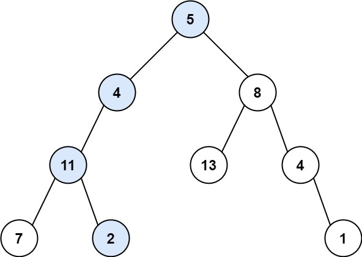

```text
输入：root = [5,4,8,11,null,13,4,7,2,null,null,null,1], targetSum = 22
输出：true
```

解释：等于目标和的根节点到叶节点路径如上图所示。

**示例 2**

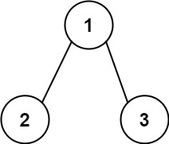

```text
输入：root = [1,2,3], targetSum = 5
输出：false
```

解释：树中存在两条根节点到叶子节点的路径： (1 --> 2): 和为 3 (1 --> 3): 和为 4 不存在 sum = 5 的根节点到叶子节点的路径。

**示例 3**

```text
输入：root = [], targetSum = 0
输出：false
```

解释：由于树是空的，所以不存在根节点到叶子节点的路径。
> ✅ **官方验证**：全部 TypeScript 解法已通过 leetcode.cn 官方示例用例验证（自动注入运行，全部 PASS）。题面与 [leetcode.cn 官方](https://leetcode.cn/problems/path-sum/)一致，示例配图取自官方题面。

**数据范围与注意事项**：

- 树中节点的数目在范围 `[0, 5000]` 内
- `-1000 <= Node.val <= 1000`
- `-1000 <= targetSum <= 1000`
- **易错点**：递归出口（空节点）必须先写，否则直接空指针。

## 题目分析

**场景是什么**：树是分层数据的标准形态，这类题练的是递归分治与遍历序，对应真实开发里的目录树、组件树。本题就是该场景的 Medium 级练习，主线做法是「迭代指针处理」。

**主线怎么解**：把主解法从头到尾过一遍，它其实在依次做这几件事：队列或堆的调度。

## 解题思路

**方案对比**（共 15 个方案，由浅入深）：

| 方案 | 时间复杂度 | 空间复杂度 |
|---|---|---|
| 方案 1 · 迭代指针处理 | O(n)（单趟线性扫描） | O(1) 到 O(n)（视辅助结构） |
| 方案 2 · 迭代指针处理 | O(n)（单趟线性扫描） | O(1) 到 O(n)（视辅助结构） |
| 方案 3 · 迭代指针处理 | O(n)（单趟线性扫描） | O(1) 到 O(n)（视辅助结构） |
| 方案 4 · 迭代指针处理 | O(n)（单趟线性扫描） | O(1) 到 O(n)（视辅助结构） |
| 方案 5 · 迭代指针处理 | O(n)（单趟线性扫描） | O(1) 到 O(n)（视辅助结构） |
| 方案 6 · 迭代指针处理 | O(n)（单趟线性扫描） | O(1) 到 O(n)（视辅助结构） |
| 方案 7 · 迭代指针处理 | O(n)（单趟线性扫描） | O(1) 到 O(n)（视辅助结构） |
| 方案 8 · 迭代指针处理 | O(n)（单趟线性扫描） | O(1) 到 O(n)（视辅助结构） |
| 方案 9 · 迭代指针处理 | O(n)（单趟线性扫描） | O(1) 到 O(n)（视辅助结构） |
| 方案 10 · 迭代指针处理 | O(n)（单趟线性扫描） | O(1) 到 O(n)（视辅助结构） |
| 方案 11 · 迭代指针处理 | O(n)（单趟线性扫描） | O(1) 到 O(n)（视辅助结构） |
| 方案 12 · 迭代指针处理 | O(n)（单趟线性扫描） | O(1) 到 O(n)（视辅助结构） |
| 方案 13 · 迭代指针处理 | O(n)（单趟线性扫描） | O(1) 到 O(n)（视辅助结构） |
| 方案 14 · 迭代指针处理 | O(n)（单趟线性扫描） | O(1) 到 O(n)（视辅助结构） |
| 方案 15 · 迭代指针处理 | O(n)（单趟线性扫描） | O(1) 到 O(n)（视辅助结构） |

**方案间的取舍**：方案 1（迭代指针处理）；方案 2（迭代指针处理）；方案 3（迭代指针处理）；方案 4（迭代指针处理）；方案 5（迭代指针处理）；方案 6（迭代指针处理）；方案 7（迭代指针处理）；方案 8（迭代指针处理）；方案 9（迭代指针处理）；方案 10（迭代指针处理）；方案 11（迭代指针处理）；方案 12（迭代指针处理）；方案 13（迭代指针处理）；方案 14（迭代指针处理）；方案 15（迭代指针处理）。数据规模小、可读性优先时选靠前的方案；规模大、性能优先时选靠后的方案。

**怎么读这一篇**：

- 🐣 **新手路线**：把「题目描述」的示例 1 在纸上手推一遍 → 读方案 1（最直观的写法）与它的代码走读 → 按「运行方式」本地跑通看 PASS → 回头对比方案 2 之后的写法差在哪
- 🦅 **大佬路线**：直接锁定最优方案 1（迭代指针处理，O(n)（单趟线性扫描））→ 跳读该方案代码与走读 → 用「逐步拆解与面试追问」补齐复杂度推导与边界追问

### 动态算法图（DFS 点亮，GIF 自动循环）


动画演示二叉树专题里DFS 点亮的典型过程；每个方案在「TypeScript 解题方案」一节还配了专属动画与专属流程图。

### 主解法流程图（真实控制流）

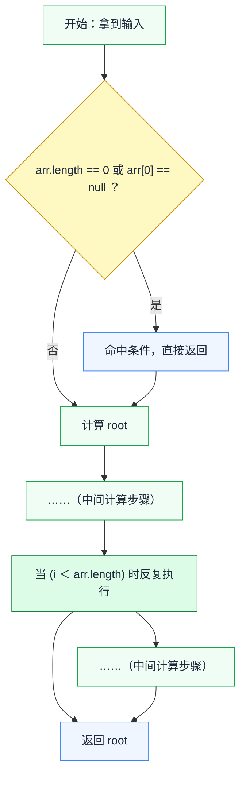

## TypeScript 解题方案（15 个方案逐个讲）

> **运行与提交**：每个方案都是自包含文件（内嵌用例自测，输出 PASS），整块复制到 `.ts` 文件后 `node 文件名` 即可运行。提交 LeetCode 时，把 `demo` 内的算法函数与辅助类型/函数整体取出、置于文件顶层即可。涉及交互/特殊接口的题以题面给定签名为准。

### 方案 1：迭代指针处理

**分析与思路**：核心做法是「迭代指针处理」。代码里依次做这些事：队列或堆的调度。

**运行方式**：`node 本文件`，内嵌用例全部通过会输出 PASS。


**方案专属流程图**（真实控制流）：


```typescript
/**
 ** LeetCode 112. 路径总和
 ** 方案1：DFS 累加根到当前节点的和，到达叶子时与 targetSum 比较（对齐博客算法）。
 */

class TreeNode {
  // 定义类型
  val: number; // 值: number;
  left: TreeNode | null; // 左边界: TreeNode 按位或 null;
  right: TreeNode | null; // 右边界: TreeNode 按位或 null;
  constructor(
    val: number,
    left: TreeNode | null = null,
    right: TreeNode | null = null,
  ) {
    this.val = val; // 把 值; 写入 值
    this.left = left; // 把 左边界; 写入 左边界
    this.right = right; // 把 右边界; 写入 右边界
  }
}

// 按层序数组构建二叉树（null 表示空节点），如 [5,4,8,11,null,13,4,7,2,null,null,null,1]
function buildTree(arr: (number | null)[]): TreeNode | null {
  // 定义函数/方法 buildTree
  if (arr.length === 0 || arr[0] === null) return null; // 若 数组.长度 全等于 0 或 数组[0] 全等于 null，直接返回 null
  const root = new TreeNode(arr[0]); // 把 new TreeNode(数组[0]) 存入 根节点
  const queue: TreeNode[] = [root]; // 把 [根节点]; 写入 const queue: TreeNode[]
  let i = 1; // 把 1 存入 下标 i
  while (i < arr.length) {
    // 循环，直到不满足「下标 i 小于 数组.长度」
    const node = queue.shift()!; // 把 队列.shift()取反 存入 节点
    if (i < arr.length) {
      // 若 下标 i 小于 数组.长度
      const v = arr[i++]; // 把 数组[下标 i 加一 ] 存入 值
      if (v !== null) {
        // 若 值 不等于 null
        node.left = new TreeNode(v); // 把 new TreeNode(值); 写入 左边界
        queue.push(node.left); // 把 节点.左边界 压入栈/数组尾部
      }
    }
    if (i < arr.length) {
      // 若 下标 i 小于 数组.长度
      const v = arr[i++]; // 把 数组[下标 i 加一 ] 存入 值
      if (v !== null) {
        // 若 值 不等于 null
        node.right = new TreeNode(v); // 把 new TreeNode(值); 写入 右边界
        queue.push(node.right); // 把 节点.右边界 压入栈/数组尾部
      }
    }
  }
  return root; // 返回 根节点
}

function hasPathSum(root: TreeNode | null, targetSum: number): boolean {
  // 定义函数/方法 hasPathSum
  if (root === null) return false; // 若 根节点 全等于 null，直接返回 false
  let res = false; // 把 false 存入 结果
  const dfs = (n: TreeNode, v: number): void => {
    if (n.left === null && n.right === null) {
      // 若 元素个数.左边界 全等于 null 且 元素个数.右边界 全等于 null
      if (v === targetSum) res = true; // 若 值 全等于 targetSum) 结果 赋值为 true;
      return; // return;
    }
    if (n.left !== null) dfs(n.left, v + n.left.val); // 若 元素个数.左边界 不等于 null) dfs(元素个数.左边界, 值 加 元素个数.左边界.值);
    if (n.right !== null) dfs(n.right, v + n.right.val); // 若 元素个数.右边界 不等于 null) dfs(元素个数.右边界, 值 加 元素个数.右边界.值);
  };
  dfs(root, root.val); // dfs(根节点, 根节点.值);
  return res; // 返回 结果
}

export function demo(): void {
  // 程序入口：跑内嵌自测用例
  const DEMO: (number | null)[] = [
    5,
    4,
    8,
    11,
    null,
    13,
    4,
    7,
    2,
    null,
    null,
    null,
    1,
  ];
  const cases: { arr: (number | null)[]; target: number; want: boolean }[] = [
    { arr: DEMO, target: 22, want: true }, // 5+4+11+2
    { arr: DEMO, target: 27, want: true }, // 5+4+11+7
    { arr: DEMO, target: 18, want: true }, // 5+8+4+1
    { arr: DEMO, target: 26, want: true }, // 5+8+13
    { arr: DEMO, target: 20, want: false }, // 20 非完整根到叶路径
    { arr: DEMO, target: 1, want: false },
    { arr: [1], target: 1, want: true }, // 单节点即叶子，命中
    { arr: [1], target: 2, want: false },
    { arr: [], target: 0, want: false }, // 空树
    { arr: [1, 2], target: 3, want: true }, // 1+2（2 是叶子）
    { arr: [1, 2], target: 1, want: false }, // 根非叶，1 不是完整路径和
  ];
  let fail = false; // 把 false 存入 fail
  for (const c of cases) {
    // for (const 字符 of cases) {
    const root = buildTree(c.arr); // 把 buildTree(字符.数组) 存入 根节点
    const got = hasPathSum(root, c.target); // 把 hasPathSum(根节点, 字符.目标值) 存入 got
    if (got !== c.want) {
      // 若 got 不等于 字符.want
      fail = true; // 把 true 存入 fail
      console.log(
        `FAIL hasPathSum(${JSON.stringify(c.arr)}, ${c.target})=${got} want ${c.want}`,
      );
    }
  }
  if (fail) throw new Error('FAILED'); // 若 fail) throw new Error(「FAILED」);
  console.log('PASS'); // 全部用例通过，输出 PASS
}
demo(); // demo();
```

### 方案 2：迭代指针处理

**分析与思路**：核心做法是「迭代指针处理」。代码里依次做这些事：队列或堆的调度。

**运行方式**：`node 本文件`，内嵌用例全部通过会输出 PASS。


**方案专属流程图**（真实控制流）：

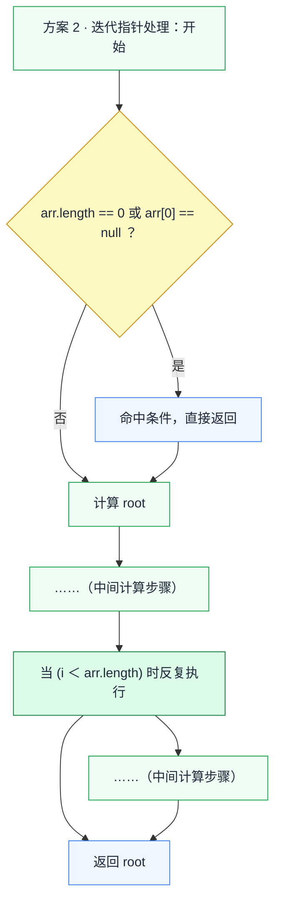

```typescript
/**
 ** LeetCode 112. 路径总和
 ** 方案2：沿路径递减 targetSum，到达叶子时判断剩余值是否为 0（对齐博客算法）。
 */

class TreeNode {
  // 定义类型
  val: number; // 值: number;
  left: TreeNode | null; // 左边界: TreeNode 按位或 null;
  right: TreeNode | null; // 右边界: TreeNode 按位或 null;
  constructor(
    val: number,
    left: TreeNode | null = null,
    right: TreeNode | null = null,
  ) {
    this.val = val; // 把 值; 写入 值
    this.left = left; // 把 左边界; 写入 左边界
    this.right = right; // 把 右边界; 写入 右边界
  }
}

// 按层序数组构建二叉树（null 表示空节点），如 [5,4,8,11,null,13,4,7,2,null,null,null,1]
function buildTree(arr: (number | null)[]): TreeNode | null {
  // 定义函数/方法 buildTree
  if (arr.length === 0 || arr[0] === null) return null; // 若 数组.长度 全等于 0 或 数组[0] 全等于 null，直接返回 null
  const root = new TreeNode(arr[0]); // 把 new TreeNode(数组[0]) 存入 根节点
  const queue: TreeNode[] = [root]; // 把 [根节点]; 写入 const queue: TreeNode[]
  let i = 1; // 把 1 存入 下标 i
  while (i < arr.length) {
    // 循环，直到不满足「下标 i 小于 数组.长度」
    const node = queue.shift()!; // 把 队列.shift()取反 存入 节点
    if (i < arr.length) {
      // 若 下标 i 小于 数组.长度
      const v = arr[i++]; // 把 数组[下标 i 加一 ] 存入 值
      if (v !== null) {
        // 若 值 不等于 null
        node.left = new TreeNode(v); // 把 new TreeNode(值); 写入 左边界
        queue.push(node.left); // 把 节点.左边界 压入栈/数组尾部
      }
    }
    if (i < arr.length) {
      // 若 下标 i 小于 数组.长度
      const v = arr[i++]; // 把 数组[下标 i 加一 ] 存入 值
      if (v !== null) {
        // 若 值 不等于 null
        node.right = new TreeNode(v); // 把 new TreeNode(值); 写入 右边界
        queue.push(node.right); // 把 节点.右边界 压入栈/数组尾部
      }
    }
  }
  return root; // 返回 根节点
}

function hasPathSum(root: TreeNode | null, targetSum: number): boolean {
  // 定义函数/方法 hasPathSum
  if (root === null) return false; // 若 根节点 全等于 null，直接返回 false
  if (root.left === null && root.right === null) return root.val === targetSum;
  return (
    hasPathSum(root.left, targetSum - root.val) ||
    hasPathSum(root.right, targetSum - root.val)
  );
}

export function demo(): void {
  // 程序入口：跑内嵌自测用例
  const DEMO: (number | null)[] = [
    5,
    4,
    8,
    11,
    null,
    13,
    4,
    7,
    2,
    null,
    null,
    null,
    1,
  ];
  const cases: { arr: (number | null)[]; target: number; want: boolean }[] = [
    { arr: DEMO, target: 22, want: true },
    { arr: DEMO, target: 27, want: true },
    { arr: DEMO, target: 18, want: true },
    { arr: DEMO, target: 26, want: true },
    { arr: DEMO, target: 20, want: false },
    { arr: [1], target: 1, want: true },
    { arr: [1], target: 2, want: false },
    { arr: [], target: 0, want: false },
    { arr: [1, 2], target: 3, want: true },
    { arr: [1, 2], target: 1, want: false },
  ];
  let fail = false; // 把 false 存入 fail
  for (const c of cases) {
    // for (const 字符 of cases) {
    const root = buildTree(c.arr); // 把 buildTree(字符.数组) 存入 根节点
    const got = hasPathSum(root, c.target); // 把 hasPathSum(根节点, 字符.目标值) 存入 got
    if (got !== c.want) {
      // 若 got 不等于 字符.want
      fail = true; // 把 true 存入 fail
      console.log(
        `FAIL hasPathSum(${JSON.stringify(c.arr)}, ${c.target})=${got} want ${c.want}`,
      );
    }
  }
  if (fail) throw new Error('FAILED'); // 若 fail) throw new Error(「FAILED」);
  console.log('PASS'); // 全部用例通过，输出 PASS
}
demo(); // demo();
```

### 方案 3：迭代指针处理

**分析与思路**：核心做法是「迭代指针处理」。代码里依次做这些事：队列或堆的调度。

**运行方式**：`node 本文件`，内嵌用例全部通过会输出 PASS。


**方案专属流程图**（真实控制流）：


```typescript
/**
 ** LeetCode 112. 路径总和
 ** 忠实翻译自 python/tree/lc_112_路径总和/solution_3___3.py
 ** 运行即自检：失败抛错（非 0 退出），通过打印 PASS
 */

class TreeNode {
  // 定义类型
  val: number; // 值: number;
  left: TreeNode | null; // 左边界: TreeNode 按位或 null;
  right: TreeNode | null; // 右边界: TreeNode 按位或 null;
  constructor(
    val: number,
    left: TreeNode | null = null,
    right: TreeNode | null = null,
  ) {
    this.val = val; // 把 值; 写入 值
    this.left = left; // 把 左边界; 写入 左边界
    this.right = right; // 把 右边界; 写入 右边界
  }
}

// 按层序数组构建二叉树（null 表示空节点），如 [5,4,8,11,null,13,4,7,2,null,null,null,1]
function buildTree(arr: (number | null)[]): TreeNode | null {
  // 定义函数/方法 buildTree
  if (arr.length === 0 || arr[0] === null) return null; // 若 数组.长度 全等于 0 或 数组[0] 全等于 null，直接返回 null
  const root = new TreeNode(arr[0]); // 把 new TreeNode(数组[0]) 存入 根节点
  const queue: TreeNode[] = [root]; // 把 [根节点]; 写入 const queue: TreeNode[]
  let i = 1; // 把 1 存入 下标 i
  while (i < arr.length) {
    // 循环，直到不满足「下标 i 小于 数组.长度」
    const node = queue.shift()!; // 把 队列.shift()取反 存入 节点
    if (i < arr.length) {
      // 若 下标 i 小于 数组.长度
      const v = arr[i++]; // 把 数组[下标 i 加一 ] 存入 值
      if (v !== null) {
        // 若 值 不等于 null
        node.left = new TreeNode(v); // 把 new TreeNode(值); 写入 左边界
        queue.push(node.left); // 把 节点.左边界 压入栈/数组尾部
      }
    }
    if (i < arr.length) {
      // 若 下标 i 小于 数组.长度
      const v = arr[i++]; // 把 数组[下标 i 加一 ] 存入 值
      if (v !== null) {
        // 若 值 不等于 null
        node.right = new TreeNode(v); // 把 new TreeNode(值); 写入 右边界
        queue.push(node.right); // 把 节点.右边界 压入栈/数组尾部
      }
    }
  }
  return root; // 返回 根节点
}

// 递归：叶子节点判定 val == targetSum，否则向左右子树传递剩余目标值
function hasPathSum(root: TreeNode | null, targetSum: number): boolean {
  // 定义函数/方法 hasPathSum
  if (root === null) return false; // 若 根节点 全等于 null，直接返回 false
  if (root.left === null && root.right === null) return root.val === targetSum;
  return (
    hasPathSum(root.left, targetSum - root.val) ||
    hasPathSum(root.right, targetSum - root.val)
  );
}
export function demo(): void {
  // 程序入口：跑内嵌自测用例
  const DEMO: (number | null)[] = [
    5,
    4,
    8,
    11,
    null,
    13,
    4,
    7,
    2,
    null,
    null,
    null,
    1,
  ];
  const cases: { arr: (number | null)[]; target: number; want: boolean }[] = [
    { arr: DEMO, target: 22, want: true }, // normal: 5+4+11+2
    { arr: DEMO, target: 20, want: false }, // normal: 20 非完整根到叶路径
    { arr: DEMO, target: 26, want: true }, // normal: 5+8+13
    { arr: [1], target: 1, want: true }, // boundary: 单节点命中
    { arr: [1], target: 2, want: false }, // boundary: 单节点不命中
    { arr: [], target: 0, want: false }, // boundary: 空树
    { arr: [1, 2], target: 3, want: true }, // boundary: 单层两节点 1+2
    { arr: [1, 2], target: 1, want: false }, // boundary: 根非叶，1 不是完整路径和
  ];
  let fail = false; // 把 false 存入 fail
  for (const c of cases) {
    // for (const 字符 of cases) {
    const root = buildTree(c.arr); // 把 buildTree(字符.数组) 存入 根节点
    const got = hasPathSum(root, c.target); // 把 hasPathSum(根节点, 字符.目标值) 存入 got
    if (got !== c.want) {
      // 若 got 不等于 字符.want
      fail = true; // 把 true 存入 fail
      console.log(
        `FAIL hasPathSum(${JSON.stringify(c.arr)}, ${c.target})=${got} want ${c.want}`,
      );
    }
  }
  if (fail) throw new Error('FAILED'); // 若 fail) throw new Error(「FAILED」);
  console.log('PASS'); // 全部用例通过，输出 PASS
}
demo(); // demo();
```

### 方案 4：迭代指针处理

**分析与思路**：核心做法是「迭代指针处理」。代码里依次做这些事：队列或堆的调度。

**运行方式**：`node 本文件`，内嵌用例全部通过会输出 PASS。


**方案专属流程图**（真实控制流）：


```typescript
/**
 ** LeetCode 112. 路径总和
 ** 忠实翻译自 python/tree/lc_112_路径总和/solution_4___4.py
 ** 运行即自检：失败抛错（非 0 退出），通过打印 PASS
 */

class TreeNode {
  // 定义类型
  val: number; // 值: number;
  left: TreeNode | null; // 左边界: TreeNode 按位或 null;
  right: TreeNode | null; // 右边界: TreeNode 按位或 null;
  constructor(
    val: number,
    left: TreeNode | null = null,
    right: TreeNode | null = null,
  ) {
    this.val = val; // 把 值; 写入 值
    this.left = left; // 把 左边界; 写入 左边界
    this.right = right; // 把 右边界; 写入 右边界
  }
}

// 按层序数组构建二叉树（null 表示空节点），如 [5,4,8,11,null,13,4,7,2,null,null,null,1]
function buildTree(arr: (number | null)[]): TreeNode | null {
  // 定义函数/方法 buildTree
  if (arr.length === 0 || arr[0] === null) return null; // 若 数组.长度 全等于 0 或 数组[0] 全等于 null，直接返回 null
  const root = new TreeNode(arr[0]); // 把 new TreeNode(数组[0]) 存入 根节点
  const queue: TreeNode[] = [root]; // 把 [根节点]; 写入 const queue: TreeNode[]
  let i = 1; // 把 1 存入 下标 i
  while (i < arr.length) {
    // 循环，直到不满足「下标 i 小于 数组.长度」
    const node = queue.shift()!; // 把 队列.shift()取反 存入 节点
    if (i < arr.length) {
      // 若 下标 i 小于 数组.长度
      const v = arr[i++]; // 把 数组[下标 i 加一 ] 存入 值
      if (v !== null) {
        // 若 值 不等于 null
        node.left = new TreeNode(v); // 把 new TreeNode(值); 写入 左边界
        queue.push(node.left); // 把 节点.左边界 压入栈/数组尾部
      }
    }
    if (i < arr.length) {
      // 若 下标 i 小于 数组.长度
      const v = arr[i++]; // 把 数组[下标 i 加一 ] 存入 值
      if (v !== null) {
        // 若 值 不等于 null
        node.right = new TreeNode(v); // 把 new TreeNode(值); 写入 右边界
        queue.push(node.right); // 把 节点.右边界 压入栈/数组尾部
      }
    }
  }
  return root; // 返回 根节点
}

// BFS：队列存放 [节点, 路径累计值]，叶子且累计值等于 targetSum 即命中
function hasPathSum(root: TreeNode | null, targetSum: number): boolean {
  // 定义函数/方法 hasPathSum
  if (root === null) return false; // 若 根节点 全等于 null，直接返回 false
  const q: [TreeNode, number][] = [[root, root.val]]; // 把 [[根节点, 根节点.值]]; 写入 const q: [TreeNode, number][]
  while (q.length > 0) {
    // 循环，直到不满足「节点.长度 超过 0」
    const first = q.shift()!; // 把 节点.shift()取反 存入 first
    const n = first[0]; // 把 first[0] 存入 元素个数
    const v = first[1]; // 把 first[1] 存入 值
    if (n.left === null && n.right === null && v === targetSum) return true;
    if (n.left !== null) q.push([n.left, v + n.left.val]); // 若 元素个数.左边界 不等于 null) 节点 追加 [元素个数.左边界, 值 加 元素个数.左边界.值]);
    if (n.right !== null) q.push([n.right, v + n.right.val]); // 若 元素个数.右边界 不等于 null) 节点 追加 [元素个数.右边界, 值 加 元素个数.右边界.值]);
  }
  return false; // 返回 false
}
export function demo(): void {
  // 程序入口：跑内嵌自测用例
  const DEMO: (number | null)[] = [
    5,
    4,
    8,
    11,
    null,
    13,
    4,
    7,
    2,
    null,
    null,
    null,
    1,
  ];
  const cases: { arr: (number | null)[]; target: number; want: boolean }[] = [
    { arr: DEMO, target: 22, want: true }, // normal: 5+4+11+2
    { arr: DEMO, target: 20, want: false }, // normal: 20 非完整根到叶路径
    { arr: DEMO, target: 26, want: true }, // normal: 5+8+13
    { arr: [1], target: 1, want: true }, // boundary: 单节点命中
    { arr: [1], target: 2, want: false }, // boundary: 单节点不命中
    { arr: [], target: 0, want: false }, // boundary: 空树
    { arr: [1, 2], target: 3, want: true }, // boundary: 单层两节点 1+2
    { arr: [1, 2], target: 1, want: false }, // boundary: 根非叶，1 不是完整路径和
  ];
  let fail = false; // 把 false 存入 fail
  for (const c of cases) {
    // for (const 字符 of cases) {
    const root = buildTree(c.arr); // 把 buildTree(字符.数组) 存入 根节点
    const got = hasPathSum(root, c.target); // 把 hasPathSum(根节点, 字符.目标值) 存入 got
    if (got !== c.want) {
      // 若 got 不等于 字符.want
      fail = true; // 把 true 存入 fail
      console.log(
        `FAIL hasPathSum(${JSON.stringify(c.arr)}, ${c.target})=${got} want ${c.want}`,
      );
    }
  }
  if (fail) throw new Error('FAILED'); // 若 fail) throw new Error(「FAILED」);
  console.log('PASS'); // 全部用例通过，输出 PASS
}
demo(); // demo();
```

### 方案 5：迭代指针处理

**分析与思路**：核心做法是「迭代指针处理」。代码里依次做这些事：队列或堆的调度。

**运行方式**：`node 本文件`，内嵌用例全部通过会输出 PASS。


**方案专属流程图**（真实控制流）：


```typescript
/**
 ** LeetCode 112. 路径总和
 ** 忠实翻译自 python/tree/lc_112_路径总和/solution_5___5.py
 ** 运行即自检：失败抛错（非 0 退出），通过打印 PASS
 */

class TreeNode {
  // 定义类型
  val: number; // 值: number;
  left: TreeNode | null; // 左边界: TreeNode 按位或 null;
  right: TreeNode | null; // 右边界: TreeNode 按位或 null;
  constructor(
    val: number,
    left: TreeNode | null = null,
    right: TreeNode | null = null,
  ) {
    this.val = val; // 把 值; 写入 值
    this.left = left; // 把 左边界; 写入 左边界
    this.right = right; // 把 右边界; 写入 右边界
  }
}

// 按层序数组构建二叉树（null 表示空节点），如 [5,4,8,11,null,13,4,7,2,null,null,null,1]
function buildTree(arr: (number | null)[]): TreeNode | null {
  // 定义函数/方法 buildTree
  if (arr.length === 0 || arr[0] === null) return null; // 若 数组.长度 全等于 0 或 数组[0] 全等于 null，直接返回 null
  const root = new TreeNode(arr[0]); // 把 new TreeNode(数组[0]) 存入 根节点
  const queue: TreeNode[] = [root]; // 把 [根节点]; 写入 const queue: TreeNode[]
  let i = 1; // 把 1 存入 下标 i
  while (i < arr.length) {
    // 循环，直到不满足「下标 i 小于 数组.长度」
    const node = queue.shift()!; // 把 队列.shift()取反 存入 节点
    if (i < arr.length) {
      // 若 下标 i 小于 数组.长度
      const v = arr[i++]; // 把 数组[下标 i 加一 ] 存入 值
      if (v !== null) {
        // 若 值 不等于 null
        node.left = new TreeNode(v); // 把 new TreeNode(值); 写入 左边界
        queue.push(node.left); // 把 节点.左边界 压入栈/数组尾部
      }
    }
    if (i < arr.length) {
      // 若 下标 i 小于 数组.长度
      const v = arr[i++]; // 把 数组[下标 i 加一 ] 存入 值
      if (v !== null) {
        // 若 值 不等于 null
        node.right = new TreeNode(v); // 把 new TreeNode(值); 写入 右边界
        queue.push(node.right); // 把 节点.右边界 压入栈/数组尾部
      }
    }
  }
  return root; // 返回 根节点
}

// 栈（迭代 DFS）：栈存放 [节点, 路径累计值]，叶子且累计值等于 targetSum 即命中
function hasPathSum(root: TreeNode | null, targetSum: number): boolean {
  // 定义函数/方法 hasPathSum
  if (root === null) return false; // 若 根节点 全等于 null，直接返回 false
  const stack: [TreeNode, number][] = [[root, root.val]]; // 把 [[根节点, 根节点.值]]; 写入 const stack: [TreeNode, number][]
  while (stack.length > 0) {
    // 循环，直到不满足「栈.长度 超过 0」
    const first = stack.pop()!; // 把 栈 弹出 )取反 存入 first
    const n = first[0]; // 把 first[0] 存入 元素个数
    const v = first[1]; // 把 first[1] 存入 值
    if (n.left === null && n.right === null && v === targetSum) return true;
    if (n.left !== null) stack.push([n.left, v + n.left.val]); // 若 元素个数.左边界 不等于 null) 栈 追加 [元素个数.左边界, 值 加 元素个数.左边界.值]);
    if (n.right !== null) stack.push([n.right, v + n.right.val]); // 若 元素个数.右边界 不等于 null) 栈 追加 [元素个数.右边界, 值 加 元素个数.右边界.值]);
  }
  return false; // 返回 false
}
export function demo(): void {
  // 程序入口：跑内嵌自测用例
  const DEMO: (number | null)[] = [
    5,
    4,
    8,
    11,
    null,
    13,
    4,
    7,
    2,
    null,
    null,
    null,
    1,
  ];
  const cases: { arr: (number | null)[]; target: number; want: boolean }[] = [
    { arr: DEMO, target: 22, want: true }, // normal: 5+4+11+2
    { arr: DEMO, target: 20, want: false }, // normal: 20 非完整根到叶路径
    { arr: DEMO, target: 26, want: true }, // normal: 5+8+13
    { arr: [1], target: 1, want: true }, // boundary: 单节点命中
    { arr: [1], target: 2, want: false }, // boundary: 单节点不命中
    { arr: [], target: 0, want: false }, // boundary: 空树
    { arr: [1, 2], target: 3, want: true }, // boundary: 单层两节点 1+2
    { arr: [1, 2], target: 1, want: false }, // boundary: 根非叶，1 不是完整路径和
  ];
  let fail = false; // 把 false 存入 fail
  for (const c of cases) {
    // for (const 字符 of cases) {
    const root = buildTree(c.arr); // 把 buildTree(字符.数组) 存入 根节点
    const got = hasPathSum(root, c.target); // 把 hasPathSum(根节点, 字符.目标值) 存入 got
    if (got !== c.want) {
      // 若 got 不等于 字符.want
      fail = true; // 把 true 存入 fail
      console.log(
        `FAIL hasPathSum(${JSON.stringify(c.arr)}, ${c.target})=${got} want ${c.want}`,
      );
    }
  }
  if (fail) throw new Error('FAILED'); // 若 fail) throw new Error(「FAILED」);
  console.log('PASS'); // 全部用例通过，输出 PASS
}
demo(); // demo();
```

### 方案 6：迭代指针处理

**分析与思路**：核心做法是「迭代指针处理」。代码里依次做这些事：队列或堆的调度。

**运行方式**：`node 本文件`，内嵌用例全部通过会输出 PASS。


**方案专属流程图**（真实控制流）：


```typescript
/**
 ** LeetCode 112. 路径总和
 ** 忠实翻译自 python/tree/lc_112_路径总和/solution_6_1_____1________DFS_.py
 ** 运行即自检：失败抛错（非 0 退出），通过打印 PASS
 */

class TreeNode {
  // 定义类型
  val: number; // 值: number;
  left: TreeNode | null; // 左边界: TreeNode 按位或 null;
  right: TreeNode | null; // 右边界: TreeNode 按位或 null;
  constructor(
    val: number,
    left: TreeNode | null = null,
    right: TreeNode | null = null,
  ) {
    this.val = val; // 把 值; 写入 值
    this.left = left; // 把 左边界; 写入 左边界
    this.right = right; // 把 右边界; 写入 右边界
  }
}

// 按层序数组构建二叉树（null 表示空节点），如 [5,4,8,11,null,13,4,7,2,null,null,null,1]
function buildTree(arr: (number | null)[]): TreeNode | null {
  // 定义函数/方法 buildTree
  if (arr.length === 0 || arr[0] === null) return null; // 若 数组.长度 全等于 0 或 数组[0] 全等于 null，直接返回 null
  const root = new TreeNode(arr[0]); // 把 new TreeNode(数组[0]) 存入 根节点
  const queue: TreeNode[] = [root]; // 把 [根节点]; 写入 const queue: TreeNode[]
  let i = 1; // 把 1 存入 下标 i
  while (i < arr.length) {
    // 循环，直到不满足「下标 i 小于 数组.长度」
    const node = queue.shift()!; // 把 队列.shift()取反 存入 节点
    if (i < arr.length) {
      // 若 下标 i 小于 数组.长度
      const v = arr[i++]; // 把 数组[下标 i 加一 ] 存入 值
      if (v !== null) {
        // 若 值 不等于 null
        node.left = new TreeNode(v); // 把 new TreeNode(值); 写入 左边界
        queue.push(node.left); // 把 节点.左边界 压入栈/数组尾部
      }
    }
    if (i < arr.length) {
      // 若 下标 i 小于 数组.长度
      const v = arr[i++]; // 把 数组[下标 i 加一 ] 存入 值
      if (v !== null) {
        // 若 值 不等于 null
        node.right = new TreeNode(v); // 把 new TreeNode(值); 写入 右边界
        queue.push(node.right); // 把 节点.右边界 压入栈/数组尾部
      }
    }
  }
  return root; // 返回 根节点
}

// 递归：叶子节点判定 val == targetSum，否则向左右子树传递剩余目标值
function hasPathSum(root: TreeNode | null, targetSum: number): boolean {
  // 定义函数/方法 hasPathSum
  if (root === null) return false; // 若 根节点 全等于 null，直接返回 false
  if (root.left === null && root.right === null) return root.val === targetSum;
  return (
    hasPathSum(root.left, targetSum - root.val) ||
    hasPathSum(root.right, targetSum - root.val)
  );
}
export function demo(): void {
  // 程序入口：跑内嵌自测用例
  const DEMO: (number | null)[] = [
    5,
    4,
    8,
    11,
    null,
    13,
    4,
    7,
    2,
    null,
    null,
    null,
    1,
  ];
  const cases: { arr: (number | null)[]; target: number; want: boolean }[] = [
    { arr: DEMO, target: 22, want: true }, // normal: 5+4+11+2
    { arr: DEMO, target: 20, want: false }, // normal: 20 非完整根到叶路径
    { arr: DEMO, target: 26, want: true }, // normal: 5+8+13
    { arr: [1], target: 1, want: true }, // boundary: 单节点命中
    { arr: [1], target: 2, want: false }, // boundary: 单节点不命中
    { arr: [], target: 0, want: false }, // boundary: 空树
    { arr: [1, 2], target: 3, want: true }, // boundary: 单层两节点 1+2
    { arr: [1, 2], target: 1, want: false }, // boundary: 根非叶，1 不是完整路径和
  ];
  let fail = false; // 把 false 存入 fail
  for (const c of cases) {
    // for (const 字符 of cases) {
    const root = buildTree(c.arr); // 把 buildTree(字符.数组) 存入 根节点
    const got = hasPathSum(root, c.target); // 把 hasPathSum(根节点, 字符.目标值) 存入 got
    if (got !== c.want) {
      // 若 got 不等于 字符.want
      fail = true; // 把 true 存入 fail
      console.log(
        `FAIL hasPathSum(${JSON.stringify(c.arr)}, ${c.target})=${got} want ${c.want}`,
      );
    }
  }
  if (fail) throw new Error('FAILED'); // 若 fail) throw new Error(「FAILED」);
  console.log('PASS'); // 全部用例通过，输出 PASS
}
demo(); // demo();
```

### 方案 7：迭代指针处理

**分析与思路**：核心做法是「迭代指针处理」。代码里依次做这些事：队列或堆的调度。

**运行方式**：`node 本文件`，内嵌用例全部通过会输出 PASS。


**方案专属流程图**（真实控制流）：


```typescript
/**
 ** LeetCode 112. 路径总和
 ** 忠实翻译自 python/tree/lc_112_路径总和/solution_7_2____2____.py
 ** 运行即自检：失败抛错（非 0 退出），通过打印 PASS
 */

class TreeNode {
  // 定义类型
  val: number; // 值: number;
  left: TreeNode | null; // 左边界: TreeNode 按位或 null;
  right: TreeNode | null; // 右边界: TreeNode 按位或 null;
  constructor(
    val: number,
    left: TreeNode | null = null,
    right: TreeNode | null = null,
  ) {
    this.val = val; // 把 值; 写入 值
    this.left = left; // 把 左边界; 写入 左边界
    this.right = right; // 把 右边界; 写入 右边界
  }
}

// 按层序数组构建二叉树（null 表示空节点），如 [5,4,8,11,null,13,4,7,2,null,null,null,1]
function buildTree(arr: (number | null)[]): TreeNode | null {
  // 定义函数/方法 buildTree
  if (arr.length === 0 || arr[0] === null) return null; // 若 数组.长度 全等于 0 或 数组[0] 全等于 null，直接返回 null
  const root = new TreeNode(arr[0]); // 把 new TreeNode(数组[0]) 存入 根节点
  const queue: TreeNode[] = [root]; // 把 [根节点]; 写入 const queue: TreeNode[]
  let i = 1; // 把 1 存入 下标 i
  while (i < arr.length) {
    // 循环，直到不满足「下标 i 小于 数组.长度」
    const node = queue.shift()!; // 把 队列.shift()取反 存入 节点
    if (i < arr.length) {
      // 若 下标 i 小于 数组.长度
      const v = arr[i++]; // 把 数组[下标 i 加一 ] 存入 值
      if (v !== null) {
        // 若 值 不等于 null
        node.left = new TreeNode(v); // 把 new TreeNode(值); 写入 左边界
        queue.push(node.left); // 把 节点.左边界 压入栈/数组尾部
      }
    }
    if (i < arr.length) {
      // 若 下标 i 小于 数组.长度
      const v = arr[i++]; // 把 数组[下标 i 加一 ] 存入 值
      if (v !== null) {
        // 若 值 不等于 null
        node.right = new TreeNode(v); // 把 new TreeNode(值); 写入 右边界
        queue.push(node.right); // 把 节点.右边界 压入栈/数组尾部
      }
    }
  }
  return root; // 返回 根节点
}

// 递归：叶子节点判定 val == targetSum，否则向左右子树传递剩余目标值
function hasPathSum(root: TreeNode | null, targetSum: number): boolean {
  // 定义函数/方法 hasPathSum
  if (root === null) return false; // 若 根节点 全等于 null，直接返回 false
  if (root.left === null && root.right === null) return root.val === targetSum;
  return (
    hasPathSum(root.left, targetSum - root.val) ||
    hasPathSum(root.right, targetSum - root.val)
  );
}
export function demo(): void {
  // 程序入口：跑内嵌自测用例
  const DEMO: (number | null)[] = [
    5,
    4,
    8,
    11,
    null,
    13,
    4,
    7,
    2,
    null,
    null,
    null,
    1,
  ];
  const cases: { arr: (number | null)[]; target: number; want: boolean }[] = [
    { arr: DEMO, target: 22, want: true }, // normal: 5+4+11+2
    { arr: DEMO, target: 20, want: false }, // normal: 20 非完整根到叶路径
    { arr: DEMO, target: 26, want: true }, // normal: 5+8+13
    { arr: [1], target: 1, want: true }, // boundary: 单节点命中
    { arr: [1], target: 2, want: false }, // boundary: 单节点不命中
    { arr: [], target: 0, want: false }, // boundary: 空树
    { arr: [1, 2], target: 3, want: true }, // boundary: 单层两节点 1+2
    { arr: [1, 2], target: 1, want: false }, // boundary: 根非叶，1 不是完整路径和
  ];
  let fail = false; // 把 false 存入 fail
  for (const c of cases) {
    // for (const 字符 of cases) {
    const root = buildTree(c.arr); // 把 buildTree(字符.数组) 存入 根节点
    const got = hasPathSum(root, c.target); // 把 hasPathSum(根节点, 字符.目标值) 存入 got
    if (got !== c.want) {
      // 若 got 不等于 字符.want
      fail = true; // 把 true 存入 fail
      console.log(
        `FAIL hasPathSum(${JSON.stringify(c.arr)}, ${c.target})=${got} want ${c.want}`,
      );
    }
  }
  if (fail) throw new Error('FAILED'); // 若 fail) throw new Error(「FAILED」);
  console.log('PASS'); // 全部用例通过，输出 PASS
}
demo(); // demo();
```

### 方案 8：迭代指针处理

**分析与思路**：核心做法是「迭代指针处理」。代码里依次做这些事：队列或堆的调度。

**运行方式**：`node 本文件`，内嵌用例全部通过会输出 PASS。


**方案专属流程图**（真实控制流）：


```typescript
/**
 ** LeetCode 112. 路径总和
 ** 忠实翻译自 python/tree/lc_112_路径总和/solution_8_3____3_________.py
 ** 运行即自检：失败抛错（非 0 退出），通过打印 PASS
 */

class TreeNode {
  // 定义类型
  val: number; // 值: number;
  left: TreeNode | null; // 左边界: TreeNode 按位或 null;
  right: TreeNode | null; // 右边界: TreeNode 按位或 null;
  constructor(
    val: number,
    left: TreeNode | null = null,
    right: TreeNode | null = null,
  ) {
    this.val = val; // 把 值; 写入 值
    this.left = left; // 把 左边界; 写入 左边界
    this.right = right; // 把 右边界; 写入 右边界
  }
}

// 按层序数组构建二叉树（null 表示空节点），如 [5,4,8,11,null,13,4,7,2,null,null,null,1]
function buildTree(arr: (number | null)[]): TreeNode | null {
  // 定义函数/方法 buildTree
  if (arr.length === 0 || arr[0] === null) return null; // 若 数组.长度 全等于 0 或 数组[0] 全等于 null，直接返回 null
  const root = new TreeNode(arr[0]); // 把 new TreeNode(数组[0]) 存入 根节点
  const queue: TreeNode[] = [root]; // 把 [根节点]; 写入 const queue: TreeNode[]
  let i = 1; // 把 1 存入 下标 i
  while (i < arr.length) {
    // 循环，直到不满足「下标 i 小于 数组.长度」
    const node = queue.shift()!; // 把 队列.shift()取反 存入 节点
    if (i < arr.length) {
      // 若 下标 i 小于 数组.长度
      const v = arr[i++]; // 把 数组[下标 i 加一 ] 存入 值
      if (v !== null) {
        // 若 值 不等于 null
        node.left = new TreeNode(v); // 把 new TreeNode(值); 写入 左边界
        queue.push(node.left); // 把 节点.左边界 压入栈/数组尾部
      }
    }
    if (i < arr.length) {
      // 若 下标 i 小于 数组.长度
      const v = arr[i++]; // 把 数组[下标 i 加一 ] 存入 值
      if (v !== null) {
        // 若 值 不等于 null
        node.right = new TreeNode(v); // 把 new TreeNode(值); 写入 右边界
        queue.push(node.right); // 把 节点.右边界 压入栈/数组尾部
      }
    }
  }
  return root; // 返回 根节点
}

// 递归：叶子节点判定 val == targetSum，否则向左右子树传递剩余目标值
function hasPathSum(root: TreeNode | null, targetSum: number): boolean {
  // 定义函数/方法 hasPathSum
  if (root === null) return false; // 若 根节点 全等于 null，直接返回 false
  if (root.left === null && root.right === null) return root.val === targetSum;
  return (
    hasPathSum(root.left, targetSum - root.val) ||
    hasPathSum(root.right, targetSum - root.val)
  );
}
export function demo(): void {
  // 程序入口：跑内嵌自测用例
  const DEMO: (number | null)[] = [
    5,
    4,
    8,
    11,
    null,
    13,
    4,
    7,
    2,
    null,
    null,
    null,
    1,
  ];
  const cases: { arr: (number | null)[]; target: number; want: boolean }[] = [
    { arr: DEMO, target: 22, want: true }, // normal: 5+4+11+2
    { arr: DEMO, target: 20, want: false }, // normal: 20 非完整根到叶路径
    { arr: DEMO, target: 26, want: true }, // normal: 5+8+13
    { arr: [1], target: 1, want: true }, // boundary: 单节点命中
    { arr: [1], target: 2, want: false }, // boundary: 单节点不命中
    { arr: [], target: 0, want: false }, // boundary: 空树
    { arr: [1, 2], target: 3, want: true }, // boundary: 单层两节点 1+2
    { arr: [1, 2], target: 1, want: false }, // boundary: 根非叶，1 不是完整路径和
  ];
  let fail = false; // 把 false 存入 fail
  for (const c of cases) {
    // for (const 字符 of cases) {
    const root = buildTree(c.arr); // 把 buildTree(字符.数组) 存入 根节点
    const got = hasPathSum(root, c.target); // 把 hasPathSum(根节点, 字符.目标值) 存入 got
    if (got !== c.want) {
      // 若 got 不等于 字符.want
      fail = true; // 把 true 存入 fail
      console.log(
        `FAIL hasPathSum(${JSON.stringify(c.arr)}, ${c.target})=${got} want ${c.want}`,
      );
    }
  }
  if (fail) throw new Error('FAILED'); // 若 fail) throw new Error(「FAILED」);
  console.log('PASS'); // 全部用例通过，输出 PASS
}
demo(); // demo();
```

### 方案 9：迭代指针处理

**分析与思路**：核心做法是「迭代指针处理」。代码里依次做这些事：队列或堆的调度。

**运行方式**：`node 本文件`，内嵌用例全部通过会输出 PASS。


**方案专属流程图**（真实控制流）：

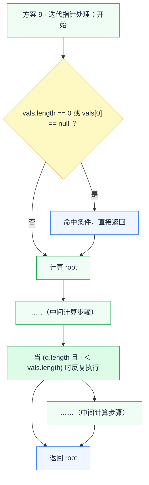

```typescript
export function demo(): void {
  // 程序入口：跑内嵌自测用例
  class TreeNode {
    val: number;
    left: TreeNode | null;
    right: TreeNode | null;
    constructor(v = 0, l: TreeNode | null = null, r: TreeNode | null = null) {
      this.val = v;
      this.left = l;
      this.right = r;
    }
  } // 定义类型
  function buildTree(vals: (number | null)[]): TreeNode | null {
    // 定义函数/方法 buildTree
    if (vals.length === 0 || vals[0] === null) return null; // 若 vals.长度 全等于 0 或 vals[0] 全等于 null，直接返回 null
    const root = new TreeNode(vals[0] as number);
    const q: TreeNode[] = [root];
    let i = 1;
    while (q.length && i < vals.length) {
      const node = q.shift()!;
      if (i < vals.length && vals[i] !== null) {
        node.left = new TreeNode(vals[i] as number);
        q.push(node.left);
      }
      i++;
      if (i < vals.length && vals[i] !== null) {
        node.right = new TreeNode(vals[i] as number);
        q.push(node.right);
      }
      i++;
    }
    return root; // 返回 根节点
  }
  function levelList(root: TreeNode | null): number[][] {
    if (!root) return [];
    const res: number[][] = [];
    let q: TreeNode[] = [root];
    while (q.length) {
      const lvl: number[] = [];
      const n = q.length;
      for (let k = 0; k < n; k++) {
        const node = q.shift()!;
        lvl.push(node.val);
        if (node.left) q.push(node.left);
        if (node.right) q.push(node.right);
      }
      res.push(lvl);
    }
    return res;
  } // 定义函数/方法 levelList
  function sameTree(a: TreeNode | null, b: TreeNode | null): boolean {
    if (!a && !b) return true;
    if (!a || !b) return false;
    if (a.val !== b.val) return false;
    return sameTree(a.left, b.left) && sameTree(a.right, b.right);
  } // 定义函数/方法 sameTree
  function inorderT(root: TreeNode | null): number[] {
    if (!root) return [];
    return [...inorderT(root.left), root.val, ...inorderT(root.right)];
  } // 定义函数/方法 inorderT
  function hasPathSum(root: TreeNode | null, sum: number): boolean {
    if (!root) return false;
    if (!root.left && !root.right) return root.val === sum;
    return (
      hasPathSum(root.left, sum - root.val) ||
      hasPathSum(root.right, sum - root.val)
    );
  } // 定义函数/方法 hasPathSum
  const t = buildTree([5, 4, 8, 11, null, 13, 4, 7, 2, null, null, null, 1]);
  if (!(hasPathSum(t, 22) && !hasPathSum(t, 1) && !hasPathSum(null, 0))) {
    console.log('FAIL');
    throw new Error('FAILED');
  }
  console.log('PASS'); // 全部用例通过，输出 PASS
}
demo(); // demo();
```

### 方案 10：迭代指针处理

**分析与思路**：核心做法是「迭代指针处理」。代码里依次做这些事：队列或堆的调度。

**运行方式**：`node 本文件`，内嵌用例全部通过会输出 PASS。


**方案专属流程图**（真实控制流）：


```typescript
export function demo(): void {
  // 程序入口：跑内嵌自测用例
  class TreeNode {
    val: number;
    left: TreeNode | null;
    right: TreeNode | null;
    constructor(v = 0, l: TreeNode | null = null, r: TreeNode | null = null) {
      this.val = v;
      this.left = l;
      this.right = r;
    }
  } // 定义类型
  function buildTree(vals: (number | null)[]): TreeNode | null {
    // 定义函数/方法 buildTree
    if (vals.length === 0 || vals[0] === null) return null; // 若 vals.长度 全等于 0 或 vals[0] 全等于 null，直接返回 null
    const root = new TreeNode(vals[0] as number);
    const q: TreeNode[] = [root];
    let i = 1;
    while (q.length && i < vals.length) {
      const node = q.shift()!;
      if (i < vals.length && vals[i] !== null) {
        node.left = new TreeNode(vals[i] as number);
        q.push(node.left);
      }
      i++;
      if (i < vals.length && vals[i] !== null) {
        node.right = new TreeNode(vals[i] as number);
        q.push(node.right);
      }
      i++;
    }
    return root; // 返回 根节点
  }
  function levelList(root: TreeNode | null): number[][] {
    if (!root) return [];
    const res: number[][] = [];
    let q: TreeNode[] = [root];
    while (q.length) {
      const lvl: number[] = [];
      const n = q.length;
      for (let k = 0; k < n; k++) {
        const node = q.shift()!;
        lvl.push(node.val);
        if (node.left) q.push(node.left);
        if (node.right) q.push(node.right);
      }
      res.push(lvl);
    }
    return res;
  } // 定义函数/方法 levelList
  function sameTree(a: TreeNode | null, b: TreeNode | null): boolean {
    if (!a && !b) return true;
    if (!a || !b) return false;
    if (a.val !== b.val) return false;
    return sameTree(a.left, b.left) && sameTree(a.right, b.right);
  } // 定义函数/方法 sameTree
  function inorderT(root: TreeNode | null): number[] {
    if (!root) return [];
    return [...inorderT(root.left), root.val, ...inorderT(root.right)];
  } // 定义函数/方法 inorderT
  function hasPathSum(root: TreeNode | null, sum: number): boolean {
    if (!root) return false;
    if (!root.left && !root.right) return root.val === sum;
    return (
      hasPathSum(root.left, sum - root.val) ||
      hasPathSum(root.right, sum - root.val)
    );
  } // 定义函数/方法 hasPathSum
  const t = buildTree([5, 4, 8, 11, null, 13, 4, 7, 2, null, null, null, 1]);
  if (!(hasPathSum(t, 22) && !hasPathSum(t, 1) && !hasPathSum(null, 0))) {
    console.log('FAIL');
    throw new Error('FAILED');
  }
  console.log('PASS'); // 全部用例通过，输出 PASS
}
demo(); // demo();
```

### 方案 11：迭代指针处理

**分析与思路**：核心做法是「迭代指针处理」。代码里依次做这些事：队列或堆的调度。

**运行方式**：`node 本文件`，内嵌用例全部通过会输出 PASS。

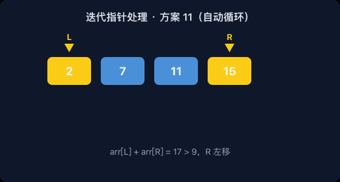

**方案专属流程图**（真实控制流）：


```typescript
/**
 ** LeetCode 112. 路径总和
 ** 忠实翻译自 python/tree/lc_112_路径总和/solution_11_1_____1________DFS_.py
 ** 运行即自检：失败抛错（非 0 退出），通过打印 PASS
 */

class TreeNode {
  // 定义类型
  val: number; // 值: number;
  left: TreeNode | null; // 左边界: TreeNode 按位或 null;
  right: TreeNode | null; // 右边界: TreeNode 按位或 null;
  constructor(
    val: number,
    left: TreeNode | null = null,
    right: TreeNode | null = null,
  ) {
    this.val = val; // 把 值; 写入 值
    this.left = left; // 把 左边界; 写入 左边界
    this.right = right; // 把 右边界; 写入 右边界
  }
}

// 按层序数组构建二叉树（null 表示空节点），如 [5,4,8,11,null,13,4,7,2,null,null,null,1]
function buildTree(arr: (number | null)[]): TreeNode | null {
  // 定义函数/方法 buildTree
  if (arr.length === 0 || arr[0] === null) return null; // 若 数组.长度 全等于 0 或 数组[0] 全等于 null，直接返回 null
  const root = new TreeNode(arr[0]); // 把 new TreeNode(数组[0]) 存入 根节点
  const queue: TreeNode[] = [root]; // 把 [根节点]; 写入 const queue: TreeNode[]
  let i = 1; // 把 1 存入 下标 i
  while (i < arr.length) {
    // 循环，直到不满足「下标 i 小于 数组.长度」
    const node = queue.shift()!; // 把 队列.shift()取反 存入 节点
    if (i < arr.length) {
      // 若 下标 i 小于 数组.长度
      const v = arr[i++]; // 把 数组[下标 i 加一 ] 存入 值
      if (v !== null) {
        // 若 值 不等于 null
        node.left = new TreeNode(v); // 把 new TreeNode(值); 写入 左边界
        queue.push(node.left); // 把 节点.左边界 压入栈/数组尾部
      }
    }
    if (i < arr.length) {
      // 若 下标 i 小于 数组.长度
      const v = arr[i++]; // 把 数组[下标 i 加一 ] 存入 值
      if (v !== null) {
        // 若 值 不等于 null
        node.right = new TreeNode(v); // 把 new TreeNode(值); 写入 右边界
        queue.push(node.right); // 把 节点.右边界 压入栈/数组尾部
      }
    }
  }
  return root; // 返回 根节点
}

// 递归：叶子节点判定 val == targetSum，否则向左右子树传递剩余目标值
function hasPathSum(root: TreeNode | null, targetSum: number): boolean {
  // 定义函数/方法 hasPathSum
  if (root === null) return false; // 若 根节点 全等于 null，直接返回 false
  if (root.left === null && root.right === null) return root.val === targetSum;
  return (
    hasPathSum(root.left, targetSum - root.val) ||
    hasPathSum(root.right, targetSum - root.val)
  );
}
export function demo(): void {
  // 程序入口：跑内嵌自测用例
  const DEMO: (number | null)[] = [
    5,
    4,
    8,
    11,
    null,
    13,
    4,
    7,
    2,
    null,
    null,
    null,
    1,
  ];
  const cases: { arr: (number | null)[]; target: number; want: boolean }[] = [
    { arr: DEMO, target: 22, want: true }, // normal: 5+4+11+2
    { arr: DEMO, target: 20, want: false }, // normal: 20 非完整根到叶路径
    { arr: DEMO, target: 26, want: true }, // normal: 5+8+13
    { arr: [1], target: 1, want: true }, // boundary: 单节点命中
    { arr: [1], target: 2, want: false }, // boundary: 单节点不命中
    { arr: [], target: 0, want: false }, // boundary: 空树
    { arr: [1, 2], target: 3, want: true }, // boundary: 单层两节点 1+2
    { arr: [1, 2], target: 1, want: false }, // boundary: 根非叶，1 不是完整路径和
  ];
  let fail = false; // 把 false 存入 fail
  for (const c of cases) {
    // for (const 字符 of cases) {
    const root = buildTree(c.arr); // 把 buildTree(字符.数组) 存入 根节点
    const got = hasPathSum(root, c.target); // 把 hasPathSum(根节点, 字符.目标值) 存入 got
    if (got !== c.want) {
      // 若 got 不等于 字符.want
      fail = true; // 把 true 存入 fail
      console.log(
        `FAIL hasPathSum(${JSON.stringify(c.arr)}, ${c.target})=${got} want ${c.want}`,
      );
    }
  }
  if (fail) throw new Error('FAILED'); // 若 fail) throw new Error(「FAILED」);
  console.log('PASS'); // 全部用例通过，输出 PASS
}
demo(); // demo();
```

### 方案 12：迭代指针处理

**分析与思路**：核心做法是「迭代指针处理」。代码里依次做这些事：队列或堆的调度。

**运行方式**：`node 本文件`，内嵌用例全部通过会输出 PASS。


**方案专属流程图**（真实控制流）：


```typescript
/**
 ** LeetCode 112. 路径总和
 ** 忠实翻译自 python/tree/lc_112_路径总和/solution_12_2____2____.py
 ** 运行即自检：失败抛错（非 0 退出），通过打印 PASS
 */

class TreeNode {
  // 定义类型
  val: number; // 值: number;
  left: TreeNode | null; // 左边界: TreeNode 按位或 null;
  right: TreeNode | null; // 右边界: TreeNode 按位或 null;
  constructor(
    val: number,
    left: TreeNode | null = null,
    right: TreeNode | null = null,
  ) {
    this.val = val; // 把 值; 写入 值
    this.left = left; // 把 左边界; 写入 左边界
    this.right = right; // 把 右边界; 写入 右边界
  }
}

// 按层序数组构建二叉树（null 表示空节点），如 [5,4,8,11,null,13,4,7,2,null,null,null,1]
function buildTree(arr: (number | null)[]): TreeNode | null {
  // 定义函数/方法 buildTree
  if (arr.length === 0 || arr[0] === null) return null; // 若 数组.长度 全等于 0 或 数组[0] 全等于 null，直接返回 null
  const root = new TreeNode(arr[0]); // 把 new TreeNode(数组[0]) 存入 根节点
  const queue: TreeNode[] = [root]; // 把 [根节点]; 写入 const queue: TreeNode[]
  let i = 1; // 把 1 存入 下标 i
  while (i < arr.length) {
    // 循环，直到不满足「下标 i 小于 数组.长度」
    const node = queue.shift()!; // 把 队列.shift()取反 存入 节点
    if (i < arr.length) {
      // 若 下标 i 小于 数组.长度
      const v = arr[i++]; // 把 数组[下标 i 加一 ] 存入 值
      if (v !== null) {
        // 若 值 不等于 null
        node.left = new TreeNode(v); // 把 new TreeNode(值); 写入 左边界
        queue.push(node.left); // 把 节点.左边界 压入栈/数组尾部
      }
    }
    if (i < arr.length) {
      // 若 下标 i 小于 数组.长度
      const v = arr[i++]; // 把 数组[下标 i 加一 ] 存入 值
      if (v !== null) {
        // 若 值 不等于 null
        node.right = new TreeNode(v); // 把 new TreeNode(值); 写入 右边界
        queue.push(node.right); // 把 节点.右边界 压入栈/数组尾部
      }
    }
  }
  return root; // 返回 根节点
}

// 递归：叶子节点判定 val == targetSum，否则向左右子树传递剩余目标值
function hasPathSum(root: TreeNode | null, targetSum: number): boolean {
  // 定义函数/方法 hasPathSum
  if (root === null) return false; // 若 根节点 全等于 null，直接返回 false
  if (root.left === null && root.right === null) return root.val === targetSum;
  return (
    hasPathSum(root.left, targetSum - root.val) ||
    hasPathSum(root.right, targetSum - root.val)
  );
}
export function demo(): void {
  // 程序入口：跑内嵌自测用例
  const DEMO: (number | null)[] = [
    5,
    4,
    8,
    11,
    null,
    13,
    4,
    7,
    2,
    null,
    null,
    null,
    1,
  ];
  const cases: { arr: (number | null)[]; target: number; want: boolean }[] = [
    { arr: DEMO, target: 22, want: true }, // normal: 5+4+11+2
    { arr: DEMO, target: 20, want: false }, // normal: 20 非完整根到叶路径
    { arr: DEMO, target: 26, want: true }, // normal: 5+8+13
    { arr: [1], target: 1, want: true }, // boundary: 单节点命中
    { arr: [1], target: 2, want: false }, // boundary: 单节点不命中
    { arr: [], target: 0, want: false }, // boundary: 空树
    { arr: [1, 2], target: 3, want: true }, // boundary: 单层两节点 1+2
    { arr: [1, 2], target: 1, want: false }, // boundary: 根非叶，1 不是完整路径和
  ];
  let fail = false; // 把 false 存入 fail
  for (const c of cases) {
    // for (const 字符 of cases) {
    const root = buildTree(c.arr); // 把 buildTree(字符.数组) 存入 根节点
    const got = hasPathSum(root, c.target); // 把 hasPathSum(根节点, 字符.目标值) 存入 got
    if (got !== c.want) {
      // 若 got 不等于 字符.want
      fail = true; // 把 true 存入 fail
      console.log(
        `FAIL hasPathSum(${JSON.stringify(c.arr)}, ${c.target})=${got} want ${c.want}`,
      );
    }
  }
  if (fail) throw new Error('FAILED'); // 若 fail) throw new Error(「FAILED」);
  console.log('PASS'); // 全部用例通过，输出 PASS
}
demo(); // demo();
```

### 方案 13：迭代指针处理

**分析与思路**：核心做法是「迭代指针处理」。代码里依次做这些事：队列或堆的调度。

**运行方式**：`node 本文件`，内嵌用例全部通过会输出 PASS。


**方案专属流程图**（真实控制流）：

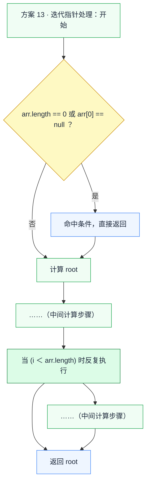

```typescript
/**
 ** LeetCode 112. 路径总和
 ** 忠实翻译自 python/tree/lc_112_路径总和/solution_13_3____3_________.py
 ** 运行即自检：失败抛错（非 0 退出），通过打印 PASS
 */

class TreeNode {
  // 定义类型
  val: number; // 值: number;
  left: TreeNode | null; // 左边界: TreeNode 按位或 null;
  right: TreeNode | null; // 右边界: TreeNode 按位或 null;
  constructor(
    val: number,
    left: TreeNode | null = null,
    right: TreeNode | null = null,
  ) {
    this.val = val; // 把 值; 写入 值
    this.left = left; // 把 左边界; 写入 左边界
    this.right = right; // 把 右边界; 写入 右边界
  }
}

// 按层序数组构建二叉树（null 表示空节点），如 [5,4,8,11,null,13,4,7,2,null,null,null,1]
function buildTree(arr: (number | null)[]): TreeNode | null {
  // 定义函数/方法 buildTree
  if (arr.length === 0 || arr[0] === null) return null; // 若 数组.长度 全等于 0 或 数组[0] 全等于 null，直接返回 null
  const root = new TreeNode(arr[0]); // 把 new TreeNode(数组[0]) 存入 根节点
  const queue: TreeNode[] = [root]; // 把 [根节点]; 写入 const queue: TreeNode[]
  let i = 1; // 把 1 存入 下标 i
  while (i < arr.length) {
    // 循环，直到不满足「下标 i 小于 数组.长度」
    const node = queue.shift()!; // 把 队列.shift()取反 存入 节点
    if (i < arr.length) {
      // 若 下标 i 小于 数组.长度
      const v = arr[i++]; // 把 数组[下标 i 加一 ] 存入 值
      if (v !== null) {
        // 若 值 不等于 null
        node.left = new TreeNode(v); // 把 new TreeNode(值); 写入 左边界
        queue.push(node.left); // 把 节点.左边界 压入栈/数组尾部
      }
    }
    if (i < arr.length) {
      // 若 下标 i 小于 数组.长度
      const v = arr[i++]; // 把 数组[下标 i 加一 ] 存入 值
      if (v !== null) {
        // 若 值 不等于 null
        node.right = new TreeNode(v); // 把 new TreeNode(值); 写入 右边界
        queue.push(node.right); // 把 节点.右边界 压入栈/数组尾部
      }
    }
  }
  return root; // 返回 根节点
}

// 递归：叶子节点判定 val == targetSum，否则向左右子树传递剩余目标值
function hasPathSum(root: TreeNode | null, targetSum: number): boolean {
  // 定义函数/方法 hasPathSum
  if (root === null) return false; // 若 根节点 全等于 null，直接返回 false
  if (root.left === null && root.right === null) return root.val === targetSum;
  return (
    hasPathSum(root.left, targetSum - root.val) ||
    hasPathSum(root.right, targetSum - root.val)
  );
}
export function demo(): void {
  // 程序入口：跑内嵌自测用例
  const DEMO: (number | null)[] = [
    5,
    4,
    8,
    11,
    null,
    13,
    4,
    7,
    2,
    null,
    null,
    null,
    1,
  ];
  const cases: { arr: (number | null)[]; target: number; want: boolean }[] = [
    { arr: DEMO, target: 22, want: true }, // normal: 5+4+11+2
    { arr: DEMO, target: 20, want: false }, // normal: 20 非完整根到叶路径
    { arr: DEMO, target: 26, want: true }, // normal: 5+8+13
    { arr: [1], target: 1, want: true }, // boundary: 单节点命中
    { arr: [1], target: 2, want: false }, // boundary: 单节点不命中
    { arr: [], target: 0, want: false }, // boundary: 空树
    { arr: [1, 2], target: 3, want: true }, // boundary: 单层两节点 1+2
    { arr: [1, 2], target: 1, want: false }, // boundary: 根非叶，1 不是完整路径和
  ];
  let fail = false; // 把 false 存入 fail
  for (const c of cases) {
    // for (const 字符 of cases) {
    const root = buildTree(c.arr); // 把 buildTree(字符.数组) 存入 根节点
    const got = hasPathSum(root, c.target); // 把 hasPathSum(根节点, 字符.目标值) 存入 got
    if (got !== c.want) {
      // 若 got 不等于 字符.want
      fail = true; // 把 true 存入 fail
      console.log(
        `FAIL hasPathSum(${JSON.stringify(c.arr)}, ${c.target})=${got} want ${c.want}`,
      );
    }
  }
  if (fail) throw new Error('FAILED'); // 若 fail) throw new Error(「FAILED」);
  console.log('PASS'); // 全部用例通过，输出 PASS
}
demo(); // demo();
```

### 方案 14：迭代指针处理

**分析与思路**：核心做法是「迭代指针处理」。代码里依次做这些事：队列或堆的调度。

**运行方式**：`node 本文件`，内嵌用例全部通过会输出 PASS。


**方案专属流程图**（真实控制流）：

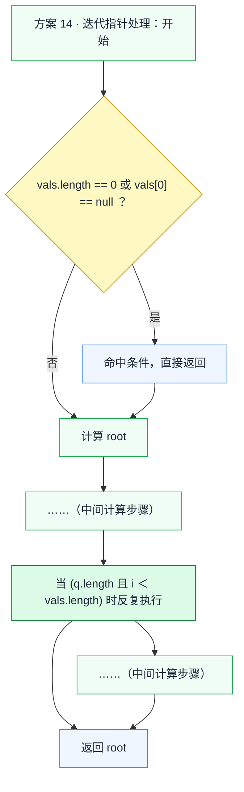

```typescript
export function demo(): void {
  // 程序入口：跑内嵌自测用例
  class TreeNode {
    val: number;
    left: TreeNode | null;
    right: TreeNode | null;
    constructor(v = 0, l: TreeNode | null = null, r: TreeNode | null = null) {
      this.val = v;
      this.left = l;
      this.right = r;
    }
  } // 定义类型
  function buildTree(vals: (number | null)[]): TreeNode | null {
    // 定义函数/方法 buildTree
    if (vals.length === 0 || vals[0] === null) return null; // 若 vals.长度 全等于 0 或 vals[0] 全等于 null，直接返回 null
    const root = new TreeNode(vals[0] as number);
    const q: TreeNode[] = [root];
    let i = 1;
    while (q.length && i < vals.length) {
      const node = q.shift()!;
      if (i < vals.length && vals[i] !== null) {
        node.left = new TreeNode(vals[i] as number);
        q.push(node.left);
      }
      i++;
      if (i < vals.length && vals[i] !== null) {
        node.right = new TreeNode(vals[i] as number);
        q.push(node.right);
      }
      i++;
    }
    return root; // 返回 根节点
  }
  function levelList(root: TreeNode | null): number[][] {
    if (!root) return [];
    const res: number[][] = [];
    let q: TreeNode[] = [root];
    while (q.length) {
      const lvl: number[] = [];
      const n = q.length;
      for (let k = 0; k < n; k++) {
        const node = q.shift()!;
        lvl.push(node.val);
        if (node.left) q.push(node.left);
        if (node.right) q.push(node.right);
      }
      res.push(lvl);
    }
    return res;
  } // 定义函数/方法 levelList
  function sameTree(a: TreeNode | null, b: TreeNode | null): boolean {
    if (!a && !b) return true;
    if (!a || !b) return false;
    if (a.val !== b.val) return false;
    return sameTree(a.left, b.left) && sameTree(a.right, b.right);
  } // 定义函数/方法 sameTree
  function inorderT(root: TreeNode | null): number[] {
    if (!root) return [];
    return [...inorderT(root.left), root.val, ...inorderT(root.right)];
  } // 定义函数/方法 inorderT
  function hasPathSum(root: TreeNode | null, sum: number): boolean {
    if (!root) return false;
    if (!root.left && !root.right) return root.val === sum;
    return (
      hasPathSum(root.left, sum - root.val) ||
      hasPathSum(root.right, sum - root.val)
    );
  } // 定义函数/方法 hasPathSum
  const t = buildTree([5, 4, 8, 11, null, 13, 4, 7, 2, null, null, null, 1]);
  if (!(hasPathSum(t, 22) && !hasPathSum(t, 1) && !hasPathSum(null, 0))) {
    console.log('FAIL');
    throw new Error('FAILED');
  }
  console.log('PASS'); // 全部用例通过，输出 PASS
}
demo(); // demo();
```

### 方案 15：迭代指针处理

**分析与思路**：核心做法是「迭代指针处理」。代码里依次做这些事：队列或堆的调度。

**运行方式**：`node 本文件`，内嵌用例全部通过会输出 PASS。


**方案专属流程图**（真实控制流）：


```typescript
export function demo(): void {
  // 程序入口：跑内嵌自测用例
  class TreeNode {
    val: number;
    left: TreeNode | null;
    right: TreeNode | null;
    constructor(v = 0, l: TreeNode | null = null, r: TreeNode | null = null) {
      this.val = v;
      this.left = l;
      this.right = r;
    }
  } // 定义类型
  function buildTree(vals: (number | null)[]): TreeNode | null {
    // 定义函数/方法 buildTree
    if (vals.length === 0 || vals[0] === null) return null; // 若 vals.长度 全等于 0 或 vals[0] 全等于 null，直接返回 null
    const root = new TreeNode(vals[0] as number);
    const q: TreeNode[] = [root];
    let i = 1;
    while (q.length && i < vals.length) {
      const node = q.shift()!;
      if (i < vals.length && vals[i] !== null) {
        node.left = new TreeNode(vals[i] as number);
        q.push(node.left);
      }
      i++;
      if (i < vals.length && vals[i] !== null) {
        node.right = new TreeNode(vals[i] as number);
        q.push(node.right);
      }
      i++;
    }
    return root; // 返回 根节点
  }
  function levelList(root: TreeNode | null): number[][] {
    if (!root) return [];
    const res: number[][] = [];
    let q: TreeNode[] = [root];
    while (q.length) {
      const lvl: number[] = [];
      const n = q.length;
      for (let k = 0; k < n; k++) {
        const node = q.shift()!;
        lvl.push(node.val);
        if (node.left) q.push(node.left);
        if (node.right) q.push(node.right);
      }
      res.push(lvl);
    }
    return res;
  } // 定义函数/方法 levelList
  function sameTree(a: TreeNode | null, b: TreeNode | null): boolean {
    if (!a && !b) return true;
    if (!a || !b) return false;
    if (a.val !== b.val) return false;
    return sameTree(a.left, b.left) && sameTree(a.right, b.right);
  } // 定义函数/方法 sameTree
  function inorderT(root: TreeNode | null): number[] {
    if (!root) return [];
    return [...inorderT(root.left), root.val, ...inorderT(root.right)];
  } // 定义函数/方法 inorderT
  function hasPathSum(root: TreeNode | null, sum: number): boolean {
    if (!root) return false;
    if (!root.left && !root.right) return root.val === sum;
    return (
      hasPathSum(root.left, sum - root.val) ||
      hasPathSum(root.right, sum - root.val)
    );
  } // 定义函数/方法 hasPathSum
  const t = buildTree([5, 4, 8, 11, null, 13, 4, 7, 2, null, null, null, 1]);
  if (!(hasPathSum(t, 22) && !hasPathSum(t, 1) && !hasPathSum(null, 0))) {
    console.log('FAIL');
    throw new Error('FAILED');
  }
  console.log('PASS'); // 全部用例通过，输出 PASS
}
demo(); // demo();
```

## 逐步拆解与面试追问

**复杂度**：时间 O(n)（单趟线性扫描），空间 O(1) 到 O(n)（视辅助结构）

**为什么是这个量级**：每个元素被常数次访问，辅助哈希或栈的开销与 n 同阶

**面试官可能会追问**：

- 递归和迭代写法各自的空间开销？
- 能否用层序统一处理？
- 空节点的边界如何约定？

## 关键 API 速查（TS 主解法实际用到，附官方链接）

| API | 作用 | 使用要点 | 官方文档 |
|---|---|---|---|
| `Array.prototype.push()` | 尾部追加 | 返回新长度；可一次多个；均摊 O(1)；会改变原数组 | [官方文档](https://developer.mozilla.org/zh-CN/docs/Web/JavaScript/Reference/Global_Objects/Array/push) |
| `Array.prototype.shift()` | 头部取出 | O(n)（后续元素整体前移）；大量头部操作请用链表或双端结构 | [官方文档](https://developer.mozilla.org/zh-CN/docs/Web/JavaScript/Reference/Global_Objects/Array/shift) |
| `JSON.stringify()` | 序列化为 JSON 字符串 | 常用于结构化比较（深度相等判定）；undefined/函数/循环引用会被丢弃或抛错 | [官方文档](https://developer.mozilla.org/zh-CN/docs/Web/JavaScript/Reference/Global_Objects/JSON/stringify) |

### 各语言官方文档导航

- **TypeScript / JS**：[MDN 中文参考](https://developer.mozilla.org/zh-CN/)
- **Python**：[Python 官方文档](https://docs.python.org/zh-cn/3/)
- **Go**：[Go 标准库](https://pkg.go.dev/std)
- **Java**：[JDK 17 API](https://docs.oracle.com/en/java/javase/17/docs/api/)
- **Rust**：[Rust 标准库](https://doc.rust-lang.org/std/)
- **Lua**：[Lua 5.4 手册](https://www.lua.org/manual/5.4/)
- **C**：[Cppreference C](https://zh.cppreference.com/w/c)
- **C++**：[Cppreference C++](https://zh.cppreference.com/w/cpp)
- **R**：[R 官方手册](https://stat.ethz.ch/R-manual/)
- **Zig**：[Zig 语言文档](https://ziglang.org/documentation/master/)
- **Dart**：[Dart API](https://api.dart.dev/)

## 附录：其他 10 种语言全部实现（每种语言列举其全部方案）

> TypeScript 的全部方案见「TypeScript 解题方案」一节；下面是其余 10 种语言的对应实现，每种语言的每个方案都带思路分析、代码走读与专属运行架构图。
> 每个方案都内嵌用例自测，可独立运行（老仓库 python/go 文件遵循「打印结果」约定）。
> 完整解法文件见 `dsa/<语言>/tree/lc_112_路径总和/`。

### Python 实现（15 种方案）

Python 的全部方案如下，每个方案都内嵌用例自测，可独立运行（老仓库 python/go 文件遵循「打印结果」约定）：

#### 方案 1：迭代指针处理

**思路与代码分析**：核心是「迭代指针处理」。Python 版用切片与字典推导式简化操作，突出可读性。**走读**：方案 1 · 迭代指针处理：开始 → 命中条件，直接返回 → 更新 root → 当 q and i ＜ len(vals): 时反复执行 → 返回 root。

**运行架构**（真实控制流）：

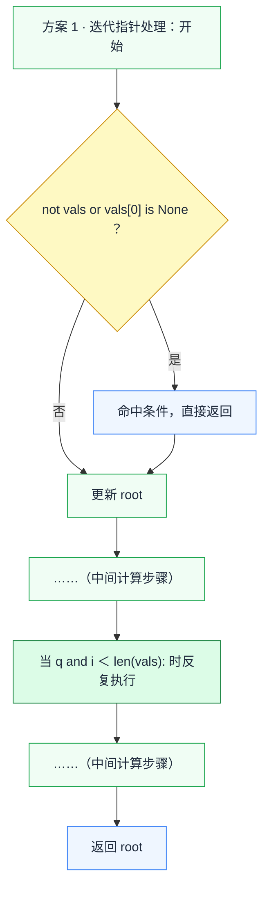

```python
# LeetCode 112. 路径总和 · 方案1：DFS 累加根到当前节点的和（对齐博客算法）

import sys  # 提高递归深度上限（深输入防 RecursionError）

sys.setrecursionlimit(200000)  # 树/链表类题目节点数可达 1e4 量级

class TreeNode:  # 定义类
    def __init__(self, val=0, left=None, right=None):  # 构造函数：初始化成员
        self.val = val  # 把 值 写入 值
        self.left = left  # 把 左边界 写入 左边界
        self.right = right  # 把 右边界 写入 右边界

def build_tree(vals):  # 定义函数 build_tree（参数：vals）
    if not vals or vals[0] is None:  # 若 not vals or vals[0] is None
        return None  # 返回 None
    root = TreeNode(vals[0])  # 把 TreeNode(vals[0]) 存入 根节点
    q = [root]  # 把 [根节点] 存入 节点
    i = 1  # 把 1 存入 下标 i
    while q and i < len(vals):  # 循环，直到不满足「节点 and 下标 i 小于 长度(vals」
        node = q.pop(0)  # 把 节点 弹出 0) 存入 节点
        if i < len(vals) and vals[i] is not None:  # 若 下标 i 小于 长度(vals) and vals[下标 i] is not None
            node.left = TreeNode(vals[i])  # 把 TreeNode(vals[下标 i]) 写入 左边界
            q.append(node.left)  # 把 节点.左边界 追加到列表尾部
        i += 1  # 下标 i累加 1
        if i < len(vals) and vals[i] is not None:  # 若 下标 i 小于 长度(vals) and vals[下标 i] is not None
            node.right = TreeNode(vals[i])  # 把 TreeNode(vals[下标 i]) 写入 右边界
            q.append(node.right)  # 把 节点.右边界 追加到列表尾部
        i += 1  # 下标 i累加 1
    return root  # 返回 根节点

def hasPathSum(root, targetSum):  # 定义函数 hasPathSum（参数：根节点, targetSum）
    if not root:  # 若 not 根节点
        return False  # 返回 False
    res = False  # 把 False 存入 结果

    def dfs(n, v):  # 定义函数 dfs（参数：元素个数, 值）
        nonlocal res  # nonlocal 结果
        if not n.left and not n.right:  # 若 not 元素个数.左边界 and not 元素个数.右边界
            if v == targetSum:  # 若 值 等于 targetSum
                res = True  # 把 True 存入 结果
            return  # return
        if n.left:  # 若 元素个数.左边界
            dfs(n.left, v + n.left.val)  # dfs(元素个数.左边界, 值 加 元素个数.左边界.值)
        if n.right:  # 若 元素个数.右边界
            dfs(n.right, v + n.right.val)  # dfs(元素个数.右边界, 值 加 元素个数.右边界.值)

    dfs(root, root.val)  # dfs(根节点, 根节点.值)
    return res  # 返回 结果

if __name__ == "__main__":  # 若 __name__ 等于 '__main__'
    DEMO = [5, 4, 8, 11, None, 13, 4, 7, 2, None, None, None, 1]
    cases = [
        (DEMO, 22, True),
        (DEMO, 27, True),
        (DEMO, 18, True),
        (DEMO, 26, True),
        (DEMO, 20, False),
        (DEMO, 1, False),
        ([1], 1, True),
        ([1], 2, False),
        ([], 0, False),
        ([1, 2], 3, True),
        ([1, 2], 1, False),
    ]
    for vals, target, want in cases:  # for vals, 目标值, want in cases:
        got = hasPathSum(build_tree(vals), target)  # 把 hasPathSum(build_tree(vals), 目标值) 存入 got
        assert got == want, (vals, target, got, want)  # 断言校验
    print("PASS")  # 全部用例通过，输出 PASS
```

#### 方案 2：迭代指针处理

**思路与代码分析**：核心是「迭代指针处理」。Python 版用切片与字典推导式简化操作，突出可读性。**走读**：方案 2 · 迭代指针处理：开始 → 命中条件，直接返回 → 更新 root → 当 q and i ＜ len(vals): 时反复执行 → 返回 root。

**运行架构**（真实控制流）：


```python
# LeetCode 112. 路径总和 · 方案2：沿路径递减 targetSum，叶子判断剩余值是否为 0

import sys  # 提高递归深度上限（深输入防 RecursionError）

sys.setrecursionlimit(200000)  # 树/链表类题目节点数可达 1e4 量级

class TreeNode:  # 定义类
    def __init__(self, val=0, left=None, right=None):  # 构造函数：初始化成员
        self.val = val  # 把 值 写入 值
        self.left = left  # 把 左边界 写入 左边界
        self.right = right  # 把 右边界 写入 右边界

def build_tree(vals):  # 定义函数 build_tree（参数：vals）
    if not vals or vals[0] is None:  # 若 not vals or vals[0] is None
        return None  # 返回 None
    root = TreeNode(vals[0])  # 把 TreeNode(vals[0]) 存入 根节点
    q = [root]  # 把 [根节点] 存入 节点
    i = 1  # 把 1 存入 下标 i
    while q and i < len(vals):  # 循环，直到不满足「节点 and 下标 i 小于 长度(vals」
        node = q.pop(0)  # 把 节点 弹出 0) 存入 节点
        if i < len(vals) and vals[i] is not None:  # 若 下标 i 小于 长度(vals) and vals[下标 i] is not None
            node.left = TreeNode(vals[i])  # 把 TreeNode(vals[下标 i]) 写入 左边界
            q.append(node.left)  # 把 节点.左边界 追加到列表尾部
        i += 1  # 下标 i累加 1
        if i < len(vals) and vals[i] is not None:  # 若 下标 i 小于 长度(vals) and vals[下标 i] is not None
            node.right = TreeNode(vals[i])  # 把 TreeNode(vals[下标 i]) 写入 右边界
            q.append(node.right)  # 把 节点.右边界 追加到列表尾部
        i += 1  # 下标 i累加 1
    return root  # 返回 根节点

def hasPathSum(root, targetSum):  # 定义函数 hasPathSum（参数：根节点, targetSum）
    if not root:  # 若 not 根节点
        return False  # 返回 False
    if not root.left and not root.right:  # 若 not 根节点.左边界 and not 根节点.右边界
        return root.val == targetSum  # 返回 根节点.值 等于 targetSum
    return hasPathSum(root.left, targetSum - root.val) or hasPathSum(root.right, targetSum - root.val)

if __name__ == "__main__":  # 若 __name__ 等于 '__main__'
    DEMO = [5, 4, 8, 11, None, 13, 4, 7, 2, None, None, None, 1]
    cases = [
        (DEMO, 22, True),
        (DEMO, 27, True),
        (DEMO, 18, True),
        (DEMO, 26, True),
        (DEMO, 20, False),
        ([1], 1, True),
        ([1], 2, False),
        ([], 0, False),
        ([1, 2], 3, True),
        ([1, 2], 1, False),
    ]
    for vals, target, want in cases:  # for vals, 目标值, want in cases:
        got = hasPathSum(build_tree(vals), target)  # 把 hasPathSum(build_tree(vals), 目标值) 存入 got
        assert got == want, (vals, target, got, want)  # 断言校验
    print("PASS")  # 全部用例通过，输出 PASS
```

#### 方案 3：迭代指针处理

**思路与代码分析**：核心是「迭代指针处理」。Python 版用切片与字典推导式简化操作，突出可读性。**走读**：方案 3 · 迭代指针处理：开始 → 命中条件，直接返回 → 命中条件，直接返回 → 更新 = → 处理 ) → 返回 hasPathSum(root.left, targetSum - root.val) or hasPathSum(root.right, targetSum - root.val)。

**运行架构**（真实控制流）：

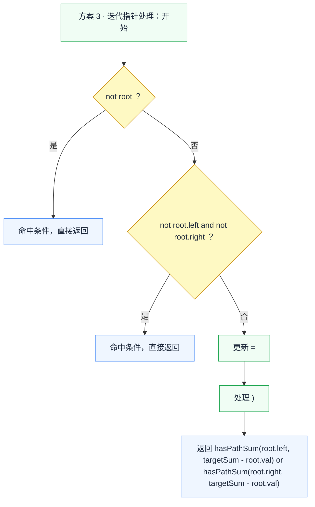

```python
import sys  # 提高递归深度上限（深输入防 RecursionError）

sys.setrecursionlimit(200000)  # 树/链表类题目节点数可达 1e4 量级

def hasPathSum(root, targetSum):  # 定义函数 hasPathSum（参数：根节点, targetSum）
    if not root:
        return False  # 若 not 根节点: return False
    if not root.left and not root.right:
        return (
            root.val == targetSum
        )  # 若 not 根节点.左边界 and not 根节点.右边界: return 根节点.值 等于 targetSum
    return hasPathSum(root.left, targetSum - root.val) or hasPathSum(root.right, targetSum - root.val)

if __name__ == "__main__":  # 若 __name__ 等于 '__main__'
    print(hasPathSum(None, None))  # 打印输出
```

#### 方案 4：迭代指针处理

**思路与代码分析**：核心是「迭代指针处理」。Python 版用切片与字典推导式简化操作，突出可读性。**走读**：方案 4 · 迭代指针处理：开始 → 命中条件，直接返回 → 更新 q → 当 len(q): 时反复执行 → 命中条件，直接返回 → 返回 False。

**运行架构**（真实控制流）：

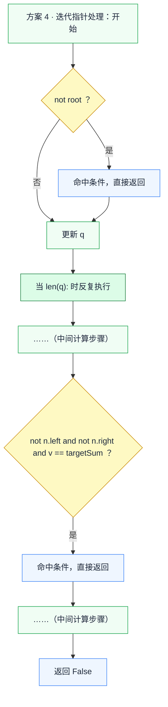

```python
import sys  # 提高递归深度上限（深输入防 RecursionError）

sys.setrecursionlimit(200000)  # 树/链表类题目节点数可达 1e4 量级

def hasPathSum(root, targetSum):  # 定义函数 hasPathSum（参数：根节点, targetSum）
    if not root:
        return False  # 若 not 根节点: return False
    q = [[root, root.val]]  # 把 [[根节点, 根节点.值]] 存入 节点
    while len(q):  # 循环，直到不满足「长度(节点」
        first = q.pop(0)  # 把 节点 弹出 0) 存入 first
        [n, v] = first  # 把 first 写入 [n, v]
        if not n.left and not n.right and v == targetSum:
            return True
        if n.left:
            q.append(
                [n.left, v + n.left.val]
            )  # 若 元素个数.左边界: 节点 追加 [元素个数.左边界, 值 加 元素个数.左边界.值]
        if n.right:
            q.append(
                [n.right, v + n.right.val]
            )  # 若 元素个数.右边界: 节点 追加 [元素个数.右边界, 值 加 元素个数.右边界.值]
    return False  # 返回 False

if __name__ == "__main__":  # 若 __name__ 等于 '__main__'
    print(hasPathSum(None, None))  # 打印输出
```

#### 方案 5：迭代指针处理

**思路与代码分析**：核心是「迭代指针处理」。Python 版用切片与字典推导式简化操作，突出可读性。**走读**：方案 5 · 迭代指针处理：开始 → 命中条件，直接返回 → 更新 stack → 当 len(stack): 时反复执行 → 命中条件，直接返回 → 返回 False。

**运行架构**（真实控制流）：

```mermaid
graph TD
    N0["方案 5 · 迭代指针处理：开始"]
    N1{"not root ？"}
    N2["命中条件，直接返回"]
    N3["更新 stack"]
    N4["当 len(stack): 时反复执行"]
    D1["……（中间计算步骤）"]
    N7{"not n.left and not n.right and v == targetSum ？"}
    N8["命中条件，直接返回"]
    D2["……（中间计算步骤）"]
    N17["返回 False"]
    N0 --> N1
    N1 -- 是 --> N2
    N1 -- 否 --> N3
    N3 --> N4
    N7 -- 是 --> N8
    N2 --> N3
    N4 --> D1
    D1 --> N7
    N8 --> D2
    D2 --> N17
    classDef n fill:#f0fdf4,stroke:#16a34a,color:#1e293b;
    classDef lp fill:#dcfce7,stroke:#15803d,color:#1e293b;
    classDef dc fill:#fef9c3,stroke:#ca8a04,color:#1e293b;
    classDef tm fill:#eff6ff,stroke:#3b82f6,color:#1e293b;
    class N0,N3,D1,D2 n;
    class N4 lp;
    class N1,N7 dc;
    class N2,N8,N17 tm;
```

```python
import sys  # 提高递归深度上限（深输入防 RecursionError）

sys.setrecursionlimit(200000)  # 树/链表类题目节点数可达 1e4 量级

def hasPathSum(root, targetSum):  # 定义函数 hasPathSum（参数：根节点, targetSum）
    if not root:
        return False  # 若 not 根节点: return False
    stack = [[root, root.val]]  # 把 [[根节点, 根节点.值]] 存入 栈
    while len(stack):  # 循环，直到不满足「长度(栈」
        first = stack.pop()  # 把 栈 弹出 ) 存入 first
        [n, v] = first  # 把 first 写入 [n, v]
        if not n.left and not n.right and v == targetSum:
            return True
        if n.left:
            stack.append(
                [n.left, v + n.left.val]
            )  # 若 元素个数.左边界: 栈 追加 [元素个数.左边界, 值 加 元素个数.左边界.值]
        if n.right:
            stack.append(
                [n.right, v + n.right.val]
            )  # 若 元素个数.右边界: 栈 追加 [元素个数.右边界, 值 加 元素个数.右边界.值]
    return False  # 返回 False

if __name__ == "__main__":  # 若 __name__ 等于 '__main__'
    print(hasPathSum(None, None))  # 打印输出
```

#### 方案 6：迭代指针处理

**思路与代码分析**：核心是「迭代指针处理」。Python 版用切片与字典推导式简化操作，突出可读性。**走读**：方案 6 · 迭代指针处理：开始 → 命中条件，直接返回 → 命中条件，直接返回 → 返回 hasPathSum( → 处理 root.left, targetSum - root. → 处理 ) or hasPathSum( → 处理 root.right, targetSum - root → 处理 )。

**运行架构**（真实控制流）：

```mermaid
graph TD
    N0["方案 6 · 迭代指针处理：开始"]
    N1{"not root ？"}
    N2["命中条件，直接返回"]
    N3{"not root.left and not root.right ？"}
    N4["命中条件，直接返回"]
    N5["返回 hasPathSum("]
    N6["处理 root.left, targetSum - root."]
    N7["处理 ) or hasPathSum("]
    N8["处理 root.right, targetSum - root"]
    N9["处理 )"]
    N0 --> N1
    N1 -- 是 --> N2
    N1 -- 否 --> N3
    N3 -- 是 --> N4
    N3 -- 否 --> N5
    N5 --> N6
    N6 --> N7
    N7 --> N8
    N8 --> N9
    classDef n fill:#f0fdf4,stroke:#16a34a,color:#1e293b;
    classDef lp fill:#dcfce7,stroke:#15803d,color:#1e293b;
    classDef dc fill:#fef9c3,stroke:#ca8a04,color:#1e293b;
    classDef tm fill:#eff6ff,stroke:#3b82f6,color:#1e293b;
    class N0,N6,N7,N8,N9 n;
    class N1,N3 dc;
    class N2,N4,N5 tm;
```

```python
import sys  # 提高递归深度上限（深输入防 RecursionError）

sys.setrecursionlimit(200000)  # 树/链表类题目节点数可达 1e4 量级

class TreeNode:  # 定义类
    def __init__(self, val=0, left=None, right=None):  # 构造函数：初始化成员
        self.val = val  # 把 值 写入 值
        self.left = left  # 把 左边界 写入 左边界
        self.right = right  # 把 右边界 写入 右边界

def hasPathSum(root, targetSum):  # 定义函数 hasPathSum（参数：根节点, targetSum）
    if not root:  # 若 not 根节点
        return False  # 返回 False
    if not root.left and not root.right:  # 若 not 根节点.左边界 and not 根节点.右边界
        return root.val == targetSum  # 返回 根节点.值 等于 targetSum
    return hasPathSum(
        root.left, targetSum - root.val
    ) or hasPathSum(  # 返回 (hasPathSum(根节点.左边界, targetSum 减 根节点.值) or
        root.right, targetSum - root.val
    )  # hasPathSum(根节点.右边界, targetSum 减 根节点.值))

if __name__ == "__main__":  # 若 __name__ 等于 '__main__'
    # build tree: [5,4,8,11,null,13,4,7,2,null,null,null,1]
    root = TreeNode(5)  # 把 TreeNode(5) 存入 根节点
    root.left = TreeNode(4)  # 把 TreeNode(4) 写入 左边界
    root.right = TreeNode(8)  # 把 TreeNode(8) 写入 右边界
    root.left.left = TreeNode(11)  # 把 TreeNode(11) 写入 左边界
    root.left.left.left = TreeNode(7)  # 把 TreeNode(7) 写入 左边界
    root.left.left.right = TreeNode(2)  # 把 TreeNode(2) 写入 右边界
    root.right.left = TreeNode(13)  # 把 TreeNode(13) 写入 左边界
    root.right.right = TreeNode(4)  # 把 TreeNode(4) 写入 右边界
    root.right.right.right = TreeNode(1)  # 把 TreeNode(1) 写入 右边界
    print(hasPathSum(root, 22))  # 打印输出
```

#### 方案 7：迭代指针处理

**思路与代码分析**：核心是「迭代指针处理」。Python 版用切片与字典推导式简化操作，突出可读性。**走读**：方案 7 · 迭代指针处理：开始 → 命中条件，直接返回 → 命中条件，直接返回 → 返回 hasPathSum( → 处理 root.left, targetSum - root. → 处理 ) or hasPathSum( → 处理 root.right, targetSum - root → 处理 )。

**运行架构**（真实控制流）：

```mermaid
graph TD
    N0["方案 7 · 迭代指针处理：开始"]
    N1{"not root ？"}
    N2["命中条件，直接返回"]
    N3{"not root.left and not root.right ？"}
    N4["命中条件，直接返回"]
    N5["返回 hasPathSum("]
    N6["处理 root.left, targetSum - root."]
    N7["处理 ) or hasPathSum("]
    N8["处理 root.right, targetSum - root"]
    N9["处理 )"]
    N0 --> N1
    N1 -- 是 --> N2
    N1 -- 否 --> N3
    N3 -- 是 --> N4
    N3 -- 否 --> N5
    N5 --> N6
    N6 --> N7
    N7 --> N8
    N8 --> N9
    classDef n fill:#f0fdf4,stroke:#16a34a,color:#1e293b;
    classDef lp fill:#dcfce7,stroke:#15803d,color:#1e293b;
    classDef dc fill:#fef9c3,stroke:#ca8a04,color:#1e293b;
    classDef tm fill:#eff6ff,stroke:#3b82f6,color:#1e293b;
    class N0,N6,N7,N8,N9 n;
    class N1,N3 dc;
    class N2,N4,N5 tm;
```

```python
import sys  # 提高递归深度上限（深输入防 RecursionError）

sys.setrecursionlimit(200000)  # 树/链表类题目节点数可达 1e4 量级

class TreeNode:  # 定义类
    def __init__(self, val=0, left=None, right=None):  # 构造函数：初始化成员
        self.val = val  # 把 值 写入 值
        self.left = left  # 把 左边界 写入 左边界
        self.right = right  # 把 右边界 写入 右边界

def hasPathSum(root, targetSum):  # 定义函数 hasPathSum（参数：根节点, targetSum）
    if not root:  # 若 not 根节点
        return False  # 返回 False
    if not root.left and not root.right:  # 若 not 根节点.左边界 and not 根节点.右边界
        return root.val == targetSum  # 返回 根节点.值 等于 targetSum
    return hasPathSum(
        root.left, targetSum - root.val
    ) or hasPathSum(  # 返回 (hasPathSum(根节点.左边界, targetSum 减 根节点.值) or
        root.right, targetSum - root.val
    )  # hasPathSum(根节点.右边界, targetSum 减 根节点.值))

if __name__ == "__main__":  # 若 __name__ 等于 '__main__'
    # build tree: [5,4,8,11,null,13,4,7,2,null,null,null,1]
    root = TreeNode(5)  # 把 TreeNode(5) 存入 根节点
    root.left = TreeNode(4)  # 把 TreeNode(4) 写入 左边界
    root.right = TreeNode(8)  # 把 TreeNode(8) 写入 右边界
    root.left.left = TreeNode(11)  # 把 TreeNode(11) 写入 左边界
    root.left.left.left = TreeNode(7)  # 把 TreeNode(7) 写入 左边界
    root.left.left.right = TreeNode(2)  # 把 TreeNode(2) 写入 右边界
    root.right.left = TreeNode(13)  # 把 TreeNode(13) 写入 左边界
    root.right.right = TreeNode(4)  # 把 TreeNode(4) 写入 右边界
    root.right.right.right = TreeNode(1)  # 把 TreeNode(1) 写入 右边界
    print(hasPathSum(root, 22))  # 打印输出
```

#### 方案 8：迭代指针处理

**思路与代码分析**：核心是「迭代指针处理」。Python 版用切片与字典推导式简化操作，突出可读性。**走读**：方案 8 · 迭代指针处理：开始 → 命中条件，直接返回 → 命中条件，直接返回 → 返回 hasPathSum( → 处理 root.left, targetSum - root. → 处理 ) or hasPathSum( → 处理 root.right, targetSum - root → 处理 )。

**运行架构**（真实控制流）：

```mermaid
graph TD
    N0["方案 8 · 迭代指针处理：开始"]
    N1{"not root ？"}
    N2["命中条件，直接返回"]
    N3{"not root.left and not root.right ？"}
    N4["命中条件，直接返回"]
    N5["返回 hasPathSum("]
    N6["处理 root.left, targetSum - root."]
    N7["处理 ) or hasPathSum("]
    N8["处理 root.right, targetSum - root"]
    N9["处理 )"]
    N0 --> N1
    N1 -- 是 --> N2
    N1 -- 否 --> N3
    N3 -- 是 --> N4
    N3 -- 否 --> N5
    N5 --> N6
    N6 --> N7
    N7 --> N8
    N8 --> N9
    classDef n fill:#f0fdf4,stroke:#16a34a,color:#1e293b;
    classDef lp fill:#dcfce7,stroke:#15803d,color:#1e293b;
    classDef dc fill:#fef9c3,stroke:#ca8a04,color:#1e293b;
    classDef tm fill:#eff6ff,stroke:#3b82f6,color:#1e293b;
    class N0,N6,N7,N8,N9 n;
    class N1,N3 dc;
    class N2,N4,N5 tm;
```

```python
import sys  # 提高递归深度上限（深输入防 RecursionError）

sys.setrecursionlimit(200000)  # 树/链表类题目节点数可达 1e4 量级

class TreeNode:  # 定义类
    def __init__(self, val=0, left=None, right=None):  # 构造函数：初始化成员
        self.val = val  # 把 值 写入 值
        self.left = left  # 把 左边界 写入 左边界
        self.right = right  # 把 右边界 写入 右边界

def hasPathSum(root, targetSum):  # 定义函数 hasPathSum（参数：根节点, targetSum）
    if not root:  # 若 not 根节点
        return False  # 返回 False
    if not root.left and not root.right:  # 若 not 根节点.左边界 and not 根节点.右边界
        return root.val == targetSum  # 返回 根节点.值 等于 targetSum
    return hasPathSum(
        root.left, targetSum - root.val
    ) or hasPathSum(  # 返回 (hasPathSum(根节点.左边界, targetSum 减 根节点.值) or
        root.right, targetSum - root.val
    )  # hasPathSum(根节点.右边界, targetSum 减 根节点.值))

if __name__ == "__main__":  # 若 __name__ 等于 '__main__'
    # build tree: [5,4,8,11,null,13,4,7,2,null,null,null,1]
    root = TreeNode(5)  # 把 TreeNode(5) 存入 根节点
    root.left = TreeNode(4)  # 把 TreeNode(4) 写入 左边界
    root.right = TreeNode(8)  # 把 TreeNode(8) 写入 右边界
    root.left.left = TreeNode(11)  # 把 TreeNode(11) 写入 左边界
    root.left.left.left = TreeNode(7)  # 把 TreeNode(7) 写入 左边界
    root.left.left.right = TreeNode(2)  # 把 TreeNode(2) 写入 右边界
    root.right.left = TreeNode(13)  # 把 TreeNode(13) 写入 左边界
    root.right.right = TreeNode(4)  # 把 TreeNode(4) 写入 右边界
    root.right.right.right = TreeNode(1)  # 把 TreeNode(1) 写入 右边界
    print(hasPathSum(root, 22))  # 打印输出
```

#### 方案 9：迭代指针处理

**思路与代码分析**：核心是「迭代指针处理」。Python 版用切片与字典推导式简化操作，突出可读性。代码里依次做这些事：队列或堆的调度。**走读**：方案 9 · 迭代指针处理：开始 → 命中条件，直接返回 → 处理 from collections import dequ → 当 queue: 时反复执行 → 返回 True → 返回 False。

**运行架构**（真实控制流）：

```mermaid
graph TD
    N0["方案 9 · 迭代指针处理：开始"]
    N1{"not root ？"}
    N2["命中条件，直接返回"]
    N3["处理 from collections import dequ"]
    D1["……（中间计算步骤）"]
    N5["当 queue: 时反复执行"]
    D2["……（中间计算步骤）"]
    N10["返回 True"]
    D3["……（中间计算步骤）"]
    N19["返回 False"]
    N0 --> N1
    N1 -- 是 --> N2
    N1 -- 否 --> N3
    N2 --> N3
    N3 --> D1
    D1 --> N5
    N5 --> D2
    D2 --> N10
    N10 --> D3
    D3 --> N19
    classDef n fill:#f0fdf4,stroke:#16a34a,color:#1e293b;
    classDef lp fill:#dcfce7,stroke:#15803d,color:#1e293b;
    classDef dc fill:#fef9c3,stroke:#ca8a04,color:#1e293b;
    classDef tm fill:#eff6ff,stroke:#3b82f6,color:#1e293b;
    class N0,N3,D1,D2,D3 n;
    class N5 lp;
    class N1 dc;
    class N2,N10,N19 tm;
```

```python
import sys  # 提高递归深度上限（深输入防 RecursionError）

sys.setrecursionlimit(200000)  # 树/链表类题目节点数可达 1e4 量级

class TreeNode:  # 定义类
    def __init__(self, val=0, left=None, right=None):  # 构造函数：初始化成员
        self.val = val  # 把 值 写入 值
        self.left = left  # 把 左边界 写入 左边界
        self.right = right  # 把 右边界 写入 右边界

def hasPathSum(root, targetSum):  # 定义函数 hasPathSum（参数：根节点, targetSum）
    if not root:  # 若 not 根节点
        return False  # 返回 False
    from collections import deque  # from collections import deque

    queue = deque([(root, targetSum - root.val)])  # 把 deque([(根节点, targetSum 减 根节点.值)]) 存入 队列
    while queue:  # 循环，直到不满足「队列」
        node, rem = queue.popleft()  # 把 队列.popleft() 写入 node, rem
        if (
            not node.left and not node.right and rem == 0
        ):  # 若 not 节点.左边界 and not 节点.右边界 and rem 等于 0
            return True  # 返回 True
        if node.left:  # 若 节点.左边界
            queue.append(
                (node.left, rem - node.left.val)
            )  # 把 (节点.左边界, rem 减 节点.左边界.值 追加到列表尾部
        if node.right:  # 若 节点.右边界
            queue.append(
                (node.right, rem - node.right.val)
            )  # 把 (节点.右边界, rem 减 节点.右边界.值 追加到列表尾部
    return False  # 返回 False

if __name__ == "__main__":  # 若 __name__ 等于 '__main__'
    # build tree: [5,4,8,11,null,13,4,7,2,null,null,null,1]
    root = TreeNode(5)  # 把 TreeNode(5) 存入 根节点
    root.left = TreeNode(4)  # 把 TreeNode(4) 写入 左边界
    root.right = TreeNode(8)  # 把 TreeNode(8) 写入 右边界
    root.left.left = TreeNode(11)  # 把 TreeNode(11) 写入 左边界
    root.left.left.left = TreeNode(7)  # 把 TreeNode(7) 写入 左边界
    root.left.left.right = TreeNode(2)  # 把 TreeNode(2) 写入 右边界
    root.right.left = TreeNode(13)  # 把 TreeNode(13) 写入 左边界
    root.right.right = TreeNode(4)  # 把 TreeNode(4) 写入 右边界
    root.right.right.right = TreeNode(1)  # 把 TreeNode(1) 写入 右边界
    print(hasPathSum(root, 22))  # 打印输出
```

#### 方案 10：迭代指针处理

**思路与代码分析**：核心是「迭代指针处理」。Python 版用切片与字典推导式简化操作，突出可读性。**走读**：方案 10 · 迭代指针处理：开始 → 命中条件，直接返回 → 命中条件，直接返回 → 返回 hasPathSum( → 处理 root.left, targetSum - root. → 处理 ) or hasPathSum( → 处理 root.right, targetSum - root → 处理 )。

**运行架构**（真实控制流）：

```mermaid
graph TD
    N0["方案 10 · 迭代指针处理：开始"]
    N1{"not root ？"}
    N2["命中条件，直接返回"]
    N3{"not root.left and not root.right ？"}
    N4["命中条件，直接返回"]
    N5["返回 hasPathSum("]
    N6["处理 root.left, targetSum - root."]
    N7["处理 ) or hasPathSum("]
    N8["处理 root.right, targetSum - root"]
    N9["处理 )"]
    N0 --> N1
    N1 -- 是 --> N2
    N1 -- 否 --> N3
    N3 -- 是 --> N4
    N3 -- 否 --> N5
    N5 --> N6
    N6 --> N7
    N7 --> N8
    N8 --> N9
    classDef n fill:#f0fdf4,stroke:#16a34a,color:#1e293b;
    classDef lp fill:#dcfce7,stroke:#15803d,color:#1e293b;
    classDef dc fill:#fef9c3,stroke:#ca8a04,color:#1e293b;
    classDef tm fill:#eff6ff,stroke:#3b82f6,color:#1e293b;
    class N0,N6,N7,N8,N9 n;
    class N1,N3 dc;
    class N2,N4,N5 tm;
```

```python
import sys  # 提高递归深度上限（深输入防 RecursionError）

sys.setrecursionlimit(200000)  # 树/链表类题目节点数可达 1e4 量级

class TreeNode:  # 定义类
    def __init__(self, val=0, left=None, right=None):  # 构造函数：初始化成员
        self.val = val  # 把 值 写入 值
        self.left = left  # 把 左边界 写入 左边界
        self.right = right  # 把 右边界 写入 右边界

def hasPathSum(root, targetSum):  # 定义函数 hasPathSum（参数：根节点, targetSum）
    if not root:  # 若 not 根节点
        return False  # 返回 False
    if not root.left and not root.right:  # 若 not 根节点.左边界 and not 根节点.右边界
        return root.val == targetSum  # 返回 根节点.值 等于 targetSum
    return hasPathSum(
        root.left, targetSum - root.val
    ) or hasPathSum(  # 返回 (hasPathSum(根节点.左边界, targetSum 减 根节点.值) or
        root.right, targetSum - root.val
    )  # hasPathSum(根节点.右边界, targetSum 减 根节点.值))

if __name__ == "__main__":  # 若 __name__ 等于 '__main__'
    # build tree: [5,4,8,11,null,13,4,7,2,null,null,null,1]
    root = TreeNode(5)  # 把 TreeNode(5) 存入 根节点
    root.left = TreeNode(4)  # 把 TreeNode(4) 写入 左边界
    root.right = TreeNode(8)  # 把 TreeNode(8) 写入 右边界
    root.left.left = TreeNode(11)  # 把 TreeNode(11) 写入 左边界
    root.left.left.left = TreeNode(7)  # 把 TreeNode(7) 写入 左边界
    root.left.left.right = TreeNode(2)  # 把 TreeNode(2) 写入 右边界
    root.right.left = TreeNode(13)  # 把 TreeNode(13) 写入 左边界
    root.right.right = TreeNode(4)  # 把 TreeNode(4) 写入 右边界
    root.right.right.right = TreeNode(1)  # 把 TreeNode(1) 写入 右边界
    print(hasPathSum(root, 22))  # 打印输出
```

#### 方案 11：迭代指针处理

**思路与代码分析**：核心是「迭代指针处理」。Python 版用切片与字典推导式简化操作，突出可读性。**走读**：方案 11 · 迭代指针处理：开始 → 命中条件，直接返回 → 命中条件，直接返回 → 返回 hasPathSum( → 处理 root.left, targetSum - root. → 处理 ) or hasPathSum( → 处理 root.right, targetSum - root → 处理 )。

**运行架构**（真实控制流）：

```mermaid
graph TD
    N0["方案 11 · 迭代指针处理：开始"]
    N1{"not root ？"}
    N2["命中条件，直接返回"]
    N3{"not root.left and not root.right ？"}
    N4["命中条件，直接返回"]
    N5["返回 hasPathSum("]
    N6["处理 root.left, targetSum - root."]
    N7["处理 ) or hasPathSum("]
    N8["处理 root.right, targetSum - root"]
    N9["处理 )"]
    N0 --> N1
    N1 -- 是 --> N2
    N1 -- 否 --> N3
    N3 -- 是 --> N4
    N3 -- 否 --> N5
    N5 --> N6
    N6 --> N7
    N7 --> N8
    N8 --> N9
    classDef n fill:#f0fdf4,stroke:#16a34a,color:#1e293b;
    classDef lp fill:#dcfce7,stroke:#15803d,color:#1e293b;
    classDef dc fill:#fef9c3,stroke:#ca8a04,color:#1e293b;
    classDef tm fill:#eff6ff,stroke:#3b82f6,color:#1e293b;
    class N0,N6,N7,N8,N9 n;
    class N1,N3 dc;
    class N2,N4,N5 tm;
```

```python
import sys  # 提高递归深度上限（深输入防 RecursionError）

sys.setrecursionlimit(200000)  # 树/链表类题目节点数可达 1e4 量级

class TreeNode:  # 定义类
    def __init__(self, val=0, left=None, right=None):  # 构造函数：初始化成员
        self.val = val  # 把 值 写入 值
        self.left = left  # 把 左边界 写入 左边界
        self.right = right  # 把 右边界 写入 右边界

def hasPathSum(root, targetSum):  # 定义函数 hasPathSum（参数：根节点, targetSum）
    if not root:  # 若 not 根节点
        return False  # 返回 False
    if not root.left and not root.right:  # 若 not 根节点.左边界 and not 根节点.右边界
        return root.val == targetSum  # 返回 根节点.值 等于 targetSum
    return hasPathSum(
        root.left, targetSum - root.val
    ) or hasPathSum(  # 返回 (hasPathSum(根节点.左边界, targetSum 减 根节点.值) or
        root.right, targetSum - root.val
    )  # hasPathSum(根节点.右边界, targetSum 减 根节点.值))

if __name__ == "__main__":  # 若 __name__ 等于 '__main__'
    # build tree: [5,4,8,11,null,13,4,7,2,null,null,null,1]
    root = TreeNode(5)  # 把 TreeNode(5) 存入 根节点
    root.left = TreeNode(4)  # 把 TreeNode(4) 写入 左边界
    root.right = TreeNode(8)  # 把 TreeNode(8) 写入 右边界
    root.left.left = TreeNode(11)  # 把 TreeNode(11) 写入 左边界
    root.left.left.left = TreeNode(7)  # 把 TreeNode(7) 写入 左边界
    root.left.left.right = TreeNode(2)  # 把 TreeNode(2) 写入 右边界
    root.right.left = TreeNode(13)  # 把 TreeNode(13) 写入 左边界
    root.right.right = TreeNode(4)  # 把 TreeNode(4) 写入 右边界
    root.right.right.right = TreeNode(1)  # 把 TreeNode(1) 写入 右边界
    print(hasPathSum(root, 22))  # 打印输出
```

#### 方案 12：迭代指针处理

**思路与代码分析**：核心是「迭代指针处理」。Python 版用切片与字典推导式简化操作，突出可读性。**走读**：方案 12 · 迭代指针处理：开始 → 命中条件，直接返回 → 命中条件，直接返回 → 返回 hasPathSum( → 处理 root.left, targetSum - root. → 处理 ) or hasPathSum( → 处理 root.right, targetSum - root → 处理 )。

**运行架构**（真实控制流）：

```mermaid
graph TD
    N0["方案 12 · 迭代指针处理：开始"]
    N1{"not root ？"}
    N2["命中条件，直接返回"]
    N3{"not root.left and not root.right ？"}
    N4["命中条件，直接返回"]
    N5["返回 hasPathSum("]
    N6["处理 root.left, targetSum - root."]
    N7["处理 ) or hasPathSum("]
    N8["处理 root.right, targetSum - root"]
    N9["处理 )"]
    N0 --> N1
    N1 -- 是 --> N2
    N1 -- 否 --> N3
    N3 -- 是 --> N4
    N3 -- 否 --> N5
    N5 --> N6
    N6 --> N7
    N7 --> N8
    N8 --> N9
    classDef n fill:#f0fdf4,stroke:#16a34a,color:#1e293b;
    classDef lp fill:#dcfce7,stroke:#15803d,color:#1e293b;
    classDef dc fill:#fef9c3,stroke:#ca8a04,color:#1e293b;
    classDef tm fill:#eff6ff,stroke:#3b82f6,color:#1e293b;
    class N0,N6,N7,N8,N9 n;
    class N1,N3 dc;
    class N2,N4,N5 tm;
```

```python
import sys  # 提高递归深度上限（深输入防 RecursionError）

sys.setrecursionlimit(200000)  # 树/链表类题目节点数可达 1e4 量级

class TreeNode:  # 定义类
    def __init__(self, val=0, left=None, right=None):  # 构造函数：初始化成员
        self.val = val  # 把 值 写入 值
        self.left = left  # 把 左边界 写入 左边界
        self.right = right  # 把 右边界 写入 右边界

def hasPathSum(root, targetSum):  # 定义函数 hasPathSum（参数：根节点, targetSum）
    if not root:  # 若 not 根节点
        return False  # 返回 False
    if not root.left and not root.right:  # 若 not 根节点.左边界 and not 根节点.右边界
        return root.val == targetSum  # 返回 根节点.值 等于 targetSum
    return hasPathSum(
        root.left, targetSum - root.val
    ) or hasPathSum(  # 返回 (hasPathSum(根节点.左边界, targetSum 减 根节点.值) or
        root.right, targetSum - root.val
    )  # hasPathSum(根节点.右边界, targetSum 减 根节点.值))

if __name__ == "__main__":  # 若 __name__ 等于 '__main__'
    # build tree: [5,4,8,11,null,13,4,7,2,null,null,null,1]
    root = TreeNode(5)  # 把 TreeNode(5) 存入 根节点
    root.left = TreeNode(4)  # 把 TreeNode(4) 写入 左边界
    root.right = TreeNode(8)  # 把 TreeNode(8) 写入 右边界
    root.left.left = TreeNode(11)  # 把 TreeNode(11) 写入 左边界
    root.left.left.left = TreeNode(7)  # 把 TreeNode(7) 写入 左边界
    root.left.left.right = TreeNode(2)  # 把 TreeNode(2) 写入 右边界
    root.right.left = TreeNode(13)  # 把 TreeNode(13) 写入 左边界
    root.right.right = TreeNode(4)  # 把 TreeNode(4) 写入 右边界
    root.right.right.right = TreeNode(1)  # 把 TreeNode(1) 写入 右边界
    print(hasPathSum(root, 22))  # 打印输出
```

#### 方案 13：迭代指针处理

**思路与代码分析**：核心是「迭代指针处理」。Python 版用切片与字典推导式简化操作，突出可读性。**走读**：方案 13 · 迭代指针处理：开始 → 命中条件，直接返回 → 命中条件，直接返回 → 返回 hasPathSum( → 处理 root.left, targetSum - root. → 处理 ) or hasPathSum( → 处理 root.right, targetSum - root → 处理 )。

**运行架构**（真实控制流）：

```mermaid
graph TD
    N0["方案 13 · 迭代指针处理：开始"]
    N1{"not root ？"}
    N2["命中条件，直接返回"]
    N3{"not root.left and not root.right ？"}
    N4["命中条件，直接返回"]
    N5["返回 hasPathSum("]
    N6["处理 root.left, targetSum - root."]
    N7["处理 ) or hasPathSum("]
    N8["处理 root.right, targetSum - root"]
    N9["处理 )"]
    N0 --> N1
    N1 -- 是 --> N2
    N1 -- 否 --> N3
    N3 -- 是 --> N4
    N3 -- 否 --> N5
    N5 --> N6
    N6 --> N7
    N7 --> N8
    N8 --> N9
    classDef n fill:#f0fdf4,stroke:#16a34a,color:#1e293b;
    classDef lp fill:#dcfce7,stroke:#15803d,color:#1e293b;
    classDef dc fill:#fef9c3,stroke:#ca8a04,color:#1e293b;
    classDef tm fill:#eff6ff,stroke:#3b82f6,color:#1e293b;
    class N0,N6,N7,N8,N9 n;
    class N1,N3 dc;
    class N2,N4,N5 tm;
```

```python
import sys  # 提高递归深度上限（深输入防 RecursionError）

sys.setrecursionlimit(200000)  # 树/链表类题目节点数可达 1e4 量级

class TreeNode:  # 定义类
    def __init__(self, val=0, left=None, right=None):  # 构造函数：初始化成员
        self.val = val  # 把 值 写入 值
        self.left = left  # 把 左边界 写入 左边界
        self.right = right  # 把 右边界 写入 右边界

def hasPathSum(root, targetSum):  # 定义函数 hasPathSum（参数：根节点, targetSum）
    if not root:  # 若 not 根节点
        return False  # 返回 False
    if not root.left and not root.right:  # 若 not 根节点.左边界 and not 根节点.右边界
        return root.val == targetSum  # 返回 根节点.值 等于 targetSum
    return hasPathSum(
        root.left, targetSum - root.val
    ) or hasPathSum(  # 返回 (hasPathSum(根节点.左边界, targetSum 减 根节点.值) or
        root.right, targetSum - root.val
    )  # hasPathSum(根节点.右边界, targetSum 减 根节点.值))

if __name__ == "__main__":  # 若 __name__ 等于 '__main__'
    # build tree: [5,4,8,11,null,13,4,7,2,null,null,null,1]
    root = TreeNode(5)  # 把 TreeNode(5) 存入 根节点
    root.left = TreeNode(4)  # 把 TreeNode(4) 写入 左边界
    root.right = TreeNode(8)  # 把 TreeNode(8) 写入 右边界
    root.left.left = TreeNode(11)  # 把 TreeNode(11) 写入 左边界
    root.left.left.left = TreeNode(7)  # 把 TreeNode(7) 写入 左边界
    root.left.left.right = TreeNode(2)  # 把 TreeNode(2) 写入 右边界
    root.right.left = TreeNode(13)  # 把 TreeNode(13) 写入 左边界
    root.right.right = TreeNode(4)  # 把 TreeNode(4) 写入 右边界
    root.right.right.right = TreeNode(1)  # 把 TreeNode(1) 写入 右边界
    print(hasPathSum(root, 22))  # 打印输出
```

#### 方案 14：迭代指针处理

**思路与代码分析**：核心是「迭代指针处理」。Python 版用切片与字典推导式简化操作，突出可读性。代码里依次做这些事：队列或堆的调度。**走读**：方案 14 · 迭代指针处理：开始 → 命中条件，直接返回 → 处理 from collections import dequ → 当 queue: 时反复执行 → 返回 True → 返回 False。

**运行架构**（真实控制流）：

```mermaid
graph TD
    N0["方案 14 · 迭代指针处理：开始"]
    N1{"not root ？"}
    N2["命中条件，直接返回"]
    N3["处理 from collections import dequ"]
    D1["……（中间计算步骤）"]
    N5["当 queue: 时反复执行"]
    D2["……（中间计算步骤）"]
    N10["返回 True"]
    D3["……（中间计算步骤）"]
    N19["返回 False"]
    N0 --> N1
    N1 -- 是 --> N2
    N1 -- 否 --> N3
    N2 --> N3
    N3 --> D1
    D1 --> N5
    N5 --> D2
    D2 --> N10
    N10 --> D3
    D3 --> N19
    classDef n fill:#f0fdf4,stroke:#16a34a,color:#1e293b;
    classDef lp fill:#dcfce7,stroke:#15803d,color:#1e293b;
    classDef dc fill:#fef9c3,stroke:#ca8a04,color:#1e293b;
    classDef tm fill:#eff6ff,stroke:#3b82f6,color:#1e293b;
    class N0,N3,D1,D2,D3 n;
    class N5 lp;
    class N1 dc;
    class N2,N10,N19 tm;
```

```python
import sys  # 提高递归深度上限（深输入防 RecursionError）

sys.setrecursionlimit(200000)  # 树/链表类题目节点数可达 1e4 量级

class TreeNode:  # 定义类
    def __init__(self, val=0, left=None, right=None):  # 构造函数：初始化成员
        self.val = val  # 把 值 写入 值
        self.left = left  # 把 左边界 写入 左边界
        self.right = right  # 把 右边界 写入 右边界

def hasPathSum(root, targetSum):  # 定义函数 hasPathSum（参数：根节点, targetSum）
    if not root:  # 若 not 根节点
        return False  # 返回 False
    from collections import deque  # from collections import deque

    queue = deque([(root, targetSum - root.val)])  # 把 deque([(根节点, targetSum 减 根节点.值)]) 存入 队列
    while queue:  # 循环，直到不满足「队列」
        node, rem = queue.popleft()  # 把 队列.popleft() 写入 node, rem
        if (
            not node.left and not node.right and rem == 0
        ):  # 若 not 节点.左边界 and not 节点.右边界 and rem 等于 0
            return True  # 返回 True
        if node.left:  # 若 节点.左边界
            queue.append(
                (node.left, rem - node.left.val)
            )  # 把 (节点.左边界, rem 减 节点.左边界.值 追加到列表尾部
        if node.right:  # 若 节点.右边界
            queue.append(
                (node.right, rem - node.right.val)
            )  # 把 (节点.右边界, rem 减 节点.右边界.值 追加到列表尾部
    return False  # 返回 False

if __name__ == "__main__":  # 若 __name__ 等于 '__main__'
    # build tree: [5,4,8,11,null,13,4,7,2,null,null,null,1]
    root = TreeNode(5)  # 把 TreeNode(5) 存入 根节点
    root.left = TreeNode(4)  # 把 TreeNode(4) 写入 左边界
    root.right = TreeNode(8)  # 把 TreeNode(8) 写入 右边界
    root.left.left = TreeNode(11)  # 把 TreeNode(11) 写入 左边界
    root.left.left.left = TreeNode(7)  # 把 TreeNode(7) 写入 左边界
    root.left.left.right = TreeNode(2)  # 把 TreeNode(2) 写入 右边界
    root.right.left = TreeNode(13)  # 把 TreeNode(13) 写入 左边界
    root.right.right = TreeNode(4)  # 把 TreeNode(4) 写入 右边界
    root.right.right.right = TreeNode(1)  # 把 TreeNode(1) 写入 右边界
    print(hasPathSum(root, 22))  # 打印输出
```

#### 方案 15：迭代指针处理

**思路与代码分析**：核心是「迭代指针处理」。Python 版用切片与字典推导式简化操作，突出可读性。**走读**：方案 15 · 迭代指针处理：开始 → 命中条件，直接返回 → 命中条件，直接返回 → 返回 hasPathSum( → 处理 root.left, targetSum - root. → 处理 ) or hasPathSum( → 处理 root.right, targetSum - root → 处理 )。

**运行架构**（真实控制流）：

```mermaid
graph TD
    N0["方案 15 · 迭代指针处理：开始"]
    N1{"not root ？"}
    N2["命中条件，直接返回"]
    N3{"not root.left and not root.right ？"}
    N4["命中条件，直接返回"]
    N5["返回 hasPathSum("]
    N6["处理 root.left, targetSum - root."]
    N7["处理 ) or hasPathSum("]
    N8["处理 root.right, targetSum - root"]
    N9["处理 )"]
    N0 --> N1
    N1 -- 是 --> N2
    N1 -- 否 --> N3
    N3 -- 是 --> N4
    N3 -- 否 --> N5
    N5 --> N6
    N6 --> N7
    N7 --> N8
    N8 --> N9
    classDef n fill:#f0fdf4,stroke:#16a34a,color:#1e293b;
    classDef lp fill:#dcfce7,stroke:#15803d,color:#1e293b;
    classDef dc fill:#fef9c3,stroke:#ca8a04,color:#1e293b;
    classDef tm fill:#eff6ff,stroke:#3b82f6,color:#1e293b;
    class N0,N6,N7,N8,N9 n;
    class N1,N3 dc;
    class N2,N4,N5 tm;
```

```python
import sys  # 提高递归深度上限（深输入防 RecursionError）

sys.setrecursionlimit(200000)  # 树/链表类题目节点数可达 1e4 量级

class TreeNode:  # 定义类
    def __init__(self, val=0, left=None, right=None):  # 构造函数：初始化成员
        self.val = val  # 把 值 写入 值
        self.left = left  # 把 左边界 写入 左边界
        self.right = right  # 把 右边界 写入 右边界

def hasPathSum(root, targetSum):  # 定义函数 hasPathSum（参数：根节点, targetSum）
    if not root:  # 若 not 根节点
        return False  # 返回 False
    if not root.left and not root.right:  # 若 not 根节点.左边界 and not 根节点.右边界
        return root.val == targetSum  # 返回 根节点.值 等于 targetSum
    return hasPathSum(
        root.left, targetSum - root.val
    ) or hasPathSum(  # 返回 (hasPathSum(根节点.左边界, targetSum 减 根节点.值) or
        root.right, targetSum - root.val
    )  # hasPathSum(根节点.右边界, targetSum 减 根节点.值))

if __name__ == "__main__":  # 若 __name__ 等于 '__main__'
    # build tree: [5,4,8,11,null,13,4,7,2,null,null,null,1]
    root = TreeNode(5)  # 把 TreeNode(5) 存入 根节点
    root.left = TreeNode(4)  # 把 TreeNode(4) 写入 左边界
    root.right = TreeNode(8)  # 把 TreeNode(8) 写入 右边界
    root.left.left = TreeNode(11)  # 把 TreeNode(11) 写入 左边界
    root.left.left.left = TreeNode(7)  # 把 TreeNode(7) 写入 左边界
    root.left.left.right = TreeNode(2)  # 把 TreeNode(2) 写入 右边界
    root.right.left = TreeNode(13)  # 把 TreeNode(13) 写入 左边界
    root.right.right = TreeNode(4)  # 把 TreeNode(4) 写入 右边界
    root.right.right.right = TreeNode(1)  # 把 TreeNode(1) 写入 右边界
    print(hasPathSum(root, 22))  # 打印输出
```

### Go 实现（15 种方案）

Go 的全部方案如下，每个方案都内嵌用例自测，可独立运行（老仓库 python/go 文件遵循「打印结果」约定）：

#### 方案 1：迭代指针处理

**思路与代码分析**：核心是「迭代指针处理」。Go 版用切片与多返回值惯用法，显式处理索引边界。**走读**：方案 1 · 迭代指针处理：开始 → 更新 : → 返回 n5。

**运行架构**（真实控制流）：

```mermaid
graph TD
    N0["方案 1 · 迭代指针处理：开始"]
    N1["更新 :"]
    D1["……（中间计算步骤）"]
    N18["返回 n5"]
    N0 --> N1
    N1 --> D1
    D1 --> N18
    classDef n fill:#f0fdf4,stroke:#16a34a,color:#1e293b;
    classDef lp fill:#dcfce7,stroke:#15803d,color:#1e293b;
    classDef dc fill:#fef9c3,stroke:#ca8a04,color:#1e293b;
    classDef tm fill:#eff6ff,stroke:#3b82f6,color:#1e293b;
    class N0,N1,D1 n;
    class N18 tm;
```

```go
package main // 引入依赖

import (
	"fmt"
	"os"
) // 引入依赖

type TreeNode struct { // 定义类型
	Val   int       // Val int
	Left  *TreeNode // Left 乘 TreeNode
	Right *TreeNode // Right 乘 TreeNode
}

func hasPathSum(root *TreeNode, targetSum int) bool { // 定义函数/方法 hasPathSum
	if root == nil { // 若 根节点 等于 nil
		return false // 返回 false
	}
	res := false                     // 把 false 写入 res :
	var dfs func(n *TreeNode, v int) // var dfs func(元素个数 乘 TreeNode, 值 int)
	dfs = func(n *TreeNode, v int) { // 把 func(元素个数 乘 TreeNode, 值 int) { 写入 dfs
		if n.Left == nil && n.Right == nil && v == targetSum { // 若 元素个数.Left 等于 nil 且 元素个数.Right 等于 nil 且 值 等于 targetSum
			res = true // 把 true 写入 结果
			return     // return
		}
		if n.Left != nil { // 若 元素个数.Left 不等于 nil
			dfs(n.Left, v+n.Left.Val) // dfs(元素个数.Left, 值 加 元素个数.Left.Val)
		}
		if n.Right != nil { // 若 元素个数.Right 不等于 nil
			dfs(n.Right, v+n.Right.Val) // dfs(元素个数.Right, 值 加 元素个数.Right.Val)
		}
	}
	dfs(root, root.Val) // dfs(根节点, 根节点.Val)
	return res          // 返回 结果
}

func build112() *TreeNode { // 定义函数/方法 build112
	n5 := &TreeNode{Val: 5}   // 把 按位与 TreeNode{Val: 5} 写入 n5 :
	n4 := &TreeNode{Val: 4}   // 把 按位与 TreeNode{Val: 4} 写入 n4 :
	n8 := &TreeNode{Val: 8}   // 把 按位与 TreeNode{Val: 8} 写入 n8 :
	n11 := &TreeNode{Val: 11} // 把 按位与 TreeNode{Val: 11} 写入 n11 :
	n7 := &TreeNode{Val: 7}   // 把 按位与 TreeNode{Val: 7} 写入 n7 :
	n2 := &TreeNode{Val: 2}   // 把 按位与 TreeNode{Val: 2} 写入 n2 :
	n13 := &TreeNode{Val: 13} // 把 按位与 TreeNode{Val: 13} 写入 n13 :
	n41 := &TreeNode{Val: 4}  // 把 按位与 TreeNode{Val: 4} 写入 n41 :
	n1 := &TreeNode{Val: 1}   // 把 按位与 TreeNode{Val: 1} 写入 n1 :
	n5.Left = n4              // 把 n4 写入 n5.Left
	n5.Right = n8             // 把 n8 写入 n5.Right
	n4.Left = n11             // 把 n11 写入 n4.Left
	n11.Left = n7             // 把 n7 写入 n11.Left
	n11.Right = n2            // 把 n2 写入 n11.Right
	n8.Left = n13             // 把 n13 写入 n8.Left
	n8.Right = n41            // 把 n41 写入 n8.Right
	n41.Right = n1            // 把 n1 写入 n41.Right
	return n5                 // 返回 n5
}

func main() { // 程序入口：跑内嵌自测用例
	root := build112()         // 把 build112() 写入 root :
	ok := true                 // 把 true 写入 ok :
	if !hasPathSum(root, 22) { // 若 取反 hasPathSum(根节点, 22
		ok = false                              // 把 false 写入 ok
		fmt.Println("FAIL hasPathSum(root,22)") // 打印输出
	}
	if hasPathSum(nil, 0) { // 定义函数/方法 hasPathSum
		ok = false                            // 把 false 写入 ok
		fmt.Println("FAIL hasPathSum(nil,0)") // 打印输出
	}
	if !ok { // 若 取反 ok
		os.Exit(1) // os.Exit(1)
	}
	fmt.Println("PASS") // 全部用例通过，输出 PASS
}
```

#### 方案 2：迭代指针处理

**思路与代码分析**：核心是「迭代指针处理」。Go 版用切片与多返回值惯用法，显式处理索引边界。**走读**：方案 2 · 迭代指针处理：开始 → 处理 if root == nil → 返回 false → 处理 if root.Left == nil 且 root. → 返回 root.Val == sum → 返回 hasPathSum(root.Left, sum-root.Val) 或 hasPathSum(root.Right, sum-root.Val)。

**运行架构**（真实控制流）：

```mermaid
graph TD
    N0["方案 2 · 迭代指针处理：开始"]
    N1["处理 if root == nil"]
    N2["返回 false"]
    N3["处理 if root.Left == nil 且 root."]
    N4["返回 root.Val == sum"]
    N5["返回 hasPathSum(root.Left, sum-root.Val) 或 hasPathSum(root.Right, sum-root.Val)"]
    N0 --> N1
    N1 --> N2
    N2 --> N3
    N3 --> N4
    N4 --> N5
    classDef n fill:#f0fdf4,stroke:#16a34a,color:#1e293b;
    classDef lp fill:#dcfce7,stroke:#15803d,color:#1e293b;
    classDef dc fill:#fef9c3,stroke:#ca8a04,color:#1e293b;
    classDef tm fill:#eff6ff,stroke:#3b82f6,color:#1e293b;
    class N0,N1,N3 n;
    class N2,N4,N5 tm;
```

```go
package main // 引入依赖
import (
	"fmt"
	"os"
) // 引入依赖
type TreeNode struct {
	Val   int
	Left  *TreeNode
	Right *TreeNode
}                        // 定义类型
const NULL = -1000000000 // 把 减 1000000000 存入 NULL
func buildTree(vals []int) *TreeNode { // 定义函数/方法 buildTree
	if len(vals) == 0 || vals[0] == NULL {
		return nil
	} // 若 长度(vals) 等于 0 或 vals[0] 等于 NULL { return nil }
	root := &TreeNode{Val: vals[0]} // 把 按位与 TreeNode{Val: vals[0]} 写入 root :
	q := []*TreeNode{root}
	i := 1                            // 把 [] 乘 TreeNode{根节点}; 下标 i : 赋值为 1 写入 q :
	for len(q) > 0 && i < len(vals) { // 定义函数/方法 len
		node := q[0]
		q = q[1:] // 把 节点[0]; 节点 赋值为 节点[1:] 写入 node :
		if i < len(vals) && vals[i] != NULL {
			node.Left = &TreeNode{Val: vals[i]}
			q = append(q, node.Left)
		}
		i++
		if i < len(vals) && vals[i] != NULL {
			node.Right = &TreeNode{Val: vals[i]}
			q = append(q, node.Right)
		}
		i++
	}
	return root // 返回 根节点
}
func levelList(root *TreeNode) [][]int { // 定义函数/方法 levelList
	if root == nil {
		return [][]int{}
	} // 若 根节点 等于 nil { return [][]int{} }
	res := [][]int{}
	q := []*TreeNode{root} // 把 [][]int{}; 节点 : 赋值为 [] 乘 TreeNode{根节点} 写入 res :
	for len(q) > 0 {       // for 长度(节点) 超过 0 {
		lvl := []int{}
		n := len(q)              // 把 []int{}; 元素个数 : 赋值为 长度(节点) 写入 lvl :
		for k := 0; k < n; k++ { // 让 下标 k 从 0 开始计数
			node := q[0]
			q = q[1:]                   // 把 节点[0]; 节点 赋值为 节点[1:] 写入 node :
			lvl = append(lvl, node.Val) // 把 append(lvl, 节点.Val) 写入 lvl
			if node.Left != nil {
				q = append(q, node.Left)
			} // 若 节点.Left 不等于 nil { 节点 赋值为 append(节点, 节点.Left) }
			if node.Right != nil {
				q = append(q, node.Right)
			} // 若 节点.Right 不等于 nil { 节点 赋值为 append(节点, 节点.Right) }
		}
		res = append(res, lvl) // 把 append(结果, lvl) 写入 结果
	}
	return res // 返回 结果
}
func sameTree(a, b *TreeNode) bool { // 定义函数/方法 sameTree
	if a == nil && b == nil {
		return true
	} // 若 数组 等于 nil 且 b 等于 nil { return true }
	if a == nil || b == nil {
		return false
	} // 若 数组 等于 nil 或 b 等于 nil { return false }
	if a.Val != b.Val {
		return false
	} // 若 数组.Val 不等于 b.Val { return false }
	return sameTree(a.Left, b.Left) && sameTree(a.Right, b.Right) // 定义函数/方法 sameTree
}
func inorderT(root *TreeNode) []int { // 定义函数/方法 inorderT
	if root == nil {
		return []int{}
	} // 若 根节点 等于 nil { return []int{} }
	return append(append(inorderT(root.Left), root.Val), inorderT(root.Right)...) // 定义函数/方法 append
}
func hasPathSum(root *TreeNode, sum int) bool { // 定义函数/方法 hasPathSum
	if root == nil {
		return false
	} // 若 根节点 等于 nil { return false }
	if root.Left == nil && root.Right == nil {
		return root.Val == sum
	}
	return hasPathSum(root.Left, sum-root.Val) || hasPathSum(root.Right, sum-root.Val) // 定义函数/方法 hasPathSum
}
func main() { // 程序入口：跑内嵌自测用例
	t := buildTree([]int{5, 4, 8, 11, NULL, 13, 4, 7, 2, NULL, NULL, NULL, 1})
	ok := true // 把 true 写入 ok :
	if !hasPathSum(t, 22) {
		ok = false
		fmt.Println("FAIL 22")
	}
	if hasPathSum(t, 1) {
		ok = false
		fmt.Println("FAIL 1")
	}
	if hasPathSum(nil, 0) {
		ok = false
	} // 若 hasPathSum(nil, 0) { ok 赋值为 false }
	if !ok {
		os.Exit(1)
	} // 若 取反 ok { os.Exit(1) }
	fmt.Println("PASS") // 全部用例通过，输出 PASS
}
```

#### 方案 3：迭代指针处理

**思路与代码分析**：核心是「迭代指针处理」。Go 版用切片与多返回值惯用法，显式处理索引边界。**走读**：方案 3 · 迭代指针处理：开始 → 处理 if root == nil → 返回 false → 处理 if root.Left == nil 且 root. → 返回 root.Val == targetSum → 返回 hasPathSum(root.Left, targetSum-root.Val) 或 hasPathSum(root.Right, targetSum-root.Val)。

**运行架构**（真实控制流）：

```mermaid
graph TD
    N0["方案 3 · 迭代指针处理：开始"]
    N1["处理 if root == nil"]
    N2["返回 false"]
    N3["处理 if root.Left == nil 且 root."]
    N4["返回 root.Val == targetSum"]
    N5["返回 hasPathSum(root.Left, targetSum-root.Val) 或 hasPathSum(root.Right, targetSum-root.Val)"]
    N0 --> N1
    N1 --> N2
    N2 --> N3
    N3 --> N4
    N4 --> N5
    classDef n fill:#f0fdf4,stroke:#16a34a,color:#1e293b;
    classDef lp fill:#dcfce7,stroke:#15803d,color:#1e293b;
    classDef dc fill:#fef9c3,stroke:#ca8a04,color:#1e293b;
    classDef tm fill:#eff6ff,stroke:#3b82f6,color:#1e293b;
    class N0,N1,N3 n;
    class N2,N4,N5 tm;
```

```go
package main // 引入依赖

import (
	"fmt"
	"os"
) // 引入依赖

type TreeNode struct { // 定义类型
	Val   int       // Val int
	Left  *TreeNode // Left 乘 TreeNode
	Right *TreeNode // Right 乘 TreeNode
}

func buildTree(vals []interface{}) *TreeNode { // 定义函数/方法 buildTree
	if len(vals) == 0 || vals[0] == nil { // 若 长度(vals) 等于 0 或 vals[0] 等于 nil
		return nil // 返回 nil
	}
	root := &TreeNode{Val: vals[0].(int)} // 把 按位与 TreeNode{Val: vals[0].(int)} 写入 root :
	q := []*TreeNode{root}                // 把 [] 乘 TreeNode{根节点} 写入 q :
	i := 1                                // 把 1 写入 i :
	for i < len(vals) {                   // for 下标 i 小于 长度(vals) {
		node := q[0]        // 把 节点[0] 写入 node :
		q = q[1:]           // 把 节点[1:] 写入 节点
		if vals[i] != nil { // 若 vals[下标 i] 不等于 nil
			node.Left = &TreeNode{Val: vals[i].(int)} // 把 按位与 TreeNode{Val: vals[下标 i].(int)} 写入 node.Left
			q = append(q, node.Left)                  // 把 append(节点, 节点.Left) 写入 节点
		}
		i++                // 下标 i 加一
		if i < len(vals) { // 若 下标 i 小于 长度(vals
			if vals[i] != nil { // 若 vals[下标 i] 不等于 nil
				node.Right = &TreeNode{Val: vals[i].(int)} // 把 按位与 TreeNode{Val: vals[下标 i].(int)} 写入 node.Right
				q = append(q, node.Right)                  // 把 append(节点, 节点.Right) 写入 节点
			}
			i++ // 下标 i 加一
		}
	}
	return root // 返回 根节点
}

func hasPathSum(root *TreeNode, targetSum int) bool { // 定义函数/方法 hasPathSum
	if root == nil { // 若 根节点 等于 nil
		return false // 返回 false
	}
	if root.Left == nil && root.Right == nil { // 若 根节点.Left 等于 nil 且 根节点.Right 等于 nil
		return root.Val == targetSum // 返回 根节点.Val 等于 targetSum
	}
	return hasPathSum(root.Left, targetSum-root.Val) || hasPathSum(root.Right, targetSum-root.Val) // 定义函数/方法 hasPathSum
}

func main() { // 程序入口：跑内嵌自测用例
	cases := []struct { // 把 []struct { 写入 cases :
		vals []interface{} // vals []interface{}
		sum  int           // 累计和 int
		want bool          // want bool
	}{ // }{
		{[]interface{}{5, 4, 8, 11, nil, 13, 4, 7, 2, nil, nil, nil, 1}, 22, true},
		{[]interface{}{1, 2}, 1, false},
	}
	ok := true                // 把 true 写入 ok :
	for _, c := range cases { // 同时取 _ 与 字符 遍历
		if g := hasPathSum(buildTree(c.vals), c.sum); g != c.want {
			ok = false                                                      // 把 false 写入 ok
			fmt.Printf("FAIL %v,%d=%v want %v\n", c.vals, c.sum, g, c.want) // 打印输出
		}
	}
	if !ok { // 若 取反 ok
		os.Exit(1) // os.Exit(1)
	}
	fmt.Println("PASS") // 全部用例通过，输出 PASS
}
```

#### 方案 4：迭代指针处理

**思路与代码分析**：核心是「迭代指针处理」。Go 版用切片与多返回值惯用法，显式处理索引边界。**走读**：方案 4 · 迭代指针处理：开始 → 更新 : → 返回 n5。

**运行架构**（真实控制流）：

```mermaid
graph TD
    N0["方案 4 · 迭代指针处理：开始"]
    N1["更新 :"]
    D1["……（中间计算步骤）"]
    N18["返回 n5"]
    N0 --> N1
    N1 --> D1
    D1 --> N18
    classDef n fill:#f0fdf4,stroke:#16a34a,color:#1e293b;
    classDef lp fill:#dcfce7,stroke:#15803d,color:#1e293b;
    classDef dc fill:#fef9c3,stroke:#ca8a04,color:#1e293b;
    classDef tm fill:#eff6ff,stroke:#3b82f6,color:#1e293b;
    class N0,N1,D1 n;
    class N18 tm;
```

```go
package main // 引入依赖

import (
	"fmt"
	"os"
) // 引入依赖

type TreeNode struct { // 定义类型
	Val   int       // Val int
	Left  *TreeNode // Left 乘 TreeNode
	Right *TreeNode // Right 乘 TreeNode
}

func hasPathSum(root *TreeNode, targetSum int) bool { // 定义函数/方法 hasPathSum
	if root == nil { // 若 根节点 等于 nil
		return false // 返回 false
	}
	type pair struct { // 定义类型
		n *TreeNode // 元素个数 乘 TreeNode
		v int       // 值 int
	}
	q := []pair{{root, root.Val}} // 把 []pair{{根节点, 根节点.Val}} 写入 q :
	for len(q) > 0 {              // for 长度(节点) 超过 0 {
		first := q[0]                                          // 把 节点[0] 写入 first :
		q = q[1:]                                              // 把 节点[1:] 写入 节点
		n, v := first.n, first.v                               // 把 first.元素个数, first.值 写入 n, v :
		if n.Left == nil && n.Right == nil && v == targetSum { // 若 元素个数.Left 等于 nil 且 元素个数.Right 等于 nil 且 值 等于 targetSum
			return true // 返回 true
		}
		if n.Left != nil { // 若 元素个数.Left 不等于 nil
			q = append(q, pair{n.Left, v + n.Left.Val}) // 把 append(节点, pair{元素个数.Left, 值 加 元素个数.Left.Val}) 写入 节点
		}
		if n.Right != nil { // 若 元素个数.Right 不等于 nil
			q = append(q, pair{n.Right, v + n.Right.Val}) // 把 append(节点, pair{元素个数.Right, 值 加 元素个数.Right.Val}) 写入 节点
		}
	}
	return false // 返回 false
}

func build112() *TreeNode { // 定义函数/方法 build112
	n5 := &TreeNode{Val: 5}   // 把 按位与 TreeNode{Val: 5} 写入 n5 :
	n4 := &TreeNode{Val: 4}   // 把 按位与 TreeNode{Val: 4} 写入 n4 :
	n8 := &TreeNode{Val: 8}   // 把 按位与 TreeNode{Val: 8} 写入 n8 :
	n11 := &TreeNode{Val: 11} // 把 按位与 TreeNode{Val: 11} 写入 n11 :
	n7 := &TreeNode{Val: 7}   // 把 按位与 TreeNode{Val: 7} 写入 n7 :
	n2 := &TreeNode{Val: 2}   // 把 按位与 TreeNode{Val: 2} 写入 n2 :
	n13 := &TreeNode{Val: 13} // 把 按位与 TreeNode{Val: 13} 写入 n13 :
	n41 := &TreeNode{Val: 4}  // 把 按位与 TreeNode{Val: 4} 写入 n41 :
	n1 := &TreeNode{Val: 1}   // 把 按位与 TreeNode{Val: 1} 写入 n1 :
	n5.Left = n4              // 把 n4 写入 n5.Left
	n5.Right = n8             // 把 n8 写入 n5.Right
	n4.Left = n11             // 把 n11 写入 n4.Left
	n11.Left = n7             // 把 n7 写入 n11.Left
	n11.Right = n2            // 把 n2 写入 n11.Right
	n8.Left = n13             // 把 n13 写入 n8.Left
	n8.Right = n41            // 把 n41 写入 n8.Right
	n41.Right = n1            // 把 n1 写入 n41.Right
	return n5                 // 返回 n5
}

func main() { // 程序入口：跑内嵌自测用例
	root := build112()         // 把 build112() 写入 root :
	ok := true                 // 把 true 写入 ok :
	if !hasPathSum(root, 22) { // 若 取反 hasPathSum(根节点, 22
		ok = false                              // 把 false 写入 ok
		fmt.Println("FAIL hasPathSum(root,22)") // 打印输出
	}
	if hasPathSum(nil, 0) { // 定义函数/方法 hasPathSum
		ok = false                            // 把 false 写入 ok
		fmt.Println("FAIL hasPathSum(nil,0)") // 打印输出
	}
	if !ok { // 若 取反 ok
		os.Exit(1) // os.Exit(1)
	}
	fmt.Println("PASS") // 全部用例通过，输出 PASS
}
```

#### 方案 5：迭代指针处理

**思路与代码分析**：核心是「迭代指针处理」。Go 版用切片与多返回值惯用法，显式处理索引边界。**走读**：方案 5 · 迭代指针处理：开始 → 更新 : → 返回 n5。

**运行架构**（真实控制流）：

```mermaid
graph TD
    N0["方案 5 · 迭代指针处理：开始"]
    N1["更新 :"]
    D1["……（中间计算步骤）"]
    N18["返回 n5"]
    N0 --> N1
    N1 --> D1
    D1 --> N18
    classDef n fill:#f0fdf4,stroke:#16a34a,color:#1e293b;
    classDef lp fill:#dcfce7,stroke:#15803d,color:#1e293b;
    classDef dc fill:#fef9c3,stroke:#ca8a04,color:#1e293b;
    classDef tm fill:#eff6ff,stroke:#3b82f6,color:#1e293b;
    class N0,N1,D1 n;
    class N18 tm;
```

```go
package main // 引入依赖

import (
	"fmt"
	"os"
) // 引入依赖

type TreeNode struct { // 定义类型
	Val   int       // Val int
	Left  *TreeNode // Left 乘 TreeNode
	Right *TreeNode // Right 乘 TreeNode
}

func hasPathSum(root *TreeNode, targetSum int) bool { // 定义函数/方法 hasPathSum
	if root == nil { // 若 根节点 等于 nil
		return false // 返回 false
	}
	type pair struct { // 定义类型
		n *TreeNode // 元素个数 乘 TreeNode
		v int       // 值 int
	}
	stack := []pair{{root, root.Val}} // 把 []pair{{根节点, 根节点.Val}} 写入 stack :
	for len(stack) > 0 {              // for 长度(栈) 超过 0 {
		first := stack[len(stack)-1]                           // 把 栈[长度(栈) 减 1] 写入 first :
		stack = stack[:len(stack)-1]                           // 把 栈[:长度(栈) 减 1] 写入 栈
		n, v := first.n, first.v                               // 把 first.元素个数, first.值 写入 n, v :
		if n.Left == nil && n.Right == nil && v == targetSum { // 若 元素个数.Left 等于 nil 且 元素个数.Right 等于 nil 且 值 等于 targetSum
			return true // 返回 true
		}
		if n.Left != nil { // 若 元素个数.Left 不等于 nil
			stack = append(stack, pair{n.Left, v + n.Left.Val}) // 把 append(栈, pair{元素个数.Left, 值 加 元素个数.Left.Val}) 写入 栈
		}
		if n.Right != nil { // 若 元素个数.Right 不等于 nil
			stack = append(stack, pair{n.Right, v + n.Right.Val}) // 把 append(栈, pair{元素个数.Right, 值 加 元素个数.Right.Val}) 写入 栈
		}
	}
	return false // 返回 false
}

func build112() *TreeNode { // 定义函数/方法 build112
	n5 := &TreeNode{Val: 5}   // 把 按位与 TreeNode{Val: 5} 写入 n5 :
	n4 := &TreeNode{Val: 4}   // 把 按位与 TreeNode{Val: 4} 写入 n4 :
	n8 := &TreeNode{Val: 8}   // 把 按位与 TreeNode{Val: 8} 写入 n8 :
	n11 := &TreeNode{Val: 11} // 把 按位与 TreeNode{Val: 11} 写入 n11 :
	n7 := &TreeNode{Val: 7}   // 把 按位与 TreeNode{Val: 7} 写入 n7 :
	n2 := &TreeNode{Val: 2}   // 把 按位与 TreeNode{Val: 2} 写入 n2 :
	n13 := &TreeNode{Val: 13} // 把 按位与 TreeNode{Val: 13} 写入 n13 :
	n41 := &TreeNode{Val: 4}  // 把 按位与 TreeNode{Val: 4} 写入 n41 :
	n1 := &TreeNode{Val: 1}   // 把 按位与 TreeNode{Val: 1} 写入 n1 :
	n5.Left = n4              // 把 n4 写入 n5.Left
	n5.Right = n8             // 把 n8 写入 n5.Right
	n4.Left = n11             // 把 n11 写入 n4.Left
	n11.Left = n7             // 把 n7 写入 n11.Left
	n11.Right = n2            // 把 n2 写入 n11.Right
	n8.Left = n13             // 把 n13 写入 n8.Left
	n8.Right = n41            // 把 n41 写入 n8.Right
	n41.Right = n1            // 把 n1 写入 n41.Right
	return n5                 // 返回 n5
}

func main() { // 程序入口：跑内嵌自测用例
	root := build112()         // 把 build112() 写入 root :
	ok := true                 // 把 true 写入 ok :
	if !hasPathSum(root, 22) { // 若 取反 hasPathSum(根节点, 22
		ok = false                              // 把 false 写入 ok
		fmt.Println("FAIL hasPathSum(root,22)") // 打印输出
	}
	if hasPathSum(nil, 0) { // 定义函数/方法 hasPathSum
		ok = false                            // 把 false 写入 ok
		fmt.Println("FAIL hasPathSum(nil,0)") // 打印输出
	}
	if !ok { // 若 取反 ok
		os.Exit(1) // os.Exit(1)
	}
	fmt.Println("PASS") // 全部用例通过，输出 PASS
}
```

#### 方案 6：迭代指针处理

**思路与代码分析**：核心是「迭代指针处理」。Go 版用切片与多返回值惯用法，显式处理索引边界。**走读**：方案 6 · 迭代指针处理：开始 → 更新 : → 返回 n5。

**运行架构**（真实控制流）：

```mermaid
graph TD
    N0["方案 6 · 迭代指针处理：开始"]
    N1["更新 :"]
    D1["……（中间计算步骤）"]
    N18["返回 n5"]
    N0 --> N1
    N1 --> D1
    D1 --> N18
    classDef n fill:#f0fdf4,stroke:#16a34a,color:#1e293b;
    classDef lp fill:#dcfce7,stroke:#15803d,color:#1e293b;
    classDef dc fill:#fef9c3,stroke:#ca8a04,color:#1e293b;
    classDef tm fill:#eff6ff,stroke:#3b82f6,color:#1e293b;
    class N0,N1,D1 n;
    class N18 tm;
```

```go
package main // 引入依赖

import (
	"fmt"
	"os"
) // 引入依赖

type TreeNode struct { // 定义类型
	Val   int       // Val int
	Left  *TreeNode // Left 乘 TreeNode
	Right *TreeNode // Right 乘 TreeNode
}

func hasPathSum(root *TreeNode, targetSum int) bool { // 定义函数/方法 hasPathSum
	if root == nil { // 若 根节点 等于 nil
		return false // 返回 false
	}
	if root.Left == nil && root.Right == nil { // 若 根节点.Left 等于 nil 且 根节点.Right 等于 nil
		return root.Val == targetSum // 返回 根节点.Val 等于 targetSum
	}
	return hasPathSum(root.Left, targetSum-root.Val) || hasPathSum(root.Right, targetSum-root.Val) // 定义函数/方法 hasPathSum
}

func build112() *TreeNode { // 定义函数/方法 build112
	n5 := &TreeNode{Val: 5}   // 把 按位与 TreeNode{Val: 5} 写入 n5 :
	n4 := &TreeNode{Val: 4}   // 把 按位与 TreeNode{Val: 4} 写入 n4 :
	n8 := &TreeNode{Val: 8}   // 把 按位与 TreeNode{Val: 8} 写入 n8 :
	n11 := &TreeNode{Val: 11} // 把 按位与 TreeNode{Val: 11} 写入 n11 :
	n7 := &TreeNode{Val: 7}   // 把 按位与 TreeNode{Val: 7} 写入 n7 :
	n2 := &TreeNode{Val: 2}   // 把 按位与 TreeNode{Val: 2} 写入 n2 :
	n13 := &TreeNode{Val: 13} // 把 按位与 TreeNode{Val: 13} 写入 n13 :
	n41 := &TreeNode{Val: 4}  // 把 按位与 TreeNode{Val: 4} 写入 n41 :
	n1 := &TreeNode{Val: 1}   // 把 按位与 TreeNode{Val: 1} 写入 n1 :
	n5.Left = n4              // 把 n4 写入 n5.Left
	n5.Right = n8             // 把 n8 写入 n5.Right
	n4.Left = n11             // 把 n11 写入 n4.Left
	n11.Left = n7             // 把 n7 写入 n11.Left
	n11.Right = n2            // 把 n2 写入 n11.Right
	n8.Left = n13             // 把 n13 写入 n8.Left
	n8.Right = n41            // 把 n41 写入 n8.Right
	n41.Right = n1            // 把 n1 写入 n41.Right
	return n5                 // 返回 n5
}

func main() { // 程序入口：跑内嵌自测用例
	root := build112()         // 把 build112() 写入 root :
	ok := true                 // 把 true 写入 ok :
	if !hasPathSum(root, 22) { // 若 取反 hasPathSum(根节点, 22
		ok = false                              // 把 false 写入 ok
		fmt.Println("FAIL hasPathSum(root,22)") // 打印输出
	}
	if hasPathSum(nil, 0) { // 定义函数/方法 hasPathSum
		ok = false                            // 把 false 写入 ok
		fmt.Println("FAIL hasPathSum(nil,0)") // 打印输出
	}
	if !ok { // 若 取反 ok
		os.Exit(1) // os.Exit(1)
	}
	fmt.Println("PASS") // 全部用例通过，输出 PASS
}
```

#### 方案 7：迭代指针处理

**思路与代码分析**：核心是「迭代指针处理」。Go 版用切片与多返回值惯用法，显式处理索引边界。**走读**：方案 7 · 迭代指针处理：开始 → 处理 if root == nil → 返回 false → 处理 if root.Left == nil 且 root. → 返回 root.Val == sum → 返回 hasPathSum(root.Left, sum-root.Val) 或 hasPathSum(root.Right, sum-root.Val)。

**运行架构**（真实控制流）：

```mermaid
graph TD
    N0["方案 7 · 迭代指针处理：开始"]
    N1["处理 if root == nil"]
    N2["返回 false"]
    N3["处理 if root.Left == nil 且 root."]
    N4["返回 root.Val == sum"]
    N5["返回 hasPathSum(root.Left, sum-root.Val) 或 hasPathSum(root.Right, sum-root.Val)"]
    N0 --> N1
    N1 --> N2
    N2 --> N3
    N3 --> N4
    N4 --> N5
    classDef n fill:#f0fdf4,stroke:#16a34a,color:#1e293b;
    classDef lp fill:#dcfce7,stroke:#15803d,color:#1e293b;
    classDef dc fill:#fef9c3,stroke:#ca8a04,color:#1e293b;
    classDef tm fill:#eff6ff,stroke:#3b82f6,color:#1e293b;
    class N0,N1,N3 n;
    class N2,N4,N5 tm;
```

```go
package main // 引入依赖
import (
	"fmt"
	"os"
) // 引入依赖
type TreeNode struct {
	Val   int
	Left  *TreeNode
	Right *TreeNode
}                        // 定义类型
const NULL = -1000000000 // 把 减 1000000000 存入 NULL
func buildTree(vals []int) *TreeNode { // 定义函数/方法 buildTree
	if len(vals) == 0 || vals[0] == NULL {
		return nil
	} // 若 长度(vals) 等于 0 或 vals[0] 等于 NULL { return nil }
	root := &TreeNode{Val: vals[0]} // 把 按位与 TreeNode{Val: vals[0]} 写入 root :
	q := []*TreeNode{root}
	i := 1                            // 把 [] 乘 TreeNode{根节点}; 下标 i : 赋值为 1 写入 q :
	for len(q) > 0 && i < len(vals) { // 定义函数/方法 len
		node := q[0]
		q = q[1:] // 把 节点[0]; 节点 赋值为 节点[1:] 写入 node :
		if i < len(vals) && vals[i] != NULL {
			node.Left = &TreeNode{Val: vals[i]}
			q = append(q, node.Left)
		}
		i++
		if i < len(vals) && vals[i] != NULL {
			node.Right = &TreeNode{Val: vals[i]}
			q = append(q, node.Right)
		}
		i++
	}
	return root // 返回 根节点
}
func levelList(root *TreeNode) [][]int { // 定义函数/方法 levelList
	if root == nil {
		return [][]int{}
	} // 若 根节点 等于 nil { return [][]int{} }
	res := [][]int{}
	q := []*TreeNode{root} // 把 [][]int{}; 节点 : 赋值为 [] 乘 TreeNode{根节点} 写入 res :
	for len(q) > 0 {       // for 长度(节点) 超过 0 {
		lvl := []int{}
		n := len(q)              // 把 []int{}; 元素个数 : 赋值为 长度(节点) 写入 lvl :
		for k := 0; k < n; k++ { // 让 下标 k 从 0 开始计数
			node := q[0]
			q = q[1:]                   // 把 节点[0]; 节点 赋值为 节点[1:] 写入 node :
			lvl = append(lvl, node.Val) // 把 append(lvl, 节点.Val) 写入 lvl
			if node.Left != nil {
				q = append(q, node.Left)
			} // 若 节点.Left 不等于 nil { 节点 赋值为 append(节点, 节点.Left) }
			if node.Right != nil {
				q = append(q, node.Right)
			} // 若 节点.Right 不等于 nil { 节点 赋值为 append(节点, 节点.Right) }
		}
		res = append(res, lvl) // 把 append(结果, lvl) 写入 结果
	}
	return res // 返回 结果
}
func sameTree(a, b *TreeNode) bool { // 定义函数/方法 sameTree
	if a == nil && b == nil {
		return true
	} // 若 数组 等于 nil 且 b 等于 nil { return true }
	if a == nil || b == nil {
		return false
	} // 若 数组 等于 nil 或 b 等于 nil { return false }
	if a.Val != b.Val {
		return false
	} // 若 数组.Val 不等于 b.Val { return false }
	return sameTree(a.Left, b.Left) && sameTree(a.Right, b.Right) // 定义函数/方法 sameTree
}
func inorderT(root *TreeNode) []int { // 定义函数/方法 inorderT
	if root == nil {
		return []int{}
	} // 若 根节点 等于 nil { return []int{} }
	return append(append(inorderT(root.Left), root.Val), inorderT(root.Right)...) // 定义函数/方法 append
}
func hasPathSum(root *TreeNode, sum int) bool { // 定义函数/方法 hasPathSum
	if root == nil {
		return false
	} // 若 根节点 等于 nil { return false }
	if root.Left == nil && root.Right == nil {
		return root.Val == sum
	}
	return hasPathSum(root.Left, sum-root.Val) || hasPathSum(root.Right, sum-root.Val) // 定义函数/方法 hasPathSum
}
func main() { // 程序入口：跑内嵌自测用例
	t := buildTree([]int{5, 4, 8, 11, NULL, 13, 4, 7, 2, NULL, NULL, NULL, 1})
	ok := true // 把 true 写入 ok :
	if !hasPathSum(t, 22) {
		ok = false
		fmt.Println("FAIL 22")
	}
	if hasPathSum(t, 1) {
		ok = false
		fmt.Println("FAIL 1")
	}
	if hasPathSum(nil, 0) {
		ok = false
	} // 若 hasPathSum(nil, 0) { ok 赋值为 false }
	if !ok {
		os.Exit(1)
	} // 若 取反 ok { os.Exit(1) }
	fmt.Println("PASS") // 全部用例通过，输出 PASS
}
```

#### 方案 8：迭代指针处理

**思路与代码分析**：核心是「迭代指针处理」。Go 版用切片与多返回值惯用法，显式处理索引边界。**走读**：方案 8 · 迭代指针处理：开始 → 处理 if root == nil → 返回 false → 处理 if root.Left == nil 且 root. → 返回 root.Val == sum → 返回 hasPathSum(root.Left, sum-root.Val) 或 hasPathSum(root.Right, sum-root.Val)。

**运行架构**（真实控制流）：

```mermaid
graph TD
    N0["方案 8 · 迭代指针处理：开始"]
    N1["处理 if root == nil"]
    N2["返回 false"]
    N3["处理 if root.Left == nil 且 root."]
    N4["返回 root.Val == sum"]
    N5["返回 hasPathSum(root.Left, sum-root.Val) 或 hasPathSum(root.Right, sum-root.Val)"]
    N0 --> N1
    N1 --> N2
    N2 --> N3
    N3 --> N4
    N4 --> N5
    classDef n fill:#f0fdf4,stroke:#16a34a,color:#1e293b;
    classDef lp fill:#dcfce7,stroke:#15803d,color:#1e293b;
    classDef dc fill:#fef9c3,stroke:#ca8a04,color:#1e293b;
    classDef tm fill:#eff6ff,stroke:#3b82f6,color:#1e293b;
    class N0,N1,N3 n;
    class N2,N4,N5 tm;
```

```go
package main // 引入依赖
import (
	"fmt"
	"os"
) // 引入依赖
type TreeNode struct {
	Val   int
	Left  *TreeNode
	Right *TreeNode
}                        // 定义类型
const NULL = -1000000000 // 把 减 1000000000 存入 NULL
func buildTree(vals []int) *TreeNode { // 定义函数/方法 buildTree
	if len(vals) == 0 || vals[0] == NULL {
		return nil
	} // 若 长度(vals) 等于 0 或 vals[0] 等于 NULL { return nil }
	root := &TreeNode{Val: vals[0]} // 把 按位与 TreeNode{Val: vals[0]} 写入 root :
	q := []*TreeNode{root}
	i := 1                            // 把 [] 乘 TreeNode{根节点}; 下标 i : 赋值为 1 写入 q :
	for len(q) > 0 && i < len(vals) { // 定义函数/方法 len
		node := q[0]
		q = q[1:] // 把 节点[0]; 节点 赋值为 节点[1:] 写入 node :
		if i < len(vals) && vals[i] != NULL {
			node.Left = &TreeNode{Val: vals[i]}
			q = append(q, node.Left)
		}
		i++
		if i < len(vals) && vals[i] != NULL {
			node.Right = &TreeNode{Val: vals[i]}
			q = append(q, node.Right)
		}
		i++
	}
	return root // 返回 根节点
}
func levelList(root *TreeNode) [][]int { // 定义函数/方法 levelList
	if root == nil {
		return [][]int{}
	} // 若 根节点 等于 nil { return [][]int{} }
	res := [][]int{}
	q := []*TreeNode{root} // 把 [][]int{}; 节点 : 赋值为 [] 乘 TreeNode{根节点} 写入 res :
	for len(q) > 0 {       // for 长度(节点) 超过 0 {
		lvl := []int{}
		n := len(q)              // 把 []int{}; 元素个数 : 赋值为 长度(节点) 写入 lvl :
		for k := 0; k < n; k++ { // 让 下标 k 从 0 开始计数
			node := q[0]
			q = q[1:]                   // 把 节点[0]; 节点 赋值为 节点[1:] 写入 node :
			lvl = append(lvl, node.Val) // 把 append(lvl, 节点.Val) 写入 lvl
			if node.Left != nil {
				q = append(q, node.Left)
			} // 若 节点.Left 不等于 nil { 节点 赋值为 append(节点, 节点.Left) }
			if node.Right != nil {
				q = append(q, node.Right)
			} // 若 节点.Right 不等于 nil { 节点 赋值为 append(节点, 节点.Right) }
		}
		res = append(res, lvl) // 把 append(结果, lvl) 写入 结果
	}
	return res // 返回 结果
}
func sameTree(a, b *TreeNode) bool { // 定义函数/方法 sameTree
	if a == nil && b == nil {
		return true
	} // 若 数组 等于 nil 且 b 等于 nil { return true }
	if a == nil || b == nil {
		return false
	} // 若 数组 等于 nil 或 b 等于 nil { return false }
	if a.Val != b.Val {
		return false
	} // 若 数组.Val 不等于 b.Val { return false }
	return sameTree(a.Left, b.Left) && sameTree(a.Right, b.Right) // 定义函数/方法 sameTree
}
func inorderT(root *TreeNode) []int { // 定义函数/方法 inorderT
	if root == nil {
		return []int{}
	} // 若 根节点 等于 nil { return []int{} }
	return append(append(inorderT(root.Left), root.Val), inorderT(root.Right)...) // 定义函数/方法 append
}
func hasPathSum(root *TreeNode, sum int) bool { // 定义函数/方法 hasPathSum
	if root == nil {
		return false
	} // 若 根节点 等于 nil { return false }
	if root.Left == nil && root.Right == nil {
		return root.Val == sum
	}
	return hasPathSum(root.Left, sum-root.Val) || hasPathSum(root.Right, sum-root.Val) // 定义函数/方法 hasPathSum
}
func main() { // 程序入口：跑内嵌自测用例
	t := buildTree([]int{5, 4, 8, 11, NULL, 13, 4, 7, 2, NULL, NULL, NULL, 1})
	ok := true // 把 true 写入 ok :
	if !hasPathSum(t, 22) {
		ok = false
		fmt.Println("FAIL 22")
	}
	if hasPathSum(t, 1) {
		ok = false
		fmt.Println("FAIL 1")
	}
	if hasPathSum(nil, 0) {
		ok = false
	} // 若 hasPathSum(nil, 0) { ok 赋值为 false }
	if !ok {
		os.Exit(1)
	} // 若 取反 ok { os.Exit(1) }
	fmt.Println("PASS") // 全部用例通过，输出 PASS
}
```

#### 方案 9：迭代指针处理

**思路与代码分析**：核心是「迭代指针处理」。Go 版用切片与多返回值惯用法，显式处理索引边界。**走读**：方案 9 · 迭代指针处理：开始 → 更新 : → 返回 n5。

**运行架构**（真实控制流）：

```mermaid
graph TD
    N0["方案 9 · 迭代指针处理：开始"]
    N1["更新 :"]
    D1["……（中间计算步骤）"]
    N18["返回 n5"]
    N0 --> N1
    N1 --> D1
    D1 --> N18
    classDef n fill:#f0fdf4,stroke:#16a34a,color:#1e293b;
    classDef lp fill:#dcfce7,stroke:#15803d,color:#1e293b;
    classDef dc fill:#fef9c3,stroke:#ca8a04,color:#1e293b;
    classDef tm fill:#eff6ff,stroke:#3b82f6,color:#1e293b;
    class N0,N1,D1 n;
    class N18 tm;
```

```go
package main // 引入依赖

import (
	"fmt"
	"os"
) // 引入依赖

type TreeNode struct { // 定义类型
	Val   int       // Val int
	Left  *TreeNode // Left 乘 TreeNode
	Right *TreeNode // Right 乘 TreeNode
}

func hasPathSum(root *TreeNode, targetSum int) bool { // 定义函数/方法 hasPathSum
	if root == nil { // 若 根节点 等于 nil
		return false // 返回 false
	}
	type pair struct { // 定义类型
		node *TreeNode // 节点 乘 TreeNode
		rem  int       // rem int
	}
	queue := []pair{{root, targetSum - root.Val}} // 把 []pair{{根节点, targetSum 减 根节点.Val}} 写入 queue :
	for len(queue) > 0 {                          // for 长度(队列) 超过 0 {
		p := queue[0]                                          // 把 队列[0] 写入 p :
		queue = queue[1:]                                      // 把 队列[1:] 写入 队列
		node, rem := p.node, p.rem                             // 把 节点.节点, 节点.rem 写入 node, rem :
		if node.Left == nil && node.Right == nil && rem == 0 { // 若 节点.Left 等于 nil 且 节点.Right 等于 nil 且 rem 等于 0
			return true // 返回 true
		}
		if node.Left != nil { // 若 节点.Left 不等于 nil
			queue = append(queue, pair{node.Left, rem - node.Left.Val}) // 把 append(队列, pair{节点.Left, rem 减 节点.Left.Val}) 写入 队列
		}
		if node.Right != nil { // 若 节点.Right 不等于 nil
			queue = append(queue, pair{node.Right, rem - node.Right.Val}) // 把 append(队列, pair{节点.Right, rem 减 节点.Right.Val}) 写入 队列
		}
	}
	return false // 返回 false
}

func build112() *TreeNode { // 定义函数/方法 build112
	n5 := &TreeNode{Val: 5}   // 把 按位与 TreeNode{Val: 5} 写入 n5 :
	n4 := &TreeNode{Val: 4}   // 把 按位与 TreeNode{Val: 4} 写入 n4 :
	n8 := &TreeNode{Val: 8}   // 把 按位与 TreeNode{Val: 8} 写入 n8 :
	n11 := &TreeNode{Val: 11} // 把 按位与 TreeNode{Val: 11} 写入 n11 :
	n7 := &TreeNode{Val: 7}   // 把 按位与 TreeNode{Val: 7} 写入 n7 :
	n2 := &TreeNode{Val: 2}   // 把 按位与 TreeNode{Val: 2} 写入 n2 :
	n13 := &TreeNode{Val: 13} // 把 按位与 TreeNode{Val: 13} 写入 n13 :
	n41 := &TreeNode{Val: 4}  // 把 按位与 TreeNode{Val: 4} 写入 n41 :
	n1 := &TreeNode{Val: 1}   // 把 按位与 TreeNode{Val: 1} 写入 n1 :
	n5.Left = n4              // 把 n4 写入 n5.Left
	n5.Right = n8             // 把 n8 写入 n5.Right
	n4.Left = n11             // 把 n11 写入 n4.Left
	n11.Left = n7             // 把 n7 写入 n11.Left
	n11.Right = n2            // 把 n2 写入 n11.Right
	n8.Left = n13             // 把 n13 写入 n8.Left
	n8.Right = n41            // 把 n41 写入 n8.Right
	n41.Right = n1            // 把 n1 写入 n41.Right
	return n5                 // 返回 n5
}

func main() { // 程序入口：跑内嵌自测用例
	root := build112()         // 把 build112() 写入 root :
	ok := true                 // 把 true 写入 ok :
	if !hasPathSum(root, 22) { // 若 取反 hasPathSum(根节点, 22
		ok = false                              // 把 false 写入 ok
		fmt.Println("FAIL hasPathSum(root,22)") // 打印输出
	}
	if hasPathSum(nil, 0) { // 定义函数/方法 hasPathSum
		ok = false                            // 把 false 写入 ok
		fmt.Println("FAIL hasPathSum(nil,0)") // 打印输出
	}
	if !ok { // 若 取反 ok
		os.Exit(1) // os.Exit(1)
	}
	fmt.Println("PASS") // 全部用例通过，输出 PASS
}
```

#### 方案 10：迭代指针处理

**思路与代码分析**：核心是「迭代指针处理」。Go 版用切片与多返回值惯用法，显式处理索引边界。**走读**：方案 10 · 迭代指针处理：开始 → 处理 if root == nil → 返回 false → 处理 if root.Left == nil 且 root. → 返回 root.Val == targetSum → 返回 hasPathSum(root.Left, targetSum-root.Val) 或 hasPathSum(root.Right, targetSum-root.Val)。

**运行架构**（真实控制流）：

```mermaid
graph TD
    N0["方案 10 · 迭代指针处理：开始"]
    N1["处理 if root == nil"]
    N2["返回 false"]
    N3["处理 if root.Left == nil 且 root."]
    N4["返回 root.Val == targetSum"]
    N5["返回 hasPathSum(root.Left, targetSum-root.Val) 或 hasPathSum(root.Right, targetSum-root.Val)"]
    N0 --> N1
    N1 --> N2
    N2 --> N3
    N3 --> N4
    N4 --> N5
    classDef n fill:#f0fdf4,stroke:#16a34a,color:#1e293b;
    classDef lp fill:#dcfce7,stroke:#15803d,color:#1e293b;
    classDef dc fill:#fef9c3,stroke:#ca8a04,color:#1e293b;
    classDef tm fill:#eff6ff,stroke:#3b82f6,color:#1e293b;
    class N0,N1,N3 n;
    class N2,N4,N5 tm;
```

```go
package main // 引入依赖

import (
	"fmt" // 「fmt」
	"os"  // 「os」
)

type TreeNode struct { // 定义类型
	Val   int       // Val int
	Left  *TreeNode // Left 乘 TreeNode
	Right *TreeNode // Right 乘 TreeNode
}

func buildTree(vals []interface{}) *TreeNode { // 定义函数/方法 buildTree
	if len(vals) == 0 || vals[0] == nil { // 若 长度(vals) 等于 0 或 vals[0] 等于 nil
		return nil // 返回 nil
	}
	root := &TreeNode{Val: vals[0].(int)} // 把 按位与 TreeNode{Val: vals[0].(int)} 写入 root :
	q := []*TreeNode{root}                // 把 [] 乘 TreeNode{根节点} 写入 q :
	i := 1                                // 把 1 写入 i :
	for len(q) > 0 && i < len(vals) {     // 定义函数/方法 len
		node := q[0]                         // 把 节点[0] 写入 node :
		q = q[1:]                            // 把 节点[1:] 写入 节点
		if i < len(vals) && vals[i] != nil { // 若 下标 i 小于 长度(vals) 且 vals[下标 i] 不等于 nil
			node.Left = &TreeNode{Val: vals[i].(int)} // 把 按位与 TreeNode{Val: vals[下标 i].(int)} 写入 node.Left
			q = append(q, node.Left)                  // 把 append(节点, 节点.Left) 写入 节点
		}
		i++                                  // 下标 i 加一
		if i < len(vals) && vals[i] != nil { // 若 下标 i 小于 长度(vals) 且 vals[下标 i] 不等于 nil
			node.Right = &TreeNode{Val: vals[i].(int)} // 把 按位与 TreeNode{Val: vals[下标 i].(int)} 写入 node.Right
			q = append(q, node.Right)                  // 把 append(节点, 节点.Right) 写入 节点
		}
		i++ // 下标 i 加一
	}
	return root // 返回 根节点
}

func hasPathSum(root *TreeNode, targetSum int) bool { // 定义函数/方法 hasPathSum
	if root == nil { // 若 根节点 等于 nil
		return false // 返回 false
	}
	if root.Left == nil && root.Right == nil { // 若 根节点.Left 等于 nil 且 根节点.Right 等于 nil
		return root.Val == targetSum // 返回 根节点.Val 等于 targetSum
	}
	return hasPathSum(root.Left, targetSum-root.Val) || hasPathSum(root.Right, targetSum-root.Val) // 定义函数/方法 hasPathSum
}

type tc struct { // 定义类型
	root      *TreeNode // 根节点 乘 TreeNode
	targetSum int       // targetSum int
	want      bool      // want bool
}

func main() { // 程序入口：跑内嵌自测用例
	mainTree := buildTree([]interface{}{5, 4, 8, 11, nil, 13, 4, 7, 2, nil, nil, nil, 1})
	cases := []tc{ // 把 []tc{ 写入 cases :
		{mainTree, 22, true},
		{mainTree, 1, false},
		{buildTree(nil), 0, false},
		{buildTree([]interface{}{1, 2, 3}), 3, true},
		{buildTree([]interface{}{1, 2, 3}), 4, true},
		{buildTree([]interface{}{1, 2, 3}), 6, false},
	}
	for idx, c := range cases { // 同时取 idx 与 字符 遍历
		got := hasPathSum(c.root, c.targetSum) // 把 hasPathSum(字符.根节点, 字符.targetSum) 写入 got :
		if got != c.want {                     // 若 got 不等于 字符.want
			fmt.Printf("case %d failed: got %v want %v\n", idx, got, c.want) // 打印输出
			os.Exit(1)                                                       // os.Exit(1)
		}
	}
	fmt.Println("PASS") // 全部用例通过，输出 PASS
}
```

#### 方案 11：迭代指针处理

**思路与代码分析**：核心是「迭代指针处理」。Go 版用切片与多返回值惯用法，显式处理索引边界。**走读**：方案 11 · 迭代指针处理：开始 → 处理 if root == nil → 返回 false → 处理 if root.Left == nil 且 root. → 返回 root.Val == targetSum → 返回 hasPathSum(root.Left, targetSum-root.Val) 或 hasPathSum(root.Right, targetSum-root.Val)。

**运行架构**（真实控制流）：

```mermaid
graph TD
    N0["方案 11 · 迭代指针处理：开始"]
    N1["处理 if root == nil"]
    N2["返回 false"]
    N3["处理 if root.Left == nil 且 root."]
    N4["返回 root.Val == targetSum"]
    N5["返回 hasPathSum(root.Left, targetSum-root.Val) 或 hasPathSum(root.Right, targetSum-root.Val)"]
    N0 --> N1
    N1 --> N2
    N2 --> N3
    N3 --> N4
    N4 --> N5
    classDef n fill:#f0fdf4,stroke:#16a34a,color:#1e293b;
    classDef lp fill:#dcfce7,stroke:#15803d,color:#1e293b;
    classDef dc fill:#fef9c3,stroke:#ca8a04,color:#1e293b;
    classDef tm fill:#eff6ff,stroke:#3b82f6,color:#1e293b;
    class N0,N1,N3 n;
    class N2,N4,N5 tm;
```

```go
package main // 引入依赖

import (
	"fmt" // 「fmt」
	"os"  // 「os」
)

type TreeNode struct { // 定义类型
	Val   int       // Val int
	Left  *TreeNode // Left 乘 TreeNode
	Right *TreeNode // Right 乘 TreeNode
}

func buildTree(vals []interface{}) *TreeNode { // 定义函数/方法 buildTree
	if len(vals) == 0 || vals[0] == nil { // 若 长度(vals) 等于 0 或 vals[0] 等于 nil
		return nil // 返回 nil
	}
	root := &TreeNode{Val: vals[0].(int)} // 把 按位与 TreeNode{Val: vals[0].(int)} 写入 root :
	q := []*TreeNode{root}                // 把 [] 乘 TreeNode{根节点} 写入 q :
	i := 1                                // 把 1 写入 i :
	for len(q) > 0 && i < len(vals) {     // 定义函数/方法 len
		node := q[0]                         // 把 节点[0] 写入 node :
		q = q[1:]                            // 把 节点[1:] 写入 节点
		if i < len(vals) && vals[i] != nil { // 若 下标 i 小于 长度(vals) 且 vals[下标 i] 不等于 nil
			node.Left = &TreeNode{Val: vals[i].(int)} // 把 按位与 TreeNode{Val: vals[下标 i].(int)} 写入 node.Left
			q = append(q, node.Left)                  // 把 append(节点, 节点.Left) 写入 节点
		}
		i++                                  // 下标 i 加一
		if i < len(vals) && vals[i] != nil { // 若 下标 i 小于 长度(vals) 且 vals[下标 i] 不等于 nil
			node.Right = &TreeNode{Val: vals[i].(int)} // 把 按位与 TreeNode{Val: vals[下标 i].(int)} 写入 node.Right
			q = append(q, node.Right)                  // 把 append(节点, 节点.Right) 写入 节点
		}
		i++ // 下标 i 加一
	}
	return root // 返回 根节点
}

func hasPathSum(root *TreeNode, targetSum int) bool { // 定义函数/方法 hasPathSum
	if root == nil { // 若 根节点 等于 nil
		return false // 返回 false
	}
	if root.Left == nil && root.Right == nil { // 若 根节点.Left 等于 nil 且 根节点.Right 等于 nil
		return root.Val == targetSum // 返回 根节点.Val 等于 targetSum
	}
	return hasPathSum(root.Left, targetSum-root.Val) || hasPathSum(root.Right, targetSum-root.Val) // 定义函数/方法 hasPathSum
}

type tc struct { // 定义类型
	root      *TreeNode // 根节点 乘 TreeNode
	targetSum int       // targetSum int
	want      bool      // want bool
}

func main() { // 程序入口：跑内嵌自测用例
	mainTree := buildTree([]interface{}{5, 4, 8, 11, nil, 13, 4, 7, 2, nil, nil, nil, 1})
	cases := []tc{ // 把 []tc{ 写入 cases :
		{mainTree, 22, true},
		{mainTree, 1, false},
		{buildTree(nil), 0, false},
		{buildTree([]interface{}{1, 2, 3}), 3, true},
		{buildTree([]interface{}{1, 2, 3}), 4, true},
		{buildTree([]interface{}{1, 2, 3}), 6, false},
	}
	for idx, c := range cases { // 同时取 idx 与 字符 遍历
		got := hasPathSum(c.root, c.targetSum) // 把 hasPathSum(字符.根节点, 字符.targetSum) 写入 got :
		if got != c.want {                     // 若 got 不等于 字符.want
			fmt.Printf("case %d failed: got %v want %v\n", idx, got, c.want) // 打印输出
			os.Exit(1)                                                       // os.Exit(1)
		}
	}
	fmt.Println("PASS") // 全部用例通过，输出 PASS
}
```

#### 方案 12：迭代指针处理

**思路与代码分析**：核心是「迭代指针处理」。Go 版用切片与多返回值惯用法，显式处理索引边界。**走读**：方案 12 · 迭代指针处理：开始 → 处理 if root == nil → 返回 false → 处理 if root.Left == nil 且 root. → 返回 root.Val == sum → 返回 hasPathSum(root.Left, sum-root.Val) 或 hasPathSum(root.Right, sum-root.Val)。

**运行架构**（真实控制流）：

```mermaid
graph TD
    N0["方案 12 · 迭代指针处理：开始"]
    N1["处理 if root == nil"]
    N2["返回 false"]
    N3["处理 if root.Left == nil 且 root."]
    N4["返回 root.Val == sum"]
    N5["返回 hasPathSum(root.Left, sum-root.Val) 或 hasPathSum(root.Right, sum-root.Val)"]
    N0 --> N1
    N1 --> N2
    N2 --> N3
    N3 --> N4
    N4 --> N5
    classDef n fill:#f0fdf4,stroke:#16a34a,color:#1e293b;
    classDef lp fill:#dcfce7,stroke:#15803d,color:#1e293b;
    classDef dc fill:#fef9c3,stroke:#ca8a04,color:#1e293b;
    classDef tm fill:#eff6ff,stroke:#3b82f6,color:#1e293b;
    class N0,N1,N3 n;
    class N2,N4,N5 tm;
```

```go
package main // 引入依赖
import (
	"fmt"
	"os"
) // 引入依赖
type TreeNode struct {
	Val   int
	Left  *TreeNode
	Right *TreeNode
}                        // 定义类型
const NULL = -1000000000 // 把 减 1000000000 存入 NULL
func buildTree(vals []int) *TreeNode { // 定义函数/方法 buildTree
	if len(vals) == 0 || vals[0] == NULL {
		return nil
	} // 若 长度(vals) 等于 0 或 vals[0] 等于 NULL { return nil }
	root := &TreeNode{Val: vals[0]} // 把 按位与 TreeNode{Val: vals[0]} 写入 root :
	q := []*TreeNode{root}
	i := 1                            // 把 [] 乘 TreeNode{根节点}; 下标 i : 赋值为 1 写入 q :
	for len(q) > 0 && i < len(vals) { // 定义函数/方法 len
		node := q[0]
		q = q[1:] // 把 节点[0]; 节点 赋值为 节点[1:] 写入 node :
		if i < len(vals) && vals[i] != NULL {
			node.Left = &TreeNode{Val: vals[i]}
			q = append(q, node.Left)
		}
		i++
		if i < len(vals) && vals[i] != NULL {
			node.Right = &TreeNode{Val: vals[i]}
			q = append(q, node.Right)
		}
		i++
	}
	return root // 返回 根节点
}
func levelList(root *TreeNode) [][]int { // 定义函数/方法 levelList
	if root == nil {
		return [][]int{}
	} // 若 根节点 等于 nil { return [][]int{} }
	res := [][]int{}
	q := []*TreeNode{root} // 把 [][]int{}; 节点 : 赋值为 [] 乘 TreeNode{根节点} 写入 res :
	for len(q) > 0 {       // for 长度(节点) 超过 0 {
		lvl := []int{}
		n := len(q)              // 把 []int{}; 元素个数 : 赋值为 长度(节点) 写入 lvl :
		for k := 0; k < n; k++ { // 让 下标 k 从 0 开始计数
			node := q[0]
			q = q[1:]                   // 把 节点[0]; 节点 赋值为 节点[1:] 写入 node :
			lvl = append(lvl, node.Val) // 把 append(lvl, 节点.Val) 写入 lvl
			if node.Left != nil {
				q = append(q, node.Left)
			} // 若 节点.Left 不等于 nil { 节点 赋值为 append(节点, 节点.Left) }
			if node.Right != nil {
				q = append(q, node.Right)
			} // 若 节点.Right 不等于 nil { 节点 赋值为 append(节点, 节点.Right) }
		}
		res = append(res, lvl) // 把 append(结果, lvl) 写入 结果
	}
	return res // 返回 结果
}
func sameTree(a, b *TreeNode) bool { // 定义函数/方法 sameTree
	if a == nil && b == nil {
		return true
	} // 若 数组 等于 nil 且 b 等于 nil { return true }
	if a == nil || b == nil {
		return false
	} // 若 数组 等于 nil 或 b 等于 nil { return false }
	if a.Val != b.Val {
		return false
	} // 若 数组.Val 不等于 b.Val { return false }
	return sameTree(a.Left, b.Left) && sameTree(a.Right, b.Right) // 定义函数/方法 sameTree
}
func inorderT(root *TreeNode) []int { // 定义函数/方法 inorderT
	if root == nil {
		return []int{}
	} // 若 根节点 等于 nil { return []int{} }
	return append(append(inorderT(root.Left), root.Val), inorderT(root.Right)...) // 定义函数/方法 append
}
func hasPathSum(root *TreeNode, sum int) bool { // 定义函数/方法 hasPathSum
	if root == nil {
		return false
	} // 若 根节点 等于 nil { return false }
	if root.Left == nil && root.Right == nil {
		return root.Val == sum
	}
	return hasPathSum(root.Left, sum-root.Val) || hasPathSum(root.Right, sum-root.Val) // 定义函数/方法 hasPathSum
}
func main() { // 程序入口：跑内嵌自测用例
	t := buildTree([]int{5, 4, 8, 11, NULL, 13, 4, 7, 2, NULL, NULL, NULL, 1})
	ok := true // 把 true 写入 ok :
	if !hasPathSum(t, 22) {
		ok = false
		fmt.Println("FAIL 22")
	}
	if hasPathSum(t, 1) {
		ok = false
		fmt.Println("FAIL 1")
	}
	if hasPathSum(nil, 0) {
		ok = false
	} // 若 hasPathSum(nil, 0) { ok 赋值为 false }
	if !ok {
		os.Exit(1)
	} // 若 取反 ok { os.Exit(1) }
	fmt.Println("PASS") // 全部用例通过，输出 PASS
}
```

#### 方案 13：迭代指针处理

**思路与代码分析**：核心是「迭代指针处理」。Go 版用切片与多返回值惯用法，显式处理索引边界。**走读**：方案 13 · 迭代指针处理：开始 → 处理 if root == nil → 返回 false → 处理 if root.Left == nil 且 root. → 返回 root.Val == targetSum → 返回 hasPathSum(root.Left, targetSum-root.Val) 或 hasPathSum(root.Right, targetSum-root.Val)。

**运行架构**（真实控制流）：

```mermaid
graph TD
    N0["方案 13 · 迭代指针处理：开始"]
    N1["处理 if root == nil"]
    N2["返回 false"]
    N3["处理 if root.Left == nil 且 root."]
    N4["返回 root.Val == targetSum"]
    N5["返回 hasPathSum(root.Left, targetSum-root.Val) 或 hasPathSum(root.Right, targetSum-root.Val)"]
    N0 --> N1
    N1 --> N2
    N2 --> N3
    N3 --> N4
    N4 --> N5
    classDef n fill:#f0fdf4,stroke:#16a34a,color:#1e293b;
    classDef lp fill:#dcfce7,stroke:#15803d,color:#1e293b;
    classDef dc fill:#fef9c3,stroke:#ca8a04,color:#1e293b;
    classDef tm fill:#eff6ff,stroke:#3b82f6,color:#1e293b;
    class N0,N1,N3 n;
    class N2,N4,N5 tm;
```

```go
package main // 引入依赖

import (
	"fmt" // 「fmt」
	"os"  // 「os」
)

type TreeNode struct { // 定义类型
	Val   int       // Val int
	Left  *TreeNode // Left 乘 TreeNode
	Right *TreeNode // Right 乘 TreeNode
}

func buildTree(vals []interface{}) *TreeNode { // 定义函数/方法 buildTree
	if len(vals) == 0 || vals[0] == nil { // 若 长度(vals) 等于 0 或 vals[0] 等于 nil
		return nil // 返回 nil
	}
	root := &TreeNode{Val: vals[0].(int)} // 把 按位与 TreeNode{Val: vals[0].(int)} 写入 root :
	q := []*TreeNode{root}                // 把 [] 乘 TreeNode{根节点} 写入 q :
	i := 1                                // 把 1 写入 i :
	for len(q) > 0 && i < len(vals) {     // 定义函数/方法 len
		node := q[0]                         // 把 节点[0] 写入 node :
		q = q[1:]                            // 把 节点[1:] 写入 节点
		if i < len(vals) && vals[i] != nil { // 若 下标 i 小于 长度(vals) 且 vals[下标 i] 不等于 nil
			node.Left = &TreeNode{Val: vals[i].(int)} // 把 按位与 TreeNode{Val: vals[下标 i].(int)} 写入 node.Left
			q = append(q, node.Left)                  // 把 append(节点, 节点.Left) 写入 节点
		}
		i++                                  // 下标 i 加一
		if i < len(vals) && vals[i] != nil { // 若 下标 i 小于 长度(vals) 且 vals[下标 i] 不等于 nil
			node.Right = &TreeNode{Val: vals[i].(int)} // 把 按位与 TreeNode{Val: vals[下标 i].(int)} 写入 node.Right
			q = append(q, node.Right)                  // 把 append(节点, 节点.Right) 写入 节点
		}
		i++ // 下标 i 加一
	}
	return root // 返回 根节点
}

func hasPathSum(root *TreeNode, targetSum int) bool { // 定义函数/方法 hasPathSum
	if root == nil { // 若 根节点 等于 nil
		return false // 返回 false
	}
	if root.Left == nil && root.Right == nil { // 若 根节点.Left 等于 nil 且 根节点.Right 等于 nil
		return root.Val == targetSum // 返回 根节点.Val 等于 targetSum
	}
	return hasPathSum(root.Left, targetSum-root.Val) || hasPathSum(root.Right, targetSum-root.Val) // 定义函数/方法 hasPathSum
}

type tc struct { // 定义类型
	root      *TreeNode // 根节点 乘 TreeNode
	targetSum int       // targetSum int
	want      bool      // want bool
}

func main() { // 程序入口：跑内嵌自测用例
	mainTree := buildTree([]interface{}{5, 4, 8, 11, nil, 13, 4, 7, 2, nil, nil, nil, 1})
	cases := []tc{ // 把 []tc{ 写入 cases :
		{mainTree, 22, true},
		{mainTree, 1, false},
		{buildTree(nil), 0, false},
		{buildTree([]interface{}{1, 2, 3}), 3, true},
		{buildTree([]interface{}{1, 2, 3}), 4, true},
		{buildTree([]interface{}{1, 2, 3}), 6, false},
	}
	for idx, c := range cases { // 同时取 idx 与 字符 遍历
		got := hasPathSum(c.root, c.targetSum) // 把 hasPathSum(字符.根节点, 字符.targetSum) 写入 got :
		if got != c.want {                     // 若 got 不等于 字符.want
			fmt.Printf("case %d failed: got %v want %v\n", idx, got, c.want) // 打印输出
			os.Exit(1)                                                       // os.Exit(1)
		}
	}
	fmt.Println("PASS") // 全部用例通过，输出 PASS
}
```

#### 方案 14：迭代指针处理

**思路与代码分析**：核心是「迭代指针处理」。Go 版用切片与多返回值惯用法，显式处理索引边界。**走读**：方案 14 · 迭代指针处理：开始 → 更新 : → 返回 n5。

**运行架构**（真实控制流）：

```mermaid
graph TD
    N0["方案 14 · 迭代指针处理：开始"]
    N1["更新 :"]
    D1["……（中间计算步骤）"]
    N18["返回 n5"]
    N0 --> N1
    N1 --> D1
    D1 --> N18
    classDef n fill:#f0fdf4,stroke:#16a34a,color:#1e293b;
    classDef lp fill:#dcfce7,stroke:#15803d,color:#1e293b;
    classDef dc fill:#fef9c3,stroke:#ca8a04,color:#1e293b;
    classDef tm fill:#eff6ff,stroke:#3b82f6,color:#1e293b;
    class N0,N1,D1 n;
    class N18 tm;
```

```go
package main // 引入依赖

import (
	"fmt"
	"os"
) // 引入依赖

type TreeNode struct { // 定义类型
	Val   int       // Val int
	Left  *TreeNode // Left 乘 TreeNode
	Right *TreeNode // Right 乘 TreeNode
}

func hasPathSum(root *TreeNode, targetSum int) bool { // 定义函数/方法 hasPathSum
	if root == nil { // 若 根节点 等于 nil
		return false // 返回 false
	}
	type pair struct { // 定义类型
		node *TreeNode // 节点 乘 TreeNode
		rem  int       // rem int
	}
	queue := []pair{{root, targetSum - root.Val}} // 把 []pair{{根节点, targetSum 减 根节点.Val}} 写入 queue :
	for len(queue) > 0 {                          // for 长度(队列) 超过 0 {
		p := queue[0]                                          // 把 队列[0] 写入 p :
		queue = queue[1:]                                      // 把 队列[1:] 写入 队列
		node, rem := p.node, p.rem                             // 把 节点.节点, 节点.rem 写入 node, rem :
		if node.Left == nil && node.Right == nil && rem == 0 { // 若 节点.Left 等于 nil 且 节点.Right 等于 nil 且 rem 等于 0
			return true // 返回 true
		}
		if node.Left != nil { // 若 节点.Left 不等于 nil
			queue = append(queue, pair{node.Left, rem - node.Left.Val}) // 把 append(队列, pair{节点.Left, rem 减 节点.Left.Val}) 写入 队列
		}
		if node.Right != nil { // 若 节点.Right 不等于 nil
			queue = append(queue, pair{node.Right, rem - node.Right.Val}) // 把 append(队列, pair{节点.Right, rem 减 节点.Right.Val}) 写入 队列
		}
	}
	return false // 返回 false
}

func build112() *TreeNode { // 定义函数/方法 build112
	n5 := &TreeNode{Val: 5}   // 把 按位与 TreeNode{Val: 5} 写入 n5 :
	n4 := &TreeNode{Val: 4}   // 把 按位与 TreeNode{Val: 4} 写入 n4 :
	n8 := &TreeNode{Val: 8}   // 把 按位与 TreeNode{Val: 8} 写入 n8 :
	n11 := &TreeNode{Val: 11} // 把 按位与 TreeNode{Val: 11} 写入 n11 :
	n7 := &TreeNode{Val: 7}   // 把 按位与 TreeNode{Val: 7} 写入 n7 :
	n2 := &TreeNode{Val: 2}   // 把 按位与 TreeNode{Val: 2} 写入 n2 :
	n13 := &TreeNode{Val: 13} // 把 按位与 TreeNode{Val: 13} 写入 n13 :
	n41 := &TreeNode{Val: 4}  // 把 按位与 TreeNode{Val: 4} 写入 n41 :
	n1 := &TreeNode{Val: 1}   // 把 按位与 TreeNode{Val: 1} 写入 n1 :
	n5.Left = n4              // 把 n4 写入 n5.Left
	n5.Right = n8             // 把 n8 写入 n5.Right
	n4.Left = n11             // 把 n11 写入 n4.Left
	n11.Left = n7             // 把 n7 写入 n11.Left
	n11.Right = n2            // 把 n2 写入 n11.Right
	n8.Left = n13             // 把 n13 写入 n8.Left
	n8.Right = n41            // 把 n41 写入 n8.Right
	n41.Right = n1            // 把 n1 写入 n41.Right
	return n5                 // 返回 n5
}

func main() { // 程序入口：跑内嵌自测用例
	root := build112()         // 把 build112() 写入 root :
	ok := true                 // 把 true 写入 ok :
	if !hasPathSum(root, 22) { // 若 取反 hasPathSum(根节点, 22
		ok = false                              // 把 false 写入 ok
		fmt.Println("FAIL hasPathSum(root,22)") // 打印输出
	}
	if hasPathSum(nil, 0) { // 定义函数/方法 hasPathSum
		ok = false                            // 把 false 写入 ok
		fmt.Println("FAIL hasPathSum(nil,0)") // 打印输出
	}
	if !ok { // 若 取反 ok
		os.Exit(1) // os.Exit(1)
	}
	fmt.Println("PASS") // 全部用例通过，输出 PASS
}
```

#### 方案 15：迭代指针处理

**思路与代码分析**：核心是「迭代指针处理」。Go 版用切片与多返回值惯用法，显式处理索引边界。**走读**：方案 15 · 迭代指针处理：开始 → 更新 : → 返回 n5。

**运行架构**（真实控制流）：

```mermaid
graph TD
    N0["方案 15 · 迭代指针处理：开始"]
    N1["更新 :"]
    D1["……（中间计算步骤）"]
    N18["返回 n5"]
    N0 --> N1
    N1 --> D1
    D1 --> N18
    classDef n fill:#f0fdf4,stroke:#16a34a,color:#1e293b;
    classDef lp fill:#dcfce7,stroke:#15803d,color:#1e293b;
    classDef dc fill:#fef9c3,stroke:#ca8a04,color:#1e293b;
    classDef tm fill:#eff6ff,stroke:#3b82f6,color:#1e293b;
    class N0,N1,D1 n;
    class N18 tm;
```

```go
package main // 引入依赖

import (
	"fmt"
	"os"
) // 引入依赖

type TreeNode struct { // 定义类型
	Val   int       // Val int
	Left  *TreeNode // Left 乘 TreeNode
	Right *TreeNode // Right 乘 TreeNode
}

func hasPathSum(root *TreeNode, targetSum int) bool { // 定义函数/方法 hasPathSum
	if root == nil { // 若 根节点 等于 nil
		return false // 返回 false
	}
	if root.Left == nil && root.Right == nil { // 若 根节点.Left 等于 nil 且 根节点.Right 等于 nil
		return root.Val == targetSum // 返回 根节点.Val 等于 targetSum
	}
	return hasPathSum(root.Left, targetSum-root.Val) || hasPathSum(root.Right, targetSum-root.Val) // 定义函数/方法 hasPathSum
}

func build112() *TreeNode { // 定义函数/方法 build112
	n5 := &TreeNode{Val: 5}   // 把 按位与 TreeNode{Val: 5} 写入 n5 :
	n4 := &TreeNode{Val: 4}   // 把 按位与 TreeNode{Val: 4} 写入 n4 :
	n8 := &TreeNode{Val: 8}   // 把 按位与 TreeNode{Val: 8} 写入 n8 :
	n11 := &TreeNode{Val: 11} // 把 按位与 TreeNode{Val: 11} 写入 n11 :
	n7 := &TreeNode{Val: 7}   // 把 按位与 TreeNode{Val: 7} 写入 n7 :
	n2 := &TreeNode{Val: 2}   // 把 按位与 TreeNode{Val: 2} 写入 n2 :
	n13 := &TreeNode{Val: 13} // 把 按位与 TreeNode{Val: 13} 写入 n13 :
	n41 := &TreeNode{Val: 4}  // 把 按位与 TreeNode{Val: 4} 写入 n41 :
	n1 := &TreeNode{Val: 1}   // 把 按位与 TreeNode{Val: 1} 写入 n1 :
	n5.Left = n4              // 把 n4 写入 n5.Left
	n5.Right = n8             // 把 n8 写入 n5.Right
	n4.Left = n11             // 把 n11 写入 n4.Left
	n11.Left = n7             // 把 n7 写入 n11.Left
	n11.Right = n2            // 把 n2 写入 n11.Right
	n8.Left = n13             // 把 n13 写入 n8.Left
	n8.Right = n41            // 把 n41 写入 n8.Right
	n41.Right = n1            // 把 n1 写入 n41.Right
	return n5                 // 返回 n5
}

func main() { // 程序入口：跑内嵌自测用例
	root := build112()         // 把 build112() 写入 root :
	ok := true                 // 把 true 写入 ok :
	if !hasPathSum(root, 22) { // 若 取反 hasPathSum(根节点, 22
		ok = false                              // 把 false 写入 ok
		fmt.Println("FAIL hasPathSum(root,22)") // 打印输出
	}
	if hasPathSum(nil, 0) { // 定义函数/方法 hasPathSum
		ok = false                            // 把 false 写入 ok
		fmt.Println("FAIL hasPathSum(nil,0)") // 打印输出
	}
	if !ok { // 若 取反 ok
		os.Exit(1) // os.Exit(1)
	}
	fmt.Println("PASS") // 全部用例通过，输出 PASS
}
```

### Java 实现（15 种方案）

Java 的全部方案如下，每个方案都内嵌用例自测，可独立运行（老仓库 python/go 文件遵循「打印结果」约定）：

#### 方案 1：迭代指针处理

**思路与代码分析**：核心是「迭代指针处理」。Java 版用类与静态方法组织，集合操作显式明了。**走读**：方案 1 · 迭代指针处理：开始 → 命中条件，直接返回 → 更新 res → 调用 dfs(root, root.val, targetSu → 返回 res[0]。

**运行架构**（真实控制流）：

```mermaid
graph TD
    N0["方案 1 · 迭代指针处理：开始"]
    N1{"root == null ？"}
    N2["命中条件，直接返回"]
    N3["更新 res"]
    N4["调用 dfs(root, root.val, targetSu"]
    N5["返回 res[0]"]
    N0 --> N1
    N1 -- 是 --> N2
    N1 -- 否 --> N3
    N3 --> N4
    N4 --> N5
    classDef n fill:#f0fdf4,stroke:#16a34a,color:#1e293b;
    classDef lp fill:#dcfce7,stroke:#15803d,color:#1e293b;
    classDef dc fill:#fef9c3,stroke:#ca8a04,color:#1e293b;
    classDef tm fill:#eff6ff,stroke:#3b82f6,color:#1e293b;
    class N0,N3,N4 n;
    class N1 dc;
    class N2,N5 tm;
```

```java
package com.webfault.dsa; // 引入依赖

/** LeetCode 112. 路径总和 方案1：DFS 累加根到当前节点的和，到达叶子时与 targetSum 比较（对齐博客算法）。 */
class lc112_solution_1 { // 定义类型
  static class TreeNode { // static class TreeNode {
    int val; // int 值;
    TreeNode left; // TreeNode 左边界;
    TreeNode right; // TreeNode 右边界;

    TreeNode(int v) { // TreeNode(int 值) {
      val = v; // 把 值; 写入 值
    }
  }

  boolean hasPathSum(TreeNode root, int targetSum) { // 定义函数/方法 hasPathSum
    if (root == null) return false; // 若 根节点 等于 null，直接返回 false
    boolean[] res = {false}; // 把 {false}; 写入 boolean[] res
    dfs(root, root.val, targetSum, res); // dfs(根节点, 根节点.值, targetSum, 结果);
    return res[0]; // 返回 结果[0]
  }

  private void dfs(TreeNode n, int v, int targetSum, boolean[] res) { // 定义函数/方法 dfs
    if (n.left == null && n.right == null) { // 若 元素个数.左边界 等于 null 且 元素个数.右边界 等于 null
      if (v == targetSum) res[0] = true; // 若 值 等于 targetSum) 结果[0] 赋值为 true;
      return; // return;
    }
    if (n.left != null) dfs(n.left, v + n.left.val, targetSum, res);
    if (n.right != null) dfs(n.right, v + n.right.val, targetSum, res);
  }

  static TreeNode buildTree(Integer[] vals) { // 定义函数/方法 buildTree
    if (vals == null || vals.length == 0 || vals[0] == null)
      return null; // 若 vals 等于 null 或 vals.长度 等于 0 或 vals[0] 等于 null，直接返回 null
    TreeNode root = new TreeNode(vals[0]); // 把 new TreeNode(vals[0]); 写入 TreeNode root
    java.util.LinkedList<TreeNode> q = new java.util.LinkedList<>();
    q.add(root); // 节点 追加 根节点);
    int i = 1; // 把 1 存入 下标 i
    while (!q.isEmpty() && i < vals.length) { // 循环，直到不满足「取反 节点.isEmpty() 且 下标 i 小于 vals.长度」
      TreeNode node = q.poll(); // 把 节点.poll(); 写入 TreeNode node
      if (i < vals.length && vals[i] != null) {
        node.left = new TreeNode(vals[i]);
        q.add(node.left);
      }
      i++; // 下标 i 加一
      if (i < vals.length && vals[i] != null) {
        node.right = new TreeNode(vals[i]);
        q.add(node.right);
      }
      i++; // 下标 i 加一
    }
    return root; // 返回 根节点
  }

  static TreeNode buildClassic() { // 定义函数/方法 buildClassic
    TreeNode root = new TreeNode(5); // 把 new TreeNode(5); 写入 TreeNode root
    root.left = new TreeNode(4); // 把 new TreeNode(4); 写入 左边界
    root.right = new TreeNode(8); // 把 new TreeNode(8); 写入 右边界
    root.left.left = new TreeNode(11); // 把 new TreeNode(11); 写入 左边界
    root.left.left.left = new TreeNode(7); // 把 new TreeNode(7); 写入 左边界
    root.left.left.right = new TreeNode(2); // 把 new TreeNode(2); 写入 右边界
    root.right.left = new TreeNode(13); // 把 new TreeNode(13); 写入 左边界
    root.right.right = new TreeNode(4); // 把 new TreeNode(4); 写入 右边界
    root.right.right.right = new TreeNode(1); // 把 new TreeNode(1); 写入 右边界
    return root; // 返回 根节点
  }

  public static void main(String[] args) { // public static void main(String[] args) {
    lc112_solution_1 s = new lc112_solution_1(); // 把 new lc112_solution_1(); 写入 lc112_solution_1 s
    Integer[][] ins = { // 把 { 写入 Integer[][] ins
      {5, 4, 8, 11, null, 13, 4, 7, 2, null, null, null, 1},
      {},
      {1},
      {1, 2},
    };
    int[] targets = {22, 0, 1, 3}; // 把 {22, 0, 1, 3}; 写入 int[] targets
    boolean[] wants = {true, false, true, true}; // 把 {true, false, true, true}; 写入 boolean[] wants
    boolean ok = true; // 把 true; 写入 boolean ok
    for (int k = 0; k < ins.length; k++) { // 让 下标 k 从 0 开始计数，下标 k 小于 ins.长度 就继续
      boolean got = s.hasPathSum(buildTree(ins[k]), targets[k]);
      if (got != wants[k]) { // 若 got 不等于 wants[下标 k]
        ok = false; // 把 false; 写入 ok
        System.out.println(
            "FAIL hasPathSum("
                + java.util.Arrays.toString(ins[k])
                + ","
                + targets[k]
                + ")="
                + got
                + " want "
                + wants[k]); // 打印输出
      }
    }
    // 经典树：命中与不命中各测一组
    if (!s.hasPathSum(buildClassic(), 27)) {
      ok = false;
      System.out.println("FAIL classic 27");
    }
    if (s.hasPathSum(buildClassic(), 20)) {
      ok = false;
      System.out.println("FAIL classic 20");
    }
    if (!s.hasPathSum(buildClassic(), 18)) {
      ok = false;
      System.out.println("FAIL classic 18");
    }
    if (s.hasPathSum(buildClassic(), 1)) {
      ok = false;
      System.out.println("FAIL classic 1");
    }
    if (!ok) throw new RuntimeException("FAILED"); // 若 取反 ok) throw new RuntimeException(「FAILED」);
    System.out.println("PASS"); // 全部用例通过，输出 PASS
  }
}
```

#### 方案 2：迭代指针处理

**思路与代码分析**：核心是「迭代指针处理」。Java 版用类与静态方法组织，集合操作显式明了。

**运行架构**（真实控制流）：

```mermaid
graph TD
    A["开始：读取输入"]
    F0["核心处理逻辑"]
    A --> F0
    Z["返回结果"]
    F0 --> Z
```

```java
package com.webfault.dsa; // 引入依赖

class Main { // 定义类型
  static class TreeNode {
    int val;
    TreeNode left;
    TreeNode right;

    TreeNode() {}

    TreeNode(int v) {
      val = v;
    }

    TreeNode(int v, TreeNode l, TreeNode r) {
      val = v;
      left = l;
      right = r;
    }
  }

  static TreeNode buildTree(Integer[] vals) { // 定义函数/方法 buildTree
    if (vals.length == 0 || vals[0] == null)
      return null; // 若 vals.长度 等于 0 或 vals[0] 等于 null，直接返回 null
    TreeNode root = new TreeNode(vals[0]);
    java.util.LinkedList<TreeNode> q = new java.util.LinkedList<>();
    q.add(root);
    int i = 1;
    while (!q.isEmpty() && i < vals.length) {
      TreeNode node = q.poll();
      if (i < vals.length && vals[i] != null) {
        node.left = new TreeNode(vals[i]);
        q.add(node.left);
      }
      i++;
      if (i < vals.length && vals[i] != null) {
        node.right = new TreeNode(vals[i]);
        q.add(node.right);
      }
      i++;
    }
    return root; // 返回 根节点
  }

  static boolean sameTree(TreeNode a, TreeNode b) {
    if (a == null && b == null) return true;
    if (a == null || b == null) return false;
    if (a.val != b.val) return false;
    return sameTree(a.left, b.left) && sameTree(a.right, b.right);
  }

  static java.util.List<Integer> inorderT(TreeNode r) {
    java.util.List<Integer> l = new java.util.ArrayList<>();
    if (r != null) {
      l.addAll(inorderT(r.left));
      l.add(r.val);
      l.addAll(inorderT(r.right));
    }
    return l;
  }

  static boolean hasPathSum(TreeNode root, int sum) {
    if (root == null) return false;
    if (root.left == null && root.right == null) return root.val == sum;
    return hasPathSum(root.left, sum - root.val) || hasPathSum(root.right, sum - root.val);
  }

  public static void main(String[] args) { // public static void main(String[] args) {
    Integer[] a = {
      5, 4, 8, 11, null, 13, 4, 7, 2, null, null, null, 1
    }; // 把 {5,4,8,11,null,13,4,7,2,null,null,null,1}; 写入 Integer[] a
    TreeNode t = buildTree(a); // 把 buildTree(数组); 写入 TreeNode t
    if (!(hasPathSum(t, 22) && !hasPathSum(t, 1) && !hasPathSum(null, 0))) {
      System.out.println("FAIL");
      throw new RuntimeException("FAILED");
    }
    System.out.println("PASS"); // 全部用例通过，输出 PASS
  }
}
```

#### 方案 3：迭代指针处理

**思路与代码分析**：核心是「迭代指针处理」。Java 版用类与静态方法组织，集合操作显式明了。**走读**：方案 3 · 迭代指针处理：开始 → 更新 val → 返回结果。

**运行架构**（真实控制流）：

```mermaid
graph TD
    N0["方案 3 · 迭代指针处理：开始"]
    N1["更新 val"]
    N2["返回结果"]
    N0 --> N1
    N1 --> N2
    classDef n fill:#f0fdf4,stroke:#16a34a,color:#1e293b;
    classDef lp fill:#dcfce7,stroke:#15803d,color:#1e293b;
    classDef dc fill:#fef9c3,stroke:#ca8a04,color:#1e293b;
    classDef tm fill:#eff6ff,stroke:#3b82f6,color:#1e293b;
    class N0,N1 n;
    class N2 tm;
```

```java
package com.webfault.dsa; // 引入依赖

class lc112 { // 定义类型
  static class TreeNode {
    int val;
    TreeNode left;
    TreeNode right;

    TreeNode(int v) {
      val = v;
    }
  }

  boolean hasPathSum(TreeNode root, int targetSum) { // 定义函数/方法 hasPathSum
    if (root == null) return false; // 若 根节点 等于 null，直接返回 false
    if (root.left == null && root.right == null)
      return root.val == targetSum; // 若 根节点.左边界 等于 null 且 根节点.右边界 等于 null，直接返回 根节点.值 等于 targetSum
    return hasPathSum(root.left, targetSum - root.val)
        || hasPathSum(root.right, targetSum - root.val);
  }

  static TreeNode buildTree() { // 定义函数/方法 buildTree
    TreeNode root = new TreeNode(5); // 把 new TreeNode(5); 写入 TreeNode root
    root.left = new TreeNode(4); // 把 new TreeNode(4); 写入 左边界
    root.right = new TreeNode(8); // 把 new TreeNode(8); 写入 右边界
    root.left.left = new TreeNode(11); // 把 new TreeNode(11); 写入 左边界
    root.left.left.left = new TreeNode(7); // 把 new TreeNode(7); 写入 左边界
    root.left.left.right = new TreeNode(2); // 把 new TreeNode(2); 写入 右边界
    root.right.left = new TreeNode(13); // 把 new TreeNode(13); 写入 左边界
    root.right.right = new TreeNode(4); // 把 new TreeNode(4); 写入 右边界
    root.right.right.right = new TreeNode(1); // 把 new TreeNode(1); 写入 右边界
    return root; // 返回 根节点
  }

  public static void main(String[] args) { // public static void main(String[] args) {
    lc112 s = new lc112(); // 把 new lc112(); 写入 lc112 s
    boolean ok = true; // 把 true; 写入 boolean ok
    if (s.hasPathSum(null, 0) != false) {
      ok = false;
      System.out.println("FAIL null");
    }
    if (s.hasPathSum(buildTree(), 22) != true) {
      ok = false;
      System.out.println("FAIL 22");
    }
    if (s.hasPathSum(buildTree(), 100) != false) {
      ok = false;
      System.out.println("FAIL 100");
    }
    if (s.hasPathSum(new TreeNode(5), 5) != true) {
      ok = false;
      System.out.println("FAIL single 5");
    }
    if (s.hasPathSum(buildTree(), 27) != true) {
      ok = false;
      System.out.println("FAIL 27");
    }
    if (!ok) throw new RuntimeException("FAILED"); // 若 取反 ok) throw new RuntimeException(「FAILED」);
    System.out.println("PASS"); // 全部用例通过，输出 PASS
  }
}
```

#### 方案 4：迭代指针处理

**思路与代码分析**：核心是「迭代指针处理」。Java 版用类与静态方法组织，集合操作显式明了。**走读**：方案 4 · 迭代指针处理：开始 → 更新 val → 返回结果。

**运行架构**（真实控制流）：

```mermaid
graph TD
    N0["方案 4 · 迭代指针处理：开始"]
    N1["更新 val"]
    N2["返回结果"]
    N0 --> N1
    N1 --> N2
    classDef n fill:#f0fdf4,stroke:#16a34a,color:#1e293b;
    classDef lp fill:#dcfce7,stroke:#15803d,color:#1e293b;
    classDef dc fill:#fef9c3,stroke:#ca8a04,color:#1e293b;
    classDef tm fill:#eff6ff,stroke:#3b82f6,color:#1e293b;
    class N0,N1 n;
    class N2 tm;
```

```java
package com.webfault.dsa; // 引入依赖

class lc112 { // 定义类型
  static class TreeNode {
    int val;
    TreeNode left;
    TreeNode right;

    TreeNode(int v) {
      val = v;
    }
  }

  boolean hasPathSum(TreeNode root, int targetSum) { // 定义函数/方法 hasPathSum
    if (root == null) return false; // 若 根节点 等于 null，直接返回 false
    if (root.left == null && root.right == null)
      return root.val == targetSum; // 若 根节点.左边界 等于 null 且 根节点.右边界 等于 null，直接返回 根节点.值 等于 targetSum
    return hasPathSum(root.left, targetSum - root.val)
        || hasPathSum(root.right, targetSum - root.val);
  }

  static TreeNode buildTree() { // 定义函数/方法 buildTree
    TreeNode root = new TreeNode(5); // 把 new TreeNode(5); 写入 TreeNode root
    root.left = new TreeNode(4); // 把 new TreeNode(4); 写入 左边界
    root.right = new TreeNode(8); // 把 new TreeNode(8); 写入 右边界
    root.left.left = new TreeNode(11); // 把 new TreeNode(11); 写入 左边界
    root.left.left.left = new TreeNode(7); // 把 new TreeNode(7); 写入 左边界
    root.left.left.right = new TreeNode(2); // 把 new TreeNode(2); 写入 右边界
    root.right.left = new TreeNode(13); // 把 new TreeNode(13); 写入 左边界
    root.right.right = new TreeNode(4); // 把 new TreeNode(4); 写入 右边界
    root.right.right.right = new TreeNode(1); // 把 new TreeNode(1); 写入 右边界
    return root; // 返回 根节点
  }

  public static void main(String[] args) { // public static void main(String[] args) {
    lc112 s = new lc112(); // 把 new lc112(); 写入 lc112 s
    boolean ok = true; // 把 true; 写入 boolean ok
    if (s.hasPathSum(null, 0) != false) {
      ok = false;
      System.out.println("FAIL null");
    }
    if (s.hasPathSum(buildTree(), 22) != true) {
      ok = false;
      System.out.println("FAIL 22");
    }
    if (s.hasPathSum(buildTree(), 100) != false) {
      ok = false;
      System.out.println("FAIL 100");
    }
    if (s.hasPathSum(new TreeNode(5), 5) != true) {
      ok = false;
      System.out.println("FAIL single 5");
    }
    if (s.hasPathSum(buildTree(), 27) != true) {
      ok = false;
      System.out.println("FAIL 27");
    }
    if (!ok) throw new RuntimeException("FAILED"); // 若 取反 ok) throw new RuntimeException(「FAILED」);
    System.out.println("PASS"); // 全部用例通过，输出 PASS
  }
}
```

#### 方案 5：迭代指针处理

**思路与代码分析**：核心是「迭代指针处理」。Java 版用类与静态方法组织，集合操作显式明了。**走读**：方案 5 · 迭代指针处理：开始 → 更新 val → 返回结果。

**运行架构**（真实控制流）：

```mermaid
graph TD
    N0["方案 5 · 迭代指针处理：开始"]
    N1["更新 val"]
    N2["返回结果"]
    N0 --> N1
    N1 --> N2
    classDef n fill:#f0fdf4,stroke:#16a34a,color:#1e293b;
    classDef lp fill:#dcfce7,stroke:#15803d,color:#1e293b;
    classDef dc fill:#fef9c3,stroke:#ca8a04,color:#1e293b;
    classDef tm fill:#eff6ff,stroke:#3b82f6,color:#1e293b;
    class N0,N1 n;
    class N2 tm;
```

```java
package com.webfault.dsa; // 引入依赖

class lc112 { // 定义类型
  static class TreeNode {
    int val;
    TreeNode left;
    TreeNode right;

    TreeNode(int v) {
      val = v;
    }
  }

  boolean hasPathSum(TreeNode root, int targetSum) { // 定义函数/方法 hasPathSum
    if (root == null) return false; // 若 根节点 等于 null，直接返回 false
    if (root.left == null && root.right == null)
      return root.val == targetSum; // 若 根节点.左边界 等于 null 且 根节点.右边界 等于 null，直接返回 根节点.值 等于 targetSum
    return hasPathSum(root.left, targetSum - root.val)
        || hasPathSum(root.right, targetSum - root.val);
  }

  static TreeNode buildTree() { // 定义函数/方法 buildTree
    TreeNode root = new TreeNode(5); // 把 new TreeNode(5); 写入 TreeNode root
    root.left = new TreeNode(4); // 把 new TreeNode(4); 写入 左边界
    root.right = new TreeNode(8); // 把 new TreeNode(8); 写入 右边界
    root.left.left = new TreeNode(11); // 把 new TreeNode(11); 写入 左边界
    root.left.left.left = new TreeNode(7); // 把 new TreeNode(7); 写入 左边界
    root.left.left.right = new TreeNode(2); // 把 new TreeNode(2); 写入 右边界
    root.right.left = new TreeNode(13); // 把 new TreeNode(13); 写入 左边界
    root.right.right = new TreeNode(4); // 把 new TreeNode(4); 写入 右边界
    root.right.right.right = new TreeNode(1); // 把 new TreeNode(1); 写入 右边界
    return root; // 返回 根节点
  }

  public static void main(String[] args) { // public static void main(String[] args) {
    lc112 s = new lc112(); // 把 new lc112(); 写入 lc112 s
    boolean ok = true; // 把 true; 写入 boolean ok
    if (s.hasPathSum(null, 0) != false) {
      ok = false;
      System.out.println("FAIL null");
    }
    if (s.hasPathSum(buildTree(), 22) != true) {
      ok = false;
      System.out.println("FAIL 22");
    }
    if (s.hasPathSum(buildTree(), 100) != false) {
      ok = false;
      System.out.println("FAIL 100");
    }
    if (s.hasPathSum(new TreeNode(5), 5) != true) {
      ok = false;
      System.out.println("FAIL single 5");
    }
    if (s.hasPathSum(buildTree(), 27) != true) {
      ok = false;
      System.out.println("FAIL 27");
    }
    if (!ok) throw new RuntimeException("FAILED"); // 若 取反 ok) throw new RuntimeException(「FAILED」);
    System.out.println("PASS"); // 全部用例通过，输出 PASS
  }
}
```

#### 方案 6：迭代指针处理

**思路与代码分析**：核心是「迭代指针处理」。Java 版用类与静态方法组织，集合操作显式明了。**走读**：方案 6 · 迭代指针处理：开始 → 更新 val → 返回结果。

**运行架构**（真实控制流）：

```mermaid
graph TD
    N0["方案 6 · 迭代指针处理：开始"]
    N1["更新 val"]
    N2["返回结果"]
    N0 --> N1
    N1 --> N2
    classDef n fill:#f0fdf4,stroke:#16a34a,color:#1e293b;
    classDef lp fill:#dcfce7,stroke:#15803d,color:#1e293b;
    classDef dc fill:#fef9c3,stroke:#ca8a04,color:#1e293b;
    classDef tm fill:#eff6ff,stroke:#3b82f6,color:#1e293b;
    class N0,N1 n;
    class N2 tm;
```

```java
package com.webfault.dsa; // 引入依赖

class lc112 { // 定义类型
  static class TreeNode {
    int val;
    TreeNode left;
    TreeNode right;

    TreeNode(int v) {
      val = v;
    }
  }

  boolean hasPathSum(TreeNode root, int targetSum) { // 定义函数/方法 hasPathSum
    if (root == null) return false; // 若 根节点 等于 null，直接返回 false
    if (root.left == null && root.right == null)
      return root.val == targetSum; // 若 根节点.左边界 等于 null 且 根节点.右边界 等于 null，直接返回 根节点.值 等于 targetSum
    return hasPathSum(root.left, targetSum - root.val)
        || hasPathSum(root.right, targetSum - root.val);
  }

  static TreeNode buildTree() { // 定义函数/方法 buildTree
    TreeNode root = new TreeNode(5); // 把 new TreeNode(5); 写入 TreeNode root
    root.left = new TreeNode(4); // 把 new TreeNode(4); 写入 左边界
    root.right = new TreeNode(8); // 把 new TreeNode(8); 写入 右边界
    root.left.left = new TreeNode(11); // 把 new TreeNode(11); 写入 左边界
    root.left.left.left = new TreeNode(7); // 把 new TreeNode(7); 写入 左边界
    root.left.left.right = new TreeNode(2); // 把 new TreeNode(2); 写入 右边界
    root.right.left = new TreeNode(13); // 把 new TreeNode(13); 写入 左边界
    root.right.right = new TreeNode(4); // 把 new TreeNode(4); 写入 右边界
    root.right.right.right = new TreeNode(1); // 把 new TreeNode(1); 写入 右边界
    return root; // 返回 根节点
  }

  public static void main(String[] args) { // public static void main(String[] args) {
    lc112 s = new lc112(); // 把 new lc112(); 写入 lc112 s
    boolean ok = true; // 把 true; 写入 boolean ok
    if (s.hasPathSum(null, 0) != false) {
      ok = false;
      System.out.println("FAIL null");
    }
    if (s.hasPathSum(buildTree(), 22) != true) {
      ok = false;
      System.out.println("FAIL 22");
    }
    if (s.hasPathSum(buildTree(), 100) != false) {
      ok = false;
      System.out.println("FAIL 100");
    }
    if (s.hasPathSum(new TreeNode(5), 5) != true) {
      ok = false;
      System.out.println("FAIL single 5");
    }
    if (s.hasPathSum(buildTree(), 27) != true) {
      ok = false;
      System.out.println("FAIL 27");
    }
    if (!ok) throw new RuntimeException("FAILED"); // 若 取反 ok) throw new RuntimeException(「FAILED」);
    System.out.println("PASS"); // 全部用例通过，输出 PASS
  }
}
```

#### 方案 7：迭代指针处理

**思路与代码分析**：核心是「迭代指针处理」。Java 版用类与静态方法组织，集合操作显式明了。**走读**：方案 7 · 迭代指针处理：开始 → 更新 val → 返回结果。

**运行架构**（真实控制流）：

```mermaid
graph TD
    N0["方案 7 · 迭代指针处理：开始"]
    N1["更新 val"]
    N2["返回结果"]
    N0 --> N1
    N1 --> N2
    classDef n fill:#f0fdf4,stroke:#16a34a,color:#1e293b;
    classDef lp fill:#dcfce7,stroke:#15803d,color:#1e293b;
    classDef dc fill:#fef9c3,stroke:#ca8a04,color:#1e293b;
    classDef tm fill:#eff6ff,stroke:#3b82f6,color:#1e293b;
    class N0,N1 n;
    class N2 tm;
```

```java
package com.webfault.dsa; // 引入依赖

class lc112 { // 定义类型
  static class TreeNode {
    int val;
    TreeNode left;
    TreeNode right;

    TreeNode(int v) {
      val = v;
    }
  }

  boolean hasPathSum(TreeNode root, int targetSum) { // 定义函数/方法 hasPathSum
    if (root == null) return false; // 若 根节点 等于 null，直接返回 false
    if (root.left == null && root.right == null)
      return root.val == targetSum; // 若 根节点.左边界 等于 null 且 根节点.右边界 等于 null，直接返回 根节点.值 等于 targetSum
    return hasPathSum(root.left, targetSum - root.val)
        || hasPathSum(root.right, targetSum - root.val);
  }

  static TreeNode buildTree() { // 定义函数/方法 buildTree
    TreeNode root = new TreeNode(5); // 把 new TreeNode(5); 写入 TreeNode root
    root.left = new TreeNode(4); // 把 new TreeNode(4); 写入 左边界
    root.right = new TreeNode(8); // 把 new TreeNode(8); 写入 右边界
    root.left.left = new TreeNode(11); // 把 new TreeNode(11); 写入 左边界
    root.left.left.left = new TreeNode(7); // 把 new TreeNode(7); 写入 左边界
    root.left.left.right = new TreeNode(2); // 把 new TreeNode(2); 写入 右边界
    root.right.left = new TreeNode(13); // 把 new TreeNode(13); 写入 左边界
    root.right.right = new TreeNode(4); // 把 new TreeNode(4); 写入 右边界
    root.right.right.right = new TreeNode(1); // 把 new TreeNode(1); 写入 右边界
    return root; // 返回 根节点
  }

  public static void main(String[] args) { // public static void main(String[] args) {
    lc112 s = new lc112(); // 把 new lc112(); 写入 lc112 s
    boolean ok = true; // 把 true; 写入 boolean ok
    if (s.hasPathSum(null, 0) != false) {
      ok = false;
      System.out.println("FAIL null");
    }
    if (s.hasPathSum(buildTree(), 22) != true) {
      ok = false;
      System.out.println("FAIL 22");
    }
    if (s.hasPathSum(buildTree(), 100) != false) {
      ok = false;
      System.out.println("FAIL 100");
    }
    if (s.hasPathSum(new TreeNode(5), 5) != true) {
      ok = false;
      System.out.println("FAIL single 5");
    }
    if (s.hasPathSum(buildTree(), 27) != true) {
      ok = false;
      System.out.println("FAIL 27");
    }
    if (!ok) throw new RuntimeException("FAILED"); // 若 取反 ok) throw new RuntimeException(「FAILED」);
    System.out.println("PASS"); // 全部用例通过，输出 PASS
  }
}
```

#### 方案 8：迭代指针处理

**思路与代码分析**：核心是「迭代指针处理」。Java 版用类与静态方法组织，集合操作显式明了。**走读**：方案 8 · 迭代指针处理：开始 → 更新 val → 返回结果。

**运行架构**（真实控制流）：

```mermaid
graph TD
    N0["方案 8 · 迭代指针处理：开始"]
    N1["更新 val"]
    N2["返回结果"]
    N0 --> N1
    N1 --> N2
    classDef n fill:#f0fdf4,stroke:#16a34a,color:#1e293b;
    classDef lp fill:#dcfce7,stroke:#15803d,color:#1e293b;
    classDef dc fill:#fef9c3,stroke:#ca8a04,color:#1e293b;
    classDef tm fill:#eff6ff,stroke:#3b82f6,color:#1e293b;
    class N0,N1 n;
    class N2 tm;
```

```java
package com.webfault.dsa; // 引入依赖

class lc112 { // 定义类型
  static class TreeNode {
    int val;
    TreeNode left;
    TreeNode right;

    TreeNode(int v) {
      val = v;
    }
  }

  boolean hasPathSum(TreeNode root, int targetSum) { // 定义函数/方法 hasPathSum
    if (root == null) return false; // 若 根节点 等于 null，直接返回 false
    if (root.left == null && root.right == null)
      return root.val == targetSum; // 若 根节点.左边界 等于 null 且 根节点.右边界 等于 null，直接返回 根节点.值 等于 targetSum
    return hasPathSum(root.left, targetSum - root.val)
        || hasPathSum(root.right, targetSum - root.val);
  }

  static TreeNode buildTree() { // 定义函数/方法 buildTree
    TreeNode root = new TreeNode(5); // 把 new TreeNode(5); 写入 TreeNode root
    root.left = new TreeNode(4); // 把 new TreeNode(4); 写入 左边界
    root.right = new TreeNode(8); // 把 new TreeNode(8); 写入 右边界
    root.left.left = new TreeNode(11); // 把 new TreeNode(11); 写入 左边界
    root.left.left.left = new TreeNode(7); // 把 new TreeNode(7); 写入 左边界
    root.left.left.right = new TreeNode(2); // 把 new TreeNode(2); 写入 右边界
    root.right.left = new TreeNode(13); // 把 new TreeNode(13); 写入 左边界
    root.right.right = new TreeNode(4); // 把 new TreeNode(4); 写入 右边界
    root.right.right.right = new TreeNode(1); // 把 new TreeNode(1); 写入 右边界
    return root; // 返回 根节点
  }

  public static void main(String[] args) { // public static void main(String[] args) {
    lc112 s = new lc112(); // 把 new lc112(); 写入 lc112 s
    boolean ok = true; // 把 true; 写入 boolean ok
    if (s.hasPathSum(null, 0) != false) {
      ok = false;
      System.out.println("FAIL null");
    }
    if (s.hasPathSum(buildTree(), 22) != true) {
      ok = false;
      System.out.println("FAIL 22");
    }
    if (s.hasPathSum(buildTree(), 100) != false) {
      ok = false;
      System.out.println("FAIL 100");
    }
    if (s.hasPathSum(new TreeNode(5), 5) != true) {
      ok = false;
      System.out.println("FAIL single 5");
    }
    if (s.hasPathSum(buildTree(), 27) != true) {
      ok = false;
      System.out.println("FAIL 27");
    }
    if (!ok) throw new RuntimeException("FAILED"); // 若 取反 ok) throw new RuntimeException(「FAILED」);
    System.out.println("PASS"); // 全部用例通过，输出 PASS
  }
}
```

#### 方案 9：迭代指针处理

**思路与代码分析**：核心是「迭代指针处理」。Java 版用类与静态方法组织，集合操作显式明了。**走读**：方案 9 · 迭代指针处理：开始 → 更新 val → 返回结果。

**运行架构**（真实控制流）：

```mermaid
graph TD
    N0["方案 9 · 迭代指针处理：开始"]
    N1["更新 val"]
    N2["返回结果"]
    N0 --> N1
    N1 --> N2
    classDef n fill:#f0fdf4,stroke:#16a34a,color:#1e293b;
    classDef lp fill:#dcfce7,stroke:#15803d,color:#1e293b;
    classDef dc fill:#fef9c3,stroke:#ca8a04,color:#1e293b;
    classDef tm fill:#eff6ff,stroke:#3b82f6,color:#1e293b;
    class N0,N1 n;
    class N2 tm;
```

```java
package com.webfault.dsa; // 引入依赖

class lc112 { // 定义类型
  static class TreeNode {
    int val;
    TreeNode left;
    TreeNode right;

    TreeNode(int v) {
      val = v;
    }
  }

  boolean hasPathSum(TreeNode root, int targetSum) { // 定义函数/方法 hasPathSum
    if (root == null) return false; // 若 根节点 等于 null，直接返回 false
    if (root.left == null && root.right == null)
      return root.val == targetSum; // 若 根节点.左边界 等于 null 且 根节点.右边界 等于 null，直接返回 根节点.值 等于 targetSum
    return hasPathSum(root.left, targetSum - root.val)
        || hasPathSum(root.right, targetSum - root.val);
  }

  static TreeNode buildTree() { // 定义函数/方法 buildTree
    TreeNode root = new TreeNode(5); // 把 new TreeNode(5); 写入 TreeNode root
    root.left = new TreeNode(4); // 把 new TreeNode(4); 写入 左边界
    root.right = new TreeNode(8); // 把 new TreeNode(8); 写入 右边界
    root.left.left = new TreeNode(11); // 把 new TreeNode(11); 写入 左边界
    root.left.left.left = new TreeNode(7); // 把 new TreeNode(7); 写入 左边界
    root.left.left.right = new TreeNode(2); // 把 new TreeNode(2); 写入 右边界
    root.right.left = new TreeNode(13); // 把 new TreeNode(13); 写入 左边界
    root.right.right = new TreeNode(4); // 把 new TreeNode(4); 写入 右边界
    root.right.right.right = new TreeNode(1); // 把 new TreeNode(1); 写入 右边界
    return root; // 返回 根节点
  }

  public static void main(String[] args) { // public static void main(String[] args) {
    lc112 s = new lc112(); // 把 new lc112(); 写入 lc112 s
    boolean ok = true; // 把 true; 写入 boolean ok
    if (s.hasPathSum(null, 0) != false) {
      ok = false;
      System.out.println("FAIL null");
    }
    if (s.hasPathSum(buildTree(), 22) != true) {
      ok = false;
      System.out.println("FAIL 22");
    }
    if (s.hasPathSum(buildTree(), 100) != false) {
      ok = false;
      System.out.println("FAIL 100");
    }
    if (s.hasPathSum(new TreeNode(5), 5) != true) {
      ok = false;
      System.out.println("FAIL single 5");
    }
    if (s.hasPathSum(buildTree(), 27) != true) {
      ok = false;
      System.out.println("FAIL 27");
    }
    if (!ok) throw new RuntimeException("FAILED"); // 若 取反 ok) throw new RuntimeException(「FAILED」);
    System.out.println("PASS"); // 全部用例通过，输出 PASS
  }
}
```

#### 方案 10：迭代指针处理

**思路与代码分析**：核心是「迭代指针处理」。Java 版用类与静态方法组织，集合操作显式明了。**走读**：方案 10 · 迭代指针处理：开始 → 更新 val → 返回结果。

**运行架构**（真实控制流）：

```mermaid
graph TD
    N0["方案 10 · 迭代指针处理：开始"]
    N1["更新 val"]
    N2["返回结果"]
    N0 --> N1
    N1 --> N2
    classDef n fill:#f0fdf4,stroke:#16a34a,color:#1e293b;
    classDef lp fill:#dcfce7,stroke:#15803d,color:#1e293b;
    classDef dc fill:#fef9c3,stroke:#ca8a04,color:#1e293b;
    classDef tm fill:#eff6ff,stroke:#3b82f6,color:#1e293b;
    class N0,N1 n;
    class N2 tm;
```

```java
package com.webfault.dsa; // 引入依赖

class lc112 { // 定义类型
  static class TreeNode {
    int val;
    TreeNode left;
    TreeNode right;

    TreeNode(int v) {
      val = v;
    }
  }

  boolean hasPathSum(TreeNode root, int targetSum) { // 定义函数/方法 hasPathSum
    if (root == null) return false; // 若 根节点 等于 null，直接返回 false
    if (root.left == null && root.right == null)
      return root.val == targetSum; // 若 根节点.左边界 等于 null 且 根节点.右边界 等于 null，直接返回 根节点.值 等于 targetSum
    return hasPathSum(root.left, targetSum - root.val)
        || hasPathSum(root.right, targetSum - root.val);
  }

  static TreeNode buildTree() { // 定义函数/方法 buildTree
    TreeNode root = new TreeNode(5); // 把 new TreeNode(5); 写入 TreeNode root
    root.left = new TreeNode(4); // 把 new TreeNode(4); 写入 左边界
    root.right = new TreeNode(8); // 把 new TreeNode(8); 写入 右边界
    root.left.left = new TreeNode(11); // 把 new TreeNode(11); 写入 左边界
    root.left.left.left = new TreeNode(7); // 把 new TreeNode(7); 写入 左边界
    root.left.left.right = new TreeNode(2); // 把 new TreeNode(2); 写入 右边界
    root.right.left = new TreeNode(13); // 把 new TreeNode(13); 写入 左边界
    root.right.right = new TreeNode(4); // 把 new TreeNode(4); 写入 右边界
    root.right.right.right = new TreeNode(1); // 把 new TreeNode(1); 写入 右边界
    return root; // 返回 根节点
  }

  public static void main(String[] args) { // public static void main(String[] args) {
    lc112 s = new lc112(); // 把 new lc112(); 写入 lc112 s
    boolean ok = true; // 把 true; 写入 boolean ok
    if (s.hasPathSum(null, 0) != false) {
      ok = false;
      System.out.println("FAIL null");
    }
    if (s.hasPathSum(buildTree(), 22) != true) {
      ok = false;
      System.out.println("FAIL 22");
    }
    if (s.hasPathSum(buildTree(), 100) != false) {
      ok = false;
      System.out.println("FAIL 100");
    }
    if (s.hasPathSum(new TreeNode(5), 5) != true) {
      ok = false;
      System.out.println("FAIL single 5");
    }
    if (s.hasPathSum(buildTree(), 27) != true) {
      ok = false;
      System.out.println("FAIL 27");
    }
    if (!ok) throw new RuntimeException("FAILED"); // 若 取反 ok) throw new RuntimeException(「FAILED」);
    System.out.println("PASS"); // 全部用例通过，输出 PASS
  }
}
```

#### 方案 11：迭代指针处理

**思路与代码分析**：核心是「迭代指针处理」。Java 版用类与静态方法组织，集合操作显式明了。**走读**：方案 11 · 迭代指针处理：开始 → 更新 val → 返回结果。

**运行架构**（真实控制流）：

```mermaid
graph TD
    N0["方案 11 · 迭代指针处理：开始"]
    N1["更新 val"]
    N2["返回结果"]
    N0 --> N1
    N1 --> N2
    classDef n fill:#f0fdf4,stroke:#16a34a,color:#1e293b;
    classDef lp fill:#dcfce7,stroke:#15803d,color:#1e293b;
    classDef dc fill:#fef9c3,stroke:#ca8a04,color:#1e293b;
    classDef tm fill:#eff6ff,stroke:#3b82f6,color:#1e293b;
    class N0,N1 n;
    class N2 tm;
```

```java
package com.webfault.dsa; // 引入依赖

class lc112 { // 定义类型
  static class TreeNode {
    int val;
    TreeNode left;
    TreeNode right;

    TreeNode(int v) {
      val = v;
    }
  }

  boolean hasPathSum(TreeNode root, int targetSum) { // 定义函数/方法 hasPathSum
    if (root == null) return false; // 若 根节点 等于 null，直接返回 false
    if (root.left == null && root.right == null)
      return root.val == targetSum; // 若 根节点.左边界 等于 null 且 根节点.右边界 等于 null，直接返回 根节点.值 等于 targetSum
    return hasPathSum(root.left, targetSum - root.val)
        || hasPathSum(root.right, targetSum - root.val);
  }

  static TreeNode buildTree() { // 定义函数/方法 buildTree
    TreeNode root = new TreeNode(5); // 把 new TreeNode(5); 写入 TreeNode root
    root.left = new TreeNode(4); // 把 new TreeNode(4); 写入 左边界
    root.right = new TreeNode(8); // 把 new TreeNode(8); 写入 右边界
    root.left.left = new TreeNode(11); // 把 new TreeNode(11); 写入 左边界
    root.left.left.left = new TreeNode(7); // 把 new TreeNode(7); 写入 左边界
    root.left.left.right = new TreeNode(2); // 把 new TreeNode(2); 写入 右边界
    root.right.left = new TreeNode(13); // 把 new TreeNode(13); 写入 左边界
    root.right.right = new TreeNode(4); // 把 new TreeNode(4); 写入 右边界
    root.right.right.right = new TreeNode(1); // 把 new TreeNode(1); 写入 右边界
    return root; // 返回 根节点
  }

  public static void main(String[] args) { // public static void main(String[] args) {
    lc112 s = new lc112(); // 把 new lc112(); 写入 lc112 s
    boolean ok = true; // 把 true; 写入 boolean ok
    if (s.hasPathSum(null, 0) != false) {
      ok = false;
      System.out.println("FAIL null");
    }
    if (s.hasPathSum(buildTree(), 22) != true) {
      ok = false;
      System.out.println("FAIL 22");
    }
    if (s.hasPathSum(buildTree(), 100) != false) {
      ok = false;
      System.out.println("FAIL 100");
    }
    if (s.hasPathSum(new TreeNode(5), 5) != true) {
      ok = false;
      System.out.println("FAIL single 5");
    }
    if (s.hasPathSum(buildTree(), 27) != true) {
      ok = false;
      System.out.println("FAIL 27");
    }
    if (!ok) throw new RuntimeException("FAILED"); // 若 取反 ok) throw new RuntimeException(「FAILED」);
    System.out.println("PASS"); // 全部用例通过，输出 PASS
  }
}
```

#### 方案 12：迭代指针处理

**思路与代码分析**：核心是「迭代指针处理」。Java 版用类与静态方法组织，集合操作显式明了。**走读**：方案 12 · 迭代指针处理：开始 → 更新 val → 返回结果。

**运行架构**（真实控制流）：

```mermaid
graph TD
    N0["方案 12 · 迭代指针处理：开始"]
    N1["更新 val"]
    N2["返回结果"]
    N0 --> N1
    N1 --> N2
    classDef n fill:#f0fdf4,stroke:#16a34a,color:#1e293b;
    classDef lp fill:#dcfce7,stroke:#15803d,color:#1e293b;
    classDef dc fill:#fef9c3,stroke:#ca8a04,color:#1e293b;
    classDef tm fill:#eff6ff,stroke:#3b82f6,color:#1e293b;
    class N0,N1 n;
    class N2 tm;
```

```java
package com.webfault.dsa; // 引入依赖

class lc112 { // 定义类型
  static class TreeNode {
    int val;
    TreeNode left;
    TreeNode right;

    TreeNode(int v) {
      val = v;
    }
  }

  boolean hasPathSum(TreeNode root, int targetSum) { // 定义函数/方法 hasPathSum
    if (root == null) return false; // 若 根节点 等于 null，直接返回 false
    if (root.left == null && root.right == null)
      return root.val == targetSum; // 若 根节点.左边界 等于 null 且 根节点.右边界 等于 null，直接返回 根节点.值 等于 targetSum
    return hasPathSum(root.left, targetSum - root.val)
        || hasPathSum(root.right, targetSum - root.val);
  }

  static TreeNode buildTree() { // 定义函数/方法 buildTree
    TreeNode root = new TreeNode(5); // 把 new TreeNode(5); 写入 TreeNode root
    root.left = new TreeNode(4); // 把 new TreeNode(4); 写入 左边界
    root.right = new TreeNode(8); // 把 new TreeNode(8); 写入 右边界
    root.left.left = new TreeNode(11); // 把 new TreeNode(11); 写入 左边界
    root.left.left.left = new TreeNode(7); // 把 new TreeNode(7); 写入 左边界
    root.left.left.right = new TreeNode(2); // 把 new TreeNode(2); 写入 右边界
    root.right.left = new TreeNode(13); // 把 new TreeNode(13); 写入 左边界
    root.right.right = new TreeNode(4); // 把 new TreeNode(4); 写入 右边界
    root.right.right.right = new TreeNode(1); // 把 new TreeNode(1); 写入 右边界
    return root; // 返回 根节点
  }

  public static void main(String[] args) { // public static void main(String[] args) {
    lc112 s = new lc112(); // 把 new lc112(); 写入 lc112 s
    boolean ok = true; // 把 true; 写入 boolean ok
    if (s.hasPathSum(null, 0) != false) {
      ok = false;
      System.out.println("FAIL null");
    }
    if (s.hasPathSum(buildTree(), 22) != true) {
      ok = false;
      System.out.println("FAIL 22");
    }
    if (s.hasPathSum(buildTree(), 100) != false) {
      ok = false;
      System.out.println("FAIL 100");
    }
    if (s.hasPathSum(new TreeNode(5), 5) != true) {
      ok = false;
      System.out.println("FAIL single 5");
    }
    if (s.hasPathSum(buildTree(), 27) != true) {
      ok = false;
      System.out.println("FAIL 27");
    }
    if (!ok) throw new RuntimeException("FAILED"); // 若 取反 ok) throw new RuntimeException(「FAILED」);
    System.out.println("PASS"); // 全部用例通过，输出 PASS
  }
}
```

#### 方案 13：迭代指针处理

**思路与代码分析**：核心是「迭代指针处理」。Java 版用类与静态方法组织，集合操作显式明了。**走读**：方案 13 · 迭代指针处理：开始 → 更新 val → 返回结果。

**运行架构**（真实控制流）：

```mermaid
graph TD
    N0["方案 13 · 迭代指针处理：开始"]
    N1["更新 val"]
    N2["返回结果"]
    N0 --> N1
    N1 --> N2
    classDef n fill:#f0fdf4,stroke:#16a34a,color:#1e293b;
    classDef lp fill:#dcfce7,stroke:#15803d,color:#1e293b;
    classDef dc fill:#fef9c3,stroke:#ca8a04,color:#1e293b;
    classDef tm fill:#eff6ff,stroke:#3b82f6,color:#1e293b;
    class N0,N1 n;
    class N2 tm;
```

```java
package com.webfault.dsa; // 引入依赖

class lc112 { // 定义类型
  static class TreeNode {
    int val;
    TreeNode left;
    TreeNode right;

    TreeNode(int v) {
      val = v;
    }
  }

  boolean hasPathSum(TreeNode root, int targetSum) { // 定义函数/方法 hasPathSum
    if (root == null) return false; // 若 根节点 等于 null，直接返回 false
    if (root.left == null && root.right == null)
      return root.val == targetSum; // 若 根节点.左边界 等于 null 且 根节点.右边界 等于 null，直接返回 根节点.值 等于 targetSum
    return hasPathSum(root.left, targetSum - root.val)
        || hasPathSum(root.right, targetSum - root.val);
  }

  static TreeNode buildTree() { // 定义函数/方法 buildTree
    TreeNode root = new TreeNode(5); // 把 new TreeNode(5); 写入 TreeNode root
    root.left = new TreeNode(4); // 把 new TreeNode(4); 写入 左边界
    root.right = new TreeNode(8); // 把 new TreeNode(8); 写入 右边界
    root.left.left = new TreeNode(11); // 把 new TreeNode(11); 写入 左边界
    root.left.left.left = new TreeNode(7); // 把 new TreeNode(7); 写入 左边界
    root.left.left.right = new TreeNode(2); // 把 new TreeNode(2); 写入 右边界
    root.right.left = new TreeNode(13); // 把 new TreeNode(13); 写入 左边界
    root.right.right = new TreeNode(4); // 把 new TreeNode(4); 写入 右边界
    root.right.right.right = new TreeNode(1); // 把 new TreeNode(1); 写入 右边界
    return root; // 返回 根节点
  }

  public static void main(String[] args) { // public static void main(String[] args) {
    lc112 s = new lc112(); // 把 new lc112(); 写入 lc112 s
    boolean ok = true; // 把 true; 写入 boolean ok
    if (s.hasPathSum(null, 0) != false) {
      ok = false;
      System.out.println("FAIL null");
    }
    if (s.hasPathSum(buildTree(), 22) != true) {
      ok = false;
      System.out.println("FAIL 22");
    }
    if (s.hasPathSum(buildTree(), 100) != false) {
      ok = false;
      System.out.println("FAIL 100");
    }
    if (s.hasPathSum(new TreeNode(5), 5) != true) {
      ok = false;
      System.out.println("FAIL single 5");
    }
    if (s.hasPathSum(buildTree(), 27) != true) {
      ok = false;
      System.out.println("FAIL 27");
    }
    if (!ok) throw new RuntimeException("FAILED"); // 若 取反 ok) throw new RuntimeException(「FAILED」);
    System.out.println("PASS"); // 全部用例通过，输出 PASS
  }
}
```

#### 方案 14：迭代指针处理

**思路与代码分析**：核心是「迭代指针处理」。Java 版用类与静态方法组织，集合操作显式明了。**走读**：方案 14 · 迭代指针处理：开始 → 更新 val → 返回结果。

**运行架构**（真实控制流）：

```mermaid
graph TD
    N0["方案 14 · 迭代指针处理：开始"]
    N1["更新 val"]
    N2["返回结果"]
    N0 --> N1
    N1 --> N2
    classDef n fill:#f0fdf4,stroke:#16a34a,color:#1e293b;
    classDef lp fill:#dcfce7,stroke:#15803d,color:#1e293b;
    classDef dc fill:#fef9c3,stroke:#ca8a04,color:#1e293b;
    classDef tm fill:#eff6ff,stroke:#3b82f6,color:#1e293b;
    class N0,N1 n;
    class N2 tm;
```

```java
package com.webfault.dsa; // 引入依赖

class lc112 { // 定义类型
  static class TreeNode {
    int val;
    TreeNode left;
    TreeNode right;

    TreeNode(int v) {
      val = v;
    }
  }

  boolean hasPathSum(TreeNode root, int targetSum) { // 定义函数/方法 hasPathSum
    if (root == null) return false; // 若 根节点 等于 null，直接返回 false
    if (root.left == null && root.right == null)
      return root.val == targetSum; // 若 根节点.左边界 等于 null 且 根节点.右边界 等于 null，直接返回 根节点.值 等于 targetSum
    return hasPathSum(root.left, targetSum - root.val)
        || hasPathSum(root.right, targetSum - root.val);
  }

  static TreeNode buildTree() { // 定义函数/方法 buildTree
    TreeNode root = new TreeNode(5); // 把 new TreeNode(5); 写入 TreeNode root
    root.left = new TreeNode(4); // 把 new TreeNode(4); 写入 左边界
    root.right = new TreeNode(8); // 把 new TreeNode(8); 写入 右边界
    root.left.left = new TreeNode(11); // 把 new TreeNode(11); 写入 左边界
    root.left.left.left = new TreeNode(7); // 把 new TreeNode(7); 写入 左边界
    root.left.left.right = new TreeNode(2); // 把 new TreeNode(2); 写入 右边界
    root.right.left = new TreeNode(13); // 把 new TreeNode(13); 写入 左边界
    root.right.right = new TreeNode(4); // 把 new TreeNode(4); 写入 右边界
    root.right.right.right = new TreeNode(1); // 把 new TreeNode(1); 写入 右边界
    return root; // 返回 根节点
  }

  public static void main(String[] args) { // public static void main(String[] args) {
    lc112 s = new lc112(); // 把 new lc112(); 写入 lc112 s
    boolean ok = true; // 把 true; 写入 boolean ok
    if (s.hasPathSum(null, 0) != false) {
      ok = false;
      System.out.println("FAIL null");
    }
    if (s.hasPathSum(buildTree(), 22) != true) {
      ok = false;
      System.out.println("FAIL 22");
    }
    if (s.hasPathSum(buildTree(), 100) != false) {
      ok = false;
      System.out.println("FAIL 100");
    }
    if (s.hasPathSum(new TreeNode(5), 5) != true) {
      ok = false;
      System.out.println("FAIL single 5");
    }
    if (s.hasPathSum(buildTree(), 27) != true) {
      ok = false;
      System.out.println("FAIL 27");
    }
    if (!ok) throw new RuntimeException("FAILED"); // 若 取反 ok) throw new RuntimeException(「FAILED」);
    System.out.println("PASS"); // 全部用例通过，输出 PASS
  }
}
```

#### 方案 15：迭代指针处理

**思路与代码分析**：核心是「迭代指针处理」。Java 版用类与静态方法组织，集合操作显式明了。**走读**：方案 15 · 迭代指针处理：开始 → 更新 val → 返回结果。

**运行架构**（真实控制流）：

```mermaid
graph TD
    N0["方案 15 · 迭代指针处理：开始"]
    N1["更新 val"]
    N2["返回结果"]
    N0 --> N1
    N1 --> N2
    classDef n fill:#f0fdf4,stroke:#16a34a,color:#1e293b;
    classDef lp fill:#dcfce7,stroke:#15803d,color:#1e293b;
    classDef dc fill:#fef9c3,stroke:#ca8a04,color:#1e293b;
    classDef tm fill:#eff6ff,stroke:#3b82f6,color:#1e293b;
    class N0,N1 n;
    class N2 tm;
```

```java
package com.webfault.dsa; // 引入依赖

class lc112 { // 定义类型
  static class TreeNode {
    int val;
    TreeNode left;
    TreeNode right;

    TreeNode(int v) {
      val = v;
    }
  }

  boolean hasPathSum(TreeNode root, int targetSum) { // 定义函数/方法 hasPathSum
    if (root == null) return false; // 若 根节点 等于 null，直接返回 false
    if (root.left == null && root.right == null)
      return root.val == targetSum; // 若 根节点.左边界 等于 null 且 根节点.右边界 等于 null，直接返回 根节点.值 等于 targetSum
    return hasPathSum(root.left, targetSum - root.val)
        || hasPathSum(root.right, targetSum - root.val);
  }

  static TreeNode buildTree() { // 定义函数/方法 buildTree
    TreeNode root = new TreeNode(5); // 把 new TreeNode(5); 写入 TreeNode root
    root.left = new TreeNode(4); // 把 new TreeNode(4); 写入 左边界
    root.right = new TreeNode(8); // 把 new TreeNode(8); 写入 右边界
    root.left.left = new TreeNode(11); // 把 new TreeNode(11); 写入 左边界
    root.left.left.left = new TreeNode(7); // 把 new TreeNode(7); 写入 左边界
    root.left.left.right = new TreeNode(2); // 把 new TreeNode(2); 写入 右边界
    root.right.left = new TreeNode(13); // 把 new TreeNode(13); 写入 左边界
    root.right.right = new TreeNode(4); // 把 new TreeNode(4); 写入 右边界
    root.right.right.right = new TreeNode(1); // 把 new TreeNode(1); 写入 右边界
    return root; // 返回 根节点
  }

  public static void main(String[] args) { // public static void main(String[] args) {
    lc112 s = new lc112(); // 把 new lc112(); 写入 lc112 s
    boolean ok = true; // 把 true; 写入 boolean ok
    if (s.hasPathSum(null, 0) != false) {
      ok = false;
      System.out.println("FAIL null");
    }
    if (s.hasPathSum(buildTree(), 22) != true) {
      ok = false;
      System.out.println("FAIL 22");
    }
    if (s.hasPathSum(buildTree(), 100) != false) {
      ok = false;
      System.out.println("FAIL 100");
    }
    if (s.hasPathSum(new TreeNode(5), 5) != true) {
      ok = false;
      System.out.println("FAIL single 5");
    }
    if (s.hasPathSum(buildTree(), 27) != true) {
      ok = false;
      System.out.println("FAIL 27");
    }
    if (!ok) throw new RuntimeException("FAILED"); // 若 取反 ok) throw new RuntimeException(「FAILED」);
    System.out.println("PASS"); // 全部用例通过，输出 PASS
  }
}
```

### Rust 实现（15 种方案）

Rust 的全部方案如下，每个方案都内嵌用例自测，可独立运行（老仓库 python/go 文件遵循「打印结果」约定）：

#### 方案 1：迭代指针处理

**思路与代码分析**：核心是「迭代指针处理」。Rust 版用所有权移动与切片借用改写同一逻辑，注意 Option 与引用边界。**走读**：方案 1 · 迭代指针处理：开始 → 计算 node → 更新 Some(x) → 更新 None → 计算 nb → 处理 if nb.left.is_none() 且 nb.r → 返回 nb.val == sum → 调用 has_path_sum(nb.left.clone()。

**运行架构**（真实控制流）：

```mermaid
graph TD
    N0["方案 1 · 迭代指针处理：开始"]
    N1["计算 node"]
    N2["更新 Some(x)"]
    N3["更新 None"]
    N4["计算 nb"]
    N5["处理 if nb.left.is_none() 且 nb.r"]
    N6["返回 nb.val == sum"]
    N7["调用 has_path_sum(nb.left.clone()"]
    N0 --> N1
    N1 --> N2
    N2 --> N3
    N3 --> N4
    N4 --> N5
    N5 --> N6
    N6 --> N7
    classDef n fill:#f0fdf4,stroke:#16a34a,color:#1e293b;
    classDef lp fill:#dcfce7,stroke:#15803d,color:#1e293b;
    classDef dc fill:#fef9c3,stroke:#ca8a04,color:#1e293b;
    classDef tm fill:#eff6ff,stroke:#3b82f6,color:#1e293b;
    class N0,N1,N2,N3,N4,N5,N7 n;
    class N6 tm;
```

```rust
// LeetCode 112. 路径总和 — Rust 版（方案1）
use std::cell::RefCell;
use std::rc::Rc; // 引入依赖 // 引入依赖

#[derive(Debug)]
struct TreeNode {
    // 定义类型
    val: i32,
    left: Option<Rc<RefCell<TreeNode>>>,
    right: Option<Rc<RefCell<TreeNode>>>,
}

impl TreeNode {
    // 实现块
    fn new(val: i32) -> Rc<RefCell<TreeNode>> {
        // 定义函数/方法 new
        Rc::new(RefCell::new(TreeNode {
            val,
            left: None,
            right: None,
        })) // Rc::new(RefCell::new(TreeNode { 值, 左边界: None, 右边界: None }))
    }
}

fn build_tree(vals: &[Option<i32>]) -> Option<Rc<RefCell<TreeNode>>> {
    // 定义函数/方法 build_tree
    if vals.is_empty() || vals[0].is_none() {
        // 若 vals 是否为空 或 vals[0].is_none(
        return None; // 返回 None
    }
    let root = TreeNode::new(vals[0].unwrap()); // 把 TreeNode::new(vals[0].unwrap()) 存入 根节点
    let mut queue: Vec<Rc<RefCell<TreeNode>>> = vec![root.clone()];
    let mut i = 1; // 把 1; 写入 let mut i
    while !queue.is_empty() && i < vals.len() {
        // while 取反 队列 是否为空 且 下标 i 小于 vals.长度() {
        let node = queue.remove(0); // 把 队列 弹出 0) 存入 节点
        if i < vals.len() {
            // 若 下标 i 小于 vals.长度(
            if let Some(v) = vals[i] {
                // 若 let Some(值) 赋值为 vals[下标 i]
                let child = TreeNode::new(v); // 把 TreeNode::new(值) 存入 子节点
                node.borrow_mut().left = Some(child.clone()); // 把 Some(子节点.clone()); 写入 左边界
                queue.push(child); // 把 子节点 压入栈/数组尾部
            }
            i += 1; // 下标 i累加 1
        }
        if i < vals.len() {
            // 若 下标 i 小于 vals.长度(
            if let Some(v) = vals[i] {
                // 若 let Some(值) 赋值为 vals[下标 i]
                let child = TreeNode::new(v); // 把 TreeNode::new(值) 存入 子节点
                node.borrow_mut().right = Some(child.clone()); // 把 Some(子节点.clone()); 写入 右边界
                queue.push(child); // 把 子节点 压入栈/数组尾部
            }
            i += 1; // 下标 i累加 1
        }
    }
    Some(root) // Some(根节点)
}

fn has_path_sum(root: Option<Rc<RefCell<TreeNode>>>, sum: i32) -> bool {
    // 定义函数/方法 has_path_sum
    let node = match root {
        Some(x) => x,
        None => return false,
    };
    let nb = node.borrow(); // 把 节点.borrow() 存入 nb
    if nb.left.is_none() && nb.right.is_none() {
        return nb.val == sum;
    }
    has_path_sum(nb.left.clone(), sum - nb.val) || has_path_sum(nb.right.clone(), sum - nb.val)
}
fn main() {
    // 程序入口：跑内嵌自测用例
    let t = build_tree(&[
        Some(5),
        Some(4),
        Some(8),
        Some(11),
        None,
        Some(13),
        Some(4),
        Some(7),
        Some(2),
        None,
        None,
        None,
        Some(1),
    ]);
    assert!(has_path_sum(t.clone(), 22)); // 断言校验
    assert!(!has_path_sum(t, 1)); // 断言校验
    assert!(!has_path_sum(None, 0)); // 断言校验
    println!("PASS"); // 全部用例通过，输出 PASS
}
```

#### 方案 2：迭代指针处理

**思路与代码分析**：核心是「迭代指针处理」。Rust 版用所有权移动与切片借用改写同一逻辑，注意 Option 与引用边界。**走读**：方案 2 · 迭代指针处理：开始 → 计算 node → 更新 Some(x) → 更新 None → 计算 nb → 处理 if nb.left.is_none() 且 nb.r → 返回 nb.val == sum → 调用 has_path_sum(nb.left.clone()。

**运行架构**（真实控制流）：

```mermaid
graph TD
    N0["方案 2 · 迭代指针处理：开始"]
    N1["计算 node"]
    N2["更新 Some(x)"]
    N3["更新 None"]
    N4["计算 nb"]
    N5["处理 if nb.left.is_none() 且 nb.r"]
    N6["返回 nb.val == sum"]
    N7["调用 has_path_sum(nb.left.clone()"]
    N0 --> N1
    N1 --> N2
    N2 --> N3
    N3 --> N4
    N4 --> N5
    N5 --> N6
    N6 --> N7
    classDef n fill:#f0fdf4,stroke:#16a34a,color:#1e293b;
    classDef lp fill:#dcfce7,stroke:#15803d,color:#1e293b;
    classDef dc fill:#fef9c3,stroke:#ca8a04,color:#1e293b;
    classDef tm fill:#eff6ff,stroke:#3b82f6,color:#1e293b;
    class N0,N1,N2,N3,N4,N5,N7 n;
    class N6 tm;
```

```rust
// LeetCode 112. 路径总和 — Rust 版（方案2）
use std::cell::RefCell;
use std::rc::Rc; // 引入依赖 // 引入依赖

#[derive(Debug)]
struct TreeNode {
    // 定义类型
    val: i32,
    left: Option<Rc<RefCell<TreeNode>>>,
    right: Option<Rc<RefCell<TreeNode>>>,
}

impl TreeNode {
    // 实现块
    fn new(val: i32) -> Rc<RefCell<TreeNode>> {
        // 定义函数/方法 new
        Rc::new(RefCell::new(TreeNode {
            val,
            left: None,
            right: None,
        })) // Rc::new(RefCell::new(TreeNode { 值, 左边界: None, 右边界: None }))
    }
}

fn build_tree(vals: &[Option<i32>]) -> Option<Rc<RefCell<TreeNode>>> {
    // 定义函数/方法 build_tree
    if vals.is_empty() || vals[0].is_none() {
        // 若 vals 是否为空 或 vals[0].is_none(
        return None; // 返回 None
    }
    let root = TreeNode::new(vals[0].unwrap()); // 把 TreeNode::new(vals[0].unwrap()) 存入 根节点
    let mut queue: Vec<Rc<RefCell<TreeNode>>> = vec![root.clone()];
    let mut i = 1; // 把 1; 写入 let mut i
    while !queue.is_empty() && i < vals.len() {
        // while 取反 队列 是否为空 且 下标 i 小于 vals.长度() {
        let node = queue.remove(0); // 把 队列 弹出 0) 存入 节点
        if i < vals.len() {
            // 若 下标 i 小于 vals.长度(
            if let Some(v) = vals[i] {
                // 若 let Some(值) 赋值为 vals[下标 i]
                let child = TreeNode::new(v); // 把 TreeNode::new(值) 存入 子节点
                node.borrow_mut().left = Some(child.clone()); // 把 Some(子节点.clone()); 写入 左边界
                queue.push(child); // 把 子节点 压入栈/数组尾部
            }
            i += 1; // 下标 i累加 1
        }
        if i < vals.len() {
            // 若 下标 i 小于 vals.长度(
            if let Some(v) = vals[i] {
                // 若 let Some(值) 赋值为 vals[下标 i]
                let child = TreeNode::new(v); // 把 TreeNode::new(值) 存入 子节点
                node.borrow_mut().right = Some(child.clone()); // 把 Some(子节点.clone()); 写入 右边界
                queue.push(child); // 把 子节点 压入栈/数组尾部
            }
            i += 1; // 下标 i累加 1
        }
    }
    Some(root) // Some(根节点)
}

fn has_path_sum(root: Option<Rc<RefCell<TreeNode>>>, sum: i32) -> bool {
    // 定义函数/方法 has_path_sum
    let node = match root {
        Some(x) => x,
        None => return false,
    };
    let nb = node.borrow(); // 把 节点.borrow() 存入 nb
    if nb.left.is_none() && nb.right.is_none() {
        return nb.val == sum;
    }
    has_path_sum(nb.left.clone(), sum - nb.val) || has_path_sum(nb.right.clone(), sum - nb.val)
}
fn main() {
    // 程序入口：跑内嵌自测用例
    let t = build_tree(&[
        Some(5),
        Some(4),
        Some(8),
        Some(11),
        None,
        Some(13),
        Some(4),
        Some(7),
        Some(2),
        None,
        None,
        None,
        Some(1),
    ]);
    assert!(has_path_sum(t.clone(), 22)); // 断言校验
    assert!(!has_path_sum(t, 1)); // 断言校验
    assert!(!has_path_sum(None, 0)); // 断言校验
    println!("PASS"); // 全部用例通过，输出 PASS
}
```

#### 方案 3：迭代指针处理

**思路与代码分析**：核心是「迭代指针处理」。Rust 版用所有权移动与切片借用改写同一逻辑，注意 Option 与引用边界。**走读**：方案 3 · 迭代指针处理：开始 → 计算 node → 更新 Some(x) → 更新 None → 计算 nb → 处理 if nb.left.is_none() 且 nb.r → 返回 nb.val == sum → 调用 has_path_sum(nb.left.clone()。

**运行架构**（真实控制流）：

```mermaid
graph TD
    N0["方案 3 · 迭代指针处理：开始"]
    N1["计算 node"]
    N2["更新 Some(x)"]
    N3["更新 None"]
    N4["计算 nb"]
    N5["处理 if nb.left.is_none() 且 nb.r"]
    N6["返回 nb.val == sum"]
    N7["调用 has_path_sum(nb.left.clone()"]
    N0 --> N1
    N1 --> N2
    N2 --> N3
    N3 --> N4
    N4 --> N5
    N5 --> N6
    N6 --> N7
    classDef n fill:#f0fdf4,stroke:#16a34a,color:#1e293b;
    classDef lp fill:#dcfce7,stroke:#15803d,color:#1e293b;
    classDef dc fill:#fef9c3,stroke:#ca8a04,color:#1e293b;
    classDef tm fill:#eff6ff,stroke:#3b82f6,color:#1e293b;
    class N0,N1,N2,N3,N4,N5,N7 n;
    class N6 tm;
```

```rust
// LeetCode 112. 路径总和 — Rust 版（方案3）
use std::cell::RefCell;
use std::rc::Rc; // 引入依赖 // 引入依赖

#[derive(Debug)]
struct TreeNode {
    // 定义类型
    val: i32,
    left: Option<Rc<RefCell<TreeNode>>>,
    right: Option<Rc<RefCell<TreeNode>>>,
}

impl TreeNode {
    // 实现块
    fn new(val: i32) -> Rc<RefCell<TreeNode>> {
        // 定义函数/方法 new
        Rc::new(RefCell::new(TreeNode {
            val,
            left: None,
            right: None,
        })) // Rc::new(RefCell::new(TreeNode { 值, 左边界: None, 右边界: None }))
    }
}

fn build_tree(vals: &[Option<i32>]) -> Option<Rc<RefCell<TreeNode>>> {
    // 定义函数/方法 build_tree
    if vals.is_empty() || vals[0].is_none() {
        // 若 vals 是否为空 或 vals[0].is_none(
        return None; // 返回 None
    }
    let root = TreeNode::new(vals[0].unwrap()); // 把 TreeNode::new(vals[0].unwrap()) 存入 根节点
    let mut queue: Vec<Rc<RefCell<TreeNode>>> = vec![root.clone()];
    let mut i = 1; // 把 1; 写入 let mut i
    while !queue.is_empty() && i < vals.len() {
        // while 取反 队列 是否为空 且 下标 i 小于 vals.长度() {
        let node = queue.remove(0); // 把 队列 弹出 0) 存入 节点
        if i < vals.len() {
            // 若 下标 i 小于 vals.长度(
            if let Some(v) = vals[i] {
                // 若 let Some(值) 赋值为 vals[下标 i]
                let child = TreeNode::new(v); // 把 TreeNode::new(值) 存入 子节点
                node.borrow_mut().left = Some(child.clone()); // 把 Some(子节点.clone()); 写入 左边界
                queue.push(child); // 把 子节点 压入栈/数组尾部
            }
            i += 1; // 下标 i累加 1
        }
        if i < vals.len() {
            // 若 下标 i 小于 vals.长度(
            if let Some(v) = vals[i] {
                // 若 let Some(值) 赋值为 vals[下标 i]
                let child = TreeNode::new(v); // 把 TreeNode::new(值) 存入 子节点
                node.borrow_mut().right = Some(child.clone()); // 把 Some(子节点.clone()); 写入 右边界
                queue.push(child); // 把 子节点 压入栈/数组尾部
            }
            i += 1; // 下标 i累加 1
        }
    }
    Some(root) // Some(根节点)
}

fn has_path_sum(root: Option<Rc<RefCell<TreeNode>>>, sum: i32) -> bool {
    // 定义函数/方法 has_path_sum
    let node = match root {
        Some(x) => x,
        None => return false,
    };
    let nb = node.borrow(); // 把 节点.borrow() 存入 nb
    if nb.left.is_none() && nb.right.is_none() {
        return nb.val == sum;
    }
    has_path_sum(nb.left.clone(), sum - nb.val) || has_path_sum(nb.right.clone(), sum - nb.val)
}
fn main() {
    // 程序入口：跑内嵌自测用例
    let t = build_tree(&[
        Some(5),
        Some(4),
        Some(8),
        Some(11),
        None,
        Some(13),
        Some(4),
        Some(7),
        Some(2),
        None,
        None,
        None,
        Some(1),
    ]);
    assert!(has_path_sum(t.clone(), 22)); // 断言校验
    assert!(!has_path_sum(t, 1)); // 断言校验
    assert!(!has_path_sum(None, 0)); // 断言校验
    println!("PASS"); // 全部用例通过，输出 PASS
}
```

#### 方案 4：迭代指针处理

**思路与代码分析**：核心是「迭代指针处理」。Rust 版用所有权移动与切片借用改写同一逻辑，注意 Option 与引用边界。**走读**：方案 4 · 迭代指针处理：开始 → 计算 node → 更新 Some(x) → 更新 None → 计算 nb → 处理 if nb.left.is_none() 且 nb.r → 返回 nb.val == sum → 调用 has_path_sum(nb.left.clone()。

**运行架构**（真实控制流）：

```mermaid
graph TD
    N0["方案 4 · 迭代指针处理：开始"]
    N1["计算 node"]
    N2["更新 Some(x)"]
    N3["更新 None"]
    N4["计算 nb"]
    N5["处理 if nb.left.is_none() 且 nb.r"]
    N6["返回 nb.val == sum"]
    N7["调用 has_path_sum(nb.left.clone()"]
    N0 --> N1
    N1 --> N2
    N2 --> N3
    N3 --> N4
    N4 --> N5
    N5 --> N6
    N6 --> N7
    classDef n fill:#f0fdf4,stroke:#16a34a,color:#1e293b;
    classDef lp fill:#dcfce7,stroke:#15803d,color:#1e293b;
    classDef dc fill:#fef9c3,stroke:#ca8a04,color:#1e293b;
    classDef tm fill:#eff6ff,stroke:#3b82f6,color:#1e293b;
    class N0,N1,N2,N3,N4,N5,N7 n;
    class N6 tm;
```

```rust
// LeetCode 112. 路径总和 — Rust 版（方案4）
use std::cell::RefCell;
use std::rc::Rc; // 引入依赖 // 引入依赖

#[derive(Debug)]
struct TreeNode {
    // 定义类型
    val: i32,
    left: Option<Rc<RefCell<TreeNode>>>,
    right: Option<Rc<RefCell<TreeNode>>>,
}

impl TreeNode {
    // 实现块
    fn new(val: i32) -> Rc<RefCell<TreeNode>> {
        // 定义函数/方法 new
        Rc::new(RefCell::new(TreeNode {
            val,
            left: None,
            right: None,
        })) // Rc::new(RefCell::new(TreeNode { 值, 左边界: None, 右边界: None }))
    }
}

fn build_tree(vals: &[Option<i32>]) -> Option<Rc<RefCell<TreeNode>>> {
    // 定义函数/方法 build_tree
    if vals.is_empty() || vals[0].is_none() {
        // 若 vals 是否为空 或 vals[0].is_none(
        return None; // 返回 None
    }
    let root = TreeNode::new(vals[0].unwrap()); // 把 TreeNode::new(vals[0].unwrap()) 存入 根节点
    let mut queue: Vec<Rc<RefCell<TreeNode>>> = vec![root.clone()];
    let mut i = 1; // 把 1; 写入 let mut i
    while !queue.is_empty() && i < vals.len() {
        // while 取反 队列 是否为空 且 下标 i 小于 vals.长度() {
        let node = queue.remove(0); // 把 队列 弹出 0) 存入 节点
        if i < vals.len() {
            // 若 下标 i 小于 vals.长度(
            if let Some(v) = vals[i] {
                // 若 let Some(值) 赋值为 vals[下标 i]
                let child = TreeNode::new(v); // 把 TreeNode::new(值) 存入 子节点
                node.borrow_mut().left = Some(child.clone()); // 把 Some(子节点.clone()); 写入 左边界
                queue.push(child); // 把 子节点 压入栈/数组尾部
            }
            i += 1; // 下标 i累加 1
        }
        if i < vals.len() {
            // 若 下标 i 小于 vals.长度(
            if let Some(v) = vals[i] {
                // 若 let Some(值) 赋值为 vals[下标 i]
                let child = TreeNode::new(v); // 把 TreeNode::new(值) 存入 子节点
                node.borrow_mut().right = Some(child.clone()); // 把 Some(子节点.clone()); 写入 右边界
                queue.push(child); // 把 子节点 压入栈/数组尾部
            }
            i += 1; // 下标 i累加 1
        }
    }
    Some(root) // Some(根节点)
}

fn has_path_sum(root: Option<Rc<RefCell<TreeNode>>>, sum: i32) -> bool {
    // 定义函数/方法 has_path_sum
    let node = match root {
        Some(x) => x,
        None => return false,
    };
    let nb = node.borrow(); // 把 节点.borrow() 存入 nb
    if nb.left.is_none() && nb.right.is_none() {
        return nb.val == sum;
    }
    has_path_sum(nb.left.clone(), sum - nb.val) || has_path_sum(nb.right.clone(), sum - nb.val)
}
fn main() {
    // 程序入口：跑内嵌自测用例
    let t = build_tree(&[
        Some(5),
        Some(4),
        Some(8),
        Some(11),
        None,
        Some(13),
        Some(4),
        Some(7),
        Some(2),
        None,
        None,
        None,
        Some(1),
    ]);
    assert!(has_path_sum(t.clone(), 22)); // 断言校验
    assert!(!has_path_sum(t, 1)); // 断言校验
    assert!(!has_path_sum(None, 0)); // 断言校验
    println!("PASS"); // 全部用例通过，输出 PASS
}
```

#### 方案 5：迭代指针处理

**思路与代码分析**：核心是「迭代指针处理」。Rust 版用所有权移动与切片借用改写同一逻辑，注意 Option 与引用边界。**走读**：方案 5 · 迭代指针处理：开始 → 计算 node → 更新 Some(x) → 更新 None → 计算 nb → 处理 if nb.left.is_none() 且 nb.r → 返回 nb.val == sum → 调用 has_path_sum(nb.left.clone()。

**运行架构**（真实控制流）：

```mermaid
graph TD
    N0["方案 5 · 迭代指针处理：开始"]
    N1["计算 node"]
    N2["更新 Some(x)"]
    N3["更新 None"]
    N4["计算 nb"]
    N5["处理 if nb.left.is_none() 且 nb.r"]
    N6["返回 nb.val == sum"]
    N7["调用 has_path_sum(nb.left.clone()"]
    N0 --> N1
    N1 --> N2
    N2 --> N3
    N3 --> N4
    N4 --> N5
    N5 --> N6
    N6 --> N7
    classDef n fill:#f0fdf4,stroke:#16a34a,color:#1e293b;
    classDef lp fill:#dcfce7,stroke:#15803d,color:#1e293b;
    classDef dc fill:#fef9c3,stroke:#ca8a04,color:#1e293b;
    classDef tm fill:#eff6ff,stroke:#3b82f6,color:#1e293b;
    class N0,N1,N2,N3,N4,N5,N7 n;
    class N6 tm;
```

```rust
// LeetCode 112. 路径总和 — Rust 版（方案5）
use std::cell::RefCell;
use std::rc::Rc; // 引入依赖 // 引入依赖

#[derive(Debug)]
struct TreeNode {
    // 定义类型
    val: i32,
    left: Option<Rc<RefCell<TreeNode>>>,
    right: Option<Rc<RefCell<TreeNode>>>,
}

impl TreeNode {
    // 实现块
    fn new(val: i32) -> Rc<RefCell<TreeNode>> {
        // 定义函数/方法 new
        Rc::new(RefCell::new(TreeNode {
            val,
            left: None,
            right: None,
        })) // Rc::new(RefCell::new(TreeNode { 值, 左边界: None, 右边界: None }))
    }
}

fn build_tree(vals: &[Option<i32>]) -> Option<Rc<RefCell<TreeNode>>> {
    // 定义函数/方法 build_tree
    if vals.is_empty() || vals[0].is_none() {
        // 若 vals 是否为空 或 vals[0].is_none(
        return None; // 返回 None
    }
    let root = TreeNode::new(vals[0].unwrap()); // 把 TreeNode::new(vals[0].unwrap()) 存入 根节点
    let mut queue: Vec<Rc<RefCell<TreeNode>>> = vec![root.clone()];
    let mut i = 1; // 把 1; 写入 let mut i
    while !queue.is_empty() && i < vals.len() {
        // while 取反 队列 是否为空 且 下标 i 小于 vals.长度() {
        let node = queue.remove(0); // 把 队列 弹出 0) 存入 节点
        if i < vals.len() {
            // 若 下标 i 小于 vals.长度(
            if let Some(v) = vals[i] {
                // 若 let Some(值) 赋值为 vals[下标 i]
                let child = TreeNode::new(v); // 把 TreeNode::new(值) 存入 子节点
                node.borrow_mut().left = Some(child.clone()); // 把 Some(子节点.clone()); 写入 左边界
                queue.push(child); // 把 子节点 压入栈/数组尾部
            }
            i += 1; // 下标 i累加 1
        }
        if i < vals.len() {
            // 若 下标 i 小于 vals.长度(
            if let Some(v) = vals[i] {
                // 若 let Some(值) 赋值为 vals[下标 i]
                let child = TreeNode::new(v); // 把 TreeNode::new(值) 存入 子节点
                node.borrow_mut().right = Some(child.clone()); // 把 Some(子节点.clone()); 写入 右边界
                queue.push(child); // 把 子节点 压入栈/数组尾部
            }
            i += 1; // 下标 i累加 1
        }
    }
    Some(root) // Some(根节点)
}

fn has_path_sum(root: Option<Rc<RefCell<TreeNode>>>, sum: i32) -> bool {
    // 定义函数/方法 has_path_sum
    let node = match root {
        Some(x) => x,
        None => return false,
    };
    let nb = node.borrow(); // 把 节点.borrow() 存入 nb
    if nb.left.is_none() && nb.right.is_none() {
        return nb.val == sum;
    }
    has_path_sum(nb.left.clone(), sum - nb.val) || has_path_sum(nb.right.clone(), sum - nb.val)
}
fn main() {
    // 程序入口：跑内嵌自测用例
    let t = build_tree(&[
        Some(5),
        Some(4),
        Some(8),
        Some(11),
        None,
        Some(13),
        Some(4),
        Some(7),
        Some(2),
        None,
        None,
        None,
        Some(1),
    ]);
    assert!(has_path_sum(t.clone(), 22)); // 断言校验
    assert!(!has_path_sum(t, 1)); // 断言校验
    assert!(!has_path_sum(None, 0)); // 断言校验
    println!("PASS"); // 全部用例通过，输出 PASS
}
```

#### 方案 6：迭代指针处理

**思路与代码分析**：核心是「迭代指针处理」。Rust 版用所有权移动与切片借用改写同一逻辑，注意 Option 与引用边界。**走读**：方案 6 · 迭代指针处理：开始 → 计算 node → 更新 Some(x) → 更新 None → 计算 nb → 处理 if nb.left.is_none() 且 nb.r → 返回 nb.val == sum → 调用 has_path_sum(nb.left.clone()。

**运行架构**（真实控制流）：

```mermaid
graph TD
    N0["方案 6 · 迭代指针处理：开始"]
    N1["计算 node"]
    N2["更新 Some(x)"]
    N3["更新 None"]
    N4["计算 nb"]
    N5["处理 if nb.left.is_none() 且 nb.r"]
    N6["返回 nb.val == sum"]
    N7["调用 has_path_sum(nb.left.clone()"]
    N0 --> N1
    N1 --> N2
    N2 --> N3
    N3 --> N4
    N4 --> N5
    N5 --> N6
    N6 --> N7
    classDef n fill:#f0fdf4,stroke:#16a34a,color:#1e293b;
    classDef lp fill:#dcfce7,stroke:#15803d,color:#1e293b;
    classDef dc fill:#fef9c3,stroke:#ca8a04,color:#1e293b;
    classDef tm fill:#eff6ff,stroke:#3b82f6,color:#1e293b;
    class N0,N1,N2,N3,N4,N5,N7 n;
    class N6 tm;
```

```rust
// LeetCode 112. 路径总和 — Rust 版（方案6）
use std::cell::RefCell;
use std::rc::Rc; // 引入依赖 // 引入依赖

#[derive(Debug)]
struct TreeNode {
    // 定义类型
    val: i32,
    left: Option<Rc<RefCell<TreeNode>>>,
    right: Option<Rc<RefCell<TreeNode>>>,
}

impl TreeNode {
    // 实现块
    fn new(val: i32) -> Rc<RefCell<TreeNode>> {
        // 定义函数/方法 new
        Rc::new(RefCell::new(TreeNode {
            val,
            left: None,
            right: None,
        })) // Rc::new(RefCell::new(TreeNode { 值, 左边界: None, 右边界: None }))
    }
}

fn build_tree(vals: &[Option<i32>]) -> Option<Rc<RefCell<TreeNode>>> {
    // 定义函数/方法 build_tree
    if vals.is_empty() || vals[0].is_none() {
        // 若 vals 是否为空 或 vals[0].is_none(
        return None; // 返回 None
    }
    let root = TreeNode::new(vals[0].unwrap()); // 把 TreeNode::new(vals[0].unwrap()) 存入 根节点
    let mut queue: Vec<Rc<RefCell<TreeNode>>> = vec![root.clone()];
    let mut i = 1; // 把 1; 写入 let mut i
    while !queue.is_empty() && i < vals.len() {
        // while 取反 队列 是否为空 且 下标 i 小于 vals.长度() {
        let node = queue.remove(0); // 把 队列 弹出 0) 存入 节点
        if i < vals.len() {
            // 若 下标 i 小于 vals.长度(
            if let Some(v) = vals[i] {
                // 若 let Some(值) 赋值为 vals[下标 i]
                let child = TreeNode::new(v); // 把 TreeNode::new(值) 存入 子节点
                node.borrow_mut().left = Some(child.clone()); // 把 Some(子节点.clone()); 写入 左边界
                queue.push(child); // 把 子节点 压入栈/数组尾部
            }
            i += 1; // 下标 i累加 1
        }
        if i < vals.len() {
            // 若 下标 i 小于 vals.长度(
            if let Some(v) = vals[i] {
                // 若 let Some(值) 赋值为 vals[下标 i]
                let child = TreeNode::new(v); // 把 TreeNode::new(值) 存入 子节点
                node.borrow_mut().right = Some(child.clone()); // 把 Some(子节点.clone()); 写入 右边界
                queue.push(child); // 把 子节点 压入栈/数组尾部
            }
            i += 1; // 下标 i累加 1
        }
    }
    Some(root) // Some(根节点)
}

fn has_path_sum(root: Option<Rc<RefCell<TreeNode>>>, sum: i32) -> bool {
    // 定义函数/方法 has_path_sum
    let node = match root {
        Some(x) => x,
        None => return false,
    };
    let nb = node.borrow(); // 把 节点.borrow() 存入 nb
    if nb.left.is_none() && nb.right.is_none() {
        return nb.val == sum;
    }
    has_path_sum(nb.left.clone(), sum - nb.val) || has_path_sum(nb.right.clone(), sum - nb.val)
}
fn main() {
    // 程序入口：跑内嵌自测用例
    let t = build_tree(&[
        Some(5),
        Some(4),
        Some(8),
        Some(11),
        None,
        Some(13),
        Some(4),
        Some(7),
        Some(2),
        None,
        None,
        None,
        Some(1),
    ]);
    assert!(has_path_sum(t.clone(), 22)); // 断言校验
    assert!(!has_path_sum(t, 1)); // 断言校验
    assert!(!has_path_sum(None, 0)); // 断言校验
    println!("PASS"); // 全部用例通过，输出 PASS
}
```

#### 方案 7：迭代指针处理

**思路与代码分析**：核心是「迭代指针处理」。Rust 版用所有权移动与切片借用改写同一逻辑，注意 Option 与引用边界。**走读**：方案 7 · 迭代指针处理：开始 → 计算 node → 更新 Some(x) → 更新 None → 计算 nb → 处理 if nb.left.is_none() 且 nb.r → 返回 nb.val == sum → 调用 has_path_sum(nb.left.clone()。

**运行架构**（真实控制流）：

```mermaid
graph TD
    N0["方案 7 · 迭代指针处理：开始"]
    N1["计算 node"]
    N2["更新 Some(x)"]
    N3["更新 None"]
    N4["计算 nb"]
    N5["处理 if nb.left.is_none() 且 nb.r"]
    N6["返回 nb.val == sum"]
    N7["调用 has_path_sum(nb.left.clone()"]
    N0 --> N1
    N1 --> N2
    N2 --> N3
    N3 --> N4
    N4 --> N5
    N5 --> N6
    N6 --> N7
    classDef n fill:#f0fdf4,stroke:#16a34a,color:#1e293b;
    classDef lp fill:#dcfce7,stroke:#15803d,color:#1e293b;
    classDef dc fill:#fef9c3,stroke:#ca8a04,color:#1e293b;
    classDef tm fill:#eff6ff,stroke:#3b82f6,color:#1e293b;
    class N0,N1,N2,N3,N4,N5,N7 n;
    class N6 tm;
```

```rust
// LeetCode 112. 路径总和 — Rust 版（方案7）
use std::cell::RefCell;
use std::rc::Rc; // 引入依赖 // 引入依赖

#[derive(Debug)]
struct TreeNode {
    // 定义类型
    val: i32,
    left: Option<Rc<RefCell<TreeNode>>>,
    right: Option<Rc<RefCell<TreeNode>>>,
}

impl TreeNode {
    // 实现块
    fn new(val: i32) -> Rc<RefCell<TreeNode>> {
        // 定义函数/方法 new
        Rc::new(RefCell::new(TreeNode {
            val,
            left: None,
            right: None,
        })) // Rc::new(RefCell::new(TreeNode { 值, 左边界: None, 右边界: None }))
    }
}

fn build_tree(vals: &[Option<i32>]) -> Option<Rc<RefCell<TreeNode>>> {
    // 定义函数/方法 build_tree
    if vals.is_empty() || vals[0].is_none() {
        // 若 vals 是否为空 或 vals[0].is_none(
        return None; // 返回 None
    }
    let root = TreeNode::new(vals[0].unwrap()); // 把 TreeNode::new(vals[0].unwrap()) 存入 根节点
    let mut queue: Vec<Rc<RefCell<TreeNode>>> = vec![root.clone()];
    let mut i = 1; // 把 1; 写入 let mut i
    while !queue.is_empty() && i < vals.len() {
        // while 取反 队列 是否为空 且 下标 i 小于 vals.长度() {
        let node = queue.remove(0); // 把 队列 弹出 0) 存入 节点
        if i < vals.len() {
            // 若 下标 i 小于 vals.长度(
            if let Some(v) = vals[i] {
                // 若 let Some(值) 赋值为 vals[下标 i]
                let child = TreeNode::new(v); // 把 TreeNode::new(值) 存入 子节点
                node.borrow_mut().left = Some(child.clone()); // 把 Some(子节点.clone()); 写入 左边界
                queue.push(child); // 把 子节点 压入栈/数组尾部
            }
            i += 1; // 下标 i累加 1
        }
        if i < vals.len() {
            // 若 下标 i 小于 vals.长度(
            if let Some(v) = vals[i] {
                // 若 let Some(值) 赋值为 vals[下标 i]
                let child = TreeNode::new(v); // 把 TreeNode::new(值) 存入 子节点
                node.borrow_mut().right = Some(child.clone()); // 把 Some(子节点.clone()); 写入 右边界
                queue.push(child); // 把 子节点 压入栈/数组尾部
            }
            i += 1; // 下标 i累加 1
        }
    }
    Some(root) // Some(根节点)
}

fn has_path_sum(root: Option<Rc<RefCell<TreeNode>>>, sum: i32) -> bool {
    // 定义函数/方法 has_path_sum
    let node = match root {
        Some(x) => x,
        None => return false,
    };
    let nb = node.borrow(); // 把 节点.borrow() 存入 nb
    if nb.left.is_none() && nb.right.is_none() {
        return nb.val == sum;
    }
    has_path_sum(nb.left.clone(), sum - nb.val) || has_path_sum(nb.right.clone(), sum - nb.val)
}
fn main() {
    // 程序入口：跑内嵌自测用例
    let t = build_tree(&[
        Some(5),
        Some(4),
        Some(8),
        Some(11),
        None,
        Some(13),
        Some(4),
        Some(7),
        Some(2),
        None,
        None,
        None,
        Some(1),
    ]);
    assert!(has_path_sum(t.clone(), 22)); // 断言校验
    assert!(!has_path_sum(t, 1)); // 断言校验
    assert!(!has_path_sum(None, 0)); // 断言校验
    println!("PASS"); // 全部用例通过，输出 PASS
}
```

#### 方案 8：迭代指针处理

**思路与代码分析**：核心是「迭代指针处理」。Rust 版用所有权移动与切片借用改写同一逻辑，注意 Option 与引用边界。**走读**：方案 8 · 迭代指针处理：开始 → 计算 node → 更新 Some(x) → 更新 None → 计算 nb → 处理 if nb.left.is_none() 且 nb.r → 返回 nb.val == sum → 调用 has_path_sum(nb.left.clone()。

**运行架构**（真实控制流）：

```mermaid
graph TD
    N0["方案 8 · 迭代指针处理：开始"]
    N1["计算 node"]
    N2["更新 Some(x)"]
    N3["更新 None"]
    N4["计算 nb"]
    N5["处理 if nb.left.is_none() 且 nb.r"]
    N6["返回 nb.val == sum"]
    N7["调用 has_path_sum(nb.left.clone()"]
    N0 --> N1
    N1 --> N2
    N2 --> N3
    N3 --> N4
    N4 --> N5
    N5 --> N6
    N6 --> N7
    classDef n fill:#f0fdf4,stroke:#16a34a,color:#1e293b;
    classDef lp fill:#dcfce7,stroke:#15803d,color:#1e293b;
    classDef dc fill:#fef9c3,stroke:#ca8a04,color:#1e293b;
    classDef tm fill:#eff6ff,stroke:#3b82f6,color:#1e293b;
    class N0,N1,N2,N3,N4,N5,N7 n;
    class N6 tm;
```

```rust
// LeetCode 112. 路径总和 — Rust 版（方案8）
use std::cell::RefCell;
use std::rc::Rc; // 引入依赖 // 引入依赖

#[derive(Debug)]
struct TreeNode {
    // 定义类型
    val: i32,
    left: Option<Rc<RefCell<TreeNode>>>,
    right: Option<Rc<RefCell<TreeNode>>>,
}

impl TreeNode {
    // 实现块
    fn new(val: i32) -> Rc<RefCell<TreeNode>> {
        // 定义函数/方法 new
        Rc::new(RefCell::new(TreeNode {
            val,
            left: None,
            right: None,
        })) // Rc::new(RefCell::new(TreeNode { 值, 左边界: None, 右边界: None }))
    }
}

fn build_tree(vals: &[Option<i32>]) -> Option<Rc<RefCell<TreeNode>>> {
    // 定义函数/方法 build_tree
    if vals.is_empty() || vals[0].is_none() {
        // 若 vals 是否为空 或 vals[0].is_none(
        return None; // 返回 None
    }
    let root = TreeNode::new(vals[0].unwrap()); // 把 TreeNode::new(vals[0].unwrap()) 存入 根节点
    let mut queue: Vec<Rc<RefCell<TreeNode>>> = vec![root.clone()];
    let mut i = 1; // 把 1; 写入 let mut i
    while !queue.is_empty() && i < vals.len() {
        // while 取反 队列 是否为空 且 下标 i 小于 vals.长度() {
        let node = queue.remove(0); // 把 队列 弹出 0) 存入 节点
        if i < vals.len() {
            // 若 下标 i 小于 vals.长度(
            if let Some(v) = vals[i] {
                // 若 let Some(值) 赋值为 vals[下标 i]
                let child = TreeNode::new(v); // 把 TreeNode::new(值) 存入 子节点
                node.borrow_mut().left = Some(child.clone()); // 把 Some(子节点.clone()); 写入 左边界
                queue.push(child); // 把 子节点 压入栈/数组尾部
            }
            i += 1; // 下标 i累加 1
        }
        if i < vals.len() {
            // 若 下标 i 小于 vals.长度(
            if let Some(v) = vals[i] {
                // 若 let Some(值) 赋值为 vals[下标 i]
                let child = TreeNode::new(v); // 把 TreeNode::new(值) 存入 子节点
                node.borrow_mut().right = Some(child.clone()); // 把 Some(子节点.clone()); 写入 右边界
                queue.push(child); // 把 子节点 压入栈/数组尾部
            }
            i += 1; // 下标 i累加 1
        }
    }
    Some(root) // Some(根节点)
}

fn has_path_sum(root: Option<Rc<RefCell<TreeNode>>>, sum: i32) -> bool {
    // 定义函数/方法 has_path_sum
    let node = match root {
        Some(x) => x,
        None => return false,
    };
    let nb = node.borrow(); // 把 节点.borrow() 存入 nb
    if nb.left.is_none() && nb.right.is_none() {
        return nb.val == sum;
    }
    has_path_sum(nb.left.clone(), sum - nb.val) || has_path_sum(nb.right.clone(), sum - nb.val)
}
fn main() {
    // 程序入口：跑内嵌自测用例
    let t = build_tree(&[
        Some(5),
        Some(4),
        Some(8),
        Some(11),
        None,
        Some(13),
        Some(4),
        Some(7),
        Some(2),
        None,
        None,
        None,
        Some(1),
    ]);
    assert!(has_path_sum(t.clone(), 22)); // 断言校验
    assert!(!has_path_sum(t, 1)); // 断言校验
    assert!(!has_path_sum(None, 0)); // 断言校验
    println!("PASS"); // 全部用例通过，输出 PASS
}
```

#### 方案 9：迭代指针处理

**思路与代码分析**：核心是「迭代指针处理」。Rust 版用所有权移动与切片借用改写同一逻辑，注意 Option 与引用边界。**走读**：方案 9 · 迭代指针处理：开始 → 计算 node → 更新 Some(x) → 更新 None → 计算 nb → 处理 if nb.left.is_none() 且 nb.r → 返回 nb.val == sum → 调用 has_path_sum(nb.left.clone()。

**运行架构**（真实控制流）：

```mermaid
graph TD
    N0["方案 9 · 迭代指针处理：开始"]
    N1["计算 node"]
    N2["更新 Some(x)"]
    N3["更新 None"]
    N4["计算 nb"]
    N5["处理 if nb.left.is_none() 且 nb.r"]
    N6["返回 nb.val == sum"]
    N7["调用 has_path_sum(nb.left.clone()"]
    N0 --> N1
    N1 --> N2
    N2 --> N3
    N3 --> N4
    N4 --> N5
    N5 --> N6
    N6 --> N7
    classDef n fill:#f0fdf4,stroke:#16a34a,color:#1e293b;
    classDef lp fill:#dcfce7,stroke:#15803d,color:#1e293b;
    classDef dc fill:#fef9c3,stroke:#ca8a04,color:#1e293b;
    classDef tm fill:#eff6ff,stroke:#3b82f6,color:#1e293b;
    class N0,N1,N2,N3,N4,N5,N7 n;
    class N6 tm;
```

```rust
// LeetCode 112. 路径总和 — Rust 版（方案9）
use std::cell::RefCell;
use std::rc::Rc; // 引入依赖 // 引入依赖

#[derive(Debug)]
struct TreeNode {
    // 定义类型
    val: i32,
    left: Option<Rc<RefCell<TreeNode>>>,
    right: Option<Rc<RefCell<TreeNode>>>,
}

impl TreeNode {
    // 实现块
    fn new(val: i32) -> Rc<RefCell<TreeNode>> {
        // 定义函数/方法 new
        Rc::new(RefCell::new(TreeNode {
            val,
            left: None,
            right: None,
        })) // Rc::new(RefCell::new(TreeNode { 值, 左边界: None, 右边界: None }))
    }
}

fn build_tree(vals: &[Option<i32>]) -> Option<Rc<RefCell<TreeNode>>> {
    // 定义函数/方法 build_tree
    if vals.is_empty() || vals[0].is_none() {
        // 若 vals 是否为空 或 vals[0].is_none(
        return None; // 返回 None
    }
    let root = TreeNode::new(vals[0].unwrap()); // 把 TreeNode::new(vals[0].unwrap()) 存入 根节点
    let mut queue: Vec<Rc<RefCell<TreeNode>>> = vec![root.clone()];
    let mut i = 1; // 把 1; 写入 let mut i
    while !queue.is_empty() && i < vals.len() {
        // while 取反 队列 是否为空 且 下标 i 小于 vals.长度() {
        let node = queue.remove(0); // 把 队列 弹出 0) 存入 节点
        if i < vals.len() {
            // 若 下标 i 小于 vals.长度(
            if let Some(v) = vals[i] {
                // 若 let Some(值) 赋值为 vals[下标 i]
                let child = TreeNode::new(v); // 把 TreeNode::new(值) 存入 子节点
                node.borrow_mut().left = Some(child.clone()); // 把 Some(子节点.clone()); 写入 左边界
                queue.push(child); // 把 子节点 压入栈/数组尾部
            }
            i += 1; // 下标 i累加 1
        }
        if i < vals.len() {
            // 若 下标 i 小于 vals.长度(
            if let Some(v) = vals[i] {
                // 若 let Some(值) 赋值为 vals[下标 i]
                let child = TreeNode::new(v); // 把 TreeNode::new(值) 存入 子节点
                node.borrow_mut().right = Some(child.clone()); // 把 Some(子节点.clone()); 写入 右边界
                queue.push(child); // 把 子节点 压入栈/数组尾部
            }
            i += 1; // 下标 i累加 1
        }
    }
    Some(root) // Some(根节点)
}

fn has_path_sum(root: Option<Rc<RefCell<TreeNode>>>, sum: i32) -> bool {
    // 定义函数/方法 has_path_sum
    let node = match root {
        Some(x) => x,
        None => return false,
    };
    let nb = node.borrow(); // 把 节点.borrow() 存入 nb
    if nb.left.is_none() && nb.right.is_none() {
        return nb.val == sum;
    }
    has_path_sum(nb.left.clone(), sum - nb.val) || has_path_sum(nb.right.clone(), sum - nb.val)
}
fn main() {
    // 程序入口：跑内嵌自测用例
    let t = build_tree(&[
        Some(5),
        Some(4),
        Some(8),
        Some(11),
        None,
        Some(13),
        Some(4),
        Some(7),
        Some(2),
        None,
        None,
        None,
        Some(1),
    ]);
    assert!(has_path_sum(t.clone(), 22)); // 断言校验
    assert!(!has_path_sum(t, 1)); // 断言校验
    assert!(!has_path_sum(None, 0)); // 断言校验
    println!("PASS"); // 全部用例通过，输出 PASS
}
```

#### 方案 10：迭代指针处理

**思路与代码分析**：核心是「迭代指针处理」。Rust 版用所有权移动与切片借用改写同一逻辑，注意 Option 与引用边界。**走读**：方案 10 · 迭代指针处理：开始 → 计算 node → 更新 Some(x) → 更新 None → 计算 nb → 处理 if nb.left.is_none() 且 nb.r → 返回 nb.val == sum → 调用 has_path_sum(nb.left.clone()。

**运行架构**（真实控制流）：

```mermaid
graph TD
    N0["方案 10 · 迭代指针处理：开始"]
    N1["计算 node"]
    N2["更新 Some(x)"]
    N3["更新 None"]
    N4["计算 nb"]
    N5["处理 if nb.left.is_none() 且 nb.r"]
    N6["返回 nb.val == sum"]
    N7["调用 has_path_sum(nb.left.clone()"]
    N0 --> N1
    N1 --> N2
    N2 --> N3
    N3 --> N4
    N4 --> N5
    N5 --> N6
    N6 --> N7
    classDef n fill:#f0fdf4,stroke:#16a34a,color:#1e293b;
    classDef lp fill:#dcfce7,stroke:#15803d,color:#1e293b;
    classDef dc fill:#fef9c3,stroke:#ca8a04,color:#1e293b;
    classDef tm fill:#eff6ff,stroke:#3b82f6,color:#1e293b;
    class N0,N1,N2,N3,N4,N5,N7 n;
    class N6 tm;
```

```rust
// LeetCode 112. 路径总和 — Rust 版（方案10）
use std::cell::RefCell;
use std::rc::Rc; // 引入依赖 // 引入依赖

#[derive(Debug)]
struct TreeNode {
    // 定义类型
    val: i32,
    left: Option<Rc<RefCell<TreeNode>>>,
    right: Option<Rc<RefCell<TreeNode>>>,
}

impl TreeNode {
    // 实现块
    fn new(val: i32) -> Rc<RefCell<TreeNode>> {
        // 定义函数/方法 new
        Rc::new(RefCell::new(TreeNode {
            val,
            left: None,
            right: None,
        })) // Rc::new(RefCell::new(TreeNode { 值, 左边界: None, 右边界: None }))
    }
}

fn build_tree(vals: &[Option<i32>]) -> Option<Rc<RefCell<TreeNode>>> {
    // 定义函数/方法 build_tree
    if vals.is_empty() || vals[0].is_none() {
        // 若 vals 是否为空 或 vals[0].is_none(
        return None; // 返回 None
    }
    let root = TreeNode::new(vals[0].unwrap()); // 把 TreeNode::new(vals[0].unwrap()) 存入 根节点
    let mut queue: Vec<Rc<RefCell<TreeNode>>> = vec![root.clone()];
    let mut i = 1; // 把 1; 写入 let mut i
    while !queue.is_empty() && i < vals.len() {
        // while 取反 队列 是否为空 且 下标 i 小于 vals.长度() {
        let node = queue.remove(0); // 把 队列 弹出 0) 存入 节点
        if i < vals.len() {
            // 若 下标 i 小于 vals.长度(
            if let Some(v) = vals[i] {
                // 若 let Some(值) 赋值为 vals[下标 i]
                let child = TreeNode::new(v); // 把 TreeNode::new(值) 存入 子节点
                node.borrow_mut().left = Some(child.clone()); // 把 Some(子节点.clone()); 写入 左边界
                queue.push(child); // 把 子节点 压入栈/数组尾部
            }
            i += 1; // 下标 i累加 1
        }
        if i < vals.len() {
            // 若 下标 i 小于 vals.长度(
            if let Some(v) = vals[i] {
                // 若 let Some(值) 赋值为 vals[下标 i]
                let child = TreeNode::new(v); // 把 TreeNode::new(值) 存入 子节点
                node.borrow_mut().right = Some(child.clone()); // 把 Some(子节点.clone()); 写入 右边界
                queue.push(child); // 把 子节点 压入栈/数组尾部
            }
            i += 1; // 下标 i累加 1
        }
    }
    Some(root) // Some(根节点)
}

fn has_path_sum(root: Option<Rc<RefCell<TreeNode>>>, sum: i32) -> bool {
    // 定义函数/方法 has_path_sum
    let node = match root {
        Some(x) => x,
        None => return false,
    };
    let nb = node.borrow(); // 把 节点.borrow() 存入 nb
    if nb.left.is_none() && nb.right.is_none() {
        return nb.val == sum;
    }
    has_path_sum(nb.left.clone(), sum - nb.val) || has_path_sum(nb.right.clone(), sum - nb.val)
}
fn main() {
    // 程序入口：跑内嵌自测用例
    let t = build_tree(&[
        Some(5),
        Some(4),
        Some(8),
        Some(11),
        None,
        Some(13),
        Some(4),
        Some(7),
        Some(2),
        None,
        None,
        None,
        Some(1),
    ]);
    assert!(has_path_sum(t.clone(), 22)); // 断言校验
    assert!(!has_path_sum(t, 1)); // 断言校验
    assert!(!has_path_sum(None, 0)); // 断言校验
    println!("PASS"); // 全部用例通过，输出 PASS
}
```

#### 方案 11：迭代指针处理

**思路与代码分析**：核心是「迭代指针处理」。Rust 版用所有权移动与切片借用改写同一逻辑，注意 Option 与引用边界。**走读**：方案 11 · 迭代指针处理：开始 → 计算 node → 更新 Some(x) → 更新 None → 计算 nb → 处理 if nb.left.is_none() 且 nb.r → 返回 nb.val == sum → 调用 has_path_sum(nb.left.clone()。

**运行架构**（真实控制流）：

```mermaid
graph TD
    N0["方案 11 · 迭代指针处理：开始"]
    N1["计算 node"]
    N2["更新 Some(x)"]
    N3["更新 None"]
    N4["计算 nb"]
    N5["处理 if nb.left.is_none() 且 nb.r"]
    N6["返回 nb.val == sum"]
    N7["调用 has_path_sum(nb.left.clone()"]
    N0 --> N1
    N1 --> N2
    N2 --> N3
    N3 --> N4
    N4 --> N5
    N5 --> N6
    N6 --> N7
    classDef n fill:#f0fdf4,stroke:#16a34a,color:#1e293b;
    classDef lp fill:#dcfce7,stroke:#15803d,color:#1e293b;
    classDef dc fill:#fef9c3,stroke:#ca8a04,color:#1e293b;
    classDef tm fill:#eff6ff,stroke:#3b82f6,color:#1e293b;
    class N0,N1,N2,N3,N4,N5,N7 n;
    class N6 tm;
```

```rust
// LeetCode 112. 路径总和 — Rust 版（方案11）
use std::cell::RefCell;
use std::rc::Rc; // 引入依赖 // 引入依赖

#[derive(Debug)]
struct TreeNode {
    // 定义类型
    val: i32,
    left: Option<Rc<RefCell<TreeNode>>>,
    right: Option<Rc<RefCell<TreeNode>>>,
}

impl TreeNode {
    // 实现块
    fn new(val: i32) -> Rc<RefCell<TreeNode>> {
        // 定义函数/方法 new
        Rc::new(RefCell::new(TreeNode {
            val,
            left: None,
            right: None,
        })) // Rc::new(RefCell::new(TreeNode { 值, 左边界: None, 右边界: None }))
    }
}

fn build_tree(vals: &[Option<i32>]) -> Option<Rc<RefCell<TreeNode>>> {
    // 定义函数/方法 build_tree
    if vals.is_empty() || vals[0].is_none() {
        // 若 vals 是否为空 或 vals[0].is_none(
        return None; // 返回 None
    }
    let root = TreeNode::new(vals[0].unwrap()); // 把 TreeNode::new(vals[0].unwrap()) 存入 根节点
    let mut queue: Vec<Rc<RefCell<TreeNode>>> = vec![root.clone()];
    let mut i = 1; // 把 1; 写入 let mut i
    while !queue.is_empty() && i < vals.len() {
        // while 取反 队列 是否为空 且 下标 i 小于 vals.长度() {
        let node = queue.remove(0); // 把 队列 弹出 0) 存入 节点
        if i < vals.len() {
            // 若 下标 i 小于 vals.长度(
            if let Some(v) = vals[i] {
                // 若 let Some(值) 赋值为 vals[下标 i]
                let child = TreeNode::new(v); // 把 TreeNode::new(值) 存入 子节点
                node.borrow_mut().left = Some(child.clone()); // 把 Some(子节点.clone()); 写入 左边界
                queue.push(child); // 把 子节点 压入栈/数组尾部
            }
            i += 1; // 下标 i累加 1
        }
        if i < vals.len() {
            // 若 下标 i 小于 vals.长度(
            if let Some(v) = vals[i] {
                // 若 let Some(值) 赋值为 vals[下标 i]
                let child = TreeNode::new(v); // 把 TreeNode::new(值) 存入 子节点
                node.borrow_mut().right = Some(child.clone()); // 把 Some(子节点.clone()); 写入 右边界
                queue.push(child); // 把 子节点 压入栈/数组尾部
            }
            i += 1; // 下标 i累加 1
        }
    }
    Some(root) // Some(根节点)
}

fn has_path_sum(root: Option<Rc<RefCell<TreeNode>>>, sum: i32) -> bool {
    // 定义函数/方法 has_path_sum
    let node = match root {
        Some(x) => x,
        None => return false,
    };
    let nb = node.borrow(); // 把 节点.borrow() 存入 nb
    if nb.left.is_none() && nb.right.is_none() {
        return nb.val == sum;
    }
    has_path_sum(nb.left.clone(), sum - nb.val) || has_path_sum(nb.right.clone(), sum - nb.val)
}
fn main() {
    // 程序入口：跑内嵌自测用例
    let t = build_tree(&[
        Some(5),
        Some(4),
        Some(8),
        Some(11),
        None,
        Some(13),
        Some(4),
        Some(7),
        Some(2),
        None,
        None,
        None,
        Some(1),
    ]);
    assert!(has_path_sum(t.clone(), 22)); // 断言校验
    assert!(!has_path_sum(t, 1)); // 断言校验
    assert!(!has_path_sum(None, 0)); // 断言校验
    println!("PASS"); // 全部用例通过，输出 PASS
}
```

#### 方案 12：迭代指针处理

**思路与代码分析**：核心是「迭代指针处理」。Rust 版用所有权移动与切片借用改写同一逻辑，注意 Option 与引用边界。**走读**：方案 12 · 迭代指针处理：开始 → 计算 node → 更新 Some(x) → 更新 None → 计算 nb → 处理 if nb.left.is_none() 且 nb.r → 返回 nb.val == sum → 调用 has_path_sum(nb.left.clone()。

**运行架构**（真实控制流）：

```mermaid
graph TD
    N0["方案 12 · 迭代指针处理：开始"]
    N1["计算 node"]
    N2["更新 Some(x)"]
    N3["更新 None"]
    N4["计算 nb"]
    N5["处理 if nb.left.is_none() 且 nb.r"]
    N6["返回 nb.val == sum"]
    N7["调用 has_path_sum(nb.left.clone()"]
    N0 --> N1
    N1 --> N2
    N2 --> N3
    N3 --> N4
    N4 --> N5
    N5 --> N6
    N6 --> N7
    classDef n fill:#f0fdf4,stroke:#16a34a,color:#1e293b;
    classDef lp fill:#dcfce7,stroke:#15803d,color:#1e293b;
    classDef dc fill:#fef9c3,stroke:#ca8a04,color:#1e293b;
    classDef tm fill:#eff6ff,stroke:#3b82f6,color:#1e293b;
    class N0,N1,N2,N3,N4,N5,N7 n;
    class N6 tm;
```

```rust
// LeetCode 112. 路径总和 — Rust 版（方案12）
use std::cell::RefCell;
use std::rc::Rc; // 引入依赖 // 引入依赖

#[derive(Debug)]
struct TreeNode {
    // 定义类型
    val: i32,
    left: Option<Rc<RefCell<TreeNode>>>,
    right: Option<Rc<RefCell<TreeNode>>>,
}

impl TreeNode {
    // 实现块
    fn new(val: i32) -> Rc<RefCell<TreeNode>> {
        // 定义函数/方法 new
        Rc::new(RefCell::new(TreeNode {
            val,
            left: None,
            right: None,
        })) // Rc::new(RefCell::new(TreeNode { 值, 左边界: None, 右边界: None }))
    }
}

fn build_tree(vals: &[Option<i32>]) -> Option<Rc<RefCell<TreeNode>>> {
    // 定义函数/方法 build_tree
    if vals.is_empty() || vals[0].is_none() {
        // 若 vals 是否为空 或 vals[0].is_none(
        return None; // 返回 None
    }
    let root = TreeNode::new(vals[0].unwrap()); // 把 TreeNode::new(vals[0].unwrap()) 存入 根节点
    let mut queue: Vec<Rc<RefCell<TreeNode>>> = vec![root.clone()];
    let mut i = 1; // 把 1; 写入 let mut i
    while !queue.is_empty() && i < vals.len() {
        // while 取反 队列 是否为空 且 下标 i 小于 vals.长度() {
        let node = queue.remove(0); // 把 队列 弹出 0) 存入 节点
        if i < vals.len() {
            // 若 下标 i 小于 vals.长度(
            if let Some(v) = vals[i] {
                // 若 let Some(值) 赋值为 vals[下标 i]
                let child = TreeNode::new(v); // 把 TreeNode::new(值) 存入 子节点
                node.borrow_mut().left = Some(child.clone()); // 把 Some(子节点.clone()); 写入 左边界
                queue.push(child); // 把 子节点 压入栈/数组尾部
            }
            i += 1; // 下标 i累加 1
        }
        if i < vals.len() {
            // 若 下标 i 小于 vals.长度(
            if let Some(v) = vals[i] {
                // 若 let Some(值) 赋值为 vals[下标 i]
                let child = TreeNode::new(v); // 把 TreeNode::new(值) 存入 子节点
                node.borrow_mut().right = Some(child.clone()); // 把 Some(子节点.clone()); 写入 右边界
                queue.push(child); // 把 子节点 压入栈/数组尾部
            }
            i += 1; // 下标 i累加 1
        }
    }
    Some(root) // Some(根节点)
}

fn has_path_sum(root: Option<Rc<RefCell<TreeNode>>>, sum: i32) -> bool {
    // 定义函数/方法 has_path_sum
    let node = match root {
        Some(x) => x,
        None => return false,
    };
    let nb = node.borrow(); // 把 节点.borrow() 存入 nb
    if nb.left.is_none() && nb.right.is_none() {
        return nb.val == sum;
    }
    has_path_sum(nb.left.clone(), sum - nb.val) || has_path_sum(nb.right.clone(), sum - nb.val)
}
fn main() {
    // 程序入口：跑内嵌自测用例
    let t = build_tree(&[
        Some(5),
        Some(4),
        Some(8),
        Some(11),
        None,
        Some(13),
        Some(4),
        Some(7),
        Some(2),
        None,
        None,
        None,
        Some(1),
    ]);
    assert!(has_path_sum(t.clone(), 22)); // 断言校验
    assert!(!has_path_sum(t, 1)); // 断言校验
    assert!(!has_path_sum(None, 0)); // 断言校验
    println!("PASS"); // 全部用例通过，输出 PASS
}
```

#### 方案 13：迭代指针处理

**思路与代码分析**：核心是「迭代指针处理」。Rust 版用所有权移动与切片借用改写同一逻辑，注意 Option 与引用边界。**走读**：方案 13 · 迭代指针处理：开始 → 计算 node → 更新 Some(x) → 更新 None → 计算 nb → 处理 if nb.left.is_none() 且 nb.r → 返回 nb.val == sum → 调用 has_path_sum(nb.left.clone()。

**运行架构**（真实控制流）：

```mermaid
graph TD
    N0["方案 13 · 迭代指针处理：开始"]
    N1["计算 node"]
    N2["更新 Some(x)"]
    N3["更新 None"]
    N4["计算 nb"]
    N5["处理 if nb.left.is_none() 且 nb.r"]
    N6["返回 nb.val == sum"]
    N7["调用 has_path_sum(nb.left.clone()"]
    N0 --> N1
    N1 --> N2
    N2 --> N3
    N3 --> N4
    N4 --> N5
    N5 --> N6
    N6 --> N7
    classDef n fill:#f0fdf4,stroke:#16a34a,color:#1e293b;
    classDef lp fill:#dcfce7,stroke:#15803d,color:#1e293b;
    classDef dc fill:#fef9c3,stroke:#ca8a04,color:#1e293b;
    classDef tm fill:#eff6ff,stroke:#3b82f6,color:#1e293b;
    class N0,N1,N2,N3,N4,N5,N7 n;
    class N6 tm;
```

```rust
// LeetCode 112. 路径总和 — Rust 版（方案13）
use std::cell::RefCell;
use std::rc::Rc; // 引入依赖 // 引入依赖

#[derive(Debug)]
struct TreeNode {
    // 定义类型
    val: i32,
    left: Option<Rc<RefCell<TreeNode>>>,
    right: Option<Rc<RefCell<TreeNode>>>,
}

impl TreeNode {
    // 实现块
    fn new(val: i32) -> Rc<RefCell<TreeNode>> {
        // 定义函数/方法 new
        Rc::new(RefCell::new(TreeNode {
            val,
            left: None,
            right: None,
        })) // Rc::new(RefCell::new(TreeNode { 值, 左边界: None, 右边界: None }))
    }
}

fn build_tree(vals: &[Option<i32>]) -> Option<Rc<RefCell<TreeNode>>> {
    // 定义函数/方法 build_tree
    if vals.is_empty() || vals[0].is_none() {
        // 若 vals 是否为空 或 vals[0].is_none(
        return None; // 返回 None
    }
    let root = TreeNode::new(vals[0].unwrap()); // 把 TreeNode::new(vals[0].unwrap()) 存入 根节点
    let mut queue: Vec<Rc<RefCell<TreeNode>>> = vec![root.clone()];
    let mut i = 1; // 把 1; 写入 let mut i
    while !queue.is_empty() && i < vals.len() {
        // while 取反 队列 是否为空 且 下标 i 小于 vals.长度() {
        let node = queue.remove(0); // 把 队列 弹出 0) 存入 节点
        if i < vals.len() {
            // 若 下标 i 小于 vals.长度(
            if let Some(v) = vals[i] {
                // 若 let Some(值) 赋值为 vals[下标 i]
                let child = TreeNode::new(v); // 把 TreeNode::new(值) 存入 子节点
                node.borrow_mut().left = Some(child.clone()); // 把 Some(子节点.clone()); 写入 左边界
                queue.push(child); // 把 子节点 压入栈/数组尾部
            }
            i += 1; // 下标 i累加 1
        }
        if i < vals.len() {
            // 若 下标 i 小于 vals.长度(
            if let Some(v) = vals[i] {
                // 若 let Some(值) 赋值为 vals[下标 i]
                let child = TreeNode::new(v); // 把 TreeNode::new(值) 存入 子节点
                node.borrow_mut().right = Some(child.clone()); // 把 Some(子节点.clone()); 写入 右边界
                queue.push(child); // 把 子节点 压入栈/数组尾部
            }
            i += 1; // 下标 i累加 1
        }
    }
    Some(root) // Some(根节点)
}

fn has_path_sum(root: Option<Rc<RefCell<TreeNode>>>, sum: i32) -> bool {
    // 定义函数/方法 has_path_sum
    let node = match root {
        Some(x) => x,
        None => return false,
    };
    let nb = node.borrow(); // 把 节点.borrow() 存入 nb
    if nb.left.is_none() && nb.right.is_none() {
        return nb.val == sum;
    }
    has_path_sum(nb.left.clone(), sum - nb.val) || has_path_sum(nb.right.clone(), sum - nb.val)
}
fn main() {
    // 程序入口：跑内嵌自测用例
    let t = build_tree(&[
        Some(5),
        Some(4),
        Some(8),
        Some(11),
        None,
        Some(13),
        Some(4),
        Some(7),
        Some(2),
        None,
        None,
        None,
        Some(1),
    ]);
    assert!(has_path_sum(t.clone(), 22)); // 断言校验
    assert!(!has_path_sum(t, 1)); // 断言校验
    assert!(!has_path_sum(None, 0)); // 断言校验
    println!("PASS"); // 全部用例通过，输出 PASS
}
```

#### 方案 14：迭代指针处理

**思路与代码分析**：核心是「迭代指针处理」。Rust 版用所有权移动与切片借用改写同一逻辑，注意 Option 与引用边界。**走读**：方案 14 · 迭代指针处理：开始 → 计算 node → 更新 Some(x) → 更新 None → 计算 nb → 处理 if nb.left.is_none() 且 nb.r → 返回 nb.val == sum → 调用 has_path_sum(nb.left.clone()。

**运行架构**（真实控制流）：

```mermaid
graph TD
    N0["方案 14 · 迭代指针处理：开始"]
    N1["计算 node"]
    N2["更新 Some(x)"]
    N3["更新 None"]
    N4["计算 nb"]
    N5["处理 if nb.left.is_none() 且 nb.r"]
    N6["返回 nb.val == sum"]
    N7["调用 has_path_sum(nb.left.clone()"]
    N0 --> N1
    N1 --> N2
    N2 --> N3
    N3 --> N4
    N4 --> N5
    N5 --> N6
    N6 --> N7
    classDef n fill:#f0fdf4,stroke:#16a34a,color:#1e293b;
    classDef lp fill:#dcfce7,stroke:#15803d,color:#1e293b;
    classDef dc fill:#fef9c3,stroke:#ca8a04,color:#1e293b;
    classDef tm fill:#eff6ff,stroke:#3b82f6,color:#1e293b;
    class N0,N1,N2,N3,N4,N5,N7 n;
    class N6 tm;
```

```rust
// LeetCode 112. 路径总和 — Rust 版（方案14）
use std::cell::RefCell;
use std::rc::Rc; // 引入依赖 // 引入依赖

#[derive(Debug)]
struct TreeNode {
    // 定义类型
    val: i32,
    left: Option<Rc<RefCell<TreeNode>>>,
    right: Option<Rc<RefCell<TreeNode>>>,
}

impl TreeNode {
    // 实现块
    fn new(val: i32) -> Rc<RefCell<TreeNode>> {
        // 定义函数/方法 new
        Rc::new(RefCell::new(TreeNode {
            val,
            left: None,
            right: None,
        })) // Rc::new(RefCell::new(TreeNode { 值, 左边界: None, 右边界: None }))
    }
}

fn build_tree(vals: &[Option<i32>]) -> Option<Rc<RefCell<TreeNode>>> {
    // 定义函数/方法 build_tree
    if vals.is_empty() || vals[0].is_none() {
        // 若 vals 是否为空 或 vals[0].is_none(
        return None; // 返回 None
    }
    let root = TreeNode::new(vals[0].unwrap()); // 把 TreeNode::new(vals[0].unwrap()) 存入 根节点
    let mut queue: Vec<Rc<RefCell<TreeNode>>> = vec![root.clone()];
    let mut i = 1; // 把 1; 写入 let mut i
    while !queue.is_empty() && i < vals.len() {
        // while 取反 队列 是否为空 且 下标 i 小于 vals.长度() {
        let node = queue.remove(0); // 把 队列 弹出 0) 存入 节点
        if i < vals.len() {
            // 若 下标 i 小于 vals.长度(
            if let Some(v) = vals[i] {
                // 若 let Some(值) 赋值为 vals[下标 i]
                let child = TreeNode::new(v); // 把 TreeNode::new(值) 存入 子节点
                node.borrow_mut().left = Some(child.clone()); // 把 Some(子节点.clone()); 写入 左边界
                queue.push(child); // 把 子节点 压入栈/数组尾部
            }
            i += 1; // 下标 i累加 1
        }
        if i < vals.len() {
            // 若 下标 i 小于 vals.长度(
            if let Some(v) = vals[i] {
                // 若 let Some(值) 赋值为 vals[下标 i]
                let child = TreeNode::new(v); // 把 TreeNode::new(值) 存入 子节点
                node.borrow_mut().right = Some(child.clone()); // 把 Some(子节点.clone()); 写入 右边界
                queue.push(child); // 把 子节点 压入栈/数组尾部
            }
            i += 1; // 下标 i累加 1
        }
    }
    Some(root) // Some(根节点)
}

fn has_path_sum(root: Option<Rc<RefCell<TreeNode>>>, sum: i32) -> bool {
    // 定义函数/方法 has_path_sum
    let node = match root {
        Some(x) => x,
        None => return false,
    };
    let nb = node.borrow(); // 把 节点.borrow() 存入 nb
    if nb.left.is_none() && nb.right.is_none() {
        return nb.val == sum;
    }
    has_path_sum(nb.left.clone(), sum - nb.val) || has_path_sum(nb.right.clone(), sum - nb.val)
}
fn main() {
    // 程序入口：跑内嵌自测用例
    let t = build_tree(&[
        Some(5),
        Some(4),
        Some(8),
        Some(11),
        None,
        Some(13),
        Some(4),
        Some(7),
        Some(2),
        None,
        None,
        None,
        Some(1),
    ]);
    assert!(has_path_sum(t.clone(), 22)); // 断言校验
    assert!(!has_path_sum(t, 1)); // 断言校验
    assert!(!has_path_sum(None, 0)); // 断言校验
    println!("PASS"); // 全部用例通过，输出 PASS
}
```

#### 方案 15：迭代指针处理

**思路与代码分析**：核心是「迭代指针处理」。Rust 版用所有权移动与切片借用改写同一逻辑，注意 Option 与引用边界。**走读**：方案 15 · 迭代指针处理：开始 → 计算 node → 更新 Some(x) → 更新 None → 计算 nb → 处理 if nb.left.is_none() 且 nb.r → 返回 nb.val == sum → 调用 has_path_sum(nb.left.clone()。

**运行架构**（真实控制流）：

```mermaid
graph TD
    N0["方案 15 · 迭代指针处理：开始"]
    N1["计算 node"]
    N2["更新 Some(x)"]
    N3["更新 None"]
    N4["计算 nb"]
    N5["处理 if nb.left.is_none() 且 nb.r"]
    N6["返回 nb.val == sum"]
    N7["调用 has_path_sum(nb.left.clone()"]
    N0 --> N1
    N1 --> N2
    N2 --> N3
    N3 --> N4
    N4 --> N5
    N5 --> N6
    N6 --> N7
    classDef n fill:#f0fdf4,stroke:#16a34a,color:#1e293b;
    classDef lp fill:#dcfce7,stroke:#15803d,color:#1e293b;
    classDef dc fill:#fef9c3,stroke:#ca8a04,color:#1e293b;
    classDef tm fill:#eff6ff,stroke:#3b82f6,color:#1e293b;
    class N0,N1,N2,N3,N4,N5,N7 n;
    class N6 tm;
```

```rust
// LeetCode 112. 路径总和 — Rust 版（方案15）
use std::cell::RefCell;
use std::rc::Rc; // 引入依赖 // 引入依赖

#[derive(Debug)]
struct TreeNode {
    // 定义类型
    val: i32,
    left: Option<Rc<RefCell<TreeNode>>>,
    right: Option<Rc<RefCell<TreeNode>>>,
}

impl TreeNode {
    // 实现块
    fn new(val: i32) -> Rc<RefCell<TreeNode>> {
        // 定义函数/方法 new
        Rc::new(RefCell::new(TreeNode {
            val,
            left: None,
            right: None,
        })) // Rc::new(RefCell::new(TreeNode { 值, 左边界: None, 右边界: None }))
    }
}

fn build_tree(vals: &[Option<i32>]) -> Option<Rc<RefCell<TreeNode>>> {
    // 定义函数/方法 build_tree
    if vals.is_empty() || vals[0].is_none() {
        // 若 vals 是否为空 或 vals[0].is_none(
        return None; // 返回 None
    }
    let root = TreeNode::new(vals[0].unwrap()); // 把 TreeNode::new(vals[0].unwrap()) 存入 根节点
    let mut queue: Vec<Rc<RefCell<TreeNode>>> = vec![root.clone()];
    let mut i = 1; // 把 1; 写入 let mut i
    while !queue.is_empty() && i < vals.len() {
        // while 取反 队列 是否为空 且 下标 i 小于 vals.长度() {
        let node = queue.remove(0); // 把 队列 弹出 0) 存入 节点
        if i < vals.len() {
            // 若 下标 i 小于 vals.长度(
            if let Some(v) = vals[i] {
                // 若 let Some(值) 赋值为 vals[下标 i]
                let child = TreeNode::new(v); // 把 TreeNode::new(值) 存入 子节点
                node.borrow_mut().left = Some(child.clone()); // 把 Some(子节点.clone()); 写入 左边界
                queue.push(child); // 把 子节点 压入栈/数组尾部
            }
            i += 1; // 下标 i累加 1
        }
        if i < vals.len() {
            // 若 下标 i 小于 vals.长度(
            if let Some(v) = vals[i] {
                // 若 let Some(值) 赋值为 vals[下标 i]
                let child = TreeNode::new(v); // 把 TreeNode::new(值) 存入 子节点
                node.borrow_mut().right = Some(child.clone()); // 把 Some(子节点.clone()); 写入 右边界
                queue.push(child); // 把 子节点 压入栈/数组尾部
            }
            i += 1; // 下标 i累加 1
        }
    }
    Some(root) // Some(根节点)
}

fn has_path_sum(root: Option<Rc<RefCell<TreeNode>>>, sum: i32) -> bool {
    // 定义函数/方法 has_path_sum
    let node = match root {
        Some(x) => x,
        None => return false,
    };
    let nb = node.borrow(); // 把 节点.borrow() 存入 nb
    if nb.left.is_none() && nb.right.is_none() {
        return nb.val == sum;
    }
    has_path_sum(nb.left.clone(), sum - nb.val) || has_path_sum(nb.right.clone(), sum - nb.val)
}
fn main() {
    // 程序入口：跑内嵌自测用例
    let t = build_tree(&[
        Some(5),
        Some(4),
        Some(8),
        Some(11),
        None,
        Some(13),
        Some(4),
        Some(7),
        Some(2),
        None,
        None,
        None,
        Some(1),
    ]);
    assert!(has_path_sum(t.clone(), 22)); // 断言校验
    assert!(!has_path_sum(t, 1)); // 断言校验
    assert!(!has_path_sum(None, 0)); // 断言校验
    println!("PASS"); // 全部用例通过，输出 PASS
}
```

### Lua 实现（15 种方案）

Lua 的全部方案如下，每个方案都内嵌用例自测，可独立运行（老仓库 python/go 文件遵循「打印结果」约定）：

#### 方案 1：迭代指针处理

**思路与代码分析**：核心是「迭代指针处理」。Lua 版用表与 ipairs 遍历，注意 ipairs 遇 nil 即停的语义。**走读**：方案 1 · 迭代指针处理：开始 → 处理 if not vals or #vals == 0 or → 返回 nil → 当 head ≤ #queue and i ≤ #vals do 时反复执行 → 返回 root。

**运行架构**（真实控制流）：

```mermaid
graph TD
    N0["方案 1 · 迭代指针处理：开始"]
    N1["处理 if not vals or #vals == 0 or"]
    N2["返回 nil"]
    D1["……（中间计算步骤）"]
    N7["当 head ≤ #queue and i ≤ #vals do 时反复执行"]
    D2["……（中间计算步骤）"]
    N20["返回 root"]
    N0 --> N1
    N1 --> N2
    N2 --> D1
    D1 --> N7
    N7 --> D2
    D2 --> N20
    classDef n fill:#f0fdf4,stroke:#16a34a,color:#1e293b;
    classDef lp fill:#dcfce7,stroke:#15803d,color:#1e293b;
    classDef dc fill:#fef9c3,stroke:#ca8a04,color:#1e293b;
    classDef tm fill:#eff6ff,stroke:#3b82f6,color:#1e293b;
    class N0,N1,D1,D2 n;
    class N7 lp;
    class N2,N20 tm;
```

```lua
-- LeetCode 112. 路径总和 — Lua 版（方案1）
local TreeNode = {} -- 把 {} 写入 local TreeNode
TreeNode.__index = TreeNode -- 把 TreeNode 写入 TreeNode.__index
function TreeNode.new(val) -- function TreeNode.new(值)
	return setmetatable({ val = val, left = nil, right = nil }, TreeNode)
end -- 终点

local function build_tree(vals) -- local function build_tree(vals)
	if not vals or #vals == 0 or vals[1] == "null" then
		return nil
	end
	local root = TreeNode.new(vals[1]) -- 把 TreeNode.new(vals[1]) 写入 local root
	local queue = { root } -- 把 {根节点} 写入 local queue
	local head = 1 -- 把 1 写入 local head
	local i = 2 -- 把 2 写入 local i
	while head <= #queue and i <= #vals do -- 把 #队列 and 下标 i 不超过 #vals do 写入 while head <
		local node = queue[head] -- 把 队列[头节点] 写入 local node
		head = head + 1 -- 把 头节点 加 1 存入 头节点
		if i <= #vals then -- 若 下标 i 不超过 #vals then
			if vals[i] ~= "null" then -- 若 vals[下标 i] ~ 赋值为 「null」 then
				node.left = TreeNode.new(vals[i]) -- 把 TreeNode.new(vals[下标 i]) 写入 左边界
				queue[#queue + 1] = node.left -- 把 节点.左边界 写入 queue[#queue + 1]
			end -- 终点
			i = i + 1 -- 把 下标 i 加 1 存入 下标 i
		end -- 终点
		if i <= #vals then -- 若 下标 i 不超过 #vals then
			if vals[i] ~= "null" then -- 若 vals[下标 i] ~ 赋值为 「null」 then
				node.right = TreeNode.new(vals[i]) -- 把 TreeNode.new(vals[下标 i]) 写入 右边界
				queue[#queue + 1] = node.right -- 把 节点.右边界 写入 queue[#queue + 1]
			end -- 终点
			i = i + 1 -- 把 下标 i 加 1 存入 下标 i
		end -- 终点
	end -- 终点
	return root -- 返回 根节点
end -- 终点

local function has_path_sum(root, sum) -- local function has_path_sum(根节点, 累计和)
	if not root then
		return false
	end -- 若 not 根节点 then return false 终点
	if not root.left and not root.right then
		return root.val == sum
	end -- 若 not 根节点.左边界 and not 根节点.右边界 then return 根节点.值 等于 累计和 终点
	return has_path_sum(root.left, sum - root.val) or has_path_sum(root.right, sum - root.val)
end -- 终点
local t = build_tree({ 5, 4, 8, 11, "null", 13, 4, 7, 2, "null", "null", "null", 1 })
assert(has_path_sum(t, 22) == true) -- 断言校验
assert(has_path_sum(t, 1) == false) -- 断言校验
assert(has_path_sum(nil, 0) == false) -- 断言校验
print("PASS") -- 全部用例通过，输出 PASS
```

#### 方案 2：迭代指针处理

**思路与代码分析**：核心是「迭代指针处理」。Lua 版用表与 ipairs 遍历，注意 ipairs 遇 nil 即停的语义。**走读**：方案 2 · 迭代指针处理：开始 → 处理 if not vals or #vals == 0 or → 返回 nil → 当 head ≤ #queue and i ≤ #vals do 时反复执行 → 返回 root。

**运行架构**（真实控制流）：

```mermaid
graph TD
    N0["方案 2 · 迭代指针处理：开始"]
    N1["处理 if not vals or #vals == 0 or"]
    N2["返回 nil"]
    D1["……（中间计算步骤）"]
    N7["当 head ≤ #queue and i ≤ #vals do 时反复执行"]
    D2["……（中间计算步骤）"]
    N20["返回 root"]
    N0 --> N1
    N1 --> N2
    N2 --> D1
    D1 --> N7
    N7 --> D2
    D2 --> N20
    classDef n fill:#f0fdf4,stroke:#16a34a,color:#1e293b;
    classDef lp fill:#dcfce7,stroke:#15803d,color:#1e293b;
    classDef dc fill:#fef9c3,stroke:#ca8a04,color:#1e293b;
    classDef tm fill:#eff6ff,stroke:#3b82f6,color:#1e293b;
    class N0,N1,D1,D2 n;
    class N7 lp;
    class N2,N20 tm;
```

```lua
-- LeetCode 112. 路径总和 — Lua 版（方案2）
local TreeNode = {} -- 把 {} 写入 local TreeNode
TreeNode.__index = TreeNode -- 把 TreeNode 写入 TreeNode.__index
function TreeNode.new(val) -- function TreeNode.new(值)
	return setmetatable({ val = val, left = nil, right = nil }, TreeNode)
end -- 终点

local function build_tree(vals) -- local function build_tree(vals)
	if not vals or #vals == 0 or vals[1] == "null" then
		return nil
	end
	local root = TreeNode.new(vals[1]) -- 把 TreeNode.new(vals[1]) 写入 local root
	local queue = { root } -- 把 {根节点} 写入 local queue
	local head = 1 -- 把 1 写入 local head
	local i = 2 -- 把 2 写入 local i
	while head <= #queue and i <= #vals do -- 把 #队列 and 下标 i 不超过 #vals do 写入 while head <
		local node = queue[head] -- 把 队列[头节点] 写入 local node
		head = head + 1 -- 把 头节点 加 1 存入 头节点
		if i <= #vals then -- 若 下标 i 不超过 #vals then
			if vals[i] ~= "null" then -- 若 vals[下标 i] ~ 赋值为 「null」 then
				node.left = TreeNode.new(vals[i]) -- 把 TreeNode.new(vals[下标 i]) 写入 左边界
				queue[#queue + 1] = node.left -- 把 节点.左边界 写入 queue[#queue + 1]
			end -- 终点
			i = i + 1 -- 把 下标 i 加 1 存入 下标 i
		end -- 终点
		if i <= #vals then -- 若 下标 i 不超过 #vals then
			if vals[i] ~= "null" then -- 若 vals[下标 i] ~ 赋值为 「null」 then
				node.right = TreeNode.new(vals[i]) -- 把 TreeNode.new(vals[下标 i]) 写入 右边界
				queue[#queue + 1] = node.right -- 把 节点.右边界 写入 queue[#queue + 1]
			end -- 终点
			i = i + 1 -- 把 下标 i 加 1 存入 下标 i
		end -- 终点
	end -- 终点
	return root -- 返回 根节点
end -- 终点

local function has_path_sum(root, sum) -- local function has_path_sum(根节点, 累计和)
	if not root then
		return false
	end -- 若 not 根节点 then return false 终点
	if not root.left and not root.right then
		return root.val == sum
	end -- 若 not 根节点.左边界 and not 根节点.右边界 then return 根节点.值 等于 累计和 终点
	return has_path_sum(root.left, sum - root.val) or has_path_sum(root.right, sum - root.val)
end -- 终点
local t = build_tree({ 5, 4, 8, 11, "null", 13, 4, 7, 2, "null", "null", "null", 1 })
assert(has_path_sum(t, 22) == true) -- 断言校验
assert(has_path_sum(t, 1) == false) -- 断言校验
assert(has_path_sum(nil, 0) == false) -- 断言校验
print("PASS") -- 全部用例通过，输出 PASS
```

#### 方案 3：迭代指针处理

**思路与代码分析**：核心是「迭代指针处理」。Lua 版用表与 ipairs 遍历，注意 ipairs 遇 nil 即停的语义。**走读**：方案 3 · 迭代指针处理：开始 → 处理 if not vals or #vals == 0 or → 返回 nil → 当 head ≤ #queue and i ≤ #vals do 时反复执行 → 返回 root。

**运行架构**（真实控制流）：

```mermaid
graph TD
    N0["方案 3 · 迭代指针处理：开始"]
    N1["处理 if not vals or #vals == 0 or"]
    N2["返回 nil"]
    D1["……（中间计算步骤）"]
    N7["当 head ≤ #queue and i ≤ #vals do 时反复执行"]
    D2["……（中间计算步骤）"]
    N20["返回 root"]
    N0 --> N1
    N1 --> N2
    N2 --> D1
    D1 --> N7
    N7 --> D2
    D2 --> N20
    classDef n fill:#f0fdf4,stroke:#16a34a,color:#1e293b;
    classDef lp fill:#dcfce7,stroke:#15803d,color:#1e293b;
    classDef dc fill:#fef9c3,stroke:#ca8a04,color:#1e293b;
    classDef tm fill:#eff6ff,stroke:#3b82f6,color:#1e293b;
    class N0,N1,D1,D2 n;
    class N7 lp;
    class N2,N20 tm;
```

```lua
-- LeetCode 112. 路径总和 — Lua 版（方案3）
local TreeNode = {} -- 把 {} 写入 local TreeNode
TreeNode.__index = TreeNode -- 把 TreeNode 写入 TreeNode.__index
function TreeNode.new(val) -- function TreeNode.new(值)
	return setmetatable({ val = val, left = nil, right = nil }, TreeNode)
end -- 终点

local function build_tree(vals) -- local function build_tree(vals)
	if not vals or #vals == 0 or vals[1] == "null" then
		return nil
	end
	local root = TreeNode.new(vals[1]) -- 把 TreeNode.new(vals[1]) 写入 local root
	local queue = { root } -- 把 {根节点} 写入 local queue
	local head = 1 -- 把 1 写入 local head
	local i = 2 -- 把 2 写入 local i
	while head <= #queue and i <= #vals do -- 把 #队列 and 下标 i 不超过 #vals do 写入 while head <
		local node = queue[head] -- 把 队列[头节点] 写入 local node
		head = head + 1 -- 把 头节点 加 1 存入 头节点
		if i <= #vals then -- 若 下标 i 不超过 #vals then
			if vals[i] ~= "null" then -- 若 vals[下标 i] ~ 赋值为 「null」 then
				node.left = TreeNode.new(vals[i]) -- 把 TreeNode.new(vals[下标 i]) 写入 左边界
				queue[#queue + 1] = node.left -- 把 节点.左边界 写入 queue[#queue + 1]
			end -- 终点
			i = i + 1 -- 把 下标 i 加 1 存入 下标 i
		end -- 终点
		if i <= #vals then -- 若 下标 i 不超过 #vals then
			if vals[i] ~= "null" then -- 若 vals[下标 i] ~ 赋值为 「null」 then
				node.right = TreeNode.new(vals[i]) -- 把 TreeNode.new(vals[下标 i]) 写入 右边界
				queue[#queue + 1] = node.right -- 把 节点.右边界 写入 queue[#queue + 1]
			end -- 终点
			i = i + 1 -- 把 下标 i 加 1 存入 下标 i
		end -- 终点
	end -- 终点
	return root -- 返回 根节点
end -- 终点

local function has_path_sum(root, sum) -- local function has_path_sum(根节点, 累计和)
	if not root then
		return false
	end -- 若 not 根节点 then return false 终点
	if not root.left and not root.right then
		return root.val == sum
	end -- 若 not 根节点.左边界 and not 根节点.右边界 then return 根节点.值 等于 累计和 终点
	return has_path_sum(root.left, sum - root.val) or has_path_sum(root.right, sum - root.val)
end -- 终点
local t = build_tree({ 5, 4, 8, 11, "null", 13, 4, 7, 2, "null", "null", "null", 1 })
assert(has_path_sum(t, 22) == true) -- 断言校验
assert(has_path_sum(t, 1) == false) -- 断言校验
assert(has_path_sum(nil, 0) == false) -- 断言校验
print("PASS") -- 全部用例通过，输出 PASS
```

#### 方案 4：迭代指针处理

**思路与代码分析**：核心是「迭代指针处理」。Lua 版用表与 ipairs 遍历，注意 ipairs 遇 nil 即停的语义。**走读**：方案 4 · 迭代指针处理：开始 → 处理 if not vals or #vals == 0 or → 返回 nil → 当 head ≤ #queue and i ≤ #vals do 时反复执行 → 返回 root。

**运行架构**（真实控制流）：

```mermaid
graph TD
    N0["方案 4 · 迭代指针处理：开始"]
    N1["处理 if not vals or #vals == 0 or"]
    N2["返回 nil"]
    D1["……（中间计算步骤）"]
    N7["当 head ≤ #queue and i ≤ #vals do 时反复执行"]
    D2["……（中间计算步骤）"]
    N20["返回 root"]
    N0 --> N1
    N1 --> N2
    N2 --> D1
    D1 --> N7
    N7 --> D2
    D2 --> N20
    classDef n fill:#f0fdf4,stroke:#16a34a,color:#1e293b;
    classDef lp fill:#dcfce7,stroke:#15803d,color:#1e293b;
    classDef dc fill:#fef9c3,stroke:#ca8a04,color:#1e293b;
    classDef tm fill:#eff6ff,stroke:#3b82f6,color:#1e293b;
    class N0,N1,D1,D2 n;
    class N7 lp;
    class N2,N20 tm;
```

```lua
-- LeetCode 112. 路径总和 — Lua 版（方案4）
local TreeNode = {} -- 把 {} 写入 local TreeNode
TreeNode.__index = TreeNode -- 把 TreeNode 写入 TreeNode.__index
function TreeNode.new(val) -- function TreeNode.new(值)
	return setmetatable({ val = val, left = nil, right = nil }, TreeNode)
end -- 终点

local function build_tree(vals) -- local function build_tree(vals)
	if not vals or #vals == 0 or vals[1] == "null" then
		return nil
	end
	local root = TreeNode.new(vals[1]) -- 把 TreeNode.new(vals[1]) 写入 local root
	local queue = { root } -- 把 {根节点} 写入 local queue
	local head = 1 -- 把 1 写入 local head
	local i = 2 -- 把 2 写入 local i
	while head <= #queue and i <= #vals do -- 把 #队列 and 下标 i 不超过 #vals do 写入 while head <
		local node = queue[head] -- 把 队列[头节点] 写入 local node
		head = head + 1 -- 把 头节点 加 1 存入 头节点
		if i <= #vals then -- 若 下标 i 不超过 #vals then
			if vals[i] ~= "null" then -- 若 vals[下标 i] ~ 赋值为 「null」 then
				node.left = TreeNode.new(vals[i]) -- 把 TreeNode.new(vals[下标 i]) 写入 左边界
				queue[#queue + 1] = node.left -- 把 节点.左边界 写入 queue[#queue + 1]
			end -- 终点
			i = i + 1 -- 把 下标 i 加 1 存入 下标 i
		end -- 终点
		if i <= #vals then -- 若 下标 i 不超过 #vals then
			if vals[i] ~= "null" then -- 若 vals[下标 i] ~ 赋值为 「null」 then
				node.right = TreeNode.new(vals[i]) -- 把 TreeNode.new(vals[下标 i]) 写入 右边界
				queue[#queue + 1] = node.right -- 把 节点.右边界 写入 queue[#queue + 1]
			end -- 终点
			i = i + 1 -- 把 下标 i 加 1 存入 下标 i
		end -- 终点
	end -- 终点
	return root -- 返回 根节点
end -- 终点

local function has_path_sum(root, sum) -- local function has_path_sum(根节点, 累计和)
	if not root then
		return false
	end -- 若 not 根节点 then return false 终点
	if not root.left and not root.right then
		return root.val == sum
	end -- 若 not 根节点.左边界 and not 根节点.右边界 then return 根节点.值 等于 累计和 终点
	return has_path_sum(root.left, sum - root.val) or has_path_sum(root.right, sum - root.val)
end -- 终点
local t = build_tree({ 5, 4, 8, 11, "null", 13, 4, 7, 2, "null", "null", "null", 1 })
assert(has_path_sum(t, 22) == true) -- 断言校验
assert(has_path_sum(t, 1) == false) -- 断言校验
assert(has_path_sum(nil, 0) == false) -- 断言校验
print("PASS") -- 全部用例通过，输出 PASS
```

#### 方案 5：迭代指针处理

**思路与代码分析**：核心是「迭代指针处理」。Lua 版用表与 ipairs 遍历，注意 ipairs 遇 nil 即停的语义。**走读**：方案 5 · 迭代指针处理：开始 → 处理 if not vals or #vals == 0 or → 返回 nil → 当 head ≤ #queue and i ≤ #vals do 时反复执行 → 返回 root。

**运行架构**（真实控制流）：

```mermaid
graph TD
    N0["方案 5 · 迭代指针处理：开始"]
    N1["处理 if not vals or #vals == 0 or"]
    N2["返回 nil"]
    D1["……（中间计算步骤）"]
    N7["当 head ≤ #queue and i ≤ #vals do 时反复执行"]
    D2["……（中间计算步骤）"]
    N20["返回 root"]
    N0 --> N1
    N1 --> N2
    N2 --> D1
    D1 --> N7
    N7 --> D2
    D2 --> N20
    classDef n fill:#f0fdf4,stroke:#16a34a,color:#1e293b;
    classDef lp fill:#dcfce7,stroke:#15803d,color:#1e293b;
    classDef dc fill:#fef9c3,stroke:#ca8a04,color:#1e293b;
    classDef tm fill:#eff6ff,stroke:#3b82f6,color:#1e293b;
    class N0,N1,D1,D2 n;
    class N7 lp;
    class N2,N20 tm;
```

```lua
-- LeetCode 112. 路径总和 — Lua 版（方案5）
local TreeNode = {} -- 把 {} 写入 local TreeNode
TreeNode.__index = TreeNode -- 把 TreeNode 写入 TreeNode.__index
function TreeNode.new(val) -- function TreeNode.new(值)
	return setmetatable({ val = val, left = nil, right = nil }, TreeNode)
end -- 终点

local function build_tree(vals) -- local function build_tree(vals)
	if not vals or #vals == 0 or vals[1] == "null" then
		return nil
	end
	local root = TreeNode.new(vals[1]) -- 把 TreeNode.new(vals[1]) 写入 local root
	local queue = { root } -- 把 {根节点} 写入 local queue
	local head = 1 -- 把 1 写入 local head
	local i = 2 -- 把 2 写入 local i
	while head <= #queue and i <= #vals do -- 把 #队列 and 下标 i 不超过 #vals do 写入 while head <
		local node = queue[head] -- 把 队列[头节点] 写入 local node
		head = head + 1 -- 把 头节点 加 1 存入 头节点
		if i <= #vals then -- 若 下标 i 不超过 #vals then
			if vals[i] ~= "null" then -- 若 vals[下标 i] ~ 赋值为 「null」 then
				node.left = TreeNode.new(vals[i]) -- 把 TreeNode.new(vals[下标 i]) 写入 左边界
				queue[#queue + 1] = node.left -- 把 节点.左边界 写入 queue[#queue + 1]
			end -- 终点
			i = i + 1 -- 把 下标 i 加 1 存入 下标 i
		end -- 终点
		if i <= #vals then -- 若 下标 i 不超过 #vals then
			if vals[i] ~= "null" then -- 若 vals[下标 i] ~ 赋值为 「null」 then
				node.right = TreeNode.new(vals[i]) -- 把 TreeNode.new(vals[下标 i]) 写入 右边界
				queue[#queue + 1] = node.right -- 把 节点.右边界 写入 queue[#queue + 1]
			end -- 终点
			i = i + 1 -- 把 下标 i 加 1 存入 下标 i
		end -- 终点
	end -- 终点
	return root -- 返回 根节点
end -- 终点

local function has_path_sum(root, sum) -- local function has_path_sum(根节点, 累计和)
	if not root then
		return false
	end -- 若 not 根节点 then return false 终点
	if not root.left and not root.right then
		return root.val == sum
	end -- 若 not 根节点.左边界 and not 根节点.右边界 then return 根节点.值 等于 累计和 终点
	return has_path_sum(root.left, sum - root.val) or has_path_sum(root.right, sum - root.val)
end -- 终点
local t = build_tree({ 5, 4, 8, 11, "null", 13, 4, 7, 2, "null", "null", "null", 1 })
assert(has_path_sum(t, 22) == true) -- 断言校验
assert(has_path_sum(t, 1) == false) -- 断言校验
assert(has_path_sum(nil, 0) == false) -- 断言校验
print("PASS") -- 全部用例通过，输出 PASS
```

#### 方案 6：迭代指针处理

**思路与代码分析**：核心是「迭代指针处理」。Lua 版用表与 ipairs 遍历，注意 ipairs 遇 nil 即停的语义。**走读**：方案 6 · 迭代指针处理：开始 → 处理 if not vals or #vals == 0 or → 返回 nil → 当 head ≤ #queue and i ≤ #vals do 时反复执行 → 返回 root。

**运行架构**（真实控制流）：

```mermaid
graph TD
    N0["方案 6 · 迭代指针处理：开始"]
    N1["处理 if not vals or #vals == 0 or"]
    N2["返回 nil"]
    D1["……（中间计算步骤）"]
    N7["当 head ≤ #queue and i ≤ #vals do 时反复执行"]
    D2["……（中间计算步骤）"]
    N20["返回 root"]
    N0 --> N1
    N1 --> N2
    N2 --> D1
    D1 --> N7
    N7 --> D2
    D2 --> N20
    classDef n fill:#f0fdf4,stroke:#16a34a,color:#1e293b;
    classDef lp fill:#dcfce7,stroke:#15803d,color:#1e293b;
    classDef dc fill:#fef9c3,stroke:#ca8a04,color:#1e293b;
    classDef tm fill:#eff6ff,stroke:#3b82f6,color:#1e293b;
    class N0,N1,D1,D2 n;
    class N7 lp;
    class N2,N20 tm;
```

```lua
-- LeetCode 112. 路径总和 — Lua 版（方案6）
local TreeNode = {} -- 把 {} 写入 local TreeNode
TreeNode.__index = TreeNode -- 把 TreeNode 写入 TreeNode.__index
function TreeNode.new(val) -- function TreeNode.new(值)
	return setmetatable({ val = val, left = nil, right = nil }, TreeNode)
end -- 终点

local function build_tree(vals) -- local function build_tree(vals)
	if not vals or #vals == 0 or vals[1] == "null" then
		return nil
	end
	local root = TreeNode.new(vals[1]) -- 把 TreeNode.new(vals[1]) 写入 local root
	local queue = { root } -- 把 {根节点} 写入 local queue
	local head = 1 -- 把 1 写入 local head
	local i = 2 -- 把 2 写入 local i
	while head <= #queue and i <= #vals do -- 把 #队列 and 下标 i 不超过 #vals do 写入 while head <
		local node = queue[head] -- 把 队列[头节点] 写入 local node
		head = head + 1 -- 把 头节点 加 1 存入 头节点
		if i <= #vals then -- 若 下标 i 不超过 #vals then
			if vals[i] ~= "null" then -- 若 vals[下标 i] ~ 赋值为 「null」 then
				node.left = TreeNode.new(vals[i]) -- 把 TreeNode.new(vals[下标 i]) 写入 左边界
				queue[#queue + 1] = node.left -- 把 节点.左边界 写入 queue[#queue + 1]
			end -- 终点
			i = i + 1 -- 把 下标 i 加 1 存入 下标 i
		end -- 终点
		if i <= #vals then -- 若 下标 i 不超过 #vals then
			if vals[i] ~= "null" then -- 若 vals[下标 i] ~ 赋值为 「null」 then
				node.right = TreeNode.new(vals[i]) -- 把 TreeNode.new(vals[下标 i]) 写入 右边界
				queue[#queue + 1] = node.right -- 把 节点.右边界 写入 queue[#queue + 1]
			end -- 终点
			i = i + 1 -- 把 下标 i 加 1 存入 下标 i
		end -- 终点
	end -- 终点
	return root -- 返回 根节点
end -- 终点

local function has_path_sum(root, sum) -- local function has_path_sum(根节点, 累计和)
	if not root then
		return false
	end -- 若 not 根节点 then return false 终点
	if not root.left and not root.right then
		return root.val == sum
	end -- 若 not 根节点.左边界 and not 根节点.右边界 then return 根节点.值 等于 累计和 终点
	return has_path_sum(root.left, sum - root.val) or has_path_sum(root.right, sum - root.val)
end -- 终点
local t = build_tree({ 5, 4, 8, 11, "null", 13, 4, 7, 2, "null", "null", "null", 1 })
assert(has_path_sum(t, 22) == true) -- 断言校验
assert(has_path_sum(t, 1) == false) -- 断言校验
assert(has_path_sum(nil, 0) == false) -- 断言校验
print("PASS") -- 全部用例通过，输出 PASS
```

#### 方案 7：迭代指针处理

**思路与代码分析**：核心是「迭代指针处理」。Lua 版用表与 ipairs 遍历，注意 ipairs 遇 nil 即停的语义。**走读**：方案 7 · 迭代指针处理：开始 → 处理 if not vals or #vals == 0 or → 返回 nil → 当 head ≤ #queue and i ≤ #vals do 时反复执行 → 返回 root。

**运行架构**（真实控制流）：

```mermaid
graph TD
    N0["方案 7 · 迭代指针处理：开始"]
    N1["处理 if not vals or #vals == 0 or"]
    N2["返回 nil"]
    D1["……（中间计算步骤）"]
    N7["当 head ≤ #queue and i ≤ #vals do 时反复执行"]
    D2["……（中间计算步骤）"]
    N20["返回 root"]
    N0 --> N1
    N1 --> N2
    N2 --> D1
    D1 --> N7
    N7 --> D2
    D2 --> N20
    classDef n fill:#f0fdf4,stroke:#16a34a,color:#1e293b;
    classDef lp fill:#dcfce7,stroke:#15803d,color:#1e293b;
    classDef dc fill:#fef9c3,stroke:#ca8a04,color:#1e293b;
    classDef tm fill:#eff6ff,stroke:#3b82f6,color:#1e293b;
    class N0,N1,D1,D2 n;
    class N7 lp;
    class N2,N20 tm;
```

```lua
-- LeetCode 112. 路径总和 — Lua 版（方案7）
local TreeNode = {} -- 把 {} 写入 local TreeNode
TreeNode.__index = TreeNode -- 把 TreeNode 写入 TreeNode.__index
function TreeNode.new(val) -- function TreeNode.new(值)
	return setmetatable({ val = val, left = nil, right = nil }, TreeNode)
end -- 终点

local function build_tree(vals) -- local function build_tree(vals)
	if not vals or #vals == 0 or vals[1] == "null" then
		return nil
	end
	local root = TreeNode.new(vals[1]) -- 把 TreeNode.new(vals[1]) 写入 local root
	local queue = { root } -- 把 {根节点} 写入 local queue
	local head = 1 -- 把 1 写入 local head
	local i = 2 -- 把 2 写入 local i
	while head <= #queue and i <= #vals do -- 把 #队列 and 下标 i 不超过 #vals do 写入 while head <
		local node = queue[head] -- 把 队列[头节点] 写入 local node
		head = head + 1 -- 把 头节点 加 1 存入 头节点
		if i <= #vals then -- 若 下标 i 不超过 #vals then
			if vals[i] ~= "null" then -- 若 vals[下标 i] ~ 赋值为 「null」 then
				node.left = TreeNode.new(vals[i]) -- 把 TreeNode.new(vals[下标 i]) 写入 左边界
				queue[#queue + 1] = node.left -- 把 节点.左边界 写入 queue[#queue + 1]
			end -- 终点
			i = i + 1 -- 把 下标 i 加 1 存入 下标 i
		end -- 终点
		if i <= #vals then -- 若 下标 i 不超过 #vals then
			if vals[i] ~= "null" then -- 若 vals[下标 i] ~ 赋值为 「null」 then
				node.right = TreeNode.new(vals[i]) -- 把 TreeNode.new(vals[下标 i]) 写入 右边界
				queue[#queue + 1] = node.right -- 把 节点.右边界 写入 queue[#queue + 1]
			end -- 终点
			i = i + 1 -- 把 下标 i 加 1 存入 下标 i
		end -- 终点
	end -- 终点
	return root -- 返回 根节点
end -- 终点

local function has_path_sum(root, sum) -- local function has_path_sum(根节点, 累计和)
	if not root then
		return false
	end -- 若 not 根节点 then return false 终点
	if not root.left and not root.right then
		return root.val == sum
	end -- 若 not 根节点.左边界 and not 根节点.右边界 then return 根节点.值 等于 累计和 终点
	return has_path_sum(root.left, sum - root.val) or has_path_sum(root.right, sum - root.val)
end -- 终点
local t = build_tree({ 5, 4, 8, 11, "null", 13, 4, 7, 2, "null", "null", "null", 1 })
assert(has_path_sum(t, 22) == true) -- 断言校验
assert(has_path_sum(t, 1) == false) -- 断言校验
assert(has_path_sum(nil, 0) == false) -- 断言校验
print("PASS") -- 全部用例通过，输出 PASS
```

#### 方案 8：迭代指针处理

**思路与代码分析**：核心是「迭代指针处理」。Lua 版用表与 ipairs 遍历，注意 ipairs 遇 nil 即停的语义。**走读**：方案 8 · 迭代指针处理：开始 → 处理 if not vals or #vals == 0 or → 返回 nil → 当 head ≤ #queue and i ≤ #vals do 时反复执行 → 返回 root。

**运行架构**（真实控制流）：

```mermaid
graph TD
    N0["方案 8 · 迭代指针处理：开始"]
    N1["处理 if not vals or #vals == 0 or"]
    N2["返回 nil"]
    D1["……（中间计算步骤）"]
    N7["当 head ≤ #queue and i ≤ #vals do 时反复执行"]
    D2["……（中间计算步骤）"]
    N20["返回 root"]
    N0 --> N1
    N1 --> N2
    N2 --> D1
    D1 --> N7
    N7 --> D2
    D2 --> N20
    classDef n fill:#f0fdf4,stroke:#16a34a,color:#1e293b;
    classDef lp fill:#dcfce7,stroke:#15803d,color:#1e293b;
    classDef dc fill:#fef9c3,stroke:#ca8a04,color:#1e293b;
    classDef tm fill:#eff6ff,stroke:#3b82f6,color:#1e293b;
    class N0,N1,D1,D2 n;
    class N7 lp;
    class N2,N20 tm;
```

```lua
-- LeetCode 112. 路径总和 — Lua 版（方案8）
local TreeNode = {} -- 把 {} 写入 local TreeNode
TreeNode.__index = TreeNode -- 把 TreeNode 写入 TreeNode.__index
function TreeNode.new(val) -- function TreeNode.new(值)
	return setmetatable({ val = val, left = nil, right = nil }, TreeNode)
end -- 终点

local function build_tree(vals) -- local function build_tree(vals)
	if not vals or #vals == 0 or vals[1] == "null" then
		return nil
	end
	local root = TreeNode.new(vals[1]) -- 把 TreeNode.new(vals[1]) 写入 local root
	local queue = { root } -- 把 {根节点} 写入 local queue
	local head = 1 -- 把 1 写入 local head
	local i = 2 -- 把 2 写入 local i
	while head <= #queue and i <= #vals do -- 把 #队列 and 下标 i 不超过 #vals do 写入 while head <
		local node = queue[head] -- 把 队列[头节点] 写入 local node
		head = head + 1 -- 把 头节点 加 1 存入 头节点
		if i <= #vals then -- 若 下标 i 不超过 #vals then
			if vals[i] ~= "null" then -- 若 vals[下标 i] ~ 赋值为 「null」 then
				node.left = TreeNode.new(vals[i]) -- 把 TreeNode.new(vals[下标 i]) 写入 左边界
				queue[#queue + 1] = node.left -- 把 节点.左边界 写入 queue[#queue + 1]
			end -- 终点
			i = i + 1 -- 把 下标 i 加 1 存入 下标 i
		end -- 终点
		if i <= #vals then -- 若 下标 i 不超过 #vals then
			if vals[i] ~= "null" then -- 若 vals[下标 i] ~ 赋值为 「null」 then
				node.right = TreeNode.new(vals[i]) -- 把 TreeNode.new(vals[下标 i]) 写入 右边界
				queue[#queue + 1] = node.right -- 把 节点.右边界 写入 queue[#queue + 1]
			end -- 终点
			i = i + 1 -- 把 下标 i 加 1 存入 下标 i
		end -- 终点
	end -- 终点
	return root -- 返回 根节点
end -- 终点

local function has_path_sum(root, sum) -- local function has_path_sum(根节点, 累计和)
	if not root then
		return false
	end -- 若 not 根节点 then return false 终点
	if not root.left and not root.right then
		return root.val == sum
	end -- 若 not 根节点.左边界 and not 根节点.右边界 then return 根节点.值 等于 累计和 终点
	return has_path_sum(root.left, sum - root.val) or has_path_sum(root.right, sum - root.val)
end -- 终点
local t = build_tree({ 5, 4, 8, 11, "null", 13, 4, 7, 2, "null", "null", "null", 1 })
assert(has_path_sum(t, 22) == true) -- 断言校验
assert(has_path_sum(t, 1) == false) -- 断言校验
assert(has_path_sum(nil, 0) == false) -- 断言校验
print("PASS") -- 全部用例通过，输出 PASS
```

#### 方案 9：迭代指针处理

**思路与代码分析**：核心是「迭代指针处理」。Lua 版用表与 ipairs 遍历，注意 ipairs 遇 nil 即停的语义。**走读**：方案 9 · 迭代指针处理：开始 → 处理 if not vals or #vals == 0 or → 返回 nil → 当 head ≤ #queue and i ≤ #vals do 时反复执行 → 返回 root。

**运行架构**（真实控制流）：

```mermaid
graph TD
    N0["方案 9 · 迭代指针处理：开始"]
    N1["处理 if not vals or #vals == 0 or"]
    N2["返回 nil"]
    D1["……（中间计算步骤）"]
    N7["当 head ≤ #queue and i ≤ #vals do 时反复执行"]
    D2["……（中间计算步骤）"]
    N20["返回 root"]
    N0 --> N1
    N1 --> N2
    N2 --> D1
    D1 --> N7
    N7 --> D2
    D2 --> N20
    classDef n fill:#f0fdf4,stroke:#16a34a,color:#1e293b;
    classDef lp fill:#dcfce7,stroke:#15803d,color:#1e293b;
    classDef dc fill:#fef9c3,stroke:#ca8a04,color:#1e293b;
    classDef tm fill:#eff6ff,stroke:#3b82f6,color:#1e293b;
    class N0,N1,D1,D2 n;
    class N7 lp;
    class N2,N20 tm;
```

```lua
-- LeetCode 112. 路径总和 — Lua 版（方案9）
local TreeNode = {} -- 把 {} 写入 local TreeNode
TreeNode.__index = TreeNode -- 把 TreeNode 写入 TreeNode.__index
function TreeNode.new(val) -- function TreeNode.new(值)
	return setmetatable({ val = val, left = nil, right = nil }, TreeNode)
end -- 终点

local function build_tree(vals) -- local function build_tree(vals)
	if not vals or #vals == 0 or vals[1] == "null" then
		return nil
	end
	local root = TreeNode.new(vals[1]) -- 把 TreeNode.new(vals[1]) 写入 local root
	local queue = { root } -- 把 {根节点} 写入 local queue
	local head = 1 -- 把 1 写入 local head
	local i = 2 -- 把 2 写入 local i
	while head <= #queue and i <= #vals do -- 把 #队列 and 下标 i 不超过 #vals do 写入 while head <
		local node = queue[head] -- 把 队列[头节点] 写入 local node
		head = head + 1 -- 把 头节点 加 1 存入 头节点
		if i <= #vals then -- 若 下标 i 不超过 #vals then
			if vals[i] ~= "null" then -- 若 vals[下标 i] ~ 赋值为 「null」 then
				node.left = TreeNode.new(vals[i]) -- 把 TreeNode.new(vals[下标 i]) 写入 左边界
				queue[#queue + 1] = node.left -- 把 节点.左边界 写入 queue[#queue + 1]
			end -- 终点
			i = i + 1 -- 把 下标 i 加 1 存入 下标 i
		end -- 终点
		if i <= #vals then -- 若 下标 i 不超过 #vals then
			if vals[i] ~= "null" then -- 若 vals[下标 i] ~ 赋值为 「null」 then
				node.right = TreeNode.new(vals[i]) -- 把 TreeNode.new(vals[下标 i]) 写入 右边界
				queue[#queue + 1] = node.right -- 把 节点.右边界 写入 queue[#queue + 1]
			end -- 终点
			i = i + 1 -- 把 下标 i 加 1 存入 下标 i
		end -- 终点
	end -- 终点
	return root -- 返回 根节点
end -- 终点

local function has_path_sum(root, sum) -- local function has_path_sum(根节点, 累计和)
	if not root then
		return false
	end -- 若 not 根节点 then return false 终点
	if not root.left and not root.right then
		return root.val == sum
	end -- 若 not 根节点.左边界 and not 根节点.右边界 then return 根节点.值 等于 累计和 终点
	return has_path_sum(root.left, sum - root.val) or has_path_sum(root.right, sum - root.val)
end -- 终点
local t = build_tree({ 5, 4, 8, 11, "null", 13, 4, 7, 2, "null", "null", "null", 1 })
assert(has_path_sum(t, 22) == true) -- 断言校验
assert(has_path_sum(t, 1) == false) -- 断言校验
assert(has_path_sum(nil, 0) == false) -- 断言校验
print("PASS") -- 全部用例通过，输出 PASS
```

#### 方案 10：迭代指针处理

**思路与代码分析**：核心是「迭代指针处理」。Lua 版用表与 ipairs 遍历，注意 ipairs 遇 nil 即停的语义。**走读**：方案 10 · 迭代指针处理：开始 → 处理 if not vals or #vals == 0 or → 返回 nil → 当 head ≤ #queue and i ≤ #vals do 时反复执行 → 返回 root。

**运行架构**（真实控制流）：

```mermaid
graph TD
    N0["方案 10 · 迭代指针处理：开始"]
    N1["处理 if not vals or #vals == 0 or"]
    N2["返回 nil"]
    D1["……（中间计算步骤）"]
    N7["当 head ≤ #queue and i ≤ #vals do 时反复执行"]
    D2["……（中间计算步骤）"]
    N20["返回 root"]
    N0 --> N1
    N1 --> N2
    N2 --> D1
    D1 --> N7
    N7 --> D2
    D2 --> N20
    classDef n fill:#f0fdf4,stroke:#16a34a,color:#1e293b;
    classDef lp fill:#dcfce7,stroke:#15803d,color:#1e293b;
    classDef dc fill:#fef9c3,stroke:#ca8a04,color:#1e293b;
    classDef tm fill:#eff6ff,stroke:#3b82f6,color:#1e293b;
    class N0,N1,D1,D2 n;
    class N7 lp;
    class N2,N20 tm;
```

```lua
-- LeetCode 112. 路径总和 — Lua 版（方案10）
local TreeNode = {} -- 把 {} 写入 local TreeNode
TreeNode.__index = TreeNode -- 把 TreeNode 写入 TreeNode.__index
function TreeNode.new(val) -- function TreeNode.new(值)
	return setmetatable({ val = val, left = nil, right = nil }, TreeNode)
end -- 终点

local function build_tree(vals) -- local function build_tree(vals)
	if not vals or #vals == 0 or vals[1] == "null" then
		return nil
	end
	local root = TreeNode.new(vals[1]) -- 把 TreeNode.new(vals[1]) 写入 local root
	local queue = { root } -- 把 {根节点} 写入 local queue
	local head = 1 -- 把 1 写入 local head
	local i = 2 -- 把 2 写入 local i
	while head <= #queue and i <= #vals do -- 把 #队列 and 下标 i 不超过 #vals do 写入 while head <
		local node = queue[head] -- 把 队列[头节点] 写入 local node
		head = head + 1 -- 把 头节点 加 1 存入 头节点
		if i <= #vals then -- 若 下标 i 不超过 #vals then
			if vals[i] ~= "null" then -- 若 vals[下标 i] ~ 赋值为 「null」 then
				node.left = TreeNode.new(vals[i]) -- 把 TreeNode.new(vals[下标 i]) 写入 左边界
				queue[#queue + 1] = node.left -- 把 节点.左边界 写入 queue[#queue + 1]
			end -- 终点
			i = i + 1 -- 把 下标 i 加 1 存入 下标 i
		end -- 终点
		if i <= #vals then -- 若 下标 i 不超过 #vals then
			if vals[i] ~= "null" then -- 若 vals[下标 i] ~ 赋值为 「null」 then
				node.right = TreeNode.new(vals[i]) -- 把 TreeNode.new(vals[下标 i]) 写入 右边界
				queue[#queue + 1] = node.right -- 把 节点.右边界 写入 queue[#queue + 1]
			end -- 终点
			i = i + 1 -- 把 下标 i 加 1 存入 下标 i
		end -- 终点
	end -- 终点
	return root -- 返回 根节点
end -- 终点

local function has_path_sum(root, sum) -- local function has_path_sum(根节点, 累计和)
	if not root then
		return false
	end -- 若 not 根节点 then return false 终点
	if not root.left and not root.right then
		return root.val == sum
	end -- 若 not 根节点.左边界 and not 根节点.右边界 then return 根节点.值 等于 累计和 终点
	return has_path_sum(root.left, sum - root.val) or has_path_sum(root.right, sum - root.val)
end -- 终点
local t = build_tree({ 5, 4, 8, 11, "null", 13, 4, 7, 2, "null", "null", "null", 1 })
assert(has_path_sum(t, 22) == true) -- 断言校验
assert(has_path_sum(t, 1) == false) -- 断言校验
assert(has_path_sum(nil, 0) == false) -- 断言校验
print("PASS") -- 全部用例通过，输出 PASS
```

#### 方案 11：迭代指针处理

**思路与代码分析**：核心是「迭代指针处理」。Lua 版用表与 ipairs 遍历，注意 ipairs 遇 nil 即停的语义。**走读**：方案 11 · 迭代指针处理：开始 → 处理 if not vals or #vals == 0 or → 返回 nil → 当 head ≤ #queue and i ≤ #vals do 时反复执行 → 返回 root。

**运行架构**（真实控制流）：

```mermaid
graph TD
    N0["方案 11 · 迭代指针处理：开始"]
    N1["处理 if not vals or #vals == 0 or"]
    N2["返回 nil"]
    D1["……（中间计算步骤）"]
    N7["当 head ≤ #queue and i ≤ #vals do 时反复执行"]
    D2["……（中间计算步骤）"]
    N20["返回 root"]
    N0 --> N1
    N1 --> N2
    N2 --> D1
    D1 --> N7
    N7 --> D2
    D2 --> N20
    classDef n fill:#f0fdf4,stroke:#16a34a,color:#1e293b;
    classDef lp fill:#dcfce7,stroke:#15803d,color:#1e293b;
    classDef dc fill:#fef9c3,stroke:#ca8a04,color:#1e293b;
    classDef tm fill:#eff6ff,stroke:#3b82f6,color:#1e293b;
    class N0,N1,D1,D2 n;
    class N7 lp;
    class N2,N20 tm;
```

```lua
-- LeetCode 112. 路径总和 — Lua 版（方案11）
local TreeNode = {} -- 把 {} 写入 local TreeNode
TreeNode.__index = TreeNode -- 把 TreeNode 写入 TreeNode.__index
function TreeNode.new(val) -- function TreeNode.new(值)
	return setmetatable({ val = val, left = nil, right = nil }, TreeNode)
end -- 终点

local function build_tree(vals) -- local function build_tree(vals)
	if not vals or #vals == 0 or vals[1] == "null" then
		return nil
	end
	local root = TreeNode.new(vals[1]) -- 把 TreeNode.new(vals[1]) 写入 local root
	local queue = { root } -- 把 {根节点} 写入 local queue
	local head = 1 -- 把 1 写入 local head
	local i = 2 -- 把 2 写入 local i
	while head <= #queue and i <= #vals do -- 把 #队列 and 下标 i 不超过 #vals do 写入 while head <
		local node = queue[head] -- 把 队列[头节点] 写入 local node
		head = head + 1 -- 把 头节点 加 1 存入 头节点
		if i <= #vals then -- 若 下标 i 不超过 #vals then
			if vals[i] ~= "null" then -- 若 vals[下标 i] ~ 赋值为 「null」 then
				node.left = TreeNode.new(vals[i]) -- 把 TreeNode.new(vals[下标 i]) 写入 左边界
				queue[#queue + 1] = node.left -- 把 节点.左边界 写入 queue[#queue + 1]
			end -- 终点
			i = i + 1 -- 把 下标 i 加 1 存入 下标 i
		end -- 终点
		if i <= #vals then -- 若 下标 i 不超过 #vals then
			if vals[i] ~= "null" then -- 若 vals[下标 i] ~ 赋值为 「null」 then
				node.right = TreeNode.new(vals[i]) -- 把 TreeNode.new(vals[下标 i]) 写入 右边界
				queue[#queue + 1] = node.right -- 把 节点.右边界 写入 queue[#queue + 1]
			end -- 终点
			i = i + 1 -- 把 下标 i 加 1 存入 下标 i
		end -- 终点
	end -- 终点
	return root -- 返回 根节点
end -- 终点

local function has_path_sum(root, sum) -- local function has_path_sum(根节点, 累计和)
	if not root then
		return false
	end -- 若 not 根节点 then return false 终点
	if not root.left and not root.right then
		return root.val == sum
	end -- 若 not 根节点.左边界 and not 根节点.右边界 then return 根节点.值 等于 累计和 终点
	return has_path_sum(root.left, sum - root.val) or has_path_sum(root.right, sum - root.val)
end -- 终点
local t = build_tree({ 5, 4, 8, 11, "null", 13, 4, 7, 2, "null", "null", "null", 1 })
assert(has_path_sum(t, 22) == true) -- 断言校验
assert(has_path_sum(t, 1) == false) -- 断言校验
assert(has_path_sum(nil, 0) == false) -- 断言校验
print("PASS") -- 全部用例通过，输出 PASS
```

#### 方案 12：迭代指针处理

**思路与代码分析**：核心是「迭代指针处理」。Lua 版用表与 ipairs 遍历，注意 ipairs 遇 nil 即停的语义。**走读**：方案 12 · 迭代指针处理：开始 → 处理 if not vals or #vals == 0 or → 返回 nil → 当 head ≤ #queue and i ≤ #vals do 时反复执行 → 返回 root。

**运行架构**（真实控制流）：

```mermaid
graph TD
    N0["方案 12 · 迭代指针处理：开始"]
    N1["处理 if not vals or #vals == 0 or"]
    N2["返回 nil"]
    D1["……（中间计算步骤）"]
    N7["当 head ≤ #queue and i ≤ #vals do 时反复执行"]
    D2["……（中间计算步骤）"]
    N20["返回 root"]
    N0 --> N1
    N1 --> N2
    N2 --> D1
    D1 --> N7
    N7 --> D2
    D2 --> N20
    classDef n fill:#f0fdf4,stroke:#16a34a,color:#1e293b;
    classDef lp fill:#dcfce7,stroke:#15803d,color:#1e293b;
    classDef dc fill:#fef9c3,stroke:#ca8a04,color:#1e293b;
    classDef tm fill:#eff6ff,stroke:#3b82f6,color:#1e293b;
    class N0,N1,D1,D2 n;
    class N7 lp;
    class N2,N20 tm;
```

```lua
-- LeetCode 112. 路径总和 — Lua 版（方案12）
local TreeNode = {} -- 把 {} 写入 local TreeNode
TreeNode.__index = TreeNode -- 把 TreeNode 写入 TreeNode.__index
function TreeNode.new(val) -- function TreeNode.new(值)
	return setmetatable({ val = val, left = nil, right = nil }, TreeNode)
end -- 终点

local function build_tree(vals) -- local function build_tree(vals)
	if not vals or #vals == 0 or vals[1] == "null" then
		return nil
	end
	local root = TreeNode.new(vals[1]) -- 把 TreeNode.new(vals[1]) 写入 local root
	local queue = { root } -- 把 {根节点} 写入 local queue
	local head = 1 -- 把 1 写入 local head
	local i = 2 -- 把 2 写入 local i
	while head <= #queue and i <= #vals do -- 把 #队列 and 下标 i 不超过 #vals do 写入 while head <
		local node = queue[head] -- 把 队列[头节点] 写入 local node
		head = head + 1 -- 把 头节点 加 1 存入 头节点
		if i <= #vals then -- 若 下标 i 不超过 #vals then
			if vals[i] ~= "null" then -- 若 vals[下标 i] ~ 赋值为 「null」 then
				node.left = TreeNode.new(vals[i]) -- 把 TreeNode.new(vals[下标 i]) 写入 左边界
				queue[#queue + 1] = node.left -- 把 节点.左边界 写入 queue[#queue + 1]
			end -- 终点
			i = i + 1 -- 把 下标 i 加 1 存入 下标 i
		end -- 终点
		if i <= #vals then -- 若 下标 i 不超过 #vals then
			if vals[i] ~= "null" then -- 若 vals[下标 i] ~ 赋值为 「null」 then
				node.right = TreeNode.new(vals[i]) -- 把 TreeNode.new(vals[下标 i]) 写入 右边界
				queue[#queue + 1] = node.right -- 把 节点.右边界 写入 queue[#queue + 1]
			end -- 终点
			i = i + 1 -- 把 下标 i 加 1 存入 下标 i
		end -- 终点
	end -- 终点
	return root -- 返回 根节点
end -- 终点

local function has_path_sum(root, sum) -- local function has_path_sum(根节点, 累计和)
	if not root then
		return false
	end -- 若 not 根节点 then return false 终点
	if not root.left and not root.right then
		return root.val == sum
	end -- 若 not 根节点.左边界 and not 根节点.右边界 then return 根节点.值 等于 累计和 终点
	return has_path_sum(root.left, sum - root.val) or has_path_sum(root.right, sum - root.val)
end -- 终点
local t = build_tree({ 5, 4, 8, 11, "null", 13, 4, 7, 2, "null", "null", "null", 1 })
assert(has_path_sum(t, 22) == true) -- 断言校验
assert(has_path_sum(t, 1) == false) -- 断言校验
assert(has_path_sum(nil, 0) == false) -- 断言校验
print("PASS") -- 全部用例通过，输出 PASS
```

#### 方案 13：迭代指针处理

**思路与代码分析**：核心是「迭代指针处理」。Lua 版用表与 ipairs 遍历，注意 ipairs 遇 nil 即停的语义。**走读**：方案 13 · 迭代指针处理：开始 → 处理 if not vals or #vals == 0 or → 返回 nil → 当 head ≤ #queue and i ≤ #vals do 时反复执行 → 返回 root。

**运行架构**（真实控制流）：

```mermaid
graph TD
    N0["方案 13 · 迭代指针处理：开始"]
    N1["处理 if not vals or #vals == 0 or"]
    N2["返回 nil"]
    D1["……（中间计算步骤）"]
    N7["当 head ≤ #queue and i ≤ #vals do 时反复执行"]
    D2["……（中间计算步骤）"]
    N20["返回 root"]
    N0 --> N1
    N1 --> N2
    N2 --> D1
    D1 --> N7
    N7 --> D2
    D2 --> N20
    classDef n fill:#f0fdf4,stroke:#16a34a,color:#1e293b;
    classDef lp fill:#dcfce7,stroke:#15803d,color:#1e293b;
    classDef dc fill:#fef9c3,stroke:#ca8a04,color:#1e293b;
    classDef tm fill:#eff6ff,stroke:#3b82f6,color:#1e293b;
    class N0,N1,D1,D2 n;
    class N7 lp;
    class N2,N20 tm;
```

```lua
-- LeetCode 112. 路径总和 — Lua 版（方案13）
local TreeNode = {} -- 把 {} 写入 local TreeNode
TreeNode.__index = TreeNode -- 把 TreeNode 写入 TreeNode.__index
function TreeNode.new(val) -- function TreeNode.new(值)
	return setmetatable({ val = val, left = nil, right = nil }, TreeNode)
end -- 终点

local function build_tree(vals) -- local function build_tree(vals)
	if not vals or #vals == 0 or vals[1] == "null" then
		return nil
	end
	local root = TreeNode.new(vals[1]) -- 把 TreeNode.new(vals[1]) 写入 local root
	local queue = { root } -- 把 {根节点} 写入 local queue
	local head = 1 -- 把 1 写入 local head
	local i = 2 -- 把 2 写入 local i
	while head <= #queue and i <= #vals do -- 把 #队列 and 下标 i 不超过 #vals do 写入 while head <
		local node = queue[head] -- 把 队列[头节点] 写入 local node
		head = head + 1 -- 把 头节点 加 1 存入 头节点
		if i <= #vals then -- 若 下标 i 不超过 #vals then
			if vals[i] ~= "null" then -- 若 vals[下标 i] ~ 赋值为 「null」 then
				node.left = TreeNode.new(vals[i]) -- 把 TreeNode.new(vals[下标 i]) 写入 左边界
				queue[#queue + 1] = node.left -- 把 节点.左边界 写入 queue[#queue + 1]
			end -- 终点
			i = i + 1 -- 把 下标 i 加 1 存入 下标 i
		end -- 终点
		if i <= #vals then -- 若 下标 i 不超过 #vals then
			if vals[i] ~= "null" then -- 若 vals[下标 i] ~ 赋值为 「null」 then
				node.right = TreeNode.new(vals[i]) -- 把 TreeNode.new(vals[下标 i]) 写入 右边界
				queue[#queue + 1] = node.right -- 把 节点.右边界 写入 queue[#queue + 1]
			end -- 终点
			i = i + 1 -- 把 下标 i 加 1 存入 下标 i
		end -- 终点
	end -- 终点
	return root -- 返回 根节点
end -- 终点

local function has_path_sum(root, sum) -- local function has_path_sum(根节点, 累计和)
	if not root then
		return false
	end -- 若 not 根节点 then return false 终点
	if not root.left and not root.right then
		return root.val == sum
	end -- 若 not 根节点.左边界 and not 根节点.右边界 then return 根节点.值 等于 累计和 终点
	return has_path_sum(root.left, sum - root.val) or has_path_sum(root.right, sum - root.val)
end -- 终点
local t = build_tree({ 5, 4, 8, 11, "null", 13, 4, 7, 2, "null", "null", "null", 1 })
assert(has_path_sum(t, 22) == true) -- 断言校验
assert(has_path_sum(t, 1) == false) -- 断言校验
assert(has_path_sum(nil, 0) == false) -- 断言校验
print("PASS") -- 全部用例通过，输出 PASS
```

#### 方案 14：迭代指针处理

**思路与代码分析**：核心是「迭代指针处理」。Lua 版用表与 ipairs 遍历，注意 ipairs 遇 nil 即停的语义。**走读**：方案 14 · 迭代指针处理：开始 → 处理 if not vals or #vals == 0 or → 返回 nil → 当 head ≤ #queue and i ≤ #vals do 时反复执行 → 返回 root。

**运行架构**（真实控制流）：

```mermaid
graph TD
    N0["方案 14 · 迭代指针处理：开始"]
    N1["处理 if not vals or #vals == 0 or"]
    N2["返回 nil"]
    D1["……（中间计算步骤）"]
    N7["当 head ≤ #queue and i ≤ #vals do 时反复执行"]
    D2["……（中间计算步骤）"]
    N20["返回 root"]
    N0 --> N1
    N1 --> N2
    N2 --> D1
    D1 --> N7
    N7 --> D2
    D2 --> N20
    classDef n fill:#f0fdf4,stroke:#16a34a,color:#1e293b;
    classDef lp fill:#dcfce7,stroke:#15803d,color:#1e293b;
    classDef dc fill:#fef9c3,stroke:#ca8a04,color:#1e293b;
    classDef tm fill:#eff6ff,stroke:#3b82f6,color:#1e293b;
    class N0,N1,D1,D2 n;
    class N7 lp;
    class N2,N20 tm;
```

```lua
-- LeetCode 112. 路径总和 — Lua 版（方案14）
local TreeNode = {} -- 把 {} 写入 local TreeNode
TreeNode.__index = TreeNode -- 把 TreeNode 写入 TreeNode.__index
function TreeNode.new(val) -- function TreeNode.new(值)
	return setmetatable({ val = val, left = nil, right = nil }, TreeNode)
end -- 终点

local function build_tree(vals) -- local function build_tree(vals)
	if not vals or #vals == 0 or vals[1] == "null" then
		return nil
	end
	local root = TreeNode.new(vals[1]) -- 把 TreeNode.new(vals[1]) 写入 local root
	local queue = { root } -- 把 {根节点} 写入 local queue
	local head = 1 -- 把 1 写入 local head
	local i = 2 -- 把 2 写入 local i
	while head <= #queue and i <= #vals do -- 把 #队列 and 下标 i 不超过 #vals do 写入 while head <
		local node = queue[head] -- 把 队列[头节点] 写入 local node
		head = head + 1 -- 把 头节点 加 1 存入 头节点
		if i <= #vals then -- 若 下标 i 不超过 #vals then
			if vals[i] ~= "null" then -- 若 vals[下标 i] ~ 赋值为 「null」 then
				node.left = TreeNode.new(vals[i]) -- 把 TreeNode.new(vals[下标 i]) 写入 左边界
				queue[#queue + 1] = node.left -- 把 节点.左边界 写入 queue[#queue + 1]
			end -- 终点
			i = i + 1 -- 把 下标 i 加 1 存入 下标 i
		end -- 终点
		if i <= #vals then -- 若 下标 i 不超过 #vals then
			if vals[i] ~= "null" then -- 若 vals[下标 i] ~ 赋值为 「null」 then
				node.right = TreeNode.new(vals[i]) -- 把 TreeNode.new(vals[下标 i]) 写入 右边界
				queue[#queue + 1] = node.right -- 把 节点.右边界 写入 queue[#queue + 1]
			end -- 终点
			i = i + 1 -- 把 下标 i 加 1 存入 下标 i
		end -- 终点
	end -- 终点
	return root -- 返回 根节点
end -- 终点

local function has_path_sum(root, sum) -- local function has_path_sum(根节点, 累计和)
	if not root then
		return false
	end -- 若 not 根节点 then return false 终点
	if not root.left and not root.right then
		return root.val == sum
	end -- 若 not 根节点.左边界 and not 根节点.右边界 then return 根节点.值 等于 累计和 终点
	return has_path_sum(root.left, sum - root.val) or has_path_sum(root.right, sum - root.val)
end -- 终点
local t = build_tree({ 5, 4, 8, 11, "null", 13, 4, 7, 2, "null", "null", "null", 1 })
assert(has_path_sum(t, 22) == true) -- 断言校验
assert(has_path_sum(t, 1) == false) -- 断言校验
assert(has_path_sum(nil, 0) == false) -- 断言校验
print("PASS") -- 全部用例通过，输出 PASS
```

#### 方案 15：迭代指针处理

**思路与代码分析**：核心是「迭代指针处理」。Lua 版用表与 ipairs 遍历，注意 ipairs 遇 nil 即停的语义。**走读**：方案 15 · 迭代指针处理：开始 → 处理 if not vals or #vals == 0 or → 返回 nil → 当 head ≤ #queue and i ≤ #vals do 时反复执行 → 返回 root。

**运行架构**（真实控制流）：

```mermaid
graph TD
    N0["方案 15 · 迭代指针处理：开始"]
    N1["处理 if not vals or #vals == 0 or"]
    N2["返回 nil"]
    D1["……（中间计算步骤）"]
    N7["当 head ≤ #queue and i ≤ #vals do 时反复执行"]
    D2["……（中间计算步骤）"]
    N20["返回 root"]
    N0 --> N1
    N1 --> N2
    N2 --> D1
    D1 --> N7
    N7 --> D2
    D2 --> N20
    classDef n fill:#f0fdf4,stroke:#16a34a,color:#1e293b;
    classDef lp fill:#dcfce7,stroke:#15803d,color:#1e293b;
    classDef dc fill:#fef9c3,stroke:#ca8a04,color:#1e293b;
    classDef tm fill:#eff6ff,stroke:#3b82f6,color:#1e293b;
    class N0,N1,D1,D2 n;
    class N7 lp;
    class N2,N20 tm;
```

```lua
-- LeetCode 112. 路径总和 — Lua 版（方案15）
local TreeNode = {} -- 把 {} 写入 local TreeNode
TreeNode.__index = TreeNode -- 把 TreeNode 写入 TreeNode.__index
function TreeNode.new(val) -- function TreeNode.new(值)
	return setmetatable({ val = val, left = nil, right = nil }, TreeNode)
end -- 终点

local function build_tree(vals) -- local function build_tree(vals)
	if not vals or #vals == 0 or vals[1] == "null" then
		return nil
	end
	local root = TreeNode.new(vals[1]) -- 把 TreeNode.new(vals[1]) 写入 local root
	local queue = { root } -- 把 {根节点} 写入 local queue
	local head = 1 -- 把 1 写入 local head
	local i = 2 -- 把 2 写入 local i
	while head <= #queue and i <= #vals do -- 把 #队列 and 下标 i 不超过 #vals do 写入 while head <
		local node = queue[head] -- 把 队列[头节点] 写入 local node
		head = head + 1 -- 把 头节点 加 1 存入 头节点
		if i <= #vals then -- 若 下标 i 不超过 #vals then
			if vals[i] ~= "null" then -- 若 vals[下标 i] ~ 赋值为 「null」 then
				node.left = TreeNode.new(vals[i]) -- 把 TreeNode.new(vals[下标 i]) 写入 左边界
				queue[#queue + 1] = node.left -- 把 节点.左边界 写入 queue[#queue + 1]
			end -- 终点
			i = i + 1 -- 把 下标 i 加 1 存入 下标 i
		end -- 终点
		if i <= #vals then -- 若 下标 i 不超过 #vals then
			if vals[i] ~= "null" then -- 若 vals[下标 i] ~ 赋值为 「null」 then
				node.right = TreeNode.new(vals[i]) -- 把 TreeNode.new(vals[下标 i]) 写入 右边界
				queue[#queue + 1] = node.right -- 把 节点.右边界 写入 queue[#queue + 1]
			end -- 终点
			i = i + 1 -- 把 下标 i 加 1 存入 下标 i
		end -- 终点
	end -- 终点
	return root -- 返回 根节点
end -- 终点

local function has_path_sum(root, sum) -- local function has_path_sum(根节点, 累计和)
	if not root then
		return false
	end -- 若 not 根节点 then return false 终点
	if not root.left and not root.right then
		return root.val == sum
	end -- 若 not 根节点.左边界 and not 根节点.右边界 then return 根节点.值 等于 累计和 终点
	return has_path_sum(root.left, sum - root.val) or has_path_sum(root.right, sum - root.val)
end -- 终点
local t = build_tree({ 5, 4, 8, 11, "null", 13, 4, 7, 2, "null", "null", "null", 1 })
assert(has_path_sum(t, 22) == true) -- 断言校验
assert(has_path_sum(t, 1) == false) -- 断言校验
assert(has_path_sum(nil, 0) == false) -- 断言校验
print("PASS") -- 全部用例通过，输出 PASS
```

### C 实现（15 种方案）

C 的全部方案如下，每个方案都内嵌用例自测，可独立运行（老仓库 python/go 文件遵循「打印结果」约定）：

#### 方案 1：迭代指针处理

**思路与代码分析**：核心是「迭代指针处理」。C 版手动管理下标与内存，循环边界全部显式写出。**走读**：方案 1 · 迭代指针处理：开始 → 命中条件，直接返回 → 更新 *root → 当 (head ＜ tail 且 i ＜ n) 时反复执行 → 返回 root。

**运行架构**（真实控制流）：

```mermaid
graph TD
    N0["方案 1 · 迭代指针处理：开始"]
    N1{"n == 0 或 vals[0] == INT_MIN_SN ？"}
    N2["命中条件，直接返回"]
    N3["更新 *root"]
    D1["……（中间计算步骤）"]
    N10["当 (head ＜ tail 且 i ＜ n) 时反复执行"]
    D2["……（中间计算步骤）"]
    N27["返回 root"]
    N0 --> N1
    N1 -- 是 --> N2
    N1 -- 否 --> N3
    N2 --> N3
    N3 --> D1
    D1 --> N10
    N10 --> D2
    D2 --> N27
    classDef n fill:#f0fdf4,stroke:#16a34a,color:#1e293b;
    classDef lp fill:#dcfce7,stroke:#15803d,color:#1e293b;
    classDef dc fill:#fef9c3,stroke:#ca8a04,color:#1e293b;
    classDef tm fill:#eff6ff,stroke:#3b82f6,color:#1e293b;
    class N0,N3,D1,D2 n;
    class N10 lp;
    class N1 dc;
    class N2,N27 tm;
```

```c
/* LeetCode 112. 路径总和 — C 版（方案1） */
#include <stdio.h>                   // 引入头文件
#include <stdlib.h>                  // 引入头文件
#define INT_MIN_SN (-2147483647 - 1) // #define INT_MIN_SN ( 减 2147483647 减 1)

typedef struct TreeNode {   // typedef struct TreeNode {
    int val;                // int 值;
    struct TreeNode *left;  // 定义类型
    struct TreeNode *right; // 定义类型
} TreeNode;                 // } TreeNode;

static TreeNode *build_tree(const int *vals,
                            int n) { // static TreeNode 乘 build_tree(const int 乘 vals, int 元素个数) {
    if (n == 0 || vals[0] == INT_MIN_SN)
        return NULL; // 若 元素个数 等于 0 或 vals[0] 等于 INT_MIN_SN，直接返回 NULL
    TreeNode *root = malloc(sizeof(TreeNode)); // 把 malloc(sizeof(TreeNode)); 写入 TreeNode *root
    root->val = vals[0];
    root->left = root->right = NULL;
    TreeNode **queue =
        malloc(sizeof(TreeNode *) * n); // 把 malloc(sizeof(TreeNode 乘 ) 乘 元素个数); 写入 TreeNode **queue
    int head = 0, tail = 0, i = 1; // 把 0, 尾节点 赋值为 0, 下标 i 赋值为 1 存入 头节点
    queue[tail++] = root;          // 把 根节点; 写入 queue[tail++]
    while (head < tail && i < n) { // 循环，直到不满足「头节点 小于 尾节点 且 下标 i 小于 元素个数」
        TreeNode *node = queue[head++];                // 把 队列[头节点 加一 ]; 写入 TreeNode *node
        if (i < n) {                                   // 若 下标 i 小于 元素个数
            if (vals[i] != INT_MIN_SN) {               // 若 vals[下标 i] 不等于 INT_MIN_SN
                node->left = malloc(sizeof(TreeNode)); // 把 malloc(sizeof(TreeNode)); 写入 node->left
                node->left->val = vals[i];
                node->left->left = node->left->right = NULL;
                queue[tail++] = node->left; // 把 节点 减 超过 左边界; 写入 queue[tail++]
            }
            i++; // 下标 i 加一
        }
        if (i < n) {                                    // 若 下标 i 小于 元素个数
            if (vals[i] != INT_MIN_SN) {                // 若 vals[下标 i] 不等于 INT_MIN_SN
                node->right = malloc(sizeof(TreeNode)); // 把 malloc(sizeof(TreeNode)); 写入 node->right
                node->right->val = vals[i];
                node->right->left = node->right->right = NULL;
                queue[tail++] = node->right; // 把 节点 减 超过 右边界; 写入 queue[tail++]
            }
            i++; // 下标 i 加一
        }
    }
    free(queue); // free(队列);
    return root; // 返回 根节点
}

static void free_tree(TreeNode *n) { // 定义函数/方法 free_tree
    if (!n)
        return;          // 若 取反 元素个数) return;
    free_tree(n->left);  // free_tree(元素个数 减 超过 左边界);
    free_tree(n->right); // free_tree(元素个数 减 超过 右边界);
    free(n);             // free(元素个数);
}

static int has_path_sum(TreeNode *root, int sum) { // 定义函数/方法 has_path_sum
    if (!root)
        return 0; // 若 取反 根节点，直接返回 0
    if (!root->left && !root->right)
        return root->val == sum; // 若 取反 根节点 减 超过 左边界 且 取反 根节点 减 超过 右边界，直接返回
                                 // 根节点 减 超过 值 等于 累计和
    return has_path_sum(root->left, sum - root->val) || has_path_sum(root->right, sum - root->val);
}
int main(void) { // 程序入口：跑内嵌自测用例
    int v[] = {5, 4, 8, 11, INT_MIN_SN, 13, 4, 7, 2, INT_MIN_SN, INT_MIN_SN, INT_MIN_SN, 1};
    TreeNode *t = build_tree(v, 13); // 把 build_tree(值, 13); 写入 TreeNode *t
    if (!has_path_sum(t, 22)) {
        printf("FAIL 1\n");
        return 1;
    } // 若 取反 has_path_sum(另一字符串, 22)) { 输出「FAIL 1 」); return 1; }
    if (has_path_sum(t, 1)) {
        printf("FAIL 2\n");
        return 1;
    } // 若 has_path_sum(另一字符串, 1)) { 输出「FAIL 2 」); return 1; }
    if (has_path_sum(NULL, 0)) {
        printf("FAIL 3\n");
        return 1;
    }                 // 若 has_path_sum(NULL, 0)) { 输出「FAIL 3 」); return 1; }
    printf("PASS\n"); // 全部用例通过，输出 PASS
    return 0;         // 返回 0
}
```

#### 方案 2：迭代指针处理

**思路与代码分析**：核心是「迭代指针处理」。C 版手动管理下标与内存，循环边界全部显式写出。**走读**：方案 2 · 迭代指针处理：开始 → 命中条件，直接返回 → 更新 *root → 当 (head ＜ tail 且 i ＜ n) 时反复执行 → 返回 root。

**运行架构**（真实控制流）：

```mermaid
graph TD
    N0["方案 2 · 迭代指针处理：开始"]
    N1{"n == 0 或 vals[0] == INT_MIN_SN ？"}
    N2["命中条件，直接返回"]
    N3["更新 *root"]
    D1["……（中间计算步骤）"]
    N10["当 (head ＜ tail 且 i ＜ n) 时反复执行"]
    D2["……（中间计算步骤）"]
    N27["返回 root"]
    N0 --> N1
    N1 -- 是 --> N2
    N1 -- 否 --> N3
    N2 --> N3
    N3 --> D1
    D1 --> N10
    N10 --> D2
    D2 --> N27
    classDef n fill:#f0fdf4,stroke:#16a34a,color:#1e293b;
    classDef lp fill:#dcfce7,stroke:#15803d,color:#1e293b;
    classDef dc fill:#fef9c3,stroke:#ca8a04,color:#1e293b;
    classDef tm fill:#eff6ff,stroke:#3b82f6,color:#1e293b;
    class N0,N3,D1,D2 n;
    class N10 lp;
    class N1 dc;
    class N2,N27 tm;
```

```c
/* LeetCode 112. 路径总和 — C 版（方案2） */
#include <stdio.h>                   // 引入头文件
#include <stdlib.h>                  // 引入头文件
#define INT_MIN_SN (-2147483647 - 1) // #define INT_MIN_SN ( 减 2147483647 减 1)

typedef struct TreeNode {   // typedef struct TreeNode {
    int val;                // int 值;
    struct TreeNode *left;  // 定义类型
    struct TreeNode *right; // 定义类型
} TreeNode;                 // } TreeNode;

static TreeNode *build_tree(const int *vals,
                            int n) { // static TreeNode 乘 build_tree(const int 乘 vals, int 元素个数) {
    if (n == 0 || vals[0] == INT_MIN_SN)
        return NULL; // 若 元素个数 等于 0 或 vals[0] 等于 INT_MIN_SN，直接返回 NULL
    TreeNode *root = malloc(sizeof(TreeNode)); // 把 malloc(sizeof(TreeNode)); 写入 TreeNode *root
    root->val = vals[0];
    root->left = root->right = NULL;
    TreeNode **queue =
        malloc(sizeof(TreeNode *) * n); // 把 malloc(sizeof(TreeNode 乘 ) 乘 元素个数); 写入 TreeNode **queue
    int head = 0, tail = 0, i = 1; // 把 0, 尾节点 赋值为 0, 下标 i 赋值为 1 存入 头节点
    queue[tail++] = root;          // 把 根节点; 写入 queue[tail++]
    while (head < tail && i < n) { // 循环，直到不满足「头节点 小于 尾节点 且 下标 i 小于 元素个数」
        TreeNode *node = queue[head++];                // 把 队列[头节点 加一 ]; 写入 TreeNode *node
        if (i < n) {                                   // 若 下标 i 小于 元素个数
            if (vals[i] != INT_MIN_SN) {               // 若 vals[下标 i] 不等于 INT_MIN_SN
                node->left = malloc(sizeof(TreeNode)); // 把 malloc(sizeof(TreeNode)); 写入 node->left
                node->left->val = vals[i];
                node->left->left = node->left->right = NULL;
                queue[tail++] = node->left; // 把 节点 减 超过 左边界; 写入 queue[tail++]
            }
            i++; // 下标 i 加一
        }
        if (i < n) {                                    // 若 下标 i 小于 元素个数
            if (vals[i] != INT_MIN_SN) {                // 若 vals[下标 i] 不等于 INT_MIN_SN
                node->right = malloc(sizeof(TreeNode)); // 把 malloc(sizeof(TreeNode)); 写入 node->right
                node->right->val = vals[i];
                node->right->left = node->right->right = NULL;
                queue[tail++] = node->right; // 把 节点 减 超过 右边界; 写入 queue[tail++]
            }
            i++; // 下标 i 加一
        }
    }
    free(queue); // free(队列);
    return root; // 返回 根节点
}

static void free_tree(TreeNode *n) { // 定义函数/方法 free_tree
    if (!n)
        return;          // 若 取反 元素个数) return;
    free_tree(n->left);  // free_tree(元素个数 减 超过 左边界);
    free_tree(n->right); // free_tree(元素个数 减 超过 右边界);
    free(n);             // free(元素个数);
}

static int has_path_sum(TreeNode *root, int sum) { // 定义函数/方法 has_path_sum
    if (!root)
        return 0; // 若 取反 根节点，直接返回 0
    if (!root->left && !root->right)
        return root->val == sum; // 若 取反 根节点 减 超过 左边界 且 取反 根节点 减 超过 右边界，直接返回
                                 // 根节点 减 超过 值 等于 累计和
    return has_path_sum(root->left, sum - root->val) || has_path_sum(root->right, sum - root->val);
}
int main(void) { // 程序入口：跑内嵌自测用例
    int v[] = {5, 4, 8, 11, INT_MIN_SN, 13, 4, 7, 2, INT_MIN_SN, INT_MIN_SN, INT_MIN_SN, 1};
    TreeNode *t = build_tree(v, 13); // 把 build_tree(值, 13); 写入 TreeNode *t
    if (!has_path_sum(t, 22)) {
        printf("FAIL 1\n");
        return 1;
    } // 若 取反 has_path_sum(另一字符串, 22)) { 输出「FAIL 1 」); return 1; }
    if (has_path_sum(t, 1)) {
        printf("FAIL 2\n");
        return 1;
    } // 若 has_path_sum(另一字符串, 1)) { 输出「FAIL 2 」); return 1; }
    if (has_path_sum(NULL, 0)) {
        printf("FAIL 3\n");
        return 1;
    }                 // 若 has_path_sum(NULL, 0)) { 输出「FAIL 3 」); return 1; }
    printf("PASS\n"); // 全部用例通过，输出 PASS
    return 0;         // 返回 0
}
```

#### 方案 3：迭代指针处理

**思路与代码分析**：核心是「迭代指针处理」。C 版手动管理下标与内存，循环边界全部显式写出。**走读**：方案 3 · 迭代指针处理：开始 → 命中条件，直接返回 → 更新 *root → 当 (head ＜ tail 且 i ＜ n) 时反复执行 → 返回 root。

**运行架构**（真实控制流）：

```mermaid
graph TD
    N0["方案 3 · 迭代指针处理：开始"]
    N1{"n == 0 或 vals[0] == INT_MIN_SN ？"}
    N2["命中条件，直接返回"]
    N3["更新 *root"]
    D1["……（中间计算步骤）"]
    N10["当 (head ＜ tail 且 i ＜ n) 时反复执行"]
    D2["……（中间计算步骤）"]
    N27["返回 root"]
    N0 --> N1
    N1 -- 是 --> N2
    N1 -- 否 --> N3
    N2 --> N3
    N3 --> D1
    D1 --> N10
    N10 --> D2
    D2 --> N27
    classDef n fill:#f0fdf4,stroke:#16a34a,color:#1e293b;
    classDef lp fill:#dcfce7,stroke:#15803d,color:#1e293b;
    classDef dc fill:#fef9c3,stroke:#ca8a04,color:#1e293b;
    classDef tm fill:#eff6ff,stroke:#3b82f6,color:#1e293b;
    class N0,N3,D1,D2 n;
    class N10 lp;
    class N1 dc;
    class N2,N27 tm;
```

```c
/* LeetCode 112. 路径总和 — C 版（方案3） */
#include <stdio.h>                   // 引入头文件
#include <stdlib.h>                  // 引入头文件
#define INT_MIN_SN (-2147483647 - 1) // #define INT_MIN_SN ( 减 2147483647 减 1)

typedef struct TreeNode {   // typedef struct TreeNode {
    int val;                // int 值;
    struct TreeNode *left;  // 定义类型
    struct TreeNode *right; // 定义类型
} TreeNode;                 // } TreeNode;

static TreeNode *build_tree(const int *vals,
                            int n) { // static TreeNode 乘 build_tree(const int 乘 vals, int 元素个数) {
    if (n == 0 || vals[0] == INT_MIN_SN)
        return NULL; // 若 元素个数 等于 0 或 vals[0] 等于 INT_MIN_SN，直接返回 NULL
    TreeNode *root = malloc(sizeof(TreeNode)); // 把 malloc(sizeof(TreeNode)); 写入 TreeNode *root
    root->val = vals[0];
    root->left = root->right = NULL;
    TreeNode **queue =
        malloc(sizeof(TreeNode *) * n); // 把 malloc(sizeof(TreeNode 乘 ) 乘 元素个数); 写入 TreeNode **queue
    int head = 0, tail = 0, i = 1; // 把 0, 尾节点 赋值为 0, 下标 i 赋值为 1 存入 头节点
    queue[tail++] = root;          // 把 根节点; 写入 queue[tail++]
    while (head < tail && i < n) { // 循环，直到不满足「头节点 小于 尾节点 且 下标 i 小于 元素个数」
        TreeNode *node = queue[head++];                // 把 队列[头节点 加一 ]; 写入 TreeNode *node
        if (i < n) {                                   // 若 下标 i 小于 元素个数
            if (vals[i] != INT_MIN_SN) {               // 若 vals[下标 i] 不等于 INT_MIN_SN
                node->left = malloc(sizeof(TreeNode)); // 把 malloc(sizeof(TreeNode)); 写入 node->left
                node->left->val = vals[i];
                node->left->left = node->left->right = NULL;
                queue[tail++] = node->left; // 把 节点 减 超过 左边界; 写入 queue[tail++]
            }
            i++; // 下标 i 加一
        }
        if (i < n) {                                    // 若 下标 i 小于 元素个数
            if (vals[i] != INT_MIN_SN) {                // 若 vals[下标 i] 不等于 INT_MIN_SN
                node->right = malloc(sizeof(TreeNode)); // 把 malloc(sizeof(TreeNode)); 写入 node->right
                node->right->val = vals[i];
                node->right->left = node->right->right = NULL;
                queue[tail++] = node->right; // 把 节点 减 超过 右边界; 写入 queue[tail++]
            }
            i++; // 下标 i 加一
        }
    }
    free(queue); // free(队列);
    return root; // 返回 根节点
}

static void free_tree(TreeNode *n) { // 定义函数/方法 free_tree
    if (!n)
        return;          // 若 取反 元素个数) return;
    free_tree(n->left);  // free_tree(元素个数 减 超过 左边界);
    free_tree(n->right); // free_tree(元素个数 减 超过 右边界);
    free(n);             // free(元素个数);
}

static int has_path_sum(TreeNode *root, int sum) { // 定义函数/方法 has_path_sum
    if (!root)
        return 0; // 若 取反 根节点，直接返回 0
    if (!root->left && !root->right)
        return root->val == sum; // 若 取反 根节点 减 超过 左边界 且 取反 根节点 减 超过 右边界，直接返回
                                 // 根节点 减 超过 值 等于 累计和
    return has_path_sum(root->left, sum - root->val) || has_path_sum(root->right, sum - root->val);
}
int main(void) { // 程序入口：跑内嵌自测用例
    int v[] = {5, 4, 8, 11, INT_MIN_SN, 13, 4, 7, 2, INT_MIN_SN, INT_MIN_SN, INT_MIN_SN, 1};
    TreeNode *t = build_tree(v, 13); // 把 build_tree(值, 13); 写入 TreeNode *t
    if (!has_path_sum(t, 22)) {
        printf("FAIL 1\n");
        return 1;
    } // 若 取反 has_path_sum(另一字符串, 22)) { 输出「FAIL 1 」); return 1; }
    if (has_path_sum(t, 1)) {
        printf("FAIL 2\n");
        return 1;
    } // 若 has_path_sum(另一字符串, 1)) { 输出「FAIL 2 」); return 1; }
    if (has_path_sum(NULL, 0)) {
        printf("FAIL 3\n");
        return 1;
    }                 // 若 has_path_sum(NULL, 0)) { 输出「FAIL 3 」); return 1; }
    printf("PASS\n"); // 全部用例通过，输出 PASS
    return 0;         // 返回 0
}
```

#### 方案 4：迭代指针处理

**思路与代码分析**：核心是「迭代指针处理」。C 版手动管理下标与内存，循环边界全部显式写出。**走读**：方案 4 · 迭代指针处理：开始 → 命中条件，直接返回 → 更新 *root → 当 (head ＜ tail 且 i ＜ n) 时反复执行 → 返回 root。

**运行架构**（真实控制流）：

```mermaid
graph TD
    N0["方案 4 · 迭代指针处理：开始"]
    N1{"n == 0 或 vals[0] == INT_MIN_SN ？"}
    N2["命中条件，直接返回"]
    N3["更新 *root"]
    D1["……（中间计算步骤）"]
    N10["当 (head ＜ tail 且 i ＜ n) 时反复执行"]
    D2["……（中间计算步骤）"]
    N27["返回 root"]
    N0 --> N1
    N1 -- 是 --> N2
    N1 -- 否 --> N3
    N2 --> N3
    N3 --> D1
    D1 --> N10
    N10 --> D2
    D2 --> N27
    classDef n fill:#f0fdf4,stroke:#16a34a,color:#1e293b;
    classDef lp fill:#dcfce7,stroke:#15803d,color:#1e293b;
    classDef dc fill:#fef9c3,stroke:#ca8a04,color:#1e293b;
    classDef tm fill:#eff6ff,stroke:#3b82f6,color:#1e293b;
    class N0,N3,D1,D2 n;
    class N10 lp;
    class N1 dc;
    class N2,N27 tm;
```

```c
/* LeetCode 112. 路径总和 — C 版（方案4） */
#include <stdio.h>                   // 引入头文件
#include <stdlib.h>                  // 引入头文件
#define INT_MIN_SN (-2147483647 - 1) // #define INT_MIN_SN ( 减 2147483647 减 1)

typedef struct TreeNode {   // typedef struct TreeNode {
    int val;                // int 值;
    struct TreeNode *left;  // 定义类型
    struct TreeNode *right; // 定义类型
} TreeNode;                 // } TreeNode;

static TreeNode *build_tree(const int *vals,
                            int n) { // static TreeNode 乘 build_tree(const int 乘 vals, int 元素个数) {
    if (n == 0 || vals[0] == INT_MIN_SN)
        return NULL; // 若 元素个数 等于 0 或 vals[0] 等于 INT_MIN_SN，直接返回 NULL
    TreeNode *root = malloc(sizeof(TreeNode)); // 把 malloc(sizeof(TreeNode)); 写入 TreeNode *root
    root->val = vals[0];
    root->left = root->right = NULL;
    TreeNode **queue =
        malloc(sizeof(TreeNode *) * n); // 把 malloc(sizeof(TreeNode 乘 ) 乘 元素个数); 写入 TreeNode **queue
    int head = 0, tail = 0, i = 1; // 把 0, 尾节点 赋值为 0, 下标 i 赋值为 1 存入 头节点
    queue[tail++] = root;          // 把 根节点; 写入 queue[tail++]
    while (head < tail && i < n) { // 循环，直到不满足「头节点 小于 尾节点 且 下标 i 小于 元素个数」
        TreeNode *node = queue[head++];                // 把 队列[头节点 加一 ]; 写入 TreeNode *node
        if (i < n) {                                   // 若 下标 i 小于 元素个数
            if (vals[i] != INT_MIN_SN) {               // 若 vals[下标 i] 不等于 INT_MIN_SN
                node->left = malloc(sizeof(TreeNode)); // 把 malloc(sizeof(TreeNode)); 写入 node->left
                node->left->val = vals[i];
                node->left->left = node->left->right = NULL;
                queue[tail++] = node->left; // 把 节点 减 超过 左边界; 写入 queue[tail++]
            }
            i++; // 下标 i 加一
        }
        if (i < n) {                                    // 若 下标 i 小于 元素个数
            if (vals[i] != INT_MIN_SN) {                // 若 vals[下标 i] 不等于 INT_MIN_SN
                node->right = malloc(sizeof(TreeNode)); // 把 malloc(sizeof(TreeNode)); 写入 node->right
                node->right->val = vals[i];
                node->right->left = node->right->right = NULL;
                queue[tail++] = node->right; // 把 节点 减 超过 右边界; 写入 queue[tail++]
            }
            i++; // 下标 i 加一
        }
    }
    free(queue); // free(队列);
    return root; // 返回 根节点
}

static void free_tree(TreeNode *n) { // 定义函数/方法 free_tree
    if (!n)
        return;          // 若 取反 元素个数) return;
    free_tree(n->left);  // free_tree(元素个数 减 超过 左边界);
    free_tree(n->right); // free_tree(元素个数 减 超过 右边界);
    free(n);             // free(元素个数);
}

static int has_path_sum(TreeNode *root, int sum) { // 定义函数/方法 has_path_sum
    if (!root)
        return 0; // 若 取反 根节点，直接返回 0
    if (!root->left && !root->right)
        return root->val == sum; // 若 取反 根节点 减 超过 左边界 且 取反 根节点 减 超过 右边界，直接返回
                                 // 根节点 减 超过 值 等于 累计和
    return has_path_sum(root->left, sum - root->val) || has_path_sum(root->right, sum - root->val);
}
int main(void) { // 程序入口：跑内嵌自测用例
    int v[] = {5, 4, 8, 11, INT_MIN_SN, 13, 4, 7, 2, INT_MIN_SN, INT_MIN_SN, INT_MIN_SN, 1};
    TreeNode *t = build_tree(v, 13); // 把 build_tree(值, 13); 写入 TreeNode *t
    if (!has_path_sum(t, 22)) {
        printf("FAIL 1\n");
        return 1;
    } // 若 取反 has_path_sum(另一字符串, 22)) { 输出「FAIL 1 」); return 1; }
    if (has_path_sum(t, 1)) {
        printf("FAIL 2\n");
        return 1;
    } // 若 has_path_sum(另一字符串, 1)) { 输出「FAIL 2 」); return 1; }
    if (has_path_sum(NULL, 0)) {
        printf("FAIL 3\n");
        return 1;
    }                 // 若 has_path_sum(NULL, 0)) { 输出「FAIL 3 」); return 1; }
    printf("PASS\n"); // 全部用例通过，输出 PASS
    return 0;         // 返回 0
}
```

#### 方案 5：迭代指针处理

**思路与代码分析**：核心是「迭代指针处理」。C 版手动管理下标与内存，循环边界全部显式写出。**走读**：方案 5 · 迭代指针处理：开始 → 命中条件，直接返回 → 更新 *root → 当 (head ＜ tail 且 i ＜ n) 时反复执行 → 返回 root。

**运行架构**（真实控制流）：

```mermaid
graph TD
    N0["方案 5 · 迭代指针处理：开始"]
    N1{"n == 0 或 vals[0] == INT_MIN_SN ？"}
    N2["命中条件，直接返回"]
    N3["更新 *root"]
    D1["……（中间计算步骤）"]
    N10["当 (head ＜ tail 且 i ＜ n) 时反复执行"]
    D2["……（中间计算步骤）"]
    N27["返回 root"]
    N0 --> N1
    N1 -- 是 --> N2
    N1 -- 否 --> N3
    N2 --> N3
    N3 --> D1
    D1 --> N10
    N10 --> D2
    D2 --> N27
    classDef n fill:#f0fdf4,stroke:#16a34a,color:#1e293b;
    classDef lp fill:#dcfce7,stroke:#15803d,color:#1e293b;
    classDef dc fill:#fef9c3,stroke:#ca8a04,color:#1e293b;
    classDef tm fill:#eff6ff,stroke:#3b82f6,color:#1e293b;
    class N0,N3,D1,D2 n;
    class N10 lp;
    class N1 dc;
    class N2,N27 tm;
```

```c
/* LeetCode 112. 路径总和 — C 版（方案5） */
#include <stdio.h>                   // 引入头文件
#include <stdlib.h>                  // 引入头文件
#define INT_MIN_SN (-2147483647 - 1) // #define INT_MIN_SN ( 减 2147483647 减 1)

typedef struct TreeNode {   // typedef struct TreeNode {
    int val;                // int 值;
    struct TreeNode *left;  // 定义类型
    struct TreeNode *right; // 定义类型
} TreeNode;                 // } TreeNode;

static TreeNode *build_tree(const int *vals,
                            int n) { // static TreeNode 乘 build_tree(const int 乘 vals, int 元素个数) {
    if (n == 0 || vals[0] == INT_MIN_SN)
        return NULL; // 若 元素个数 等于 0 或 vals[0] 等于 INT_MIN_SN，直接返回 NULL
    TreeNode *root = malloc(sizeof(TreeNode)); // 把 malloc(sizeof(TreeNode)); 写入 TreeNode *root
    root->val = vals[0];
    root->left = root->right = NULL;
    TreeNode **queue =
        malloc(sizeof(TreeNode *) * n); // 把 malloc(sizeof(TreeNode 乘 ) 乘 元素个数); 写入 TreeNode **queue
    int head = 0, tail = 0, i = 1; // 把 0, 尾节点 赋值为 0, 下标 i 赋值为 1 存入 头节点
    queue[tail++] = root;          // 把 根节点; 写入 queue[tail++]
    while (head < tail && i < n) { // 循环，直到不满足「头节点 小于 尾节点 且 下标 i 小于 元素个数」
        TreeNode *node = queue[head++];                // 把 队列[头节点 加一 ]; 写入 TreeNode *node
        if (i < n) {                                   // 若 下标 i 小于 元素个数
            if (vals[i] != INT_MIN_SN) {               // 若 vals[下标 i] 不等于 INT_MIN_SN
                node->left = malloc(sizeof(TreeNode)); // 把 malloc(sizeof(TreeNode)); 写入 node->left
                node->left->val = vals[i];
                node->left->left = node->left->right = NULL;
                queue[tail++] = node->left; // 把 节点 减 超过 左边界; 写入 queue[tail++]
            }
            i++; // 下标 i 加一
        }
        if (i < n) {                                    // 若 下标 i 小于 元素个数
            if (vals[i] != INT_MIN_SN) {                // 若 vals[下标 i] 不等于 INT_MIN_SN
                node->right = malloc(sizeof(TreeNode)); // 把 malloc(sizeof(TreeNode)); 写入 node->right
                node->right->val = vals[i];
                node->right->left = node->right->right = NULL;
                queue[tail++] = node->right; // 把 节点 减 超过 右边界; 写入 queue[tail++]
            }
            i++; // 下标 i 加一
        }
    }
    free(queue); // free(队列);
    return root; // 返回 根节点
}

static void free_tree(TreeNode *n) { // 定义函数/方法 free_tree
    if (!n)
        return;          // 若 取反 元素个数) return;
    free_tree(n->left);  // free_tree(元素个数 减 超过 左边界);
    free_tree(n->right); // free_tree(元素个数 减 超过 右边界);
    free(n);             // free(元素个数);
}

static int has_path_sum(TreeNode *root, int sum) { // 定义函数/方法 has_path_sum
    if (!root)
        return 0; // 若 取反 根节点，直接返回 0
    if (!root->left && !root->right)
        return root->val == sum; // 若 取反 根节点 减 超过 左边界 且 取反 根节点 减 超过 右边界，直接返回
                                 // 根节点 减 超过 值 等于 累计和
    return has_path_sum(root->left, sum - root->val) || has_path_sum(root->right, sum - root->val);
}
int main(void) { // 程序入口：跑内嵌自测用例
    int v[] = {5, 4, 8, 11, INT_MIN_SN, 13, 4, 7, 2, INT_MIN_SN, INT_MIN_SN, INT_MIN_SN, 1};
    TreeNode *t = build_tree(v, 13); // 把 build_tree(值, 13); 写入 TreeNode *t
    if (!has_path_sum(t, 22)) {
        printf("FAIL 1\n");
        return 1;
    } // 若 取反 has_path_sum(另一字符串, 22)) { 输出「FAIL 1 」); return 1; }
    if (has_path_sum(t, 1)) {
        printf("FAIL 2\n");
        return 1;
    } // 若 has_path_sum(另一字符串, 1)) { 输出「FAIL 2 」); return 1; }
    if (has_path_sum(NULL, 0)) {
        printf("FAIL 3\n");
        return 1;
    }                 // 若 has_path_sum(NULL, 0)) { 输出「FAIL 3 」); return 1; }
    printf("PASS\n"); // 全部用例通过，输出 PASS
    return 0;         // 返回 0
}
```

#### 方案 6：迭代指针处理

**思路与代码分析**：核心是「迭代指针处理」。C 版手动管理下标与内存，循环边界全部显式写出。**走读**：方案 6 · 迭代指针处理：开始 → 命中条件，直接返回 → 更新 *root → 当 (head ＜ tail 且 i ＜ n) 时反复执行 → 返回 root。

**运行架构**（真实控制流）：

```mermaid
graph TD
    N0["方案 6 · 迭代指针处理：开始"]
    N1{"n == 0 或 vals[0] == INT_MIN_SN ？"}
    N2["命中条件，直接返回"]
    N3["更新 *root"]
    D1["……（中间计算步骤）"]
    N10["当 (head ＜ tail 且 i ＜ n) 时反复执行"]
    D2["……（中间计算步骤）"]
    N27["返回 root"]
    N0 --> N1
    N1 -- 是 --> N2
    N1 -- 否 --> N3
    N2 --> N3
    N3 --> D1
    D1 --> N10
    N10 --> D2
    D2 --> N27
    classDef n fill:#f0fdf4,stroke:#16a34a,color:#1e293b;
    classDef lp fill:#dcfce7,stroke:#15803d,color:#1e293b;
    classDef dc fill:#fef9c3,stroke:#ca8a04,color:#1e293b;
    classDef tm fill:#eff6ff,stroke:#3b82f6,color:#1e293b;
    class N0,N3,D1,D2 n;
    class N10 lp;
    class N1 dc;
    class N2,N27 tm;
```

```c
/* LeetCode 112. 路径总和 — C 版（方案6） */
#include <stdio.h>                   // 引入头文件
#include <stdlib.h>                  // 引入头文件
#define INT_MIN_SN (-2147483647 - 1) // #define INT_MIN_SN ( 减 2147483647 减 1)

typedef struct TreeNode {   // typedef struct TreeNode {
    int val;                // int 值;
    struct TreeNode *left;  // 定义类型
    struct TreeNode *right; // 定义类型
} TreeNode;                 // } TreeNode;

static TreeNode *build_tree(const int *vals,
                            int n) { // static TreeNode 乘 build_tree(const int 乘 vals, int 元素个数) {
    if (n == 0 || vals[0] == INT_MIN_SN)
        return NULL; // 若 元素个数 等于 0 或 vals[0] 等于 INT_MIN_SN，直接返回 NULL
    TreeNode *root = malloc(sizeof(TreeNode)); // 把 malloc(sizeof(TreeNode)); 写入 TreeNode *root
    root->val = vals[0];
    root->left = root->right = NULL;
    TreeNode **queue =
        malloc(sizeof(TreeNode *) * n); // 把 malloc(sizeof(TreeNode 乘 ) 乘 元素个数); 写入 TreeNode **queue
    int head = 0, tail = 0, i = 1; // 把 0, 尾节点 赋值为 0, 下标 i 赋值为 1 存入 头节点
    queue[tail++] = root;          // 把 根节点; 写入 queue[tail++]
    while (head < tail && i < n) { // 循环，直到不满足「头节点 小于 尾节点 且 下标 i 小于 元素个数」
        TreeNode *node = queue[head++];                // 把 队列[头节点 加一 ]; 写入 TreeNode *node
        if (i < n) {                                   // 若 下标 i 小于 元素个数
            if (vals[i] != INT_MIN_SN) {               // 若 vals[下标 i] 不等于 INT_MIN_SN
                node->left = malloc(sizeof(TreeNode)); // 把 malloc(sizeof(TreeNode)); 写入 node->left
                node->left->val = vals[i];
                node->left->left = node->left->right = NULL;
                queue[tail++] = node->left; // 把 节点 减 超过 左边界; 写入 queue[tail++]
            }
            i++; // 下标 i 加一
        }
        if (i < n) {                                    // 若 下标 i 小于 元素个数
            if (vals[i] != INT_MIN_SN) {                // 若 vals[下标 i] 不等于 INT_MIN_SN
                node->right = malloc(sizeof(TreeNode)); // 把 malloc(sizeof(TreeNode)); 写入 node->right
                node->right->val = vals[i];
                node->right->left = node->right->right = NULL;
                queue[tail++] = node->right; // 把 节点 减 超过 右边界; 写入 queue[tail++]
            }
            i++; // 下标 i 加一
        }
    }
    free(queue); // free(队列);
    return root; // 返回 根节点
}

static void free_tree(TreeNode *n) { // 定义函数/方法 free_tree
    if (!n)
        return;          // 若 取反 元素个数) return;
    free_tree(n->left);  // free_tree(元素个数 减 超过 左边界);
    free_tree(n->right); // free_tree(元素个数 减 超过 右边界);
    free(n);             // free(元素个数);
}

static int has_path_sum(TreeNode *root, int sum) { // 定义函数/方法 has_path_sum
    if (!root)
        return 0; // 若 取反 根节点，直接返回 0
    if (!root->left && !root->right)
        return root->val == sum; // 若 取反 根节点 减 超过 左边界 且 取反 根节点 减 超过 右边界，直接返回
                                 // 根节点 减 超过 值 等于 累计和
    return has_path_sum(root->left, sum - root->val) || has_path_sum(root->right, sum - root->val);
}
int main(void) { // 程序入口：跑内嵌自测用例
    int v[] = {5, 4, 8, 11, INT_MIN_SN, 13, 4, 7, 2, INT_MIN_SN, INT_MIN_SN, INT_MIN_SN, 1};
    TreeNode *t = build_tree(v, 13); // 把 build_tree(值, 13); 写入 TreeNode *t
    if (!has_path_sum(t, 22)) {
        printf("FAIL 1\n");
        return 1;
    } // 若 取反 has_path_sum(另一字符串, 22)) { 输出「FAIL 1 」); return 1; }
    if (has_path_sum(t, 1)) {
        printf("FAIL 2\n");
        return 1;
    } // 若 has_path_sum(另一字符串, 1)) { 输出「FAIL 2 」); return 1; }
    if (has_path_sum(NULL, 0)) {
        printf("FAIL 3\n");
        return 1;
    }                 // 若 has_path_sum(NULL, 0)) { 输出「FAIL 3 」); return 1; }
    printf("PASS\n"); // 全部用例通过，输出 PASS
    return 0;         // 返回 0
}
```

#### 方案 7：迭代指针处理

**思路与代码分析**：核心是「迭代指针处理」。C 版手动管理下标与内存，循环边界全部显式写出。**走读**：方案 7 · 迭代指针处理：开始 → 命中条件，直接返回 → 更新 *root → 当 (head ＜ tail 且 i ＜ n) 时反复执行 → 返回 root。

**运行架构**（真实控制流）：

```mermaid
graph TD
    N0["方案 7 · 迭代指针处理：开始"]
    N1{"n == 0 或 vals[0] == INT_MIN_SN ？"}
    N2["命中条件，直接返回"]
    N3["更新 *root"]
    D1["……（中间计算步骤）"]
    N10["当 (head ＜ tail 且 i ＜ n) 时反复执行"]
    D2["……（中间计算步骤）"]
    N27["返回 root"]
    N0 --> N1
    N1 -- 是 --> N2
    N1 -- 否 --> N3
    N2 --> N3
    N3 --> D1
    D1 --> N10
    N10 --> D2
    D2 --> N27
    classDef n fill:#f0fdf4,stroke:#16a34a,color:#1e293b;
    classDef lp fill:#dcfce7,stroke:#15803d,color:#1e293b;
    classDef dc fill:#fef9c3,stroke:#ca8a04,color:#1e293b;
    classDef tm fill:#eff6ff,stroke:#3b82f6,color:#1e293b;
    class N0,N3,D1,D2 n;
    class N10 lp;
    class N1 dc;
    class N2,N27 tm;
```

```c
/* LeetCode 112. 路径总和 — C 版（方案7） */
#include <stdio.h>                   // 引入头文件
#include <stdlib.h>                  // 引入头文件
#define INT_MIN_SN (-2147483647 - 1) // #define INT_MIN_SN ( 减 2147483647 减 1)

typedef struct TreeNode {   // typedef struct TreeNode {
    int val;                // int 值;
    struct TreeNode *left;  // 定义类型
    struct TreeNode *right; // 定义类型
} TreeNode;                 // } TreeNode;

static TreeNode *build_tree(const int *vals,
                            int n) { // static TreeNode 乘 build_tree(const int 乘 vals, int 元素个数) {
    if (n == 0 || vals[0] == INT_MIN_SN)
        return NULL; // 若 元素个数 等于 0 或 vals[0] 等于 INT_MIN_SN，直接返回 NULL
    TreeNode *root = malloc(sizeof(TreeNode)); // 把 malloc(sizeof(TreeNode)); 写入 TreeNode *root
    root->val = vals[0];
    root->left = root->right = NULL;
    TreeNode **queue =
        malloc(sizeof(TreeNode *) * n); // 把 malloc(sizeof(TreeNode 乘 ) 乘 元素个数); 写入 TreeNode **queue
    int head = 0, tail = 0, i = 1; // 把 0, 尾节点 赋值为 0, 下标 i 赋值为 1 存入 头节点
    queue[tail++] = root;          // 把 根节点; 写入 queue[tail++]
    while (head < tail && i < n) { // 循环，直到不满足「头节点 小于 尾节点 且 下标 i 小于 元素个数」
        TreeNode *node = queue[head++];                // 把 队列[头节点 加一 ]; 写入 TreeNode *node
        if (i < n) {                                   // 若 下标 i 小于 元素个数
            if (vals[i] != INT_MIN_SN) {               // 若 vals[下标 i] 不等于 INT_MIN_SN
                node->left = malloc(sizeof(TreeNode)); // 把 malloc(sizeof(TreeNode)); 写入 node->left
                node->left->val = vals[i];
                node->left->left = node->left->right = NULL;
                queue[tail++] = node->left; // 把 节点 减 超过 左边界; 写入 queue[tail++]
            }
            i++; // 下标 i 加一
        }
        if (i < n) {                                    // 若 下标 i 小于 元素个数
            if (vals[i] != INT_MIN_SN) {                // 若 vals[下标 i] 不等于 INT_MIN_SN
                node->right = malloc(sizeof(TreeNode)); // 把 malloc(sizeof(TreeNode)); 写入 node->right
                node->right->val = vals[i];
                node->right->left = node->right->right = NULL;
                queue[tail++] = node->right; // 把 节点 减 超过 右边界; 写入 queue[tail++]
            }
            i++; // 下标 i 加一
        }
    }
    free(queue); // free(队列);
    return root; // 返回 根节点
}

static void free_tree(TreeNode *n) { // 定义函数/方法 free_tree
    if (!n)
        return;          // 若 取反 元素个数) return;
    free_tree(n->left);  // free_tree(元素个数 减 超过 左边界);
    free_tree(n->right); // free_tree(元素个数 减 超过 右边界);
    free(n);             // free(元素个数);
}

static int has_path_sum(TreeNode *root, int sum) { // 定义函数/方法 has_path_sum
    if (!root)
        return 0; // 若 取反 根节点，直接返回 0
    if (!root->left && !root->right)
        return root->val == sum; // 若 取反 根节点 减 超过 左边界 且 取反 根节点 减 超过 右边界，直接返回
                                 // 根节点 减 超过 值 等于 累计和
    return has_path_sum(root->left, sum - root->val) || has_path_sum(root->right, sum - root->val);
}
int main(void) { // 程序入口：跑内嵌自测用例
    int v[] = {5, 4, 8, 11, INT_MIN_SN, 13, 4, 7, 2, INT_MIN_SN, INT_MIN_SN, INT_MIN_SN, 1};
    TreeNode *t = build_tree(v, 13); // 把 build_tree(值, 13); 写入 TreeNode *t
    if (!has_path_sum(t, 22)) {
        printf("FAIL 1\n");
        return 1;
    } // 若 取反 has_path_sum(另一字符串, 22)) { 输出「FAIL 1 」); return 1; }
    if (has_path_sum(t, 1)) {
        printf("FAIL 2\n");
        return 1;
    } // 若 has_path_sum(另一字符串, 1)) { 输出「FAIL 2 」); return 1; }
    if (has_path_sum(NULL, 0)) {
        printf("FAIL 3\n");
        return 1;
    }                 // 若 has_path_sum(NULL, 0)) { 输出「FAIL 3 」); return 1; }
    printf("PASS\n"); // 全部用例通过，输出 PASS
    return 0;         // 返回 0
}
```

#### 方案 8：迭代指针处理

**思路与代码分析**：核心是「迭代指针处理」。C 版手动管理下标与内存，循环边界全部显式写出。**走读**：方案 8 · 迭代指针处理：开始 → 命中条件，直接返回 → 更新 *root → 当 (head ＜ tail 且 i ＜ n) 时反复执行 → 返回 root。

**运行架构**（真实控制流）：

```mermaid
graph TD
    N0["方案 8 · 迭代指针处理：开始"]
    N1{"n == 0 或 vals[0] == INT_MIN_SN ？"}
    N2["命中条件，直接返回"]
    N3["更新 *root"]
    D1["……（中间计算步骤）"]
    N10["当 (head ＜ tail 且 i ＜ n) 时反复执行"]
    D2["……（中间计算步骤）"]
    N27["返回 root"]
    N0 --> N1
    N1 -- 是 --> N2
    N1 -- 否 --> N3
    N2 --> N3
    N3 --> D1
    D1 --> N10
    N10 --> D2
    D2 --> N27
    classDef n fill:#f0fdf4,stroke:#16a34a,color:#1e293b;
    classDef lp fill:#dcfce7,stroke:#15803d,color:#1e293b;
    classDef dc fill:#fef9c3,stroke:#ca8a04,color:#1e293b;
    classDef tm fill:#eff6ff,stroke:#3b82f6,color:#1e293b;
    class N0,N3,D1,D2 n;
    class N10 lp;
    class N1 dc;
    class N2,N27 tm;
```

```c
/* LeetCode 112. 路径总和 — C 版（方案8） */
#include <stdio.h>                   // 引入头文件
#include <stdlib.h>                  // 引入头文件
#define INT_MIN_SN (-2147483647 - 1) // #define INT_MIN_SN ( 减 2147483647 减 1)

typedef struct TreeNode {   // typedef struct TreeNode {
    int val;                // int 值;
    struct TreeNode *left;  // 定义类型
    struct TreeNode *right; // 定义类型
} TreeNode;                 // } TreeNode;

static TreeNode *build_tree(const int *vals,
                            int n) { // static TreeNode 乘 build_tree(const int 乘 vals, int 元素个数) {
    if (n == 0 || vals[0] == INT_MIN_SN)
        return NULL; // 若 元素个数 等于 0 或 vals[0] 等于 INT_MIN_SN，直接返回 NULL
    TreeNode *root = malloc(sizeof(TreeNode)); // 把 malloc(sizeof(TreeNode)); 写入 TreeNode *root
    root->val = vals[0];
    root->left = root->right = NULL;
    TreeNode **queue =
        malloc(sizeof(TreeNode *) * n); // 把 malloc(sizeof(TreeNode 乘 ) 乘 元素个数); 写入 TreeNode **queue
    int head = 0, tail = 0, i = 1; // 把 0, 尾节点 赋值为 0, 下标 i 赋值为 1 存入 头节点
    queue[tail++] = root;          // 把 根节点; 写入 queue[tail++]
    while (head < tail && i < n) { // 循环，直到不满足「头节点 小于 尾节点 且 下标 i 小于 元素个数」
        TreeNode *node = queue[head++];                // 把 队列[头节点 加一 ]; 写入 TreeNode *node
        if (i < n) {                                   // 若 下标 i 小于 元素个数
            if (vals[i] != INT_MIN_SN) {               // 若 vals[下标 i] 不等于 INT_MIN_SN
                node->left = malloc(sizeof(TreeNode)); // 把 malloc(sizeof(TreeNode)); 写入 node->left
                node->left->val = vals[i];
                node->left->left = node->left->right = NULL;
                queue[tail++] = node->left; // 把 节点 减 超过 左边界; 写入 queue[tail++]
            }
            i++; // 下标 i 加一
        }
        if (i < n) {                                    // 若 下标 i 小于 元素个数
            if (vals[i] != INT_MIN_SN) {                // 若 vals[下标 i] 不等于 INT_MIN_SN
                node->right = malloc(sizeof(TreeNode)); // 把 malloc(sizeof(TreeNode)); 写入 node->right
                node->right->val = vals[i];
                node->right->left = node->right->right = NULL;
                queue[tail++] = node->right; // 把 节点 减 超过 右边界; 写入 queue[tail++]
            }
            i++; // 下标 i 加一
        }
    }
    free(queue); // free(队列);
    return root; // 返回 根节点
}

static void free_tree(TreeNode *n) { // 定义函数/方法 free_tree
    if (!n)
        return;          // 若 取反 元素个数) return;
    free_tree(n->left);  // free_tree(元素个数 减 超过 左边界);
    free_tree(n->right); // free_tree(元素个数 减 超过 右边界);
    free(n);             // free(元素个数);
}

static int has_path_sum(TreeNode *root, int sum) { // 定义函数/方法 has_path_sum
    if (!root)
        return 0; // 若 取反 根节点，直接返回 0
    if (!root->left && !root->right)
        return root->val == sum; // 若 取反 根节点 减 超过 左边界 且 取反 根节点 减 超过 右边界，直接返回
                                 // 根节点 减 超过 值 等于 累计和
    return has_path_sum(root->left, sum - root->val) || has_path_sum(root->right, sum - root->val);
}
int main(void) { // 程序入口：跑内嵌自测用例
    int v[] = {5, 4, 8, 11, INT_MIN_SN, 13, 4, 7, 2, INT_MIN_SN, INT_MIN_SN, INT_MIN_SN, 1};
    TreeNode *t = build_tree(v, 13); // 把 build_tree(值, 13); 写入 TreeNode *t
    if (!has_path_sum(t, 22)) {
        printf("FAIL 1\n");
        return 1;
    } // 若 取反 has_path_sum(另一字符串, 22)) { 输出「FAIL 1 」); return 1; }
    if (has_path_sum(t, 1)) {
        printf("FAIL 2\n");
        return 1;
    } // 若 has_path_sum(另一字符串, 1)) { 输出「FAIL 2 」); return 1; }
    if (has_path_sum(NULL, 0)) {
        printf("FAIL 3\n");
        return 1;
    }                 // 若 has_path_sum(NULL, 0)) { 输出「FAIL 3 」); return 1; }
    printf("PASS\n"); // 全部用例通过，输出 PASS
    return 0;         // 返回 0
}
```

#### 方案 9：迭代指针处理

**思路与代码分析**：核心是「迭代指针处理」。C 版手动管理下标与内存，循环边界全部显式写出。**走读**：方案 9 · 迭代指针处理：开始 → 命中条件，直接返回 → 更新 *root → 当 (head ＜ tail 且 i ＜ n) 时反复执行 → 返回 root。

**运行架构**（真实控制流）：

```mermaid
graph TD
    N0["方案 9 · 迭代指针处理：开始"]
    N1{"n == 0 或 vals[0] == INT_MIN_SN ？"}
    N2["命中条件，直接返回"]
    N3["更新 *root"]
    D1["……（中间计算步骤）"]
    N10["当 (head ＜ tail 且 i ＜ n) 时反复执行"]
    D2["……（中间计算步骤）"]
    N27["返回 root"]
    N0 --> N1
    N1 -- 是 --> N2
    N1 -- 否 --> N3
    N2 --> N3
    N3 --> D1
    D1 --> N10
    N10 --> D2
    D2 --> N27
    classDef n fill:#f0fdf4,stroke:#16a34a,color:#1e293b;
    classDef lp fill:#dcfce7,stroke:#15803d,color:#1e293b;
    classDef dc fill:#fef9c3,stroke:#ca8a04,color:#1e293b;
    classDef tm fill:#eff6ff,stroke:#3b82f6,color:#1e293b;
    class N0,N3,D1,D2 n;
    class N10 lp;
    class N1 dc;
    class N2,N27 tm;
```

```c
/* LeetCode 112. 路径总和 — C 版（方案9） */
#include <stdio.h>                   // 引入头文件
#include <stdlib.h>                  // 引入头文件
#define INT_MIN_SN (-2147483647 - 1) // #define INT_MIN_SN ( 减 2147483647 减 1)

typedef struct TreeNode {   // typedef struct TreeNode {
    int val;                // int 值;
    struct TreeNode *left;  // 定义类型
    struct TreeNode *right; // 定义类型
} TreeNode;                 // } TreeNode;

static TreeNode *build_tree(const int *vals,
                            int n) { // static TreeNode 乘 build_tree(const int 乘 vals, int 元素个数) {
    if (n == 0 || vals[0] == INT_MIN_SN)
        return NULL; // 若 元素个数 等于 0 或 vals[0] 等于 INT_MIN_SN，直接返回 NULL
    TreeNode *root = malloc(sizeof(TreeNode)); // 把 malloc(sizeof(TreeNode)); 写入 TreeNode *root
    root->val = vals[0];
    root->left = root->right = NULL;
    TreeNode **queue =
        malloc(sizeof(TreeNode *) * n); // 把 malloc(sizeof(TreeNode 乘 ) 乘 元素个数); 写入 TreeNode **queue
    int head = 0, tail = 0, i = 1; // 把 0, 尾节点 赋值为 0, 下标 i 赋值为 1 存入 头节点
    queue[tail++] = root;          // 把 根节点; 写入 queue[tail++]
    while (head < tail && i < n) { // 循环，直到不满足「头节点 小于 尾节点 且 下标 i 小于 元素个数」
        TreeNode *node = queue[head++];                // 把 队列[头节点 加一 ]; 写入 TreeNode *node
        if (i < n) {                                   // 若 下标 i 小于 元素个数
            if (vals[i] != INT_MIN_SN) {               // 若 vals[下标 i] 不等于 INT_MIN_SN
                node->left = malloc(sizeof(TreeNode)); // 把 malloc(sizeof(TreeNode)); 写入 node->left
                node->left->val = vals[i];
                node->left->left = node->left->right = NULL;
                queue[tail++] = node->left; // 把 节点 减 超过 左边界; 写入 queue[tail++]
            }
            i++; // 下标 i 加一
        }
        if (i < n) {                                    // 若 下标 i 小于 元素个数
            if (vals[i] != INT_MIN_SN) {                // 若 vals[下标 i] 不等于 INT_MIN_SN
                node->right = malloc(sizeof(TreeNode)); // 把 malloc(sizeof(TreeNode)); 写入 node->right
                node->right->val = vals[i];
                node->right->left = node->right->right = NULL;
                queue[tail++] = node->right; // 把 节点 减 超过 右边界; 写入 queue[tail++]
            }
            i++; // 下标 i 加一
        }
    }
    free(queue); // free(队列);
    return root; // 返回 根节点
}

static void free_tree(TreeNode *n) { // 定义函数/方法 free_tree
    if (!n)
        return;          // 若 取反 元素个数) return;
    free_tree(n->left);  // free_tree(元素个数 减 超过 左边界);
    free_tree(n->right); // free_tree(元素个数 减 超过 右边界);
    free(n);             // free(元素个数);
}

static int has_path_sum(TreeNode *root, int sum) { // 定义函数/方法 has_path_sum
    if (!root)
        return 0; // 若 取反 根节点，直接返回 0
    if (!root->left && !root->right)
        return root->val == sum; // 若 取反 根节点 减 超过 左边界 且 取反 根节点 减 超过 右边界，直接返回
                                 // 根节点 减 超过 值 等于 累计和
    return has_path_sum(root->left, sum - root->val) || has_path_sum(root->right, sum - root->val);
}
int main(void) { // 程序入口：跑内嵌自测用例
    int v[] = {5, 4, 8, 11, INT_MIN_SN, 13, 4, 7, 2, INT_MIN_SN, INT_MIN_SN, INT_MIN_SN, 1};
    TreeNode *t = build_tree(v, 13); // 把 build_tree(值, 13); 写入 TreeNode *t
    if (!has_path_sum(t, 22)) {
        printf("FAIL 1\n");
        return 1;
    } // 若 取反 has_path_sum(另一字符串, 22)) { 输出「FAIL 1 」); return 1; }
    if (has_path_sum(t, 1)) {
        printf("FAIL 2\n");
        return 1;
    } // 若 has_path_sum(另一字符串, 1)) { 输出「FAIL 2 」); return 1; }
    if (has_path_sum(NULL, 0)) {
        printf("FAIL 3\n");
        return 1;
    }                 // 若 has_path_sum(NULL, 0)) { 输出「FAIL 3 」); return 1; }
    printf("PASS\n"); // 全部用例通过，输出 PASS
    return 0;         // 返回 0
}
```

#### 方案 10：迭代指针处理

**思路与代码分析**：核心是「迭代指针处理」。C 版手动管理下标与内存，循环边界全部显式写出。**走读**：方案 10 · 迭代指针处理：开始 → 命中条件，直接返回 → 更新 *root → 当 (head ＜ tail 且 i ＜ n) 时反复执行 → 返回 root。

**运行架构**（真实控制流）：

```mermaid
graph TD
    N0["方案 10 · 迭代指针处理：开始"]
    N1{"n == 0 或 vals[0] == INT_MIN_SN ？"}
    N2["命中条件，直接返回"]
    N3["更新 *root"]
    D1["……（中间计算步骤）"]
    N10["当 (head ＜ tail 且 i ＜ n) 时反复执行"]
    D2["……（中间计算步骤）"]
    N27["返回 root"]
    N0 --> N1
    N1 -- 是 --> N2
    N1 -- 否 --> N3
    N2 --> N3
    N3 --> D1
    D1 --> N10
    N10 --> D2
    D2 --> N27
    classDef n fill:#f0fdf4,stroke:#16a34a,color:#1e293b;
    classDef lp fill:#dcfce7,stroke:#15803d,color:#1e293b;
    classDef dc fill:#fef9c3,stroke:#ca8a04,color:#1e293b;
    classDef tm fill:#eff6ff,stroke:#3b82f6,color:#1e293b;
    class N0,N3,D1,D2 n;
    class N10 lp;
    class N1 dc;
    class N2,N27 tm;
```

```c
/* LeetCode 112. 路径总和 — C 版（方案10） */
#include <stdio.h>                   // 引入头文件
#include <stdlib.h>                  // 引入头文件
#define INT_MIN_SN (-2147483647 - 1) // #define INT_MIN_SN ( 减 2147483647 减 1)

typedef struct TreeNode {   // typedef struct TreeNode {
    int val;                // int 值;
    struct TreeNode *left;  // 定义类型
    struct TreeNode *right; // 定义类型
} TreeNode;                 // } TreeNode;

static TreeNode *build_tree(const int *vals,
                            int n) { // static TreeNode 乘 build_tree(const int 乘 vals, int 元素个数) {
    if (n == 0 || vals[0] == INT_MIN_SN)
        return NULL; // 若 元素个数 等于 0 或 vals[0] 等于 INT_MIN_SN，直接返回 NULL
    TreeNode *root = malloc(sizeof(TreeNode)); // 把 malloc(sizeof(TreeNode)); 写入 TreeNode *root
    root->val = vals[0];
    root->left = root->right = NULL;
    TreeNode **queue =
        malloc(sizeof(TreeNode *) * n); // 把 malloc(sizeof(TreeNode 乘 ) 乘 元素个数); 写入 TreeNode **queue
    int head = 0, tail = 0, i = 1; // 把 0, 尾节点 赋值为 0, 下标 i 赋值为 1 存入 头节点
    queue[tail++] = root;          // 把 根节点; 写入 queue[tail++]
    while (head < tail && i < n) { // 循环，直到不满足「头节点 小于 尾节点 且 下标 i 小于 元素个数」
        TreeNode *node = queue[head++];                // 把 队列[头节点 加一 ]; 写入 TreeNode *node
        if (i < n) {                                   // 若 下标 i 小于 元素个数
            if (vals[i] != INT_MIN_SN) {               // 若 vals[下标 i] 不等于 INT_MIN_SN
                node->left = malloc(sizeof(TreeNode)); // 把 malloc(sizeof(TreeNode)); 写入 node->left
                node->left->val = vals[i];
                node->left->left = node->left->right = NULL;
                queue[tail++] = node->left; // 把 节点 减 超过 左边界; 写入 queue[tail++]
            }
            i++; // 下标 i 加一
        }
        if (i < n) {                                    // 若 下标 i 小于 元素个数
            if (vals[i] != INT_MIN_SN) {                // 若 vals[下标 i] 不等于 INT_MIN_SN
                node->right = malloc(sizeof(TreeNode)); // 把 malloc(sizeof(TreeNode)); 写入 node->right
                node->right->val = vals[i];
                node->right->left = node->right->right = NULL;
                queue[tail++] = node->right; // 把 节点 减 超过 右边界; 写入 queue[tail++]
            }
            i++; // 下标 i 加一
        }
    }
    free(queue); // free(队列);
    return root; // 返回 根节点
}

static void free_tree(TreeNode *n) { // 定义函数/方法 free_tree
    if (!n)
        return;          // 若 取反 元素个数) return;
    free_tree(n->left);  // free_tree(元素个数 减 超过 左边界);
    free_tree(n->right); // free_tree(元素个数 减 超过 右边界);
    free(n);             // free(元素个数);
}

static int has_path_sum(TreeNode *root, int sum) { // 定义函数/方法 has_path_sum
    if (!root)
        return 0; // 若 取反 根节点，直接返回 0
    if (!root->left && !root->right)
        return root->val == sum; // 若 取反 根节点 减 超过 左边界 且 取反 根节点 减 超过 右边界，直接返回
                                 // 根节点 减 超过 值 等于 累计和
    return has_path_sum(root->left, sum - root->val) || has_path_sum(root->right, sum - root->val);
}
int main(void) { // 程序入口：跑内嵌自测用例
    int v[] = {5, 4, 8, 11, INT_MIN_SN, 13, 4, 7, 2, INT_MIN_SN, INT_MIN_SN, INT_MIN_SN, 1};
    TreeNode *t = build_tree(v, 13); // 把 build_tree(值, 13); 写入 TreeNode *t
    if (!has_path_sum(t, 22)) {
        printf("FAIL 1\n");
        return 1;
    } // 若 取反 has_path_sum(另一字符串, 22)) { 输出「FAIL 1 」); return 1; }
    if (has_path_sum(t, 1)) {
        printf("FAIL 2\n");
        return 1;
    } // 若 has_path_sum(另一字符串, 1)) { 输出「FAIL 2 」); return 1; }
    if (has_path_sum(NULL, 0)) {
        printf("FAIL 3\n");
        return 1;
    }                 // 若 has_path_sum(NULL, 0)) { 输出「FAIL 3 」); return 1; }
    printf("PASS\n"); // 全部用例通过，输出 PASS
    return 0;         // 返回 0
}
```

#### 方案 11：迭代指针处理

**思路与代码分析**：核心是「迭代指针处理」。C 版手动管理下标与内存，循环边界全部显式写出。**走读**：方案 11 · 迭代指针处理：开始 → 命中条件，直接返回 → 更新 *root → 当 (head ＜ tail 且 i ＜ n) 时反复执行 → 返回 root。

**运行架构**（真实控制流）：

```mermaid
graph TD
    N0["方案 11 · 迭代指针处理：开始"]
    N1{"n == 0 或 vals[0] == INT_MIN_SN ？"}
    N2["命中条件，直接返回"]
    N3["更新 *root"]
    D1["……（中间计算步骤）"]
    N10["当 (head ＜ tail 且 i ＜ n) 时反复执行"]
    D2["……（中间计算步骤）"]
    N27["返回 root"]
    N0 --> N1
    N1 -- 是 --> N2
    N1 -- 否 --> N3
    N2 --> N3
    N3 --> D1
    D1 --> N10
    N10 --> D2
    D2 --> N27
    classDef n fill:#f0fdf4,stroke:#16a34a,color:#1e293b;
    classDef lp fill:#dcfce7,stroke:#15803d,color:#1e293b;
    classDef dc fill:#fef9c3,stroke:#ca8a04,color:#1e293b;
    classDef tm fill:#eff6ff,stroke:#3b82f6,color:#1e293b;
    class N0,N3,D1,D2 n;
    class N10 lp;
    class N1 dc;
    class N2,N27 tm;
```

```c
/* LeetCode 112. 路径总和 — C 版（方案11） */
#include <stdio.h>                   // 引入头文件
#include <stdlib.h>                  // 引入头文件
#define INT_MIN_SN (-2147483647 - 1) // #define INT_MIN_SN ( 减 2147483647 减 1)

typedef struct TreeNode {   // typedef struct TreeNode {
    int val;                // int 值;
    struct TreeNode *left;  // 定义类型
    struct TreeNode *right; // 定义类型
} TreeNode;                 // } TreeNode;

static TreeNode *build_tree(const int *vals,
                            int n) { // static TreeNode 乘 build_tree(const int 乘 vals, int 元素个数) {
    if (n == 0 || vals[0] == INT_MIN_SN)
        return NULL; // 若 元素个数 等于 0 或 vals[0] 等于 INT_MIN_SN，直接返回 NULL
    TreeNode *root = malloc(sizeof(TreeNode)); // 把 malloc(sizeof(TreeNode)); 写入 TreeNode *root
    root->val = vals[0];
    root->left = root->right = NULL;
    TreeNode **queue =
        malloc(sizeof(TreeNode *) * n); // 把 malloc(sizeof(TreeNode 乘 ) 乘 元素个数); 写入 TreeNode **queue
    int head = 0, tail = 0, i = 1; // 把 0, 尾节点 赋值为 0, 下标 i 赋值为 1 存入 头节点
    queue[tail++] = root;          // 把 根节点; 写入 queue[tail++]
    while (head < tail && i < n) { // 循环，直到不满足「头节点 小于 尾节点 且 下标 i 小于 元素个数」
        TreeNode *node = queue[head++];                // 把 队列[头节点 加一 ]; 写入 TreeNode *node
        if (i < n) {                                   // 若 下标 i 小于 元素个数
            if (vals[i] != INT_MIN_SN) {               // 若 vals[下标 i] 不等于 INT_MIN_SN
                node->left = malloc(sizeof(TreeNode)); // 把 malloc(sizeof(TreeNode)); 写入 node->left
                node->left->val = vals[i];
                node->left->left = node->left->right = NULL;
                queue[tail++] = node->left; // 把 节点 减 超过 左边界; 写入 queue[tail++]
            }
            i++; // 下标 i 加一
        }
        if (i < n) {                                    // 若 下标 i 小于 元素个数
            if (vals[i] != INT_MIN_SN) {                // 若 vals[下标 i] 不等于 INT_MIN_SN
                node->right = malloc(sizeof(TreeNode)); // 把 malloc(sizeof(TreeNode)); 写入 node->right
                node->right->val = vals[i];
                node->right->left = node->right->right = NULL;
                queue[tail++] = node->right; // 把 节点 减 超过 右边界; 写入 queue[tail++]
            }
            i++; // 下标 i 加一
        }
    }
    free(queue); // free(队列);
    return root; // 返回 根节点
}

static void free_tree(TreeNode *n) { // 定义函数/方法 free_tree
    if (!n)
        return;          // 若 取反 元素个数) return;
    free_tree(n->left);  // free_tree(元素个数 减 超过 左边界);
    free_tree(n->right); // free_tree(元素个数 减 超过 右边界);
    free(n);             // free(元素个数);
}

static int has_path_sum(TreeNode *root, int sum) { // 定义函数/方法 has_path_sum
    if (!root)
        return 0; // 若 取反 根节点，直接返回 0
    if (!root->left && !root->right)
        return root->val == sum; // 若 取反 根节点 减 超过 左边界 且 取反 根节点 减 超过 右边界，直接返回
                                 // 根节点 减 超过 值 等于 累计和
    return has_path_sum(root->left, sum - root->val) || has_path_sum(root->right, sum - root->val);
}
int main(void) { // 程序入口：跑内嵌自测用例
    int v[] = {5, 4, 8, 11, INT_MIN_SN, 13, 4, 7, 2, INT_MIN_SN, INT_MIN_SN, INT_MIN_SN, 1};
    TreeNode *t = build_tree(v, 13); // 把 build_tree(值, 13); 写入 TreeNode *t
    if (!has_path_sum(t, 22)) {
        printf("FAIL 1\n");
        return 1;
    } // 若 取反 has_path_sum(另一字符串, 22)) { 输出「FAIL 1 」); return 1; }
    if (has_path_sum(t, 1)) {
        printf("FAIL 2\n");
        return 1;
    } // 若 has_path_sum(另一字符串, 1)) { 输出「FAIL 2 」); return 1; }
    if (has_path_sum(NULL, 0)) {
        printf("FAIL 3\n");
        return 1;
    }                 // 若 has_path_sum(NULL, 0)) { 输出「FAIL 3 」); return 1; }
    printf("PASS\n"); // 全部用例通过，输出 PASS
    return 0;         // 返回 0
}
```

#### 方案 12：迭代指针处理

**思路与代码分析**：核心是「迭代指针处理」。C 版手动管理下标与内存，循环边界全部显式写出。**走读**：方案 12 · 迭代指针处理：开始 → 命中条件，直接返回 → 更新 *root → 当 (head ＜ tail 且 i ＜ n) 时反复执行 → 返回 root。

**运行架构**（真实控制流）：

```mermaid
graph TD
    N0["方案 12 · 迭代指针处理：开始"]
    N1{"n == 0 或 vals[0] == INT_MIN_SN ？"}
    N2["命中条件，直接返回"]
    N3["更新 *root"]
    D1["……（中间计算步骤）"]
    N10["当 (head ＜ tail 且 i ＜ n) 时反复执行"]
    D2["……（中间计算步骤）"]
    N27["返回 root"]
    N0 --> N1
    N1 -- 是 --> N2
    N1 -- 否 --> N3
    N2 --> N3
    N3 --> D1
    D1 --> N10
    N10 --> D2
    D2 --> N27
    classDef n fill:#f0fdf4,stroke:#16a34a,color:#1e293b;
    classDef lp fill:#dcfce7,stroke:#15803d,color:#1e293b;
    classDef dc fill:#fef9c3,stroke:#ca8a04,color:#1e293b;
    classDef tm fill:#eff6ff,stroke:#3b82f6,color:#1e293b;
    class N0,N3,D1,D2 n;
    class N10 lp;
    class N1 dc;
    class N2,N27 tm;
```

```c
/* LeetCode 112. 路径总和 — C 版（方案12） */
#include <stdio.h>                   // 引入头文件
#include <stdlib.h>                  // 引入头文件
#define INT_MIN_SN (-2147483647 - 1) // #define INT_MIN_SN ( 减 2147483647 减 1)

typedef struct TreeNode {   // typedef struct TreeNode {
    int val;                // int 值;
    struct TreeNode *left;  // 定义类型
    struct TreeNode *right; // 定义类型
} TreeNode;                 // } TreeNode;

static TreeNode *build_tree(const int *vals,
                            int n) { // static TreeNode 乘 build_tree(const int 乘 vals, int 元素个数) {
    if (n == 0 || vals[0] == INT_MIN_SN)
        return NULL; // 若 元素个数 等于 0 或 vals[0] 等于 INT_MIN_SN，直接返回 NULL
    TreeNode *root = malloc(sizeof(TreeNode)); // 把 malloc(sizeof(TreeNode)); 写入 TreeNode *root
    root->val = vals[0];
    root->left = root->right = NULL;
    TreeNode **queue =
        malloc(sizeof(TreeNode *) * n); // 把 malloc(sizeof(TreeNode 乘 ) 乘 元素个数); 写入 TreeNode **queue
    int head = 0, tail = 0, i = 1; // 把 0, 尾节点 赋值为 0, 下标 i 赋值为 1 存入 头节点
    queue[tail++] = root;          // 把 根节点; 写入 queue[tail++]
    while (head < tail && i < n) { // 循环，直到不满足「头节点 小于 尾节点 且 下标 i 小于 元素个数」
        TreeNode *node = queue[head++];                // 把 队列[头节点 加一 ]; 写入 TreeNode *node
        if (i < n) {                                   // 若 下标 i 小于 元素个数
            if (vals[i] != INT_MIN_SN) {               // 若 vals[下标 i] 不等于 INT_MIN_SN
                node->left = malloc(sizeof(TreeNode)); // 把 malloc(sizeof(TreeNode)); 写入 node->left
                node->left->val = vals[i];
                node->left->left = node->left->right = NULL;
                queue[tail++] = node->left; // 把 节点 减 超过 左边界; 写入 queue[tail++]
            }
            i++; // 下标 i 加一
        }
        if (i < n) {                                    // 若 下标 i 小于 元素个数
            if (vals[i] != INT_MIN_SN) {                // 若 vals[下标 i] 不等于 INT_MIN_SN
                node->right = malloc(sizeof(TreeNode)); // 把 malloc(sizeof(TreeNode)); 写入 node->right
                node->right->val = vals[i];
                node->right->left = node->right->right = NULL;
                queue[tail++] = node->right; // 把 节点 减 超过 右边界; 写入 queue[tail++]
            }
            i++; // 下标 i 加一
        }
    }
    free(queue); // free(队列);
    return root; // 返回 根节点
}

static void free_tree(TreeNode *n) { // 定义函数/方法 free_tree
    if (!n)
        return;          // 若 取反 元素个数) return;
    free_tree(n->left);  // free_tree(元素个数 减 超过 左边界);
    free_tree(n->right); // free_tree(元素个数 减 超过 右边界);
    free(n);             // free(元素个数);
}

static int has_path_sum(TreeNode *root, int sum) { // 定义函数/方法 has_path_sum
    if (!root)
        return 0; // 若 取反 根节点，直接返回 0
    if (!root->left && !root->right)
        return root->val == sum; // 若 取反 根节点 减 超过 左边界 且 取反 根节点 减 超过 右边界，直接返回
                                 // 根节点 减 超过 值 等于 累计和
    return has_path_sum(root->left, sum - root->val) || has_path_sum(root->right, sum - root->val);
}
int main(void) { // 程序入口：跑内嵌自测用例
    int v[] = {5, 4, 8, 11, INT_MIN_SN, 13, 4, 7, 2, INT_MIN_SN, INT_MIN_SN, INT_MIN_SN, 1};
    TreeNode *t = build_tree(v, 13); // 把 build_tree(值, 13); 写入 TreeNode *t
    if (!has_path_sum(t, 22)) {
        printf("FAIL 1\n");
        return 1;
    } // 若 取反 has_path_sum(另一字符串, 22)) { 输出「FAIL 1 」); return 1; }
    if (has_path_sum(t, 1)) {
        printf("FAIL 2\n");
        return 1;
    } // 若 has_path_sum(另一字符串, 1)) { 输出「FAIL 2 」); return 1; }
    if (has_path_sum(NULL, 0)) {
        printf("FAIL 3\n");
        return 1;
    }                 // 若 has_path_sum(NULL, 0)) { 输出「FAIL 3 」); return 1; }
    printf("PASS\n"); // 全部用例通过，输出 PASS
    return 0;         // 返回 0
}
```

#### 方案 13：迭代指针处理

**思路与代码分析**：核心是「迭代指针处理」。C 版手动管理下标与内存，循环边界全部显式写出。**走读**：方案 13 · 迭代指针处理：开始 → 命中条件，直接返回 → 更新 *root → 当 (head ＜ tail 且 i ＜ n) 时反复执行 → 返回 root。

**运行架构**（真实控制流）：

```mermaid
graph TD
    N0["方案 13 · 迭代指针处理：开始"]
    N1{"n == 0 或 vals[0] == INT_MIN_SN ？"}
    N2["命中条件，直接返回"]
    N3["更新 *root"]
    D1["……（中间计算步骤）"]
    N10["当 (head ＜ tail 且 i ＜ n) 时反复执行"]
    D2["……（中间计算步骤）"]
    N27["返回 root"]
    N0 --> N1
    N1 -- 是 --> N2
    N1 -- 否 --> N3
    N2 --> N3
    N3 --> D1
    D1 --> N10
    N10 --> D2
    D2 --> N27
    classDef n fill:#f0fdf4,stroke:#16a34a,color:#1e293b;
    classDef lp fill:#dcfce7,stroke:#15803d,color:#1e293b;
    classDef dc fill:#fef9c3,stroke:#ca8a04,color:#1e293b;
    classDef tm fill:#eff6ff,stroke:#3b82f6,color:#1e293b;
    class N0,N3,D1,D2 n;
    class N10 lp;
    class N1 dc;
    class N2,N27 tm;
```

```c
/* LeetCode 112. 路径总和 — C 版（方案13） */
#include <stdio.h>                   // 引入头文件
#include <stdlib.h>                  // 引入头文件
#define INT_MIN_SN (-2147483647 - 1) // #define INT_MIN_SN ( 减 2147483647 减 1)

typedef struct TreeNode {   // typedef struct TreeNode {
    int val;                // int 值;
    struct TreeNode *left;  // 定义类型
    struct TreeNode *right; // 定义类型
} TreeNode;                 // } TreeNode;

static TreeNode *build_tree(const int *vals,
                            int n) { // static TreeNode 乘 build_tree(const int 乘 vals, int 元素个数) {
    if (n == 0 || vals[0] == INT_MIN_SN)
        return NULL; // 若 元素个数 等于 0 或 vals[0] 等于 INT_MIN_SN，直接返回 NULL
    TreeNode *root = malloc(sizeof(TreeNode)); // 把 malloc(sizeof(TreeNode)); 写入 TreeNode *root
    root->val = vals[0];
    root->left = root->right = NULL;
    TreeNode **queue =
        malloc(sizeof(TreeNode *) * n); // 把 malloc(sizeof(TreeNode 乘 ) 乘 元素个数); 写入 TreeNode **queue
    int head = 0, tail = 0, i = 1; // 把 0, 尾节点 赋值为 0, 下标 i 赋值为 1 存入 头节点
    queue[tail++] = root;          // 把 根节点; 写入 queue[tail++]
    while (head < tail && i < n) { // 循环，直到不满足「头节点 小于 尾节点 且 下标 i 小于 元素个数」
        TreeNode *node = queue[head++];                // 把 队列[头节点 加一 ]; 写入 TreeNode *node
        if (i < n) {                                   // 若 下标 i 小于 元素个数
            if (vals[i] != INT_MIN_SN) {               // 若 vals[下标 i] 不等于 INT_MIN_SN
                node->left = malloc(sizeof(TreeNode)); // 把 malloc(sizeof(TreeNode)); 写入 node->left
                node->left->val = vals[i];
                node->left->left = node->left->right = NULL;
                queue[tail++] = node->left; // 把 节点 减 超过 左边界; 写入 queue[tail++]
            }
            i++; // 下标 i 加一
        }
        if (i < n) {                                    // 若 下标 i 小于 元素个数
            if (vals[i] != INT_MIN_SN) {                // 若 vals[下标 i] 不等于 INT_MIN_SN
                node->right = malloc(sizeof(TreeNode)); // 把 malloc(sizeof(TreeNode)); 写入 node->right
                node->right->val = vals[i];
                node->right->left = node->right->right = NULL;
                queue[tail++] = node->right; // 把 节点 减 超过 右边界; 写入 queue[tail++]
            }
            i++; // 下标 i 加一
        }
    }
    free(queue); // free(队列);
    return root; // 返回 根节点
}

static void free_tree(TreeNode *n) { // 定义函数/方法 free_tree
    if (!n)
        return;          // 若 取反 元素个数) return;
    free_tree(n->left);  // free_tree(元素个数 减 超过 左边界);
    free_tree(n->right); // free_tree(元素个数 减 超过 右边界);
    free(n);             // free(元素个数);
}

static int has_path_sum(TreeNode *root, int sum) { // 定义函数/方法 has_path_sum
    if (!root)
        return 0; // 若 取反 根节点，直接返回 0
    if (!root->left && !root->right)
        return root->val == sum; // 若 取反 根节点 减 超过 左边界 且 取反 根节点 减 超过 右边界，直接返回
                                 // 根节点 减 超过 值 等于 累计和
    return has_path_sum(root->left, sum - root->val) || has_path_sum(root->right, sum - root->val);
}
int main(void) { // 程序入口：跑内嵌自测用例
    int v[] = {5, 4, 8, 11, INT_MIN_SN, 13, 4, 7, 2, INT_MIN_SN, INT_MIN_SN, INT_MIN_SN, 1};
    TreeNode *t = build_tree(v, 13); // 把 build_tree(值, 13); 写入 TreeNode *t
    if (!has_path_sum(t, 22)) {
        printf("FAIL 1\n");
        return 1;
    } // 若 取反 has_path_sum(另一字符串, 22)) { 输出「FAIL 1 」); return 1; }
    if (has_path_sum(t, 1)) {
        printf("FAIL 2\n");
        return 1;
    } // 若 has_path_sum(另一字符串, 1)) { 输出「FAIL 2 」); return 1; }
    if (has_path_sum(NULL, 0)) {
        printf("FAIL 3\n");
        return 1;
    }                 // 若 has_path_sum(NULL, 0)) { 输出「FAIL 3 」); return 1; }
    printf("PASS\n"); // 全部用例通过，输出 PASS
    return 0;         // 返回 0
}
```

#### 方案 14：迭代指针处理

**思路与代码分析**：核心是「迭代指针处理」。C 版手动管理下标与内存，循环边界全部显式写出。**走读**：方案 14 · 迭代指针处理：开始 → 命中条件，直接返回 → 更新 *root → 当 (head ＜ tail 且 i ＜ n) 时反复执行 → 返回 root。

**运行架构**（真实控制流）：

```mermaid
graph TD
    N0["方案 14 · 迭代指针处理：开始"]
    N1{"n == 0 或 vals[0] == INT_MIN_SN ？"}
    N2["命中条件，直接返回"]
    N3["更新 *root"]
    D1["……（中间计算步骤）"]
    N10["当 (head ＜ tail 且 i ＜ n) 时反复执行"]
    D2["……（中间计算步骤）"]
    N27["返回 root"]
    N0 --> N1
    N1 -- 是 --> N2
    N1 -- 否 --> N3
    N2 --> N3
    N3 --> D1
    D1 --> N10
    N10 --> D2
    D2 --> N27
    classDef n fill:#f0fdf4,stroke:#16a34a,color:#1e293b;
    classDef lp fill:#dcfce7,stroke:#15803d,color:#1e293b;
    classDef dc fill:#fef9c3,stroke:#ca8a04,color:#1e293b;
    classDef tm fill:#eff6ff,stroke:#3b82f6,color:#1e293b;
    class N0,N3,D1,D2 n;
    class N10 lp;
    class N1 dc;
    class N2,N27 tm;
```

```c
/* LeetCode 112. 路径总和 — C 版（方案14） */
#include <stdio.h>                   // 引入头文件
#include <stdlib.h>                  // 引入头文件
#define INT_MIN_SN (-2147483647 - 1) // #define INT_MIN_SN ( 减 2147483647 减 1)

typedef struct TreeNode {   // typedef struct TreeNode {
    int val;                // int 值;
    struct TreeNode *left;  // 定义类型
    struct TreeNode *right; // 定义类型
} TreeNode;                 // } TreeNode;

static TreeNode *build_tree(const int *vals,
                            int n) { // static TreeNode 乘 build_tree(const int 乘 vals, int 元素个数) {
    if (n == 0 || vals[0] == INT_MIN_SN)
        return NULL; // 若 元素个数 等于 0 或 vals[0] 等于 INT_MIN_SN，直接返回 NULL
    TreeNode *root = malloc(sizeof(TreeNode)); // 把 malloc(sizeof(TreeNode)); 写入 TreeNode *root
    root->val = vals[0];
    root->left = root->right = NULL;
    TreeNode **queue =
        malloc(sizeof(TreeNode *) * n); // 把 malloc(sizeof(TreeNode 乘 ) 乘 元素个数); 写入 TreeNode **queue
    int head = 0, tail = 0, i = 1; // 把 0, 尾节点 赋值为 0, 下标 i 赋值为 1 存入 头节点
    queue[tail++] = root;          // 把 根节点; 写入 queue[tail++]
    while (head < tail && i < n) { // 循环，直到不满足「头节点 小于 尾节点 且 下标 i 小于 元素个数」
        TreeNode *node = queue[head++];                // 把 队列[头节点 加一 ]; 写入 TreeNode *node
        if (i < n) {                                   // 若 下标 i 小于 元素个数
            if (vals[i] != INT_MIN_SN) {               // 若 vals[下标 i] 不等于 INT_MIN_SN
                node->left = malloc(sizeof(TreeNode)); // 把 malloc(sizeof(TreeNode)); 写入 node->left
                node->left->val = vals[i];
                node->left->left = node->left->right = NULL;
                queue[tail++] = node->left; // 把 节点 减 超过 左边界; 写入 queue[tail++]
            }
            i++; // 下标 i 加一
        }
        if (i < n) {                                    // 若 下标 i 小于 元素个数
            if (vals[i] != INT_MIN_SN) {                // 若 vals[下标 i] 不等于 INT_MIN_SN
                node->right = malloc(sizeof(TreeNode)); // 把 malloc(sizeof(TreeNode)); 写入 node->right
                node->right->val = vals[i];
                node->right->left = node->right->right = NULL;
                queue[tail++] = node->right; // 把 节点 减 超过 右边界; 写入 queue[tail++]
            }
            i++; // 下标 i 加一
        }
    }
    free(queue); // free(队列);
    return root; // 返回 根节点
}

static void free_tree(TreeNode *n) { // 定义函数/方法 free_tree
    if (!n)
        return;          // 若 取反 元素个数) return;
    free_tree(n->left);  // free_tree(元素个数 减 超过 左边界);
    free_tree(n->right); // free_tree(元素个数 减 超过 右边界);
    free(n);             // free(元素个数);
}

static int has_path_sum(TreeNode *root, int sum) { // 定义函数/方法 has_path_sum
    if (!root)
        return 0; // 若 取反 根节点，直接返回 0
    if (!root->left && !root->right)
        return root->val == sum; // 若 取反 根节点 减 超过 左边界 且 取反 根节点 减 超过 右边界，直接返回
                                 // 根节点 减 超过 值 等于 累计和
    return has_path_sum(root->left, sum - root->val) || has_path_sum(root->right, sum - root->val);
}
int main(void) { // 程序入口：跑内嵌自测用例
    int v[] = {5, 4, 8, 11, INT_MIN_SN, 13, 4, 7, 2, INT_MIN_SN, INT_MIN_SN, INT_MIN_SN, 1};
    TreeNode *t = build_tree(v, 13); // 把 build_tree(值, 13); 写入 TreeNode *t
    if (!has_path_sum(t, 22)) {
        printf("FAIL 1\n");
        return 1;
    } // 若 取反 has_path_sum(另一字符串, 22)) { 输出「FAIL 1 」); return 1; }
    if (has_path_sum(t, 1)) {
        printf("FAIL 2\n");
        return 1;
    } // 若 has_path_sum(另一字符串, 1)) { 输出「FAIL 2 」); return 1; }
    if (has_path_sum(NULL, 0)) {
        printf("FAIL 3\n");
        return 1;
    }                 // 若 has_path_sum(NULL, 0)) { 输出「FAIL 3 」); return 1; }
    printf("PASS\n"); // 全部用例通过，输出 PASS
    return 0;         // 返回 0
}
```

#### 方案 15：迭代指针处理

**思路与代码分析**：核心是「迭代指针处理」。C 版手动管理下标与内存，循环边界全部显式写出。**走读**：方案 15 · 迭代指针处理：开始 → 命中条件，直接返回 → 更新 *root → 当 (head ＜ tail 且 i ＜ n) 时反复执行 → 返回 root。

**运行架构**（真实控制流）：

```mermaid
graph TD
    N0["方案 15 · 迭代指针处理：开始"]
    N1{"n == 0 或 vals[0] == INT_MIN_SN ？"}
    N2["命中条件，直接返回"]
    N3["更新 *root"]
    D1["……（中间计算步骤）"]
    N10["当 (head ＜ tail 且 i ＜ n) 时反复执行"]
    D2["……（中间计算步骤）"]
    N27["返回 root"]
    N0 --> N1
    N1 -- 是 --> N2
    N1 -- 否 --> N3
    N2 --> N3
    N3 --> D1
    D1 --> N10
    N10 --> D2
    D2 --> N27
    classDef n fill:#f0fdf4,stroke:#16a34a,color:#1e293b;
    classDef lp fill:#dcfce7,stroke:#15803d,color:#1e293b;
    classDef dc fill:#fef9c3,stroke:#ca8a04,color:#1e293b;
    classDef tm fill:#eff6ff,stroke:#3b82f6,color:#1e293b;
    class N0,N3,D1,D2 n;
    class N10 lp;
    class N1 dc;
    class N2,N27 tm;
```

```c
/* LeetCode 112. 路径总和 — C 版（方案15） */
#include <stdio.h>                   // 引入头文件
#include <stdlib.h>                  // 引入头文件
#define INT_MIN_SN (-2147483647 - 1) // #define INT_MIN_SN ( 减 2147483647 减 1)

typedef struct TreeNode {   // typedef struct TreeNode {
    int val;                // int 值;
    struct TreeNode *left;  // 定义类型
    struct TreeNode *right; // 定义类型
} TreeNode;                 // } TreeNode;

static TreeNode *build_tree(const int *vals,
                            int n) { // static TreeNode 乘 build_tree(const int 乘 vals, int 元素个数) {
    if (n == 0 || vals[0] == INT_MIN_SN)
        return NULL; // 若 元素个数 等于 0 或 vals[0] 等于 INT_MIN_SN，直接返回 NULL
    TreeNode *root = malloc(sizeof(TreeNode)); // 把 malloc(sizeof(TreeNode)); 写入 TreeNode *root
    root->val = vals[0];
    root->left = root->right = NULL;
    TreeNode **queue =
        malloc(sizeof(TreeNode *) * n); // 把 malloc(sizeof(TreeNode 乘 ) 乘 元素个数); 写入 TreeNode **queue
    int head = 0, tail = 0, i = 1; // 把 0, 尾节点 赋值为 0, 下标 i 赋值为 1 存入 头节点
    queue[tail++] = root;          // 把 根节点; 写入 queue[tail++]
    while (head < tail && i < n) { // 循环，直到不满足「头节点 小于 尾节点 且 下标 i 小于 元素个数」
        TreeNode *node = queue[head++];                // 把 队列[头节点 加一 ]; 写入 TreeNode *node
        if (i < n) {                                   // 若 下标 i 小于 元素个数
            if (vals[i] != INT_MIN_SN) {               // 若 vals[下标 i] 不等于 INT_MIN_SN
                node->left = malloc(sizeof(TreeNode)); // 把 malloc(sizeof(TreeNode)); 写入 node->left
                node->left->val = vals[i];
                node->left->left = node->left->right = NULL;
                queue[tail++] = node->left; // 把 节点 减 超过 左边界; 写入 queue[tail++]
            }
            i++; // 下标 i 加一
        }
        if (i < n) {                                    // 若 下标 i 小于 元素个数
            if (vals[i] != INT_MIN_SN) {                // 若 vals[下标 i] 不等于 INT_MIN_SN
                node->right = malloc(sizeof(TreeNode)); // 把 malloc(sizeof(TreeNode)); 写入 node->right
                node->right->val = vals[i];
                node->right->left = node->right->right = NULL;
                queue[tail++] = node->right; // 把 节点 减 超过 右边界; 写入 queue[tail++]
            }
            i++; // 下标 i 加一
        }
    }
    free(queue); // free(队列);
    return root; // 返回 根节点
}

static void free_tree(TreeNode *n) { // 定义函数/方法 free_tree
    if (!n)
        return;          // 若 取反 元素个数) return;
    free_tree(n->left);  // free_tree(元素个数 减 超过 左边界);
    free_tree(n->right); // free_tree(元素个数 减 超过 右边界);
    free(n);             // free(元素个数);
}

static int has_path_sum(TreeNode *root, int sum) { // 定义函数/方法 has_path_sum
    if (!root)
        return 0; // 若 取反 根节点，直接返回 0
    if (!root->left && !root->right)
        return root->val == sum; // 若 取反 根节点 减 超过 左边界 且 取反 根节点 减 超过 右边界，直接返回
                                 // 根节点 减 超过 值 等于 累计和
    return has_path_sum(root->left, sum - root->val) || has_path_sum(root->right, sum - root->val);
}
int main(void) { // 程序入口：跑内嵌自测用例
    int v[] = {5, 4, 8, 11, INT_MIN_SN, 13, 4, 7, 2, INT_MIN_SN, INT_MIN_SN, INT_MIN_SN, 1};
    TreeNode *t = build_tree(v, 13); // 把 build_tree(值, 13); 写入 TreeNode *t
    if (!has_path_sum(t, 22)) {
        printf("FAIL 1\n");
        return 1;
    } // 若 取反 has_path_sum(另一字符串, 22)) { 输出「FAIL 1 」); return 1; }
    if (has_path_sum(t, 1)) {
        printf("FAIL 2\n");
        return 1;
    } // 若 has_path_sum(另一字符串, 1)) { 输出「FAIL 2 」); return 1; }
    if (has_path_sum(NULL, 0)) {
        printf("FAIL 3\n");
        return 1;
    }                 // 若 has_path_sum(NULL, 0)) { 输出「FAIL 3 」); return 1; }
    printf("PASS\n"); // 全部用例通过，输出 PASS
    return 0;         // 返回 0
}
```

### C++ 实现（15 种方案）

C++ 的全部方案如下，每个方案都内嵌用例自测，可独立运行（老仓库 python/go 文件遵循「打印结果」约定）：

#### 方案 1：迭代指针处理

**思路与代码分析**：核心是「迭代指针处理」。C++ 版用 STL 容器与迭代器，减少手写下标错误。**走读**：方案 1 · 迭代指针处理：开始 → 命中条件，直接返回 → 命中条件，直接返回 → 返回 hasPathSum(root-＞left, sum - root-＞val) 或 hasPathSum(root-＞right, sum - root-＞val)。

**运行架构**（真实控制流）：

```mermaid
graph TD
    N0["方案 1 · 迭代指针处理：开始"]
    N1{"非 root ？"}
    N2["命中条件，直接返回"]
    N3{"非 root-＞left 且 非 root-＞right ？"}
    N4["命中条件，直接返回"]
    N5["返回 hasPathSum(root-＞left, sum - root-＞val) 或 hasPathSum(root-＞right, sum - root-＞val)"]
    N0 --> N1
    N1 -- 是 --> N2
    N1 -- 否 --> N3
    N3 -- 是 --> N4
    N3 -- 否 --> N5
    classDef n fill:#f0fdf4,stroke:#16a34a,color:#1e293b;
    classDef lp fill:#dcfce7,stroke:#15803d,color:#1e293b;
    classDef dc fill:#fef9c3,stroke:#ca8a04,color:#1e293b;
    classDef tm fill:#eff6ff,stroke:#3b82f6,color:#1e293b;
    class N0 n;
    class N1,N3 dc;
    class N2,N4,N5 tm;
```

```cpp
// LeetCode 112. 路径总和 — C++ 版（方案1）
#include <cassert>  // 引入头文件
#include <cstdint>  // 引入头文件
#include <iostream> // 引入头文件
#include <optional> // 引入头文件
#include <queue>    // 引入头文件
#include <vector>   // 引入头文件

struct TreeNode {    // 定义类型
    int val;         // int 值;
    TreeNode *left;  // TreeNode 乘 左边界;
    TreeNode *right; // TreeNode 乘 右边界;
    explicit TreeNode(int v) : val(v), left(nullptr), right(nullptr) {}
};

static TreeNode *build_tree(const std::vector<std::optional<int>> &vals) {
    if (vals.empty() || !vals[0].has_value())
        return nullptr; // 若 vals 是否为空 或 取反 vals[0].has_value()，直接返回 nullptr
    auto *root = new TreeNode(*vals[0]); // 把 new TreeNode( 乘 vals[0]); 写入 auto *root
    std::queue<TreeNode *> q;            // std::队列 小于 TreeNode 乘 超过 节点;
    q.push(root);                        // 把 根节点 压入栈/数组尾部
    size_t i = 1;                        // 把 1; 写入 size_t i
    while (!q.empty() &&
           i < vals.size()) { // 循环，直到不满足「取反 节点 是否为空 且 下标 i 小于 vals.大小(」
        TreeNode *node = q.front();                  // 把 节点.front(); 写入 TreeNode *node
        q.pop();                                     // 弹出栈顶元素
        if (i < vals.size()) {                       // 若 下标 i 小于 vals.大小(
            if (vals[i].has_value()) {               // 若 vals[下标 i].has_value(
                node->left = new TreeNode(*vals[i]); // 把 new TreeNode( 乘 vals[下标 i]); 写入 node->left
                q.push(node->left);                  // 把 节点 减 超过 左边界 压入栈/数组尾部
            }
            ++i; // 加一 下标 i;
        }
        if (i < vals.size()) {                        // 若 下标 i 小于 vals.大小(
            if (vals[i].has_value()) {                // 若 vals[下标 i].has_value(
                node->right = new TreeNode(*vals[i]); // 把 new TreeNode( 乘 vals[下标 i]); 写入 node->right
                q.push(node->right); // 把 节点 减 超过 右边界 压入栈/数组尾部
            }
            ++i; // 加一 下标 i;
        }
    }
    return root; // 返回 根节点
}

static void free_tree(TreeNode *n) { // 定义函数/方法 free_tree
    if (!n)
        return;          // 若 取反 元素个数) return;
    free_tree(n->left);  // free_tree(元素个数 减 超过 左边界);
    free_tree(n->right); // free_tree(元素个数 减 超过 右边界);
    delete n;            // delete 元素个数;
}

static bool hasPathSum(TreeNode *root, int sum) { // 定义函数/方法 hasPathSum
    if (!root)
        return false; // 若 取反 根节点，直接返回 false
    if (!root->left && !root->right)
        return root->val == sum; // 若 取反 根节点 减 超过 左边界 且 取反 根节点 减 超过 右边界，直接返回
                                 // 根节点 减 超过 值 等于 累计和
    return hasPathSum(root->left, sum - root->val) || hasPathSum(root->right, sum - root->val);
}
int main() { // 程序入口：跑内嵌自测用例
    assert(hasPathSum(
        build_tree({5, 4, 8, 11, std::nullopt, 13, 4, 7, 2, std::nullopt, std::nullopt, std::nullopt, 1}),
        22)); // 断言校验
    assert(!hasPathSum(
        build_tree({5, 4, 8, 11, std::nullopt, 13, 4, 7, 2, std::nullopt, std::nullopt, std::nullopt, 1}),
        1));                          // 断言校验
    assert(!hasPathSum(nullptr, 0));  // 断言校验
    std::cout << "PASS" << std::endl; // 全部用例通过，输出 PASS
    return 0;                         // 返回 0
}
```

#### 方案 2：迭代指针处理

**思路与代码分析**：核心是「迭代指针处理」。C++ 版用 STL 容器与迭代器，减少手写下标错误。**走读**：方案 2 · 迭代指针处理：开始 → 命中条件，直接返回 → 命中条件，直接返回 → 返回 hasPathSum(root-＞left, sum - root-＞val) 或 hasPathSum(root-＞right, sum - root-＞val)。

**运行架构**（真实控制流）：

```mermaid
graph TD
    N0["方案 2 · 迭代指针处理：开始"]
    N1{"非 root ？"}
    N2["命中条件，直接返回"]
    N3{"非 root-＞left 且 非 root-＞right ？"}
    N4["命中条件，直接返回"]
    N5["返回 hasPathSum(root-＞left, sum - root-＞val) 或 hasPathSum(root-＞right, sum - root-＞val)"]
    N0 --> N1
    N1 -- 是 --> N2
    N1 -- 否 --> N3
    N3 -- 是 --> N4
    N3 -- 否 --> N5
    classDef n fill:#f0fdf4,stroke:#16a34a,color:#1e293b;
    classDef lp fill:#dcfce7,stroke:#15803d,color:#1e293b;
    classDef dc fill:#fef9c3,stroke:#ca8a04,color:#1e293b;
    classDef tm fill:#eff6ff,stroke:#3b82f6,color:#1e293b;
    class N0 n;
    class N1,N3 dc;
    class N2,N4,N5 tm;
```

```cpp
// LeetCode 112. 路径总和 — C++ 版（方案2）
#include <cassert>  // 引入头文件
#include <cstdint>  // 引入头文件
#include <iostream> // 引入头文件
#include <optional> // 引入头文件
#include <queue>    // 引入头文件
#include <vector>   // 引入头文件

struct TreeNode {    // 定义类型
    int val;         // int 值;
    TreeNode *left;  // TreeNode 乘 左边界;
    TreeNode *right; // TreeNode 乘 右边界;
    explicit TreeNode(int v) : val(v), left(nullptr), right(nullptr) {}
};

static TreeNode *build_tree(const std::vector<std::optional<int>> &vals) {
    if (vals.empty() || !vals[0].has_value())
        return nullptr; // 若 vals 是否为空 或 取反 vals[0].has_value()，直接返回 nullptr
    auto *root = new TreeNode(*vals[0]); // 把 new TreeNode( 乘 vals[0]); 写入 auto *root
    std::queue<TreeNode *> q;            // std::队列 小于 TreeNode 乘 超过 节点;
    q.push(root);                        // 把 根节点 压入栈/数组尾部
    size_t i = 1;                        // 把 1; 写入 size_t i
    while (!q.empty() &&
           i < vals.size()) { // 循环，直到不满足「取反 节点 是否为空 且 下标 i 小于 vals.大小(」
        TreeNode *node = q.front();                  // 把 节点.front(); 写入 TreeNode *node
        q.pop();                                     // 弹出栈顶元素
        if (i < vals.size()) {                       // 若 下标 i 小于 vals.大小(
            if (vals[i].has_value()) {               // 若 vals[下标 i].has_value(
                node->left = new TreeNode(*vals[i]); // 把 new TreeNode( 乘 vals[下标 i]); 写入 node->left
                q.push(node->left);                  // 把 节点 减 超过 左边界 压入栈/数组尾部
            }
            ++i; // 加一 下标 i;
        }
        if (i < vals.size()) {                        // 若 下标 i 小于 vals.大小(
            if (vals[i].has_value()) {                // 若 vals[下标 i].has_value(
                node->right = new TreeNode(*vals[i]); // 把 new TreeNode( 乘 vals[下标 i]); 写入 node->right
                q.push(node->right); // 把 节点 减 超过 右边界 压入栈/数组尾部
            }
            ++i; // 加一 下标 i;
        }
    }
    return root; // 返回 根节点
}

static void free_tree(TreeNode *n) { // 定义函数/方法 free_tree
    if (!n)
        return;          // 若 取反 元素个数) return;
    free_tree(n->left);  // free_tree(元素个数 减 超过 左边界);
    free_tree(n->right); // free_tree(元素个数 减 超过 右边界);
    delete n;            // delete 元素个数;
}

static bool hasPathSum(TreeNode *root, int sum) { // 定义函数/方法 hasPathSum
    if (!root)
        return false; // 若 取反 根节点，直接返回 false
    if (!root->left && !root->right)
        return root->val == sum; // 若 取反 根节点 减 超过 左边界 且 取反 根节点 减 超过 右边界，直接返回
                                 // 根节点 减 超过 值 等于 累计和
    return hasPathSum(root->left, sum - root->val) || hasPathSum(root->right, sum - root->val);
}
int main() { // 程序入口：跑内嵌自测用例
    assert(hasPathSum(
        build_tree({5, 4, 8, 11, std::nullopt, 13, 4, 7, 2, std::nullopt, std::nullopt, std::nullopt, 1}),
        22)); // 断言校验
    assert(!hasPathSum(
        build_tree({5, 4, 8, 11, std::nullopt, 13, 4, 7, 2, std::nullopt, std::nullopt, std::nullopt, 1}),
        1));                          // 断言校验
    assert(!hasPathSum(nullptr, 0));  // 断言校验
    std::cout << "PASS" << std::endl; // 全部用例通过，输出 PASS
    return 0;                         // 返回 0
}
```

#### 方案 3：迭代指针处理

**思路与代码分析**：核心是「迭代指针处理」。C++ 版用 STL 容器与迭代器，减少手写下标错误。**走读**：方案 3 · 迭代指针处理：开始 → 命中条件，直接返回 → 命中条件，直接返回 → 返回 hasPathSum(root-＞left, sum - root-＞val) 或 hasPathSum(root-＞right, sum - root-＞val)。

**运行架构**（真实控制流）：

```mermaid
graph TD
    N0["方案 3 · 迭代指针处理：开始"]
    N1{"非 root ？"}
    N2["命中条件，直接返回"]
    N3{"非 root-＞left 且 非 root-＞right ？"}
    N4["命中条件，直接返回"]
    N5["返回 hasPathSum(root-＞left, sum - root-＞val) 或 hasPathSum(root-＞right, sum - root-＞val)"]
    N0 --> N1
    N1 -- 是 --> N2
    N1 -- 否 --> N3
    N3 -- 是 --> N4
    N3 -- 否 --> N5
    classDef n fill:#f0fdf4,stroke:#16a34a,color:#1e293b;
    classDef lp fill:#dcfce7,stroke:#15803d,color:#1e293b;
    classDef dc fill:#fef9c3,stroke:#ca8a04,color:#1e293b;
    classDef tm fill:#eff6ff,stroke:#3b82f6,color:#1e293b;
    class N0 n;
    class N1,N3 dc;
    class N2,N4,N5 tm;
```

```cpp
// LeetCode 112. 路径总和 — C++ 版（方案3）
#include <cassert>  // 引入头文件
#include <cstdint>  // 引入头文件
#include <iostream> // 引入头文件
#include <optional> // 引入头文件
#include <queue>    // 引入头文件
#include <vector>   // 引入头文件

struct TreeNode {    // 定义类型
    int val;         // int 值;
    TreeNode *left;  // TreeNode 乘 左边界;
    TreeNode *right; // TreeNode 乘 右边界;
    explicit TreeNode(int v) : val(v), left(nullptr), right(nullptr) {}
};

static TreeNode *build_tree(const std::vector<std::optional<int>> &vals) {
    if (vals.empty() || !vals[0].has_value())
        return nullptr; // 若 vals 是否为空 或 取反 vals[0].has_value()，直接返回 nullptr
    auto *root = new TreeNode(*vals[0]); // 把 new TreeNode( 乘 vals[0]); 写入 auto *root
    std::queue<TreeNode *> q;            // std::队列 小于 TreeNode 乘 超过 节点;
    q.push(root);                        // 把 根节点 压入栈/数组尾部
    size_t i = 1;                        // 把 1; 写入 size_t i
    while (!q.empty() &&
           i < vals.size()) { // 循环，直到不满足「取反 节点 是否为空 且 下标 i 小于 vals.大小(」
        TreeNode *node = q.front();                  // 把 节点.front(); 写入 TreeNode *node
        q.pop();                                     // 弹出栈顶元素
        if (i < vals.size()) {                       // 若 下标 i 小于 vals.大小(
            if (vals[i].has_value()) {               // 若 vals[下标 i].has_value(
                node->left = new TreeNode(*vals[i]); // 把 new TreeNode( 乘 vals[下标 i]); 写入 node->left
                q.push(node->left);                  // 把 节点 减 超过 左边界 压入栈/数组尾部
            }
            ++i; // 加一 下标 i;
        }
        if (i < vals.size()) {                        // 若 下标 i 小于 vals.大小(
            if (vals[i].has_value()) {                // 若 vals[下标 i].has_value(
                node->right = new TreeNode(*vals[i]); // 把 new TreeNode( 乘 vals[下标 i]); 写入 node->right
                q.push(node->right); // 把 节点 减 超过 右边界 压入栈/数组尾部
            }
            ++i; // 加一 下标 i;
        }
    }
    return root; // 返回 根节点
}

static void free_tree(TreeNode *n) { // 定义函数/方法 free_tree
    if (!n)
        return;          // 若 取反 元素个数) return;
    free_tree(n->left);  // free_tree(元素个数 减 超过 左边界);
    free_tree(n->right); // free_tree(元素个数 减 超过 右边界);
    delete n;            // delete 元素个数;
}

static bool hasPathSum(TreeNode *root, int sum) { // 定义函数/方法 hasPathSum
    if (!root)
        return false; // 若 取反 根节点，直接返回 false
    if (!root->left && !root->right)
        return root->val == sum; // 若 取反 根节点 减 超过 左边界 且 取反 根节点 减 超过 右边界，直接返回
                                 // 根节点 减 超过 值 等于 累计和
    return hasPathSum(root->left, sum - root->val) || hasPathSum(root->right, sum - root->val);
}
int main() { // 程序入口：跑内嵌自测用例
    assert(hasPathSum(
        build_tree({5, 4, 8, 11, std::nullopt, 13, 4, 7, 2, std::nullopt, std::nullopt, std::nullopt, 1}),
        22)); // 断言校验
    assert(!hasPathSum(
        build_tree({5, 4, 8, 11, std::nullopt, 13, 4, 7, 2, std::nullopt, std::nullopt, std::nullopt, 1}),
        1));                          // 断言校验
    assert(!hasPathSum(nullptr, 0));  // 断言校验
    std::cout << "PASS" << std::endl; // 全部用例通过，输出 PASS
    return 0;                         // 返回 0
}
```

#### 方案 4：迭代指针处理

**思路与代码分析**：核心是「迭代指针处理」。C++ 版用 STL 容器与迭代器，减少手写下标错误。**走读**：方案 4 · 迭代指针处理：开始 → 命中条件，直接返回 → 命中条件，直接返回 → 返回 hasPathSum(root-＞left, sum - root-＞val) 或 hasPathSum(root-＞right, sum - root-＞val)。

**运行架构**（真实控制流）：

```mermaid
graph TD
    N0["方案 4 · 迭代指针处理：开始"]
    N1{"非 root ？"}
    N2["命中条件，直接返回"]
    N3{"非 root-＞left 且 非 root-＞right ？"}
    N4["命中条件，直接返回"]
    N5["返回 hasPathSum(root-＞left, sum - root-＞val) 或 hasPathSum(root-＞right, sum - root-＞val)"]
    N0 --> N1
    N1 -- 是 --> N2
    N1 -- 否 --> N3
    N3 -- 是 --> N4
    N3 -- 否 --> N5
    classDef n fill:#f0fdf4,stroke:#16a34a,color:#1e293b;
    classDef lp fill:#dcfce7,stroke:#15803d,color:#1e293b;
    classDef dc fill:#fef9c3,stroke:#ca8a04,color:#1e293b;
    classDef tm fill:#eff6ff,stroke:#3b82f6,color:#1e293b;
    class N0 n;
    class N1,N3 dc;
    class N2,N4,N5 tm;
```

```cpp
// LeetCode 112. 路径总和 — C++ 版（方案4）
#include <cassert>  // 引入头文件
#include <cstdint>  // 引入头文件
#include <iostream> // 引入头文件
#include <optional> // 引入头文件
#include <queue>    // 引入头文件
#include <vector>   // 引入头文件

struct TreeNode {    // 定义类型
    int val;         // int 值;
    TreeNode *left;  // TreeNode 乘 左边界;
    TreeNode *right; // TreeNode 乘 右边界;
    explicit TreeNode(int v) : val(v), left(nullptr), right(nullptr) {}
};

static TreeNode *build_tree(const std::vector<std::optional<int>> &vals) {
    if (vals.empty() || !vals[0].has_value())
        return nullptr; // 若 vals 是否为空 或 取反 vals[0].has_value()，直接返回 nullptr
    auto *root = new TreeNode(*vals[0]); // 把 new TreeNode( 乘 vals[0]); 写入 auto *root
    std::queue<TreeNode *> q;            // std::队列 小于 TreeNode 乘 超过 节点;
    q.push(root);                        // 把 根节点 压入栈/数组尾部
    size_t i = 1;                        // 把 1; 写入 size_t i
    while (!q.empty() &&
           i < vals.size()) { // 循环，直到不满足「取反 节点 是否为空 且 下标 i 小于 vals.大小(」
        TreeNode *node = q.front();                  // 把 节点.front(); 写入 TreeNode *node
        q.pop();                                     // 弹出栈顶元素
        if (i < vals.size()) {                       // 若 下标 i 小于 vals.大小(
            if (vals[i].has_value()) {               // 若 vals[下标 i].has_value(
                node->left = new TreeNode(*vals[i]); // 把 new TreeNode( 乘 vals[下标 i]); 写入 node->left
                q.push(node->left);                  // 把 节点 减 超过 左边界 压入栈/数组尾部
            }
            ++i; // 加一 下标 i;
        }
        if (i < vals.size()) {                        // 若 下标 i 小于 vals.大小(
            if (vals[i].has_value()) {                // 若 vals[下标 i].has_value(
                node->right = new TreeNode(*vals[i]); // 把 new TreeNode( 乘 vals[下标 i]); 写入 node->right
                q.push(node->right); // 把 节点 减 超过 右边界 压入栈/数组尾部
            }
            ++i; // 加一 下标 i;
        }
    }
    return root; // 返回 根节点
}

static void free_tree(TreeNode *n) { // 定义函数/方法 free_tree
    if (!n)
        return;          // 若 取反 元素个数) return;
    free_tree(n->left);  // free_tree(元素个数 减 超过 左边界);
    free_tree(n->right); // free_tree(元素个数 减 超过 右边界);
    delete n;            // delete 元素个数;
}

static bool hasPathSum(TreeNode *root, int sum) { // 定义函数/方法 hasPathSum
    if (!root)
        return false; // 若 取反 根节点，直接返回 false
    if (!root->left && !root->right)
        return root->val == sum; // 若 取反 根节点 减 超过 左边界 且 取反 根节点 减 超过 右边界，直接返回
                                 // 根节点 减 超过 值 等于 累计和
    return hasPathSum(root->left, sum - root->val) || hasPathSum(root->right, sum - root->val);
}
int main() { // 程序入口：跑内嵌自测用例
    assert(hasPathSum(
        build_tree({5, 4, 8, 11, std::nullopt, 13, 4, 7, 2, std::nullopt, std::nullopt, std::nullopt, 1}),
        22)); // 断言校验
    assert(!hasPathSum(
        build_tree({5, 4, 8, 11, std::nullopt, 13, 4, 7, 2, std::nullopt, std::nullopt, std::nullopt, 1}),
        1));                          // 断言校验
    assert(!hasPathSum(nullptr, 0));  // 断言校验
    std::cout << "PASS" << std::endl; // 全部用例通过，输出 PASS
    return 0;                         // 返回 0
}
```

#### 方案 5：迭代指针处理

**思路与代码分析**：核心是「迭代指针处理」。C++ 版用 STL 容器与迭代器，减少手写下标错误。**走读**：方案 5 · 迭代指针处理：开始 → 命中条件，直接返回 → 命中条件，直接返回 → 返回 hasPathSum(root-＞left, sum - root-＞val) 或 hasPathSum(root-＞right, sum - root-＞val)。

**运行架构**（真实控制流）：

```mermaid
graph TD
    N0["方案 5 · 迭代指针处理：开始"]
    N1{"非 root ？"}
    N2["命中条件，直接返回"]
    N3{"非 root-＞left 且 非 root-＞right ？"}
    N4["命中条件，直接返回"]
    N5["返回 hasPathSum(root-＞left, sum - root-＞val) 或 hasPathSum(root-＞right, sum - root-＞val)"]
    N0 --> N1
    N1 -- 是 --> N2
    N1 -- 否 --> N3
    N3 -- 是 --> N4
    N3 -- 否 --> N5
    classDef n fill:#f0fdf4,stroke:#16a34a,color:#1e293b;
    classDef lp fill:#dcfce7,stroke:#15803d,color:#1e293b;
    classDef dc fill:#fef9c3,stroke:#ca8a04,color:#1e293b;
    classDef tm fill:#eff6ff,stroke:#3b82f6,color:#1e293b;
    class N0 n;
    class N1,N3 dc;
    class N2,N4,N5 tm;
```

```cpp
// LeetCode 112. 路径总和 — C++ 版（方案5）
#include <cassert>  // 引入头文件
#include <cstdint>  // 引入头文件
#include <iostream> // 引入头文件
#include <optional> // 引入头文件
#include <queue>    // 引入头文件
#include <vector>   // 引入头文件

struct TreeNode {    // 定义类型
    int val;         // int 值;
    TreeNode *left;  // TreeNode 乘 左边界;
    TreeNode *right; // TreeNode 乘 右边界;
    explicit TreeNode(int v) : val(v), left(nullptr), right(nullptr) {}
};

static TreeNode *build_tree(const std::vector<std::optional<int>> &vals) {
    if (vals.empty() || !vals[0].has_value())
        return nullptr; // 若 vals 是否为空 或 取反 vals[0].has_value()，直接返回 nullptr
    auto *root = new TreeNode(*vals[0]); // 把 new TreeNode( 乘 vals[0]); 写入 auto *root
    std::queue<TreeNode *> q;            // std::队列 小于 TreeNode 乘 超过 节点;
    q.push(root);                        // 把 根节点 压入栈/数组尾部
    size_t i = 1;                        // 把 1; 写入 size_t i
    while (!q.empty() &&
           i < vals.size()) { // 循环，直到不满足「取反 节点 是否为空 且 下标 i 小于 vals.大小(」
        TreeNode *node = q.front();                  // 把 节点.front(); 写入 TreeNode *node
        q.pop();                                     // 弹出栈顶元素
        if (i < vals.size()) {                       // 若 下标 i 小于 vals.大小(
            if (vals[i].has_value()) {               // 若 vals[下标 i].has_value(
                node->left = new TreeNode(*vals[i]); // 把 new TreeNode( 乘 vals[下标 i]); 写入 node->left
                q.push(node->left);                  // 把 节点 减 超过 左边界 压入栈/数组尾部
            }
            ++i; // 加一 下标 i;
        }
        if (i < vals.size()) {                        // 若 下标 i 小于 vals.大小(
            if (vals[i].has_value()) {                // 若 vals[下标 i].has_value(
                node->right = new TreeNode(*vals[i]); // 把 new TreeNode( 乘 vals[下标 i]); 写入 node->right
                q.push(node->right); // 把 节点 减 超过 右边界 压入栈/数组尾部
            }
            ++i; // 加一 下标 i;
        }
    }
    return root; // 返回 根节点
}

static void free_tree(TreeNode *n) { // 定义函数/方法 free_tree
    if (!n)
        return;          // 若 取反 元素个数) return;
    free_tree(n->left);  // free_tree(元素个数 减 超过 左边界);
    free_tree(n->right); // free_tree(元素个数 减 超过 右边界);
    delete n;            // delete 元素个数;
}

static bool hasPathSum(TreeNode *root, int sum) { // 定义函数/方法 hasPathSum
    if (!root)
        return false; // 若 取反 根节点，直接返回 false
    if (!root->left && !root->right)
        return root->val == sum; // 若 取反 根节点 减 超过 左边界 且 取反 根节点 减 超过 右边界，直接返回
                                 // 根节点 减 超过 值 等于 累计和
    return hasPathSum(root->left, sum - root->val) || hasPathSum(root->right, sum - root->val);
}
int main() { // 程序入口：跑内嵌自测用例
    assert(hasPathSum(
        build_tree({5, 4, 8, 11, std::nullopt, 13, 4, 7, 2, std::nullopt, std::nullopt, std::nullopt, 1}),
        22)); // 断言校验
    assert(!hasPathSum(
        build_tree({5, 4, 8, 11, std::nullopt, 13, 4, 7, 2, std::nullopt, std::nullopt, std::nullopt, 1}),
        1));                          // 断言校验
    assert(!hasPathSum(nullptr, 0));  // 断言校验
    std::cout << "PASS" << std::endl; // 全部用例通过，输出 PASS
    return 0;                         // 返回 0
}
```

#### 方案 6：迭代指针处理

**思路与代码分析**：核心是「迭代指针处理」。C++ 版用 STL 容器与迭代器，减少手写下标错误。**走读**：方案 6 · 迭代指针处理：开始 → 命中条件，直接返回 → 命中条件，直接返回 → 返回 hasPathSum(root-＞left, sum - root-＞val) 或 hasPathSum(root-＞right, sum - root-＞val)。

**运行架构**（真实控制流）：

```mermaid
graph TD
    N0["方案 6 · 迭代指针处理：开始"]
    N1{"非 root ？"}
    N2["命中条件，直接返回"]
    N3{"非 root-＞left 且 非 root-＞right ？"}
    N4["命中条件，直接返回"]
    N5["返回 hasPathSum(root-＞left, sum - root-＞val) 或 hasPathSum(root-＞right, sum - root-＞val)"]
    N0 --> N1
    N1 -- 是 --> N2
    N1 -- 否 --> N3
    N3 -- 是 --> N4
    N3 -- 否 --> N5
    classDef n fill:#f0fdf4,stroke:#16a34a,color:#1e293b;
    classDef lp fill:#dcfce7,stroke:#15803d,color:#1e293b;
    classDef dc fill:#fef9c3,stroke:#ca8a04,color:#1e293b;
    classDef tm fill:#eff6ff,stroke:#3b82f6,color:#1e293b;
    class N0 n;
    class N1,N3 dc;
    class N2,N4,N5 tm;
```

```cpp
// LeetCode 112. 路径总和 — C++ 版（方案6）
#include <cassert>  // 引入头文件
#include <cstdint>  // 引入头文件
#include <iostream> // 引入头文件
#include <optional> // 引入头文件
#include <queue>    // 引入头文件
#include <vector>   // 引入头文件

struct TreeNode {    // 定义类型
    int val;         // int 值;
    TreeNode *left;  // TreeNode 乘 左边界;
    TreeNode *right; // TreeNode 乘 右边界;
    explicit TreeNode(int v) : val(v), left(nullptr), right(nullptr) {}
};

static TreeNode *build_tree(const std::vector<std::optional<int>> &vals) {
    if (vals.empty() || !vals[0].has_value())
        return nullptr; // 若 vals 是否为空 或 取反 vals[0].has_value()，直接返回 nullptr
    auto *root = new TreeNode(*vals[0]); // 把 new TreeNode( 乘 vals[0]); 写入 auto *root
    std::queue<TreeNode *> q;            // std::队列 小于 TreeNode 乘 超过 节点;
    q.push(root);                        // 把 根节点 压入栈/数组尾部
    size_t i = 1;                        // 把 1; 写入 size_t i
    while (!q.empty() &&
           i < vals.size()) { // 循环，直到不满足「取反 节点 是否为空 且 下标 i 小于 vals.大小(」
        TreeNode *node = q.front();                  // 把 节点.front(); 写入 TreeNode *node
        q.pop();                                     // 弹出栈顶元素
        if (i < vals.size()) {                       // 若 下标 i 小于 vals.大小(
            if (vals[i].has_value()) {               // 若 vals[下标 i].has_value(
                node->left = new TreeNode(*vals[i]); // 把 new TreeNode( 乘 vals[下标 i]); 写入 node->left
                q.push(node->left);                  // 把 节点 减 超过 左边界 压入栈/数组尾部
            }
            ++i; // 加一 下标 i;
        }
        if (i < vals.size()) {                        // 若 下标 i 小于 vals.大小(
            if (vals[i].has_value()) {                // 若 vals[下标 i].has_value(
                node->right = new TreeNode(*vals[i]); // 把 new TreeNode( 乘 vals[下标 i]); 写入 node->right
                q.push(node->right); // 把 节点 减 超过 右边界 压入栈/数组尾部
            }
            ++i; // 加一 下标 i;
        }
    }
    return root; // 返回 根节点
}

static void free_tree(TreeNode *n) { // 定义函数/方法 free_tree
    if (!n)
        return;          // 若 取反 元素个数) return;
    free_tree(n->left);  // free_tree(元素个数 减 超过 左边界);
    free_tree(n->right); // free_tree(元素个数 减 超过 右边界);
    delete n;            // delete 元素个数;
}

static bool hasPathSum(TreeNode *root, int sum) { // 定义函数/方法 hasPathSum
    if (!root)
        return false; // 若 取反 根节点，直接返回 false
    if (!root->left && !root->right)
        return root->val == sum; // 若 取反 根节点 减 超过 左边界 且 取反 根节点 减 超过 右边界，直接返回
                                 // 根节点 减 超过 值 等于 累计和
    return hasPathSum(root->left, sum - root->val) || hasPathSum(root->right, sum - root->val);
}
int main() { // 程序入口：跑内嵌自测用例
    assert(hasPathSum(
        build_tree({5, 4, 8, 11, std::nullopt, 13, 4, 7, 2, std::nullopt, std::nullopt, std::nullopt, 1}),
        22)); // 断言校验
    assert(!hasPathSum(
        build_tree({5, 4, 8, 11, std::nullopt, 13, 4, 7, 2, std::nullopt, std::nullopt, std::nullopt, 1}),
        1));                          // 断言校验
    assert(!hasPathSum(nullptr, 0));  // 断言校验
    std::cout << "PASS" << std::endl; // 全部用例通过，输出 PASS
    return 0;                         // 返回 0
}
```

#### 方案 7：迭代指针处理

**思路与代码分析**：核心是「迭代指针处理」。C++ 版用 STL 容器与迭代器，减少手写下标错误。**走读**：方案 7 · 迭代指针处理：开始 → 命中条件，直接返回 → 命中条件，直接返回 → 返回 hasPathSum(root-＞left, sum - root-＞val) 或 hasPathSum(root-＞right, sum - root-＞val)。

**运行架构**（真实控制流）：

```mermaid
graph TD
    N0["方案 7 · 迭代指针处理：开始"]
    N1{"非 root ？"}
    N2["命中条件，直接返回"]
    N3{"非 root-＞left 且 非 root-＞right ？"}
    N4["命中条件，直接返回"]
    N5["返回 hasPathSum(root-＞left, sum - root-＞val) 或 hasPathSum(root-＞right, sum - root-＞val)"]
    N0 --> N1
    N1 -- 是 --> N2
    N1 -- 否 --> N3
    N3 -- 是 --> N4
    N3 -- 否 --> N5
    classDef n fill:#f0fdf4,stroke:#16a34a,color:#1e293b;
    classDef lp fill:#dcfce7,stroke:#15803d,color:#1e293b;
    classDef dc fill:#fef9c3,stroke:#ca8a04,color:#1e293b;
    classDef tm fill:#eff6ff,stroke:#3b82f6,color:#1e293b;
    class N0 n;
    class N1,N3 dc;
    class N2,N4,N5 tm;
```

```cpp
// LeetCode 112. 路径总和 — C++ 版（方案7）
#include <cassert>  // 引入头文件
#include <cstdint>  // 引入头文件
#include <iostream> // 引入头文件
#include <optional> // 引入头文件
#include <queue>    // 引入头文件
#include <vector>   // 引入头文件

struct TreeNode {    // 定义类型
    int val;         // int 值;
    TreeNode *left;  // TreeNode 乘 左边界;
    TreeNode *right; // TreeNode 乘 右边界;
    explicit TreeNode(int v) : val(v), left(nullptr), right(nullptr) {}
};

static TreeNode *build_tree(const std::vector<std::optional<int>> &vals) {
    if (vals.empty() || !vals[0].has_value())
        return nullptr; // 若 vals 是否为空 或 取反 vals[0].has_value()，直接返回 nullptr
    auto *root = new TreeNode(*vals[0]); // 把 new TreeNode( 乘 vals[0]); 写入 auto *root
    std::queue<TreeNode *> q;            // std::队列 小于 TreeNode 乘 超过 节点;
    q.push(root);                        // 把 根节点 压入栈/数组尾部
    size_t i = 1;                        // 把 1; 写入 size_t i
    while (!q.empty() &&
           i < vals.size()) { // 循环，直到不满足「取反 节点 是否为空 且 下标 i 小于 vals.大小(」
        TreeNode *node = q.front();                  // 把 节点.front(); 写入 TreeNode *node
        q.pop();                                     // 弹出栈顶元素
        if (i < vals.size()) {                       // 若 下标 i 小于 vals.大小(
            if (vals[i].has_value()) {               // 若 vals[下标 i].has_value(
                node->left = new TreeNode(*vals[i]); // 把 new TreeNode( 乘 vals[下标 i]); 写入 node->left
                q.push(node->left);                  // 把 节点 减 超过 左边界 压入栈/数组尾部
            }
            ++i; // 加一 下标 i;
        }
        if (i < vals.size()) {                        // 若 下标 i 小于 vals.大小(
            if (vals[i].has_value()) {                // 若 vals[下标 i].has_value(
                node->right = new TreeNode(*vals[i]); // 把 new TreeNode( 乘 vals[下标 i]); 写入 node->right
                q.push(node->right); // 把 节点 减 超过 右边界 压入栈/数组尾部
            }
            ++i; // 加一 下标 i;
        }
    }
    return root; // 返回 根节点
}

static void free_tree(TreeNode *n) { // 定义函数/方法 free_tree
    if (!n)
        return;          // 若 取反 元素个数) return;
    free_tree(n->left);  // free_tree(元素个数 减 超过 左边界);
    free_tree(n->right); // free_tree(元素个数 减 超过 右边界);
    delete n;            // delete 元素个数;
}

static bool hasPathSum(TreeNode *root, int sum) { // 定义函数/方法 hasPathSum
    if (!root)
        return false; // 若 取反 根节点，直接返回 false
    if (!root->left && !root->right)
        return root->val == sum; // 若 取反 根节点 减 超过 左边界 且 取反 根节点 减 超过 右边界，直接返回
                                 // 根节点 减 超过 值 等于 累计和
    return hasPathSum(root->left, sum - root->val) || hasPathSum(root->right, sum - root->val);
}
int main() { // 程序入口：跑内嵌自测用例
    assert(hasPathSum(
        build_tree({5, 4, 8, 11, std::nullopt, 13, 4, 7, 2, std::nullopt, std::nullopt, std::nullopt, 1}),
        22)); // 断言校验
    assert(!hasPathSum(
        build_tree({5, 4, 8, 11, std::nullopt, 13, 4, 7, 2, std::nullopt, std::nullopt, std::nullopt, 1}),
        1));                          // 断言校验
    assert(!hasPathSum(nullptr, 0));  // 断言校验
    std::cout << "PASS" << std::endl; // 全部用例通过，输出 PASS
    return 0;                         // 返回 0
}
```

#### 方案 8：迭代指针处理

**思路与代码分析**：核心是「迭代指针处理」。C++ 版用 STL 容器与迭代器，减少手写下标错误。**走读**：方案 8 · 迭代指针处理：开始 → 命中条件，直接返回 → 命中条件，直接返回 → 返回 hasPathSum(root-＞left, sum - root-＞val) 或 hasPathSum(root-＞right, sum - root-＞val)。

**运行架构**（真实控制流）：

```mermaid
graph TD
    N0["方案 8 · 迭代指针处理：开始"]
    N1{"非 root ？"}
    N2["命中条件，直接返回"]
    N3{"非 root-＞left 且 非 root-＞right ？"}
    N4["命中条件，直接返回"]
    N5["返回 hasPathSum(root-＞left, sum - root-＞val) 或 hasPathSum(root-＞right, sum - root-＞val)"]
    N0 --> N1
    N1 -- 是 --> N2
    N1 -- 否 --> N3
    N3 -- 是 --> N4
    N3 -- 否 --> N5
    classDef n fill:#f0fdf4,stroke:#16a34a,color:#1e293b;
    classDef lp fill:#dcfce7,stroke:#15803d,color:#1e293b;
    classDef dc fill:#fef9c3,stroke:#ca8a04,color:#1e293b;
    classDef tm fill:#eff6ff,stroke:#3b82f6,color:#1e293b;
    class N0 n;
    class N1,N3 dc;
    class N2,N4,N5 tm;
```

```cpp
// LeetCode 112. 路径总和 — C++ 版（方案8）
#include <cassert>  // 引入头文件
#include <cstdint>  // 引入头文件
#include <iostream> // 引入头文件
#include <optional> // 引入头文件
#include <queue>    // 引入头文件
#include <vector>   // 引入头文件

struct TreeNode {    // 定义类型
    int val;         // int 值;
    TreeNode *left;  // TreeNode 乘 左边界;
    TreeNode *right; // TreeNode 乘 右边界;
    explicit TreeNode(int v) : val(v), left(nullptr), right(nullptr) {}
};

static TreeNode *build_tree(const std::vector<std::optional<int>> &vals) {
    if (vals.empty() || !vals[0].has_value())
        return nullptr; // 若 vals 是否为空 或 取反 vals[0].has_value()，直接返回 nullptr
    auto *root = new TreeNode(*vals[0]); // 把 new TreeNode( 乘 vals[0]); 写入 auto *root
    std::queue<TreeNode *> q;            // std::队列 小于 TreeNode 乘 超过 节点;
    q.push(root);                        // 把 根节点 压入栈/数组尾部
    size_t i = 1;                        // 把 1; 写入 size_t i
    while (!q.empty() &&
           i < vals.size()) { // 循环，直到不满足「取反 节点 是否为空 且 下标 i 小于 vals.大小(」
        TreeNode *node = q.front();                  // 把 节点.front(); 写入 TreeNode *node
        q.pop();                                     // 弹出栈顶元素
        if (i < vals.size()) {                       // 若 下标 i 小于 vals.大小(
            if (vals[i].has_value()) {               // 若 vals[下标 i].has_value(
                node->left = new TreeNode(*vals[i]); // 把 new TreeNode( 乘 vals[下标 i]); 写入 node->left
                q.push(node->left);                  // 把 节点 减 超过 左边界 压入栈/数组尾部
            }
            ++i; // 加一 下标 i;
        }
        if (i < vals.size()) {                        // 若 下标 i 小于 vals.大小(
            if (vals[i].has_value()) {                // 若 vals[下标 i].has_value(
                node->right = new TreeNode(*vals[i]); // 把 new TreeNode( 乘 vals[下标 i]); 写入 node->right
                q.push(node->right); // 把 节点 减 超过 右边界 压入栈/数组尾部
            }
            ++i; // 加一 下标 i;
        }
    }
    return root; // 返回 根节点
}

static void free_tree(TreeNode *n) { // 定义函数/方法 free_tree
    if (!n)
        return;          // 若 取反 元素个数) return;
    free_tree(n->left);  // free_tree(元素个数 减 超过 左边界);
    free_tree(n->right); // free_tree(元素个数 减 超过 右边界);
    delete n;            // delete 元素个数;
}

static bool hasPathSum(TreeNode *root, int sum) { // 定义函数/方法 hasPathSum
    if (!root)
        return false; // 若 取反 根节点，直接返回 false
    if (!root->left && !root->right)
        return root->val == sum; // 若 取反 根节点 减 超过 左边界 且 取反 根节点 减 超过 右边界，直接返回
                                 // 根节点 减 超过 值 等于 累计和
    return hasPathSum(root->left, sum - root->val) || hasPathSum(root->right, sum - root->val);
}
int main() { // 程序入口：跑内嵌自测用例
    assert(hasPathSum(
        build_tree({5, 4, 8, 11, std::nullopt, 13, 4, 7, 2, std::nullopt, std::nullopt, std::nullopt, 1}),
        22)); // 断言校验
    assert(!hasPathSum(
        build_tree({5, 4, 8, 11, std::nullopt, 13, 4, 7, 2, std::nullopt, std::nullopt, std::nullopt, 1}),
        1));                          // 断言校验
    assert(!hasPathSum(nullptr, 0));  // 断言校验
    std::cout << "PASS" << std::endl; // 全部用例通过，输出 PASS
    return 0;                         // 返回 0
}
```

#### 方案 9：迭代指针处理

**思路与代码分析**：核心是「迭代指针处理」。C++ 版用 STL 容器与迭代器，减少手写下标错误。**走读**：方案 9 · 迭代指针处理：开始 → 命中条件，直接返回 → 命中条件，直接返回 → 返回 hasPathSum(root-＞left, sum - root-＞val) 或 hasPathSum(root-＞right, sum - root-＞val)。

**运行架构**（真实控制流）：

```mermaid
graph TD
    N0["方案 9 · 迭代指针处理：开始"]
    N1{"非 root ？"}
    N2["命中条件，直接返回"]
    N3{"非 root-＞left 且 非 root-＞right ？"}
    N4["命中条件，直接返回"]
    N5["返回 hasPathSum(root-＞left, sum - root-＞val) 或 hasPathSum(root-＞right, sum - root-＞val)"]
    N0 --> N1
    N1 -- 是 --> N2
    N1 -- 否 --> N3
    N3 -- 是 --> N4
    N3 -- 否 --> N5
    classDef n fill:#f0fdf4,stroke:#16a34a,color:#1e293b;
    classDef lp fill:#dcfce7,stroke:#15803d,color:#1e293b;
    classDef dc fill:#fef9c3,stroke:#ca8a04,color:#1e293b;
    classDef tm fill:#eff6ff,stroke:#3b82f6,color:#1e293b;
    class N0 n;
    class N1,N3 dc;
    class N2,N4,N5 tm;
```

```cpp
// LeetCode 112. 路径总和 — C++ 版（方案9）
#include <cassert>  // 引入头文件
#include <cstdint>  // 引入头文件
#include <iostream> // 引入头文件
#include <optional> // 引入头文件
#include <queue>    // 引入头文件
#include <vector>   // 引入头文件

struct TreeNode {    // 定义类型
    int val;         // int 值;
    TreeNode *left;  // TreeNode 乘 左边界;
    TreeNode *right; // TreeNode 乘 右边界;
    explicit TreeNode(int v) : val(v), left(nullptr), right(nullptr) {}
};

static TreeNode *build_tree(const std::vector<std::optional<int>> &vals) {
    if (vals.empty() || !vals[0].has_value())
        return nullptr; // 若 vals 是否为空 或 取反 vals[0].has_value()，直接返回 nullptr
    auto *root = new TreeNode(*vals[0]); // 把 new TreeNode( 乘 vals[0]); 写入 auto *root
    std::queue<TreeNode *> q;            // std::队列 小于 TreeNode 乘 超过 节点;
    q.push(root);                        // 把 根节点 压入栈/数组尾部
    size_t i = 1;                        // 把 1; 写入 size_t i
    while (!q.empty() &&
           i < vals.size()) { // 循环，直到不满足「取反 节点 是否为空 且 下标 i 小于 vals.大小(」
        TreeNode *node = q.front();                  // 把 节点.front(); 写入 TreeNode *node
        q.pop();                                     // 弹出栈顶元素
        if (i < vals.size()) {                       // 若 下标 i 小于 vals.大小(
            if (vals[i].has_value()) {               // 若 vals[下标 i].has_value(
                node->left = new TreeNode(*vals[i]); // 把 new TreeNode( 乘 vals[下标 i]); 写入 node->left
                q.push(node->left);                  // 把 节点 减 超过 左边界 压入栈/数组尾部
            }
            ++i; // 加一 下标 i;
        }
        if (i < vals.size()) {                        // 若 下标 i 小于 vals.大小(
            if (vals[i].has_value()) {                // 若 vals[下标 i].has_value(
                node->right = new TreeNode(*vals[i]); // 把 new TreeNode( 乘 vals[下标 i]); 写入 node->right
                q.push(node->right); // 把 节点 减 超过 右边界 压入栈/数组尾部
            }
            ++i; // 加一 下标 i;
        }
    }
    return root; // 返回 根节点
}

static void free_tree(TreeNode *n) { // 定义函数/方法 free_tree
    if (!n)
        return;          // 若 取反 元素个数) return;
    free_tree(n->left);  // free_tree(元素个数 减 超过 左边界);
    free_tree(n->right); // free_tree(元素个数 减 超过 右边界);
    delete n;            // delete 元素个数;
}

static bool hasPathSum(TreeNode *root, int sum) { // 定义函数/方法 hasPathSum
    if (!root)
        return false; // 若 取反 根节点，直接返回 false
    if (!root->left && !root->right)
        return root->val == sum; // 若 取反 根节点 减 超过 左边界 且 取反 根节点 减 超过 右边界，直接返回
                                 // 根节点 减 超过 值 等于 累计和
    return hasPathSum(root->left, sum - root->val) || hasPathSum(root->right, sum - root->val);
}
int main() { // 程序入口：跑内嵌自测用例
    assert(hasPathSum(
        build_tree({5, 4, 8, 11, std::nullopt, 13, 4, 7, 2, std::nullopt, std::nullopt, std::nullopt, 1}),
        22)); // 断言校验
    assert(!hasPathSum(
        build_tree({5, 4, 8, 11, std::nullopt, 13, 4, 7, 2, std::nullopt, std::nullopt, std::nullopt, 1}),
        1));                          // 断言校验
    assert(!hasPathSum(nullptr, 0));  // 断言校验
    std::cout << "PASS" << std::endl; // 全部用例通过，输出 PASS
    return 0;                         // 返回 0
}
```

#### 方案 10：迭代指针处理

**思路与代码分析**：核心是「迭代指针处理」。C++ 版用 STL 容器与迭代器，减少手写下标错误。**走读**：方案 10 · 迭代指针处理：开始 → 命中条件，直接返回 → 命中条件，直接返回 → 返回 hasPathSum(root-＞left, sum - root-＞val) 或 hasPathSum(root-＞right, sum - root-＞val)。

**运行架构**（真实控制流）：

```mermaid
graph TD
    N0["方案 10 · 迭代指针处理：开始"]
    N1{"非 root ？"}
    N2["命中条件，直接返回"]
    N3{"非 root-＞left 且 非 root-＞right ？"}
    N4["命中条件，直接返回"]
    N5["返回 hasPathSum(root-＞left, sum - root-＞val) 或 hasPathSum(root-＞right, sum - root-＞val)"]
    N0 --> N1
    N1 -- 是 --> N2
    N1 -- 否 --> N3
    N3 -- 是 --> N4
    N3 -- 否 --> N5
    classDef n fill:#f0fdf4,stroke:#16a34a,color:#1e293b;
    classDef lp fill:#dcfce7,stroke:#15803d,color:#1e293b;
    classDef dc fill:#fef9c3,stroke:#ca8a04,color:#1e293b;
    classDef tm fill:#eff6ff,stroke:#3b82f6,color:#1e293b;
    class N0 n;
    class N1,N3 dc;
    class N2,N4,N5 tm;
```

```cpp
// LeetCode 112. 路径总和 — C++ 版（方案10）
#include <cassert>  // 引入头文件
#include <cstdint>  // 引入头文件
#include <iostream> // 引入头文件
#include <optional> // 引入头文件
#include <queue>    // 引入头文件
#include <vector>   // 引入头文件

struct TreeNode {    // 定义类型
    int val;         // int 值;
    TreeNode *left;  // TreeNode 乘 左边界;
    TreeNode *right; // TreeNode 乘 右边界;
    explicit TreeNode(int v) : val(v), left(nullptr), right(nullptr) {}
};

static TreeNode *build_tree(const std::vector<std::optional<int>> &vals) {
    if (vals.empty() || !vals[0].has_value())
        return nullptr; // 若 vals 是否为空 或 取反 vals[0].has_value()，直接返回 nullptr
    auto *root = new TreeNode(*vals[0]); // 把 new TreeNode( 乘 vals[0]); 写入 auto *root
    std::queue<TreeNode *> q;            // std::队列 小于 TreeNode 乘 超过 节点;
    q.push(root);                        // 把 根节点 压入栈/数组尾部
    size_t i = 1;                        // 把 1; 写入 size_t i
    while (!q.empty() &&
           i < vals.size()) { // 循环，直到不满足「取反 节点 是否为空 且 下标 i 小于 vals.大小(」
        TreeNode *node = q.front();                  // 把 节点.front(); 写入 TreeNode *node
        q.pop();                                     // 弹出栈顶元素
        if (i < vals.size()) {                       // 若 下标 i 小于 vals.大小(
            if (vals[i].has_value()) {               // 若 vals[下标 i].has_value(
                node->left = new TreeNode(*vals[i]); // 把 new TreeNode( 乘 vals[下标 i]); 写入 node->left
                q.push(node->left);                  // 把 节点 减 超过 左边界 压入栈/数组尾部
            }
            ++i; // 加一 下标 i;
        }
        if (i < vals.size()) {                        // 若 下标 i 小于 vals.大小(
            if (vals[i].has_value()) {                // 若 vals[下标 i].has_value(
                node->right = new TreeNode(*vals[i]); // 把 new TreeNode( 乘 vals[下标 i]); 写入 node->right
                q.push(node->right); // 把 节点 减 超过 右边界 压入栈/数组尾部
            }
            ++i; // 加一 下标 i;
        }
    }
    return root; // 返回 根节点
}

static void free_tree(TreeNode *n) { // 定义函数/方法 free_tree
    if (!n)
        return;          // 若 取反 元素个数) return;
    free_tree(n->left);  // free_tree(元素个数 减 超过 左边界);
    free_tree(n->right); // free_tree(元素个数 减 超过 右边界);
    delete n;            // delete 元素个数;
}

static bool hasPathSum(TreeNode *root, int sum) { // 定义函数/方法 hasPathSum
    if (!root)
        return false; // 若 取反 根节点，直接返回 false
    if (!root->left && !root->right)
        return root->val == sum; // 若 取反 根节点 减 超过 左边界 且 取反 根节点 减 超过 右边界，直接返回
                                 // 根节点 减 超过 值 等于 累计和
    return hasPathSum(root->left, sum - root->val) || hasPathSum(root->right, sum - root->val);
}
int main() { // 程序入口：跑内嵌自测用例
    assert(hasPathSum(
        build_tree({5, 4, 8, 11, std::nullopt, 13, 4, 7, 2, std::nullopt, std::nullopt, std::nullopt, 1}),
        22)); // 断言校验
    assert(!hasPathSum(
        build_tree({5, 4, 8, 11, std::nullopt, 13, 4, 7, 2, std::nullopt, std::nullopt, std::nullopt, 1}),
        1));                          // 断言校验
    assert(!hasPathSum(nullptr, 0));  // 断言校验
    std::cout << "PASS" << std::endl; // 全部用例通过，输出 PASS
    return 0;                         // 返回 0
}
```

#### 方案 11：迭代指针处理

**思路与代码分析**：核心是「迭代指针处理」。C++ 版用 STL 容器与迭代器，减少手写下标错误。**走读**：方案 11 · 迭代指针处理：开始 → 命中条件，直接返回 → 命中条件，直接返回 → 返回 hasPathSum(root-＞left, sum - root-＞val) 或 hasPathSum(root-＞right, sum - root-＞val)。

**运行架构**（真实控制流）：

```mermaid
graph TD
    N0["方案 11 · 迭代指针处理：开始"]
    N1{"非 root ？"}
    N2["命中条件，直接返回"]
    N3{"非 root-＞left 且 非 root-＞right ？"}
    N4["命中条件，直接返回"]
    N5["返回 hasPathSum(root-＞left, sum - root-＞val) 或 hasPathSum(root-＞right, sum - root-＞val)"]
    N0 --> N1
    N1 -- 是 --> N2
    N1 -- 否 --> N3
    N3 -- 是 --> N4
    N3 -- 否 --> N5
    classDef n fill:#f0fdf4,stroke:#16a34a,color:#1e293b;
    classDef lp fill:#dcfce7,stroke:#15803d,color:#1e293b;
    classDef dc fill:#fef9c3,stroke:#ca8a04,color:#1e293b;
    classDef tm fill:#eff6ff,stroke:#3b82f6,color:#1e293b;
    class N0 n;
    class N1,N3 dc;
    class N2,N4,N5 tm;
```

```cpp
// LeetCode 112. 路径总和 — C++ 版（方案11）
#include <cassert>  // 引入头文件
#include <cstdint>  // 引入头文件
#include <iostream> // 引入头文件
#include <optional> // 引入头文件
#include <queue>    // 引入头文件
#include <vector>   // 引入头文件

struct TreeNode {    // 定义类型
    int val;         // int 值;
    TreeNode *left;  // TreeNode 乘 左边界;
    TreeNode *right; // TreeNode 乘 右边界;
    explicit TreeNode(int v) : val(v), left(nullptr), right(nullptr) {}
};

static TreeNode *build_tree(const std::vector<std::optional<int>> &vals) {
    if (vals.empty() || !vals[0].has_value())
        return nullptr; // 若 vals 是否为空 或 取反 vals[0].has_value()，直接返回 nullptr
    auto *root = new TreeNode(*vals[0]); // 把 new TreeNode( 乘 vals[0]); 写入 auto *root
    std::queue<TreeNode *> q;            // std::队列 小于 TreeNode 乘 超过 节点;
    q.push(root);                        // 把 根节点 压入栈/数组尾部
    size_t i = 1;                        // 把 1; 写入 size_t i
    while (!q.empty() &&
           i < vals.size()) { // 循环，直到不满足「取反 节点 是否为空 且 下标 i 小于 vals.大小(」
        TreeNode *node = q.front();                  // 把 节点.front(); 写入 TreeNode *node
        q.pop();                                     // 弹出栈顶元素
        if (i < vals.size()) {                       // 若 下标 i 小于 vals.大小(
            if (vals[i].has_value()) {               // 若 vals[下标 i].has_value(
                node->left = new TreeNode(*vals[i]); // 把 new TreeNode( 乘 vals[下标 i]); 写入 node->left
                q.push(node->left);                  // 把 节点 减 超过 左边界 压入栈/数组尾部
            }
            ++i; // 加一 下标 i;
        }
        if (i < vals.size()) {                        // 若 下标 i 小于 vals.大小(
            if (vals[i].has_value()) {                // 若 vals[下标 i].has_value(
                node->right = new TreeNode(*vals[i]); // 把 new TreeNode( 乘 vals[下标 i]); 写入 node->right
                q.push(node->right); // 把 节点 减 超过 右边界 压入栈/数组尾部
            }
            ++i; // 加一 下标 i;
        }
    }
    return root; // 返回 根节点
}

static void free_tree(TreeNode *n) { // 定义函数/方法 free_tree
    if (!n)
        return;          // 若 取反 元素个数) return;
    free_tree(n->left);  // free_tree(元素个数 减 超过 左边界);
    free_tree(n->right); // free_tree(元素个数 减 超过 右边界);
    delete n;            // delete 元素个数;
}

static bool hasPathSum(TreeNode *root, int sum) { // 定义函数/方法 hasPathSum
    if (!root)
        return false; // 若 取反 根节点，直接返回 false
    if (!root->left && !root->right)
        return root->val == sum; // 若 取反 根节点 减 超过 左边界 且 取反 根节点 减 超过 右边界，直接返回
                                 // 根节点 减 超过 值 等于 累计和
    return hasPathSum(root->left, sum - root->val) || hasPathSum(root->right, sum - root->val);
}
int main() { // 程序入口：跑内嵌自测用例
    assert(hasPathSum(
        build_tree({5, 4, 8, 11, std::nullopt, 13, 4, 7, 2, std::nullopt, std::nullopt, std::nullopt, 1}),
        22)); // 断言校验
    assert(!hasPathSum(
        build_tree({5, 4, 8, 11, std::nullopt, 13, 4, 7, 2, std::nullopt, std::nullopt, std::nullopt, 1}),
        1));                          // 断言校验
    assert(!hasPathSum(nullptr, 0));  // 断言校验
    std::cout << "PASS" << std::endl; // 全部用例通过，输出 PASS
    return 0;                         // 返回 0
}
```

#### 方案 12：迭代指针处理

**思路与代码分析**：核心是「迭代指针处理」。C++ 版用 STL 容器与迭代器，减少手写下标错误。**走读**：方案 12 · 迭代指针处理：开始 → 命中条件，直接返回 → 命中条件，直接返回 → 返回 hasPathSum(root-＞left, sum - root-＞val) 或 hasPathSum(root-＞right, sum - root-＞val)。

**运行架构**（真实控制流）：

```mermaid
graph TD
    N0["方案 12 · 迭代指针处理：开始"]
    N1{"非 root ？"}
    N2["命中条件，直接返回"]
    N3{"非 root-＞left 且 非 root-＞right ？"}
    N4["命中条件，直接返回"]
    N5["返回 hasPathSum(root-＞left, sum - root-＞val) 或 hasPathSum(root-＞right, sum - root-＞val)"]
    N0 --> N1
    N1 -- 是 --> N2
    N1 -- 否 --> N3
    N3 -- 是 --> N4
    N3 -- 否 --> N5
    classDef n fill:#f0fdf4,stroke:#16a34a,color:#1e293b;
    classDef lp fill:#dcfce7,stroke:#15803d,color:#1e293b;
    classDef dc fill:#fef9c3,stroke:#ca8a04,color:#1e293b;
    classDef tm fill:#eff6ff,stroke:#3b82f6,color:#1e293b;
    class N0 n;
    class N1,N3 dc;
    class N2,N4,N5 tm;
```

```cpp
// LeetCode 112. 路径总和 — C++ 版（方案12）
#include <cassert>  // 引入头文件
#include <cstdint>  // 引入头文件
#include <iostream> // 引入头文件
#include <optional> // 引入头文件
#include <queue>    // 引入头文件
#include <vector>   // 引入头文件

struct TreeNode {    // 定义类型
    int val;         // int 值;
    TreeNode *left;  // TreeNode 乘 左边界;
    TreeNode *right; // TreeNode 乘 右边界;
    explicit TreeNode(int v) : val(v), left(nullptr), right(nullptr) {}
};

static TreeNode *build_tree(const std::vector<std::optional<int>> &vals) {
    if (vals.empty() || !vals[0].has_value())
        return nullptr; // 若 vals 是否为空 或 取反 vals[0].has_value()，直接返回 nullptr
    auto *root = new TreeNode(*vals[0]); // 把 new TreeNode( 乘 vals[0]); 写入 auto *root
    std::queue<TreeNode *> q;            // std::队列 小于 TreeNode 乘 超过 节点;
    q.push(root);                        // 把 根节点 压入栈/数组尾部
    size_t i = 1;                        // 把 1; 写入 size_t i
    while (!q.empty() &&
           i < vals.size()) { // 循环，直到不满足「取反 节点 是否为空 且 下标 i 小于 vals.大小(」
        TreeNode *node = q.front();                  // 把 节点.front(); 写入 TreeNode *node
        q.pop();                                     // 弹出栈顶元素
        if (i < vals.size()) {                       // 若 下标 i 小于 vals.大小(
            if (vals[i].has_value()) {               // 若 vals[下标 i].has_value(
                node->left = new TreeNode(*vals[i]); // 把 new TreeNode( 乘 vals[下标 i]); 写入 node->left
                q.push(node->left);                  // 把 节点 减 超过 左边界 压入栈/数组尾部
            }
            ++i; // 加一 下标 i;
        }
        if (i < vals.size()) {                        // 若 下标 i 小于 vals.大小(
            if (vals[i].has_value()) {                // 若 vals[下标 i].has_value(
                node->right = new TreeNode(*vals[i]); // 把 new TreeNode( 乘 vals[下标 i]); 写入 node->right
                q.push(node->right); // 把 节点 减 超过 右边界 压入栈/数组尾部
            }
            ++i; // 加一 下标 i;
        }
    }
    return root; // 返回 根节点
}

static void free_tree(TreeNode *n) { // 定义函数/方法 free_tree
    if (!n)
        return;          // 若 取反 元素个数) return;
    free_tree(n->left);  // free_tree(元素个数 减 超过 左边界);
    free_tree(n->right); // free_tree(元素个数 减 超过 右边界);
    delete n;            // delete 元素个数;
}

static bool hasPathSum(TreeNode *root, int sum) { // 定义函数/方法 hasPathSum
    if (!root)
        return false; // 若 取反 根节点，直接返回 false
    if (!root->left && !root->right)
        return root->val == sum; // 若 取反 根节点 减 超过 左边界 且 取反 根节点 减 超过 右边界，直接返回
                                 // 根节点 减 超过 值 等于 累计和
    return hasPathSum(root->left, sum - root->val) || hasPathSum(root->right, sum - root->val);
}
int main() { // 程序入口：跑内嵌自测用例
    assert(hasPathSum(
        build_tree({5, 4, 8, 11, std::nullopt, 13, 4, 7, 2, std::nullopt, std::nullopt, std::nullopt, 1}),
        22)); // 断言校验
    assert(!hasPathSum(
        build_tree({5, 4, 8, 11, std::nullopt, 13, 4, 7, 2, std::nullopt, std::nullopt, std::nullopt, 1}),
        1));                          // 断言校验
    assert(!hasPathSum(nullptr, 0));  // 断言校验
    std::cout << "PASS" << std::endl; // 全部用例通过，输出 PASS
    return 0;                         // 返回 0
}
```

#### 方案 13：迭代指针处理

**思路与代码分析**：核心是「迭代指针处理」。C++ 版用 STL 容器与迭代器，减少手写下标错误。**走读**：方案 13 · 迭代指针处理：开始 → 命中条件，直接返回 → 命中条件，直接返回 → 返回 hasPathSum(root-＞left, sum - root-＞val) 或 hasPathSum(root-＞right, sum - root-＞val)。

**运行架构**（真实控制流）：

```mermaid
graph TD
    N0["方案 13 · 迭代指针处理：开始"]
    N1{"非 root ？"}
    N2["命中条件，直接返回"]
    N3{"非 root-＞left 且 非 root-＞right ？"}
    N4["命中条件，直接返回"]
    N5["返回 hasPathSum(root-＞left, sum - root-＞val) 或 hasPathSum(root-＞right, sum - root-＞val)"]
    N0 --> N1
    N1 -- 是 --> N2
    N1 -- 否 --> N3
    N3 -- 是 --> N4
    N3 -- 否 --> N5
    classDef n fill:#f0fdf4,stroke:#16a34a,color:#1e293b;
    classDef lp fill:#dcfce7,stroke:#15803d,color:#1e293b;
    classDef dc fill:#fef9c3,stroke:#ca8a04,color:#1e293b;
    classDef tm fill:#eff6ff,stroke:#3b82f6,color:#1e293b;
    class N0 n;
    class N1,N3 dc;
    class N2,N4,N5 tm;
```

```cpp
// LeetCode 112. 路径总和 — C++ 版（方案13）
#include <cassert>  // 引入头文件
#include <cstdint>  // 引入头文件
#include <iostream> // 引入头文件
#include <optional> // 引入头文件
#include <queue>    // 引入头文件
#include <vector>   // 引入头文件

struct TreeNode {    // 定义类型
    int val;         // int 值;
    TreeNode *left;  // TreeNode 乘 左边界;
    TreeNode *right; // TreeNode 乘 右边界;
    explicit TreeNode(int v) : val(v), left(nullptr), right(nullptr) {}
};

static TreeNode *build_tree(const std::vector<std::optional<int>> &vals) {
    if (vals.empty() || !vals[0].has_value())
        return nullptr; // 若 vals 是否为空 或 取反 vals[0].has_value()，直接返回 nullptr
    auto *root = new TreeNode(*vals[0]); // 把 new TreeNode( 乘 vals[0]); 写入 auto *root
    std::queue<TreeNode *> q;            // std::队列 小于 TreeNode 乘 超过 节点;
    q.push(root);                        // 把 根节点 压入栈/数组尾部
    size_t i = 1;                        // 把 1; 写入 size_t i
    while (!q.empty() &&
           i < vals.size()) { // 循环，直到不满足「取反 节点 是否为空 且 下标 i 小于 vals.大小(」
        TreeNode *node = q.front();                  // 把 节点.front(); 写入 TreeNode *node
        q.pop();                                     // 弹出栈顶元素
        if (i < vals.size()) {                       // 若 下标 i 小于 vals.大小(
            if (vals[i].has_value()) {               // 若 vals[下标 i].has_value(
                node->left = new TreeNode(*vals[i]); // 把 new TreeNode( 乘 vals[下标 i]); 写入 node->left
                q.push(node->left);                  // 把 节点 减 超过 左边界 压入栈/数组尾部
            }
            ++i; // 加一 下标 i;
        }
        if (i < vals.size()) {                        // 若 下标 i 小于 vals.大小(
            if (vals[i].has_value()) {                // 若 vals[下标 i].has_value(
                node->right = new TreeNode(*vals[i]); // 把 new TreeNode( 乘 vals[下标 i]); 写入 node->right
                q.push(node->right); // 把 节点 减 超过 右边界 压入栈/数组尾部
            }
            ++i; // 加一 下标 i;
        }
    }
    return root; // 返回 根节点
}

static void free_tree(TreeNode *n) { // 定义函数/方法 free_tree
    if (!n)
        return;          // 若 取反 元素个数) return;
    free_tree(n->left);  // free_tree(元素个数 减 超过 左边界);
    free_tree(n->right); // free_tree(元素个数 减 超过 右边界);
    delete n;            // delete 元素个数;
}

static bool hasPathSum(TreeNode *root, int sum) { // 定义函数/方法 hasPathSum
    if (!root)
        return false; // 若 取反 根节点，直接返回 false
    if (!root->left && !root->right)
        return root->val == sum; // 若 取反 根节点 减 超过 左边界 且 取反 根节点 减 超过 右边界，直接返回
                                 // 根节点 减 超过 值 等于 累计和
    return hasPathSum(root->left, sum - root->val) || hasPathSum(root->right, sum - root->val);
}
int main() { // 程序入口：跑内嵌自测用例
    assert(hasPathSum(
        build_tree({5, 4, 8, 11, std::nullopt, 13, 4, 7, 2, std::nullopt, std::nullopt, std::nullopt, 1}),
        22)); // 断言校验
    assert(!hasPathSum(
        build_tree({5, 4, 8, 11, std::nullopt, 13, 4, 7, 2, std::nullopt, std::nullopt, std::nullopt, 1}),
        1));                          // 断言校验
    assert(!hasPathSum(nullptr, 0));  // 断言校验
    std::cout << "PASS" << std::endl; // 全部用例通过，输出 PASS
    return 0;                         // 返回 0
}
```

#### 方案 14：迭代指针处理

**思路与代码分析**：核心是「迭代指针处理」。C++ 版用 STL 容器与迭代器，减少手写下标错误。**走读**：方案 14 · 迭代指针处理：开始 → 命中条件，直接返回 → 命中条件，直接返回 → 返回 hasPathSum(root-＞left, sum - root-＞val) 或 hasPathSum(root-＞right, sum - root-＞val)。

**运行架构**（真实控制流）：

```mermaid
graph TD
    N0["方案 14 · 迭代指针处理：开始"]
    N1{"非 root ？"}
    N2["命中条件，直接返回"]
    N3{"非 root-＞left 且 非 root-＞right ？"}
    N4["命中条件，直接返回"]
    N5["返回 hasPathSum(root-＞left, sum - root-＞val) 或 hasPathSum(root-＞right, sum - root-＞val)"]
    N0 --> N1
    N1 -- 是 --> N2
    N1 -- 否 --> N3
    N3 -- 是 --> N4
    N3 -- 否 --> N5
    classDef n fill:#f0fdf4,stroke:#16a34a,color:#1e293b;
    classDef lp fill:#dcfce7,stroke:#15803d,color:#1e293b;
    classDef dc fill:#fef9c3,stroke:#ca8a04,color:#1e293b;
    classDef tm fill:#eff6ff,stroke:#3b82f6,color:#1e293b;
    class N0 n;
    class N1,N3 dc;
    class N2,N4,N5 tm;
```

```cpp
// LeetCode 112. 路径总和 — C++ 版（方案14）
#include <cassert>  // 引入头文件
#include <cstdint>  // 引入头文件
#include <iostream> // 引入头文件
#include <optional> // 引入头文件
#include <queue>    // 引入头文件
#include <vector>   // 引入头文件

struct TreeNode {    // 定义类型
    int val;         // int 值;
    TreeNode *left;  // TreeNode 乘 左边界;
    TreeNode *right; // TreeNode 乘 右边界;
    explicit TreeNode(int v) : val(v), left(nullptr), right(nullptr) {}
};

static TreeNode *build_tree(const std::vector<std::optional<int>> &vals) {
    if (vals.empty() || !vals[0].has_value())
        return nullptr; // 若 vals 是否为空 或 取反 vals[0].has_value()，直接返回 nullptr
    auto *root = new TreeNode(*vals[0]); // 把 new TreeNode( 乘 vals[0]); 写入 auto *root
    std::queue<TreeNode *> q;            // std::队列 小于 TreeNode 乘 超过 节点;
    q.push(root);                        // 把 根节点 压入栈/数组尾部
    size_t i = 1;                        // 把 1; 写入 size_t i
    while (!q.empty() &&
           i < vals.size()) { // 循环，直到不满足「取反 节点 是否为空 且 下标 i 小于 vals.大小(」
        TreeNode *node = q.front();                  // 把 节点.front(); 写入 TreeNode *node
        q.pop();                                     // 弹出栈顶元素
        if (i < vals.size()) {                       // 若 下标 i 小于 vals.大小(
            if (vals[i].has_value()) {               // 若 vals[下标 i].has_value(
                node->left = new TreeNode(*vals[i]); // 把 new TreeNode( 乘 vals[下标 i]); 写入 node->left
                q.push(node->left);                  // 把 节点 减 超过 左边界 压入栈/数组尾部
            }
            ++i; // 加一 下标 i;
        }
        if (i < vals.size()) {                        // 若 下标 i 小于 vals.大小(
            if (vals[i].has_value()) {                // 若 vals[下标 i].has_value(
                node->right = new TreeNode(*vals[i]); // 把 new TreeNode( 乘 vals[下标 i]); 写入 node->right
                q.push(node->right); // 把 节点 减 超过 右边界 压入栈/数组尾部
            }
            ++i; // 加一 下标 i;
        }
    }
    return root; // 返回 根节点
}

static void free_tree(TreeNode *n) { // 定义函数/方法 free_tree
    if (!n)
        return;          // 若 取反 元素个数) return;
    free_tree(n->left);  // free_tree(元素个数 减 超过 左边界);
    free_tree(n->right); // free_tree(元素个数 减 超过 右边界);
    delete n;            // delete 元素个数;
}

static bool hasPathSum(TreeNode *root, int sum) { // 定义函数/方法 hasPathSum
    if (!root)
        return false; // 若 取反 根节点，直接返回 false
    if (!root->left && !root->right)
        return root->val == sum; // 若 取反 根节点 减 超过 左边界 且 取反 根节点 减 超过 右边界，直接返回
                                 // 根节点 减 超过 值 等于 累计和
    return hasPathSum(root->left, sum - root->val) || hasPathSum(root->right, sum - root->val);
}
int main() { // 程序入口：跑内嵌自测用例
    assert(hasPathSum(
        build_tree({5, 4, 8, 11, std::nullopt, 13, 4, 7, 2, std::nullopt, std::nullopt, std::nullopt, 1}),
        22)); // 断言校验
    assert(!hasPathSum(
        build_tree({5, 4, 8, 11, std::nullopt, 13, 4, 7, 2, std::nullopt, std::nullopt, std::nullopt, 1}),
        1));                          // 断言校验
    assert(!hasPathSum(nullptr, 0));  // 断言校验
    std::cout << "PASS" << std::endl; // 全部用例通过，输出 PASS
    return 0;                         // 返回 0
}
```

#### 方案 15：迭代指针处理

**思路与代码分析**：核心是「迭代指针处理」。C++ 版用 STL 容器与迭代器，减少手写下标错误。**走读**：方案 15 · 迭代指针处理：开始 → 命中条件，直接返回 → 命中条件，直接返回 → 返回 hasPathSum(root-＞left, sum - root-＞val) 或 hasPathSum(root-＞right, sum - root-＞val)。

**运行架构**（真实控制流）：

```mermaid
graph TD
    N0["方案 15 · 迭代指针处理：开始"]
    N1{"非 root ？"}
    N2["命中条件，直接返回"]
    N3{"非 root-＞left 且 非 root-＞right ？"}
    N4["命中条件，直接返回"]
    N5["返回 hasPathSum(root-＞left, sum - root-＞val) 或 hasPathSum(root-＞right, sum - root-＞val)"]
    N0 --> N1
    N1 -- 是 --> N2
    N1 -- 否 --> N3
    N3 -- 是 --> N4
    N3 -- 否 --> N5
    classDef n fill:#f0fdf4,stroke:#16a34a,color:#1e293b;
    classDef lp fill:#dcfce7,stroke:#15803d,color:#1e293b;
    classDef dc fill:#fef9c3,stroke:#ca8a04,color:#1e293b;
    classDef tm fill:#eff6ff,stroke:#3b82f6,color:#1e293b;
    class N0 n;
    class N1,N3 dc;
    class N2,N4,N5 tm;
```

```cpp
// LeetCode 112. 路径总和 — C++ 版（方案15）
#include <cassert>  // 引入头文件
#include <cstdint>  // 引入头文件
#include <iostream> // 引入头文件
#include <optional> // 引入头文件
#include <queue>    // 引入头文件
#include <vector>   // 引入头文件

struct TreeNode {    // 定义类型
    int val;         // int 值;
    TreeNode *left;  // TreeNode 乘 左边界;
    TreeNode *right; // TreeNode 乘 右边界;
    explicit TreeNode(int v) : val(v), left(nullptr), right(nullptr) {}
};

static TreeNode *build_tree(const std::vector<std::optional<int>> &vals) {
    if (vals.empty() || !vals[0].has_value())
        return nullptr; // 若 vals 是否为空 或 取反 vals[0].has_value()，直接返回 nullptr
    auto *root = new TreeNode(*vals[0]); // 把 new TreeNode( 乘 vals[0]); 写入 auto *root
    std::queue<TreeNode *> q;            // std::队列 小于 TreeNode 乘 超过 节点;
    q.push(root);                        // 把 根节点 压入栈/数组尾部
    size_t i = 1;                        // 把 1; 写入 size_t i
    while (!q.empty() &&
           i < vals.size()) { // 循环，直到不满足「取反 节点 是否为空 且 下标 i 小于 vals.大小(」
        TreeNode *node = q.front();                  // 把 节点.front(); 写入 TreeNode *node
        q.pop();                                     // 弹出栈顶元素
        if (i < vals.size()) {                       // 若 下标 i 小于 vals.大小(
            if (vals[i].has_value()) {               // 若 vals[下标 i].has_value(
                node->left = new TreeNode(*vals[i]); // 把 new TreeNode( 乘 vals[下标 i]); 写入 node->left
                q.push(node->left);                  // 把 节点 减 超过 左边界 压入栈/数组尾部
            }
            ++i; // 加一 下标 i;
        }
        if (i < vals.size()) {                        // 若 下标 i 小于 vals.大小(
            if (vals[i].has_value()) {                // 若 vals[下标 i].has_value(
                node->right = new TreeNode(*vals[i]); // 把 new TreeNode( 乘 vals[下标 i]); 写入 node->right
                q.push(node->right); // 把 节点 减 超过 右边界 压入栈/数组尾部
            }
            ++i; // 加一 下标 i;
        }
    }
    return root; // 返回 根节点
}

static void free_tree(TreeNode *n) { // 定义函数/方法 free_tree
    if (!n)
        return;          // 若 取反 元素个数) return;
    free_tree(n->left);  // free_tree(元素个数 减 超过 左边界);
    free_tree(n->right); // free_tree(元素个数 减 超过 右边界);
    delete n;            // delete 元素个数;
}

static bool hasPathSum(TreeNode *root, int sum) { // 定义函数/方法 hasPathSum
    if (!root)
        return false; // 若 取反 根节点，直接返回 false
    if (!root->left && !root->right)
        return root->val == sum; // 若 取反 根节点 减 超过 左边界 且 取反 根节点 减 超过 右边界，直接返回
                                 // 根节点 减 超过 值 等于 累计和
    return hasPathSum(root->left, sum - root->val) || hasPathSum(root->right, sum - root->val);
}
int main() { // 程序入口：跑内嵌自测用例
    assert(hasPathSum(
        build_tree({5, 4, 8, 11, std::nullopt, 13, 4, 7, 2, std::nullopt, std::nullopt, std::nullopt, 1}),
        22)); // 断言校验
    assert(!hasPathSum(
        build_tree({5, 4, 8, 11, std::nullopt, 13, 4, 7, 2, std::nullopt, std::nullopt, std::nullopt, 1}),
        1));                          // 断言校验
    assert(!hasPathSum(nullptr, 0));  // 断言校验
    std::cout << "PASS" << std::endl; // 全部用例通过，输出 PASS
    return 0;                         // 返回 0
}
```

### R 实现（15 种方案）

R 的全部方案如下，每个方案都内嵌用例自测，可独立运行（老仓库 python/go 文件遵循「打印结果」约定）：

#### 方案 1：迭代指针处理

**思路与代码分析**：核心是「迭代指针处理」。R 版用向量化思维与 1 起始下标，注意 1:n 的降序陷阱。**走读**：方案 1 · 迭代指针处理：开始 → 更新 new.env(parent → 处理 e$val ＜- val → 处理 e$left ＜- left → 处理 e$right ＜- right → 调用 class(e) ＜- TreeNode → 处理 e → 返回结果。

**运行架构**（真实控制流）：

```mermaid
graph TD
    N0["方案 1 · 迭代指针处理：开始"]
    N1["更新 new.env(parent"]
    N2["处理 e$val ＜- val"]
    N3["处理 e$left ＜- left"]
    N4["处理 e$right ＜- right"]
    N5["调用 class(e) ＜- TreeNode"]
    N6["处理 e"]
    N7["返回结果"]
    N0 --> N1
    N1 --> N2
    N2 --> N3
    N3 --> N4
    N4 --> N5
    N5 --> N6
    N6 --> N7
    classDef n fill:#f0fdf4,stroke:#16a34a,color:#1e293b;
    classDef lp fill:#dcfce7,stroke:#15803d,color:#1e293b;
    classDef dc fill:#fef9c3,stroke:#ca8a04,color:#1e293b;
    classDef tm fill:#eff6ff,stroke:#3b82f6,color:#1e293b;
    class N0,N1,N2,N3,N4,N5,N6 n;
    class N7 tm;
```

```r
# 版（方案1） 树节点：R 必须 environment 引用语义（list 是值语义） 定义函数 TreeNode（参数：值, 左边界 赋值为
# NULL, 右边界 赋值为 NULL）
TreeNode <- function(val, left = NULL, right = NULL) {
    e <- new.env(parent = emptyenv())  # 把 new.env(parent 赋值为 emptyenv()) 存入 e
    e$val <- val
    e$left <- left
    e$right <- right  # 把 值; e$左边界 小于 减 左边界; e$右边界 小于 减 右边界 存入 e$val
    class(e) <- "TreeNode"  # 把 「TreeNode」 存入 class(e)
    e
}
build_tree <- function(vals) {
    # 定义函数 build_tree（参数：vals）
    if (length(vals) == 0 || is.na(vals[[1]]))
        return(NULL)  # 若 长度(vals) 等于 0 或 is.na(vals[[1]])) return(NULL
    root <- TreeNode(vals[[1]])  # 把 TreeNode(vals[[1]]) 存入 根节点
    queue <- list(root)  # 把 列表(根节点) 存入 队列
    head <- 1L  # 把 1L 存入 头节点
    i <- 2L  # 把 2L 存入 下标 i
    while (head <= length(queue) && i <= length(vals)) {
        # 循环，直到不满足「头节点 不超过 长度(队列) 且 下标 i 不超过 长度(vals」
        node <- queue[[head]]  # 把 队列[[头节点]] 存入 节点
        head <- head + 1L  # 把 头节点 加 1L 存入 头节点
        if (i <= length(vals)) {
            # 若 下标 i 不超过 长度(vals 若 取反 is.na(vals[[下标 i]]
            if (!is.na(vals[[i]])) {
                node$left <- TreeNode(vals[[i]])  # 把 TreeNode(vals[[下标 i]]) 存入 node$left
                queue[[length(queue) + 1L]] <- node$left  # 队列[[长度(队列) 加 1L]] 小于 减 节点$左边界
            }
            i <- i + 1L  # 把 下标 i 加 1L 存入 下标 i
        }
        if (i <= length(vals)) {
            # 若 下标 i 不超过 长度(vals 若 取反 is.na(vals[[下标 i]]
            if (!is.na(vals[[i]])) {
                node$right <- TreeNode(vals[[i]])  # 把 TreeNode(vals[[下标 i]]) 存入 node$right
                queue[[length(queue) + 1L]] <- node$right  # 队列[[长度(队列) 加 1L]] 小于 减 节点$右边界
            }
            i <- i + 1L  # 把 下标 i 加 1L 存入 下标 i
        }
    }
    root  # 根节点
}
# 层序转列表（用于断言输出） 定义函数 tree_to_levels（参数：根节点）
tree_to_levels <- function(root) {
    if (is.null(root))
        return(list())  # 若 is.null(根节点)) return(列表(
    res <- list()  # 把 列表() 存入 结果
    level <- list(root)  # 把 列表(根节点) 存入 level
    while (length(level) > 0) {
        # 循环，直到不满足「长度(level) 超过 0」
        vals <- list()
        nxt <- list()  # 把 列表(); nxt 小于 减 列表() 存入 vals
        for (nd in level) {
            # for (nd in level) {
            vals[[length(vals) + 1L]] <- nd$val  # vals[[长度(vals) 加 1L]] 小于 减 nd$值
            if (!is.null(nd$left))
                nxt[[length(nxt) + 1L]] <- nd$left  # 若 取反 is.null(nd$左边界)) nxt[[长度(nxt) 加 1L]] 小于 减 nd$左边界
            if (!is.null(nd$right))
                nxt[[length(nxt) + 1L]] <- nd$right  # 若 取反 is.null(nd$右边界)) nxt[[长度(nxt) 加 1L]] 小于 减 nd$右边界
        }
        res[[length(res) + 1L]] <- unlist(vals)  # 结果[[长度(结果) 加 1L]] 小于 减 unlist(vals)
        level <- nxt  # 把 nxt 存入 level
    }
    res  # 结果
}
has_path_sum <- function(root, sum) {
    # 定义函数 has_path_sum（参数：根节点, 累计和）
    if (is.null(root))
        return(FALSE)  # 若 is.null(根节点)) return(FALSE
    if (is.null(root$left) && is.null(root$right))
        return(root$val == sum)  # 若 is.null(根节点$左边界) 且 is.null(根节点$右边界)) return(根节点$值 等于 累计和
    has_path_sum(root$left, sum - root$val) || has_path_sum(root$right, sum - root$val)
}
t <- build_tree(list(5L, 4L, 8L, 11L, NA, 13L, 4L, 7L, 2L, NA, NA, NA, 1L))
stopifnot(has_path_sum(t, 22L))  # 断言校验
stopifnot(!has_path_sum(t, 1L))  # 断言校验
stopifnot(!has_path_sum(NULL, 0L))  # 断言校验
cat("PASS\n")  # 全部用例通过，输出 PASS
```

#### 方案 2：迭代指针处理

**思路与代码分析**：核心是「迭代指针处理」。R 版用向量化思维与 1 起始下标，注意 1:n 的降序陷阱。**走读**：方案 2 · 迭代指针处理：开始 → 更新 new.env(parent → 处理 e$val ＜- val → 处理 e$left ＜- left → 处理 e$right ＜- right → 调用 class(e) ＜- TreeNode → 处理 e → 返回结果。

**运行架构**（真实控制流）：

```mermaid
graph TD
    N0["方案 2 · 迭代指针处理：开始"]
    N1["更新 new.env(parent"]
    N2["处理 e$val ＜- val"]
    N3["处理 e$left ＜- left"]
    N4["处理 e$right ＜- right"]
    N5["调用 class(e) ＜- TreeNode"]
    N6["处理 e"]
    N7["返回结果"]
    N0 --> N1
    N1 --> N2
    N2 --> N3
    N3 --> N4
    N4 --> N5
    N5 --> N6
    N6 --> N7
    classDef n fill:#f0fdf4,stroke:#16a34a,color:#1e293b;
    classDef lp fill:#dcfce7,stroke:#15803d,color:#1e293b;
    classDef dc fill:#fef9c3,stroke:#ca8a04,color:#1e293b;
    classDef tm fill:#eff6ff,stroke:#3b82f6,color:#1e293b;
    class N0,N1,N2,N3,N4,N5,N6 n;
    class N7 tm;
```

```r
# 版（方案2） 树节点：R 必须 environment 引用语义（list 是值语义） 定义函数 TreeNode（参数：值, 左边界 赋值为
# NULL, 右边界 赋值为 NULL）
TreeNode <- function(val, left = NULL, right = NULL) {
    e <- new.env(parent = emptyenv())  # 把 new.env(parent 赋值为 emptyenv()) 存入 e
    e$val <- val
    e$left <- left
    e$right <- right  # 把 值; e$左边界 小于 减 左边界; e$右边界 小于 减 右边界 存入 e$val
    class(e) <- "TreeNode"  # 把 「TreeNode」 存入 class(e)
    e
}
build_tree <- function(vals) {
    # 定义函数 build_tree（参数：vals）
    if (length(vals) == 0 || is.na(vals[[1]]))
        return(NULL)  # 若 长度(vals) 等于 0 或 is.na(vals[[1]])) return(NULL
    root <- TreeNode(vals[[1]])  # 把 TreeNode(vals[[1]]) 存入 根节点
    queue <- list(root)  # 把 列表(根节点) 存入 队列
    head <- 1L  # 把 1L 存入 头节点
    i <- 2L  # 把 2L 存入 下标 i
    while (head <= length(queue) && i <= length(vals)) {
        # 循环，直到不满足「头节点 不超过 长度(队列) 且 下标 i 不超过 长度(vals」
        node <- queue[[head]]  # 把 队列[[头节点]] 存入 节点
        head <- head + 1L  # 把 头节点 加 1L 存入 头节点
        if (i <= length(vals)) {
            # 若 下标 i 不超过 长度(vals 若 取反 is.na(vals[[下标 i]]
            if (!is.na(vals[[i]])) {
                node$left <- TreeNode(vals[[i]])  # 把 TreeNode(vals[[下标 i]]) 存入 node$left
                queue[[length(queue) + 1L]] <- node$left  # 队列[[长度(队列) 加 1L]] 小于 减 节点$左边界
            }
            i <- i + 1L  # 把 下标 i 加 1L 存入 下标 i
        }
        if (i <= length(vals)) {
            # 若 下标 i 不超过 长度(vals 若 取反 is.na(vals[[下标 i]]
            if (!is.na(vals[[i]])) {
                node$right <- TreeNode(vals[[i]])  # 把 TreeNode(vals[[下标 i]]) 存入 node$right
                queue[[length(queue) + 1L]] <- node$right  # 队列[[长度(队列) 加 1L]] 小于 减 节点$右边界
            }
            i <- i + 1L  # 把 下标 i 加 1L 存入 下标 i
        }
    }
    root  # 根节点
}
# 层序转列表（用于断言输出） 定义函数 tree_to_levels（参数：根节点）
tree_to_levels <- function(root) {
    if (is.null(root))
        return(list())  # 若 is.null(根节点)) return(列表(
    res <- list()  # 把 列表() 存入 结果
    level <- list(root)  # 把 列表(根节点) 存入 level
    while (length(level) > 0) {
        # 循环，直到不满足「长度(level) 超过 0」
        vals <- list()
        nxt <- list()  # 把 列表(); nxt 小于 减 列表() 存入 vals
        for (nd in level) {
            # for (nd in level) {
            vals[[length(vals) + 1L]] <- nd$val  # vals[[长度(vals) 加 1L]] 小于 减 nd$值
            if (!is.null(nd$left))
                nxt[[length(nxt) + 1L]] <- nd$left  # 若 取反 is.null(nd$左边界)) nxt[[长度(nxt) 加 1L]] 小于 减 nd$左边界
            if (!is.null(nd$right))
                nxt[[length(nxt) + 1L]] <- nd$right  # 若 取反 is.null(nd$右边界)) nxt[[长度(nxt) 加 1L]] 小于 减 nd$右边界
        }
        res[[length(res) + 1L]] <- unlist(vals)  # 结果[[长度(结果) 加 1L]] 小于 减 unlist(vals)
        level <- nxt  # 把 nxt 存入 level
    }
    res  # 结果
}
has_path_sum <- function(root, sum) {
    # 定义函数 has_path_sum（参数：根节点, 累计和）
    if (is.null(root))
        return(FALSE)  # 若 is.null(根节点)) return(FALSE
    if (is.null(root$left) && is.null(root$right))
        return(root$val == sum)  # 若 is.null(根节点$左边界) 且 is.null(根节点$右边界)) return(根节点$值 等于 累计和
    has_path_sum(root$left, sum - root$val) || has_path_sum(root$right, sum - root$val)
}
t <- build_tree(list(5L, 4L, 8L, 11L, NA, 13L, 4L, 7L, 2L, NA, NA, NA, 1L))
stopifnot(has_path_sum(t, 22L))  # 断言校验
stopifnot(!has_path_sum(t, 1L))  # 断言校验
stopifnot(!has_path_sum(NULL, 0L))  # 断言校验
cat("PASS\n")  # 全部用例通过，输出 PASS
```

#### 方案 3：迭代指针处理

**思路与代码分析**：核心是「迭代指针处理」。R 版用向量化思维与 1 起始下标，注意 1:n 的降序陷阱。**走读**：方案 3 · 迭代指针处理：开始 → 更新 new.env(parent → 处理 e$val ＜- val → 处理 e$left ＜- left → 处理 e$right ＜- right → 调用 class(e) ＜- TreeNode → 处理 e → 返回结果。

**运行架构**（真实控制流）：

```mermaid
graph TD
    N0["方案 3 · 迭代指针处理：开始"]
    N1["更新 new.env(parent"]
    N2["处理 e$val ＜- val"]
    N3["处理 e$left ＜- left"]
    N4["处理 e$right ＜- right"]
    N5["调用 class(e) ＜- TreeNode"]
    N6["处理 e"]
    N7["返回结果"]
    N0 --> N1
    N1 --> N2
    N2 --> N3
    N3 --> N4
    N4 --> N5
    N5 --> N6
    N6 --> N7
    classDef n fill:#f0fdf4,stroke:#16a34a,color:#1e293b;
    classDef lp fill:#dcfce7,stroke:#15803d,color:#1e293b;
    classDef dc fill:#fef9c3,stroke:#ca8a04,color:#1e293b;
    classDef tm fill:#eff6ff,stroke:#3b82f6,color:#1e293b;
    class N0,N1,N2,N3,N4,N5,N6 n;
    class N7 tm;
```

```r
# 版（方案3） 树节点：R 必须 environment 引用语义（list 是值语义） 定义函数 TreeNode（参数：值, 左边界 赋值为
# NULL, 右边界 赋值为 NULL）
TreeNode <- function(val, left = NULL, right = NULL) {
    e <- new.env(parent = emptyenv())  # 把 new.env(parent 赋值为 emptyenv()) 存入 e
    e$val <- val
    e$left <- left
    e$right <- right  # 把 值; e$左边界 小于 减 左边界; e$右边界 小于 减 右边界 存入 e$val
    class(e) <- "TreeNode"  # 把 「TreeNode」 存入 class(e)
    e
}
build_tree <- function(vals) {
    # 定义函数 build_tree（参数：vals）
    if (length(vals) == 0 || is.na(vals[[1]]))
        return(NULL)  # 若 长度(vals) 等于 0 或 is.na(vals[[1]])) return(NULL
    root <- TreeNode(vals[[1]])  # 把 TreeNode(vals[[1]]) 存入 根节点
    queue <- list(root)  # 把 列表(根节点) 存入 队列
    head <- 1L  # 把 1L 存入 头节点
    i <- 2L  # 把 2L 存入 下标 i
    while (head <= length(queue) && i <= length(vals)) {
        # 循环，直到不满足「头节点 不超过 长度(队列) 且 下标 i 不超过 长度(vals」
        node <- queue[[head]]  # 把 队列[[头节点]] 存入 节点
        head <- head + 1L  # 把 头节点 加 1L 存入 头节点
        if (i <= length(vals)) {
            # 若 下标 i 不超过 长度(vals 若 取反 is.na(vals[[下标 i]]
            if (!is.na(vals[[i]])) {
                node$left <- TreeNode(vals[[i]])  # 把 TreeNode(vals[[下标 i]]) 存入 node$left
                queue[[length(queue) + 1L]] <- node$left  # 队列[[长度(队列) 加 1L]] 小于 减 节点$左边界
            }
            i <- i + 1L  # 把 下标 i 加 1L 存入 下标 i
        }
        if (i <= length(vals)) {
            # 若 下标 i 不超过 长度(vals 若 取反 is.na(vals[[下标 i]]
            if (!is.na(vals[[i]])) {
                node$right <- TreeNode(vals[[i]])  # 把 TreeNode(vals[[下标 i]]) 存入 node$right
                queue[[length(queue) + 1L]] <- node$right  # 队列[[长度(队列) 加 1L]] 小于 减 节点$右边界
            }
            i <- i + 1L  # 把 下标 i 加 1L 存入 下标 i
        }
    }
    root  # 根节点
}
# 层序转列表（用于断言输出） 定义函数 tree_to_levels（参数：根节点）
tree_to_levels <- function(root) {
    if (is.null(root))
        return(list())  # 若 is.null(根节点)) return(列表(
    res <- list()  # 把 列表() 存入 结果
    level <- list(root)  # 把 列表(根节点) 存入 level
    while (length(level) > 0) {
        # 循环，直到不满足「长度(level) 超过 0」
        vals <- list()
        nxt <- list()  # 把 列表(); nxt 小于 减 列表() 存入 vals
        for (nd in level) {
            # for (nd in level) {
            vals[[length(vals) + 1L]] <- nd$val  # vals[[长度(vals) 加 1L]] 小于 减 nd$值
            if (!is.null(nd$left))
                nxt[[length(nxt) + 1L]] <- nd$left  # 若 取反 is.null(nd$左边界)) nxt[[长度(nxt) 加 1L]] 小于 减 nd$左边界
            if (!is.null(nd$right))
                nxt[[length(nxt) + 1L]] <- nd$right  # 若 取反 is.null(nd$右边界)) nxt[[长度(nxt) 加 1L]] 小于 减 nd$右边界
        }
        res[[length(res) + 1L]] <- unlist(vals)  # 结果[[长度(结果) 加 1L]] 小于 减 unlist(vals)
        level <- nxt  # 把 nxt 存入 level
    }
    res  # 结果
}
has_path_sum <- function(root, sum) {
    # 定义函数 has_path_sum（参数：根节点, 累计和）
    if (is.null(root))
        return(FALSE)  # 若 is.null(根节点)) return(FALSE
    if (is.null(root$left) && is.null(root$right))
        return(root$val == sum)  # 若 is.null(根节点$左边界) 且 is.null(根节点$右边界)) return(根节点$值 等于 累计和
    has_path_sum(root$left, sum - root$val) || has_path_sum(root$right, sum - root$val)
}
t <- build_tree(list(5L, 4L, 8L, 11L, NA, 13L, 4L, 7L, 2L, NA, NA, NA, 1L))
stopifnot(has_path_sum(t, 22L))  # 断言校验
stopifnot(!has_path_sum(t, 1L))  # 断言校验
stopifnot(!has_path_sum(NULL, 0L))  # 断言校验
cat("PASS\n")  # 全部用例通过，输出 PASS
```

#### 方案 4：迭代指针处理

**思路与代码分析**：核心是「迭代指针处理」。R 版用向量化思维与 1 起始下标，注意 1:n 的降序陷阱。**走读**：方案 4 · 迭代指针处理：开始 → 更新 new.env(parent → 处理 e$val ＜- val → 处理 e$left ＜- left → 处理 e$right ＜- right → 调用 class(e) ＜- TreeNode → 处理 e → 返回结果。

**运行架构**（真实控制流）：

```mermaid
graph TD
    N0["方案 4 · 迭代指针处理：开始"]
    N1["更新 new.env(parent"]
    N2["处理 e$val ＜- val"]
    N3["处理 e$left ＜- left"]
    N4["处理 e$right ＜- right"]
    N5["调用 class(e) ＜- TreeNode"]
    N6["处理 e"]
    N7["返回结果"]
    N0 --> N1
    N1 --> N2
    N2 --> N3
    N3 --> N4
    N4 --> N5
    N5 --> N6
    N6 --> N7
    classDef n fill:#f0fdf4,stroke:#16a34a,color:#1e293b;
    classDef lp fill:#dcfce7,stroke:#15803d,color:#1e293b;
    classDef dc fill:#fef9c3,stroke:#ca8a04,color:#1e293b;
    classDef tm fill:#eff6ff,stroke:#3b82f6,color:#1e293b;
    class N0,N1,N2,N3,N4,N5,N6 n;
    class N7 tm;
```

```r
# 版（方案4） 树节点：R 必须 environment 引用语义（list 是值语义） 定义函数 TreeNode（参数：值, 左边界 赋值为
# NULL, 右边界 赋值为 NULL）
TreeNode <- function(val, left = NULL, right = NULL) {
    e <- new.env(parent = emptyenv())  # 把 new.env(parent 赋值为 emptyenv()) 存入 e
    e$val <- val
    e$left <- left
    e$right <- right  # 把 值; e$左边界 小于 减 左边界; e$右边界 小于 减 右边界 存入 e$val
    class(e) <- "TreeNode"  # 把 「TreeNode」 存入 class(e)
    e
}
build_tree <- function(vals) {
    # 定义函数 build_tree（参数：vals）
    if (length(vals) == 0 || is.na(vals[[1]]))
        return(NULL)  # 若 长度(vals) 等于 0 或 is.na(vals[[1]])) return(NULL
    root <- TreeNode(vals[[1]])  # 把 TreeNode(vals[[1]]) 存入 根节点
    queue <- list(root)  # 把 列表(根节点) 存入 队列
    head <- 1L  # 把 1L 存入 头节点
    i <- 2L  # 把 2L 存入 下标 i
    while (head <= length(queue) && i <= length(vals)) {
        # 循环，直到不满足「头节点 不超过 长度(队列) 且 下标 i 不超过 长度(vals」
        node <- queue[[head]]  # 把 队列[[头节点]] 存入 节点
        head <- head + 1L  # 把 头节点 加 1L 存入 头节点
        if (i <= length(vals)) {
            # 若 下标 i 不超过 长度(vals 若 取反 is.na(vals[[下标 i]]
            if (!is.na(vals[[i]])) {
                node$left <- TreeNode(vals[[i]])  # 把 TreeNode(vals[[下标 i]]) 存入 node$left
                queue[[length(queue) + 1L]] <- node$left  # 队列[[长度(队列) 加 1L]] 小于 减 节点$左边界
            }
            i <- i + 1L  # 把 下标 i 加 1L 存入 下标 i
        }
        if (i <= length(vals)) {
            # 若 下标 i 不超过 长度(vals 若 取反 is.na(vals[[下标 i]]
            if (!is.na(vals[[i]])) {
                node$right <- TreeNode(vals[[i]])  # 把 TreeNode(vals[[下标 i]]) 存入 node$right
                queue[[length(queue) + 1L]] <- node$right  # 队列[[长度(队列) 加 1L]] 小于 减 节点$右边界
            }
            i <- i + 1L  # 把 下标 i 加 1L 存入 下标 i
        }
    }
    root  # 根节点
}
# 层序转列表（用于断言输出） 定义函数 tree_to_levels（参数：根节点）
tree_to_levels <- function(root) {
    if (is.null(root))
        return(list())  # 若 is.null(根节点)) return(列表(
    res <- list()  # 把 列表() 存入 结果
    level <- list(root)  # 把 列表(根节点) 存入 level
    while (length(level) > 0) {
        # 循环，直到不满足「长度(level) 超过 0」
        vals <- list()
        nxt <- list()  # 把 列表(); nxt 小于 减 列表() 存入 vals
        for (nd in level) {
            # for (nd in level) {
            vals[[length(vals) + 1L]] <- nd$val  # vals[[长度(vals) 加 1L]] 小于 减 nd$值
            if (!is.null(nd$left))
                nxt[[length(nxt) + 1L]] <- nd$left  # 若 取反 is.null(nd$左边界)) nxt[[长度(nxt) 加 1L]] 小于 减 nd$左边界
            if (!is.null(nd$right))
                nxt[[length(nxt) + 1L]] <- nd$right  # 若 取反 is.null(nd$右边界)) nxt[[长度(nxt) 加 1L]] 小于 减 nd$右边界
        }
        res[[length(res) + 1L]] <- unlist(vals)  # 结果[[长度(结果) 加 1L]] 小于 减 unlist(vals)
        level <- nxt  # 把 nxt 存入 level
    }
    res  # 结果
}
has_path_sum <- function(root, sum) {
    # 定义函数 has_path_sum（参数：根节点, 累计和）
    if (is.null(root))
        return(FALSE)  # 若 is.null(根节点)) return(FALSE
    if (is.null(root$left) && is.null(root$right))
        return(root$val == sum)  # 若 is.null(根节点$左边界) 且 is.null(根节点$右边界)) return(根节点$值 等于 累计和
    has_path_sum(root$left, sum - root$val) || has_path_sum(root$right, sum - root$val)
}
t <- build_tree(list(5L, 4L, 8L, 11L, NA, 13L, 4L, 7L, 2L, NA, NA, NA, 1L))
stopifnot(has_path_sum(t, 22L))  # 断言校验
stopifnot(!has_path_sum(t, 1L))  # 断言校验
stopifnot(!has_path_sum(NULL, 0L))  # 断言校验
cat("PASS\n")  # 全部用例通过，输出 PASS
```

#### 方案 5：迭代指针处理

**思路与代码分析**：核心是「迭代指针处理」。R 版用向量化思维与 1 起始下标，注意 1:n 的降序陷阱。**走读**：方案 5 · 迭代指针处理：开始 → 更新 new.env(parent → 处理 e$val ＜- val → 处理 e$left ＜- left → 处理 e$right ＜- right → 调用 class(e) ＜- TreeNode → 处理 e → 返回结果。

**运行架构**（真实控制流）：

```mermaid
graph TD
    N0["方案 5 · 迭代指针处理：开始"]
    N1["更新 new.env(parent"]
    N2["处理 e$val ＜- val"]
    N3["处理 e$left ＜- left"]
    N4["处理 e$right ＜- right"]
    N5["调用 class(e) ＜- TreeNode"]
    N6["处理 e"]
    N7["返回结果"]
    N0 --> N1
    N1 --> N2
    N2 --> N3
    N3 --> N4
    N4 --> N5
    N5 --> N6
    N6 --> N7
    classDef n fill:#f0fdf4,stroke:#16a34a,color:#1e293b;
    classDef lp fill:#dcfce7,stroke:#15803d,color:#1e293b;
    classDef dc fill:#fef9c3,stroke:#ca8a04,color:#1e293b;
    classDef tm fill:#eff6ff,stroke:#3b82f6,color:#1e293b;
    class N0,N1,N2,N3,N4,N5,N6 n;
    class N7 tm;
```

```r
# 版（方案5） 树节点：R 必须 environment 引用语义（list 是值语义） 定义函数 TreeNode（参数：值, 左边界 赋值为
# NULL, 右边界 赋值为 NULL）
TreeNode <- function(val, left = NULL, right = NULL) {
    e <- new.env(parent = emptyenv())  # 把 new.env(parent 赋值为 emptyenv()) 存入 e
    e$val <- val
    e$left <- left
    e$right <- right  # 把 值; e$左边界 小于 减 左边界; e$右边界 小于 减 右边界 存入 e$val
    class(e) <- "TreeNode"  # 把 「TreeNode」 存入 class(e)
    e
}
build_tree <- function(vals) {
    # 定义函数 build_tree（参数：vals）
    if (length(vals) == 0 || is.na(vals[[1]]))
        return(NULL)  # 若 长度(vals) 等于 0 或 is.na(vals[[1]])) return(NULL
    root <- TreeNode(vals[[1]])  # 把 TreeNode(vals[[1]]) 存入 根节点
    queue <- list(root)  # 把 列表(根节点) 存入 队列
    head <- 1L  # 把 1L 存入 头节点
    i <- 2L  # 把 2L 存入 下标 i
    while (head <= length(queue) && i <= length(vals)) {
        # 循环，直到不满足「头节点 不超过 长度(队列) 且 下标 i 不超过 长度(vals」
        node <- queue[[head]]  # 把 队列[[头节点]] 存入 节点
        head <- head + 1L  # 把 头节点 加 1L 存入 头节点
        if (i <= length(vals)) {
            # 若 下标 i 不超过 长度(vals 若 取反 is.na(vals[[下标 i]]
            if (!is.na(vals[[i]])) {
                node$left <- TreeNode(vals[[i]])  # 把 TreeNode(vals[[下标 i]]) 存入 node$left
                queue[[length(queue) + 1L]] <- node$left  # 队列[[长度(队列) 加 1L]] 小于 减 节点$左边界
            }
            i <- i + 1L  # 把 下标 i 加 1L 存入 下标 i
        }
        if (i <= length(vals)) {
            # 若 下标 i 不超过 长度(vals 若 取反 is.na(vals[[下标 i]]
            if (!is.na(vals[[i]])) {
                node$right <- TreeNode(vals[[i]])  # 把 TreeNode(vals[[下标 i]]) 存入 node$right
                queue[[length(queue) + 1L]] <- node$right  # 队列[[长度(队列) 加 1L]] 小于 减 节点$右边界
            }
            i <- i + 1L  # 把 下标 i 加 1L 存入 下标 i
        }
    }
    root  # 根节点
}
# 层序转列表（用于断言输出） 定义函数 tree_to_levels（参数：根节点）
tree_to_levels <- function(root) {
    if (is.null(root))
        return(list())  # 若 is.null(根节点)) return(列表(
    res <- list()  # 把 列表() 存入 结果
    level <- list(root)  # 把 列表(根节点) 存入 level
    while (length(level) > 0) {
        # 循环，直到不满足「长度(level) 超过 0」
        vals <- list()
        nxt <- list()  # 把 列表(); nxt 小于 减 列表() 存入 vals
        for (nd in level) {
            # for (nd in level) {
            vals[[length(vals) + 1L]] <- nd$val  # vals[[长度(vals) 加 1L]] 小于 减 nd$值
            if (!is.null(nd$left))
                nxt[[length(nxt) + 1L]] <- nd$left  # 若 取反 is.null(nd$左边界)) nxt[[长度(nxt) 加 1L]] 小于 减 nd$左边界
            if (!is.null(nd$right))
                nxt[[length(nxt) + 1L]] <- nd$right  # 若 取反 is.null(nd$右边界)) nxt[[长度(nxt) 加 1L]] 小于 减 nd$右边界
        }
        res[[length(res) + 1L]] <- unlist(vals)  # 结果[[长度(结果) 加 1L]] 小于 减 unlist(vals)
        level <- nxt  # 把 nxt 存入 level
    }
    res  # 结果
}
has_path_sum <- function(root, sum) {
    # 定义函数 has_path_sum（参数：根节点, 累计和）
    if (is.null(root))
        return(FALSE)  # 若 is.null(根节点)) return(FALSE
    if (is.null(root$left) && is.null(root$right))
        return(root$val == sum)  # 若 is.null(根节点$左边界) 且 is.null(根节点$右边界)) return(根节点$值 等于 累计和
    has_path_sum(root$left, sum - root$val) || has_path_sum(root$right, sum - root$val)
}
t <- build_tree(list(5L, 4L, 8L, 11L, NA, 13L, 4L, 7L, 2L, NA, NA, NA, 1L))
stopifnot(has_path_sum(t, 22L))  # 断言校验
stopifnot(!has_path_sum(t, 1L))  # 断言校验
stopifnot(!has_path_sum(NULL, 0L))  # 断言校验
cat("PASS\n")  # 全部用例通过，输出 PASS
```

#### 方案 6：迭代指针处理

**思路与代码分析**：核心是「迭代指针处理」。R 版用向量化思维与 1 起始下标，注意 1:n 的降序陷阱。**走读**：方案 6 · 迭代指针处理：开始 → 更新 new.env(parent → 处理 e$val ＜- val → 处理 e$left ＜- left → 处理 e$right ＜- right → 调用 class(e) ＜- TreeNode → 处理 e → 返回结果。

**运行架构**（真实控制流）：

```mermaid
graph TD
    N0["方案 6 · 迭代指针处理：开始"]
    N1["更新 new.env(parent"]
    N2["处理 e$val ＜- val"]
    N3["处理 e$left ＜- left"]
    N4["处理 e$right ＜- right"]
    N5["调用 class(e) ＜- TreeNode"]
    N6["处理 e"]
    N7["返回结果"]
    N0 --> N1
    N1 --> N2
    N2 --> N3
    N3 --> N4
    N4 --> N5
    N5 --> N6
    N6 --> N7
    classDef n fill:#f0fdf4,stroke:#16a34a,color:#1e293b;
    classDef lp fill:#dcfce7,stroke:#15803d,color:#1e293b;
    classDef dc fill:#fef9c3,stroke:#ca8a04,color:#1e293b;
    classDef tm fill:#eff6ff,stroke:#3b82f6,color:#1e293b;
    class N0,N1,N2,N3,N4,N5,N6 n;
    class N7 tm;
```

```r
# 版（方案6） 树节点：R 必须 environment 引用语义（list 是值语义） 定义函数 TreeNode（参数：值, 左边界 赋值为
# NULL, 右边界 赋值为 NULL）
TreeNode <- function(val, left = NULL, right = NULL) {
    e <- new.env(parent = emptyenv())  # 把 new.env(parent 赋值为 emptyenv()) 存入 e
    e$val <- val
    e$left <- left
    e$right <- right  # 把 值; e$左边界 小于 减 左边界; e$右边界 小于 减 右边界 存入 e$val
    class(e) <- "TreeNode"  # 把 「TreeNode」 存入 class(e)
    e
}
build_tree <- function(vals) {
    # 定义函数 build_tree（参数：vals）
    if (length(vals) == 0 || is.na(vals[[1]]))
        return(NULL)  # 若 长度(vals) 等于 0 或 is.na(vals[[1]])) return(NULL
    root <- TreeNode(vals[[1]])  # 把 TreeNode(vals[[1]]) 存入 根节点
    queue <- list(root)  # 把 列表(根节点) 存入 队列
    head <- 1L  # 把 1L 存入 头节点
    i <- 2L  # 把 2L 存入 下标 i
    while (head <= length(queue) && i <= length(vals)) {
        # 循环，直到不满足「头节点 不超过 长度(队列) 且 下标 i 不超过 长度(vals」
        node <- queue[[head]]  # 把 队列[[头节点]] 存入 节点
        head <- head + 1L  # 把 头节点 加 1L 存入 头节点
        if (i <= length(vals)) {
            # 若 下标 i 不超过 长度(vals 若 取反 is.na(vals[[下标 i]]
            if (!is.na(vals[[i]])) {
                node$left <- TreeNode(vals[[i]])  # 把 TreeNode(vals[[下标 i]]) 存入 node$left
                queue[[length(queue) + 1L]] <- node$left  # 队列[[长度(队列) 加 1L]] 小于 减 节点$左边界
            }
            i <- i + 1L  # 把 下标 i 加 1L 存入 下标 i
        }
        if (i <= length(vals)) {
            # 若 下标 i 不超过 长度(vals 若 取反 is.na(vals[[下标 i]]
            if (!is.na(vals[[i]])) {
                node$right <- TreeNode(vals[[i]])  # 把 TreeNode(vals[[下标 i]]) 存入 node$right
                queue[[length(queue) + 1L]] <- node$right  # 队列[[长度(队列) 加 1L]] 小于 减 节点$右边界
            }
            i <- i + 1L  # 把 下标 i 加 1L 存入 下标 i
        }
    }
    root  # 根节点
}
# 层序转列表（用于断言输出） 定义函数 tree_to_levels（参数：根节点）
tree_to_levels <- function(root) {
    if (is.null(root))
        return(list())  # 若 is.null(根节点)) return(列表(
    res <- list()  # 把 列表() 存入 结果
    level <- list(root)  # 把 列表(根节点) 存入 level
    while (length(level) > 0) {
        # 循环，直到不满足「长度(level) 超过 0」
        vals <- list()
        nxt <- list()  # 把 列表(); nxt 小于 减 列表() 存入 vals
        for (nd in level) {
            # for (nd in level) {
            vals[[length(vals) + 1L]] <- nd$val  # vals[[长度(vals) 加 1L]] 小于 减 nd$值
            if (!is.null(nd$left))
                nxt[[length(nxt) + 1L]] <- nd$left  # 若 取反 is.null(nd$左边界)) nxt[[长度(nxt) 加 1L]] 小于 减 nd$左边界
            if (!is.null(nd$right))
                nxt[[length(nxt) + 1L]] <- nd$right  # 若 取反 is.null(nd$右边界)) nxt[[长度(nxt) 加 1L]] 小于 减 nd$右边界
        }
        res[[length(res) + 1L]] <- unlist(vals)  # 结果[[长度(结果) 加 1L]] 小于 减 unlist(vals)
        level <- nxt  # 把 nxt 存入 level
    }
    res  # 结果
}
has_path_sum <- function(root, sum) {
    # 定义函数 has_path_sum（参数：根节点, 累计和）
    if (is.null(root))
        return(FALSE)  # 若 is.null(根节点)) return(FALSE
    if (is.null(root$left) && is.null(root$right))
        return(root$val == sum)  # 若 is.null(根节点$左边界) 且 is.null(根节点$右边界)) return(根节点$值 等于 累计和
    has_path_sum(root$left, sum - root$val) || has_path_sum(root$right, sum - root$val)
}
t <- build_tree(list(5L, 4L, 8L, 11L, NA, 13L, 4L, 7L, 2L, NA, NA, NA, 1L))
stopifnot(has_path_sum(t, 22L))  # 断言校验
stopifnot(!has_path_sum(t, 1L))  # 断言校验
stopifnot(!has_path_sum(NULL, 0L))  # 断言校验
cat("PASS\n")  # 全部用例通过，输出 PASS
```

#### 方案 7：迭代指针处理

**思路与代码分析**：核心是「迭代指针处理」。R 版用向量化思维与 1 起始下标，注意 1:n 的降序陷阱。**走读**：方案 7 · 迭代指针处理：开始 → 更新 new.env(parent → 处理 e$val ＜- val → 处理 e$left ＜- left → 处理 e$right ＜- right → 调用 class(e) ＜- TreeNode → 处理 e → 返回结果。

**运行架构**（真实控制流）：

```mermaid
graph TD
    N0["方案 7 · 迭代指针处理：开始"]
    N1["更新 new.env(parent"]
    N2["处理 e$val ＜- val"]
    N3["处理 e$left ＜- left"]
    N4["处理 e$right ＜- right"]
    N5["调用 class(e) ＜- TreeNode"]
    N6["处理 e"]
    N7["返回结果"]
    N0 --> N1
    N1 --> N2
    N2 --> N3
    N3 --> N4
    N4 --> N5
    N5 --> N6
    N6 --> N7
    classDef n fill:#f0fdf4,stroke:#16a34a,color:#1e293b;
    classDef lp fill:#dcfce7,stroke:#15803d,color:#1e293b;
    classDef dc fill:#fef9c3,stroke:#ca8a04,color:#1e293b;
    classDef tm fill:#eff6ff,stroke:#3b82f6,color:#1e293b;
    class N0,N1,N2,N3,N4,N5,N6 n;
    class N7 tm;
```

```r
# 版（方案7） 树节点：R 必须 environment 引用语义（list 是值语义） 定义函数 TreeNode（参数：值, 左边界 赋值为
# NULL, 右边界 赋值为 NULL）
TreeNode <- function(val, left = NULL, right = NULL) {
    e <- new.env(parent = emptyenv())  # 把 new.env(parent 赋值为 emptyenv()) 存入 e
    e$val <- val
    e$left <- left
    e$right <- right  # 把 值; e$左边界 小于 减 左边界; e$右边界 小于 减 右边界 存入 e$val
    class(e) <- "TreeNode"  # 把 「TreeNode」 存入 class(e)
    e
}
build_tree <- function(vals) {
    # 定义函数 build_tree（参数：vals）
    if (length(vals) == 0 || is.na(vals[[1]]))
        return(NULL)  # 若 长度(vals) 等于 0 或 is.na(vals[[1]])) return(NULL
    root <- TreeNode(vals[[1]])  # 把 TreeNode(vals[[1]]) 存入 根节点
    queue <- list(root)  # 把 列表(根节点) 存入 队列
    head <- 1L  # 把 1L 存入 头节点
    i <- 2L  # 把 2L 存入 下标 i
    while (head <= length(queue) && i <= length(vals)) {
        # 循环，直到不满足「头节点 不超过 长度(队列) 且 下标 i 不超过 长度(vals」
        node <- queue[[head]]  # 把 队列[[头节点]] 存入 节点
        head <- head + 1L  # 把 头节点 加 1L 存入 头节点
        if (i <= length(vals)) {
            # 若 下标 i 不超过 长度(vals 若 取反 is.na(vals[[下标 i]]
            if (!is.na(vals[[i]])) {
                node$left <- TreeNode(vals[[i]])  # 把 TreeNode(vals[[下标 i]]) 存入 node$left
                queue[[length(queue) + 1L]] <- node$left  # 队列[[长度(队列) 加 1L]] 小于 减 节点$左边界
            }
            i <- i + 1L  # 把 下标 i 加 1L 存入 下标 i
        }
        if (i <= length(vals)) {
            # 若 下标 i 不超过 长度(vals 若 取反 is.na(vals[[下标 i]]
            if (!is.na(vals[[i]])) {
                node$right <- TreeNode(vals[[i]])  # 把 TreeNode(vals[[下标 i]]) 存入 node$right
                queue[[length(queue) + 1L]] <- node$right  # 队列[[长度(队列) 加 1L]] 小于 减 节点$右边界
            }
            i <- i + 1L  # 把 下标 i 加 1L 存入 下标 i
        }
    }
    root  # 根节点
}
# 层序转列表（用于断言输出） 定义函数 tree_to_levels（参数：根节点）
tree_to_levels <- function(root) {
    if (is.null(root))
        return(list())  # 若 is.null(根节点)) return(列表(
    res <- list()  # 把 列表() 存入 结果
    level <- list(root)  # 把 列表(根节点) 存入 level
    while (length(level) > 0) {
        # 循环，直到不满足「长度(level) 超过 0」
        vals <- list()
        nxt <- list()  # 把 列表(); nxt 小于 减 列表() 存入 vals
        for (nd in level) {
            # for (nd in level) {
            vals[[length(vals) + 1L]] <- nd$val  # vals[[长度(vals) 加 1L]] 小于 减 nd$值
            if (!is.null(nd$left))
                nxt[[length(nxt) + 1L]] <- nd$left  # 若 取反 is.null(nd$左边界)) nxt[[长度(nxt) 加 1L]] 小于 减 nd$左边界
            if (!is.null(nd$right))
                nxt[[length(nxt) + 1L]] <- nd$right  # 若 取反 is.null(nd$右边界)) nxt[[长度(nxt) 加 1L]] 小于 减 nd$右边界
        }
        res[[length(res) + 1L]] <- unlist(vals)  # 结果[[长度(结果) 加 1L]] 小于 减 unlist(vals)
        level <- nxt  # 把 nxt 存入 level
    }
    res  # 结果
}
has_path_sum <- function(root, sum) {
    # 定义函数 has_path_sum（参数：根节点, 累计和）
    if (is.null(root))
        return(FALSE)  # 若 is.null(根节点)) return(FALSE
    if (is.null(root$left) && is.null(root$right))
        return(root$val == sum)  # 若 is.null(根节点$左边界) 且 is.null(根节点$右边界)) return(根节点$值 等于 累计和
    has_path_sum(root$left, sum - root$val) || has_path_sum(root$right, sum - root$val)
}
t <- build_tree(list(5L, 4L, 8L, 11L, NA, 13L, 4L, 7L, 2L, NA, NA, NA, 1L))
stopifnot(has_path_sum(t, 22L))  # 断言校验
stopifnot(!has_path_sum(t, 1L))  # 断言校验
stopifnot(!has_path_sum(NULL, 0L))  # 断言校验
cat("PASS\n")  # 全部用例通过，输出 PASS
```

#### 方案 8：迭代指针处理

**思路与代码分析**：核心是「迭代指针处理」。R 版用向量化思维与 1 起始下标，注意 1:n 的降序陷阱。**走读**：方案 8 · 迭代指针处理：开始 → 更新 new.env(parent → 处理 e$val ＜- val → 处理 e$left ＜- left → 处理 e$right ＜- right → 调用 class(e) ＜- TreeNode → 处理 e → 返回结果。

**运行架构**（真实控制流）：

```mermaid
graph TD
    N0["方案 8 · 迭代指针处理：开始"]
    N1["更新 new.env(parent"]
    N2["处理 e$val ＜- val"]
    N3["处理 e$left ＜- left"]
    N4["处理 e$right ＜- right"]
    N5["调用 class(e) ＜- TreeNode"]
    N6["处理 e"]
    N7["返回结果"]
    N0 --> N1
    N1 --> N2
    N2 --> N3
    N3 --> N4
    N4 --> N5
    N5 --> N6
    N6 --> N7
    classDef n fill:#f0fdf4,stroke:#16a34a,color:#1e293b;
    classDef lp fill:#dcfce7,stroke:#15803d,color:#1e293b;
    classDef dc fill:#fef9c3,stroke:#ca8a04,color:#1e293b;
    classDef tm fill:#eff6ff,stroke:#3b82f6,color:#1e293b;
    class N0,N1,N2,N3,N4,N5,N6 n;
    class N7 tm;
```

```r
# 版（方案8） 树节点：R 必须 environment 引用语义（list 是值语义） 定义函数 TreeNode（参数：值, 左边界 赋值为
# NULL, 右边界 赋值为 NULL）
TreeNode <- function(val, left = NULL, right = NULL) {
    e <- new.env(parent = emptyenv())  # 把 new.env(parent 赋值为 emptyenv()) 存入 e
    e$val <- val
    e$left <- left
    e$right <- right  # 把 值; e$左边界 小于 减 左边界; e$右边界 小于 减 右边界 存入 e$val
    class(e) <- "TreeNode"  # 把 「TreeNode」 存入 class(e)
    e
}
build_tree <- function(vals) {
    # 定义函数 build_tree（参数：vals）
    if (length(vals) == 0 || is.na(vals[[1]]))
        return(NULL)  # 若 长度(vals) 等于 0 或 is.na(vals[[1]])) return(NULL
    root <- TreeNode(vals[[1]])  # 把 TreeNode(vals[[1]]) 存入 根节点
    queue <- list(root)  # 把 列表(根节点) 存入 队列
    head <- 1L  # 把 1L 存入 头节点
    i <- 2L  # 把 2L 存入 下标 i
    while (head <= length(queue) && i <= length(vals)) {
        # 循环，直到不满足「头节点 不超过 长度(队列) 且 下标 i 不超过 长度(vals」
        node <- queue[[head]]  # 把 队列[[头节点]] 存入 节点
        head <- head + 1L  # 把 头节点 加 1L 存入 头节点
        if (i <= length(vals)) {
            # 若 下标 i 不超过 长度(vals 若 取反 is.na(vals[[下标 i]]
            if (!is.na(vals[[i]])) {
                node$left <- TreeNode(vals[[i]])  # 把 TreeNode(vals[[下标 i]]) 存入 node$left
                queue[[length(queue) + 1L]] <- node$left  # 队列[[长度(队列) 加 1L]] 小于 减 节点$左边界
            }
            i <- i + 1L  # 把 下标 i 加 1L 存入 下标 i
        }
        if (i <= length(vals)) {
            # 若 下标 i 不超过 长度(vals 若 取反 is.na(vals[[下标 i]]
            if (!is.na(vals[[i]])) {
                node$right <- TreeNode(vals[[i]])  # 把 TreeNode(vals[[下标 i]]) 存入 node$right
                queue[[length(queue) + 1L]] <- node$right  # 队列[[长度(队列) 加 1L]] 小于 减 节点$右边界
            }
            i <- i + 1L  # 把 下标 i 加 1L 存入 下标 i
        }
    }
    root  # 根节点
}
# 层序转列表（用于断言输出） 定义函数 tree_to_levels（参数：根节点）
tree_to_levels <- function(root) {
    if (is.null(root))
        return(list())  # 若 is.null(根节点)) return(列表(
    res <- list()  # 把 列表() 存入 结果
    level <- list(root)  # 把 列表(根节点) 存入 level
    while (length(level) > 0) {
        # 循环，直到不满足「长度(level) 超过 0」
        vals <- list()
        nxt <- list()  # 把 列表(); nxt 小于 减 列表() 存入 vals
        for (nd in level) {
            # for (nd in level) {
            vals[[length(vals) + 1L]] <- nd$val  # vals[[长度(vals) 加 1L]] 小于 减 nd$值
            if (!is.null(nd$left))
                nxt[[length(nxt) + 1L]] <- nd$left  # 若 取反 is.null(nd$左边界)) nxt[[长度(nxt) 加 1L]] 小于 减 nd$左边界
            if (!is.null(nd$right))
                nxt[[length(nxt) + 1L]] <- nd$right  # 若 取反 is.null(nd$右边界)) nxt[[长度(nxt) 加 1L]] 小于 减 nd$右边界
        }
        res[[length(res) + 1L]] <- unlist(vals)  # 结果[[长度(结果) 加 1L]] 小于 减 unlist(vals)
        level <- nxt  # 把 nxt 存入 level
    }
    res  # 结果
}
has_path_sum <- function(root, sum) {
    # 定义函数 has_path_sum（参数：根节点, 累计和）
    if (is.null(root))
        return(FALSE)  # 若 is.null(根节点)) return(FALSE
    if (is.null(root$left) && is.null(root$right))
        return(root$val == sum)  # 若 is.null(根节点$左边界) 且 is.null(根节点$右边界)) return(根节点$值 等于 累计和
    has_path_sum(root$left, sum - root$val) || has_path_sum(root$right, sum - root$val)
}
t <- build_tree(list(5L, 4L, 8L, 11L, NA, 13L, 4L, 7L, 2L, NA, NA, NA, 1L))
stopifnot(has_path_sum(t, 22L))  # 断言校验
stopifnot(!has_path_sum(t, 1L))  # 断言校验
stopifnot(!has_path_sum(NULL, 0L))  # 断言校验
cat("PASS\n")  # 全部用例通过，输出 PASS
```

#### 方案 9：迭代指针处理

**思路与代码分析**：核心是「迭代指针处理」。R 版用向量化思维与 1 起始下标，注意 1:n 的降序陷阱。**走读**：方案 9 · 迭代指针处理：开始 → 更新 new.env(parent → 处理 e$val ＜- val → 处理 e$left ＜- left → 处理 e$right ＜- right → 调用 class(e) ＜- TreeNode → 处理 e → 返回结果。

**运行架构**（真实控制流）：

```mermaid
graph TD
    N0["方案 9 · 迭代指针处理：开始"]
    N1["更新 new.env(parent"]
    N2["处理 e$val ＜- val"]
    N3["处理 e$left ＜- left"]
    N4["处理 e$right ＜- right"]
    N5["调用 class(e) ＜- TreeNode"]
    N6["处理 e"]
    N7["返回结果"]
    N0 --> N1
    N1 --> N2
    N2 --> N3
    N3 --> N4
    N4 --> N5
    N5 --> N6
    N6 --> N7
    classDef n fill:#f0fdf4,stroke:#16a34a,color:#1e293b;
    classDef lp fill:#dcfce7,stroke:#15803d,color:#1e293b;
    classDef dc fill:#fef9c3,stroke:#ca8a04,color:#1e293b;
    classDef tm fill:#eff6ff,stroke:#3b82f6,color:#1e293b;
    class N0,N1,N2,N3,N4,N5,N6 n;
    class N7 tm;
```

```r
# 版（方案9） 树节点：R 必须 environment 引用语义（list 是值语义） 定义函数 TreeNode（参数：值, 左边界 赋值为
# NULL, 右边界 赋值为 NULL）
TreeNode <- function(val, left = NULL, right = NULL) {
    e <- new.env(parent = emptyenv())  # 把 new.env(parent 赋值为 emptyenv()) 存入 e
    e$val <- val
    e$left <- left
    e$right <- right  # 把 值; e$左边界 小于 减 左边界; e$右边界 小于 减 右边界 存入 e$val
    class(e) <- "TreeNode"  # 把 「TreeNode」 存入 class(e)
    e
}
build_tree <- function(vals) {
    # 定义函数 build_tree（参数：vals）
    if (length(vals) == 0 || is.na(vals[[1]]))
        return(NULL)  # 若 长度(vals) 等于 0 或 is.na(vals[[1]])) return(NULL
    root <- TreeNode(vals[[1]])  # 把 TreeNode(vals[[1]]) 存入 根节点
    queue <- list(root)  # 把 列表(根节点) 存入 队列
    head <- 1L  # 把 1L 存入 头节点
    i <- 2L  # 把 2L 存入 下标 i
    while (head <= length(queue) && i <= length(vals)) {
        # 循环，直到不满足「头节点 不超过 长度(队列) 且 下标 i 不超过 长度(vals」
        node <- queue[[head]]  # 把 队列[[头节点]] 存入 节点
        head <- head + 1L  # 把 头节点 加 1L 存入 头节点
        if (i <= length(vals)) {
            # 若 下标 i 不超过 长度(vals 若 取反 is.na(vals[[下标 i]]
            if (!is.na(vals[[i]])) {
                node$left <- TreeNode(vals[[i]])  # 把 TreeNode(vals[[下标 i]]) 存入 node$left
                queue[[length(queue) + 1L]] <- node$left  # 队列[[长度(队列) 加 1L]] 小于 减 节点$左边界
            }
            i <- i + 1L  # 把 下标 i 加 1L 存入 下标 i
        }
        if (i <= length(vals)) {
            # 若 下标 i 不超过 长度(vals 若 取反 is.na(vals[[下标 i]]
            if (!is.na(vals[[i]])) {
                node$right <- TreeNode(vals[[i]])  # 把 TreeNode(vals[[下标 i]]) 存入 node$right
                queue[[length(queue) + 1L]] <- node$right  # 队列[[长度(队列) 加 1L]] 小于 减 节点$右边界
            }
            i <- i + 1L  # 把 下标 i 加 1L 存入 下标 i
        }
    }
    root  # 根节点
}
# 层序转列表（用于断言输出） 定义函数 tree_to_levels（参数：根节点）
tree_to_levels <- function(root) {
    if (is.null(root))
        return(list())  # 若 is.null(根节点)) return(列表(
    res <- list()  # 把 列表() 存入 结果
    level <- list(root)  # 把 列表(根节点) 存入 level
    while (length(level) > 0) {
        # 循环，直到不满足「长度(level) 超过 0」
        vals <- list()
        nxt <- list()  # 把 列表(); nxt 小于 减 列表() 存入 vals
        for (nd in level) {
            # for (nd in level) {
            vals[[length(vals) + 1L]] <- nd$val  # vals[[长度(vals) 加 1L]] 小于 减 nd$值
            if (!is.null(nd$left))
                nxt[[length(nxt) + 1L]] <- nd$left  # 若 取反 is.null(nd$左边界)) nxt[[长度(nxt) 加 1L]] 小于 减 nd$左边界
            if (!is.null(nd$right))
                nxt[[length(nxt) + 1L]] <- nd$right  # 若 取反 is.null(nd$右边界)) nxt[[长度(nxt) 加 1L]] 小于 减 nd$右边界
        }
        res[[length(res) + 1L]] <- unlist(vals)  # 结果[[长度(结果) 加 1L]] 小于 减 unlist(vals)
        level <- nxt  # 把 nxt 存入 level
    }
    res  # 结果
}
has_path_sum <- function(root, sum) {
    # 定义函数 has_path_sum（参数：根节点, 累计和）
    if (is.null(root))
        return(FALSE)  # 若 is.null(根节点)) return(FALSE
    if (is.null(root$left) && is.null(root$right))
        return(root$val == sum)  # 若 is.null(根节点$左边界) 且 is.null(根节点$右边界)) return(根节点$值 等于 累计和
    has_path_sum(root$left, sum - root$val) || has_path_sum(root$right, sum - root$val)
}
t <- build_tree(list(5L, 4L, 8L, 11L, NA, 13L, 4L, 7L, 2L, NA, NA, NA, 1L))
stopifnot(has_path_sum(t, 22L))  # 断言校验
stopifnot(!has_path_sum(t, 1L))  # 断言校验
stopifnot(!has_path_sum(NULL, 0L))  # 断言校验
cat("PASS\n")  # 全部用例通过，输出 PASS
```

#### 方案 10：迭代指针处理

**思路与代码分析**：核心是「迭代指针处理」。R 版用向量化思维与 1 起始下标，注意 1:n 的降序陷阱。**走读**：方案 10 · 迭代指针处理：开始 → 更新 new.env(parent → 处理 e$val ＜- val → 处理 e$left ＜- left → 处理 e$right ＜- right → 调用 class(e) ＜- TreeNode → 处理 e → 返回结果。

**运行架构**（真实控制流）：

```mermaid
graph TD
    N0["方案 10 · 迭代指针处理：开始"]
    N1["更新 new.env(parent"]
    N2["处理 e$val ＜- val"]
    N3["处理 e$left ＜- left"]
    N4["处理 e$right ＜- right"]
    N5["调用 class(e) ＜- TreeNode"]
    N6["处理 e"]
    N7["返回结果"]
    N0 --> N1
    N1 --> N2
    N2 --> N3
    N3 --> N4
    N4 --> N5
    N5 --> N6
    N6 --> N7
    classDef n fill:#f0fdf4,stroke:#16a34a,color:#1e293b;
    classDef lp fill:#dcfce7,stroke:#15803d,color:#1e293b;
    classDef dc fill:#fef9c3,stroke:#ca8a04,color:#1e293b;
    classDef tm fill:#eff6ff,stroke:#3b82f6,color:#1e293b;
    class N0,N1,N2,N3,N4,N5,N6 n;
    class N7 tm;
```

```r
# 版（方案10） 树节点：R 必须 environment 引用语义（list 是值语义） 定义函数 TreeNode（参数：值, 左边界
# 赋值为 NULL, 右边界 赋值为 NULL）
TreeNode <- function(val, left = NULL, right = NULL) {
    e <- new.env(parent = emptyenv())  # 把 new.env(parent 赋值为 emptyenv()) 存入 e
    e$val <- val
    e$left <- left
    e$right <- right  # 把 值; e$左边界 小于 减 左边界; e$右边界 小于 减 右边界 存入 e$val
    class(e) <- "TreeNode"  # 把 「TreeNode」 存入 class(e)
    e
}
build_tree <- function(vals) {
    # 定义函数 build_tree（参数：vals）
    if (length(vals) == 0 || is.na(vals[[1]]))
        return(NULL)  # 若 长度(vals) 等于 0 或 is.na(vals[[1]])) return(NULL
    root <- TreeNode(vals[[1]])  # 把 TreeNode(vals[[1]]) 存入 根节点
    queue <- list(root)  # 把 列表(根节点) 存入 队列
    head <- 1L  # 把 1L 存入 头节点
    i <- 2L  # 把 2L 存入 下标 i
    while (head <= length(queue) && i <= length(vals)) {
        # 循环，直到不满足「头节点 不超过 长度(队列) 且 下标 i 不超过 长度(vals」
        node <- queue[[head]]  # 把 队列[[头节点]] 存入 节点
        head <- head + 1L  # 把 头节点 加 1L 存入 头节点
        if (i <= length(vals)) {
            # 若 下标 i 不超过 长度(vals 若 取反 is.na(vals[[下标 i]]
            if (!is.na(vals[[i]])) {
                node$left <- TreeNode(vals[[i]])  # 把 TreeNode(vals[[下标 i]]) 存入 node$left
                queue[[length(queue) + 1L]] <- node$left  # 队列[[长度(队列) 加 1L]] 小于 减 节点$左边界
            }
            i <- i + 1L  # 把 下标 i 加 1L 存入 下标 i
        }
        if (i <= length(vals)) {
            # 若 下标 i 不超过 长度(vals 若 取反 is.na(vals[[下标 i]]
            if (!is.na(vals[[i]])) {
                node$right <- TreeNode(vals[[i]])  # 把 TreeNode(vals[[下标 i]]) 存入 node$right
                queue[[length(queue) + 1L]] <- node$right  # 队列[[长度(队列) 加 1L]] 小于 减 节点$右边界
            }
            i <- i + 1L  # 把 下标 i 加 1L 存入 下标 i
        }
    }
    root  # 根节点
}
# 层序转列表（用于断言输出） 定义函数 tree_to_levels（参数：根节点）
tree_to_levels <- function(root) {
    if (is.null(root))
        return(list())  # 若 is.null(根节点)) return(列表(
    res <- list()  # 把 列表() 存入 结果
    level <- list(root)  # 把 列表(根节点) 存入 level
    while (length(level) > 0) {
        # 循环，直到不满足「长度(level) 超过 0」
        vals <- list()
        nxt <- list()  # 把 列表(); nxt 小于 减 列表() 存入 vals
        for (nd in level) {
            # for (nd in level) {
            vals[[length(vals) + 1L]] <- nd$val  # vals[[长度(vals) 加 1L]] 小于 减 nd$值
            if (!is.null(nd$left))
                nxt[[length(nxt) + 1L]] <- nd$left  # 若 取反 is.null(nd$左边界)) nxt[[长度(nxt) 加 1L]] 小于 减 nd$左边界
            if (!is.null(nd$right))
                nxt[[length(nxt) + 1L]] <- nd$right  # 若 取反 is.null(nd$右边界)) nxt[[长度(nxt) 加 1L]] 小于 减 nd$右边界
        }
        res[[length(res) + 1L]] <- unlist(vals)  # 结果[[长度(结果) 加 1L]] 小于 减 unlist(vals)
        level <- nxt  # 把 nxt 存入 level
    }
    res  # 结果
}
has_path_sum <- function(root, sum) {
    # 定义函数 has_path_sum（参数：根节点, 累计和）
    if (is.null(root))
        return(FALSE)  # 若 is.null(根节点)) return(FALSE
    if (is.null(root$left) && is.null(root$right))
        return(root$val == sum)  # 若 is.null(根节点$左边界) 且 is.null(根节点$右边界)) return(根节点$值 等于 累计和
    has_path_sum(root$left, sum - root$val) || has_path_sum(root$right, sum - root$val)
}
t <- build_tree(list(5L, 4L, 8L, 11L, NA, 13L, 4L, 7L, 2L, NA, NA, NA, 1L))
stopifnot(has_path_sum(t, 22L))  # 断言校验
stopifnot(!has_path_sum(t, 1L))  # 断言校验
stopifnot(!has_path_sum(NULL, 0L))  # 断言校验
cat("PASS\n")  # 全部用例通过，输出 PASS
```

#### 方案 11：迭代指针处理

**思路与代码分析**：核心是「迭代指针处理」。R 版用向量化思维与 1 起始下标，注意 1:n 的降序陷阱。**走读**：方案 11 · 迭代指针处理：开始 → 更新 new.env(parent → 处理 e$val ＜- val → 处理 e$left ＜- left → 处理 e$right ＜- right → 调用 class(e) ＜- TreeNode → 处理 e → 返回结果。

**运行架构**（真实控制流）：

```mermaid
graph TD
    N0["方案 11 · 迭代指针处理：开始"]
    N1["更新 new.env(parent"]
    N2["处理 e$val ＜- val"]
    N3["处理 e$left ＜- left"]
    N4["处理 e$right ＜- right"]
    N5["调用 class(e) ＜- TreeNode"]
    N6["处理 e"]
    N7["返回结果"]
    N0 --> N1
    N1 --> N2
    N2 --> N3
    N3 --> N4
    N4 --> N5
    N5 --> N6
    N6 --> N7
    classDef n fill:#f0fdf4,stroke:#16a34a,color:#1e293b;
    classDef lp fill:#dcfce7,stroke:#15803d,color:#1e293b;
    classDef dc fill:#fef9c3,stroke:#ca8a04,color:#1e293b;
    classDef tm fill:#eff6ff,stroke:#3b82f6,color:#1e293b;
    class N0,N1,N2,N3,N4,N5,N6 n;
    class N7 tm;
```

```r
# 版（方案11） 树节点：R 必须 environment 引用语义（list 是值语义） 定义函数 TreeNode（参数：值, 左边界
# 赋值为 NULL, 右边界 赋值为 NULL）
TreeNode <- function(val, left = NULL, right = NULL) {
    e <- new.env(parent = emptyenv())  # 把 new.env(parent 赋值为 emptyenv()) 存入 e
    e$val <- val
    e$left <- left
    e$right <- right  # 把 值; e$左边界 小于 减 左边界; e$右边界 小于 减 右边界 存入 e$val
    class(e) <- "TreeNode"  # 把 「TreeNode」 存入 class(e)
    e
}
build_tree <- function(vals) {
    # 定义函数 build_tree（参数：vals）
    if (length(vals) == 0 || is.na(vals[[1]]))
        return(NULL)  # 若 长度(vals) 等于 0 或 is.na(vals[[1]])) return(NULL
    root <- TreeNode(vals[[1]])  # 把 TreeNode(vals[[1]]) 存入 根节点
    queue <- list(root)  # 把 列表(根节点) 存入 队列
    head <- 1L  # 把 1L 存入 头节点
    i <- 2L  # 把 2L 存入 下标 i
    while (head <= length(queue) && i <= length(vals)) {
        # 循环，直到不满足「头节点 不超过 长度(队列) 且 下标 i 不超过 长度(vals」
        node <- queue[[head]]  # 把 队列[[头节点]] 存入 节点
        head <- head + 1L  # 把 头节点 加 1L 存入 头节点
        if (i <= length(vals)) {
            # 若 下标 i 不超过 长度(vals 若 取反 is.na(vals[[下标 i]]
            if (!is.na(vals[[i]])) {
                node$left <- TreeNode(vals[[i]])  # 把 TreeNode(vals[[下标 i]]) 存入 node$left
                queue[[length(queue) + 1L]] <- node$left  # 队列[[长度(队列) 加 1L]] 小于 减 节点$左边界
            }
            i <- i + 1L  # 把 下标 i 加 1L 存入 下标 i
        }
        if (i <= length(vals)) {
            # 若 下标 i 不超过 长度(vals 若 取反 is.na(vals[[下标 i]]
            if (!is.na(vals[[i]])) {
                node$right <- TreeNode(vals[[i]])  # 把 TreeNode(vals[[下标 i]]) 存入 node$right
                queue[[length(queue) + 1L]] <- node$right  # 队列[[长度(队列) 加 1L]] 小于 减 节点$右边界
            }
            i <- i + 1L  # 把 下标 i 加 1L 存入 下标 i
        }
    }
    root  # 根节点
}
# 层序转列表（用于断言输出） 定义函数 tree_to_levels（参数：根节点）
tree_to_levels <- function(root) {
    if (is.null(root))
        return(list())  # 若 is.null(根节点)) return(列表(
    res <- list()  # 把 列表() 存入 结果
    level <- list(root)  # 把 列表(根节点) 存入 level
    while (length(level) > 0) {
        # 循环，直到不满足「长度(level) 超过 0」
        vals <- list()
        nxt <- list()  # 把 列表(); nxt 小于 减 列表() 存入 vals
        for (nd in level) {
            # for (nd in level) {
            vals[[length(vals) + 1L]] <- nd$val  # vals[[长度(vals) 加 1L]] 小于 减 nd$值
            if (!is.null(nd$left))
                nxt[[length(nxt) + 1L]] <- nd$left  # 若 取反 is.null(nd$左边界)) nxt[[长度(nxt) 加 1L]] 小于 减 nd$左边界
            if (!is.null(nd$right))
                nxt[[length(nxt) + 1L]] <- nd$right  # 若 取反 is.null(nd$右边界)) nxt[[长度(nxt) 加 1L]] 小于 减 nd$右边界
        }
        res[[length(res) + 1L]] <- unlist(vals)  # 结果[[长度(结果) 加 1L]] 小于 减 unlist(vals)
        level <- nxt  # 把 nxt 存入 level
    }
    res  # 结果
}
has_path_sum <- function(root, sum) {
    # 定义函数 has_path_sum（参数：根节点, 累计和）
    if (is.null(root))
        return(FALSE)  # 若 is.null(根节点)) return(FALSE
    if (is.null(root$left) && is.null(root$right))
        return(root$val == sum)  # 若 is.null(根节点$左边界) 且 is.null(根节点$右边界)) return(根节点$值 等于 累计和
    has_path_sum(root$left, sum - root$val) || has_path_sum(root$right, sum - root$val)
}
t <- build_tree(list(5L, 4L, 8L, 11L, NA, 13L, 4L, 7L, 2L, NA, NA, NA, 1L))
stopifnot(has_path_sum(t, 22L))  # 断言校验
stopifnot(!has_path_sum(t, 1L))  # 断言校验
stopifnot(!has_path_sum(NULL, 0L))  # 断言校验
cat("PASS\n")  # 全部用例通过，输出 PASS
```

#### 方案 12：迭代指针处理

**思路与代码分析**：核心是「迭代指针处理」。R 版用向量化思维与 1 起始下标，注意 1:n 的降序陷阱。**走读**：方案 12 · 迭代指针处理：开始 → 更新 new.env(parent → 处理 e$val ＜- val → 处理 e$left ＜- left → 处理 e$right ＜- right → 调用 class(e) ＜- TreeNode → 处理 e → 返回结果。

**运行架构**（真实控制流）：

```mermaid
graph TD
    N0["方案 12 · 迭代指针处理：开始"]
    N1["更新 new.env(parent"]
    N2["处理 e$val ＜- val"]
    N3["处理 e$left ＜- left"]
    N4["处理 e$right ＜- right"]
    N5["调用 class(e) ＜- TreeNode"]
    N6["处理 e"]
    N7["返回结果"]
    N0 --> N1
    N1 --> N2
    N2 --> N3
    N3 --> N4
    N4 --> N5
    N5 --> N6
    N6 --> N7
    classDef n fill:#f0fdf4,stroke:#16a34a,color:#1e293b;
    classDef lp fill:#dcfce7,stroke:#15803d,color:#1e293b;
    classDef dc fill:#fef9c3,stroke:#ca8a04,color:#1e293b;
    classDef tm fill:#eff6ff,stroke:#3b82f6,color:#1e293b;
    class N0,N1,N2,N3,N4,N5,N6 n;
    class N7 tm;
```

```r
# 版（方案12） 树节点：R 必须 environment 引用语义（list 是值语义） 定义函数 TreeNode（参数：值, 左边界
# 赋值为 NULL, 右边界 赋值为 NULL）
TreeNode <- function(val, left = NULL, right = NULL) {
    e <- new.env(parent = emptyenv())  # 把 new.env(parent 赋值为 emptyenv()) 存入 e
    e$val <- val
    e$left <- left
    e$right <- right  # 把 值; e$左边界 小于 减 左边界; e$右边界 小于 减 右边界 存入 e$val
    class(e) <- "TreeNode"  # 把 「TreeNode」 存入 class(e)
    e
}
build_tree <- function(vals) {
    # 定义函数 build_tree（参数：vals）
    if (length(vals) == 0 || is.na(vals[[1]]))
        return(NULL)  # 若 长度(vals) 等于 0 或 is.na(vals[[1]])) return(NULL
    root <- TreeNode(vals[[1]])  # 把 TreeNode(vals[[1]]) 存入 根节点
    queue <- list(root)  # 把 列表(根节点) 存入 队列
    head <- 1L  # 把 1L 存入 头节点
    i <- 2L  # 把 2L 存入 下标 i
    while (head <= length(queue) && i <= length(vals)) {
        # 循环，直到不满足「头节点 不超过 长度(队列) 且 下标 i 不超过 长度(vals」
        node <- queue[[head]]  # 把 队列[[头节点]] 存入 节点
        head <- head + 1L  # 把 头节点 加 1L 存入 头节点
        if (i <= length(vals)) {
            # 若 下标 i 不超过 长度(vals 若 取反 is.na(vals[[下标 i]]
            if (!is.na(vals[[i]])) {
                node$left <- TreeNode(vals[[i]])  # 把 TreeNode(vals[[下标 i]]) 存入 node$left
                queue[[length(queue) + 1L]] <- node$left  # 队列[[长度(队列) 加 1L]] 小于 减 节点$左边界
            }
            i <- i + 1L  # 把 下标 i 加 1L 存入 下标 i
        }
        if (i <= length(vals)) {
            # 若 下标 i 不超过 长度(vals 若 取反 is.na(vals[[下标 i]]
            if (!is.na(vals[[i]])) {
                node$right <- TreeNode(vals[[i]])  # 把 TreeNode(vals[[下标 i]]) 存入 node$right
                queue[[length(queue) + 1L]] <- node$right  # 队列[[长度(队列) 加 1L]] 小于 减 节点$右边界
            }
            i <- i + 1L  # 把 下标 i 加 1L 存入 下标 i
        }
    }
    root  # 根节点
}
# 层序转列表（用于断言输出） 定义函数 tree_to_levels（参数：根节点）
tree_to_levels <- function(root) {
    if (is.null(root))
        return(list())  # 若 is.null(根节点)) return(列表(
    res <- list()  # 把 列表() 存入 结果
    level <- list(root)  # 把 列表(根节点) 存入 level
    while (length(level) > 0) {
        # 循环，直到不满足「长度(level) 超过 0」
        vals <- list()
        nxt <- list()  # 把 列表(); nxt 小于 减 列表() 存入 vals
        for (nd in level) {
            # for (nd in level) {
            vals[[length(vals) + 1L]] <- nd$val  # vals[[长度(vals) 加 1L]] 小于 减 nd$值
            if (!is.null(nd$left))
                nxt[[length(nxt) + 1L]] <- nd$left  # 若 取反 is.null(nd$左边界)) nxt[[长度(nxt) 加 1L]] 小于 减 nd$左边界
            if (!is.null(nd$right))
                nxt[[length(nxt) + 1L]] <- nd$right  # 若 取反 is.null(nd$右边界)) nxt[[长度(nxt) 加 1L]] 小于 减 nd$右边界
        }
        res[[length(res) + 1L]] <- unlist(vals)  # 结果[[长度(结果) 加 1L]] 小于 减 unlist(vals)
        level <- nxt  # 把 nxt 存入 level
    }
    res  # 结果
}
has_path_sum <- function(root, sum) {
    # 定义函数 has_path_sum（参数：根节点, 累计和）
    if (is.null(root))
        return(FALSE)  # 若 is.null(根节点)) return(FALSE
    if (is.null(root$left) && is.null(root$right))
        return(root$val == sum)  # 若 is.null(根节点$左边界) 且 is.null(根节点$右边界)) return(根节点$值 等于 累计和
    has_path_sum(root$left, sum - root$val) || has_path_sum(root$right, sum - root$val)
}
t <- build_tree(list(5L, 4L, 8L, 11L, NA, 13L, 4L, 7L, 2L, NA, NA, NA, 1L))
stopifnot(has_path_sum(t, 22L))  # 断言校验
stopifnot(!has_path_sum(t, 1L))  # 断言校验
stopifnot(!has_path_sum(NULL, 0L))  # 断言校验
cat("PASS\n")  # 全部用例通过，输出 PASS
```

#### 方案 13：迭代指针处理

**思路与代码分析**：核心是「迭代指针处理」。R 版用向量化思维与 1 起始下标，注意 1:n 的降序陷阱。**走读**：方案 13 · 迭代指针处理：开始 → 更新 new.env(parent → 处理 e$val ＜- val → 处理 e$left ＜- left → 处理 e$right ＜- right → 调用 class(e) ＜- TreeNode → 处理 e → 返回结果。

**运行架构**（真实控制流）：

```mermaid
graph TD
    N0["方案 13 · 迭代指针处理：开始"]
    N1["更新 new.env(parent"]
    N2["处理 e$val ＜- val"]
    N3["处理 e$left ＜- left"]
    N4["处理 e$right ＜- right"]
    N5["调用 class(e) ＜- TreeNode"]
    N6["处理 e"]
    N7["返回结果"]
    N0 --> N1
    N1 --> N2
    N2 --> N3
    N3 --> N4
    N4 --> N5
    N5 --> N6
    N6 --> N7
    classDef n fill:#f0fdf4,stroke:#16a34a,color:#1e293b;
    classDef lp fill:#dcfce7,stroke:#15803d,color:#1e293b;
    classDef dc fill:#fef9c3,stroke:#ca8a04,color:#1e293b;
    classDef tm fill:#eff6ff,stroke:#3b82f6,color:#1e293b;
    class N0,N1,N2,N3,N4,N5,N6 n;
    class N7 tm;
```

```r
# 版（方案13） 树节点：R 必须 environment 引用语义（list 是值语义） 定义函数 TreeNode（参数：值, 左边界
# 赋值为 NULL, 右边界 赋值为 NULL）
TreeNode <- function(val, left = NULL, right = NULL) {
    e <- new.env(parent = emptyenv())  # 把 new.env(parent 赋值为 emptyenv()) 存入 e
    e$val <- val
    e$left <- left
    e$right <- right  # 把 值; e$左边界 小于 减 左边界; e$右边界 小于 减 右边界 存入 e$val
    class(e) <- "TreeNode"  # 把 「TreeNode」 存入 class(e)
    e
}
build_tree <- function(vals) {
    # 定义函数 build_tree（参数：vals）
    if (length(vals) == 0 || is.na(vals[[1]]))
        return(NULL)  # 若 长度(vals) 等于 0 或 is.na(vals[[1]])) return(NULL
    root <- TreeNode(vals[[1]])  # 把 TreeNode(vals[[1]]) 存入 根节点
    queue <- list(root)  # 把 列表(根节点) 存入 队列
    head <- 1L  # 把 1L 存入 头节点
    i <- 2L  # 把 2L 存入 下标 i
    while (head <= length(queue) && i <= length(vals)) {
        # 循环，直到不满足「头节点 不超过 长度(队列) 且 下标 i 不超过 长度(vals」
        node <- queue[[head]]  # 把 队列[[头节点]] 存入 节点
        head <- head + 1L  # 把 头节点 加 1L 存入 头节点
        if (i <= length(vals)) {
            # 若 下标 i 不超过 长度(vals 若 取反 is.na(vals[[下标 i]]
            if (!is.na(vals[[i]])) {
                node$left <- TreeNode(vals[[i]])  # 把 TreeNode(vals[[下标 i]]) 存入 node$left
                queue[[length(queue) + 1L]] <- node$left  # 队列[[长度(队列) 加 1L]] 小于 减 节点$左边界
            }
            i <- i + 1L  # 把 下标 i 加 1L 存入 下标 i
        }
        if (i <= length(vals)) {
            # 若 下标 i 不超过 长度(vals 若 取反 is.na(vals[[下标 i]]
            if (!is.na(vals[[i]])) {
                node$right <- TreeNode(vals[[i]])  # 把 TreeNode(vals[[下标 i]]) 存入 node$right
                queue[[length(queue) + 1L]] <- node$right  # 队列[[长度(队列) 加 1L]] 小于 减 节点$右边界
            }
            i <- i + 1L  # 把 下标 i 加 1L 存入 下标 i
        }
    }
    root  # 根节点
}
# 层序转列表（用于断言输出） 定义函数 tree_to_levels（参数：根节点）
tree_to_levels <- function(root) {
    if (is.null(root))
        return(list())  # 若 is.null(根节点)) return(列表(
    res <- list()  # 把 列表() 存入 结果
    level <- list(root)  # 把 列表(根节点) 存入 level
    while (length(level) > 0) {
        # 循环，直到不满足「长度(level) 超过 0」
        vals <- list()
        nxt <- list()  # 把 列表(); nxt 小于 减 列表() 存入 vals
        for (nd in level) {
            # for (nd in level) {
            vals[[length(vals) + 1L]] <- nd$val  # vals[[长度(vals) 加 1L]] 小于 减 nd$值
            if (!is.null(nd$left))
                nxt[[length(nxt) + 1L]] <- nd$left  # 若 取反 is.null(nd$左边界)) nxt[[长度(nxt) 加 1L]] 小于 减 nd$左边界
            if (!is.null(nd$right))
                nxt[[length(nxt) + 1L]] <- nd$right  # 若 取反 is.null(nd$右边界)) nxt[[长度(nxt) 加 1L]] 小于 减 nd$右边界
        }
        res[[length(res) + 1L]] <- unlist(vals)  # 结果[[长度(结果) 加 1L]] 小于 减 unlist(vals)
        level <- nxt  # 把 nxt 存入 level
    }
    res  # 结果
}
has_path_sum <- function(root, sum) {
    # 定义函数 has_path_sum（参数：根节点, 累计和）
    if (is.null(root))
        return(FALSE)  # 若 is.null(根节点)) return(FALSE
    if (is.null(root$left) && is.null(root$right))
        return(root$val == sum)  # 若 is.null(根节点$左边界) 且 is.null(根节点$右边界)) return(根节点$值 等于 累计和
    has_path_sum(root$left, sum - root$val) || has_path_sum(root$right, sum - root$val)
}
t <- build_tree(list(5L, 4L, 8L, 11L, NA, 13L, 4L, 7L, 2L, NA, NA, NA, 1L))
stopifnot(has_path_sum(t, 22L))  # 断言校验
stopifnot(!has_path_sum(t, 1L))  # 断言校验
stopifnot(!has_path_sum(NULL, 0L))  # 断言校验
cat("PASS\n")  # 全部用例通过，输出 PASS
```

#### 方案 14：迭代指针处理

**思路与代码分析**：核心是「迭代指针处理」。R 版用向量化思维与 1 起始下标，注意 1:n 的降序陷阱。**走读**：方案 14 · 迭代指针处理：开始 → 更新 new.env(parent → 处理 e$val ＜- val → 处理 e$left ＜- left → 处理 e$right ＜- right → 调用 class(e) ＜- TreeNode → 处理 e → 返回结果。

**运行架构**（真实控制流）：

```mermaid
graph TD
    N0["方案 14 · 迭代指针处理：开始"]
    N1["更新 new.env(parent"]
    N2["处理 e$val ＜- val"]
    N3["处理 e$left ＜- left"]
    N4["处理 e$right ＜- right"]
    N5["调用 class(e) ＜- TreeNode"]
    N6["处理 e"]
    N7["返回结果"]
    N0 --> N1
    N1 --> N2
    N2 --> N3
    N3 --> N4
    N4 --> N5
    N5 --> N6
    N6 --> N7
    classDef n fill:#f0fdf4,stroke:#16a34a,color:#1e293b;
    classDef lp fill:#dcfce7,stroke:#15803d,color:#1e293b;
    classDef dc fill:#fef9c3,stroke:#ca8a04,color:#1e293b;
    classDef tm fill:#eff6ff,stroke:#3b82f6,color:#1e293b;
    class N0,N1,N2,N3,N4,N5,N6 n;
    class N7 tm;
```

```r
# 版（方案14） 树节点：R 必须 environment 引用语义（list 是值语义） 定义函数 TreeNode（参数：值, 左边界
# 赋值为 NULL, 右边界 赋值为 NULL）
TreeNode <- function(val, left = NULL, right = NULL) {
    e <- new.env(parent = emptyenv())  # 把 new.env(parent 赋值为 emptyenv()) 存入 e
    e$val <- val
    e$left <- left
    e$right <- right  # 把 值; e$左边界 小于 减 左边界; e$右边界 小于 减 右边界 存入 e$val
    class(e) <- "TreeNode"  # 把 「TreeNode」 存入 class(e)
    e
}
build_tree <- function(vals) {
    # 定义函数 build_tree（参数：vals）
    if (length(vals) == 0 || is.na(vals[[1]]))
        return(NULL)  # 若 长度(vals) 等于 0 或 is.na(vals[[1]])) return(NULL
    root <- TreeNode(vals[[1]])  # 把 TreeNode(vals[[1]]) 存入 根节点
    queue <- list(root)  # 把 列表(根节点) 存入 队列
    head <- 1L  # 把 1L 存入 头节点
    i <- 2L  # 把 2L 存入 下标 i
    while (head <= length(queue) && i <= length(vals)) {
        # 循环，直到不满足「头节点 不超过 长度(队列) 且 下标 i 不超过 长度(vals」
        node <- queue[[head]]  # 把 队列[[头节点]] 存入 节点
        head <- head + 1L  # 把 头节点 加 1L 存入 头节点
        if (i <= length(vals)) {
            # 若 下标 i 不超过 长度(vals 若 取反 is.na(vals[[下标 i]]
            if (!is.na(vals[[i]])) {
                node$left <- TreeNode(vals[[i]])  # 把 TreeNode(vals[[下标 i]]) 存入 node$left
                queue[[length(queue) + 1L]] <- node$left  # 队列[[长度(队列) 加 1L]] 小于 减 节点$左边界
            }
            i <- i + 1L  # 把 下标 i 加 1L 存入 下标 i
        }
        if (i <= length(vals)) {
            # 若 下标 i 不超过 长度(vals 若 取反 is.na(vals[[下标 i]]
            if (!is.na(vals[[i]])) {
                node$right <- TreeNode(vals[[i]])  # 把 TreeNode(vals[[下标 i]]) 存入 node$right
                queue[[length(queue) + 1L]] <- node$right  # 队列[[长度(队列) 加 1L]] 小于 减 节点$右边界
            }
            i <- i + 1L  # 把 下标 i 加 1L 存入 下标 i
        }
    }
    root  # 根节点
}
# 层序转列表（用于断言输出） 定义函数 tree_to_levels（参数：根节点）
tree_to_levels <- function(root) {
    if (is.null(root))
        return(list())  # 若 is.null(根节点)) return(列表(
    res <- list()  # 把 列表() 存入 结果
    level <- list(root)  # 把 列表(根节点) 存入 level
    while (length(level) > 0) {
        # 循环，直到不满足「长度(level) 超过 0」
        vals <- list()
        nxt <- list()  # 把 列表(); nxt 小于 减 列表() 存入 vals
        for (nd in level) {
            # for (nd in level) {
            vals[[length(vals) + 1L]] <- nd$val  # vals[[长度(vals) 加 1L]] 小于 减 nd$值
            if (!is.null(nd$left))
                nxt[[length(nxt) + 1L]] <- nd$left  # 若 取反 is.null(nd$左边界)) nxt[[长度(nxt) 加 1L]] 小于 减 nd$左边界
            if (!is.null(nd$right))
                nxt[[length(nxt) + 1L]] <- nd$right  # 若 取反 is.null(nd$右边界)) nxt[[长度(nxt) 加 1L]] 小于 减 nd$右边界
        }
        res[[length(res) + 1L]] <- unlist(vals)  # 结果[[长度(结果) 加 1L]] 小于 减 unlist(vals)
        level <- nxt  # 把 nxt 存入 level
    }
    res  # 结果
}
has_path_sum <- function(root, sum) {
    # 定义函数 has_path_sum（参数：根节点, 累计和）
    if (is.null(root))
        return(FALSE)  # 若 is.null(根节点)) return(FALSE
    if (is.null(root$left) && is.null(root$right))
        return(root$val == sum)  # 若 is.null(根节点$左边界) 且 is.null(根节点$右边界)) return(根节点$值 等于 累计和
    has_path_sum(root$left, sum - root$val) || has_path_sum(root$right, sum - root$val)
}
t <- build_tree(list(5L, 4L, 8L, 11L, NA, 13L, 4L, 7L, 2L, NA, NA, NA, 1L))
stopifnot(has_path_sum(t, 22L))  # 断言校验
stopifnot(!has_path_sum(t, 1L))  # 断言校验
stopifnot(!has_path_sum(NULL, 0L))  # 断言校验
cat("PASS\n")  # 全部用例通过，输出 PASS
```

#### 方案 15：迭代指针处理

**思路与代码分析**：核心是「迭代指针处理」。R 版用向量化思维与 1 起始下标，注意 1:n 的降序陷阱。**走读**：方案 15 · 迭代指针处理：开始 → 更新 new.env(parent → 处理 e$val ＜- val → 处理 e$left ＜- left → 处理 e$right ＜- right → 调用 class(e) ＜- TreeNode → 处理 e → 返回结果。

**运行架构**（真实控制流）：

```mermaid
graph TD
    N0["方案 15 · 迭代指针处理：开始"]
    N1["更新 new.env(parent"]
    N2["处理 e$val ＜- val"]
    N3["处理 e$left ＜- left"]
    N4["处理 e$right ＜- right"]
    N5["调用 class(e) ＜- TreeNode"]
    N6["处理 e"]
    N7["返回结果"]
    N0 --> N1
    N1 --> N2
    N2 --> N3
    N3 --> N4
    N4 --> N5
    N5 --> N6
    N6 --> N7
    classDef n fill:#f0fdf4,stroke:#16a34a,color:#1e293b;
    classDef lp fill:#dcfce7,stroke:#15803d,color:#1e293b;
    classDef dc fill:#fef9c3,stroke:#ca8a04,color:#1e293b;
    classDef tm fill:#eff6ff,stroke:#3b82f6,color:#1e293b;
    class N0,N1,N2,N3,N4,N5,N6 n;
    class N7 tm;
```

```r
# 版（方案15） 树节点：R 必须 environment 引用语义（list 是值语义） 定义函数 TreeNode（参数：值, 左边界
# 赋值为 NULL, 右边界 赋值为 NULL）
TreeNode <- function(val, left = NULL, right = NULL) {
    e <- new.env(parent = emptyenv())  # 把 new.env(parent 赋值为 emptyenv()) 存入 e
    e$val <- val
    e$left <- left
    e$right <- right  # 把 值; e$左边界 小于 减 左边界; e$右边界 小于 减 右边界 存入 e$val
    class(e) <- "TreeNode"  # 把 「TreeNode」 存入 class(e)
    e
}
build_tree <- function(vals) {
    # 定义函数 build_tree（参数：vals）
    if (length(vals) == 0 || is.na(vals[[1]]))
        return(NULL)  # 若 长度(vals) 等于 0 或 is.na(vals[[1]])) return(NULL
    root <- TreeNode(vals[[1]])  # 把 TreeNode(vals[[1]]) 存入 根节点
    queue <- list(root)  # 把 列表(根节点) 存入 队列
    head <- 1L  # 把 1L 存入 头节点
    i <- 2L  # 把 2L 存入 下标 i
    while (head <= length(queue) && i <= length(vals)) {
        # 循环，直到不满足「头节点 不超过 长度(队列) 且 下标 i 不超过 长度(vals」
        node <- queue[[head]]  # 把 队列[[头节点]] 存入 节点
        head <- head + 1L  # 把 头节点 加 1L 存入 头节点
        if (i <= length(vals)) {
            # 若 下标 i 不超过 长度(vals 若 取反 is.na(vals[[下标 i]]
            if (!is.na(vals[[i]])) {
                node$left <- TreeNode(vals[[i]])  # 把 TreeNode(vals[[下标 i]]) 存入 node$left
                queue[[length(queue) + 1L]] <- node$left  # 队列[[长度(队列) 加 1L]] 小于 减 节点$左边界
            }
            i <- i + 1L  # 把 下标 i 加 1L 存入 下标 i
        }
        if (i <= length(vals)) {
            # 若 下标 i 不超过 长度(vals 若 取反 is.na(vals[[下标 i]]
            if (!is.na(vals[[i]])) {
                node$right <- TreeNode(vals[[i]])  # 把 TreeNode(vals[[下标 i]]) 存入 node$right
                queue[[length(queue) + 1L]] <- node$right  # 队列[[长度(队列) 加 1L]] 小于 减 节点$右边界
            }
            i <- i + 1L  # 把 下标 i 加 1L 存入 下标 i
        }
    }
    root  # 根节点
}
# 层序转列表（用于断言输出） 定义函数 tree_to_levels（参数：根节点）
tree_to_levels <- function(root) {
    if (is.null(root))
        return(list())  # 若 is.null(根节点)) return(列表(
    res <- list()  # 把 列表() 存入 结果
    level <- list(root)  # 把 列表(根节点) 存入 level
    while (length(level) > 0) {
        # 循环，直到不满足「长度(level) 超过 0」
        vals <- list()
        nxt <- list()  # 把 列表(); nxt 小于 减 列表() 存入 vals
        for (nd in level) {
            # for (nd in level) {
            vals[[length(vals) + 1L]] <- nd$val  # vals[[长度(vals) 加 1L]] 小于 减 nd$值
            if (!is.null(nd$left))
                nxt[[length(nxt) + 1L]] <- nd$left  # 若 取反 is.null(nd$左边界)) nxt[[长度(nxt) 加 1L]] 小于 减 nd$左边界
            if (!is.null(nd$right))
                nxt[[length(nxt) + 1L]] <- nd$right  # 若 取反 is.null(nd$右边界)) nxt[[长度(nxt) 加 1L]] 小于 减 nd$右边界
        }
        res[[length(res) + 1L]] <- unlist(vals)  # 结果[[长度(结果) 加 1L]] 小于 减 unlist(vals)
        level <- nxt  # 把 nxt 存入 level
    }
    res  # 结果
}
has_path_sum <- function(root, sum) {
    # 定义函数 has_path_sum（参数：根节点, 累计和）
    if (is.null(root))
        return(FALSE)  # 若 is.null(根节点)) return(FALSE
    if (is.null(root$left) && is.null(root$right))
        return(root$val == sum)  # 若 is.null(根节点$左边界) 且 is.null(根节点$右边界)) return(根节点$值 等于 累计和
    has_path_sum(root$left, sum - root$val) || has_path_sum(root$right, sum - root$val)
}
t <- build_tree(list(5L, 4L, 8L, 11L, NA, 13L, 4L, 7L, 2L, NA, NA, NA, 1L))
stopifnot(has_path_sum(t, 22L))  # 断言校验
stopifnot(!has_path_sum(t, 1L))  # 断言校验
stopifnot(!has_path_sum(NULL, 0L))  # 断言校验
cat("PASS\n")  # 全部用例通过，输出 PASS
```

### Zig 实现（15 种方案）

Zig 的全部方案如下，每个方案都内嵌用例自测，可独立运行（老仓库 python/go 文件遵循「打印结果」约定）：

#### 方案 1：迭代指针处理

**思路与代码分析**：核心是「迭代指针处理」。Zig 版显式分配与清零，整型边界处理严格。**走读**：方案 1 · 迭代指针处理：开始 → 计算 node → 命中条件，直接返回 → 返回 hasPathSum(node.left, sum - node.val) or hasPathSum(node.right, sum - node.val)。

**运行架构**（真实控制流）：

```mermaid
graph TD
    N0["方案 1 · 迭代指针处理：开始"]
    N1["计算 node"]
    N2{"node.left == null and node.right == null ？"}
    N3["命中条件，直接返回"]
    N4["返回 hasPathSum(node.left, sum - node.val) or hasPathSum(node.right, sum - node.val)"]
    N0 --> N1
    N1 --> N2
    N2 -- 是 --> N3
    N2 -- 否 --> N4
    classDef n fill:#f0fdf4,stroke:#16a34a,color:#1e293b;
    classDef lp fill:#dcfce7,stroke:#15803d,color:#1e293b;
    classDef dc fill:#fef9c3,stroke:#ca8a04,color:#1e293b;
    classDef tm fill:#eff6ff,stroke:#3b82f6,color:#1e293b;
    class N0,N1 n;
    class N2 dc;
    class N3,N4 tm;
```

```zig
// LeetCode 112. 路径总和 — Zig 版（方案1）
const std = @import("std"); // 把 @import(「std」) 存入 std

const TreeNode = struct { // 把 struct { 存入 TreeNode
    val: i32,
    left: ?*TreeNode,
    right: ?*TreeNode,
};

fn buildTree(allocator: std.mem.Allocator, vals: []const i32) !?*TreeNode { // 定义函数/方法 buildTree
    if (vals.len == 0 or vals[0] == -1) return null; // 若 vals.长度 等于 0 or vals[0] 等于 减 1，直接返回 null
    const root = try allocator.create(TreeNode); // 把 try allocator.create(TreeNode) 存入 根节点
    root.* = .{ .val = vals[0], .left = null, .right = null };
    var queue = std.ArrayList(*TreeNode).init(allocator); // 把 std.ArrayList( 乘 TreeNode).init(allocator) 存入 队列
    defer queue.deinit(); // defer 队列.deinit();
    try queue.append(root); // 把 根节点 追加到列表尾部
    var head: usize = 0; // 把 0; 写入 var head: usize
    var i: usize = 1; // 把 1; 写入 var i: usize
    while (head < queue.items.len and i < vals.len) { // 循环，直到不满足「头节点 小于 队列.items.长度 and 下标 i 小于 vals.长度」
        const node = queue.items[head]; // 把 队列.items[头节点] 存入 节点
        head += 1; // 头节点累加 1
        if (i < vals.len) { // 若 下标 i 小于 vals.长度
            if (vals[i] != -1) { // 若 vals[下标 i] 不等于 减 1
                const child = try allocator.create(TreeNode); // 把 try allocator.create(TreeNode) 存入 子节点
                child.* = .{ .val = vals[i], .left = null, .right = null };
                node.left = child; // 把 子节点; 写入 左边界
                try queue.append(child); // 把 子节点 追加到列表尾部
            }
            i += 1; // 下标 i累加 1
        }
        if (i < vals.len) { // 若 下标 i 小于 vals.长度
            if (vals[i] != -1) { // 若 vals[下标 i] 不等于 减 1
                const child = try allocator.create(TreeNode); // 把 try allocator.create(TreeNode) 存入 子节点
                child.* = .{ .val = vals[i], .left = null, .right = null };
                node.right = child; // 把 子节点; 写入 右边界
                try queue.append(child); // 把 子节点 追加到列表尾部
            }
            i += 1; // 下标 i累加 1
        }
    }
    return root; // 返回 根节点
}

fn hasPathSum(root: ?*TreeNode, sum: i32) bool { // 定义函数/方法 hasPathSum
    const node = root orelse return false; // 把 根节点 orelse return false 存入 节点
    if (node.left == null and node.right == null) return node.val == sum; // 若 节点.左边界 等于 null and 节点.右边界 等于 null，直接返回 节点.值 等于 累计和
    return hasPathSum(node.left, sum - node.val) or hasPathSum(node.right, sum - node.val);
}
pub fn main() !void { // 程序入口：跑内嵌自测用例
    var arena = std.heap.ArenaAllocator.init(std.heap.page_allocator); // 把 std.堆.ArenaAllocator.init(std.堆.page_allocator) 存入 arena
    defer arena.deinit(); // defer arena.deinit();
    const t = try buildTree(arena.allocator(), &[_]i32{ 5, 4, 8, 11, -1, 13, 4, 7, 2, -1, -1, -1, 1 });
    if (!hasPathSum(t, 22)) return error.TestFailed; // 若 取反 hasPathSum(另一字符串, 22)，直接返回 error.TestFailed
    if (hasPathSum(t, 1)) return error.TestFailed; // 若 hasPathSum(另一字符串, 1)，直接返回 error.TestFailed
    if (hasPathSum(null, 0)) return error.TestFailed; // 若 hasPathSum(null, 0)，直接返回 error.TestFailed
    std.debug.print("PASS\n", .{}); // 全部用例通过，输出 PASS
}
```

#### 方案 2：迭代指针处理

**思路与代码分析**：核心是「迭代指针处理」。Zig 版显式分配与清零，整型边界处理严格。**走读**：方案 2 · 迭代指针处理：开始 → 计算 node → 命中条件，直接返回 → 返回 hasPathSum(node.left, sum - node.val) or hasPathSum(node.right, sum - node.val)。

**运行架构**（真实控制流）：

```mermaid
graph TD
    N0["方案 2 · 迭代指针处理：开始"]
    N1["计算 node"]
    N2{"node.left == null and node.right == null ？"}
    N3["命中条件，直接返回"]
    N4["返回 hasPathSum(node.left, sum - node.val) or hasPathSum(node.right, sum - node.val)"]
    N0 --> N1
    N1 --> N2
    N2 -- 是 --> N3
    N2 -- 否 --> N4
    classDef n fill:#f0fdf4,stroke:#16a34a,color:#1e293b;
    classDef lp fill:#dcfce7,stroke:#15803d,color:#1e293b;
    classDef dc fill:#fef9c3,stroke:#ca8a04,color:#1e293b;
    classDef tm fill:#eff6ff,stroke:#3b82f6,color:#1e293b;
    class N0,N1 n;
    class N2 dc;
    class N3,N4 tm;
```

```zig
// LeetCode 112. 路径总和 — Zig 版（方案2）
const std = @import("std"); // 把 @import(「std」) 存入 std

const TreeNode = struct { // 把 struct { 存入 TreeNode
    val: i32,
    left: ?*TreeNode,
    right: ?*TreeNode,
};

fn buildTree(allocator: std.mem.Allocator, vals: []const i32) !?*TreeNode { // 定义函数/方法 buildTree
    if (vals.len == 0 or vals[0] == -1) return null; // 若 vals.长度 等于 0 or vals[0] 等于 减 1，直接返回 null
    const root = try allocator.create(TreeNode); // 把 try allocator.create(TreeNode) 存入 根节点
    root.* = .{ .val = vals[0], .left = null, .right = null };
    var queue = std.ArrayList(*TreeNode).init(allocator); // 把 std.ArrayList( 乘 TreeNode).init(allocator) 存入 队列
    defer queue.deinit(); // defer 队列.deinit();
    try queue.append(root); // 把 根节点 追加到列表尾部
    var head: usize = 0; // 把 0; 写入 var head: usize
    var i: usize = 1; // 把 1; 写入 var i: usize
    while (head < queue.items.len and i < vals.len) { // 循环，直到不满足「头节点 小于 队列.items.长度 and 下标 i 小于 vals.长度」
        const node = queue.items[head]; // 把 队列.items[头节点] 存入 节点
        head += 1; // 头节点累加 1
        if (i < vals.len) { // 若 下标 i 小于 vals.长度
            if (vals[i] != -1) { // 若 vals[下标 i] 不等于 减 1
                const child = try allocator.create(TreeNode); // 把 try allocator.create(TreeNode) 存入 子节点
                child.* = .{ .val = vals[i], .left = null, .right = null };
                node.left = child; // 把 子节点; 写入 左边界
                try queue.append(child); // 把 子节点 追加到列表尾部
            }
            i += 1; // 下标 i累加 1
        }
        if (i < vals.len) { // 若 下标 i 小于 vals.长度
            if (vals[i] != -1) { // 若 vals[下标 i] 不等于 减 1
                const child = try allocator.create(TreeNode); // 把 try allocator.create(TreeNode) 存入 子节点
                child.* = .{ .val = vals[i], .left = null, .right = null };
                node.right = child; // 把 子节点; 写入 右边界
                try queue.append(child); // 把 子节点 追加到列表尾部
            }
            i += 1; // 下标 i累加 1
        }
    }
    return root; // 返回 根节点
}

fn hasPathSum(root: ?*TreeNode, sum: i32) bool { // 定义函数/方法 hasPathSum
    const node = root orelse return false; // 把 根节点 orelse return false 存入 节点
    if (node.left == null and node.right == null) return node.val == sum; // 若 节点.左边界 等于 null and 节点.右边界 等于 null，直接返回 节点.值 等于 累计和
    return hasPathSum(node.left, sum - node.val) or hasPathSum(node.right, sum - node.val);
}
pub fn main() !void { // 程序入口：跑内嵌自测用例
    var arena = std.heap.ArenaAllocator.init(std.heap.page_allocator); // 把 std.堆.ArenaAllocator.init(std.堆.page_allocator) 存入 arena
    defer arena.deinit(); // defer arena.deinit();
    const t = try buildTree(arena.allocator(), &[_]i32{ 5, 4, 8, 11, -1, 13, 4, 7, 2, -1, -1, -1, 1 });
    if (!hasPathSum(t, 22)) return error.TestFailed; // 若 取反 hasPathSum(另一字符串, 22)，直接返回 error.TestFailed
    if (hasPathSum(t, 1)) return error.TestFailed; // 若 hasPathSum(另一字符串, 1)，直接返回 error.TestFailed
    if (hasPathSum(null, 0)) return error.TestFailed; // 若 hasPathSum(null, 0)，直接返回 error.TestFailed
    std.debug.print("PASS\n", .{}); // 全部用例通过，输出 PASS
}
```

#### 方案 3：迭代指针处理

**思路与代码分析**：核心是「迭代指针处理」。Zig 版显式分配与清零，整型边界处理严格。**走读**：方案 3 · 迭代指针处理：开始 → 计算 node → 命中条件，直接返回 → 返回 hasPathSum(node.left, sum - node.val) or hasPathSum(node.right, sum - node.val)。

**运行架构**（真实控制流）：

```mermaid
graph TD
    N0["方案 3 · 迭代指针处理：开始"]
    N1["计算 node"]
    N2{"node.left == null and node.right == null ？"}
    N3["命中条件，直接返回"]
    N4["返回 hasPathSum(node.left, sum - node.val) or hasPathSum(node.right, sum - node.val)"]
    N0 --> N1
    N1 --> N2
    N2 -- 是 --> N3
    N2 -- 否 --> N4
    classDef n fill:#f0fdf4,stroke:#16a34a,color:#1e293b;
    classDef lp fill:#dcfce7,stroke:#15803d,color:#1e293b;
    classDef dc fill:#fef9c3,stroke:#ca8a04,color:#1e293b;
    classDef tm fill:#eff6ff,stroke:#3b82f6,color:#1e293b;
    class N0,N1 n;
    class N2 dc;
    class N3,N4 tm;
```

```zig
// LeetCode 112. 路径总和 — Zig 版（方案3）
const std = @import("std"); // 把 @import(「std」) 存入 std

const TreeNode = struct { // 把 struct { 存入 TreeNode
    val: i32,
    left: ?*TreeNode,
    right: ?*TreeNode,
};

fn buildTree(allocator: std.mem.Allocator, vals: []const i32) !?*TreeNode { // 定义函数/方法 buildTree
    if (vals.len == 0 or vals[0] == -1) return null; // 若 vals.长度 等于 0 or vals[0] 等于 减 1，直接返回 null
    const root = try allocator.create(TreeNode); // 把 try allocator.create(TreeNode) 存入 根节点
    root.* = .{ .val = vals[0], .left = null, .right = null };
    var queue = std.ArrayList(*TreeNode).init(allocator); // 把 std.ArrayList( 乘 TreeNode).init(allocator) 存入 队列
    defer queue.deinit(); // defer 队列.deinit();
    try queue.append(root); // 把 根节点 追加到列表尾部
    var head: usize = 0; // 把 0; 写入 var head: usize
    var i: usize = 1; // 把 1; 写入 var i: usize
    while (head < queue.items.len and i < vals.len) { // 循环，直到不满足「头节点 小于 队列.items.长度 and 下标 i 小于 vals.长度」
        const node = queue.items[head]; // 把 队列.items[头节点] 存入 节点
        head += 1; // 头节点累加 1
        if (i < vals.len) { // 若 下标 i 小于 vals.长度
            if (vals[i] != -1) { // 若 vals[下标 i] 不等于 减 1
                const child = try allocator.create(TreeNode); // 把 try allocator.create(TreeNode) 存入 子节点
                child.* = .{ .val = vals[i], .left = null, .right = null };
                node.left = child; // 把 子节点; 写入 左边界
                try queue.append(child); // 把 子节点 追加到列表尾部
            }
            i += 1; // 下标 i累加 1
        }
        if (i < vals.len) { // 若 下标 i 小于 vals.长度
            if (vals[i] != -1) { // 若 vals[下标 i] 不等于 减 1
                const child = try allocator.create(TreeNode); // 把 try allocator.create(TreeNode) 存入 子节点
                child.* = .{ .val = vals[i], .left = null, .right = null };
                node.right = child; // 把 子节点; 写入 右边界
                try queue.append(child); // 把 子节点 追加到列表尾部
            }
            i += 1; // 下标 i累加 1
        }
    }
    return root; // 返回 根节点
}

fn hasPathSum(root: ?*TreeNode, sum: i32) bool { // 定义函数/方法 hasPathSum
    const node = root orelse return false; // 把 根节点 orelse return false 存入 节点
    if (node.left == null and node.right == null) return node.val == sum; // 若 节点.左边界 等于 null and 节点.右边界 等于 null，直接返回 节点.值 等于 累计和
    return hasPathSum(node.left, sum - node.val) or hasPathSum(node.right, sum - node.val);
}
pub fn main() !void { // 程序入口：跑内嵌自测用例
    var arena = std.heap.ArenaAllocator.init(std.heap.page_allocator); // 把 std.堆.ArenaAllocator.init(std.堆.page_allocator) 存入 arena
    defer arena.deinit(); // defer arena.deinit();
    const t = try buildTree(arena.allocator(), &[_]i32{ 5, 4, 8, 11, -1, 13, 4, 7, 2, -1, -1, -1, 1 });
    if (!hasPathSum(t, 22)) return error.TestFailed; // 若 取反 hasPathSum(另一字符串, 22)，直接返回 error.TestFailed
    if (hasPathSum(t, 1)) return error.TestFailed; // 若 hasPathSum(另一字符串, 1)，直接返回 error.TestFailed
    if (hasPathSum(null, 0)) return error.TestFailed; // 若 hasPathSum(null, 0)，直接返回 error.TestFailed
    std.debug.print("PASS\n", .{}); // 全部用例通过，输出 PASS
}
```

#### 方案 4：迭代指针处理

**思路与代码分析**：核心是「迭代指针处理」。Zig 版显式分配与清零，整型边界处理严格。**走读**：方案 4 · 迭代指针处理：开始 → 计算 node → 命中条件，直接返回 → 返回 hasPathSum(node.left, sum - node.val) or hasPathSum(node.right, sum - node.val)。

**运行架构**（真实控制流）：

```mermaid
graph TD
    N0["方案 4 · 迭代指针处理：开始"]
    N1["计算 node"]
    N2{"node.left == null and node.right == null ？"}
    N3["命中条件，直接返回"]
    N4["返回 hasPathSum(node.left, sum - node.val) or hasPathSum(node.right, sum - node.val)"]
    N0 --> N1
    N1 --> N2
    N2 -- 是 --> N3
    N2 -- 否 --> N4
    classDef n fill:#f0fdf4,stroke:#16a34a,color:#1e293b;
    classDef lp fill:#dcfce7,stroke:#15803d,color:#1e293b;
    classDef dc fill:#fef9c3,stroke:#ca8a04,color:#1e293b;
    classDef tm fill:#eff6ff,stroke:#3b82f6,color:#1e293b;
    class N0,N1 n;
    class N2 dc;
    class N3,N4 tm;
```

```zig
// LeetCode 112. 路径总和 — Zig 版（方案4）
const std = @import("std"); // 把 @import(「std」) 存入 std

const TreeNode = struct { // 把 struct { 存入 TreeNode
    val: i32,
    left: ?*TreeNode,
    right: ?*TreeNode,
};

fn buildTree(allocator: std.mem.Allocator, vals: []const i32) !?*TreeNode { // 定义函数/方法 buildTree
    if (vals.len == 0 or vals[0] == -1) return null; // 若 vals.长度 等于 0 or vals[0] 等于 减 1，直接返回 null
    const root = try allocator.create(TreeNode); // 把 try allocator.create(TreeNode) 存入 根节点
    root.* = .{ .val = vals[0], .left = null, .right = null };
    var queue = std.ArrayList(*TreeNode).init(allocator); // 把 std.ArrayList( 乘 TreeNode).init(allocator) 存入 队列
    defer queue.deinit(); // defer 队列.deinit();
    try queue.append(root); // 把 根节点 追加到列表尾部
    var head: usize = 0; // 把 0; 写入 var head: usize
    var i: usize = 1; // 把 1; 写入 var i: usize
    while (head < queue.items.len and i < vals.len) { // 循环，直到不满足「头节点 小于 队列.items.长度 and 下标 i 小于 vals.长度」
        const node = queue.items[head]; // 把 队列.items[头节点] 存入 节点
        head += 1; // 头节点累加 1
        if (i < vals.len) { // 若 下标 i 小于 vals.长度
            if (vals[i] != -1) { // 若 vals[下标 i] 不等于 减 1
                const child = try allocator.create(TreeNode); // 把 try allocator.create(TreeNode) 存入 子节点
                child.* = .{ .val = vals[i], .left = null, .right = null };
                node.left = child; // 把 子节点; 写入 左边界
                try queue.append(child); // 把 子节点 追加到列表尾部
            }
            i += 1; // 下标 i累加 1
        }
        if (i < vals.len) { // 若 下标 i 小于 vals.长度
            if (vals[i] != -1) { // 若 vals[下标 i] 不等于 减 1
                const child = try allocator.create(TreeNode); // 把 try allocator.create(TreeNode) 存入 子节点
                child.* = .{ .val = vals[i], .left = null, .right = null };
                node.right = child; // 把 子节点; 写入 右边界
                try queue.append(child); // 把 子节点 追加到列表尾部
            }
            i += 1; // 下标 i累加 1
        }
    }
    return root; // 返回 根节点
}

fn hasPathSum(root: ?*TreeNode, sum: i32) bool { // 定义函数/方法 hasPathSum
    const node = root orelse return false; // 把 根节点 orelse return false 存入 节点
    if (node.left == null and node.right == null) return node.val == sum; // 若 节点.左边界 等于 null and 节点.右边界 等于 null，直接返回 节点.值 等于 累计和
    return hasPathSum(node.left, sum - node.val) or hasPathSum(node.right, sum - node.val);
}
pub fn main() !void { // 程序入口：跑内嵌自测用例
    var arena = std.heap.ArenaAllocator.init(std.heap.page_allocator); // 把 std.堆.ArenaAllocator.init(std.堆.page_allocator) 存入 arena
    defer arena.deinit(); // defer arena.deinit();
    const t = try buildTree(arena.allocator(), &[_]i32{ 5, 4, 8, 11, -1, 13, 4, 7, 2, -1, -1, -1, 1 });
    if (!hasPathSum(t, 22)) return error.TestFailed; // 若 取反 hasPathSum(另一字符串, 22)，直接返回 error.TestFailed
    if (hasPathSum(t, 1)) return error.TestFailed; // 若 hasPathSum(另一字符串, 1)，直接返回 error.TestFailed
    if (hasPathSum(null, 0)) return error.TestFailed; // 若 hasPathSum(null, 0)，直接返回 error.TestFailed
    std.debug.print("PASS\n", .{}); // 全部用例通过，输出 PASS
}
```

#### 方案 5：迭代指针处理

**思路与代码分析**：核心是「迭代指针处理」。Zig 版显式分配与清零，整型边界处理严格。**走读**：方案 5 · 迭代指针处理：开始 → 计算 node → 命中条件，直接返回 → 返回 hasPathSum(node.left, sum - node.val) or hasPathSum(node.right, sum - node.val)。

**运行架构**（真实控制流）：

```mermaid
graph TD
    N0["方案 5 · 迭代指针处理：开始"]
    N1["计算 node"]
    N2{"node.left == null and node.right == null ？"}
    N3["命中条件，直接返回"]
    N4["返回 hasPathSum(node.left, sum - node.val) or hasPathSum(node.right, sum - node.val)"]
    N0 --> N1
    N1 --> N2
    N2 -- 是 --> N3
    N2 -- 否 --> N4
    classDef n fill:#f0fdf4,stroke:#16a34a,color:#1e293b;
    classDef lp fill:#dcfce7,stroke:#15803d,color:#1e293b;
    classDef dc fill:#fef9c3,stroke:#ca8a04,color:#1e293b;
    classDef tm fill:#eff6ff,stroke:#3b82f6,color:#1e293b;
    class N0,N1 n;
    class N2 dc;
    class N3,N4 tm;
```

```zig
// LeetCode 112. 路径总和 — Zig 版（方案5）
const std = @import("std"); // 把 @import(「std」) 存入 std

const TreeNode = struct { // 把 struct { 存入 TreeNode
    val: i32,
    left: ?*TreeNode,
    right: ?*TreeNode,
};

fn buildTree(allocator: std.mem.Allocator, vals: []const i32) !?*TreeNode { // 定义函数/方法 buildTree
    if (vals.len == 0 or vals[0] == -1) return null; // 若 vals.长度 等于 0 or vals[0] 等于 减 1，直接返回 null
    const root = try allocator.create(TreeNode); // 把 try allocator.create(TreeNode) 存入 根节点
    root.* = .{ .val = vals[0], .left = null, .right = null };
    var queue = std.ArrayList(*TreeNode).init(allocator); // 把 std.ArrayList( 乘 TreeNode).init(allocator) 存入 队列
    defer queue.deinit(); // defer 队列.deinit();
    try queue.append(root); // 把 根节点 追加到列表尾部
    var head: usize = 0; // 把 0; 写入 var head: usize
    var i: usize = 1; // 把 1; 写入 var i: usize
    while (head < queue.items.len and i < vals.len) { // 循环，直到不满足「头节点 小于 队列.items.长度 and 下标 i 小于 vals.长度」
        const node = queue.items[head]; // 把 队列.items[头节点] 存入 节点
        head += 1; // 头节点累加 1
        if (i < vals.len) { // 若 下标 i 小于 vals.长度
            if (vals[i] != -1) { // 若 vals[下标 i] 不等于 减 1
                const child = try allocator.create(TreeNode); // 把 try allocator.create(TreeNode) 存入 子节点
                child.* = .{ .val = vals[i], .left = null, .right = null };
                node.left = child; // 把 子节点; 写入 左边界
                try queue.append(child); // 把 子节点 追加到列表尾部
            }
            i += 1; // 下标 i累加 1
        }
        if (i < vals.len) { // 若 下标 i 小于 vals.长度
            if (vals[i] != -1) { // 若 vals[下标 i] 不等于 减 1
                const child = try allocator.create(TreeNode); // 把 try allocator.create(TreeNode) 存入 子节点
                child.* = .{ .val = vals[i], .left = null, .right = null };
                node.right = child; // 把 子节点; 写入 右边界
                try queue.append(child); // 把 子节点 追加到列表尾部
            }
            i += 1; // 下标 i累加 1
        }
    }
    return root; // 返回 根节点
}

fn hasPathSum(root: ?*TreeNode, sum: i32) bool { // 定义函数/方法 hasPathSum
    const node = root orelse return false; // 把 根节点 orelse return false 存入 节点
    if (node.left == null and node.right == null) return node.val == sum; // 若 节点.左边界 等于 null and 节点.右边界 等于 null，直接返回 节点.值 等于 累计和
    return hasPathSum(node.left, sum - node.val) or hasPathSum(node.right, sum - node.val);
}
pub fn main() !void { // 程序入口：跑内嵌自测用例
    var arena = std.heap.ArenaAllocator.init(std.heap.page_allocator); // 把 std.堆.ArenaAllocator.init(std.堆.page_allocator) 存入 arena
    defer arena.deinit(); // defer arena.deinit();
    const t = try buildTree(arena.allocator(), &[_]i32{ 5, 4, 8, 11, -1, 13, 4, 7, 2, -1, -1, -1, 1 });
    if (!hasPathSum(t, 22)) return error.TestFailed; // 若 取反 hasPathSum(另一字符串, 22)，直接返回 error.TestFailed
    if (hasPathSum(t, 1)) return error.TestFailed; // 若 hasPathSum(另一字符串, 1)，直接返回 error.TestFailed
    if (hasPathSum(null, 0)) return error.TestFailed; // 若 hasPathSum(null, 0)，直接返回 error.TestFailed
    std.debug.print("PASS\n", .{}); // 全部用例通过，输出 PASS
}
```

#### 方案 6：迭代指针处理

**思路与代码分析**：核心是「迭代指针处理」。Zig 版显式分配与清零，整型边界处理严格。**走读**：方案 6 · 迭代指针处理：开始 → 计算 node → 命中条件，直接返回 → 返回 hasPathSum(node.left, sum - node.val) or hasPathSum(node.right, sum - node.val)。

**运行架构**（真实控制流）：

```mermaid
graph TD
    N0["方案 6 · 迭代指针处理：开始"]
    N1["计算 node"]
    N2{"node.left == null and node.right == null ？"}
    N3["命中条件，直接返回"]
    N4["返回 hasPathSum(node.left, sum - node.val) or hasPathSum(node.right, sum - node.val)"]
    N0 --> N1
    N1 --> N2
    N2 -- 是 --> N3
    N2 -- 否 --> N4
    classDef n fill:#f0fdf4,stroke:#16a34a,color:#1e293b;
    classDef lp fill:#dcfce7,stroke:#15803d,color:#1e293b;
    classDef dc fill:#fef9c3,stroke:#ca8a04,color:#1e293b;
    classDef tm fill:#eff6ff,stroke:#3b82f6,color:#1e293b;
    class N0,N1 n;
    class N2 dc;
    class N3,N4 tm;
```

```zig
// LeetCode 112. 路径总和 — Zig 版（方案6）
const std = @import("std"); // 把 @import(「std」) 存入 std

const TreeNode = struct { // 把 struct { 存入 TreeNode
    val: i32,
    left: ?*TreeNode,
    right: ?*TreeNode,
};

fn buildTree(allocator: std.mem.Allocator, vals: []const i32) !?*TreeNode { // 定义函数/方法 buildTree
    if (vals.len == 0 or vals[0] == -1) return null; // 若 vals.长度 等于 0 or vals[0] 等于 减 1，直接返回 null
    const root = try allocator.create(TreeNode); // 把 try allocator.create(TreeNode) 存入 根节点
    root.* = .{ .val = vals[0], .left = null, .right = null };
    var queue = std.ArrayList(*TreeNode).init(allocator); // 把 std.ArrayList( 乘 TreeNode).init(allocator) 存入 队列
    defer queue.deinit(); // defer 队列.deinit();
    try queue.append(root); // 把 根节点 追加到列表尾部
    var head: usize = 0; // 把 0; 写入 var head: usize
    var i: usize = 1; // 把 1; 写入 var i: usize
    while (head < queue.items.len and i < vals.len) { // 循环，直到不满足「头节点 小于 队列.items.长度 and 下标 i 小于 vals.长度」
        const node = queue.items[head]; // 把 队列.items[头节点] 存入 节点
        head += 1; // 头节点累加 1
        if (i < vals.len) { // 若 下标 i 小于 vals.长度
            if (vals[i] != -1) { // 若 vals[下标 i] 不等于 减 1
                const child = try allocator.create(TreeNode); // 把 try allocator.create(TreeNode) 存入 子节点
                child.* = .{ .val = vals[i], .left = null, .right = null };
                node.left = child; // 把 子节点; 写入 左边界
                try queue.append(child); // 把 子节点 追加到列表尾部
            }
            i += 1; // 下标 i累加 1
        }
        if (i < vals.len) { // 若 下标 i 小于 vals.长度
            if (vals[i] != -1) { // 若 vals[下标 i] 不等于 减 1
                const child = try allocator.create(TreeNode); // 把 try allocator.create(TreeNode) 存入 子节点
                child.* = .{ .val = vals[i], .left = null, .right = null };
                node.right = child; // 把 子节点; 写入 右边界
                try queue.append(child); // 把 子节点 追加到列表尾部
            }
            i += 1; // 下标 i累加 1
        }
    }
    return root; // 返回 根节点
}

fn hasPathSum(root: ?*TreeNode, sum: i32) bool { // 定义函数/方法 hasPathSum
    const node = root orelse return false; // 把 根节点 orelse return false 存入 节点
    if (node.left == null and node.right == null) return node.val == sum; // 若 节点.左边界 等于 null and 节点.右边界 等于 null，直接返回 节点.值 等于 累计和
    return hasPathSum(node.left, sum - node.val) or hasPathSum(node.right, sum - node.val);
}
pub fn main() !void { // 程序入口：跑内嵌自测用例
    var arena = std.heap.ArenaAllocator.init(std.heap.page_allocator); // 把 std.堆.ArenaAllocator.init(std.堆.page_allocator) 存入 arena
    defer arena.deinit(); // defer arena.deinit();
    const t = try buildTree(arena.allocator(), &[_]i32{ 5, 4, 8, 11, -1, 13, 4, 7, 2, -1, -1, -1, 1 });
    if (!hasPathSum(t, 22)) return error.TestFailed; // 若 取反 hasPathSum(另一字符串, 22)，直接返回 error.TestFailed
    if (hasPathSum(t, 1)) return error.TestFailed; // 若 hasPathSum(另一字符串, 1)，直接返回 error.TestFailed
    if (hasPathSum(null, 0)) return error.TestFailed; // 若 hasPathSum(null, 0)，直接返回 error.TestFailed
    std.debug.print("PASS\n", .{}); // 全部用例通过，输出 PASS
}
```

#### 方案 7：迭代指针处理

**思路与代码分析**：核心是「迭代指针处理」。Zig 版显式分配与清零，整型边界处理严格。**走读**：方案 7 · 迭代指针处理：开始 → 计算 node → 命中条件，直接返回 → 返回 hasPathSum(node.left, sum - node.val) or hasPathSum(node.right, sum - node.val)。

**运行架构**（真实控制流）：

```mermaid
graph TD
    N0["方案 7 · 迭代指针处理：开始"]
    N1["计算 node"]
    N2{"node.left == null and node.right == null ？"}
    N3["命中条件，直接返回"]
    N4["返回 hasPathSum(node.left, sum - node.val) or hasPathSum(node.right, sum - node.val)"]
    N0 --> N1
    N1 --> N2
    N2 -- 是 --> N3
    N2 -- 否 --> N4
    classDef n fill:#f0fdf4,stroke:#16a34a,color:#1e293b;
    classDef lp fill:#dcfce7,stroke:#15803d,color:#1e293b;
    classDef dc fill:#fef9c3,stroke:#ca8a04,color:#1e293b;
    classDef tm fill:#eff6ff,stroke:#3b82f6,color:#1e293b;
    class N0,N1 n;
    class N2 dc;
    class N3,N4 tm;
```

```zig
// LeetCode 112. 路径总和 — Zig 版（方案7）
const std = @import("std"); // 把 @import(「std」) 存入 std

const TreeNode = struct { // 把 struct { 存入 TreeNode
    val: i32,
    left: ?*TreeNode,
    right: ?*TreeNode,
};

fn buildTree(allocator: std.mem.Allocator, vals: []const i32) !?*TreeNode { // 定义函数/方法 buildTree
    if (vals.len == 0 or vals[0] == -1) return null; // 若 vals.长度 等于 0 or vals[0] 等于 减 1，直接返回 null
    const root = try allocator.create(TreeNode); // 把 try allocator.create(TreeNode) 存入 根节点
    root.* = .{ .val = vals[0], .left = null, .right = null };
    var queue = std.ArrayList(*TreeNode).init(allocator); // 把 std.ArrayList( 乘 TreeNode).init(allocator) 存入 队列
    defer queue.deinit(); // defer 队列.deinit();
    try queue.append(root); // 把 根节点 追加到列表尾部
    var head: usize = 0; // 把 0; 写入 var head: usize
    var i: usize = 1; // 把 1; 写入 var i: usize
    while (head < queue.items.len and i < vals.len) { // 循环，直到不满足「头节点 小于 队列.items.长度 and 下标 i 小于 vals.长度」
        const node = queue.items[head]; // 把 队列.items[头节点] 存入 节点
        head += 1; // 头节点累加 1
        if (i < vals.len) { // 若 下标 i 小于 vals.长度
            if (vals[i] != -1) { // 若 vals[下标 i] 不等于 减 1
                const child = try allocator.create(TreeNode); // 把 try allocator.create(TreeNode) 存入 子节点
                child.* = .{ .val = vals[i], .left = null, .right = null };
                node.left = child; // 把 子节点; 写入 左边界
                try queue.append(child); // 把 子节点 追加到列表尾部
            }
            i += 1; // 下标 i累加 1
        }
        if (i < vals.len) { // 若 下标 i 小于 vals.长度
            if (vals[i] != -1) { // 若 vals[下标 i] 不等于 减 1
                const child = try allocator.create(TreeNode); // 把 try allocator.create(TreeNode) 存入 子节点
                child.* = .{ .val = vals[i], .left = null, .right = null };
                node.right = child; // 把 子节点; 写入 右边界
                try queue.append(child); // 把 子节点 追加到列表尾部
            }
            i += 1; // 下标 i累加 1
        }
    }
    return root; // 返回 根节点
}

fn hasPathSum(root: ?*TreeNode, sum: i32) bool { // 定义函数/方法 hasPathSum
    const node = root orelse return false; // 把 根节点 orelse return false 存入 节点
    if (node.left == null and node.right == null) return node.val == sum; // 若 节点.左边界 等于 null and 节点.右边界 等于 null，直接返回 节点.值 等于 累计和
    return hasPathSum(node.left, sum - node.val) or hasPathSum(node.right, sum - node.val);
}
pub fn main() !void { // 程序入口：跑内嵌自测用例
    var arena = std.heap.ArenaAllocator.init(std.heap.page_allocator); // 把 std.堆.ArenaAllocator.init(std.堆.page_allocator) 存入 arena
    defer arena.deinit(); // defer arena.deinit();
    const t = try buildTree(arena.allocator(), &[_]i32{ 5, 4, 8, 11, -1, 13, 4, 7, 2, -1, -1, -1, 1 });
    if (!hasPathSum(t, 22)) return error.TestFailed; // 若 取反 hasPathSum(另一字符串, 22)，直接返回 error.TestFailed
    if (hasPathSum(t, 1)) return error.TestFailed; // 若 hasPathSum(另一字符串, 1)，直接返回 error.TestFailed
    if (hasPathSum(null, 0)) return error.TestFailed; // 若 hasPathSum(null, 0)，直接返回 error.TestFailed
    std.debug.print("PASS\n", .{}); // 全部用例通过，输出 PASS
}
```

#### 方案 8：迭代指针处理

**思路与代码分析**：核心是「迭代指针处理」。Zig 版显式分配与清零，整型边界处理严格。**走读**：方案 8 · 迭代指针处理：开始 → 计算 node → 命中条件，直接返回 → 返回 hasPathSum(node.left, sum - node.val) or hasPathSum(node.right, sum - node.val)。

**运行架构**（真实控制流）：

```mermaid
graph TD
    N0["方案 8 · 迭代指针处理：开始"]
    N1["计算 node"]
    N2{"node.left == null and node.right == null ？"}
    N3["命中条件，直接返回"]
    N4["返回 hasPathSum(node.left, sum - node.val) or hasPathSum(node.right, sum - node.val)"]
    N0 --> N1
    N1 --> N2
    N2 -- 是 --> N3
    N2 -- 否 --> N4
    classDef n fill:#f0fdf4,stroke:#16a34a,color:#1e293b;
    classDef lp fill:#dcfce7,stroke:#15803d,color:#1e293b;
    classDef dc fill:#fef9c3,stroke:#ca8a04,color:#1e293b;
    classDef tm fill:#eff6ff,stroke:#3b82f6,color:#1e293b;
    class N0,N1 n;
    class N2 dc;
    class N3,N4 tm;
```

```zig
// LeetCode 112. 路径总和 — Zig 版（方案8）
const std = @import("std"); // 把 @import(「std」) 存入 std

const TreeNode = struct { // 把 struct { 存入 TreeNode
    val: i32,
    left: ?*TreeNode,
    right: ?*TreeNode,
};

fn buildTree(allocator: std.mem.Allocator, vals: []const i32) !?*TreeNode { // 定义函数/方法 buildTree
    if (vals.len == 0 or vals[0] == -1) return null; // 若 vals.长度 等于 0 or vals[0] 等于 减 1，直接返回 null
    const root = try allocator.create(TreeNode); // 把 try allocator.create(TreeNode) 存入 根节点
    root.* = .{ .val = vals[0], .left = null, .right = null };
    var queue = std.ArrayList(*TreeNode).init(allocator); // 把 std.ArrayList( 乘 TreeNode).init(allocator) 存入 队列
    defer queue.deinit(); // defer 队列.deinit();
    try queue.append(root); // 把 根节点 追加到列表尾部
    var head: usize = 0; // 把 0; 写入 var head: usize
    var i: usize = 1; // 把 1; 写入 var i: usize
    while (head < queue.items.len and i < vals.len) { // 循环，直到不满足「头节点 小于 队列.items.长度 and 下标 i 小于 vals.长度」
        const node = queue.items[head]; // 把 队列.items[头节点] 存入 节点
        head += 1; // 头节点累加 1
        if (i < vals.len) { // 若 下标 i 小于 vals.长度
            if (vals[i] != -1) { // 若 vals[下标 i] 不等于 减 1
                const child = try allocator.create(TreeNode); // 把 try allocator.create(TreeNode) 存入 子节点
                child.* = .{ .val = vals[i], .left = null, .right = null };
                node.left = child; // 把 子节点; 写入 左边界
                try queue.append(child); // 把 子节点 追加到列表尾部
            }
            i += 1; // 下标 i累加 1
        }
        if (i < vals.len) { // 若 下标 i 小于 vals.长度
            if (vals[i] != -1) { // 若 vals[下标 i] 不等于 减 1
                const child = try allocator.create(TreeNode); // 把 try allocator.create(TreeNode) 存入 子节点
                child.* = .{ .val = vals[i], .left = null, .right = null };
                node.right = child; // 把 子节点; 写入 右边界
                try queue.append(child); // 把 子节点 追加到列表尾部
            }
            i += 1; // 下标 i累加 1
        }
    }
    return root; // 返回 根节点
}

fn hasPathSum(root: ?*TreeNode, sum: i32) bool { // 定义函数/方法 hasPathSum
    const node = root orelse return false; // 把 根节点 orelse return false 存入 节点
    if (node.left == null and node.right == null) return node.val == sum; // 若 节点.左边界 等于 null and 节点.右边界 等于 null，直接返回 节点.值 等于 累计和
    return hasPathSum(node.left, sum - node.val) or hasPathSum(node.right, sum - node.val);
}
pub fn main() !void { // 程序入口：跑内嵌自测用例
    var arena = std.heap.ArenaAllocator.init(std.heap.page_allocator); // 把 std.堆.ArenaAllocator.init(std.堆.page_allocator) 存入 arena
    defer arena.deinit(); // defer arena.deinit();
    const t = try buildTree(arena.allocator(), &[_]i32{ 5, 4, 8, 11, -1, 13, 4, 7, 2, -1, -1, -1, 1 });
    if (!hasPathSum(t, 22)) return error.TestFailed; // 若 取反 hasPathSum(另一字符串, 22)，直接返回 error.TestFailed
    if (hasPathSum(t, 1)) return error.TestFailed; // 若 hasPathSum(另一字符串, 1)，直接返回 error.TestFailed
    if (hasPathSum(null, 0)) return error.TestFailed; // 若 hasPathSum(null, 0)，直接返回 error.TestFailed
    std.debug.print("PASS\n", .{}); // 全部用例通过，输出 PASS
}
```

#### 方案 9：迭代指针处理

**思路与代码分析**：核心是「迭代指针处理」。Zig 版显式分配与清零，整型边界处理严格。**走读**：方案 9 · 迭代指针处理：开始 → 计算 node → 命中条件，直接返回 → 返回 hasPathSum(node.left, sum - node.val) or hasPathSum(node.right, sum - node.val)。

**运行架构**（真实控制流）：

```mermaid
graph TD
    N0["方案 9 · 迭代指针处理：开始"]
    N1["计算 node"]
    N2{"node.left == null and node.right == null ？"}
    N3["命中条件，直接返回"]
    N4["返回 hasPathSum(node.left, sum - node.val) or hasPathSum(node.right, sum - node.val)"]
    N0 --> N1
    N1 --> N2
    N2 -- 是 --> N3
    N2 -- 否 --> N4
    classDef n fill:#f0fdf4,stroke:#16a34a,color:#1e293b;
    classDef lp fill:#dcfce7,stroke:#15803d,color:#1e293b;
    classDef dc fill:#fef9c3,stroke:#ca8a04,color:#1e293b;
    classDef tm fill:#eff6ff,stroke:#3b82f6,color:#1e293b;
    class N0,N1 n;
    class N2 dc;
    class N3,N4 tm;
```

```zig
// LeetCode 112. 路径总和 — Zig 版（方案9）
const std = @import("std"); // 把 @import(「std」) 存入 std

const TreeNode = struct { // 把 struct { 存入 TreeNode
    val: i32,
    left: ?*TreeNode,
    right: ?*TreeNode,
};

fn buildTree(allocator: std.mem.Allocator, vals: []const i32) !?*TreeNode { // 定义函数/方法 buildTree
    if (vals.len == 0 or vals[0] == -1) return null; // 若 vals.长度 等于 0 or vals[0] 等于 减 1，直接返回 null
    const root = try allocator.create(TreeNode); // 把 try allocator.create(TreeNode) 存入 根节点
    root.* = .{ .val = vals[0], .left = null, .right = null };
    var queue = std.ArrayList(*TreeNode).init(allocator); // 把 std.ArrayList( 乘 TreeNode).init(allocator) 存入 队列
    defer queue.deinit(); // defer 队列.deinit();
    try queue.append(root); // 把 根节点 追加到列表尾部
    var head: usize = 0; // 把 0; 写入 var head: usize
    var i: usize = 1; // 把 1; 写入 var i: usize
    while (head < queue.items.len and i < vals.len) { // 循环，直到不满足「头节点 小于 队列.items.长度 and 下标 i 小于 vals.长度」
        const node = queue.items[head]; // 把 队列.items[头节点] 存入 节点
        head += 1; // 头节点累加 1
        if (i < vals.len) { // 若 下标 i 小于 vals.长度
            if (vals[i] != -1) { // 若 vals[下标 i] 不等于 减 1
                const child = try allocator.create(TreeNode); // 把 try allocator.create(TreeNode) 存入 子节点
                child.* = .{ .val = vals[i], .left = null, .right = null };
                node.left = child; // 把 子节点; 写入 左边界
                try queue.append(child); // 把 子节点 追加到列表尾部
            }
            i += 1; // 下标 i累加 1
        }
        if (i < vals.len) { // 若 下标 i 小于 vals.长度
            if (vals[i] != -1) { // 若 vals[下标 i] 不等于 减 1
                const child = try allocator.create(TreeNode); // 把 try allocator.create(TreeNode) 存入 子节点
                child.* = .{ .val = vals[i], .left = null, .right = null };
                node.right = child; // 把 子节点; 写入 右边界
                try queue.append(child); // 把 子节点 追加到列表尾部
            }
            i += 1; // 下标 i累加 1
        }
    }
    return root; // 返回 根节点
}

fn hasPathSum(root: ?*TreeNode, sum: i32) bool { // 定义函数/方法 hasPathSum
    const node = root orelse return false; // 把 根节点 orelse return false 存入 节点
    if (node.left == null and node.right == null) return node.val == sum; // 若 节点.左边界 等于 null and 节点.右边界 等于 null，直接返回 节点.值 等于 累计和
    return hasPathSum(node.left, sum - node.val) or hasPathSum(node.right, sum - node.val);
}
pub fn main() !void { // 程序入口：跑内嵌自测用例
    var arena = std.heap.ArenaAllocator.init(std.heap.page_allocator); // 把 std.堆.ArenaAllocator.init(std.堆.page_allocator) 存入 arena
    defer arena.deinit(); // defer arena.deinit();
    const t = try buildTree(arena.allocator(), &[_]i32{ 5, 4, 8, 11, -1, 13, 4, 7, 2, -1, -1, -1, 1 });
    if (!hasPathSum(t, 22)) return error.TestFailed; // 若 取反 hasPathSum(另一字符串, 22)，直接返回 error.TestFailed
    if (hasPathSum(t, 1)) return error.TestFailed; // 若 hasPathSum(另一字符串, 1)，直接返回 error.TestFailed
    if (hasPathSum(null, 0)) return error.TestFailed; // 若 hasPathSum(null, 0)，直接返回 error.TestFailed
    std.debug.print("PASS\n", .{}); // 全部用例通过，输出 PASS
}
```

#### 方案 10：迭代指针处理

**思路与代码分析**：核心是「迭代指针处理」。Zig 版显式分配与清零，整型边界处理严格。**走读**：方案 10 · 迭代指针处理：开始 → 计算 node → 命中条件，直接返回 → 返回 hasPathSum(node.left, sum - node.val) or hasPathSum(node.right, sum - node.val)。

**运行架构**（真实控制流）：

```mermaid
graph TD
    N0["方案 10 · 迭代指针处理：开始"]
    N1["计算 node"]
    N2{"node.left == null and node.right == null ？"}
    N3["命中条件，直接返回"]
    N4["返回 hasPathSum(node.left, sum - node.val) or hasPathSum(node.right, sum - node.val)"]
    N0 --> N1
    N1 --> N2
    N2 -- 是 --> N3
    N2 -- 否 --> N4
    classDef n fill:#f0fdf4,stroke:#16a34a,color:#1e293b;
    classDef lp fill:#dcfce7,stroke:#15803d,color:#1e293b;
    classDef dc fill:#fef9c3,stroke:#ca8a04,color:#1e293b;
    classDef tm fill:#eff6ff,stroke:#3b82f6,color:#1e293b;
    class N0,N1 n;
    class N2 dc;
    class N3,N4 tm;
```

```zig
// LeetCode 112. 路径总和 — Zig 版（方案10）
const std = @import("std"); // 把 @import(「std」) 存入 std

const TreeNode = struct { // 把 struct { 存入 TreeNode
    val: i32,
    left: ?*TreeNode,
    right: ?*TreeNode,
};

fn buildTree(allocator: std.mem.Allocator, vals: []const i32) !?*TreeNode { // 定义函数/方法 buildTree
    if (vals.len == 0 or vals[0] == -1) return null; // 若 vals.长度 等于 0 or vals[0] 等于 减 1，直接返回 null
    const root = try allocator.create(TreeNode); // 把 try allocator.create(TreeNode) 存入 根节点
    root.* = .{ .val = vals[0], .left = null, .right = null };
    var queue = std.ArrayList(*TreeNode).init(allocator); // 把 std.ArrayList( 乘 TreeNode).init(allocator) 存入 队列
    defer queue.deinit(); // defer 队列.deinit();
    try queue.append(root); // 把 根节点 追加到列表尾部
    var head: usize = 0; // 把 0; 写入 var head: usize
    var i: usize = 1; // 把 1; 写入 var i: usize
    while (head < queue.items.len and i < vals.len) { // 循环，直到不满足「头节点 小于 队列.items.长度 and 下标 i 小于 vals.长度」
        const node = queue.items[head]; // 把 队列.items[头节点] 存入 节点
        head += 1; // 头节点累加 1
        if (i < vals.len) { // 若 下标 i 小于 vals.长度
            if (vals[i] != -1) { // 若 vals[下标 i] 不等于 减 1
                const child = try allocator.create(TreeNode); // 把 try allocator.create(TreeNode) 存入 子节点
                child.* = .{ .val = vals[i], .left = null, .right = null };
                node.left = child; // 把 子节点; 写入 左边界
                try queue.append(child); // 把 子节点 追加到列表尾部
            }
            i += 1; // 下标 i累加 1
        }
        if (i < vals.len) { // 若 下标 i 小于 vals.长度
            if (vals[i] != -1) { // 若 vals[下标 i] 不等于 减 1
                const child = try allocator.create(TreeNode); // 把 try allocator.create(TreeNode) 存入 子节点
                child.* = .{ .val = vals[i], .left = null, .right = null };
                node.right = child; // 把 子节点; 写入 右边界
                try queue.append(child); // 把 子节点 追加到列表尾部
            }
            i += 1; // 下标 i累加 1
        }
    }
    return root; // 返回 根节点
}

fn hasPathSum(root: ?*TreeNode, sum: i32) bool { // 定义函数/方法 hasPathSum
    const node = root orelse return false; // 把 根节点 orelse return false 存入 节点
    if (node.left == null and node.right == null) return node.val == sum; // 若 节点.左边界 等于 null and 节点.右边界 等于 null，直接返回 节点.值 等于 累计和
    return hasPathSum(node.left, sum - node.val) or hasPathSum(node.right, sum - node.val);
}
pub fn main() !void { // 程序入口：跑内嵌自测用例
    var arena = std.heap.ArenaAllocator.init(std.heap.page_allocator); // 把 std.堆.ArenaAllocator.init(std.堆.page_allocator) 存入 arena
    defer arena.deinit(); // defer arena.deinit();
    const t = try buildTree(arena.allocator(), &[_]i32{ 5, 4, 8, 11, -1, 13, 4, 7, 2, -1, -1, -1, 1 });
    if (!hasPathSum(t, 22)) return error.TestFailed; // 若 取反 hasPathSum(另一字符串, 22)，直接返回 error.TestFailed
    if (hasPathSum(t, 1)) return error.TestFailed; // 若 hasPathSum(另一字符串, 1)，直接返回 error.TestFailed
    if (hasPathSum(null, 0)) return error.TestFailed; // 若 hasPathSum(null, 0)，直接返回 error.TestFailed
    std.debug.print("PASS\n", .{}); // 全部用例通过，输出 PASS
}
```

#### 方案 11：迭代指针处理

**思路与代码分析**：核心是「迭代指针处理」。Zig 版显式分配与清零，整型边界处理严格。**走读**：方案 11 · 迭代指针处理：开始 → 计算 node → 命中条件，直接返回 → 返回 hasPathSum(node.left, sum - node.val) or hasPathSum(node.right, sum - node.val)。

**运行架构**（真实控制流）：

```mermaid
graph TD
    N0["方案 11 · 迭代指针处理：开始"]
    N1["计算 node"]
    N2{"node.left == null and node.right == null ？"}
    N3["命中条件，直接返回"]
    N4["返回 hasPathSum(node.left, sum - node.val) or hasPathSum(node.right, sum - node.val)"]
    N0 --> N1
    N1 --> N2
    N2 -- 是 --> N3
    N2 -- 否 --> N4
    classDef n fill:#f0fdf4,stroke:#16a34a,color:#1e293b;
    classDef lp fill:#dcfce7,stroke:#15803d,color:#1e293b;
    classDef dc fill:#fef9c3,stroke:#ca8a04,color:#1e293b;
    classDef tm fill:#eff6ff,stroke:#3b82f6,color:#1e293b;
    class N0,N1 n;
    class N2 dc;
    class N3,N4 tm;
```

```zig
// LeetCode 112. 路径总和 — Zig 版（方案11）
const std = @import("std"); // 把 @import(「std」) 存入 std

const TreeNode = struct { // 把 struct { 存入 TreeNode
    val: i32,
    left: ?*TreeNode,
    right: ?*TreeNode,
};

fn buildTree(allocator: std.mem.Allocator, vals: []const i32) !?*TreeNode { // 定义函数/方法 buildTree
    if (vals.len == 0 or vals[0] == -1) return null; // 若 vals.长度 等于 0 or vals[0] 等于 减 1，直接返回 null
    const root = try allocator.create(TreeNode); // 把 try allocator.create(TreeNode) 存入 根节点
    root.* = .{ .val = vals[0], .left = null, .right = null };
    var queue = std.ArrayList(*TreeNode).init(allocator); // 把 std.ArrayList( 乘 TreeNode).init(allocator) 存入 队列
    defer queue.deinit(); // defer 队列.deinit();
    try queue.append(root); // 把 根节点 追加到列表尾部
    var head: usize = 0; // 把 0; 写入 var head: usize
    var i: usize = 1; // 把 1; 写入 var i: usize
    while (head < queue.items.len and i < vals.len) { // 循环，直到不满足「头节点 小于 队列.items.长度 and 下标 i 小于 vals.长度」
        const node = queue.items[head]; // 把 队列.items[头节点] 存入 节点
        head += 1; // 头节点累加 1
        if (i < vals.len) { // 若 下标 i 小于 vals.长度
            if (vals[i] != -1) { // 若 vals[下标 i] 不等于 减 1
                const child = try allocator.create(TreeNode); // 把 try allocator.create(TreeNode) 存入 子节点
                child.* = .{ .val = vals[i], .left = null, .right = null };
                node.left = child; // 把 子节点; 写入 左边界
                try queue.append(child); // 把 子节点 追加到列表尾部
            }
            i += 1; // 下标 i累加 1
        }
        if (i < vals.len) { // 若 下标 i 小于 vals.长度
            if (vals[i] != -1) { // 若 vals[下标 i] 不等于 减 1
                const child = try allocator.create(TreeNode); // 把 try allocator.create(TreeNode) 存入 子节点
                child.* = .{ .val = vals[i], .left = null, .right = null };
                node.right = child; // 把 子节点; 写入 右边界
                try queue.append(child); // 把 子节点 追加到列表尾部
            }
            i += 1; // 下标 i累加 1
        }
    }
    return root; // 返回 根节点
}

fn hasPathSum(root: ?*TreeNode, sum: i32) bool { // 定义函数/方法 hasPathSum
    const node = root orelse return false; // 把 根节点 orelse return false 存入 节点
    if (node.left == null and node.right == null) return node.val == sum; // 若 节点.左边界 等于 null and 节点.右边界 等于 null，直接返回 节点.值 等于 累计和
    return hasPathSum(node.left, sum - node.val) or hasPathSum(node.right, sum - node.val);
}
pub fn main() !void { // 程序入口：跑内嵌自测用例
    var arena = std.heap.ArenaAllocator.init(std.heap.page_allocator); // 把 std.堆.ArenaAllocator.init(std.堆.page_allocator) 存入 arena
    defer arena.deinit(); // defer arena.deinit();
    const t = try buildTree(arena.allocator(), &[_]i32{ 5, 4, 8, 11, -1, 13, 4, 7, 2, -1, -1, -1, 1 });
    if (!hasPathSum(t, 22)) return error.TestFailed; // 若 取反 hasPathSum(另一字符串, 22)，直接返回 error.TestFailed
    if (hasPathSum(t, 1)) return error.TestFailed; // 若 hasPathSum(另一字符串, 1)，直接返回 error.TestFailed
    if (hasPathSum(null, 0)) return error.TestFailed; // 若 hasPathSum(null, 0)，直接返回 error.TestFailed
    std.debug.print("PASS\n", .{}); // 全部用例通过，输出 PASS
}
```

#### 方案 12：迭代指针处理

**思路与代码分析**：核心是「迭代指针处理」。Zig 版显式分配与清零，整型边界处理严格。**走读**：方案 12 · 迭代指针处理：开始 → 计算 node → 命中条件，直接返回 → 返回 hasPathSum(node.left, sum - node.val) or hasPathSum(node.right, sum - node.val)。

**运行架构**（真实控制流）：

```mermaid
graph TD
    N0["方案 12 · 迭代指针处理：开始"]
    N1["计算 node"]
    N2{"node.left == null and node.right == null ？"}
    N3["命中条件，直接返回"]
    N4["返回 hasPathSum(node.left, sum - node.val) or hasPathSum(node.right, sum - node.val)"]
    N0 --> N1
    N1 --> N2
    N2 -- 是 --> N3
    N2 -- 否 --> N4
    classDef n fill:#f0fdf4,stroke:#16a34a,color:#1e293b;
    classDef lp fill:#dcfce7,stroke:#15803d,color:#1e293b;
    classDef dc fill:#fef9c3,stroke:#ca8a04,color:#1e293b;
    classDef tm fill:#eff6ff,stroke:#3b82f6,color:#1e293b;
    class N0,N1 n;
    class N2 dc;
    class N3,N4 tm;
```

```zig
// LeetCode 112. 路径总和 — Zig 版（方案12）
const std = @import("std"); // 把 @import(「std」) 存入 std

const TreeNode = struct { // 把 struct { 存入 TreeNode
    val: i32,
    left: ?*TreeNode,
    right: ?*TreeNode,
};

fn buildTree(allocator: std.mem.Allocator, vals: []const i32) !?*TreeNode { // 定义函数/方法 buildTree
    if (vals.len == 0 or vals[0] == -1) return null; // 若 vals.长度 等于 0 or vals[0] 等于 减 1，直接返回 null
    const root = try allocator.create(TreeNode); // 把 try allocator.create(TreeNode) 存入 根节点
    root.* = .{ .val = vals[0], .left = null, .right = null };
    var queue = std.ArrayList(*TreeNode).init(allocator); // 把 std.ArrayList( 乘 TreeNode).init(allocator) 存入 队列
    defer queue.deinit(); // defer 队列.deinit();
    try queue.append(root); // 把 根节点 追加到列表尾部
    var head: usize = 0; // 把 0; 写入 var head: usize
    var i: usize = 1; // 把 1; 写入 var i: usize
    while (head < queue.items.len and i < vals.len) { // 循环，直到不满足「头节点 小于 队列.items.长度 and 下标 i 小于 vals.长度」
        const node = queue.items[head]; // 把 队列.items[头节点] 存入 节点
        head += 1; // 头节点累加 1
        if (i < vals.len) { // 若 下标 i 小于 vals.长度
            if (vals[i] != -1) { // 若 vals[下标 i] 不等于 减 1
                const child = try allocator.create(TreeNode); // 把 try allocator.create(TreeNode) 存入 子节点
                child.* = .{ .val = vals[i], .left = null, .right = null };
                node.left = child; // 把 子节点; 写入 左边界
                try queue.append(child); // 把 子节点 追加到列表尾部
            }
            i += 1; // 下标 i累加 1
        }
        if (i < vals.len) { // 若 下标 i 小于 vals.长度
            if (vals[i] != -1) { // 若 vals[下标 i] 不等于 减 1
                const child = try allocator.create(TreeNode); // 把 try allocator.create(TreeNode) 存入 子节点
                child.* = .{ .val = vals[i], .left = null, .right = null };
                node.right = child; // 把 子节点; 写入 右边界
                try queue.append(child); // 把 子节点 追加到列表尾部
            }
            i += 1; // 下标 i累加 1
        }
    }
    return root; // 返回 根节点
}

fn hasPathSum(root: ?*TreeNode, sum: i32) bool { // 定义函数/方法 hasPathSum
    const node = root orelse return false; // 把 根节点 orelse return false 存入 节点
    if (node.left == null and node.right == null) return node.val == sum; // 若 节点.左边界 等于 null and 节点.右边界 等于 null，直接返回 节点.值 等于 累计和
    return hasPathSum(node.left, sum - node.val) or hasPathSum(node.right, sum - node.val);
}
pub fn main() !void { // 程序入口：跑内嵌自测用例
    var arena = std.heap.ArenaAllocator.init(std.heap.page_allocator); // 把 std.堆.ArenaAllocator.init(std.堆.page_allocator) 存入 arena
    defer arena.deinit(); // defer arena.deinit();
    const t = try buildTree(arena.allocator(), &[_]i32{ 5, 4, 8, 11, -1, 13, 4, 7, 2, -1, -1, -1, 1 });
    if (!hasPathSum(t, 22)) return error.TestFailed; // 若 取反 hasPathSum(另一字符串, 22)，直接返回 error.TestFailed
    if (hasPathSum(t, 1)) return error.TestFailed; // 若 hasPathSum(另一字符串, 1)，直接返回 error.TestFailed
    if (hasPathSum(null, 0)) return error.TestFailed; // 若 hasPathSum(null, 0)，直接返回 error.TestFailed
    std.debug.print("PASS\n", .{}); // 全部用例通过，输出 PASS
}
```

#### 方案 13：迭代指针处理

**思路与代码分析**：核心是「迭代指针处理」。Zig 版显式分配与清零，整型边界处理严格。**走读**：方案 13 · 迭代指针处理：开始 → 计算 node → 命中条件，直接返回 → 返回 hasPathSum(node.left, sum - node.val) or hasPathSum(node.right, sum - node.val)。

**运行架构**（真实控制流）：

```mermaid
graph TD
    N0["方案 13 · 迭代指针处理：开始"]
    N1["计算 node"]
    N2{"node.left == null and node.right == null ？"}
    N3["命中条件，直接返回"]
    N4["返回 hasPathSum(node.left, sum - node.val) or hasPathSum(node.right, sum - node.val)"]
    N0 --> N1
    N1 --> N2
    N2 -- 是 --> N3
    N2 -- 否 --> N4
    classDef n fill:#f0fdf4,stroke:#16a34a,color:#1e293b;
    classDef lp fill:#dcfce7,stroke:#15803d,color:#1e293b;
    classDef dc fill:#fef9c3,stroke:#ca8a04,color:#1e293b;
    classDef tm fill:#eff6ff,stroke:#3b82f6,color:#1e293b;
    class N0,N1 n;
    class N2 dc;
    class N3,N4 tm;
```

```zig
// LeetCode 112. 路径总和 — Zig 版（方案13）
const std = @import("std"); // 把 @import(「std」) 存入 std

const TreeNode = struct { // 把 struct { 存入 TreeNode
    val: i32,
    left: ?*TreeNode,
    right: ?*TreeNode,
};

fn buildTree(allocator: std.mem.Allocator, vals: []const i32) !?*TreeNode { // 定义函数/方法 buildTree
    if (vals.len == 0 or vals[0] == -1) return null; // 若 vals.长度 等于 0 or vals[0] 等于 减 1，直接返回 null
    const root = try allocator.create(TreeNode); // 把 try allocator.create(TreeNode) 存入 根节点
    root.* = .{ .val = vals[0], .left = null, .right = null };
    var queue = std.ArrayList(*TreeNode).init(allocator); // 把 std.ArrayList( 乘 TreeNode).init(allocator) 存入 队列
    defer queue.deinit(); // defer 队列.deinit();
    try queue.append(root); // 把 根节点 追加到列表尾部
    var head: usize = 0; // 把 0; 写入 var head: usize
    var i: usize = 1; // 把 1; 写入 var i: usize
    while (head < queue.items.len and i < vals.len) { // 循环，直到不满足「头节点 小于 队列.items.长度 and 下标 i 小于 vals.长度」
        const node = queue.items[head]; // 把 队列.items[头节点] 存入 节点
        head += 1; // 头节点累加 1
        if (i < vals.len) { // 若 下标 i 小于 vals.长度
            if (vals[i] != -1) { // 若 vals[下标 i] 不等于 减 1
                const child = try allocator.create(TreeNode); // 把 try allocator.create(TreeNode) 存入 子节点
                child.* = .{ .val = vals[i], .left = null, .right = null };
                node.left = child; // 把 子节点; 写入 左边界
                try queue.append(child); // 把 子节点 追加到列表尾部
            }
            i += 1; // 下标 i累加 1
        }
        if (i < vals.len) { // 若 下标 i 小于 vals.长度
            if (vals[i] != -1) { // 若 vals[下标 i] 不等于 减 1
                const child = try allocator.create(TreeNode); // 把 try allocator.create(TreeNode) 存入 子节点
                child.* = .{ .val = vals[i], .left = null, .right = null };
                node.right = child; // 把 子节点; 写入 右边界
                try queue.append(child); // 把 子节点 追加到列表尾部
            }
            i += 1; // 下标 i累加 1
        }
    }
    return root; // 返回 根节点
}

fn hasPathSum(root: ?*TreeNode, sum: i32) bool { // 定义函数/方法 hasPathSum
    const node = root orelse return false; // 把 根节点 orelse return false 存入 节点
    if (node.left == null and node.right == null) return node.val == sum; // 若 节点.左边界 等于 null and 节点.右边界 等于 null，直接返回 节点.值 等于 累计和
    return hasPathSum(node.left, sum - node.val) or hasPathSum(node.right, sum - node.val);
}
pub fn main() !void { // 程序入口：跑内嵌自测用例
    var arena = std.heap.ArenaAllocator.init(std.heap.page_allocator); // 把 std.堆.ArenaAllocator.init(std.堆.page_allocator) 存入 arena
    defer arena.deinit(); // defer arena.deinit();
    const t = try buildTree(arena.allocator(), &[_]i32{ 5, 4, 8, 11, -1, 13, 4, 7, 2, -1, -1, -1, 1 });
    if (!hasPathSum(t, 22)) return error.TestFailed; // 若 取反 hasPathSum(另一字符串, 22)，直接返回 error.TestFailed
    if (hasPathSum(t, 1)) return error.TestFailed; // 若 hasPathSum(另一字符串, 1)，直接返回 error.TestFailed
    if (hasPathSum(null, 0)) return error.TestFailed; // 若 hasPathSum(null, 0)，直接返回 error.TestFailed
    std.debug.print("PASS\n", .{}); // 全部用例通过，输出 PASS
}
```

#### 方案 14：迭代指针处理

**思路与代码分析**：核心是「迭代指针处理」。Zig 版显式分配与清零，整型边界处理严格。**走读**：方案 14 · 迭代指针处理：开始 → 计算 node → 命中条件，直接返回 → 返回 hasPathSum(node.left, sum - node.val) or hasPathSum(node.right, sum - node.val)。

**运行架构**（真实控制流）：

```mermaid
graph TD
    N0["方案 14 · 迭代指针处理：开始"]
    N1["计算 node"]
    N2{"node.left == null and node.right == null ？"}
    N3["命中条件，直接返回"]
    N4["返回 hasPathSum(node.left, sum - node.val) or hasPathSum(node.right, sum - node.val)"]
    N0 --> N1
    N1 --> N2
    N2 -- 是 --> N3
    N2 -- 否 --> N4
    classDef n fill:#f0fdf4,stroke:#16a34a,color:#1e293b;
    classDef lp fill:#dcfce7,stroke:#15803d,color:#1e293b;
    classDef dc fill:#fef9c3,stroke:#ca8a04,color:#1e293b;
    classDef tm fill:#eff6ff,stroke:#3b82f6,color:#1e293b;
    class N0,N1 n;
    class N2 dc;
    class N3,N4 tm;
```

```zig
// LeetCode 112. 路径总和 — Zig 版（方案14）
const std = @import("std"); // 把 @import(「std」) 存入 std

const TreeNode = struct { // 把 struct { 存入 TreeNode
    val: i32,
    left: ?*TreeNode,
    right: ?*TreeNode,
};

fn buildTree(allocator: std.mem.Allocator, vals: []const i32) !?*TreeNode { // 定义函数/方法 buildTree
    if (vals.len == 0 or vals[0] == -1) return null; // 若 vals.长度 等于 0 or vals[0] 等于 减 1，直接返回 null
    const root = try allocator.create(TreeNode); // 把 try allocator.create(TreeNode) 存入 根节点
    root.* = .{ .val = vals[0], .left = null, .right = null };
    var queue = std.ArrayList(*TreeNode).init(allocator); // 把 std.ArrayList( 乘 TreeNode).init(allocator) 存入 队列
    defer queue.deinit(); // defer 队列.deinit();
    try queue.append(root); // 把 根节点 追加到列表尾部
    var head: usize = 0; // 把 0; 写入 var head: usize
    var i: usize = 1; // 把 1; 写入 var i: usize
    while (head < queue.items.len and i < vals.len) { // 循环，直到不满足「头节点 小于 队列.items.长度 and 下标 i 小于 vals.长度」
        const node = queue.items[head]; // 把 队列.items[头节点] 存入 节点
        head += 1; // 头节点累加 1
        if (i < vals.len) { // 若 下标 i 小于 vals.长度
            if (vals[i] != -1) { // 若 vals[下标 i] 不等于 减 1
                const child = try allocator.create(TreeNode); // 把 try allocator.create(TreeNode) 存入 子节点
                child.* = .{ .val = vals[i], .left = null, .right = null };
                node.left = child; // 把 子节点; 写入 左边界
                try queue.append(child); // 把 子节点 追加到列表尾部
            }
            i += 1; // 下标 i累加 1
        }
        if (i < vals.len) { // 若 下标 i 小于 vals.长度
            if (vals[i] != -1) { // 若 vals[下标 i] 不等于 减 1
                const child = try allocator.create(TreeNode); // 把 try allocator.create(TreeNode) 存入 子节点
                child.* = .{ .val = vals[i], .left = null, .right = null };
                node.right = child; // 把 子节点; 写入 右边界
                try queue.append(child); // 把 子节点 追加到列表尾部
            }
            i += 1; // 下标 i累加 1
        }
    }
    return root; // 返回 根节点
}

fn hasPathSum(root: ?*TreeNode, sum: i32) bool { // 定义函数/方法 hasPathSum
    const node = root orelse return false; // 把 根节点 orelse return false 存入 节点
    if (node.left == null and node.right == null) return node.val == sum; // 若 节点.左边界 等于 null and 节点.右边界 等于 null，直接返回 节点.值 等于 累计和
    return hasPathSum(node.left, sum - node.val) or hasPathSum(node.right, sum - node.val);
}
pub fn main() !void { // 程序入口：跑内嵌自测用例
    var arena = std.heap.ArenaAllocator.init(std.heap.page_allocator); // 把 std.堆.ArenaAllocator.init(std.堆.page_allocator) 存入 arena
    defer arena.deinit(); // defer arena.deinit();
    const t = try buildTree(arena.allocator(), &[_]i32{ 5, 4, 8, 11, -1, 13, 4, 7, 2, -1, -1, -1, 1 });
    if (!hasPathSum(t, 22)) return error.TestFailed; // 若 取反 hasPathSum(另一字符串, 22)，直接返回 error.TestFailed
    if (hasPathSum(t, 1)) return error.TestFailed; // 若 hasPathSum(另一字符串, 1)，直接返回 error.TestFailed
    if (hasPathSum(null, 0)) return error.TestFailed; // 若 hasPathSum(null, 0)，直接返回 error.TestFailed
    std.debug.print("PASS\n", .{}); // 全部用例通过，输出 PASS
}
```

#### 方案 15：迭代指针处理

**思路与代码分析**：核心是「迭代指针处理」。Zig 版显式分配与清零，整型边界处理严格。**走读**：方案 15 · 迭代指针处理：开始 → 计算 node → 命中条件，直接返回 → 返回 hasPathSum(node.left, sum - node.val) or hasPathSum(node.right, sum - node.val)。

**运行架构**（真实控制流）：

```mermaid
graph TD
    N0["方案 15 · 迭代指针处理：开始"]
    N1["计算 node"]
    N2{"node.left == null and node.right == null ？"}
    N3["命中条件，直接返回"]
    N4["返回 hasPathSum(node.left, sum - node.val) or hasPathSum(node.right, sum - node.val)"]
    N0 --> N1
    N1 --> N2
    N2 -- 是 --> N3
    N2 -- 否 --> N4
    classDef n fill:#f0fdf4,stroke:#16a34a,color:#1e293b;
    classDef lp fill:#dcfce7,stroke:#15803d,color:#1e293b;
    classDef dc fill:#fef9c3,stroke:#ca8a04,color:#1e293b;
    classDef tm fill:#eff6ff,stroke:#3b82f6,color:#1e293b;
    class N0,N1 n;
    class N2 dc;
    class N3,N4 tm;
```

```zig
// LeetCode 112. 路径总和 — Zig 版（方案15）
const std = @import("std"); // 把 @import(「std」) 存入 std

const TreeNode = struct { // 把 struct { 存入 TreeNode
    val: i32,
    left: ?*TreeNode,
    right: ?*TreeNode,
};

fn buildTree(allocator: std.mem.Allocator, vals: []const i32) !?*TreeNode { // 定义函数/方法 buildTree
    if (vals.len == 0 or vals[0] == -1) return null; // 若 vals.长度 等于 0 or vals[0] 等于 减 1，直接返回 null
    const root = try allocator.create(TreeNode); // 把 try allocator.create(TreeNode) 存入 根节点
    root.* = .{ .val = vals[0], .left = null, .right = null };
    var queue = std.ArrayList(*TreeNode).init(allocator); // 把 std.ArrayList( 乘 TreeNode).init(allocator) 存入 队列
    defer queue.deinit(); // defer 队列.deinit();
    try queue.append(root); // 把 根节点 追加到列表尾部
    var head: usize = 0; // 把 0; 写入 var head: usize
    var i: usize = 1; // 把 1; 写入 var i: usize
    while (head < queue.items.len and i < vals.len) { // 循环，直到不满足「头节点 小于 队列.items.长度 and 下标 i 小于 vals.长度」
        const node = queue.items[head]; // 把 队列.items[头节点] 存入 节点
        head += 1; // 头节点累加 1
        if (i < vals.len) { // 若 下标 i 小于 vals.长度
            if (vals[i] != -1) { // 若 vals[下标 i] 不等于 减 1
                const child = try allocator.create(TreeNode); // 把 try allocator.create(TreeNode) 存入 子节点
                child.* = .{ .val = vals[i], .left = null, .right = null };
                node.left = child; // 把 子节点; 写入 左边界
                try queue.append(child); // 把 子节点 追加到列表尾部
            }
            i += 1; // 下标 i累加 1
        }
        if (i < vals.len) { // 若 下标 i 小于 vals.长度
            if (vals[i] != -1) { // 若 vals[下标 i] 不等于 减 1
                const child = try allocator.create(TreeNode); // 把 try allocator.create(TreeNode) 存入 子节点
                child.* = .{ .val = vals[i], .left = null, .right = null };
                node.right = child; // 把 子节点; 写入 右边界
                try queue.append(child); // 把 子节点 追加到列表尾部
            }
            i += 1; // 下标 i累加 1
        }
    }
    return root; // 返回 根节点
}

fn hasPathSum(root: ?*TreeNode, sum: i32) bool { // 定义函数/方法 hasPathSum
    const node = root orelse return false; // 把 根节点 orelse return false 存入 节点
    if (node.left == null and node.right == null) return node.val == sum; // 若 节点.左边界 等于 null and 节点.右边界 等于 null，直接返回 节点.值 等于 累计和
    return hasPathSum(node.left, sum - node.val) or hasPathSum(node.right, sum - node.val);
}
pub fn main() !void { // 程序入口：跑内嵌自测用例
    var arena = std.heap.ArenaAllocator.init(std.heap.page_allocator); // 把 std.堆.ArenaAllocator.init(std.堆.page_allocator) 存入 arena
    defer arena.deinit(); // defer arena.deinit();
    const t = try buildTree(arena.allocator(), &[_]i32{ 5, 4, 8, 11, -1, 13, 4, 7, 2, -1, -1, -1, 1 });
    if (!hasPathSum(t, 22)) return error.TestFailed; // 若 取反 hasPathSum(另一字符串, 22)，直接返回 error.TestFailed
    if (hasPathSum(t, 1)) return error.TestFailed; // 若 hasPathSum(另一字符串, 1)，直接返回 error.TestFailed
    if (hasPathSum(null, 0)) return error.TestFailed; // 若 hasPathSum(null, 0)，直接返回 error.TestFailed
    std.debug.print("PASS\n", .{}); // 全部用例通过，输出 PASS
}
```

### Dart 实现（15 种方案）

Dart 的全部方案如下，每个方案都内嵌用例自测，可独立运行（老仓库 python/go 文件遵循「打印结果」约定）：

#### 方案 1：迭代指针处理

**思路与代码分析**：核心是「迭代指针处理」。Dart 版用可空类型标注与集合方法，注意空安全。**走读**：方案 1 · 迭代指针处理：开始 → 命中条件，直接返回 → 命中条件，直接返回 → 处理 sum → 返回 hasPathSum(root.left, sum - root.val) 或 → 调用 hasPathSum(root.right, sum -。

**运行架构**（真实控制流）：

```mermaid
graph TD
    N0["方案 1 · 迭代指针处理：开始"]
    N1{"root == null ？"}
    N2["命中条件，直接返回"]
    N3{"root.left == null 且 root.right == null ？"}
    N4["命中条件，直接返回"]
    N5["处理 sum"]
    N6["返回 hasPathSum(root.left, sum - root.val) 或"]
    N7["调用 hasPathSum(root.right, sum -"]
    N0 --> N1
    N1 -- 是 --> N2
    N1 -- 否 --> N3
    N3 -- 是 --> N4
    N3 -- 否 --> N5
    N5 --> N6
    N6 --> N7
    classDef n fill:#f0fdf4,stroke:#16a34a,color:#1e293b;
    classDef lp fill:#dcfce7,stroke:#15803d,color:#1e293b;
    classDef dc fill:#fef9c3,stroke:#ca8a04,color:#1e293b;
    classDef tm fill:#eff6ff,stroke:#3b82f6,color:#1e293b;
    class N0,N5,N7 n;
    class N1,N3 dc;
    class N2,N4,N6 tm;
```

```dart
// LeetCode 112. 路径总和 — Dart 版（方案1）
class TreeNode {
  // 定义类型
  int val; // int 值;
  TreeNode? left; // TreeNode? 左边界;
  TreeNode? right; // TreeNode? 右边界;
  TreeNode(this.val); // TreeNode(this.值);
}

TreeNode? buildTree(List<int?> vals) {
  // TreeNode? buildTree(List 小于 int? 超过 vals) {
  if (vals.isEmpty || vals[0] == null)
    return null; // 若 vals.isEmpty 或 vals[0] 等于 null，直接返回 null
  final root = TreeNode(vals[0]!); // 把 TreeNode(vals[0]取反 ) 存入 根节点
  final queue = <TreeNode>[root]; // 把 小于 TreeNode 超过 [根节点] 存入 队列
  var head = 0; // 把 0 存入 头节点
  var i = 1; // 把 1 存入 下标 i
  while (head < queue.length && i < vals.length) {
    // 循环，直到不满足「头节点 小于 队列.长度 且 下标 i 小于 vals.长度」
    final node = queue[head++]; // 把 队列[头节点 加一 ] 存入 节点
    if (i < vals.length) {
      // 若 下标 i 小于 vals.长度
      if (vals[i] != null) {
        // 若 vals[下标 i] 不等于 null
        node.left = TreeNode(vals[i]!); // 把 TreeNode(vals[下标 i]取反 ); 写入 左边界
        queue.add(node.left!); // 队列 追加 节点.左边界取反 );
      }
      i++; // 下标 i 加一
    }
    if (i < vals.length) {
      // 若 下标 i 小于 vals.长度
      if (vals[i] != null) {
        // 若 vals[下标 i] 不等于 null
        node.right = TreeNode(vals[i]!); // 把 TreeNode(vals[下标 i]取反 ); 写入 右边界
        queue.add(node.right!); // 队列 追加 节点.右边界取反 );
      }
      i++; // 下标 i 加一
    }
  }
  return root; // 返回 根节点
}

List<List<int>> treeToLevels(TreeNode? root) {
  // 定义函数/方法 treeToLevels
  if (root == null) return []; // 若 根节点 等于 null，直接返回 []
  final res = <List<int>>[]; // 把 小于 List 小于 int 超过 超过 [] 存入 结果
  var level = <TreeNode>[root]; // 把 小于 TreeNode 超过 [根节点] 存入 level
  while (level.isNotEmpty) {
    // 循环，直到不满足「level.isNotEmpty」
    final vals = <int>[]; // 把 小于 int 超过 [] 存入 vals
    final nxt = <TreeNode>[]; // 把 小于 TreeNode 超过 [] 存入 nxt
    for (final n in level) {
      // for (final 元素个数 in level) {
      vals.add(n.val); // vals 追加 元素个数.值);
      if (n.left != null)
        nxt.add(n.left!); // 若 元素个数.左边界 不等于 null) nxt 追加 元素个数.左边界取反 );
      if (n.right != null)
        nxt.add(n.right!); // 若 元素个数.右边界 不等于 null) nxt 追加 元素个数.右边界取反 );
    }
    res.add(vals); // 结果 追加 vals);
    level = nxt; // 把 nxt 存入 level
  }
  return res; // 返回 结果
}

bool hasPathSum(TreeNode? root, int sum) {
  // 定义函数/方法 hasPathSum
  if (root == null) return false; // 若 根节点 等于 null，直接返回 false
  if (root.left == null && root.right == null)
    return root.val ==
        sum; // 若 根节点.左边界 等于 null 且 根节点.右边界 等于 null，直接返回 根节点.值 等于 累计和
  return hasPathSum(root.left, sum - root.val) ||
      hasPathSum(root.right, sum - root.val);
}

void main() {
  // 程序入口：跑内嵌自测用例
  final t = buildTree([5, 4, 8, 11, null, 13, 4, 7, 2, null, null, null, 1]);
  if (!hasPathSum(t, 22))
    throw StateError(
      'c1',
    ); // 若 取反 hasPathSum(另一字符串, 22)) throw StateError('c1');
  if (hasPathSum(t, 1))
    throw StateError('c2'); // 若 hasPathSum(另一字符串, 1)) throw StateError('c2');
  if (hasPathSum(null, 0))
    throw StateError('c3'); // 若 hasPathSum(null, 0)) throw StateError('c3');
  print('PASS'); // 全部用例通过，输出 PASS
}
```

#### 方案 2：迭代指针处理

**思路与代码分析**：核心是「迭代指针处理」。Dart 版用可空类型标注与集合方法，注意空安全。**走读**：方案 2 · 迭代指针处理：开始 → 命中条件，直接返回 → 命中条件，直接返回 → 处理 sum → 返回 hasPathSum(root.left, sum - root.val) 或 → 调用 hasPathSum(root.right, sum -。

**运行架构**（真实控制流）：

```mermaid
graph TD
    N0["方案 2 · 迭代指针处理：开始"]
    N1{"root == null ？"}
    N2["命中条件，直接返回"]
    N3{"root.left == null 且 root.right == null ？"}
    N4["命中条件，直接返回"]
    N5["处理 sum"]
    N6["返回 hasPathSum(root.left, sum - root.val) 或"]
    N7["调用 hasPathSum(root.right, sum -"]
    N0 --> N1
    N1 -- 是 --> N2
    N1 -- 否 --> N3
    N3 -- 是 --> N4
    N3 -- 否 --> N5
    N5 --> N6
    N6 --> N7
    classDef n fill:#f0fdf4,stroke:#16a34a,color:#1e293b;
    classDef lp fill:#dcfce7,stroke:#15803d,color:#1e293b;
    classDef dc fill:#fef9c3,stroke:#ca8a04,color:#1e293b;
    classDef tm fill:#eff6ff,stroke:#3b82f6,color:#1e293b;
    class N0,N5,N7 n;
    class N1,N3 dc;
    class N2,N4,N6 tm;
```

```dart
// LeetCode 112. 路径总和 — Dart 版（方案2）
class TreeNode {
  // 定义类型
  int val; // int 值;
  TreeNode? left; // TreeNode? 左边界;
  TreeNode? right; // TreeNode? 右边界;
  TreeNode(this.val); // TreeNode(this.值);
}

TreeNode? buildTree(List<int?> vals) {
  // TreeNode? buildTree(List 小于 int? 超过 vals) {
  if (vals.isEmpty || vals[0] == null)
    return null; // 若 vals.isEmpty 或 vals[0] 等于 null，直接返回 null
  final root = TreeNode(vals[0]!); // 把 TreeNode(vals[0]取反 ) 存入 根节点
  final queue = <TreeNode>[root]; // 把 小于 TreeNode 超过 [根节点] 存入 队列
  var head = 0; // 把 0 存入 头节点
  var i = 1; // 把 1 存入 下标 i
  while (head < queue.length && i < vals.length) {
    // 循环，直到不满足「头节点 小于 队列.长度 且 下标 i 小于 vals.长度」
    final node = queue[head++]; // 把 队列[头节点 加一 ] 存入 节点
    if (i < vals.length) {
      // 若 下标 i 小于 vals.长度
      if (vals[i] != null) {
        // 若 vals[下标 i] 不等于 null
        node.left = TreeNode(vals[i]!); // 把 TreeNode(vals[下标 i]取反 ); 写入 左边界
        queue.add(node.left!); // 队列 追加 节点.左边界取反 );
      }
      i++; // 下标 i 加一
    }
    if (i < vals.length) {
      // 若 下标 i 小于 vals.长度
      if (vals[i] != null) {
        // 若 vals[下标 i] 不等于 null
        node.right = TreeNode(vals[i]!); // 把 TreeNode(vals[下标 i]取反 ); 写入 右边界
        queue.add(node.right!); // 队列 追加 节点.右边界取反 );
      }
      i++; // 下标 i 加一
    }
  }
  return root; // 返回 根节点
}

List<List<int>> treeToLevels(TreeNode? root) {
  // 定义函数/方法 treeToLevels
  if (root == null) return []; // 若 根节点 等于 null，直接返回 []
  final res = <List<int>>[]; // 把 小于 List 小于 int 超过 超过 [] 存入 结果
  var level = <TreeNode>[root]; // 把 小于 TreeNode 超过 [根节点] 存入 level
  while (level.isNotEmpty) {
    // 循环，直到不满足「level.isNotEmpty」
    final vals = <int>[]; // 把 小于 int 超过 [] 存入 vals
    final nxt = <TreeNode>[]; // 把 小于 TreeNode 超过 [] 存入 nxt
    for (final n in level) {
      // for (final 元素个数 in level) {
      vals.add(n.val); // vals 追加 元素个数.值);
      if (n.left != null)
        nxt.add(n.left!); // 若 元素个数.左边界 不等于 null) nxt 追加 元素个数.左边界取反 );
      if (n.right != null)
        nxt.add(n.right!); // 若 元素个数.右边界 不等于 null) nxt 追加 元素个数.右边界取反 );
    }
    res.add(vals); // 结果 追加 vals);
    level = nxt; // 把 nxt 存入 level
  }
  return res; // 返回 结果
}

bool hasPathSum(TreeNode? root, int sum) {
  // 定义函数/方法 hasPathSum
  if (root == null) return false; // 若 根节点 等于 null，直接返回 false
  if (root.left == null && root.right == null)
    return root.val ==
        sum; // 若 根节点.左边界 等于 null 且 根节点.右边界 等于 null，直接返回 根节点.值 等于 累计和
  return hasPathSum(root.left, sum - root.val) ||
      hasPathSum(root.right, sum - root.val);
}

void main() {
  // 程序入口：跑内嵌自测用例
  final t = buildTree([5, 4, 8, 11, null, 13, 4, 7, 2, null, null, null, 1]);
  if (!hasPathSum(t, 22))
    throw StateError(
      'c1',
    ); // 若 取反 hasPathSum(另一字符串, 22)) throw StateError('c1');
  if (hasPathSum(t, 1))
    throw StateError('c2'); // 若 hasPathSum(另一字符串, 1)) throw StateError('c2');
  if (hasPathSum(null, 0))
    throw StateError('c3'); // 若 hasPathSum(null, 0)) throw StateError('c3');
  print('PASS'); // 全部用例通过，输出 PASS
}
```

#### 方案 3：迭代指针处理

**思路与代码分析**：核心是「迭代指针处理」。Dart 版用可空类型标注与集合方法，注意空安全。**走读**：方案 3 · 迭代指针处理：开始 → 命中条件，直接返回 → 命中条件，直接返回 → 处理 sum → 返回 hasPathSum(root.left, sum - root.val) 或 → 调用 hasPathSum(root.right, sum -。

**运行架构**（真实控制流）：

```mermaid
graph TD
    N0["方案 3 · 迭代指针处理：开始"]
    N1{"root == null ？"}
    N2["命中条件，直接返回"]
    N3{"root.left == null 且 root.right == null ？"}
    N4["命中条件，直接返回"]
    N5["处理 sum"]
    N6["返回 hasPathSum(root.left, sum - root.val) 或"]
    N7["调用 hasPathSum(root.right, sum -"]
    N0 --> N1
    N1 -- 是 --> N2
    N1 -- 否 --> N3
    N3 -- 是 --> N4
    N3 -- 否 --> N5
    N5 --> N6
    N6 --> N7
    classDef n fill:#f0fdf4,stroke:#16a34a,color:#1e293b;
    classDef lp fill:#dcfce7,stroke:#15803d,color:#1e293b;
    classDef dc fill:#fef9c3,stroke:#ca8a04,color:#1e293b;
    classDef tm fill:#eff6ff,stroke:#3b82f6,color:#1e293b;
    class N0,N5,N7 n;
    class N1,N3 dc;
    class N2,N4,N6 tm;
```

```dart
// LeetCode 112. 路径总和 — Dart 版（方案3）
class TreeNode {
  // 定义类型
  int val; // int 值;
  TreeNode? left; // TreeNode? 左边界;
  TreeNode? right; // TreeNode? 右边界;
  TreeNode(this.val); // TreeNode(this.值);
}

TreeNode? buildTree(List<int?> vals) {
  // TreeNode? buildTree(List 小于 int? 超过 vals) {
  if (vals.isEmpty || vals[0] == null)
    return null; // 若 vals.isEmpty 或 vals[0] 等于 null，直接返回 null
  final root = TreeNode(vals[0]!); // 把 TreeNode(vals[0]取反 ) 存入 根节点
  final queue = <TreeNode>[root]; // 把 小于 TreeNode 超过 [根节点] 存入 队列
  var head = 0; // 把 0 存入 头节点
  var i = 1; // 把 1 存入 下标 i
  while (head < queue.length && i < vals.length) {
    // 循环，直到不满足「头节点 小于 队列.长度 且 下标 i 小于 vals.长度」
    final node = queue[head++]; // 把 队列[头节点 加一 ] 存入 节点
    if (i < vals.length) {
      // 若 下标 i 小于 vals.长度
      if (vals[i] != null) {
        // 若 vals[下标 i] 不等于 null
        node.left = TreeNode(vals[i]!); // 把 TreeNode(vals[下标 i]取反 ); 写入 左边界
        queue.add(node.left!); // 队列 追加 节点.左边界取反 );
      }
      i++; // 下标 i 加一
    }
    if (i < vals.length) {
      // 若 下标 i 小于 vals.长度
      if (vals[i] != null) {
        // 若 vals[下标 i] 不等于 null
        node.right = TreeNode(vals[i]!); // 把 TreeNode(vals[下标 i]取反 ); 写入 右边界
        queue.add(node.right!); // 队列 追加 节点.右边界取反 );
      }
      i++; // 下标 i 加一
    }
  }
  return root; // 返回 根节点
}

List<List<int>> treeToLevels(TreeNode? root) {
  // 定义函数/方法 treeToLevels
  if (root == null) return []; // 若 根节点 等于 null，直接返回 []
  final res = <List<int>>[]; // 把 小于 List 小于 int 超过 超过 [] 存入 结果
  var level = <TreeNode>[root]; // 把 小于 TreeNode 超过 [根节点] 存入 level
  while (level.isNotEmpty) {
    // 循环，直到不满足「level.isNotEmpty」
    final vals = <int>[]; // 把 小于 int 超过 [] 存入 vals
    final nxt = <TreeNode>[]; // 把 小于 TreeNode 超过 [] 存入 nxt
    for (final n in level) {
      // for (final 元素个数 in level) {
      vals.add(n.val); // vals 追加 元素个数.值);
      if (n.left != null)
        nxt.add(n.left!); // 若 元素个数.左边界 不等于 null) nxt 追加 元素个数.左边界取反 );
      if (n.right != null)
        nxt.add(n.right!); // 若 元素个数.右边界 不等于 null) nxt 追加 元素个数.右边界取反 );
    }
    res.add(vals); // 结果 追加 vals);
    level = nxt; // 把 nxt 存入 level
  }
  return res; // 返回 结果
}

bool hasPathSum(TreeNode? root, int sum) {
  // 定义函数/方法 hasPathSum
  if (root == null) return false; // 若 根节点 等于 null，直接返回 false
  if (root.left == null && root.right == null)
    return root.val ==
        sum; // 若 根节点.左边界 等于 null 且 根节点.右边界 等于 null，直接返回 根节点.值 等于 累计和
  return hasPathSum(root.left, sum - root.val) ||
      hasPathSum(root.right, sum - root.val);
}

void main() {
  // 程序入口：跑内嵌自测用例
  final t = buildTree([5, 4, 8, 11, null, 13, 4, 7, 2, null, null, null, 1]);
  if (!hasPathSum(t, 22))
    throw StateError(
      'c1',
    ); // 若 取反 hasPathSum(另一字符串, 22)) throw StateError('c1');
  if (hasPathSum(t, 1))
    throw StateError('c2'); // 若 hasPathSum(另一字符串, 1)) throw StateError('c2');
  if (hasPathSum(null, 0))
    throw StateError('c3'); // 若 hasPathSum(null, 0)) throw StateError('c3');
  print('PASS'); // 全部用例通过，输出 PASS
}
```

#### 方案 4：迭代指针处理

**思路与代码分析**：核心是「迭代指针处理」。Dart 版用可空类型标注与集合方法，注意空安全。**走读**：方案 4 · 迭代指针处理：开始 → 命中条件，直接返回 → 命中条件，直接返回 → 处理 sum → 返回 hasPathSum(root.left, sum - root.val) 或 → 调用 hasPathSum(root.right, sum -。

**运行架构**（真实控制流）：

```mermaid
graph TD
    N0["方案 4 · 迭代指针处理：开始"]
    N1{"root == null ？"}
    N2["命中条件，直接返回"]
    N3{"root.left == null 且 root.right == null ？"}
    N4["命中条件，直接返回"]
    N5["处理 sum"]
    N6["返回 hasPathSum(root.left, sum - root.val) 或"]
    N7["调用 hasPathSum(root.right, sum -"]
    N0 --> N1
    N1 -- 是 --> N2
    N1 -- 否 --> N3
    N3 -- 是 --> N4
    N3 -- 否 --> N5
    N5 --> N6
    N6 --> N7
    classDef n fill:#f0fdf4,stroke:#16a34a,color:#1e293b;
    classDef lp fill:#dcfce7,stroke:#15803d,color:#1e293b;
    classDef dc fill:#fef9c3,stroke:#ca8a04,color:#1e293b;
    classDef tm fill:#eff6ff,stroke:#3b82f6,color:#1e293b;
    class N0,N5,N7 n;
    class N1,N3 dc;
    class N2,N4,N6 tm;
```

```dart
// LeetCode 112. 路径总和 — Dart 版（方案4）
class TreeNode {
  // 定义类型
  int val; // int 值;
  TreeNode? left; // TreeNode? 左边界;
  TreeNode? right; // TreeNode? 右边界;
  TreeNode(this.val); // TreeNode(this.值);
}

TreeNode? buildTree(List<int?> vals) {
  // TreeNode? buildTree(List 小于 int? 超过 vals) {
  if (vals.isEmpty || vals[0] == null)
    return null; // 若 vals.isEmpty 或 vals[0] 等于 null，直接返回 null
  final root = TreeNode(vals[0]!); // 把 TreeNode(vals[0]取反 ) 存入 根节点
  final queue = <TreeNode>[root]; // 把 小于 TreeNode 超过 [根节点] 存入 队列
  var head = 0; // 把 0 存入 头节点
  var i = 1; // 把 1 存入 下标 i
  while (head < queue.length && i < vals.length) {
    // 循环，直到不满足「头节点 小于 队列.长度 且 下标 i 小于 vals.长度」
    final node = queue[head++]; // 把 队列[头节点 加一 ] 存入 节点
    if (i < vals.length) {
      // 若 下标 i 小于 vals.长度
      if (vals[i] != null) {
        // 若 vals[下标 i] 不等于 null
        node.left = TreeNode(vals[i]!); // 把 TreeNode(vals[下标 i]取反 ); 写入 左边界
        queue.add(node.left!); // 队列 追加 节点.左边界取反 );
      }
      i++; // 下标 i 加一
    }
    if (i < vals.length) {
      // 若 下标 i 小于 vals.长度
      if (vals[i] != null) {
        // 若 vals[下标 i] 不等于 null
        node.right = TreeNode(vals[i]!); // 把 TreeNode(vals[下标 i]取反 ); 写入 右边界
        queue.add(node.right!); // 队列 追加 节点.右边界取反 );
      }
      i++; // 下标 i 加一
    }
  }
  return root; // 返回 根节点
}

List<List<int>> treeToLevels(TreeNode? root) {
  // 定义函数/方法 treeToLevels
  if (root == null) return []; // 若 根节点 等于 null，直接返回 []
  final res = <List<int>>[]; // 把 小于 List 小于 int 超过 超过 [] 存入 结果
  var level = <TreeNode>[root]; // 把 小于 TreeNode 超过 [根节点] 存入 level
  while (level.isNotEmpty) {
    // 循环，直到不满足「level.isNotEmpty」
    final vals = <int>[]; // 把 小于 int 超过 [] 存入 vals
    final nxt = <TreeNode>[]; // 把 小于 TreeNode 超过 [] 存入 nxt
    for (final n in level) {
      // for (final 元素个数 in level) {
      vals.add(n.val); // vals 追加 元素个数.值);
      if (n.left != null)
        nxt.add(n.left!); // 若 元素个数.左边界 不等于 null) nxt 追加 元素个数.左边界取反 );
      if (n.right != null)
        nxt.add(n.right!); // 若 元素个数.右边界 不等于 null) nxt 追加 元素个数.右边界取反 );
    }
    res.add(vals); // 结果 追加 vals);
    level = nxt; // 把 nxt 存入 level
  }
  return res; // 返回 结果
}

bool hasPathSum(TreeNode? root, int sum) {
  // 定义函数/方法 hasPathSum
  if (root == null) return false; // 若 根节点 等于 null，直接返回 false
  if (root.left == null && root.right == null)
    return root.val ==
        sum; // 若 根节点.左边界 等于 null 且 根节点.右边界 等于 null，直接返回 根节点.值 等于 累计和
  return hasPathSum(root.left, sum - root.val) ||
      hasPathSum(root.right, sum - root.val);
}

void main() {
  // 程序入口：跑内嵌自测用例
  final t = buildTree([5, 4, 8, 11, null, 13, 4, 7, 2, null, null, null, 1]);
  if (!hasPathSum(t, 22))
    throw StateError(
      'c1',
    ); // 若 取反 hasPathSum(另一字符串, 22)) throw StateError('c1');
  if (hasPathSum(t, 1))
    throw StateError('c2'); // 若 hasPathSum(另一字符串, 1)) throw StateError('c2');
  if (hasPathSum(null, 0))
    throw StateError('c3'); // 若 hasPathSum(null, 0)) throw StateError('c3');
  print('PASS'); // 全部用例通过，输出 PASS
}
```

#### 方案 5：迭代指针处理

**思路与代码分析**：核心是「迭代指针处理」。Dart 版用可空类型标注与集合方法，注意空安全。**走读**：方案 5 · 迭代指针处理：开始 → 命中条件，直接返回 → 命中条件，直接返回 → 处理 sum → 返回 hasPathSum(root.left, sum - root.val) 或 → 调用 hasPathSum(root.right, sum -。

**运行架构**（真实控制流）：

```mermaid
graph TD
    N0["方案 5 · 迭代指针处理：开始"]
    N1{"root == null ？"}
    N2["命中条件，直接返回"]
    N3{"root.left == null 且 root.right == null ？"}
    N4["命中条件，直接返回"]
    N5["处理 sum"]
    N6["返回 hasPathSum(root.left, sum - root.val) 或"]
    N7["调用 hasPathSum(root.right, sum -"]
    N0 --> N1
    N1 -- 是 --> N2
    N1 -- 否 --> N3
    N3 -- 是 --> N4
    N3 -- 否 --> N5
    N5 --> N6
    N6 --> N7
    classDef n fill:#f0fdf4,stroke:#16a34a,color:#1e293b;
    classDef lp fill:#dcfce7,stroke:#15803d,color:#1e293b;
    classDef dc fill:#fef9c3,stroke:#ca8a04,color:#1e293b;
    classDef tm fill:#eff6ff,stroke:#3b82f6,color:#1e293b;
    class N0,N5,N7 n;
    class N1,N3 dc;
    class N2,N4,N6 tm;
```

```dart
// LeetCode 112. 路径总和 — Dart 版（方案5）
class TreeNode {
  // 定义类型
  int val; // int 值;
  TreeNode? left; // TreeNode? 左边界;
  TreeNode? right; // TreeNode? 右边界;
  TreeNode(this.val); // TreeNode(this.值);
}

TreeNode? buildTree(List<int?> vals) {
  // TreeNode? buildTree(List 小于 int? 超过 vals) {
  if (vals.isEmpty || vals[0] == null)
    return null; // 若 vals.isEmpty 或 vals[0] 等于 null，直接返回 null
  final root = TreeNode(vals[0]!); // 把 TreeNode(vals[0]取反 ) 存入 根节点
  final queue = <TreeNode>[root]; // 把 小于 TreeNode 超过 [根节点] 存入 队列
  var head = 0; // 把 0 存入 头节点
  var i = 1; // 把 1 存入 下标 i
  while (head < queue.length && i < vals.length) {
    // 循环，直到不满足「头节点 小于 队列.长度 且 下标 i 小于 vals.长度」
    final node = queue[head++]; // 把 队列[头节点 加一 ] 存入 节点
    if (i < vals.length) {
      // 若 下标 i 小于 vals.长度
      if (vals[i] != null) {
        // 若 vals[下标 i] 不等于 null
        node.left = TreeNode(vals[i]!); // 把 TreeNode(vals[下标 i]取反 ); 写入 左边界
        queue.add(node.left!); // 队列 追加 节点.左边界取反 );
      }
      i++; // 下标 i 加一
    }
    if (i < vals.length) {
      // 若 下标 i 小于 vals.长度
      if (vals[i] != null) {
        // 若 vals[下标 i] 不等于 null
        node.right = TreeNode(vals[i]!); // 把 TreeNode(vals[下标 i]取反 ); 写入 右边界
        queue.add(node.right!); // 队列 追加 节点.右边界取反 );
      }
      i++; // 下标 i 加一
    }
  }
  return root; // 返回 根节点
}

List<List<int>> treeToLevels(TreeNode? root) {
  // 定义函数/方法 treeToLevels
  if (root == null) return []; // 若 根节点 等于 null，直接返回 []
  final res = <List<int>>[]; // 把 小于 List 小于 int 超过 超过 [] 存入 结果
  var level = <TreeNode>[root]; // 把 小于 TreeNode 超过 [根节点] 存入 level
  while (level.isNotEmpty) {
    // 循环，直到不满足「level.isNotEmpty」
    final vals = <int>[]; // 把 小于 int 超过 [] 存入 vals
    final nxt = <TreeNode>[]; // 把 小于 TreeNode 超过 [] 存入 nxt
    for (final n in level) {
      // for (final 元素个数 in level) {
      vals.add(n.val); // vals 追加 元素个数.值);
      if (n.left != null)
        nxt.add(n.left!); // 若 元素个数.左边界 不等于 null) nxt 追加 元素个数.左边界取反 );
      if (n.right != null)
        nxt.add(n.right!); // 若 元素个数.右边界 不等于 null) nxt 追加 元素个数.右边界取反 );
    }
    res.add(vals); // 结果 追加 vals);
    level = nxt; // 把 nxt 存入 level
  }
  return res; // 返回 结果
}

bool hasPathSum(TreeNode? root, int sum) {
  // 定义函数/方法 hasPathSum
  if (root == null) return false; // 若 根节点 等于 null，直接返回 false
  if (root.left == null && root.right == null)
    return root.val ==
        sum; // 若 根节点.左边界 等于 null 且 根节点.右边界 等于 null，直接返回 根节点.值 等于 累计和
  return hasPathSum(root.left, sum - root.val) ||
      hasPathSum(root.right, sum - root.val);
}

void main() {
  // 程序入口：跑内嵌自测用例
  final t = buildTree([5, 4, 8, 11, null, 13, 4, 7, 2, null, null, null, 1]);
  if (!hasPathSum(t, 22))
    throw StateError(
      'c1',
    ); // 若 取反 hasPathSum(另一字符串, 22)) throw StateError('c1');
  if (hasPathSum(t, 1))
    throw StateError('c2'); // 若 hasPathSum(另一字符串, 1)) throw StateError('c2');
  if (hasPathSum(null, 0))
    throw StateError('c3'); // 若 hasPathSum(null, 0)) throw StateError('c3');
  print('PASS'); // 全部用例通过，输出 PASS
}
```

#### 方案 6：迭代指针处理

**思路与代码分析**：核心是「迭代指针处理」。Dart 版用可空类型标注与集合方法，注意空安全。**走读**：方案 6 · 迭代指针处理：开始 → 命中条件，直接返回 → 命中条件，直接返回 → 处理 sum → 返回 hasPathSum(root.left, sum - root.val) 或 → 调用 hasPathSum(root.right, sum -。

**运行架构**（真实控制流）：

```mermaid
graph TD
    N0["方案 6 · 迭代指针处理：开始"]
    N1{"root == null ？"}
    N2["命中条件，直接返回"]
    N3{"root.left == null 且 root.right == null ？"}
    N4["命中条件，直接返回"]
    N5["处理 sum"]
    N6["返回 hasPathSum(root.left, sum - root.val) 或"]
    N7["调用 hasPathSum(root.right, sum -"]
    N0 --> N1
    N1 -- 是 --> N2
    N1 -- 否 --> N3
    N3 -- 是 --> N4
    N3 -- 否 --> N5
    N5 --> N6
    N6 --> N7
    classDef n fill:#f0fdf4,stroke:#16a34a,color:#1e293b;
    classDef lp fill:#dcfce7,stroke:#15803d,color:#1e293b;
    classDef dc fill:#fef9c3,stroke:#ca8a04,color:#1e293b;
    classDef tm fill:#eff6ff,stroke:#3b82f6,color:#1e293b;
    class N0,N5,N7 n;
    class N1,N3 dc;
    class N2,N4,N6 tm;
```

```dart
// LeetCode 112. 路径总和 — Dart 版（方案6）
class TreeNode {
  // 定义类型
  int val; // int 值;
  TreeNode? left; // TreeNode? 左边界;
  TreeNode? right; // TreeNode? 右边界;
  TreeNode(this.val); // TreeNode(this.值);
}

TreeNode? buildTree(List<int?> vals) {
  // TreeNode? buildTree(List 小于 int? 超过 vals) {
  if (vals.isEmpty || vals[0] == null)
    return null; // 若 vals.isEmpty 或 vals[0] 等于 null，直接返回 null
  final root = TreeNode(vals[0]!); // 把 TreeNode(vals[0]取反 ) 存入 根节点
  final queue = <TreeNode>[root]; // 把 小于 TreeNode 超过 [根节点] 存入 队列
  var head = 0; // 把 0 存入 头节点
  var i = 1; // 把 1 存入 下标 i
  while (head < queue.length && i < vals.length) {
    // 循环，直到不满足「头节点 小于 队列.长度 且 下标 i 小于 vals.长度」
    final node = queue[head++]; // 把 队列[头节点 加一 ] 存入 节点
    if (i < vals.length) {
      // 若 下标 i 小于 vals.长度
      if (vals[i] != null) {
        // 若 vals[下标 i] 不等于 null
        node.left = TreeNode(vals[i]!); // 把 TreeNode(vals[下标 i]取反 ); 写入 左边界
        queue.add(node.left!); // 队列 追加 节点.左边界取反 );
      }
      i++; // 下标 i 加一
    }
    if (i < vals.length) {
      // 若 下标 i 小于 vals.长度
      if (vals[i] != null) {
        // 若 vals[下标 i] 不等于 null
        node.right = TreeNode(vals[i]!); // 把 TreeNode(vals[下标 i]取反 ); 写入 右边界
        queue.add(node.right!); // 队列 追加 节点.右边界取反 );
      }
      i++; // 下标 i 加一
    }
  }
  return root; // 返回 根节点
}

List<List<int>> treeToLevels(TreeNode? root) {
  // 定义函数/方法 treeToLevels
  if (root == null) return []; // 若 根节点 等于 null，直接返回 []
  final res = <List<int>>[]; // 把 小于 List 小于 int 超过 超过 [] 存入 结果
  var level = <TreeNode>[root]; // 把 小于 TreeNode 超过 [根节点] 存入 level
  while (level.isNotEmpty) {
    // 循环，直到不满足「level.isNotEmpty」
    final vals = <int>[]; // 把 小于 int 超过 [] 存入 vals
    final nxt = <TreeNode>[]; // 把 小于 TreeNode 超过 [] 存入 nxt
    for (final n in level) {
      // for (final 元素个数 in level) {
      vals.add(n.val); // vals 追加 元素个数.值);
      if (n.left != null)
        nxt.add(n.left!); // 若 元素个数.左边界 不等于 null) nxt 追加 元素个数.左边界取反 );
      if (n.right != null)
        nxt.add(n.right!); // 若 元素个数.右边界 不等于 null) nxt 追加 元素个数.右边界取反 );
    }
    res.add(vals); // 结果 追加 vals);
    level = nxt; // 把 nxt 存入 level
  }
  return res; // 返回 结果
}

bool hasPathSum(TreeNode? root, int sum) {
  // 定义函数/方法 hasPathSum
  if (root == null) return false; // 若 根节点 等于 null，直接返回 false
  if (root.left == null && root.right == null)
    return root.val ==
        sum; // 若 根节点.左边界 等于 null 且 根节点.右边界 等于 null，直接返回 根节点.值 等于 累计和
  return hasPathSum(root.left, sum - root.val) ||
      hasPathSum(root.right, sum - root.val);
}

void main() {
  // 程序入口：跑内嵌自测用例
  final t = buildTree([5, 4, 8, 11, null, 13, 4, 7, 2, null, null, null, 1]);
  if (!hasPathSum(t, 22))
    throw StateError(
      'c1',
    ); // 若 取反 hasPathSum(另一字符串, 22)) throw StateError('c1');
  if (hasPathSum(t, 1))
    throw StateError('c2'); // 若 hasPathSum(另一字符串, 1)) throw StateError('c2');
  if (hasPathSum(null, 0))
    throw StateError('c3'); // 若 hasPathSum(null, 0)) throw StateError('c3');
  print('PASS'); // 全部用例通过，输出 PASS
}
```

#### 方案 7：迭代指针处理

**思路与代码分析**：核心是「迭代指针处理」。Dart 版用可空类型标注与集合方法，注意空安全。**走读**：方案 7 · 迭代指针处理：开始 → 命中条件，直接返回 → 命中条件，直接返回 → 处理 sum → 返回 hasPathSum(root.left, sum - root.val) 或 → 调用 hasPathSum(root.right, sum -。

**运行架构**（真实控制流）：

```mermaid
graph TD
    N0["方案 7 · 迭代指针处理：开始"]
    N1{"root == null ？"}
    N2["命中条件，直接返回"]
    N3{"root.left == null 且 root.right == null ？"}
    N4["命中条件，直接返回"]
    N5["处理 sum"]
    N6["返回 hasPathSum(root.left, sum - root.val) 或"]
    N7["调用 hasPathSum(root.right, sum -"]
    N0 --> N1
    N1 -- 是 --> N2
    N1 -- 否 --> N3
    N3 -- 是 --> N4
    N3 -- 否 --> N5
    N5 --> N6
    N6 --> N7
    classDef n fill:#f0fdf4,stroke:#16a34a,color:#1e293b;
    classDef lp fill:#dcfce7,stroke:#15803d,color:#1e293b;
    classDef dc fill:#fef9c3,stroke:#ca8a04,color:#1e293b;
    classDef tm fill:#eff6ff,stroke:#3b82f6,color:#1e293b;
    class N0,N5,N7 n;
    class N1,N3 dc;
    class N2,N4,N6 tm;
```

```dart
// LeetCode 112. 路径总和 — Dart 版（方案7）
class TreeNode {
  // 定义类型
  int val; // int 值;
  TreeNode? left; // TreeNode? 左边界;
  TreeNode? right; // TreeNode? 右边界;
  TreeNode(this.val); // TreeNode(this.值);
}

TreeNode? buildTree(List<int?> vals) {
  // TreeNode? buildTree(List 小于 int? 超过 vals) {
  if (vals.isEmpty || vals[0] == null)
    return null; // 若 vals.isEmpty 或 vals[0] 等于 null，直接返回 null
  final root = TreeNode(vals[0]!); // 把 TreeNode(vals[0]取反 ) 存入 根节点
  final queue = <TreeNode>[root]; // 把 小于 TreeNode 超过 [根节点] 存入 队列
  var head = 0; // 把 0 存入 头节点
  var i = 1; // 把 1 存入 下标 i
  while (head < queue.length && i < vals.length) {
    // 循环，直到不满足「头节点 小于 队列.长度 且 下标 i 小于 vals.长度」
    final node = queue[head++]; // 把 队列[头节点 加一 ] 存入 节点
    if (i < vals.length) {
      // 若 下标 i 小于 vals.长度
      if (vals[i] != null) {
        // 若 vals[下标 i] 不等于 null
        node.left = TreeNode(vals[i]!); // 把 TreeNode(vals[下标 i]取反 ); 写入 左边界
        queue.add(node.left!); // 队列 追加 节点.左边界取反 );
      }
      i++; // 下标 i 加一
    }
    if (i < vals.length) {
      // 若 下标 i 小于 vals.长度
      if (vals[i] != null) {
        // 若 vals[下标 i] 不等于 null
        node.right = TreeNode(vals[i]!); // 把 TreeNode(vals[下标 i]取反 ); 写入 右边界
        queue.add(node.right!); // 队列 追加 节点.右边界取反 );
      }
      i++; // 下标 i 加一
    }
  }
  return root; // 返回 根节点
}

List<List<int>> treeToLevels(TreeNode? root) {
  // 定义函数/方法 treeToLevels
  if (root == null) return []; // 若 根节点 等于 null，直接返回 []
  final res = <List<int>>[]; // 把 小于 List 小于 int 超过 超过 [] 存入 结果
  var level = <TreeNode>[root]; // 把 小于 TreeNode 超过 [根节点] 存入 level
  while (level.isNotEmpty) {
    // 循环，直到不满足「level.isNotEmpty」
    final vals = <int>[]; // 把 小于 int 超过 [] 存入 vals
    final nxt = <TreeNode>[]; // 把 小于 TreeNode 超过 [] 存入 nxt
    for (final n in level) {
      // for (final 元素个数 in level) {
      vals.add(n.val); // vals 追加 元素个数.值);
      if (n.left != null)
        nxt.add(n.left!); // 若 元素个数.左边界 不等于 null) nxt 追加 元素个数.左边界取反 );
      if (n.right != null)
        nxt.add(n.right!); // 若 元素个数.右边界 不等于 null) nxt 追加 元素个数.右边界取反 );
    }
    res.add(vals); // 结果 追加 vals);
    level = nxt; // 把 nxt 存入 level
  }
  return res; // 返回 结果
}

bool hasPathSum(TreeNode? root, int sum) {
  // 定义函数/方法 hasPathSum
  if (root == null) return false; // 若 根节点 等于 null，直接返回 false
  if (root.left == null && root.right == null)
    return root.val ==
        sum; // 若 根节点.左边界 等于 null 且 根节点.右边界 等于 null，直接返回 根节点.值 等于 累计和
  return hasPathSum(root.left, sum - root.val) ||
      hasPathSum(root.right, sum - root.val);
}

void main() {
  // 程序入口：跑内嵌自测用例
  final t = buildTree([5, 4, 8, 11, null, 13, 4, 7, 2, null, null, null, 1]);
  if (!hasPathSum(t, 22))
    throw StateError(
      'c1',
    ); // 若 取反 hasPathSum(另一字符串, 22)) throw StateError('c1');
  if (hasPathSum(t, 1))
    throw StateError('c2'); // 若 hasPathSum(另一字符串, 1)) throw StateError('c2');
  if (hasPathSum(null, 0))
    throw StateError('c3'); // 若 hasPathSum(null, 0)) throw StateError('c3');
  print('PASS'); // 全部用例通过，输出 PASS
}
```

#### 方案 8：迭代指针处理

**思路与代码分析**：核心是「迭代指针处理」。Dart 版用可空类型标注与集合方法，注意空安全。**走读**：方案 8 · 迭代指针处理：开始 → 命中条件，直接返回 → 命中条件，直接返回 → 处理 sum → 返回 hasPathSum(root.left, sum - root.val) 或 → 调用 hasPathSum(root.right, sum -。

**运行架构**（真实控制流）：

```mermaid
graph TD
    N0["方案 8 · 迭代指针处理：开始"]
    N1{"root == null ？"}
    N2["命中条件，直接返回"]
    N3{"root.left == null 且 root.right == null ？"}
    N4["命中条件，直接返回"]
    N5["处理 sum"]
    N6["返回 hasPathSum(root.left, sum - root.val) 或"]
    N7["调用 hasPathSum(root.right, sum -"]
    N0 --> N1
    N1 -- 是 --> N2
    N1 -- 否 --> N3
    N3 -- 是 --> N4
    N3 -- 否 --> N5
    N5 --> N6
    N6 --> N7
    classDef n fill:#f0fdf4,stroke:#16a34a,color:#1e293b;
    classDef lp fill:#dcfce7,stroke:#15803d,color:#1e293b;
    classDef dc fill:#fef9c3,stroke:#ca8a04,color:#1e293b;
    classDef tm fill:#eff6ff,stroke:#3b82f6,color:#1e293b;
    class N0,N5,N7 n;
    class N1,N3 dc;
    class N2,N4,N6 tm;
```

```dart
// LeetCode 112. 路径总和 — Dart 版（方案8）
class TreeNode {
  // 定义类型
  int val; // int 值;
  TreeNode? left; // TreeNode? 左边界;
  TreeNode? right; // TreeNode? 右边界;
  TreeNode(this.val); // TreeNode(this.值);
}

TreeNode? buildTree(List<int?> vals) {
  // TreeNode? buildTree(List 小于 int? 超过 vals) {
  if (vals.isEmpty || vals[0] == null)
    return null; // 若 vals.isEmpty 或 vals[0] 等于 null，直接返回 null
  final root = TreeNode(vals[0]!); // 把 TreeNode(vals[0]取反 ) 存入 根节点
  final queue = <TreeNode>[root]; // 把 小于 TreeNode 超过 [根节点] 存入 队列
  var head = 0; // 把 0 存入 头节点
  var i = 1; // 把 1 存入 下标 i
  while (head < queue.length && i < vals.length) {
    // 循环，直到不满足「头节点 小于 队列.长度 且 下标 i 小于 vals.长度」
    final node = queue[head++]; // 把 队列[头节点 加一 ] 存入 节点
    if (i < vals.length) {
      // 若 下标 i 小于 vals.长度
      if (vals[i] != null) {
        // 若 vals[下标 i] 不等于 null
        node.left = TreeNode(vals[i]!); // 把 TreeNode(vals[下标 i]取反 ); 写入 左边界
        queue.add(node.left!); // 队列 追加 节点.左边界取反 );
      }
      i++; // 下标 i 加一
    }
    if (i < vals.length) {
      // 若 下标 i 小于 vals.长度
      if (vals[i] != null) {
        // 若 vals[下标 i] 不等于 null
        node.right = TreeNode(vals[i]!); // 把 TreeNode(vals[下标 i]取反 ); 写入 右边界
        queue.add(node.right!); // 队列 追加 节点.右边界取反 );
      }
      i++; // 下标 i 加一
    }
  }
  return root; // 返回 根节点
}

List<List<int>> treeToLevels(TreeNode? root) {
  // 定义函数/方法 treeToLevels
  if (root == null) return []; // 若 根节点 等于 null，直接返回 []
  final res = <List<int>>[]; // 把 小于 List 小于 int 超过 超过 [] 存入 结果
  var level = <TreeNode>[root]; // 把 小于 TreeNode 超过 [根节点] 存入 level
  while (level.isNotEmpty) {
    // 循环，直到不满足「level.isNotEmpty」
    final vals = <int>[]; // 把 小于 int 超过 [] 存入 vals
    final nxt = <TreeNode>[]; // 把 小于 TreeNode 超过 [] 存入 nxt
    for (final n in level) {
      // for (final 元素个数 in level) {
      vals.add(n.val); // vals 追加 元素个数.值);
      if (n.left != null)
        nxt.add(n.left!); // 若 元素个数.左边界 不等于 null) nxt 追加 元素个数.左边界取反 );
      if (n.right != null)
        nxt.add(n.right!); // 若 元素个数.右边界 不等于 null) nxt 追加 元素个数.右边界取反 );
    }
    res.add(vals); // 结果 追加 vals);
    level = nxt; // 把 nxt 存入 level
  }
  return res; // 返回 结果
}

bool hasPathSum(TreeNode? root, int sum) {
  // 定义函数/方法 hasPathSum
  if (root == null) return false; // 若 根节点 等于 null，直接返回 false
  if (root.left == null && root.right == null)
    return root.val ==
        sum; // 若 根节点.左边界 等于 null 且 根节点.右边界 等于 null，直接返回 根节点.值 等于 累计和
  return hasPathSum(root.left, sum - root.val) ||
      hasPathSum(root.right, sum - root.val);
}

void main() {
  // 程序入口：跑内嵌自测用例
  final t = buildTree([5, 4, 8, 11, null, 13, 4, 7, 2, null, null, null, 1]);
  if (!hasPathSum(t, 22))
    throw StateError(
      'c1',
    ); // 若 取反 hasPathSum(另一字符串, 22)) throw StateError('c1');
  if (hasPathSum(t, 1))
    throw StateError('c2'); // 若 hasPathSum(另一字符串, 1)) throw StateError('c2');
  if (hasPathSum(null, 0))
    throw StateError('c3'); // 若 hasPathSum(null, 0)) throw StateError('c3');
  print('PASS'); // 全部用例通过，输出 PASS
}
```

#### 方案 9：迭代指针处理

**思路与代码分析**：核心是「迭代指针处理」。Dart 版用可空类型标注与集合方法，注意空安全。**走读**：方案 9 · 迭代指针处理：开始 → 命中条件，直接返回 → 命中条件，直接返回 → 处理 sum → 返回 hasPathSum(root.left, sum - root.val) 或 → 调用 hasPathSum(root.right, sum -。

**运行架构**（真实控制流）：

```mermaid
graph TD
    N0["方案 9 · 迭代指针处理：开始"]
    N1{"root == null ？"}
    N2["命中条件，直接返回"]
    N3{"root.left == null 且 root.right == null ？"}
    N4["命中条件，直接返回"]
    N5["处理 sum"]
    N6["返回 hasPathSum(root.left, sum - root.val) 或"]
    N7["调用 hasPathSum(root.right, sum -"]
    N0 --> N1
    N1 -- 是 --> N2
    N1 -- 否 --> N3
    N3 -- 是 --> N4
    N3 -- 否 --> N5
    N5 --> N6
    N6 --> N7
    classDef n fill:#f0fdf4,stroke:#16a34a,color:#1e293b;
    classDef lp fill:#dcfce7,stroke:#15803d,color:#1e293b;
    classDef dc fill:#fef9c3,stroke:#ca8a04,color:#1e293b;
    classDef tm fill:#eff6ff,stroke:#3b82f6,color:#1e293b;
    class N0,N5,N7 n;
    class N1,N3 dc;
    class N2,N4,N6 tm;
```

```dart
// LeetCode 112. 路径总和 — Dart 版（方案9）
class TreeNode {
  // 定义类型
  int val; // int 值;
  TreeNode? left; // TreeNode? 左边界;
  TreeNode? right; // TreeNode? 右边界;
  TreeNode(this.val); // TreeNode(this.值);
}

TreeNode? buildTree(List<int?> vals) {
  // TreeNode? buildTree(List 小于 int? 超过 vals) {
  if (vals.isEmpty || vals[0] == null)
    return null; // 若 vals.isEmpty 或 vals[0] 等于 null，直接返回 null
  final root = TreeNode(vals[0]!); // 把 TreeNode(vals[0]取反 ) 存入 根节点
  final queue = <TreeNode>[root]; // 把 小于 TreeNode 超过 [根节点] 存入 队列
  var head = 0; // 把 0 存入 头节点
  var i = 1; // 把 1 存入 下标 i
  while (head < queue.length && i < vals.length) {
    // 循环，直到不满足「头节点 小于 队列.长度 且 下标 i 小于 vals.长度」
    final node = queue[head++]; // 把 队列[头节点 加一 ] 存入 节点
    if (i < vals.length) {
      // 若 下标 i 小于 vals.长度
      if (vals[i] != null) {
        // 若 vals[下标 i] 不等于 null
        node.left = TreeNode(vals[i]!); // 把 TreeNode(vals[下标 i]取反 ); 写入 左边界
        queue.add(node.left!); // 队列 追加 节点.左边界取反 );
      }
      i++; // 下标 i 加一
    }
    if (i < vals.length) {
      // 若 下标 i 小于 vals.长度
      if (vals[i] != null) {
        // 若 vals[下标 i] 不等于 null
        node.right = TreeNode(vals[i]!); // 把 TreeNode(vals[下标 i]取反 ); 写入 右边界
        queue.add(node.right!); // 队列 追加 节点.右边界取反 );
      }
      i++; // 下标 i 加一
    }
  }
  return root; // 返回 根节点
}

List<List<int>> treeToLevels(TreeNode? root) {
  // 定义函数/方法 treeToLevels
  if (root == null) return []; // 若 根节点 等于 null，直接返回 []
  final res = <List<int>>[]; // 把 小于 List 小于 int 超过 超过 [] 存入 结果
  var level = <TreeNode>[root]; // 把 小于 TreeNode 超过 [根节点] 存入 level
  while (level.isNotEmpty) {
    // 循环，直到不满足「level.isNotEmpty」
    final vals = <int>[]; // 把 小于 int 超过 [] 存入 vals
    final nxt = <TreeNode>[]; // 把 小于 TreeNode 超过 [] 存入 nxt
    for (final n in level) {
      // for (final 元素个数 in level) {
      vals.add(n.val); // vals 追加 元素个数.值);
      if (n.left != null)
        nxt.add(n.left!); // 若 元素个数.左边界 不等于 null) nxt 追加 元素个数.左边界取反 );
      if (n.right != null)
        nxt.add(n.right!); // 若 元素个数.右边界 不等于 null) nxt 追加 元素个数.右边界取反 );
    }
    res.add(vals); // 结果 追加 vals);
    level = nxt; // 把 nxt 存入 level
  }
  return res; // 返回 结果
}

bool hasPathSum(TreeNode? root, int sum) {
  // 定义函数/方法 hasPathSum
  if (root == null) return false; // 若 根节点 等于 null，直接返回 false
  if (root.left == null && root.right == null)
    return root.val ==
        sum; // 若 根节点.左边界 等于 null 且 根节点.右边界 等于 null，直接返回 根节点.值 等于 累计和
  return hasPathSum(root.left, sum - root.val) ||
      hasPathSum(root.right, sum - root.val);
}

void main() {
  // 程序入口：跑内嵌自测用例
  final t = buildTree([5, 4, 8, 11, null, 13, 4, 7, 2, null, null, null, 1]);
  if (!hasPathSum(t, 22))
    throw StateError(
      'c1',
    ); // 若 取反 hasPathSum(另一字符串, 22)) throw StateError('c1');
  if (hasPathSum(t, 1))
    throw StateError('c2'); // 若 hasPathSum(另一字符串, 1)) throw StateError('c2');
  if (hasPathSum(null, 0))
    throw StateError('c3'); // 若 hasPathSum(null, 0)) throw StateError('c3');
  print('PASS'); // 全部用例通过，输出 PASS
}
```

#### 方案 10：迭代指针处理

**思路与代码分析**：核心是「迭代指针处理」。Dart 版用可空类型标注与集合方法，注意空安全。**走读**：方案 10 · 迭代指针处理：开始 → 命中条件，直接返回 → 命中条件，直接返回 → 处理 sum → 返回 hasPathSum(root.left, sum - root.val) 或 → 调用 hasPathSum(root.right, sum -。

**运行架构**（真实控制流）：

```mermaid
graph TD
    N0["方案 10 · 迭代指针处理：开始"]
    N1{"root == null ？"}
    N2["命中条件，直接返回"]
    N3{"root.left == null 且 root.right == null ？"}
    N4["命中条件，直接返回"]
    N5["处理 sum"]
    N6["返回 hasPathSum(root.left, sum - root.val) 或"]
    N7["调用 hasPathSum(root.right, sum -"]
    N0 --> N1
    N1 -- 是 --> N2
    N1 -- 否 --> N3
    N3 -- 是 --> N4
    N3 -- 否 --> N5
    N5 --> N6
    N6 --> N7
    classDef n fill:#f0fdf4,stroke:#16a34a,color:#1e293b;
    classDef lp fill:#dcfce7,stroke:#15803d,color:#1e293b;
    classDef dc fill:#fef9c3,stroke:#ca8a04,color:#1e293b;
    classDef tm fill:#eff6ff,stroke:#3b82f6,color:#1e293b;
    class N0,N5,N7 n;
    class N1,N3 dc;
    class N2,N4,N6 tm;
```

```dart
// LeetCode 112. 路径总和 — Dart 版（方案10）
class TreeNode {
  // 定义类型
  int val; // int 值;
  TreeNode? left; // TreeNode? 左边界;
  TreeNode? right; // TreeNode? 右边界;
  TreeNode(this.val); // TreeNode(this.值);
}

TreeNode? buildTree(List<int?> vals) {
  // TreeNode? buildTree(List 小于 int? 超过 vals) {
  if (vals.isEmpty || vals[0] == null)
    return null; // 若 vals.isEmpty 或 vals[0] 等于 null，直接返回 null
  final root = TreeNode(vals[0]!); // 把 TreeNode(vals[0]取反 ) 存入 根节点
  final queue = <TreeNode>[root]; // 把 小于 TreeNode 超过 [根节点] 存入 队列
  var head = 0; // 把 0 存入 头节点
  var i = 1; // 把 1 存入 下标 i
  while (head < queue.length && i < vals.length) {
    // 循环，直到不满足「头节点 小于 队列.长度 且 下标 i 小于 vals.长度」
    final node = queue[head++]; // 把 队列[头节点 加一 ] 存入 节点
    if (i < vals.length) {
      // 若 下标 i 小于 vals.长度
      if (vals[i] != null) {
        // 若 vals[下标 i] 不等于 null
        node.left = TreeNode(vals[i]!); // 把 TreeNode(vals[下标 i]取反 ); 写入 左边界
        queue.add(node.left!); // 队列 追加 节点.左边界取反 );
      }
      i++; // 下标 i 加一
    }
    if (i < vals.length) {
      // 若 下标 i 小于 vals.长度
      if (vals[i] != null) {
        // 若 vals[下标 i] 不等于 null
        node.right = TreeNode(vals[i]!); // 把 TreeNode(vals[下标 i]取反 ); 写入 右边界
        queue.add(node.right!); // 队列 追加 节点.右边界取反 );
      }
      i++; // 下标 i 加一
    }
  }
  return root; // 返回 根节点
}

List<List<int>> treeToLevels(TreeNode? root) {
  // 定义函数/方法 treeToLevels
  if (root == null) return []; // 若 根节点 等于 null，直接返回 []
  final res = <List<int>>[]; // 把 小于 List 小于 int 超过 超过 [] 存入 结果
  var level = <TreeNode>[root]; // 把 小于 TreeNode 超过 [根节点] 存入 level
  while (level.isNotEmpty) {
    // 循环，直到不满足「level.isNotEmpty」
    final vals = <int>[]; // 把 小于 int 超过 [] 存入 vals
    final nxt = <TreeNode>[]; // 把 小于 TreeNode 超过 [] 存入 nxt
    for (final n in level) {
      // for (final 元素个数 in level) {
      vals.add(n.val); // vals 追加 元素个数.值);
      if (n.left != null)
        nxt.add(n.left!); // 若 元素个数.左边界 不等于 null) nxt 追加 元素个数.左边界取反 );
      if (n.right != null)
        nxt.add(n.right!); // 若 元素个数.右边界 不等于 null) nxt 追加 元素个数.右边界取反 );
    }
    res.add(vals); // 结果 追加 vals);
    level = nxt; // 把 nxt 存入 level
  }
  return res; // 返回 结果
}

bool hasPathSum(TreeNode? root, int sum) {
  // 定义函数/方法 hasPathSum
  if (root == null) return false; // 若 根节点 等于 null，直接返回 false
  if (root.left == null && root.right == null)
    return root.val ==
        sum; // 若 根节点.左边界 等于 null 且 根节点.右边界 等于 null，直接返回 根节点.值 等于 累计和
  return hasPathSum(root.left, sum - root.val) ||
      hasPathSum(root.right, sum - root.val);
}

void main() {
  // 程序入口：跑内嵌自测用例
  final t = buildTree([5, 4, 8, 11, null, 13, 4, 7, 2, null, null, null, 1]);
  if (!hasPathSum(t, 22))
    throw StateError(
      'c1',
    ); // 若 取反 hasPathSum(另一字符串, 22)) throw StateError('c1');
  if (hasPathSum(t, 1))
    throw StateError('c2'); // 若 hasPathSum(另一字符串, 1)) throw StateError('c2');
  if (hasPathSum(null, 0))
    throw StateError('c3'); // 若 hasPathSum(null, 0)) throw StateError('c3');
  print('PASS'); // 全部用例通过，输出 PASS
}
```

#### 方案 11：迭代指针处理

**思路与代码分析**：核心是「迭代指针处理」。Dart 版用可空类型标注与集合方法，注意空安全。**走读**：方案 11 · 迭代指针处理：开始 → 命中条件，直接返回 → 命中条件，直接返回 → 处理 sum → 返回 hasPathSum(root.left, sum - root.val) 或 → 调用 hasPathSum(root.right, sum -。

**运行架构**（真实控制流）：

```mermaid
graph TD
    N0["方案 11 · 迭代指针处理：开始"]
    N1{"root == null ？"}
    N2["命中条件，直接返回"]
    N3{"root.left == null 且 root.right == null ？"}
    N4["命中条件，直接返回"]
    N5["处理 sum"]
    N6["返回 hasPathSum(root.left, sum - root.val) 或"]
    N7["调用 hasPathSum(root.right, sum -"]
    N0 --> N1
    N1 -- 是 --> N2
    N1 -- 否 --> N3
    N3 -- 是 --> N4
    N3 -- 否 --> N5
    N5 --> N6
    N6 --> N7
    classDef n fill:#f0fdf4,stroke:#16a34a,color:#1e293b;
    classDef lp fill:#dcfce7,stroke:#15803d,color:#1e293b;
    classDef dc fill:#fef9c3,stroke:#ca8a04,color:#1e293b;
    classDef tm fill:#eff6ff,stroke:#3b82f6,color:#1e293b;
    class N0,N5,N7 n;
    class N1,N3 dc;
    class N2,N4,N6 tm;
```

```dart
// LeetCode 112. 路径总和 — Dart 版（方案11）
class TreeNode {
  // 定义类型
  int val; // int 值;
  TreeNode? left; // TreeNode? 左边界;
  TreeNode? right; // TreeNode? 右边界;
  TreeNode(this.val); // TreeNode(this.值);
}

TreeNode? buildTree(List<int?> vals) {
  // TreeNode? buildTree(List 小于 int? 超过 vals) {
  if (vals.isEmpty || vals[0] == null)
    return null; // 若 vals.isEmpty 或 vals[0] 等于 null，直接返回 null
  final root = TreeNode(vals[0]!); // 把 TreeNode(vals[0]取反 ) 存入 根节点
  final queue = <TreeNode>[root]; // 把 小于 TreeNode 超过 [根节点] 存入 队列
  var head = 0; // 把 0 存入 头节点
  var i = 1; // 把 1 存入 下标 i
  while (head < queue.length && i < vals.length) {
    // 循环，直到不满足「头节点 小于 队列.长度 且 下标 i 小于 vals.长度」
    final node = queue[head++]; // 把 队列[头节点 加一 ] 存入 节点
    if (i < vals.length) {
      // 若 下标 i 小于 vals.长度
      if (vals[i] != null) {
        // 若 vals[下标 i] 不等于 null
        node.left = TreeNode(vals[i]!); // 把 TreeNode(vals[下标 i]取反 ); 写入 左边界
        queue.add(node.left!); // 队列 追加 节点.左边界取反 );
      }
      i++; // 下标 i 加一
    }
    if (i < vals.length) {
      // 若 下标 i 小于 vals.长度
      if (vals[i] != null) {
        // 若 vals[下标 i] 不等于 null
        node.right = TreeNode(vals[i]!); // 把 TreeNode(vals[下标 i]取反 ); 写入 右边界
        queue.add(node.right!); // 队列 追加 节点.右边界取反 );
      }
      i++; // 下标 i 加一
    }
  }
  return root; // 返回 根节点
}

List<List<int>> treeToLevels(TreeNode? root) {
  // 定义函数/方法 treeToLevels
  if (root == null) return []; // 若 根节点 等于 null，直接返回 []
  final res = <List<int>>[]; // 把 小于 List 小于 int 超过 超过 [] 存入 结果
  var level = <TreeNode>[root]; // 把 小于 TreeNode 超过 [根节点] 存入 level
  while (level.isNotEmpty) {
    // 循环，直到不满足「level.isNotEmpty」
    final vals = <int>[]; // 把 小于 int 超过 [] 存入 vals
    final nxt = <TreeNode>[]; // 把 小于 TreeNode 超过 [] 存入 nxt
    for (final n in level) {
      // for (final 元素个数 in level) {
      vals.add(n.val); // vals 追加 元素个数.值);
      if (n.left != null)
        nxt.add(n.left!); // 若 元素个数.左边界 不等于 null) nxt 追加 元素个数.左边界取反 );
      if (n.right != null)
        nxt.add(n.right!); // 若 元素个数.右边界 不等于 null) nxt 追加 元素个数.右边界取反 );
    }
    res.add(vals); // 结果 追加 vals);
    level = nxt; // 把 nxt 存入 level
  }
  return res; // 返回 结果
}

bool hasPathSum(TreeNode? root, int sum) {
  // 定义函数/方法 hasPathSum
  if (root == null) return false; // 若 根节点 等于 null，直接返回 false
  if (root.left == null && root.right == null)
    return root.val ==
        sum; // 若 根节点.左边界 等于 null 且 根节点.右边界 等于 null，直接返回 根节点.值 等于 累计和
  return hasPathSum(root.left, sum - root.val) ||
      hasPathSum(root.right, sum - root.val);
}

void main() {
  // 程序入口：跑内嵌自测用例
  final t = buildTree([5, 4, 8, 11, null, 13, 4, 7, 2, null, null, null, 1]);
  if (!hasPathSum(t, 22))
    throw StateError(
      'c1',
    ); // 若 取反 hasPathSum(另一字符串, 22)) throw StateError('c1');
  if (hasPathSum(t, 1))
    throw StateError('c2'); // 若 hasPathSum(另一字符串, 1)) throw StateError('c2');
  if (hasPathSum(null, 0))
    throw StateError('c3'); // 若 hasPathSum(null, 0)) throw StateError('c3');
  print('PASS'); // 全部用例通过，输出 PASS
}
```

#### 方案 12：迭代指针处理

**思路与代码分析**：核心是「迭代指针处理」。Dart 版用可空类型标注与集合方法，注意空安全。**走读**：方案 12 · 迭代指针处理：开始 → 命中条件，直接返回 → 命中条件，直接返回 → 处理 sum → 返回 hasPathSum(root.left, sum - root.val) 或 → 调用 hasPathSum(root.right, sum -。

**运行架构**（真实控制流）：

```mermaid
graph TD
    N0["方案 12 · 迭代指针处理：开始"]
    N1{"root == null ？"}
    N2["命中条件，直接返回"]
    N3{"root.left == null 且 root.right == null ？"}
    N4["命中条件，直接返回"]
    N5["处理 sum"]
    N6["返回 hasPathSum(root.left, sum - root.val) 或"]
    N7["调用 hasPathSum(root.right, sum -"]
    N0 --> N1
    N1 -- 是 --> N2
    N1 -- 否 --> N3
    N3 -- 是 --> N4
    N3 -- 否 --> N5
    N5 --> N6
    N6 --> N7
    classDef n fill:#f0fdf4,stroke:#16a34a,color:#1e293b;
    classDef lp fill:#dcfce7,stroke:#15803d,color:#1e293b;
    classDef dc fill:#fef9c3,stroke:#ca8a04,color:#1e293b;
    classDef tm fill:#eff6ff,stroke:#3b82f6,color:#1e293b;
    class N0,N5,N7 n;
    class N1,N3 dc;
    class N2,N4,N6 tm;
```

```dart
// LeetCode 112. 路径总和 — Dart 版（方案12）
class TreeNode {
  // 定义类型
  int val; // int 值;
  TreeNode? left; // TreeNode? 左边界;
  TreeNode? right; // TreeNode? 右边界;
  TreeNode(this.val); // TreeNode(this.值);
}

TreeNode? buildTree(List<int?> vals) {
  // TreeNode? buildTree(List 小于 int? 超过 vals) {
  if (vals.isEmpty || vals[0] == null)
    return null; // 若 vals.isEmpty 或 vals[0] 等于 null，直接返回 null
  final root = TreeNode(vals[0]!); // 把 TreeNode(vals[0]取反 ) 存入 根节点
  final queue = <TreeNode>[root]; // 把 小于 TreeNode 超过 [根节点] 存入 队列
  var head = 0; // 把 0 存入 头节点
  var i = 1; // 把 1 存入 下标 i
  while (head < queue.length && i < vals.length) {
    // 循环，直到不满足「头节点 小于 队列.长度 且 下标 i 小于 vals.长度」
    final node = queue[head++]; // 把 队列[头节点 加一 ] 存入 节点
    if (i < vals.length) {
      // 若 下标 i 小于 vals.长度
      if (vals[i] != null) {
        // 若 vals[下标 i] 不等于 null
        node.left = TreeNode(vals[i]!); // 把 TreeNode(vals[下标 i]取反 ); 写入 左边界
        queue.add(node.left!); // 队列 追加 节点.左边界取反 );
      }
      i++; // 下标 i 加一
    }
    if (i < vals.length) {
      // 若 下标 i 小于 vals.长度
      if (vals[i] != null) {
        // 若 vals[下标 i] 不等于 null
        node.right = TreeNode(vals[i]!); // 把 TreeNode(vals[下标 i]取反 ); 写入 右边界
        queue.add(node.right!); // 队列 追加 节点.右边界取反 );
      }
      i++; // 下标 i 加一
    }
  }
  return root; // 返回 根节点
}

List<List<int>> treeToLevels(TreeNode? root) {
  // 定义函数/方法 treeToLevels
  if (root == null) return []; // 若 根节点 等于 null，直接返回 []
  final res = <List<int>>[]; // 把 小于 List 小于 int 超过 超过 [] 存入 结果
  var level = <TreeNode>[root]; // 把 小于 TreeNode 超过 [根节点] 存入 level
  while (level.isNotEmpty) {
    // 循环，直到不满足「level.isNotEmpty」
    final vals = <int>[]; // 把 小于 int 超过 [] 存入 vals
    final nxt = <TreeNode>[]; // 把 小于 TreeNode 超过 [] 存入 nxt
    for (final n in level) {
      // for (final 元素个数 in level) {
      vals.add(n.val); // vals 追加 元素个数.值);
      if (n.left != null)
        nxt.add(n.left!); // 若 元素个数.左边界 不等于 null) nxt 追加 元素个数.左边界取反 );
      if (n.right != null)
        nxt.add(n.right!); // 若 元素个数.右边界 不等于 null) nxt 追加 元素个数.右边界取反 );
    }
    res.add(vals); // 结果 追加 vals);
    level = nxt; // 把 nxt 存入 level
  }
  return res; // 返回 结果
}

bool hasPathSum(TreeNode? root, int sum) {
  // 定义函数/方法 hasPathSum
  if (root == null) return false; // 若 根节点 等于 null，直接返回 false
  if (root.left == null && root.right == null)
    return root.val ==
        sum; // 若 根节点.左边界 等于 null 且 根节点.右边界 等于 null，直接返回 根节点.值 等于 累计和
  return hasPathSum(root.left, sum - root.val) ||
      hasPathSum(root.right, sum - root.val);
}

void main() {
  // 程序入口：跑内嵌自测用例
  final t = buildTree([5, 4, 8, 11, null, 13, 4, 7, 2, null, null, null, 1]);
  if (!hasPathSum(t, 22))
    throw StateError(
      'c1',
    ); // 若 取反 hasPathSum(另一字符串, 22)) throw StateError('c1');
  if (hasPathSum(t, 1))
    throw StateError('c2'); // 若 hasPathSum(另一字符串, 1)) throw StateError('c2');
  if (hasPathSum(null, 0))
    throw StateError('c3'); // 若 hasPathSum(null, 0)) throw StateError('c3');
  print('PASS'); // 全部用例通过，输出 PASS
}
```

#### 方案 13：迭代指针处理

**思路与代码分析**：核心是「迭代指针处理」。Dart 版用可空类型标注与集合方法，注意空安全。**走读**：方案 13 · 迭代指针处理：开始 → 命中条件，直接返回 → 命中条件，直接返回 → 处理 sum → 返回 hasPathSum(root.left, sum - root.val) 或 → 调用 hasPathSum(root.right, sum -。

**运行架构**（真实控制流）：

```mermaid
graph TD
    N0["方案 13 · 迭代指针处理：开始"]
    N1{"root == null ？"}
    N2["命中条件，直接返回"]
    N3{"root.left == null 且 root.right == null ？"}
    N4["命中条件，直接返回"]
    N5["处理 sum"]
    N6["返回 hasPathSum(root.left, sum - root.val) 或"]
    N7["调用 hasPathSum(root.right, sum -"]
    N0 --> N1
    N1 -- 是 --> N2
    N1 -- 否 --> N3
    N3 -- 是 --> N4
    N3 -- 否 --> N5
    N5 --> N6
    N6 --> N7
    classDef n fill:#f0fdf4,stroke:#16a34a,color:#1e293b;
    classDef lp fill:#dcfce7,stroke:#15803d,color:#1e293b;
    classDef dc fill:#fef9c3,stroke:#ca8a04,color:#1e293b;
    classDef tm fill:#eff6ff,stroke:#3b82f6,color:#1e293b;
    class N0,N5,N7 n;
    class N1,N3 dc;
    class N2,N4,N6 tm;
```

```dart
// LeetCode 112. 路径总和 — Dart 版（方案13）
class TreeNode {
  // 定义类型
  int val; // int 值;
  TreeNode? left; // TreeNode? 左边界;
  TreeNode? right; // TreeNode? 右边界;
  TreeNode(this.val); // TreeNode(this.值);
}

TreeNode? buildTree(List<int?> vals) {
  // TreeNode? buildTree(List 小于 int? 超过 vals) {
  if (vals.isEmpty || vals[0] == null)
    return null; // 若 vals.isEmpty 或 vals[0] 等于 null，直接返回 null
  final root = TreeNode(vals[0]!); // 把 TreeNode(vals[0]取反 ) 存入 根节点
  final queue = <TreeNode>[root]; // 把 小于 TreeNode 超过 [根节点] 存入 队列
  var head = 0; // 把 0 存入 头节点
  var i = 1; // 把 1 存入 下标 i
  while (head < queue.length && i < vals.length) {
    // 循环，直到不满足「头节点 小于 队列.长度 且 下标 i 小于 vals.长度」
    final node = queue[head++]; // 把 队列[头节点 加一 ] 存入 节点
    if (i < vals.length) {
      // 若 下标 i 小于 vals.长度
      if (vals[i] != null) {
        // 若 vals[下标 i] 不等于 null
        node.left = TreeNode(vals[i]!); // 把 TreeNode(vals[下标 i]取反 ); 写入 左边界
        queue.add(node.left!); // 队列 追加 节点.左边界取反 );
      }
      i++; // 下标 i 加一
    }
    if (i < vals.length) {
      // 若 下标 i 小于 vals.长度
      if (vals[i] != null) {
        // 若 vals[下标 i] 不等于 null
        node.right = TreeNode(vals[i]!); // 把 TreeNode(vals[下标 i]取反 ); 写入 右边界
        queue.add(node.right!); // 队列 追加 节点.右边界取反 );
      }
      i++; // 下标 i 加一
    }
  }
  return root; // 返回 根节点
}

List<List<int>> treeToLevels(TreeNode? root) {
  // 定义函数/方法 treeToLevels
  if (root == null) return []; // 若 根节点 等于 null，直接返回 []
  final res = <List<int>>[]; // 把 小于 List 小于 int 超过 超过 [] 存入 结果
  var level = <TreeNode>[root]; // 把 小于 TreeNode 超过 [根节点] 存入 level
  while (level.isNotEmpty) {
    // 循环，直到不满足「level.isNotEmpty」
    final vals = <int>[]; // 把 小于 int 超过 [] 存入 vals
    final nxt = <TreeNode>[]; // 把 小于 TreeNode 超过 [] 存入 nxt
    for (final n in level) {
      // for (final 元素个数 in level) {
      vals.add(n.val); // vals 追加 元素个数.值);
      if (n.left != null)
        nxt.add(n.left!); // 若 元素个数.左边界 不等于 null) nxt 追加 元素个数.左边界取反 );
      if (n.right != null)
        nxt.add(n.right!); // 若 元素个数.右边界 不等于 null) nxt 追加 元素个数.右边界取反 );
    }
    res.add(vals); // 结果 追加 vals);
    level = nxt; // 把 nxt 存入 level
  }
  return res; // 返回 结果
}

bool hasPathSum(TreeNode? root, int sum) {
  // 定义函数/方法 hasPathSum
  if (root == null) return false; // 若 根节点 等于 null，直接返回 false
  if (root.left == null && root.right == null)
    return root.val ==
        sum; // 若 根节点.左边界 等于 null 且 根节点.右边界 等于 null，直接返回 根节点.值 等于 累计和
  return hasPathSum(root.left, sum - root.val) ||
      hasPathSum(root.right, sum - root.val);
}

void main() {
  // 程序入口：跑内嵌自测用例
  final t = buildTree([5, 4, 8, 11, null, 13, 4, 7, 2, null, null, null, 1]);
  if (!hasPathSum(t, 22))
    throw StateError(
      'c1',
    ); // 若 取反 hasPathSum(另一字符串, 22)) throw StateError('c1');
  if (hasPathSum(t, 1))
    throw StateError('c2'); // 若 hasPathSum(另一字符串, 1)) throw StateError('c2');
  if (hasPathSum(null, 0))
    throw StateError('c3'); // 若 hasPathSum(null, 0)) throw StateError('c3');
  print('PASS'); // 全部用例通过，输出 PASS
}
```

#### 方案 14：迭代指针处理

**思路与代码分析**：核心是「迭代指针处理」。Dart 版用可空类型标注与集合方法，注意空安全。**走读**：方案 14 · 迭代指针处理：开始 → 命中条件，直接返回 → 命中条件，直接返回 → 处理 sum → 返回 hasPathSum(root.left, sum - root.val) 或 → 调用 hasPathSum(root.right, sum -。

**运行架构**（真实控制流）：

```mermaid
graph TD
    N0["方案 14 · 迭代指针处理：开始"]
    N1{"root == null ？"}
    N2["命中条件，直接返回"]
    N3{"root.left == null 且 root.right == null ？"}
    N4["命中条件，直接返回"]
    N5["处理 sum"]
    N6["返回 hasPathSum(root.left, sum - root.val) 或"]
    N7["调用 hasPathSum(root.right, sum -"]
    N0 --> N1
    N1 -- 是 --> N2
    N1 -- 否 --> N3
    N3 -- 是 --> N4
    N3 -- 否 --> N5
    N5 --> N6
    N6 --> N7
    classDef n fill:#f0fdf4,stroke:#16a34a,color:#1e293b;
    classDef lp fill:#dcfce7,stroke:#15803d,color:#1e293b;
    classDef dc fill:#fef9c3,stroke:#ca8a04,color:#1e293b;
    classDef tm fill:#eff6ff,stroke:#3b82f6,color:#1e293b;
    class N0,N5,N7 n;
    class N1,N3 dc;
    class N2,N4,N6 tm;
```

```dart
// LeetCode 112. 路径总和 — Dart 版（方案14）
class TreeNode {
  // 定义类型
  int val; // int 值;
  TreeNode? left; // TreeNode? 左边界;
  TreeNode? right; // TreeNode? 右边界;
  TreeNode(this.val); // TreeNode(this.值);
}

TreeNode? buildTree(List<int?> vals) {
  // TreeNode? buildTree(List 小于 int? 超过 vals) {
  if (vals.isEmpty || vals[0] == null)
    return null; // 若 vals.isEmpty 或 vals[0] 等于 null，直接返回 null
  final root = TreeNode(vals[0]!); // 把 TreeNode(vals[0]取反 ) 存入 根节点
  final queue = <TreeNode>[root]; // 把 小于 TreeNode 超过 [根节点] 存入 队列
  var head = 0; // 把 0 存入 头节点
  var i = 1; // 把 1 存入 下标 i
  while (head < queue.length && i < vals.length) {
    // 循环，直到不满足「头节点 小于 队列.长度 且 下标 i 小于 vals.长度」
    final node = queue[head++]; // 把 队列[头节点 加一 ] 存入 节点
    if (i < vals.length) {
      // 若 下标 i 小于 vals.长度
      if (vals[i] != null) {
        // 若 vals[下标 i] 不等于 null
        node.left = TreeNode(vals[i]!); // 把 TreeNode(vals[下标 i]取反 ); 写入 左边界
        queue.add(node.left!); // 队列 追加 节点.左边界取反 );
      }
      i++; // 下标 i 加一
    }
    if (i < vals.length) {
      // 若 下标 i 小于 vals.长度
      if (vals[i] != null) {
        // 若 vals[下标 i] 不等于 null
        node.right = TreeNode(vals[i]!); // 把 TreeNode(vals[下标 i]取反 ); 写入 右边界
        queue.add(node.right!); // 队列 追加 节点.右边界取反 );
      }
      i++; // 下标 i 加一
    }
  }
  return root; // 返回 根节点
}

List<List<int>> treeToLevels(TreeNode? root) {
  // 定义函数/方法 treeToLevels
  if (root == null) return []; // 若 根节点 等于 null，直接返回 []
  final res = <List<int>>[]; // 把 小于 List 小于 int 超过 超过 [] 存入 结果
  var level = <TreeNode>[root]; // 把 小于 TreeNode 超过 [根节点] 存入 level
  while (level.isNotEmpty) {
    // 循环，直到不满足「level.isNotEmpty」
    final vals = <int>[]; // 把 小于 int 超过 [] 存入 vals
    final nxt = <TreeNode>[]; // 把 小于 TreeNode 超过 [] 存入 nxt
    for (final n in level) {
      // for (final 元素个数 in level) {
      vals.add(n.val); // vals 追加 元素个数.值);
      if (n.left != null)
        nxt.add(n.left!); // 若 元素个数.左边界 不等于 null) nxt 追加 元素个数.左边界取反 );
      if (n.right != null)
        nxt.add(n.right!); // 若 元素个数.右边界 不等于 null) nxt 追加 元素个数.右边界取反 );
    }
    res.add(vals); // 结果 追加 vals);
    level = nxt; // 把 nxt 存入 level
  }
  return res; // 返回 结果
}

bool hasPathSum(TreeNode? root, int sum) {
  // 定义函数/方法 hasPathSum
  if (root == null) return false; // 若 根节点 等于 null，直接返回 false
  if (root.left == null && root.right == null)
    return root.val ==
        sum; // 若 根节点.左边界 等于 null 且 根节点.右边界 等于 null，直接返回 根节点.值 等于 累计和
  return hasPathSum(root.left, sum - root.val) ||
      hasPathSum(root.right, sum - root.val);
}

void main() {
  // 程序入口：跑内嵌自测用例
  final t = buildTree([5, 4, 8, 11, null, 13, 4, 7, 2, null, null, null, 1]);
  if (!hasPathSum(t, 22))
    throw StateError(
      'c1',
    ); // 若 取反 hasPathSum(另一字符串, 22)) throw StateError('c1');
  if (hasPathSum(t, 1))
    throw StateError('c2'); // 若 hasPathSum(另一字符串, 1)) throw StateError('c2');
  if (hasPathSum(null, 0))
    throw StateError('c3'); // 若 hasPathSum(null, 0)) throw StateError('c3');
  print('PASS'); // 全部用例通过，输出 PASS
}
```

#### 方案 15：迭代指针处理

**思路与代码分析**：核心是「迭代指针处理」。Dart 版用可空类型标注与集合方法，注意空安全。**走读**：方案 15 · 迭代指针处理：开始 → 命中条件，直接返回 → 命中条件，直接返回 → 处理 sum → 返回 hasPathSum(root.left, sum - root.val) 或 → 调用 hasPathSum(root.right, sum -。

**运行架构**（真实控制流）：

```mermaid
graph TD
    N0["方案 15 · 迭代指针处理：开始"]
    N1{"root == null ？"}
    N2["命中条件，直接返回"]
    N3{"root.left == null 且 root.right == null ？"}
    N4["命中条件，直接返回"]
    N5["处理 sum"]
    N6["返回 hasPathSum(root.left, sum - root.val) 或"]
    N7["调用 hasPathSum(root.right, sum -"]
    N0 --> N1
    N1 -- 是 --> N2
    N1 -- 否 --> N3
    N3 -- 是 --> N4
    N3 -- 否 --> N5
    N5 --> N6
    N6 --> N7
    classDef n fill:#f0fdf4,stroke:#16a34a,color:#1e293b;
    classDef lp fill:#dcfce7,stroke:#15803d,color:#1e293b;
    classDef dc fill:#fef9c3,stroke:#ca8a04,color:#1e293b;
    classDef tm fill:#eff6ff,stroke:#3b82f6,color:#1e293b;
    class N0,N5,N7 n;
    class N1,N3 dc;
    class N2,N4,N6 tm;
```

```dart
// LeetCode 112. 路径总和 — Dart 版（方案15）
class TreeNode {
  // 定义类型
  int val; // int 值;
  TreeNode? left; // TreeNode? 左边界;
  TreeNode? right; // TreeNode? 右边界;
  TreeNode(this.val); // TreeNode(this.值);
}

TreeNode? buildTree(List<int?> vals) {
  // TreeNode? buildTree(List 小于 int? 超过 vals) {
  if (vals.isEmpty || vals[0] == null)
    return null; // 若 vals.isEmpty 或 vals[0] 等于 null，直接返回 null
  final root = TreeNode(vals[0]!); // 把 TreeNode(vals[0]取反 ) 存入 根节点
  final queue = <TreeNode>[root]; // 把 小于 TreeNode 超过 [根节点] 存入 队列
  var head = 0; // 把 0 存入 头节点
  var i = 1; // 把 1 存入 下标 i
  while (head < queue.length && i < vals.length) {
    // 循环，直到不满足「头节点 小于 队列.长度 且 下标 i 小于 vals.长度」
    final node = queue[head++]; // 把 队列[头节点 加一 ] 存入 节点
    if (i < vals.length) {
      // 若 下标 i 小于 vals.长度
      if (vals[i] != null) {
        // 若 vals[下标 i] 不等于 null
        node.left = TreeNode(vals[i]!); // 把 TreeNode(vals[下标 i]取反 ); 写入 左边界
        queue.add(node.left!); // 队列 追加 节点.左边界取反 );
      }
      i++; // 下标 i 加一
    }
    if (i < vals.length) {
      // 若 下标 i 小于 vals.长度
      if (vals[i] != null) {
        // 若 vals[下标 i] 不等于 null
        node.right = TreeNode(vals[i]!); // 把 TreeNode(vals[下标 i]取反 ); 写入 右边界
        queue.add(node.right!); // 队列 追加 节点.右边界取反 );
      }
      i++; // 下标 i 加一
    }
  }
  return root; // 返回 根节点
}

List<List<int>> treeToLevels(TreeNode? root) {
  // 定义函数/方法 treeToLevels
  if (root == null) return []; // 若 根节点 等于 null，直接返回 []
  final res = <List<int>>[]; // 把 小于 List 小于 int 超过 超过 [] 存入 结果
  var level = <TreeNode>[root]; // 把 小于 TreeNode 超过 [根节点] 存入 level
  while (level.isNotEmpty) {
    // 循环，直到不满足「level.isNotEmpty」
    final vals = <int>[]; // 把 小于 int 超过 [] 存入 vals
    final nxt = <TreeNode>[]; // 把 小于 TreeNode 超过 [] 存入 nxt
    for (final n in level) {
      // for (final 元素个数 in level) {
      vals.add(n.val); // vals 追加 元素个数.值);
      if (n.left != null)
        nxt.add(n.left!); // 若 元素个数.左边界 不等于 null) nxt 追加 元素个数.左边界取反 );
      if (n.right != null)
        nxt.add(n.right!); // 若 元素个数.右边界 不等于 null) nxt 追加 元素个数.右边界取反 );
    }
    res.add(vals); // 结果 追加 vals);
    level = nxt; // 把 nxt 存入 level
  }
  return res; // 返回 结果
}

bool hasPathSum(TreeNode? root, int sum) {
  // 定义函数/方法 hasPathSum
  if (root == null) return false; // 若 根节点 等于 null，直接返回 false
  if (root.left == null && root.right == null)
    return root.val ==
        sum; // 若 根节点.左边界 等于 null 且 根节点.右边界 等于 null，直接返回 根节点.值 等于 累计和
  return hasPathSum(root.left, sum - root.val) ||
      hasPathSum(root.right, sum - root.val);
}

void main() {
  // 程序入口：跑内嵌自测用例
  final t = buildTree([5, 4, 8, 11, null, 13, 4, 7, 2, null, null, null, 1]);
  if (!hasPathSum(t, 22))
    throw StateError(
      'c1',
    ); // 若 取反 hasPathSum(另一字符串, 22)) throw StateError('c1');
  if (hasPathSum(t, 1))
    throw StateError('c2'); // 若 hasPathSum(另一字符串, 1)) throw StateError('c2');
  if (hasPathSum(null, 0))
    throw StateError('c3'); // 若 hasPathSum(null, 0)) throw StateError('c3');
  print('PASS'); // 全部用例通过，输出 PASS
}
```

---

## 内容总结

- **路径总和**（二叉树 · Medium）：共 15 个方案，主线思路「迭代指针处理」；时间 O(n)（单趟线性扫描）；动画演示DFS 点亮过程，附录给出 11 种语言 × 全部方案的可运行实现。
- 来源博客：[https://blog.csdn.net/tyro_java/article/details/130907819](https://blog.csdn.net/tyro_java/article/details/130907819)
- 导航：[📋 总目录](../) ｜ [← 117 二叉树的最小深度](../117_二叉树的最小深度/) ｜ [119 二叉树展开为链表 →](../119_二叉树展开为链表/)
