# 119 · 二叉树展开为链表（第六阶段 · 二叉树 · Medium）

> **难度**：⭐⭐ Medium ｜ **专题**：二叉树
> **学习定位**：第六阶段 · 二叉树第 119 篇 ｜ **解法数**：4
> **内容总结**：**二叉树展开为链表**（二叉树 · Medium）：共 4 个方案，主线思路「直接实现」；时间 O(n) 量级；动画演示DFS 点亮过程，附录给出 11 种语言 × 全部方案的可运行实现。

---

## 题目描述

给你二叉树的根结点 `root` ，请你将它展开为一个单链表：

 展开后的单链表应该同样使用 `TreeNode` ，其中 `right` 子指针指向链表中下一个结点，而左子指针始终为 `null` 。
 展开后的单链表应该与二叉树 先序遍历 顺序相同。

- 主函数签名：`function tn(val: number): TreeNode`

**用例（来自原题）**：

**示例 1**

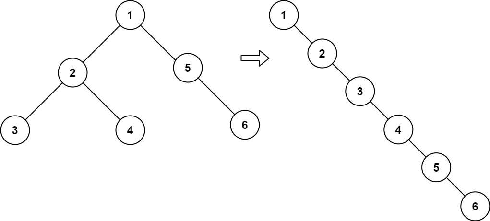

```text
输入：root = [1,2,5,3,4,null,6]
输出：[1,null,2,null,3,null,4,null,5,null,6]
```

**示例 2**

```text
输入：root = []
输出：[]
```

**示例 3**

```text
输入：root = [0]
输出：[0]
```
> ✅ **官方验证**：全部 TypeScript 解法已通过 leetcode.cn 官方示例用例验证（自动注入运行，全部 PASS）。题面与 [leetcode.cn 官方](https://leetcode.cn/problems/flatten-binary-tree-to-linked-list/)一致，示例配图取自官方题面。

**数据范围与注意事项**：

- 树中结点数在范围 `[0, 2000]` 内
- `-100 <= Node.val <= 100`
- 进阶：你可以使用原地算法（`O(1)` 额外空间）展开这棵树吗？
- **易错点**：递归出口（空节点）必须先写，否则直接空指针。

## 题目分析

**场景是什么**：树是分层数据的标准形态，这类题练的是递归分治与遍历序，对应真实开发里的目录树、组件树。本题就是该场景的 Medium 级练习，主线做法是「直接实现」。

**主线怎么解**：主解法结构简单：读入、处理、返回。

## 解题思路

**方案对比**（共 4 个方案，由浅入深）：

| 方案 | 时间复杂度 | 空间复杂度 |
|---|---|---|
| 方案 1 · 直接实现 | O(n) 量级 | O(n) |
| 方案 2 · 迭代指针处理 | O(n)（单趟线性扫描） | O(1) 到 O(n)（视辅助结构） |
| 方案 3 · 直接实现 | O(n) 量级 | O(n) |
| 方案 4 · 直接实现 | O(n) 量级 | O(n) |

**由浅入深的路径**：直接实现 → 迭代指针处理；每往右一步，都在补上一步的短板。

**方案间的取舍**：方案 1（直接实现）；方案 2（迭代指针处理）；方案 3（直接实现）；方案 4（直接实现）。数据规模小、可读性优先时选靠前的方案；规模大、性能优先时选靠后的方案。

**怎么读这一篇**：

- 🐣 **新手路线**：把「题目描述」的示例 1 在纸上手推一遍 → 读方案 1（最直观的写法）与它的代码走读 → 按「运行方式」本地跑通看 PASS → 回头对比方案 2 之后的写法差在哪
- 🦅 **大佬路线**：直接锁定最优方案 1（直接实现，O(n) 量级）→ 跳读该方案代码与走读 → 用「逐步拆解与面试追问」补齐复杂度推导与边界追问

### 动态算法图（DFS 点亮，GIF 自动循环）


动画演示二叉树专题里DFS 点亮的典型过程；每个方案在「TypeScript 解题方案」一节还配了专属动画与专属流程图。

### 主解法流程图（真实控制流）

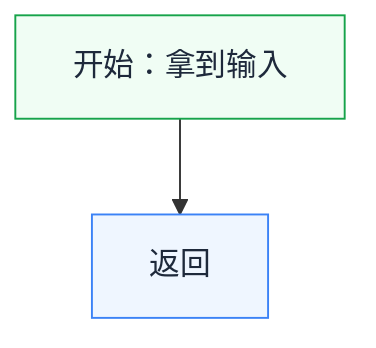

## TypeScript 解题方案（4 个方案逐个讲）

> **运行与提交**：每个方案都是自包含文件（内嵌用例自测，输出 PASS），整块复制到 `.ts` 文件后 `node 文件名` 即可运行。提交 LeetCode 时，把 `demo` 内的算法函数与辅助类型/函数整体取出、置于文件顶层即可。涉及交互/特殊接口的题以题面给定签名为准。

### 方案 1：直接实现

**分析与思路**：核心做法是「直接实现」。

**运行方式**：`node 本文件`，内嵌用例全部通过会输出 PASS。


**方案专属流程图**（真实控制流）：

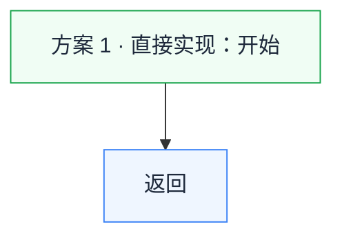

```typescript
export function demo(): void {
  // 程序入口：跑内嵌自测用例
  interface TreeNode {
    // 定义类型
    val: number; // 值: number;
    left: TreeNode | null; // 左边界: TreeNode 按位或 null;
    right: TreeNode | null; // 右边界: TreeNode 按位或 null;
  }
  function tn(val: number): TreeNode {
    // 定义函数/方法 tn
    return { val: val, left: null, right: null }; // 返回 { 值: 值, 左边界: null, 右边界: null }
  }
  // 忠实翻译 python build_tree（层序，null 表示空缺）
  function buildTree(vals: (number | null)[]): TreeNode | null {
    // 定义函数/方法 buildTree
    if (vals.length === 0) {
      // 若 vals.长度 全等于 0
      return null; // 返回 null
    }
    const root = tn(vals[0] as number); // 把 tn(vals[0] as number) 存入 根节点
    const q: TreeNode[] = [root]; // 把 [根节点]; 写入 const q: TreeNode[]
    let i = 1; // 把 1 存入 下标 i
    while (i < vals.length) {
      // 循环，直到不满足「下标 i 小于 vals.长度」
      const node = q.shift() as TreeNode; // 把 节点.shift() as TreeNode 存入 节点
      if (vals[i] !== null) {
        // 若 vals[下标 i] 不等于 null
        node.left = tn(vals[i] as number); // 把 tn(vals[下标 i] as number); 写入 左边界
        q.push(node.left); // 把 节点.左边界 压入栈/数组尾部
      }
      i += 1; // 下标 i累加 1
      if (i < vals.length) {
        // 若 下标 i 小于 vals.长度
        if (vals[i] !== null) {
          // 若 vals[下标 i] 不等于 null
          node.right = tn(vals[i] as number); // 把 tn(vals[下标 i] as number); 写入 右边界
          q.push(node.right); // 把 节点.右边界 压入栈/数组尾部
        }
        i += 1; // 下标 i累加 1
      }
    }
    return root; // 返回 根节点
  }
  // 忠实翻译 python solution_1：逆序 DFS（先右后左），把 right 串成链表并清空 left
  function flatten(root: TreeNode | null): TreeNode | null {
    // 定义函数/方法 flatten
    let prev: TreeNode | null = null; // 把 null; 写入 let prev: TreeNode | null
    function dfs(node: TreeNode | null): void {
      // 定义函数/方法 dfs
      if (node === null) {
        // 若 节点 全等于 null
        return; // return;
      }
      dfs(node.right); // dfs(节点.右边界);
      dfs(node.left); // dfs(节点.左边界);
      node.right = prev; // 把 前一个; 写入 右边界
      node.left = null; // 把 null; 写入 左边界
      prev = node; // 把 节点 存入 前一个
    }
    dfs(root); // dfs(根节点);
    return root; // 返回 根节点
  }
  function readChain(root: TreeNode | null): {
    vals: number[];
    allLeftNull: boolean;
  } {
    // 定义函数/方法 readChain
    const vals: number[] = []; // 把 []; 写入 const vals: number[]
    let allLeftNull = true; // 把 true 存入 allLeftNull
    let n = root; // 把 根节点 存入 元素个数
    while (n !== null) {
      // 循环，直到不满足「元素个数 不等于 null」
      vals.push(n.val); // 把 元素个数.值 压入栈/数组尾部
      if (n.left !== null) {
        // 若 元素个数.左边界 不等于 null
        allLeftNull = false; // 把 false 存入 allLeftNull
      }
      n = n.right; // 把 元素个数.右边界 存入 元素个数
    }
    return { vals: vals, allLeftNull: allLeftNull }; // 返回 { vals: vals, allLeftNull: allLeftNull }
  }
  function eqArr(a: number[], b: number[]): boolean {
    // 定义函数/方法 eqArr
    if (a.length !== b.length) {
      // 若 数组.长度 不等于 b.长度
      return false; // 返回 false
    }
    for (let i = 0; i < a.length; i++) {
      // 让 下标 i 从 0 开始计数，下标 i 小于 数组.长度 就继续
      if (a[i] !== b[i]) {
        // 若 数组[下标 i] 不等于 b[下标 i]
        return false; // 返回 false
      }
    }
    return true; // 返回 true
  }
  const cases: { vals: (number | null)[]; want: number[] }[] = [
    { vals: [1, 2, 5, 3, 4, null, 6], want: [1, 2, 3, 4, 5, 6] },
    { vals: [7], want: [7] },
    { vals: [], want: [] },
  ];
  let fail = false; // 把 false 存入 fail
  for (const c of cases) {
    // for (const 字符 of cases) {
    const root = buildTree(c.vals); // 把 buildTree(字符.vals) 存入 根节点
    const out = readChain(flatten(root)); // 把 readChain(flatten(根节点)) 存入 out
    if (!eqArr(out.vals, c.want) || !out.allLeftNull) {
      // 若 取反 eqArr(out.vals, 字符.want) 或 取反 out.allLeftNull
      fail = true; // 把 true 存入 fail
      console.log(
        'FAIL flatten(' +
          JSON.stringify(c.vals) +
          ')=' +
          JSON.stringify(out.vals) +
          ' want ' +
          JSON.stringify(c.want) +
          ' allLeftNull=' +
          out.allLeftNull,
      ); // 打印输出
    }
  }
  if (fail) {
    // 若 fail
    throw new Error('FAILED'); // throw new Error(「FAILED」);
  }
  console.log('PASS'); // 全部用例通过，输出 PASS
}
demo(); // demo();
```

### 方案 2：迭代指针处理

**分析与思路**：核心做法是「迭代指针处理」。代码里依次做这些事：队列或堆的调度。

**运行方式**：`node 本文件`，内嵌用例全部通过会输出 PASS。


**方案专属流程图**（真实控制流）：

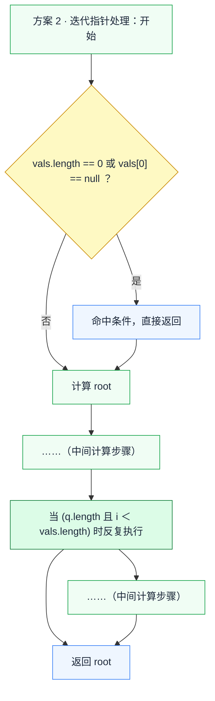

```typescript
export function demo(): void {
  // 程序入口：跑内嵌自测用例
  class TreeNode {
    val: number;
    left: TreeNode | null;
    right: TreeNode | null;
    constructor(v = 0, l: TreeNode | null = null, r: TreeNode | null = null) {
      this.val = v;
      this.left = l;
      this.right = r;
    }
  } // 定义类型
  function buildTree(vals: (number | null)[]): TreeNode | null {
    // 定义函数/方法 buildTree
    if (vals.length === 0 || vals[0] === null) return null; // 若 vals.长度 全等于 0 或 vals[0] 全等于 null，直接返回 null
    const root = new TreeNode(vals[0] as number);
    const q: TreeNode[] = [root];
    let i = 1;
    while (q.length && i < vals.length) {
      const node = q.shift()!;
      if (i < vals.length && vals[i] !== null) {
        node.left = new TreeNode(vals[i] as number);
        q.push(node.left);
      }
      i++;
      if (i < vals.length && vals[i] !== null) {
        node.right = new TreeNode(vals[i] as number);
        q.push(node.right);
      }
      i++;
    }
    return root; // 返回 根节点
  }
  function levelList(root: TreeNode | null): number[][] {
    if (!root) return [];
    const res: number[][] = [];
    let q: TreeNode[] = [root];
    while (q.length) {
      const lvl: number[] = [];
      const n = q.length;
      for (let k = 0; k < n; k++) {
        const node = q.shift()!;
        lvl.push(node.val);
        if (node.left) q.push(node.left);
        if (node.right) q.push(node.right);
      }
      res.push(lvl);
    }
    return res;
  } // 定义函数/方法 levelList
  function sameTree(a: TreeNode | null, b: TreeNode | null): boolean {
    if (!a && !b) return true;
    if (!a || !b) return false;
    if (a.val !== b.val) return false;
    return sameTree(a.left, b.left) && sameTree(a.right, b.right);
  } // 定义函数/方法 sameTree
  function inorderT(root: TreeNode | null): number[] {
    if (!root) return [];
    return [...inorderT(root.left), root.val, ...inorderT(root.right)];
  } // 定义函数/方法 inorderT
  function flatten(root: TreeNode | null): void {
    let prev: TreeNode | null = null;
    function dfs(n: TreeNode | null) {
      if (!n) return;
      dfs(n.right);
      dfs(n.left);
      n.right = prev;
      n.left = null;
      prev = n;
    }
    dfs(root);
  } // 定义函数/方法 flatten
  function rightArr(r: TreeNode | null): number[] {
    const a: number[] = [];
    while (r) {
      a.push(r.val);
      r = r.right;
    }
    return a;
  } // 定义函数/方法 rightArr
  const t = buildTree([1, 2, 5, 3, 4, null, 6]);
  flatten(t); // 把 buildTree([1,2,5,3,4,null,6]); flatten(另一字符串) 存入 另一字符串
  if (JSON.stringify(rightArr(t)) !== JSON.stringify([1, 2, 3, 4, 5, 6])) {
    console.log('FAIL');
    throw new Error('FAILED');
  }
  console.log('PASS'); // 全部用例通过，输出 PASS
}
demo(); // demo();
```

### 方案 3：直接实现

**分析与思路**：核心做法是「直接实现」。

**运行方式**：`node 本文件`，内嵌用例全部通过会输出 PASS。


**方案专属流程图**（真实控制流）：


```typescript
export function demo(): void {
  // 程序入口：跑内嵌自测用例
  interface TreeNode {
    // 定义类型
    val: number; // 值: number;
    left: TreeNode | null; // 左边界: TreeNode 按位或 null;
    right: TreeNode | null; // 右边界: TreeNode 按位或 null;
  }
  function tn(val: number): TreeNode {
    // 定义函数/方法 tn
    return { val: val, left: null, right: null }; // 返回 { 值: 值, 左边界: null, 右边界: null }
  }
  // 忠实翻译 python build_tree（层序，null 表示空缺）
  function buildTree(vals: (number | null)[]): TreeNode | null {
    // 定义函数/方法 buildTree
    if (vals.length === 0) {
      // 若 vals.长度 全等于 0
      return null; // 返回 null
    }
    const root = tn(vals[0] as number); // 把 tn(vals[0] as number) 存入 根节点
    const q: TreeNode[] = [root]; // 把 [根节点]; 写入 const q: TreeNode[]
    let i = 1; // 把 1 存入 下标 i
    while (i < vals.length) {
      // 循环，直到不满足「下标 i 小于 vals.长度」
      const node = q.shift() as TreeNode; // 把 节点.shift() as TreeNode 存入 节点
      if (vals[i] !== null) {
        // 若 vals[下标 i] 不等于 null
        node.left = tn(vals[i] as number); // 把 tn(vals[下标 i] as number); 写入 左边界
        q.push(node.left); // 把 节点.左边界 压入栈/数组尾部
      }
      i += 1; // 下标 i累加 1
      if (i < vals.length) {
        // 若 下标 i 小于 vals.长度
        if (vals[i] !== null) {
          // 若 vals[下标 i] 不等于 null
          node.right = tn(vals[i] as number); // 把 tn(vals[下标 i] as number); 写入 右边界
          q.push(node.right); // 把 节点.右边界 压入栈/数组尾部
        }
        i += 1; // 下标 i累加 1
      }
    }
    return root; // 返回 根节点
  }
  // 忠实翻译 python solution_3：显式栈前序展开
  function flatten(root: TreeNode | null): TreeNode | null {
    // 定义函数/方法 flatten
    if (root === null) {
      // 若 根节点 全等于 null
      return root; // 返回 根节点
    }
    const stack: TreeNode[] = [root]; // 把 [根节点]; 写入 const stack: TreeNode[]
    let prev: TreeNode | null = null; // 把 null; 写入 let prev: TreeNode | null
    while (stack.length > 0) {
      // 循环，直到不满足「栈.长度 超过 0」
      const curr = stack.pop() as TreeNode; // 把 栈 弹出 ) as TreeNode 存入 当前值
      if (prev !== null) {
        // 若 前一个 不等于 null
        prev.left = null; // 把 null; 写入 左边界
        prev.right = curr; // 把 当前值; 写入 右边界
      }
      const left = curr.left; // 把 当前值.左边界 存入 左边界
      const right = curr.right; // 把 当前值.右边界 存入 右边界
      if (right !== null) {
        // 若 右边界 不等于 null
        stack.push(right); // 把 右边界 压入栈/数组尾部
      }
      if (left !== null) {
        // 若 左边界 不等于 null
        stack.push(left); // 把 左边界 压入栈/数组尾部
      }
      prev = curr; // 把 当前值 存入 前一个
    }
    return root; // 返回 根节点
  }
  function readChain(root: TreeNode | null): {
    vals: number[];
    allLeftNull: boolean;
  } {
    // 定义函数/方法 readChain
    const vals: number[] = []; // 把 []; 写入 const vals: number[]
    let allLeftNull = true; // 把 true 存入 allLeftNull
    let n = root; // 把 根节点 存入 元素个数
    while (n !== null) {
      // 循环，直到不满足「元素个数 不等于 null」
      vals.push(n.val); // 把 元素个数.值 压入栈/数组尾部
      if (n.left !== null) {
        // 若 元素个数.左边界 不等于 null
        allLeftNull = false; // 把 false 存入 allLeftNull
      }
      n = n.right; // 把 元素个数.右边界 存入 元素个数
    }
    return { vals: vals, allLeftNull: allLeftNull }; // 返回 { vals: vals, allLeftNull: allLeftNull }
  }
  function eqArr(a: number[], b: number[]): boolean {
    // 定义函数/方法 eqArr
    if (a.length !== b.length) {
      // 若 数组.长度 不等于 b.长度
      return false; // 返回 false
    }
    for (let i = 0; i < a.length; i++) {
      // 让 下标 i 从 0 开始计数，下标 i 小于 数组.长度 就继续
      if (a[i] !== b[i]) {
        // 若 数组[下标 i] 不等于 b[下标 i]
        return false; // 返回 false
      }
    }
    return true; // 返回 true
  }
  const cases: { vals: (number | null)[]; want: number[] }[] = [
    { vals: [1, 2, 5, 3, 4, null, 6], want: [1, 2, 3, 4, 5, 6] },
    { vals: [7], want: [7] },
    { vals: [], want: [] },
  ];
  let fail = false; // 把 false 存入 fail
  for (const c of cases) {
    // for (const 字符 of cases) {
    const root = buildTree(c.vals); // 把 buildTree(字符.vals) 存入 根节点
    const out = readChain(flatten(root)); // 把 readChain(flatten(根节点)) 存入 out
    if (!eqArr(out.vals, c.want) || !out.allLeftNull) {
      // 若 取反 eqArr(out.vals, 字符.want) 或 取反 out.allLeftNull
      fail = true; // 把 true 存入 fail
      console.log(
        'FAIL flatten(' +
          JSON.stringify(c.vals) +
          ')=' +
          JSON.stringify(out.vals) +
          ' want ' +
          JSON.stringify(c.want) +
          ' allLeftNull=' +
          out.allLeftNull,
      ); // 打印输出
    }
  }
  if (fail) {
    // 若 fail
    throw new Error('FAILED'); // throw new Error(「FAILED」);
  }
  console.log('PASS'); // 全部用例通过，输出 PASS
}
demo(); // demo();
```

### 方案 4：直接实现

**分析与思路**：核心做法是「直接实现」。

**运行方式**：`node 本文件`，内嵌用例全部通过会输出 PASS。


**方案专属流程图**（真实控制流）：

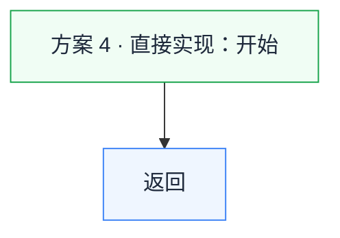

```typescript
export function demo(): void {
  // 程序入口：跑内嵌自测用例
  interface TreeNode {
    // 定义类型
    val: number; // 值: number;
    left: TreeNode | null; // 左边界: TreeNode 按位或 null;
    right: TreeNode | null; // 右边界: TreeNode 按位或 null;
  }
  function tn(val: number): TreeNode {
    // 定义函数/方法 tn
    return { val: val, left: null, right: null }; // 返回 { 值: 值, 左边界: null, 右边界: null }
  }
  // 忠实翻译 python build_tree（层序，null 表示空缺）
  function buildTree(vals: (number | null)[]): TreeNode | null {
    // 定义函数/方法 buildTree
    if (vals.length === 0) {
      // 若 vals.长度 全等于 0
      return null; // 返回 null
    }
    const root = tn(vals[0] as number); // 把 tn(vals[0] as number) 存入 根节点
    const q: TreeNode[] = [root]; // 把 [根节点]; 写入 const q: TreeNode[]
    let i = 1; // 把 1 存入 下标 i
    while (i < vals.length) {
      // 循环，直到不满足「下标 i 小于 vals.长度」
      const node = q.shift() as TreeNode; // 把 节点.shift() as TreeNode 存入 节点
      if (vals[i] !== null) {
        // 若 vals[下标 i] 不等于 null
        node.left = tn(vals[i] as number); // 把 tn(vals[下标 i] as number); 写入 左边界
        q.push(node.left); // 把 节点.左边界 压入栈/数组尾部
      }
      i += 1; // 下标 i累加 1
      if (i < vals.length) {
        // 若 下标 i 小于 vals.长度
        if (vals[i] !== null) {
          // 若 vals[下标 i] 不等于 null
          node.right = tn(vals[i] as number); // 把 tn(vals[下标 i] as number); 写入 右边界
          q.push(node.right); // 把 节点.右边界 压入栈/数组尾部
        }
        i += 1; // 下标 i累加 1
      }
    }
    return root; // 返回 根节点
  }
  // 忠实翻译 python solution_4：原地把左子树最右节点接到当前 right 之后，清空 left，沿 right 前进
  function flatten(root: TreeNode | null): TreeNode | null {
    // 定义函数/方法 flatten
    let curr = root; // 把 根节点 存入 当前值
    while (curr !== null) {
      // 循环，直到不满足「当前值 不等于 null」
      if (curr.left !== null) {
        // 若 当前值.左边界 不等于 null
        const next = curr.left; // 把 当前值.左边界 存入 下一个
        let predecessor = next; // 把 下一个 存入 predecessor
        while (predecessor.right !== null) {
          // 循环，直到不满足「predecessor.右边界 不等于 null」
          predecessor = predecessor.right; // 把 predecessor.右边界 存入 predecessor
        }
        predecessor.right = curr.right; // 把 当前值.右边界; 写入 右边界
        curr.left = null; // 把 null; 写入 左边界
        curr.right = next; // 把 下一个; 写入 右边界
      }
      curr = curr.right; // 把 当前值.右边界 存入 当前值
    }
    return root; // 返回 根节点
  }
  function readChain(root: TreeNode | null): {
    vals: number[];
    allLeftNull: boolean;
  } {
    // 定义函数/方法 readChain
    const vals: number[] = []; // 把 []; 写入 const vals: number[]
    let allLeftNull = true; // 把 true 存入 allLeftNull
    let n = root; // 把 根节点 存入 元素个数
    while (n !== null) {
      // 循环，直到不满足「元素个数 不等于 null」
      vals.push(n.val); // 把 元素个数.值 压入栈/数组尾部
      if (n.left !== null) {
        // 若 元素个数.左边界 不等于 null
        allLeftNull = false; // 把 false 存入 allLeftNull
      }
      n = n.right; // 把 元素个数.右边界 存入 元素个数
    }
    return { vals: vals, allLeftNull: allLeftNull }; // 返回 { vals: vals, allLeftNull: allLeftNull }
  }
  function eqArr(a: number[], b: number[]): boolean {
    // 定义函数/方法 eqArr
    if (a.length !== b.length) {
      // 若 数组.长度 不等于 b.长度
      return false; // 返回 false
    }
    for (let i = 0; i < a.length; i++) {
      // 让 下标 i 从 0 开始计数，下标 i 小于 数组.长度 就继续
      if (a[i] !== b[i]) {
        // 若 数组[下标 i] 不等于 b[下标 i]
        return false; // 返回 false
      }
    }
    return true; // 返回 true
  }
  const cases: { vals: (number | null)[]; want: number[] }[] = [
    { vals: [1, 2, 5, 3, 4, null, 6], want: [1, 2, 3, 4, 5, 6] },
    { vals: [7], want: [7] },
    { vals: [], want: [] },
  ];
  let fail = false; // 把 false 存入 fail
  for (const c of cases) {
    // for (const 字符 of cases) {
    const root = buildTree(c.vals); // 把 buildTree(字符.vals) 存入 根节点
    const out = readChain(flatten(root)); // 把 readChain(flatten(根节点)) 存入 out
    if (!eqArr(out.vals, c.want) || !out.allLeftNull) {
      // 若 取反 eqArr(out.vals, 字符.want) 或 取反 out.allLeftNull
      fail = true; // 把 true 存入 fail
      console.log(
        'FAIL flatten(' +
          JSON.stringify(c.vals) +
          ')=' +
          JSON.stringify(out.vals) +
          ' want ' +
          JSON.stringify(c.want) +
          ' allLeftNull=' +
          out.allLeftNull,
      ); // 打印输出
    }
  }
  if (fail) {
    // 若 fail
    throw new Error('FAILED'); // throw new Error(「FAILED」);
  }
  console.log('PASS'); // 全部用例通过，输出 PASS
}
demo(); // demo();
```

## 逐步拆解与面试追问

**复杂度**：时间 O(n) 量级，空间 O(n)

**为什么是这个量级**：整体只对数据做有限趟处理

**面试官可能会追问**：

- 递归和迭代写法各自的空间开销？
- 能否用层序统一处理？
- 空节点的边界如何约定？

## 关键 API 速查（TS 主解法实际用到，附官方链接）

| API | 作用 | 使用要点 | 官方文档 |
|---|---|---|---|
| `Array.prototype.push()` | 尾部追加 | 返回新长度；可一次多个；均摊 O(1)；会改变原数组 | [官方文档](https://developer.mozilla.org/zh-CN/docs/Web/JavaScript/Reference/Global_Objects/Array/push) |
| `Array.prototype.shift()` | 头部取出 | O(n)（后续元素整体前移）；大量头部操作请用链表或双端结构 | [官方文档](https://developer.mozilla.org/zh-CN/docs/Web/JavaScript/Reference/Global_Objects/Array/shift) |
| `JSON.stringify()` | 序列化为 JSON 字符串 | 常用于结构化比较（深度相等判定）；undefined/函数/循环引用会被丢弃或抛错 | [官方文档](https://developer.mozilla.org/zh-CN/docs/Web/JavaScript/Reference/Global_Objects/JSON/stringify) |

### 各语言官方文档导航

- **TypeScript / JS**：[MDN 中文参考](https://developer.mozilla.org/zh-CN/)
- **Python**：[Python 官方文档](https://docs.python.org/zh-cn/3/)
- **Go**：[Go 标准库](https://pkg.go.dev/std)
- **Java**：[JDK 17 API](https://docs.oracle.com/en/java/javase/17/docs/api/)
- **Rust**：[Rust 标准库](https://doc.rust-lang.org/std/)
- **Lua**：[Lua 5.4 手册](https://www.lua.org/manual/5.4/)
- **C**：[Cppreference C](https://zh.cppreference.com/w/c)
- **C++**：[Cppreference C++](https://zh.cppreference.com/w/cpp)
- **R**：[R 官方手册](https://stat.ethz.ch/R-manual/)
- **Zig**：[Zig 语言文档](https://ziglang.org/documentation/master/)
- **Dart**：[Dart API](https://api.dart.dev/)

## 附录：其他 10 种语言全部实现（每种语言列举其全部方案）

> TypeScript 的全部方案见「TypeScript 解题方案」一节；下面是其余 10 种语言的对应实现，每种语言的每个方案都带思路分析、代码走读与专属运行架构图。
> 每个方案都内嵌用例自测，可独立运行（老仓库 python/go 文件遵循「打印结果」约定）。
> 完整解法文件见 `dsa/<语言>/tree/lc_114_二叉树展开为链表/`。

### Python 实现（4 种方案）

Python 的全部方案如下，每个方案都内嵌用例自测，可独立运行（老仓库 python/go 文件遵循「打印结果」约定）：

#### 方案 1：直接实现

**思路与代码分析**：核心是「直接实现」。Python 版用切片与字典推导式简化操作，突出可读性。**走读**：方案 1 · 直接实现：开始 → 更新 prev → 命中条件，直接返回 → 调用 dfs(node.right) → 调用 dfs(node.left) → 更新 node.right → 更新 node.left → 更新 prev[0] → 调用 dfs(root) → 返回 root。

**运行架构**（真实控制流）：

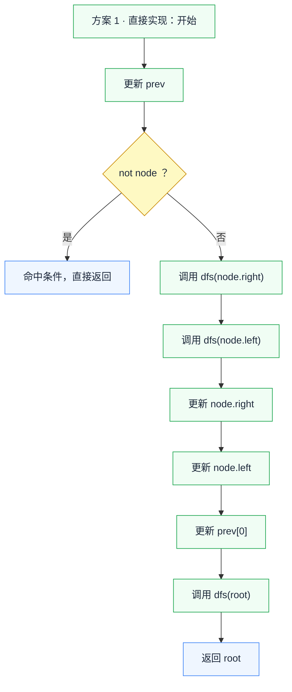

```python
import sys  # 提高递归深度上限（深输入防 RecursionError）

sys.setrecursionlimit(200000)  # 树/链表类题目节点数可达 1e4 量级

class TreeNode:  # 定义类
    def __init__(self, val=0, left=None, right=None):  # 构造函数：初始化成员
        self.val = val  # 把 值 写入 值
        self.left = left  # 把 左边界 写入 左边界
        self.right = right  # 把 右边界 写入 右边界

def flatten(root):  # 定义函数 flatten（参数：根节点）
    prev = [None]  # 把 [None] 存入 前一个

    def dfs(node):  # 定义函数 dfs（参数：节点）
        if not node:  # 若 not 节点
            return  # return
        dfs(node.right)  # dfs(节点.右边界)
        dfs(node.left)  # dfs(节点.左边界)
        node.right = prev[0]  # 把 前一个[0] 写入 右边界
        node.left = None  # 把 None 写入 左边界
        prev[0] = node  # 把 节点 写入 prev[0]

    dfs(root)  # dfs(根节点)
    return root  # 返回 根节点

def build_tree(vals):  # 定义函数 build_tree（参数：vals）
    if not vals:  # 若 not vals
        return None  # 返回 None
    root = TreeNode(vals[0])  # 把 TreeNode(vals[0]) 存入 根节点
    q = [root]  # 把 [根节点] 存入 节点
    i = 1  # 把 1 存入 下标 i
    while i < len(vals):  # 循环，直到不满足「下标 i 小于 长度(vals」
        node = q.pop(0)  # 把 节点 弹出 0) 存入 节点
        if vals[i] is not None:  # 若 vals[下标 i] is not None
            node.left = TreeNode(vals[i])  # 把 TreeNode(vals[下标 i]) 写入 左边界
            q.append(node.left)  # 把 节点.左边界 追加到列表尾部
        i += 1  # 下标 i累加 1
        if i < len(vals):  # 若 下标 i 小于 长度(vals
            if vals[i] is not None:  # 若 vals[下标 i] is not None
                node.right = TreeNode(vals[i])  # 把 TreeNode(vals[下标 i]) 写入 右边界
                q.append(node.right)  # 把 节点.右边界 追加到列表尾部
            i += 1  # 下标 i累加 1
    return root  # 返回 根节点

def right_list(node):  # 定义函数 right_list（参数：节点）
    res = []  # 把 [] 存入 结果
    while node:  # 循环，直到不满足「节点」
        res.append(node.val)  # 把 节点.值 追加到列表尾部
        node = node.right  # 把 节点.右边界 存入 节点
    return res  # 返回 结果

if __name__ == "__main__":  # 若 __name__ 等于 '__main__'
    root = build_tree([1, 2, 5, 3, 4, None, 6])  # 把 build_tree([1, 2, 5, 3, 4, None, 6]) 存入 根节点
    flatten(root)  # flatten(根节点)
    print(right_list(root))  # 打印输出
```

#### 方案 2：迭代指针处理

**思路与代码分析**：核心是「迭代指针处理」。Python 版用切片与字典推导式简化操作，突出可读性。**走读**：方案 2 · 迭代指针处理：开始 → 更新 list → 当 node ≠ None or len(stack): 时反复执行 → 当 node ≠ None: 时反复执行 → 循环 i：从 1 到 size 前 → 返回结果。

**运行架构**（真实控制流）：

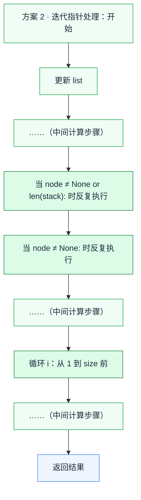

```python
import sys  # 提高递归深度上限（深输入防 RecursionError）

sys.setrecursionlimit(200000)  # 树/链表类题目节点数可达 1e4 量级

def flatten(root):  # 定义函数 flatten（参数：根节点）
    list = []  # 把 [] 存入 列表
    stack = []  # 把 [] 存入 栈
    node = root  # 把 根节点 存入 节点
    while node != None or len(stack):  # 循环，直到不满足「节点 不等于 None or 长度(栈」
        while node != None:  # 循环，直到不满足「节点 不等于 None」
            list.append(node)  # 把 节点 追加到列表尾部
            stack.append(node)  # 把 节点 追加到列表尾部
            node = node.left  # 把 节点.左边界 存入 节点
        node = stack.pop()  # 把 栈 弹出 ) 存入 节点
        node = node.right  # 把 节点.右边界 存入 节点
    size = len(list)  # 把 长度(列表) 存入 大小
    for i in range(1, size):  # 让 下标 i 从 1 到 大小 遍历
        prev = list[i - 1], curr = list[i]  # 把 列表[下标 i 减 1], 当前值 赋值为 列表[下标 i] 存入 前一个
        prev.left = None  # 把 None 写入 左边界
        prev.right = curr  # 把 当前值 写入 右边界

if __name__ == "__main__":  # 若 __name__ 等于 '__main__'
    print(flatten(None))  # 打印输出
```

#### 方案 3：直接实现

**思路与代码分析**：核心是「直接实现」。Python 版用切片与字典推导式简化操作，突出可读性。**走读**：方案 3 · 直接实现：开始 → 命中条件，直接返回 → 更新 stack → 当 len(stack): 时反复执行。

**运行架构**（真实控制流）：

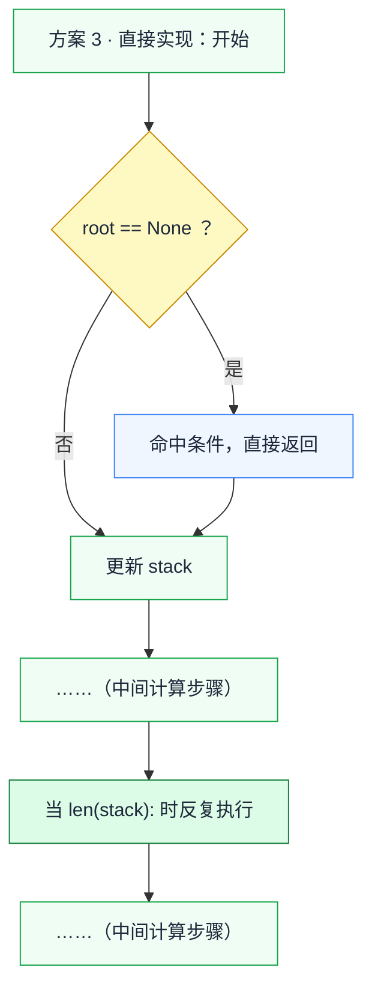

```python
import sys  # 提高递归深度上限（深输入防 RecursionError）

sys.setrecursionlimit(200000)  # 树/链表类题目节点数可达 1e4 量级

def flatten(root):  # 定义函数 flatten（参数：根节点）
    if root == None:
        return  # 若 根节点 等于 None: return
    stack = []  # 把 [] 存入 栈
    stack.append(root)  # 把 根节点 追加到列表尾部
    prev = None  # 把 None 存入 前一个
    while len(stack):  # 循环，直到不满足「长度(栈」
        curr = stack.pop()  # 把 栈 弹出 ) 存入 当前值
        if prev != None:  # 若 前一个 不等于 None
            prev.left = None  # 把 None 写入 左边界
            prev.right = curr  # 把 当前值 写入 右边界
        left = curr.left, right = curr.right  # 把 当前值.左边界, 右边界 赋值为 当前值.右边界 存入 左边界
        if right != None:
            stack.append(right)  # 若 右边界 不等于 None: 栈 追加 右边界
        if left != None:
            stack.append(left)  # 若 左边界 不等于 None: 栈 追加 左边界
        prev = curr  # 把 当前值 存入 前一个

if __name__ == "__main__":  # 若 __name__ 等于 '__main__'
    print(flatten(None))  # 打印输出
```

#### 方案 4：直接实现

**思路与代码分析**：核心是「直接实现」。Python 版用切片与字典推导式简化操作，突出可读性。**走读**：方案 4 · 直接实现：开始 → 更新 curr → 当 curr ≠ None: 时反复执行 → 若 curr.left ≠ None：更新 next → 更新 next → 更新 predecessor → 当 predecessor.right ≠ None: 时反复执行 → 更新 predecessor → 更新 predecessor.right → 更新 curr.left → 更新 curr.right → 更新 curr → 返回结果。

**运行架构**（真实控制流）：

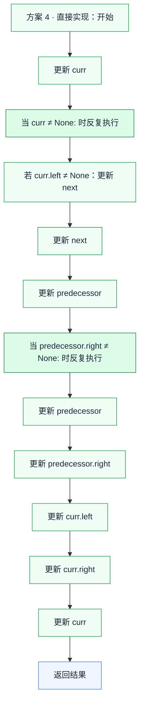

```python
import sys  # 提高递归深度上限（深输入防 RecursionError）

sys.setrecursionlimit(200000)  # 树/链表类题目节点数可达 1e4 量级

def flatten(root):  # 定义函数 flatten（参数：根节点）
    curr = root  # 把 根节点 存入 当前值
    while curr != None:  # 循环，直到不满足「当前值 不等于 None」
        if curr.left != None:  # 若 当前值.左边界 不等于 None
            next = curr.left  # 把 当前值.左边界 存入 下一个
            predecessor = next  # 把 下一个 存入 predecessor
            while predecessor.right != None:  # 循环，直到不满足「predecessor.右边界 不等于 None」
                predecessor = predecessor.right  # 把 predecessor.右边界 存入 predecessor
            predecessor.right = curr.right  # 把 当前值.右边界 写入 右边界
            curr.left = None  # 把 None 写入 左边界
            curr.right = next  # 把 下一个 写入 右边界
        curr = curr.right  # 把 当前值.右边界 存入 当前值

if __name__ == "__main__":  # 若 __name__ 等于 '__main__'
    print(flatten(None))  # 打印输出
```

### Go 实现（4 种方案）

Go 的全部方案如下，每个方案都内嵌用例自测，可独立运行（老仓库 python/go 文件遵循「打印结果」约定）：

#### 方案 1：直接实现

**思路与代码分析**：核心是「直接实现」。Go 版用切片与多返回值惯用法，显式处理索引边界。**走读**：方案 1 · 直接实现：开始 → 计算 prev → 计算 dfs → 更新 dfs → 处理 if node == nil → 返回  → 调用 dfs(node.Right) → 调用 dfs(node.Left) → 更新 node.Right → 更新 node.Left → 更新 prev → 调用 dfs(root)。

**运行架构**（真实控制流）：

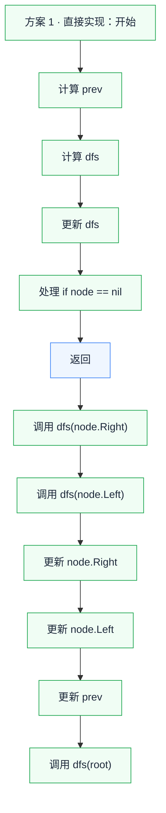

```go
package main // 引入依赖

import (
	"fmt"
	"os"
	"reflect"
) // 引入依赖

type TreeNode struct { // 定义类型
	Val   int       // Val int
	Left  *TreeNode // Left 乘 TreeNode
	Right *TreeNode // Right 乘 TreeNode
}

func flatten(root *TreeNode) { // 定义函数/方法 flatten
	var prev *TreeNode           // var 前一个 乘 TreeNode
	var dfs func(node *TreeNode) // var dfs func(节点 乘 TreeNode)
	dfs = func(node *TreeNode) { // 把 func(节点 乘 TreeNode) { 写入 dfs
		if node == nil { // 若 节点 等于 nil
			return // return
		}
		dfs(node.Right)   // dfs(节点.Right)
		dfs(node.Left)    // dfs(节点.Left)
		node.Right = prev // 把 前一个 写入 node.Right
		node.Left = nil   // 把 nil 写入 node.Left
		prev = node       // 把 节点 写入 前一个
	}
	dfs(root) // dfs(根节点)
}

func toList(root *TreeNode) []int { // 定义函数/方法 toList
	res := []int{}    // 把 []int{} 写入 res :
	for root != nil { // 把 nil { 写入 for root !
		res = append(res, root.Val) // 把 append(结果, 根节点.Val) 写入 结果
		root = root.Right           // 把 根节点.Right 写入 根节点
	}
	return res // 返回 结果
}

func buildTree(vals []int) *TreeNode { // 定义函数/方法 buildTree
	if len(vals) == 0 || vals[0] == -1 { // 若 长度(vals) 等于 0 或 vals[0] 等于 减 1
		return nil // 返回 nil
	}
	root := &TreeNode{Val: vals[0]} // 把 按位与 TreeNode{Val: vals[0]} 写入 root :
	q := []*TreeNode{root}          // 把 [] 乘 TreeNode{根节点} 写入 q :
	i := 1                          // 把 1 写入 i :
	for i < len(vals) {             // for 下标 i 小于 长度(vals) {
		node := q[0]                        // 把 节点[0] 写入 node :
		q = q[1:]                           // 把 节点[1:] 写入 节点
		if i < len(vals) && vals[i] != -1 { // 若 下标 i 小于 长度(vals) 且 vals[下标 i] 不等于 减 1
			node.Left = &TreeNode{Val: vals[i]} // 把 按位与 TreeNode{Val: vals[下标 i]} 写入 node.Left
			q = append(q, node.Left)            // 把 append(节点, 节点.Left) 写入 节点
		}
		i++                                 // 下标 i 加一
		if i < len(vals) && vals[i] != -1 { // 若 下标 i 小于 长度(vals) 且 vals[下标 i] 不等于 减 1
			node.Right = &TreeNode{Val: vals[i]} // 把 按位与 TreeNode{Val: vals[下标 i]} 写入 node.Right
			q = append(q, node.Right)            // 把 append(节点, 节点.Right) 写入 节点
		}
		i++ // 下标 i 加一
	}
	return root // 返回 根节点
}

func main() { // 程序入口：跑内嵌自测用例
	root := buildTree([]int{1, 2, 5, 3, 4, -1, 6}) // 把 buildTree([]int{1, 2, 5, 3, 4, 减 1, 6}) 写入 root :
	flatten(root)                                  // flatten(根节点)
	got := toList(root)                            // 把 toList(根节点) 写入 got :
	want := []int{1, 2, 3, 4, 5, 6}                // 把 []int{1, 2, 3, 4, 5, 6} 写入 want :
	if !reflect.DeepEqual(got, want) {             // 若 取反 reflect.DeepEqual(got, want
		fmt.Printf("FAIL got=%v want=%v\n", got, want) // 打印输出
		os.Exit(1)                                     // os.Exit(1)
	}
	fmt.Println("PASS") // 全部用例通过，输出 PASS
}
```

#### 方案 2：迭代指针处理

**思路与代码分析**：核心是「迭代指针处理」。Go 版用切片与多返回值惯用法，显式处理索引边界。**走读**：方案 2 · 迭代指针处理：开始 → 更新 : → 遍历循环 → 遍历循环 → 遍历循环 → 返回 list[0] → 返回 nil。

**运行架构**（真实控制流）：

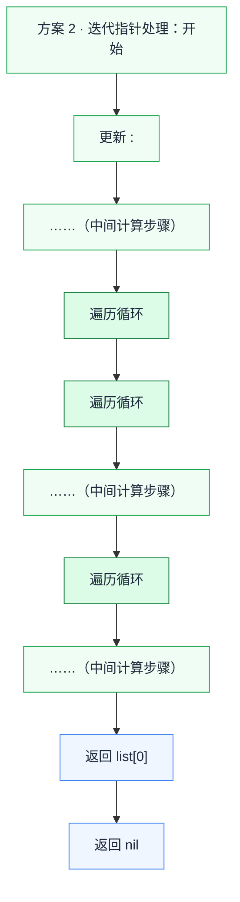

```go
package main // 引入依赖

import (
	"fmt"
	"os"
	"reflect"
) // 引入依赖

type TreeNode struct { // 定义类型
	Val   int       // Val int
	Left  *TreeNode // Left 乘 TreeNode
	Right *TreeNode // Right 乘 TreeNode
}

func flatten(root *TreeNode) *TreeNode { // 定义函数/方法 flatten
	list := []*TreeNode{}               // 把 [] 乘 TreeNode{} 写入 list :
	stack := []*TreeNode{}              // 把 [] 乘 TreeNode{} 写入 stack :
	node := root                        // 把 根节点 写入 node :
	for node != nil || len(stack) > 0 { // 把 nil 或 长度(栈) 超过 0 { 写入 for node !
		for node != nil { // 把 nil { 写入 for node !
			list = append(list, node)   // 把 append(列表, 节点) 写入 列表
			stack = append(stack, node) // 把 append(栈, 节点) 写入 栈
			node = node.Left            // 把 节点.Left 写入 节点
		}
		node = stack[len(stack)-1]   // 把 栈[长度(栈) 减 1] 写入 节点
		stack = stack[:len(stack)-1] // 把 栈[:长度(栈) 减 1] 写入 栈
		node = node.Right            // 把 节点.Right 写入 节点
	}
	size := len(list)           // 把 长度(列表) 写入 size :
	for i := 1; i < size; i++ { // 让 下标 i 从 1 开始计数
		prev := list[i-1] // 把 列表[下标 i 减 1] 写入 prev :
		curr := list[i]   // 把 列表[下标 i] 写入 curr :
		prev.Left = nil   // 把 nil 写入 prev.Left
		prev.Right = curr // 把 当前值 写入 prev.Right
	}
	if size > 0 { // 若 大小 超过 0
		return list[0] // 返回 列表[0]
	}
	return nil // 返回 nil
}

func toList(root *TreeNode) []int { // 定义函数/方法 toList
	res := []int{}    // 把 []int{} 写入 res :
	for root != nil { // 把 nil { 写入 for root !
		res = append(res, root.Val) // 把 append(结果, 根节点.Val) 写入 结果
		root = root.Right           // 把 根节点.Right 写入 根节点
	}
	return res // 返回 结果
}

func buildTree(vals []int) *TreeNode { // 定义函数/方法 buildTree
	if len(vals) == 0 || vals[0] == -1 { // 若 长度(vals) 等于 0 或 vals[0] 等于 减 1
		return nil // 返回 nil
	}
	root := &TreeNode{Val: vals[0]} // 把 按位与 TreeNode{Val: vals[0]} 写入 root :
	q := []*TreeNode{root}          // 把 [] 乘 TreeNode{根节点} 写入 q :
	i := 1                          // 把 1 写入 i :
	for i < len(vals) {             // for 下标 i 小于 长度(vals) {
		node := q[0]                        // 把 节点[0] 写入 node :
		q = q[1:]                           // 把 节点[1:] 写入 节点
		if i < len(vals) && vals[i] != -1 { // 若 下标 i 小于 长度(vals) 且 vals[下标 i] 不等于 减 1
			node.Left = &TreeNode{Val: vals[i]} // 把 按位与 TreeNode{Val: vals[下标 i]} 写入 node.Left
			q = append(q, node.Left)            // 把 append(节点, 节点.Left) 写入 节点
		}
		i++                                 // 下标 i 加一
		if i < len(vals) && vals[i] != -1 { // 若 下标 i 小于 长度(vals) 且 vals[下标 i] 不等于 减 1
			node.Right = &TreeNode{Val: vals[i]} // 把 按位与 TreeNode{Val: vals[下标 i]} 写入 node.Right
			q = append(q, node.Right)            // 把 append(节点, 节点.Right) 写入 节点
		}
		i++ // 下标 i 加一
	}
	return root // 返回 根节点
}

func main() { // 程序入口：跑内嵌自测用例
	root := buildTree([]int{1, 2, 5, 3, 4, -1, 6}) // 把 buildTree([]int{1, 2, 5, 3, 4, 减 1, 6}) 写入 root :
	flatten(root)                                  // flatten(根节点)
	got := toList(root)                            // 把 toList(根节点) 写入 got :
	want := []int{1, 2, 3, 4, 5, 6}                // 把 []int{1, 2, 3, 4, 5, 6} 写入 want :
	if !reflect.DeepEqual(got, want) {             // 若 取反 reflect.DeepEqual(got, want
		fmt.Printf("FAIL got=%v want=%v\n", got, want) // 打印输出
		os.Exit(1)                                     // os.Exit(1)
	}
	fmt.Println("PASS") // 全部用例通过，输出 PASS
}
```

#### 方案 3：直接实现

**思路与代码分析**：核心是「直接实现」。Go 版用切片与多返回值惯用法，显式处理索引边界。**走读**：方案 3 · 直接实现：开始 → 处理 if root == nil → 返回  → 更新 : → 计算 prev → 遍历循环 → 更新 : → 更新 stack → 处理 if prev ≠ nil → 更新 prev.Left → 更新 prev.Right → 处理 if curr.Right ≠ nil → 更新 stack → 处理 if curr.Left ≠ nil → 更新 stack → 更新 prev。

**运行架构**（真实控制流）：

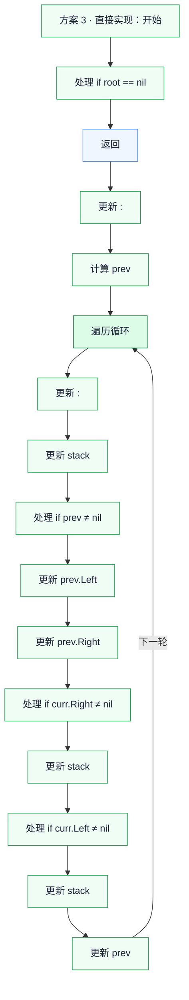

```go
package main // 引入依赖

import (
	"fmt"
	"os"
) // 引入依赖

type TreeNode struct { // 定义类型
	Val   int       // Val int
	Left  *TreeNode // Left 乘 TreeNode
	Right *TreeNode // Right 乘 TreeNode
}

func buildTree(vals []interface{}) *TreeNode { // 定义函数/方法 buildTree
	if len(vals) == 0 || vals[0] == nil { // 若 长度(vals) 等于 0 或 vals[0] 等于 nil
		return nil // 返回 nil
	}
	root := &TreeNode{Val: vals[0].(int)} // 把 按位与 TreeNode{Val: vals[0].(int)} 写入 root :
	q := []*TreeNode{root}                // 把 [] 乘 TreeNode{根节点} 写入 q :
	i := 1                                // 把 1 写入 i :
	for i < len(vals) {                   // for 下标 i 小于 长度(vals) {
		node := q[0]        // 把 节点[0] 写入 node :
		q = q[1:]           // 把 节点[1:] 写入 节点
		if vals[i] != nil { // 若 vals[下标 i] 不等于 nil
			node.Left = &TreeNode{Val: vals[i].(int)} // 把 按位与 TreeNode{Val: vals[下标 i].(int)} 写入 node.Left
			q = append(q, node.Left)                  // 把 append(节点, 节点.Left) 写入 节点
		}
		i++                // 下标 i 加一
		if i < len(vals) { // 若 下标 i 小于 长度(vals
			if vals[i] != nil { // 若 vals[下标 i] 不等于 nil
				node.Right = &TreeNode{Val: vals[i].(int)} // 把 按位与 TreeNode{Val: vals[下标 i].(int)} 写入 node.Right
				q = append(q, node.Right)                  // 把 append(节点, 节点.Right) 写入 节点
			}
			i++ // 下标 i 加一
		}
	}
	return root // 返回 根节点
}

func flatten(root *TreeNode) { // 定义函数/方法 flatten
	if root == nil { // 若 根节点 等于 nil
		return // return
	}
	stack := []*TreeNode{root} // 把 [] 乘 TreeNode{根节点} 写入 stack :
	var prev *TreeNode         // var 前一个 乘 TreeNode
	for len(stack) > 0 {       // for 长度(栈) 超过 0 {
		curr := stack[len(stack)-1]  // 把 栈[长度(栈) 减 1] 写入 curr :
		stack = stack[:len(stack)-1] // 把 栈[:长度(栈) 减 1] 写入 栈
		if prev != nil {             // 若 前一个 不等于 nil
			prev.Left = nil   // 把 nil 写入 prev.Left
			prev.Right = curr // 把 当前值 写入 prev.Right
		}
		if curr.Right != nil { // 若 当前值.Right 不等于 nil
			stack = append(stack, curr.Right) // 把 append(栈, 当前值.Right) 写入 栈
		}
		if curr.Left != nil { // 若 当前值.Left 不等于 nil
			stack = append(stack, curr.Left) // 把 append(栈, 当前值.Left) 写入 栈
		}
		prev = curr // 把 当前值 写入 前一个
	}
}

func main() { // 程序入口：跑内嵌自测用例
	root := buildTree([]interface{}{1, 2, 5, 3, 4, nil, 6}) // 把 buildTree([]interface{}{1, 2, 5, 3, 4, nil, 6}) 写入 root :
	flatten(root)                                           // flatten(根节点)
	spine := []int{}                                        // 把 []int{} 写入 spine :
	leftOK := true                                          // 把 true 写入 leftOK :
	cur := root                                             // 把 根节点 写入 cur :
	for cur != nil {                                        // 把 nil { 写入 for cur !
		spine = append(spine, cur.Val) // 把 append(spine, 当前值.Val) 写入 spine
		if cur.Left != nil {           // 若 当前值.Left 不等于 nil
			leftOK = false // 把 false 写入 leftOK
		}
		cur = cur.Right // 把 当前值.Right 写入 当前值
	}
	want := []int{1, 2, 3, 4, 5, 6}                       // 把 []int{1, 2, 3, 4, 5, 6} 写入 want :
	if !leftOK || fmt.Sprint(spine) != fmt.Sprint(want) { // 若 取反 leftOK 或 fmt.Sprint(spine) 不等于 fmt.Sprint(want
		fmt.Printf("FAIL spine=%v want %v leftOK=%v\n", spine, want, leftOK) // 打印输出
		os.Exit(1)                                                           // os.Exit(1)
	}
	fmt.Println("PASS") // 全部用例通过，输出 PASS
}
```

#### 方案 4：直接实现

**思路与代码分析**：核心是「直接实现」。Go 版用切片与多返回值惯用法，显式处理索引边界。**走读**：方案 4 · 直接实现：开始 → 计算 prev → 计算 dfs → 更新 dfs → 处理 if n == nil → 返回  → 调用 dfs(n.Right) → 调用 dfs(n.Left) → 更新 n.Right → 更新 n.Left → 更新 prev → 调用 dfs(root)。

**运行架构**（真实控制流）：

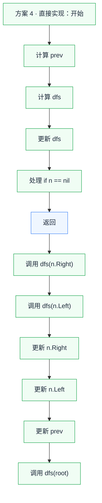

```go
package main // 引入依赖
import (
	"fmt"
	"os"
	"reflect"
) // 引入依赖
type TreeNode struct {
	Val   int
	Left  *TreeNode
	Right *TreeNode
}                        // 定义类型
const NULL = -1000000000 // 把 减 1000000000 存入 NULL
func buildTree(vals []int) *TreeNode { // 定义函数/方法 buildTree
	if len(vals) == 0 || vals[0] == NULL {
		return nil
	} // 若 长度(vals) 等于 0 或 vals[0] 等于 NULL { return nil }
	root := &TreeNode{Val: vals[0]} // 把 按位与 TreeNode{Val: vals[0]} 写入 root :
	q := []*TreeNode{root}
	i := 1                            // 把 [] 乘 TreeNode{根节点}; 下标 i : 赋值为 1 写入 q :
	for len(q) > 0 && i < len(vals) { // 定义函数/方法 len
		node := q[0]
		q = q[1:] // 把 节点[0]; 节点 赋值为 节点[1:] 写入 node :
		if i < len(vals) && vals[i] != NULL {
			node.Left = &TreeNode{Val: vals[i]}
			q = append(q, node.Left)
		}
		i++
		if i < len(vals) && vals[i] != NULL {
			node.Right = &TreeNode{Val: vals[i]}
			q = append(q, node.Right)
		}
		i++
	}
	return root // 返回 根节点
}
func levelList(root *TreeNode) [][]int { // 定义函数/方法 levelList
	if root == nil {
		return [][]int{}
	} // 若 根节点 等于 nil { return [][]int{} }
	res := [][]int{}
	q := []*TreeNode{root} // 把 [][]int{}; 节点 : 赋值为 [] 乘 TreeNode{根节点} 写入 res :
	for len(q) > 0 {       // for 长度(节点) 超过 0 {
		lvl := []int{}
		n := len(q)              // 把 []int{}; 元素个数 : 赋值为 长度(节点) 写入 lvl :
		for k := 0; k < n; k++ { // 让 下标 k 从 0 开始计数
			node := q[0]
			q = q[1:]                   // 把 节点[0]; 节点 赋值为 节点[1:] 写入 node :
			lvl = append(lvl, node.Val) // 把 append(lvl, 节点.Val) 写入 lvl
			if node.Left != nil {
				q = append(q, node.Left)
			} // 若 节点.Left 不等于 nil { 节点 赋值为 append(节点, 节点.Left) }
			if node.Right != nil {
				q = append(q, node.Right)
			} // 若 节点.Right 不等于 nil { 节点 赋值为 append(节点, 节点.Right) }
		}
		res = append(res, lvl) // 把 append(结果, lvl) 写入 结果
	}
	return res // 返回 结果
}
func sameTree(a, b *TreeNode) bool { // 定义函数/方法 sameTree
	if a == nil && b == nil {
		return true
	} // 若 数组 等于 nil 且 b 等于 nil { return true }
	if a == nil || b == nil {
		return false
	} // 若 数组 等于 nil 或 b 等于 nil { return false }
	if a.Val != b.Val {
		return false
	} // 若 数组.Val 不等于 b.Val { return false }
	return sameTree(a.Left, b.Left) && sameTree(a.Right, b.Right) // 定义函数/方法 sameTree
}
func inorderT(root *TreeNode) []int { // 定义函数/方法 inorderT
	if root == nil {
		return []int{}
	} // 若 根节点 等于 nil { return []int{} }
	return append(append(inorderT(root.Left), root.Val), inorderT(root.Right)...) // 定义函数/方法 append
}
func flatten(root *TreeNode) { // 定义函数/方法 flatten
	var prev *TreeNode        // var 前一个 乘 TreeNode
	var dfs func(*TreeNode)   // var dfs func( 乘 TreeNode)
	dfs = func(n *TreeNode) { // 把 func(元素个数 乘 TreeNode) { 写入 dfs
		if n == nil {
			return
		} // 若 元素个数 等于 nil { return }
		dfs(n.Right) // dfs(元素个数.Right)
		dfs(n.Left)  // dfs(元素个数.Left)
		n.Right = prev
		n.Left = nil
		prev = n // 把 前一个; 元素个数.Left 赋值为 nil; 前一个 赋值为 元素个数 写入 n.Right
	}
	dfs(root) // dfs(根节点)
}
func rightArr(root *TreeNode) []int { // 定义函数/方法 rightArr
	res := []int{} // 把 []int{} 写入 res :
	for root != nil {
		res = append(res, root.Val)
		root = root.Right
	}
	return res // 返回 结果
}
func main() { // 程序入口：跑内嵌自测用例
	t := buildTree([]int{1, 2, 5, 3, 4, NULL, 6}) // 把 buildTree([]int{1,2,5,3,4,NULL,6}) 写入 t :
	flatten(t)                                    // flatten(另一字符串)
	if got := rightArr(t); !reflect.DeepEqual(got, []int{1, 2, 3, 4, 5, 6}) {
		fmt.Println("FAIL", got)
		os.Exit(1)
	}
	fmt.Println("PASS") // 全部用例通过，输出 PASS
}
```

### Java 实现（4 种方案）

Java 的全部方案如下，每个方案都内嵌用例自测，可独立运行（老仓库 python/go 文件遵循「打印结果」约定）：

#### 方案 1：直接实现

**思路与代码分析**：核心是「直接实现」。Java 版用类与静态方法组织，集合操作显式明了。**走读**：方案 1 · 直接实现：开始 → 更新 val → 返回结果。

**运行架构**（真实控制流）：


```java
package com.webfault.dsa; // 引入依赖

import java.util.*; // 引入依赖

class lc114_solution_1_1____1___________ { // 定义类型
  static class TreeNode { // static class TreeNode {
    int val; // int 值;
    TreeNode left, right; // TreeNode 左边界, 右边界;

    TreeNode(int v) {
      val = v;
    } // 把 值; } 写入 TreeNode(int v) { val
  }

  private TreeNode prev = null; // 把 null; 写入 private TreeNode prev

  public void flatten(TreeNode root) { // 定义函数/方法 flatten
    prev = null; // 把 null; 写入 前一个
    dfs(root); // dfs(根节点);
  }

  private void dfs(TreeNode node) { // 定义函数/方法 dfs
    if (node == null) return; // 若 节点 等于 null) return;
    dfs(node.right); // dfs(节点.右边界);
    dfs(node.left); // dfs(节点.左边界);
    node.right = prev; // 把 前一个; 写入 右边界
    node.left = null; // 把 null; 写入 左边界
    prev = node; // 把 节点; 写入 前一个
  }

  static TreeNode build(Integer[] a) { // 定义函数/方法 build
    if (a.length == 0 || a[0] == null) return null; // 若 数组.长度 等于 0 或 数组[0] 等于 null，直接返回 null
    TreeNode root = new TreeNode(a[0]); // 把 new TreeNode(数组[0]); 写入 TreeNode root
    Deque<TreeNode> queue =
        new ArrayDeque<>(); // 把 new ArrayDeque 小于 超过 (); 写入 Deque<TreeNode> queue
    queue.add(root); // 队列 追加 根节点);
    int i = 1; // 把 1 存入 下标 i
    while (!queue.isEmpty() && i < a.length) { // 循环，直到不满足「取反 队列.isEmpty() 且 下标 i 小于 数组.长度」
      TreeNode node = queue.poll(); // 把 队列.poll(); 写入 TreeNode node
      if (i < a.length && a[i] != null) {
        node.left = new TreeNode(a[i]);
        queue.add(node.left);
      }
      i++; // 下标 i 加一
      if (i < a.length && a[i] != null) {
        node.right = new TreeNode(a[i]);
        queue.add(node.right);
      }
      i++; // 下标 i 加一
    }
    return root; // 返回 根节点
  }

  static List<Integer> rightList(TreeNode node) { // 定义函数/方法 rightList
    List<Integer> res = new ArrayList<>(); // 把 new ArrayList 小于 超过 (); 写入 List<Integer> res
    while (node != null) { // 循环，直到不满足「节点 不等于 null」
      res.add(node.val); // 结果 追加 节点.值);
      node = node.right; // 把 节点.右边界; 写入 节点
    }
    return res; // 返回 结果
  }

  public static void main(String[] args) { // public static void main(String[] args) {
    lc114_solution_1_1____1___________ s = new lc114_solution_1_1____1___________();
    Object[][] cases = { // 把 { 写入 Object[][] cases
      {new Integer[] {1, 2, 5, 3, 4, null, 6}, Arrays.asList(1, 2, 3, 4, 5, 6)},
      {new Integer[] {1, 2}, Arrays.asList(1, 2)},
      {new Integer[] {}, Arrays.asList()},
      {new Integer[] {1}, Arrays.asList(1)},
    };
    boolean ok = true; // 把 true; 写入 boolean ok
    for (Object[] c : cases) { // for (Object[] 字符 : cases) {
      TreeNode root = build((Integer[]) c[0]); // 把 build((Integer[]) 字符[0]); 写入 TreeNode root
      s.flatten(root); // 字符串.flatten(根节点);
      List<Integer> got = rightList(root); // 把 rightList(根节点); 写入 List<Integer> got
      @SuppressWarnings("unchecked") // @SuppressWarnings(「unchecked」)
      List<Integer> want =
          (List<Integer>) c[1]; // 把 (List 小于 Integer 超过 ) 字符[1]; 写入 List<Integer> want
      if (!got.equals(want)) { // 若 取反 got.equals(want
        ok = false; // 把 false; 写入 ok
        System.out.println(
            "FAIL flatten("
                + Arrays.toString((Integer[]) c[0])
                + ")="
                + got
                + " want "
                + want); // 打印输出
      }
    }
    if (!ok) throw new RuntimeException("FAILED"); // 若 取反 ok) throw new RuntimeException(「FAILED」);
    System.out.println("PASS"); // 全部用例通过，输出 PASS
  }
}
```

#### 方案 2：迭代指针处理

**思路与代码分析**：核心是「迭代指针处理」。Java 版用类与静态方法组织，集合操作显式明了。**走读**：方案 2 · 迭代指针处理：开始 → 更新 val → 返回结果。

**运行架构**（真实控制流）：

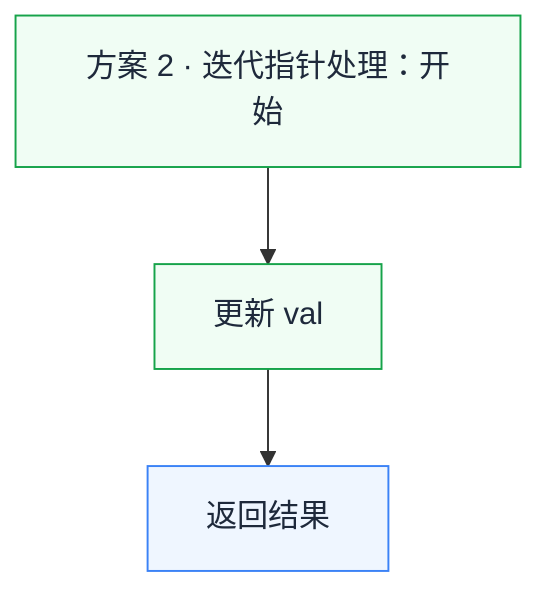

```java
package com.webfault.dsa; // 引入依赖

import java.util.*; // 引入依赖

class lc114_solution_2_2____2___________ { // 定义类型
  static class TreeNode { // static class TreeNode {
    int val; // int 值;
    TreeNode left, right; // TreeNode 左边界, 右边界;

    TreeNode(int v) {
      val = v;
    } // 把 值; } 写入 TreeNode(int v) { val
  }

  private List<TreeNode> nodes; // private List 小于 TreeNode 超过 nodes;

  public void flatten(TreeNode root) { // 定义函数/方法 flatten
    if (root == null) return; // 若 根节点 等于 null) return;
    nodes = new ArrayList<>(); // 把 new ArrayList 小于 超过 (); 写入 nodes
    dfs(root); // dfs(根节点);
    for (int i = 1; i < nodes.size(); i++) { // 让 下标 i 从 1 开始计数，下标 i 小于 nodes.大小() 就继续
      TreeNode prev = nodes.get(i - 1); // 把 nodes 查找 下标 i 减 1); 写入 TreeNode prev
      TreeNode curr = nodes.get(i); // 把 nodes 查找 下标 i); 写入 TreeNode curr
      prev.left = null; // 把 null; 写入 左边界
      prev.right = curr; // 把 当前值; 写入 右边界
    }
  }

  private void dfs(TreeNode node) { // 定义函数/方法 dfs
    if (node == null) return; // 若 节点 等于 null) return;
    nodes.add(node); // nodes 追加 节点);
    dfs(node.left); // dfs(节点.左边界);
    dfs(node.right); // dfs(节点.右边界);
  }

  static TreeNode build(Integer[] a) { // 定义函数/方法 build
    if (a.length == 0 || a[0] == null) return null; // 若 数组.长度 等于 0 或 数组[0] 等于 null，直接返回 null
    TreeNode root = new TreeNode(a[0]); // 把 new TreeNode(数组[0]); 写入 TreeNode root
    Deque<TreeNode> queue =
        new ArrayDeque<>(); // 把 new ArrayDeque 小于 超过 (); 写入 Deque<TreeNode> queue
    queue.add(root); // 队列 追加 根节点);
    int i = 1; // 把 1 存入 下标 i
    while (!queue.isEmpty() && i < a.length) { // 循环，直到不满足「取反 队列.isEmpty() 且 下标 i 小于 数组.长度」
      TreeNode node = queue.poll(); // 把 队列.poll(); 写入 TreeNode node
      if (i < a.length && a[i] != null) {
        node.left = new TreeNode(a[i]);
        queue.add(node.left);
      }
      i++; // 下标 i 加一
      if (i < a.length && a[i] != null) {
        node.right = new TreeNode(a[i]);
        queue.add(node.right);
      }
      i++; // 下标 i 加一
    }
    return root; // 返回 根节点
  }

  static List<Integer> rightList(TreeNode node) { // 定义函数/方法 rightList
    List<Integer> res = new ArrayList<>(); // 把 new ArrayList 小于 超过 (); 写入 List<Integer> res
    while (node != null) { // 循环，直到不满足「节点 不等于 null」
      res.add(node.val); // 结果 追加 节点.值);
      node = node.right; // 把 节点.右边界; 写入 节点
    }
    return res; // 返回 结果
  }

  public static void main(String[] args) { // public static void main(String[] args) {
    lc114_solution_2_2____2___________ s = new lc114_solution_2_2____2___________();
    Object[][] cases = { // 把 { 写入 Object[][] cases
      {new Integer[] {1, 2, 5, 3, 4, null, 6}, Arrays.asList(1, 2, 3, 4, 5, 6)},
      {new Integer[] {1, 2}, Arrays.asList(1, 2)},
      {new Integer[] {}, Arrays.asList()},
      {new Integer[] {1}, Arrays.asList(1)},
    };
    boolean ok = true; // 把 true; 写入 boolean ok
    for (Object[] c : cases) { // for (Object[] 字符 : cases) {
      TreeNode root = build((Integer[]) c[0]); // 把 build((Integer[]) 字符[0]); 写入 TreeNode root
      s.flatten(root); // 字符串.flatten(根节点);
      List<Integer> got = rightList(root); // 把 rightList(根节点); 写入 List<Integer> got
      @SuppressWarnings("unchecked") // @SuppressWarnings(「unchecked」)
      List<Integer> want =
          (List<Integer>) c[1]; // 把 (List 小于 Integer 超过 ) 字符[1]; 写入 List<Integer> want
      if (!got.equals(want)) { // 若 取反 got.equals(want
        ok = false; // 把 false; 写入 ok
        System.out.println(
            "FAIL flatten("
                + Arrays.toString((Integer[]) c[0])
                + ")="
                + got
                + " want "
                + want); // 打印输出
      }
    }
    if (!ok) throw new RuntimeException("FAILED"); // 若 取反 ok) throw new RuntimeException(「FAILED」);
    System.out.println("PASS"); // 全部用例通过，输出 PASS
  }
}
```

#### 方案 3：直接实现

**思路与代码分析**：核心是「直接实现」。Java 版用类与静态方法组织，集合操作显式明了。**走读**：方案 3 · 直接实现：开始 → 更新 val → 返回结果。

**运行架构**（真实控制流）：


```java
package com.webfault.dsa; // 引入依赖

import java.util.*; // 引入依赖

class lc114_solution_3_3____3_____________ { // 定义类型
  static class TreeNode { // static class TreeNode {
    int val; // int 值;
    TreeNode left, right; // TreeNode 左边界, 右边界;

    TreeNode(int v) {
      val = v;
    } // 把 值; } 写入 TreeNode(int v) { val
  }

  public void flatten(TreeNode root) { // 定义函数/方法 flatten
    if (root == null) return; // 若 根节点 等于 null) return;
    Deque<TreeNode> stack =
        new ArrayDeque<>(); // 把 new ArrayDeque 小于 超过 (); 写入 Deque<TreeNode> stack
    stack.push(root); // 把 根节点 压入栈/数组尾部
    TreeNode prev = null; // 把 null; 写入 TreeNode prev
    while (!stack.isEmpty()) { // 循环，直到不满足「取反 栈.isEmpty(」
      TreeNode curr = stack.pop(); // 弹出栈顶元素
      if (prev != null) { // 若 前一个 不等于 null
        prev.left = null; // 把 null; 写入 左边界
        prev.right = curr; // 把 当前值; 写入 右边界
      }
      TreeNode left = curr.left, right = curr.right; // 把 当前值.左边界, 右边界 赋值为 当前值.右边界; 写入 TreeNode left
      if (right != null) stack.push(right); // 若 右边界 不等于 null) 栈 追加 右边界);
      if (left != null) stack.push(left); // 若 左边界 不等于 null) 栈 追加 左边界);
      prev = curr; // 把 当前值; 写入 前一个
    }
  }

  static TreeNode build(Integer[] a) { // 定义函数/方法 build
    if (a.length == 0 || a[0] == null) return null; // 若 数组.长度 等于 0 或 数组[0] 等于 null，直接返回 null
    TreeNode root = new TreeNode(a[0]); // 把 new TreeNode(数组[0]); 写入 TreeNode root
    Deque<TreeNode> queue =
        new ArrayDeque<>(); // 把 new ArrayDeque 小于 超过 (); 写入 Deque<TreeNode> queue
    queue.add(root); // 队列 追加 根节点);
    int i = 1; // 把 1 存入 下标 i
    while (!queue.isEmpty() && i < a.length) { // 循环，直到不满足「取反 队列.isEmpty() 且 下标 i 小于 数组.长度」
      TreeNode node = queue.poll(); // 把 队列.poll(); 写入 TreeNode node
      if (i < a.length && a[i] != null) {
        node.left = new TreeNode(a[i]);
        queue.add(node.left);
      }
      i++; // 下标 i 加一
      if (i < a.length && a[i] != null) {
        node.right = new TreeNode(a[i]);
        queue.add(node.right);
      }
      i++; // 下标 i 加一
    }
    return root; // 返回 根节点
  }

  static List<Integer> rightList(TreeNode node) { // 定义函数/方法 rightList
    List<Integer> res = new ArrayList<>(); // 把 new ArrayList 小于 超过 (); 写入 List<Integer> res
    while (node != null) { // 循环，直到不满足「节点 不等于 null」
      res.add(node.val); // 结果 追加 节点.值);
      node = node.right; // 把 节点.右边界; 写入 节点
    }
    return res; // 返回 结果
  }

  public static void main(String[] args) { // public static void main(String[] args) {
    lc114_solution_3_3____3_____________ s = new lc114_solution_3_3____3_____________();
    Object[][] cases = { // 把 { 写入 Object[][] cases
      {new Integer[] {1, 2, 5, 3, 4, null, 6}, Arrays.asList(1, 2, 3, 4, 5, 6)},
      {new Integer[] {1, 2}, Arrays.asList(1, 2)},
      {new Integer[] {}, Arrays.asList()},
      {new Integer[] {1}, Arrays.asList(1)},
    };
    boolean ok = true; // 把 true; 写入 boolean ok
    for (Object[] c : cases) { // for (Object[] 字符 : cases) {
      TreeNode root = build((Integer[]) c[0]); // 把 build((Integer[]) 字符[0]); 写入 TreeNode root
      s.flatten(root); // 字符串.flatten(根节点);
      List<Integer> got = rightList(root); // 把 rightList(根节点); 写入 List<Integer> got
      @SuppressWarnings("unchecked") // @SuppressWarnings(「unchecked」)
      List<Integer> want =
          (List<Integer>) c[1]; // 把 (List 小于 Integer 超过 ) 字符[1]; 写入 List<Integer> want
      if (!got.equals(want)) { // 若 取反 got.equals(want
        ok = false; // 把 false; 写入 ok
        System.out.println(
            "FAIL flatten("
                + Arrays.toString((Integer[]) c[0])
                + ")="
                + got
                + " want "
                + want); // 打印输出
      }
    }
    if (!ok) throw new RuntimeException("FAILED"); // 若 取反 ok) throw new RuntimeException(「FAILED」);
    System.out.println("PASS"); // 全部用例通过，输出 PASS
  }
}
```

#### 方案 4：直接实现

**思路与代码分析**：核心是「直接实现」。Java 版用类与静态方法组织，集合操作显式明了。**走读**：方案 4 · 直接实现：开始 → 更新 val → 返回结果。

**运行架构**（真实控制流）：

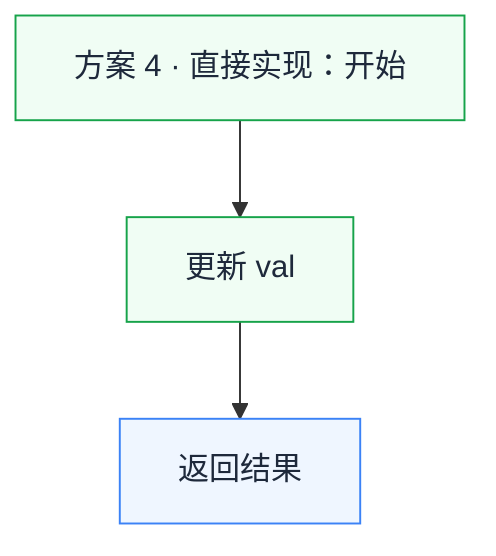

```java
package com.webfault.dsa; // 引入依赖

import java.util.*; // 引入依赖

class lc114_solution_4_4____4_______ { // 定义类型
  static class TreeNode { // static class TreeNode {
    int val; // int 值;
    TreeNode left, right; // TreeNode 左边界, 右边界;

    TreeNode(int v) {
      val = v;
    } // 把 值; } 写入 TreeNode(int v) { val
  }

  public void flatten(TreeNode root) { // 定义函数/方法 flatten
    TreeNode curr = root; // 把 根节点; 写入 TreeNode curr
    while (curr != null) { // 循环，直到不满足「当前值 不等于 null」
      if (curr.left != null) { // 若 当前值.左边界 不等于 null
        TreeNode next = curr.left; // 把 当前值.左边界; 写入 TreeNode next
        TreeNode predecessor = next; // 把 下一个; 写入 TreeNode predecessor
        while (predecessor.right != null) { // 循环，直到不满足「predecessor.右边界 不等于 null」
          predecessor = predecessor.right; // 把 predecessor.右边界; 写入 predecessor
        }
        predecessor.right = curr.right; // 把 当前值.右边界; 写入 右边界
        curr.left = null; // 把 null; 写入 左边界
        curr.right = next; // 把 下一个; 写入 右边界
      }
      curr = curr.right; // 把 当前值.右边界; 写入 当前值
    }
  }

  static TreeNode build(Integer[] a) { // 定义函数/方法 build
    if (a.length == 0 || a[0] == null) return null; // 若 数组.长度 等于 0 或 数组[0] 等于 null，直接返回 null
    TreeNode root = new TreeNode(a[0]); // 把 new TreeNode(数组[0]); 写入 TreeNode root
    Deque<TreeNode> queue =
        new ArrayDeque<>(); // 把 new ArrayDeque 小于 超过 (); 写入 Deque<TreeNode> queue
    queue.add(root); // 队列 追加 根节点);
    int i = 1; // 把 1 存入 下标 i
    while (!queue.isEmpty() && i < a.length) { // 循环，直到不满足「取反 队列.isEmpty() 且 下标 i 小于 数组.长度」
      TreeNode node = queue.poll(); // 把 队列.poll(); 写入 TreeNode node
      if (i < a.length && a[i] != null) {
        node.left = new TreeNode(a[i]);
        queue.add(node.left);
      }
      i++; // 下标 i 加一
      if (i < a.length && a[i] != null) {
        node.right = new TreeNode(a[i]);
        queue.add(node.right);
      }
      i++; // 下标 i 加一
    }
    return root; // 返回 根节点
  }

  static List<Integer> rightList(TreeNode node) { // 定义函数/方法 rightList
    List<Integer> res = new ArrayList<>(); // 把 new ArrayList 小于 超过 (); 写入 List<Integer> res
    while (node != null) { // 循环，直到不满足「节点 不等于 null」
      res.add(node.val); // 结果 追加 节点.值);
      node = node.right; // 把 节点.右边界; 写入 节点
    }
    return res; // 返回 结果
  }

  public static void main(String[] args) { // public static void main(String[] args) {
    lc114_solution_4_4____4_______ s = new lc114_solution_4_4____4_______();
    Object[][] cases = { // 把 { 写入 Object[][] cases
      {new Integer[] {1, 2, 5, 3, 4, null, 6}, Arrays.asList(1, 2, 3, 4, 5, 6)},
      {new Integer[] {1, 2}, Arrays.asList(1, 2)},
      {new Integer[] {}, Arrays.asList()},
      {new Integer[] {1}, Arrays.asList(1)},
    };
    boolean ok = true; // 把 true; 写入 boolean ok
    for (Object[] c : cases) { // for (Object[] 字符 : cases) {
      TreeNode root = build((Integer[]) c[0]); // 把 build((Integer[]) 字符[0]); 写入 TreeNode root
      s.flatten(root); // 字符串.flatten(根节点);
      List<Integer> got = rightList(root); // 把 rightList(根节点); 写入 List<Integer> got
      @SuppressWarnings("unchecked") // @SuppressWarnings(「unchecked」)
      List<Integer> want =
          (List<Integer>) c[1]; // 把 (List 小于 Integer 超过 ) 字符[1]; 写入 List<Integer> want
      if (!got.equals(want)) { // 若 取反 got.equals(want
        ok = false; // 把 false; 写入 ok
        System.out.println(
            "FAIL flatten("
                + Arrays.toString((Integer[]) c[0])
                + ")="
                + got
                + " want "
                + want); // 打印输出
      }
    }
    if (!ok) throw new RuntimeException("FAILED"); // 若 取反 ok) throw new RuntimeException(「FAILED」);
    System.out.println("PASS"); // 全部用例通过，输出 PASS
  }
}
```

### Rust 实现（4 种方案）

Rust 的全部方案如下，每个方案都内嵌用例自测，可独立运行（老仓库 python/go 文件遵循「打印结果」约定）：

#### 方案 1：直接实现

**思路与代码分析**：核心是「直接实现」。Rust 版用所有权移动与切片借用改写同一逻辑，注意 Option 与引用边界。**走读**：方案 1 · 直接实现：开始 → 处理 if vals.is_empty() 或 vals[0 → 返回 None → 当 非 queue.is_empty() 且 i ＜ vals.len() 时反复执行。

**运行架构**（真实控制流）：


```rust
// LeetCode 114. 二叉树展开为链表 — Rust 版（方案1）
use std::cell::RefCell;
use std::rc::Rc; // 引入依赖 // 引入依赖

#[derive(Debug)]
struct TreeNode {
    // 定义类型
    val: i32,
    left: Option<Rc<RefCell<TreeNode>>>,
    right: Option<Rc<RefCell<TreeNode>>>,
}

impl TreeNode {
    // 实现块
    fn new(val: i32) -> Rc<RefCell<TreeNode>> {
        // 定义函数/方法 new
        Rc::new(RefCell::new(TreeNode {
            val,
            left: None,
            right: None,
        })) // Rc::new(RefCell::new(TreeNode { 值, 左边界: None, 右边界: None }))
    }
}

fn build_tree(vals: &[Option<i32>]) -> Option<Rc<RefCell<TreeNode>>> {
    // 定义函数/方法 build_tree
    if vals.is_empty() || vals[0].is_none() {
        // 若 vals 是否为空 或 vals[0].is_none(
        return None; // 返回 None
    }
    let root = TreeNode::new(vals[0].unwrap()); // 把 TreeNode::new(vals[0].unwrap()) 存入 根节点
    let mut queue: Vec<Rc<RefCell<TreeNode>>> = vec![root.clone()];
    let mut i = 1; // 把 1; 写入 let mut i
    while !queue.is_empty() && i < vals.len() {
        // while 取反 队列 是否为空 且 下标 i 小于 vals.长度() {
        let node = queue.remove(0); // 把 队列 弹出 0) 存入 节点
        if i < vals.len() {
            // 若 下标 i 小于 vals.长度(
            if let Some(v) = vals[i] {
                // 若 let Some(值) 赋值为 vals[下标 i]
                let child = TreeNode::new(v); // 把 TreeNode::new(值) 存入 子节点
                node.borrow_mut().left = Some(child.clone()); // 把 Some(子节点.clone()); 写入 左边界
                queue.push(child); // 把 子节点 压入栈/数组尾部
            }
            i += 1; // 下标 i累加 1
        }
        if i < vals.len() {
            // 若 下标 i 小于 vals.长度(
            if let Some(v) = vals[i] {
                // 若 let Some(值) 赋值为 vals[下标 i]
                let child = TreeNode::new(v); // 把 TreeNode::new(值) 存入 子节点
                node.borrow_mut().right = Some(child.clone()); // 把 Some(子节点.clone()); 写入 右边界
                queue.push(child); // 把 子节点 压入栈/数组尾部
            }
            i += 1; // 下标 i累加 1
        }
    }
    Some(root) // Some(根节点)
}

fn flatten(root: Option<Rc<RefCell<TreeNode>>>) {
    // 定义函数/方法 flatten
    let mut prev: Option<Rc<RefCell<TreeNode>>> = None; // 把 None; 写入 let mut prev: Option<Rc<RefCell<TreeNode>>>
    fn dfs(node: Option<Rc<RefCell<TreeNode>>>, prev: &mut Option<Rc<RefCell<TreeNode>>>) {
        // 定义函数/方法 dfs
        let n = match node {
            Some(x) => x,
            None => return,
        };
        dfs(n.borrow().right.clone(), prev); // dfs(元素个数.borrow().右边界.clone(), 前一个);
        dfs(n.borrow().left.clone(), prev); // dfs(元素个数.borrow().左边界.clone(), 前一个);
        let mut nb = n.borrow_mut(); // 把 元素个数.borrow_mut(); 写入 let mut nb
        nb.right = prev.take(); // 把 前一个.take(); 写入 右边界
        nb.left = None; // 把 None; 写入 左边界
        drop(nb); // drop(nb);
        *prev = Some(n);
    }
    dfs(root, &mut prev); // dfs(根节点, 按位与 mut 前一个);
}
fn main() {
    // 程序入口：跑内嵌自测用例
    let t = build_tree(&[Some(1), Some(2), Some(5), Some(3), Some(4), None, Some(6)]);
    flatten(t.clone()); // flatten(另一字符串.clone());
    let mut cur = t; // 把 另一字符串; 写入 let mut cur
    let mut got = Vec::new(); // 把 Vec::new(); 写入 let mut got
    while let Some(n) = cur {
        // 边取边处理，取空即停
        let nb = n.borrow(); // 把 元素个数.borrow() 存入 nb
        assert!(nb.left.is_none(), "left must be null"); // 断言校验
        got.push(nb.val); // 把 nb.值 压入栈/数组尾部
        cur = nb.right.clone(); // 把 nb.右边界.clone(); 写入 当前值
    }
    assert_eq!(got, vec![1, 2, 3, 4, 5, 6]); // 断言校验
    let t2 = build_tree(&[Some(7)]); // 把 build_tree( 按位与 [Some(7)]) 存入 t2
    flatten(t2.clone()); // flatten(t2.clone());
    let mut got2 = Vec::new(); // 把 Vec::new(); 写入 let mut got2
    let mut cur2 = t2; // 把 t2; 写入 let mut cur2
    while let Some(n) = cur2 {
        got2.push(n.borrow().val);
        cur2 = n.borrow().right.clone();
    } // 边取边处理，取空即停
    assert_eq!(got2, vec![7]); // 断言校验
    let none: Option<Rc<RefCell<TreeNode>>> = None; // 把 None; 写入 let none: Option<Rc<RefCell<TreeNode>>>
    flatten(none); // flatten(none);
    println!("PASS"); // 全部用例通过，输出 PASS
}
```

#### 方案 2：迭代指针处理

**思路与代码分析**：核心是「迭代指针处理」。Rust 版用所有权移动与切片借用改写同一逻辑，注意 Option 与引用边界。**走读**：方案 2 · 迭代指针处理：开始 → 处理 if vals.is_empty() 或 vals[0 → 返回 None → 当 非 queue.is_empty() 且 i ＜ vals.len() 时反复执行。

**运行架构**（真实控制流）：

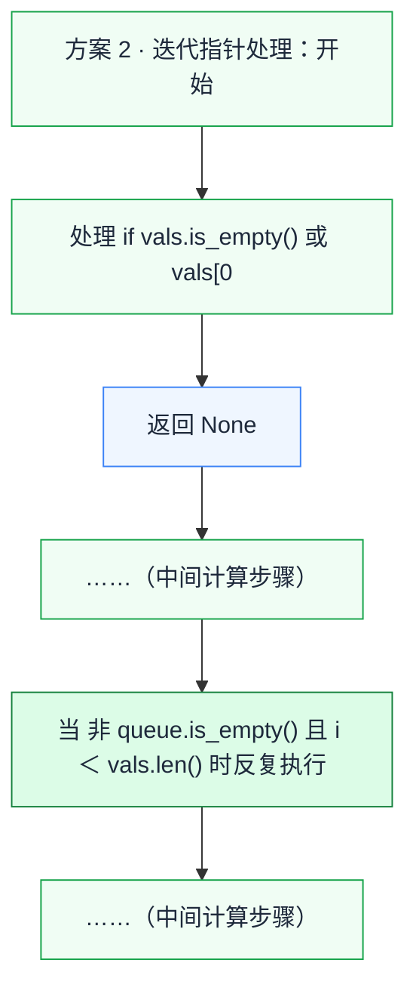

```rust
// LeetCode 114. 二叉树展开为链表 — Rust 版（方案2）
use std::cell::RefCell;
use std::rc::Rc; // 引入依赖 // 引入依赖

#[derive(Debug)]
struct TreeNode {
    // 定义类型
    val: i32,
    left: Option<Rc<RefCell<TreeNode>>>,
    right: Option<Rc<RefCell<TreeNode>>>,
}

impl TreeNode {
    // 实现块
    fn new(val: i32) -> Rc<RefCell<TreeNode>> {
        // 定义函数/方法 new
        Rc::new(RefCell::new(TreeNode {
            val,
            left: None,
            right: None,
        })) // Rc::new(RefCell::new(TreeNode { 值, 左边界: None, 右边界: None }))
    }
}

fn build_tree(vals: &[Option<i32>]) -> Option<Rc<RefCell<TreeNode>>> {
    // 定义函数/方法 build_tree
    if vals.is_empty() || vals[0].is_none() {
        // 若 vals 是否为空 或 vals[0].is_none(
        return None; // 返回 None
    }
    let root = TreeNode::new(vals[0].unwrap()); // 把 TreeNode::new(vals[0].unwrap()) 存入 根节点
    let mut queue: Vec<Rc<RefCell<TreeNode>>> = vec![root.clone()];
    let mut i = 1; // 把 1; 写入 let mut i
    while !queue.is_empty() && i < vals.len() {
        // while 取反 队列 是否为空 且 下标 i 小于 vals.长度() {
        let node = queue.remove(0); // 把 队列 弹出 0) 存入 节点
        if i < vals.len() {
            // 若 下标 i 小于 vals.长度(
            if let Some(v) = vals[i] {
                // 若 let Some(值) 赋值为 vals[下标 i]
                let child = TreeNode::new(v); // 把 TreeNode::new(值) 存入 子节点
                node.borrow_mut().left = Some(child.clone()); // 把 Some(子节点.clone()); 写入 左边界
                queue.push(child); // 把 子节点 压入栈/数组尾部
            }
            i += 1; // 下标 i累加 1
        }
        if i < vals.len() {
            // 若 下标 i 小于 vals.长度(
            if let Some(v) = vals[i] {
                // 若 let Some(值) 赋值为 vals[下标 i]
                let child = TreeNode::new(v); // 把 TreeNode::new(值) 存入 子节点
                node.borrow_mut().right = Some(child.clone()); // 把 Some(子节点.clone()); 写入 右边界
                queue.push(child); // 把 子节点 压入栈/数组尾部
            }
            i += 1; // 下标 i累加 1
        }
    }
    Some(root) // Some(根节点)
}

fn flatten(root: Option<Rc<RefCell<TreeNode>>>) {
    // 定义函数/方法 flatten
    let mut prev: Option<Rc<RefCell<TreeNode>>> = None; // 把 None; 写入 let mut prev: Option<Rc<RefCell<TreeNode>>>
    fn dfs(node: Option<Rc<RefCell<TreeNode>>>, prev: &mut Option<Rc<RefCell<TreeNode>>>) {
        // 定义函数/方法 dfs
        let n = match node {
            Some(x) => x,
            None => return,
        };
        dfs(n.borrow().right.clone(), prev); // dfs(元素个数.borrow().右边界.clone(), 前一个);
        dfs(n.borrow().left.clone(), prev); // dfs(元素个数.borrow().左边界.clone(), 前一个);
        let mut nb = n.borrow_mut(); // 把 元素个数.borrow_mut(); 写入 let mut nb
        nb.right = prev.take(); // 把 前一个.take(); 写入 右边界
        nb.left = None; // 把 None; 写入 左边界
        drop(nb); // drop(nb);
        *prev = Some(n);
    }
    dfs(root, &mut prev); // dfs(根节点, 按位与 mut 前一个);
}
fn main() {
    // 程序入口：跑内嵌自测用例
    let t = build_tree(&[Some(1), Some(2), Some(5), Some(3), Some(4), None, Some(6)]);
    flatten(t.clone()); // flatten(另一字符串.clone());
    let mut cur = t; // 把 另一字符串; 写入 let mut cur
    let mut got = Vec::new(); // 把 Vec::new(); 写入 let mut got
    while let Some(n) = cur {
        // 边取边处理，取空即停
        let nb = n.borrow(); // 把 元素个数.borrow() 存入 nb
        assert!(nb.left.is_none(), "left must be null"); // 断言校验
        got.push(nb.val); // 把 nb.值 压入栈/数组尾部
        cur = nb.right.clone(); // 把 nb.右边界.clone(); 写入 当前值
    }
    assert_eq!(got, vec![1, 2, 3, 4, 5, 6]); // 断言校验
    let t2 = build_tree(&[Some(7)]); // 把 build_tree( 按位与 [Some(7)]) 存入 t2
    flatten(t2.clone()); // flatten(t2.clone());
    let mut got2 = Vec::new(); // 把 Vec::new(); 写入 let mut got2
    let mut cur2 = t2; // 把 t2; 写入 let mut cur2
    while let Some(n) = cur2 {
        got2.push(n.borrow().val);
        cur2 = n.borrow().right.clone();
    } // 边取边处理，取空即停
    assert_eq!(got2, vec![7]); // 断言校验
    let none: Option<Rc<RefCell<TreeNode>>> = None; // 把 None; 写入 let none: Option<Rc<RefCell<TreeNode>>>
    flatten(none); // flatten(none);
    println!("PASS"); // 全部用例通过，输出 PASS
}
```

#### 方案 3：直接实现

**思路与代码分析**：核心是「直接实现」。Rust 版用所有权移动与切片借用改写同一逻辑，注意 Option 与引用边界。**走读**：方案 3 · 直接实现：开始 → 处理 if vals.is_empty() 或 vals[0 → 返回 None → 当 非 queue.is_empty() 且 i ＜ vals.len() 时反复执行。

**运行架构**（真实控制流）：

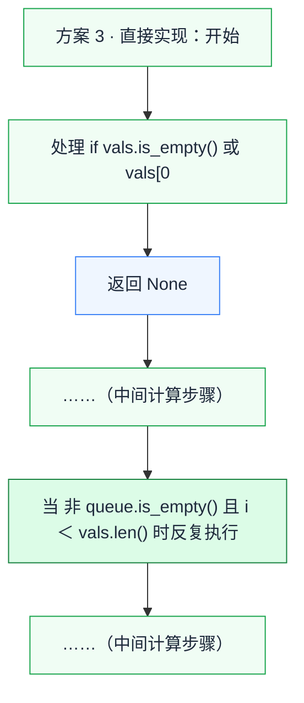

```rust
// LeetCode 114. 二叉树展开为链表 — Rust 版（方案3）
use std::cell::RefCell;
use std::rc::Rc; // 引入依赖 // 引入依赖

#[derive(Debug)]
struct TreeNode {
    // 定义类型
    val: i32,
    left: Option<Rc<RefCell<TreeNode>>>,
    right: Option<Rc<RefCell<TreeNode>>>,
}

impl TreeNode {
    // 实现块
    fn new(val: i32) -> Rc<RefCell<TreeNode>> {
        // 定义函数/方法 new
        Rc::new(RefCell::new(TreeNode {
            val,
            left: None,
            right: None,
        })) // Rc::new(RefCell::new(TreeNode { 值, 左边界: None, 右边界: None }))
    }
}

fn build_tree(vals: &[Option<i32>]) -> Option<Rc<RefCell<TreeNode>>> {
    // 定义函数/方法 build_tree
    if vals.is_empty() || vals[0].is_none() {
        // 若 vals 是否为空 或 vals[0].is_none(
        return None; // 返回 None
    }
    let root = TreeNode::new(vals[0].unwrap()); // 把 TreeNode::new(vals[0].unwrap()) 存入 根节点
    let mut queue: Vec<Rc<RefCell<TreeNode>>> = vec![root.clone()];
    let mut i = 1; // 把 1; 写入 let mut i
    while !queue.is_empty() && i < vals.len() {
        // while 取反 队列 是否为空 且 下标 i 小于 vals.长度() {
        let node = queue.remove(0); // 把 队列 弹出 0) 存入 节点
        if i < vals.len() {
            // 若 下标 i 小于 vals.长度(
            if let Some(v) = vals[i] {
                // 若 let Some(值) 赋值为 vals[下标 i]
                let child = TreeNode::new(v); // 把 TreeNode::new(值) 存入 子节点
                node.borrow_mut().left = Some(child.clone()); // 把 Some(子节点.clone()); 写入 左边界
                queue.push(child); // 把 子节点 压入栈/数组尾部
            }
            i += 1; // 下标 i累加 1
        }
        if i < vals.len() {
            // 若 下标 i 小于 vals.长度(
            if let Some(v) = vals[i] {
                // 若 let Some(值) 赋值为 vals[下标 i]
                let child = TreeNode::new(v); // 把 TreeNode::new(值) 存入 子节点
                node.borrow_mut().right = Some(child.clone()); // 把 Some(子节点.clone()); 写入 右边界
                queue.push(child); // 把 子节点 压入栈/数组尾部
            }
            i += 1; // 下标 i累加 1
        }
    }
    Some(root) // Some(根节点)
}

fn flatten(root: Option<Rc<RefCell<TreeNode>>>) {
    // 定义函数/方法 flatten
    let mut prev: Option<Rc<RefCell<TreeNode>>> = None; // 把 None; 写入 let mut prev: Option<Rc<RefCell<TreeNode>>>
    fn dfs(node: Option<Rc<RefCell<TreeNode>>>, prev: &mut Option<Rc<RefCell<TreeNode>>>) {
        // 定义函数/方法 dfs
        let n = match node {
            Some(x) => x,
            None => return,
        };
        dfs(n.borrow().right.clone(), prev); // dfs(元素个数.borrow().右边界.clone(), 前一个);
        dfs(n.borrow().left.clone(), prev); // dfs(元素个数.borrow().左边界.clone(), 前一个);
        let mut nb = n.borrow_mut(); // 把 元素个数.borrow_mut(); 写入 let mut nb
        nb.right = prev.take(); // 把 前一个.take(); 写入 右边界
        nb.left = None; // 把 None; 写入 左边界
        drop(nb); // drop(nb);
        *prev = Some(n);
    }
    dfs(root, &mut prev); // dfs(根节点, 按位与 mut 前一个);
}
fn main() {
    // 程序入口：跑内嵌自测用例
    let t = build_tree(&[Some(1), Some(2), Some(5), Some(3), Some(4), None, Some(6)]);
    flatten(t.clone()); // flatten(另一字符串.clone());
    let mut cur = t; // 把 另一字符串; 写入 let mut cur
    let mut got = Vec::new(); // 把 Vec::new(); 写入 let mut got
    while let Some(n) = cur {
        // 边取边处理，取空即停
        let nb = n.borrow(); // 把 元素个数.borrow() 存入 nb
        assert!(nb.left.is_none(), "left must be null"); // 断言校验
        got.push(nb.val); // 把 nb.值 压入栈/数组尾部
        cur = nb.right.clone(); // 把 nb.右边界.clone(); 写入 当前值
    }
    assert_eq!(got, vec![1, 2, 3, 4, 5, 6]); // 断言校验
    let t2 = build_tree(&[Some(7)]); // 把 build_tree( 按位与 [Some(7)]) 存入 t2
    flatten(t2.clone()); // flatten(t2.clone());
    let mut got2 = Vec::new(); // 把 Vec::new(); 写入 let mut got2
    let mut cur2 = t2; // 把 t2; 写入 let mut cur2
    while let Some(n) = cur2 {
        got2.push(n.borrow().val);
        cur2 = n.borrow().right.clone();
    } // 边取边处理，取空即停
    assert_eq!(got2, vec![7]); // 断言校验
    let none: Option<Rc<RefCell<TreeNode>>> = None; // 把 None; 写入 let none: Option<Rc<RefCell<TreeNode>>>
    flatten(none); // flatten(none);
    println!("PASS"); // 全部用例通过，输出 PASS
}
```

#### 方案 4：直接实现

**思路与代码分析**：核心是「直接实现」。Rust 版用所有权移动与切片借用改写同一逻辑，注意 Option 与引用边界。**走读**：方案 4 · 直接实现：开始 → 处理 if vals.is_empty() 或 vals[0 → 返回 None → 当 非 queue.is_empty() 且 i ＜ vals.len() 时反复执行。

**运行架构**（真实控制流）：

```mermaid
graph TD
    N0["方案 4 · 直接实现：开始"]
    N1["处理 if vals.is_empty() 或 vals[0"]
    N2["返回 None"]
    D1["……（中间计算步骤）"]
    N6["当 非 queue.is_empty() 且 i ＜ vals.len() 时反复执行"]
    Dend["……（中间计算步骤）"]
    N0 --> N1
    N1 --> N2
    N2 --> D1
    D1 --> N6
    N6 --> Dend
    classDef n fill:#f0fdf4,stroke:#16a34a,color:#1e293b;
    classDef lp fill:#dcfce7,stroke:#15803d,color:#1e293b;
    classDef dc fill:#fef9c3,stroke:#ca8a04,color:#1e293b;
    classDef tm fill:#eff6ff,stroke:#3b82f6,color:#1e293b;
    class N0,N1,D1,Dend n;
    class N6 lp;
    class N2 tm;
```

```rust
// LeetCode 114. 二叉树展开为链表 — Rust 版（方案4）
use std::cell::RefCell;
use std::rc::Rc; // 引入依赖 // 引入依赖

#[derive(Debug)]
struct TreeNode {
    // 定义类型
    val: i32,
    left: Option<Rc<RefCell<TreeNode>>>,
    right: Option<Rc<RefCell<TreeNode>>>,
}

impl TreeNode {
    // 实现块
    fn new(val: i32) -> Rc<RefCell<TreeNode>> {
        // 定义函数/方法 new
        Rc::new(RefCell::new(TreeNode {
            val,
            left: None,
            right: None,
        })) // Rc::new(RefCell::new(TreeNode { 值, 左边界: None, 右边界: None }))
    }
}

fn build_tree(vals: &[Option<i32>]) -> Option<Rc<RefCell<TreeNode>>> {
    // 定义函数/方法 build_tree
    if vals.is_empty() || vals[0].is_none() {
        // 若 vals 是否为空 或 vals[0].is_none(
        return None; // 返回 None
    }
    let root = TreeNode::new(vals[0].unwrap()); // 把 TreeNode::new(vals[0].unwrap()) 存入 根节点
    let mut queue: Vec<Rc<RefCell<TreeNode>>> = vec![root.clone()];
    let mut i = 1; // 把 1; 写入 let mut i
    while !queue.is_empty() && i < vals.len() {
        // while 取反 队列 是否为空 且 下标 i 小于 vals.长度() {
        let node = queue.remove(0); // 把 队列 弹出 0) 存入 节点
        if i < vals.len() {
            // 若 下标 i 小于 vals.长度(
            if let Some(v) = vals[i] {
                // 若 let Some(值) 赋值为 vals[下标 i]
                let child = TreeNode::new(v); // 把 TreeNode::new(值) 存入 子节点
                node.borrow_mut().left = Some(child.clone()); // 把 Some(子节点.clone()); 写入 左边界
                queue.push(child); // 把 子节点 压入栈/数组尾部
            }
            i += 1; // 下标 i累加 1
        }
        if i < vals.len() {
            // 若 下标 i 小于 vals.长度(
            if let Some(v) = vals[i] {
                // 若 let Some(值) 赋值为 vals[下标 i]
                let child = TreeNode::new(v); // 把 TreeNode::new(值) 存入 子节点
                node.borrow_mut().right = Some(child.clone()); // 把 Some(子节点.clone()); 写入 右边界
                queue.push(child); // 把 子节点 压入栈/数组尾部
            }
            i += 1; // 下标 i累加 1
        }
    }
    Some(root) // Some(根节点)
}

fn flatten(root: Option<Rc<RefCell<TreeNode>>>) {
    // 定义函数/方法 flatten
    let mut prev: Option<Rc<RefCell<TreeNode>>> = None; // 把 None; 写入 let mut prev: Option<Rc<RefCell<TreeNode>>>
    fn dfs(node: Option<Rc<RefCell<TreeNode>>>, prev: &mut Option<Rc<RefCell<TreeNode>>>) {
        // 定义函数/方法 dfs
        let n = match node {
            Some(x) => x,
            None => return,
        };
        dfs(n.borrow().right.clone(), prev); // dfs(元素个数.borrow().右边界.clone(), 前一个);
        dfs(n.borrow().left.clone(), prev); // dfs(元素个数.borrow().左边界.clone(), 前一个);
        let mut nb = n.borrow_mut(); // 把 元素个数.borrow_mut(); 写入 let mut nb
        nb.right = prev.take(); // 把 前一个.take(); 写入 右边界
        nb.left = None; // 把 None; 写入 左边界
        drop(nb); // drop(nb);
        *prev = Some(n);
    }
    dfs(root, &mut prev); // dfs(根节点, 按位与 mut 前一个);
}
fn main() {
    // 程序入口：跑内嵌自测用例
    let t = build_tree(&[Some(1), Some(2), Some(5), Some(3), Some(4), None, Some(6)]);
    flatten(t.clone()); // flatten(另一字符串.clone());
    let mut cur = t; // 把 另一字符串; 写入 let mut cur
    let mut got = Vec::new(); // 把 Vec::new(); 写入 let mut got
    while let Some(n) = cur {
        // 边取边处理，取空即停
        let nb = n.borrow(); // 把 元素个数.borrow() 存入 nb
        assert!(nb.left.is_none(), "left must be null"); // 断言校验
        got.push(nb.val); // 把 nb.值 压入栈/数组尾部
        cur = nb.right.clone(); // 把 nb.右边界.clone(); 写入 当前值
    }
    assert_eq!(got, vec![1, 2, 3, 4, 5, 6]); // 断言校验
    let t2 = build_tree(&[Some(7)]); // 把 build_tree( 按位与 [Some(7)]) 存入 t2
    flatten(t2.clone()); // flatten(t2.clone());
    let mut got2 = Vec::new(); // 把 Vec::new(); 写入 let mut got2
    let mut cur2 = t2; // 把 t2; 写入 let mut cur2
    while let Some(n) = cur2 {
        got2.push(n.borrow().val);
        cur2 = n.borrow().right.clone();
    } // 边取边处理，取空即停
    assert_eq!(got2, vec![7]); // 断言校验
    let none: Option<Rc<RefCell<TreeNode>>> = None; // 把 None; 写入 let none: Option<Rc<RefCell<TreeNode>>>
    flatten(none); // flatten(none);
    println!("PASS"); // 全部用例通过，输出 PASS
}
```

### Lua 实现（4 种方案）

Lua 的全部方案如下，每个方案都内嵌用例自测，可独立运行（老仓库 python/go 文件遵循「打印结果」约定）：

#### 方案 1：直接实现

**思路与代码分析**：核心是「直接实现」。Lua 版用表与 ipairs 遍历，注意 ipairs 遇 nil 即停的语义。**走读**：方案 1 · 直接实现：开始 → 处理 if not vals or #vals == 0 or → 返回 nil → 当 head ≤ #queue and i ≤ #vals do 时反复执行 → 返回 root。

**运行架构**（真实控制流）：

```mermaid
graph TD
    N0["方案 1 · 直接实现：开始"]
    N1["处理 if not vals or #vals == 0 or"]
    N2["返回 nil"]
    D1["……（中间计算步骤）"]
    N7["当 head ≤ #queue and i ≤ #vals do 时反复执行"]
    D2["……（中间计算步骤）"]
    N20["返回 root"]
    N0 --> N1
    N1 --> N2
    N2 --> D1
    D1 --> N7
    N7 --> D2
    D2 --> N20
    classDef n fill:#f0fdf4,stroke:#16a34a,color:#1e293b;
    classDef lp fill:#dcfce7,stroke:#15803d,color:#1e293b;
    classDef dc fill:#fef9c3,stroke:#ca8a04,color:#1e293b;
    classDef tm fill:#eff6ff,stroke:#3b82f6,color:#1e293b;
    class N0,N1,D1,D2 n;
    class N7 lp;
    class N2,N20 tm;
```

```lua
-- LeetCode 114. 二叉树展开为链表 — Lua 版（方案1）
local TreeNode = {} -- 把 {} 写入 local TreeNode
TreeNode.__index = TreeNode -- 把 TreeNode 写入 TreeNode.__index
function TreeNode.new(val) -- function TreeNode.new(值)
	return setmetatable({ val = val, left = nil, right = nil }, TreeNode)
end -- 终点

local function build_tree(vals) -- local function build_tree(vals)
	if not vals or #vals == 0 or vals[1] == "null" then
		return nil
	end
	local root = TreeNode.new(vals[1]) -- 把 TreeNode.new(vals[1]) 写入 local root
	local queue = { root } -- 把 {根节点} 写入 local queue
	local head = 1 -- 把 1 写入 local head
	local i = 2 -- 把 2 写入 local i
	while head <= #queue and i <= #vals do -- 把 #队列 and 下标 i 不超过 #vals do 写入 while head <
		local node = queue[head] -- 把 队列[头节点] 写入 local node
		head = head + 1 -- 把 头节点 加 1 存入 头节点
		if i <= #vals then -- 若 下标 i 不超过 #vals then
			if vals[i] ~= "null" then -- 若 vals[下标 i] ~ 赋值为 「null」 then
				node.left = TreeNode.new(vals[i]) -- 把 TreeNode.new(vals[下标 i]) 写入 左边界
				queue[#queue + 1] = node.left -- 把 节点.左边界 写入 queue[#queue + 1]
			end -- 终点
			i = i + 1 -- 把 下标 i 加 1 存入 下标 i
		end -- 终点
		if i <= #vals then -- 若 下标 i 不超过 #vals then
			if vals[i] ~= "null" then -- 若 vals[下标 i] ~ 赋值为 「null」 then
				node.right = TreeNode.new(vals[i]) -- 把 TreeNode.new(vals[下标 i]) 写入 右边界
				queue[#queue + 1] = node.right -- 把 节点.右边界 写入 queue[#queue + 1]
			end -- 终点
			i = i + 1 -- 把 下标 i 加 1 存入 下标 i
		end -- 终点
	end -- 终点
	return root -- 返回 根节点
end -- 终点

local function flatten(root) -- local function flatten(根节点)
	local prev = nil -- 把 nil 写入 local prev
	local function dfs(node) -- local function dfs(节点)
		if not node then
			return
		end -- 若 not 节点 then return 终点
		dfs(node.right) -- dfs(节点.右边界)
		dfs(node.left) -- dfs(节点.左边界)
		node.right = prev -- 把 前一个 写入 右边界
		node.left = nil -- 把 nil 写入 左边界
		prev = node -- 把 节点 存入 前一个
	end -- 终点
	dfs(root) -- dfs(根节点)
	return root -- 返回 根节点
end -- 终点
local function chain(root) -- local function chain(根节点)
	local out = {} -- 把 {} 写入 local out
	while root do -- while 根节点 do
		assert(root.left == nil, "left must be nil") -- 断言校验
		out[#out + 1] = root.val -- 把 根节点.值 写入 out[#out + 1]
		root = root.right -- 把 根节点.右边界 存入 根节点
	end -- 终点
	return out -- 返回 out
end -- 终点
local t = flatten(build_tree({ 1, 2, 5, 3, 4, "null", 6 })) -- 把 flatten(build_tree({1, 2, 5, 3, 4, 「null」, 6})) 写入 local t
local c = chain(t) -- 把 chain(另一字符串) 写入 local c
assert(#c == 6 and c[1] == 1 and c[6] == 6 and c[2] == 2 and c[3] == 3 and c[4] == 4 and c[5] == 5) -- 断言校验
local t2 = flatten(build_tree({ 7 })) -- 把 flatten(build_tree({7})) 写入 local t2
local c2 = chain(t2) -- 把 chain(t2) 写入 local c2
assert(#c2 == 1 and c2[1] == 7) -- 断言校验
assert(flatten(nil) == nil) -- 断言校验
print("PASS") -- 全部用例通过，输出 PASS
```

#### 方案 2：迭代指针处理

**思路与代码分析**：核心是「迭代指针处理」。Lua 版用表与 ipairs 遍历，注意 ipairs 遇 nil 即停的语义。**走读**：方案 2 · 迭代指针处理：开始 → 处理 if not vals or #vals == 0 or → 返回 nil → 当 head ≤ #queue and i ≤ #vals do 时反复执行 → 返回 root。

**运行架构**（真实控制流）：

```mermaid
graph TD
    N0["方案 2 · 迭代指针处理：开始"]
    N1["处理 if not vals or #vals == 0 or"]
    N2["返回 nil"]
    D1["……（中间计算步骤）"]
    N7["当 head ≤ #queue and i ≤ #vals do 时反复执行"]
    D2["……（中间计算步骤）"]
    N20["返回 root"]
    N0 --> N1
    N1 --> N2
    N2 --> D1
    D1 --> N7
    N7 --> D2
    D2 --> N20
    classDef n fill:#f0fdf4,stroke:#16a34a,color:#1e293b;
    classDef lp fill:#dcfce7,stroke:#15803d,color:#1e293b;
    classDef dc fill:#fef9c3,stroke:#ca8a04,color:#1e293b;
    classDef tm fill:#eff6ff,stroke:#3b82f6,color:#1e293b;
    class N0,N1,D1,D2 n;
    class N7 lp;
    class N2,N20 tm;
```

```lua
-- LeetCode 114. 二叉树展开为链表 — Lua 版（方案2）
local TreeNode = {} -- 把 {} 写入 local TreeNode
TreeNode.__index = TreeNode -- 把 TreeNode 写入 TreeNode.__index
function TreeNode.new(val) -- function TreeNode.new(值)
	return setmetatable({ val = val, left = nil, right = nil }, TreeNode)
end -- 终点

local function build_tree(vals) -- local function build_tree(vals)
	if not vals or #vals == 0 or vals[1] == "null" then
		return nil
	end
	local root = TreeNode.new(vals[1]) -- 把 TreeNode.new(vals[1]) 写入 local root
	local queue = { root } -- 把 {根节点} 写入 local queue
	local head = 1 -- 把 1 写入 local head
	local i = 2 -- 把 2 写入 local i
	while head <= #queue and i <= #vals do -- 把 #队列 and 下标 i 不超过 #vals do 写入 while head <
		local node = queue[head] -- 把 队列[头节点] 写入 local node
		head = head + 1 -- 把 头节点 加 1 存入 头节点
		if i <= #vals then -- 若 下标 i 不超过 #vals then
			if vals[i] ~= "null" then -- 若 vals[下标 i] ~ 赋值为 「null」 then
				node.left = TreeNode.new(vals[i]) -- 把 TreeNode.new(vals[下标 i]) 写入 左边界
				queue[#queue + 1] = node.left -- 把 节点.左边界 写入 queue[#queue + 1]
			end -- 终点
			i = i + 1 -- 把 下标 i 加 1 存入 下标 i
		end -- 终点
		if i <= #vals then -- 若 下标 i 不超过 #vals then
			if vals[i] ~= "null" then -- 若 vals[下标 i] ~ 赋值为 「null」 then
				node.right = TreeNode.new(vals[i]) -- 把 TreeNode.new(vals[下标 i]) 写入 右边界
				queue[#queue + 1] = node.right -- 把 节点.右边界 写入 queue[#queue + 1]
			end -- 终点
			i = i + 1 -- 把 下标 i 加 1 存入 下标 i
		end -- 终点
	end -- 终点
	return root -- 返回 根节点
end -- 终点

local function flatten(root) -- local function flatten(根节点)
	local prev = nil -- 把 nil 写入 local prev
	local function dfs(node) -- local function dfs(节点)
		if not node then
			return
		end -- 若 not 节点 then return 终点
		dfs(node.right) -- dfs(节点.右边界)
		dfs(node.left) -- dfs(节点.左边界)
		node.right = prev -- 把 前一个 写入 右边界
		node.left = nil -- 把 nil 写入 左边界
		prev = node -- 把 节点 存入 前一个
	end -- 终点
	dfs(root) -- dfs(根节点)
	return root -- 返回 根节点
end -- 终点
local function chain(root) -- local function chain(根节点)
	local out = {} -- 把 {} 写入 local out
	while root do -- while 根节点 do
		assert(root.left == nil, "left must be nil") -- 断言校验
		out[#out + 1] = root.val -- 把 根节点.值 写入 out[#out + 1]
		root = root.right -- 把 根节点.右边界 存入 根节点
	end -- 终点
	return out -- 返回 out
end -- 终点
local t = flatten(build_tree({ 1, 2, 5, 3, 4, "null", 6 })) -- 把 flatten(build_tree({1, 2, 5, 3, 4, 「null」, 6})) 写入 local t
local c = chain(t) -- 把 chain(另一字符串) 写入 local c
assert(#c == 6 and c[1] == 1 and c[6] == 6 and c[2] == 2 and c[3] == 3 and c[4] == 4 and c[5] == 5) -- 断言校验
local t2 = flatten(build_tree({ 7 })) -- 把 flatten(build_tree({7})) 写入 local t2
local c2 = chain(t2) -- 把 chain(t2) 写入 local c2
assert(#c2 == 1 and c2[1] == 7) -- 断言校验
assert(flatten(nil) == nil) -- 断言校验
print("PASS") -- 全部用例通过，输出 PASS
```

#### 方案 3：直接实现

**思路与代码分析**：核心是「直接实现」。Lua 版用表与 ipairs 遍历，注意 ipairs 遇 nil 即停的语义。**走读**：方案 3 · 直接实现：开始 → 处理 if not vals or #vals == 0 or → 返回 nil → 当 head ≤ #queue and i ≤ #vals do 时反复执行 → 返回 root。

**运行架构**（真实控制流）：

```mermaid
graph TD
    N0["方案 3 · 直接实现：开始"]
    N1["处理 if not vals or #vals == 0 or"]
    N2["返回 nil"]
    D1["……（中间计算步骤）"]
    N7["当 head ≤ #queue and i ≤ #vals do 时反复执行"]
    D2["……（中间计算步骤）"]
    N20["返回 root"]
    N0 --> N1
    N1 --> N2
    N2 --> D1
    D1 --> N7
    N7 --> D2
    D2 --> N20
    classDef n fill:#f0fdf4,stroke:#16a34a,color:#1e293b;
    classDef lp fill:#dcfce7,stroke:#15803d,color:#1e293b;
    classDef dc fill:#fef9c3,stroke:#ca8a04,color:#1e293b;
    classDef tm fill:#eff6ff,stroke:#3b82f6,color:#1e293b;
    class N0,N1,D1,D2 n;
    class N7 lp;
    class N2,N20 tm;
```

```lua
-- LeetCode 114. 二叉树展开为链表 — Lua 版（方案3）
local TreeNode = {} -- 把 {} 写入 local TreeNode
TreeNode.__index = TreeNode -- 把 TreeNode 写入 TreeNode.__index
function TreeNode.new(val) -- function TreeNode.new(值)
	return setmetatable({ val = val, left = nil, right = nil }, TreeNode)
end -- 终点

local function build_tree(vals) -- local function build_tree(vals)
	if not vals or #vals == 0 or vals[1] == "null" then
		return nil
	end
	local root = TreeNode.new(vals[1]) -- 把 TreeNode.new(vals[1]) 写入 local root
	local queue = { root } -- 把 {根节点} 写入 local queue
	local head = 1 -- 把 1 写入 local head
	local i = 2 -- 把 2 写入 local i
	while head <= #queue and i <= #vals do -- 把 #队列 and 下标 i 不超过 #vals do 写入 while head <
		local node = queue[head] -- 把 队列[头节点] 写入 local node
		head = head + 1 -- 把 头节点 加 1 存入 头节点
		if i <= #vals then -- 若 下标 i 不超过 #vals then
			if vals[i] ~= "null" then -- 若 vals[下标 i] ~ 赋值为 「null」 then
				node.left = TreeNode.new(vals[i]) -- 把 TreeNode.new(vals[下标 i]) 写入 左边界
				queue[#queue + 1] = node.left -- 把 节点.左边界 写入 queue[#queue + 1]
			end -- 终点
			i = i + 1 -- 把 下标 i 加 1 存入 下标 i
		end -- 终点
		if i <= #vals then -- 若 下标 i 不超过 #vals then
			if vals[i] ~= "null" then -- 若 vals[下标 i] ~ 赋值为 「null」 then
				node.right = TreeNode.new(vals[i]) -- 把 TreeNode.new(vals[下标 i]) 写入 右边界
				queue[#queue + 1] = node.right -- 把 节点.右边界 写入 queue[#queue + 1]
			end -- 终点
			i = i + 1 -- 把 下标 i 加 1 存入 下标 i
		end -- 终点
	end -- 终点
	return root -- 返回 根节点
end -- 终点

local function flatten(root) -- local function flatten(根节点)
	local prev = nil -- 把 nil 写入 local prev
	local function dfs(node) -- local function dfs(节点)
		if not node then
			return
		end -- 若 not 节点 then return 终点
		dfs(node.right) -- dfs(节点.右边界)
		dfs(node.left) -- dfs(节点.左边界)
		node.right = prev -- 把 前一个 写入 右边界
		node.left = nil -- 把 nil 写入 左边界
		prev = node -- 把 节点 存入 前一个
	end -- 终点
	dfs(root) -- dfs(根节点)
	return root -- 返回 根节点
end -- 终点
local function chain(root) -- local function chain(根节点)
	local out = {} -- 把 {} 写入 local out
	while root do -- while 根节点 do
		assert(root.left == nil, "left must be nil") -- 断言校验
		out[#out + 1] = root.val -- 把 根节点.值 写入 out[#out + 1]
		root = root.right -- 把 根节点.右边界 存入 根节点
	end -- 终点
	return out -- 返回 out
end -- 终点
local t = flatten(build_tree({ 1, 2, 5, 3, 4, "null", 6 })) -- 把 flatten(build_tree({1, 2, 5, 3, 4, 「null」, 6})) 写入 local t
local c = chain(t) -- 把 chain(另一字符串) 写入 local c
assert(#c == 6 and c[1] == 1 and c[6] == 6 and c[2] == 2 and c[3] == 3 and c[4] == 4 and c[5] == 5) -- 断言校验
local t2 = flatten(build_tree({ 7 })) -- 把 flatten(build_tree({7})) 写入 local t2
local c2 = chain(t2) -- 把 chain(t2) 写入 local c2
assert(#c2 == 1 and c2[1] == 7) -- 断言校验
assert(flatten(nil) == nil) -- 断言校验
print("PASS") -- 全部用例通过，输出 PASS
```

#### 方案 4：直接实现

**思路与代码分析**：核心是「直接实现」。Lua 版用表与 ipairs 遍历，注意 ipairs 遇 nil 即停的语义。**走读**：方案 4 · 直接实现：开始 → 处理 if not vals or #vals == 0 or → 返回 nil → 当 head ≤ #queue and i ≤ #vals do 时反复执行 → 返回 root。

**运行架构**（真实控制流）：

```mermaid
graph TD
    N0["方案 4 · 直接实现：开始"]
    N1["处理 if not vals or #vals == 0 or"]
    N2["返回 nil"]
    D1["……（中间计算步骤）"]
    N7["当 head ≤ #queue and i ≤ #vals do 时反复执行"]
    D2["……（中间计算步骤）"]
    N20["返回 root"]
    N0 --> N1
    N1 --> N2
    N2 --> D1
    D1 --> N7
    N7 --> D2
    D2 --> N20
    classDef n fill:#f0fdf4,stroke:#16a34a,color:#1e293b;
    classDef lp fill:#dcfce7,stroke:#15803d,color:#1e293b;
    classDef dc fill:#fef9c3,stroke:#ca8a04,color:#1e293b;
    classDef tm fill:#eff6ff,stroke:#3b82f6,color:#1e293b;
    class N0,N1,D1,D2 n;
    class N7 lp;
    class N2,N20 tm;
```

```lua
-- LeetCode 114. 二叉树展开为链表 — Lua 版（方案4）
local TreeNode = {} -- 把 {} 写入 local TreeNode
TreeNode.__index = TreeNode -- 把 TreeNode 写入 TreeNode.__index
function TreeNode.new(val) -- function TreeNode.new(值)
	return setmetatable({ val = val, left = nil, right = nil }, TreeNode)
end -- 终点

local function build_tree(vals) -- local function build_tree(vals)
	if not vals or #vals == 0 or vals[1] == "null" then
		return nil
	end
	local root = TreeNode.new(vals[1]) -- 把 TreeNode.new(vals[1]) 写入 local root
	local queue = { root } -- 把 {根节点} 写入 local queue
	local head = 1 -- 把 1 写入 local head
	local i = 2 -- 把 2 写入 local i
	while head <= #queue and i <= #vals do -- 把 #队列 and 下标 i 不超过 #vals do 写入 while head <
		local node = queue[head] -- 把 队列[头节点] 写入 local node
		head = head + 1 -- 把 头节点 加 1 存入 头节点
		if i <= #vals then -- 若 下标 i 不超过 #vals then
			if vals[i] ~= "null" then -- 若 vals[下标 i] ~ 赋值为 「null」 then
				node.left = TreeNode.new(vals[i]) -- 把 TreeNode.new(vals[下标 i]) 写入 左边界
				queue[#queue + 1] = node.left -- 把 节点.左边界 写入 queue[#queue + 1]
			end -- 终点
			i = i + 1 -- 把 下标 i 加 1 存入 下标 i
		end -- 终点
		if i <= #vals then -- 若 下标 i 不超过 #vals then
			if vals[i] ~= "null" then -- 若 vals[下标 i] ~ 赋值为 「null」 then
				node.right = TreeNode.new(vals[i]) -- 把 TreeNode.new(vals[下标 i]) 写入 右边界
				queue[#queue + 1] = node.right -- 把 节点.右边界 写入 queue[#queue + 1]
			end -- 终点
			i = i + 1 -- 把 下标 i 加 1 存入 下标 i
		end -- 终点
	end -- 终点
	return root -- 返回 根节点
end -- 终点

local function flatten(root) -- local function flatten(根节点)
	local prev = nil -- 把 nil 写入 local prev
	local function dfs(node) -- local function dfs(节点)
		if not node then
			return
		end -- 若 not 节点 then return 终点
		dfs(node.right) -- dfs(节点.右边界)
		dfs(node.left) -- dfs(节点.左边界)
		node.right = prev -- 把 前一个 写入 右边界
		node.left = nil -- 把 nil 写入 左边界
		prev = node -- 把 节点 存入 前一个
	end -- 终点
	dfs(root) -- dfs(根节点)
	return root -- 返回 根节点
end -- 终点
local function chain(root) -- local function chain(根节点)
	local out = {} -- 把 {} 写入 local out
	while root do -- while 根节点 do
		assert(root.left == nil, "left must be nil") -- 断言校验
		out[#out + 1] = root.val -- 把 根节点.值 写入 out[#out + 1]
		root = root.right -- 把 根节点.右边界 存入 根节点
	end -- 终点
	return out -- 返回 out
end -- 终点
local t = flatten(build_tree({ 1, 2, 5, 3, 4, "null", 6 })) -- 把 flatten(build_tree({1, 2, 5, 3, 4, 「null」, 6})) 写入 local t
local c = chain(t) -- 把 chain(另一字符串) 写入 local c
assert(#c == 6 and c[1] == 1 and c[6] == 6 and c[2] == 2 and c[3] == 3 and c[4] == 4 and c[5] == 5) -- 断言校验
local t2 = flatten(build_tree({ 7 })) -- 把 flatten(build_tree({7})) 写入 local t2
local c2 = chain(t2) -- 把 chain(t2) 写入 local c2
assert(#c2 == 1 and c2[1] == 7) -- 断言校验
assert(flatten(nil) == nil) -- 断言校验
print("PASS") -- 全部用例通过，输出 PASS
```

### C 实现（4 种方案）

C 的全部方案如下，每个方案都内嵌用例自测，可独立运行（老仓库 python/go 文件遵循「打印结果」约定）：

#### 方案 1：直接实现

**思路与代码分析**：核心是「直接实现」。C 版手动管理下标与内存，循环边界全部显式写出。**走读**：方案 1 · 直接实现：开始 → 更新 g_prev_114 → 调用 dfs_114(root) → 返回 root。

**运行架构**（真实控制流）：

```mermaid
graph TD
    N0["方案 1 · 直接实现：开始"]
    N1["更新 g_prev_114"]
    N2["调用 dfs_114(root)"]
    N3["返回 root"]
    N0 --> N1
    N1 --> N2
    N2 --> N3
    classDef n fill:#f0fdf4,stroke:#16a34a,color:#1e293b;
    classDef lp fill:#dcfce7,stroke:#15803d,color:#1e293b;
    classDef dc fill:#fef9c3,stroke:#ca8a04,color:#1e293b;
    classDef tm fill:#eff6ff,stroke:#3b82f6,color:#1e293b;
    class N0,N1,N2 n;
    class N3 tm;
```

```c
/* LeetCode 114. 二叉树展开为链表 — C 版（方案1） */
#include <stdio.h>                   // 引入头文件
#include <stdlib.h>                  // 引入头文件
#define INT_MIN_SN (-2147483647 - 1) // #define INT_MIN_SN ( 减 2147483647 减 1)

typedef struct TreeNode {   // typedef struct TreeNode {
    int val;                // int 值;
    struct TreeNode *left;  // 定义类型
    struct TreeNode *right; // 定义类型
} TreeNode;                 // } TreeNode;

static TreeNode *build_tree(const int *vals,
                            int n) { // static TreeNode 乘 build_tree(const int 乘 vals, int 元素个数) {
    if (n == 0 || vals[0] == INT_MIN_SN)
        return NULL; // 若 元素个数 等于 0 或 vals[0] 等于 INT_MIN_SN，直接返回 NULL
    TreeNode *root = malloc(sizeof(TreeNode)); // 把 malloc(sizeof(TreeNode)); 写入 TreeNode *root
    root->val = vals[0];
    root->left = root->right = NULL;
    TreeNode **queue =
        malloc(sizeof(TreeNode *) * n); // 把 malloc(sizeof(TreeNode 乘 ) 乘 元素个数); 写入 TreeNode **queue
    int head = 0, tail = 0, i = 1; // 把 0, 尾节点 赋值为 0, 下标 i 赋值为 1 存入 头节点
    queue[tail++] = root;          // 把 根节点; 写入 queue[tail++]
    while (head < tail && i < n) { // 循环，直到不满足「头节点 小于 尾节点 且 下标 i 小于 元素个数」
        TreeNode *node = queue[head++];                // 把 队列[头节点 加一 ]; 写入 TreeNode *node
        if (i < n) {                                   // 若 下标 i 小于 元素个数
            if (vals[i] != INT_MIN_SN) {               // 若 vals[下标 i] 不等于 INT_MIN_SN
                node->left = malloc(sizeof(TreeNode)); // 把 malloc(sizeof(TreeNode)); 写入 node->left
                node->left->val = vals[i];
                node->left->left = node->left->right = NULL;
                queue[tail++] = node->left; // 把 节点 减 超过 左边界; 写入 queue[tail++]
            }
            i++; // 下标 i 加一
        }
        if (i < n) {                                    // 若 下标 i 小于 元素个数
            if (vals[i] != INT_MIN_SN) {                // 若 vals[下标 i] 不等于 INT_MIN_SN
                node->right = malloc(sizeof(TreeNode)); // 把 malloc(sizeof(TreeNode)); 写入 node->right
                node->right->val = vals[i];
                node->right->left = node->right->right = NULL;
                queue[tail++] = node->right; // 把 节点 减 超过 右边界; 写入 queue[tail++]
            }
            i++; // 下标 i 加一
        }
    }
    free(queue); // free(队列);
    return root; // 返回 根节点
}

static void free_tree(TreeNode *n) { // 定义函数/方法 free_tree
    if (!n)
        return;          // 若 取反 元素个数) return;
    free_tree(n->left);  // free_tree(元素个数 减 超过 左边界);
    free_tree(n->right); // free_tree(元素个数 减 超过 右边界);
    free(n);             // free(元素个数);
}

static TreeNode *g_prev_114;          // static TreeNode 乘 g_prev_114;
static void dfs_114(TreeNode *node) { // 定义函数/方法 dfs_114
    if (!node)
        return;               // 若 取反 节点) return;
    dfs_114(node->right);     // dfs_114(节点 减 超过 右边界);
    dfs_114(node->left);      // dfs_114(节点 减 超过 左边界);
    node->right = g_prev_114; // 把 g_prev_114; 写入 node->right
    node->left = NULL;        // 把 NULL; 写入 node->left
    g_prev_114 = node;        // 把 节点; 写入 g_prev_114
}
static TreeNode *flatten(TreeNode *root) { // static TreeNode 乘 flatten(TreeNode 乘 根节点) {
    g_prev_114 = NULL;                     // 把 NULL; 写入 g_prev_114
    dfs_114(root);                         // dfs_114(根节点);
    return root;                           // 返回 根节点
}
static int chain(TreeNode *root, int out[]) { // 定义函数/方法 chain
    int cnt = 0;                              // 把 0 存入 计数
    while (root) {                            // 循环，直到不满足「根节点」
        if (root->left) {
            printf("FAIL left\n");
            exit(1);
        } // 若 根节点 减 超过 左边界) { 输出「FAIL 左边界 」); exit(1); }
        out[cnt++] = root->val; // 把 根节点 减 超过 值; 写入 out[cnt++]
        root = root->right;     // 把 根节点 减 超过 右边界; 写入 根节点
    }
    return cnt; // 返回 计数
}
int main(void) {                               // 程序入口：跑内嵌自测用例
    int v1[] = {1, 2, 5, 3, 4, INT_MIN_SN, 6}; // 把 {1,2,5,3,4,INT_MIN_SN,6}; 写入 int v1[]
    int w1[] = {1, 2, 3, 4, 5, 6};             // 把 {1,2,3,4,5,6}; 写入 int w1[]
    int out[64], n;                            // int out[64], 元素个数;
    TreeNode *t = flatten(build_tree(v1, 7));  // 把 flatten(build_tree(v1, 7)); 写入 TreeNode *t
    n = chain(t, out);                         // 把 chain(另一字符串, out); 写入 元素个数
    if (n != 6) {
        printf("FAIL len\n");
        return 1;
    } // 若 元素个数 不等于 6) { 输出「FAIL 长度 」); return 1; }
    for (int i = 0; i < 6; i++)
        if (out[i] != w1[i]) {
            printf("FAIL %d\n", i);
            return 1;
        }           // 让 下标 i 从 0 开始计数，下标 i 小于 6 就继续
    int v2[] = {7}; // 把 {7}; 写入 int v2[]
    TreeNode *t2 = flatten(build_tree(v2, 1)); // 把 flatten(build_tree(v2, 1)); 写入 TreeNode *t2
    n = chain(t2, out);                        // 把 chain(t2, out); 写入 元素个数
    if (n != 1 || out[0] != 7) {
        printf("FAIL 2\n");
        return 1;
    } // 若 元素个数 不等于 1 或 out[0] 不等于 7) { 输出「FAIL 2 」); return 1; }
    if (flatten(NULL) != NULL) {
        printf("FAIL 3\n");
        return 1;
    }                 // 若 flatten(NULL) 不等于 NULL) { 输出「FAIL 3 」); return 1; }
    printf("PASS\n"); // 全部用例通过，输出 PASS
    return 0;         // 返回 0
}
```

#### 方案 2：迭代指针处理

**思路与代码分析**：核心是「迭代指针处理」。C 版手动管理下标与内存，循环边界全部显式写出。**走读**：方案 2 · 迭代指针处理：开始 → 更新 g_prev_114 → 调用 dfs_114(root) → 返回 root。

**运行架构**（真实控制流）：

```mermaid
graph TD
    N0["方案 2 · 迭代指针处理：开始"]
    N1["更新 g_prev_114"]
    N2["调用 dfs_114(root)"]
    N3["返回 root"]
    N0 --> N1
    N1 --> N2
    N2 --> N3
    classDef n fill:#f0fdf4,stroke:#16a34a,color:#1e293b;
    classDef lp fill:#dcfce7,stroke:#15803d,color:#1e293b;
    classDef dc fill:#fef9c3,stroke:#ca8a04,color:#1e293b;
    classDef tm fill:#eff6ff,stroke:#3b82f6,color:#1e293b;
    class N0,N1,N2 n;
    class N3 tm;
```

```c
/* LeetCode 114. 二叉树展开为链表 — C 版（方案2） */
#include <stdio.h>                   // 引入头文件
#include <stdlib.h>                  // 引入头文件
#define INT_MIN_SN (-2147483647 - 1) // #define INT_MIN_SN ( 减 2147483647 减 1)

typedef struct TreeNode {   // typedef struct TreeNode {
    int val;                // int 值;
    struct TreeNode *left;  // 定义类型
    struct TreeNode *right; // 定义类型
} TreeNode;                 // } TreeNode;

static TreeNode *build_tree(const int *vals,
                            int n) { // static TreeNode 乘 build_tree(const int 乘 vals, int 元素个数) {
    if (n == 0 || vals[0] == INT_MIN_SN)
        return NULL; // 若 元素个数 等于 0 或 vals[0] 等于 INT_MIN_SN，直接返回 NULL
    TreeNode *root = malloc(sizeof(TreeNode)); // 把 malloc(sizeof(TreeNode)); 写入 TreeNode *root
    root->val = vals[0];
    root->left = root->right = NULL;
    TreeNode **queue =
        malloc(sizeof(TreeNode *) * n); // 把 malloc(sizeof(TreeNode 乘 ) 乘 元素个数); 写入 TreeNode **queue
    int head = 0, tail = 0, i = 1; // 把 0, 尾节点 赋值为 0, 下标 i 赋值为 1 存入 头节点
    queue[tail++] = root;          // 把 根节点; 写入 queue[tail++]
    while (head < tail && i < n) { // 循环，直到不满足「头节点 小于 尾节点 且 下标 i 小于 元素个数」
        TreeNode *node = queue[head++];                // 把 队列[头节点 加一 ]; 写入 TreeNode *node
        if (i < n) {                                   // 若 下标 i 小于 元素个数
            if (vals[i] != INT_MIN_SN) {               // 若 vals[下标 i] 不等于 INT_MIN_SN
                node->left = malloc(sizeof(TreeNode)); // 把 malloc(sizeof(TreeNode)); 写入 node->left
                node->left->val = vals[i];
                node->left->left = node->left->right = NULL;
                queue[tail++] = node->left; // 把 节点 减 超过 左边界; 写入 queue[tail++]
            }
            i++; // 下标 i 加一
        }
        if (i < n) {                                    // 若 下标 i 小于 元素个数
            if (vals[i] != INT_MIN_SN) {                // 若 vals[下标 i] 不等于 INT_MIN_SN
                node->right = malloc(sizeof(TreeNode)); // 把 malloc(sizeof(TreeNode)); 写入 node->right
                node->right->val = vals[i];
                node->right->left = node->right->right = NULL;
                queue[tail++] = node->right; // 把 节点 减 超过 右边界; 写入 queue[tail++]
            }
            i++; // 下标 i 加一
        }
    }
    free(queue); // free(队列);
    return root; // 返回 根节点
}

static void free_tree(TreeNode *n) { // 定义函数/方法 free_tree
    if (!n)
        return;          // 若 取反 元素个数) return;
    free_tree(n->left);  // free_tree(元素个数 减 超过 左边界);
    free_tree(n->right); // free_tree(元素个数 减 超过 右边界);
    free(n);             // free(元素个数);
}

static TreeNode *g_prev_114;          // static TreeNode 乘 g_prev_114;
static void dfs_114(TreeNode *node) { // 定义函数/方法 dfs_114
    if (!node)
        return;               // 若 取反 节点) return;
    dfs_114(node->right);     // dfs_114(节点 减 超过 右边界);
    dfs_114(node->left);      // dfs_114(节点 减 超过 左边界);
    node->right = g_prev_114; // 把 g_prev_114; 写入 node->right
    node->left = NULL;        // 把 NULL; 写入 node->left
    g_prev_114 = node;        // 把 节点; 写入 g_prev_114
}
static TreeNode *flatten(TreeNode *root) { // static TreeNode 乘 flatten(TreeNode 乘 根节点) {
    g_prev_114 = NULL;                     // 把 NULL; 写入 g_prev_114
    dfs_114(root);                         // dfs_114(根节点);
    return root;                           // 返回 根节点
}
static int chain(TreeNode *root, int out[]) { // 定义函数/方法 chain
    int cnt = 0;                              // 把 0 存入 计数
    while (root) {                            // 循环，直到不满足「根节点」
        if (root->left) {
            printf("FAIL left\n");
            exit(1);
        } // 若 根节点 减 超过 左边界) { 输出「FAIL 左边界 」); exit(1); }
        out[cnt++] = root->val; // 把 根节点 减 超过 值; 写入 out[cnt++]
        root = root->right;     // 把 根节点 减 超过 右边界; 写入 根节点
    }
    return cnt; // 返回 计数
}
int main(void) {                               // 程序入口：跑内嵌自测用例
    int v1[] = {1, 2, 5, 3, 4, INT_MIN_SN, 6}; // 把 {1,2,5,3,4,INT_MIN_SN,6}; 写入 int v1[]
    int w1[] = {1, 2, 3, 4, 5, 6};             // 把 {1,2,3,4,5,6}; 写入 int w1[]
    int out[64], n;                            // int out[64], 元素个数;
    TreeNode *t = flatten(build_tree(v1, 7));  // 把 flatten(build_tree(v1, 7)); 写入 TreeNode *t
    n = chain(t, out);                         // 把 chain(另一字符串, out); 写入 元素个数
    if (n != 6) {
        printf("FAIL len\n");
        return 1;
    } // 若 元素个数 不等于 6) { 输出「FAIL 长度 」); return 1; }
    for (int i = 0; i < 6; i++)
        if (out[i] != w1[i]) {
            printf("FAIL %d\n", i);
            return 1;
        }           // 让 下标 i 从 0 开始计数，下标 i 小于 6 就继续
    int v2[] = {7}; // 把 {7}; 写入 int v2[]
    TreeNode *t2 = flatten(build_tree(v2, 1)); // 把 flatten(build_tree(v2, 1)); 写入 TreeNode *t2
    n = chain(t2, out);                        // 把 chain(t2, out); 写入 元素个数
    if (n != 1 || out[0] != 7) {
        printf("FAIL 2\n");
        return 1;
    } // 若 元素个数 不等于 1 或 out[0] 不等于 7) { 输出「FAIL 2 」); return 1; }
    if (flatten(NULL) != NULL) {
        printf("FAIL 3\n");
        return 1;
    }                 // 若 flatten(NULL) 不等于 NULL) { 输出「FAIL 3 」); return 1; }
    printf("PASS\n"); // 全部用例通过，输出 PASS
    return 0;         // 返回 0
}
```

#### 方案 3：直接实现

**思路与代码分析**：核心是「直接实现」。C 版手动管理下标与内存，循环边界全部显式写出。**走读**：方案 3 · 直接实现：开始 → 更新 g_prev_114 → 调用 dfs_114(root) → 返回 root。

**运行架构**（真实控制流）：

```mermaid
graph TD
    N0["方案 3 · 直接实现：开始"]
    N1["更新 g_prev_114"]
    N2["调用 dfs_114(root)"]
    N3["返回 root"]
    N0 --> N1
    N1 --> N2
    N2 --> N3
    classDef n fill:#f0fdf4,stroke:#16a34a,color:#1e293b;
    classDef lp fill:#dcfce7,stroke:#15803d,color:#1e293b;
    classDef dc fill:#fef9c3,stroke:#ca8a04,color:#1e293b;
    classDef tm fill:#eff6ff,stroke:#3b82f6,color:#1e293b;
    class N0,N1,N2 n;
    class N3 tm;
```

```c
/* LeetCode 114. 二叉树展开为链表 — C 版（方案3） */
#include <stdio.h>                   // 引入头文件
#include <stdlib.h>                  // 引入头文件
#define INT_MIN_SN (-2147483647 - 1) // #define INT_MIN_SN ( 减 2147483647 减 1)

typedef struct TreeNode {   // typedef struct TreeNode {
    int val;                // int 值;
    struct TreeNode *left;  // 定义类型
    struct TreeNode *right; // 定义类型
} TreeNode;                 // } TreeNode;

static TreeNode *build_tree(const int *vals,
                            int n) { // static TreeNode 乘 build_tree(const int 乘 vals, int 元素个数) {
    if (n == 0 || vals[0] == INT_MIN_SN)
        return NULL; // 若 元素个数 等于 0 或 vals[0] 等于 INT_MIN_SN，直接返回 NULL
    TreeNode *root = malloc(sizeof(TreeNode)); // 把 malloc(sizeof(TreeNode)); 写入 TreeNode *root
    root->val = vals[0];
    root->left = root->right = NULL;
    TreeNode **queue =
        malloc(sizeof(TreeNode *) * n); // 把 malloc(sizeof(TreeNode 乘 ) 乘 元素个数); 写入 TreeNode **queue
    int head = 0, tail = 0, i = 1; // 把 0, 尾节点 赋值为 0, 下标 i 赋值为 1 存入 头节点
    queue[tail++] = root;          // 把 根节点; 写入 queue[tail++]
    while (head < tail && i < n) { // 循环，直到不满足「头节点 小于 尾节点 且 下标 i 小于 元素个数」
        TreeNode *node = queue[head++];                // 把 队列[头节点 加一 ]; 写入 TreeNode *node
        if (i < n) {                                   // 若 下标 i 小于 元素个数
            if (vals[i] != INT_MIN_SN) {               // 若 vals[下标 i] 不等于 INT_MIN_SN
                node->left = malloc(sizeof(TreeNode)); // 把 malloc(sizeof(TreeNode)); 写入 node->left
                node->left->val = vals[i];
                node->left->left = node->left->right = NULL;
                queue[tail++] = node->left; // 把 节点 减 超过 左边界; 写入 queue[tail++]
            }
            i++; // 下标 i 加一
        }
        if (i < n) {                                    // 若 下标 i 小于 元素个数
            if (vals[i] != INT_MIN_SN) {                // 若 vals[下标 i] 不等于 INT_MIN_SN
                node->right = malloc(sizeof(TreeNode)); // 把 malloc(sizeof(TreeNode)); 写入 node->right
                node->right->val = vals[i];
                node->right->left = node->right->right = NULL;
                queue[tail++] = node->right; // 把 节点 减 超过 右边界; 写入 queue[tail++]
            }
            i++; // 下标 i 加一
        }
    }
    free(queue); // free(队列);
    return root; // 返回 根节点
}

static void free_tree(TreeNode *n) { // 定义函数/方法 free_tree
    if (!n)
        return;          // 若 取反 元素个数) return;
    free_tree(n->left);  // free_tree(元素个数 减 超过 左边界);
    free_tree(n->right); // free_tree(元素个数 减 超过 右边界);
    free(n);             // free(元素个数);
}

static TreeNode *g_prev_114;          // static TreeNode 乘 g_prev_114;
static void dfs_114(TreeNode *node) { // 定义函数/方法 dfs_114
    if (!node)
        return;               // 若 取反 节点) return;
    dfs_114(node->right);     // dfs_114(节点 减 超过 右边界);
    dfs_114(node->left);      // dfs_114(节点 减 超过 左边界);
    node->right = g_prev_114; // 把 g_prev_114; 写入 node->right
    node->left = NULL;        // 把 NULL; 写入 node->left
    g_prev_114 = node;        // 把 节点; 写入 g_prev_114
}
static TreeNode *flatten(TreeNode *root) { // static TreeNode 乘 flatten(TreeNode 乘 根节点) {
    g_prev_114 = NULL;                     // 把 NULL; 写入 g_prev_114
    dfs_114(root);                         // dfs_114(根节点);
    return root;                           // 返回 根节点
}
static int chain(TreeNode *root, int out[]) { // 定义函数/方法 chain
    int cnt = 0;                              // 把 0 存入 计数
    while (root) {                            // 循环，直到不满足「根节点」
        if (root->left) {
            printf("FAIL left\n");
            exit(1);
        } // 若 根节点 减 超过 左边界) { 输出「FAIL 左边界 」); exit(1); }
        out[cnt++] = root->val; // 把 根节点 减 超过 值; 写入 out[cnt++]
        root = root->right;     // 把 根节点 减 超过 右边界; 写入 根节点
    }
    return cnt; // 返回 计数
}
int main(void) {                               // 程序入口：跑内嵌自测用例
    int v1[] = {1, 2, 5, 3, 4, INT_MIN_SN, 6}; // 把 {1,2,5,3,4,INT_MIN_SN,6}; 写入 int v1[]
    int w1[] = {1, 2, 3, 4, 5, 6};             // 把 {1,2,3,4,5,6}; 写入 int w1[]
    int out[64], n;                            // int out[64], 元素个数;
    TreeNode *t = flatten(build_tree(v1, 7));  // 把 flatten(build_tree(v1, 7)); 写入 TreeNode *t
    n = chain(t, out);                         // 把 chain(另一字符串, out); 写入 元素个数
    if (n != 6) {
        printf("FAIL len\n");
        return 1;
    } // 若 元素个数 不等于 6) { 输出「FAIL 长度 」); return 1; }
    for (int i = 0; i < 6; i++)
        if (out[i] != w1[i]) {
            printf("FAIL %d\n", i);
            return 1;
        }           // 让 下标 i 从 0 开始计数，下标 i 小于 6 就继续
    int v2[] = {7}; // 把 {7}; 写入 int v2[]
    TreeNode *t2 = flatten(build_tree(v2, 1)); // 把 flatten(build_tree(v2, 1)); 写入 TreeNode *t2
    n = chain(t2, out);                        // 把 chain(t2, out); 写入 元素个数
    if (n != 1 || out[0] != 7) {
        printf("FAIL 2\n");
        return 1;
    } // 若 元素个数 不等于 1 或 out[0] 不等于 7) { 输出「FAIL 2 」); return 1; }
    if (flatten(NULL) != NULL) {
        printf("FAIL 3\n");
        return 1;
    }                 // 若 flatten(NULL) 不等于 NULL) { 输出「FAIL 3 」); return 1; }
    printf("PASS\n"); // 全部用例通过，输出 PASS
    return 0;         // 返回 0
}
```

#### 方案 4：直接实现

**思路与代码分析**：核心是「直接实现」。C 版手动管理下标与内存，循环边界全部显式写出。**走读**：方案 4 · 直接实现：开始 → 更新 g_prev_114 → 调用 dfs_114(root) → 返回 root。

**运行架构**（真实控制流）：

```mermaid
graph TD
    N0["方案 4 · 直接实现：开始"]
    N1["更新 g_prev_114"]
    N2["调用 dfs_114(root)"]
    N3["返回 root"]
    N0 --> N1
    N1 --> N2
    N2 --> N3
    classDef n fill:#f0fdf4,stroke:#16a34a,color:#1e293b;
    classDef lp fill:#dcfce7,stroke:#15803d,color:#1e293b;
    classDef dc fill:#fef9c3,stroke:#ca8a04,color:#1e293b;
    classDef tm fill:#eff6ff,stroke:#3b82f6,color:#1e293b;
    class N0,N1,N2 n;
    class N3 tm;
```

```c
/* LeetCode 114. 二叉树展开为链表 — C 版（方案4） */
#include <stdio.h>                   // 引入头文件
#include <stdlib.h>                  // 引入头文件
#define INT_MIN_SN (-2147483647 - 1) // #define INT_MIN_SN ( 减 2147483647 减 1)

typedef struct TreeNode {   // typedef struct TreeNode {
    int val;                // int 值;
    struct TreeNode *left;  // 定义类型
    struct TreeNode *right; // 定义类型
} TreeNode;                 // } TreeNode;

static TreeNode *build_tree(const int *vals,
                            int n) { // static TreeNode 乘 build_tree(const int 乘 vals, int 元素个数) {
    if (n == 0 || vals[0] == INT_MIN_SN)
        return NULL; // 若 元素个数 等于 0 或 vals[0] 等于 INT_MIN_SN，直接返回 NULL
    TreeNode *root = malloc(sizeof(TreeNode)); // 把 malloc(sizeof(TreeNode)); 写入 TreeNode *root
    root->val = vals[0];
    root->left = root->right = NULL;
    TreeNode **queue =
        malloc(sizeof(TreeNode *) * n); // 把 malloc(sizeof(TreeNode 乘 ) 乘 元素个数); 写入 TreeNode **queue
    int head = 0, tail = 0, i = 1; // 把 0, 尾节点 赋值为 0, 下标 i 赋值为 1 存入 头节点
    queue[tail++] = root;          // 把 根节点; 写入 queue[tail++]
    while (head < tail && i < n) { // 循环，直到不满足「头节点 小于 尾节点 且 下标 i 小于 元素个数」
        TreeNode *node = queue[head++];                // 把 队列[头节点 加一 ]; 写入 TreeNode *node
        if (i < n) {                                   // 若 下标 i 小于 元素个数
            if (vals[i] != INT_MIN_SN) {               // 若 vals[下标 i] 不等于 INT_MIN_SN
                node->left = malloc(sizeof(TreeNode)); // 把 malloc(sizeof(TreeNode)); 写入 node->left
                node->left->val = vals[i];
                node->left->left = node->left->right = NULL;
                queue[tail++] = node->left; // 把 节点 减 超过 左边界; 写入 queue[tail++]
            }
            i++; // 下标 i 加一
        }
        if (i < n) {                                    // 若 下标 i 小于 元素个数
            if (vals[i] != INT_MIN_SN) {                // 若 vals[下标 i] 不等于 INT_MIN_SN
                node->right = malloc(sizeof(TreeNode)); // 把 malloc(sizeof(TreeNode)); 写入 node->right
                node->right->val = vals[i];
                node->right->left = node->right->right = NULL;
                queue[tail++] = node->right; // 把 节点 减 超过 右边界; 写入 queue[tail++]
            }
            i++; // 下标 i 加一
        }
    }
    free(queue); // free(队列);
    return root; // 返回 根节点
}

static void free_tree(TreeNode *n) { // 定义函数/方法 free_tree
    if (!n)
        return;          // 若 取反 元素个数) return;
    free_tree(n->left);  // free_tree(元素个数 减 超过 左边界);
    free_tree(n->right); // free_tree(元素个数 减 超过 右边界);
    free(n);             // free(元素个数);
}

static TreeNode *g_prev_114;          // static TreeNode 乘 g_prev_114;
static void dfs_114(TreeNode *node) { // 定义函数/方法 dfs_114
    if (!node)
        return;               // 若 取反 节点) return;
    dfs_114(node->right);     // dfs_114(节点 减 超过 右边界);
    dfs_114(node->left);      // dfs_114(节点 减 超过 左边界);
    node->right = g_prev_114; // 把 g_prev_114; 写入 node->right
    node->left = NULL;        // 把 NULL; 写入 node->left
    g_prev_114 = node;        // 把 节点; 写入 g_prev_114
}
static TreeNode *flatten(TreeNode *root) { // static TreeNode 乘 flatten(TreeNode 乘 根节点) {
    g_prev_114 = NULL;                     // 把 NULL; 写入 g_prev_114
    dfs_114(root);                         // dfs_114(根节点);
    return root;                           // 返回 根节点
}
static int chain(TreeNode *root, int out[]) { // 定义函数/方法 chain
    int cnt = 0;                              // 把 0 存入 计数
    while (root) {                            // 循环，直到不满足「根节点」
        if (root->left) {
            printf("FAIL left\n");
            exit(1);
        } // 若 根节点 减 超过 左边界) { 输出「FAIL 左边界 」); exit(1); }
        out[cnt++] = root->val; // 把 根节点 减 超过 值; 写入 out[cnt++]
        root = root->right;     // 把 根节点 减 超过 右边界; 写入 根节点
    }
    return cnt; // 返回 计数
}
int main(void) {                               // 程序入口：跑内嵌自测用例
    int v1[] = {1, 2, 5, 3, 4, INT_MIN_SN, 6}; // 把 {1,2,5,3,4,INT_MIN_SN,6}; 写入 int v1[]
    int w1[] = {1, 2, 3, 4, 5, 6};             // 把 {1,2,3,4,5,6}; 写入 int w1[]
    int out[64], n;                            // int out[64], 元素个数;
    TreeNode *t = flatten(build_tree(v1, 7));  // 把 flatten(build_tree(v1, 7)); 写入 TreeNode *t
    n = chain(t, out);                         // 把 chain(另一字符串, out); 写入 元素个数
    if (n != 6) {
        printf("FAIL len\n");
        return 1;
    } // 若 元素个数 不等于 6) { 输出「FAIL 长度 」); return 1; }
    for (int i = 0; i < 6; i++)
        if (out[i] != w1[i]) {
            printf("FAIL %d\n", i);
            return 1;
        }           // 让 下标 i 从 0 开始计数，下标 i 小于 6 就继续
    int v2[] = {7}; // 把 {7}; 写入 int v2[]
    TreeNode *t2 = flatten(build_tree(v2, 1)); // 把 flatten(build_tree(v2, 1)); 写入 TreeNode *t2
    n = chain(t2, out);                        // 把 chain(t2, out); 写入 元素个数
    if (n != 1 || out[0] != 7) {
        printf("FAIL 2\n");
        return 1;
    } // 若 元素个数 不等于 1 或 out[0] 不等于 7) { 输出「FAIL 2 」); return 1; }
    if (flatten(NULL) != NULL) {
        printf("FAIL 3\n");
        return 1;
    }                 // 若 flatten(NULL) 不等于 NULL) { 输出「FAIL 3 」); return 1; }
    printf("PASS\n"); // 全部用例通过，输出 PASS
    return 0;         // 返回 0
}
```

### C++ 实现（4 种方案）

C++ 的全部方案如下，每个方案都内嵌用例自测，可独立运行（老仓库 python/go 文件遵循「打印结果」约定）：

#### 方案 1：直接实现

**思路与代码分析**：核心是「直接实现」。C++ 版用 STL 容器与迭代器，减少手写下标错误。**走读**：方案 1 · 直接实现：开始 → 处理 std::vector＜int＞ out → 当 (root) 时反复执行 → 更新 = → 调用 out.push_back(root-＞val) → 更新 root → 返回 out。

**运行架构**（真实控制流）：

```mermaid
graph TD
    N0["方案 1 · 直接实现：开始"]
    N1["处理 std::vector＜int＞ out"]
    N2["当 (root) 时反复执行"]
    N3["更新 ="]
    N4["调用 out.push_back(root-＞val)"]
    N5["更新 root"]
    N6["返回 out"]
    N0 --> N1
    N1 --> N2
    N2 --> N3
    N3 --> N4
    N4 --> N5
    N5 -- 下一轮 --> N2
    N2 --> N6
    classDef n fill:#f0fdf4,stroke:#16a34a,color:#1e293b;
    classDef lp fill:#dcfce7,stroke:#15803d,color:#1e293b;
    classDef dc fill:#fef9c3,stroke:#ca8a04,color:#1e293b;
    classDef tm fill:#eff6ff,stroke:#3b82f6,color:#1e293b;
    class N0,N1,N3,N4,N5 n;
    class N2 lp;
    class N6 tm;
```

```cpp
// LeetCode 114. 二叉树展开为链表 — C++ 版（方案1）
#include <cassert>  // 引入头文件
#include <cstdint>  // 引入头文件
#include <iostream> // 引入头文件
#include <optional> // 引入头文件
#include <queue>    // 引入头文件
#include <vector>   // 引入头文件

struct TreeNode {    // 定义类型
    int val;         // int 值;
    TreeNode *left;  // TreeNode 乘 左边界;
    TreeNode *right; // TreeNode 乘 右边界;
    explicit TreeNode(int v) : val(v), left(nullptr), right(nullptr) {}
};

static TreeNode *build_tree(const std::vector<std::optional<int>> &vals) {
    if (vals.empty() || !vals[0].has_value())
        return nullptr; // 若 vals 是否为空 或 取反 vals[0].has_value()，直接返回 nullptr
    auto *root = new TreeNode(*vals[0]); // 把 new TreeNode( 乘 vals[0]); 写入 auto *root
    std::queue<TreeNode *> q;            // std::队列 小于 TreeNode 乘 超过 节点;
    q.push(root);                        // 把 根节点 压入栈/数组尾部
    size_t i = 1;                        // 把 1; 写入 size_t i
    while (!q.empty() &&
           i < vals.size()) { // 循环，直到不满足「取反 节点 是否为空 且 下标 i 小于 vals.大小(」
        TreeNode *node = q.front();                  // 把 节点.front(); 写入 TreeNode *node
        q.pop();                                     // 弹出栈顶元素
        if (i < vals.size()) {                       // 若 下标 i 小于 vals.大小(
            if (vals[i].has_value()) {               // 若 vals[下标 i].has_value(
                node->left = new TreeNode(*vals[i]); // 把 new TreeNode( 乘 vals[下标 i]); 写入 node->left
                q.push(node->left);                  // 把 节点 减 超过 左边界 压入栈/数组尾部
            }
            ++i; // 加一 下标 i;
        }
        if (i < vals.size()) {                        // 若 下标 i 小于 vals.大小(
            if (vals[i].has_value()) {                // 若 vals[下标 i].has_value(
                node->right = new TreeNode(*vals[i]); // 把 new TreeNode( 乘 vals[下标 i]); 写入 node->right
                q.push(node->right); // 把 节点 减 超过 右边界 压入栈/数组尾部
            }
            ++i; // 加一 下标 i;
        }
    }
    return root; // 返回 根节点
}

static void free_tree(TreeNode *n) { // 定义函数/方法 free_tree
    if (!n)
        return;          // 若 取反 元素个数) return;
    free_tree(n->left);  // free_tree(元素个数 减 超过 左边界);
    free_tree(n->right); // free_tree(元素个数 减 超过 右边界);
    delete n;            // delete 元素个数;
}

static TreeNode *flatten(TreeNode *root) { // static TreeNode 乘 flatten(TreeNode 乘 根节点) {
    TreeNode *prev = nullptr;              // 把 nullptr; 写入 TreeNode *prev
    std::function<void(TreeNode *)> dfs = [&](TreeNode *node) {
        if (!node)
            return;           // 若 取反 节点) return;
        dfs(node->right);     // dfs(节点 减 超过 右边界);
        dfs(node->left);      // dfs(节点 减 超过 左边界);
        node->right = prev;   // 把 前一个; 写入 node->right
        node->left = nullptr; // 把 nullptr; 写入 node->left
        prev = node;          // 把 节点; 写入 前一个
    };
    dfs(root);   // dfs(根节点);
    return root; // 返回 根节点
}
static std::vector<int>
chain(TreeNode *root) {                // static std::vector 小于 int 超过 chain(TreeNode 乘 根节点) {
    std::vector<int> out;              // std::vector 小于 int 超过 out;
    while (root) {                     // 循环，直到不满足「根节点」
        assert(root->left == nullptr); // 断言校验
        out.push_back(root->val);      // out 追加 根节点 减 超过 值);
        root = root->right;            // 把 根节点 减 超过 右边界; 写入 根节点
    }
    return out; // 返回 out
}
int main() { // 程序入口：跑内嵌自测用例
    assert((chain(flatten(build_tree({1, 2, 5, 3, 4, std::nullopt, 6}))) ==
            std::vector<int>{1, 2, 3, 4, 5, 6}));                     // 断言校验
    assert((chain(flatten(build_tree({7}))) == std::vector<int>{7})); // 断言校验
    assert(flatten(nullptr) == nullptr);                              // 断言校验
    std::cout << "PASS" << std::endl;                                 // 全部用例通过，输出 PASS
    return 0;                                                         // 返回 0
}
```

#### 方案 2：迭代指针处理

**思路与代码分析**：核心是「迭代指针处理」。C++ 版用 STL 容器与迭代器，减少手写下标错误。**走读**：方案 2 · 迭代指针处理：开始 → 处理 std::vector＜int＞ out → 当 (root) 时反复执行 → 更新 = → 调用 out.push_back(root-＞val) → 更新 root → 返回 out。

**运行架构**（真实控制流）：

```mermaid
graph TD
    N0["方案 2 · 迭代指针处理：开始"]
    N1["处理 std::vector＜int＞ out"]
    N2["当 (root) 时反复执行"]
    N3["更新 ="]
    N4["调用 out.push_back(root-＞val)"]
    N5["更新 root"]
    N6["返回 out"]
    N0 --> N1
    N1 --> N2
    N2 --> N3
    N3 --> N4
    N4 --> N5
    N5 -- 下一轮 --> N2
    N2 --> N6
    classDef n fill:#f0fdf4,stroke:#16a34a,color:#1e293b;
    classDef lp fill:#dcfce7,stroke:#15803d,color:#1e293b;
    classDef dc fill:#fef9c3,stroke:#ca8a04,color:#1e293b;
    classDef tm fill:#eff6ff,stroke:#3b82f6,color:#1e293b;
    class N0,N1,N3,N4,N5 n;
    class N2 lp;
    class N6 tm;
```

```cpp
// LeetCode 114. 二叉树展开为链表 — C++ 版（方案2）
#include <cassert>  // 引入头文件
#include <cstdint>  // 引入头文件
#include <iostream> // 引入头文件
#include <optional> // 引入头文件
#include <queue>    // 引入头文件
#include <vector>   // 引入头文件

struct TreeNode {    // 定义类型
    int val;         // int 值;
    TreeNode *left;  // TreeNode 乘 左边界;
    TreeNode *right; // TreeNode 乘 右边界;
    explicit TreeNode(int v) : val(v), left(nullptr), right(nullptr) {}
};

static TreeNode *build_tree(const std::vector<std::optional<int>> &vals) {
    if (vals.empty() || !vals[0].has_value())
        return nullptr; // 若 vals 是否为空 或 取反 vals[0].has_value()，直接返回 nullptr
    auto *root = new TreeNode(*vals[0]); // 把 new TreeNode( 乘 vals[0]); 写入 auto *root
    std::queue<TreeNode *> q;            // std::队列 小于 TreeNode 乘 超过 节点;
    q.push(root);                        // 把 根节点 压入栈/数组尾部
    size_t i = 1;                        // 把 1; 写入 size_t i
    while (!q.empty() &&
           i < vals.size()) { // 循环，直到不满足「取反 节点 是否为空 且 下标 i 小于 vals.大小(」
        TreeNode *node = q.front();                  // 把 节点.front(); 写入 TreeNode *node
        q.pop();                                     // 弹出栈顶元素
        if (i < vals.size()) {                       // 若 下标 i 小于 vals.大小(
            if (vals[i].has_value()) {               // 若 vals[下标 i].has_value(
                node->left = new TreeNode(*vals[i]); // 把 new TreeNode( 乘 vals[下标 i]); 写入 node->left
                q.push(node->left);                  // 把 节点 减 超过 左边界 压入栈/数组尾部
            }
            ++i; // 加一 下标 i;
        }
        if (i < vals.size()) {                        // 若 下标 i 小于 vals.大小(
            if (vals[i].has_value()) {                // 若 vals[下标 i].has_value(
                node->right = new TreeNode(*vals[i]); // 把 new TreeNode( 乘 vals[下标 i]); 写入 node->right
                q.push(node->right); // 把 节点 减 超过 右边界 压入栈/数组尾部
            }
            ++i; // 加一 下标 i;
        }
    }
    return root; // 返回 根节点
}

static void free_tree(TreeNode *n) { // 定义函数/方法 free_tree
    if (!n)
        return;          // 若 取反 元素个数) return;
    free_tree(n->left);  // free_tree(元素个数 减 超过 左边界);
    free_tree(n->right); // free_tree(元素个数 减 超过 右边界);
    delete n;            // delete 元素个数;
}

static TreeNode *flatten(TreeNode *root) { // static TreeNode 乘 flatten(TreeNode 乘 根节点) {
    TreeNode *prev = nullptr;              // 把 nullptr; 写入 TreeNode *prev
    std::function<void(TreeNode *)> dfs = [&](TreeNode *node) {
        if (!node)
            return;           // 若 取反 节点) return;
        dfs(node->right);     // dfs(节点 减 超过 右边界);
        dfs(node->left);      // dfs(节点 减 超过 左边界);
        node->right = prev;   // 把 前一个; 写入 node->right
        node->left = nullptr; // 把 nullptr; 写入 node->left
        prev = node;          // 把 节点; 写入 前一个
    };
    dfs(root);   // dfs(根节点);
    return root; // 返回 根节点
}
static std::vector<int>
chain(TreeNode *root) {                // static std::vector 小于 int 超过 chain(TreeNode 乘 根节点) {
    std::vector<int> out;              // std::vector 小于 int 超过 out;
    while (root) {                     // 循环，直到不满足「根节点」
        assert(root->left == nullptr); // 断言校验
        out.push_back(root->val);      // out 追加 根节点 减 超过 值);
        root = root->right;            // 把 根节点 减 超过 右边界; 写入 根节点
    }
    return out; // 返回 out
}
int main() { // 程序入口：跑内嵌自测用例
    assert((chain(flatten(build_tree({1, 2, 5, 3, 4, std::nullopt, 6}))) ==
            std::vector<int>{1, 2, 3, 4, 5, 6}));                     // 断言校验
    assert((chain(flatten(build_tree({7}))) == std::vector<int>{7})); // 断言校验
    assert(flatten(nullptr) == nullptr);                              // 断言校验
    std::cout << "PASS" << std::endl;                                 // 全部用例通过，输出 PASS
    return 0;                                                         // 返回 0
}
```

#### 方案 3：直接实现

**思路与代码分析**：核心是「直接实现」。C++ 版用 STL 容器与迭代器，减少手写下标错误。**走读**：方案 3 · 直接实现：开始 → 处理 std::vector＜int＞ out → 当 (root) 时反复执行 → 更新 = → 调用 out.push_back(root-＞val) → 更新 root → 返回 out。

**运行架构**（真实控制流）：

```mermaid
graph TD
    N0["方案 3 · 直接实现：开始"]
    N1["处理 std::vector＜int＞ out"]
    N2["当 (root) 时反复执行"]
    N3["更新 ="]
    N4["调用 out.push_back(root-＞val)"]
    N5["更新 root"]
    N6["返回 out"]
    N0 --> N1
    N1 --> N2
    N2 --> N3
    N3 --> N4
    N4 --> N5
    N5 -- 下一轮 --> N2
    N2 --> N6
    classDef n fill:#f0fdf4,stroke:#16a34a,color:#1e293b;
    classDef lp fill:#dcfce7,stroke:#15803d,color:#1e293b;
    classDef dc fill:#fef9c3,stroke:#ca8a04,color:#1e293b;
    classDef tm fill:#eff6ff,stroke:#3b82f6,color:#1e293b;
    class N0,N1,N3,N4,N5 n;
    class N2 lp;
    class N6 tm;
```

```cpp
// LeetCode 114. 二叉树展开为链表 — C++ 版（方案3）
#include <cassert>  // 引入头文件
#include <cstdint>  // 引入头文件
#include <iostream> // 引入头文件
#include <optional> // 引入头文件
#include <queue>    // 引入头文件
#include <vector>   // 引入头文件

struct TreeNode {    // 定义类型
    int val;         // int 值;
    TreeNode *left;  // TreeNode 乘 左边界;
    TreeNode *right; // TreeNode 乘 右边界;
    explicit TreeNode(int v) : val(v), left(nullptr), right(nullptr) {}
};

static TreeNode *build_tree(const std::vector<std::optional<int>> &vals) {
    if (vals.empty() || !vals[0].has_value())
        return nullptr; // 若 vals 是否为空 或 取反 vals[0].has_value()，直接返回 nullptr
    auto *root = new TreeNode(*vals[0]); // 把 new TreeNode( 乘 vals[0]); 写入 auto *root
    std::queue<TreeNode *> q;            // std::队列 小于 TreeNode 乘 超过 节点;
    q.push(root);                        // 把 根节点 压入栈/数组尾部
    size_t i = 1;                        // 把 1; 写入 size_t i
    while (!q.empty() &&
           i < vals.size()) { // 循环，直到不满足「取反 节点 是否为空 且 下标 i 小于 vals.大小(」
        TreeNode *node = q.front();                  // 把 节点.front(); 写入 TreeNode *node
        q.pop();                                     // 弹出栈顶元素
        if (i < vals.size()) {                       // 若 下标 i 小于 vals.大小(
            if (vals[i].has_value()) {               // 若 vals[下标 i].has_value(
                node->left = new TreeNode(*vals[i]); // 把 new TreeNode( 乘 vals[下标 i]); 写入 node->left
                q.push(node->left);                  // 把 节点 减 超过 左边界 压入栈/数组尾部
            }
            ++i; // 加一 下标 i;
        }
        if (i < vals.size()) {                        // 若 下标 i 小于 vals.大小(
            if (vals[i].has_value()) {                // 若 vals[下标 i].has_value(
                node->right = new TreeNode(*vals[i]); // 把 new TreeNode( 乘 vals[下标 i]); 写入 node->right
                q.push(node->right); // 把 节点 减 超过 右边界 压入栈/数组尾部
            }
            ++i; // 加一 下标 i;
        }
    }
    return root; // 返回 根节点
}

static void free_tree(TreeNode *n) { // 定义函数/方法 free_tree
    if (!n)
        return;          // 若 取反 元素个数) return;
    free_tree(n->left);  // free_tree(元素个数 减 超过 左边界);
    free_tree(n->right); // free_tree(元素个数 减 超过 右边界);
    delete n;            // delete 元素个数;
}

static TreeNode *flatten(TreeNode *root) { // static TreeNode 乘 flatten(TreeNode 乘 根节点) {
    TreeNode *prev = nullptr;              // 把 nullptr; 写入 TreeNode *prev
    std::function<void(TreeNode *)> dfs = [&](TreeNode *node) {
        if (!node)
            return;           // 若 取反 节点) return;
        dfs(node->right);     // dfs(节点 减 超过 右边界);
        dfs(node->left);      // dfs(节点 减 超过 左边界);
        node->right = prev;   // 把 前一个; 写入 node->right
        node->left = nullptr; // 把 nullptr; 写入 node->left
        prev = node;          // 把 节点; 写入 前一个
    };
    dfs(root);   // dfs(根节点);
    return root; // 返回 根节点
}
static std::vector<int>
chain(TreeNode *root) {                // static std::vector 小于 int 超过 chain(TreeNode 乘 根节点) {
    std::vector<int> out;              // std::vector 小于 int 超过 out;
    while (root) {                     // 循环，直到不满足「根节点」
        assert(root->left == nullptr); // 断言校验
        out.push_back(root->val);      // out 追加 根节点 减 超过 值);
        root = root->right;            // 把 根节点 减 超过 右边界; 写入 根节点
    }
    return out; // 返回 out
}
int main() { // 程序入口：跑内嵌自测用例
    assert((chain(flatten(build_tree({1, 2, 5, 3, 4, std::nullopt, 6}))) ==
            std::vector<int>{1, 2, 3, 4, 5, 6}));                     // 断言校验
    assert((chain(flatten(build_tree({7}))) == std::vector<int>{7})); // 断言校验
    assert(flatten(nullptr) == nullptr);                              // 断言校验
    std::cout << "PASS" << std::endl;                                 // 全部用例通过，输出 PASS
    return 0;                                                         // 返回 0
}
```

#### 方案 4：直接实现

**思路与代码分析**：核心是「直接实现」。C++ 版用 STL 容器与迭代器，减少手写下标错误。**走读**：方案 4 · 直接实现：开始 → 处理 std::vector＜int＞ out → 当 (root) 时反复执行 → 更新 = → 调用 out.push_back(root-＞val) → 更新 root → 返回 out。

**运行架构**（真实控制流）：

```mermaid
graph TD
    N0["方案 4 · 直接实现：开始"]
    N1["处理 std::vector＜int＞ out"]
    N2["当 (root) 时反复执行"]
    N3["更新 ="]
    N4["调用 out.push_back(root-＞val)"]
    N5["更新 root"]
    N6["返回 out"]
    N0 --> N1
    N1 --> N2
    N2 --> N3
    N3 --> N4
    N4 --> N5
    N5 -- 下一轮 --> N2
    N2 --> N6
    classDef n fill:#f0fdf4,stroke:#16a34a,color:#1e293b;
    classDef lp fill:#dcfce7,stroke:#15803d,color:#1e293b;
    classDef dc fill:#fef9c3,stroke:#ca8a04,color:#1e293b;
    classDef tm fill:#eff6ff,stroke:#3b82f6,color:#1e293b;
    class N0,N1,N3,N4,N5 n;
    class N2 lp;
    class N6 tm;
```

```cpp
// LeetCode 114. 二叉树展开为链表 — C++ 版（方案4）
#include <cassert>  // 引入头文件
#include <cstdint>  // 引入头文件
#include <iostream> // 引入头文件
#include <optional> // 引入头文件
#include <queue>    // 引入头文件
#include <vector>   // 引入头文件

struct TreeNode {    // 定义类型
    int val;         // int 值;
    TreeNode *left;  // TreeNode 乘 左边界;
    TreeNode *right; // TreeNode 乘 右边界;
    explicit TreeNode(int v) : val(v), left(nullptr), right(nullptr) {}
};

static TreeNode *build_tree(const std::vector<std::optional<int>> &vals) {
    if (vals.empty() || !vals[0].has_value())
        return nullptr; // 若 vals 是否为空 或 取反 vals[0].has_value()，直接返回 nullptr
    auto *root = new TreeNode(*vals[0]); // 把 new TreeNode( 乘 vals[0]); 写入 auto *root
    std::queue<TreeNode *> q;            // std::队列 小于 TreeNode 乘 超过 节点;
    q.push(root);                        // 把 根节点 压入栈/数组尾部
    size_t i = 1;                        // 把 1; 写入 size_t i
    while (!q.empty() &&
           i < vals.size()) { // 循环，直到不满足「取反 节点 是否为空 且 下标 i 小于 vals.大小(」
        TreeNode *node = q.front();                  // 把 节点.front(); 写入 TreeNode *node
        q.pop();                                     // 弹出栈顶元素
        if (i < vals.size()) {                       // 若 下标 i 小于 vals.大小(
            if (vals[i].has_value()) {               // 若 vals[下标 i].has_value(
                node->left = new TreeNode(*vals[i]); // 把 new TreeNode( 乘 vals[下标 i]); 写入 node->left
                q.push(node->left);                  // 把 节点 减 超过 左边界 压入栈/数组尾部
            }
            ++i; // 加一 下标 i;
        }
        if (i < vals.size()) {                        // 若 下标 i 小于 vals.大小(
            if (vals[i].has_value()) {                // 若 vals[下标 i].has_value(
                node->right = new TreeNode(*vals[i]); // 把 new TreeNode( 乘 vals[下标 i]); 写入 node->right
                q.push(node->right); // 把 节点 减 超过 右边界 压入栈/数组尾部
            }
            ++i; // 加一 下标 i;
        }
    }
    return root; // 返回 根节点
}

static void free_tree(TreeNode *n) { // 定义函数/方法 free_tree
    if (!n)
        return;          // 若 取反 元素个数) return;
    free_tree(n->left);  // free_tree(元素个数 减 超过 左边界);
    free_tree(n->right); // free_tree(元素个数 减 超过 右边界);
    delete n;            // delete 元素个数;
}

static TreeNode *flatten(TreeNode *root) { // static TreeNode 乘 flatten(TreeNode 乘 根节点) {
    TreeNode *prev = nullptr;              // 把 nullptr; 写入 TreeNode *prev
    std::function<void(TreeNode *)> dfs = [&](TreeNode *node) {
        if (!node)
            return;           // 若 取反 节点) return;
        dfs(node->right);     // dfs(节点 减 超过 右边界);
        dfs(node->left);      // dfs(节点 减 超过 左边界);
        node->right = prev;   // 把 前一个; 写入 node->right
        node->left = nullptr; // 把 nullptr; 写入 node->left
        prev = node;          // 把 节点; 写入 前一个
    };
    dfs(root);   // dfs(根节点);
    return root; // 返回 根节点
}
static std::vector<int>
chain(TreeNode *root) {                // static std::vector 小于 int 超过 chain(TreeNode 乘 根节点) {
    std::vector<int> out;              // std::vector 小于 int 超过 out;
    while (root) {                     // 循环，直到不满足「根节点」
        assert(root->left == nullptr); // 断言校验
        out.push_back(root->val);      // out 追加 根节点 减 超过 值);
        root = root->right;            // 把 根节点 减 超过 右边界; 写入 根节点
    }
    return out; // 返回 out
}
int main() { // 程序入口：跑内嵌自测用例
    assert((chain(flatten(build_tree({1, 2, 5, 3, 4, std::nullopt, 6}))) ==
            std::vector<int>{1, 2, 3, 4, 5, 6}));                     // 断言校验
    assert((chain(flatten(build_tree({7}))) == std::vector<int>{7})); // 断言校验
    assert(flatten(nullptr) == nullptr);                              // 断言校验
    std::cout << "PASS" << std::endl;                                 // 全部用例通过，输出 PASS
    return 0;                                                         // 返回 0
}
```

### R 实现（4 种方案）

R 的全部方案如下，每个方案都内嵌用例自测，可独立运行（老仓库 python/go 文件遵循「打印结果」约定）：

#### 方案 1：直接实现

**思路与代码分析**：核心是「直接实现」。R 版用向量化思维与 1 起始下标，注意 1:n 的降序陷阱。**走读**：方案 1 · 直接实现：开始 → 更新 new.env(parent → 处理 e$val ＜- val → 处理 e$left ＜- left → 处理 e$right ＜- right → 调用 class(e) ＜- TreeNode → 处理 e → 返回结果。

**运行架构**（真实控制流）：

```mermaid
graph TD
    N0["方案 1 · 直接实现：开始"]
    N1["更新 new.env(parent"]
    N2["处理 e$val ＜- val"]
    N3["处理 e$left ＜- left"]
    N4["处理 e$right ＜- right"]
    N5["调用 class(e) ＜- TreeNode"]
    N6["处理 e"]
    N7["返回结果"]
    N0 --> N1
    N1 --> N2
    N2 --> N3
    N3 --> N4
    N4 --> N5
    N5 --> N6
    N6 --> N7
    classDef n fill:#f0fdf4,stroke:#16a34a,color:#1e293b;
    classDef lp fill:#dcfce7,stroke:#15803d,color:#1e293b;
    classDef dc fill:#fef9c3,stroke:#ca8a04,color:#1e293b;
    classDef tm fill:#eff6ff,stroke:#3b82f6,color:#1e293b;
    class N0,N1,N2,N3,N4,N5,N6 n;
    class N7 tm;
```

```r
# 版（方案1） 树节点：R 必须 environment 引用语义（list 是值语义） 定义函数 TreeNode（参数：值, 左边界 赋值为
# NULL, 右边界 赋值为 NULL）
TreeNode <- function(val, left = NULL, right = NULL) {
    e <- new.env(parent = emptyenv())  # 把 new.env(parent 赋值为 emptyenv()) 存入 e
    e$val <- val
    e$left <- left
    e$right <- right  # 把 值; e$左边界 小于 减 左边界; e$右边界 小于 减 右边界 存入 e$val
    class(e) <- "TreeNode"  # 把 「TreeNode」 存入 class(e)
    e
}
build_tree <- function(vals) {
    # 定义函数 build_tree（参数：vals）
    if (length(vals) == 0 || is.na(vals[[1]]))
        return(NULL)  # 若 长度(vals) 等于 0 或 is.na(vals[[1]])) return(NULL
    root <- TreeNode(vals[[1]])  # 把 TreeNode(vals[[1]]) 存入 根节点
    queue <- list(root)  # 把 列表(根节点) 存入 队列
    head <- 1L  # 把 1L 存入 头节点
    i <- 2L  # 把 2L 存入 下标 i
    while (head <= length(queue) && i <= length(vals)) {
        # 循环，直到不满足「头节点 不超过 长度(队列) 且 下标 i 不超过 长度(vals」
        node <- queue[[head]]  # 把 队列[[头节点]] 存入 节点
        head <- head + 1L  # 把 头节点 加 1L 存入 头节点
        if (i <= length(vals)) {
            # 若 下标 i 不超过 长度(vals 若 取反 is.na(vals[[下标 i]]
            if (!is.na(vals[[i]])) {
                node$left <- TreeNode(vals[[i]])  # 把 TreeNode(vals[[下标 i]]) 存入 node$left
                queue[[length(queue) + 1L]] <- node$left  # 队列[[长度(队列) 加 1L]] 小于 减 节点$左边界
            }
            i <- i + 1L  # 把 下标 i 加 1L 存入 下标 i
        }
        if (i <= length(vals)) {
            # 若 下标 i 不超过 长度(vals 若 取反 is.na(vals[[下标 i]]
            if (!is.na(vals[[i]])) {
                node$right <- TreeNode(vals[[i]])  # 把 TreeNode(vals[[下标 i]]) 存入 node$right
                queue[[length(queue) + 1L]] <- node$right  # 队列[[长度(队列) 加 1L]] 小于 减 节点$右边界
            }
            i <- i + 1L  # 把 下标 i 加 1L 存入 下标 i
        }
    }
    root  # 根节点
}
# 层序转列表（用于断言输出） 定义函数 tree_to_levels（参数：根节点）
tree_to_levels <- function(root) {
    if (is.null(root))
        return(list())  # 若 is.null(根节点)) return(列表(
    res <- list()  # 把 列表() 存入 结果
    level <- list(root)  # 把 列表(根节点) 存入 level
    while (length(level) > 0) {
        # 循环，直到不满足「长度(level) 超过 0」
        vals <- list()
        nxt <- list()  # 把 列表(); nxt 小于 减 列表() 存入 vals
        for (nd in level) {
            # for (nd in level) {
            vals[[length(vals) + 1L]] <- nd$val  # vals[[长度(vals) 加 1L]] 小于 减 nd$值
            if (!is.null(nd$left))
                nxt[[length(nxt) + 1L]] <- nd$left  # 若 取反 is.null(nd$左边界)) nxt[[长度(nxt) 加 1L]] 小于 减 nd$左边界
            if (!is.null(nd$right))
                nxt[[length(nxt) + 1L]] <- nd$right  # 若 取反 is.null(nd$右边界)) nxt[[长度(nxt) 加 1L]] 小于 减 nd$右边界
        }
        res[[length(res) + 1L]] <- unlist(vals)  # 结果[[长度(结果) 加 1L]] 小于 减 unlist(vals)
        level <- nxt  # 把 nxt 存入 level
    }
    res  # 结果
}
flatten <- function(root) {
    # 定义函数 flatten（参数：根节点）
    prev <- NULL  # 把 NULL 存入 前一个
    dfs <- function(node) {
        # 定义函数 dfs（参数：节点）
        if (is.null(node))
            return(invisible(NULL))  # 若 is.null(节点)) return(invisible(NULL
        dfs(node$right)  # dfs(节点$右边界)
        dfs(node$left)  # dfs(节点$左边界)
        node$right <- prev  # node 是 environment，<- 字段赋值即原地生效
        node$left <- NULL  # 把 NULL 存入 node$left
        prev <<- node  # 前一个 小于 小于 减 节点
    }
    dfs(root)  # dfs(根节点)
    root  # 根节点
}
chain <- function(root) {
    # 定义函数 chain（参数：根节点）
    out <- integer(0)  # 把 integer(0) 存入 out
    while (!is.null(root)) {
        # 循环，直到不满足「取反 is.null(根节点」
        stopifnot(is.null(root$left))  # 断言校验
        out[[length(out) + 1L]] <- root$val  # out[[长度(out) 加 1L]] 小于 减 根节点$值
        root <- root$right  # 把 根节点$右边界 存入 根节点
    }
    out  # out
}
stopifnot(identical(chain(flatten(build_tree(list(1L, 2L, 5L, 3L, 4L, NA, 6L)))), 1:6))  # 断言校验
stopifnot(identical(chain(flatten(build_tree(list(7L)))), 7L))  # 断言校验
stopifnot(is.null(flatten(NULL)))  # 断言校验
cat("PASS\n")  # 全部用例通过，输出 PASS
```

#### 方案 2：迭代指针处理

**思路与代码分析**：核心是「迭代指针处理」。R 版用向量化思维与 1 起始下标，注意 1:n 的降序陷阱。**走读**：方案 2 · 迭代指针处理：开始 → 更新 new.env(parent → 处理 e$val ＜- val → 处理 e$left ＜- left → 处理 e$right ＜- right → 调用 class(e) ＜- TreeNode → 处理 e → 返回结果。

**运行架构**（真实控制流）：

```mermaid
graph TD
    N0["方案 2 · 迭代指针处理：开始"]
    N1["更新 new.env(parent"]
    N2["处理 e$val ＜- val"]
    N3["处理 e$left ＜- left"]
    N4["处理 e$right ＜- right"]
    N5["调用 class(e) ＜- TreeNode"]
    N6["处理 e"]
    N7["返回结果"]
    N0 --> N1
    N1 --> N2
    N2 --> N3
    N3 --> N4
    N4 --> N5
    N5 --> N6
    N6 --> N7
    classDef n fill:#f0fdf4,stroke:#16a34a,color:#1e293b;
    classDef lp fill:#dcfce7,stroke:#15803d,color:#1e293b;
    classDef dc fill:#fef9c3,stroke:#ca8a04,color:#1e293b;
    classDef tm fill:#eff6ff,stroke:#3b82f6,color:#1e293b;
    class N0,N1,N2,N3,N4,N5,N6 n;
    class N7 tm;
```

```r
# 版（方案2） 树节点：R 必须 environment 引用语义（list 是值语义） 定义函数 TreeNode（参数：值, 左边界 赋值为
# NULL, 右边界 赋值为 NULL）
TreeNode <- function(val, left = NULL, right = NULL) {
    e <- new.env(parent = emptyenv())  # 把 new.env(parent 赋值为 emptyenv()) 存入 e
    e$val <- val
    e$left <- left
    e$right <- right  # 把 值; e$左边界 小于 减 左边界; e$右边界 小于 减 右边界 存入 e$val
    class(e) <- "TreeNode"  # 把 「TreeNode」 存入 class(e)
    e
}
build_tree <- function(vals) {
    # 定义函数 build_tree（参数：vals）
    if (length(vals) == 0 || is.na(vals[[1]]))
        return(NULL)  # 若 长度(vals) 等于 0 或 is.na(vals[[1]])) return(NULL
    root <- TreeNode(vals[[1]])  # 把 TreeNode(vals[[1]]) 存入 根节点
    queue <- list(root)  # 把 列表(根节点) 存入 队列
    head <- 1L  # 把 1L 存入 头节点
    i <- 2L  # 把 2L 存入 下标 i
    while (head <= length(queue) && i <= length(vals)) {
        # 循环，直到不满足「头节点 不超过 长度(队列) 且 下标 i 不超过 长度(vals」
        node <- queue[[head]]  # 把 队列[[头节点]] 存入 节点
        head <- head + 1L  # 把 头节点 加 1L 存入 头节点
        if (i <= length(vals)) {
            # 若 下标 i 不超过 长度(vals 若 取反 is.na(vals[[下标 i]]
            if (!is.na(vals[[i]])) {
                node$left <- TreeNode(vals[[i]])  # 把 TreeNode(vals[[下标 i]]) 存入 node$left
                queue[[length(queue) + 1L]] <- node$left  # 队列[[长度(队列) 加 1L]] 小于 减 节点$左边界
            }
            i <- i + 1L  # 把 下标 i 加 1L 存入 下标 i
        }
        if (i <= length(vals)) {
            # 若 下标 i 不超过 长度(vals 若 取反 is.na(vals[[下标 i]]
            if (!is.na(vals[[i]])) {
                node$right <- TreeNode(vals[[i]])  # 把 TreeNode(vals[[下标 i]]) 存入 node$right
                queue[[length(queue) + 1L]] <- node$right  # 队列[[长度(队列) 加 1L]] 小于 减 节点$右边界
            }
            i <- i + 1L  # 把 下标 i 加 1L 存入 下标 i
        }
    }
    root  # 根节点
}
# 层序转列表（用于断言输出） 定义函数 tree_to_levels（参数：根节点）
tree_to_levels <- function(root) {
    if (is.null(root))
        return(list())  # 若 is.null(根节点)) return(列表(
    res <- list()  # 把 列表() 存入 结果
    level <- list(root)  # 把 列表(根节点) 存入 level
    while (length(level) > 0) {
        # 循环，直到不满足「长度(level) 超过 0」
        vals <- list()
        nxt <- list()  # 把 列表(); nxt 小于 减 列表() 存入 vals
        for (nd in level) {
            # for (nd in level) {
            vals[[length(vals) + 1L]] <- nd$val  # vals[[长度(vals) 加 1L]] 小于 减 nd$值
            if (!is.null(nd$left))
                nxt[[length(nxt) + 1L]] <- nd$left  # 若 取反 is.null(nd$左边界)) nxt[[长度(nxt) 加 1L]] 小于 减 nd$左边界
            if (!is.null(nd$right))
                nxt[[length(nxt) + 1L]] <- nd$right  # 若 取反 is.null(nd$右边界)) nxt[[长度(nxt) 加 1L]] 小于 减 nd$右边界
        }
        res[[length(res) + 1L]] <- unlist(vals)  # 结果[[长度(结果) 加 1L]] 小于 减 unlist(vals)
        level <- nxt  # 把 nxt 存入 level
    }
    res  # 结果
}
flatten <- function(root) {
    # 定义函数 flatten（参数：根节点）
    prev <- NULL  # 把 NULL 存入 前一个
    dfs <- function(node) {
        # 定义函数 dfs（参数：节点）
        if (is.null(node))
            return(invisible(NULL))  # 若 is.null(节点)) return(invisible(NULL
        dfs(node$right)  # dfs(节点$右边界)
        dfs(node$left)  # dfs(节点$左边界)
        node$right <- prev  # node 是 environment，<- 字段赋值即原地生效
        node$left <- NULL  # 把 NULL 存入 node$left
        prev <<- node  # 前一个 小于 小于 减 节点
    }
    dfs(root)  # dfs(根节点)
    root  # 根节点
}
chain <- function(root) {
    # 定义函数 chain（参数：根节点）
    out <- integer(0)  # 把 integer(0) 存入 out
    while (!is.null(root)) {
        # 循环，直到不满足「取反 is.null(根节点」
        stopifnot(is.null(root$left))  # 断言校验
        out[[length(out) + 1L]] <- root$val  # out[[长度(out) 加 1L]] 小于 减 根节点$值
        root <- root$right  # 把 根节点$右边界 存入 根节点
    }
    out  # out
}
stopifnot(identical(chain(flatten(build_tree(list(1L, 2L, 5L, 3L, 4L, NA, 6L)))), 1:6))  # 断言校验
stopifnot(identical(chain(flatten(build_tree(list(7L)))), 7L))  # 断言校验
stopifnot(is.null(flatten(NULL)))  # 断言校验
cat("PASS\n")  # 全部用例通过，输出 PASS
```

#### 方案 3：直接实现

**思路与代码分析**：核心是「直接实现」。R 版用向量化思维与 1 起始下标，注意 1:n 的降序陷阱。**走读**：方案 3 · 直接实现：开始 → 更新 new.env(parent → 处理 e$val ＜- val → 处理 e$left ＜- left → 处理 e$right ＜- right → 调用 class(e) ＜- TreeNode → 处理 e → 返回结果。

**运行架构**（真实控制流）：

```mermaid
graph TD
    N0["方案 3 · 直接实现：开始"]
    N1["更新 new.env(parent"]
    N2["处理 e$val ＜- val"]
    N3["处理 e$left ＜- left"]
    N4["处理 e$right ＜- right"]
    N5["调用 class(e) ＜- TreeNode"]
    N6["处理 e"]
    N7["返回结果"]
    N0 --> N1
    N1 --> N2
    N2 --> N3
    N3 --> N4
    N4 --> N5
    N5 --> N6
    N6 --> N7
    classDef n fill:#f0fdf4,stroke:#16a34a,color:#1e293b;
    classDef lp fill:#dcfce7,stroke:#15803d,color:#1e293b;
    classDef dc fill:#fef9c3,stroke:#ca8a04,color:#1e293b;
    classDef tm fill:#eff6ff,stroke:#3b82f6,color:#1e293b;
    class N0,N1,N2,N3,N4,N5,N6 n;
    class N7 tm;
```

```r
# 版（方案3） 树节点：R 必须 environment 引用语义（list 是值语义） 定义函数 TreeNode（参数：值, 左边界 赋值为
# NULL, 右边界 赋值为 NULL）
TreeNode <- function(val, left = NULL, right = NULL) {
    e <- new.env(parent = emptyenv())  # 把 new.env(parent 赋值为 emptyenv()) 存入 e
    e$val <- val
    e$left <- left
    e$right <- right  # 把 值; e$左边界 小于 减 左边界; e$右边界 小于 减 右边界 存入 e$val
    class(e) <- "TreeNode"  # 把 「TreeNode」 存入 class(e)
    e
}
build_tree <- function(vals) {
    # 定义函数 build_tree（参数：vals）
    if (length(vals) == 0 || is.na(vals[[1]]))
        return(NULL)  # 若 长度(vals) 等于 0 或 is.na(vals[[1]])) return(NULL
    root <- TreeNode(vals[[1]])  # 把 TreeNode(vals[[1]]) 存入 根节点
    queue <- list(root)  # 把 列表(根节点) 存入 队列
    head <- 1L  # 把 1L 存入 头节点
    i <- 2L  # 把 2L 存入 下标 i
    while (head <= length(queue) && i <= length(vals)) {
        # 循环，直到不满足「头节点 不超过 长度(队列) 且 下标 i 不超过 长度(vals」
        node <- queue[[head]]  # 把 队列[[头节点]] 存入 节点
        head <- head + 1L  # 把 头节点 加 1L 存入 头节点
        if (i <= length(vals)) {
            # 若 下标 i 不超过 长度(vals 若 取反 is.na(vals[[下标 i]]
            if (!is.na(vals[[i]])) {
                node$left <- TreeNode(vals[[i]])  # 把 TreeNode(vals[[下标 i]]) 存入 node$left
                queue[[length(queue) + 1L]] <- node$left  # 队列[[长度(队列) 加 1L]] 小于 减 节点$左边界
            }
            i <- i + 1L  # 把 下标 i 加 1L 存入 下标 i
        }
        if (i <= length(vals)) {
            # 若 下标 i 不超过 长度(vals 若 取反 is.na(vals[[下标 i]]
            if (!is.na(vals[[i]])) {
                node$right <- TreeNode(vals[[i]])  # 把 TreeNode(vals[[下标 i]]) 存入 node$right
                queue[[length(queue) + 1L]] <- node$right  # 队列[[长度(队列) 加 1L]] 小于 减 节点$右边界
            }
            i <- i + 1L  # 把 下标 i 加 1L 存入 下标 i
        }
    }
    root  # 根节点
}
# 层序转列表（用于断言输出） 定义函数 tree_to_levels（参数：根节点）
tree_to_levels <- function(root) {
    if (is.null(root))
        return(list())  # 若 is.null(根节点)) return(列表(
    res <- list()  # 把 列表() 存入 结果
    level <- list(root)  # 把 列表(根节点) 存入 level
    while (length(level) > 0) {
        # 循环，直到不满足「长度(level) 超过 0」
        vals <- list()
        nxt <- list()  # 把 列表(); nxt 小于 减 列表() 存入 vals
        for (nd in level) {
            # for (nd in level) {
            vals[[length(vals) + 1L]] <- nd$val  # vals[[长度(vals) 加 1L]] 小于 减 nd$值
            if (!is.null(nd$left))
                nxt[[length(nxt) + 1L]] <- nd$left  # 若 取反 is.null(nd$左边界)) nxt[[长度(nxt) 加 1L]] 小于 减 nd$左边界
            if (!is.null(nd$right))
                nxt[[length(nxt) + 1L]] <- nd$right  # 若 取反 is.null(nd$右边界)) nxt[[长度(nxt) 加 1L]] 小于 减 nd$右边界
        }
        res[[length(res) + 1L]] <- unlist(vals)  # 结果[[长度(结果) 加 1L]] 小于 减 unlist(vals)
        level <- nxt  # 把 nxt 存入 level
    }
    res  # 结果
}
flatten <- function(root) {
    # 定义函数 flatten（参数：根节点）
    prev <- NULL  # 把 NULL 存入 前一个
    dfs <- function(node) {
        # 定义函数 dfs（参数：节点）
        if (is.null(node))
            return(invisible(NULL))  # 若 is.null(节点)) return(invisible(NULL
        dfs(node$right)  # dfs(节点$右边界)
        dfs(node$left)  # dfs(节点$左边界)
        node$right <- prev  # node 是 environment，<- 字段赋值即原地生效
        node$left <- NULL  # 把 NULL 存入 node$left
        prev <<- node  # 前一个 小于 小于 减 节点
    }
    dfs(root)  # dfs(根节点)
    root  # 根节点
}
chain <- function(root) {
    # 定义函数 chain（参数：根节点）
    out <- integer(0)  # 把 integer(0) 存入 out
    while (!is.null(root)) {
        # 循环，直到不满足「取反 is.null(根节点」
        stopifnot(is.null(root$left))  # 断言校验
        out[[length(out) + 1L]] <- root$val  # out[[长度(out) 加 1L]] 小于 减 根节点$值
        root <- root$right  # 把 根节点$右边界 存入 根节点
    }
    out  # out
}
stopifnot(identical(chain(flatten(build_tree(list(1L, 2L, 5L, 3L, 4L, NA, 6L)))), 1:6))  # 断言校验
stopifnot(identical(chain(flatten(build_tree(list(7L)))), 7L))  # 断言校验
stopifnot(is.null(flatten(NULL)))  # 断言校验
cat("PASS\n")  # 全部用例通过，输出 PASS
```

#### 方案 4：直接实现

**思路与代码分析**：核心是「直接实现」。R 版用向量化思维与 1 起始下标，注意 1:n 的降序陷阱。**走读**：方案 4 · 直接实现：开始 → 更新 new.env(parent → 处理 e$val ＜- val → 处理 e$left ＜- left → 处理 e$right ＜- right → 调用 class(e) ＜- TreeNode → 处理 e → 返回结果。

**运行架构**（真实控制流）：

```mermaid
graph TD
    N0["方案 4 · 直接实现：开始"]
    N1["更新 new.env(parent"]
    N2["处理 e$val ＜- val"]
    N3["处理 e$left ＜- left"]
    N4["处理 e$right ＜- right"]
    N5["调用 class(e) ＜- TreeNode"]
    N6["处理 e"]
    N7["返回结果"]
    N0 --> N1
    N1 --> N2
    N2 --> N3
    N3 --> N4
    N4 --> N5
    N5 --> N6
    N6 --> N7
    classDef n fill:#f0fdf4,stroke:#16a34a,color:#1e293b;
    classDef lp fill:#dcfce7,stroke:#15803d,color:#1e293b;
    classDef dc fill:#fef9c3,stroke:#ca8a04,color:#1e293b;
    classDef tm fill:#eff6ff,stroke:#3b82f6,color:#1e293b;
    class N0,N1,N2,N3,N4,N5,N6 n;
    class N7 tm;
```

```r
# 版（方案4） 树节点：R 必须 environment 引用语义（list 是值语义） 定义函数 TreeNode（参数：值, 左边界 赋值为
# NULL, 右边界 赋值为 NULL）
TreeNode <- function(val, left = NULL, right = NULL) {
    e <- new.env(parent = emptyenv())  # 把 new.env(parent 赋值为 emptyenv()) 存入 e
    e$val <- val
    e$left <- left
    e$right <- right  # 把 值; e$左边界 小于 减 左边界; e$右边界 小于 减 右边界 存入 e$val
    class(e) <- "TreeNode"  # 把 「TreeNode」 存入 class(e)
    e
}
build_tree <- function(vals) {
    # 定义函数 build_tree（参数：vals）
    if (length(vals) == 0 || is.na(vals[[1]]))
        return(NULL)  # 若 长度(vals) 等于 0 或 is.na(vals[[1]])) return(NULL
    root <- TreeNode(vals[[1]])  # 把 TreeNode(vals[[1]]) 存入 根节点
    queue <- list(root)  # 把 列表(根节点) 存入 队列
    head <- 1L  # 把 1L 存入 头节点
    i <- 2L  # 把 2L 存入 下标 i
    while (head <= length(queue) && i <= length(vals)) {
        # 循环，直到不满足「头节点 不超过 长度(队列) 且 下标 i 不超过 长度(vals」
        node <- queue[[head]]  # 把 队列[[头节点]] 存入 节点
        head <- head + 1L  # 把 头节点 加 1L 存入 头节点
        if (i <= length(vals)) {
            # 若 下标 i 不超过 长度(vals 若 取反 is.na(vals[[下标 i]]
            if (!is.na(vals[[i]])) {
                node$left <- TreeNode(vals[[i]])  # 把 TreeNode(vals[[下标 i]]) 存入 node$left
                queue[[length(queue) + 1L]] <- node$left  # 队列[[长度(队列) 加 1L]] 小于 减 节点$左边界
            }
            i <- i + 1L  # 把 下标 i 加 1L 存入 下标 i
        }
        if (i <= length(vals)) {
            # 若 下标 i 不超过 长度(vals 若 取反 is.na(vals[[下标 i]]
            if (!is.na(vals[[i]])) {
                node$right <- TreeNode(vals[[i]])  # 把 TreeNode(vals[[下标 i]]) 存入 node$right
                queue[[length(queue) + 1L]] <- node$right  # 队列[[长度(队列) 加 1L]] 小于 减 节点$右边界
            }
            i <- i + 1L  # 把 下标 i 加 1L 存入 下标 i
        }
    }
    root  # 根节点
}
# 层序转列表（用于断言输出） 定义函数 tree_to_levels（参数：根节点）
tree_to_levels <- function(root) {
    if (is.null(root))
        return(list())  # 若 is.null(根节点)) return(列表(
    res <- list()  # 把 列表() 存入 结果
    level <- list(root)  # 把 列表(根节点) 存入 level
    while (length(level) > 0) {
        # 循环，直到不满足「长度(level) 超过 0」
        vals <- list()
        nxt <- list()  # 把 列表(); nxt 小于 减 列表() 存入 vals
        for (nd in level) {
            # for (nd in level) {
            vals[[length(vals) + 1L]] <- nd$val  # vals[[长度(vals) 加 1L]] 小于 减 nd$值
            if (!is.null(nd$left))
                nxt[[length(nxt) + 1L]] <- nd$left  # 若 取反 is.null(nd$左边界)) nxt[[长度(nxt) 加 1L]] 小于 减 nd$左边界
            if (!is.null(nd$right))
                nxt[[length(nxt) + 1L]] <- nd$right  # 若 取反 is.null(nd$右边界)) nxt[[长度(nxt) 加 1L]] 小于 减 nd$右边界
        }
        res[[length(res) + 1L]] <- unlist(vals)  # 结果[[长度(结果) 加 1L]] 小于 减 unlist(vals)
        level <- nxt  # 把 nxt 存入 level
    }
    res  # 结果
}
flatten <- function(root) {
    # 定义函数 flatten（参数：根节点）
    prev <- NULL  # 把 NULL 存入 前一个
    dfs <- function(node) {
        # 定义函数 dfs（参数：节点）
        if (is.null(node))
            return(invisible(NULL))  # 若 is.null(节点)) return(invisible(NULL
        dfs(node$right)  # dfs(节点$右边界)
        dfs(node$left)  # dfs(节点$左边界)
        node$right <- prev  # node 是 environment，<- 字段赋值即原地生效
        node$left <- NULL  # 把 NULL 存入 node$left
        prev <<- node  # 前一个 小于 小于 减 节点
    }
    dfs(root)  # dfs(根节点)
    root  # 根节点
}
chain <- function(root) {
    # 定义函数 chain（参数：根节点）
    out <- integer(0)  # 把 integer(0) 存入 out
    while (!is.null(root)) {
        # 循环，直到不满足「取反 is.null(根节点」
        stopifnot(is.null(root$left))  # 断言校验
        out[[length(out) + 1L]] <- root$val  # out[[长度(out) 加 1L]] 小于 减 根节点$值
        root <- root$right  # 把 根节点$右边界 存入 根节点
    }
    out  # out
}
stopifnot(identical(chain(flatten(build_tree(list(1L, 2L, 5L, 3L, 4L, NA, 6L)))), 1:6))  # 断言校验
stopifnot(identical(chain(flatten(build_tree(list(7L)))), 7L))  # 断言校验
stopifnot(is.null(flatten(NULL)))  # 断言校验
cat("PASS\n")  # 全部用例通过，输出 PASS
```

### Zig 实现（4 种方案）

Zig 的全部方案如下，每个方案都内嵌用例自测，可独立运行（老仓库 python/go 文件遵循「打印结果」约定）：

#### 方案 1：直接实现

**思路与代码分析**：核心是「直接实现」。Zig 版显式分配与清零，整型边界处理严格。**走读**：方案 1 · 直接实现：开始 → 计算 D → 计算 prev → 计算 n → 调用 dfs(n.right) → 调用 dfs(n.left) → 更新 n.right → 更新 n.left → 更新 prev → 更新 D.prev → 调用 D.dfs(root) → 返回结果。

**运行架构**（真实控制流）：

```mermaid
graph TD
    N0["方案 1 · 直接实现：开始"]
    N1["计算 D"]
    N2["计算 prev"]
    N3["计算 n"]
    N4["调用 dfs(n.right)"]
    N5["调用 dfs(n.left)"]
    N6["更新 n.right"]
    N7["更新 n.left"]
    N8["更新 prev"]
    N9["更新 D.prev"]
    N10["调用 D.dfs(root)"]
    N11["返回结果"]
    N0 --> N1
    N1 --> N2
    N2 --> N3
    N3 --> N4
    N4 --> N5
    N5 --> N6
    N6 --> N7
    N7 --> N8
    N8 --> N9
    N9 --> N10
    N10 --> N11
    classDef n fill:#f0fdf4,stroke:#16a34a,color:#1e293b;
    classDef lp fill:#dcfce7,stroke:#15803d,color:#1e293b;
    classDef dc fill:#fef9c3,stroke:#ca8a04,color:#1e293b;
    classDef tm fill:#eff6ff,stroke:#3b82f6,color:#1e293b;
    class N0,N1,N2,N3,N4,N5,N6,N7,N8,N9,N10 n;
    class N11 tm;
```

```zig
// LeetCode 114. 二叉树展开为链表 — Zig 版（方案1）
const std = @import("std"); // 把 @import(「std」) 存入 std

const TreeNode = struct { // 把 struct { 存入 TreeNode
    val: i32,
    left: ?*TreeNode,
    right: ?*TreeNode,
};

fn buildTree(allocator: std.mem.Allocator, vals: []const i32) !?*TreeNode { // 定义函数/方法 buildTree
    if (vals.len == 0 or vals[0] == -1) return null; // 若 vals.长度 等于 0 or vals[0] 等于 减 1，直接返回 null
    const root = try allocator.create(TreeNode); // 把 try allocator.create(TreeNode) 存入 根节点
    root.* = .{ .val = vals[0], .left = null, .right = null };
    var queue = std.ArrayList(*TreeNode).init(allocator); // 把 std.ArrayList( 乘 TreeNode).init(allocator) 存入 队列
    defer queue.deinit(); // defer 队列.deinit();
    try queue.append(root); // 把 根节点 追加到列表尾部
    var head: usize = 0; // 把 0; 写入 var head: usize
    var i: usize = 1; // 把 1; 写入 var i: usize
    while (head < queue.items.len and i < vals.len) { // 循环，直到不满足「头节点 小于 队列.items.长度 and 下标 i 小于 vals.长度」
        const node = queue.items[head]; // 把 队列.items[头节点] 存入 节点
        head += 1; // 头节点累加 1
        if (i < vals.len) { // 若 下标 i 小于 vals.长度
            if (vals[i] != -1) { // 若 vals[下标 i] 不等于 减 1
                const child = try allocator.create(TreeNode); // 把 try allocator.create(TreeNode) 存入 子节点
                child.* = .{ .val = vals[i], .left = null, .right = null };
                node.left = child; // 把 子节点; 写入 左边界
                try queue.append(child); // 把 子节点 追加到列表尾部
            }
            i += 1; // 下标 i累加 1
        }
        if (i < vals.len) { // 若 下标 i 小于 vals.长度
            if (vals[i] != -1) { // 若 vals[下标 i] 不等于 减 1
                const child = try allocator.create(TreeNode); // 把 try allocator.create(TreeNode) 存入 子节点
                child.* = .{ .val = vals[i], .left = null, .right = null };
                node.right = child; // 把 子节点; 写入 右边界
                try queue.append(child); // 把 子节点 追加到列表尾部
            }
            i += 1; // 下标 i累加 1
        }
    }
    return root; // 返回 根节点
}

fn flatten(root: ?*TreeNode) void { // 定义函数/方法 flatten
    const D = struct { // 把 struct { 存入 D
        var prev: ?*TreeNode = null; // 把 null; 写入 var prev: ?*TreeNode
        fn dfs(node: ?*TreeNode) void { // 定义函数/方法 dfs
            const n = node orelse return; // 把 节点 orelse return 存入 元素个数
            dfs(n.right); // dfs(元素个数.右边界);
            dfs(n.left); // dfs(元素个数.左边界);
            n.right = prev; // 把 前一个; 写入 右边界
            n.left = null; // 把 null; 写入 左边界
            prev = n; // 把 元素个数; 写入 前一个
        }
    };
    D.prev = null; // 把 null; 写入 前一个
    D.dfs(root); // D.dfs(根节点);
}
fn chain(root: ?*TreeNode, out: *std.ArrayList(i32)) void { // 定义函数/方法 chain
    var cur = root; // 把 根节点 存入 当前值
    while (cur) |n| { // 循环，直到不满足「当前值) 按位或 元素个数 按位或」
        if (n.left != null) return; // left 必须为空：留给上层判长度失败
        out.append(n.val) catch unreachable; // 把 元素个数.值 追加到列表尾部
        cur = n.right; // 把 元素个数.右边界; 写入 当前值
    }
}
pub fn main() !void { // 程序入口：跑内嵌自测用例
    var arena = std.heap.ArenaAllocator.init(std.heap.page_allocator); // 把 std.堆.ArenaAllocator.init(std.堆.page_allocator) 存入 arena
    defer arena.deinit(); // defer arena.deinit();
    const alloc = arena.allocator(); // 把 arena.allocator() 存入 alloc
    var out = std.ArrayList(i32).init(std.heap.page_allocator); // 把 std.ArrayList(i32).init(std.堆.page_allocator) 存入 out
    defer out.deinit(); // defer out.deinit();
    const t = try buildTree(alloc, &[_]i32{ 1, 2, 5, 3, 4, -1, 6 });
    flatten(t); // flatten(另一字符串);
    chain(t, &out); // chain(另一字符串, 按位与 out);
    const w1 = [_]i32{ 1, 2, 3, 4, 5, 6 }; // 把 [_]i32{ 1, 2, 3, 4, 5, 6 } 存入 w1
    if (out.items.len != w1.len) return error.TestFailed; // 若 out.items.长度 不等于 w1.长度，直接返回 error.TestFailed
    for (w1, 0..) |w, i| if (out.items[i] != w) return error.TestFailed;
    out.clearRetainingCapacity(); // out.clearRetainingCapacity();
    const t2 = try buildTree(alloc, &[_]i32{7}); // 把 try buildTree(alloc, 按位与 [_]i32{7}) 存入 t2
    flatten(t2); // flatten(t2);
    chain(t2, &out); // chain(t2, 按位与 out);
    if (out.items.len != 1 or out.items[0] != 7) return error.TestFailed;
    flatten(null); // flatten(null);
    std.debug.print("PASS\n", .{}); // 全部用例通过，输出 PASS
}
```

#### 方案 2：迭代指针处理

**思路与代码分析**：核心是「迭代指针处理」。Zig 版显式分配与清零，整型边界处理严格。**走读**：方案 2 · 迭代指针处理：开始 → 计算 D → 计算 prev → 计算 n → 调用 dfs(n.right) → 调用 dfs(n.left) → 更新 n.right → 更新 n.left → 更新 prev → 更新 D.prev → 调用 D.dfs(root) → 返回结果。

**运行架构**（真实控制流）：

```mermaid
graph TD
    N0["方案 2 · 迭代指针处理：开始"]
    N1["计算 D"]
    N2["计算 prev"]
    N3["计算 n"]
    N4["调用 dfs(n.right)"]
    N5["调用 dfs(n.left)"]
    N6["更新 n.right"]
    N7["更新 n.left"]
    N8["更新 prev"]
    N9["更新 D.prev"]
    N10["调用 D.dfs(root)"]
    N11["返回结果"]
    N0 --> N1
    N1 --> N2
    N2 --> N3
    N3 --> N4
    N4 --> N5
    N5 --> N6
    N6 --> N7
    N7 --> N8
    N8 --> N9
    N9 --> N10
    N10 --> N11
    classDef n fill:#f0fdf4,stroke:#16a34a,color:#1e293b;
    classDef lp fill:#dcfce7,stroke:#15803d,color:#1e293b;
    classDef dc fill:#fef9c3,stroke:#ca8a04,color:#1e293b;
    classDef tm fill:#eff6ff,stroke:#3b82f6,color:#1e293b;
    class N0,N1,N2,N3,N4,N5,N6,N7,N8,N9,N10 n;
    class N11 tm;
```

```zig
// LeetCode 114. 二叉树展开为链表 — Zig 版（方案2）
const std = @import("std"); // 把 @import(「std」) 存入 std

const TreeNode = struct { // 把 struct { 存入 TreeNode
    val: i32,
    left: ?*TreeNode,
    right: ?*TreeNode,
};

fn buildTree(allocator: std.mem.Allocator, vals: []const i32) !?*TreeNode { // 定义函数/方法 buildTree
    if (vals.len == 0 or vals[0] == -1) return null; // 若 vals.长度 等于 0 or vals[0] 等于 减 1，直接返回 null
    const root = try allocator.create(TreeNode); // 把 try allocator.create(TreeNode) 存入 根节点
    root.* = .{ .val = vals[0], .left = null, .right = null };
    var queue = std.ArrayList(*TreeNode).init(allocator); // 把 std.ArrayList( 乘 TreeNode).init(allocator) 存入 队列
    defer queue.deinit(); // defer 队列.deinit();
    try queue.append(root); // 把 根节点 追加到列表尾部
    var head: usize = 0; // 把 0; 写入 var head: usize
    var i: usize = 1; // 把 1; 写入 var i: usize
    while (head < queue.items.len and i < vals.len) { // 循环，直到不满足「头节点 小于 队列.items.长度 and 下标 i 小于 vals.长度」
        const node = queue.items[head]; // 把 队列.items[头节点] 存入 节点
        head += 1; // 头节点累加 1
        if (i < vals.len) { // 若 下标 i 小于 vals.长度
            if (vals[i] != -1) { // 若 vals[下标 i] 不等于 减 1
                const child = try allocator.create(TreeNode); // 把 try allocator.create(TreeNode) 存入 子节点
                child.* = .{ .val = vals[i], .left = null, .right = null };
                node.left = child; // 把 子节点; 写入 左边界
                try queue.append(child); // 把 子节点 追加到列表尾部
            }
            i += 1; // 下标 i累加 1
        }
        if (i < vals.len) { // 若 下标 i 小于 vals.长度
            if (vals[i] != -1) { // 若 vals[下标 i] 不等于 减 1
                const child = try allocator.create(TreeNode); // 把 try allocator.create(TreeNode) 存入 子节点
                child.* = .{ .val = vals[i], .left = null, .right = null };
                node.right = child; // 把 子节点; 写入 右边界
                try queue.append(child); // 把 子节点 追加到列表尾部
            }
            i += 1; // 下标 i累加 1
        }
    }
    return root; // 返回 根节点
}

fn flatten(root: ?*TreeNode) void { // 定义函数/方法 flatten
    const D = struct { // 把 struct { 存入 D
        var prev: ?*TreeNode = null; // 把 null; 写入 var prev: ?*TreeNode
        fn dfs(node: ?*TreeNode) void { // 定义函数/方法 dfs
            const n = node orelse return; // 把 节点 orelse return 存入 元素个数
            dfs(n.right); // dfs(元素个数.右边界);
            dfs(n.left); // dfs(元素个数.左边界);
            n.right = prev; // 把 前一个; 写入 右边界
            n.left = null; // 把 null; 写入 左边界
            prev = n; // 把 元素个数; 写入 前一个
        }
    };
    D.prev = null; // 把 null; 写入 前一个
    D.dfs(root); // D.dfs(根节点);
}
fn chain(root: ?*TreeNode, out: *std.ArrayList(i32)) void { // 定义函数/方法 chain
    var cur = root; // 把 根节点 存入 当前值
    while (cur) |n| { // 循环，直到不满足「当前值) 按位或 元素个数 按位或」
        if (n.left != null) return; // left 必须为空：留给上层判长度失败
        out.append(n.val) catch unreachable; // 把 元素个数.值 追加到列表尾部
        cur = n.right; // 把 元素个数.右边界; 写入 当前值
    }
}
pub fn main() !void { // 程序入口：跑内嵌自测用例
    var arena = std.heap.ArenaAllocator.init(std.heap.page_allocator); // 把 std.堆.ArenaAllocator.init(std.堆.page_allocator) 存入 arena
    defer arena.deinit(); // defer arena.deinit();
    const alloc = arena.allocator(); // 把 arena.allocator() 存入 alloc
    var out = std.ArrayList(i32).init(std.heap.page_allocator); // 把 std.ArrayList(i32).init(std.堆.page_allocator) 存入 out
    defer out.deinit(); // defer out.deinit();
    const t = try buildTree(alloc, &[_]i32{ 1, 2, 5, 3, 4, -1, 6 });
    flatten(t); // flatten(另一字符串);
    chain(t, &out); // chain(另一字符串, 按位与 out);
    const w1 = [_]i32{ 1, 2, 3, 4, 5, 6 }; // 把 [_]i32{ 1, 2, 3, 4, 5, 6 } 存入 w1
    if (out.items.len != w1.len) return error.TestFailed; // 若 out.items.长度 不等于 w1.长度，直接返回 error.TestFailed
    for (w1, 0..) |w, i| if (out.items[i] != w) return error.TestFailed;
    out.clearRetainingCapacity(); // out.clearRetainingCapacity();
    const t2 = try buildTree(alloc, &[_]i32{7}); // 把 try buildTree(alloc, 按位与 [_]i32{7}) 存入 t2
    flatten(t2); // flatten(t2);
    chain(t2, &out); // chain(t2, 按位与 out);
    if (out.items.len != 1 or out.items[0] != 7) return error.TestFailed;
    flatten(null); // flatten(null);
    std.debug.print("PASS\n", .{}); // 全部用例通过，输出 PASS
}
```

#### 方案 3：直接实现

**思路与代码分析**：核心是「直接实现」。Zig 版显式分配与清零，整型边界处理严格。**走读**：方案 3 · 直接实现：开始 → 计算 D → 计算 prev → 计算 n → 调用 dfs(n.right) → 调用 dfs(n.left) → 更新 n.right → 更新 n.left → 更新 prev → 更新 D.prev → 调用 D.dfs(root) → 返回结果。

**运行架构**（真实控制流）：

```mermaid
graph TD
    N0["方案 3 · 直接实现：开始"]
    N1["计算 D"]
    N2["计算 prev"]
    N3["计算 n"]
    N4["调用 dfs(n.right)"]
    N5["调用 dfs(n.left)"]
    N6["更新 n.right"]
    N7["更新 n.left"]
    N8["更新 prev"]
    N9["更新 D.prev"]
    N10["调用 D.dfs(root)"]
    N11["返回结果"]
    N0 --> N1
    N1 --> N2
    N2 --> N3
    N3 --> N4
    N4 --> N5
    N5 --> N6
    N6 --> N7
    N7 --> N8
    N8 --> N9
    N9 --> N10
    N10 --> N11
    classDef n fill:#f0fdf4,stroke:#16a34a,color:#1e293b;
    classDef lp fill:#dcfce7,stroke:#15803d,color:#1e293b;
    classDef dc fill:#fef9c3,stroke:#ca8a04,color:#1e293b;
    classDef tm fill:#eff6ff,stroke:#3b82f6,color:#1e293b;
    class N0,N1,N2,N3,N4,N5,N6,N7,N8,N9,N10 n;
    class N11 tm;
```

```zig
// LeetCode 114. 二叉树展开为链表 — Zig 版（方案3）
const std = @import("std"); // 把 @import(「std」) 存入 std

const TreeNode = struct { // 把 struct { 存入 TreeNode
    val: i32,
    left: ?*TreeNode,
    right: ?*TreeNode,
};

fn buildTree(allocator: std.mem.Allocator, vals: []const i32) !?*TreeNode { // 定义函数/方法 buildTree
    if (vals.len == 0 or vals[0] == -1) return null; // 若 vals.长度 等于 0 or vals[0] 等于 减 1，直接返回 null
    const root = try allocator.create(TreeNode); // 把 try allocator.create(TreeNode) 存入 根节点
    root.* = .{ .val = vals[0], .left = null, .right = null };
    var queue = std.ArrayList(*TreeNode).init(allocator); // 把 std.ArrayList( 乘 TreeNode).init(allocator) 存入 队列
    defer queue.deinit(); // defer 队列.deinit();
    try queue.append(root); // 把 根节点 追加到列表尾部
    var head: usize = 0; // 把 0; 写入 var head: usize
    var i: usize = 1; // 把 1; 写入 var i: usize
    while (head < queue.items.len and i < vals.len) { // 循环，直到不满足「头节点 小于 队列.items.长度 and 下标 i 小于 vals.长度」
        const node = queue.items[head]; // 把 队列.items[头节点] 存入 节点
        head += 1; // 头节点累加 1
        if (i < vals.len) { // 若 下标 i 小于 vals.长度
            if (vals[i] != -1) { // 若 vals[下标 i] 不等于 减 1
                const child = try allocator.create(TreeNode); // 把 try allocator.create(TreeNode) 存入 子节点
                child.* = .{ .val = vals[i], .left = null, .right = null };
                node.left = child; // 把 子节点; 写入 左边界
                try queue.append(child); // 把 子节点 追加到列表尾部
            }
            i += 1; // 下标 i累加 1
        }
        if (i < vals.len) { // 若 下标 i 小于 vals.长度
            if (vals[i] != -1) { // 若 vals[下标 i] 不等于 减 1
                const child = try allocator.create(TreeNode); // 把 try allocator.create(TreeNode) 存入 子节点
                child.* = .{ .val = vals[i], .left = null, .right = null };
                node.right = child; // 把 子节点; 写入 右边界
                try queue.append(child); // 把 子节点 追加到列表尾部
            }
            i += 1; // 下标 i累加 1
        }
    }
    return root; // 返回 根节点
}

fn flatten(root: ?*TreeNode) void { // 定义函数/方法 flatten
    const D = struct { // 把 struct { 存入 D
        var prev: ?*TreeNode = null; // 把 null; 写入 var prev: ?*TreeNode
        fn dfs(node: ?*TreeNode) void { // 定义函数/方法 dfs
            const n = node orelse return; // 把 节点 orelse return 存入 元素个数
            dfs(n.right); // dfs(元素个数.右边界);
            dfs(n.left); // dfs(元素个数.左边界);
            n.right = prev; // 把 前一个; 写入 右边界
            n.left = null; // 把 null; 写入 左边界
            prev = n; // 把 元素个数; 写入 前一个
        }
    };
    D.prev = null; // 把 null; 写入 前一个
    D.dfs(root); // D.dfs(根节点);
}
fn chain(root: ?*TreeNode, out: *std.ArrayList(i32)) void { // 定义函数/方法 chain
    var cur = root; // 把 根节点 存入 当前值
    while (cur) |n| { // 循环，直到不满足「当前值) 按位或 元素个数 按位或」
        if (n.left != null) return; // left 必须为空：留给上层判长度失败
        out.append(n.val) catch unreachable; // 把 元素个数.值 追加到列表尾部
        cur = n.right; // 把 元素个数.右边界; 写入 当前值
    }
}
pub fn main() !void { // 程序入口：跑内嵌自测用例
    var arena = std.heap.ArenaAllocator.init(std.heap.page_allocator); // 把 std.堆.ArenaAllocator.init(std.堆.page_allocator) 存入 arena
    defer arena.deinit(); // defer arena.deinit();
    const alloc = arena.allocator(); // 把 arena.allocator() 存入 alloc
    var out = std.ArrayList(i32).init(std.heap.page_allocator); // 把 std.ArrayList(i32).init(std.堆.page_allocator) 存入 out
    defer out.deinit(); // defer out.deinit();
    const t = try buildTree(alloc, &[_]i32{ 1, 2, 5, 3, 4, -1, 6 });
    flatten(t); // flatten(另一字符串);
    chain(t, &out); // chain(另一字符串, 按位与 out);
    const w1 = [_]i32{ 1, 2, 3, 4, 5, 6 }; // 把 [_]i32{ 1, 2, 3, 4, 5, 6 } 存入 w1
    if (out.items.len != w1.len) return error.TestFailed; // 若 out.items.长度 不等于 w1.长度，直接返回 error.TestFailed
    for (w1, 0..) |w, i| if (out.items[i] != w) return error.TestFailed;
    out.clearRetainingCapacity(); // out.clearRetainingCapacity();
    const t2 = try buildTree(alloc, &[_]i32{7}); // 把 try buildTree(alloc, 按位与 [_]i32{7}) 存入 t2
    flatten(t2); // flatten(t2);
    chain(t2, &out); // chain(t2, 按位与 out);
    if (out.items.len != 1 or out.items[0] != 7) return error.TestFailed;
    flatten(null); // flatten(null);
    std.debug.print("PASS\n", .{}); // 全部用例通过，输出 PASS
}
```

#### 方案 4：直接实现

**思路与代码分析**：核心是「直接实现」。Zig 版显式分配与清零，整型边界处理严格。**走读**：方案 4 · 直接实现：开始 → 计算 D → 计算 prev → 计算 n → 调用 dfs(n.right) → 调用 dfs(n.left) → 更新 n.right → 更新 n.left → 更新 prev → 更新 D.prev → 调用 D.dfs(root) → 返回结果。

**运行架构**（真实控制流）：

```mermaid
graph TD
    N0["方案 4 · 直接实现：开始"]
    N1["计算 D"]
    N2["计算 prev"]
    N3["计算 n"]
    N4["调用 dfs(n.right)"]
    N5["调用 dfs(n.left)"]
    N6["更新 n.right"]
    N7["更新 n.left"]
    N8["更新 prev"]
    N9["更新 D.prev"]
    N10["调用 D.dfs(root)"]
    N11["返回结果"]
    N0 --> N1
    N1 --> N2
    N2 --> N3
    N3 --> N4
    N4 --> N5
    N5 --> N6
    N6 --> N7
    N7 --> N8
    N8 --> N9
    N9 --> N10
    N10 --> N11
    classDef n fill:#f0fdf4,stroke:#16a34a,color:#1e293b;
    classDef lp fill:#dcfce7,stroke:#15803d,color:#1e293b;
    classDef dc fill:#fef9c3,stroke:#ca8a04,color:#1e293b;
    classDef tm fill:#eff6ff,stroke:#3b82f6,color:#1e293b;
    class N0,N1,N2,N3,N4,N5,N6,N7,N8,N9,N10 n;
    class N11 tm;
```

```zig
// LeetCode 114. 二叉树展开为链表 — Zig 版（方案4）
const std = @import("std"); // 把 @import(「std」) 存入 std

const TreeNode = struct { // 把 struct { 存入 TreeNode
    val: i32,
    left: ?*TreeNode,
    right: ?*TreeNode,
};

fn buildTree(allocator: std.mem.Allocator, vals: []const i32) !?*TreeNode { // 定义函数/方法 buildTree
    if (vals.len == 0 or vals[0] == -1) return null; // 若 vals.长度 等于 0 or vals[0] 等于 减 1，直接返回 null
    const root = try allocator.create(TreeNode); // 把 try allocator.create(TreeNode) 存入 根节点
    root.* = .{ .val = vals[0], .left = null, .right = null };
    var queue = std.ArrayList(*TreeNode).init(allocator); // 把 std.ArrayList( 乘 TreeNode).init(allocator) 存入 队列
    defer queue.deinit(); // defer 队列.deinit();
    try queue.append(root); // 把 根节点 追加到列表尾部
    var head: usize = 0; // 把 0; 写入 var head: usize
    var i: usize = 1; // 把 1; 写入 var i: usize
    while (head < queue.items.len and i < vals.len) { // 循环，直到不满足「头节点 小于 队列.items.长度 and 下标 i 小于 vals.长度」
        const node = queue.items[head]; // 把 队列.items[头节点] 存入 节点
        head += 1; // 头节点累加 1
        if (i < vals.len) { // 若 下标 i 小于 vals.长度
            if (vals[i] != -1) { // 若 vals[下标 i] 不等于 减 1
                const child = try allocator.create(TreeNode); // 把 try allocator.create(TreeNode) 存入 子节点
                child.* = .{ .val = vals[i], .left = null, .right = null };
                node.left = child; // 把 子节点; 写入 左边界
                try queue.append(child); // 把 子节点 追加到列表尾部
            }
            i += 1; // 下标 i累加 1
        }
        if (i < vals.len) { // 若 下标 i 小于 vals.长度
            if (vals[i] != -1) { // 若 vals[下标 i] 不等于 减 1
                const child = try allocator.create(TreeNode); // 把 try allocator.create(TreeNode) 存入 子节点
                child.* = .{ .val = vals[i], .left = null, .right = null };
                node.right = child; // 把 子节点; 写入 右边界
                try queue.append(child); // 把 子节点 追加到列表尾部
            }
            i += 1; // 下标 i累加 1
        }
    }
    return root; // 返回 根节点
}

fn flatten(root: ?*TreeNode) void { // 定义函数/方法 flatten
    const D = struct { // 把 struct { 存入 D
        var prev: ?*TreeNode = null; // 把 null; 写入 var prev: ?*TreeNode
        fn dfs(node: ?*TreeNode) void { // 定义函数/方法 dfs
            const n = node orelse return; // 把 节点 orelse return 存入 元素个数
            dfs(n.right); // dfs(元素个数.右边界);
            dfs(n.left); // dfs(元素个数.左边界);
            n.right = prev; // 把 前一个; 写入 右边界
            n.left = null; // 把 null; 写入 左边界
            prev = n; // 把 元素个数; 写入 前一个
        }
    };
    D.prev = null; // 把 null; 写入 前一个
    D.dfs(root); // D.dfs(根节点);
}
fn chain(root: ?*TreeNode, out: *std.ArrayList(i32)) void { // 定义函数/方法 chain
    var cur = root; // 把 根节点 存入 当前值
    while (cur) |n| { // 循环，直到不满足「当前值) 按位或 元素个数 按位或」
        if (n.left != null) return; // left 必须为空：留给上层判长度失败
        out.append(n.val) catch unreachable; // 把 元素个数.值 追加到列表尾部
        cur = n.right; // 把 元素个数.右边界; 写入 当前值
    }
}
pub fn main() !void { // 程序入口：跑内嵌自测用例
    var arena = std.heap.ArenaAllocator.init(std.heap.page_allocator); // 把 std.堆.ArenaAllocator.init(std.堆.page_allocator) 存入 arena
    defer arena.deinit(); // defer arena.deinit();
    const alloc = arena.allocator(); // 把 arena.allocator() 存入 alloc
    var out = std.ArrayList(i32).init(std.heap.page_allocator); // 把 std.ArrayList(i32).init(std.堆.page_allocator) 存入 out
    defer out.deinit(); // defer out.deinit();
    const t = try buildTree(alloc, &[_]i32{ 1, 2, 5, 3, 4, -1, 6 });
    flatten(t); // flatten(另一字符串);
    chain(t, &out); // chain(另一字符串, 按位与 out);
    const w1 = [_]i32{ 1, 2, 3, 4, 5, 6 }; // 把 [_]i32{ 1, 2, 3, 4, 5, 6 } 存入 w1
    if (out.items.len != w1.len) return error.TestFailed; // 若 out.items.长度 不等于 w1.长度，直接返回 error.TestFailed
    for (w1, 0..) |w, i| if (out.items[i] != w) return error.TestFailed;
    out.clearRetainingCapacity(); // out.clearRetainingCapacity();
    const t2 = try buildTree(alloc, &[_]i32{7}); // 把 try buildTree(alloc, 按位与 [_]i32{7}) 存入 t2
    flatten(t2); // flatten(t2);
    chain(t2, &out); // chain(t2, 按位与 out);
    if (out.items.len != 1 or out.items[0] != 7) return error.TestFailed;
    flatten(null); // flatten(null);
    std.debug.print("PASS\n", .{}); // 全部用例通过，输出 PASS
}
```

### Dart 实现（4 种方案）

Dart 的全部方案如下，每个方案都内嵌用例自测，可独立运行（老仓库 python/go 文件遵循「打印结果」约定）：

#### 方案 1：直接实现

**思路与代码分析**：核心是「直接实现」。Dart 版用可空类型标注与集合方法，注意空安全。**走读**：方案 1 · 直接实现：开始 → 更新 out → 计算 cur → 当 (cur ≠ null) 时反复执行 → 若 cur.left ≠ null：处理 throw StateError( → 处理 throw StateError( → 处理 'left not null', → 处理 ) → 调用 out.add(cur.val) → 更新 cur → 返回 out。

**运行架构**（真实控制流）：

```mermaid
graph TD
    N0["方案 1 · 直接实现：开始"]
    N1["更新 out"]
    N2["计算 cur"]
    N3["当 (cur ≠ null) 时反复执行"]
    N4["若 cur.left ≠ null：处理 throw StateError("]
    N5["处理 throw StateError("]
    N6["处理 'left not null',"]
    N7["处理 )"]
    N8["调用 out.add(cur.val)"]
    N9["更新 cur"]
    N10["返回 out"]
    N0 --> N1
    N1 --> N2
    N2 --> N3
    N3 --> N4
    N4 --> N5
    N5 --> N6
    N6 --> N7
    N7 --> N8
    N8 --> N9
    N9 -- 下一轮 --> N3
    N3 --> N10
    classDef n fill:#f0fdf4,stroke:#16a34a,color:#1e293b;
    classDef lp fill:#dcfce7,stroke:#15803d,color:#1e293b;
    classDef dc fill:#fef9c3,stroke:#ca8a04,color:#1e293b;
    classDef tm fill:#eff6ff,stroke:#3b82f6,color:#1e293b;
    class N0,N1,N2,N4,N5,N6,N7,N8,N9 n;
    class N3 lp;
    class N10 tm;
```

```dart
// LeetCode 114. 二叉树展开为链表 — Dart 版（方案1）
class TreeNode {
  // 定义类型
  int val; // int 值;
  TreeNode? left; // TreeNode? 左边界;
  TreeNode? right; // TreeNode? 右边界;
  TreeNode(this.val); // TreeNode(this.值);
}

TreeNode? buildTree(List<int?> vals) {
  // TreeNode? buildTree(List 小于 int? 超过 vals) {
  if (vals.isEmpty || vals[0] == null)
    return null; // 若 vals.isEmpty 或 vals[0] 等于 null，直接返回 null
  final root = TreeNode(vals[0]!); // 把 TreeNode(vals[0]取反 ) 存入 根节点
  final queue = <TreeNode>[root]; // 把 小于 TreeNode 超过 [根节点] 存入 队列
  var head = 0; // 把 0 存入 头节点
  var i = 1; // 把 1 存入 下标 i
  while (head < queue.length && i < vals.length) {
    // 循环，直到不满足「头节点 小于 队列.长度 且 下标 i 小于 vals.长度」
    final node = queue[head++]; // 把 队列[头节点 加一 ] 存入 节点
    if (i < vals.length) {
      // 若 下标 i 小于 vals.长度
      if (vals[i] != null) {
        // 若 vals[下标 i] 不等于 null
        node.left = TreeNode(vals[i]!); // 把 TreeNode(vals[下标 i]取反 ); 写入 左边界
        queue.add(node.left!); // 队列 追加 节点.左边界取反 );
      }
      i++; // 下标 i 加一
    }
    if (i < vals.length) {
      // 若 下标 i 小于 vals.长度
      if (vals[i] != null) {
        // 若 vals[下标 i] 不等于 null
        node.right = TreeNode(vals[i]!); // 把 TreeNode(vals[下标 i]取反 ); 写入 右边界
        queue.add(node.right!); // 队列 追加 节点.右边界取反 );
      }
      i++; // 下标 i 加一
    }
  }
  return root; // 返回 根节点
}

List<List<int>> treeToLevels(TreeNode? root) {
  // 定义函数/方法 treeToLevels
  if (root == null) return []; // 若 根节点 等于 null，直接返回 []
  final res = <List<int>>[]; // 把 小于 List 小于 int 超过 超过 [] 存入 结果
  var level = <TreeNode>[root]; // 把 小于 TreeNode 超过 [根节点] 存入 level
  while (level.isNotEmpty) {
    // 循环，直到不满足「level.isNotEmpty」
    final vals = <int>[]; // 把 小于 int 超过 [] 存入 vals
    final nxt = <TreeNode>[]; // 把 小于 TreeNode 超过 [] 存入 nxt
    for (final n in level) {
      // for (final 元素个数 in level) {
      vals.add(n.val); // vals 追加 元素个数.值);
      if (n.left != null)
        nxt.add(n.left!); // 若 元素个数.左边界 不等于 null) nxt 追加 元素个数.左边界取反 );
      if (n.right != null)
        nxt.add(n.right!); // 若 元素个数.右边界 不等于 null) nxt 追加 元素个数.右边界取反 );
    }
    res.add(vals); // 结果 追加 vals);
    level = nxt; // 把 nxt 存入 level
  }
  return res; // 返回 结果
}

TreeNode? flatten(TreeNode? root) {
  // TreeNode? flatten(TreeNode? 根节点) {
  TreeNode? prev; // TreeNode? 前一个;
  void dfs(TreeNode? node) {
    // 定义函数/方法 dfs
    if (node == null) return; // 若 节点 等于 null) return;
    dfs(node.right); // dfs(节点.右边界);
    dfs(node.left); // dfs(节点.左边界);
    node.right = prev; // 把 前一个; 写入 右边界
    node.left = null; // 把 null; 写入 左边界
    prev = node; // 把 节点 存入 前一个
  }

  dfs(root); // dfs(根节点);
  return root; // 返回 根节点
}

List<int> chain(TreeNode? root) {
  // 定义函数/方法 chain
  final out = <int>[]; // 把 小于 int 超过 [] 存入 out
  var cur = root; // 把 根节点 存入 当前值
  while (cur != null) {
    // 循环，直到不满足「当前值 不等于 null」
    if (cur.left != null)
      throw StateError(
        'left not null',
      ); // 若 当前值.左边界 不等于 null) throw StateError('左边界 not null');
    out.add(cur.val); // out 追加 当前值.值);
    cur = cur.right; // 把 当前值.右边界 存入 当前值
  }
  return out; // 返回 out
}

void main() {
  // 程序入口：跑内嵌自测用例
  if (chain(flatten(buildTree([1, 2, 5, 3, 4, null, 6]))).toString() !=
      '[1, 2, 3, 4, 5, 6]')
    throw StateError('c1');
  if (chain(flatten(buildTree([7]))).toString() != '[7]')
    throw StateError('c2');
  if (flatten(null) != null)
    throw StateError('c3'); // 若 flatten(null) 不等于 null) throw StateError('c3');
  print('PASS'); // 全部用例通过，输出 PASS
}
```

#### 方案 2：迭代指针处理

**思路与代码分析**：核心是「迭代指针处理」。Dart 版用可空类型标注与集合方法，注意空安全。**走读**：方案 2 · 迭代指针处理：开始 → 更新 out → 计算 cur → 当 (cur ≠ null) 时反复执行 → 若 cur.left ≠ null：处理 throw StateError( → 处理 throw StateError( → 处理 'left not null', → 处理 ) → 调用 out.add(cur.val) → 更新 cur → 返回 out。

**运行架构**（真实控制流）：

```mermaid
graph TD
    N0["方案 2 · 迭代指针处理：开始"]
    N1["更新 out"]
    N2["计算 cur"]
    N3["当 (cur ≠ null) 时反复执行"]
    N4["若 cur.left ≠ null：处理 throw StateError("]
    N5["处理 throw StateError("]
    N6["处理 'left not null',"]
    N7["处理 )"]
    N8["调用 out.add(cur.val)"]
    N9["更新 cur"]
    N10["返回 out"]
    N0 --> N1
    N1 --> N2
    N2 --> N3
    N3 --> N4
    N4 --> N5
    N5 --> N6
    N6 --> N7
    N7 --> N8
    N8 --> N9
    N9 -- 下一轮 --> N3
    N3 --> N10
    classDef n fill:#f0fdf4,stroke:#16a34a,color:#1e293b;
    classDef lp fill:#dcfce7,stroke:#15803d,color:#1e293b;
    classDef dc fill:#fef9c3,stroke:#ca8a04,color:#1e293b;
    classDef tm fill:#eff6ff,stroke:#3b82f6,color:#1e293b;
    class N0,N1,N2,N4,N5,N6,N7,N8,N9 n;
    class N3 lp;
    class N10 tm;
```

```dart
// LeetCode 114. 二叉树展开为链表 — Dart 版（方案2）
class TreeNode {
  // 定义类型
  int val; // int 值;
  TreeNode? left; // TreeNode? 左边界;
  TreeNode? right; // TreeNode? 右边界;
  TreeNode(this.val); // TreeNode(this.值);
}

TreeNode? buildTree(List<int?> vals) {
  // TreeNode? buildTree(List 小于 int? 超过 vals) {
  if (vals.isEmpty || vals[0] == null)
    return null; // 若 vals.isEmpty 或 vals[0] 等于 null，直接返回 null
  final root = TreeNode(vals[0]!); // 把 TreeNode(vals[0]取反 ) 存入 根节点
  final queue = <TreeNode>[root]; // 把 小于 TreeNode 超过 [根节点] 存入 队列
  var head = 0; // 把 0 存入 头节点
  var i = 1; // 把 1 存入 下标 i
  while (head < queue.length && i < vals.length) {
    // 循环，直到不满足「头节点 小于 队列.长度 且 下标 i 小于 vals.长度」
    final node = queue[head++]; // 把 队列[头节点 加一 ] 存入 节点
    if (i < vals.length) {
      // 若 下标 i 小于 vals.长度
      if (vals[i] != null) {
        // 若 vals[下标 i] 不等于 null
        node.left = TreeNode(vals[i]!); // 把 TreeNode(vals[下标 i]取反 ); 写入 左边界
        queue.add(node.left!); // 队列 追加 节点.左边界取反 );
      }
      i++; // 下标 i 加一
    }
    if (i < vals.length) {
      // 若 下标 i 小于 vals.长度
      if (vals[i] != null) {
        // 若 vals[下标 i] 不等于 null
        node.right = TreeNode(vals[i]!); // 把 TreeNode(vals[下标 i]取反 ); 写入 右边界
        queue.add(node.right!); // 队列 追加 节点.右边界取反 );
      }
      i++; // 下标 i 加一
    }
  }
  return root; // 返回 根节点
}

List<List<int>> treeToLevels(TreeNode? root) {
  // 定义函数/方法 treeToLevels
  if (root == null) return []; // 若 根节点 等于 null，直接返回 []
  final res = <List<int>>[]; // 把 小于 List 小于 int 超过 超过 [] 存入 结果
  var level = <TreeNode>[root]; // 把 小于 TreeNode 超过 [根节点] 存入 level
  while (level.isNotEmpty) {
    // 循环，直到不满足「level.isNotEmpty」
    final vals = <int>[]; // 把 小于 int 超过 [] 存入 vals
    final nxt = <TreeNode>[]; // 把 小于 TreeNode 超过 [] 存入 nxt
    for (final n in level) {
      // for (final 元素个数 in level) {
      vals.add(n.val); // vals 追加 元素个数.值);
      if (n.left != null)
        nxt.add(n.left!); // 若 元素个数.左边界 不等于 null) nxt 追加 元素个数.左边界取反 );
      if (n.right != null)
        nxt.add(n.right!); // 若 元素个数.右边界 不等于 null) nxt 追加 元素个数.右边界取反 );
    }
    res.add(vals); // 结果 追加 vals);
    level = nxt; // 把 nxt 存入 level
  }
  return res; // 返回 结果
}

TreeNode? flatten(TreeNode? root) {
  // TreeNode? flatten(TreeNode? 根节点) {
  TreeNode? prev; // TreeNode? 前一个;
  void dfs(TreeNode? node) {
    // 定义函数/方法 dfs
    if (node == null) return; // 若 节点 等于 null) return;
    dfs(node.right); // dfs(节点.右边界);
    dfs(node.left); // dfs(节点.左边界);
    node.right = prev; // 把 前一个; 写入 右边界
    node.left = null; // 把 null; 写入 左边界
    prev = node; // 把 节点 存入 前一个
  }

  dfs(root); // dfs(根节点);
  return root; // 返回 根节点
}

List<int> chain(TreeNode? root) {
  // 定义函数/方法 chain
  final out = <int>[]; // 把 小于 int 超过 [] 存入 out
  var cur = root; // 把 根节点 存入 当前值
  while (cur != null) {
    // 循环，直到不满足「当前值 不等于 null」
    if (cur.left != null)
      throw StateError(
        'left not null',
      ); // 若 当前值.左边界 不等于 null) throw StateError('左边界 not null');
    out.add(cur.val); // out 追加 当前值.值);
    cur = cur.right; // 把 当前值.右边界 存入 当前值
  }
  return out; // 返回 out
}

void main() {
  // 程序入口：跑内嵌自测用例
  if (chain(flatten(buildTree([1, 2, 5, 3, 4, null, 6]))).toString() !=
      '[1, 2, 3, 4, 5, 6]')
    throw StateError('c1');
  if (chain(flatten(buildTree([7]))).toString() != '[7]')
    throw StateError('c2');
  if (flatten(null) != null)
    throw StateError('c3'); // 若 flatten(null) 不等于 null) throw StateError('c3');
  print('PASS'); // 全部用例通过，输出 PASS
}
```

#### 方案 3：直接实现

**思路与代码分析**：核心是「直接实现」。Dart 版用可空类型标注与集合方法，注意空安全。**走读**：方案 3 · 直接实现：开始 → 更新 out → 计算 cur → 当 (cur ≠ null) 时反复执行 → 若 cur.left ≠ null：处理 throw StateError( → 处理 throw StateError( → 处理 'left not null', → 处理 ) → 调用 out.add(cur.val) → 更新 cur → 返回 out。

**运行架构**（真实控制流）：

```mermaid
graph TD
    N0["方案 3 · 直接实现：开始"]
    N1["更新 out"]
    N2["计算 cur"]
    N3["当 (cur ≠ null) 时反复执行"]
    N4["若 cur.left ≠ null：处理 throw StateError("]
    N5["处理 throw StateError("]
    N6["处理 'left not null',"]
    N7["处理 )"]
    N8["调用 out.add(cur.val)"]
    N9["更新 cur"]
    N10["返回 out"]
    N0 --> N1
    N1 --> N2
    N2 --> N3
    N3 --> N4
    N4 --> N5
    N5 --> N6
    N6 --> N7
    N7 --> N8
    N8 --> N9
    N9 -- 下一轮 --> N3
    N3 --> N10
    classDef n fill:#f0fdf4,stroke:#16a34a,color:#1e293b;
    classDef lp fill:#dcfce7,stroke:#15803d,color:#1e293b;
    classDef dc fill:#fef9c3,stroke:#ca8a04,color:#1e293b;
    classDef tm fill:#eff6ff,stroke:#3b82f6,color:#1e293b;
    class N0,N1,N2,N4,N5,N6,N7,N8,N9 n;
    class N3 lp;
    class N10 tm;
```

```dart
// LeetCode 114. 二叉树展开为链表 — Dart 版（方案3）
class TreeNode {
  // 定义类型
  int val; // int 值;
  TreeNode? left; // TreeNode? 左边界;
  TreeNode? right; // TreeNode? 右边界;
  TreeNode(this.val); // TreeNode(this.值);
}

TreeNode? buildTree(List<int?> vals) {
  // TreeNode? buildTree(List 小于 int? 超过 vals) {
  if (vals.isEmpty || vals[0] == null)
    return null; // 若 vals.isEmpty 或 vals[0] 等于 null，直接返回 null
  final root = TreeNode(vals[0]!); // 把 TreeNode(vals[0]取反 ) 存入 根节点
  final queue = <TreeNode>[root]; // 把 小于 TreeNode 超过 [根节点] 存入 队列
  var head = 0; // 把 0 存入 头节点
  var i = 1; // 把 1 存入 下标 i
  while (head < queue.length && i < vals.length) {
    // 循环，直到不满足「头节点 小于 队列.长度 且 下标 i 小于 vals.长度」
    final node = queue[head++]; // 把 队列[头节点 加一 ] 存入 节点
    if (i < vals.length) {
      // 若 下标 i 小于 vals.长度
      if (vals[i] != null) {
        // 若 vals[下标 i] 不等于 null
        node.left = TreeNode(vals[i]!); // 把 TreeNode(vals[下标 i]取反 ); 写入 左边界
        queue.add(node.left!); // 队列 追加 节点.左边界取反 );
      }
      i++; // 下标 i 加一
    }
    if (i < vals.length) {
      // 若 下标 i 小于 vals.长度
      if (vals[i] != null) {
        // 若 vals[下标 i] 不等于 null
        node.right = TreeNode(vals[i]!); // 把 TreeNode(vals[下标 i]取反 ); 写入 右边界
        queue.add(node.right!); // 队列 追加 节点.右边界取反 );
      }
      i++; // 下标 i 加一
    }
  }
  return root; // 返回 根节点
}

List<List<int>> treeToLevels(TreeNode? root) {
  // 定义函数/方法 treeToLevels
  if (root == null) return []; // 若 根节点 等于 null，直接返回 []
  final res = <List<int>>[]; // 把 小于 List 小于 int 超过 超过 [] 存入 结果
  var level = <TreeNode>[root]; // 把 小于 TreeNode 超过 [根节点] 存入 level
  while (level.isNotEmpty) {
    // 循环，直到不满足「level.isNotEmpty」
    final vals = <int>[]; // 把 小于 int 超过 [] 存入 vals
    final nxt = <TreeNode>[]; // 把 小于 TreeNode 超过 [] 存入 nxt
    for (final n in level) {
      // for (final 元素个数 in level) {
      vals.add(n.val); // vals 追加 元素个数.值);
      if (n.left != null)
        nxt.add(n.left!); // 若 元素个数.左边界 不等于 null) nxt 追加 元素个数.左边界取反 );
      if (n.right != null)
        nxt.add(n.right!); // 若 元素个数.右边界 不等于 null) nxt 追加 元素个数.右边界取反 );
    }
    res.add(vals); // 结果 追加 vals);
    level = nxt; // 把 nxt 存入 level
  }
  return res; // 返回 结果
}

TreeNode? flatten(TreeNode? root) {
  // TreeNode? flatten(TreeNode? 根节点) {
  TreeNode? prev; // TreeNode? 前一个;
  void dfs(TreeNode? node) {
    // 定义函数/方法 dfs
    if (node == null) return; // 若 节点 等于 null) return;
    dfs(node.right); // dfs(节点.右边界);
    dfs(node.left); // dfs(节点.左边界);
    node.right = prev; // 把 前一个; 写入 右边界
    node.left = null; // 把 null; 写入 左边界
    prev = node; // 把 节点 存入 前一个
  }

  dfs(root); // dfs(根节点);
  return root; // 返回 根节点
}

List<int> chain(TreeNode? root) {
  // 定义函数/方法 chain
  final out = <int>[]; // 把 小于 int 超过 [] 存入 out
  var cur = root; // 把 根节点 存入 当前值
  while (cur != null) {
    // 循环，直到不满足「当前值 不等于 null」
    if (cur.left != null)
      throw StateError(
        'left not null',
      ); // 若 当前值.左边界 不等于 null) throw StateError('左边界 not null');
    out.add(cur.val); // out 追加 当前值.值);
    cur = cur.right; // 把 当前值.右边界 存入 当前值
  }
  return out; // 返回 out
}

void main() {
  // 程序入口：跑内嵌自测用例
  if (chain(flatten(buildTree([1, 2, 5, 3, 4, null, 6]))).toString() !=
      '[1, 2, 3, 4, 5, 6]')
    throw StateError('c1');
  if (chain(flatten(buildTree([7]))).toString() != '[7]')
    throw StateError('c2');
  if (flatten(null) != null)
    throw StateError('c3'); // 若 flatten(null) 不等于 null) throw StateError('c3');
  print('PASS'); // 全部用例通过，输出 PASS
}
```

#### 方案 4：直接实现

**思路与代码分析**：核心是「直接实现」。Dart 版用可空类型标注与集合方法，注意空安全。**走读**：方案 4 · 直接实现：开始 → 更新 out → 计算 cur → 当 (cur ≠ null) 时反复执行 → 若 cur.left ≠ null：处理 throw StateError( → 处理 throw StateError( → 处理 'left not null', → 处理 ) → 调用 out.add(cur.val) → 更新 cur → 返回 out。

**运行架构**（真实控制流）：

```mermaid
graph TD
    N0["方案 4 · 直接实现：开始"]
    N1["更新 out"]
    N2["计算 cur"]
    N3["当 (cur ≠ null) 时反复执行"]
    N4["若 cur.left ≠ null：处理 throw StateError("]
    N5["处理 throw StateError("]
    N6["处理 'left not null',"]
    N7["处理 )"]
    N8["调用 out.add(cur.val)"]
    N9["更新 cur"]
    N10["返回 out"]
    N0 --> N1
    N1 --> N2
    N2 --> N3
    N3 --> N4
    N4 --> N5
    N5 --> N6
    N6 --> N7
    N7 --> N8
    N8 --> N9
    N9 -- 下一轮 --> N3
    N3 --> N10
    classDef n fill:#f0fdf4,stroke:#16a34a,color:#1e293b;
    classDef lp fill:#dcfce7,stroke:#15803d,color:#1e293b;
    classDef dc fill:#fef9c3,stroke:#ca8a04,color:#1e293b;
    classDef tm fill:#eff6ff,stroke:#3b82f6,color:#1e293b;
    class N0,N1,N2,N4,N5,N6,N7,N8,N9 n;
    class N3 lp;
    class N10 tm;
```

```dart
// LeetCode 114. 二叉树展开为链表 — Dart 版（方案4）
class TreeNode {
  // 定义类型
  int val; // int 值;
  TreeNode? left; // TreeNode? 左边界;
  TreeNode? right; // TreeNode? 右边界;
  TreeNode(this.val); // TreeNode(this.值);
}

TreeNode? buildTree(List<int?> vals) {
  // TreeNode? buildTree(List 小于 int? 超过 vals) {
  if (vals.isEmpty || vals[0] == null)
    return null; // 若 vals.isEmpty 或 vals[0] 等于 null，直接返回 null
  final root = TreeNode(vals[0]!); // 把 TreeNode(vals[0]取反 ) 存入 根节点
  final queue = <TreeNode>[root]; // 把 小于 TreeNode 超过 [根节点] 存入 队列
  var head = 0; // 把 0 存入 头节点
  var i = 1; // 把 1 存入 下标 i
  while (head < queue.length && i < vals.length) {
    // 循环，直到不满足「头节点 小于 队列.长度 且 下标 i 小于 vals.长度」
    final node = queue[head++]; // 把 队列[头节点 加一 ] 存入 节点
    if (i < vals.length) {
      // 若 下标 i 小于 vals.长度
      if (vals[i] != null) {
        // 若 vals[下标 i] 不等于 null
        node.left = TreeNode(vals[i]!); // 把 TreeNode(vals[下标 i]取反 ); 写入 左边界
        queue.add(node.left!); // 队列 追加 节点.左边界取反 );
      }
      i++; // 下标 i 加一
    }
    if (i < vals.length) {
      // 若 下标 i 小于 vals.长度
      if (vals[i] != null) {
        // 若 vals[下标 i] 不等于 null
        node.right = TreeNode(vals[i]!); // 把 TreeNode(vals[下标 i]取反 ); 写入 右边界
        queue.add(node.right!); // 队列 追加 节点.右边界取反 );
      }
      i++; // 下标 i 加一
    }
  }
  return root; // 返回 根节点
}

List<List<int>> treeToLevels(TreeNode? root) {
  // 定义函数/方法 treeToLevels
  if (root == null) return []; // 若 根节点 等于 null，直接返回 []
  final res = <List<int>>[]; // 把 小于 List 小于 int 超过 超过 [] 存入 结果
  var level = <TreeNode>[root]; // 把 小于 TreeNode 超过 [根节点] 存入 level
  while (level.isNotEmpty) {
    // 循环，直到不满足「level.isNotEmpty」
    final vals = <int>[]; // 把 小于 int 超过 [] 存入 vals
    final nxt = <TreeNode>[]; // 把 小于 TreeNode 超过 [] 存入 nxt
    for (final n in level) {
      // for (final 元素个数 in level) {
      vals.add(n.val); // vals 追加 元素个数.值);
      if (n.left != null)
        nxt.add(n.left!); // 若 元素个数.左边界 不等于 null) nxt 追加 元素个数.左边界取反 );
      if (n.right != null)
        nxt.add(n.right!); // 若 元素个数.右边界 不等于 null) nxt 追加 元素个数.右边界取反 );
    }
    res.add(vals); // 结果 追加 vals);
    level = nxt; // 把 nxt 存入 level
  }
  return res; // 返回 结果
}

TreeNode? flatten(TreeNode? root) {
  // TreeNode? flatten(TreeNode? 根节点) {
  TreeNode? prev; // TreeNode? 前一个;
  void dfs(TreeNode? node) {
    // 定义函数/方法 dfs
    if (node == null) return; // 若 节点 等于 null) return;
    dfs(node.right); // dfs(节点.右边界);
    dfs(node.left); // dfs(节点.左边界);
    node.right = prev; // 把 前一个; 写入 右边界
    node.left = null; // 把 null; 写入 左边界
    prev = node; // 把 节点 存入 前一个
  }

  dfs(root); // dfs(根节点);
  return root; // 返回 根节点
}

List<int> chain(TreeNode? root) {
  // 定义函数/方法 chain
  final out = <int>[]; // 把 小于 int 超过 [] 存入 out
  var cur = root; // 把 根节点 存入 当前值
  while (cur != null) {
    // 循环，直到不满足「当前值 不等于 null」
    if (cur.left != null)
      throw StateError(
        'left not null',
      ); // 若 当前值.左边界 不等于 null) throw StateError('左边界 not null');
    out.add(cur.val); // out 追加 当前值.值);
    cur = cur.right; // 把 当前值.右边界 存入 当前值
  }
  return out; // 返回 out
}

void main() {
  // 程序入口：跑内嵌自测用例
  if (chain(flatten(buildTree([1, 2, 5, 3, 4, null, 6]))).toString() !=
      '[1, 2, 3, 4, 5, 6]')
    throw StateError('c1');
  if (chain(flatten(buildTree([7]))).toString() != '[7]')
    throw StateError('c2');
  if (flatten(null) != null)
    throw StateError('c3'); // 若 flatten(null) 不等于 null) throw StateError('c3');
  print('PASS'); // 全部用例通过，输出 PASS
}
```

---

## 内容总结

- **二叉树展开为链表**（二叉树 · Medium）：共 4 个方案，主线思路「直接实现」；时间 O(n) 量级；动画演示DFS 点亮过程，附录给出 11 种语言 × 全部方案的可运行实现。
- 来源博客：[https://blog.csdn.net/tyro_java/article/details/145007192](https://blog.csdn.net/tyro_java/article/details/145007192)
- 导航：[📋 总目录](../) ｜ [← 118 路径总和](../118_路径总和/) ｜ [120 填充每个节点的下一个右侧节点指针 →](../120_填充每个节点的下一个右侧节点指针/)
