# 120 · 填充每个节点的下一个右侧节点指针（第六阶段 · 二叉树 · Medium）

> **难度**：⭐⭐ Medium ｜ **专题**：二叉树
> **学习定位**：第六阶段 · 二叉树第 120 篇 ｜ **解法数**：5
> **内容总结**：**填充每个节点的下一个右侧节点指针**（二叉树 · Medium）：共 5 个方案，主线思路「直接实现」；时间 O(n) 量级；动画演示DFS 点亮过程，附录给出 11 种语言 × 全部方案的可运行实现。

---

## 题目描述

给定一个 完美二叉树 ，其所有叶子节点都在同一层，每个父节点都有两个子节点。二叉树定义如下：

struct Node {
 int val;
 Node left;
 Node right;
 Node next;
}

填充它的每个 next 指针，让这个指针指向其下一个右侧节点。如果找不到下一个右侧节点，则将 next 指针设置为 `NULL`。

初始状态下，所有 next 指针都被设置为 `NULL`。

- 主函数签名：`function connect(root: Node | null): Node | null`

**用例（来自原题）**：

**示例 1**

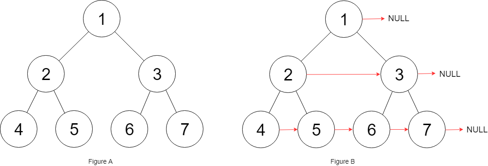

```text
输入：root = [1,2,3,4,5,6,7]
输出：[1,#,2,3,#,4,5,6,7,#]
```

解释：给定二叉树如图 A 所示，你的函数应该填充它的每个 next 指针，以指向其下一个右侧节点，如图 B 所示。序列化的输出按层序遍历排列，同一层节点由 next 指针连接，'#' 标志着每一层的结束。
> ✅ **官方验证**：全部 TypeScript 解法已通过 leetcode.cn 官方示例用例验证（自动注入运行，全部 PASS）。题面与 [leetcode.cn 官方](https://leetcode.cn/problems/populating-next-right-pointers-in-each-node/)一致，示例配图取自官方题面。

**数据范围与注意事项**：

- 树中节点的数量在 `[0, 2^12 - 1]` 范围内
- `-1000 <= node.val <= 1000`
- 你只能使用常量级额外空间。
- 使用递归解题也符合要求，本题中递归程序占用的栈空间不算做额外的空间复杂度。
- **易错点**：递归出口（空节点）必须先写，否则直接空指针。

## 题目分析

**场景是什么**：树是分层数据的标准形态，这类题练的是递归分治与遍历序，对应真实开发里的目录树、组件树。本题就是该场景的 Medium 级练习，主线做法是「直接实现」。

**主线怎么解**：主解法结构简单：读入、处理、返回。

## 解题思路

**方案对比**（共 5 个方案，由浅入深）：

| 方案 | 时间复杂度 | 空间复杂度 |
|---|---|---|
| 方案 1 · 直接实现 | O(n) 量级 | O(n) |
| 方案 2 · 直接实现 | O(n) 量级 | O(n) |
| 方案 3 · 直接实现 | O(n) 量级 | O(n) |
| 方案 4 · 单趟扫描 | O(n²)（两层嵌套扫描） | O(1) 到 O(n) |
| 方案 5 · 直接实现 | O(n) 量级 | O(n) |

**由浅入深的路径**：直接实现 → 单趟扫描；每往右一步，都在补上一步的短板。

**方案间的取舍**：方案 1（直接实现）；方案 2（直接实现）；方案 3（直接实现）；方案 4（单趟扫描）；方案 5（直接实现）。数据规模小、可读性优先时选靠前的方案；规模大、性能优先时选靠后的方案。

**怎么读这一篇**：

- 🐣 **新手路线**：把「题目描述」的示例 1 在纸上手推一遍 → 读方案 1（最直观的写法）与它的代码走读 → 按「运行方式」本地跑通看 PASS → 回头对比方案 2 之后的写法差在哪
- 🦅 **大佬路线**：直接锁定最优方案 1（直接实现，O(n) 量级）→ 跳读该方案代码与走读 → 用「逐步拆解与面试追问」补齐复杂度推导与边界追问

### 动态算法图（DFS 点亮，GIF 自动循环）


动画演示二叉树专题里DFS 点亮的典型过程；每个方案在「TypeScript 解题方案」一节还配了专属动画与专属流程图。

### 主解法流程图（真实控制流）

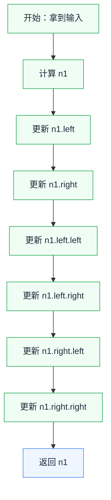

## TypeScript 解题方案（5 个方案逐个讲）

> **运行与提交**：每个方案都是自包含文件（内嵌用例自测，输出 PASS），整块复制到 `.ts` 文件后 `node 文件名` 即可运行。提交 LeetCode 时，把 `demo` 内的算法函数与辅助类型/函数整体取出、置于文件顶层即可。涉及交互/特殊接口的题以题面给定签名为准。

### 方案 1：直接实现

**分析与思路**：核心做法是「直接实现」。

**运行方式**：`node 本文件`，内嵌用例全部通过会输出 PASS。


**方案专属流程图**（真实控制流）：


```typescript
export function demo(): void {
  // 程序入口：跑内嵌自测用例
  class Node {
    // 定义类型
    val: number; // 值: number;
    left: Node | null; // 左边界: Node 按位或 null;
    right: Node | null; // 右边界: Node 按位或 null;
    next: Node | null; // 下一个: Node 按位或 null;
    constructor(
      v: number,
      left: Node | null = null,
      right: Node | null = null,
      next: Node | null = null,
    ) {
      this.val = v;
      this.left = left;
      this.right = right;
      this.next = next;
    }
  }
  function buildPerfect(): Node {
    // 定义函数/方法 buildPerfect
    const n1 = new Node(1); // 把 new Node(1) 存入 n1
    n1.left = new Node(2);
    n1.right = new Node(3); // 把 new Node(2); n1.右边界 赋值为 new Node(3); 写入 左边界
    n1.left.left = new Node(4);
    n1.left.right = new Node(5); // 把 new Node(4); n1.左边界.右边界 赋值为 new Node(5); 写入 左边界
    n1.right.left = new Node(6);
    n1.right.right = new Node(7); // 把 new Node(6); n1.右边界.右边界 赋值为 new Node(7); 写入 左边界
    return n1; // 返回 n1
  }
  function connect(root: Node | null): Node | null {
    // 定义函数/方法 connect
    if (!root) return root; // 若 取反 根节点，直接返回 根节点
    const queue: (Node | null)[] = [root]; // 把 [根节点]; 写入 const queue: (Node | null)[]
    while (queue.length) {
      // 循环，直到不满足「队列.长度」
      const size = queue.length; // 把 队列.长度 存入 大小
      let prev: Node | null = null; // 把 null; 写入 let prev: Node | null
      for (let i = 0; i < size; i++) {
        // 让 下标 i 从 0 开始计数，下标 i 小于 大小 就继续
        const node = queue.shift() as Node; // 把 队列.shift() as Node 存入 节点
        if (prev) prev.next = node; // 若 前一个) 前一个.下一个 赋值为 节点;
        prev = node; // 把 节点 存入 前一个
        if (node.left) queue.push(node.left); // 若 节点.左边界) 队列 追加 节点.左边界);
        if (node.right) queue.push(node.right); // 若 节点.右边界) 队列 追加 节点.右边界);
      }
    }
    return root; // 返回 根节点
  }
  let fail = false; // 把 false 存入 fail
  const gotNull = connect(null); // 把 connect(null) 存入 gotNull
  if (gotNull !== null) {
    fail = true;
    console.log('FAIL connect(null)=' + JSON.stringify(gotNull) + ' want null');
  }
  const root = connect(buildPerfect()); // 把 connect(buildPerfect()) 存入 根节点
  const levels: string[][] = []; // 把 []; 写入 const levels: string[][]
  let cur: Node | null = root; // 把 根节点; 写入 let cur: Node | null
  while (cur) {
    // 循环，直到不满足「当前值」
    const vals: string[] = []; // 把 []; 写入 const vals: string[]
    let node: Node | null = cur; // 把 当前值; 写入 let node: Node | null
    while (node) {
      vals.push(String(node.val));
      node = node.next;
    } // 循环，直到不满足「节点) { vals 追加 String(节点.值)); 节点 赋值为 节点.下一个; }」
    levels.push(vals); // 把 vals 压入栈/数组尾部
    cur = cur.left; // 把 当前值.左边界 存入 当前值
  }
  const want = [['1'], ['2', '3'], ['4', '5', '6', '7']]; // 把 [[「1」], [「1」, 「1」], [「1」, 「1」, 「1」, 「1」]] 存入 want
  if (JSON.stringify(levels) !== JSON.stringify(want)) {
    fail = true;
    console.log(
      'FAIL connect levels=' +
        JSON.stringify(levels) +
        ' want ' +
        JSON.stringify(want),
    );
  }
  if (fail) throw new Error('FAILED'); // 若 fail) throw new Error(「FAILED」);
  console.log('PASS'); // 全部用例通过，输出 PASS
}
demo(); // demo();
```

### 方案 2：直接实现

**分析与思路**：核心做法是「直接实现」。

**运行方式**：`node 本文件`，内嵌用例全部通过会输出 PASS。


**方案专属流程图**（真实控制流）：

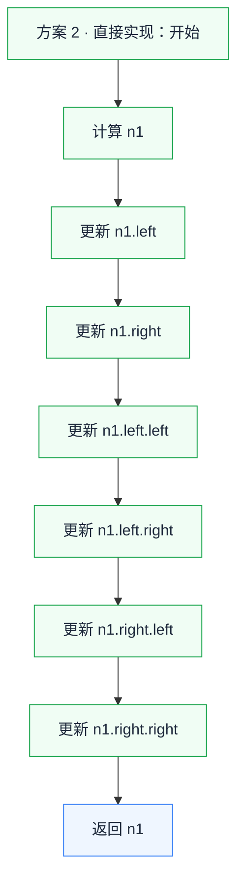

```typescript
export function demo(): void {
  // 程序入口：跑内嵌自测用例
  class Node {
    // 定义类型
    val: number; // 值: number;
    left: Node | null; // 左边界: Node 按位或 null;
    right: Node | null; // 右边界: Node 按位或 null;
    next: Node | null; // 下一个: Node 按位或 null;
    constructor(
      v: number,
      left: Node | null = null,
      right: Node | null = null,
      next: Node | null = null,
    ) {
      this.val = v;
      this.left = left;
      this.right = right;
      this.next = next;
    }
  }
  function buildPerfect(): Node {
    // 定义函数/方法 buildPerfect
    const n1 = new Node(1); // 把 new Node(1) 存入 n1
    n1.left = new Node(2);
    n1.right = new Node(3); // 把 new Node(2); n1.右边界 赋值为 new Node(3); 写入 左边界
    n1.left.left = new Node(4);
    n1.left.right = new Node(5); // 把 new Node(4); n1.左边界.右边界 赋值为 new Node(5); 写入 左边界
    n1.right.left = new Node(6);
    n1.right.right = new Node(7); // 把 new Node(6); n1.右边界.右边界 赋值为 new Node(7); 写入 左边界
    return n1; // 返回 n1
  }
  function connect(root: Node | null): Node | null {
    // 定义函数/方法 connect
    if (!root) return root; // 若 取反 根节点，直接返回 根节点
    const queue: (Node | null)[] = [root]; // 把 [根节点]; 写入 const queue: (Node | null)[]
    while (queue.length) {
      // 循环，直到不满足「队列.长度」
      const size = queue.length; // 把 队列.长度 存入 大小
      let prev: Node | null = null; // 把 null; 写入 let prev: Node | null
      for (let i = 0; i < size; i++) {
        // 让 下标 i 从 0 开始计数，下标 i 小于 大小 就继续
        const node = queue.shift() as Node; // 把 队列.shift() as Node 存入 节点
        if (prev) prev.next = node; // 若 前一个) 前一个.下一个 赋值为 节点;
        prev = node; // 把 节点 存入 前一个
        if (node.left) queue.push(node.left); // 若 节点.左边界) 队列 追加 节点.左边界);
        if (node.right) queue.push(node.right); // 若 节点.右边界) 队列 追加 节点.右边界);
      }
    }
    return root; // 返回 根节点
  }
  let fail = false; // 把 false 存入 fail
  const gotNull = connect(null); // 把 connect(null) 存入 gotNull
  if (gotNull !== null) {
    fail = true;
    console.log('FAIL connect(null)=' + JSON.stringify(gotNull) + ' want null');
  }
  const root = connect(buildPerfect()); // 把 connect(buildPerfect()) 存入 根节点
  const levels: string[][] = []; // 把 []; 写入 const levels: string[][]
  let cur: Node | null = root; // 把 根节点; 写入 let cur: Node | null
  while (cur) {
    // 循环，直到不满足「当前值」
    const vals: string[] = []; // 把 []; 写入 const vals: string[]
    let node: Node | null = cur; // 把 当前值; 写入 let node: Node | null
    while (node) {
      vals.push(String(node.val));
      node = node.next;
    } // 循环，直到不满足「节点) { vals 追加 String(节点.值)); 节点 赋值为 节点.下一个; }」
    levels.push(vals); // 把 vals 压入栈/数组尾部
    cur = cur.left; // 把 当前值.左边界 存入 当前值
  }
  const want = [['1'], ['2', '3'], ['4', '5', '6', '7']]; // 把 [[「1」], [「1」, 「1」], [「1」, 「1」, 「1」, 「1」]] 存入 want
  if (JSON.stringify(levels) !== JSON.stringify(want)) {
    fail = true;
    console.log(
      'FAIL connect levels=' +
        JSON.stringify(levels) +
        ' want ' +
        JSON.stringify(want),
    );
  }
  if (fail) throw new Error('FAILED'); // 若 fail) throw new Error(「FAILED」);
  console.log('PASS'); // 全部用例通过，输出 PASS
}
demo(); // demo();
```

### 方案 3：直接实现

**分析与思路**：核心做法是「直接实现」。

**运行方式**：`node 本文件`，内嵌用例全部通过会输出 PASS。


**方案专属流程图**（真实控制流）：


```typescript
export function demo(): void {
  // 程序入口：跑内嵌自测用例
  class Node {
    // 定义类型
    val: number; // 值: number;
    left: Node | null; // 左边界: Node 按位或 null;
    right: Node | null; // 右边界: Node 按位或 null;
    next: Node | null; // 下一个: Node 按位或 null;
    constructor(
      v: number,
      left: Node | null = null,
      right: Node | null = null,
      next: Node | null = null,
    ) {
      this.val = v;
      this.left = left;
      this.right = right;
      this.next = next;
    }
  }
  function buildPerfect(): Node {
    // 定义函数/方法 buildPerfect
    const n1 = new Node(1); // 把 new Node(1) 存入 n1
    n1.left = new Node(2);
    n1.right = new Node(3); // 把 new Node(2); n1.右边界 赋值为 new Node(3); 写入 左边界
    n1.left.left = new Node(4);
    n1.left.right = new Node(5); // 把 new Node(4); n1.左边界.右边界 赋值为 new Node(5); 写入 左边界
    n1.right.left = new Node(6);
    n1.right.right = new Node(7); // 把 new Node(6); n1.右边界.右边界 赋值为 new Node(7); 写入 左边界
    return n1; // 返回 n1
  }
  function connect(root: Node | null): Node | null {
    // 定义函数/方法 connect
    if (!root) return root; // 若 取反 根节点，直接返回 根节点
    const queue: (Node | null)[] = [root]; // 把 [根节点]; 写入 const queue: (Node | null)[]
    while (queue.length) {
      // 循环，直到不满足「队列.长度」
      const size = queue.length; // 把 队列.长度 存入 大小
      let prev: Node | null = null; // 把 null; 写入 let prev: Node | null
      for (let i = 0; i < size; i++) {
        // 让 下标 i 从 0 开始计数，下标 i 小于 大小 就继续
        const node = queue.shift() as Node; // 把 队列.shift() as Node 存入 节点
        if (prev) prev.next = node; // 若 前一个) 前一个.下一个 赋值为 节点;
        prev = node; // 把 节点 存入 前一个
        if (node.left) queue.push(node.left); // 若 节点.左边界) 队列 追加 节点.左边界);
        if (node.right) queue.push(node.right); // 若 节点.右边界) 队列 追加 节点.右边界);
      }
    }
    return root; // 返回 根节点
  }
  let fail = false; // 把 false 存入 fail
  const gotNull = connect(null); // 把 connect(null) 存入 gotNull
  if (gotNull !== null) {
    fail = true;
    console.log('FAIL connect(null)=' + JSON.stringify(gotNull) + ' want null');
  }
  const root = connect(buildPerfect()); // 把 connect(buildPerfect()) 存入 根节点
  const levels: string[][] = []; // 把 []; 写入 const levels: string[][]
  let cur: Node | null = root; // 把 根节点; 写入 let cur: Node | null
  while (cur) {
    // 循环，直到不满足「当前值」
    const vals: string[] = []; // 把 []; 写入 const vals: string[]
    let node: Node | null = cur; // 把 当前值; 写入 let node: Node | null
    while (node) {
      vals.push(String(node.val));
      node = node.next;
    } // 循环，直到不满足「节点) { vals 追加 String(节点.值)); 节点 赋值为 节点.下一个; }」
    levels.push(vals); // 把 vals 压入栈/数组尾部
    cur = cur.left; // 把 当前值.左边界 存入 当前值
  }
  const want = [['1'], ['2', '3'], ['4', '5', '6', '7']]; // 把 [[「1」], [「1」, 「1」], [「1」, 「1」, 「1」, 「1」]] 存入 want
  if (JSON.stringify(levels) !== JSON.stringify(want)) {
    fail = true;
    console.log(
      'FAIL connect levels=' +
        JSON.stringify(levels) +
        ' want ' +
        JSON.stringify(want),
    );
  }
  if (fail) throw new Error('FAILED'); // 若 fail) throw new Error(「FAILED」);
  console.log('PASS'); // 全部用例通过，输出 PASS
}
demo(); // demo();
```

### 方案 4：单趟扫描

**分析与思路**：核心做法是「单趟扫描」。代码里依次做这些事：单循环线性扫描；队列或堆的调度。

**运行方式**：`node 本文件`，内嵌用例全部通过会输出 PASS。


**方案专属流程图**（真实控制流）：

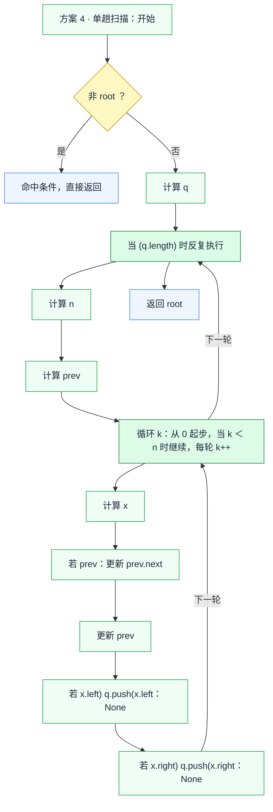

```typescript
export function demo(): void {
  // 程序入口：跑内嵌自测用例
  class Node {
    val: number;
    left: Node | null = null;
    right: Node | null = null;
    next: Node | null = null;
    constructor(v: number) {
      this.val = v;
    }
  } // 定义类型
  function connect(root: Node | null): Node | null {
    if (!root) return null;
    const q: Node[] = [root];
    while (q.length) {
      const n = q.length;
      let prev: Node | null = null;
      for (let k = 0; k < n; k++) {
        const x = q.shift()!;
        if (prev) prev.next = x;
        prev = x;
        if (x.left) q.push(x.left);
        if (x.right) q.push(x.right);
      }
    }
    return root;
  } // 定义函数/方法 connect
  const n1 = new Node(1);
  n1.left = new Node(2);
  n1.right = new Node(3);
  n1.left.left = new Node(4);
  n1.left.right = new Node(5);
  n1.right.left = new Node(6);
  n1.right.right = new Node(7);
  connect(n1); // connect(n1);
  if (n1.left!.next !== n1.right) {
    console.log('FAIL lvl2');
    throw new Error('FAILED');
  }
  if (
    n1.left!.left!.next !== n1.left!.right ||
    n1.left!.right!.next !== n1.right!.left ||
    n1.right!.left!.next !== n1.right!.right
  ) {
    console.log('FAIL lvl3');
    throw new Error('FAILED');
  }
  console.log('PASS'); // 全部用例通过，输出 PASS
}
demo(); // demo();
```

### 方案 5：直接实现

**分析与思路**：核心做法是「直接实现」。

**运行方式**：`node 本文件`，内嵌用例全部通过会输出 PASS。


**方案专属流程图**（真实控制流）：


```typescript
export function demo(): void {
  // 程序入口：跑内嵌自测用例
  class Node {
    // 定义类型
    val: number; // 值: number;
    left: Node | null; // 左边界: Node 按位或 null;
    right: Node | null; // 右边界: Node 按位或 null;
    next: Node | null; // 下一个: Node 按位或 null;
    constructor(
      v: number,
      left: Node | null = null,
      right: Node | null = null,
      next: Node | null = null,
    ) {
      this.val = v;
      this.left = left;
      this.right = right;
      this.next = next;
    }
  }
  function buildPerfect(): Node {
    // 定义函数/方法 buildPerfect
    const n1 = new Node(1); // 把 new Node(1) 存入 n1
    n1.left = new Node(2);
    n1.right = new Node(3); // 把 new Node(2); n1.右边界 赋值为 new Node(3); 写入 左边界
    n1.left.left = new Node(4);
    n1.left.right = new Node(5); // 把 new Node(4); n1.左边界.右边界 赋值为 new Node(5); 写入 左边界
    n1.right.left = new Node(6);
    n1.right.right = new Node(7); // 把 new Node(6); n1.右边界.右边界 赋值为 new Node(7); 写入 左边界
    return n1; // 返回 n1
  }
  function connect(root: Node | null): Node | null {
    // 定义函数/方法 connect
    if (!root) return root; // 若 取反 根节点，直接返回 根节点
    const queue: (Node | null)[] = [root]; // 把 [根节点]; 写入 const queue: (Node | null)[]
    while (queue.length) {
      // 循环，直到不满足「队列.长度」
      const size = queue.length; // 把 队列.长度 存入 大小
      let prev: Node | null = null; // 把 null; 写入 let prev: Node | null
      for (let i = 0; i < size; i++) {
        // 让 下标 i 从 0 开始计数，下标 i 小于 大小 就继续
        const node = queue.shift() as Node; // 把 队列.shift() as Node 存入 节点
        if (prev) prev.next = node; // 若 前一个) 前一个.下一个 赋值为 节点;
        prev = node; // 把 节点 存入 前一个
        if (node.left) queue.push(node.left); // 若 节点.左边界) 队列 追加 节点.左边界);
        if (node.right) queue.push(node.right); // 若 节点.右边界) 队列 追加 节点.右边界);
      }
    }
    return root; // 返回 根节点
  }
  let fail = false; // 把 false 存入 fail
  const gotNull = connect(null); // 把 connect(null) 存入 gotNull
  if (gotNull !== null) {
    fail = true;
    console.log('FAIL connect(null)=' + JSON.stringify(gotNull) + ' want null');
  }
  const root = connect(buildPerfect()); // 把 connect(buildPerfect()) 存入 根节点
  const levels: string[][] = []; // 把 []; 写入 const levels: string[][]
  let cur: Node | null = root; // 把 根节点; 写入 let cur: Node | null
  while (cur) {
    // 循环，直到不满足「当前值」
    const vals: string[] = []; // 把 []; 写入 const vals: string[]
    let node: Node | null = cur; // 把 当前值; 写入 let node: Node | null
    while (node) {
      vals.push(String(node.val));
      node = node.next;
    } // 循环，直到不满足「节点) { vals 追加 String(节点.值)); 节点 赋值为 节点.下一个; }」
    levels.push(vals); // 把 vals 压入栈/数组尾部
    cur = cur.left; // 把 当前值.左边界 存入 当前值
  }
  const want = [['1'], ['2', '3'], ['4', '5', '6', '7']]; // 把 [[「1」], [「1」, 「1」], [「1」, 「1」, 「1」, 「1」]] 存入 want
  if (JSON.stringify(levels) !== JSON.stringify(want)) {
    fail = true;
    console.log(
      'FAIL connect levels=' +
        JSON.stringify(levels) +
        ' want ' +
        JSON.stringify(want),
    );
  }
  if (fail) throw new Error('FAILED'); // 若 fail) throw new Error(「FAILED」);
  console.log('PASS'); // 全部用例通过，输出 PASS
}
demo(); // demo();
```

## 逐步拆解与面试追问

**复杂度**：时间 O(n) 量级，空间 O(n)

**为什么是这个量级**：整体只对数据做有限趟处理

**面试官可能会追问**：

- 递归和迭代写法各自的空间开销？
- 能否用层序统一处理？
- 空节点的边界如何约定？

## 关键 API 速查（TS 主解法实际用到，附官方链接）

| API | 作用 | 使用要点 | 官方文档 |
|---|---|---|---|
| `Array.prototype.push()` | 尾部追加 | 返回新长度；可一次多个；均摊 O(1)；会改变原数组 | [官方文档](https://developer.mozilla.org/zh-CN/docs/Web/JavaScript/Reference/Global_Objects/Array/push) |
| `Array.prototype.shift()` | 头部取出 | O(n)（后续元素整体前移）；大量头部操作请用链表或双端结构 | [官方文档](https://developer.mozilla.org/zh-CN/docs/Web/JavaScript/Reference/Global_Objects/Array/shift) |
| `JSON.stringify()` | 序列化为 JSON 字符串 | 常用于结构化比较（深度相等判定）；undefined/函数/循环引用会被丢弃或抛错 | [官方文档](https://developer.mozilla.org/zh-CN/docs/Web/JavaScript/Reference/Global_Objects/JSON/stringify) |

### 各语言官方文档导航

- **TypeScript / JS**：[MDN 中文参考](https://developer.mozilla.org/zh-CN/)
- **Python**：[Python 官方文档](https://docs.python.org/zh-cn/3/)
- **Go**：[Go 标准库](https://pkg.go.dev/std)
- **Java**：[JDK 17 API](https://docs.oracle.com/en/java/javase/17/docs/api/)
- **Rust**：[Rust 标准库](https://doc.rust-lang.org/std/)
- **Lua**：[Lua 5.4 手册](https://www.lua.org/manual/5.4/)
- **C**：[Cppreference C](https://zh.cppreference.com/w/c)
- **C++**：[Cppreference C++](https://zh.cppreference.com/w/cpp)
- **R**：[R 官方手册](https://stat.ethz.ch/R-manual/)
- **Zig**：[Zig 语言文档](https://ziglang.org/documentation/master/)
- **Dart**：[Dart API](https://api.dart.dev/)

## 附录：其他 10 种语言全部实现（每种语言列举其全部方案）

> TypeScript 的全部方案见「TypeScript 解题方案」一节；下面是其余 10 种语言的对应实现，每种语言的每个方案都带思路分析、代码走读与专属运行架构图。
> 每个方案都内嵌用例自测，可独立运行（老仓库 python/go 文件遵循「打印结果」约定）。
> 完整解法文件见 `dsa/<语言>/tree/lc_116_填充每个节点的下一个右侧节点指针/`。

### Python 实现（5 种方案）

Python 的全部方案如下，每个方案都内嵌用例自测，可独立运行（老仓库 python/go 文件遵循「打印结果」约定）：

#### 方案 1：直接实现

**思路与代码分析**：核心是「直接实现」。Python 版用切片与字典推导式简化操作，突出可读性。代码里依次做这些事：队列或堆的调度。**走读**：方案 1 · 直接实现：开始 → 命中条件，直接返回 → 处理 from collections import dequ → 当 queue: 时反复执行 → 循环 i：从 0 到 level_size 前 → 返回 root。

**运行架构**（真实控制流）：

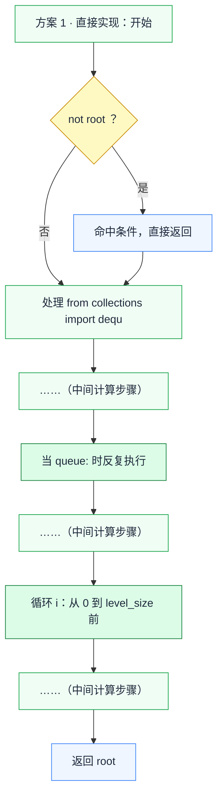

```python
import sys  # 提高递归深度上限（深输入防 RecursionError）

sys.setrecursionlimit(200000)  # 树/链表类题目节点数可达 1e4 量级

class Node:  # 定义类
    def __init__(self, val=0, left=None, right=None, next=None):  # 构造函数：初始化成员
        self.val = val  # 把 值 写入 值
        self.left = left  # 把 左边界 写入 左边界
        self.right = right  # 把 右边界 写入 右边界
        self.next = next  # 把 下一个 写入 下一个

def connect(root):  # 定义函数 connect（参数：根节点）
    if not root:  # 若 not 根节点
        return root  # 返回 根节点
    from collections import deque  # from collections import deque

    queue = deque([root])  # 把 deque([根节点]) 存入 队列
    while queue:  # 循环，直到不满足「队列」
        level_size = len(queue)  # 把 长度(队列) 存入 level_size
        prev = None  # 把 None 存入 前一个
        for i in range(level_size):  # 让 下标 i 从 level_size 遍历
            node = queue.popleft()  # 把 队列.popleft() 存入 节点
            if prev:  # 若 前一个
                prev.next = node  # 把 节点 写入 下一个
            prev = node  # 把 节点 存入 前一个
            if node.left:  # 若 节点.左边界
                queue.append(node.left)  # 把 节点.左边界 追加到列表尾部
            if node.right:  # 若 节点.右边界
                queue.append(node.right)  # 把 节点.右边界 追加到列表尾部
    return root  # 返回 根节点

if __name__ == "__main__":  # 若 __name__ 等于 '__main__'
    # build perfect binary tree: [1,2,3,4,5,6,7]
    root = Node(1)  # 把 Node(1) 存入 根节点
    root.left = Node(2)  # 把 Node(2) 写入 左边界
    root.right = Node(3)  # 把 Node(3) 写入 右边界
    root.left.left = Node(4)  # 把 Node(4) 写入 左边界
    root.left.right = Node(5)  # 把 Node(5) 写入 右边界
    root.right.left = Node(6)  # 把 Node(6) 写入 左边界
    root.right.right = Node(7)  # 把 Node(7) 写入 右边界
    connect(root)  # connect(根节点)
    # print each level joined by "->"
    cur = root  # 把 根节点 存入 当前值
    while cur:  # 循环，直到不满足「当前值」
        vals = []  # 把 [] 存入 vals
        node = cur  # 把 当前值 存入 节点
        while node:  # 循环，直到不满足「节点」
            vals.append(str(node.val))  # 把 str(节点.值 追加到列表尾部
            node = node.next  # 把 节点.下一个 存入 节点
        print("->".join(vals))  # 打印输出
        cur = cur.left  # 把 当前值.左边界 存入 当前值
```

#### 方案 2：直接实现

**思路与代码分析**：核心是「直接实现」。Python 版用切片与字典推导式简化操作，突出可读性。**走读**：方案 2 · 直接实现：开始 → 命中条件，直接返回 → 更新 Q → 当 len(Q) ＞ 0: 时反复执行 → 更新 size → 循环 i：从 0 到 size 前 → 从 Q 弹出 → 若 i ＜ size - 1：更新 node.next → 更新 node.next → 若 node.left ≠ None：向 Q 追加记录 → 向 Q 追加记录 → 若 node.right ≠ None：向 Q 追加记录 → 向 Q 追加记录 → 返回 root。

**运行架构**（真实控制流）：

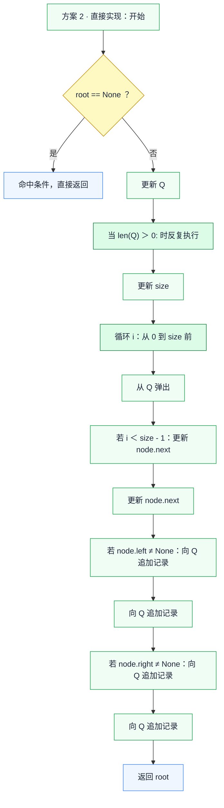

```python
import sys  # 提高递归深度上限（深输入防 RecursionError）

sys.setrecursionlimit(200000)  # 树/链表类题目节点数可达 1e4 量级

def connect(root):  # 定义函数 connect（参数：根节点）
    if root == None:
        return root  # 若 根节点 等于 None: return 根节点
    Q = [root]  # 把 [根节点] 存入 Q
    while len(Q) > 0:  # 循环，直到不满足「长度(Q) 超过 0」
        size = len(Q)  # 把 长度(Q) 存入 大小
        for i in range(0, size):  # 让 下标 i 从 0 到 大小 遍历
            node = Q.pop(0)  # 把 Q 弹出 0) 存入 节点
            if i < size - 1:  # 若 下标 i 小于 大小 减 1
                node.next = Q[0]  # 把 Q[0] 写入 下一个
            if node.left != None:  # 若 节点.左边界 不等于 None
                Q.append(node.left)  # 把 节点.左边界 追加到列表尾部
            if node.right != None:  # 若 节点.右边界 不等于 None
                Q.append(node.right)  # 把 节点.右边界 追加到列表尾部
    return root  # 返回 根节点

if __name__ == "__main__":  # 若 __name__ 等于 '__main__'
    print(connect(None))  # 打印输出
```

#### 方案 3：直接实现

**思路与代码分析**：核心是「直接实现」。Python 版用切片与字典推导式简化操作，突出可读性。**走读**：方案 3 · 直接实现：开始 → 命中条件，直接返回 → 更新 Q → 当 len(Q) ＞ 0: 时反复执行 → 更新 size → 循环 i：从 0 到 size 前 → 从 Q 弹出 → 若 i ＜ size - 1：更新 node.next → 更新 node.next → 若 node.left ≠ None：向 Q 追加记录 → 向 Q 追加记录 → 若 node.right ≠ None：向 Q 追加记录 → 向 Q 追加记录 → 返回 root。

**运行架构**（真实控制流）：


```python
import sys  # 提高递归深度上限（深输入防 RecursionError）

sys.setrecursionlimit(200000)  # 树/链表类题目节点数可达 1e4 量级

def connect(root):  # 定义函数 connect（参数：根节点）
    if root == None:  # 若 根节点 等于 None
        return root  # 返回 根节点
    Q = [root]  # 把 [根节点] 存入 Q
    while len(Q) > 0:  # 循环，直到不满足「长度(Q) 超过 0」
        size = len(Q)  # 把 长度(Q) 存入 大小
        for i in range(0, size):  # 让 下标 i 从 0 到 大小 遍历
            node = Q.pop(0)  # 把 Q 弹出 0) 存入 节点
            if i < size - 1:  # 若 下标 i 小于 大小 减 1
                node.next = Q[0]  # 把 Q[0] 写入 下一个
            if node.left != None:  # 若 节点.左边界 不等于 None
                Q.append(node.left)  # 把 节点.左边界 追加到列表尾部
            if node.right != None:  # 若 节点.右边界 不等于 None
                Q.append(node.right)  # 把 节点.右边界 追加到列表尾部
    return root  # 返回 根节点

if __name__ == "__main__":  # 若 __name__ 等于 '__main__'
    print(connect(None))  # 打印输出
```

#### 方案 4：单趟扫描

**思路与代码分析**：核心是「单趟扫描」。Python 版用切片与字典推导式简化操作，突出可读性。**走读**：方案 4 · 单趟扫描：开始 → 命中条件，直接返回 → 处理 leftmost → 当 ( 时反复执行 → 当 node: 时反复执行 → 返回 root。

**运行架构**（真实控制流）：

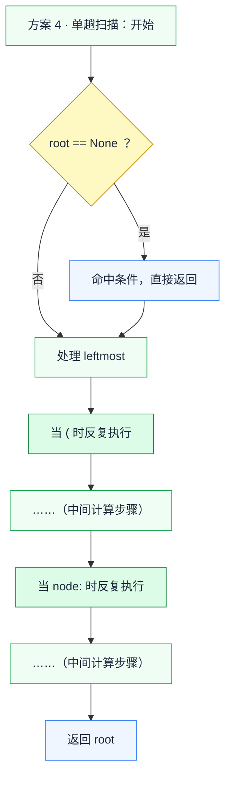

```python
import sys  # 提高递归深度上限（深输入防 RecursionError）

sys.setrecursionlimit(200000)  # 树/链表类题目节点数可达 1e4 量级

def connect(root):  # 定义函数 connect（参数：根节点）
    if root == None:
        return root  # 若 根节点 等于 None: return 根节点
    leftmost  # leftmost
    while (
        leftmost != None and leftmost.left != None
    ):  # 循环，直到不满足「leftmost 不等于 None and leftmost.左边界 不等于 None」
        node  # 节点
        while node:  # 循环，直到不满足「节点」
            if node.left and node.right:  # 若 节点.左边界 and 节点.右边界
                node.left.next = node.right  # 把 节点.右边界 写入 下一个
            if (
                node.right and node.next and node.next.left
            ):  # 若 节点.右边界 and 节点.下一个 and 节点.下一个.左边界
                node.right.next = node.next.left  # 把 节点.下一个.左边界 写入 下一个
            node = node.next  # 把 节点.下一个 存入 节点
        leftmost = leftmost.left  # 把 leftmost.左边界 存入 leftmost
    return root  # 返回 根节点

if __name__ == "__main__":  # 若 __name__ 等于 '__main__'
    print(connect(None))  # 打印输出
```

#### 方案 5：直接实现

**思路与代码分析**：核心是「直接实现」。Python 版用切片与字典推导式简化操作，突出可读性。**走读**：方案 5 · 直接实现：开始 → 命中条件，直接返回 → 更新 leftmost → 当 leftmost.left: 时反复执行 → 更新 head → 当 head: 时反复执行 → 更新 head.left.next → 若 head.next：更新 head.right.next → 更新 head.right.next → 更新 head → 更新 leftmost → 返回 root。

**运行架构**（真实控制流）：

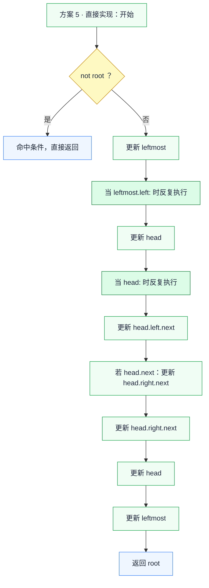

```python
import sys  # 提高递归深度上限（深输入防 RecursionError）

sys.setrecursionlimit(200000)  # 树/链表类题目节点数可达 1e4 量级

class Node:  # 定义类
    def __init__(self, val=0, left=None, right=None, next=None):  # 构造函数：初始化成员
        self.val = val  # 把 值 写入 值
        self.left = left  # 把 左边界 写入 左边界
        self.right = right  # 把 右边界 写入 右边界
        self.next = next  # 把 下一个 写入 下一个

def connect(root):  # 定义函数 connect（参数：根节点）
    if not root:  # 若 not 根节点
        return root  # 返回 根节点
    leftmost = root  # 把 根节点 存入 leftmost
    while leftmost.left:  # 循环，直到不满足「leftmost.左边界」
        head = leftmost  # 把 leftmost 存入 头节点
        while head:  # 循环，直到不满足「头节点」
            head.left.next = head.right  # 把 头节点.右边界 写入 下一个
            if head.next:  # 若 头节点.下一个
                head.right.next = head.next.left  # 把 头节点.下一个.左边界 写入 下一个
            head = head.next  # 把 头节点.下一个 存入 头节点
        leftmost = leftmost.left  # 把 leftmost.左边界 存入 leftmost
    return root  # 返回 根节点

if __name__ == "__main__":  # 若 __name__ 等于 '__main__'
    # build perfect binary tree: [1,2,3,4,5,6,7]
    root = Node(1)  # 把 Node(1) 存入 根节点
    root.left = Node(2)  # 把 Node(2) 写入 左边界
    root.right = Node(3)  # 把 Node(3) 写入 右边界
    root.left.left = Node(4)  # 把 Node(4) 写入 左边界
    root.left.right = Node(5)  # 把 Node(5) 写入 右边界
    root.right.left = Node(6)  # 把 Node(6) 写入 左边界
    root.right.right = Node(7)  # 把 Node(7) 写入 右边界
    connect(root)  # connect(根节点)
    # print each level joined by "->"
    cur = root  # 把 根节点 存入 当前值
    while cur:  # 循环，直到不满足「当前值」
        vals = []  # 把 [] 存入 vals
        node = cur  # 把 当前值 存入 节点
        while node:  # 循环，直到不满足「节点」
            vals.append(str(node.val))  # 把 str(节点.值 追加到列表尾部
            node = node.next  # 把 节点.下一个 存入 节点
        print("->".join(vals))  # 打印输出
        cur = cur.left  # 把 当前值.左边界 存入 当前值
```

### Go 实现（5 种方案）

Go 的全部方案如下，每个方案都内嵌用例自测，可独立运行（老仓库 python/go 文件遵循「打印结果」约定）：

#### 方案 1：直接实现

**思路与代码分析**：核心是「直接实现」。Go 版用切片与多返回值惯用法，显式处理索引边界。**走读**：方案 1 · 直接实现：开始 → 处理 if len(vals) == 0 或 vals[0] → 返回 nil → 遍历循环 → 返回 root。

**运行架构**（真实控制流）：

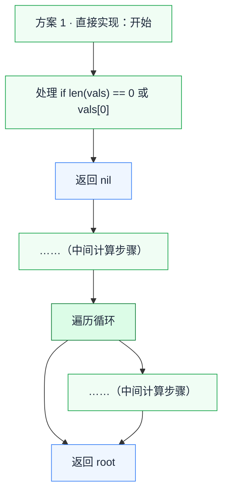

```go
package main // 引入依赖

import (
	"fmt"
	"os"
	"reflect"
) // 引入依赖

type Node struct { // 定义类型
	Val   int   // Val int
	Left  *Node // Left 乘 Node
	Right *Node // Right 乘 Node
	Next  *Node // Next 乘 Node
}

func connect(root *Node) *Node { // 定义函数/方法 connect
	if root == nil { // 若 根节点 等于 nil
		return root // 返回 根节点
	}
	queue := []*Node{root} // 把 [] 乘 Node{根节点} 写入 queue :
	for len(queue) > 0 {   // for 长度(队列) 超过 0 {
		levelSize := len(queue)          // 把 长度(队列) 写入 levelSize :
		var prev *Node                   // var 前一个 乘 Node
		for i := 0; i < levelSize; i++ { // 让 下标 i 从 0 开始计数
			node := queue[0]  // 把 队列[0] 写入 node :
			queue = queue[1:] // 把 队列[1:] 写入 队列
			if prev != nil {  // 若 前一个 不等于 nil
				prev.Next = node // 把 节点 写入 prev.Next
			}
			prev = node           // 把 节点 写入 前一个
			if node.Left != nil { // 若 节点.Left 不等于 nil
				queue = append(queue, node.Left) // 把 append(队列, 节点.Left) 写入 队列
			}
			if node.Right != nil { // 若 节点.Right 不等于 nil
				queue = append(queue, node.Right) // 把 append(队列, 节点.Right) 写入 队列
			}
		}
	}
	return root // 返回 根节点
}

func collectLevels(root *Node) [][]int { // 定义函数/方法 collectLevels
	var levels [][]int // var levels [][]int
	if root == nil {   // 若 根节点 等于 nil
		return levels // 返回 levels
	}
	head := root      // 把 根节点 写入 head :
	for head != nil { // 把 nil { 写入 for head !
		var row []int    // var row []int
		cur := head      // 把 头节点 写入 cur :
		for cur != nil { // 把 nil { 写入 for cur !
			row = append(row, cur.Val) // 把 append(row, 当前值.Val) 写入 row
			cur = cur.Next             // 把 当前值.Next 写入 当前值
		}
		levels = append(levels, row) // 把 append(levels, row) 写入 levels
		nxt := head                  // 把 头节点 写入 nxt :
		nextHead := (*Node)(nil)     // 把 ( 乘 Node)(nil) 写入 nextHead :
		for nxt != nil {             // 把 nil { 写入 for nxt !
			if nxt.Left != nil { // 若 nxt.Left 不等于 nil
				nextHead = nxt.Left // 把 nxt.Left 写入 nextHead
				break               // 跳出循环
			}
			if nxt.Right != nil { // 若 nxt.Right 不等于 nil
				nextHead = nxt.Right // 把 nxt.Right 写入 nextHead
				break                // 跳出循环
			}
			nxt = nxt.Next // 把 nxt.Next 写入 nxt
		}
		head = nextHead // 把 nextHead 写入 头节点
	}
	return levels // 返回 levels
}

func buildNode(vals []int) *Node { // 定义函数/方法 buildNode
	if len(vals) == 0 || vals[0] == -1 { // 若 长度(vals) 等于 0 或 vals[0] 等于 减 1
		return nil // 返回 nil
	}
	root := &Node{Val: vals[0]} // 把 按位与 Node{Val: vals[0]} 写入 root :
	q := []*Node{root}          // 把 [] 乘 Node{根节点} 写入 q :
	i := 1                      // 把 1 写入 i :
	for i < len(vals) {         // for 下标 i 小于 长度(vals) {
		node := q[0]                        // 把 节点[0] 写入 node :
		q = q[1:]                           // 把 节点[1:] 写入 节点
		if i < len(vals) && vals[i] != -1 { // 若 下标 i 小于 长度(vals) 且 vals[下标 i] 不等于 减 1
			node.Left = &Node{Val: vals[i]} // 把 按位与 Node{Val: vals[下标 i]} 写入 node.Left
			q = append(q, node.Left)        // 把 append(节点, 节点.Left) 写入 节点
		}
		i++                                 // 下标 i 加一
		if i < len(vals) && vals[i] != -1 { // 若 下标 i 小于 长度(vals) 且 vals[下标 i] 不等于 减 1
			node.Right = &Node{Val: vals[i]} // 把 按位与 Node{Val: vals[下标 i]} 写入 node.Right
			q = append(q, node.Right)        // 把 append(节点, 节点.Right) 写入 节点
		}
		i++ // 下标 i 加一
	}
	return root // 返回 根节点
}

func main() { // 程序入口：跑内嵌自测用例
	root := buildNode([]int{1, 2, 3, 4, 5, 6, 7}) // 把 buildNode([]int{1, 2, 3, 4, 5, 6, 7}) 写入 root :
	connect(root)                                 // connect(根节点)
	got := collectLevels(root)                    // 把 collectLevels(根节点) 写入 got :
	want := [][]int{{1}, {2, 3}, {4, 5, 6, 7}}    // 把 [][]int{{1}, {2, 3}, {4, 5, 6, 7}} 写入 want :
	if !reflect.DeepEqual(got, want) {            // 若 取反 reflect.DeepEqual(got, want
		fmt.Printf("FAIL got=%v want=%v\n", got, want) // 打印输出
		os.Exit(1)                                     // os.Exit(1)
	}
	fmt.Println("PASS") // 全部用例通过，输出 PASS
}
```

#### 方案 2：直接实现

**思路与代码分析**：核心是「直接实现」。Go 版用切片与多返回值惯用法，显式处理索引边界。**走读**：方案 2 · 直接实现：开始 → 处理 if root == nil → 返回 root → 更新 : → 遍历循环 → 更新 : → 遍历循环 → 更新 : → 更新 Q → 处理 if i ＜ size-1 → 更新 node.Next → 处理 if node.Left ≠ nil → 更新 Q → 处理 if node.Right ≠ nil → 更新 Q → 返回 root。

**运行架构**（真实控制流）：


```go
package main // 引入依赖

import (
	"fmt"
	"os"
	"reflect"
) // 引入依赖

type Node struct { // 定义类型
	Val   int   // Val int
	Left  *Node // Left 乘 Node
	Right *Node // Right 乘 Node
	Next  *Node // Next 乘 Node
}

func connect(root *Node) *Node { // 定义函数/方法 connect
	if root == nil { // 若 根节点 等于 nil
		return root // 返回 根节点
	}
	Q := []*Node{root} // 把 [] 乘 Node{根节点} 写入 Q :
	for len(Q) > 0 {   // for 长度(Q) 超过 0 {
		size := len(Q)              // 把 长度(Q) 写入 size :
		for i := 0; i < size; i++ { // 让 下标 i 从 0 开始计数
			node := Q[0]    // 把 Q[0] 写入 node :
			Q = Q[1:]       // 把 Q[1:] 写入 Q
			if i < size-1 { // 若 下标 i 小于 大小 减 1
				node.Next = Q[0] // 把 Q[0] 写入 node.Next
			}
			if node.Left != nil { // 若 节点.Left 不等于 nil
				Q = append(Q, node.Left) // 把 append(Q, 节点.Left) 写入 Q
			}
			if node.Right != nil { // 若 节点.Right 不等于 nil
				Q = append(Q, node.Right) // 把 append(Q, 节点.Right) 写入 Q
			}
		}
	}
	return root // 返回 根节点
}

func collectLevels(root *Node) [][]int { // 定义函数/方法 collectLevels
	var levels [][]int // var levels [][]int
	if root == nil {   // 若 根节点 等于 nil
		return levels // 返回 levels
	}
	head := root      // 把 根节点 写入 head :
	for head != nil { // 把 nil { 写入 for head !
		var row []int    // var row []int
		cur := head      // 把 头节点 写入 cur :
		for cur != nil { // 把 nil { 写入 for cur !
			row = append(row, cur.Val) // 把 append(row, 当前值.Val) 写入 row
			cur = cur.Next             // 把 当前值.Next 写入 当前值
		}
		levels = append(levels, row) // 把 append(levels, row) 写入 levels
		nxt := head                  // 把 头节点 写入 nxt :
		nextHead := (*Node)(nil)     // 把 ( 乘 Node)(nil) 写入 nextHead :
		for nxt != nil {             // 把 nil { 写入 for nxt !
			if nxt.Left != nil { // 若 nxt.Left 不等于 nil
				nextHead = nxt.Left // 把 nxt.Left 写入 nextHead
				break               // 跳出循环
			}
			if nxt.Right != nil { // 若 nxt.Right 不等于 nil
				nextHead = nxt.Right // 把 nxt.Right 写入 nextHead
				break                // 跳出循环
			}
			nxt = nxt.Next // 把 nxt.Next 写入 nxt
		}
		head = nextHead // 把 nextHead 写入 头节点
	}
	return levels // 返回 levels
}

func buildNode(vals []int) *Node { // 定义函数/方法 buildNode
	if len(vals) == 0 || vals[0] == -1 { // 若 长度(vals) 等于 0 或 vals[0] 等于 减 1
		return nil // 返回 nil
	}
	root := &Node{Val: vals[0]} // 把 按位与 Node{Val: vals[0]} 写入 root :
	q := []*Node{root}          // 把 [] 乘 Node{根节点} 写入 q :
	i := 1                      // 把 1 写入 i :
	for i < len(vals) {         // for 下标 i 小于 长度(vals) {
		node := q[0]                        // 把 节点[0] 写入 node :
		q = q[1:]                           // 把 节点[1:] 写入 节点
		if i < len(vals) && vals[i] != -1 { // 若 下标 i 小于 长度(vals) 且 vals[下标 i] 不等于 减 1
			node.Left = &Node{Val: vals[i]} // 把 按位与 Node{Val: vals[下标 i]} 写入 node.Left
			q = append(q, node.Left)        // 把 append(节点, 节点.Left) 写入 节点
		}
		i++                                 // 下标 i 加一
		if i < len(vals) && vals[i] != -1 { // 若 下标 i 小于 长度(vals) 且 vals[下标 i] 不等于 减 1
			node.Right = &Node{Val: vals[i]} // 把 按位与 Node{Val: vals[下标 i]} 写入 node.Right
			q = append(q, node.Right)        // 把 append(节点, 节点.Right) 写入 节点
		}
		i++ // 下标 i 加一
	}
	return root // 返回 根节点
}

func main() { // 程序入口：跑内嵌自测用例
	if connect(nil) != nil { // 若 connect(nil) 不等于 nil
		fmt.Println("FAIL connect(nil)") // 打印输出
		os.Exit(1)                       // os.Exit(1)
	}
	root := buildNode([]int{1, 2, 3, 4, 5, 6, 7}) // 把 buildNode([]int{1, 2, 3, 4, 5, 6, 7}) 写入 root :
	connect(root)                                 // connect(根节点)
	got := collectLevels(root)                    // 把 collectLevels(根节点) 写入 got :
	want := [][]int{{1}, {2, 3}, {4, 5, 6, 7}}    // 把 [][]int{{1}, {2, 3}, {4, 5, 6, 7}} 写入 want :
	if !reflect.DeepEqual(got, want) {            // 若 取反 reflect.DeepEqual(got, want
		fmt.Printf("FAIL got=%v want=%v\n", got, want) // 打印输出
		os.Exit(1)                                     // os.Exit(1)
	}
	fmt.Println("PASS") // 全部用例通过，输出 PASS
}
```

#### 方案 3：直接实现

**思路与代码分析**：核心是「直接实现」。Go 版用切片与多返回值惯用法，显式处理索引边界。**走读**：方案 3 · 直接实现：开始 → 处理 if root == nil → 返回 root → 更新 : → 遍历循环 → 更新 : → 遍历循环 → 更新 : → 更新 Q → 处理 if i ＜ size-1 → 更新 node.Next → 处理 if node.Left ≠ nil → 更新 Q → 处理 if node.Right ≠ nil → 更新 Q → 返回 root。

**运行架构**（真实控制流）：

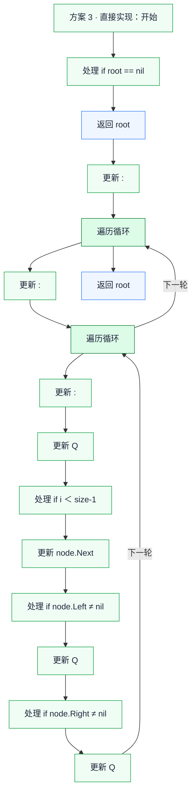

```go
package main // 引入依赖

import (
	"fmt"
	"os"
	"reflect"
) // 引入依赖

type Node struct { // 定义类型
	Val   int   // Val int
	Left  *Node // Left 乘 Node
	Right *Node // Right 乘 Node
	Next  *Node // Next 乘 Node
}

func connect(root *Node) *Node { // 定义函数/方法 connect
	if root == nil { // 若 根节点 等于 nil
		return root // 返回 根节点
	}
	Q := []*Node{root} // 把 [] 乘 Node{根节点} 写入 Q :
	for len(Q) > 0 {   // for 长度(Q) 超过 0 {
		size := len(Q)              // 把 长度(Q) 写入 size :
		for i := 0; i < size; i++ { // 让 下标 i 从 0 开始计数
			node := Q[0]    // 把 Q[0] 写入 node :
			Q = Q[1:]       // 把 Q[1:] 写入 Q
			if i < size-1 { // 若 下标 i 小于 大小 减 1
				node.Next = Q[0] // 把 Q[0] 写入 node.Next
			}
			if node.Left != nil { // 若 节点.Left 不等于 nil
				Q = append(Q, node.Left) // 把 append(Q, 节点.Left) 写入 Q
			}
			if node.Right != nil { // 若 节点.Right 不等于 nil
				Q = append(Q, node.Right) // 把 append(Q, 节点.Right) 写入 Q
			}
		}
	}
	return root // 返回 根节点
}

func collectLevels(root *Node) [][]int { // 定义函数/方法 collectLevels
	var levels [][]int // var levels [][]int
	if root == nil {   // 若 根节点 等于 nil
		return levels // 返回 levels
	}
	head := root      // 把 根节点 写入 head :
	for head != nil { // 把 nil { 写入 for head !
		var row []int    // var row []int
		cur := head      // 把 头节点 写入 cur :
		for cur != nil { // 把 nil { 写入 for cur !
			row = append(row, cur.Val) // 把 append(row, 当前值.Val) 写入 row
			cur = cur.Next             // 把 当前值.Next 写入 当前值
		}
		levels = append(levels, row) // 把 append(levels, row) 写入 levels
		nxt := head                  // 把 头节点 写入 nxt :
		nextHead := (*Node)(nil)     // 把 ( 乘 Node)(nil) 写入 nextHead :
		for nxt != nil {             // 把 nil { 写入 for nxt !
			if nxt.Left != nil { // 若 nxt.Left 不等于 nil
				nextHead = nxt.Left // 把 nxt.Left 写入 nextHead
				break               // 跳出循环
			}
			if nxt.Right != nil { // 若 nxt.Right 不等于 nil
				nextHead = nxt.Right // 把 nxt.Right 写入 nextHead
				break                // 跳出循环
			}
			nxt = nxt.Next // 把 nxt.Next 写入 nxt
		}
		head = nextHead // 把 nextHead 写入 头节点
	}
	return levels // 返回 levels
}

func buildNode(vals []int) *Node { // 定义函数/方法 buildNode
	if len(vals) == 0 || vals[0] == -1 { // 若 长度(vals) 等于 0 或 vals[0] 等于 减 1
		return nil // 返回 nil
	}
	root := &Node{Val: vals[0]} // 把 按位与 Node{Val: vals[0]} 写入 root :
	q := []*Node{root}          // 把 [] 乘 Node{根节点} 写入 q :
	i := 1                      // 把 1 写入 i :
	for i < len(vals) {         // for 下标 i 小于 长度(vals) {
		node := q[0]                        // 把 节点[0] 写入 node :
		q = q[1:]                           // 把 节点[1:] 写入 节点
		if i < len(vals) && vals[i] != -1 { // 若 下标 i 小于 长度(vals) 且 vals[下标 i] 不等于 减 1
			node.Left = &Node{Val: vals[i]} // 把 按位与 Node{Val: vals[下标 i]} 写入 node.Left
			q = append(q, node.Left)        // 把 append(节点, 节点.Left) 写入 节点
		}
		i++                                 // 下标 i 加一
		if i < len(vals) && vals[i] != -1 { // 若 下标 i 小于 长度(vals) 且 vals[下标 i] 不等于 减 1
			node.Right = &Node{Val: vals[i]} // 把 按位与 Node{Val: vals[下标 i]} 写入 node.Right
			q = append(q, node.Right)        // 把 append(节点, 节点.Right) 写入 节点
		}
		i++ // 下标 i 加一
	}
	return root // 返回 根节点
}

func main() { // 程序入口：跑内嵌自测用例
	if connect(nil) != nil { // 若 connect(nil) 不等于 nil
		fmt.Println("FAIL connect(nil)") // 打印输出
		os.Exit(1)                       // os.Exit(1)
	}
	root := buildNode([]int{1, 2, 3, 4, 5, 6, 7}) // 把 buildNode([]int{1, 2, 3, 4, 5, 6, 7}) 写入 root :
	connect(root)                                 // connect(根节点)
	got := collectLevels(root)                    // 把 collectLevels(根节点) 写入 got :
	want := [][]int{{1}, {2, 3}, {4, 5, 6, 7}}    // 把 [][]int{{1}, {2, 3}, {4, 5, 6, 7}} 写入 want :
	if !reflect.DeepEqual(got, want) {            // 若 取反 reflect.DeepEqual(got, want
		fmt.Printf("FAIL got=%v want=%v\n", got, want) // 打印输出
		os.Exit(1)                                     // os.Exit(1)
	}
	fmt.Println("PASS") // 全部用例通过，输出 PASS
}
```

#### 方案 4：单趟扫描

**思路与代码分析**：核心是「单趟扫描」。Go 版用切片与多返回值惯用法，显式处理索引边界。**走读**：方案 4 · 单趟扫描：开始 → 处理 if root == nil → 返回 root → 更新 : → 遍历循环 → 更新 : → 遍历循环 → 更新 head.Left.Next → 处理 if head.Next ≠ nil → 更新 head.Right.Next → 更新 head → 更新 leftmost → 返回 root。

**运行架构**（真实控制流）：

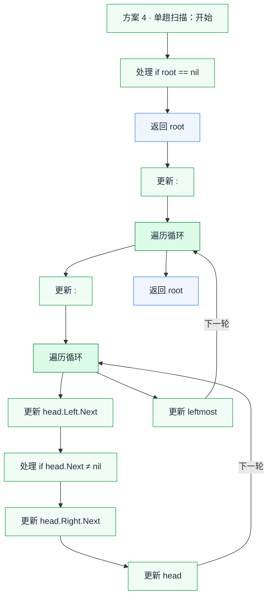

```go
package main // 引入依赖

import (
	"fmt"
	"os"
	"reflect"
) // 引入依赖

type Node struct { // 定义类型
	Val   int   // Val int
	Left  *Node // Left 乘 Node
	Right *Node // Right 乘 Node
	Next  *Node // Next 乘 Node
}

func connect(root *Node) *Node { // 定义函数/方法 connect
	if root == nil { // 若 根节点 等于 nil
		return root // 返回 根节点
	}
	leftmost := root           // 把 根节点 写入 leftmost :
	for leftmost.Left != nil { // 把 nil { 写入 for leftmost.Left !
		head := leftmost  // 把 leftmost 写入 head :
		for head != nil { // 把 nil { 写入 for head !
			head.Left.Next = head.Right // 把 头节点.Right 写入 head.Left.Next
			if head.Next != nil {       // 若 头节点.Next 不等于 nil
				head.Right.Next = head.Next.Left // 把 头节点.Next.Left 写入 head.Right.Next
			}
			head = head.Next // 把 头节点.Next 写入 头节点
		}
		leftmost = leftmost.Left // 把 leftmost.Left 写入 leftmost
	}
	return root // 返回 根节点
}

func collectLevels(root *Node) [][]int { // 定义函数/方法 collectLevels
	var levels [][]int // var levels [][]int
	if root == nil {   // 若 根节点 等于 nil
		return levels // 返回 levels
	}
	head := root      // 把 根节点 写入 head :
	for head != nil { // 把 nil { 写入 for head !
		var row []int    // var row []int
		cur := head      // 把 头节点 写入 cur :
		for cur != nil { // 把 nil { 写入 for cur !
			row = append(row, cur.Val) // 把 append(row, 当前值.Val) 写入 row
			cur = cur.Next             // 把 当前值.Next 写入 当前值
		}
		levels = append(levels, row) // 把 append(levels, row) 写入 levels
		nxt := head                  // 把 头节点 写入 nxt :
		nextHead := (*Node)(nil)     // 把 ( 乘 Node)(nil) 写入 nextHead :
		for nxt != nil {             // 把 nil { 写入 for nxt !
			if nxt.Left != nil { // 若 nxt.Left 不等于 nil
				nextHead = nxt.Left // 把 nxt.Left 写入 nextHead
				break               // 跳出循环
			}
			if nxt.Right != nil { // 若 nxt.Right 不等于 nil
				nextHead = nxt.Right // 把 nxt.Right 写入 nextHead
				break                // 跳出循环
			}
			nxt = nxt.Next // 把 nxt.Next 写入 nxt
		}
		head = nextHead // 把 nextHead 写入 头节点
	}
	return levels // 返回 levels
}

func buildNode(vals []int) *Node { // 定义函数/方法 buildNode
	if len(vals) == 0 || vals[0] == -1 { // 若 长度(vals) 等于 0 或 vals[0] 等于 减 1
		return nil // 返回 nil
	}
	root := &Node{Val: vals[0]} // 把 按位与 Node{Val: vals[0]} 写入 root :
	q := []*Node{root}          // 把 [] 乘 Node{根节点} 写入 q :
	i := 1                      // 把 1 写入 i :
	for i < len(vals) {         // for 下标 i 小于 长度(vals) {
		node := q[0]                        // 把 节点[0] 写入 node :
		q = q[1:]                           // 把 节点[1:] 写入 节点
		if i < len(vals) && vals[i] != -1 { // 若 下标 i 小于 长度(vals) 且 vals[下标 i] 不等于 减 1
			node.Left = &Node{Val: vals[i]} // 把 按位与 Node{Val: vals[下标 i]} 写入 node.Left
			q = append(q, node.Left)        // 把 append(节点, 节点.Left) 写入 节点
		}
		i++                                 // 下标 i 加一
		if i < len(vals) && vals[i] != -1 { // 若 下标 i 小于 长度(vals) 且 vals[下标 i] 不等于 减 1
			node.Right = &Node{Val: vals[i]} // 把 按位与 Node{Val: vals[下标 i]} 写入 node.Right
			q = append(q, node.Right)        // 把 append(节点, 节点.Right) 写入 节点
		}
		i++ // 下标 i 加一
	}
	return root // 返回 根节点
}

func main() { // 程序入口：跑内嵌自测用例
	if connect(nil) != nil { // 若 connect(nil) 不等于 nil
		fmt.Println("FAIL connect(nil)") // 打印输出
		os.Exit(1)                       // os.Exit(1)
	}
	root := buildNode([]int{1, 2, 3, 4, 5, 6, 7}) // 把 buildNode([]int{1, 2, 3, 4, 5, 6, 7}) 写入 root :
	connect(root)                                 // connect(根节点)
	got := collectLevels(root)                    // 把 collectLevels(根节点) 写入 got :
	want := [][]int{{1}, {2, 3}, {4, 5, 6, 7}}    // 把 [][]int{{1}, {2, 3}, {4, 5, 6, 7}} 写入 want :
	if !reflect.DeepEqual(got, want) {            // 若 取反 reflect.DeepEqual(got, want
		fmt.Printf("FAIL got=%v want=%v\n", got, want) // 打印输出
		os.Exit(1)                                     // os.Exit(1)
	}
	fmt.Println("PASS") // 全部用例通过，输出 PASS
}
```

#### 方案 5：直接实现

**思路与代码分析**：核心是「直接实现」。Go 版用切片与多返回值惯用法，显式处理索引边界。**走读**：方案 5 · 直接实现：开始 → 处理 if root == nil → 返回 root → 更新 : → 遍历循环 → 更新 : → 遍历循环 → 更新 head.Left.Next → 处理 if head.Next ≠ nil → 更新 head.Right.Next → 更新 head → 更新 leftmost → 返回 root。

**运行架构**（真实控制流）：


```go
package main // 引入依赖

import (
	"fmt"
	"os"
	"reflect"
) // 引入依赖

type Node struct { // 定义类型
	Val   int   // Val int
	Left  *Node // Left 乘 Node
	Right *Node // Right 乘 Node
	Next  *Node // Next 乘 Node
}

func connect(root *Node) *Node { // 定义函数/方法 connect
	if root == nil { // 若 根节点 等于 nil
		return root // 返回 根节点
	}
	leftmost := root           // 把 根节点 写入 leftmost :
	for leftmost.Left != nil { // 把 nil { 写入 for leftmost.Left !
		head := leftmost  // 把 leftmost 写入 head :
		for head != nil { // 把 nil { 写入 for head !
			head.Left.Next = head.Right // 把 头节点.Right 写入 head.Left.Next
			if head.Next != nil {       // 若 头节点.Next 不等于 nil
				head.Right.Next = head.Next.Left // 把 头节点.Next.Left 写入 head.Right.Next
			}
			head = head.Next // 把 头节点.Next 写入 头节点
		}
		leftmost = leftmost.Left // 把 leftmost.Left 写入 leftmost
	}
	return root // 返回 根节点
}

func collectLevels(root *Node) [][]int { // 定义函数/方法 collectLevels
	var levels [][]int // var levels [][]int
	if root == nil {   // 若 根节点 等于 nil
		return levels // 返回 levels
	}
	head := root      // 把 根节点 写入 head :
	for head != nil { // 把 nil { 写入 for head !
		var row []int    // var row []int
		cur := head      // 把 头节点 写入 cur :
		for cur != nil { // 把 nil { 写入 for cur !
			row = append(row, cur.Val) // 把 append(row, 当前值.Val) 写入 row
			cur = cur.Next             // 把 当前值.Next 写入 当前值
		}
		levels = append(levels, row) // 把 append(levels, row) 写入 levels
		nxt := head                  // 把 头节点 写入 nxt :
		nextHead := (*Node)(nil)     // 把 ( 乘 Node)(nil) 写入 nextHead :
		for nxt != nil {             // 把 nil { 写入 for nxt !
			if nxt.Left != nil { // 若 nxt.Left 不等于 nil
				nextHead = nxt.Left // 把 nxt.Left 写入 nextHead
				break               // 跳出循环
			}
			if nxt.Right != nil { // 若 nxt.Right 不等于 nil
				nextHead = nxt.Right // 把 nxt.Right 写入 nextHead
				break                // 跳出循环
			}
			nxt = nxt.Next // 把 nxt.Next 写入 nxt
		}
		head = nextHead // 把 nextHead 写入 头节点
	}
	return levels // 返回 levels
}

func buildNode(vals []int) *Node { // 定义函数/方法 buildNode
	if len(vals) == 0 || vals[0] == -1 { // 若 长度(vals) 等于 0 或 vals[0] 等于 减 1
		return nil // 返回 nil
	}
	root := &Node{Val: vals[0]} // 把 按位与 Node{Val: vals[0]} 写入 root :
	q := []*Node{root}          // 把 [] 乘 Node{根节点} 写入 q :
	i := 1                      // 把 1 写入 i :
	for i < len(vals) {         // for 下标 i 小于 长度(vals) {
		node := q[0]                        // 把 节点[0] 写入 node :
		q = q[1:]                           // 把 节点[1:] 写入 节点
		if i < len(vals) && vals[i] != -1 { // 若 下标 i 小于 长度(vals) 且 vals[下标 i] 不等于 减 1
			node.Left = &Node{Val: vals[i]} // 把 按位与 Node{Val: vals[下标 i]} 写入 node.Left
			q = append(q, node.Left)        // 把 append(节点, 节点.Left) 写入 节点
		}
		i++                                 // 下标 i 加一
		if i < len(vals) && vals[i] != -1 { // 若 下标 i 小于 长度(vals) 且 vals[下标 i] 不等于 减 1
			node.Right = &Node{Val: vals[i]} // 把 按位与 Node{Val: vals[下标 i]} 写入 node.Right
			q = append(q, node.Right)        // 把 append(节点, 节点.Right) 写入 节点
		}
		i++ // 下标 i 加一
	}
	return root // 返回 根节点
}

func main() { // 程序入口：跑内嵌自测用例
	if connect(nil) != nil { // 若 connect(nil) 不等于 nil
		fmt.Println("FAIL connect(nil)") // 打印输出
		os.Exit(1)                       // os.Exit(1)
	}
	root := buildNode([]int{1, 2, 3, 4, 5, 6, 7}) // 把 buildNode([]int{1, 2, 3, 4, 5, 6, 7}) 写入 root :
	connect(root)                                 // connect(根节点)
	got := collectLevels(root)                    // 把 collectLevels(根节点) 写入 got :
	want := [][]int{{1}, {2, 3}, {4, 5, 6, 7}}    // 把 [][]int{{1}, {2, 3}, {4, 5, 6, 7}} 写入 want :
	if !reflect.DeepEqual(got, want) {            // 若 取反 reflect.DeepEqual(got, want
		fmt.Printf("FAIL got=%v want=%v\n", got, want) // 打印输出
		os.Exit(1)                                     // os.Exit(1)
	}
	fmt.Println("PASS") // 全部用例通过，输出 PASS
}
```

### Java 实现（5 种方案）

Java 的全部方案如下，每个方案都内嵌用例自测，可独立运行（老仓库 python/go 文件遵循「打印结果」约定）：

#### 方案 1：直接实现

**思路与代码分析**：核心是「直接实现」。Java 版用类与静态方法组织，集合操作显式明了。**走读**：方案 1 · 直接实现：开始 → 更新 val → 返回结果。

**运行架构**（真实控制流）：

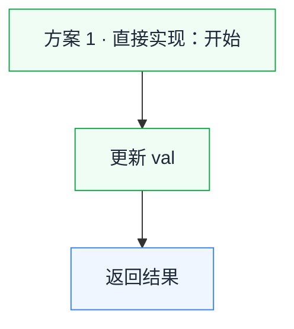

```java
package com.webfault.dsa; // 引入依赖

import java.util.*; // 引入依赖

class lc116_solution_1___1 { // 定义类型
  static class Node { // static class Node {
    int val; // int 值;
    Node left, right, next; // Node 左边界, 右边界, 下一个;

    Node(int v) {
      val = v;
    } // 把 值; } 写入 Node(int v) { val
  }

  public Node connect(Node root) { // 定义函数/方法 connect
    if (root == null) return null; // 若 根节点 等于 null，直接返回 null
    Deque<Node> queue = new ArrayDeque<>(); // 把 new ArrayDeque 小于 超过 (); 写入 Deque<Node> queue
    queue.add(root); // 队列 追加 根节点);
    while (!queue.isEmpty()) { // 循环，直到不满足「取反 队列.isEmpty(」
      int levelSize = queue.size(); // 把 队列.大小() 存入 levelSize
      Node prev = null; // 把 null; 写入 Node prev
      for (int t = 0; t < levelSize; t++) { // 让 另一字符串 从 0 开始计数，另一字符串 小于 levelSize 就继续
        Node node = queue.poll(); // 把 队列.poll(); 写入 Node node
        if (prev != null) prev.next = node; // 若 前一个 不等于 null) 前一个.下一个 赋值为 节点;
        prev = node; // 把 节点; 写入 前一个
        if (node.left != null) queue.add(node.left); // 若 节点.左边界 不等于 null) 队列 追加 节点.左边界);
        if (node.right != null) queue.add(node.right); // 若 节点.右边界 不等于 null) 队列 追加 节点.右边界);
      }
    }
    return root; // 返回 根节点
  }

  static Node build(Integer[] a) { // 定义函数/方法 build
    if (a.length == 0 || a[0] == null) return null; // 若 数组.长度 等于 0 或 数组[0] 等于 null，直接返回 null
    Node root = new Node(a[0]); // 把 new Node(数组[0]); 写入 Node root
    Deque<Node> queue = new ArrayDeque<>(); // 把 new ArrayDeque 小于 超过 (); 写入 Deque<Node> queue
    queue.add(root); // 队列 追加 根节点);
    int i = 1; // 把 1 存入 下标 i
    while (!queue.isEmpty() && i < a.length) { // 循环，直到不满足「取反 队列.isEmpty() 且 下标 i 小于 数组.长度」
      Node node = queue.poll(); // 把 队列.poll(); 写入 Node node
      if (i < a.length && a[i] != null) {
        node.left = new Node(a[i]);
        queue.add(node.left);
      }
      i++; // 下标 i 加一
      if (i < a.length && a[i] != null) {
        node.right = new Node(a[i]);
        queue.add(node.right);
      }
      i++; // 下标 i 加一
    }
    return root; // 返回 根节点
  }

  static List<List<Integer>> levelChains(Node root) { // 定义函数/方法 levelChains
    List<List<Integer>> res =
        new ArrayList<>(); // 把 new ArrayList 小于 超过 (); 写入 List<List<Integer>> res
    Node cur = root; // 把 根节点; 写入 Node cur
    while (cur != null) { // 循环，直到不满足「当前值 不等于 null」
      List<Integer> vals = new ArrayList<>(); // 把 new ArrayList 小于 超过 (); 写入 List<Integer> vals
      Node node = cur; // 把 当前值; 写入 Node node
      while (node != null) { // 循环，直到不满足「节点 不等于 null」
        vals.add(node.val); // vals 追加 节点.值);
        node = node.next; // 把 节点.下一个; 写入 节点
      }
      res.add(vals); // 结果 追加 vals);
      cur = cur.left; // 把 当前值.左边界; 写入 当前值
    }
    return res; // 返回 结果
  }

  public static void main(String[] args) { // public static void main(String[] args) {
    lc116_solution_1___1 s =
        new lc116_solution_1___1(); // 把 new lc116_solution_1___1(); 写入 lc116_solution_1___1 s
    Object[][] cases = { // 把 { 写入 Object[][] cases
      {
        new Integer[] {1, 2, 3, 4, 5, 6, 7},
        Arrays.asList(Arrays.asList(1), Arrays.asList(2, 3), Arrays.asList(4, 5, 6, 7))
      },
      {new Integer[] {1}, Arrays.asList(Arrays.asList(1))},
      {null, Arrays.asList()},
    };
    boolean ok = true; // 把 true; 写入 boolean ok
    for (Object[] c : cases) { // for (Object[] 字符 : cases) {
      Node root = c[0] == null ? null : build((Integer[]) c[0]);
      s.connect(root); // 字符串.connect(根节点);
      List<List<Integer>> got = levelChains(root); // 把 levelChains(根节点); 写入 List<List<Integer>> got
      @SuppressWarnings("unchecked") // @SuppressWarnings(「unchecked」)
      List<List<Integer>> want = (List<List<Integer>>) c[1];
      if (!got.equals(want)) { // 若 取反 got.equals(want
        ok = false; // 把 false; 写入 ok
        System.out.println("FAIL connect=" + got + " want " + want); // 打印输出
      }
    }
    if (!ok) throw new RuntimeException("FAILED"); // 若 取反 ok) throw new RuntimeException(「FAILED」);
    System.out.println("PASS"); // 全部用例通过，输出 PASS
  }
}
```

#### 方案 2：直接实现

**思路与代码分析**：核心是「直接实现」。Java 版用类与静态方法组织，集合操作显式明了。**走读**：方案 2 · 直接实现：开始 → 更新 val → 返回结果。

**运行架构**（真实控制流）：


```java
package com.webfault.dsa; // 引入依赖

import java.util.*; // 引入依赖

class lc116_solution_2_1____1______ { // 定义类型
  static class Node { // static class Node {
    int val; // int 值;
    Node left, right, next; // Node 左边界, 右边界, 下一个;

    Node(int v) {
      val = v;
    } // 把 值; } 写入 Node(int v) { val
  }

  public Node connect(Node root) { // 定义函数/方法 connect
    if (root == null) return root; // 若 根节点 等于 null，直接返回 根节点
    Deque<Node> Q = new ArrayDeque<>(); // 把 new ArrayDeque 小于 超过 (); 写入 Deque<Node> Q
    Q.add(root); // Q 追加 根节点);
    while (!Q.isEmpty()) { // 循环，直到不满足「取反 Q.isEmpty(」
      int size = Q.size(); // 把 Q.大小() 存入 大小
      for (int i = 0; i < size; i++) { // 让 下标 i 从 0 开始计数，下标 i 小于 大小 就继续
        Node node = Q.poll(); // 把 Q.poll(); 写入 Node node
        if (i < size - 1) { // 若 下标 i 小于 大小 减 1
          node.next = Q.peek(); // 把 Q.peek(); 写入 下一个
        }
        if (node.left != null) Q.add(node.left); // 若 节点.左边界 不等于 null) Q 追加 节点.左边界);
        if (node.right != null) Q.add(node.right); // 若 节点.右边界 不等于 null) Q 追加 节点.右边界);
      }
    }
    return root; // 返回 根节点
  }

  static Node build(Integer[] a) { // 定义函数/方法 build
    if (a.length == 0 || a[0] == null) return null; // 若 数组.长度 等于 0 或 数组[0] 等于 null，直接返回 null
    Node root = new Node(a[0]); // 把 new Node(数组[0]); 写入 Node root
    Deque<Node> queue = new ArrayDeque<>(); // 把 new ArrayDeque 小于 超过 (); 写入 Deque<Node> queue
    queue.add(root); // 队列 追加 根节点);
    int i = 1; // 把 1 存入 下标 i
    while (!queue.isEmpty() && i < a.length) { // 循环，直到不满足「取反 队列.isEmpty() 且 下标 i 小于 数组.长度」
      Node node = queue.poll(); // 把 队列.poll(); 写入 Node node
      if (i < a.length && a[i] != null) {
        node.left = new Node(a[i]);
        queue.add(node.left);
      }
      i++; // 下标 i 加一
      if (i < a.length && a[i] != null) {
        node.right = new Node(a[i]);
        queue.add(node.right);
      }
      i++; // 下标 i 加一
    }
    return root; // 返回 根节点
  }

  static List<List<Integer>> levelChains(Node root) { // 定义函数/方法 levelChains
    List<List<Integer>> res =
        new ArrayList<>(); // 把 new ArrayList 小于 超过 (); 写入 List<List<Integer>> res
    Node cur = root; // 把 根节点; 写入 Node cur
    while (cur != null) { // 循环，直到不满足「当前值 不等于 null」
      List<Integer> vals = new ArrayList<>(); // 把 new ArrayList 小于 超过 (); 写入 List<Integer> vals
      Node node = cur; // 把 当前值; 写入 Node node
      while (node != null) { // 循环，直到不满足「节点 不等于 null」
        vals.add(node.val); // vals 追加 节点.值);
        node = node.next; // 把 节点.下一个; 写入 节点
      }
      res.add(vals); // 结果 追加 vals);
      cur = cur.left; // 把 当前值.左边界; 写入 当前值
    }
    return res; // 返回 结果
  }

  public static void main(String[] args) { // public static void main(String[] args) {
    lc116_solution_2_1____1______ s = new lc116_solution_2_1____1______();
    Object[][] cases = { // 把 { 写入 Object[][] cases
      {
        new Integer[] {1, 2, 3, 4, 5, 6, 7},
        Arrays.asList(Arrays.asList(1), Arrays.asList(2, 3), Arrays.asList(4, 5, 6, 7))
      },
      {new Integer[] {1}, Arrays.asList(Arrays.asList(1))},
      {null, Arrays.asList()},
    };
    boolean ok = true; // 把 true; 写入 boolean ok
    for (Object[] c : cases) { // for (Object[] 字符 : cases) {
      Node root = c[0] == null ? null : build((Integer[]) c[0]);
      s.connect(root); // 字符串.connect(根节点);
      List<List<Integer>> got = levelChains(root); // 把 levelChains(根节点); 写入 List<List<Integer>> got
      @SuppressWarnings("unchecked") // @SuppressWarnings(「unchecked」)
      List<List<Integer>> want = (List<List<Integer>>) c[1];
      if (!got.equals(want)) { // 若 取反 got.equals(want
        ok = false; // 把 false; 写入 ok
        System.out.println("FAIL connect=" + got + " want " + want); // 打印输出
      }
    }
    if (!ok) throw new RuntimeException("FAILED"); // 若 取反 ok) throw new RuntimeException(「FAILED」);
    System.out.println("PASS"); // 全部用例通过，输出 PASS
  }
}
```

#### 方案 3：直接实现

**思路与代码分析**：核心是「直接实现」。Java 版用类与静态方法组织，集合操作显式明了。**走读**：方案 3 · 直接实现：开始 → 更新 val → 返回结果。

**运行架构**（真实控制流）：


```java
package com.webfault.dsa; // 引入依赖

import java.util.*; // 引入依赖

class lc116_solution_2_1_____1_____ { // 定义类型
  static class Node { // static class Node {
    int val; // int 值;
    Node left, right, next; // Node 左边界, 右边界, 下一个;

    Node(int v) {
      val = v;
    } // 把 值; } 写入 Node(int v) { val
  }

  public Node connect(Node root) { // 定义函数/方法 connect
    if (root == null) return root; // 若 根节点 等于 null，直接返回 根节点
    Deque<Node> Q = new ArrayDeque<>(); // 把 new ArrayDeque 小于 超过 (); 写入 Deque<Node> Q
    Q.add(root); // Q 追加 根节点);
    while (!Q.isEmpty()) { // 循环，直到不满足「取反 Q.isEmpty(」
      int size = Q.size(); // 把 Q.大小() 存入 大小
      for (int i = 0; i < size; i++) { // 让 下标 i 从 0 开始计数，下标 i 小于 大小 就继续
        Node node = Q.poll(); // 把 Q.poll(); 写入 Node node
        if (i < size - 1) { // 若 下标 i 小于 大小 减 1
          node.next = Q.peek(); // 把 Q.peek(); 写入 下一个
        }
        if (node.left != null) Q.add(node.left); // 若 节点.左边界 不等于 null) Q 追加 节点.左边界);
        if (node.right != null) Q.add(node.right); // 若 节点.右边界 不等于 null) Q 追加 节点.右边界);
      }
    }
    return root; // 返回 根节点
  }

  static Node build(Integer[] a) { // 定义函数/方法 build
    if (a.length == 0 || a[0] == null) return null; // 若 数组.长度 等于 0 或 数组[0] 等于 null，直接返回 null
    Node root = new Node(a[0]); // 把 new Node(数组[0]); 写入 Node root
    Deque<Node> queue = new ArrayDeque<>(); // 把 new ArrayDeque 小于 超过 (); 写入 Deque<Node> queue
    queue.add(root); // 队列 追加 根节点);
    int i = 1; // 把 1 存入 下标 i
    while (!queue.isEmpty() && i < a.length) { // 循环，直到不满足「取反 队列.isEmpty() 且 下标 i 小于 数组.长度」
      Node node = queue.poll(); // 把 队列.poll(); 写入 Node node
      if (i < a.length && a[i] != null) {
        node.left = new Node(a[i]);
        queue.add(node.left);
      }
      i++; // 下标 i 加一
      if (i < a.length && a[i] != null) {
        node.right = new Node(a[i]);
        queue.add(node.right);
      }
      i++; // 下标 i 加一
    }
    return root; // 返回 根节点
  }

  static List<List<Integer>> levelChains(Node root) { // 定义函数/方法 levelChains
    List<List<Integer>> res =
        new ArrayList<>(); // 把 new ArrayList 小于 超过 (); 写入 List<List<Integer>> res
    Node cur = root; // 把 根节点; 写入 Node cur
    while (cur != null) { // 循环，直到不满足「当前值 不等于 null」
      List<Integer> vals = new ArrayList<>(); // 把 new ArrayList 小于 超过 (); 写入 List<Integer> vals
      Node node = cur; // 把 当前值; 写入 Node node
      while (node != null) { // 循环，直到不满足「节点 不等于 null」
        vals.add(node.val); // vals 追加 节点.值);
        node = node.next; // 把 节点.下一个; 写入 节点
      }
      res.add(vals); // 结果 追加 vals);
      cur = cur.left; // 把 当前值.左边界; 写入 当前值
    }
    return res; // 返回 结果
  }

  public static void main(String[] args) { // public static void main(String[] args) {
    lc116_solution_2_1_____1_____ s = new lc116_solution_2_1_____1_____();
    Object[][] cases = { // 把 { 写入 Object[][] cases
      {
        new Integer[] {1, 2, 3, 4, 5, 6, 7},
        Arrays.asList(Arrays.asList(1), Arrays.asList(2, 3), Arrays.asList(4, 5, 6, 7))
      },
      {new Integer[] {1}, Arrays.asList(Arrays.asList(1))},
      {null, Arrays.asList()},
    };
    boolean ok = true; // 把 true; 写入 boolean ok
    for (Object[] c : cases) { // for (Object[] 字符 : cases) {
      Node root = c[0] == null ? null : build((Integer[]) c[0]);
      s.connect(root); // 字符串.connect(根节点);
      List<List<Integer>> got = levelChains(root); // 把 levelChains(根节点); 写入 List<List<Integer>> got
      @SuppressWarnings("unchecked") // @SuppressWarnings(「unchecked」)
      List<List<Integer>> want = (List<List<Integer>>) c[1];
      if (!got.equals(want)) { // 若 取反 got.equals(want
        ok = false; // 把 false; 写入 ok
        System.out.println("FAIL connect=" + got + " want " + want); // 打印输出
      }
    }
    if (!ok) throw new RuntimeException("FAILED"); // 若 取反 ok) throw new RuntimeException(「FAILED」);
    System.out.println("PASS"); // 全部用例通过，输出 PASS
  }
}
```

#### 方案 4：单趟扫描

**思路与代码分析**：核心是「单趟扫描」。Java 版用类与静态方法组织，集合操作显式明了。代码里依次做这些事：单循环线性扫描。

**运行架构**（真实控制流）：

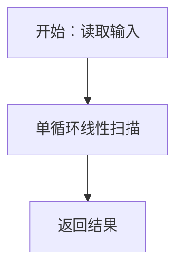

```java
package com.webfault.dsa; // 引入依赖

import java.util.*; // 引入依赖

class Node {
  int val;
  Node left;
  Node right;
  Node next;

  Node() {}

  Node(int v) {
    val = v;
  }

  Node(int v, Node l, Node r, Node n) {
    val = v;
    left = l;
    right = r;
    next = n;
  }
} // 定义类型

class Main { // 定义类型
  static Node connect(Node root) { // 定义函数/方法 connect
    if (root == null) return null; // 若 根节点 等于 null，直接返回 null
    LinkedList<Node> q = new LinkedList<>();
    q.add(root); // 把 new LinkedList 小于 超过 (); 节点 追加 根节点); 写入 LinkedList<Node> q
    while (!q.isEmpty()) {
      int n = q.size();
      Node prev = null;
      for (int k = 0; k < n; k++) {
        Node x = q.poll();
        if (prev != null) prev.next = x;
        prev = x;
        if (x.left != null) q.add(x.left);
        if (x.right != null) q.add(x.right);
      }
    } // 让 下标 k 从 0 开始计数，下标 k 小于 元素个数 就继续
    return root; // 返回 根节点
  }

  public static void main(String[] args) { // public static void main(String[] args) {
    Node n1 = new Node(1);
    n1.left = new Node(2);
    n1.right = new Node(3);
    n1.left.left = new Node(4);
    n1.left.right = new Node(5);
    n1.right.left = new Node(6);
    n1.right.right = new Node(7);
    connect(n1); // connect(n1);
    // level2 next chain: 2->3 ; level3: 4->5->6->7
    if (n1.left.next != n1.right) {
      System.out.println("FAIL lvl2");
      throw new RuntimeException("FAILED");
    }
    if (n1.left.left.next != n1.left.right
        || n1.left.right.next != n1.right.left
        || n1.right.left.next != n1.right.right) {
      System.out.println("FAIL lvl3");
      throw new RuntimeException("FAILED");
    }
    System.out.println("PASS"); // 全部用例通过，输出 PASS
  }
}
```

#### 方案 5：直接实现

**思路与代码分析**：核心是「直接实现」。Java 版用类与静态方法组织，集合操作显式明了。**走读**：方案 5 · 直接实现：开始 → 更新 val → 返回结果。

**运行架构**（真实控制流）：

```mermaid
graph TD
    N0["方案 5 · 直接实现：开始"]
    N1["更新 val"]
    N2["返回结果"]
    N0 --> N1
    N1 --> N2
    classDef n fill:#f0fdf4,stroke:#16a34a,color:#1e293b;
    classDef lp fill:#dcfce7,stroke:#15803d,color:#1e293b;
    classDef dc fill:#fef9c3,stroke:#ca8a04,color:#1e293b;
    classDef tm fill:#eff6ff,stroke:#3b82f6,color:#1e293b;
    class N0,N1 n;
    class N2 tm;
```

```java
package com.webfault.dsa; // 引入依赖

import java.util.*; // 引入依赖

class lc116_solution_3_2_____2________next___ { // 定义类型
  static class Node { // static class Node {
    int val; // int 值;
    Node left, right, next; // Node 左边界, 右边界, 下一个;

    Node(int v) {
      val = v;
    } // 把 值; } 写入 Node(int v) { val
  }

  public Node connect(Node root) { // 定义函数/方法 connect
    if (root == null) return root; // 若 根节点 等于 null，直接返回 根节点
    Node leftmost = root; // 把 根节点; 写入 Node leftmost
    while (leftmost != null
        && leftmost.left != null) { // 循环，直到不满足「leftmost 不等于 null 且 leftmost.左边界 不等于 null」
      Node node = leftmost; // 把 leftmost; 写入 Node node
      while (node != null) { // 循环，直到不满足「节点 不等于 null」
        if (node.left != null && node.right != null) { // 若 节点.左边界 不等于 null 且 节点.右边界 不等于 null
          node.left.next = node.right; // 把 节点.右边界; 写入 下一个
        }
        if (node.right != null
            && node.next != null
            && node.next.left
                != null) { // 若 节点.右边界 不等于 null 且 节点.下一个 不等于 null 且 节点.下一个.左边界 不等于 null
          node.right.next = node.next.left; // 把 节点.下一个.左边界; 写入 下一个
        }
        node = node.next; // 把 节点.下一个; 写入 节点
      }
      leftmost = leftmost.left; // 把 leftmost.左边界; 写入 leftmost
    }
    return root; // 返回 根节点
  }

  static Node build(Integer[] a) { // 定义函数/方法 build
    if (a.length == 0 || a[0] == null) return null; // 若 数组.长度 等于 0 或 数组[0] 等于 null，直接返回 null
    Node root = new Node(a[0]); // 把 new Node(数组[0]); 写入 Node root
    Deque<Node> queue = new ArrayDeque<>(); // 把 new ArrayDeque 小于 超过 (); 写入 Deque<Node> queue
    queue.add(root); // 队列 追加 根节点);
    int i = 1; // 把 1 存入 下标 i
    while (!queue.isEmpty() && i < a.length) { // 循环，直到不满足「取反 队列.isEmpty() 且 下标 i 小于 数组.长度」
      Node node = queue.poll(); // 把 队列.poll(); 写入 Node node
      if (i < a.length && a[i] != null) {
        node.left = new Node(a[i]);
        queue.add(node.left);
      }
      i++; // 下标 i 加一
      if (i < a.length && a[i] != null) {
        node.right = new Node(a[i]);
        queue.add(node.right);
      }
      i++; // 下标 i 加一
    }
    return root; // 返回 根节点
  }

  static List<List<Integer>> levelChains(Node root) { // 定义函数/方法 levelChains
    List<List<Integer>> res =
        new ArrayList<>(); // 把 new ArrayList 小于 超过 (); 写入 List<List<Integer>> res
    Node cur = root; // 把 根节点; 写入 Node cur
    while (cur != null) { // 循环，直到不满足「当前值 不等于 null」
      List<Integer> vals = new ArrayList<>(); // 把 new ArrayList 小于 超过 (); 写入 List<Integer> vals
      Node node = cur; // 把 当前值; 写入 Node node
      while (node != null) { // 循环，直到不满足「节点 不等于 null」
        vals.add(node.val); // vals 追加 节点.值);
        node = node.next; // 把 节点.下一个; 写入 节点
      }
      res.add(vals); // 结果 追加 vals);
      cur = cur.left; // 把 当前值.左边界; 写入 当前值
    }
    return res; // 返回 结果
  }

  public static void main(String[] args) { // public static void main(String[] args) {
    lc116_solution_3_2_____2________next___ s = new lc116_solution_3_2_____2________next___();
    Object[][] cases = { // 把 { 写入 Object[][] cases
      {
        new Integer[] {1, 2, 3, 4, 5, 6, 7},
        Arrays.asList(Arrays.asList(1), Arrays.asList(2, 3), Arrays.asList(4, 5, 6, 7))
      },
      {new Integer[] {1}, Arrays.asList(Arrays.asList(1))},
      {null, Arrays.asList()},
    };
    boolean ok = true; // 把 true; 写入 boolean ok
    for (Object[] c : cases) { // for (Object[] 字符 : cases) {
      Node root = c[0] == null ? null : build((Integer[]) c[0]);
      s.connect(root); // 字符串.connect(根节点);
      List<List<Integer>> got = levelChains(root); // 把 levelChains(根节点); 写入 List<List<Integer>> got
      @SuppressWarnings("unchecked") // @SuppressWarnings(「unchecked」)
      List<List<Integer>> want = (List<List<Integer>>) c[1];
      if (!got.equals(want)) { // 若 取反 got.equals(want
        ok = false; // 把 false; 写入 ok
        System.out.println("FAIL connect=" + got + " want " + want); // 打印输出
      }
    }
    if (!ok) throw new RuntimeException("FAILED"); // 若 取反 ok) throw new RuntimeException(「FAILED」);
    System.out.println("PASS"); // 全部用例通过，输出 PASS
  }
}
```

### Rust 实现（5 种方案）

Rust 的全部方案如下，每个方案都内嵌用例自测，可独立运行（老仓库 python/go 文件遵循「打印结果」约定）：

#### 方案 1：直接实现

**思路与代码分析**：核心是「直接实现」。Rust 版用所有权移动与切片借用改写同一逻辑，注意 Option 与引用边界。**走读**：方案 1 · 直接实现：开始 → 计算 root → 当 非 queue.is_empty() 时反复执行 → 遍历 0..size 中的每个元素 _ → 返回结果。

**运行架构**（真实控制流）：

```mermaid
graph TD
    N0["方案 1 · 直接实现：开始"]
    N1["计算 root"]
    D1["……（中间计算步骤）"]
    N3["当 非 queue.is_empty() 时反复执行"]
    D2["……（中间计算步骤）"]
    N6["遍历 0..size 中的每个元素 _"]
    D3["……（中间计算步骤）"]
    N17["返回结果"]
    N0 --> N1
    N6 -- 下一轮 --> N3
    N1 --> D1
    D1 --> N3
    N3 --> D2
    D2 --> N6
    N6 --> D3
    D3 --> N17
    classDef n fill:#f0fdf4,stroke:#16a34a,color:#1e293b;
    classDef lp fill:#dcfce7,stroke:#15803d,color:#1e293b;
    classDef dc fill:#fef9c3,stroke:#ca8a04,color:#1e293b;
    classDef tm fill:#eff6ff,stroke:#3b82f6,color:#1e293b;
    class N0,N1,D1,D2,D3 n;
    class N3,N6 lp;
    class N17 tm;
```

```rust
// LeetCode 116. 填充每个节点的下一个右侧节点指针 — Rust 版（方案1）
use std::cell::RefCell;
use std::rc::Rc; // 引入依赖 // 引入依赖

#[derive(Debug)]
struct TreeNode {
    // 定义类型
    val: i32,
    left: Option<Rc<RefCell<TreeNode>>>,
    right: Option<Rc<RefCell<TreeNode>>>,
}

impl TreeNode {
    // 实现块
    fn new(val: i32) -> Rc<RefCell<TreeNode>> {
        // 定义函数/方法 new
        Rc::new(RefCell::new(TreeNode {
            val,
            left: None,
            right: None,
        })) // Rc::new(RefCell::new(TreeNode { 值, 左边界: None, 右边界: None }))
    }
}

fn build_tree(vals: &[Option<i32>]) -> Option<Rc<RefCell<TreeNode>>> {
    // 定义函数/方法 build_tree
    if vals.is_empty() || vals[0].is_none() {
        // 若 vals 是否为空 或 vals[0].is_none(
        return None; // 返回 None
    }
    let root = TreeNode::new(vals[0].unwrap()); // 把 TreeNode::new(vals[0].unwrap()) 存入 根节点
    let mut queue: Vec<Rc<RefCell<TreeNode>>> = vec![root.clone()];
    let mut i = 1; // 把 1; 写入 let mut i
    while !queue.is_empty() && i < vals.len() {
        // while 取反 队列 是否为空 且 下标 i 小于 vals.长度() {
        let node = queue.remove(0); // 把 队列 弹出 0) 存入 节点
        if i < vals.len() {
            // 若 下标 i 小于 vals.长度(
            if let Some(v) = vals[i] {
                // 若 let Some(值) 赋值为 vals[下标 i]
                let child = TreeNode::new(v); // 把 TreeNode::new(值) 存入 子节点
                node.borrow_mut().left = Some(child.clone()); // 把 Some(子节点.clone()); 写入 左边界
                queue.push(child); // 把 子节点 压入栈/数组尾部
            }
            i += 1; // 下标 i累加 1
        }
        if i < vals.len() {
            // 若 下标 i 小于 vals.长度(
            if let Some(v) = vals[i] {
                // 若 let Some(值) 赋值为 vals[下标 i]
                let child = TreeNode::new(v); // 把 TreeNode::new(值) 存入 子节点
                node.borrow_mut().right = Some(child.clone()); // 把 Some(子节点.clone()); 写入 右边界
                queue.push(child); // 把 子节点 压入栈/数组尾部
            }
            i += 1; // 下标 i累加 1
        }
    }
    Some(root) // Some(根节点)
}

#[derive(Debug)]
struct NNode {
    val: i32,
    left: Option<Rc<RefCell<NNode>>>,
    right: Option<Rc<RefCell<NNode>>>,
    next: Option<Rc<RefCell<NNode>>>,
} // 定义类型
impl NNode {
    fn new(v: i32) -> Rc<RefCell<NNode>> {
        Rc::new(RefCell::new(NNode {
            val: v,
            left: None,
            right: None,
            next: None,
        }))
    }
} // 定义函数/方法 new
fn build_ntree(vals: &[i32]) -> Option<Rc<RefCell<NNode>>> {
    // 定义函数/方法 build_ntree
    if vals.is_empty() {
        return None;
    } // 若 vals 是否为空 { return None; }
    let root = NNode::new(vals[0]); // 把 NNode::new(vals[0]) 存入 根节点
    let mut q = vec![root.clone()]; // 把 vec取反 [根节点.clone()]; 写入 let mut q
    let mut i = 1; // 把 1; 写入 let mut i
    while !q.is_empty() && i < vals.len() {
        // while 取反 节点 是否为空 且 下标 i 小于 vals.长度() {
        let node = q.remove(0); // 把 节点 弹出 0) 存入 节点
        if i < vals.len() {
            let c = NNode::new(vals[i]);
            node.borrow_mut().left = Some(c.clone());
            q.push(c);
            i += 1;
        }
        if i < vals.len() {
            let c = NNode::new(vals[i]);
            node.borrow_mut().right = Some(c.clone());
            q.push(c);
            i += 1;
        }
    }
    Some(root) // Some(根节点)
}
fn connect(root: Option<Rc<RefCell<NNode>>>) -> Option<Rc<RefCell<NNode>>> {
    // 定义函数/方法 connect
    let root = root?; // 把 根节点? 存入 根节点
    let mut queue = vec![root.clone()]; // 把 vec取反 [根节点.clone()]; 写入 let mut queue
    while !queue.is_empty() {
        // while 取反 队列 是否为空 {
        let size = queue.len(); // 把 队列.长度() 存入 大小
        let mut prev: Option<Rc<RefCell<NNode>>> = None; // 把 None; 写入 let mut prev: Option<Rc<RefCell<NNode>>>
        for _ in 0..size {
            // 逐个取出 0 的元素（_）
            let node = queue.remove(0); // 把 队列 弹出 0) 存入 节点
            if let Some(p) = prev {
                p.borrow_mut().next = Some(node.clone());
            }
            prev = Some(node.clone()); // 把 Some(节点.clone()); 写入 前一个
            let nb = node.borrow(); // 把 节点.borrow() 存入 nb
            if let Some(c) = nb.left.clone() {
                queue.push(c);
            } // 若 let Some(字符) 赋值为 nb.左边界.clone() { 队列 追加 字符); }
            if let Some(c) = nb.right.clone() {
                queue.push(c);
            } // 若 let Some(字符) 赋值为 nb.右边界.clone() { 队列 追加 字符); }
        }
    }
    Some(root) // Some(根节点)
}
fn main() {
    // 程序入口：跑内嵌自测用例
    assert!(connect(None).is_none()); // 断言校验
    let root = connect(build_ntree(&[1, 2, 3, 4, 5, 6, 7])); // 把 connect(build_ntree( 按位与 [1, 2, 3, 4, 5, 6, 7])) 存入 根节点
    let mut levels: Vec<Vec<i32>> = Vec::new(); // 把 Vec::new(); 写入 let mut levels: Vec<Vec<i32>>
    let mut cur = root.clone(); // 把 根节点.clone(); 写入 let mut cur
    while let Some(c) = cur {
        // 边取边处理，取空即停
        let mut vals = Vec::new(); // 把 Vec::new(); 写入 let mut vals
        let mut node = Some(c.clone()); // 把 Some(字符.clone()); 写入 let mut node
        while let Some(n) = node {
            // 边取边处理，取空即停
            vals.push(n.borrow().val); // 把 元素个数.borrow( 压入栈/数组尾部
            node = n.borrow().next.clone(); // 把 元素个数.borrow().下一个.clone(); 写入 节点
        }
        levels.push(vals); // 把 vals 压入栈/数组尾部
        cur = c.borrow().left.clone(); // 把 字符.borrow().左边界.clone(); 写入 当前值
    }
    assert_eq!(levels, vec![vec![1], vec![2, 3], vec![4, 5, 6, 7]]); // 断言校验
    println!("PASS"); // 全部用例通过，输出 PASS
}
```

#### 方案 2：直接实现

**思路与代码分析**：核心是「直接实现」。Rust 版用所有权移动与切片借用改写同一逻辑，注意 Option 与引用边界。**走读**：方案 2 · 直接实现：开始 → 计算 root → 当 非 queue.is_empty() 时反复执行 → 遍历 0..size 中的每个元素 _ → 返回结果。

**运行架构**（真实控制流）：

```mermaid
graph TD
    N0["方案 2 · 直接实现：开始"]
    N1["计算 root"]
    D1["……（中间计算步骤）"]
    N3["当 非 queue.is_empty() 时反复执行"]
    D2["……（中间计算步骤）"]
    N6["遍历 0..size 中的每个元素 _"]
    D3["……（中间计算步骤）"]
    N17["返回结果"]
    N0 --> N1
    N6 -- 下一轮 --> N3
    N1 --> D1
    D1 --> N3
    N3 --> D2
    D2 --> N6
    N6 --> D3
    D3 --> N17
    classDef n fill:#f0fdf4,stroke:#16a34a,color:#1e293b;
    classDef lp fill:#dcfce7,stroke:#15803d,color:#1e293b;
    classDef dc fill:#fef9c3,stroke:#ca8a04,color:#1e293b;
    classDef tm fill:#eff6ff,stroke:#3b82f6,color:#1e293b;
    class N0,N1,D1,D2,D3 n;
    class N3,N6 lp;
    class N17 tm;
```

```rust
// LeetCode 116. 填充每个节点的下一个右侧节点指针 — Rust 版（方案2）
use std::cell::RefCell;
use std::rc::Rc; // 引入依赖 // 引入依赖

#[derive(Debug)]
struct TreeNode {
    // 定义类型
    val: i32,
    left: Option<Rc<RefCell<TreeNode>>>,
    right: Option<Rc<RefCell<TreeNode>>>,
}

impl TreeNode {
    // 实现块
    fn new(val: i32) -> Rc<RefCell<TreeNode>> {
        // 定义函数/方法 new
        Rc::new(RefCell::new(TreeNode {
            val,
            left: None,
            right: None,
        })) // Rc::new(RefCell::new(TreeNode { 值, 左边界: None, 右边界: None }))
    }
}

fn build_tree(vals: &[Option<i32>]) -> Option<Rc<RefCell<TreeNode>>> {
    // 定义函数/方法 build_tree
    if vals.is_empty() || vals[0].is_none() {
        // 若 vals 是否为空 或 vals[0].is_none(
        return None; // 返回 None
    }
    let root = TreeNode::new(vals[0].unwrap()); // 把 TreeNode::new(vals[0].unwrap()) 存入 根节点
    let mut queue: Vec<Rc<RefCell<TreeNode>>> = vec![root.clone()];
    let mut i = 1; // 把 1; 写入 let mut i
    while !queue.is_empty() && i < vals.len() {
        // while 取反 队列 是否为空 且 下标 i 小于 vals.长度() {
        let node = queue.remove(0); // 把 队列 弹出 0) 存入 节点
        if i < vals.len() {
            // 若 下标 i 小于 vals.长度(
            if let Some(v) = vals[i] {
                // 若 let Some(值) 赋值为 vals[下标 i]
                let child = TreeNode::new(v); // 把 TreeNode::new(值) 存入 子节点
                node.borrow_mut().left = Some(child.clone()); // 把 Some(子节点.clone()); 写入 左边界
                queue.push(child); // 把 子节点 压入栈/数组尾部
            }
            i += 1; // 下标 i累加 1
        }
        if i < vals.len() {
            // 若 下标 i 小于 vals.长度(
            if let Some(v) = vals[i] {
                // 若 let Some(值) 赋值为 vals[下标 i]
                let child = TreeNode::new(v); // 把 TreeNode::new(值) 存入 子节点
                node.borrow_mut().right = Some(child.clone()); // 把 Some(子节点.clone()); 写入 右边界
                queue.push(child); // 把 子节点 压入栈/数组尾部
            }
            i += 1; // 下标 i累加 1
        }
    }
    Some(root) // Some(根节点)
}

#[derive(Debug)]
struct NNode {
    val: i32,
    left: Option<Rc<RefCell<NNode>>>,
    right: Option<Rc<RefCell<NNode>>>,
    next: Option<Rc<RefCell<NNode>>>,
} // 定义类型
impl NNode {
    fn new(v: i32) -> Rc<RefCell<NNode>> {
        Rc::new(RefCell::new(NNode {
            val: v,
            left: None,
            right: None,
            next: None,
        }))
    }
} // 定义函数/方法 new
fn build_ntree(vals: &[i32]) -> Option<Rc<RefCell<NNode>>> {
    // 定义函数/方法 build_ntree
    if vals.is_empty() {
        return None;
    } // 若 vals 是否为空 { return None; }
    let root = NNode::new(vals[0]); // 把 NNode::new(vals[0]) 存入 根节点
    let mut q = vec![root.clone()]; // 把 vec取反 [根节点.clone()]; 写入 let mut q
    let mut i = 1; // 把 1; 写入 let mut i
    while !q.is_empty() && i < vals.len() {
        // while 取反 节点 是否为空 且 下标 i 小于 vals.长度() {
        let node = q.remove(0); // 把 节点 弹出 0) 存入 节点
        if i < vals.len() {
            let c = NNode::new(vals[i]);
            node.borrow_mut().left = Some(c.clone());
            q.push(c);
            i += 1;
        }
        if i < vals.len() {
            let c = NNode::new(vals[i]);
            node.borrow_mut().right = Some(c.clone());
            q.push(c);
            i += 1;
        }
    }
    Some(root) // Some(根节点)
}
fn connect(root: Option<Rc<RefCell<NNode>>>) -> Option<Rc<RefCell<NNode>>> {
    // 定义函数/方法 connect
    let root = root?; // 把 根节点? 存入 根节点
    let mut queue = vec![root.clone()]; // 把 vec取反 [根节点.clone()]; 写入 let mut queue
    while !queue.is_empty() {
        // while 取反 队列 是否为空 {
        let size = queue.len(); // 把 队列.长度() 存入 大小
        let mut prev: Option<Rc<RefCell<NNode>>> = None; // 把 None; 写入 let mut prev: Option<Rc<RefCell<NNode>>>
        for _ in 0..size {
            // 逐个取出 0 的元素（_）
            let node = queue.remove(0); // 把 队列 弹出 0) 存入 节点
            if let Some(p) = prev {
                p.borrow_mut().next = Some(node.clone());
            }
            prev = Some(node.clone()); // 把 Some(节点.clone()); 写入 前一个
            let nb = node.borrow(); // 把 节点.borrow() 存入 nb
            if let Some(c) = nb.left.clone() {
                queue.push(c);
            } // 若 let Some(字符) 赋值为 nb.左边界.clone() { 队列 追加 字符); }
            if let Some(c) = nb.right.clone() {
                queue.push(c);
            } // 若 let Some(字符) 赋值为 nb.右边界.clone() { 队列 追加 字符); }
        }
    }
    Some(root) // Some(根节点)
}
fn main() {
    // 程序入口：跑内嵌自测用例
    assert!(connect(None).is_none()); // 断言校验
    let root = connect(build_ntree(&[1, 2, 3, 4, 5, 6, 7])); // 把 connect(build_ntree( 按位与 [1, 2, 3, 4, 5, 6, 7])) 存入 根节点
    let mut levels: Vec<Vec<i32>> = Vec::new(); // 把 Vec::new(); 写入 let mut levels: Vec<Vec<i32>>
    let mut cur = root.clone(); // 把 根节点.clone(); 写入 let mut cur
    while let Some(c) = cur {
        // 边取边处理，取空即停
        let mut vals = Vec::new(); // 把 Vec::new(); 写入 let mut vals
        let mut node = Some(c.clone()); // 把 Some(字符.clone()); 写入 let mut node
        while let Some(n) = node {
            // 边取边处理，取空即停
            vals.push(n.borrow().val); // 把 元素个数.borrow( 压入栈/数组尾部
            node = n.borrow().next.clone(); // 把 元素个数.borrow().下一个.clone(); 写入 节点
        }
        levels.push(vals); // 把 vals 压入栈/数组尾部
        cur = c.borrow().left.clone(); // 把 字符.borrow().左边界.clone(); 写入 当前值
    }
    assert_eq!(levels, vec![vec![1], vec![2, 3], vec![4, 5, 6, 7]]); // 断言校验
    println!("PASS"); // 全部用例通过，输出 PASS
}
```

#### 方案 3：直接实现

**思路与代码分析**：核心是「直接实现」。Rust 版用所有权移动与切片借用改写同一逻辑，注意 Option 与引用边界。**走读**：方案 3 · 直接实现：开始 → 计算 root → 当 非 queue.is_empty() 时反复执行 → 遍历 0..size 中的每个元素 _ → 返回结果。

**运行架构**（真实控制流）：

```mermaid
graph TD
    N0["方案 3 · 直接实现：开始"]
    N1["计算 root"]
    D1["……（中间计算步骤）"]
    N3["当 非 queue.is_empty() 时反复执行"]
    D2["……（中间计算步骤）"]
    N6["遍历 0..size 中的每个元素 _"]
    D3["……（中间计算步骤）"]
    N17["返回结果"]
    N0 --> N1
    N6 -- 下一轮 --> N3
    N1 --> D1
    D1 --> N3
    N3 --> D2
    D2 --> N6
    N6 --> D3
    D3 --> N17
    classDef n fill:#f0fdf4,stroke:#16a34a,color:#1e293b;
    classDef lp fill:#dcfce7,stroke:#15803d,color:#1e293b;
    classDef dc fill:#fef9c3,stroke:#ca8a04,color:#1e293b;
    classDef tm fill:#eff6ff,stroke:#3b82f6,color:#1e293b;
    class N0,N1,D1,D2,D3 n;
    class N3,N6 lp;
    class N17 tm;
```

```rust
// LeetCode 116. 填充每个节点的下一个右侧节点指针 — Rust 版（方案2）
use std::cell::RefCell;
use std::rc::Rc; // 引入依赖 // 引入依赖

#[derive(Debug)]
struct TreeNode {
    // 定义类型
    val: i32,
    left: Option<Rc<RefCell<TreeNode>>>,
    right: Option<Rc<RefCell<TreeNode>>>,
}

impl TreeNode {
    // 实现块
    fn new(val: i32) -> Rc<RefCell<TreeNode>> {
        // 定义函数/方法 new
        Rc::new(RefCell::new(TreeNode {
            val,
            left: None,
            right: None,
        })) // Rc::new(RefCell::new(TreeNode { 值, 左边界: None, 右边界: None }))
    }
}

fn build_tree(vals: &[Option<i32>]) -> Option<Rc<RefCell<TreeNode>>> {
    // 定义函数/方法 build_tree
    if vals.is_empty() || vals[0].is_none() {
        // 若 vals 是否为空 或 vals[0].is_none(
        return None; // 返回 None
    }
    let root = TreeNode::new(vals[0].unwrap()); // 把 TreeNode::new(vals[0].unwrap()) 存入 根节点
    let mut queue: Vec<Rc<RefCell<TreeNode>>> = vec![root.clone()];
    let mut i = 1; // 把 1; 写入 let mut i
    while !queue.is_empty() && i < vals.len() {
        // while 取反 队列 是否为空 且 下标 i 小于 vals.长度() {
        let node = queue.remove(0); // 把 队列 弹出 0) 存入 节点
        if i < vals.len() {
            // 若 下标 i 小于 vals.长度(
            if let Some(v) = vals[i] {
                // 若 let Some(值) 赋值为 vals[下标 i]
                let child = TreeNode::new(v); // 把 TreeNode::new(值) 存入 子节点
                node.borrow_mut().left = Some(child.clone()); // 把 Some(子节点.clone()); 写入 左边界
                queue.push(child); // 把 子节点 压入栈/数组尾部
            }
            i += 1; // 下标 i累加 1
        }
        if i < vals.len() {
            // 若 下标 i 小于 vals.长度(
            if let Some(v) = vals[i] {
                // 若 let Some(值) 赋值为 vals[下标 i]
                let child = TreeNode::new(v); // 把 TreeNode::new(值) 存入 子节点
                node.borrow_mut().right = Some(child.clone()); // 把 Some(子节点.clone()); 写入 右边界
                queue.push(child); // 把 子节点 压入栈/数组尾部
            }
            i += 1; // 下标 i累加 1
        }
    }
    Some(root) // Some(根节点)
}

#[derive(Debug)]
struct NNode {
    val: i32,
    left: Option<Rc<RefCell<NNode>>>,
    right: Option<Rc<RefCell<NNode>>>,
    next: Option<Rc<RefCell<NNode>>>,
} // 定义类型
impl NNode {
    fn new(v: i32) -> Rc<RefCell<NNode>> {
        Rc::new(RefCell::new(NNode {
            val: v,
            left: None,
            right: None,
            next: None,
        }))
    }
} // 定义函数/方法 new
fn build_ntree(vals: &[i32]) -> Option<Rc<RefCell<NNode>>> {
    // 定义函数/方法 build_ntree
    if vals.is_empty() {
        return None;
    } // 若 vals 是否为空 { return None; }
    let root = NNode::new(vals[0]); // 把 NNode::new(vals[0]) 存入 根节点
    let mut q = vec![root.clone()]; // 把 vec取反 [根节点.clone()]; 写入 let mut q
    let mut i = 1; // 把 1; 写入 let mut i
    while !q.is_empty() && i < vals.len() {
        // while 取反 节点 是否为空 且 下标 i 小于 vals.长度() {
        let node = q.remove(0); // 把 节点 弹出 0) 存入 节点
        if i < vals.len() {
            let c = NNode::new(vals[i]);
            node.borrow_mut().left = Some(c.clone());
            q.push(c);
            i += 1;
        }
        if i < vals.len() {
            let c = NNode::new(vals[i]);
            node.borrow_mut().right = Some(c.clone());
            q.push(c);
            i += 1;
        }
    }
    Some(root) // Some(根节点)
}
fn connect(root: Option<Rc<RefCell<NNode>>>) -> Option<Rc<RefCell<NNode>>> {
    // 定义函数/方法 connect
    let root = root?; // 把 根节点? 存入 根节点
    let mut queue = vec![root.clone()]; // 把 vec取反 [根节点.clone()]; 写入 let mut queue
    while !queue.is_empty() {
        // while 取反 队列 是否为空 {
        let size = queue.len(); // 把 队列.长度() 存入 大小
        let mut prev: Option<Rc<RefCell<NNode>>> = None; // 把 None; 写入 let mut prev: Option<Rc<RefCell<NNode>>>
        for _ in 0..size {
            // 逐个取出 0 的元素（_）
            let node = queue.remove(0); // 把 队列 弹出 0) 存入 节点
            if let Some(p) = prev {
                p.borrow_mut().next = Some(node.clone());
            }
            prev = Some(node.clone()); // 把 Some(节点.clone()); 写入 前一个
            let nb = node.borrow(); // 把 节点.borrow() 存入 nb
            if let Some(c) = nb.left.clone() {
                queue.push(c);
            } // 若 let Some(字符) 赋值为 nb.左边界.clone() { 队列 追加 字符); }
            if let Some(c) = nb.right.clone() {
                queue.push(c);
            } // 若 let Some(字符) 赋值为 nb.右边界.clone() { 队列 追加 字符); }
        }
    }
    Some(root) // Some(根节点)
}
fn main() {
    // 程序入口：跑内嵌自测用例
    assert!(connect(None).is_none()); // 断言校验
    let root = connect(build_ntree(&[1, 2, 3, 4, 5, 6, 7])); // 把 connect(build_ntree( 按位与 [1, 2, 3, 4, 5, 6, 7])) 存入 根节点
    let mut levels: Vec<Vec<i32>> = Vec::new(); // 把 Vec::new(); 写入 let mut levels: Vec<Vec<i32>>
    let mut cur = root.clone(); // 把 根节点.clone(); 写入 let mut cur
    while let Some(c) = cur {
        // 边取边处理，取空即停
        let mut vals = Vec::new(); // 把 Vec::new(); 写入 let mut vals
        let mut node = Some(c.clone()); // 把 Some(字符.clone()); 写入 let mut node
        while let Some(n) = node {
            // 边取边处理，取空即停
            vals.push(n.borrow().val); // 把 元素个数.borrow( 压入栈/数组尾部
            node = n.borrow().next.clone(); // 把 元素个数.borrow().下一个.clone(); 写入 节点
        }
        levels.push(vals); // 把 vals 压入栈/数组尾部
        cur = c.borrow().left.clone(); // 把 字符.borrow().左边界.clone(); 写入 当前值
    }
    assert_eq!(levels, vec![vec![1], vec![2, 3], vec![4, 5, 6, 7]]); // 断言校验
    println!("PASS"); // 全部用例通过，输出 PASS
}
```

#### 方案 4：单趟扫描

**思路与代码分析**：核心是「单趟扫描」。Rust 版用所有权移动与切片借用改写同一逻辑，注意 Option 与引用边界。**走读**：方案 4 · 单趟扫描：开始 → 计算 root → 当 非 queue.is_empty() 时反复执行 → 遍历 0..size 中的每个元素 _ → 返回结果。

**运行架构**（真实控制流）：

```mermaid
graph TD
    N0["方案 4 · 单趟扫描：开始"]
    N1["计算 root"]
    D1["……（中间计算步骤）"]
    N3["当 非 queue.is_empty() 时反复执行"]
    D2["……（中间计算步骤）"]
    N6["遍历 0..size 中的每个元素 _"]
    D3["……（中间计算步骤）"]
    N17["返回结果"]
    N0 --> N1
    N6 -- 下一轮 --> N3
    N1 --> D1
    D1 --> N3
    N3 --> D2
    D2 --> N6
    N6 --> D3
    D3 --> N17
    classDef n fill:#f0fdf4,stroke:#16a34a,color:#1e293b;
    classDef lp fill:#dcfce7,stroke:#15803d,color:#1e293b;
    classDef dc fill:#fef9c3,stroke:#ca8a04,color:#1e293b;
    classDef tm fill:#eff6ff,stroke:#3b82f6,color:#1e293b;
    class N0,N1,D1,D2,D3 n;
    class N3,N6 lp;
    class N17 tm;
```

```rust
// LeetCode 116. 填充每个节点的下一个右侧节点指针 — Rust 版（方案3）
use std::cell::RefCell;
use std::rc::Rc; // 引入依赖 // 引入依赖

#[derive(Debug)]
struct TreeNode {
    // 定义类型
    val: i32,
    left: Option<Rc<RefCell<TreeNode>>>,
    right: Option<Rc<RefCell<TreeNode>>>,
}

impl TreeNode {
    // 实现块
    fn new(val: i32) -> Rc<RefCell<TreeNode>> {
        // 定义函数/方法 new
        Rc::new(RefCell::new(TreeNode {
            val,
            left: None,
            right: None,
        })) // Rc::new(RefCell::new(TreeNode { 值, 左边界: None, 右边界: None }))
    }
}

fn build_tree(vals: &[Option<i32>]) -> Option<Rc<RefCell<TreeNode>>> {
    // 定义函数/方法 build_tree
    if vals.is_empty() || vals[0].is_none() {
        // 若 vals 是否为空 或 vals[0].is_none(
        return None; // 返回 None
    }
    let root = TreeNode::new(vals[0].unwrap()); // 把 TreeNode::new(vals[0].unwrap()) 存入 根节点
    let mut queue: Vec<Rc<RefCell<TreeNode>>> = vec![root.clone()];
    let mut i = 1; // 把 1; 写入 let mut i
    while !queue.is_empty() && i < vals.len() {
        // while 取反 队列 是否为空 且 下标 i 小于 vals.长度() {
        let node = queue.remove(0); // 把 队列 弹出 0) 存入 节点
        if i < vals.len() {
            // 若 下标 i 小于 vals.长度(
            if let Some(v) = vals[i] {
                // 若 let Some(值) 赋值为 vals[下标 i]
                let child = TreeNode::new(v); // 把 TreeNode::new(值) 存入 子节点
                node.borrow_mut().left = Some(child.clone()); // 把 Some(子节点.clone()); 写入 左边界
                queue.push(child); // 把 子节点 压入栈/数组尾部
            }
            i += 1; // 下标 i累加 1
        }
        if i < vals.len() {
            // 若 下标 i 小于 vals.长度(
            if let Some(v) = vals[i] {
                // 若 let Some(值) 赋值为 vals[下标 i]
                let child = TreeNode::new(v); // 把 TreeNode::new(值) 存入 子节点
                node.borrow_mut().right = Some(child.clone()); // 把 Some(子节点.clone()); 写入 右边界
                queue.push(child); // 把 子节点 压入栈/数组尾部
            }
            i += 1; // 下标 i累加 1
        }
    }
    Some(root) // Some(根节点)
}

#[derive(Debug)]
struct NNode {
    val: i32,
    left: Option<Rc<RefCell<NNode>>>,
    right: Option<Rc<RefCell<NNode>>>,
    next: Option<Rc<RefCell<NNode>>>,
} // 定义类型
impl NNode {
    fn new(v: i32) -> Rc<RefCell<NNode>> {
        Rc::new(RefCell::new(NNode {
            val: v,
            left: None,
            right: None,
            next: None,
        }))
    }
} // 定义函数/方法 new
fn build_ntree(vals: &[i32]) -> Option<Rc<RefCell<NNode>>> {
    // 定义函数/方法 build_ntree
    if vals.is_empty() {
        return None;
    } // 若 vals 是否为空 { return None; }
    let root = NNode::new(vals[0]); // 把 NNode::new(vals[0]) 存入 根节点
    let mut q = vec![root.clone()]; // 把 vec取反 [根节点.clone()]; 写入 let mut q
    let mut i = 1; // 把 1; 写入 let mut i
    while !q.is_empty() && i < vals.len() {
        // while 取反 节点 是否为空 且 下标 i 小于 vals.长度() {
        let node = q.remove(0); // 把 节点 弹出 0) 存入 节点
        if i < vals.len() {
            let c = NNode::new(vals[i]);
            node.borrow_mut().left = Some(c.clone());
            q.push(c);
            i += 1;
        }
        if i < vals.len() {
            let c = NNode::new(vals[i]);
            node.borrow_mut().right = Some(c.clone());
            q.push(c);
            i += 1;
        }
    }
    Some(root) // Some(根节点)
}
fn connect(root: Option<Rc<RefCell<NNode>>>) -> Option<Rc<RefCell<NNode>>> {
    // 定义函数/方法 connect
    let root = root?; // 把 根节点? 存入 根节点
    let mut queue = vec![root.clone()]; // 把 vec取反 [根节点.clone()]; 写入 let mut queue
    while !queue.is_empty() {
        // while 取反 队列 是否为空 {
        let size = queue.len(); // 把 队列.长度() 存入 大小
        let mut prev: Option<Rc<RefCell<NNode>>> = None; // 把 None; 写入 let mut prev: Option<Rc<RefCell<NNode>>>
        for _ in 0..size {
            // 逐个取出 0 的元素（_）
            let node = queue.remove(0); // 把 队列 弹出 0) 存入 节点
            if let Some(p) = prev {
                p.borrow_mut().next = Some(node.clone());
            }
            prev = Some(node.clone()); // 把 Some(节点.clone()); 写入 前一个
            let nb = node.borrow(); // 把 节点.borrow() 存入 nb
            if let Some(c) = nb.left.clone() {
                queue.push(c);
            } // 若 let Some(字符) 赋值为 nb.左边界.clone() { 队列 追加 字符); }
            if let Some(c) = nb.right.clone() {
                queue.push(c);
            } // 若 let Some(字符) 赋值为 nb.右边界.clone() { 队列 追加 字符); }
        }
    }
    Some(root) // Some(根节点)
}
fn main() {
    // 程序入口：跑内嵌自测用例
    assert!(connect(None).is_none()); // 断言校验
    let root = connect(build_ntree(&[1, 2, 3, 4, 5, 6, 7])); // 把 connect(build_ntree( 按位与 [1, 2, 3, 4, 5, 6, 7])) 存入 根节点
    let mut levels: Vec<Vec<i32>> = Vec::new(); // 把 Vec::new(); 写入 let mut levels: Vec<Vec<i32>>
    let mut cur = root.clone(); // 把 根节点.clone(); 写入 let mut cur
    while let Some(c) = cur {
        // 边取边处理，取空即停
        let mut vals = Vec::new(); // 把 Vec::new(); 写入 let mut vals
        let mut node = Some(c.clone()); // 把 Some(字符.clone()); 写入 let mut node
        while let Some(n) = node {
            // 边取边处理，取空即停
            vals.push(n.borrow().val); // 把 元素个数.borrow( 压入栈/数组尾部
            node = n.borrow().next.clone(); // 把 元素个数.borrow().下一个.clone(); 写入 节点
        }
        levels.push(vals); // 把 vals 压入栈/数组尾部
        cur = c.borrow().left.clone(); // 把 字符.borrow().左边界.clone(); 写入 当前值
    }
    assert_eq!(levels, vec![vec![1], vec![2, 3], vec![4, 5, 6, 7]]); // 断言校验
    println!("PASS"); // 全部用例通过，输出 PASS
}
```

#### 方案 5：直接实现

**思路与代码分析**：核心是「直接实现」。Rust 版用所有权移动与切片借用改写同一逻辑，注意 Option 与引用边界。**走读**：方案 5 · 直接实现：开始 → 计算 root → 当 非 queue.is_empty() 时反复执行 → 遍历 0..size 中的每个元素 _ → 返回结果。

**运行架构**（真实控制流）：

```mermaid
graph TD
    N0["方案 5 · 直接实现：开始"]
    N1["计算 root"]
    D1["……（中间计算步骤）"]
    N3["当 非 queue.is_empty() 时反复执行"]
    D2["……（中间计算步骤）"]
    N6["遍历 0..size 中的每个元素 _"]
    D3["……（中间计算步骤）"]
    N17["返回结果"]
    N0 --> N1
    N6 -- 下一轮 --> N3
    N1 --> D1
    D1 --> N3
    N3 --> D2
    D2 --> N6
    N6 --> D3
    D3 --> N17
    classDef n fill:#f0fdf4,stroke:#16a34a,color:#1e293b;
    classDef lp fill:#dcfce7,stroke:#15803d,color:#1e293b;
    classDef dc fill:#fef9c3,stroke:#ca8a04,color:#1e293b;
    classDef tm fill:#eff6ff,stroke:#3b82f6,color:#1e293b;
    class N0,N1,D1,D2,D3 n;
    class N3,N6 lp;
    class N17 tm;
```

```rust
// LeetCode 116. 填充每个节点的下一个右侧节点指针 — Rust 版（方案3）
use std::cell::RefCell;
use std::rc::Rc; // 引入依赖 // 引入依赖

#[derive(Debug)]
struct TreeNode {
    // 定义类型
    val: i32,
    left: Option<Rc<RefCell<TreeNode>>>,
    right: Option<Rc<RefCell<TreeNode>>>,
}

impl TreeNode {
    // 实现块
    fn new(val: i32) -> Rc<RefCell<TreeNode>> {
        // 定义函数/方法 new
        Rc::new(RefCell::new(TreeNode {
            val,
            left: None,
            right: None,
        })) // Rc::new(RefCell::new(TreeNode { 值, 左边界: None, 右边界: None }))
    }
}

fn build_tree(vals: &[Option<i32>]) -> Option<Rc<RefCell<TreeNode>>> {
    // 定义函数/方法 build_tree
    if vals.is_empty() || vals[0].is_none() {
        // 若 vals 是否为空 或 vals[0].is_none(
        return None; // 返回 None
    }
    let root = TreeNode::new(vals[0].unwrap()); // 把 TreeNode::new(vals[0].unwrap()) 存入 根节点
    let mut queue: Vec<Rc<RefCell<TreeNode>>> = vec![root.clone()];
    let mut i = 1; // 把 1; 写入 let mut i
    while !queue.is_empty() && i < vals.len() {
        // while 取反 队列 是否为空 且 下标 i 小于 vals.长度() {
        let node = queue.remove(0); // 把 队列 弹出 0) 存入 节点
        if i < vals.len() {
            // 若 下标 i 小于 vals.长度(
            if let Some(v) = vals[i] {
                // 若 let Some(值) 赋值为 vals[下标 i]
                let child = TreeNode::new(v); // 把 TreeNode::new(值) 存入 子节点
                node.borrow_mut().left = Some(child.clone()); // 把 Some(子节点.clone()); 写入 左边界
                queue.push(child); // 把 子节点 压入栈/数组尾部
            }
            i += 1; // 下标 i累加 1
        }
        if i < vals.len() {
            // 若 下标 i 小于 vals.长度(
            if let Some(v) = vals[i] {
                // 若 let Some(值) 赋值为 vals[下标 i]
                let child = TreeNode::new(v); // 把 TreeNode::new(值) 存入 子节点
                node.borrow_mut().right = Some(child.clone()); // 把 Some(子节点.clone()); 写入 右边界
                queue.push(child); // 把 子节点 压入栈/数组尾部
            }
            i += 1; // 下标 i累加 1
        }
    }
    Some(root) // Some(根节点)
}

#[derive(Debug)]
struct NNode {
    val: i32,
    left: Option<Rc<RefCell<NNode>>>,
    right: Option<Rc<RefCell<NNode>>>,
    next: Option<Rc<RefCell<NNode>>>,
} // 定义类型
impl NNode {
    fn new(v: i32) -> Rc<RefCell<NNode>> {
        Rc::new(RefCell::new(NNode {
            val: v,
            left: None,
            right: None,
            next: None,
        }))
    }
} // 定义函数/方法 new
fn build_ntree(vals: &[i32]) -> Option<Rc<RefCell<NNode>>> {
    // 定义函数/方法 build_ntree
    if vals.is_empty() {
        return None;
    } // 若 vals 是否为空 { return None; }
    let root = NNode::new(vals[0]); // 把 NNode::new(vals[0]) 存入 根节点
    let mut q = vec![root.clone()]; // 把 vec取反 [根节点.clone()]; 写入 let mut q
    let mut i = 1; // 把 1; 写入 let mut i
    while !q.is_empty() && i < vals.len() {
        // while 取反 节点 是否为空 且 下标 i 小于 vals.长度() {
        let node = q.remove(0); // 把 节点 弹出 0) 存入 节点
        if i < vals.len() {
            let c = NNode::new(vals[i]);
            node.borrow_mut().left = Some(c.clone());
            q.push(c);
            i += 1;
        }
        if i < vals.len() {
            let c = NNode::new(vals[i]);
            node.borrow_mut().right = Some(c.clone());
            q.push(c);
            i += 1;
        }
    }
    Some(root) // Some(根节点)
}
fn connect(root: Option<Rc<RefCell<NNode>>>) -> Option<Rc<RefCell<NNode>>> {
    // 定义函数/方法 connect
    let root = root?; // 把 根节点? 存入 根节点
    let mut queue = vec![root.clone()]; // 把 vec取反 [根节点.clone()]; 写入 let mut queue
    while !queue.is_empty() {
        // while 取反 队列 是否为空 {
        let size = queue.len(); // 把 队列.长度() 存入 大小
        let mut prev: Option<Rc<RefCell<NNode>>> = None; // 把 None; 写入 let mut prev: Option<Rc<RefCell<NNode>>>
        for _ in 0..size {
            // 逐个取出 0 的元素（_）
            let node = queue.remove(0); // 把 队列 弹出 0) 存入 节点
            if let Some(p) = prev {
                p.borrow_mut().next = Some(node.clone());
            }
            prev = Some(node.clone()); // 把 Some(节点.clone()); 写入 前一个
            let nb = node.borrow(); // 把 节点.borrow() 存入 nb
            if let Some(c) = nb.left.clone() {
                queue.push(c);
            } // 若 let Some(字符) 赋值为 nb.左边界.clone() { 队列 追加 字符); }
            if let Some(c) = nb.right.clone() {
                queue.push(c);
            } // 若 let Some(字符) 赋值为 nb.右边界.clone() { 队列 追加 字符); }
        }
    }
    Some(root) // Some(根节点)
}
fn main() {
    // 程序入口：跑内嵌自测用例
    assert!(connect(None).is_none()); // 断言校验
    let root = connect(build_ntree(&[1, 2, 3, 4, 5, 6, 7])); // 把 connect(build_ntree( 按位与 [1, 2, 3, 4, 5, 6, 7])) 存入 根节点
    let mut levels: Vec<Vec<i32>> = Vec::new(); // 把 Vec::new(); 写入 let mut levels: Vec<Vec<i32>>
    let mut cur = root.clone(); // 把 根节点.clone(); 写入 let mut cur
    while let Some(c) = cur {
        // 边取边处理，取空即停
        let mut vals = Vec::new(); // 把 Vec::new(); 写入 let mut vals
        let mut node = Some(c.clone()); // 把 Some(字符.clone()); 写入 let mut node
        while let Some(n) = node {
            // 边取边处理，取空即停
            vals.push(n.borrow().val); // 把 元素个数.borrow( 压入栈/数组尾部
            node = n.borrow().next.clone(); // 把 元素个数.borrow().下一个.clone(); 写入 节点
        }
        levels.push(vals); // 把 vals 压入栈/数组尾部
        cur = c.borrow().left.clone(); // 把 字符.borrow().左边界.clone(); 写入 当前值
    }
    assert_eq!(levels, vec![vec![1], vec![2, 3], vec![4, 5, 6, 7]]); // 断言校验
    println!("PASS"); // 全部用例通过，输出 PASS
}
```

### Lua 实现（5 种方案）

Lua 的全部方案如下，每个方案都内嵌用例自测，可独立运行（老仓库 python/go 文件遵循「打印结果」约定）：

#### 方案 1：直接实现

**思路与代码分析**：核心是「直接实现」。Lua 版用表与 ipairs 遍历，注意 ipairs 遇 nil 即停的语义。**走读**：方案 1 · 直接实现：开始 → 处理 if not vals or #vals == 0 or → 返回 nil → 当 head ≤ #queue and i ≤ #vals do 时反复执行 → 返回 root。

**运行架构**（真实控制流）：

```mermaid
graph TD
    N0["方案 1 · 直接实现：开始"]
    N1["处理 if not vals or #vals == 0 or"]
    N2["返回 nil"]
    D1["……（中间计算步骤）"]
    N7["当 head ≤ #queue and i ≤ #vals do 时反复执行"]
    D2["……（中间计算步骤）"]
    N20["返回 root"]
    N0 --> N1
    N1 --> N2
    N2 --> D1
    D1 --> N7
    N7 --> D2
    D2 --> N20
    classDef n fill:#f0fdf4,stroke:#16a34a,color:#1e293b;
    classDef lp fill:#dcfce7,stroke:#15803d,color:#1e293b;
    classDef dc fill:#fef9c3,stroke:#ca8a04,color:#1e293b;
    classDef tm fill:#eff6ff,stroke:#3b82f6,color:#1e293b;
    class N0,N1,D1,D2 n;
    class N7 lp;
    class N2,N20 tm;
```

```lua
-- LeetCode 116. 填充每个节点的下一个右侧节点指针 — Lua 版（方案1）
local TreeNode = {} -- 把 {} 写入 local TreeNode
TreeNode.__index = TreeNode -- 把 TreeNode 写入 TreeNode.__index
function TreeNode.new(val) -- function TreeNode.new(值)
	return setmetatable({ val = val, left = nil, right = nil }, TreeNode)
end -- 终点

local function build_tree(vals) -- local function build_tree(vals)
	if not vals or #vals == 0 or vals[1] == "null" then
		return nil
	end
	local root = TreeNode.new(vals[1]) -- 把 TreeNode.new(vals[1]) 写入 local root
	local queue = { root } -- 把 {根节点} 写入 local queue
	local head = 1 -- 把 1 写入 local head
	local i = 2 -- 把 2 写入 local i
	while head <= #queue and i <= #vals do -- 把 #队列 and 下标 i 不超过 #vals do 写入 while head <
		local node = queue[head] -- 把 队列[头节点] 写入 local node
		head = head + 1 -- 把 头节点 加 1 存入 头节点
		if i <= #vals then -- 若 下标 i 不超过 #vals then
			if vals[i] ~= "null" then -- 若 vals[下标 i] ~ 赋值为 「null」 then
				node.left = TreeNode.new(vals[i]) -- 把 TreeNode.new(vals[下标 i]) 写入 左边界
				queue[#queue + 1] = node.left -- 把 节点.左边界 写入 queue[#queue + 1]
			end -- 终点
			i = i + 1 -- 把 下标 i 加 1 存入 下标 i
		end -- 终点
		if i <= #vals then -- 若 下标 i 不超过 #vals then
			if vals[i] ~= "null" then -- 若 vals[下标 i] ~ 赋值为 「null」 then
				node.right = TreeNode.new(vals[i]) -- 把 TreeNode.new(vals[下标 i]) 写入 右边界
				queue[#queue + 1] = node.right -- 把 节点.右边界 写入 queue[#queue + 1]
			end -- 终点
			i = i + 1 -- 把 下标 i 加 1 存入 下标 i
		end -- 终点
	end -- 终点
	return root -- 返回 根节点
end -- 终点

local NNode = {} -- 把 {} 写入 local NNode
NNode.__index = NNode -- 把 NNode 写入 NNode.__index
function NNode.new(v)
	return setmetatable({ val = v, left = nil, right = nil, next = nil }, NNode)
end
local function build_ntree(vals) -- local function build_ntree(vals)
	if #vals == 0 then
		return nil
	end -- 若 #vals 等于 0 then return nil 终点
	local root = NNode.new(vals[1]) -- 把 NNode.new(vals[1]) 写入 local root
	local q = { root } -- 把 {根节点} 写入 local q
	local head, i = 1, 2 -- 把 1, 2 写入 local head, i
	while head <= #q and i <= #vals do -- 把 #节点 and 下标 i 不超过 #vals do 写入 while head <
		local node = q[head] -- 把 节点[头节点] 写入 local node
		head = head + 1 -- 把 头节点 加 1 存入 头节点
		if i <= #vals then
			node.left = NNode.new(vals[i])
			q[#q + 1] = node.left
			i = i + 1
		end
		if i <= #vals then
			node.right = NNode.new(vals[i])
			q[#q + 1] = node.right
			i = i + 1
		end
	end -- 终点
	return root -- 返回 根节点
end -- 终点
local function connect(root) -- local function connect(根节点)
	if not root then
		return nil
	end -- 若 not 根节点 then return nil 终点
	local queue = { root } -- 把 {根节点} 写入 local queue
	while #queue > 0 do -- while #队列 超过 0 do
		local size = #queue -- 把 #队列 写入 local size
		local prev = nil -- 把 nil 写入 local prev
		for _ = 1, size do -- 让 _ 从 1 走到 大小（Lua 1 基）
			local node = table.remove(queue, 1) -- 把 table 弹出 队列, 1) 写入 local node
			if prev then
				prev.next = node
			end -- 若 前一个 then 前一个.下一个 赋值为 节点 终点
			prev = node -- 把 节点 存入 前一个
			if node.left then
				queue[#queue + 1] = node.left
			end -- 若 节点.左边界 then 队列[#队列 加 1] 赋值为 节点.左边界 终点
			if node.right then
				queue[#queue + 1] = node.right
			end -- 若 节点.右边界 then 队列[#队列 加 1] 赋值为 节点.右边界 终点
		end -- 终点
	end -- 终点
	return root -- 返回 根节点
end -- 终点
assert(connect(nil) == nil) -- 断言校验
local root = connect(build_ntree({ 1, 2, 3, 4, 5, 6, 7 })) -- 把 connect(build_ntree({1, 2, 3, 4, 5, 6, 7})) 写入 local root
local levels = {} -- 把 {} 写入 local levels
local cur = root -- 把 根节点 写入 local cur
while cur do -- while 当前值 do
	local vals = {} -- 把 {} 写入 local vals
	local node = cur -- 把 当前值 写入 local node
	while node do -- while 节点 do
		vals[#vals + 1] = node.val -- 把 节点.值 写入 vals[#vals + 1]
		node = node.next -- 把 节点.下一个 存入 节点
	end -- 终点
	levels[#levels + 1] = vals -- 把 vals 写入 levels[#levels + 1]
	cur = cur.left -- 把 当前值.左边界 存入 当前值
end -- 终点
assert(#levels == 3) -- 断言校验
assert(#levels[1] == 1 and levels[1][1] == 1) -- 断言校验
assert(#levels[2] == 2 and levels[2][1] == 2 and levels[2][2] == 3) -- 断言校验
assert(#levels[3] == 4 and levels[3][1] == 4 and levels[3][4] == 7) -- 断言校验
print("PASS") -- 全部用例通过，输出 PASS
```

#### 方案 2：直接实现

**思路与代码分析**：核心是「直接实现」。Lua 版用表与 ipairs 遍历，注意 ipairs 遇 nil 即停的语义。**走读**：方案 2 · 直接实现：开始 → 处理 if not vals or #vals == 0 or → 返回 nil → 当 head ≤ #queue and i ≤ #vals do 时反复执行 → 返回 root。

**运行架构**（真实控制流）：

```mermaid
graph TD
    N0["方案 2 · 直接实现：开始"]
    N1["处理 if not vals or #vals == 0 or"]
    N2["返回 nil"]
    D1["……（中间计算步骤）"]
    N7["当 head ≤ #queue and i ≤ #vals do 时反复执行"]
    D2["……（中间计算步骤）"]
    N20["返回 root"]
    N0 --> N1
    N1 --> N2
    N2 --> D1
    D1 --> N7
    N7 --> D2
    D2 --> N20
    classDef n fill:#f0fdf4,stroke:#16a34a,color:#1e293b;
    classDef lp fill:#dcfce7,stroke:#15803d,color:#1e293b;
    classDef dc fill:#fef9c3,stroke:#ca8a04,color:#1e293b;
    classDef tm fill:#eff6ff,stroke:#3b82f6,color:#1e293b;
    class N0,N1,D1,D2 n;
    class N7 lp;
    class N2,N20 tm;
```

```lua
-- LeetCode 116. 填充每个节点的下一个右侧节点指针 — Lua 版（方案2）
local TreeNode = {} -- 把 {} 写入 local TreeNode
TreeNode.__index = TreeNode -- 把 TreeNode 写入 TreeNode.__index
function TreeNode.new(val) -- function TreeNode.new(值)
	return setmetatable({ val = val, left = nil, right = nil }, TreeNode)
end -- 终点

local function build_tree(vals) -- local function build_tree(vals)
	if not vals or #vals == 0 or vals[1] == "null" then
		return nil
	end
	local root = TreeNode.new(vals[1]) -- 把 TreeNode.new(vals[1]) 写入 local root
	local queue = { root } -- 把 {根节点} 写入 local queue
	local head = 1 -- 把 1 写入 local head
	local i = 2 -- 把 2 写入 local i
	while head <= #queue and i <= #vals do -- 把 #队列 and 下标 i 不超过 #vals do 写入 while head <
		local node = queue[head] -- 把 队列[头节点] 写入 local node
		head = head + 1 -- 把 头节点 加 1 存入 头节点
		if i <= #vals then -- 若 下标 i 不超过 #vals then
			if vals[i] ~= "null" then -- 若 vals[下标 i] ~ 赋值为 「null」 then
				node.left = TreeNode.new(vals[i]) -- 把 TreeNode.new(vals[下标 i]) 写入 左边界
				queue[#queue + 1] = node.left -- 把 节点.左边界 写入 queue[#queue + 1]
			end -- 终点
			i = i + 1 -- 把 下标 i 加 1 存入 下标 i
		end -- 终点
		if i <= #vals then -- 若 下标 i 不超过 #vals then
			if vals[i] ~= "null" then -- 若 vals[下标 i] ~ 赋值为 「null」 then
				node.right = TreeNode.new(vals[i]) -- 把 TreeNode.new(vals[下标 i]) 写入 右边界
				queue[#queue + 1] = node.right -- 把 节点.右边界 写入 queue[#queue + 1]
			end -- 终点
			i = i + 1 -- 把 下标 i 加 1 存入 下标 i
		end -- 终点
	end -- 终点
	return root -- 返回 根节点
end -- 终点

local NNode = {} -- 把 {} 写入 local NNode
NNode.__index = NNode -- 把 NNode 写入 NNode.__index
function NNode.new(v)
	return setmetatable({ val = v, left = nil, right = nil, next = nil }, NNode)
end
local function build_ntree(vals) -- local function build_ntree(vals)
	if #vals == 0 then
		return nil
	end -- 若 #vals 等于 0 then return nil 终点
	local root = NNode.new(vals[1]) -- 把 NNode.new(vals[1]) 写入 local root
	local q = { root } -- 把 {根节点} 写入 local q
	local head, i = 1, 2 -- 把 1, 2 写入 local head, i
	while head <= #q and i <= #vals do -- 把 #节点 and 下标 i 不超过 #vals do 写入 while head <
		local node = q[head] -- 把 节点[头节点] 写入 local node
		head = head + 1 -- 把 头节点 加 1 存入 头节点
		if i <= #vals then
			node.left = NNode.new(vals[i])
			q[#q + 1] = node.left
			i = i + 1
		end
		if i <= #vals then
			node.right = NNode.new(vals[i])
			q[#q + 1] = node.right
			i = i + 1
		end
	end -- 终点
	return root -- 返回 根节点
end -- 终点
local function connect(root) -- local function connect(根节点)
	if not root then
		return nil
	end -- 若 not 根节点 then return nil 终点
	local queue = { root } -- 把 {根节点} 写入 local queue
	while #queue > 0 do -- while #队列 超过 0 do
		local size = #queue -- 把 #队列 写入 local size
		local prev = nil -- 把 nil 写入 local prev
		for _ = 1, size do -- 让 _ 从 1 走到 大小（Lua 1 基）
			local node = table.remove(queue, 1) -- 把 table 弹出 队列, 1) 写入 local node
			if prev then
				prev.next = node
			end -- 若 前一个 then 前一个.下一个 赋值为 节点 终点
			prev = node -- 把 节点 存入 前一个
			if node.left then
				queue[#queue + 1] = node.left
			end -- 若 节点.左边界 then 队列[#队列 加 1] 赋值为 节点.左边界 终点
			if node.right then
				queue[#queue + 1] = node.right
			end -- 若 节点.右边界 then 队列[#队列 加 1] 赋值为 节点.右边界 终点
		end -- 终点
	end -- 终点
	return root -- 返回 根节点
end -- 终点
assert(connect(nil) == nil) -- 断言校验
local root = connect(build_ntree({ 1, 2, 3, 4, 5, 6, 7 })) -- 把 connect(build_ntree({1, 2, 3, 4, 5, 6, 7})) 写入 local root
local levels = {} -- 把 {} 写入 local levels
local cur = root -- 把 根节点 写入 local cur
while cur do -- while 当前值 do
	local vals = {} -- 把 {} 写入 local vals
	local node = cur -- 把 当前值 写入 local node
	while node do -- while 节点 do
		vals[#vals + 1] = node.val -- 把 节点.值 写入 vals[#vals + 1]
		node = node.next -- 把 节点.下一个 存入 节点
	end -- 终点
	levels[#levels + 1] = vals -- 把 vals 写入 levels[#levels + 1]
	cur = cur.left -- 把 当前值.左边界 存入 当前值
end -- 终点
assert(#levels == 3) -- 断言校验
assert(#levels[1] == 1 and levels[1][1] == 1) -- 断言校验
assert(#levels[2] == 2 and levels[2][1] == 2 and levels[2][2] == 3) -- 断言校验
assert(#levels[3] == 4 and levels[3][1] == 4 and levels[3][4] == 7) -- 断言校验
print("PASS") -- 全部用例通过，输出 PASS
```

#### 方案 3：直接实现

**思路与代码分析**：核心是「直接实现」。Lua 版用表与 ipairs 遍历，注意 ipairs 遇 nil 即停的语义。**走读**：方案 3 · 直接实现：开始 → 处理 if not vals or #vals == 0 or → 返回 nil → 当 head ≤ #queue and i ≤ #vals do 时反复执行 → 返回 root。

**运行架构**（真实控制流）：

```mermaid
graph TD
    N0["方案 3 · 直接实现：开始"]
    N1["处理 if not vals or #vals == 0 or"]
    N2["返回 nil"]
    D1["……（中间计算步骤）"]
    N7["当 head ≤ #queue and i ≤ #vals do 时反复执行"]
    D2["……（中间计算步骤）"]
    N20["返回 root"]
    N0 --> N1
    N1 --> N2
    N2 --> D1
    D1 --> N7
    N7 --> D2
    D2 --> N20
    classDef n fill:#f0fdf4,stroke:#16a34a,color:#1e293b;
    classDef lp fill:#dcfce7,stroke:#15803d,color:#1e293b;
    classDef dc fill:#fef9c3,stroke:#ca8a04,color:#1e293b;
    classDef tm fill:#eff6ff,stroke:#3b82f6,color:#1e293b;
    class N0,N1,D1,D2 n;
    class N7 lp;
    class N2,N20 tm;
```

```lua
-- LeetCode 116. 填充每个节点的下一个右侧节点指针 — Lua 版（方案2）
local TreeNode = {} -- 把 {} 写入 local TreeNode
TreeNode.__index = TreeNode -- 把 TreeNode 写入 TreeNode.__index
function TreeNode.new(val) -- function TreeNode.new(值)
	return setmetatable({ val = val, left = nil, right = nil }, TreeNode)
end -- 终点

local function build_tree(vals) -- local function build_tree(vals)
	if not vals or #vals == 0 or vals[1] == "null" then
		return nil
	end
	local root = TreeNode.new(vals[1]) -- 把 TreeNode.new(vals[1]) 写入 local root
	local queue = { root } -- 把 {根节点} 写入 local queue
	local head = 1 -- 把 1 写入 local head
	local i = 2 -- 把 2 写入 local i
	while head <= #queue and i <= #vals do -- 把 #队列 and 下标 i 不超过 #vals do 写入 while head <
		local node = queue[head] -- 把 队列[头节点] 写入 local node
		head = head + 1 -- 把 头节点 加 1 存入 头节点
		if i <= #vals then -- 若 下标 i 不超过 #vals then
			if vals[i] ~= "null" then -- 若 vals[下标 i] ~ 赋值为 「null」 then
				node.left = TreeNode.new(vals[i]) -- 把 TreeNode.new(vals[下标 i]) 写入 左边界
				queue[#queue + 1] = node.left -- 把 节点.左边界 写入 queue[#queue + 1]
			end -- 终点
			i = i + 1 -- 把 下标 i 加 1 存入 下标 i
		end -- 终点
		if i <= #vals then -- 若 下标 i 不超过 #vals then
			if vals[i] ~= "null" then -- 若 vals[下标 i] ~ 赋值为 「null」 then
				node.right = TreeNode.new(vals[i]) -- 把 TreeNode.new(vals[下标 i]) 写入 右边界
				queue[#queue + 1] = node.right -- 把 节点.右边界 写入 queue[#queue + 1]
			end -- 终点
			i = i + 1 -- 把 下标 i 加 1 存入 下标 i
		end -- 终点
	end -- 终点
	return root -- 返回 根节点
end -- 终点

local NNode = {} -- 把 {} 写入 local NNode
NNode.__index = NNode -- 把 NNode 写入 NNode.__index
function NNode.new(v)
	return setmetatable({ val = v, left = nil, right = nil, next = nil }, NNode)
end
local function build_ntree(vals) -- local function build_ntree(vals)
	if #vals == 0 then
		return nil
	end -- 若 #vals 等于 0 then return nil 终点
	local root = NNode.new(vals[1]) -- 把 NNode.new(vals[1]) 写入 local root
	local q = { root } -- 把 {根节点} 写入 local q
	local head, i = 1, 2 -- 把 1, 2 写入 local head, i
	while head <= #q and i <= #vals do -- 把 #节点 and 下标 i 不超过 #vals do 写入 while head <
		local node = q[head] -- 把 节点[头节点] 写入 local node
		head = head + 1 -- 把 头节点 加 1 存入 头节点
		if i <= #vals then
			node.left = NNode.new(vals[i])
			q[#q + 1] = node.left
			i = i + 1
		end
		if i <= #vals then
			node.right = NNode.new(vals[i])
			q[#q + 1] = node.right
			i = i + 1
		end
	end -- 终点
	return root -- 返回 根节点
end -- 终点
local function connect(root) -- local function connect(根节点)
	if not root then
		return nil
	end -- 若 not 根节点 then return nil 终点
	local queue = { root } -- 把 {根节点} 写入 local queue
	while #queue > 0 do -- while #队列 超过 0 do
		local size = #queue -- 把 #队列 写入 local size
		local prev = nil -- 把 nil 写入 local prev
		for _ = 1, size do -- 让 _ 从 1 走到 大小（Lua 1 基）
			local node = table.remove(queue, 1) -- 把 table 弹出 队列, 1) 写入 local node
			if prev then
				prev.next = node
			end -- 若 前一个 then 前一个.下一个 赋值为 节点 终点
			prev = node -- 把 节点 存入 前一个
			if node.left then
				queue[#queue + 1] = node.left
			end -- 若 节点.左边界 then 队列[#队列 加 1] 赋值为 节点.左边界 终点
			if node.right then
				queue[#queue + 1] = node.right
			end -- 若 节点.右边界 then 队列[#队列 加 1] 赋值为 节点.右边界 终点
		end -- 终点
	end -- 终点
	return root -- 返回 根节点
end -- 终点
assert(connect(nil) == nil) -- 断言校验
local root = connect(build_ntree({ 1, 2, 3, 4, 5, 6, 7 })) -- 把 connect(build_ntree({1, 2, 3, 4, 5, 6, 7})) 写入 local root
local levels = {} -- 把 {} 写入 local levels
local cur = root -- 把 根节点 写入 local cur
while cur do -- while 当前值 do
	local vals = {} -- 把 {} 写入 local vals
	local node = cur -- 把 当前值 写入 local node
	while node do -- while 节点 do
		vals[#vals + 1] = node.val -- 把 节点.值 写入 vals[#vals + 1]
		node = node.next -- 把 节点.下一个 存入 节点
	end -- 终点
	levels[#levels + 1] = vals -- 把 vals 写入 levels[#levels + 1]
	cur = cur.left -- 把 当前值.左边界 存入 当前值
end -- 终点
assert(#levels == 3) -- 断言校验
assert(#levels[1] == 1 and levels[1][1] == 1) -- 断言校验
assert(#levels[2] == 2 and levels[2][1] == 2 and levels[2][2] == 3) -- 断言校验
assert(#levels[3] == 4 and levels[3][1] == 4 and levels[3][4] == 7) -- 断言校验
print("PASS") -- 全部用例通过，输出 PASS
```

#### 方案 4：单趟扫描

**思路与代码分析**：核心是「单趟扫描」。Lua 版用表与 ipairs 遍历，注意 ipairs 遇 nil 即停的语义。**走读**：方案 4 · 单趟扫描：开始 → 处理 if not vals or #vals == 0 or → 返回 nil → 当 head ≤ #queue and i ≤ #vals do 时反复执行 → 返回 root。

**运行架构**（真实控制流）：

```mermaid
graph TD
    N0["方案 4 · 单趟扫描：开始"]
    N1["处理 if not vals or #vals == 0 or"]
    N2["返回 nil"]
    D1["……（中间计算步骤）"]
    N7["当 head ≤ #queue and i ≤ #vals do 时反复执行"]
    D2["……（中间计算步骤）"]
    N20["返回 root"]
    N0 --> N1
    N1 --> N2
    N2 --> D1
    D1 --> N7
    N7 --> D2
    D2 --> N20
    classDef n fill:#f0fdf4,stroke:#16a34a,color:#1e293b;
    classDef lp fill:#dcfce7,stroke:#15803d,color:#1e293b;
    classDef dc fill:#fef9c3,stroke:#ca8a04,color:#1e293b;
    classDef tm fill:#eff6ff,stroke:#3b82f6,color:#1e293b;
    class N0,N1,D1,D2 n;
    class N7 lp;
    class N2,N20 tm;
```

```lua
-- LeetCode 116. 填充每个节点的下一个右侧节点指针 — Lua 版（方案3）
local TreeNode = {} -- 把 {} 写入 local TreeNode
TreeNode.__index = TreeNode -- 把 TreeNode 写入 TreeNode.__index
function TreeNode.new(val) -- function TreeNode.new(值)
	return setmetatable({ val = val, left = nil, right = nil }, TreeNode)
end -- 终点

local function build_tree(vals) -- local function build_tree(vals)
	if not vals or #vals == 0 or vals[1] == "null" then
		return nil
	end
	local root = TreeNode.new(vals[1]) -- 把 TreeNode.new(vals[1]) 写入 local root
	local queue = { root } -- 把 {根节点} 写入 local queue
	local head = 1 -- 把 1 写入 local head
	local i = 2 -- 把 2 写入 local i
	while head <= #queue and i <= #vals do -- 把 #队列 and 下标 i 不超过 #vals do 写入 while head <
		local node = queue[head] -- 把 队列[头节点] 写入 local node
		head = head + 1 -- 把 头节点 加 1 存入 头节点
		if i <= #vals then -- 若 下标 i 不超过 #vals then
			if vals[i] ~= "null" then -- 若 vals[下标 i] ~ 赋值为 「null」 then
				node.left = TreeNode.new(vals[i]) -- 把 TreeNode.new(vals[下标 i]) 写入 左边界
				queue[#queue + 1] = node.left -- 把 节点.左边界 写入 queue[#queue + 1]
			end -- 终点
			i = i + 1 -- 把 下标 i 加 1 存入 下标 i
		end -- 终点
		if i <= #vals then -- 若 下标 i 不超过 #vals then
			if vals[i] ~= "null" then -- 若 vals[下标 i] ~ 赋值为 「null」 then
				node.right = TreeNode.new(vals[i]) -- 把 TreeNode.new(vals[下标 i]) 写入 右边界
				queue[#queue + 1] = node.right -- 把 节点.右边界 写入 queue[#queue + 1]
			end -- 终点
			i = i + 1 -- 把 下标 i 加 1 存入 下标 i
		end -- 终点
	end -- 终点
	return root -- 返回 根节点
end -- 终点

local NNode = {} -- 把 {} 写入 local NNode
NNode.__index = NNode -- 把 NNode 写入 NNode.__index
function NNode.new(v)
	return setmetatable({ val = v, left = nil, right = nil, next = nil }, NNode)
end
local function build_ntree(vals) -- local function build_ntree(vals)
	if #vals == 0 then
		return nil
	end -- 若 #vals 等于 0 then return nil 终点
	local root = NNode.new(vals[1]) -- 把 NNode.new(vals[1]) 写入 local root
	local q = { root } -- 把 {根节点} 写入 local q
	local head, i = 1, 2 -- 把 1, 2 写入 local head, i
	while head <= #q and i <= #vals do -- 把 #节点 and 下标 i 不超过 #vals do 写入 while head <
		local node = q[head] -- 把 节点[头节点] 写入 local node
		head = head + 1 -- 把 头节点 加 1 存入 头节点
		if i <= #vals then
			node.left = NNode.new(vals[i])
			q[#q + 1] = node.left
			i = i + 1
		end
		if i <= #vals then
			node.right = NNode.new(vals[i])
			q[#q + 1] = node.right
			i = i + 1
		end
	end -- 终点
	return root -- 返回 根节点
end -- 终点
local function connect(root) -- local function connect(根节点)
	if not root then
		return nil
	end -- 若 not 根节点 then return nil 终点
	local queue = { root } -- 把 {根节点} 写入 local queue
	while #queue > 0 do -- while #队列 超过 0 do
		local size = #queue -- 把 #队列 写入 local size
		local prev = nil -- 把 nil 写入 local prev
		for _ = 1, size do -- 让 _ 从 1 走到 大小（Lua 1 基）
			local node = table.remove(queue, 1) -- 把 table 弹出 队列, 1) 写入 local node
			if prev then
				prev.next = node
			end -- 若 前一个 then 前一个.下一个 赋值为 节点 终点
			prev = node -- 把 节点 存入 前一个
			if node.left then
				queue[#queue + 1] = node.left
			end -- 若 节点.左边界 then 队列[#队列 加 1] 赋值为 节点.左边界 终点
			if node.right then
				queue[#queue + 1] = node.right
			end -- 若 节点.右边界 then 队列[#队列 加 1] 赋值为 节点.右边界 终点
		end -- 终点
	end -- 终点
	return root -- 返回 根节点
end -- 终点
assert(connect(nil) == nil) -- 断言校验
local root = connect(build_ntree({ 1, 2, 3, 4, 5, 6, 7 })) -- 把 connect(build_ntree({1, 2, 3, 4, 5, 6, 7})) 写入 local root
local levels = {} -- 把 {} 写入 local levels
local cur = root -- 把 根节点 写入 local cur
while cur do -- while 当前值 do
	local vals = {} -- 把 {} 写入 local vals
	local node = cur -- 把 当前值 写入 local node
	while node do -- while 节点 do
		vals[#vals + 1] = node.val -- 把 节点.值 写入 vals[#vals + 1]
		node = node.next -- 把 节点.下一个 存入 节点
	end -- 终点
	levels[#levels + 1] = vals -- 把 vals 写入 levels[#levels + 1]
	cur = cur.left -- 把 当前值.左边界 存入 当前值
end -- 终点
assert(#levels == 3) -- 断言校验
assert(#levels[1] == 1 and levels[1][1] == 1) -- 断言校验
assert(#levels[2] == 2 and levels[2][1] == 2 and levels[2][2] == 3) -- 断言校验
assert(#levels[3] == 4 and levels[3][1] == 4 and levels[3][4] == 7) -- 断言校验
print("PASS") -- 全部用例通过，输出 PASS
```

#### 方案 5：直接实现

**思路与代码分析**：核心是「直接实现」。Lua 版用表与 ipairs 遍历，注意 ipairs 遇 nil 即停的语义。**走读**：方案 5 · 直接实现：开始 → 处理 if not vals or #vals == 0 or → 返回 nil → 当 head ≤ #queue and i ≤ #vals do 时反复执行 → 返回 root。

**运行架构**（真实控制流）：

```mermaid
graph TD
    N0["方案 5 · 直接实现：开始"]
    N1["处理 if not vals or #vals == 0 or"]
    N2["返回 nil"]
    D1["……（中间计算步骤）"]
    N7["当 head ≤ #queue and i ≤ #vals do 时反复执行"]
    D2["……（中间计算步骤）"]
    N20["返回 root"]
    N0 --> N1
    N1 --> N2
    N2 --> D1
    D1 --> N7
    N7 --> D2
    D2 --> N20
    classDef n fill:#f0fdf4,stroke:#16a34a,color:#1e293b;
    classDef lp fill:#dcfce7,stroke:#15803d,color:#1e293b;
    classDef dc fill:#fef9c3,stroke:#ca8a04,color:#1e293b;
    classDef tm fill:#eff6ff,stroke:#3b82f6,color:#1e293b;
    class N0,N1,D1,D2 n;
    class N7 lp;
    class N2,N20 tm;
```

```lua
-- LeetCode 116. 填充每个节点的下一个右侧节点指针 — Lua 版（方案3）
local TreeNode = {} -- 把 {} 写入 local TreeNode
TreeNode.__index = TreeNode -- 把 TreeNode 写入 TreeNode.__index
function TreeNode.new(val) -- function TreeNode.new(值)
	return setmetatable({ val = val, left = nil, right = nil }, TreeNode)
end -- 终点

local function build_tree(vals) -- local function build_tree(vals)
	if not vals or #vals == 0 or vals[1] == "null" then
		return nil
	end
	local root = TreeNode.new(vals[1]) -- 把 TreeNode.new(vals[1]) 写入 local root
	local queue = { root } -- 把 {根节点} 写入 local queue
	local head = 1 -- 把 1 写入 local head
	local i = 2 -- 把 2 写入 local i
	while head <= #queue and i <= #vals do -- 把 #队列 and 下标 i 不超过 #vals do 写入 while head <
		local node = queue[head] -- 把 队列[头节点] 写入 local node
		head = head + 1 -- 把 头节点 加 1 存入 头节点
		if i <= #vals then -- 若 下标 i 不超过 #vals then
			if vals[i] ~= "null" then -- 若 vals[下标 i] ~ 赋值为 「null」 then
				node.left = TreeNode.new(vals[i]) -- 把 TreeNode.new(vals[下标 i]) 写入 左边界
				queue[#queue + 1] = node.left -- 把 节点.左边界 写入 queue[#queue + 1]
			end -- 终点
			i = i + 1 -- 把 下标 i 加 1 存入 下标 i
		end -- 终点
		if i <= #vals then -- 若 下标 i 不超过 #vals then
			if vals[i] ~= "null" then -- 若 vals[下标 i] ~ 赋值为 「null」 then
				node.right = TreeNode.new(vals[i]) -- 把 TreeNode.new(vals[下标 i]) 写入 右边界
				queue[#queue + 1] = node.right -- 把 节点.右边界 写入 queue[#queue + 1]
			end -- 终点
			i = i + 1 -- 把 下标 i 加 1 存入 下标 i
		end -- 终点
	end -- 终点
	return root -- 返回 根节点
end -- 终点

local NNode = {} -- 把 {} 写入 local NNode
NNode.__index = NNode -- 把 NNode 写入 NNode.__index
function NNode.new(v)
	return setmetatable({ val = v, left = nil, right = nil, next = nil }, NNode)
end
local function build_ntree(vals) -- local function build_ntree(vals)
	if #vals == 0 then
		return nil
	end -- 若 #vals 等于 0 then return nil 终点
	local root = NNode.new(vals[1]) -- 把 NNode.new(vals[1]) 写入 local root
	local q = { root } -- 把 {根节点} 写入 local q
	local head, i = 1, 2 -- 把 1, 2 写入 local head, i
	while head <= #q and i <= #vals do -- 把 #节点 and 下标 i 不超过 #vals do 写入 while head <
		local node = q[head] -- 把 节点[头节点] 写入 local node
		head = head + 1 -- 把 头节点 加 1 存入 头节点
		if i <= #vals then
			node.left = NNode.new(vals[i])
			q[#q + 1] = node.left
			i = i + 1
		end
		if i <= #vals then
			node.right = NNode.new(vals[i])
			q[#q + 1] = node.right
			i = i + 1
		end
	end -- 终点
	return root -- 返回 根节点
end -- 终点
local function connect(root) -- local function connect(根节点)
	if not root then
		return nil
	end -- 若 not 根节点 then return nil 终点
	local queue = { root } -- 把 {根节点} 写入 local queue
	while #queue > 0 do -- while #队列 超过 0 do
		local size = #queue -- 把 #队列 写入 local size
		local prev = nil -- 把 nil 写入 local prev
		for _ = 1, size do -- 让 _ 从 1 走到 大小（Lua 1 基）
			local node = table.remove(queue, 1) -- 把 table 弹出 队列, 1) 写入 local node
			if prev then
				prev.next = node
			end -- 若 前一个 then 前一个.下一个 赋值为 节点 终点
			prev = node -- 把 节点 存入 前一个
			if node.left then
				queue[#queue + 1] = node.left
			end -- 若 节点.左边界 then 队列[#队列 加 1] 赋值为 节点.左边界 终点
			if node.right then
				queue[#queue + 1] = node.right
			end -- 若 节点.右边界 then 队列[#队列 加 1] 赋值为 节点.右边界 终点
		end -- 终点
	end -- 终点
	return root -- 返回 根节点
end -- 终点
assert(connect(nil) == nil) -- 断言校验
local root = connect(build_ntree({ 1, 2, 3, 4, 5, 6, 7 })) -- 把 connect(build_ntree({1, 2, 3, 4, 5, 6, 7})) 写入 local root
local levels = {} -- 把 {} 写入 local levels
local cur = root -- 把 根节点 写入 local cur
while cur do -- while 当前值 do
	local vals = {} -- 把 {} 写入 local vals
	local node = cur -- 把 当前值 写入 local node
	while node do -- while 节点 do
		vals[#vals + 1] = node.val -- 把 节点.值 写入 vals[#vals + 1]
		node = node.next -- 把 节点.下一个 存入 节点
	end -- 终点
	levels[#levels + 1] = vals -- 把 vals 写入 levels[#levels + 1]
	cur = cur.left -- 把 当前值.左边界 存入 当前值
end -- 终点
assert(#levels == 3) -- 断言校验
assert(#levels[1] == 1 and levels[1][1] == 1) -- 断言校验
assert(#levels[2] == 2 and levels[2][1] == 2 and levels[2][2] == 3) -- 断言校验
assert(#levels[3] == 4 and levels[3][1] == 4 and levels[3][4] == 7) -- 断言校验
print("PASS") -- 全部用例通过，输出 PASS
```

### C 实现（5 种方案）

C 的全部方案如下，每个方案都内嵌用例自测，可独立运行（老仓库 python/go 文件遵循「打印结果」约定）：

#### 方案 1：直接实现

**思路与代码分析**：核心是「直接实现」。C 版手动管理下标与内存，循环边界全部显式写出。代码里依次做这些事：单循环线性扫描。**走读**：方案 1 · 直接实现：开始 → 命中条件，直接返回 → 处理 NNode *q[256] → 当 (head ＜ tail) 时反复执行 → 遍历循环 → 返回 root。

**运行架构**（真实控制流）：

```mermaid
graph TD
    N0["方案 1 · 直接实现：开始"]
    N1{"非 root ？"}
    N2["命中条件，直接返回"]
    N3["处理 NNode *q[256]"]
    D1["……（中间计算步骤）"]
    N6["当 (head ＜ tail) 时反复执行"]
    D2["……（中间计算步骤）"]
    N9["遍历循环"]
    D3["……（中间计算步骤）"]
    N20["返回 root"]
    N0 --> N1
    N1 -- 是 --> N2
    N1 -- 否 --> N3
    N9 -- 下一轮 --> N6
    N6 --> N20
    N2 --> N3
    N3 --> D1
    D1 --> N6
    N6 --> D2
    D2 --> N9
    N9 --> D3
    D3 --> N20
    classDef n fill:#f0fdf4,stroke:#16a34a,color:#1e293b;
    classDef lp fill:#dcfce7,stroke:#15803d,color:#1e293b;
    classDef dc fill:#fef9c3,stroke:#ca8a04,color:#1e293b;
    classDef tm fill:#eff6ff,stroke:#3b82f6,color:#1e293b;
    class N0,N3,D1,D2,D3 n;
    class N6,N9 lp;
    class N1 dc;
    class N2,N20 tm;
```

```c
/* LeetCode 116. 填充每个节点的下一个右侧节点指针 — C 版（方案1） */
#include <stdio.h>                   // 引入头文件
#include <stdlib.h>                  // 引入头文件
#define INT_MIN_SN (-2147483647 - 1) // #define INT_MIN_SN ( 减 2147483647 减 1)

typedef struct TreeNode {   // typedef struct TreeNode {
    int val;                // int 值;
    struct TreeNode *left;  // 定义类型
    struct TreeNode *right; // 定义类型
} TreeNode;                 // } TreeNode;

static TreeNode *build_tree(const int *vals,
                            int n) { // static TreeNode 乘 build_tree(const int 乘 vals, int 元素个数) {
    if (n == 0 || vals[0] == INT_MIN_SN)
        return NULL; // 若 元素个数 等于 0 或 vals[0] 等于 INT_MIN_SN，直接返回 NULL
    TreeNode *root = malloc(sizeof(TreeNode)); // 把 malloc(sizeof(TreeNode)); 写入 TreeNode *root
    root->val = vals[0];
    root->left = root->right = NULL;
    TreeNode **queue =
        malloc(sizeof(TreeNode *) * n); // 把 malloc(sizeof(TreeNode 乘 ) 乘 元素个数); 写入 TreeNode **queue
    int head = 0, tail = 0, i = 1; // 把 0, 尾节点 赋值为 0, 下标 i 赋值为 1 存入 头节点
    queue[tail++] = root;          // 把 根节点; 写入 queue[tail++]
    while (head < tail && i < n) { // 循环，直到不满足「头节点 小于 尾节点 且 下标 i 小于 元素个数」
        TreeNode *node = queue[head++];                // 把 队列[头节点 加一 ]; 写入 TreeNode *node
        if (i < n) {                                   // 若 下标 i 小于 元素个数
            if (vals[i] != INT_MIN_SN) {               // 若 vals[下标 i] 不等于 INT_MIN_SN
                node->left = malloc(sizeof(TreeNode)); // 把 malloc(sizeof(TreeNode)); 写入 node->left
                node->left->val = vals[i];
                node->left->left = node->left->right = NULL;
                queue[tail++] = node->left; // 把 节点 减 超过 左边界; 写入 queue[tail++]
            }
            i++; // 下标 i 加一
        }
        if (i < n) {                                    // 若 下标 i 小于 元素个数
            if (vals[i] != INT_MIN_SN) {                // 若 vals[下标 i] 不等于 INT_MIN_SN
                node->right = malloc(sizeof(TreeNode)); // 把 malloc(sizeof(TreeNode)); 写入 node->right
                node->right->val = vals[i];
                node->right->left = node->right->right = NULL;
                queue[tail++] = node->right; // 把 节点 减 超过 右边界; 写入 queue[tail++]
            }
            i++; // 下标 i 加一
        }
    }
    free(queue); // free(队列);
    return root; // 返回 根节点
}

static void free_tree(TreeNode *n) { // 定义函数/方法 free_tree
    if (!n)
        return;          // 若 取反 元素个数) return;
    free_tree(n->left);  // free_tree(元素个数 减 超过 左边界);
    free_tree(n->right); // free_tree(元素个数 减 超过 右边界);
    free(n);             // free(元素个数);
}

typedef struct NNode {
    int val;
    struct NNode *left, *right, *next;
} NNode;
static NNode *nnew(int v) {
    NNode *n = calloc(1, sizeof(NNode));
    n->val = v;
    return n;
}
static void free_ntree(NNode *n) {
    if (!n)
        return;
    free_ntree(n->left);
    free_ntree(n->right);
    free(n);
}
static NNode *build_ntree(const int *vals,
                          int n) { // static NNode 乘 build_ntree(const int 乘 vals, int 元素个数) {
    if (n == 0)
        return NULL;               // 若 元素个数 等于 0，直接返回 NULL
    NNode *root = nnew(vals[0]);   // 把 nnew(vals[0]); 写入 NNode *root
    NNode *q[256];                 // NNode 乘 节点[256];
    int head = 0, tail = 0, i = 1; // 把 0, 尾节点 赋值为 0, 下标 i 赋值为 1 存入 头节点
    q[tail++] = root;              // 把 根节点; 写入 q[tail++]
    while (head < tail && i < n) { // 循环，直到不满足「头节点 小于 尾节点 且 下标 i 小于 元素个数」
        NNode *node = q[head++]; // 把 节点[头节点 加一 ]; 写入 NNode *node
        if (i < n) {
            node->left = nnew(vals[i]);
            q[tail++] = node->left;
            i++;
        }
        if (i < n) {
            node->right = nnew(vals[i]);
            q[tail++] = node->right;
            i++;
        }
    }
    return root; // 返回 根节点
}
static NNode *connect(NNode *root) { // static NNode 乘 connect(NNode 乘 根节点) {
    if (!root)
        return NULL;                     // 若 取反 根节点，直接返回 NULL
    NNode *q[256];                       // NNode 乘 节点[256];
    int head = 0, tail = 0;              // 把 0, 尾节点 赋值为 0 存入 头节点
    q[tail++] = root;                    // 把 根节点; 写入 q[tail++]
    while (head < tail) {                // 循环，直到不满足「头节点 小于 尾节点」
        int size = tail - head;          // 把 尾节点 减 头节点 存入 大小
        NNode *prev = NULL;              // 把 NULL; 写入 NNode *prev
        for (int i = 0; i < size; i++) { // 让 下标 i 从 0 开始计数，下标 i 小于 大小 就继续
            NNode *node = q[head++];     // 把 节点[头节点 加一 ]; 写入 NNode *node
            if (prev)
                prev->next = node; // 若 前一个) 前一个 减 超过 下一个 赋值为 节点;
            prev = node;           // 把 节点; 写入 前一个
            if (node->left)
                q[tail++] =
                    node->left; // 若 节点 减 超过 左边界) 节点[尾节点 加一 ] 赋值为 节点 减 超过 左边界;
            if (node->right)
                q[tail++] =
                    node->right; // 若 节点 减 超过 右边界) 节点[尾节点 加一 ] 赋值为 节点 减 超过 右边界;
        }
    }
    return root; // 返回 根节点
}
int main(void) {                        // 程序入口：跑内嵌自测用例
    int vals[] = {1, 2, 3, 4, 5, 6, 7}; // 把 {1,2,3,4,5,6,7}; 写入 int vals[]
    if (connect(NULL) != NULL) {
        printf("FAIL nil\n");
        return 1;
    } // 若 connect(NULL) 不等于 NULL) { 输出「FAIL nil 」); return 1; }
    NNode *root = connect(build_ntree(vals, 7));  // 把 connect(build_ntree(vals, 7)); 写入 NNode *root
    NNode *cur = root;                            // 把 根节点; 写入 NNode *cur
    int level = 0;                                // 把 0 存入 level
    int want[3][4] = {{1}, {2, 3}, {4, 5, 6, 7}}; // 把 { {1}, {2,3}, {4,5,6,7} }; 写入 int want[3][4]
    int wantn[3] = {1, 2, 4};                     // 把 {1, 2, 4}; 写入 int wantn[3]
    while (cur) {                                 // 循环，直到不满足「当前值」
        int cnt = 0;                              // 把 0 存入 计数
        for (NNode *n = cur; n; n = n->next) { // 把 当前值; 元素个数; 元素个数 赋值为 元素个数 减 超过
                                               // 下一个) { 写入 for (NNode *n
            if (cnt >= wantn[level] || n->val != want[level][cnt]) {
                printf("FAIL L%d\n", level);
                return 1;
            }
            cnt++; // 计数 加一
        }
        if (cnt != wantn[level]) {
            printf("FAIL L%d cnt\n", level);
            return 1;
        }
        cur = cur->left; // 把 当前值 减 超过 左边界; 写入 当前值
        level++;         // level 加一
    }
    if (level != 3) {
        printf("FAIL levels\n");
        return 1;
    }                 // 若 level 不等于 3) { 输出「FAIL levels 」); return 1; }
    free_ntree(root); // free_ntree(根节点);
    printf("PASS\n"); // 全部用例通过，输出 PASS
    return 0;         // 返回 0
}
```

#### 方案 2：直接实现

**思路与代码分析**：核心是「直接实现」。C 版手动管理下标与内存，循环边界全部显式写出。代码里依次做这些事：单循环线性扫描。**走读**：方案 2 · 直接实现：开始 → 命中条件，直接返回 → 处理 NNode *q[256] → 当 (head ＜ tail) 时反复执行 → 遍历循环 → 返回 root。

**运行架构**（真实控制流）：

```mermaid
graph TD
    N0["方案 2 · 直接实现：开始"]
    N1{"非 root ？"}
    N2["命中条件，直接返回"]
    N3["处理 NNode *q[256]"]
    D1["……（中间计算步骤）"]
    N6["当 (head ＜ tail) 时反复执行"]
    D2["……（中间计算步骤）"]
    N9["遍历循环"]
    D3["……（中间计算步骤）"]
    N20["返回 root"]
    N0 --> N1
    N1 -- 是 --> N2
    N1 -- 否 --> N3
    N9 -- 下一轮 --> N6
    N6 --> N20
    N2 --> N3
    N3 --> D1
    D1 --> N6
    N6 --> D2
    D2 --> N9
    N9 --> D3
    D3 --> N20
    classDef n fill:#f0fdf4,stroke:#16a34a,color:#1e293b;
    classDef lp fill:#dcfce7,stroke:#15803d,color:#1e293b;
    classDef dc fill:#fef9c3,stroke:#ca8a04,color:#1e293b;
    classDef tm fill:#eff6ff,stroke:#3b82f6,color:#1e293b;
    class N0,N3,D1,D2,D3 n;
    class N6,N9 lp;
    class N1 dc;
    class N2,N20 tm;
```

```c
/* LeetCode 116. 填充每个节点的下一个右侧节点指针 — C 版（方案2） */
#include <stdio.h>                   // 引入头文件
#include <stdlib.h>                  // 引入头文件
#define INT_MIN_SN (-2147483647 - 1) // #define INT_MIN_SN ( 减 2147483647 减 1)

typedef struct TreeNode {   // typedef struct TreeNode {
    int val;                // int 值;
    struct TreeNode *left;  // 定义类型
    struct TreeNode *right; // 定义类型
} TreeNode;                 // } TreeNode;

static TreeNode *build_tree(const int *vals,
                            int n) { // static TreeNode 乘 build_tree(const int 乘 vals, int 元素个数) {
    if (n == 0 || vals[0] == INT_MIN_SN)
        return NULL; // 若 元素个数 等于 0 或 vals[0] 等于 INT_MIN_SN，直接返回 NULL
    TreeNode *root = malloc(sizeof(TreeNode)); // 把 malloc(sizeof(TreeNode)); 写入 TreeNode *root
    root->val = vals[0];
    root->left = root->right = NULL;
    TreeNode **queue =
        malloc(sizeof(TreeNode *) * n); // 把 malloc(sizeof(TreeNode 乘 ) 乘 元素个数); 写入 TreeNode **queue
    int head = 0, tail = 0, i = 1; // 把 0, 尾节点 赋值为 0, 下标 i 赋值为 1 存入 头节点
    queue[tail++] = root;          // 把 根节点; 写入 queue[tail++]
    while (head < tail && i < n) { // 循环，直到不满足「头节点 小于 尾节点 且 下标 i 小于 元素个数」
        TreeNode *node = queue[head++];                // 把 队列[头节点 加一 ]; 写入 TreeNode *node
        if (i < n) {                                   // 若 下标 i 小于 元素个数
            if (vals[i] != INT_MIN_SN) {               // 若 vals[下标 i] 不等于 INT_MIN_SN
                node->left = malloc(sizeof(TreeNode)); // 把 malloc(sizeof(TreeNode)); 写入 node->left
                node->left->val = vals[i];
                node->left->left = node->left->right = NULL;
                queue[tail++] = node->left; // 把 节点 减 超过 左边界; 写入 queue[tail++]
            }
            i++; // 下标 i 加一
        }
        if (i < n) {                                    // 若 下标 i 小于 元素个数
            if (vals[i] != INT_MIN_SN) {                // 若 vals[下标 i] 不等于 INT_MIN_SN
                node->right = malloc(sizeof(TreeNode)); // 把 malloc(sizeof(TreeNode)); 写入 node->right
                node->right->val = vals[i];
                node->right->left = node->right->right = NULL;
                queue[tail++] = node->right; // 把 节点 减 超过 右边界; 写入 queue[tail++]
            }
            i++; // 下标 i 加一
        }
    }
    free(queue); // free(队列);
    return root; // 返回 根节点
}

static void free_tree(TreeNode *n) { // 定义函数/方法 free_tree
    if (!n)
        return;          // 若 取反 元素个数) return;
    free_tree(n->left);  // free_tree(元素个数 减 超过 左边界);
    free_tree(n->right); // free_tree(元素个数 减 超过 右边界);
    free(n);             // free(元素个数);
}

typedef struct NNode {
    int val;
    struct NNode *left, *right, *next;
} NNode;
static NNode *nnew(int v) {
    NNode *n = calloc(1, sizeof(NNode));
    n->val = v;
    return n;
}
static void free_ntree(NNode *n) {
    if (!n)
        return;
    free_ntree(n->left);
    free_ntree(n->right);
    free(n);
}
static NNode *build_ntree(const int *vals,
                          int n) { // static NNode 乘 build_ntree(const int 乘 vals, int 元素个数) {
    if (n == 0)
        return NULL;               // 若 元素个数 等于 0，直接返回 NULL
    NNode *root = nnew(vals[0]);   // 把 nnew(vals[0]); 写入 NNode *root
    NNode *q[256];                 // NNode 乘 节点[256];
    int head = 0, tail = 0, i = 1; // 把 0, 尾节点 赋值为 0, 下标 i 赋值为 1 存入 头节点
    q[tail++] = root;              // 把 根节点; 写入 q[tail++]
    while (head < tail && i < n) { // 循环，直到不满足「头节点 小于 尾节点 且 下标 i 小于 元素个数」
        NNode *node = q[head++]; // 把 节点[头节点 加一 ]; 写入 NNode *node
        if (i < n) {
            node->left = nnew(vals[i]);
            q[tail++] = node->left;
            i++;
        }
        if (i < n) {
            node->right = nnew(vals[i]);
            q[tail++] = node->right;
            i++;
        }
    }
    return root; // 返回 根节点
}
static NNode *connect(NNode *root) { // static NNode 乘 connect(NNode 乘 根节点) {
    if (!root)
        return NULL;                     // 若 取反 根节点，直接返回 NULL
    NNode *q[256];                       // NNode 乘 节点[256];
    int head = 0, tail = 0;              // 把 0, 尾节点 赋值为 0 存入 头节点
    q[tail++] = root;                    // 把 根节点; 写入 q[tail++]
    while (head < tail) {                // 循环，直到不满足「头节点 小于 尾节点」
        int size = tail - head;          // 把 尾节点 减 头节点 存入 大小
        NNode *prev = NULL;              // 把 NULL; 写入 NNode *prev
        for (int i = 0; i < size; i++) { // 让 下标 i 从 0 开始计数，下标 i 小于 大小 就继续
            NNode *node = q[head++];     // 把 节点[头节点 加一 ]; 写入 NNode *node
            if (prev)
                prev->next = node; // 若 前一个) 前一个 减 超过 下一个 赋值为 节点;
            prev = node;           // 把 节点; 写入 前一个
            if (node->left)
                q[tail++] =
                    node->left; // 若 节点 减 超过 左边界) 节点[尾节点 加一 ] 赋值为 节点 减 超过 左边界;
            if (node->right)
                q[tail++] =
                    node->right; // 若 节点 减 超过 右边界) 节点[尾节点 加一 ] 赋值为 节点 减 超过 右边界;
        }
    }
    return root; // 返回 根节点
}
int main(void) {                        // 程序入口：跑内嵌自测用例
    int vals[] = {1, 2, 3, 4, 5, 6, 7}; // 把 {1,2,3,4,5,6,7}; 写入 int vals[]
    if (connect(NULL) != NULL) {
        printf("FAIL nil\n");
        return 1;
    } // 若 connect(NULL) 不等于 NULL) { 输出「FAIL nil 」); return 1; }
    NNode *root = connect(build_ntree(vals, 7));  // 把 connect(build_ntree(vals, 7)); 写入 NNode *root
    NNode *cur = root;                            // 把 根节点; 写入 NNode *cur
    int level = 0;                                // 把 0 存入 level
    int want[3][4] = {{1}, {2, 3}, {4, 5, 6, 7}}; // 把 { {1}, {2,3}, {4,5,6,7} }; 写入 int want[3][4]
    int wantn[3] = {1, 2, 4};                     // 把 {1, 2, 4}; 写入 int wantn[3]
    while (cur) {                                 // 循环，直到不满足「当前值」
        int cnt = 0;                              // 把 0 存入 计数
        for (NNode *n = cur; n; n = n->next) { // 把 当前值; 元素个数; 元素个数 赋值为 元素个数 减 超过
                                               // 下一个) { 写入 for (NNode *n
            if (cnt >= wantn[level] || n->val != want[level][cnt]) {
                printf("FAIL L%d\n", level);
                return 1;
            }
            cnt++; // 计数 加一
        }
        if (cnt != wantn[level]) {
            printf("FAIL L%d cnt\n", level);
            return 1;
        }
        cur = cur->left; // 把 当前值 减 超过 左边界; 写入 当前值
        level++;         // level 加一
    }
    if (level != 3) {
        printf("FAIL levels\n");
        return 1;
    }                 // 若 level 不等于 3) { 输出「FAIL levels 」); return 1; }
    free_ntree(root); // free_ntree(根节点);
    printf("PASS\n"); // 全部用例通过，输出 PASS
    return 0;         // 返回 0
}
```

#### 方案 3：直接实现

**思路与代码分析**：核心是「直接实现」。C 版手动管理下标与内存，循环边界全部显式写出。代码里依次做这些事：单循环线性扫描。**走读**：方案 3 · 直接实现：开始 → 命中条件，直接返回 → 处理 NNode *q[256] → 当 (head ＜ tail) 时反复执行 → 遍历循环 → 返回 root。

**运行架构**（真实控制流）：

```mermaid
graph TD
    N0["方案 3 · 直接实现：开始"]
    N1{"非 root ？"}
    N2["命中条件，直接返回"]
    N3["处理 NNode *q[256]"]
    D1["……（中间计算步骤）"]
    N6["当 (head ＜ tail) 时反复执行"]
    D2["……（中间计算步骤）"]
    N9["遍历循环"]
    D3["……（中间计算步骤）"]
    N20["返回 root"]
    N0 --> N1
    N1 -- 是 --> N2
    N1 -- 否 --> N3
    N9 -- 下一轮 --> N6
    N6 --> N20
    N2 --> N3
    N3 --> D1
    D1 --> N6
    N6 --> D2
    D2 --> N9
    N9 --> D3
    D3 --> N20
    classDef n fill:#f0fdf4,stroke:#16a34a,color:#1e293b;
    classDef lp fill:#dcfce7,stroke:#15803d,color:#1e293b;
    classDef dc fill:#fef9c3,stroke:#ca8a04,color:#1e293b;
    classDef tm fill:#eff6ff,stroke:#3b82f6,color:#1e293b;
    class N0,N3,D1,D2,D3 n;
    class N6,N9 lp;
    class N1 dc;
    class N2,N20 tm;
```

```c
/* LeetCode 116. 填充每个节点的下一个右侧节点指针 — C 版（方案2） */
#include <stdio.h>                   // 引入头文件
#include <stdlib.h>                  // 引入头文件
#define INT_MIN_SN (-2147483647 - 1) // #define INT_MIN_SN ( 减 2147483647 减 1)

typedef struct TreeNode {   // typedef struct TreeNode {
    int val;                // int 值;
    struct TreeNode *left;  // 定义类型
    struct TreeNode *right; // 定义类型
} TreeNode;                 // } TreeNode;

static TreeNode *build_tree(const int *vals,
                            int n) { // static TreeNode 乘 build_tree(const int 乘 vals, int 元素个数) {
    if (n == 0 || vals[0] == INT_MIN_SN)
        return NULL; // 若 元素个数 等于 0 或 vals[0] 等于 INT_MIN_SN，直接返回 NULL
    TreeNode *root = malloc(sizeof(TreeNode)); // 把 malloc(sizeof(TreeNode)); 写入 TreeNode *root
    root->val = vals[0];
    root->left = root->right = NULL;
    TreeNode **queue =
        malloc(sizeof(TreeNode *) * n); // 把 malloc(sizeof(TreeNode 乘 ) 乘 元素个数); 写入 TreeNode **queue
    int head = 0, tail = 0, i = 1; // 把 0, 尾节点 赋值为 0, 下标 i 赋值为 1 存入 头节点
    queue[tail++] = root;          // 把 根节点; 写入 queue[tail++]
    while (head < tail && i < n) { // 循环，直到不满足「头节点 小于 尾节点 且 下标 i 小于 元素个数」
        TreeNode *node = queue[head++];                // 把 队列[头节点 加一 ]; 写入 TreeNode *node
        if (i < n) {                                   // 若 下标 i 小于 元素个数
            if (vals[i] != INT_MIN_SN) {               // 若 vals[下标 i] 不等于 INT_MIN_SN
                node->left = malloc(sizeof(TreeNode)); // 把 malloc(sizeof(TreeNode)); 写入 node->left
                node->left->val = vals[i];
                node->left->left = node->left->right = NULL;
                queue[tail++] = node->left; // 把 节点 减 超过 左边界; 写入 queue[tail++]
            }
            i++; // 下标 i 加一
        }
        if (i < n) {                                    // 若 下标 i 小于 元素个数
            if (vals[i] != INT_MIN_SN) {                // 若 vals[下标 i] 不等于 INT_MIN_SN
                node->right = malloc(sizeof(TreeNode)); // 把 malloc(sizeof(TreeNode)); 写入 node->right
                node->right->val = vals[i];
                node->right->left = node->right->right = NULL;
                queue[tail++] = node->right; // 把 节点 减 超过 右边界; 写入 queue[tail++]
            }
            i++; // 下标 i 加一
        }
    }
    free(queue); // free(队列);
    return root; // 返回 根节点
}

static void free_tree(TreeNode *n) { // 定义函数/方法 free_tree
    if (!n)
        return;          // 若 取反 元素个数) return;
    free_tree(n->left);  // free_tree(元素个数 减 超过 左边界);
    free_tree(n->right); // free_tree(元素个数 减 超过 右边界);
    free(n);             // free(元素个数);
}

typedef struct NNode {
    int val;
    struct NNode *left, *right, *next;
} NNode;
static NNode *nnew(int v) {
    NNode *n = calloc(1, sizeof(NNode));
    n->val = v;
    return n;
}
static void free_ntree(NNode *n) {
    if (!n)
        return;
    free_ntree(n->left);
    free_ntree(n->right);
    free(n);
}
static NNode *build_ntree(const int *vals,
                          int n) { // static NNode 乘 build_ntree(const int 乘 vals, int 元素个数) {
    if (n == 0)
        return NULL;               // 若 元素个数 等于 0，直接返回 NULL
    NNode *root = nnew(vals[0]);   // 把 nnew(vals[0]); 写入 NNode *root
    NNode *q[256];                 // NNode 乘 节点[256];
    int head = 0, tail = 0, i = 1; // 把 0, 尾节点 赋值为 0, 下标 i 赋值为 1 存入 头节点
    q[tail++] = root;              // 把 根节点; 写入 q[tail++]
    while (head < tail && i < n) { // 循环，直到不满足「头节点 小于 尾节点 且 下标 i 小于 元素个数」
        NNode *node = q[head++]; // 把 节点[头节点 加一 ]; 写入 NNode *node
        if (i < n) {
            node->left = nnew(vals[i]);
            q[tail++] = node->left;
            i++;
        }
        if (i < n) {
            node->right = nnew(vals[i]);
            q[tail++] = node->right;
            i++;
        }
    }
    return root; // 返回 根节点
}
static NNode *connect(NNode *root) { // static NNode 乘 connect(NNode 乘 根节点) {
    if (!root)
        return NULL;                     // 若 取反 根节点，直接返回 NULL
    NNode *q[256];                       // NNode 乘 节点[256];
    int head = 0, tail = 0;              // 把 0, 尾节点 赋值为 0 存入 头节点
    q[tail++] = root;                    // 把 根节点; 写入 q[tail++]
    while (head < tail) {                // 循环，直到不满足「头节点 小于 尾节点」
        int size = tail - head;          // 把 尾节点 减 头节点 存入 大小
        NNode *prev = NULL;              // 把 NULL; 写入 NNode *prev
        for (int i = 0; i < size; i++) { // 让 下标 i 从 0 开始计数，下标 i 小于 大小 就继续
            NNode *node = q[head++];     // 把 节点[头节点 加一 ]; 写入 NNode *node
            if (prev)
                prev->next = node; // 若 前一个) 前一个 减 超过 下一个 赋值为 节点;
            prev = node;           // 把 节点; 写入 前一个
            if (node->left)
                q[tail++] =
                    node->left; // 若 节点 减 超过 左边界) 节点[尾节点 加一 ] 赋值为 节点 减 超过 左边界;
            if (node->right)
                q[tail++] =
                    node->right; // 若 节点 减 超过 右边界) 节点[尾节点 加一 ] 赋值为 节点 减 超过 右边界;
        }
    }
    return root; // 返回 根节点
}
int main(void) {                        // 程序入口：跑内嵌自测用例
    int vals[] = {1, 2, 3, 4, 5, 6, 7}; // 把 {1,2,3,4,5,6,7}; 写入 int vals[]
    if (connect(NULL) != NULL) {
        printf("FAIL nil\n");
        return 1;
    } // 若 connect(NULL) 不等于 NULL) { 输出「FAIL nil 」); return 1; }
    NNode *root = connect(build_ntree(vals, 7));  // 把 connect(build_ntree(vals, 7)); 写入 NNode *root
    NNode *cur = root;                            // 把 根节点; 写入 NNode *cur
    int level = 0;                                // 把 0 存入 level
    int want[3][4] = {{1}, {2, 3}, {4, 5, 6, 7}}; // 把 { {1}, {2,3}, {4,5,6,7} }; 写入 int want[3][4]
    int wantn[3] = {1, 2, 4};                     // 把 {1, 2, 4}; 写入 int wantn[3]
    while (cur) {                                 // 循环，直到不满足「当前值」
        int cnt = 0;                              // 把 0 存入 计数
        for (NNode *n = cur; n; n = n->next) { // 把 当前值; 元素个数; 元素个数 赋值为 元素个数 减 超过
                                               // 下一个) { 写入 for (NNode *n
            if (cnt >= wantn[level] || n->val != want[level][cnt]) {
                printf("FAIL L%d\n", level);
                return 1;
            }
            cnt++; // 计数 加一
        }
        if (cnt != wantn[level]) {
            printf("FAIL L%d cnt\n", level);
            return 1;
        }
        cur = cur->left; // 把 当前值 减 超过 左边界; 写入 当前值
        level++;         // level 加一
    }
    if (level != 3) {
        printf("FAIL levels\n");
        return 1;
    }                 // 若 level 不等于 3) { 输出「FAIL levels 」); return 1; }
    free_ntree(root); // free_ntree(根节点);
    printf("PASS\n"); // 全部用例通过，输出 PASS
    return 0;         // 返回 0
}
```

#### 方案 4：单趟扫描

**思路与代码分析**：核心是「单趟扫描」。C 版手动管理下标与内存，循环边界全部显式写出。代码里依次做这些事：单循环线性扫描。**走读**：方案 4 · 单趟扫描：开始 → 命中条件，直接返回 → 处理 NNode *q[256] → 当 (head ＜ tail) 时反复执行 → 遍历循环 → 返回 root。

**运行架构**（真实控制流）：

```mermaid
graph TD
    N0["方案 4 · 单趟扫描：开始"]
    N1{"非 root ？"}
    N2["命中条件，直接返回"]
    N3["处理 NNode *q[256]"]
    D1["……（中间计算步骤）"]
    N6["当 (head ＜ tail) 时反复执行"]
    D2["……（中间计算步骤）"]
    N9["遍历循环"]
    D3["……（中间计算步骤）"]
    N20["返回 root"]
    N0 --> N1
    N1 -- 是 --> N2
    N1 -- 否 --> N3
    N9 -- 下一轮 --> N6
    N6 --> N20
    N2 --> N3
    N3 --> D1
    D1 --> N6
    N6 --> D2
    D2 --> N9
    N9 --> D3
    D3 --> N20
    classDef n fill:#f0fdf4,stroke:#16a34a,color:#1e293b;
    classDef lp fill:#dcfce7,stroke:#15803d,color:#1e293b;
    classDef dc fill:#fef9c3,stroke:#ca8a04,color:#1e293b;
    classDef tm fill:#eff6ff,stroke:#3b82f6,color:#1e293b;
    class N0,N3,D1,D2,D3 n;
    class N6,N9 lp;
    class N1 dc;
    class N2,N20 tm;
```

```c
/* LeetCode 116. 填充每个节点的下一个右侧节点指针 — C 版（方案3） */
#include <stdio.h>                   // 引入头文件
#include <stdlib.h>                  // 引入头文件
#define INT_MIN_SN (-2147483647 - 1) // #define INT_MIN_SN ( 减 2147483647 减 1)

typedef struct TreeNode {   // typedef struct TreeNode {
    int val;                // int 值;
    struct TreeNode *left;  // 定义类型
    struct TreeNode *right; // 定义类型
} TreeNode;                 // } TreeNode;

static TreeNode *build_tree(const int *vals,
                            int n) { // static TreeNode 乘 build_tree(const int 乘 vals, int 元素个数) {
    if (n == 0 || vals[0] == INT_MIN_SN)
        return NULL; // 若 元素个数 等于 0 或 vals[0] 等于 INT_MIN_SN，直接返回 NULL
    TreeNode *root = malloc(sizeof(TreeNode)); // 把 malloc(sizeof(TreeNode)); 写入 TreeNode *root
    root->val = vals[0];
    root->left = root->right = NULL;
    TreeNode **queue =
        malloc(sizeof(TreeNode *) * n); // 把 malloc(sizeof(TreeNode 乘 ) 乘 元素个数); 写入 TreeNode **queue
    int head = 0, tail = 0, i = 1; // 把 0, 尾节点 赋值为 0, 下标 i 赋值为 1 存入 头节点
    queue[tail++] = root;          // 把 根节点; 写入 queue[tail++]
    while (head < tail && i < n) { // 循环，直到不满足「头节点 小于 尾节点 且 下标 i 小于 元素个数」
        TreeNode *node = queue[head++];                // 把 队列[头节点 加一 ]; 写入 TreeNode *node
        if (i < n) {                                   // 若 下标 i 小于 元素个数
            if (vals[i] != INT_MIN_SN) {               // 若 vals[下标 i] 不等于 INT_MIN_SN
                node->left = malloc(sizeof(TreeNode)); // 把 malloc(sizeof(TreeNode)); 写入 node->left
                node->left->val = vals[i];
                node->left->left = node->left->right = NULL;
                queue[tail++] = node->left; // 把 节点 减 超过 左边界; 写入 queue[tail++]
            }
            i++; // 下标 i 加一
        }
        if (i < n) {                                    // 若 下标 i 小于 元素个数
            if (vals[i] != INT_MIN_SN) {                // 若 vals[下标 i] 不等于 INT_MIN_SN
                node->right = malloc(sizeof(TreeNode)); // 把 malloc(sizeof(TreeNode)); 写入 node->right
                node->right->val = vals[i];
                node->right->left = node->right->right = NULL;
                queue[tail++] = node->right; // 把 节点 减 超过 右边界; 写入 queue[tail++]
            }
            i++; // 下标 i 加一
        }
    }
    free(queue); // free(队列);
    return root; // 返回 根节点
}

static void free_tree(TreeNode *n) { // 定义函数/方法 free_tree
    if (!n)
        return;          // 若 取反 元素个数) return;
    free_tree(n->left);  // free_tree(元素个数 减 超过 左边界);
    free_tree(n->right); // free_tree(元素个数 减 超过 右边界);
    free(n);             // free(元素个数);
}

typedef struct NNode {
    int val;
    struct NNode *left, *right, *next;
} NNode;
static NNode *nnew(int v) {
    NNode *n = calloc(1, sizeof(NNode));
    n->val = v;
    return n;
}
static void free_ntree(NNode *n) {
    if (!n)
        return;
    free_ntree(n->left);
    free_ntree(n->right);
    free(n);
}
static NNode *build_ntree(const int *vals,
                          int n) { // static NNode 乘 build_ntree(const int 乘 vals, int 元素个数) {
    if (n == 0)
        return NULL;               // 若 元素个数 等于 0，直接返回 NULL
    NNode *root = nnew(vals[0]);   // 把 nnew(vals[0]); 写入 NNode *root
    NNode *q[256];                 // NNode 乘 节点[256];
    int head = 0, tail = 0, i = 1; // 把 0, 尾节点 赋值为 0, 下标 i 赋值为 1 存入 头节点
    q[tail++] = root;              // 把 根节点; 写入 q[tail++]
    while (head < tail && i < n) { // 循环，直到不满足「头节点 小于 尾节点 且 下标 i 小于 元素个数」
        NNode *node = q[head++]; // 把 节点[头节点 加一 ]; 写入 NNode *node
        if (i < n) {
            node->left = nnew(vals[i]);
            q[tail++] = node->left;
            i++;
        }
        if (i < n) {
            node->right = nnew(vals[i]);
            q[tail++] = node->right;
            i++;
        }
    }
    return root; // 返回 根节点
}
static NNode *connect(NNode *root) { // static NNode 乘 connect(NNode 乘 根节点) {
    if (!root)
        return NULL;                     // 若 取反 根节点，直接返回 NULL
    NNode *q[256];                       // NNode 乘 节点[256];
    int head = 0, tail = 0;              // 把 0, 尾节点 赋值为 0 存入 头节点
    q[tail++] = root;                    // 把 根节点; 写入 q[tail++]
    while (head < tail) {                // 循环，直到不满足「头节点 小于 尾节点」
        int size = tail - head;          // 把 尾节点 减 头节点 存入 大小
        NNode *prev = NULL;              // 把 NULL; 写入 NNode *prev
        for (int i = 0; i < size; i++) { // 让 下标 i 从 0 开始计数，下标 i 小于 大小 就继续
            NNode *node = q[head++];     // 把 节点[头节点 加一 ]; 写入 NNode *node
            if (prev)
                prev->next = node; // 若 前一个) 前一个 减 超过 下一个 赋值为 节点;
            prev = node;           // 把 节点; 写入 前一个
            if (node->left)
                q[tail++] =
                    node->left; // 若 节点 减 超过 左边界) 节点[尾节点 加一 ] 赋值为 节点 减 超过 左边界;
            if (node->right)
                q[tail++] =
                    node->right; // 若 节点 减 超过 右边界) 节点[尾节点 加一 ] 赋值为 节点 减 超过 右边界;
        }
    }
    return root; // 返回 根节点
}
int main(void) {                        // 程序入口：跑内嵌自测用例
    int vals[] = {1, 2, 3, 4, 5, 6, 7}; // 把 {1,2,3,4,5,6,7}; 写入 int vals[]
    if (connect(NULL) != NULL) {
        printf("FAIL nil\n");
        return 1;
    } // 若 connect(NULL) 不等于 NULL) { 输出「FAIL nil 」); return 1; }
    NNode *root = connect(build_ntree(vals, 7));  // 把 connect(build_ntree(vals, 7)); 写入 NNode *root
    NNode *cur = root;                            // 把 根节点; 写入 NNode *cur
    int level = 0;                                // 把 0 存入 level
    int want[3][4] = {{1}, {2, 3}, {4, 5, 6, 7}}; // 把 { {1}, {2,3}, {4,5,6,7} }; 写入 int want[3][4]
    int wantn[3] = {1, 2, 4};                     // 把 {1, 2, 4}; 写入 int wantn[3]
    while (cur) {                                 // 循环，直到不满足「当前值」
        int cnt = 0;                              // 把 0 存入 计数
        for (NNode *n = cur; n; n = n->next) { // 把 当前值; 元素个数; 元素个数 赋值为 元素个数 减 超过
                                               // 下一个) { 写入 for (NNode *n
            if (cnt >= wantn[level] || n->val != want[level][cnt]) {
                printf("FAIL L%d\n", level);
                return 1;
            }
            cnt++; // 计数 加一
        }
        if (cnt != wantn[level]) {
            printf("FAIL L%d cnt\n", level);
            return 1;
        }
        cur = cur->left; // 把 当前值 减 超过 左边界; 写入 当前值
        level++;         // level 加一
    }
    if (level != 3) {
        printf("FAIL levels\n");
        return 1;
    }                 // 若 level 不等于 3) { 输出「FAIL levels 」); return 1; }
    free_ntree(root); // free_ntree(根节点);
    printf("PASS\n"); // 全部用例通过，输出 PASS
    return 0;         // 返回 0
}
```

#### 方案 5：直接实现

**思路与代码分析**：核心是「直接实现」。C 版手动管理下标与内存，循环边界全部显式写出。代码里依次做这些事：单循环线性扫描。**走读**：方案 5 · 直接实现：开始 → 命中条件，直接返回 → 处理 NNode *q[256] → 当 (head ＜ tail) 时反复执行 → 遍历循环 → 返回 root。

**运行架构**（真实控制流）：

```mermaid
graph TD
    N0["方案 5 · 直接实现：开始"]
    N1{"非 root ？"}
    N2["命中条件，直接返回"]
    N3["处理 NNode *q[256]"]
    D1["……（中间计算步骤）"]
    N6["当 (head ＜ tail) 时反复执行"]
    D2["……（中间计算步骤）"]
    N9["遍历循环"]
    D3["……（中间计算步骤）"]
    N20["返回 root"]
    N0 --> N1
    N1 -- 是 --> N2
    N1 -- 否 --> N3
    N9 -- 下一轮 --> N6
    N6 --> N20
    N2 --> N3
    N3 --> D1
    D1 --> N6
    N6 --> D2
    D2 --> N9
    N9 --> D3
    D3 --> N20
    classDef n fill:#f0fdf4,stroke:#16a34a,color:#1e293b;
    classDef lp fill:#dcfce7,stroke:#15803d,color:#1e293b;
    classDef dc fill:#fef9c3,stroke:#ca8a04,color:#1e293b;
    classDef tm fill:#eff6ff,stroke:#3b82f6,color:#1e293b;
    class N0,N3,D1,D2,D3 n;
    class N6,N9 lp;
    class N1 dc;
    class N2,N20 tm;
```

```c
/* LeetCode 116. 填充每个节点的下一个右侧节点指针 — C 版（方案3） */
#include <stdio.h>                   // 引入头文件
#include <stdlib.h>                  // 引入头文件
#define INT_MIN_SN (-2147483647 - 1) // #define INT_MIN_SN ( 减 2147483647 减 1)

typedef struct TreeNode {   // typedef struct TreeNode {
    int val;                // int 值;
    struct TreeNode *left;  // 定义类型
    struct TreeNode *right; // 定义类型
} TreeNode;                 // } TreeNode;

static TreeNode *build_tree(const int *vals,
                            int n) { // static TreeNode 乘 build_tree(const int 乘 vals, int 元素个数) {
    if (n == 0 || vals[0] == INT_MIN_SN)
        return NULL; // 若 元素个数 等于 0 或 vals[0] 等于 INT_MIN_SN，直接返回 NULL
    TreeNode *root = malloc(sizeof(TreeNode)); // 把 malloc(sizeof(TreeNode)); 写入 TreeNode *root
    root->val = vals[0];
    root->left = root->right = NULL;
    TreeNode **queue =
        malloc(sizeof(TreeNode *) * n); // 把 malloc(sizeof(TreeNode 乘 ) 乘 元素个数); 写入 TreeNode **queue
    int head = 0, tail = 0, i = 1; // 把 0, 尾节点 赋值为 0, 下标 i 赋值为 1 存入 头节点
    queue[tail++] = root;          // 把 根节点; 写入 queue[tail++]
    while (head < tail && i < n) { // 循环，直到不满足「头节点 小于 尾节点 且 下标 i 小于 元素个数」
        TreeNode *node = queue[head++];                // 把 队列[头节点 加一 ]; 写入 TreeNode *node
        if (i < n) {                                   // 若 下标 i 小于 元素个数
            if (vals[i] != INT_MIN_SN) {               // 若 vals[下标 i] 不等于 INT_MIN_SN
                node->left = malloc(sizeof(TreeNode)); // 把 malloc(sizeof(TreeNode)); 写入 node->left
                node->left->val = vals[i];
                node->left->left = node->left->right = NULL;
                queue[tail++] = node->left; // 把 节点 减 超过 左边界; 写入 queue[tail++]
            }
            i++; // 下标 i 加一
        }
        if (i < n) {                                    // 若 下标 i 小于 元素个数
            if (vals[i] != INT_MIN_SN) {                // 若 vals[下标 i] 不等于 INT_MIN_SN
                node->right = malloc(sizeof(TreeNode)); // 把 malloc(sizeof(TreeNode)); 写入 node->right
                node->right->val = vals[i];
                node->right->left = node->right->right = NULL;
                queue[tail++] = node->right; // 把 节点 减 超过 右边界; 写入 queue[tail++]
            }
            i++; // 下标 i 加一
        }
    }
    free(queue); // free(队列);
    return root; // 返回 根节点
}

static void free_tree(TreeNode *n) { // 定义函数/方法 free_tree
    if (!n)
        return;          // 若 取反 元素个数) return;
    free_tree(n->left);  // free_tree(元素个数 减 超过 左边界);
    free_tree(n->right); // free_tree(元素个数 减 超过 右边界);
    free(n);             // free(元素个数);
}

typedef struct NNode {
    int val;
    struct NNode *left, *right, *next;
} NNode;
static NNode *nnew(int v) {
    NNode *n = calloc(1, sizeof(NNode));
    n->val = v;
    return n;
}
static void free_ntree(NNode *n) {
    if (!n)
        return;
    free_ntree(n->left);
    free_ntree(n->right);
    free(n);
}
static NNode *build_ntree(const int *vals,
                          int n) { // static NNode 乘 build_ntree(const int 乘 vals, int 元素个数) {
    if (n == 0)
        return NULL;               // 若 元素个数 等于 0，直接返回 NULL
    NNode *root = nnew(vals[0]);   // 把 nnew(vals[0]); 写入 NNode *root
    NNode *q[256];                 // NNode 乘 节点[256];
    int head = 0, tail = 0, i = 1; // 把 0, 尾节点 赋值为 0, 下标 i 赋值为 1 存入 头节点
    q[tail++] = root;              // 把 根节点; 写入 q[tail++]
    while (head < tail && i < n) { // 循环，直到不满足「头节点 小于 尾节点 且 下标 i 小于 元素个数」
        NNode *node = q[head++]; // 把 节点[头节点 加一 ]; 写入 NNode *node
        if (i < n) {
            node->left = nnew(vals[i]);
            q[tail++] = node->left;
            i++;
        }
        if (i < n) {
            node->right = nnew(vals[i]);
            q[tail++] = node->right;
            i++;
        }
    }
    return root; // 返回 根节点
}
static NNode *connect(NNode *root) { // static NNode 乘 connect(NNode 乘 根节点) {
    if (!root)
        return NULL;                     // 若 取反 根节点，直接返回 NULL
    NNode *q[256];                       // NNode 乘 节点[256];
    int head = 0, tail = 0;              // 把 0, 尾节点 赋值为 0 存入 头节点
    q[tail++] = root;                    // 把 根节点; 写入 q[tail++]
    while (head < tail) {                // 循环，直到不满足「头节点 小于 尾节点」
        int size = tail - head;          // 把 尾节点 减 头节点 存入 大小
        NNode *prev = NULL;              // 把 NULL; 写入 NNode *prev
        for (int i = 0; i < size; i++) { // 让 下标 i 从 0 开始计数，下标 i 小于 大小 就继续
            NNode *node = q[head++];     // 把 节点[头节点 加一 ]; 写入 NNode *node
            if (prev)
                prev->next = node; // 若 前一个) 前一个 减 超过 下一个 赋值为 节点;
            prev = node;           // 把 节点; 写入 前一个
            if (node->left)
                q[tail++] =
                    node->left; // 若 节点 减 超过 左边界) 节点[尾节点 加一 ] 赋值为 节点 减 超过 左边界;
            if (node->right)
                q[tail++] =
                    node->right; // 若 节点 减 超过 右边界) 节点[尾节点 加一 ] 赋值为 节点 减 超过 右边界;
        }
    }
    return root; // 返回 根节点
}
int main(void) {                        // 程序入口：跑内嵌自测用例
    int vals[] = {1, 2, 3, 4, 5, 6, 7}; // 把 {1,2,3,4,5,6,7}; 写入 int vals[]
    if (connect(NULL) != NULL) {
        printf("FAIL nil\n");
        return 1;
    } // 若 connect(NULL) 不等于 NULL) { 输出「FAIL nil 」); return 1; }
    NNode *root = connect(build_ntree(vals, 7));  // 把 connect(build_ntree(vals, 7)); 写入 NNode *root
    NNode *cur = root;                            // 把 根节点; 写入 NNode *cur
    int level = 0;                                // 把 0 存入 level
    int want[3][4] = {{1}, {2, 3}, {4, 5, 6, 7}}; // 把 { {1}, {2,3}, {4,5,6,7} }; 写入 int want[3][4]
    int wantn[3] = {1, 2, 4};                     // 把 {1, 2, 4}; 写入 int wantn[3]
    while (cur) {                                 // 循环，直到不满足「当前值」
        int cnt = 0;                              // 把 0 存入 计数
        for (NNode *n = cur; n; n = n->next) { // 把 当前值; 元素个数; 元素个数 赋值为 元素个数 减 超过
                                               // 下一个) { 写入 for (NNode *n
            if (cnt >= wantn[level] || n->val != want[level][cnt]) {
                printf("FAIL L%d\n", level);
                return 1;
            }
            cnt++; // 计数 加一
        }
        if (cnt != wantn[level]) {
            printf("FAIL L%d cnt\n", level);
            return 1;
        }
        cur = cur->left; // 把 当前值 减 超过 左边界; 写入 当前值
        level++;         // level 加一
    }
    if (level != 3) {
        printf("FAIL levels\n");
        return 1;
    }                 // 若 level 不等于 3) { 输出「FAIL levels 」); return 1; }
    free_ntree(root); // free_ntree(根节点);
    printf("PASS\n"); // 全部用例通过，输出 PASS
    return 0;         // 返回 0
}
```

### C++ 实现（5 种方案）

C++ 的全部方案如下，每个方案都内嵌用例自测，可独立运行（老仓库 python/go 文件遵循「打印结果」约定）：

#### 方案 1：直接实现

**思路与代码分析**：核心是「直接实现」。C++ 版用 STL 容器与迭代器，减少手写下标错误。代码里依次做这些事：单循环线性扫描；栈的后进先出操作。**走读**：方案 1 · 直接实现：开始 → 命中条件，直接返回 → 处理 std::queue＜NNode *＞ q → 当 (非 q.empty()) 时反复执行 → 遍历循环 → 返回 root。

**运行架构**（真实控制流）：

```mermaid
graph TD
    N0["方案 1 · 直接实现：开始"]
    N1{"非 root ？"}
    N2["命中条件，直接返回"]
    N3["处理 std::queue＜NNode *＞ q"]
    D1["……（中间计算步骤）"]
    N5["当 (非 q.empty()) 时反复执行"]
    D2["……（中间计算步骤）"]
    N8["遍历循环"]
    D3["……（中间计算步骤）"]
    N18["返回 root"]
    N0 --> N1
    N1 -- 是 --> N2
    N1 -- 否 --> N3
    N8 -- 下一轮 --> N5
    N5 --> N18
    N2 --> N3
    N3 --> D1
    D1 --> N5
    N5 --> D2
    D2 --> N8
    N8 --> D3
    D3 --> N18
    classDef n fill:#f0fdf4,stroke:#16a34a,color:#1e293b;
    classDef lp fill:#dcfce7,stroke:#15803d,color:#1e293b;
    classDef dc fill:#fef9c3,stroke:#ca8a04,color:#1e293b;
    classDef tm fill:#eff6ff,stroke:#3b82f6,color:#1e293b;
    class N0,N3,D1,D2,D3 n;
    class N5,N8 lp;
    class N1 dc;
    class N2,N18 tm;
```

```cpp
// LeetCode 116. 填充每个节点的下一个右侧节点指针 — C++ 版（方案1）
#include <cassert>  // 引入头文件
#include <cstdint>  // 引入头文件
#include <iostream> // 引入头文件
#include <optional> // 引入头文件
#include <queue>    // 引入头文件
#include <vector>   // 引入头文件

struct TreeNode {    // 定义类型
    int val;         // int 值;
    TreeNode *left;  // TreeNode 乘 左边界;
    TreeNode *right; // TreeNode 乘 右边界;
    explicit TreeNode(int v) : val(v), left(nullptr), right(nullptr) {}
};

static TreeNode *build_tree(const std::vector<std::optional<int>> &vals) {
    if (vals.empty() || !vals[0].has_value())
        return nullptr; // 若 vals 是否为空 或 取反 vals[0].has_value()，直接返回 nullptr
    auto *root = new TreeNode(*vals[0]); // 把 new TreeNode( 乘 vals[0]); 写入 auto *root
    std::queue<TreeNode *> q;            // std::队列 小于 TreeNode 乘 超过 节点;
    q.push(root);                        // 把 根节点 压入栈/数组尾部
    size_t i = 1;                        // 把 1; 写入 size_t i
    while (!q.empty() &&
           i < vals.size()) { // 循环，直到不满足「取反 节点 是否为空 且 下标 i 小于 vals.大小(」
        TreeNode *node = q.front();                  // 把 节点.front(); 写入 TreeNode *node
        q.pop();                                     // 弹出栈顶元素
        if (i < vals.size()) {                       // 若 下标 i 小于 vals.大小(
            if (vals[i].has_value()) {               // 若 vals[下标 i].has_value(
                node->left = new TreeNode(*vals[i]); // 把 new TreeNode( 乘 vals[下标 i]); 写入 node->left
                q.push(node->left);                  // 把 节点 减 超过 左边界 压入栈/数组尾部
            }
            ++i; // 加一 下标 i;
        }
        if (i < vals.size()) {                        // 若 下标 i 小于 vals.大小(
            if (vals[i].has_value()) {                // 若 vals[下标 i].has_value(
                node->right = new TreeNode(*vals[i]); // 把 new TreeNode( 乘 vals[下标 i]); 写入 node->right
                q.push(node->right); // 把 节点 减 超过 右边界 压入栈/数组尾部
            }
            ++i; // 加一 下标 i;
        }
    }
    return root; // 返回 根节点
}

static void free_tree(TreeNode *n) { // 定义函数/方法 free_tree
    if (!n)
        return;          // 若 取反 元素个数) return;
    free_tree(n->left);  // free_tree(元素个数 减 超过 左边界);
    free_tree(n->right); // free_tree(元素个数 减 超过 右边界);
    delete n;            // delete 元素个数;
}

struct NNode { // 定义类型
    int val;   // int 值;
    NNode *left = nullptr, *right = nullptr, *next = nullptr;
    explicit NNode(int v) : val(v) {} // explicit NNode(int 值) : 值(值) {}
};
static NNode *buildNTree(const std::vector<int> &vals) {
    if (vals.empty())
        return nullptr;              // 若 vals 是否为空，直接返回 nullptr
    auto *root = new NNode(vals[0]); // 把 new NNode(vals[0]); 写入 auto *root
    std::queue<NNode *> q;           // std::队列 小于 NNode 乘 超过 节点;
    q.push(root);                    // 把 根节点 压入栈/数组尾部
    size_t i = 1;                    // 把 1; 写入 size_t i
    while (!q.empty() &&
           i < vals.size()) { // 循环，直到不满足「取反 节点 是否为空 且 下标 i 小于 vals.大小(」
        auto *node = q.front(); // 把 节点.front(); 写入 auto *node
        q.pop();                // 弹出栈顶元素
        if (i < vals.size()) {
            node->left = new NNode(vals[i]);
            q.push(node->left);
            ++i;
        }
        if (i < vals.size()) {
            node->right = new NNode(vals[i]);
            q.push(node->right);
            ++i;
        }
    }
    return root; // 返回 根节点
}
static NNode *connect(NNode *root) { // static NNode 乘 connect(NNode 乘 根节点) {
    if (!root)
        return nullptr;                        // 若 取反 根节点，直接返回 nullptr
    std::queue<NNode *> q;                     // std::队列 小于 NNode 乘 超过 节点;
    q.push(root);                              // 把 根节点 压入栈/数组尾部
    while (!q.empty()) {                       // 循环，直到不满足「取反 节点.empty(」
        int size = static_cast<int>(q.size()); // 把 static_cast 小于 int 超过 (节点.大小()) 存入 大小
        NNode *prev = nullptr;                 // 把 nullptr; 写入 NNode *prev
        for (int i = 0; i < size; ++i) { // 让 下标 i 从 0 开始计数，下标 i 小于 大小 就继续
            auto *node = q.front();      // 把 节点.front(); 写入 auto *node
            q.pop();                     // 弹出栈顶元素
            if (prev)
                prev->next = node; // 若 前一个) 前一个 减 超过 下一个 赋值为 节点;
            prev = node;           // 把 节点; 写入 前一个
            if (node->left)
                q.push(node->left); // 若 节点 减 超过 左边界) 节点 追加 节点 减 超过 左边界);
            if (node->right)
                q.push(node->right); // 若 节点 减 超过 右边界) 节点 追加 节点 减 超过 右边界);
        }
    }
    return root; // 返回 根节点
}
int main() {                             // 程序入口：跑内嵌自测用例
    assert(connect(nullptr) == nullptr); // 断言校验
    auto *root = connect(
        buildNTree({1, 2, 3, 4, 5, 6, 7})); // 把 connect(buildNTree({1, 2, 3, 4, 5, 6, 7})); 写入 auto *root
    std::vector<std::vector<int>> levels;   // std::vector 小于 std::vector 小于 int 超过 超过 levels;
    auto *cur = root;                       // 把 根节点; 写入 auto *cur
    while (cur) {                           // 循环，直到不满足「当前值」
        std::vector<int> vals;              // std::vector 小于 int 超过 vals;
        for (auto *n = cur; n; n = n->next)
            vals.push_back(n->val);
        levels.push_back(vals); // levels 追加 vals);
        cur = cur->left;        // 把 当前值 减 超过 左边界; 写入 当前值
    }
    assert((levels == std::vector<std::vector<int>>{{1}, {2, 3}, {4, 5, 6, 7}})); // 断言校验
    std::cout << "PASS" << std::endl; // 全部用例通过，输出 PASS
    return 0;                         // 返回 0
}
```

#### 方案 2：直接实现

**思路与代码分析**：核心是「直接实现」。C++ 版用 STL 容器与迭代器，减少手写下标错误。代码里依次做这些事：单循环线性扫描；栈的后进先出操作。**走读**：方案 2 · 直接实现：开始 → 命中条件，直接返回 → 处理 std::queue＜NNode *＞ q → 当 (非 q.empty()) 时反复执行 → 遍历循环 → 返回 root。

**运行架构**（真实控制流）：

```mermaid
graph TD
    N0["方案 2 · 直接实现：开始"]
    N1{"非 root ？"}
    N2["命中条件，直接返回"]
    N3["处理 std::queue＜NNode *＞ q"]
    D1["……（中间计算步骤）"]
    N5["当 (非 q.empty()) 时反复执行"]
    D2["……（中间计算步骤）"]
    N8["遍历循环"]
    D3["……（中间计算步骤）"]
    N18["返回 root"]
    N0 --> N1
    N1 -- 是 --> N2
    N1 -- 否 --> N3
    N8 -- 下一轮 --> N5
    N5 --> N18
    N2 --> N3
    N3 --> D1
    D1 --> N5
    N5 --> D2
    D2 --> N8
    N8 --> D3
    D3 --> N18
    classDef n fill:#f0fdf4,stroke:#16a34a,color:#1e293b;
    classDef lp fill:#dcfce7,stroke:#15803d,color:#1e293b;
    classDef dc fill:#fef9c3,stroke:#ca8a04,color:#1e293b;
    classDef tm fill:#eff6ff,stroke:#3b82f6,color:#1e293b;
    class N0,N3,D1,D2,D3 n;
    class N5,N8 lp;
    class N1 dc;
    class N2,N18 tm;
```

```cpp
// LeetCode 116. 填充每个节点的下一个右侧节点指针 — C++ 版（方案2）
#include <cassert>  // 引入头文件
#include <cstdint>  // 引入头文件
#include <iostream> // 引入头文件
#include <optional> // 引入头文件
#include <queue>    // 引入头文件
#include <vector>   // 引入头文件

struct TreeNode {    // 定义类型
    int val;         // int 值;
    TreeNode *left;  // TreeNode 乘 左边界;
    TreeNode *right; // TreeNode 乘 右边界;
    explicit TreeNode(int v) : val(v), left(nullptr), right(nullptr) {}
};

static TreeNode *build_tree(const std::vector<std::optional<int>> &vals) {
    if (vals.empty() || !vals[0].has_value())
        return nullptr; // 若 vals 是否为空 或 取反 vals[0].has_value()，直接返回 nullptr
    auto *root = new TreeNode(*vals[0]); // 把 new TreeNode( 乘 vals[0]); 写入 auto *root
    std::queue<TreeNode *> q;            // std::队列 小于 TreeNode 乘 超过 节点;
    q.push(root);                        // 把 根节点 压入栈/数组尾部
    size_t i = 1;                        // 把 1; 写入 size_t i
    while (!q.empty() &&
           i < vals.size()) { // 循环，直到不满足「取反 节点 是否为空 且 下标 i 小于 vals.大小(」
        TreeNode *node = q.front();                  // 把 节点.front(); 写入 TreeNode *node
        q.pop();                                     // 弹出栈顶元素
        if (i < vals.size()) {                       // 若 下标 i 小于 vals.大小(
            if (vals[i].has_value()) {               // 若 vals[下标 i].has_value(
                node->left = new TreeNode(*vals[i]); // 把 new TreeNode( 乘 vals[下标 i]); 写入 node->left
                q.push(node->left);                  // 把 节点 减 超过 左边界 压入栈/数组尾部
            }
            ++i; // 加一 下标 i;
        }
        if (i < vals.size()) {                        // 若 下标 i 小于 vals.大小(
            if (vals[i].has_value()) {                // 若 vals[下标 i].has_value(
                node->right = new TreeNode(*vals[i]); // 把 new TreeNode( 乘 vals[下标 i]); 写入 node->right
                q.push(node->right); // 把 节点 减 超过 右边界 压入栈/数组尾部
            }
            ++i; // 加一 下标 i;
        }
    }
    return root; // 返回 根节点
}

static void free_tree(TreeNode *n) { // 定义函数/方法 free_tree
    if (!n)
        return;          // 若 取反 元素个数) return;
    free_tree(n->left);  // free_tree(元素个数 减 超过 左边界);
    free_tree(n->right); // free_tree(元素个数 减 超过 右边界);
    delete n;            // delete 元素个数;
}

struct NNode { // 定义类型
    int val;   // int 值;
    NNode *left = nullptr, *right = nullptr, *next = nullptr;
    explicit NNode(int v) : val(v) {} // explicit NNode(int 值) : 值(值) {}
};
static NNode *buildNTree(const std::vector<int> &vals) {
    if (vals.empty())
        return nullptr;              // 若 vals 是否为空，直接返回 nullptr
    auto *root = new NNode(vals[0]); // 把 new NNode(vals[0]); 写入 auto *root
    std::queue<NNode *> q;           // std::队列 小于 NNode 乘 超过 节点;
    q.push(root);                    // 把 根节点 压入栈/数组尾部
    size_t i = 1;                    // 把 1; 写入 size_t i
    while (!q.empty() &&
           i < vals.size()) { // 循环，直到不满足「取反 节点 是否为空 且 下标 i 小于 vals.大小(」
        auto *node = q.front(); // 把 节点.front(); 写入 auto *node
        q.pop();                // 弹出栈顶元素
        if (i < vals.size()) {
            node->left = new NNode(vals[i]);
            q.push(node->left);
            ++i;
        }
        if (i < vals.size()) {
            node->right = new NNode(vals[i]);
            q.push(node->right);
            ++i;
        }
    }
    return root; // 返回 根节点
}
static NNode *connect(NNode *root) { // static NNode 乘 connect(NNode 乘 根节点) {
    if (!root)
        return nullptr;                        // 若 取反 根节点，直接返回 nullptr
    std::queue<NNode *> q;                     // std::队列 小于 NNode 乘 超过 节点;
    q.push(root);                              // 把 根节点 压入栈/数组尾部
    while (!q.empty()) {                       // 循环，直到不满足「取反 节点.empty(」
        int size = static_cast<int>(q.size()); // 把 static_cast 小于 int 超过 (节点.大小()) 存入 大小
        NNode *prev = nullptr;                 // 把 nullptr; 写入 NNode *prev
        for (int i = 0; i < size; ++i) { // 让 下标 i 从 0 开始计数，下标 i 小于 大小 就继续
            auto *node = q.front();      // 把 节点.front(); 写入 auto *node
            q.pop();                     // 弹出栈顶元素
            if (prev)
                prev->next = node; // 若 前一个) 前一个 减 超过 下一个 赋值为 节点;
            prev = node;           // 把 节点; 写入 前一个
            if (node->left)
                q.push(node->left); // 若 节点 减 超过 左边界) 节点 追加 节点 减 超过 左边界);
            if (node->right)
                q.push(node->right); // 若 节点 减 超过 右边界) 节点 追加 节点 减 超过 右边界);
        }
    }
    return root; // 返回 根节点
}
int main() {                             // 程序入口：跑内嵌自测用例
    assert(connect(nullptr) == nullptr); // 断言校验
    auto *root = connect(
        buildNTree({1, 2, 3, 4, 5, 6, 7})); // 把 connect(buildNTree({1, 2, 3, 4, 5, 6, 7})); 写入 auto *root
    std::vector<std::vector<int>> levels;   // std::vector 小于 std::vector 小于 int 超过 超过 levels;
    auto *cur = root;                       // 把 根节点; 写入 auto *cur
    while (cur) {                           // 循环，直到不满足「当前值」
        std::vector<int> vals;              // std::vector 小于 int 超过 vals;
        for (auto *n = cur; n; n = n->next)
            vals.push_back(n->val);
        levels.push_back(vals); // levels 追加 vals);
        cur = cur->left;        // 把 当前值 减 超过 左边界; 写入 当前值
    }
    assert((levels == std::vector<std::vector<int>>{{1}, {2, 3}, {4, 5, 6, 7}})); // 断言校验
    std::cout << "PASS" << std::endl; // 全部用例通过，输出 PASS
    return 0;                         // 返回 0
}
```

#### 方案 3：直接实现

**思路与代码分析**：核心是「直接实现」。C++ 版用 STL 容器与迭代器，减少手写下标错误。代码里依次做这些事：单循环线性扫描；栈的后进先出操作。**走读**：方案 3 · 直接实现：开始 → 命中条件，直接返回 → 处理 std::queue＜NNode *＞ q → 当 (非 q.empty()) 时反复执行 → 遍历循环 → 返回 root。

**运行架构**（真实控制流）：

```mermaid
graph TD
    N0["方案 3 · 直接实现：开始"]
    N1{"非 root ？"}
    N2["命中条件，直接返回"]
    N3["处理 std::queue＜NNode *＞ q"]
    D1["……（中间计算步骤）"]
    N5["当 (非 q.empty()) 时反复执行"]
    D2["……（中间计算步骤）"]
    N8["遍历循环"]
    D3["……（中间计算步骤）"]
    N18["返回 root"]
    N0 --> N1
    N1 -- 是 --> N2
    N1 -- 否 --> N3
    N8 -- 下一轮 --> N5
    N5 --> N18
    N2 --> N3
    N3 --> D1
    D1 --> N5
    N5 --> D2
    D2 --> N8
    N8 --> D3
    D3 --> N18
    classDef n fill:#f0fdf4,stroke:#16a34a,color:#1e293b;
    classDef lp fill:#dcfce7,stroke:#15803d,color:#1e293b;
    classDef dc fill:#fef9c3,stroke:#ca8a04,color:#1e293b;
    classDef tm fill:#eff6ff,stroke:#3b82f6,color:#1e293b;
    class N0,N3,D1,D2,D3 n;
    class N5,N8 lp;
    class N1 dc;
    class N2,N18 tm;
```

```cpp
// LeetCode 116. 填充每个节点的下一个右侧节点指针 — C++ 版（方案2）
#include <cassert>  // 引入头文件
#include <cstdint>  // 引入头文件
#include <iostream> // 引入头文件
#include <optional> // 引入头文件
#include <queue>    // 引入头文件
#include <vector>   // 引入头文件

struct TreeNode {    // 定义类型
    int val;         // int 值;
    TreeNode *left;  // TreeNode 乘 左边界;
    TreeNode *right; // TreeNode 乘 右边界;
    explicit TreeNode(int v) : val(v), left(nullptr), right(nullptr) {}
};

static TreeNode *build_tree(const std::vector<std::optional<int>> &vals) {
    if (vals.empty() || !vals[0].has_value())
        return nullptr; // 若 vals 是否为空 或 取反 vals[0].has_value()，直接返回 nullptr
    auto *root = new TreeNode(*vals[0]); // 把 new TreeNode( 乘 vals[0]); 写入 auto *root
    std::queue<TreeNode *> q;            // std::队列 小于 TreeNode 乘 超过 节点;
    q.push(root);                        // 把 根节点 压入栈/数组尾部
    size_t i = 1;                        // 把 1; 写入 size_t i
    while (!q.empty() &&
           i < vals.size()) { // 循环，直到不满足「取反 节点 是否为空 且 下标 i 小于 vals.大小(」
        TreeNode *node = q.front();                  // 把 节点.front(); 写入 TreeNode *node
        q.pop();                                     // 弹出栈顶元素
        if (i < vals.size()) {                       // 若 下标 i 小于 vals.大小(
            if (vals[i].has_value()) {               // 若 vals[下标 i].has_value(
                node->left = new TreeNode(*vals[i]); // 把 new TreeNode( 乘 vals[下标 i]); 写入 node->left
                q.push(node->left);                  // 把 节点 减 超过 左边界 压入栈/数组尾部
            }
            ++i; // 加一 下标 i;
        }
        if (i < vals.size()) {                        // 若 下标 i 小于 vals.大小(
            if (vals[i].has_value()) {                // 若 vals[下标 i].has_value(
                node->right = new TreeNode(*vals[i]); // 把 new TreeNode( 乘 vals[下标 i]); 写入 node->right
                q.push(node->right); // 把 节点 减 超过 右边界 压入栈/数组尾部
            }
            ++i; // 加一 下标 i;
        }
    }
    return root; // 返回 根节点
}

static void free_tree(TreeNode *n) { // 定义函数/方法 free_tree
    if (!n)
        return;          // 若 取反 元素个数) return;
    free_tree(n->left);  // free_tree(元素个数 减 超过 左边界);
    free_tree(n->right); // free_tree(元素个数 减 超过 右边界);
    delete n;            // delete 元素个数;
}

struct NNode { // 定义类型
    int val;   // int 值;
    NNode *left = nullptr, *right = nullptr, *next = nullptr;
    explicit NNode(int v) : val(v) {} // explicit NNode(int 值) : 值(值) {}
};
static NNode *buildNTree(const std::vector<int> &vals) {
    if (vals.empty())
        return nullptr;              // 若 vals 是否为空，直接返回 nullptr
    auto *root = new NNode(vals[0]); // 把 new NNode(vals[0]); 写入 auto *root
    std::queue<NNode *> q;           // std::队列 小于 NNode 乘 超过 节点;
    q.push(root);                    // 把 根节点 压入栈/数组尾部
    size_t i = 1;                    // 把 1; 写入 size_t i
    while (!q.empty() &&
           i < vals.size()) { // 循环，直到不满足「取反 节点 是否为空 且 下标 i 小于 vals.大小(」
        auto *node = q.front(); // 把 节点.front(); 写入 auto *node
        q.pop();                // 弹出栈顶元素
        if (i < vals.size()) {
            node->left = new NNode(vals[i]);
            q.push(node->left);
            ++i;
        }
        if (i < vals.size()) {
            node->right = new NNode(vals[i]);
            q.push(node->right);
            ++i;
        }
    }
    return root; // 返回 根节点
}
static NNode *connect(NNode *root) { // static NNode 乘 connect(NNode 乘 根节点) {
    if (!root)
        return nullptr;                        // 若 取反 根节点，直接返回 nullptr
    std::queue<NNode *> q;                     // std::队列 小于 NNode 乘 超过 节点;
    q.push(root);                              // 把 根节点 压入栈/数组尾部
    while (!q.empty()) {                       // 循环，直到不满足「取反 节点.empty(」
        int size = static_cast<int>(q.size()); // 把 static_cast 小于 int 超过 (节点.大小()) 存入 大小
        NNode *prev = nullptr;                 // 把 nullptr; 写入 NNode *prev
        for (int i = 0; i < size; ++i) { // 让 下标 i 从 0 开始计数，下标 i 小于 大小 就继续
            auto *node = q.front();      // 把 节点.front(); 写入 auto *node
            q.pop();                     // 弹出栈顶元素
            if (prev)
                prev->next = node; // 若 前一个) 前一个 减 超过 下一个 赋值为 节点;
            prev = node;           // 把 节点; 写入 前一个
            if (node->left)
                q.push(node->left); // 若 节点 减 超过 左边界) 节点 追加 节点 减 超过 左边界);
            if (node->right)
                q.push(node->right); // 若 节点 减 超过 右边界) 节点 追加 节点 减 超过 右边界);
        }
    }
    return root; // 返回 根节点
}
int main() {                             // 程序入口：跑内嵌自测用例
    assert(connect(nullptr) == nullptr); // 断言校验
    auto *root = connect(
        buildNTree({1, 2, 3, 4, 5, 6, 7})); // 把 connect(buildNTree({1, 2, 3, 4, 5, 6, 7})); 写入 auto *root
    std::vector<std::vector<int>> levels;   // std::vector 小于 std::vector 小于 int 超过 超过 levels;
    auto *cur = root;                       // 把 根节点; 写入 auto *cur
    while (cur) {                           // 循环，直到不满足「当前值」
        std::vector<int> vals;              // std::vector 小于 int 超过 vals;
        for (auto *n = cur; n; n = n->next)
            vals.push_back(n->val);
        levels.push_back(vals); // levels 追加 vals);
        cur = cur->left;        // 把 当前值 减 超过 左边界; 写入 当前值
    }
    assert((levels == std::vector<std::vector<int>>{{1}, {2, 3}, {4, 5, 6, 7}})); // 断言校验
    std::cout << "PASS" << std::endl; // 全部用例通过，输出 PASS
    return 0;                         // 返回 0
}
```

#### 方案 4：单趟扫描

**思路与代码分析**：核心是「单趟扫描」。C++ 版用 STL 容器与迭代器，减少手写下标错误。代码里依次做这些事：单循环线性扫描；栈的后进先出操作。**走读**：方案 4 · 单趟扫描：开始 → 命中条件，直接返回 → 处理 std::queue＜NNode *＞ q → 当 (非 q.empty()) 时反复执行 → 遍历循环 → 返回 root。

**运行架构**（真实控制流）：

```mermaid
graph TD
    N0["方案 4 · 单趟扫描：开始"]
    N1{"非 root ？"}
    N2["命中条件，直接返回"]
    N3["处理 std::queue＜NNode *＞ q"]
    D1["……（中间计算步骤）"]
    N5["当 (非 q.empty()) 时反复执行"]
    D2["……（中间计算步骤）"]
    N8["遍历循环"]
    D3["……（中间计算步骤）"]
    N18["返回 root"]
    N0 --> N1
    N1 -- 是 --> N2
    N1 -- 否 --> N3
    N8 -- 下一轮 --> N5
    N5 --> N18
    N2 --> N3
    N3 --> D1
    D1 --> N5
    N5 --> D2
    D2 --> N8
    N8 --> D3
    D3 --> N18
    classDef n fill:#f0fdf4,stroke:#16a34a,color:#1e293b;
    classDef lp fill:#dcfce7,stroke:#15803d,color:#1e293b;
    classDef dc fill:#fef9c3,stroke:#ca8a04,color:#1e293b;
    classDef tm fill:#eff6ff,stroke:#3b82f6,color:#1e293b;
    class N0,N3,D1,D2,D3 n;
    class N5,N8 lp;
    class N1 dc;
    class N2,N18 tm;
```

```cpp
// LeetCode 116. 填充每个节点的下一个右侧节点指针 — C++ 版（方案3）
#include <cassert>  // 引入头文件
#include <cstdint>  // 引入头文件
#include <iostream> // 引入头文件
#include <optional> // 引入头文件
#include <queue>    // 引入头文件
#include <vector>   // 引入头文件

struct TreeNode {    // 定义类型
    int val;         // int 值;
    TreeNode *left;  // TreeNode 乘 左边界;
    TreeNode *right; // TreeNode 乘 右边界;
    explicit TreeNode(int v) : val(v), left(nullptr), right(nullptr) {}
};

static TreeNode *build_tree(const std::vector<std::optional<int>> &vals) {
    if (vals.empty() || !vals[0].has_value())
        return nullptr; // 若 vals 是否为空 或 取反 vals[0].has_value()，直接返回 nullptr
    auto *root = new TreeNode(*vals[0]); // 把 new TreeNode( 乘 vals[0]); 写入 auto *root
    std::queue<TreeNode *> q;            // std::队列 小于 TreeNode 乘 超过 节点;
    q.push(root);                        // 把 根节点 压入栈/数组尾部
    size_t i = 1;                        // 把 1; 写入 size_t i
    while (!q.empty() &&
           i < vals.size()) { // 循环，直到不满足「取反 节点 是否为空 且 下标 i 小于 vals.大小(」
        TreeNode *node = q.front();                  // 把 节点.front(); 写入 TreeNode *node
        q.pop();                                     // 弹出栈顶元素
        if (i < vals.size()) {                       // 若 下标 i 小于 vals.大小(
            if (vals[i].has_value()) {               // 若 vals[下标 i].has_value(
                node->left = new TreeNode(*vals[i]); // 把 new TreeNode( 乘 vals[下标 i]); 写入 node->left
                q.push(node->left);                  // 把 节点 减 超过 左边界 压入栈/数组尾部
            }
            ++i; // 加一 下标 i;
        }
        if (i < vals.size()) {                        // 若 下标 i 小于 vals.大小(
            if (vals[i].has_value()) {                // 若 vals[下标 i].has_value(
                node->right = new TreeNode(*vals[i]); // 把 new TreeNode( 乘 vals[下标 i]); 写入 node->right
                q.push(node->right); // 把 节点 减 超过 右边界 压入栈/数组尾部
            }
            ++i; // 加一 下标 i;
        }
    }
    return root; // 返回 根节点
}

static void free_tree(TreeNode *n) { // 定义函数/方法 free_tree
    if (!n)
        return;          // 若 取反 元素个数) return;
    free_tree(n->left);  // free_tree(元素个数 减 超过 左边界);
    free_tree(n->right); // free_tree(元素个数 减 超过 右边界);
    delete n;            // delete 元素个数;
}

struct NNode { // 定义类型
    int val;   // int 值;
    NNode *left = nullptr, *right = nullptr, *next = nullptr;
    explicit NNode(int v) : val(v) {} // explicit NNode(int 值) : 值(值) {}
};
static NNode *buildNTree(const std::vector<int> &vals) {
    if (vals.empty())
        return nullptr;              // 若 vals 是否为空，直接返回 nullptr
    auto *root = new NNode(vals[0]); // 把 new NNode(vals[0]); 写入 auto *root
    std::queue<NNode *> q;           // std::队列 小于 NNode 乘 超过 节点;
    q.push(root);                    // 把 根节点 压入栈/数组尾部
    size_t i = 1;                    // 把 1; 写入 size_t i
    while (!q.empty() &&
           i < vals.size()) { // 循环，直到不满足「取反 节点 是否为空 且 下标 i 小于 vals.大小(」
        auto *node = q.front(); // 把 节点.front(); 写入 auto *node
        q.pop();                // 弹出栈顶元素
        if (i < vals.size()) {
            node->left = new NNode(vals[i]);
            q.push(node->left);
            ++i;
        }
        if (i < vals.size()) {
            node->right = new NNode(vals[i]);
            q.push(node->right);
            ++i;
        }
    }
    return root; // 返回 根节点
}
static NNode *connect(NNode *root) { // static NNode 乘 connect(NNode 乘 根节点) {
    if (!root)
        return nullptr;                        // 若 取反 根节点，直接返回 nullptr
    std::queue<NNode *> q;                     // std::队列 小于 NNode 乘 超过 节点;
    q.push(root);                              // 把 根节点 压入栈/数组尾部
    while (!q.empty()) {                       // 循环，直到不满足「取反 节点.empty(」
        int size = static_cast<int>(q.size()); // 把 static_cast 小于 int 超过 (节点.大小()) 存入 大小
        NNode *prev = nullptr;                 // 把 nullptr; 写入 NNode *prev
        for (int i = 0; i < size; ++i) { // 让 下标 i 从 0 开始计数，下标 i 小于 大小 就继续
            auto *node = q.front();      // 把 节点.front(); 写入 auto *node
            q.pop();                     // 弹出栈顶元素
            if (prev)
                prev->next = node; // 若 前一个) 前一个 减 超过 下一个 赋值为 节点;
            prev = node;           // 把 节点; 写入 前一个
            if (node->left)
                q.push(node->left); // 若 节点 减 超过 左边界) 节点 追加 节点 减 超过 左边界);
            if (node->right)
                q.push(node->right); // 若 节点 减 超过 右边界) 节点 追加 节点 减 超过 右边界);
        }
    }
    return root; // 返回 根节点
}
int main() {                             // 程序入口：跑内嵌自测用例
    assert(connect(nullptr) == nullptr); // 断言校验
    auto *root = connect(
        buildNTree({1, 2, 3, 4, 5, 6, 7})); // 把 connect(buildNTree({1, 2, 3, 4, 5, 6, 7})); 写入 auto *root
    std::vector<std::vector<int>> levels;   // std::vector 小于 std::vector 小于 int 超过 超过 levels;
    auto *cur = root;                       // 把 根节点; 写入 auto *cur
    while (cur) {                           // 循环，直到不满足「当前值」
        std::vector<int> vals;              // std::vector 小于 int 超过 vals;
        for (auto *n = cur; n; n = n->next)
            vals.push_back(n->val);
        levels.push_back(vals); // levels 追加 vals);
        cur = cur->left;        // 把 当前值 减 超过 左边界; 写入 当前值
    }
    assert((levels == std::vector<std::vector<int>>{{1}, {2, 3}, {4, 5, 6, 7}})); // 断言校验
    std::cout << "PASS" << std::endl; // 全部用例通过，输出 PASS
    return 0;                         // 返回 0
}
```

#### 方案 5：直接实现

**思路与代码分析**：核心是「直接实现」。C++ 版用 STL 容器与迭代器，减少手写下标错误。代码里依次做这些事：单循环线性扫描；栈的后进先出操作。**走读**：方案 5 · 直接实现：开始 → 命中条件，直接返回 → 处理 std::queue＜NNode *＞ q → 当 (非 q.empty()) 时反复执行 → 遍历循环 → 返回 root。

**运行架构**（真实控制流）：

```mermaid
graph TD
    N0["方案 5 · 直接实现：开始"]
    N1{"非 root ？"}
    N2["命中条件，直接返回"]
    N3["处理 std::queue＜NNode *＞ q"]
    D1["……（中间计算步骤）"]
    N5["当 (非 q.empty()) 时反复执行"]
    D2["……（中间计算步骤）"]
    N8["遍历循环"]
    D3["……（中间计算步骤）"]
    N18["返回 root"]
    N0 --> N1
    N1 -- 是 --> N2
    N1 -- 否 --> N3
    N8 -- 下一轮 --> N5
    N5 --> N18
    N2 --> N3
    N3 --> D1
    D1 --> N5
    N5 --> D2
    D2 --> N8
    N8 --> D3
    D3 --> N18
    classDef n fill:#f0fdf4,stroke:#16a34a,color:#1e293b;
    classDef lp fill:#dcfce7,stroke:#15803d,color:#1e293b;
    classDef dc fill:#fef9c3,stroke:#ca8a04,color:#1e293b;
    classDef tm fill:#eff6ff,stroke:#3b82f6,color:#1e293b;
    class N0,N3,D1,D2,D3 n;
    class N5,N8 lp;
    class N1 dc;
    class N2,N18 tm;
```

```cpp
// LeetCode 116. 填充每个节点的下一个右侧节点指针 — C++ 版（方案3）
#include <cassert>  // 引入头文件
#include <cstdint>  // 引入头文件
#include <iostream> // 引入头文件
#include <optional> // 引入头文件
#include <queue>    // 引入头文件
#include <vector>   // 引入头文件

struct TreeNode {    // 定义类型
    int val;         // int 值;
    TreeNode *left;  // TreeNode 乘 左边界;
    TreeNode *right; // TreeNode 乘 右边界;
    explicit TreeNode(int v) : val(v), left(nullptr), right(nullptr) {}
};

static TreeNode *build_tree(const std::vector<std::optional<int>> &vals) {
    if (vals.empty() || !vals[0].has_value())
        return nullptr; // 若 vals 是否为空 或 取反 vals[0].has_value()，直接返回 nullptr
    auto *root = new TreeNode(*vals[0]); // 把 new TreeNode( 乘 vals[0]); 写入 auto *root
    std::queue<TreeNode *> q;            // std::队列 小于 TreeNode 乘 超过 节点;
    q.push(root);                        // 把 根节点 压入栈/数组尾部
    size_t i = 1;                        // 把 1; 写入 size_t i
    while (!q.empty() &&
           i < vals.size()) { // 循环，直到不满足「取反 节点 是否为空 且 下标 i 小于 vals.大小(」
        TreeNode *node = q.front();                  // 把 节点.front(); 写入 TreeNode *node
        q.pop();                                     // 弹出栈顶元素
        if (i < vals.size()) {                       // 若 下标 i 小于 vals.大小(
            if (vals[i].has_value()) {               // 若 vals[下标 i].has_value(
                node->left = new TreeNode(*vals[i]); // 把 new TreeNode( 乘 vals[下标 i]); 写入 node->left
                q.push(node->left);                  // 把 节点 减 超过 左边界 压入栈/数组尾部
            }
            ++i; // 加一 下标 i;
        }
        if (i < vals.size()) {                        // 若 下标 i 小于 vals.大小(
            if (vals[i].has_value()) {                // 若 vals[下标 i].has_value(
                node->right = new TreeNode(*vals[i]); // 把 new TreeNode( 乘 vals[下标 i]); 写入 node->right
                q.push(node->right); // 把 节点 减 超过 右边界 压入栈/数组尾部
            }
            ++i; // 加一 下标 i;
        }
    }
    return root; // 返回 根节点
}

static void free_tree(TreeNode *n) { // 定义函数/方法 free_tree
    if (!n)
        return;          // 若 取反 元素个数) return;
    free_tree(n->left);  // free_tree(元素个数 减 超过 左边界);
    free_tree(n->right); // free_tree(元素个数 减 超过 右边界);
    delete n;            // delete 元素个数;
}

struct NNode { // 定义类型
    int val;   // int 值;
    NNode *left = nullptr, *right = nullptr, *next = nullptr;
    explicit NNode(int v) : val(v) {} // explicit NNode(int 值) : 值(值) {}
};
static NNode *buildNTree(const std::vector<int> &vals) {
    if (vals.empty())
        return nullptr;              // 若 vals 是否为空，直接返回 nullptr
    auto *root = new NNode(vals[0]); // 把 new NNode(vals[0]); 写入 auto *root
    std::queue<NNode *> q;           // std::队列 小于 NNode 乘 超过 节点;
    q.push(root);                    // 把 根节点 压入栈/数组尾部
    size_t i = 1;                    // 把 1; 写入 size_t i
    while (!q.empty() &&
           i < vals.size()) { // 循环，直到不满足「取反 节点 是否为空 且 下标 i 小于 vals.大小(」
        auto *node = q.front(); // 把 节点.front(); 写入 auto *node
        q.pop();                // 弹出栈顶元素
        if (i < vals.size()) {
            node->left = new NNode(vals[i]);
            q.push(node->left);
            ++i;
        }
        if (i < vals.size()) {
            node->right = new NNode(vals[i]);
            q.push(node->right);
            ++i;
        }
    }
    return root; // 返回 根节点
}
static NNode *connect(NNode *root) { // static NNode 乘 connect(NNode 乘 根节点) {
    if (!root)
        return nullptr;                        // 若 取反 根节点，直接返回 nullptr
    std::queue<NNode *> q;                     // std::队列 小于 NNode 乘 超过 节点;
    q.push(root);                              // 把 根节点 压入栈/数组尾部
    while (!q.empty()) {                       // 循环，直到不满足「取反 节点.empty(」
        int size = static_cast<int>(q.size()); // 把 static_cast 小于 int 超过 (节点.大小()) 存入 大小
        NNode *prev = nullptr;                 // 把 nullptr; 写入 NNode *prev
        for (int i = 0; i < size; ++i) { // 让 下标 i 从 0 开始计数，下标 i 小于 大小 就继续
            auto *node = q.front();      // 把 节点.front(); 写入 auto *node
            q.pop();                     // 弹出栈顶元素
            if (prev)
                prev->next = node; // 若 前一个) 前一个 减 超过 下一个 赋值为 节点;
            prev = node;           // 把 节点; 写入 前一个
            if (node->left)
                q.push(node->left); // 若 节点 减 超过 左边界) 节点 追加 节点 减 超过 左边界);
            if (node->right)
                q.push(node->right); // 若 节点 减 超过 右边界) 节点 追加 节点 减 超过 右边界);
        }
    }
    return root; // 返回 根节点
}
int main() {                             // 程序入口：跑内嵌自测用例
    assert(connect(nullptr) == nullptr); // 断言校验
    auto *root = connect(
        buildNTree({1, 2, 3, 4, 5, 6, 7})); // 把 connect(buildNTree({1, 2, 3, 4, 5, 6, 7})); 写入 auto *root
    std::vector<std::vector<int>> levels;   // std::vector 小于 std::vector 小于 int 超过 超过 levels;
    auto *cur = root;                       // 把 根节点; 写入 auto *cur
    while (cur) {                           // 循环，直到不满足「当前值」
        std::vector<int> vals;              // std::vector 小于 int 超过 vals;
        for (auto *n = cur; n; n = n->next)
            vals.push_back(n->val);
        levels.push_back(vals); // levels 追加 vals);
        cur = cur->left;        // 把 当前值 减 超过 左边界; 写入 当前值
    }
    assert((levels == std::vector<std::vector<int>>{{1}, {2, 3}, {4, 5, 6, 7}})); // 断言校验
    std::cout << "PASS" << std::endl; // 全部用例通过，输出 PASS
    return 0;                         // 返回 0
}
```

### R 实现（5 种方案）

R 的全部方案如下，每个方案都内嵌用例自测，可独立运行（老仓库 python/go 文件遵循「打印结果」约定）：

#### 方案 1：直接实现

**思路与代码分析**：核心是「直接实现」。R 版用向量化思维与 1 起始下标，注意 1:n 的降序陷阱。**走读**：方案 1 · 直接实现：开始 → 更新 new.env(parent → 处理 e$val ＜- val → 处理 e$left ＜- left → 处理 e$right ＜- right → 调用 class(e) ＜- TreeNode → 处理 e → 返回结果。

**运行架构**（真实控制流）：

```mermaid
graph TD
    N0["方案 1 · 直接实现：开始"]
    N1["更新 new.env(parent"]
    N2["处理 e$val ＜- val"]
    N3["处理 e$left ＜- left"]
    N4["处理 e$right ＜- right"]
    N5["调用 class(e) ＜- TreeNode"]
    N6["处理 e"]
    N7["返回结果"]
    N0 --> N1
    N1 --> N2
    N2 --> N3
    N3 --> N4
    N4 --> N5
    N5 --> N6
    N6 --> N7
    classDef n fill:#f0fdf4,stroke:#16a34a,color:#1e293b;
    classDef lp fill:#dcfce7,stroke:#15803d,color:#1e293b;
    classDef dc fill:#fef9c3,stroke:#ca8a04,color:#1e293b;
    classDef tm fill:#eff6ff,stroke:#3b82f6,color:#1e293b;
    class N0,N1,N2,N3,N4,N5,N6 n;
    class N7 tm;
```

```r
# 填充每个节点的下一个右侧节点指针 — R 版（方案1） 树节点：R 必须 environment 引用语义（list 是值语义）
# 定义函数 TreeNode（参数：值, 左边界 赋值为 NULL, 右边界 赋值为 NULL）
TreeNode <- function(val, left = NULL, right = NULL) {
    e <- new.env(parent = emptyenv())  # 把 new.env(parent 赋值为 emptyenv()) 存入 e
    e$val <- val
    e$left <- left
    e$right <- right  # 把 值; e$左边界 小于 减 左边界; e$右边界 小于 减 右边界 存入 e$val
    class(e) <- "TreeNode"  # 把 「TreeNode」 存入 class(e)
    e
}
build_tree <- function(vals) {
    # 定义函数 build_tree（参数：vals）
    if (length(vals) == 0 || is.na(vals[[1]]))
        return(NULL)  # 若 长度(vals) 等于 0 或 is.na(vals[[1]])) return(NULL
    root <- TreeNode(vals[[1]])  # 把 TreeNode(vals[[1]]) 存入 根节点
    queue <- list(root)  # 把 列表(根节点) 存入 队列
    head <- 1L  # 把 1L 存入 头节点
    i <- 2L  # 把 2L 存入 下标 i
    while (head <= length(queue) && i <= length(vals)) {
        # 循环，直到不满足「头节点 不超过 长度(队列) 且 下标 i 不超过 长度(vals」
        node <- queue[[head]]  # 把 队列[[头节点]] 存入 节点
        head <- head + 1L  # 把 头节点 加 1L 存入 头节点
        if (i <= length(vals)) {
            # 若 下标 i 不超过 长度(vals 若 取反 is.na(vals[[下标 i]]
            if (!is.na(vals[[i]])) {
                node$left <- TreeNode(vals[[i]])  # 把 TreeNode(vals[[下标 i]]) 存入 node$left
                queue[[length(queue) + 1L]] <- node$left  # 队列[[长度(队列) 加 1L]] 小于 减 节点$左边界
            }
            i <- i + 1L  # 把 下标 i 加 1L 存入 下标 i
        }
        if (i <= length(vals)) {
            # 若 下标 i 不超过 长度(vals 若 取反 is.na(vals[[下标 i]]
            if (!is.na(vals[[i]])) {
                node$right <- TreeNode(vals[[i]])  # 把 TreeNode(vals[[下标 i]]) 存入 node$right
                queue[[length(queue) + 1L]] <- node$right  # 队列[[长度(队列) 加 1L]] 小于 减 节点$右边界
            }
            i <- i + 1L  # 把 下标 i 加 1L 存入 下标 i
        }
    }
    root  # 根节点
}
# 层序转列表（用于断言输出） 定义函数 tree_to_levels（参数：根节点）
tree_to_levels <- function(root) {
    if (is.null(root))
        return(list())  # 若 is.null(根节点)) return(列表(
    res <- list()  # 把 列表() 存入 结果
    level <- list(root)  # 把 列表(根节点) 存入 level
    while (length(level) > 0) {
        # 循环，直到不满足「长度(level) 超过 0」
        vals <- list()
        nxt <- list()  # 把 列表(); nxt 小于 减 列表() 存入 vals
        for (nd in level) {
            # for (nd in level) {
            vals[[length(vals) + 1L]] <- nd$val  # vals[[长度(vals) 加 1L]] 小于 减 nd$值
            if (!is.null(nd$left))
                nxt[[length(nxt) + 1L]] <- nd$left  # 若 取反 is.null(nd$左边界)) nxt[[长度(nxt) 加 1L]] 小于 减 nd$左边界
            if (!is.null(nd$right))
                nxt[[length(nxt) + 1L]] <- nd$right  # 若 取反 is.null(nd$右边界)) nxt[[长度(nxt) 加 1L]] 小于 减 nd$右边界
        }
        res[[length(res) + 1L]] <- unlist(vals)  # 结果[[长度(结果) 加 1L]] 小于 减 unlist(vals)
        level <- nxt  # 把 nxt 存入 level
    }
    res  # 结果
}
NNode <- function(v) {
    e <- new.env(parent = emptyenv())
    e$val <- v
    e$left <- NULL
    e$right <- NULL
    e$nxt <- NULL
    class(e) <- "NNode"
    e
}  # 定义函数 NNode（参数：值）
build_ntree <- function(vals) {
    # 定义函数 build_ntree（参数：vals）
    if (length(vals) == 0L)
        return(NULL)  # 若 长度(vals) 等于 0L) return(NULL
    root <- NNode(vals[1L])  # 把 NNode(vals[1L]) 存入 根节点
    q <- list(root)
    head <- 1L
    i <- 2L  # 把 列表(根节点); 头节点 小于 减 1L; 下标 i 小于 减 2L 存入 节点
    while (head <= length(q) && i <= length(vals)) {
        # 循环，直到不满足「头节点 不超过 长度(节点) 且 下标 i 不超过 长度(vals」
        node <- q[[head]]
        head <- head + 1L  # 把 节点[[头节点]]; 头节点 小于 减 头节点 加 1L 存入 节点
        if (i <= length(vals)) {
            node$left <- NNode(vals[i])
            q[[length(q) + 1L]] <- node$left
            i <- i + 1L
        }
        if (i <= length(vals)) {
            node$right <- NNode(vals[i])
            q[[length(q) + 1L]] <- node$right
            i <- i + 1L
        }
    }
    root  # 根节点
}
connect <- function(root) {
    # 定义函数 connect（参数：根节点）
    if (is.null(root))
        return(NULL)  # 若 is.null(根节点)) return(NULL
    queue <- list(root)  # 把 列表(根节点) 存入 队列
    while (length(queue) > 0) {
        # 循环，直到不满足「长度(队列) 超过 0」
        size <- length(queue)  # 把 长度(队列) 存入 大小
        prev <- NULL  # 把 NULL 存入 前一个
        for (k in 1:size) {
            # for (下标 k in 1:大小) {
            node <- queue[[1L]]  # 把 队列[[1L]] 存入 节点
            queue[[1L]] <- NULL  # 把 NULL 存入 queue[[1L]]
            if (!is.null(prev))
                prev$nxt <- node  # 若 取反 is.null(前一个)) 前一个$nxt 小于 减 节点
            prev <- node  # 把 节点 存入 前一个
            if (!is.null(node$left))
                queue[[length(queue) + 1L]] <- node$left  # 若 取反 is.null(节点$左边界)) 队列[[长度(队列) 加 1L]] 小于 减 节点$左边界
            if (!is.null(node$right))
                queue[[length(queue) + 1L]] <- node$right  # 若 取反 is.null(节点$右边界)) 队列[[长度(队列) 加 1L]] 小于 减 节点$右边界
        }
    }
    root  # 根节点
}
stopifnot(is.null(connect(NULL)))  # 断言校验
root <- connect(build_ntree(1:7))  # 把 connect(build_ntree(1:7)) 存入 根节点
levels <- list()  # 把 列表() 存入 levels
cur <- root  # 把 根节点 存入 当前值
while (!is.null(cur)) {
    # 循环，直到不满足「取反 is.null(当前值」
    vals <- integer(0)  # 把 integer(0) 存入 vals
    node <- cur  # 把 当前值 存入 节点
    while (!is.null(node)) {
        vals[[length(vals) + 1L]] <- node$val
        node <- node$nxt
    }
    levels[[length(levels) + 1L]] <- vals  # levels[[长度(levels) 加 1L]] 小于 减 vals
    cur <- cur$left  # 把 当前值$左边界 存入 当前值
}
stopifnot(identical(levels, list(1L, 2:3, 4:7)))  # 断言校验
cat("PASS\n")  # 全部用例通过，输出 PASS
```

#### 方案 2：直接实现

**思路与代码分析**：核心是「直接实现」。R 版用向量化思维与 1 起始下标，注意 1:n 的降序陷阱。**走读**：方案 2 · 直接实现：开始 → 更新 new.env(parent → 处理 e$val ＜- val → 处理 e$left ＜- left → 处理 e$right ＜- right → 调用 class(e) ＜- TreeNode → 处理 e → 返回结果。

**运行架构**（真实控制流）：

```mermaid
graph TD
    N0["方案 2 · 直接实现：开始"]
    N1["更新 new.env(parent"]
    N2["处理 e$val ＜- val"]
    N3["处理 e$left ＜- left"]
    N4["处理 e$right ＜- right"]
    N5["调用 class(e) ＜- TreeNode"]
    N6["处理 e"]
    N7["返回结果"]
    N0 --> N1
    N1 --> N2
    N2 --> N3
    N3 --> N4
    N4 --> N5
    N5 --> N6
    N6 --> N7
    classDef n fill:#f0fdf4,stroke:#16a34a,color:#1e293b;
    classDef lp fill:#dcfce7,stroke:#15803d,color:#1e293b;
    classDef dc fill:#fef9c3,stroke:#ca8a04,color:#1e293b;
    classDef tm fill:#eff6ff,stroke:#3b82f6,color:#1e293b;
    class N0,N1,N2,N3,N4,N5,N6 n;
    class N7 tm;
```

```r
# 填充每个节点的下一个右侧节点指针 — R 版（方案2） 树节点：R 必须 environment 引用语义（list 是值语义）
# 定义函数 TreeNode（参数：值, 左边界 赋值为 NULL, 右边界 赋值为 NULL）
TreeNode <- function(val, left = NULL, right = NULL) {
    e <- new.env(parent = emptyenv())  # 把 new.env(parent 赋值为 emptyenv()) 存入 e
    e$val <- val
    e$left <- left
    e$right <- right  # 把 值; e$左边界 小于 减 左边界; e$右边界 小于 减 右边界 存入 e$val
    class(e) <- "TreeNode"  # 把 「TreeNode」 存入 class(e)
    e
}
build_tree <- function(vals) {
    # 定义函数 build_tree（参数：vals）
    if (length(vals) == 0 || is.na(vals[[1]]))
        return(NULL)  # 若 长度(vals) 等于 0 或 is.na(vals[[1]])) return(NULL
    root <- TreeNode(vals[[1]])  # 把 TreeNode(vals[[1]]) 存入 根节点
    queue <- list(root)  # 把 列表(根节点) 存入 队列
    head <- 1L  # 把 1L 存入 头节点
    i <- 2L  # 把 2L 存入 下标 i
    while (head <= length(queue) && i <= length(vals)) {
        # 循环，直到不满足「头节点 不超过 长度(队列) 且 下标 i 不超过 长度(vals」
        node <- queue[[head]]  # 把 队列[[头节点]] 存入 节点
        head <- head + 1L  # 把 头节点 加 1L 存入 头节点
        if (i <= length(vals)) {
            # 若 下标 i 不超过 长度(vals 若 取反 is.na(vals[[下标 i]]
            if (!is.na(vals[[i]])) {
                node$left <- TreeNode(vals[[i]])  # 把 TreeNode(vals[[下标 i]]) 存入 node$left
                queue[[length(queue) + 1L]] <- node$left  # 队列[[长度(队列) 加 1L]] 小于 减 节点$左边界
            }
            i <- i + 1L  # 把 下标 i 加 1L 存入 下标 i
        }
        if (i <= length(vals)) {
            # 若 下标 i 不超过 长度(vals 若 取反 is.na(vals[[下标 i]]
            if (!is.na(vals[[i]])) {
                node$right <- TreeNode(vals[[i]])  # 把 TreeNode(vals[[下标 i]]) 存入 node$right
                queue[[length(queue) + 1L]] <- node$right  # 队列[[长度(队列) 加 1L]] 小于 减 节点$右边界
            }
            i <- i + 1L  # 把 下标 i 加 1L 存入 下标 i
        }
    }
    root  # 根节点
}
# 层序转列表（用于断言输出） 定义函数 tree_to_levels（参数：根节点）
tree_to_levels <- function(root) {
    if (is.null(root))
        return(list())  # 若 is.null(根节点)) return(列表(
    res <- list()  # 把 列表() 存入 结果
    level <- list(root)  # 把 列表(根节点) 存入 level
    while (length(level) > 0) {
        # 循环，直到不满足「长度(level) 超过 0」
        vals <- list()
        nxt <- list()  # 把 列表(); nxt 小于 减 列表() 存入 vals
        for (nd in level) {
            # for (nd in level) {
            vals[[length(vals) + 1L]] <- nd$val  # vals[[长度(vals) 加 1L]] 小于 减 nd$值
            if (!is.null(nd$left))
                nxt[[length(nxt) + 1L]] <- nd$left  # 若 取反 is.null(nd$左边界)) nxt[[长度(nxt) 加 1L]] 小于 减 nd$左边界
            if (!is.null(nd$right))
                nxt[[length(nxt) + 1L]] <- nd$right  # 若 取反 is.null(nd$右边界)) nxt[[长度(nxt) 加 1L]] 小于 减 nd$右边界
        }
        res[[length(res) + 1L]] <- unlist(vals)  # 结果[[长度(结果) 加 1L]] 小于 减 unlist(vals)
        level <- nxt  # 把 nxt 存入 level
    }
    res  # 结果
}
NNode <- function(v) {
    e <- new.env(parent = emptyenv())
    e$val <- v
    e$left <- NULL
    e$right <- NULL
    e$nxt <- NULL
    class(e) <- "NNode"
    e
}  # 定义函数 NNode（参数：值）
build_ntree <- function(vals) {
    # 定义函数 build_ntree（参数：vals）
    if (length(vals) == 0L)
        return(NULL)  # 若 长度(vals) 等于 0L) return(NULL
    root <- NNode(vals[1L])  # 把 NNode(vals[1L]) 存入 根节点
    q <- list(root)
    head <- 1L
    i <- 2L  # 把 列表(根节点); 头节点 小于 减 1L; 下标 i 小于 减 2L 存入 节点
    while (head <= length(q) && i <= length(vals)) {
        # 循环，直到不满足「头节点 不超过 长度(节点) 且 下标 i 不超过 长度(vals」
        node <- q[[head]]
        head <- head + 1L  # 把 节点[[头节点]]; 头节点 小于 减 头节点 加 1L 存入 节点
        if (i <= length(vals)) {
            node$left <- NNode(vals[i])
            q[[length(q) + 1L]] <- node$left
            i <- i + 1L
        }
        if (i <= length(vals)) {
            node$right <- NNode(vals[i])
            q[[length(q) + 1L]] <- node$right
            i <- i + 1L
        }
    }
    root  # 根节点
}
connect <- function(root) {
    # 定义函数 connect（参数：根节点）
    if (is.null(root))
        return(NULL)  # 若 is.null(根节点)) return(NULL
    queue <- list(root)  # 把 列表(根节点) 存入 队列
    while (length(queue) > 0) {
        # 循环，直到不满足「长度(队列) 超过 0」
        size <- length(queue)  # 把 长度(队列) 存入 大小
        prev <- NULL  # 把 NULL 存入 前一个
        for (k in 1:size) {
            # for (下标 k in 1:大小) {
            node <- queue[[1L]]  # 把 队列[[1L]] 存入 节点
            queue[[1L]] <- NULL  # 把 NULL 存入 queue[[1L]]
            if (!is.null(prev))
                prev$nxt <- node  # 若 取反 is.null(前一个)) 前一个$nxt 小于 减 节点
            prev <- node  # 把 节点 存入 前一个
            if (!is.null(node$left))
                queue[[length(queue) + 1L]] <- node$left  # 若 取反 is.null(节点$左边界)) 队列[[长度(队列) 加 1L]] 小于 减 节点$左边界
            if (!is.null(node$right))
                queue[[length(queue) + 1L]] <- node$right  # 若 取反 is.null(节点$右边界)) 队列[[长度(队列) 加 1L]] 小于 减 节点$右边界
        }
    }
    root  # 根节点
}
stopifnot(is.null(connect(NULL)))  # 断言校验
root <- connect(build_ntree(1:7))  # 把 connect(build_ntree(1:7)) 存入 根节点
levels <- list()  # 把 列表() 存入 levels
cur <- root  # 把 根节点 存入 当前值
while (!is.null(cur)) {
    # 循环，直到不满足「取反 is.null(当前值」
    vals <- integer(0)  # 把 integer(0) 存入 vals
    node <- cur  # 把 当前值 存入 节点
    while (!is.null(node)) {
        vals[[length(vals) + 1L]] <- node$val
        node <- node$nxt
    }
    levels[[length(levels) + 1L]] <- vals  # levels[[长度(levels) 加 1L]] 小于 减 vals
    cur <- cur$left  # 把 当前值$左边界 存入 当前值
}
stopifnot(identical(levels, list(1L, 2:3, 4:7)))  # 断言校验
cat("PASS\n")  # 全部用例通过，输出 PASS
```

#### 方案 3：直接实现

**思路与代码分析**：核心是「直接实现」。R 版用向量化思维与 1 起始下标，注意 1:n 的降序陷阱。**走读**：方案 3 · 直接实现：开始 → 更新 new.env(parent → 处理 e$val ＜- val → 处理 e$left ＜- left → 处理 e$right ＜- right → 调用 class(e) ＜- TreeNode → 处理 e → 返回结果。

**运行架构**（真实控制流）：

```mermaid
graph TD
    N0["方案 3 · 直接实现：开始"]
    N1["更新 new.env(parent"]
    N2["处理 e$val ＜- val"]
    N3["处理 e$left ＜- left"]
    N4["处理 e$right ＜- right"]
    N5["调用 class(e) ＜- TreeNode"]
    N6["处理 e"]
    N7["返回结果"]
    N0 --> N1
    N1 --> N2
    N2 --> N3
    N3 --> N4
    N4 --> N5
    N5 --> N6
    N6 --> N7
    classDef n fill:#f0fdf4,stroke:#16a34a,color:#1e293b;
    classDef lp fill:#dcfce7,stroke:#15803d,color:#1e293b;
    classDef dc fill:#fef9c3,stroke:#ca8a04,color:#1e293b;
    classDef tm fill:#eff6ff,stroke:#3b82f6,color:#1e293b;
    class N0,N1,N2,N3,N4,N5,N6 n;
    class N7 tm;
```

```r
# 填充每个节点的下一个右侧节点指针 — R 版（方案2） 树节点：R 必须 environment 引用语义（list 是值语义）
# 定义函数 TreeNode（参数：值, 左边界 赋值为 NULL, 右边界 赋值为 NULL）
TreeNode <- function(val, left = NULL, right = NULL) {
    e <- new.env(parent = emptyenv())  # 把 new.env(parent 赋值为 emptyenv()) 存入 e
    e$val <- val
    e$left <- left
    e$right <- right  # 把 值; e$左边界 小于 减 左边界; e$右边界 小于 减 右边界 存入 e$val
    class(e) <- "TreeNode"  # 把 「TreeNode」 存入 class(e)
    e
}
build_tree <- function(vals) {
    # 定义函数 build_tree（参数：vals）
    if (length(vals) == 0 || is.na(vals[[1]]))
        return(NULL)  # 若 长度(vals) 等于 0 或 is.na(vals[[1]])) return(NULL
    root <- TreeNode(vals[[1]])  # 把 TreeNode(vals[[1]]) 存入 根节点
    queue <- list(root)  # 把 列表(根节点) 存入 队列
    head <- 1L  # 把 1L 存入 头节点
    i <- 2L  # 把 2L 存入 下标 i
    while (head <= length(queue) && i <= length(vals)) {
        # 循环，直到不满足「头节点 不超过 长度(队列) 且 下标 i 不超过 长度(vals」
        node <- queue[[head]]  # 把 队列[[头节点]] 存入 节点
        head <- head + 1L  # 把 头节点 加 1L 存入 头节点
        if (i <= length(vals)) {
            # 若 下标 i 不超过 长度(vals 若 取反 is.na(vals[[下标 i]]
            if (!is.na(vals[[i]])) {
                node$left <- TreeNode(vals[[i]])  # 把 TreeNode(vals[[下标 i]]) 存入 node$left
                queue[[length(queue) + 1L]] <- node$left  # 队列[[长度(队列) 加 1L]] 小于 减 节点$左边界
            }
            i <- i + 1L  # 把 下标 i 加 1L 存入 下标 i
        }
        if (i <= length(vals)) {
            # 若 下标 i 不超过 长度(vals 若 取反 is.na(vals[[下标 i]]
            if (!is.na(vals[[i]])) {
                node$right <- TreeNode(vals[[i]])  # 把 TreeNode(vals[[下标 i]]) 存入 node$right
                queue[[length(queue) + 1L]] <- node$right  # 队列[[长度(队列) 加 1L]] 小于 减 节点$右边界
            }
            i <- i + 1L  # 把 下标 i 加 1L 存入 下标 i
        }
    }
    root  # 根节点
}
# 层序转列表（用于断言输出） 定义函数 tree_to_levels（参数：根节点）
tree_to_levels <- function(root) {
    if (is.null(root))
        return(list())  # 若 is.null(根节点)) return(列表(
    res <- list()  # 把 列表() 存入 结果
    level <- list(root)  # 把 列表(根节点) 存入 level
    while (length(level) > 0) {
        # 循环，直到不满足「长度(level) 超过 0」
        vals <- list()
        nxt <- list()  # 把 列表(); nxt 小于 减 列表() 存入 vals
        for (nd in level) {
            # for (nd in level) {
            vals[[length(vals) + 1L]] <- nd$val  # vals[[长度(vals) 加 1L]] 小于 减 nd$值
            if (!is.null(nd$left))
                nxt[[length(nxt) + 1L]] <- nd$left  # 若 取反 is.null(nd$左边界)) nxt[[长度(nxt) 加 1L]] 小于 减 nd$左边界
            if (!is.null(nd$right))
                nxt[[length(nxt) + 1L]] <- nd$right  # 若 取反 is.null(nd$右边界)) nxt[[长度(nxt) 加 1L]] 小于 减 nd$右边界
        }
        res[[length(res) + 1L]] <- unlist(vals)  # 结果[[长度(结果) 加 1L]] 小于 减 unlist(vals)
        level <- nxt  # 把 nxt 存入 level
    }
    res  # 结果
}
NNode <- function(v) {
    e <- new.env(parent = emptyenv())
    e$val <- v
    e$left <- NULL
    e$right <- NULL
    e$nxt <- NULL
    class(e) <- "NNode"
    e
}  # 定义函数 NNode（参数：值）
build_ntree <- function(vals) {
    # 定义函数 build_ntree（参数：vals）
    if (length(vals) == 0L)
        return(NULL)  # 若 长度(vals) 等于 0L) return(NULL
    root <- NNode(vals[1L])  # 把 NNode(vals[1L]) 存入 根节点
    q <- list(root)
    head <- 1L
    i <- 2L  # 把 列表(根节点); 头节点 小于 减 1L; 下标 i 小于 减 2L 存入 节点
    while (head <= length(q) && i <= length(vals)) {
        # 循环，直到不满足「头节点 不超过 长度(节点) 且 下标 i 不超过 长度(vals」
        node <- q[[head]]
        head <- head + 1L  # 把 节点[[头节点]]; 头节点 小于 减 头节点 加 1L 存入 节点
        if (i <= length(vals)) {
            node$left <- NNode(vals[i])
            q[[length(q) + 1L]] <- node$left
            i <- i + 1L
        }
        if (i <= length(vals)) {
            node$right <- NNode(vals[i])
            q[[length(q) + 1L]] <- node$right
            i <- i + 1L
        }
    }
    root  # 根节点
}
connect <- function(root) {
    # 定义函数 connect（参数：根节点）
    if (is.null(root))
        return(NULL)  # 若 is.null(根节点)) return(NULL
    queue <- list(root)  # 把 列表(根节点) 存入 队列
    while (length(queue) > 0) {
        # 循环，直到不满足「长度(队列) 超过 0」
        size <- length(queue)  # 把 长度(队列) 存入 大小
        prev <- NULL  # 把 NULL 存入 前一个
        for (k in 1:size) {
            # for (下标 k in 1:大小) {
            node <- queue[[1L]]  # 把 队列[[1L]] 存入 节点
            queue[[1L]] <- NULL  # 把 NULL 存入 queue[[1L]]
            if (!is.null(prev))
                prev$nxt <- node  # 若 取反 is.null(前一个)) 前一个$nxt 小于 减 节点
            prev <- node  # 把 节点 存入 前一个
            if (!is.null(node$left))
                queue[[length(queue) + 1L]] <- node$left  # 若 取反 is.null(节点$左边界)) 队列[[长度(队列) 加 1L]] 小于 减 节点$左边界
            if (!is.null(node$right))
                queue[[length(queue) + 1L]] <- node$right  # 若 取反 is.null(节点$右边界)) 队列[[长度(队列) 加 1L]] 小于 减 节点$右边界
        }
    }
    root  # 根节点
}
stopifnot(is.null(connect(NULL)))  # 断言校验
root <- connect(build_ntree(1:7))  # 把 connect(build_ntree(1:7)) 存入 根节点
levels <- list()  # 把 列表() 存入 levels
cur <- root  # 把 根节点 存入 当前值
while (!is.null(cur)) {
    # 循环，直到不满足「取反 is.null(当前值」
    vals <- integer(0)  # 把 integer(0) 存入 vals
    node <- cur  # 把 当前值 存入 节点
    while (!is.null(node)) {
        vals[[length(vals) + 1L]] <- node$val
        node <- node$nxt
    }
    levels[[length(levels) + 1L]] <- vals  # levels[[长度(levels) 加 1L]] 小于 减 vals
    cur <- cur$left  # 把 当前值$左边界 存入 当前值
}
stopifnot(identical(levels, list(1L, 2:3, 4:7)))  # 断言校验
cat("PASS\n")  # 全部用例通过，输出 PASS
```

#### 方案 4：单趟扫描

**思路与代码分析**：核心是「单趟扫描」。R 版用向量化思维与 1 起始下标，注意 1:n 的降序陷阱。**走读**：方案 4 · 单趟扫描：开始 → 更新 new.env(parent → 处理 e$val ＜- val → 处理 e$left ＜- left → 处理 e$right ＜- right → 调用 class(e) ＜- TreeNode → 处理 e → 返回结果。

**运行架构**（真实控制流）：

```mermaid
graph TD
    N0["方案 4 · 单趟扫描：开始"]
    N1["更新 new.env(parent"]
    N2["处理 e$val ＜- val"]
    N3["处理 e$left ＜- left"]
    N4["处理 e$right ＜- right"]
    N5["调用 class(e) ＜- TreeNode"]
    N6["处理 e"]
    N7["返回结果"]
    N0 --> N1
    N1 --> N2
    N2 --> N3
    N3 --> N4
    N4 --> N5
    N5 --> N6
    N6 --> N7
    classDef n fill:#f0fdf4,stroke:#16a34a,color:#1e293b;
    classDef lp fill:#dcfce7,stroke:#15803d,color:#1e293b;
    classDef dc fill:#fef9c3,stroke:#ca8a04,color:#1e293b;
    classDef tm fill:#eff6ff,stroke:#3b82f6,color:#1e293b;
    class N0,N1,N2,N3,N4,N5,N6 n;
    class N7 tm;
```

```r
# 填充每个节点的下一个右侧节点指针 — R 版（方案3） 树节点：R 必须 environment 引用语义（list 是值语义）
# 定义函数 TreeNode（参数：值, 左边界 赋值为 NULL, 右边界 赋值为 NULL）
TreeNode <- function(val, left = NULL, right = NULL) {
    e <- new.env(parent = emptyenv())  # 把 new.env(parent 赋值为 emptyenv()) 存入 e
    e$val <- val
    e$left <- left
    e$right <- right  # 把 值; e$左边界 小于 减 左边界; e$右边界 小于 减 右边界 存入 e$val
    class(e) <- "TreeNode"  # 把 「TreeNode」 存入 class(e)
    e
}
build_tree <- function(vals) {
    # 定义函数 build_tree（参数：vals）
    if (length(vals) == 0 || is.na(vals[[1]]))
        return(NULL)  # 若 长度(vals) 等于 0 或 is.na(vals[[1]])) return(NULL
    root <- TreeNode(vals[[1]])  # 把 TreeNode(vals[[1]]) 存入 根节点
    queue <- list(root)  # 把 列表(根节点) 存入 队列
    head <- 1L  # 把 1L 存入 头节点
    i <- 2L  # 把 2L 存入 下标 i
    while (head <= length(queue) && i <= length(vals)) {
        # 循环，直到不满足「头节点 不超过 长度(队列) 且 下标 i 不超过 长度(vals」
        node <- queue[[head]]  # 把 队列[[头节点]] 存入 节点
        head <- head + 1L  # 把 头节点 加 1L 存入 头节点
        if (i <= length(vals)) {
            # 若 下标 i 不超过 长度(vals 若 取反 is.na(vals[[下标 i]]
            if (!is.na(vals[[i]])) {
                node$left <- TreeNode(vals[[i]])  # 把 TreeNode(vals[[下标 i]]) 存入 node$left
                queue[[length(queue) + 1L]] <- node$left  # 队列[[长度(队列) 加 1L]] 小于 减 节点$左边界
            }
            i <- i + 1L  # 把 下标 i 加 1L 存入 下标 i
        }
        if (i <= length(vals)) {
            # 若 下标 i 不超过 长度(vals 若 取反 is.na(vals[[下标 i]]
            if (!is.na(vals[[i]])) {
                node$right <- TreeNode(vals[[i]])  # 把 TreeNode(vals[[下标 i]]) 存入 node$right
                queue[[length(queue) + 1L]] <- node$right  # 队列[[长度(队列) 加 1L]] 小于 减 节点$右边界
            }
            i <- i + 1L  # 把 下标 i 加 1L 存入 下标 i
        }
    }
    root  # 根节点
}
# 层序转列表（用于断言输出） 定义函数 tree_to_levels（参数：根节点）
tree_to_levels <- function(root) {
    if (is.null(root))
        return(list())  # 若 is.null(根节点)) return(列表(
    res <- list()  # 把 列表() 存入 结果
    level <- list(root)  # 把 列表(根节点) 存入 level
    while (length(level) > 0) {
        # 循环，直到不满足「长度(level) 超过 0」
        vals <- list()
        nxt <- list()  # 把 列表(); nxt 小于 减 列表() 存入 vals
        for (nd in level) {
            # for (nd in level) {
            vals[[length(vals) + 1L]] <- nd$val  # vals[[长度(vals) 加 1L]] 小于 减 nd$值
            if (!is.null(nd$left))
                nxt[[length(nxt) + 1L]] <- nd$left  # 若 取反 is.null(nd$左边界)) nxt[[长度(nxt) 加 1L]] 小于 减 nd$左边界
            if (!is.null(nd$right))
                nxt[[length(nxt) + 1L]] <- nd$right  # 若 取反 is.null(nd$右边界)) nxt[[长度(nxt) 加 1L]] 小于 减 nd$右边界
        }
        res[[length(res) + 1L]] <- unlist(vals)  # 结果[[长度(结果) 加 1L]] 小于 减 unlist(vals)
        level <- nxt  # 把 nxt 存入 level
    }
    res  # 结果
}
NNode <- function(v) {
    e <- new.env(parent = emptyenv())
    e$val <- v
    e$left <- NULL
    e$right <- NULL
    e$nxt <- NULL
    class(e) <- "NNode"
    e
}  # 定义函数 NNode（参数：值）
build_ntree <- function(vals) {
    # 定义函数 build_ntree（参数：vals）
    if (length(vals) == 0L)
        return(NULL)  # 若 长度(vals) 等于 0L) return(NULL
    root <- NNode(vals[1L])  # 把 NNode(vals[1L]) 存入 根节点
    q <- list(root)
    head <- 1L
    i <- 2L  # 把 列表(根节点); 头节点 小于 减 1L; 下标 i 小于 减 2L 存入 节点
    while (head <= length(q) && i <= length(vals)) {
        # 循环，直到不满足「头节点 不超过 长度(节点) 且 下标 i 不超过 长度(vals」
        node <- q[[head]]
        head <- head + 1L  # 把 节点[[头节点]]; 头节点 小于 减 头节点 加 1L 存入 节点
        if (i <= length(vals)) {
            node$left <- NNode(vals[i])
            q[[length(q) + 1L]] <- node$left
            i <- i + 1L
        }
        if (i <= length(vals)) {
            node$right <- NNode(vals[i])
            q[[length(q) + 1L]] <- node$right
            i <- i + 1L
        }
    }
    root  # 根节点
}
connect <- function(root) {
    # 定义函数 connect（参数：根节点）
    if (is.null(root))
        return(NULL)  # 若 is.null(根节点)) return(NULL
    queue <- list(root)  # 把 列表(根节点) 存入 队列
    while (length(queue) > 0) {
        # 循环，直到不满足「长度(队列) 超过 0」
        size <- length(queue)  # 把 长度(队列) 存入 大小
        prev <- NULL  # 把 NULL 存入 前一个
        for (k in 1:size) {
            # for (下标 k in 1:大小) {
            node <- queue[[1L]]  # 把 队列[[1L]] 存入 节点
            queue[[1L]] <- NULL  # 把 NULL 存入 queue[[1L]]
            if (!is.null(prev))
                prev$nxt <- node  # 若 取反 is.null(前一个)) 前一个$nxt 小于 减 节点
            prev <- node  # 把 节点 存入 前一个
            if (!is.null(node$left))
                queue[[length(queue) + 1L]] <- node$left  # 若 取反 is.null(节点$左边界)) 队列[[长度(队列) 加 1L]] 小于 减 节点$左边界
            if (!is.null(node$right))
                queue[[length(queue) + 1L]] <- node$right  # 若 取反 is.null(节点$右边界)) 队列[[长度(队列) 加 1L]] 小于 减 节点$右边界
        }
    }
    root  # 根节点
}
stopifnot(is.null(connect(NULL)))  # 断言校验
root <- connect(build_ntree(1:7))  # 把 connect(build_ntree(1:7)) 存入 根节点
levels <- list()  # 把 列表() 存入 levels
cur <- root  # 把 根节点 存入 当前值
while (!is.null(cur)) {
    # 循环，直到不满足「取反 is.null(当前值」
    vals <- integer(0)  # 把 integer(0) 存入 vals
    node <- cur  # 把 当前值 存入 节点
    while (!is.null(node)) {
        vals[[length(vals) + 1L]] <- node$val
        node <- node$nxt
    }
    levels[[length(levels) + 1L]] <- vals  # levels[[长度(levels) 加 1L]] 小于 减 vals
    cur <- cur$left  # 把 当前值$左边界 存入 当前值
}
stopifnot(identical(levels, list(1L, 2:3, 4:7)))  # 断言校验
cat("PASS\n")  # 全部用例通过，输出 PASS
```

#### 方案 5：直接实现

**思路与代码分析**：核心是「直接实现」。R 版用向量化思维与 1 起始下标，注意 1:n 的降序陷阱。**走读**：方案 5 · 直接实现：开始 → 更新 new.env(parent → 处理 e$val ＜- val → 处理 e$left ＜- left → 处理 e$right ＜- right → 调用 class(e) ＜- TreeNode → 处理 e → 返回结果。

**运行架构**（真实控制流）：

```mermaid
graph TD
    N0["方案 5 · 直接实现：开始"]
    N1["更新 new.env(parent"]
    N2["处理 e$val ＜- val"]
    N3["处理 e$left ＜- left"]
    N4["处理 e$right ＜- right"]
    N5["调用 class(e) ＜- TreeNode"]
    N6["处理 e"]
    N7["返回结果"]
    N0 --> N1
    N1 --> N2
    N2 --> N3
    N3 --> N4
    N4 --> N5
    N5 --> N6
    N6 --> N7
    classDef n fill:#f0fdf4,stroke:#16a34a,color:#1e293b;
    classDef lp fill:#dcfce7,stroke:#15803d,color:#1e293b;
    classDef dc fill:#fef9c3,stroke:#ca8a04,color:#1e293b;
    classDef tm fill:#eff6ff,stroke:#3b82f6,color:#1e293b;
    class N0,N1,N2,N3,N4,N5,N6 n;
    class N7 tm;
```

```r
# 填充每个节点的下一个右侧节点指针 — R 版（方案3） 树节点：R 必须 environment 引用语义（list 是值语义）
# 定义函数 TreeNode（参数：值, 左边界 赋值为 NULL, 右边界 赋值为 NULL）
TreeNode <- function(val, left = NULL, right = NULL) {
    e <- new.env(parent = emptyenv())  # 把 new.env(parent 赋值为 emptyenv()) 存入 e
    e$val <- val
    e$left <- left
    e$right <- right  # 把 值; e$左边界 小于 减 左边界; e$右边界 小于 减 右边界 存入 e$val
    class(e) <- "TreeNode"  # 把 「TreeNode」 存入 class(e)
    e
}
build_tree <- function(vals) {
    # 定义函数 build_tree（参数：vals）
    if (length(vals) == 0 || is.na(vals[[1]]))
        return(NULL)  # 若 长度(vals) 等于 0 或 is.na(vals[[1]])) return(NULL
    root <- TreeNode(vals[[1]])  # 把 TreeNode(vals[[1]]) 存入 根节点
    queue <- list(root)  # 把 列表(根节点) 存入 队列
    head <- 1L  # 把 1L 存入 头节点
    i <- 2L  # 把 2L 存入 下标 i
    while (head <= length(queue) && i <= length(vals)) {
        # 循环，直到不满足「头节点 不超过 长度(队列) 且 下标 i 不超过 长度(vals」
        node <- queue[[head]]  # 把 队列[[头节点]] 存入 节点
        head <- head + 1L  # 把 头节点 加 1L 存入 头节点
        if (i <= length(vals)) {
            # 若 下标 i 不超过 长度(vals 若 取反 is.na(vals[[下标 i]]
            if (!is.na(vals[[i]])) {
                node$left <- TreeNode(vals[[i]])  # 把 TreeNode(vals[[下标 i]]) 存入 node$left
                queue[[length(queue) + 1L]] <- node$left  # 队列[[长度(队列) 加 1L]] 小于 减 节点$左边界
            }
            i <- i + 1L  # 把 下标 i 加 1L 存入 下标 i
        }
        if (i <= length(vals)) {
            # 若 下标 i 不超过 长度(vals 若 取反 is.na(vals[[下标 i]]
            if (!is.na(vals[[i]])) {
                node$right <- TreeNode(vals[[i]])  # 把 TreeNode(vals[[下标 i]]) 存入 node$right
                queue[[length(queue) + 1L]] <- node$right  # 队列[[长度(队列) 加 1L]] 小于 减 节点$右边界
            }
            i <- i + 1L  # 把 下标 i 加 1L 存入 下标 i
        }
    }
    root  # 根节点
}
# 层序转列表（用于断言输出） 定义函数 tree_to_levels（参数：根节点）
tree_to_levels <- function(root) {
    if (is.null(root))
        return(list())  # 若 is.null(根节点)) return(列表(
    res <- list()  # 把 列表() 存入 结果
    level <- list(root)  # 把 列表(根节点) 存入 level
    while (length(level) > 0) {
        # 循环，直到不满足「长度(level) 超过 0」
        vals <- list()
        nxt <- list()  # 把 列表(); nxt 小于 减 列表() 存入 vals
        for (nd in level) {
            # for (nd in level) {
            vals[[length(vals) + 1L]] <- nd$val  # vals[[长度(vals) 加 1L]] 小于 减 nd$值
            if (!is.null(nd$left))
                nxt[[length(nxt) + 1L]] <- nd$left  # 若 取反 is.null(nd$左边界)) nxt[[长度(nxt) 加 1L]] 小于 减 nd$左边界
            if (!is.null(nd$right))
                nxt[[length(nxt) + 1L]] <- nd$right  # 若 取反 is.null(nd$右边界)) nxt[[长度(nxt) 加 1L]] 小于 减 nd$右边界
        }
        res[[length(res) + 1L]] <- unlist(vals)  # 结果[[长度(结果) 加 1L]] 小于 减 unlist(vals)
        level <- nxt  # 把 nxt 存入 level
    }
    res  # 结果
}
NNode <- function(v) {
    e <- new.env(parent = emptyenv())
    e$val <- v
    e$left <- NULL
    e$right <- NULL
    e$nxt <- NULL
    class(e) <- "NNode"
    e
}  # 定义函数 NNode（参数：值）
build_ntree <- function(vals) {
    # 定义函数 build_ntree（参数：vals）
    if (length(vals) == 0L)
        return(NULL)  # 若 长度(vals) 等于 0L) return(NULL
    root <- NNode(vals[1L])  # 把 NNode(vals[1L]) 存入 根节点
    q <- list(root)
    head <- 1L
    i <- 2L  # 把 列表(根节点); 头节点 小于 减 1L; 下标 i 小于 减 2L 存入 节点
    while (head <= length(q) && i <= length(vals)) {
        # 循环，直到不满足「头节点 不超过 长度(节点) 且 下标 i 不超过 长度(vals」
        node <- q[[head]]
        head <- head + 1L  # 把 节点[[头节点]]; 头节点 小于 减 头节点 加 1L 存入 节点
        if (i <= length(vals)) {
            node$left <- NNode(vals[i])
            q[[length(q) + 1L]] <- node$left
            i <- i + 1L
        }
        if (i <= length(vals)) {
            node$right <- NNode(vals[i])
            q[[length(q) + 1L]] <- node$right
            i <- i + 1L
        }
    }
    root  # 根节点
}
connect <- function(root) {
    # 定义函数 connect（参数：根节点）
    if (is.null(root))
        return(NULL)  # 若 is.null(根节点)) return(NULL
    queue <- list(root)  # 把 列表(根节点) 存入 队列
    while (length(queue) > 0) {
        # 循环，直到不满足「长度(队列) 超过 0」
        size <- length(queue)  # 把 长度(队列) 存入 大小
        prev <- NULL  # 把 NULL 存入 前一个
        for (k in 1:size) {
            # for (下标 k in 1:大小) {
            node <- queue[[1L]]  # 把 队列[[1L]] 存入 节点
            queue[[1L]] <- NULL  # 把 NULL 存入 queue[[1L]]
            if (!is.null(prev))
                prev$nxt <- node  # 若 取反 is.null(前一个)) 前一个$nxt 小于 减 节点
            prev <- node  # 把 节点 存入 前一个
            if (!is.null(node$left))
                queue[[length(queue) + 1L]] <- node$left  # 若 取反 is.null(节点$左边界)) 队列[[长度(队列) 加 1L]] 小于 减 节点$左边界
            if (!is.null(node$right))
                queue[[length(queue) + 1L]] <- node$right  # 若 取反 is.null(节点$右边界)) 队列[[长度(队列) 加 1L]] 小于 减 节点$右边界
        }
    }
    root  # 根节点
}
stopifnot(is.null(connect(NULL)))  # 断言校验
root <- connect(build_ntree(1:7))  # 把 connect(build_ntree(1:7)) 存入 根节点
levels <- list()  # 把 列表() 存入 levels
cur <- root  # 把 根节点 存入 当前值
while (!is.null(cur)) {
    # 循环，直到不满足「取反 is.null(当前值」
    vals <- integer(0)  # 把 integer(0) 存入 vals
    node <- cur  # 把 当前值 存入 节点
    while (!is.null(node)) {
        vals[[length(vals) + 1L]] <- node$val
        node <- node$nxt
    }
    levels[[length(levels) + 1L]] <- vals  # levels[[长度(levels) 加 1L]] 小于 减 vals
    cur <- cur$left  # 把 当前值$左边界 存入 当前值
}
stopifnot(identical(levels, list(1L, 2:3, 4:7)))  # 断言校验
cat("PASS\n")  # 全部用例通过，输出 PASS
```

### Zig 实现（5 种方案）

Zig 的全部方案如下，每个方案都内嵌用例自测，可独立运行（老仓库 python/go 文件遵循「打印结果」约定）：

#### 方案 1：直接实现

**思路与代码分析**：核心是「直接实现」。Zig 版显式分配与清零，整型边界处理严格。代码里依次做这些事：单循环线性扫描；队列或堆的调度。**走读**：方案 1 · 直接实现：开始 → 计算 r → 当 (head ＜ q.items.len) 时反复执行 → 遍历集合元素 → 返回 r。

**运行架构**（真实控制流）：

```mermaid
graph TD
    N0["方案 1 · 直接实现：开始"]
    N1["计算 r"]
    D1["……（中间计算步骤）"]
    N6["当 (head ＜ q.items.len) 时反复执行"]
    D2["……（中间计算步骤）"]
    N9["遍历集合元素"]
    D3["……（中间计算步骤）"]
    N16["返回 r"]
    N0 --> N1
    N9 -- 下一轮 --> N6
    N6 --> N16
    N1 --> D1
    D1 --> N6
    N6 --> D2
    D2 --> N9
    N9 --> D3
    D3 --> N16
    classDef n fill:#f0fdf4,stroke:#16a34a,color:#1e293b;
    classDef lp fill:#dcfce7,stroke:#15803d,color:#1e293b;
    classDef dc fill:#fef9c3,stroke:#ca8a04,color:#1e293b;
    classDef tm fill:#eff6ff,stroke:#3b82f6,color:#1e293b;
    class N0,N1,D1,D2,D3 n;
    class N6,N9 lp;
    class N16 tm;
```

```zig
// LeetCode 116. 填充每个节点的下一个右侧节点指针 — Zig 版（方案1）
const std = @import("std"); // 把 @import(「std」) 存入 std

const TreeNode = struct { // 把 struct { 存入 TreeNode
    val: i32,
    left: ?*TreeNode,
    right: ?*TreeNode,
};

fn buildTree(allocator: std.mem.Allocator, vals: []const i32) !?*TreeNode { // 定义函数/方法 buildTree
    if (vals.len == 0 or vals[0] == -1) return null; // 若 vals.长度 等于 0 or vals[0] 等于 减 1，直接返回 null
    const root = try allocator.create(TreeNode); // 把 try allocator.create(TreeNode) 存入 根节点
    root.* = .{ .val = vals[0], .left = null, .right = null };
    var queue = std.ArrayList(*TreeNode).init(allocator); // 把 std.ArrayList( 乘 TreeNode).init(allocator) 存入 队列
    defer queue.deinit(); // defer 队列.deinit();
    try queue.append(root); // 把 根节点 追加到列表尾部
    var head: usize = 0; // 把 0; 写入 var head: usize
    var i: usize = 1; // 把 1; 写入 var i: usize
    while (head < queue.items.len and i < vals.len) { // 循环，直到不满足「头节点 小于 队列.items.长度 and 下标 i 小于 vals.长度」
        const node = queue.items[head]; // 把 队列.items[头节点] 存入 节点
        head += 1; // 头节点累加 1
        if (i < vals.len) { // 若 下标 i 小于 vals.长度
            if (vals[i] != -1) { // 若 vals[下标 i] 不等于 减 1
                const child = try allocator.create(TreeNode); // 把 try allocator.create(TreeNode) 存入 子节点
                child.* = .{ .val = vals[i], .left = null, .right = null };
                node.left = child; // 把 子节点; 写入 左边界
                try queue.append(child); // 把 子节点 追加到列表尾部
            }
            i += 1; // 下标 i累加 1
        }
        if (i < vals.len) { // 若 下标 i 小于 vals.长度
            if (vals[i] != -1) { // 若 vals[下标 i] 不等于 减 1
                const child = try allocator.create(TreeNode); // 把 try allocator.create(TreeNode) 存入 子节点
                child.* = .{ .val = vals[i], .left = null, .right = null };
                node.right = child; // 把 子节点; 写入 右边界
                try queue.append(child); // 把 子节点 追加到列表尾部
            }
            i += 1; // 下标 i累加 1
        }
    }
    return root; // 返回 根节点
}

const NNode = struct { val: i32, left: ?*NNode, right: ?*NNode, next: ?*NNode };
fn nnew(v: i32, alloc: std.mem.Allocator) *NNode { // 定义函数/方法 nnew
    const n = alloc.create(NNode) catch unreachable; // 把 alloc.create(NNode) catch unreachable 存入 元素个数
    n.* = .{ .val = v, .left = null, .right = null, .next = null };
    return n; // 返回 元素个数
}
fn buildNTree(vals: []const i32, alloc: std.mem.Allocator) ?*NNode { // 定义函数/方法 buildNTree
    if (vals.len == 0) return null; // 若 vals.长度 等于 0，直接返回 null
    const root = nnew(vals[0], alloc); // 把 nnew(vals[0], alloc) 存入 根节点
    var q = std.ArrayList(*NNode).init(alloc); // 把 std.ArrayList( 乘 NNode).init(alloc) 存入 节点
    q.append(root) catch unreachable; // 把 根节点 追加到列表尾部
    var head: usize = 0; // 把 0; 写入 var head: usize
    var i: usize = 1; // 把 1; 写入 var i: usize
    while (head < q.items.len and i < vals.len) { // 循环，直到不满足「头节点 小于 节点.items.长度 and 下标 i 小于 vals.长度」
        const node = q.items[head]; // 把 节点.items[头节点] 存入 节点
        head += 1; // 头节点累加 1
        if (i < vals.len) {
            const c = nnew(vals[i], alloc);
            node.left = c;
            q.append(c) catch unreachable;
            i += 1;
        }
        if (i < vals.len) {
            const c = nnew(vals[i], alloc);
            node.right = c;
            q.append(c) catch unreachable;
            i += 1;
        }
    }
    return root; // 返回 根节点
}
fn connect(root: ?*NNode) ?*NNode { // 定义函数/方法 connect
    const r = root orelse return null; // 把 根节点 orelse return null 存入 右指针
    var q = std.ArrayList(*NNode).init(std.heap.page_allocator); // 把 std.ArrayList( 乘 NNode).init(std.堆.page_allocator) 存入 节点
    defer q.deinit(); // defer 节点.deinit();
    q.append(r) catch unreachable; // 把 右指针 追加到列表尾部
    var head: usize = 0; // 把 0; 写入 var head: usize
    while (head < q.items.len) { // 循环，直到不满足「头节点 小于 节点.items.长度」
        const size = q.items.len - head; // 把 节点.items.长度 减 头节点 存入 大小
        var prev: ?*NNode = null; // 把 null; 写入 var prev: ?*NNode
        for (0..size) |_| { // 让 _ 从 0 走到 大小 减一
            const node = q.items[head]; // 把 节点.items[头节点] 存入 节点
            head += 1; // 头节点累加 1
            if (prev) |p| p.next = node; // 若 前一个) 按位或 节点 按位或 节点.下一个 赋值为 节点;
            prev = node; // 把 节点; 写入 前一个
            if (node.left) |c| q.append(c) catch unreachable; // 若 节点.左边界) 按位或 字符 按位或 节点 追加 字符) catch unreachable;
            if (node.right) |c| q.append(c) catch unreachable; // 若 节点.右边界) 按位或 字符 按位或 节点 追加 字符) catch unreachable;
        }
    }
    return r; // 返回 右指针
}
pub fn main() !void { // 程序入口：跑内嵌自测用例
    var arena = std.heap.ArenaAllocator.init(std.heap.page_allocator); // 把 std.堆.ArenaAllocator.init(std.堆.page_allocator) 存入 arena
    defer arena.deinit(); // defer arena.deinit();
    const alloc = arena.allocator(); // 把 arena.allocator() 存入 alloc
    if (connect(null) != null) return error.TestFailed; // 若 connect(null) 不等于 null，直接返回 error.TestFailed
    const root = connect(buildNTree(&[_]i32{ 1, 2, 3, 4, 5, 6, 7 }, alloc)).?;
    var level: usize = 0; // 把 0; 写入 var level: usize
    var cur: ?*NNode = root; // 把 根节点; 写入 var cur: ?*NNode
    const want = [_][]const i32{ &[_]i32{1}, &[_]i32{ 2, 3 }, &[_]i32{ 4, 5, 6, 7 } };
    while (cur) |c| { // 循环，直到不满足「当前值) 按位或 字符 按位或」
        var cnt: usize = 0; // 把 0; 写入 var cnt: usize
        var node: ?*NNode = c; // 把 字符; 写入 var node: ?*NNode
        while (node) |n| { // 循环，直到不满足「节点) 按位或 元素个数 按位或」
            if (cnt >= want[level].len or n.val != want[level][cnt]) return error.TestFailed;
            cnt += 1; // 计数累加 1
            node = n.next; // 把 元素个数.下一个; 写入 节点
        }
        if (cnt != want[level].len) return error.TestFailed; // 若 计数 不等于 want[level].长度，直接返回 error.TestFailed
        cur = c.left; // 把 字符.左边界; 写入 当前值
        level += 1; // level累加 1
    }
    if (level != 3) return error.TestFailed; // 若 level 不等于 3，直接返回 error.TestFailed
    std.debug.print("PASS\n", .{}); // 全部用例通过，输出 PASS
}
```

#### 方案 2：直接实现

**思路与代码分析**：核心是「直接实现」。Zig 版显式分配与清零，整型边界处理严格。代码里依次做这些事：单循环线性扫描；队列或堆的调度。**走读**：方案 2 · 直接实现：开始 → 计算 r → 当 (head ＜ q.items.len) 时反复执行 → 遍历集合元素 → 返回 r。

**运行架构**（真实控制流）：

```mermaid
graph TD
    N0["方案 2 · 直接实现：开始"]
    N1["计算 r"]
    D1["……（中间计算步骤）"]
    N6["当 (head ＜ q.items.len) 时反复执行"]
    D2["……（中间计算步骤）"]
    N9["遍历集合元素"]
    D3["……（中间计算步骤）"]
    N16["返回 r"]
    N0 --> N1
    N9 -- 下一轮 --> N6
    N6 --> N16
    N1 --> D1
    D1 --> N6
    N6 --> D2
    D2 --> N9
    N9 --> D3
    D3 --> N16
    classDef n fill:#f0fdf4,stroke:#16a34a,color:#1e293b;
    classDef lp fill:#dcfce7,stroke:#15803d,color:#1e293b;
    classDef dc fill:#fef9c3,stroke:#ca8a04,color:#1e293b;
    classDef tm fill:#eff6ff,stroke:#3b82f6,color:#1e293b;
    class N0,N1,D1,D2,D3 n;
    class N6,N9 lp;
    class N16 tm;
```

```zig
// LeetCode 116. 填充每个节点的下一个右侧节点指针 — Zig 版（方案2）
const std = @import("std"); // 把 @import(「std」) 存入 std

const TreeNode = struct { // 把 struct { 存入 TreeNode
    val: i32,
    left: ?*TreeNode,
    right: ?*TreeNode,
};

fn buildTree(allocator: std.mem.Allocator, vals: []const i32) !?*TreeNode { // 定义函数/方法 buildTree
    if (vals.len == 0 or vals[0] == -1) return null; // 若 vals.长度 等于 0 or vals[0] 等于 减 1，直接返回 null
    const root = try allocator.create(TreeNode); // 把 try allocator.create(TreeNode) 存入 根节点
    root.* = .{ .val = vals[0], .left = null, .right = null };
    var queue = std.ArrayList(*TreeNode).init(allocator); // 把 std.ArrayList( 乘 TreeNode).init(allocator) 存入 队列
    defer queue.deinit(); // defer 队列.deinit();
    try queue.append(root); // 把 根节点 追加到列表尾部
    var head: usize = 0; // 把 0; 写入 var head: usize
    var i: usize = 1; // 把 1; 写入 var i: usize
    while (head < queue.items.len and i < vals.len) { // 循环，直到不满足「头节点 小于 队列.items.长度 and 下标 i 小于 vals.长度」
        const node = queue.items[head]; // 把 队列.items[头节点] 存入 节点
        head += 1; // 头节点累加 1
        if (i < vals.len) { // 若 下标 i 小于 vals.长度
            if (vals[i] != -1) { // 若 vals[下标 i] 不等于 减 1
                const child = try allocator.create(TreeNode); // 把 try allocator.create(TreeNode) 存入 子节点
                child.* = .{ .val = vals[i], .left = null, .right = null };
                node.left = child; // 把 子节点; 写入 左边界
                try queue.append(child); // 把 子节点 追加到列表尾部
            }
            i += 1; // 下标 i累加 1
        }
        if (i < vals.len) { // 若 下标 i 小于 vals.长度
            if (vals[i] != -1) { // 若 vals[下标 i] 不等于 减 1
                const child = try allocator.create(TreeNode); // 把 try allocator.create(TreeNode) 存入 子节点
                child.* = .{ .val = vals[i], .left = null, .right = null };
                node.right = child; // 把 子节点; 写入 右边界
                try queue.append(child); // 把 子节点 追加到列表尾部
            }
            i += 1; // 下标 i累加 1
        }
    }
    return root; // 返回 根节点
}

const NNode = struct { val: i32, left: ?*NNode, right: ?*NNode, next: ?*NNode };
fn nnew(v: i32, alloc: std.mem.Allocator) *NNode { // 定义函数/方法 nnew
    const n = alloc.create(NNode) catch unreachable; // 把 alloc.create(NNode) catch unreachable 存入 元素个数
    n.* = .{ .val = v, .left = null, .right = null, .next = null };
    return n; // 返回 元素个数
}
fn buildNTree(vals: []const i32, alloc: std.mem.Allocator) ?*NNode { // 定义函数/方法 buildNTree
    if (vals.len == 0) return null; // 若 vals.长度 等于 0，直接返回 null
    const root = nnew(vals[0], alloc); // 把 nnew(vals[0], alloc) 存入 根节点
    var q = std.ArrayList(*NNode).init(alloc); // 把 std.ArrayList( 乘 NNode).init(alloc) 存入 节点
    q.append(root) catch unreachable; // 把 根节点 追加到列表尾部
    var head: usize = 0; // 把 0; 写入 var head: usize
    var i: usize = 1; // 把 1; 写入 var i: usize
    while (head < q.items.len and i < vals.len) { // 循环，直到不满足「头节点 小于 节点.items.长度 and 下标 i 小于 vals.长度」
        const node = q.items[head]; // 把 节点.items[头节点] 存入 节点
        head += 1; // 头节点累加 1
        if (i < vals.len) {
            const c = nnew(vals[i], alloc);
            node.left = c;
            q.append(c) catch unreachable;
            i += 1;
        }
        if (i < vals.len) {
            const c = nnew(vals[i], alloc);
            node.right = c;
            q.append(c) catch unreachable;
            i += 1;
        }
    }
    return root; // 返回 根节点
}
fn connect(root: ?*NNode) ?*NNode { // 定义函数/方法 connect
    const r = root orelse return null; // 把 根节点 orelse return null 存入 右指针
    var q = std.ArrayList(*NNode).init(std.heap.page_allocator); // 把 std.ArrayList( 乘 NNode).init(std.堆.page_allocator) 存入 节点
    defer q.deinit(); // defer 节点.deinit();
    q.append(r) catch unreachable; // 把 右指针 追加到列表尾部
    var head: usize = 0; // 把 0; 写入 var head: usize
    while (head < q.items.len) { // 循环，直到不满足「头节点 小于 节点.items.长度」
        const size = q.items.len - head; // 把 节点.items.长度 减 头节点 存入 大小
        var prev: ?*NNode = null; // 把 null; 写入 var prev: ?*NNode
        for (0..size) |_| { // 让 _ 从 0 走到 大小 减一
            const node = q.items[head]; // 把 节点.items[头节点] 存入 节点
            head += 1; // 头节点累加 1
            if (prev) |p| p.next = node; // 若 前一个) 按位或 节点 按位或 节点.下一个 赋值为 节点;
            prev = node; // 把 节点; 写入 前一个
            if (node.left) |c| q.append(c) catch unreachable; // 若 节点.左边界) 按位或 字符 按位或 节点 追加 字符) catch unreachable;
            if (node.right) |c| q.append(c) catch unreachable; // 若 节点.右边界) 按位或 字符 按位或 节点 追加 字符) catch unreachable;
        }
    }
    return r; // 返回 右指针
}
pub fn main() !void { // 程序入口：跑内嵌自测用例
    var arena = std.heap.ArenaAllocator.init(std.heap.page_allocator); // 把 std.堆.ArenaAllocator.init(std.堆.page_allocator) 存入 arena
    defer arena.deinit(); // defer arena.deinit();
    const alloc = arena.allocator(); // 把 arena.allocator() 存入 alloc
    if (connect(null) != null) return error.TestFailed; // 若 connect(null) 不等于 null，直接返回 error.TestFailed
    const root = connect(buildNTree(&[_]i32{ 1, 2, 3, 4, 5, 6, 7 }, alloc)).?;
    var level: usize = 0; // 把 0; 写入 var level: usize
    var cur: ?*NNode = root; // 把 根节点; 写入 var cur: ?*NNode
    const want = [_][]const i32{ &[_]i32{1}, &[_]i32{ 2, 3 }, &[_]i32{ 4, 5, 6, 7 } };
    while (cur) |c| { // 循环，直到不满足「当前值) 按位或 字符 按位或」
        var cnt: usize = 0; // 把 0; 写入 var cnt: usize
        var node: ?*NNode = c; // 把 字符; 写入 var node: ?*NNode
        while (node) |n| { // 循环，直到不满足「节点) 按位或 元素个数 按位或」
            if (cnt >= want[level].len or n.val != want[level][cnt]) return error.TestFailed;
            cnt += 1; // 计数累加 1
            node = n.next; // 把 元素个数.下一个; 写入 节点
        }
        if (cnt != want[level].len) return error.TestFailed; // 若 计数 不等于 want[level].长度，直接返回 error.TestFailed
        cur = c.left; // 把 字符.左边界; 写入 当前值
        level += 1; // level累加 1
    }
    if (level != 3) return error.TestFailed; // 若 level 不等于 3，直接返回 error.TestFailed
    std.debug.print("PASS\n", .{}); // 全部用例通过，输出 PASS
}
```

#### 方案 3：直接实现

**思路与代码分析**：核心是「直接实现」。Zig 版显式分配与清零，整型边界处理严格。代码里依次做这些事：单循环线性扫描；队列或堆的调度。**走读**：方案 3 · 直接实现：开始 → 计算 r → 当 (head ＜ q.items.len) 时反复执行 → 遍历集合元素 → 返回 r。

**运行架构**（真实控制流）：

```mermaid
graph TD
    N0["方案 3 · 直接实现：开始"]
    N1["计算 r"]
    D1["……（中间计算步骤）"]
    N6["当 (head ＜ q.items.len) 时反复执行"]
    D2["……（中间计算步骤）"]
    N9["遍历集合元素"]
    D3["……（中间计算步骤）"]
    N16["返回 r"]
    N0 --> N1
    N9 -- 下一轮 --> N6
    N6 --> N16
    N1 --> D1
    D1 --> N6
    N6 --> D2
    D2 --> N9
    N9 --> D3
    D3 --> N16
    classDef n fill:#f0fdf4,stroke:#16a34a,color:#1e293b;
    classDef lp fill:#dcfce7,stroke:#15803d,color:#1e293b;
    classDef dc fill:#fef9c3,stroke:#ca8a04,color:#1e293b;
    classDef tm fill:#eff6ff,stroke:#3b82f6,color:#1e293b;
    class N0,N1,D1,D2,D3 n;
    class N6,N9 lp;
    class N16 tm;
```

```zig
// LeetCode 116. 填充每个节点的下一个右侧节点指针 — Zig 版（方案2）
const std = @import("std"); // 把 @import(「std」) 存入 std

const TreeNode = struct { // 把 struct { 存入 TreeNode
    val: i32,
    left: ?*TreeNode,
    right: ?*TreeNode,
};

fn buildTree(allocator: std.mem.Allocator, vals: []const i32) !?*TreeNode { // 定义函数/方法 buildTree
    if (vals.len == 0 or vals[0] == -1) return null; // 若 vals.长度 等于 0 or vals[0] 等于 减 1，直接返回 null
    const root = try allocator.create(TreeNode); // 把 try allocator.create(TreeNode) 存入 根节点
    root.* = .{ .val = vals[0], .left = null, .right = null };
    var queue = std.ArrayList(*TreeNode).init(allocator); // 把 std.ArrayList( 乘 TreeNode).init(allocator) 存入 队列
    defer queue.deinit(); // defer 队列.deinit();
    try queue.append(root); // 把 根节点 追加到列表尾部
    var head: usize = 0; // 把 0; 写入 var head: usize
    var i: usize = 1; // 把 1; 写入 var i: usize
    while (head < queue.items.len and i < vals.len) { // 循环，直到不满足「头节点 小于 队列.items.长度 and 下标 i 小于 vals.长度」
        const node = queue.items[head]; // 把 队列.items[头节点] 存入 节点
        head += 1; // 头节点累加 1
        if (i < vals.len) { // 若 下标 i 小于 vals.长度
            if (vals[i] != -1) { // 若 vals[下标 i] 不等于 减 1
                const child = try allocator.create(TreeNode); // 把 try allocator.create(TreeNode) 存入 子节点
                child.* = .{ .val = vals[i], .left = null, .right = null };
                node.left = child; // 把 子节点; 写入 左边界
                try queue.append(child); // 把 子节点 追加到列表尾部
            }
            i += 1; // 下标 i累加 1
        }
        if (i < vals.len) { // 若 下标 i 小于 vals.长度
            if (vals[i] != -1) { // 若 vals[下标 i] 不等于 减 1
                const child = try allocator.create(TreeNode); // 把 try allocator.create(TreeNode) 存入 子节点
                child.* = .{ .val = vals[i], .left = null, .right = null };
                node.right = child; // 把 子节点; 写入 右边界
                try queue.append(child); // 把 子节点 追加到列表尾部
            }
            i += 1; // 下标 i累加 1
        }
    }
    return root; // 返回 根节点
}

const NNode = struct { val: i32, left: ?*NNode, right: ?*NNode, next: ?*NNode };
fn nnew(v: i32, alloc: std.mem.Allocator) *NNode { // 定义函数/方法 nnew
    const n = alloc.create(NNode) catch unreachable; // 把 alloc.create(NNode) catch unreachable 存入 元素个数
    n.* = .{ .val = v, .left = null, .right = null, .next = null };
    return n; // 返回 元素个数
}
fn buildNTree(vals: []const i32, alloc: std.mem.Allocator) ?*NNode { // 定义函数/方法 buildNTree
    if (vals.len == 0) return null; // 若 vals.长度 等于 0，直接返回 null
    const root = nnew(vals[0], alloc); // 把 nnew(vals[0], alloc) 存入 根节点
    var q = std.ArrayList(*NNode).init(alloc); // 把 std.ArrayList( 乘 NNode).init(alloc) 存入 节点
    q.append(root) catch unreachable; // 把 根节点 追加到列表尾部
    var head: usize = 0; // 把 0; 写入 var head: usize
    var i: usize = 1; // 把 1; 写入 var i: usize
    while (head < q.items.len and i < vals.len) { // 循环，直到不满足「头节点 小于 节点.items.长度 and 下标 i 小于 vals.长度」
        const node = q.items[head]; // 把 节点.items[头节点] 存入 节点
        head += 1; // 头节点累加 1
        if (i < vals.len) {
            const c = nnew(vals[i], alloc);
            node.left = c;
            q.append(c) catch unreachable;
            i += 1;
        }
        if (i < vals.len) {
            const c = nnew(vals[i], alloc);
            node.right = c;
            q.append(c) catch unreachable;
            i += 1;
        }
    }
    return root; // 返回 根节点
}
fn connect(root: ?*NNode) ?*NNode { // 定义函数/方法 connect
    const r = root orelse return null; // 把 根节点 orelse return null 存入 右指针
    var q = std.ArrayList(*NNode).init(std.heap.page_allocator); // 把 std.ArrayList( 乘 NNode).init(std.堆.page_allocator) 存入 节点
    defer q.deinit(); // defer 节点.deinit();
    q.append(r) catch unreachable; // 把 右指针 追加到列表尾部
    var head: usize = 0; // 把 0; 写入 var head: usize
    while (head < q.items.len) { // 循环，直到不满足「头节点 小于 节点.items.长度」
        const size = q.items.len - head; // 把 节点.items.长度 减 头节点 存入 大小
        var prev: ?*NNode = null; // 把 null; 写入 var prev: ?*NNode
        for (0..size) |_| { // 让 _ 从 0 走到 大小 减一
            const node = q.items[head]; // 把 节点.items[头节点] 存入 节点
            head += 1; // 头节点累加 1
            if (prev) |p| p.next = node; // 若 前一个) 按位或 节点 按位或 节点.下一个 赋值为 节点;
            prev = node; // 把 节点; 写入 前一个
            if (node.left) |c| q.append(c) catch unreachable; // 若 节点.左边界) 按位或 字符 按位或 节点 追加 字符) catch unreachable;
            if (node.right) |c| q.append(c) catch unreachable; // 若 节点.右边界) 按位或 字符 按位或 节点 追加 字符) catch unreachable;
        }
    }
    return r; // 返回 右指针
}
pub fn main() !void { // 程序入口：跑内嵌自测用例
    var arena = std.heap.ArenaAllocator.init(std.heap.page_allocator); // 把 std.堆.ArenaAllocator.init(std.堆.page_allocator) 存入 arena
    defer arena.deinit(); // defer arena.deinit();
    const alloc = arena.allocator(); // 把 arena.allocator() 存入 alloc
    if (connect(null) != null) return error.TestFailed; // 若 connect(null) 不等于 null，直接返回 error.TestFailed
    const root = connect(buildNTree(&[_]i32{ 1, 2, 3, 4, 5, 6, 7 }, alloc)).?;
    var level: usize = 0; // 把 0; 写入 var level: usize
    var cur: ?*NNode = root; // 把 根节点; 写入 var cur: ?*NNode
    const want = [_][]const i32{ &[_]i32{1}, &[_]i32{ 2, 3 }, &[_]i32{ 4, 5, 6, 7 } };
    while (cur) |c| { // 循环，直到不满足「当前值) 按位或 字符 按位或」
        var cnt: usize = 0; // 把 0; 写入 var cnt: usize
        var node: ?*NNode = c; // 把 字符; 写入 var node: ?*NNode
        while (node) |n| { // 循环，直到不满足「节点) 按位或 元素个数 按位或」
            if (cnt >= want[level].len or n.val != want[level][cnt]) return error.TestFailed;
            cnt += 1; // 计数累加 1
            node = n.next; // 把 元素个数.下一个; 写入 节点
        }
        if (cnt != want[level].len) return error.TestFailed; // 若 计数 不等于 want[level].长度，直接返回 error.TestFailed
        cur = c.left; // 把 字符.左边界; 写入 当前值
        level += 1; // level累加 1
    }
    if (level != 3) return error.TestFailed; // 若 level 不等于 3，直接返回 error.TestFailed
    std.debug.print("PASS\n", .{}); // 全部用例通过，输出 PASS
}
```

#### 方案 4：单趟扫描

**思路与代码分析**：核心是「单趟扫描」。Zig 版显式分配与清零，整型边界处理严格。代码里依次做这些事：单循环线性扫描；队列或堆的调度。**走读**：方案 4 · 单趟扫描：开始 → 计算 r → 当 (head ＜ q.items.len) 时反复执行 → 遍历集合元素 → 返回 r。

**运行架构**（真实控制流）：

```mermaid
graph TD
    N0["方案 4 · 单趟扫描：开始"]
    N1["计算 r"]
    D1["……（中间计算步骤）"]
    N6["当 (head ＜ q.items.len) 时反复执行"]
    D2["……（中间计算步骤）"]
    N9["遍历集合元素"]
    D3["……（中间计算步骤）"]
    N16["返回 r"]
    N0 --> N1
    N9 -- 下一轮 --> N6
    N6 --> N16
    N1 --> D1
    D1 --> N6
    N6 --> D2
    D2 --> N9
    N9 --> D3
    D3 --> N16
    classDef n fill:#f0fdf4,stroke:#16a34a,color:#1e293b;
    classDef lp fill:#dcfce7,stroke:#15803d,color:#1e293b;
    classDef dc fill:#fef9c3,stroke:#ca8a04,color:#1e293b;
    classDef tm fill:#eff6ff,stroke:#3b82f6,color:#1e293b;
    class N0,N1,D1,D2,D3 n;
    class N6,N9 lp;
    class N16 tm;
```

```zig
// LeetCode 116. 填充每个节点的下一个右侧节点指针 — Zig 版（方案3）
const std = @import("std"); // 把 @import(「std」) 存入 std

const TreeNode = struct { // 把 struct { 存入 TreeNode
    val: i32,
    left: ?*TreeNode,
    right: ?*TreeNode,
};

fn buildTree(allocator: std.mem.Allocator, vals: []const i32) !?*TreeNode { // 定义函数/方法 buildTree
    if (vals.len == 0 or vals[0] == -1) return null; // 若 vals.长度 等于 0 or vals[0] 等于 减 1，直接返回 null
    const root = try allocator.create(TreeNode); // 把 try allocator.create(TreeNode) 存入 根节点
    root.* = .{ .val = vals[0], .left = null, .right = null };
    var queue = std.ArrayList(*TreeNode).init(allocator); // 把 std.ArrayList( 乘 TreeNode).init(allocator) 存入 队列
    defer queue.deinit(); // defer 队列.deinit();
    try queue.append(root); // 把 根节点 追加到列表尾部
    var head: usize = 0; // 把 0; 写入 var head: usize
    var i: usize = 1; // 把 1; 写入 var i: usize
    while (head < queue.items.len and i < vals.len) { // 循环，直到不满足「头节点 小于 队列.items.长度 and 下标 i 小于 vals.长度」
        const node = queue.items[head]; // 把 队列.items[头节点] 存入 节点
        head += 1; // 头节点累加 1
        if (i < vals.len) { // 若 下标 i 小于 vals.长度
            if (vals[i] != -1) { // 若 vals[下标 i] 不等于 减 1
                const child = try allocator.create(TreeNode); // 把 try allocator.create(TreeNode) 存入 子节点
                child.* = .{ .val = vals[i], .left = null, .right = null };
                node.left = child; // 把 子节点; 写入 左边界
                try queue.append(child); // 把 子节点 追加到列表尾部
            }
            i += 1; // 下标 i累加 1
        }
        if (i < vals.len) { // 若 下标 i 小于 vals.长度
            if (vals[i] != -1) { // 若 vals[下标 i] 不等于 减 1
                const child = try allocator.create(TreeNode); // 把 try allocator.create(TreeNode) 存入 子节点
                child.* = .{ .val = vals[i], .left = null, .right = null };
                node.right = child; // 把 子节点; 写入 右边界
                try queue.append(child); // 把 子节点 追加到列表尾部
            }
            i += 1; // 下标 i累加 1
        }
    }
    return root; // 返回 根节点
}

const NNode = struct { val: i32, left: ?*NNode, right: ?*NNode, next: ?*NNode };
fn nnew(v: i32, alloc: std.mem.Allocator) *NNode { // 定义函数/方法 nnew
    const n = alloc.create(NNode) catch unreachable; // 把 alloc.create(NNode) catch unreachable 存入 元素个数
    n.* = .{ .val = v, .left = null, .right = null, .next = null };
    return n; // 返回 元素个数
}
fn buildNTree(vals: []const i32, alloc: std.mem.Allocator) ?*NNode { // 定义函数/方法 buildNTree
    if (vals.len == 0) return null; // 若 vals.长度 等于 0，直接返回 null
    const root = nnew(vals[0], alloc); // 把 nnew(vals[0], alloc) 存入 根节点
    var q = std.ArrayList(*NNode).init(alloc); // 把 std.ArrayList( 乘 NNode).init(alloc) 存入 节点
    q.append(root) catch unreachable; // 把 根节点 追加到列表尾部
    var head: usize = 0; // 把 0; 写入 var head: usize
    var i: usize = 1; // 把 1; 写入 var i: usize
    while (head < q.items.len and i < vals.len) { // 循环，直到不满足「头节点 小于 节点.items.长度 and 下标 i 小于 vals.长度」
        const node = q.items[head]; // 把 节点.items[头节点] 存入 节点
        head += 1; // 头节点累加 1
        if (i < vals.len) {
            const c = nnew(vals[i], alloc);
            node.left = c;
            q.append(c) catch unreachable;
            i += 1;
        }
        if (i < vals.len) {
            const c = nnew(vals[i], alloc);
            node.right = c;
            q.append(c) catch unreachable;
            i += 1;
        }
    }
    return root; // 返回 根节点
}
fn connect(root: ?*NNode) ?*NNode { // 定义函数/方法 connect
    const r = root orelse return null; // 把 根节点 orelse return null 存入 右指针
    var q = std.ArrayList(*NNode).init(std.heap.page_allocator); // 把 std.ArrayList( 乘 NNode).init(std.堆.page_allocator) 存入 节点
    defer q.deinit(); // defer 节点.deinit();
    q.append(r) catch unreachable; // 把 右指针 追加到列表尾部
    var head: usize = 0; // 把 0; 写入 var head: usize
    while (head < q.items.len) { // 循环，直到不满足「头节点 小于 节点.items.长度」
        const size = q.items.len - head; // 把 节点.items.长度 减 头节点 存入 大小
        var prev: ?*NNode = null; // 把 null; 写入 var prev: ?*NNode
        for (0..size) |_| { // 让 _ 从 0 走到 大小 减一
            const node = q.items[head]; // 把 节点.items[头节点] 存入 节点
            head += 1; // 头节点累加 1
            if (prev) |p| p.next = node; // 若 前一个) 按位或 节点 按位或 节点.下一个 赋值为 节点;
            prev = node; // 把 节点; 写入 前一个
            if (node.left) |c| q.append(c) catch unreachable; // 若 节点.左边界) 按位或 字符 按位或 节点 追加 字符) catch unreachable;
            if (node.right) |c| q.append(c) catch unreachable; // 若 节点.右边界) 按位或 字符 按位或 节点 追加 字符) catch unreachable;
        }
    }
    return r; // 返回 右指针
}
pub fn main() !void { // 程序入口：跑内嵌自测用例
    var arena = std.heap.ArenaAllocator.init(std.heap.page_allocator); // 把 std.堆.ArenaAllocator.init(std.堆.page_allocator) 存入 arena
    defer arena.deinit(); // defer arena.deinit();
    const alloc = arena.allocator(); // 把 arena.allocator() 存入 alloc
    if (connect(null) != null) return error.TestFailed; // 若 connect(null) 不等于 null，直接返回 error.TestFailed
    const root = connect(buildNTree(&[_]i32{ 1, 2, 3, 4, 5, 6, 7 }, alloc)).?;
    var level: usize = 0; // 把 0; 写入 var level: usize
    var cur: ?*NNode = root; // 把 根节点; 写入 var cur: ?*NNode
    const want = [_][]const i32{ &[_]i32{1}, &[_]i32{ 2, 3 }, &[_]i32{ 4, 5, 6, 7 } };
    while (cur) |c| { // 循环，直到不满足「当前值) 按位或 字符 按位或」
        var cnt: usize = 0; // 把 0; 写入 var cnt: usize
        var node: ?*NNode = c; // 把 字符; 写入 var node: ?*NNode
        while (node) |n| { // 循环，直到不满足「节点) 按位或 元素个数 按位或」
            if (cnt >= want[level].len or n.val != want[level][cnt]) return error.TestFailed;
            cnt += 1; // 计数累加 1
            node = n.next; // 把 元素个数.下一个; 写入 节点
        }
        if (cnt != want[level].len) return error.TestFailed; // 若 计数 不等于 want[level].长度，直接返回 error.TestFailed
        cur = c.left; // 把 字符.左边界; 写入 当前值
        level += 1; // level累加 1
    }
    if (level != 3) return error.TestFailed; // 若 level 不等于 3，直接返回 error.TestFailed
    std.debug.print("PASS\n", .{}); // 全部用例通过，输出 PASS
}
```

#### 方案 5：直接实现

**思路与代码分析**：核心是「直接实现」。Zig 版显式分配与清零，整型边界处理严格。代码里依次做这些事：单循环线性扫描；队列或堆的调度。**走读**：方案 5 · 直接实现：开始 → 计算 r → 当 (head ＜ q.items.len) 时反复执行 → 遍历集合元素 → 返回 r。

**运行架构**（真实控制流）：

```mermaid
graph TD
    N0["方案 5 · 直接实现：开始"]
    N1["计算 r"]
    D1["……（中间计算步骤）"]
    N6["当 (head ＜ q.items.len) 时反复执行"]
    D2["……（中间计算步骤）"]
    N9["遍历集合元素"]
    D3["……（中间计算步骤）"]
    N16["返回 r"]
    N0 --> N1
    N9 -- 下一轮 --> N6
    N6 --> N16
    N1 --> D1
    D1 --> N6
    N6 --> D2
    D2 --> N9
    N9 --> D3
    D3 --> N16
    classDef n fill:#f0fdf4,stroke:#16a34a,color:#1e293b;
    classDef lp fill:#dcfce7,stroke:#15803d,color:#1e293b;
    classDef dc fill:#fef9c3,stroke:#ca8a04,color:#1e293b;
    classDef tm fill:#eff6ff,stroke:#3b82f6,color:#1e293b;
    class N0,N1,D1,D2,D3 n;
    class N6,N9 lp;
    class N16 tm;
```

```zig
// LeetCode 116. 填充每个节点的下一个右侧节点指针 — Zig 版（方案3）
const std = @import("std"); // 把 @import(「std」) 存入 std

const TreeNode = struct { // 把 struct { 存入 TreeNode
    val: i32,
    left: ?*TreeNode,
    right: ?*TreeNode,
};

fn buildTree(allocator: std.mem.Allocator, vals: []const i32) !?*TreeNode { // 定义函数/方法 buildTree
    if (vals.len == 0 or vals[0] == -1) return null; // 若 vals.长度 等于 0 or vals[0] 等于 减 1，直接返回 null
    const root = try allocator.create(TreeNode); // 把 try allocator.create(TreeNode) 存入 根节点
    root.* = .{ .val = vals[0], .left = null, .right = null };
    var queue = std.ArrayList(*TreeNode).init(allocator); // 把 std.ArrayList( 乘 TreeNode).init(allocator) 存入 队列
    defer queue.deinit(); // defer 队列.deinit();
    try queue.append(root); // 把 根节点 追加到列表尾部
    var head: usize = 0; // 把 0; 写入 var head: usize
    var i: usize = 1; // 把 1; 写入 var i: usize
    while (head < queue.items.len and i < vals.len) { // 循环，直到不满足「头节点 小于 队列.items.长度 and 下标 i 小于 vals.长度」
        const node = queue.items[head]; // 把 队列.items[头节点] 存入 节点
        head += 1; // 头节点累加 1
        if (i < vals.len) { // 若 下标 i 小于 vals.长度
            if (vals[i] != -1) { // 若 vals[下标 i] 不等于 减 1
                const child = try allocator.create(TreeNode); // 把 try allocator.create(TreeNode) 存入 子节点
                child.* = .{ .val = vals[i], .left = null, .right = null };
                node.left = child; // 把 子节点; 写入 左边界
                try queue.append(child); // 把 子节点 追加到列表尾部
            }
            i += 1; // 下标 i累加 1
        }
        if (i < vals.len) { // 若 下标 i 小于 vals.长度
            if (vals[i] != -1) { // 若 vals[下标 i] 不等于 减 1
                const child = try allocator.create(TreeNode); // 把 try allocator.create(TreeNode) 存入 子节点
                child.* = .{ .val = vals[i], .left = null, .right = null };
                node.right = child; // 把 子节点; 写入 右边界
                try queue.append(child); // 把 子节点 追加到列表尾部
            }
            i += 1; // 下标 i累加 1
        }
    }
    return root; // 返回 根节点
}

const NNode = struct { val: i32, left: ?*NNode, right: ?*NNode, next: ?*NNode };
fn nnew(v: i32, alloc: std.mem.Allocator) *NNode { // 定义函数/方法 nnew
    const n = alloc.create(NNode) catch unreachable; // 把 alloc.create(NNode) catch unreachable 存入 元素个数
    n.* = .{ .val = v, .left = null, .right = null, .next = null };
    return n; // 返回 元素个数
}
fn buildNTree(vals: []const i32, alloc: std.mem.Allocator) ?*NNode { // 定义函数/方法 buildNTree
    if (vals.len == 0) return null; // 若 vals.长度 等于 0，直接返回 null
    const root = nnew(vals[0], alloc); // 把 nnew(vals[0], alloc) 存入 根节点
    var q = std.ArrayList(*NNode).init(alloc); // 把 std.ArrayList( 乘 NNode).init(alloc) 存入 节点
    q.append(root) catch unreachable; // 把 根节点 追加到列表尾部
    var head: usize = 0; // 把 0; 写入 var head: usize
    var i: usize = 1; // 把 1; 写入 var i: usize
    while (head < q.items.len and i < vals.len) { // 循环，直到不满足「头节点 小于 节点.items.长度 and 下标 i 小于 vals.长度」
        const node = q.items[head]; // 把 节点.items[头节点] 存入 节点
        head += 1; // 头节点累加 1
        if (i < vals.len) {
            const c = nnew(vals[i], alloc);
            node.left = c;
            q.append(c) catch unreachable;
            i += 1;
        }
        if (i < vals.len) {
            const c = nnew(vals[i], alloc);
            node.right = c;
            q.append(c) catch unreachable;
            i += 1;
        }
    }
    return root; // 返回 根节点
}
fn connect(root: ?*NNode) ?*NNode { // 定义函数/方法 connect
    const r = root orelse return null; // 把 根节点 orelse return null 存入 右指针
    var q = std.ArrayList(*NNode).init(std.heap.page_allocator); // 把 std.ArrayList( 乘 NNode).init(std.堆.page_allocator) 存入 节点
    defer q.deinit(); // defer 节点.deinit();
    q.append(r) catch unreachable; // 把 右指针 追加到列表尾部
    var head: usize = 0; // 把 0; 写入 var head: usize
    while (head < q.items.len) { // 循环，直到不满足「头节点 小于 节点.items.长度」
        const size = q.items.len - head; // 把 节点.items.长度 减 头节点 存入 大小
        var prev: ?*NNode = null; // 把 null; 写入 var prev: ?*NNode
        for (0..size) |_| { // 让 _ 从 0 走到 大小 减一
            const node = q.items[head]; // 把 节点.items[头节点] 存入 节点
            head += 1; // 头节点累加 1
            if (prev) |p| p.next = node; // 若 前一个) 按位或 节点 按位或 节点.下一个 赋值为 节点;
            prev = node; // 把 节点; 写入 前一个
            if (node.left) |c| q.append(c) catch unreachable; // 若 节点.左边界) 按位或 字符 按位或 节点 追加 字符) catch unreachable;
            if (node.right) |c| q.append(c) catch unreachable; // 若 节点.右边界) 按位或 字符 按位或 节点 追加 字符) catch unreachable;
        }
    }
    return r; // 返回 右指针
}
pub fn main() !void { // 程序入口：跑内嵌自测用例
    var arena = std.heap.ArenaAllocator.init(std.heap.page_allocator); // 把 std.堆.ArenaAllocator.init(std.堆.page_allocator) 存入 arena
    defer arena.deinit(); // defer arena.deinit();
    const alloc = arena.allocator(); // 把 arena.allocator() 存入 alloc
    if (connect(null) != null) return error.TestFailed; // 若 connect(null) 不等于 null，直接返回 error.TestFailed
    const root = connect(buildNTree(&[_]i32{ 1, 2, 3, 4, 5, 6, 7 }, alloc)).?;
    var level: usize = 0; // 把 0; 写入 var level: usize
    var cur: ?*NNode = root; // 把 根节点; 写入 var cur: ?*NNode
    const want = [_][]const i32{ &[_]i32{1}, &[_]i32{ 2, 3 }, &[_]i32{ 4, 5, 6, 7 } };
    while (cur) |c| { // 循环，直到不满足「当前值) 按位或 字符 按位或」
        var cnt: usize = 0; // 把 0; 写入 var cnt: usize
        var node: ?*NNode = c; // 把 字符; 写入 var node: ?*NNode
        while (node) |n| { // 循环，直到不满足「节点) 按位或 元素个数 按位或」
            if (cnt >= want[level].len or n.val != want[level][cnt]) return error.TestFailed;
            cnt += 1; // 计数累加 1
            node = n.next; // 把 元素个数.下一个; 写入 节点
        }
        if (cnt != want[level].len) return error.TestFailed; // 若 计数 不等于 want[level].长度，直接返回 error.TestFailed
        cur = c.left; // 把 字符.左边界; 写入 当前值
        level += 1; // level累加 1
    }
    if (level != 3) return error.TestFailed; // 若 level 不等于 3，直接返回 error.TestFailed
    std.debug.print("PASS\n", .{}); // 全部用例通过，输出 PASS
}
```

### Dart 实现（5 种方案）

Dart 的全部方案如下，每个方案都内嵌用例自测，可独立运行（老仓库 python/go 文件遵循「打印结果」约定）：

#### 方案 1：直接实现

**思路与代码分析**：核心是「直接实现」。Dart 版用可空类型标注与集合方法，注意空安全。代码里依次做这些事：单循环线性扫描。**走读**：方案 1 · 直接实现：开始 → 命中条件，直接返回 → 更新 res → 当 (level.isNotEmpty) 时反复执行 → 遍历循环 → 返回 res。

**运行架构**（真实控制流）：

```mermaid
graph TD
    N0["方案 1 · 直接实现：开始"]
    N1{"root == null ？"}
    N2["命中条件，直接返回"]
    N3["更新 res"]
    D1["……（中间计算步骤）"]
    N5["当 (level.isNotEmpty) 时反复执行"]
    D2["……（中间计算步骤）"]
    N8["遍历循环"]
    D3["……（中间计算步骤）"]
    N16["返回 res"]
    N0 --> N1
    N1 -- 是 --> N2
    N1 -- 否 --> N3
    N5 --> N16
    N2 --> N3
    N3 --> D1
    D1 --> N5
    N5 --> D2
    D2 --> N8
    N8 --> D3
    D3 --> N16
    classDef n fill:#f0fdf4,stroke:#16a34a,color:#1e293b;
    classDef lp fill:#dcfce7,stroke:#15803d,color:#1e293b;
    classDef dc fill:#fef9c3,stroke:#ca8a04,color:#1e293b;
    classDef tm fill:#eff6ff,stroke:#3b82f6,color:#1e293b;
    class N0,N3,D1,D2,D3 n;
    class N5,N8 lp;
    class N1 dc;
    class N2,N16 tm;
```

```dart
// LeetCode 116. 填充每个节点的下一个右侧节点指针 — Dart 版（方案1）
class TreeNode {
  // 定义类型
  int val; // int 值;
  TreeNode? left; // TreeNode? 左边界;
  TreeNode? right; // TreeNode? 右边界;
  TreeNode(this.val); // TreeNode(this.值);
}

TreeNode? buildTree(List<int?> vals) {
  // TreeNode? buildTree(List 小于 int? 超过 vals) {
  if (vals.isEmpty || vals[0] == null)
    return null; // 若 vals.isEmpty 或 vals[0] 等于 null，直接返回 null
  final root = TreeNode(vals[0]!); // 把 TreeNode(vals[0]取反 ) 存入 根节点
  final queue = <TreeNode>[root]; // 把 小于 TreeNode 超过 [根节点] 存入 队列
  var head = 0; // 把 0 存入 头节点
  var i = 1; // 把 1 存入 下标 i
  while (head < queue.length && i < vals.length) {
    // 循环，直到不满足「头节点 小于 队列.长度 且 下标 i 小于 vals.长度」
    final node = queue[head++]; // 把 队列[头节点 加一 ] 存入 节点
    if (i < vals.length) {
      // 若 下标 i 小于 vals.长度
      if (vals[i] != null) {
        // 若 vals[下标 i] 不等于 null
        node.left = TreeNode(vals[i]!); // 把 TreeNode(vals[下标 i]取反 ); 写入 左边界
        queue.add(node.left!); // 队列 追加 节点.左边界取反 );
      }
      i++; // 下标 i 加一
    }
    if (i < vals.length) {
      // 若 下标 i 小于 vals.长度
      if (vals[i] != null) {
        // 若 vals[下标 i] 不等于 null
        node.right = TreeNode(vals[i]!); // 把 TreeNode(vals[下标 i]取反 ); 写入 右边界
        queue.add(node.right!); // 队列 追加 节点.右边界取反 );
      }
      i++; // 下标 i 加一
    }
  }
  return root; // 返回 根节点
}

List<List<int>> treeToLevels(TreeNode? root) {
  // 定义函数/方法 treeToLevels
  if (root == null) return []; // 若 根节点 等于 null，直接返回 []
  final res = <List<int>>[]; // 把 小于 List 小于 int 超过 超过 [] 存入 结果
  var level = <TreeNode>[root]; // 把 小于 TreeNode 超过 [根节点] 存入 level
  while (level.isNotEmpty) {
    // 循环，直到不满足「level.isNotEmpty」
    final vals = <int>[]; // 把 小于 int 超过 [] 存入 vals
    final nxt = <TreeNode>[]; // 把 小于 TreeNode 超过 [] 存入 nxt
    for (final n in level) {
      // for (final 元素个数 in level) {
      vals.add(n.val); // vals 追加 元素个数.值);
      if (n.left != null)
        nxt.add(n.left!); // 若 元素个数.左边界 不等于 null) nxt 追加 元素个数.左边界取反 );
      if (n.right != null)
        nxt.add(n.right!); // 若 元素个数.右边界 不等于 null) nxt 追加 元素个数.右边界取反 );
    }
    res.add(vals); // 结果 追加 vals);
    level = nxt; // 把 nxt 存入 level
  }
  return res; // 返回 结果
}

class NNode {
  // 定义类型
  final int val; // final int 值;
  NNode? left, right, next; // NNode? 左边界, 右边界, 下一个;
  NNode(this.val); // NNode(this.值);
}

NNode? buildNTree(List<int> vals) {
  // NNode? buildNTree(List 小于 int 超过 vals) {
  if (vals.isEmpty) return null; // 若 vals.isEmpty，直接返回 null
  final root = NNode(vals[0]); // 把 NNode(vals[0]) 存入 根节点
  final q = <NNode>[root]; // 把 小于 NNode 超过 [根节点] 存入 节点
  var head = 0; // 把 0 存入 头节点
  var i = 1; // 把 1 存入 下标 i
  while (head < q.length && i < vals.length) {
    // 循环，直到不满足「头节点 小于 节点.长度 且 下标 i 小于 vals.长度」
    final node = q[head++]; // 把 节点[头节点 加一 ] 存入 节点
    if (i < vals.length) {
      // 若 下标 i 小于 vals.长度
      node.left = NNode(vals[i]); // 把 NNode(vals[下标 i]); 写入 左边界
      q.add(node.left!); // 节点 追加 节点.左边界取反 );
      i++; // 下标 i 加一
    }
    if (i < vals.length) {
      // 若 下标 i 小于 vals.长度
      node.right = NNode(vals[i]); // 把 NNode(vals[下标 i]); 写入 右边界
      q.add(node.right!); // 节点 追加 节点.右边界取反 );
      i++; // 下标 i 加一
    }
  }
  return root; // 返回 根节点
}

NNode? connect(NNode? root) {
  // NNode? connect(NNode? 根节点) {
  if (root == null) return null; // 若 根节点 等于 null，直接返回 null
  final q = <NNode>[root]; // 把 小于 NNode 超过 [根节点] 存入 节点
  var head = 0; // 把 0 存入 头节点
  while (head < q.length) {
    // 循环，直到不满足「头节点 小于 节点.长度」
    final size = q.length - head; // 把 节点.长度 减 头节点 存入 大小
    NNode? prev; // NNode? 前一个;
    for (var k = 0; k < size; k++) {
      // 让 下标 k 从 0 开始计数，下标 k 小于 大小 就继续
      final node = q[head++]; // 把 节点[头节点 加一 ] 存入 节点
      if (prev != null) prev.next = node; // 若 前一个 不等于 null) 前一个.下一个 赋值为 节点;
      prev = node; // 把 节点 存入 前一个
      if (node.left != null)
        q.add(node.left!); // 若 节点.左边界 不等于 null) 节点 追加 节点.左边界取反 );
      if (node.right != null)
        q.add(node.right!); // 若 节点.右边界 不等于 null) 节点 追加 节点.右边界取反 );
    }
  }
  return root; // 返回 根节点
}

void main() {
  // 程序入口：跑内嵌自测用例
  if (connect(null) != null)
    throw StateError('c0'); // 若 connect(null) 不等于 null) throw StateError('c0');
  final root = connect(
    buildNTree([1, 2, 3, 4, 5, 6, 7]),
  )!; // 把 connect(buildNTree([1, 2, 3, 4, 5, 6, 7]))取反 存入 根节点
  final levels = <List<int>>[]; // 把 小于 List 小于 int 超过 超过 [] 存入 levels
  NNode? cur = root; // 把 根节点; 写入 NNode? cur
  while (cur != null) {
    // 循环，直到不满足「当前值 不等于 null」
    final vals = <int>[]; // 把 小于 int 超过 [] 存入 vals
    NNode? node = cur; // 把 当前值; 写入 NNode? node
    while (node != null) {
      // 循环，直到不满足「节点 不等于 null」
      vals.add(node.val); // vals 追加 节点.值);
      node = node.next; // 把 节点.下一个 存入 节点
    }
    levels.add(vals); // levels 追加 vals);
    cur = cur.left; // 把 当前值.左边界 存入 当前值
  }
  if (levels.length != 3)
    throw StateError(
      'levels',
    ); // 若 levels.长度 不等于 3) throw StateError('levels');
  if (levels[0].toString() != '[1]' ||
      levels[1].toString() != '[2, 3]' ||
      levels[2].toString() != '[4, 5, 6, 7]')
    throw StateError('vals');
  print('PASS'); // 全部用例通过，输出 PASS
}
```

#### 方案 2：直接实现

**思路与代码分析**：核心是「直接实现」。Dart 版用可空类型标注与集合方法，注意空安全。代码里依次做这些事：单循环线性扫描。**走读**：方案 2 · 直接实现：开始 → 命中条件，直接返回 → 更新 res → 当 (level.isNotEmpty) 时反复执行 → 遍历循环 → 返回 res。

**运行架构**（真实控制流）：

```mermaid
graph TD
    N0["方案 2 · 直接实现：开始"]
    N1{"root == null ？"}
    N2["命中条件，直接返回"]
    N3["更新 res"]
    D1["……（中间计算步骤）"]
    N5["当 (level.isNotEmpty) 时反复执行"]
    D2["……（中间计算步骤）"]
    N8["遍历循环"]
    D3["……（中间计算步骤）"]
    N16["返回 res"]
    N0 --> N1
    N1 -- 是 --> N2
    N1 -- 否 --> N3
    N5 --> N16
    N2 --> N3
    N3 --> D1
    D1 --> N5
    N5 --> D2
    D2 --> N8
    N8 --> D3
    D3 --> N16
    classDef n fill:#f0fdf4,stroke:#16a34a,color:#1e293b;
    classDef lp fill:#dcfce7,stroke:#15803d,color:#1e293b;
    classDef dc fill:#fef9c3,stroke:#ca8a04,color:#1e293b;
    classDef tm fill:#eff6ff,stroke:#3b82f6,color:#1e293b;
    class N0,N3,D1,D2,D3 n;
    class N5,N8 lp;
    class N1 dc;
    class N2,N16 tm;
```

```dart
// LeetCode 116. 填充每个节点的下一个右侧节点指针 — Dart 版（方案2）
class TreeNode {
  // 定义类型
  int val; // int 值;
  TreeNode? left; // TreeNode? 左边界;
  TreeNode? right; // TreeNode? 右边界;
  TreeNode(this.val); // TreeNode(this.值);
}

TreeNode? buildTree(List<int?> vals) {
  // TreeNode? buildTree(List 小于 int? 超过 vals) {
  if (vals.isEmpty || vals[0] == null)
    return null; // 若 vals.isEmpty 或 vals[0] 等于 null，直接返回 null
  final root = TreeNode(vals[0]!); // 把 TreeNode(vals[0]取反 ) 存入 根节点
  final queue = <TreeNode>[root]; // 把 小于 TreeNode 超过 [根节点] 存入 队列
  var head = 0; // 把 0 存入 头节点
  var i = 1; // 把 1 存入 下标 i
  while (head < queue.length && i < vals.length) {
    // 循环，直到不满足「头节点 小于 队列.长度 且 下标 i 小于 vals.长度」
    final node = queue[head++]; // 把 队列[头节点 加一 ] 存入 节点
    if (i < vals.length) {
      // 若 下标 i 小于 vals.长度
      if (vals[i] != null) {
        // 若 vals[下标 i] 不等于 null
        node.left = TreeNode(vals[i]!); // 把 TreeNode(vals[下标 i]取反 ); 写入 左边界
        queue.add(node.left!); // 队列 追加 节点.左边界取反 );
      }
      i++; // 下标 i 加一
    }
    if (i < vals.length) {
      // 若 下标 i 小于 vals.长度
      if (vals[i] != null) {
        // 若 vals[下标 i] 不等于 null
        node.right = TreeNode(vals[i]!); // 把 TreeNode(vals[下标 i]取反 ); 写入 右边界
        queue.add(node.right!); // 队列 追加 节点.右边界取反 );
      }
      i++; // 下标 i 加一
    }
  }
  return root; // 返回 根节点
}

List<List<int>> treeToLevels(TreeNode? root) {
  // 定义函数/方法 treeToLevels
  if (root == null) return []; // 若 根节点 等于 null，直接返回 []
  final res = <List<int>>[]; // 把 小于 List 小于 int 超过 超过 [] 存入 结果
  var level = <TreeNode>[root]; // 把 小于 TreeNode 超过 [根节点] 存入 level
  while (level.isNotEmpty) {
    // 循环，直到不满足「level.isNotEmpty」
    final vals = <int>[]; // 把 小于 int 超过 [] 存入 vals
    final nxt = <TreeNode>[]; // 把 小于 TreeNode 超过 [] 存入 nxt
    for (final n in level) {
      // for (final 元素个数 in level) {
      vals.add(n.val); // vals 追加 元素个数.值);
      if (n.left != null)
        nxt.add(n.left!); // 若 元素个数.左边界 不等于 null) nxt 追加 元素个数.左边界取反 );
      if (n.right != null)
        nxt.add(n.right!); // 若 元素个数.右边界 不等于 null) nxt 追加 元素个数.右边界取反 );
    }
    res.add(vals); // 结果 追加 vals);
    level = nxt; // 把 nxt 存入 level
  }
  return res; // 返回 结果
}

class NNode {
  // 定义类型
  final int val; // final int 值;
  NNode? left, right, next; // NNode? 左边界, 右边界, 下一个;
  NNode(this.val); // NNode(this.值);
}

NNode? buildNTree(List<int> vals) {
  // NNode? buildNTree(List 小于 int 超过 vals) {
  if (vals.isEmpty) return null; // 若 vals.isEmpty，直接返回 null
  final root = NNode(vals[0]); // 把 NNode(vals[0]) 存入 根节点
  final q = <NNode>[root]; // 把 小于 NNode 超过 [根节点] 存入 节点
  var head = 0; // 把 0 存入 头节点
  var i = 1; // 把 1 存入 下标 i
  while (head < q.length && i < vals.length) {
    // 循环，直到不满足「头节点 小于 节点.长度 且 下标 i 小于 vals.长度」
    final node = q[head++]; // 把 节点[头节点 加一 ] 存入 节点
    if (i < vals.length) {
      // 若 下标 i 小于 vals.长度
      node.left = NNode(vals[i]); // 把 NNode(vals[下标 i]); 写入 左边界
      q.add(node.left!); // 节点 追加 节点.左边界取反 );
      i++; // 下标 i 加一
    }
    if (i < vals.length) {
      // 若 下标 i 小于 vals.长度
      node.right = NNode(vals[i]); // 把 NNode(vals[下标 i]); 写入 右边界
      q.add(node.right!); // 节点 追加 节点.右边界取反 );
      i++; // 下标 i 加一
    }
  }
  return root; // 返回 根节点
}

NNode? connect(NNode? root) {
  // NNode? connect(NNode? 根节点) {
  if (root == null) return null; // 若 根节点 等于 null，直接返回 null
  final q = <NNode>[root]; // 把 小于 NNode 超过 [根节点] 存入 节点
  var head = 0; // 把 0 存入 头节点
  while (head < q.length) {
    // 循环，直到不满足「头节点 小于 节点.长度」
    final size = q.length - head; // 把 节点.长度 减 头节点 存入 大小
    NNode? prev; // NNode? 前一个;
    for (var k = 0; k < size; k++) {
      // 让 下标 k 从 0 开始计数，下标 k 小于 大小 就继续
      final node = q[head++]; // 把 节点[头节点 加一 ] 存入 节点
      if (prev != null) prev.next = node; // 若 前一个 不等于 null) 前一个.下一个 赋值为 节点;
      prev = node; // 把 节点 存入 前一个
      if (node.left != null)
        q.add(node.left!); // 若 节点.左边界 不等于 null) 节点 追加 节点.左边界取反 );
      if (node.right != null)
        q.add(node.right!); // 若 节点.右边界 不等于 null) 节点 追加 节点.右边界取反 );
    }
  }
  return root; // 返回 根节点
}

void main() {
  // 程序入口：跑内嵌自测用例
  if (connect(null) != null)
    throw StateError('c0'); // 若 connect(null) 不等于 null) throw StateError('c0');
  final root = connect(
    buildNTree([1, 2, 3, 4, 5, 6, 7]),
  )!; // 把 connect(buildNTree([1, 2, 3, 4, 5, 6, 7]))取反 存入 根节点
  final levels = <List<int>>[]; // 把 小于 List 小于 int 超过 超过 [] 存入 levels
  NNode? cur = root; // 把 根节点; 写入 NNode? cur
  while (cur != null) {
    // 循环，直到不满足「当前值 不等于 null」
    final vals = <int>[]; // 把 小于 int 超过 [] 存入 vals
    NNode? node = cur; // 把 当前值; 写入 NNode? node
    while (node != null) {
      // 循环，直到不满足「节点 不等于 null」
      vals.add(node.val); // vals 追加 节点.值);
      node = node.next; // 把 节点.下一个 存入 节点
    }
    levels.add(vals); // levels 追加 vals);
    cur = cur.left; // 把 当前值.左边界 存入 当前值
  }
  if (levels.length != 3)
    throw StateError(
      'levels',
    ); // 若 levels.长度 不等于 3) throw StateError('levels');
  if (levels[0].toString() != '[1]' ||
      levels[1].toString() != '[2, 3]' ||
      levels[2].toString() != '[4, 5, 6, 7]')
    throw StateError('vals');
  print('PASS'); // 全部用例通过，输出 PASS
}
```

#### 方案 3：直接实现

**思路与代码分析**：核心是「直接实现」。Dart 版用可空类型标注与集合方法，注意空安全。代码里依次做这些事：单循环线性扫描。**走读**：方案 3 · 直接实现：开始 → 命中条件，直接返回 → 更新 res → 当 (level.isNotEmpty) 时反复执行 → 遍历循环 → 返回 res。

**运行架构**（真实控制流）：

```mermaid
graph TD
    N0["方案 3 · 直接实现：开始"]
    N1{"root == null ？"}
    N2["命中条件，直接返回"]
    N3["更新 res"]
    D1["……（中间计算步骤）"]
    N5["当 (level.isNotEmpty) 时反复执行"]
    D2["……（中间计算步骤）"]
    N8["遍历循环"]
    D3["……（中间计算步骤）"]
    N16["返回 res"]
    N0 --> N1
    N1 -- 是 --> N2
    N1 -- 否 --> N3
    N5 --> N16
    N2 --> N3
    N3 --> D1
    D1 --> N5
    N5 --> D2
    D2 --> N8
    N8 --> D3
    D3 --> N16
    classDef n fill:#f0fdf4,stroke:#16a34a,color:#1e293b;
    classDef lp fill:#dcfce7,stroke:#15803d,color:#1e293b;
    classDef dc fill:#fef9c3,stroke:#ca8a04,color:#1e293b;
    classDef tm fill:#eff6ff,stroke:#3b82f6,color:#1e293b;
    class N0,N3,D1,D2,D3 n;
    class N5,N8 lp;
    class N1 dc;
    class N2,N16 tm;
```

```dart
// LeetCode 116. 填充每个节点的下一个右侧节点指针 — Dart 版（方案2）
class TreeNode {
  // 定义类型
  int val; // int 值;
  TreeNode? left; // TreeNode? 左边界;
  TreeNode? right; // TreeNode? 右边界;
  TreeNode(this.val); // TreeNode(this.值);
}

TreeNode? buildTree(List<int?> vals) {
  // TreeNode? buildTree(List 小于 int? 超过 vals) {
  if (vals.isEmpty || vals[0] == null)
    return null; // 若 vals.isEmpty 或 vals[0] 等于 null，直接返回 null
  final root = TreeNode(vals[0]!); // 把 TreeNode(vals[0]取反 ) 存入 根节点
  final queue = <TreeNode>[root]; // 把 小于 TreeNode 超过 [根节点] 存入 队列
  var head = 0; // 把 0 存入 头节点
  var i = 1; // 把 1 存入 下标 i
  while (head < queue.length && i < vals.length) {
    // 循环，直到不满足「头节点 小于 队列.长度 且 下标 i 小于 vals.长度」
    final node = queue[head++]; // 把 队列[头节点 加一 ] 存入 节点
    if (i < vals.length) {
      // 若 下标 i 小于 vals.长度
      if (vals[i] != null) {
        // 若 vals[下标 i] 不等于 null
        node.left = TreeNode(vals[i]!); // 把 TreeNode(vals[下标 i]取反 ); 写入 左边界
        queue.add(node.left!); // 队列 追加 节点.左边界取反 );
      }
      i++; // 下标 i 加一
    }
    if (i < vals.length) {
      // 若 下标 i 小于 vals.长度
      if (vals[i] != null) {
        // 若 vals[下标 i] 不等于 null
        node.right = TreeNode(vals[i]!); // 把 TreeNode(vals[下标 i]取反 ); 写入 右边界
        queue.add(node.right!); // 队列 追加 节点.右边界取反 );
      }
      i++; // 下标 i 加一
    }
  }
  return root; // 返回 根节点
}

List<List<int>> treeToLevels(TreeNode? root) {
  // 定义函数/方法 treeToLevels
  if (root == null) return []; // 若 根节点 等于 null，直接返回 []
  final res = <List<int>>[]; // 把 小于 List 小于 int 超过 超过 [] 存入 结果
  var level = <TreeNode>[root]; // 把 小于 TreeNode 超过 [根节点] 存入 level
  while (level.isNotEmpty) {
    // 循环，直到不满足「level.isNotEmpty」
    final vals = <int>[]; // 把 小于 int 超过 [] 存入 vals
    final nxt = <TreeNode>[]; // 把 小于 TreeNode 超过 [] 存入 nxt
    for (final n in level) {
      // for (final 元素个数 in level) {
      vals.add(n.val); // vals 追加 元素个数.值);
      if (n.left != null)
        nxt.add(n.left!); // 若 元素个数.左边界 不等于 null) nxt 追加 元素个数.左边界取反 );
      if (n.right != null)
        nxt.add(n.right!); // 若 元素个数.右边界 不等于 null) nxt 追加 元素个数.右边界取反 );
    }
    res.add(vals); // 结果 追加 vals);
    level = nxt; // 把 nxt 存入 level
  }
  return res; // 返回 结果
}

class NNode {
  // 定义类型
  final int val; // final int 值;
  NNode? left, right, next; // NNode? 左边界, 右边界, 下一个;
  NNode(this.val); // NNode(this.值);
}

NNode? buildNTree(List<int> vals) {
  // NNode? buildNTree(List 小于 int 超过 vals) {
  if (vals.isEmpty) return null; // 若 vals.isEmpty，直接返回 null
  final root = NNode(vals[0]); // 把 NNode(vals[0]) 存入 根节点
  final q = <NNode>[root]; // 把 小于 NNode 超过 [根节点] 存入 节点
  var head = 0; // 把 0 存入 头节点
  var i = 1; // 把 1 存入 下标 i
  while (head < q.length && i < vals.length) {
    // 循环，直到不满足「头节点 小于 节点.长度 且 下标 i 小于 vals.长度」
    final node = q[head++]; // 把 节点[头节点 加一 ] 存入 节点
    if (i < vals.length) {
      // 若 下标 i 小于 vals.长度
      node.left = NNode(vals[i]); // 把 NNode(vals[下标 i]); 写入 左边界
      q.add(node.left!); // 节点 追加 节点.左边界取反 );
      i++; // 下标 i 加一
    }
    if (i < vals.length) {
      // 若 下标 i 小于 vals.长度
      node.right = NNode(vals[i]); // 把 NNode(vals[下标 i]); 写入 右边界
      q.add(node.right!); // 节点 追加 节点.右边界取反 );
      i++; // 下标 i 加一
    }
  }
  return root; // 返回 根节点
}

NNode? connect(NNode? root) {
  // NNode? connect(NNode? 根节点) {
  if (root == null) return null; // 若 根节点 等于 null，直接返回 null
  final q = <NNode>[root]; // 把 小于 NNode 超过 [根节点] 存入 节点
  var head = 0; // 把 0 存入 头节点
  while (head < q.length) {
    // 循环，直到不满足「头节点 小于 节点.长度」
    final size = q.length - head; // 把 节点.长度 减 头节点 存入 大小
    NNode? prev; // NNode? 前一个;
    for (var k = 0; k < size; k++) {
      // 让 下标 k 从 0 开始计数，下标 k 小于 大小 就继续
      final node = q[head++]; // 把 节点[头节点 加一 ] 存入 节点
      if (prev != null) prev.next = node; // 若 前一个 不等于 null) 前一个.下一个 赋值为 节点;
      prev = node; // 把 节点 存入 前一个
      if (node.left != null)
        q.add(node.left!); // 若 节点.左边界 不等于 null) 节点 追加 节点.左边界取反 );
      if (node.right != null)
        q.add(node.right!); // 若 节点.右边界 不等于 null) 节点 追加 节点.右边界取反 );
    }
  }
  return root; // 返回 根节点
}

void main() {
  // 程序入口：跑内嵌自测用例
  if (connect(null) != null)
    throw StateError('c0'); // 若 connect(null) 不等于 null) throw StateError('c0');
  final root = connect(
    buildNTree([1, 2, 3, 4, 5, 6, 7]),
  )!; // 把 connect(buildNTree([1, 2, 3, 4, 5, 6, 7]))取反 存入 根节点
  final levels = <List<int>>[]; // 把 小于 List 小于 int 超过 超过 [] 存入 levels
  NNode? cur = root; // 把 根节点; 写入 NNode? cur
  while (cur != null) {
    // 循环，直到不满足「当前值 不等于 null」
    final vals = <int>[]; // 把 小于 int 超过 [] 存入 vals
    NNode? node = cur; // 把 当前值; 写入 NNode? node
    while (node != null) {
      // 循环，直到不满足「节点 不等于 null」
      vals.add(node.val); // vals 追加 节点.值);
      node = node.next; // 把 节点.下一个 存入 节点
    }
    levels.add(vals); // levels 追加 vals);
    cur = cur.left; // 把 当前值.左边界 存入 当前值
  }
  if (levels.length != 3)
    throw StateError(
      'levels',
    ); // 若 levels.长度 不等于 3) throw StateError('levels');
  if (levels[0].toString() != '[1]' ||
      levels[1].toString() != '[2, 3]' ||
      levels[2].toString() != '[4, 5, 6, 7]')
    throw StateError('vals');
  print('PASS'); // 全部用例通过，输出 PASS
}
```

#### 方案 4：单趟扫描

**思路与代码分析**：核心是「单趟扫描」。Dart 版用可空类型标注与集合方法，注意空安全。代码里依次做这些事：单循环线性扫描。**走读**：方案 4 · 单趟扫描：开始 → 命中条件，直接返回 → 更新 res → 当 (level.isNotEmpty) 时反复执行 → 遍历循环 → 返回 res。

**运行架构**（真实控制流）：

```mermaid
graph TD
    N0["方案 4 · 单趟扫描：开始"]
    N1{"root == null ？"}
    N2["命中条件，直接返回"]
    N3["更新 res"]
    D1["……（中间计算步骤）"]
    N5["当 (level.isNotEmpty) 时反复执行"]
    D2["……（中间计算步骤）"]
    N8["遍历循环"]
    D3["……（中间计算步骤）"]
    N16["返回 res"]
    N0 --> N1
    N1 -- 是 --> N2
    N1 -- 否 --> N3
    N5 --> N16
    N2 --> N3
    N3 --> D1
    D1 --> N5
    N5 --> D2
    D2 --> N8
    N8 --> D3
    D3 --> N16
    classDef n fill:#f0fdf4,stroke:#16a34a,color:#1e293b;
    classDef lp fill:#dcfce7,stroke:#15803d,color:#1e293b;
    classDef dc fill:#fef9c3,stroke:#ca8a04,color:#1e293b;
    classDef tm fill:#eff6ff,stroke:#3b82f6,color:#1e293b;
    class N0,N3,D1,D2,D3 n;
    class N5,N8 lp;
    class N1 dc;
    class N2,N16 tm;
```

```dart
// LeetCode 116. 填充每个节点的下一个右侧节点指针 — Dart 版（方案3）
class TreeNode {
  // 定义类型
  int val; // int 值;
  TreeNode? left; // TreeNode? 左边界;
  TreeNode? right; // TreeNode? 右边界;
  TreeNode(this.val); // TreeNode(this.值);
}

TreeNode? buildTree(List<int?> vals) {
  // TreeNode? buildTree(List 小于 int? 超过 vals) {
  if (vals.isEmpty || vals[0] == null)
    return null; // 若 vals.isEmpty 或 vals[0] 等于 null，直接返回 null
  final root = TreeNode(vals[0]!); // 把 TreeNode(vals[0]取反 ) 存入 根节点
  final queue = <TreeNode>[root]; // 把 小于 TreeNode 超过 [根节点] 存入 队列
  var head = 0; // 把 0 存入 头节点
  var i = 1; // 把 1 存入 下标 i
  while (head < queue.length && i < vals.length) {
    // 循环，直到不满足「头节点 小于 队列.长度 且 下标 i 小于 vals.长度」
    final node = queue[head++]; // 把 队列[头节点 加一 ] 存入 节点
    if (i < vals.length) {
      // 若 下标 i 小于 vals.长度
      if (vals[i] != null) {
        // 若 vals[下标 i] 不等于 null
        node.left = TreeNode(vals[i]!); // 把 TreeNode(vals[下标 i]取反 ); 写入 左边界
        queue.add(node.left!); // 队列 追加 节点.左边界取反 );
      }
      i++; // 下标 i 加一
    }
    if (i < vals.length) {
      // 若 下标 i 小于 vals.长度
      if (vals[i] != null) {
        // 若 vals[下标 i] 不等于 null
        node.right = TreeNode(vals[i]!); // 把 TreeNode(vals[下标 i]取反 ); 写入 右边界
        queue.add(node.right!); // 队列 追加 节点.右边界取反 );
      }
      i++; // 下标 i 加一
    }
  }
  return root; // 返回 根节点
}

List<List<int>> treeToLevels(TreeNode? root) {
  // 定义函数/方法 treeToLevels
  if (root == null) return []; // 若 根节点 等于 null，直接返回 []
  final res = <List<int>>[]; // 把 小于 List 小于 int 超过 超过 [] 存入 结果
  var level = <TreeNode>[root]; // 把 小于 TreeNode 超过 [根节点] 存入 level
  while (level.isNotEmpty) {
    // 循环，直到不满足「level.isNotEmpty」
    final vals = <int>[]; // 把 小于 int 超过 [] 存入 vals
    final nxt = <TreeNode>[]; // 把 小于 TreeNode 超过 [] 存入 nxt
    for (final n in level) {
      // for (final 元素个数 in level) {
      vals.add(n.val); // vals 追加 元素个数.值);
      if (n.left != null)
        nxt.add(n.left!); // 若 元素个数.左边界 不等于 null) nxt 追加 元素个数.左边界取反 );
      if (n.right != null)
        nxt.add(n.right!); // 若 元素个数.右边界 不等于 null) nxt 追加 元素个数.右边界取反 );
    }
    res.add(vals); // 结果 追加 vals);
    level = nxt; // 把 nxt 存入 level
  }
  return res; // 返回 结果
}

class NNode {
  // 定义类型
  final int val; // final int 值;
  NNode? left, right, next; // NNode? 左边界, 右边界, 下一个;
  NNode(this.val); // NNode(this.值);
}

NNode? buildNTree(List<int> vals) {
  // NNode? buildNTree(List 小于 int 超过 vals) {
  if (vals.isEmpty) return null; // 若 vals.isEmpty，直接返回 null
  final root = NNode(vals[0]); // 把 NNode(vals[0]) 存入 根节点
  final q = <NNode>[root]; // 把 小于 NNode 超过 [根节点] 存入 节点
  var head = 0; // 把 0 存入 头节点
  var i = 1; // 把 1 存入 下标 i
  while (head < q.length && i < vals.length) {
    // 循环，直到不满足「头节点 小于 节点.长度 且 下标 i 小于 vals.长度」
    final node = q[head++]; // 把 节点[头节点 加一 ] 存入 节点
    if (i < vals.length) {
      // 若 下标 i 小于 vals.长度
      node.left = NNode(vals[i]); // 把 NNode(vals[下标 i]); 写入 左边界
      q.add(node.left!); // 节点 追加 节点.左边界取反 );
      i++; // 下标 i 加一
    }
    if (i < vals.length) {
      // 若 下标 i 小于 vals.长度
      node.right = NNode(vals[i]); // 把 NNode(vals[下标 i]); 写入 右边界
      q.add(node.right!); // 节点 追加 节点.右边界取反 );
      i++; // 下标 i 加一
    }
  }
  return root; // 返回 根节点
}

NNode? connect(NNode? root) {
  // NNode? connect(NNode? 根节点) {
  if (root == null) return null; // 若 根节点 等于 null，直接返回 null
  final q = <NNode>[root]; // 把 小于 NNode 超过 [根节点] 存入 节点
  var head = 0; // 把 0 存入 头节点
  while (head < q.length) {
    // 循环，直到不满足「头节点 小于 节点.长度」
    final size = q.length - head; // 把 节点.长度 减 头节点 存入 大小
    NNode? prev; // NNode? 前一个;
    for (var k = 0; k < size; k++) {
      // 让 下标 k 从 0 开始计数，下标 k 小于 大小 就继续
      final node = q[head++]; // 把 节点[头节点 加一 ] 存入 节点
      if (prev != null) prev.next = node; // 若 前一个 不等于 null) 前一个.下一个 赋值为 节点;
      prev = node; // 把 节点 存入 前一个
      if (node.left != null)
        q.add(node.left!); // 若 节点.左边界 不等于 null) 节点 追加 节点.左边界取反 );
      if (node.right != null)
        q.add(node.right!); // 若 节点.右边界 不等于 null) 节点 追加 节点.右边界取反 );
    }
  }
  return root; // 返回 根节点
}

void main() {
  // 程序入口：跑内嵌自测用例
  if (connect(null) != null)
    throw StateError('c0'); // 若 connect(null) 不等于 null) throw StateError('c0');
  final root = connect(
    buildNTree([1, 2, 3, 4, 5, 6, 7]),
  )!; // 把 connect(buildNTree([1, 2, 3, 4, 5, 6, 7]))取反 存入 根节点
  final levels = <List<int>>[]; // 把 小于 List 小于 int 超过 超过 [] 存入 levels
  NNode? cur = root; // 把 根节点; 写入 NNode? cur
  while (cur != null) {
    // 循环，直到不满足「当前值 不等于 null」
    final vals = <int>[]; // 把 小于 int 超过 [] 存入 vals
    NNode? node = cur; // 把 当前值; 写入 NNode? node
    while (node != null) {
      // 循环，直到不满足「节点 不等于 null」
      vals.add(node.val); // vals 追加 节点.值);
      node = node.next; // 把 节点.下一个 存入 节点
    }
    levels.add(vals); // levels 追加 vals);
    cur = cur.left; // 把 当前值.左边界 存入 当前值
  }
  if (levels.length != 3)
    throw StateError(
      'levels',
    ); // 若 levels.长度 不等于 3) throw StateError('levels');
  if (levels[0].toString() != '[1]' ||
      levels[1].toString() != '[2, 3]' ||
      levels[2].toString() != '[4, 5, 6, 7]')
    throw StateError('vals');
  print('PASS'); // 全部用例通过，输出 PASS
}
```

#### 方案 5：直接实现

**思路与代码分析**：核心是「直接实现」。Dart 版用可空类型标注与集合方法，注意空安全。代码里依次做这些事：单循环线性扫描。**走读**：方案 5 · 直接实现：开始 → 命中条件，直接返回 → 更新 res → 当 (level.isNotEmpty) 时反复执行 → 遍历循环 → 返回 res。

**运行架构**（真实控制流）：

```mermaid
graph TD
    N0["方案 5 · 直接实现：开始"]
    N1{"root == null ？"}
    N2["命中条件，直接返回"]
    N3["更新 res"]
    D1["……（中间计算步骤）"]
    N5["当 (level.isNotEmpty) 时反复执行"]
    D2["……（中间计算步骤）"]
    N8["遍历循环"]
    D3["……（中间计算步骤）"]
    N16["返回 res"]
    N0 --> N1
    N1 -- 是 --> N2
    N1 -- 否 --> N3
    N5 --> N16
    N2 --> N3
    N3 --> D1
    D1 --> N5
    N5 --> D2
    D2 --> N8
    N8 --> D3
    D3 --> N16
    classDef n fill:#f0fdf4,stroke:#16a34a,color:#1e293b;
    classDef lp fill:#dcfce7,stroke:#15803d,color:#1e293b;
    classDef dc fill:#fef9c3,stroke:#ca8a04,color:#1e293b;
    classDef tm fill:#eff6ff,stroke:#3b82f6,color:#1e293b;
    class N0,N3,D1,D2,D3 n;
    class N5,N8 lp;
    class N1 dc;
    class N2,N16 tm;
```

```dart
// LeetCode 116. 填充每个节点的下一个右侧节点指针 — Dart 版（方案3）
class TreeNode {
  // 定义类型
  int val; // int 值;
  TreeNode? left; // TreeNode? 左边界;
  TreeNode? right; // TreeNode? 右边界;
  TreeNode(this.val); // TreeNode(this.值);
}

TreeNode? buildTree(List<int?> vals) {
  // TreeNode? buildTree(List 小于 int? 超过 vals) {
  if (vals.isEmpty || vals[0] == null)
    return null; // 若 vals.isEmpty 或 vals[0] 等于 null，直接返回 null
  final root = TreeNode(vals[0]!); // 把 TreeNode(vals[0]取反 ) 存入 根节点
  final queue = <TreeNode>[root]; // 把 小于 TreeNode 超过 [根节点] 存入 队列
  var head = 0; // 把 0 存入 头节点
  var i = 1; // 把 1 存入 下标 i
  while (head < queue.length && i < vals.length) {
    // 循环，直到不满足「头节点 小于 队列.长度 且 下标 i 小于 vals.长度」
    final node = queue[head++]; // 把 队列[头节点 加一 ] 存入 节点
    if (i < vals.length) {
      // 若 下标 i 小于 vals.长度
      if (vals[i] != null) {
        // 若 vals[下标 i] 不等于 null
        node.left = TreeNode(vals[i]!); // 把 TreeNode(vals[下标 i]取反 ); 写入 左边界
        queue.add(node.left!); // 队列 追加 节点.左边界取反 );
      }
      i++; // 下标 i 加一
    }
    if (i < vals.length) {
      // 若 下标 i 小于 vals.长度
      if (vals[i] != null) {
        // 若 vals[下标 i] 不等于 null
        node.right = TreeNode(vals[i]!); // 把 TreeNode(vals[下标 i]取反 ); 写入 右边界
        queue.add(node.right!); // 队列 追加 节点.右边界取反 );
      }
      i++; // 下标 i 加一
    }
  }
  return root; // 返回 根节点
}

List<List<int>> treeToLevels(TreeNode? root) {
  // 定义函数/方法 treeToLevels
  if (root == null) return []; // 若 根节点 等于 null，直接返回 []
  final res = <List<int>>[]; // 把 小于 List 小于 int 超过 超过 [] 存入 结果
  var level = <TreeNode>[root]; // 把 小于 TreeNode 超过 [根节点] 存入 level
  while (level.isNotEmpty) {
    // 循环，直到不满足「level.isNotEmpty」
    final vals = <int>[]; // 把 小于 int 超过 [] 存入 vals
    final nxt = <TreeNode>[]; // 把 小于 TreeNode 超过 [] 存入 nxt
    for (final n in level) {
      // for (final 元素个数 in level) {
      vals.add(n.val); // vals 追加 元素个数.值);
      if (n.left != null)
        nxt.add(n.left!); // 若 元素个数.左边界 不等于 null) nxt 追加 元素个数.左边界取反 );
      if (n.right != null)
        nxt.add(n.right!); // 若 元素个数.右边界 不等于 null) nxt 追加 元素个数.右边界取反 );
    }
    res.add(vals); // 结果 追加 vals);
    level = nxt; // 把 nxt 存入 level
  }
  return res; // 返回 结果
}

class NNode {
  // 定义类型
  final int val; // final int 值;
  NNode? left, right, next; // NNode? 左边界, 右边界, 下一个;
  NNode(this.val); // NNode(this.值);
}

NNode? buildNTree(List<int> vals) {
  // NNode? buildNTree(List 小于 int 超过 vals) {
  if (vals.isEmpty) return null; // 若 vals.isEmpty，直接返回 null
  final root = NNode(vals[0]); // 把 NNode(vals[0]) 存入 根节点
  final q = <NNode>[root]; // 把 小于 NNode 超过 [根节点] 存入 节点
  var head = 0; // 把 0 存入 头节点
  var i = 1; // 把 1 存入 下标 i
  while (head < q.length && i < vals.length) {
    // 循环，直到不满足「头节点 小于 节点.长度 且 下标 i 小于 vals.长度」
    final node = q[head++]; // 把 节点[头节点 加一 ] 存入 节点
    if (i < vals.length) {
      // 若 下标 i 小于 vals.长度
      node.left = NNode(vals[i]); // 把 NNode(vals[下标 i]); 写入 左边界
      q.add(node.left!); // 节点 追加 节点.左边界取反 );
      i++; // 下标 i 加一
    }
    if (i < vals.length) {
      // 若 下标 i 小于 vals.长度
      node.right = NNode(vals[i]); // 把 NNode(vals[下标 i]); 写入 右边界
      q.add(node.right!); // 节点 追加 节点.右边界取反 );
      i++; // 下标 i 加一
    }
  }
  return root; // 返回 根节点
}

NNode? connect(NNode? root) {
  // NNode? connect(NNode? 根节点) {
  if (root == null) return null; // 若 根节点 等于 null，直接返回 null
  final q = <NNode>[root]; // 把 小于 NNode 超过 [根节点] 存入 节点
  var head = 0; // 把 0 存入 头节点
  while (head < q.length) {
    // 循环，直到不满足「头节点 小于 节点.长度」
    final size = q.length - head; // 把 节点.长度 减 头节点 存入 大小
    NNode? prev; // NNode? 前一个;
    for (var k = 0; k < size; k++) {
      // 让 下标 k 从 0 开始计数，下标 k 小于 大小 就继续
      final node = q[head++]; // 把 节点[头节点 加一 ] 存入 节点
      if (prev != null) prev.next = node; // 若 前一个 不等于 null) 前一个.下一个 赋值为 节点;
      prev = node; // 把 节点 存入 前一个
      if (node.left != null)
        q.add(node.left!); // 若 节点.左边界 不等于 null) 节点 追加 节点.左边界取反 );
      if (node.right != null)
        q.add(node.right!); // 若 节点.右边界 不等于 null) 节点 追加 节点.右边界取反 );
    }
  }
  return root; // 返回 根节点
}

void main() {
  // 程序入口：跑内嵌自测用例
  if (connect(null) != null)
    throw StateError('c0'); // 若 connect(null) 不等于 null) throw StateError('c0');
  final root = connect(
    buildNTree([1, 2, 3, 4, 5, 6, 7]),
  )!; // 把 connect(buildNTree([1, 2, 3, 4, 5, 6, 7]))取反 存入 根节点
  final levels = <List<int>>[]; // 把 小于 List 小于 int 超过 超过 [] 存入 levels
  NNode? cur = root; // 把 根节点; 写入 NNode? cur
  while (cur != null) {
    // 循环，直到不满足「当前值 不等于 null」
    final vals = <int>[]; // 把 小于 int 超过 [] 存入 vals
    NNode? node = cur; // 把 当前值; 写入 NNode? node
    while (node != null) {
      // 循环，直到不满足「节点 不等于 null」
      vals.add(node.val); // vals 追加 节点.值);
      node = node.next; // 把 节点.下一个 存入 节点
    }
    levels.add(vals); // levels 追加 vals);
    cur = cur.left; // 把 当前值.左边界 存入 当前值
  }
  if (levels.length != 3)
    throw StateError(
      'levels',
    ); // 若 levels.长度 不等于 3) throw StateError('levels');
  if (levels[0].toString() != '[1]' ||
      levels[1].toString() != '[2, 3]' ||
      levels[2].toString() != '[4, 5, 6, 7]')
    throw StateError('vals');
  print('PASS'); // 全部用例通过，输出 PASS
}
```

---

## 内容总结

- **填充每个节点的下一个右侧节点指针**（二叉树 · Medium）：共 5 个方案，主线思路「直接实现」；时间 O(n) 量级；动画演示DFS 点亮过程，附录给出 11 种语言 × 全部方案的可运行实现。
- 来源博客：[https://blog.csdn.net/tyro_java/article/details/145386215](https://blog.csdn.net/tyro_java/article/details/145386215)
- 导航：[📋 总目录](../) ｜ [← 119 二叉树展开为链表](../119_二叉树展开为链表/) ｜ [121 填充每个节点的下一个右侧节点指针 →](../121_填充每个节点的下一个右侧节点指针_ii/)
