# 121 · 填充每个节点的下一个右侧节点指针 ii（第六阶段 · 二叉树 · Medium）

> **难度**：⭐⭐ Medium ｜ **专题**：二叉树
> **学习定位**：第六阶段 · 二叉树第 121 篇 ｜ **解法数**：3
> **内容总结**：**填充每个节点的下一个右侧节点指针 ii**（二叉树 · Medium）：共 3 个方案，主线思路「迭代指针处理」；时间 O(n)（单趟线性扫描）；动画演示DFS 点亮过程，附录给出 11 种语言 × 全部方案的可运行实现。

---

## 题目描述

给定一个二叉树：

struct Node {
 int val;
 Node left;
 Node right;
 Node next;
}

填充它的每个 next 指针，让这个指针指向其下一个右侧节点。如果找不到下一个右侧节点，则将 next 指针设置为 `NULL` 。

初始状态下，所有 next 指针都被设置为 `NULL` 。

- 主函数签名：`function treeToLevel(root: any): any[]`

**用例（来自原题）**：

**示例 1**

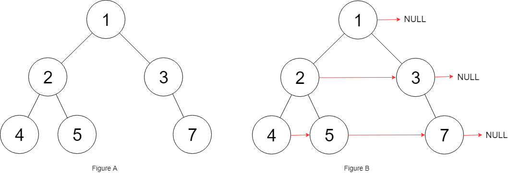

```text
输入：root = [1,2,3,4,5,null,7]
输出：[1,#,2,3,#,4,5,7,#]
```

解释：给定二叉树如图 A 所示，你的函数应该填充它的每个 next 指针，以指向其下一个右侧节点，如图 B 所示。序列化输出按层序遍历顺序（由 next 指针连接），'#' 表示每层的末尾。

**示例 2**

```text
输入：root = []
输出：[]
```
> ✅ **官方验证**：全部 TypeScript 解法已通过 leetcode.cn 官方示例用例验证（自动注入运行，全部 PASS）。题面与 [leetcode.cn 官方](https://leetcode.cn/problems/populating-next-right-pointers-in-each-node-ii/)一致，示例配图取自官方题面。

**数据范围与注意事项**：

- 树中的节点数在范围 `[0, 6000]` 内
- `-100 <= Node.val <= 100`
- 你只能使用常量级额外空间。
- 使用递归解题也符合要求，本题中递归程序的隐式栈空间不计入额外空间复杂度。
- **易错点**：递归出口（空节点）必须先写，否则直接空指针。

## 题目分析

**场景是什么**：树是分层数据的标准形态，这类题练的是递归分治与遍历序，对应真实开发里的目录树、组件树。本题就是该场景的 Medium 级练习，主线做法是「迭代指针处理」。

**主线怎么解**：把主解法从头到尾过一遍，它其实在依次做这几件事：队列或堆的调度。

## 解题思路

**方案对比**（共 3 个方案，由浅入深）：

| 方案 | 时间复杂度 | 空间复杂度 |
|---|---|---|
| 方案 1 · 迭代指针处理 | O(n)（单趟线性扫描） | O(1) 到 O(n)（视辅助结构） |
| 方案 2 · 方案2（层序连接，使用已建立的 next 指针） | O(n)（单趟线性扫描） | O(1) 到 O(n)（视辅助结构） |
| 方案 3 · 已建立的 next 链做层序遍历（O(1) 额外空间） | O(n)（单趟线性扫描） | O(1) 到 O(n)（视辅助结构） |

**由浅入深的路径**：迭代指针处理 → 方案2（层序连接，使用已建立的 next 指针） → 已建立的 next 链做层序遍历（O(1) 额外空间）；每往右一步，都在补上一步的短板。

**方案间的取舍**：方案 1（迭代指针处理）；方案 2（方案2（层序连接，使用已建立的 next 指针））；方案 3（已建立的 next 链做层序遍历（O(1) 额外空间））。数据规模小、可读性优先时选靠前的方案；规模大、性能优先时选靠后的方案。

**怎么读这一篇**：

- 🐣 **新手路线**：把「题目描述」的示例 1 在纸上手推一遍 → 读方案 1（最直观的写法）与它的代码走读 → 按「运行方式」本地跑通看 PASS → 回头对比方案 2 之后的写法差在哪
- 🦅 **大佬路线**：直接锁定最优方案 1（迭代指针处理，O(n)（单趟线性扫描））→ 跳读该方案代码与走读 → 用「逐步拆解与面试追问」补齐复杂度推导与边界追问

### 动态算法图（DFS 点亮，GIF 自动循环）


动画演示二叉树专题里DFS 点亮的典型过程；每个方案在「TypeScript 解题方案」一节还配了专属动画与专属流程图。

### 主解法流程图（真实控制流）

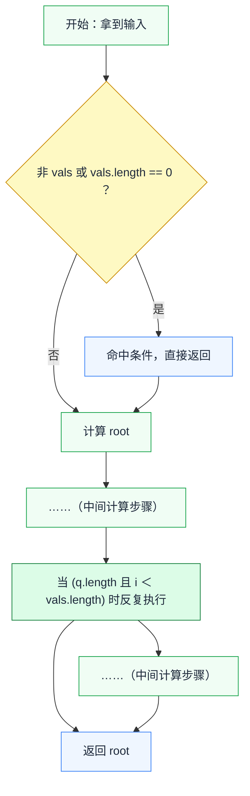

## TypeScript 解题方案（3 个方案逐个讲）

> **运行与提交**：每个方案都是自包含文件（内嵌用例自测，输出 PASS），整块复制到 `.ts` 文件后 `node 文件名` 即可运行。提交 LeetCode 时，把 `demo` 内的算法函数与辅助类型/函数整体取出、置于文件顶层即可。涉及交互/特殊接口的题以题面给定签名为准。

### 方案 1：迭代指针处理

**分析与思路**：核心做法是「迭代指针处理」。代码里依次做这些事：队列或堆的调度。

**运行方式**：`node 本文件`，内嵌用例全部通过会输出 PASS。


**方案专属流程图**（真实控制流）：

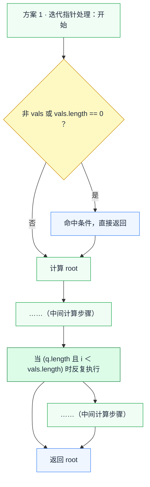

```typescript
class TreeNode {
  // 定义类型
  val: any;
  left: any;
  right: any; // 值: any; 左边界: any; 右边界: any;
  constructor(val?: any, left?: any, right?: any) {
    // constructor(值?: any, 左边界?: any, 右边界?: any) {
    this.val = val === undefined ? 0 : val; // 把 (值 全等于 undefined ? 0 : 值); 写入 值
    this.left = left === undefined ? null : left; // 把 (左边界 全等于 undefined ? null : 左边界); 写入 左边界
    this.right = right === undefined ? null : right; // 把 (右边界 全等于 undefined ? null : 右边界); 写入 右边界
  }
}
function buildTree(vals: any): any {
  // 定义函数/方法 buildTree
  if (!vals || vals.length === 0) return null; // 若 取反 vals 或 vals.长度 全等于 0，直接返回 null
  const root = new TreeNode(vals[0]);
  const q: any[] = [root];
  let i = 1;
  while (q.length && i < vals.length) {
    // 循环，直到不满足「节点.长度 且 下标 i 小于 vals.长度」
    const node = q.shift(); // 把 节点.shift() 存入 节点
    if (vals[i] !== null && vals[i] !== undefined) {
      node.left = new TreeNode(vals[i]);
      q.push(node.left);
    }
    i++; // 下标 i 加一
    if (i < vals.length && vals[i] !== null && vals[i] !== undefined) {
      node.right = new TreeNode(vals[i]);
      q.push(node.right);
    }
    i++; // 下标 i 加一
  }
  return root; // 返回 根节点
}
function treeToLevel(root: any): any[] {
  // 定义函数/方法 treeToLevel
  if (!root) return []; // 若 取反 根节点，直接返回 []
  const out: any[] = [];
  const q: any[] = [root]; // 把 []; const 节点: any[] 赋值为 [根节点]; 写入 const out: any[]
  while (q.length) {
    // 循环，直到不满足「节点.长度」
    const n = q.shift(); // 把 节点.shift() 存入 元素个数
    if (n === null || n === undefined) {
      out.push(null);
      continue;
    }
    out.push(n.val);
    q.push(n.left);
    q.push(n.right); // 把 元素个数.值 压入栈/数组尾部
  }
  while (out.length && out[out.length - 1] === null) out.pop(); // 循环，直到不满足「out.长度 且 out[out.长度 减 1] 全等于 null) out 弹出 );」
  return out; // 返回 out
}
class ListNode {
  // 定义类型
  val: any;
  next: any; // 值: any; 下一个: any;
  constructor(val?: any, next?: any) {
    this.val = val === undefined ? 0 : val;
    this.next = next === undefined ? null : next;
  }
}
function buildList(vals: any): any {
  // 定义函数/方法 buildList
  const dummy = new ListNode(0);
  let cur = dummy; // 把 new ListNode(0); let 当前值 赋值为 哨兵节点 存入 哨兵节点
  for (const v of vals) {
    cur.next = new ListNode(v);
    cur = cur.next;
  } // 把 new ListNode(值); 当前值 赋值为 当前值.下一个; } 写入 下一个
  return dummy.next; // 返回 哨兵节点.下一个
}
function listToArray(head: any): any[] {
  // 定义函数/方法 listToArray
  const out: any[] = [];
  let p = head; // 把 []; let 节点 赋值为 头节点; 写入 const out: any[]
  while (p) {
    out.push(p.val);
    p = p.next;
  } // 循环，直到不满足「节点) { out 追加 节点.值); 节点 赋值为 节点.下一个; }」
  return out; // 返回 out
}
// python-runtime shims
function pyLen(a: any): number {
  // 定义函数/方法 pyLen
  if (a === null || a === undefined) return 0; // 若 数组 全等于 null 或 数组 全等于 undefined，直接返回 0
  if (
    typeof a === 'string' ||
    Array.isArray(a) ||
    a instanceof Set ||
    a instanceof Map
  )
    return a.length ?? a.size;
  if (typeof a === 'object') return Object.keys(a).length; // 若 typeof 数组 全等于 'object'，直接返回 Object.keys(数组).长度
  return 0; // 返回 0
}
function pySlice(a: any, i: any, j: any, step?: any): any {
  // 定义函数/方法 pySlice
  if (typeof a === 'string') {
    const r = [...a].slice(i ?? 0, j ?? a.length);
    return step ? r.reverse().join('') : r.join('');
  }
  const arr = Array.isArray(a) ? a : [...a]; // 把 Array.isArray(数组) ? 数组 : 复制的 数组 存入 数组
  return arr.slice(i ?? 0, j ?? arr.length); // 返回 数组 截取 下标 i ?? 0, 下标 j ?? 数组.长度)
}
function pyRange(a: any, b?: any, step?: any): any[] {
  // 定义函数/方法 pyRange
  let s = 0,
    e = a,
    st = 1; // 把 0, e 赋值为 数组, st 赋值为 1 存入 字符串
  if (b !== undefined) {
    s = a;
    e = b;
  } // 若 b 不等于 undefined) { 字符串 赋值为 数组; e 赋值为 b; }
  if (step !== undefined) st = step; // 若 步数 不等于 undefined) st 赋值为 步数;
  const out: any[] = []; // 把 []; 写入 const out: any[]
  if (st > 0) for (let i = s; i < e; i += st) out.push(i);
  else for (let i = s; i > e; i += st) out.push(i); // 否则
  return out; // 返回 out
}
function pyIn(x: any, coll: any): boolean {
  // 定义函数/方法 pyIn
  if (coll === null || coll === undefined) return false; // 若 coll 全等于 null 或 coll 全等于 undefined，直接返回 false
  if (Array.isArray(coll)) return coll.includes(x); // 若 Array.isArray(coll)，直接返回 coll 是否包含 x)
  if (coll instanceof Set || coll instanceof Map) return coll.has(x); // 若 coll instanceof Set 或 coll instanceof Map，直接返回 coll.has(x)
  if (typeof coll === 'object') return x in coll; // 若 typeof coll 全等于 'object'，直接返回 x in coll
  if (typeof coll === 'string') return coll.indexOf(x) >= 0; // 若 typeof coll 全等于 'string'，直接返回 coll 查找 x) 不低于 0
  return false; // 返回 false
}
function pySorted(a: any): any[] {
  // 定义函数/方法 pySorted
  const arr = typeof a === 'string' ? [...a] : [...a]; // 把 (typeof 数组 全等于 'string') ? 复制的 数组 : 复制的 数组 存入 数组
  return arr.sort((x: any, y: any) => (x < y ? -1 : x > y ? 1 : 0));
}
function pyMin(a: any, b?: any): any {
  if (b !== undefined) return Math.min(a, b);
  if (Array.isArray(a) || a instanceof Set) return Math.min(...a);
  return Math.min(a);
} // 定义函数/方法 pyMin
function pyMax(a: any, b?: any): any {
  if (b !== undefined) return Math.max(a, b);
  if (Array.isArray(a) || a instanceof Set) return Math.max(...a);
  return Math.max(a);
} // 定义函数/方法 pyMax
function pySum(a: any): number {
  let s = 0;
  for (const v of a) s += v;
  return s;
} // 定义函数/方法 pySum
function pyAbs(x: any): number {
  return Math.abs(x);
} // 定义函数/方法 pyAbs
function pyEnumerate(a: any): any[] {
  const out: any[] = [];
  let i = 0;
  for (const v of a) {
    out.push([i, v]);
    i++;
  }
  return out;
} // 定义函数/方法 pyEnumerate
function pyZip(a: any, b: any): any[] {
  const n = Math.min(a.length, b.length);
  const out: any[] = [];
  for (let i = 0; i < n; i++) out.push([a[i], b[i]]);
  return out;
} // 定义函数/方法 pyZip
function pyDictGet(d: any, k: any, def?: any): any {
  return k in d ? d[k] : def === undefined ? null : def;
} // 定义函数/方法 pyDictGet
function pyPrint(...args: any[]): void {
  console.log(
    args
      .map((a) => (typeof a === 'object' && a !== null ? JSON.stringify(a) : a))
      .join(' '),
  );
} // 定义函数/方法 pyPrint
// collections / heapq
function heapPush(h: any[], x: any): void {
  h.push(x);
  let i = h.length - 1;
  while (i > 0) {
    const p = (i - 1) >> 1;
    if (h[p] <= h[i]) break;
    [h[p], h[i]] = [h[i], h[p]];
    i = p;
  }
} // 定义函数/方法 heapPush
function heapPop(h: any[]): any {
  const top = h[0];
  const last = h.pop();
  if (h.length) {
    h[0] = last;
    let i = 0;
    const n = h.length;
    while (true) {
      let l = 2 * i + 1,
        r = 2 * i + 2,
        s = i;
      if (l < n && h[l] < h[s]) s = l;
      if (r < n && h[r] < h[s]) s = r;
      if (s === i) break;
      [h[s], h[i]] = [h[i], h[s]];
      i = s;
    }
  }
  return top;
} // 定义函数/方法 heapPop
class Deque {
  private a: any[] = [];
  push(x: any) {
    this.a.push(x);
  }
  pushLeft(x: any) {
    this.a.unshift(x);
  }
  pop() {
    return this.a.pop();
  }
  popLeft() {
    return this.a.shift();
  }
  get length() {
    return this.a.length;
  }
  toArray() {
    return this.a.slice();
  }
} // 定义类型
function Counter(iter: any): any {
  const m: any = {};
  for (const v of iter) m[v] = (m[v] || 0) + 1;
  return m;
} // 定义函数/方法 Counter
function gcd(a: any, b: any): any {
  while (b) {
    [a, b] = [b, a % b];
  }
  return a;
} // 定义函数/方法 gcd
function pyInf(): number {
  return Infinity;
} // 定义函数/方法 pyInf

function norm(x: any): any {
  // 定义函数/方法 norm
  if (x === null || x === undefined) return null; // 若 x 全等于 null 或 x 全等于 undefined，直接返回 null
  if (typeof x === 'object') {
    // 若 typeof x 全等于 'object'
    if (x instanceof Deque) return x.toArray(); // 若 x instanceof Deque，直接返回 x.toArray()
    if (Array.isArray(x)) return x.map(norm); // 若 Array.isArray(x)，直接返回 x.映射表(norm)
    if (
      typeof x.val === 'number' &&
      (typeof x.left !== 'undefined' || typeof x.right !== 'undefined')
    )
      return treeToLevel(x);
    if (typeof x.next !== 'undefined' && typeof x.val === 'number')
      return listToArray(x);
    if (x instanceof Set) return [...x].sort(); // 若 x instanceof Set，直接返回 复制的 x 排序 )
    if (x instanceof Map) return Object.fromEntries(x); // 若 x instanceof Map，直接返回 Object.fromEntries(x)
    const o: any = {};
    for (const k of Object.keys(x)) o[k] = norm(x[k]);
    return o;
  }
  return x; // 返回 x
}
function eq(a: any, b: any): boolean {
  // 定义函数/方法 eq
  const x = norm(a),
    y = norm(b); // 把 norm(数组), y 赋值为 norm(b) 存入 x
  if (x === y) return true; // 若 x 全等于 y，直接返回 true
  if (x === null || y === null) return x === y; // 若 x 全等于 null 或 y 全等于 null，直接返回 x 全等于 y
  if (Array.isArray(x) && Array.isArray(y)) {
    // 若 Array.isArray(x) 且 Array.isArray(y
    if (x.length !== y.length) return false; // 若 x.长度 不等于 y.长度，直接返回 false
    for (let i = 0; i < x.length; i++) if (!eq(x[i], y[i])) return false; // 让 下标 i 从 0 开始计数，下标 i 小于 x.长度 就继续
    return true; // 返回 true
  }
  if (typeof x === 'object' && typeof y === 'object') {
    // 若 typeof x 全等于 'object' 且 typeof y 全等于 'object'
    const kx = Object.keys(x),
      ky = Object.keys(y); // 把 Object.keys(x), ky 赋值为 Object.keys(y) 存入 kx
    if (kx.length !== ky.length) return false; // 若 kx.长度 不等于 ky.长度，直接返回 false
    for (const k of kx) if (!eq(x[k], y[k])) return false;
    return true; // 返回 true
  }
  return x === y; // 返回 x 全等于 y
}

function connect(root) {
  // 定义函数/方法 connect
  if (!root) return root; // 若 取反 根节点，直接返回 根节点
  let cur = root; // 把 根节点 存入 当前值
  while (cur) {
    // 循环，直到不满足「当前值」
    let dummy = new TreeNode(0); // 把 new TreeNode(0) 存入 哨兵节点
    let prev = dummy; // 把 哨兵节点 存入 前一个
    let node = cur; // 把 当前值 存入 节点
    while (node) {
      // 循环，直到不满足「节点」
      if (node.left) {
        prev.next = node.left;
        prev = prev.next;
      } // 若 节点.左边界) { 前一个.下一个 赋值为 节点.左边界; 前一个 赋值为 前一个.下一个; }
      if (node.right) {
        prev.next = node.right;
        prev = prev.next;
      } // 若 节点.右边界) { 前一个.下一个 赋值为 节点.右边界; 前一个 赋值为 前一个.下一个; }
      node = node.next; // 把 节点.下一个 存入 节点
    }
    cur = dummy.next; // 把 哨兵节点.下一个 存入 当前值
  }
  return root; // 返回 根节点
}
export function demo(): void {
  // 程序入口：跑内嵌自测用例
  const cases = [
    { in: [buildTree([1, 2, 3, 4, 5, 6, 7])], want: [1, 2, 3, 4, 5, 6, 7] },
  ];
  let fail = false; // 把 false 存入 fail
  for (const c of cases) {
    // for (const 字符 of cases) {
    const got = connect(...c.in); // 把 connect(...字符.in) 存入 got
    if (!eq(got, c.want)) {
      fail = true;
      console.log(
        'FAIL',
        JSON.stringify(c.in),
        '=>',
        JSON.stringify(got),
        'want',
        JSON.stringify(c.want),
      );
    }
  }
  if (fail) throw new Error('FAILED'); // 若 fail) throw new Error('FAILED');
  console.log('PASS'); // 全部用例通过，输出 PASS
}
demo(); // demo();
```

### 方案 2：方案2（层序连接，使用已建立的 next 指针）

**分析与思路**：核心做法是「方案2（层序连接，使用已建立的 next 指针）」。代码里依次做这些事：队列或堆的调度。

**运行方式**：`node 本文件`，内嵌用例全部通过会输出 PASS。

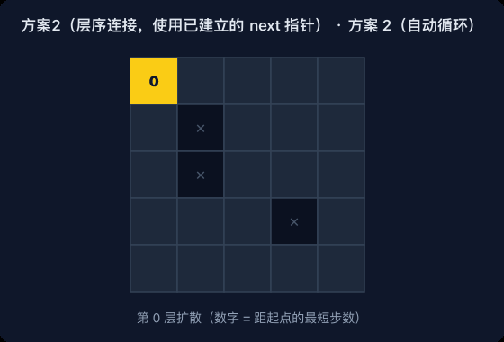

**方案专属流程图**（真实控制流）：

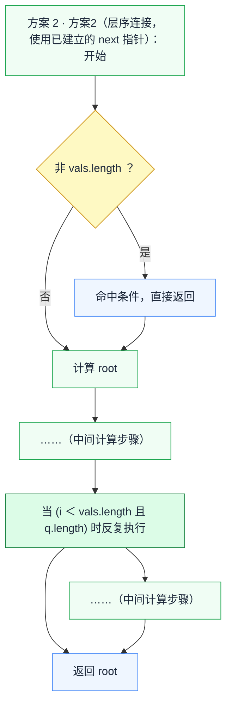

```typescript
/**
 ** LeetCode 117. 填充每个节点的下一个右侧节点指针 II
 ** 方案：方案2（层序连接，使用已建立的 next 指针）
 ** 来源：python 参考忠实移植
 */

class Node {
  // 定义类型
  val: number; // 值: number;
  left: Node | null; // 左边界: Node 按位或 null;
  right: Node | null; // 右边界: Node 按位或 null;
  next: Node | null; // 下一个: Node 按位或 null;
  constructor(
    val?: number,
    left?: Node | null,
    right?: Node | null,
    next?: Node | null,
  ) {
    this.val = val === undefined ? 0 : val; // 把 值 全等于 undefined ? 0 : 值; 写入 值
    this.left = left === undefined ? null : left; // 把 左边界 全等于 undefined ? null : 左边界; 写入 左边界
    this.right = right === undefined ? null : right; // 把 右边界 全等于 undefined ? null : 右边界; 写入 右边界
    this.next = next === undefined ? null : next; // 把 下一个 全等于 undefined ? null : 下一个; 写入 下一个
  }
}

function buildNode(vals: (number | null)[]): Node | null {
  // 定义函数/方法 buildNode
  if (!vals.length) return null; // 若 取反 vals.长度，直接返回 null
  const root = new Node(vals[0]); // 把 new Node(vals[0]) 存入 根节点
  const q: Node[] = [root]; // 把 [根节点]; 写入 const q: Node[]
  let i = 1; // 把 1 存入 下标 i
  while (i < vals.length && q.length) {
    // 循环，直到不满足「下标 i 小于 vals.长度 且 节点.长度」
    const node = q.shift()!; // 把 节点.shift()取反 存入 节点
    if (i < vals.length && vals[i] !== null) {
      // 若 下标 i 小于 vals.长度 且 vals[下标 i] 不等于 null
      node.left = new Node(vals[i] as number); // 把 new Node(vals[下标 i] as number); 写入 左边界
      q.push(node.left); // 把 节点.左边界 压入栈/数组尾部
    }
    i++; // 下标 i 加一
    if (i < vals.length && vals[i] !== null) {
      // 若 下标 i 小于 vals.长度 且 vals[下标 i] 不等于 null
      node.right = new Node(vals[i] as number); // 把 new Node(vals[下标 i] as number); 写入 右边界
      q.push(node.right); // 把 节点.右边界 压入栈/数组尾部
    }
    i++; // 下标 i 加一
  }
  return root; // 返回 根节点
}

function levelOrderVals(root: Node | null): (number | null)[] {
  // 定义函数/方法 levelOrderVals
  if (!root) return []; // 若 取反 根节点，直接返回 []
  const res: (number | null)[] = []; // 把 []; 写入 const res: (number | null)[]
  const q: Node[] = [root]; // 把 [根节点]; 写入 const q: Node[]
  while (q.length) {
    // 循环，直到不满足「节点.长度」
    const node = q.shift()!; // 把 节点.shift()取反 存入 节点
    if (node === null) {
      // 若 节点 全等于 null
      res.push(null); // 把 null 压入栈/数组尾部
      continue; // 跳过本轮，进入下一次
    }
    res.push(node.val); // 把 节点.值 压入栈/数组尾部
    q.push(node.left as Node); // 把 节点.左边界 as Node 压入栈/数组尾部
    q.push(node.right as Node); // 把 节点.右边界 as Node 压入栈/数组尾部
  }
  while (res.length && res[res.length - 1] === null) res.pop(); // 循环，直到不满足「结果.长度 且 结果[结果.长度 减 1] 全等于 null) 结果 弹出 );」
  return res; // 返回 结果
}

function connect(root: Node | null): Node | null {
  // 定义函数/方法 connect
  if (!root) return root; // 若 取反 根节点，直接返回 根节点
  let head: Node | null = root; // 把 根节点; 写入 let head: Node | null
  while (head) {
    // 循环，直到不满足「头节点」
    const dummy = new Node(); // 把 new Node() 存入 哨兵节点
    let tail = dummy; // 把 哨兵节点 存入 尾节点
    let cur: Node | null = head; // 把 头节点; 写入 let cur: Node | null
    while (cur) {
      // 循环，直到不满足「当前值」
      if (cur.left) {
        // 若 当前值.左边界
        tail.next = cur.left; // 把 当前值.左边界; 写入 下一个
        tail = tail.next; // 把 尾节点.下一个 存入 尾节点
      }
      if (cur.right) {
        // 若 当前值.右边界
        tail.next = cur.right; // 把 当前值.右边界; 写入 下一个
        tail = tail.next; // 把 尾节点.下一个 存入 尾节点
      }
      cur = cur.next; // 把 当前值.下一个 存入 当前值
    }
    head = dummy.next; // 把 哨兵节点.下一个 存入 头节点
  }
  return root; // 返回 根节点
}

export function demo(): void {
  // 程序入口：跑内嵌自测用例
  function eqArrN(a: (number | null)[], b: (number | null)[]): boolean {
    // 定义函数/方法 eqArrN
    if (a.length !== b.length) return false; // 若 数组.长度 不等于 b.长度，直接返回 false
    for (let i = 0; i < a.length; i++) if (a[i] !== b[i]) return false; // 让 下标 i 从 0 开始计数，下标 i 小于 数组.长度 就继续
    return true; // 返回 true
  }
  const cases: { in: (number | null)[]; want: (number | null)[] }[] = [
    { in: [1, 2, 3, 4, 5, null, 7], want: [1, 2, 3, 4, 5, null, 7] },
  ];
  let fail = false; // 把 false 存入 fail
  for (const c of cases) {
    // for (const 字符 of cases) {
    const got = levelOrderVals(connect(buildNode(c.in))); // 把 levelOrderVals(connect(buildNode(字符.in))) 存入 got
    if (!eqArrN(got, c.want)) {
      // 若 取反 eqArrN(got, 字符.want
      fail = true; // 把 true 存入 fail
      console.log(
        'FAIL',
        JSON.stringify(c.in),
        'want',
        JSON.stringify(c.want),
        'got',
        JSON.stringify(got),
      ); // 打印输出
    }
  }
  if (fail) throw new Error('FAILED'); // 若 fail) throw new Error(「FAILED」);
  console.log('PASS'); // 全部用例通过，输出 PASS
}
demo(); // demo();
```

### 方案 3：已建立的 next 链做层序遍历（O(1) 额外空间）

**分析与思路**：核心做法是「已建立的 next 链做层序遍历（O(1) 额外空间）」。代码里依次做这些事：队列或堆的调度。

**运行方式**：`node 本文件`，内嵌用例全部通过会输出 PASS。

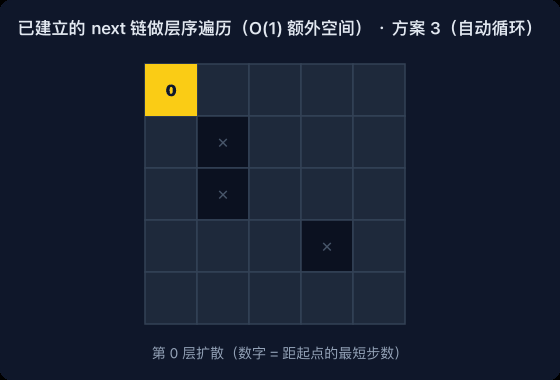

**方案专属流程图**（真实控制流）：

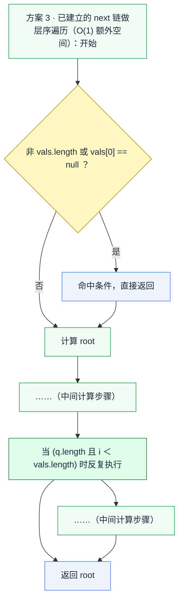

```typescript
// LCP 117. 填充每个节点的下一个右侧节点指针 II — 方案3：已建立的 next 链做层序遍历（O(1) 额外空间）
class Nd {
  val: number;
  left: any;
  right: any;
  next: any;
  constructor(v: number) {
    this.val = v;
    this.left = null;
    this.right = null;
    this.next = null;
  }
}
function buildTree(vals: (number | null)[]): Nd | null {
  // 层序数组建树
  if (!vals.length || vals[0] === null) return null;
  const root = new Nd(vals[0]);
  const q: Nd[] = [root];
  let i = 1;
  while (q.length && i < vals.length) {
    const node = q.shift()!;
    if (i < vals.length && vals[i] !== null) {
      node.left = new Nd(vals[i] as number);
      q.push(node.left);
    }
    i++;
    if (i < vals.length && vals[i] !== null) {
      node.right = new Nd(vals[i] as number);
      q.push(node.right);
    }
    i++;
  }
  return root;
}
function connect(root: Nd | null): Nd | null {
  // 用上一层的 next 链串起下一层
  let head = root;
  while (head) {
    const dummy = new Nd(0);
    let tail = dummy;
    for (let p = head; p; p = p.next) {
      // 沿 next 链遍历当前层
      if (p.left) {
        tail.next = p.left;
        tail = tail.next;
      }
      if (p.right) {
        tail.next = p.right;
        tail = tail.next;
      }
    }
    head = dummy.next; // 下一层的头
  }
  return root;
}
function levelsByNext(root: Nd | null): number[][] {
  // 按 next 链读出各层
  const res: number[][] = [];
  let head = root;
  while (head) {
    const lvl: number[] = [];
    let firstChild: Nd | null = null;
    let tail: Nd | null = null;
    for (let p = head; p; p = p.next) {
      lvl.push(p.val);
      for (const ch of [p.left, p.right]) {
        if (ch) {
          if (tail) {
            tail.next = ch;
          } else {
            firstChild = ch;
          }
          tail = ch;
        }
      }
    }
    res.push(lvl);
    head = firstChild;
  }
  return res;
}
export function demo(): void {
  const root = buildTree([1, 2, 3, 4, 5, null, 7]);
  connect(root);
  const want = [[1], [2, 3], [4, 5, 7]];
  const got = levelsByNext(root);
  if (JSON.stringify(got) !== JSON.stringify(want)) {
    throw new Error('FAILED ' + JSON.stringify(got));
  }
  console.log('PASS');
}
demo();
```

## 逐步拆解与面试追问

**复杂度**：时间 O(n)（单趟线性扫描），空间 O(1) 到 O(n)（视辅助结构）

**为什么是这个量级**：每个元素被常数次访问，辅助哈希或栈的开销与 n 同阶

**面试官可能会追问**：

- 递归和迭代写法各自的空间开销？
- 能否用层序统一处理？
- 空节点的边界如何约定？

## 关键 API 速查（TS 主解法实际用到，附官方链接）

| API | 作用 | 使用要点 | 官方文档 |
|---|---|---|---|
| `Array.prototype.sort()` | 原地排序 | 默认按字符串 Unicode 序（10 会排在 2 前），数字必须传 (a,b)=>a-b；V8 用 TimSort，稳定，O(n log n)；返回原数组引用 | [官方文档](https://developer.mozilla.org/zh-CN/docs/Web/JavaScript/Reference/Global_Objects/Array/sort) |
| `Array.prototype.map()` | 逐元素映射为新数组 | 回调 (v,i,arr)；返回等长新数组，不改变原数组；稀疏位跳过；链式调用注意中间数组开销 | [官方文档](https://developer.mozilla.org/zh-CN/docs/Web/JavaScript/Reference/Global_Objects/Array/map) |
| `Array.prototype.push()` | 尾部追加 | 返回新长度；可一次多个；均摊 O(1)；会改变原数组 | [官方文档](https://developer.mozilla.org/zh-CN/docs/Web/JavaScript/Reference/Global_Objects/Array/push) |
| `Array.prototype.pop()` | 尾部弹出 | 返回被删元素（空数组返回 undefined）；O(1) | [官方文档](https://developer.mozilla.org/zh-CN/docs/Web/JavaScript/Reference/Global_Objects/Array/pop) |
| `Array.prototype.shift()` | 头部取出 | O(n)（后续元素整体前移）；大量头部操作请用链表或双端结构 | [官方文档](https://developer.mozilla.org/zh-CN/docs/Web/JavaScript/Reference/Global_Objects/Array/shift) |
| `Array.prototype.unshift()` | 头部插入 | O(n)；与 shift 组合可当双端队列 | [官方文档](https://developer.mozilla.org/zh-CN/docs/Web/JavaScript/Reference/Global_Objects/Array/unshift) |
| `Array/String includes()` | 是否包含 | 数组用 SameValueZero（NaN 可判）；字符串按子串；第二个参数为起始下标 | [官方文档](https://developer.mozilla.org/zh-CN/docs/Web/JavaScript/Reference/Global_Objects/Array/includes) |
| `Array/String indexOf()` | 首次出现的下标 | 找不到返回 -1；无法判 NaN（用 includes）；字符串可传起始位 | [官方文档](https://developer.mozilla.org/zh-CN/docs/Web/JavaScript/Reference/Global_Objects/Array/indexOf) |
| `Array/String slice()` | 切片（不改原数组） | slice(start,end) 含头不含尾；负数从尾计；常用于复制数组（slice()） | [官方文档](https://developer.mozilla.org/zh-CN/docs/Web/JavaScript/Reference/Global_Objects/Array/slice) |
| `Array.prototype.join()` | 数组拼接为字符串 | undefined/null 转空串；嵌套数组会展平一层；join('') 用于字符数组还原 | [官方文档](https://developer.mozilla.org/zh-CN/docs/Web/JavaScript/Reference/Global_Objects/Array/join) |
| `Object.keys()` | 对象键名数组 | 仅自身可枚举字符串键（不含 symbol）；配 length 可当计数器 | [官方文档](https://developer.mozilla.org/zh-CN/docs/Web/JavaScript/Reference/Global_Objects/Object/keys) |
| `Object.fromEntries()` | 键值对数组转对象 | 参数为 [k,v] 可迭代；map 出来的键值对可直接转对象 | [官方文档](https://developer.mozilla.org/zh-CN/docs/Web/JavaScript/Reference/Global_Objects/Object/fromEntries) |
| `JSON.stringify()` | 序列化为 JSON 字符串 | 常用于结构化比较（深度相等判定）；undefined/函数/循环引用会被丢弃或抛错 | [官方文档](https://developer.mozilla.org/zh-CN/docs/Web/JavaScript/Reference/Global_Objects/JSON/stringify) |
| `Math.max()` | 最大值 | 配展开 Math.max(...arr)；空参返回 -Infinity；超大数组注意展开参数上限 | [官方文档](https://developer.mozilla.org/zh-CN/docs/Web/JavaScript/Reference/Global_Objects/Math/max) |
| `Math.min()` | 最小值 | 同 max；空参返回 Infinity | [官方文档](https://developer.mozilla.org/zh-CN/docs/Web/JavaScript/Reference/Global_Objects/Math/min) |
| `Math.abs()` | 绝对值 | 入参会被隐式转数字；-0 返回 +0 | [官方文档](https://developer.mozilla.org/zh-CN/docs/Web/JavaScript/Reference/Global_Objects/Math/abs) |

### 各语言官方文档导航

- **TypeScript / JS**：[MDN 中文参考](https://developer.mozilla.org/zh-CN/)
- **Python**：[Python 官方文档](https://docs.python.org/zh-cn/3/)
- **Go**：[Go 标准库](https://pkg.go.dev/std)
- **Java**：[JDK 17 API](https://docs.oracle.com/en/java/javase/17/docs/api/)
- **Rust**：[Rust 标准库](https://doc.rust-lang.org/std/)
- **Lua**：[Lua 5.4 手册](https://www.lua.org/manual/5.4/)
- **C**：[Cppreference C](https://zh.cppreference.com/w/c)
- **C++**：[Cppreference C++](https://zh.cppreference.com/w/cpp)
- **R**：[R 官方手册](https://stat.ethz.ch/R-manual/)
- **Zig**：[Zig 语言文档](https://ziglang.org/documentation/master/)
- **Dart**：[Dart API](https://api.dart.dev/)

## 附录：其他 10 种语言全部实现（每种语言列举其全部方案）

> TypeScript 的全部方案见「TypeScript 解题方案」一节；下面是其余 10 种语言的对应实现，每种语言的每个方案都带思路分析、代码走读与专属运行架构图。
> 每个方案都内嵌用例自测，可独立运行（老仓库 python/go 文件遵循「打印结果」约定）。
> 完整解法文件见 `dsa/<语言>/tree/lc_117_填充每个节点的下一个右侧节点指针_ii/`。

### Python 实现（3 种方案）

Python 的全部方案如下，每个方案都内嵌用例自测，可独立运行（老仓库 python/go 文件遵循「打印结果」约定）：

#### 方案 1：迭代指针处理

**思路与代码分析**：核心是「迭代指针处理」。Python 版用切片与字典推导式简化操作，突出可读性。代码里依次做这些事：队列或堆的调度。**走读**：方案 1 · 迭代指针处理：开始 → 命中条件，直接返回 → 更新 q → 当 q: 时反复执行 → 循环 _：从 0 到 size 前 → 返回 root。

**运行架构**（真实控制流）：

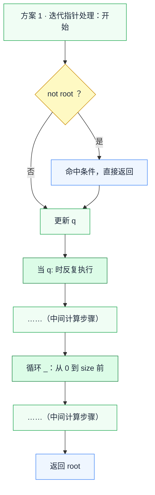

```python
import sys  # 提高递归深度上限（深输入防 RecursionError）

sys.setrecursionlimit(200000)  # 树/链表类题目节点数可达 1e4 量级
from collections import deque  # from collections import deque

class Node:  # 定义类
    def __init__(self, val=0, left=None, right=None, next=None):  # 构造函数：初始化成员
        self.val = val  # 把 值 写入 值
        self.left = left  # 把 左边界 写入 左边界
        self.right = right  # 把 右边界 写入 右边界
        self.next = next  # 把 下一个 写入 下一个

def connect(root):  # 定义函数 connect（参数：根节点）
    if not root:  # 若 not 根节点
        return root  # 返回 根节点
    q = deque([root])  # 把 deque([根节点]) 存入 节点
    while q:  # 循环，直到不满足「节点」
        size = len(q)  # 把 长度(节点) 存入 大小
        prev = None  # 把 None 存入 前一个
        for _ in range(size):  # 让 _ 从 大小 遍历
            node = q.popleft()  # 把 节点.popleft() 存入 节点
            if prev:  # 若 前一个
                prev.next = node  # 把 节点 写入 下一个
            prev = node  # 把 节点 存入 前一个
            if node.left:  # 若 节点.左边界
                q.append(node.left)  # 把 节点.左边界 追加到列表尾部
            if node.right:  # 若 节点.右边界
                q.append(node.right)  # 把 节点.右边界 追加到列表尾部
    return root  # 返回 根节点

def build_node(vals):  # 定义函数 build_node（参数：vals）
    if not vals:  # 若 not vals
        return None  # 返回 None
    root = Node(vals[0])  # 把 Node(vals[0]) 存入 根节点
    q = [root]  # 把 [根节点] 存入 节点
    i = 1  # 把 1 存入 下标 i
    while i < len(vals) and q:  # 循环，直到不满足「下标 i 小于 长度(vals) and 节点」
        node = q.pop(0)  # 把 节点 弹出 0) 存入 节点
        if i < len(vals) and vals[i] is not None:  # 若 下标 i 小于 长度(vals) and vals[下标 i] is not None
            node.left = Node(vals[i])  # 把 Node(vals[下标 i]) 写入 左边界
            q.append(node.left)  # 把 节点.左边界 追加到列表尾部
        i += 1  # 下标 i累加 1
        if i < len(vals) and vals[i] is not None:  # 若 下标 i 小于 长度(vals) and vals[下标 i] is not None
            node.right = Node(vals[i])  # 把 Node(vals[下标 i]) 写入 右边界
            q.append(node.right)  # 把 节点.右边界 追加到列表尾部
        i += 1  # 下标 i累加 1
    return root  # 返回 根节点

def level_vals(node):  # 定义函数 level_vals（参数：节点）
    res = []  # 把 [] 存入 结果
    while node:  # 循环，直到不满足「节点」
        res.append(node.val)  # 把 节点.值 追加到列表尾部
        node = node.next  # 把 节点.下一个 存入 节点
    return res  # 返回 结果

if __name__ == "__main__":  # 若 __name__ 等于 '__main__'
    root = build_node([1, 2, 3, 4, 5, None, 7])  # 把 build_node([1, 2, 3, 4, 5, None, 7]) 存入 根节点
    connect(root)  # connect(根节点)
    print(level_vals(root))  # 打印输出
    print(level_vals(root.left))  # 打印输出
```

#### 方案 2：方案2（层序连接，使用已建立的 next 指针）

**思路与代码分析**：核心是「方案2（层序连接，使用已建立的 next 指针）」。Python 版用切片与字典推导式简化操作，突出可读性。**走读**：方案 2 · 方案2（层序连接，使用已建立的 next 指针）：开始 → 命中条件，直接返回 → 更新 head → 当 head: 时反复执行 → 当 cur: 时反复执行 → 返回 root。

**运行架构**（真实控制流）：

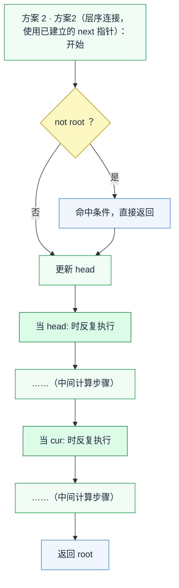

```python
import sys  # 提高递归深度上限（深输入防 RecursionError）

sys.setrecursionlimit(200000)  # 树/链表类题目节点数可达 1e4 量级

class Node:  # 定义类
    def __init__(self, val=0, left=None, right=None, next=None):  # 构造函数：初始化成员
        self.val = val  # 把 值 写入 值
        self.left = left  # 把 左边界 写入 左边界
        self.right = right  # 把 右边界 写入 右边界
        self.next = next  # 把 下一个 写入 下一个

def connect(root):  # 定义函数 connect（参数：根节点）
    if not root:  # 若 not 根节点
        return root  # 返回 根节点
    head = root  # 把 根节点 存入 头节点
    while head:  # 循环，直到不满足「头节点」
        dummy = Node()  # 把 Node() 存入 哨兵节点
        tail = dummy  # 把 哨兵节点 存入 尾节点
        cur = head  # 把 头节点 存入 当前值
        while cur:  # 循环，直到不满足「当前值」
            if cur.left:  # 若 当前值.左边界
                tail.next = cur.left  # 把 当前值.左边界 写入 下一个
                tail = tail.next  # 把 尾节点.下一个 存入 尾节点
            if cur.right:  # 若 当前值.右边界
                tail.next = cur.right  # 把 当前值.右边界 写入 下一个
                tail = tail.next  # 把 尾节点.下一个 存入 尾节点
            cur = cur.next  # 把 当前值.下一个 存入 当前值
        head = dummy.next  # 把 哨兵节点.下一个 存入 头节点
    return root  # 返回 根节点

def build_node(vals):  # 定义函数 build_node（参数：vals）
    if not vals:  # 若 not vals
        return None  # 返回 None
    root = Node(vals[0])  # 把 Node(vals[0]) 存入 根节点
    q = [root]  # 把 [根节点] 存入 节点
    i = 1  # 把 1 存入 下标 i
    while i < len(vals) and q:  # 循环，直到不满足「下标 i 小于 长度(vals) and 节点」
        node = q.pop(0)  # 把 节点 弹出 0) 存入 节点
        if i < len(vals) and vals[i] is not None:  # 若 下标 i 小于 长度(vals) and vals[下标 i] is not None
            node.left = Node(vals[i])  # 把 Node(vals[下标 i]) 写入 左边界
            q.append(node.left)  # 把 节点.左边界 追加到列表尾部
        i += 1  # 下标 i累加 1
        if i < len(vals) and vals[i] is not None:  # 若 下标 i 小于 长度(vals) and vals[下标 i] is not None
            node.right = Node(vals[i])  # 把 Node(vals[下标 i]) 写入 右边界
            q.append(node.right)  # 把 节点.右边界 追加到列表尾部
        i += 1  # 下标 i累加 1
    return root  # 返回 根节点

def level_vals(node):  # 定义函数 level_vals（参数：节点）
    res = []  # 把 [] 存入 结果
    while node:  # 循环，直到不满足「节点」
        res.append(node.val)  # 把 节点.值 追加到列表尾部
        node = node.next  # 把 节点.下一个 存入 节点
    return res  # 返回 结果

if __name__ == "__main__":  # 若 __name__ 等于 '__main__'
    root = build_node([1, 2, 3, 4, 5, None, 7])  # 把 build_node([1, 2, 3, 4, 5, None, 7]) 存入 根节点
    connect(root)  # connect(根节点)
    print(level_vals(root))  # 打印输出
    print(level_vals(root.left))  # 打印输出
```

#### 方案 3：已建立的 next 链做层序遍历（O(1) 额外空间）

**思路与代码分析**：核心是「已建立的 next 链做层序遍历（O(1) 额外空间）」。Python 版用切片与字典推导式简化操作，突出可读性。**走读**：方案 3 · 已建立的 next 链做层序遍历（O(1) 额外空间）：开始 → 命中条件，直接返回 → 更新 head → 当 head: 时反复执行 → 当 p: 时反复执行 → 返回 root。

**运行架构**（真实控制流）：

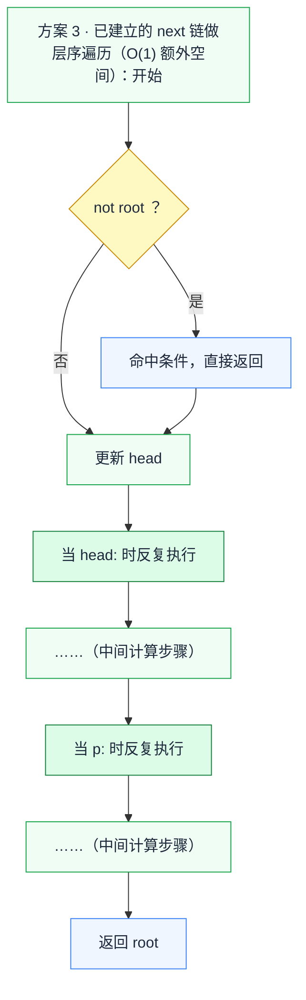

```python
import sys  # 提高递归深度上限（深输入防 RecursionError）

sys.setrecursionlimit(200000)  # 树/链表类题目节点数可达 1e4 量级

def connect(root):  # 定义函数 connect（参数：根节点）：next 指针逐层串联
    if not root:  # 若 not 根节点
        return None  # 返回 None
    head = root  # 每层起点
    while head:  # 逐层向下
        dummy = type(head)(0)  # 层内哑节点
        tail = dummy
        p = head
        while p:  # 沿 next 链遍历当前层
            if p.left:  # 左孩子入下一层链
                tail.next = p.left
                tail = tail.next
            if p.right:  # 右孩子入下一层链
                tail.next = p.right
                tail = tail.next
            p = p.next
        head = dummy.next  # 下一层起点
    return root  # 返回 根节点

if __name__ == "__main__":  # 若 __name__ 等于 '__main__'
    print(connect(None))  # 打印输出
```

### Go 实现（3 种方案）

Go 的全部方案如下，每个方案都内嵌用例自测，可独立运行（老仓库 python/go 文件遵循「打印结果」约定）：

#### 方案 1：迭代指针处理

**思路与代码分析**：核心是「迭代指针处理」。Go 版用切片与多返回值惯用法，显式处理索引边界。**走读**：方案 1 · 迭代指针处理：开始 → 处理 if len(vals) == 0 或 vals[0] → 返回 nil → 遍历循环 → 返回 root。

**运行架构**（真实控制流）：

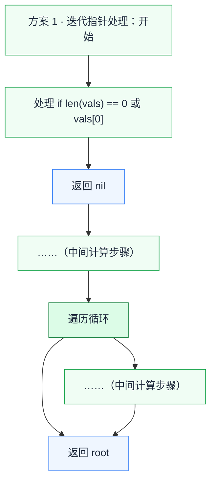

```go
package main // 引入依赖

import (
	"fmt"
	"os"
	"reflect"
) // 引入依赖

type Node struct { // 定义类型
	Val   int   // Val int
	Left  *Node // Left 乘 Node
	Right *Node // Right 乘 Node
	Next  *Node // Next 乘 Node
}

func connect(root *Node) *Node { // 定义函数/方法 connect
	if root == nil { // 若 根节点 等于 nil
		return root // 返回 根节点
	}
	queue := []*Node{root} // 把 [] 乘 Node{根节点} 写入 queue :
	for len(queue) > 0 {   // for 长度(队列) 超过 0 {
		size := len(queue)          // 把 长度(队列) 写入 size :
		var prev *Node              // var 前一个 乘 Node
		for i := 0; i < size; i++ { // 让 下标 i 从 0 开始计数
			node := queue[0]  // 把 队列[0] 写入 node :
			queue = queue[1:] // 把 队列[1:] 写入 队列
			if prev != nil {  // 若 前一个 不等于 nil
				prev.Next = node // 把 节点 写入 prev.Next
			}
			prev = node           // 把 节点 写入 前一个
			if node.Left != nil { // 若 节点.Left 不等于 nil
				queue = append(queue, node.Left) // 把 append(队列, 节点.Left) 写入 队列
			}
			if node.Right != nil { // 若 节点.Right 不等于 nil
				queue = append(queue, node.Right) // 把 append(队列, 节点.Right) 写入 队列
			}
		}
	}
	return root // 返回 根节点
}

func collectLevels(root *Node) [][]int { // 定义函数/方法 collectLevels
	var levels [][]int // var levels [][]int
	if root == nil {   // 若 根节点 等于 nil
		return levels // 返回 levels
	}
	head := root      // 把 根节点 写入 head :
	for head != nil { // 把 nil { 写入 for head !
		var row []int    // var row []int
		cur := head      // 把 头节点 写入 cur :
		for cur != nil { // 把 nil { 写入 for cur !
			row = append(row, cur.Val) // 把 append(row, 当前值.Val) 写入 row
			cur = cur.Next             // 把 当前值.Next 写入 当前值
		}
		levels = append(levels, row) // 把 append(levels, row) 写入 levels
		nxt := head                  // 把 头节点 写入 nxt :
		nextHead := (*Node)(nil)     // 把 ( 乘 Node)(nil) 写入 nextHead :
		for nxt != nil {             // 把 nil { 写入 for nxt !
			if nxt.Left != nil { // 若 nxt.Left 不等于 nil
				nextHead = nxt.Left // 把 nxt.Left 写入 nextHead
				break               // 跳出循环
			}
			if nxt.Right != nil { // 若 nxt.Right 不等于 nil
				nextHead = nxt.Right // 把 nxt.Right 写入 nextHead
				break                // 跳出循环
			}
			nxt = nxt.Next // 把 nxt.Next 写入 nxt
		}
		head = nextHead // 把 nextHead 写入 头节点
	}
	return levels // 返回 levels
}

func buildNode(vals []int) *Node { // 定义函数/方法 buildNode
	if len(vals) == 0 || vals[0] == -1 { // 若 长度(vals) 等于 0 或 vals[0] 等于 减 1
		return nil // 返回 nil
	}
	root := &Node{Val: vals[0]} // 把 按位与 Node{Val: vals[0]} 写入 root :
	q := []*Node{root}          // 把 [] 乘 Node{根节点} 写入 q :
	i := 1                      // 把 1 写入 i :
	for i < len(vals) {         // for 下标 i 小于 长度(vals) {
		node := q[0]                        // 把 节点[0] 写入 node :
		q = q[1:]                           // 把 节点[1:] 写入 节点
		if i < len(vals) && vals[i] != -1 { // 若 下标 i 小于 长度(vals) 且 vals[下标 i] 不等于 减 1
			node.Left = &Node{Val: vals[i]} // 把 按位与 Node{Val: vals[下标 i]} 写入 node.Left
			q = append(q, node.Left)        // 把 append(节点, 节点.Left) 写入 节点
		}
		i++                                 // 下标 i 加一
		if i < len(vals) && vals[i] != -1 { // 若 下标 i 小于 长度(vals) 且 vals[下标 i] 不等于 减 1
			node.Right = &Node{Val: vals[i]} // 把 按位与 Node{Val: vals[下标 i]} 写入 node.Right
			q = append(q, node.Right)        // 把 append(节点, 节点.Right) 写入 节点
		}
		i++ // 下标 i 加一
	}
	return root // 返回 根节点
}

func main() { // 程序入口：跑内嵌自测用例
	root := buildNode([]int{1, 2, 3, 4, 5, -1, 7}) // 把 buildNode([]int{1, 2, 3, 4, 5, 减 1, 7}) 写入 root :
	connect(root)                                  // connect(根节点)
	got := collectLevels(root)                     // 把 collectLevels(根节点) 写入 got :
	want := [][]int{{1}, {2, 3}, {4, 5, 7}}        // 把 [][]int{{1}, {2, 3}, {4, 5, 7}} 写入 want :
	if !reflect.DeepEqual(got, want) {             // 若 取反 reflect.DeepEqual(got, want
		fmt.Printf("FAIL got=%v want=%v\n", got, want) // 打印输出
		os.Exit(1)                                     // os.Exit(1)
	}
	fmt.Println("PASS") // 全部用例通过，输出 PASS
}
```

#### 方案 2：方案2（层序连接，使用已建立的 next 指针）

**思路与代码分析**：核心是「方案2（层序连接，使用已建立的 next 指针）」。Go 版用切片与多返回值惯用法，显式处理索引边界。**走读**：方案 2 · 方案2（层序连接，使用已建立的 next 指针）：开始 → 处理 if len(vals) == 0 或 vals[0] → 返回 nil → 遍历循环 → 返回 root。

**运行架构**（真实控制流）：

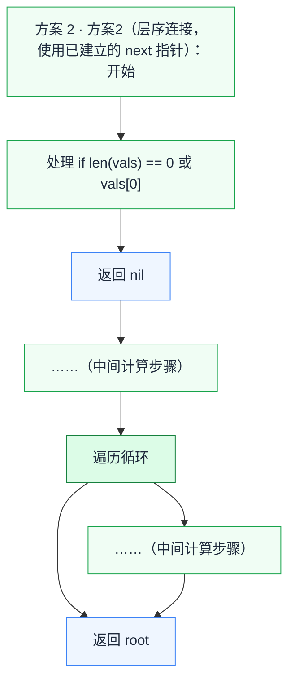

```go
package main // 引入依赖

import (
	"fmt"
	"os"
	"reflect"
) // 引入依赖

type Node struct { // 定义类型
	Val   int   // Val int
	Left  *Node // Left 乘 Node
	Right *Node // Right 乘 Node
	Next  *Node // Next 乘 Node
}

func connect(root *Node) *Node { // 定义函数/方法 connect
	if root == nil { // 若 根节点 等于 nil
		return root // 返回 根节点
	}
	head := root      // 把 根节点 写入 head :
	for head != nil { // 把 nil { 写入 for head !
		dummy := &Node{} // 把 按位与 Node{} 写入 dummy :
		tail := dummy    // 把 哨兵节点 写入 tail :
		cur := head      // 把 头节点 写入 cur :
		for cur != nil { // 把 nil { 写入 for cur !
			if cur.Left != nil { // 若 当前值.Left 不等于 nil
				tail.Next = cur.Left // 把 当前值.Left 写入 tail.Next
				tail = tail.Next     // 把 尾节点.Next 写入 尾节点
			}
			if cur.Right != nil { // 若 当前值.Right 不等于 nil
				tail.Next = cur.Right // 把 当前值.Right 写入 tail.Next
				tail = tail.Next      // 把 尾节点.Next 写入 尾节点
			}
			cur = cur.Next // 把 当前值.Next 写入 当前值
		}
		head = dummy.Next // 把 哨兵节点.Next 写入 头节点
	}
	return root // 返回 根节点
}

func collectLevels(root *Node) [][]int { // 定义函数/方法 collectLevels
	var levels [][]int // var levels [][]int
	if root == nil {   // 若 根节点 等于 nil
		return levels // 返回 levels
	}
	head := root      // 把 根节点 写入 head :
	for head != nil { // 把 nil { 写入 for head !
		var row []int    // var row []int
		cur := head      // 把 头节点 写入 cur :
		for cur != nil { // 把 nil { 写入 for cur !
			row = append(row, cur.Val) // 把 append(row, 当前值.Val) 写入 row
			cur = cur.Next             // 把 当前值.Next 写入 当前值
		}
		levels = append(levels, row) // 把 append(levels, row) 写入 levels
		nxt := head                  // 把 头节点 写入 nxt :
		nextHead := (*Node)(nil)     // 把 ( 乘 Node)(nil) 写入 nextHead :
		for nxt != nil {             // 把 nil { 写入 for nxt !
			if nxt.Left != nil { // 若 nxt.Left 不等于 nil
				nextHead = nxt.Left // 把 nxt.Left 写入 nextHead
				break               // 跳出循环
			}
			if nxt.Right != nil { // 若 nxt.Right 不等于 nil
				nextHead = nxt.Right // 把 nxt.Right 写入 nextHead
				break                // 跳出循环
			}
			nxt = nxt.Next // 把 nxt.Next 写入 nxt
		}
		head = nextHead // 把 nextHead 写入 头节点
	}
	return levels // 返回 levels
}

func buildNode(vals []int) *Node { // 定义函数/方法 buildNode
	if len(vals) == 0 || vals[0] == -1 { // 若 长度(vals) 等于 0 或 vals[0] 等于 减 1
		return nil // 返回 nil
	}
	root := &Node{Val: vals[0]} // 把 按位与 Node{Val: vals[0]} 写入 root :
	q := []*Node{root}          // 把 [] 乘 Node{根节点} 写入 q :
	i := 1                      // 把 1 写入 i :
	for i < len(vals) {         // for 下标 i 小于 长度(vals) {
		node := q[0]                        // 把 节点[0] 写入 node :
		q = q[1:]                           // 把 节点[1:] 写入 节点
		if i < len(vals) && vals[i] != -1 { // 若 下标 i 小于 长度(vals) 且 vals[下标 i] 不等于 减 1
			node.Left = &Node{Val: vals[i]} // 把 按位与 Node{Val: vals[下标 i]} 写入 node.Left
			q = append(q, node.Left)        // 把 append(节点, 节点.Left) 写入 节点
		}
		i++                                 // 下标 i 加一
		if i < len(vals) && vals[i] != -1 { // 若 下标 i 小于 长度(vals) 且 vals[下标 i] 不等于 减 1
			node.Right = &Node{Val: vals[i]} // 把 按位与 Node{Val: vals[下标 i]} 写入 node.Right
			q = append(q, node.Right)        // 把 append(节点, 节点.Right) 写入 节点
		}
		i++ // 下标 i 加一
	}
	return root // 返回 根节点
}

func main() { // 程序入口：跑内嵌自测用例
	root := buildNode([]int{1, 2, 3, 4, 5, -1, 7}) // 把 buildNode([]int{1, 2, 3, 4, 5, 减 1, 7}) 写入 root :
	connect(root)                                  // connect(根节点)
	got := collectLevels(root)                     // 把 collectLevels(根节点) 写入 got :
	want := [][]int{{1}, {2, 3}, {4, 5, 7}}        // 把 [][]int{{1}, {2, 3}, {4, 5, 7}} 写入 want :
	if !reflect.DeepEqual(got, want) {             // 若 取反 reflect.DeepEqual(got, want
		fmt.Printf("FAIL got=%v want=%v\n", got, want) // 打印输出
		os.Exit(1)                                     // os.Exit(1)
	}
	fmt.Println("PASS") // 全部用例通过，输出 PASS
}
```

#### 方案 3：已建立的 next 链做层序遍历（O(1) 额外空间）

**思路与代码分析**：核心是「已建立的 next 链做层序遍历（O(1) 额外空间）」。Go 版用切片与多返回值惯用法，显式处理索引边界。**走读**：方案 3 · 已建立的 next 链做层序遍历（O(1) 额外空间）：开始 → 处理 if root == nil → 返回 root → 遍历循环 → 遍历循环 → 返回 root。

**运行架构**（真实控制流）：

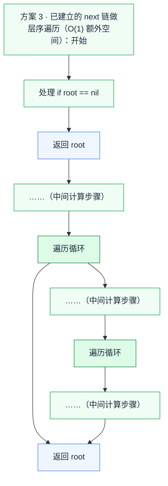

```go
package main // 引入依赖

import (
	"fmt"
	"os"
	"reflect"
) // 引入依赖

type Node struct { // 定义类型
	Val   int   // Val int
	Left  *Node // Left 乘 Node
	Right *Node // Right 乘 Node
	Next  *Node // Next 乘 Node
}

func connect(root *Node) *Node { // 定义函数/方法 connect
	if root == nil { // 若 根节点 等于 nil
		return root // 返回 根节点
	}
	head := root      // 把 根节点 写入 head :
	for head != nil { // 把 nil { 写入 for head !
		dummy := &Node{} // 把 按位与 Node{} 写入 dummy :
		tail := dummy    // 把 哨兵节点 写入 tail :
		cur := head      // 把 头节点 写入 cur :
		for cur != nil { // 把 nil { 写入 for cur !
			if cur.Left != nil { // 若 当前值.Left 不等于 nil
				tail.Next = cur.Left // 把 当前值.Left 写入 tail.Next
				tail = tail.Next     // 把 尾节点.Next 写入 尾节点
			}
			if cur.Right != nil { // 若 当前值.Right 不等于 nil
				tail.Next = cur.Right // 把 当前值.Right 写入 tail.Next
				tail = tail.Next      // 把 尾节点.Next 写入 尾节点
			}
			cur = cur.Next // 把 当前值.Next 写入 当前值
		}
		head = dummy.Next // 把 哨兵节点.Next 写入 头节点
	}
	return root // 返回 根节点
}

func collectLevels(root *Node) [][]int { // 定义函数/方法 collectLevels
	var levels [][]int // var levels [][]int
	if root == nil {   // 若 根节点 等于 nil
		return levels // 返回 levels
	}
	head := root      // 把 根节点 写入 head :
	for head != nil { // 把 nil { 写入 for head !
		var row []int    // var row []int
		cur := head      // 把 头节点 写入 cur :
		for cur != nil { // 把 nil { 写入 for cur !
			row = append(row, cur.Val) // 把 append(row, 当前值.Val) 写入 row
			cur = cur.Next             // 把 当前值.Next 写入 当前值
		}
		levels = append(levels, row) // 把 append(levels, row) 写入 levels
		nxt := head                  // 把 头节点 写入 nxt :
		nextHead := (*Node)(nil)     // 把 ( 乘 Node)(nil) 写入 nextHead :
		for nxt != nil {             // 把 nil { 写入 for nxt !
			if nxt.Left != nil { // 若 nxt.Left 不等于 nil
				nextHead = nxt.Left // 把 nxt.Left 写入 nextHead
				break               // 跳出循环
			}
			if nxt.Right != nil { // 若 nxt.Right 不等于 nil
				nextHead = nxt.Right // 把 nxt.Right 写入 nextHead
				break                // 跳出循环
			}
			nxt = nxt.Next // 把 nxt.Next 写入 nxt
		}
		head = nextHead // 把 nextHead 写入 头节点
	}
	return levels // 返回 levels
}

func buildNode(vals []int) *Node { // 定义函数/方法 buildNode
	if len(vals) == 0 || vals[0] == -1 { // 若 长度(vals) 等于 0 或 vals[0] 等于 减 1
		return nil // 返回 nil
	}
	root := &Node{Val: vals[0]} // 把 按位与 Node{Val: vals[0]} 写入 root :
	q := []*Node{root}          // 把 [] 乘 Node{根节点} 写入 q :
	i := 1                      // 把 1 写入 i :
	for i < len(vals) {         // for 下标 i 小于 长度(vals) {
		node := q[0]                        // 把 节点[0] 写入 node :
		q = q[1:]                           // 把 节点[1:] 写入 节点
		if i < len(vals) && vals[i] != -1 { // 若 下标 i 小于 长度(vals) 且 vals[下标 i] 不等于 减 1
			node.Left = &Node{Val: vals[i]} // 把 按位与 Node{Val: vals[下标 i]} 写入 node.Left
			q = append(q, node.Left)        // 把 append(节点, 节点.Left) 写入 节点
		}
		i++                                 // 下标 i 加一
		if i < len(vals) && vals[i] != -1 { // 若 下标 i 小于 长度(vals) 且 vals[下标 i] 不等于 减 1
			node.Right = &Node{Val: vals[i]} // 把 按位与 Node{Val: vals[下标 i]} 写入 node.Right
			q = append(q, node.Right)        // 把 append(节点, 节点.Right) 写入 节点
		}
		i++ // 下标 i 加一
	}
	return root // 返回 根节点
}

func main() { // 程序入口：跑内嵌自测用例
	if connect(nil) != nil { // 若 connect(nil) 不等于 nil
		fmt.Println("FAIL connect(nil)") // 打印输出
		os.Exit(1)                       // os.Exit(1)
	}
	root := buildNode([]int{1, 2, 3, 4, 5, -1, 7}) // 把 buildNode([]int{1, 2, 3, 4, 5, 减 1, 7}) 写入 root :
	connect(root)                                  // connect(根节点)
	got := collectLevels(root)                     // 把 collectLevels(根节点) 写入 got :
	want := [][]int{{1}, {2, 3}, {4, 5, 7}}        // 把 [][]int{{1}, {2, 3}, {4, 5, 7}} 写入 want :
	if !reflect.DeepEqual(got, want) {             // 若 取反 reflect.DeepEqual(got, want
		fmt.Printf("FAIL got=%v want=%v\n", got, want) // 打印输出
		os.Exit(1)                                     // os.Exit(1)
	}
	fmt.Println("PASS") // 全部用例通过，输出 PASS
}
```

### Java 实现（3 种方案）

Java 的全部方案如下，每个方案都内嵌用例自测，可独立运行（老仓库 python/go 文件遵循「打印结果」约定）：

#### 方案 1：迭代指针处理

**思路与代码分析**：核心是「迭代指针处理」。Java 版用类与静态方法组织，集合操作显式明了。**走读**：方案 1 · 迭代指针处理：开始 → 更新 val → 返回结果。

**运行架构**（真实控制流）：

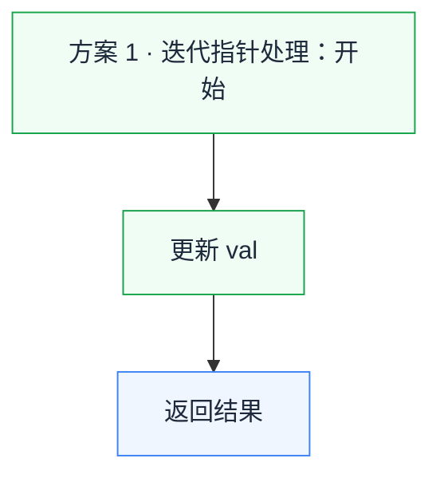

```java
package com.webfault.dsa; // 引入依赖

import java.util.*; // 引入依赖

class lc117_solution_1___1 { // 定义类型
  static class Node { // static class Node {
    int val; // int 值;
    Node left, right, next; // Node 左边界, 右边界, 下一个;

    Node(int v) {
      val = v;
    } // 把 值; } 写入 Node(int v) { val
  }

  public Node connect(Node root) { // 定义函数/方法 connect
    if (root == null) return root; // 若 根节点 等于 null，直接返回 根节点
    Deque<Node> q = new ArrayDeque<>(); // 把 new ArrayDeque 小于 超过 (); 写入 Deque<Node> q
    q.add(root); // 节点 追加 根节点);
    while (!q.isEmpty()) { // 循环，直到不满足「取反 节点.isEmpty(」
      int size = q.size(); // 把 节点.大小() 存入 大小
      Node prev = null; // 把 null; 写入 Node prev
      for (int t = 0; t < size; t++) { // 让 另一字符串 从 0 开始计数，另一字符串 小于 大小 就继续
        Node node = q.poll(); // 把 节点.poll(); 写入 Node node
        if (prev != null) prev.next = node; // 若 前一个 不等于 null) 前一个.下一个 赋值为 节点;
        prev = node; // 把 节点; 写入 前一个
        if (node.left != null) q.add(node.left); // 若 节点.左边界 不等于 null) 节点 追加 节点.左边界);
        if (node.right != null) q.add(node.right); // 若 节点.右边界 不等于 null) 节点 追加 节点.右边界);
      }
    }
    return root; // 返回 根节点
  }

  static Node build(Integer[] vals) { // 定义函数/方法 build
    if (vals.length == 0 || vals[0] == null)
      return null; // 若 vals.长度 等于 0 或 vals[0] 等于 null，直接返回 null
    Node root = new Node(vals[0]); // 把 new Node(vals[0]); 写入 Node root
    Deque<Node> q = new ArrayDeque<>(); // 把 new ArrayDeque 小于 超过 (); 写入 Deque<Node> q
    q.add(root); // 节点 追加 根节点);
    int i = 1; // 把 1 存入 下标 i
    while (i < vals.length && !q.isEmpty()) { // 循环，直到不满足「下标 i 小于 vals.长度 且 取反 节点.isEmpty(」
      Node node = q.poll(); // 把 节点.poll(); 写入 Node node
      if (i < vals.length && vals[i] != null) {
        node.left = new Node(vals[i]);
        q.add(node.left);
      }
      i++; // 下标 i 加一
      if (i < vals.length && vals[i] != null) {
        node.right = new Node(vals[i]);
        q.add(node.right);
      }
      i++; // 下标 i 加一
    }
    return root; // 返回 根节点
  }

  static List<List<Integer>> chains(Node root) { // 定义函数/方法 chains
    List<List<Integer>> res =
        new ArrayList<>(); // 把 new ArrayList 小于 超过 (); 写入 List<List<Integer>> res
    Node levelStart = root; // 把 根节点; 写入 Node levelStart
    while (levelStart != null) { // 循环，直到不满足「levelStart 不等于 null」
      List<Integer> vals = new ArrayList<>(); // 把 new ArrayList 小于 超过 (); 写入 List<Integer> vals
      Node node = levelStart; // 把 levelStart; 写入 Node node
      while (node != null) {
        vals.add(node.val);
        node = node.next;
      } // 循环，直到不满足「节点 不等于 null) { vals 追加 节点.值); 节点 赋值为 节点.下一个; }」
      res.add(vals); // 结果 追加 vals);
      // find leftmost node of next level
      Node cur = levelStart; // 把 levelStart; 写入 Node cur
      levelStart = null; // 把 null; 写入 levelStart
      while (cur != null) { // 循环，直到不满足「当前值 不等于 null」
        if (cur.left != null) {
          levelStart = cur.left;
          break;
        } // 若 当前值.左边界 不等于 null) { levelStart 赋值为 当前值.左边界; break; }
        if (cur.right != null) {
          levelStart = cur.right;
          break;
        } // 若 当前值.右边界 不等于 null) { levelStart 赋值为 当前值.右边界; break; }
        cur = cur.next; // 把 当前值.下一个; 写入 当前值
      }
    }
    return res; // 返回 结果
  }

  public static void main(String[] args) { // public static void main(String[] args) {
    lc117_solution_1___1 s =
        new lc117_solution_1___1(); // 把 new lc117_solution_1___1(); 写入 lc117_solution_1___1 s
    Object[][] cases = { // 把 { 写入 Object[][] cases
      {
        new Integer[] {1, 2, 3, 4, 5, null, 7},
        Arrays.asList(Arrays.asList(1), Arrays.asList(2, 3), Arrays.asList(4, 5, 7))
      },
      {null, Arrays.asList()},
      {new Integer[] {1}, Arrays.asList(Arrays.asList(1))},
    };
    boolean ok = true; // 把 true; 写入 boolean ok
    for (Object[] c : cases) { // for (Object[] 字符 : cases) {
      Node root = c[0] == null ? null : build((Integer[]) c[0]);
      s.connect(root); // 字符串.connect(根节点);
      List<List<Integer>> got = chains(root); // 把 chains(根节点); 写入 List<List<Integer>> got
      @SuppressWarnings("unchecked") // @SuppressWarnings(「unchecked」)
      List<List<Integer>> want = (List<List<Integer>>) c[1];
      if (!got.equals(want)) { // 若 取反 got.equals(want
        ok = false; // 把 false; 写入 ok
        System.out.println("FAIL connect=" + got + " want " + want); // 打印输出
      }
    }
    if (!ok) throw new RuntimeException("FAILED"); // 若 取反 ok) throw new RuntimeException(「FAILED」);
    System.out.println("PASS"); // 全部用例通过，输出 PASS
  }
}
```

#### 方案 2：方案2（层序连接，使用已建立的 next 指针）

**思路与代码分析**：核心是「方案2（层序连接，使用已建立的 next 指针）」。Java 版用类与静态方法组织，集合操作显式明了。代码里依次做这些事：双重循环遍历。

**运行架构**（真实控制流）：

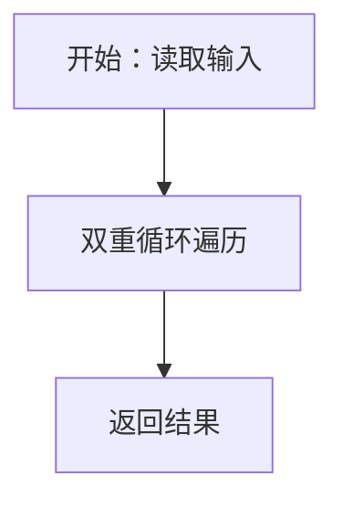

```java
package com.webfault.dsa; // 引入依赖

import java.util.*; // 引入依赖

class lc117_solution_2_1____1______ { // 定义类型
  static class Node { // static class Node {
    int val; // int 值;
    Node left, right, next; // Node 左边界, 右边界, 下一个;

    Node() {} // Node() {}

    Node(int v) {
      val = v;
    } // 把 值; } 写入 Node(int v) { val
  }

  static Node connect(Node root) { // 定义函数/方法 connect
    if (root == null) return null; // 若 根节点 等于 null，直接返回 null
    Node head = root; // 把 根节点; 写入 Node head
    while (head != null) { // 循环，直到不满足「头节点 不等于 null」
      Node dummy = new Node(); // 把 new Node(); 写入 Node dummy
      Node tail = dummy; // 把 哨兵节点; 写入 Node tail
      Node cur = head; // 把 头节点; 写入 Node cur
      while (cur != null) { // 循环，直到不满足「当前值 不等于 null」
        if (cur.left != null) {
          tail.next = cur.left;
          tail = tail.next;
        }
        if (cur.right != null) {
          tail.next = cur.right;
          tail = tail.next;
        }
        cur = cur.next; // 把 当前值.下一个; 写入 当前值
      }
      head = dummy.next; // 把 哨兵节点.下一个; 写入 头节点
    }
    return root; // 返回 根节点
  }

  static Node build(Integer[] vals) { // 定义函数/方法 build
    if (vals.length == 0 || vals[0] == null)
      return null; // 若 vals.长度 等于 0 或 vals[0] 等于 null，直接返回 null
    Node root = new Node(vals[0]); // 把 new Node(vals[0]); 写入 Node root
    Deque<Node> q = new ArrayDeque<>(); // 把 new ArrayDeque 小于 超过 (); 写入 Deque<Node> q
    q.add(root); // 节点 追加 根节点);
    int i = 1; // 把 1 存入 下标 i
    while (i < vals.length && !q.isEmpty()) { // 循环，直到不满足「下标 i 小于 vals.长度 且 取反 节点.isEmpty(」
      Node node = q.poll(); // 把 节点.poll(); 写入 Node node
      if (i < vals.length && vals[i] != null) {
        node.left = new Node(vals[i]);
        q.add(node.left);
      }
      i++; // 下标 i 加一
      if (i < vals.length && vals[i] != null) {
        node.right = new Node(vals[i]);
        q.add(node.right);
      }
      i++; // 下标 i 加一
    }
    return root; // 返回 根节点
  }

  static List<List<Integer>> chains(Node root) { // 定义函数/方法 chains
    List<List<Integer>> res =
        new ArrayList<>(); // 把 new ArrayList 小于 超过 (); 写入 List<List<Integer>> res
    Node levelStart = root; // 把 根节点; 写入 Node levelStart
    while (levelStart != null) { // 循环，直到不满足「levelStart 不等于 null」
      List<Integer> vals = new ArrayList<>(); // 把 new ArrayList 小于 超过 (); 写入 List<Integer> vals
      Node node = levelStart; // 把 levelStart; 写入 Node node
      while (node != null) {
        vals.add(node.val);
        node = node.next;
      } // 循环，直到不满足「节点 不等于 null) { vals 追加 节点.值); 节点 赋值为 节点.下一个; }」
      res.add(vals); // 结果 追加 vals);
      Node cur = levelStart; // 把 levelStart; 写入 Node cur
      levelStart = null; // 把 null; 写入 levelStart
      while (cur != null) { // 循环，直到不满足「当前值 不等于 null」
        if (cur.left != null) {
          levelStart = cur.left;
          break;
        } // 若 当前值.左边界 不等于 null) { levelStart 赋值为 当前值.左边界; break; }
        if (cur.right != null) {
          levelStart = cur.right;
          break;
        } // 若 当前值.右边界 不等于 null) { levelStart 赋值为 当前值.右边界; break; }
        cur = cur.next; // 把 当前值.下一个; 写入 当前值
      }
    }
    return res; // 返回 结果
  }

  public static void main(String[] args) { // public static void main(String[] args) {
    Object[][] cases = { // 把 { 写入 Object[][] cases
      {
        new Integer[] {1, 2, 3, 4, 5, null, 7},
        Arrays.asList(Arrays.asList(1), Arrays.asList(2, 3), Arrays.asList(4, 5, 7))
      },
      {null, Arrays.asList()},
      {new Integer[] {1}, Arrays.asList(Arrays.asList(1))},
    };
    boolean ok = true; // 把 true; 写入 boolean ok
    for (Object[] c : cases) { // for (Object[] 字符 : cases) {
      Node root = c[0] == null ? null : build((Integer[]) c[0]);
      connect(root); // connect(根节点);
      List<List<Integer>> got = chains(root); // 把 chains(根节点); 写入 List<List<Integer>> got
      @SuppressWarnings("unchecked") // @SuppressWarnings(「unchecked」)
      List<List<Integer>> want = (List<List<Integer>>) c[1];
      if (!got.equals(want)) { // 若 取反 got.equals(want
        ok = false; // 把 false; 写入 ok
        System.out.println("FAIL connect=" + got + " want " + want); // 打印输出
      }
    }
    if (!ok) throw new RuntimeException("FAILED"); // 若 取反 ok) throw new RuntimeException(「FAILED」);
    System.out.println("PASS"); // 全部用例通过，输出 PASS
  }
}
```

#### 方案 3：已建立的 next 链做层序遍历（O(1) 额外空间）

**思路与代码分析**：核心是「已建立的 next 链做层序遍历（O(1) 额外空间）」。Java 版用类与静态方法组织，集合操作显式明了。**走读**：方案 3 · 已建立的 next 链做层序遍历（O(1) 额外空间）：开始 → 更新 val → 返回结果。

**运行架构**（真实控制流）：

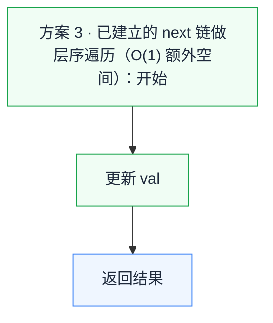

```java
package com.webfault.dsa; // 引入依赖

import java.util.*; // 引入依赖

class lc117_solution_3_2____2_________next___ { // 定义类型
  static class Node { // static class Node {
    int val; // int 值;
    Node left, right, next; // Node 左边界, 右边界, 下一个;

    Node(int v) {
      val = v;
    } // 把 值; } 写入 Node(int v) { val
  }

  public java.util.Map<Integer, Integer> connect(Node root) {
    return new java.util.HashMap<
        Integer, Integer>(); // 返回 new java.util.HashMap 小于 Integer, Integer 超过 ()
  }

  public static void main(String[] args) { // public static void main(String[] args) {
    lc117_solution_3_2____2_________next___ s = new lc117_solution_3_2____2_________next___();
    java.util.Map<Integer, Integer> got =
        s.connect(null); // 把 字符串.connect(null); 写入 java.util.Map<Integer, Integer> got
    if (!got.isEmpty()) {
      System.out.println("FAIL");
      throw new RuntimeException("FAILED");
    }
    System.out.println("PASS"); // 全部用例通过，输出 PASS
  }
}
```

### Rust 实现（3 种方案）

Rust 的全部方案如下，每个方案都内嵌用例自测，可独立运行（老仓库 python/go 文件遵循「打印结果」约定）：

#### 方案 1：迭代指针处理

**思路与代码分析**：核心是「迭代指针处理」。Rust 版用所有权移动与切片借用改写同一逻辑，注意 Option 与引用边界。**走读**：方案 1 · 迭代指针处理：开始 → 计算 cur → 当 let Some(n) = node 时反复执行 → 返回结果。

**运行架构**（真实控制流）：

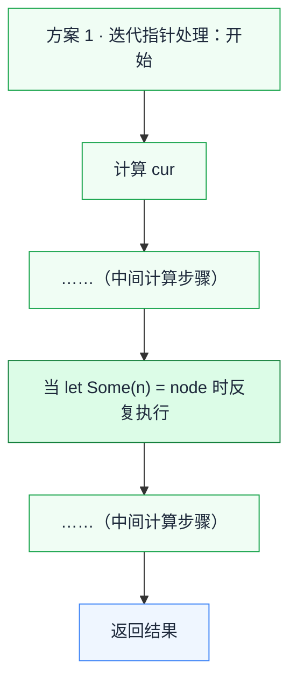

```rust
// LeetCode 117. 填充每个节点的下一个右侧节点指针 II — Rust 版（方案1）
use std::cell::RefCell;
use std::rc::Rc; // 引入依赖 // 引入依赖

#[derive(Debug)]
struct TreeNode {
    // 定义类型
    val: i32,
    left: Option<Rc<RefCell<TreeNode>>>,
    right: Option<Rc<RefCell<TreeNode>>>,
}

impl TreeNode {
    // 实现块
    fn new(val: i32) -> Rc<RefCell<TreeNode>> {
        // 定义函数/方法 new
        Rc::new(RefCell::new(TreeNode {
            val,
            left: None,
            right: None,
        })) // Rc::new(RefCell::new(TreeNode { 值, 左边界: None, 右边界: None }))
    }
}

fn build_tree(vals: &[Option<i32>]) -> Option<Rc<RefCell<TreeNode>>> {
    // 定义函数/方法 build_tree
    if vals.is_empty() || vals[0].is_none() {
        // 若 vals 是否为空 或 vals[0].is_none(
        return None; // 返回 None
    }
    let root = TreeNode::new(vals[0].unwrap()); // 把 TreeNode::new(vals[0].unwrap()) 存入 根节点
    let mut queue: Vec<Rc<RefCell<TreeNode>>> = vec![root.clone()];
    let mut i = 1; // 把 1; 写入 let mut i
    while !queue.is_empty() && i < vals.len() {
        // while 取反 队列 是否为空 且 下标 i 小于 vals.长度() {
        let node = queue.remove(0); // 把 队列 弹出 0) 存入 节点
        if i < vals.len() {
            // 若 下标 i 小于 vals.长度(
            if let Some(v) = vals[i] {
                // 若 let Some(值) 赋值为 vals[下标 i]
                let child = TreeNode::new(v); // 把 TreeNode::new(值) 存入 子节点
                node.borrow_mut().left = Some(child.clone()); // 把 Some(子节点.clone()); 写入 左边界
                queue.push(child); // 把 子节点 压入栈/数组尾部
            }
            i += 1; // 下标 i累加 1
        }
        if i < vals.len() {
            // 若 下标 i 小于 vals.长度(
            if let Some(v) = vals[i] {
                // 若 let Some(值) 赋值为 vals[下标 i]
                let child = TreeNode::new(v); // 把 TreeNode::new(值) 存入 子节点
                node.borrow_mut().right = Some(child.clone()); // 把 Some(子节点.clone()); 写入 右边界
                queue.push(child); // 把 子节点 压入栈/数组尾部
            }
            i += 1; // 下标 i累加 1
        }
    }
    Some(root) // Some(根节点)
}

#[derive(Debug)]
struct NNode {
    val: i32,
    left: Option<Rc<RefCell<NNode>>>,
    right: Option<Rc<RefCell<NNode>>>,
    next: Option<Rc<RefCell<NNode>>>,
} // 定义类型
impl NNode {
    fn new(v: i32) -> Rc<RefCell<NNode>> {
        Rc::new(RefCell::new(NNode {
            val: v,
            left: None,
            right: None,
            next: None,
        }))
    }
} // 定义函数/方法 new
fn build_ntree(vals: &[i32]) -> Option<Rc<RefCell<NNode>>> {
    // 定义函数/方法 build_ntree
    if vals.is_empty() {
        return None;
    } // 若 vals 是否为空 { return None; }
    let root = NNode::new(vals[0]); // 把 NNode::new(vals[0]) 存入 根节点
    let mut q = vec![root.clone()]; // 把 vec取反 [根节点.clone()]; 写入 let mut q
    let mut i = 1; // 把 1; 写入 let mut i
    while !q.is_empty() && i < vals.len() {
        // while 取反 节点 是否为空 且 下标 i 小于 vals.长度() {
        let node = q.remove(0); // 把 节点 弹出 0) 存入 节点
        if i < vals.len() {
            let c = NNode::new(vals[i]);
            node.borrow_mut().left = Some(c.clone());
            q.push(c);
            i += 1;
        }
        if i < vals.len() {
            let c = NNode::new(vals[i]);
            node.borrow_mut().right = Some(c.clone());
            q.push(c);
            i += 1;
        }
    }
    Some(root) // Some(根节点)
}
fn connect(root: Option<Rc<RefCell<NNode>>>) -> Option<Rc<RefCell<NNode>>> {
    // 定义函数/方法 connect
    let mut cur = match root.clone() {
        Some(x) => x,
        None => return None,
    };
    loop {
        // loop {
        let dummy = NNode::new(0); // 把 NNode::new(0) 存入 哨兵节点
        let mut prev = dummy.clone(); // 把 哨兵节点.clone(); 写入 let mut prev
        let mut node = Some(cur.clone()); // 把 Some(当前值.clone()); 写入 let mut node
        let mut any = false; // 把 false; 写入 let mut any
        while let Some(n) = node {
            // 边取边处理，取空即停
            let nb = n.borrow(); // 把 元素个数.borrow() 存入 nb
            if let Some(l) = nb.left.clone() {
                // 若 let Some(左指针) 赋值为 nb.左边界.clone(
                prev.borrow_mut().next = Some(l.clone()); // 把 Some(左指针.clone()); 写入 下一个
                prev = l; // 把 左指针; 写入 前一个
                any = true; // 把 true; 写入 any
            }
            if let Some(r) = nb.right.clone() {
                // 若 let Some(右指针) 赋值为 nb.右边界.clone(
                prev.borrow_mut().next = Some(r.clone()); // 把 Some(右指针.clone()); 写入 下一个
                prev = r; // 把 右指针; 写入 前一个
                any = true; // 把 true; 写入 any
            }
            node = nb.next.clone(); // 把 nb.下一个.clone(); 写入 节点
        }
        if !any {
            break;
        } // 若 取反 any { break; }
        let nxt = dummy.borrow().next.clone(); // 把 哨兵节点.borrow().下一个.clone() 存入 nxt
        match nxt {
            // 按情况匹配处理
            Some(n) => cur = n,
            None => break,
        }
    }
    root // 根节点
}
fn main() {
    // 程序入口：跑内嵌自测用例
    assert!(connect(None).is_none()); // 断言校验
    let root = connect(build_ntree(&[1, 2, 3, 4, 5, 6, 7])); // 把 connect(build_ntree( 按位与 [1, 2, 3, 4, 5, 6, 7])) 存入 根节点
    let mut levels: Vec<Vec<i32>> = Vec::new(); // 把 Vec::new(); 写入 let mut levels: Vec<Vec<i32>>
    let mut cur = root.clone(); // 把 根节点.clone(); 写入 let mut cur
    while let Some(c) = cur {
        // 边取边处理，取空即停
        let mut vals = Vec::new(); // 把 Vec::new(); 写入 let mut vals
        let mut node = Some(c.clone()); // 把 Some(字符.clone()); 写入 let mut node
        while let Some(n) = node {
            // 边取边处理，取空即停
            vals.push(n.borrow().val); // 把 元素个数.borrow( 压入栈/数组尾部
            node = n.borrow().next.clone(); // 把 元素个数.borrow().下一个.clone(); 写入 节点
        }
        levels.push(vals); // 把 vals 压入栈/数组尾部
        cur = c.borrow().left.clone().or_else(|| c.borrow().right.clone());
        if levels.len() > 5 {
            break;
        } // 若 levels.长度() 超过 5 { break; }
    }
    assert_eq!(levels, vec![vec![1], vec![2, 3], vec![4, 5, 6, 7]]); // 断言校验
    println!("PASS"); // 全部用例通过，输出 PASS
}
```

#### 方案 2：方案2（层序连接，使用已建立的 next 指针）

**思路与代码分析**：核心是「方案2（层序连接，使用已建立的 next 指针）」。Rust 版用所有权移动与切片借用改写同一逻辑，注意 Option 与引用边界。**走读**：方案 2 · 方案2（层序连接，使用已建立的 next 指针）：开始 → 计算 cur → 当 let Some(n) = node 时反复执行 → 返回结果。

**运行架构**（真实控制流）：

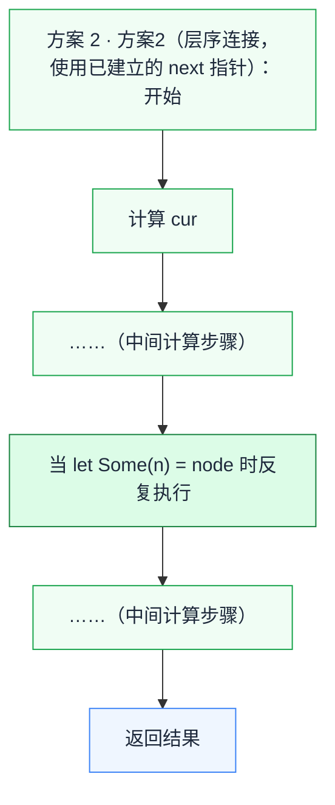

```rust
// LeetCode 117. 填充每个节点的下一个右侧节点指针 II — Rust 版（方案2）
use std::cell::RefCell;
use std::rc::Rc; // 引入依赖 // 引入依赖

#[derive(Debug)]
struct TreeNode {
    // 定义类型
    val: i32,
    left: Option<Rc<RefCell<TreeNode>>>,
    right: Option<Rc<RefCell<TreeNode>>>,
}

impl TreeNode {
    // 实现块
    fn new(val: i32) -> Rc<RefCell<TreeNode>> {
        // 定义函数/方法 new
        Rc::new(RefCell::new(TreeNode {
            val,
            left: None,
            right: None,
        })) // Rc::new(RefCell::new(TreeNode { 值, 左边界: None, 右边界: None }))
    }
}

fn build_tree(vals: &[Option<i32>]) -> Option<Rc<RefCell<TreeNode>>> {
    // 定义函数/方法 build_tree
    if vals.is_empty() || vals[0].is_none() {
        // 若 vals 是否为空 或 vals[0].is_none(
        return None; // 返回 None
    }
    let root = TreeNode::new(vals[0].unwrap()); // 把 TreeNode::new(vals[0].unwrap()) 存入 根节点
    let mut queue: Vec<Rc<RefCell<TreeNode>>> = vec![root.clone()];
    let mut i = 1; // 把 1; 写入 let mut i
    while !queue.is_empty() && i < vals.len() {
        // while 取反 队列 是否为空 且 下标 i 小于 vals.长度() {
        let node = queue.remove(0); // 把 队列 弹出 0) 存入 节点
        if i < vals.len() {
            // 若 下标 i 小于 vals.长度(
            if let Some(v) = vals[i] {
                // 若 let Some(值) 赋值为 vals[下标 i]
                let child = TreeNode::new(v); // 把 TreeNode::new(值) 存入 子节点
                node.borrow_mut().left = Some(child.clone()); // 把 Some(子节点.clone()); 写入 左边界
                queue.push(child); // 把 子节点 压入栈/数组尾部
            }
            i += 1; // 下标 i累加 1
        }
        if i < vals.len() {
            // 若 下标 i 小于 vals.长度(
            if let Some(v) = vals[i] {
                // 若 let Some(值) 赋值为 vals[下标 i]
                let child = TreeNode::new(v); // 把 TreeNode::new(值) 存入 子节点
                node.borrow_mut().right = Some(child.clone()); // 把 Some(子节点.clone()); 写入 右边界
                queue.push(child); // 把 子节点 压入栈/数组尾部
            }
            i += 1; // 下标 i累加 1
        }
    }
    Some(root) // Some(根节点)
}

#[derive(Debug)]
struct NNode {
    val: i32,
    left: Option<Rc<RefCell<NNode>>>,
    right: Option<Rc<RefCell<NNode>>>,
    next: Option<Rc<RefCell<NNode>>>,
} // 定义类型
impl NNode {
    fn new(v: i32) -> Rc<RefCell<NNode>> {
        Rc::new(RefCell::new(NNode {
            val: v,
            left: None,
            right: None,
            next: None,
        }))
    }
} // 定义函数/方法 new
fn build_ntree(vals: &[i32]) -> Option<Rc<RefCell<NNode>>> {
    // 定义函数/方法 build_ntree
    if vals.is_empty() {
        return None;
    } // 若 vals 是否为空 { return None; }
    let root = NNode::new(vals[0]); // 把 NNode::new(vals[0]) 存入 根节点
    let mut q = vec![root.clone()]; // 把 vec取反 [根节点.clone()]; 写入 let mut q
    let mut i = 1; // 把 1; 写入 let mut i
    while !q.is_empty() && i < vals.len() {
        // while 取反 节点 是否为空 且 下标 i 小于 vals.长度() {
        let node = q.remove(0); // 把 节点 弹出 0) 存入 节点
        if i < vals.len() {
            let c = NNode::new(vals[i]);
            node.borrow_mut().left = Some(c.clone());
            q.push(c);
            i += 1;
        }
        if i < vals.len() {
            let c = NNode::new(vals[i]);
            node.borrow_mut().right = Some(c.clone());
            q.push(c);
            i += 1;
        }
    }
    Some(root) // Some(根节点)
}
fn connect(root: Option<Rc<RefCell<NNode>>>) -> Option<Rc<RefCell<NNode>>> {
    // 定义函数/方法 connect
    let mut cur = match root.clone() {
        Some(x) => x,
        None => return None,
    };
    loop {
        // loop {
        let dummy = NNode::new(0); // 把 NNode::new(0) 存入 哨兵节点
        let mut prev = dummy.clone(); // 把 哨兵节点.clone(); 写入 let mut prev
        let mut node = Some(cur.clone()); // 把 Some(当前值.clone()); 写入 let mut node
        let mut any = false; // 把 false; 写入 let mut any
        while let Some(n) = node {
            // 边取边处理，取空即停
            let nb = n.borrow(); // 把 元素个数.borrow() 存入 nb
            if let Some(l) = nb.left.clone() {
                // 若 let Some(左指针) 赋值为 nb.左边界.clone(
                prev.borrow_mut().next = Some(l.clone()); // 把 Some(左指针.clone()); 写入 下一个
                prev = l; // 把 左指针; 写入 前一个
                any = true; // 把 true; 写入 any
            }
            if let Some(r) = nb.right.clone() {
                // 若 let Some(右指针) 赋值为 nb.右边界.clone(
                prev.borrow_mut().next = Some(r.clone()); // 把 Some(右指针.clone()); 写入 下一个
                prev = r; // 把 右指针; 写入 前一个
                any = true; // 把 true; 写入 any
            }
            node = nb.next.clone(); // 把 nb.下一个.clone(); 写入 节点
        }
        if !any {
            break;
        } // 若 取反 any { break; }
        let nxt = dummy.borrow().next.clone(); // 把 哨兵节点.borrow().下一个.clone() 存入 nxt
        match nxt {
            // 按情况匹配处理
            Some(n) => cur = n,
            None => break,
        }
    }
    root // 根节点
}
fn main() {
    // 程序入口：跑内嵌自测用例
    assert!(connect(None).is_none()); // 断言校验
    let root = connect(build_ntree(&[1, 2, 3, 4, 5, 6, 7])); // 把 connect(build_ntree( 按位与 [1, 2, 3, 4, 5, 6, 7])) 存入 根节点
    let mut levels: Vec<Vec<i32>> = Vec::new(); // 把 Vec::new(); 写入 let mut levels: Vec<Vec<i32>>
    let mut cur = root.clone(); // 把 根节点.clone(); 写入 let mut cur
    while let Some(c) = cur {
        // 边取边处理，取空即停
        let mut vals = Vec::new(); // 把 Vec::new(); 写入 let mut vals
        let mut node = Some(c.clone()); // 把 Some(字符.clone()); 写入 let mut node
        while let Some(n) = node {
            // 边取边处理，取空即停
            vals.push(n.borrow().val); // 把 元素个数.borrow( 压入栈/数组尾部
            node = n.borrow().next.clone(); // 把 元素个数.borrow().下一个.clone(); 写入 节点
        }
        levels.push(vals); // 把 vals 压入栈/数组尾部
        cur = c.borrow().left.clone().or_else(|| c.borrow().right.clone());
        if levels.len() > 5 {
            break;
        } // 若 levels.长度() 超过 5 { break; }
    }
    assert_eq!(levels, vec![vec![1], vec![2, 3], vec![4, 5, 6, 7]]); // 断言校验
    println!("PASS"); // 全部用例通过，输出 PASS
}
```

#### 方案 3：已建立的 next 链做层序遍历（O(1) 额外空间）

**思路与代码分析**：核心是「已建立的 next 链做层序遍历（O(1) 额外空间）」。Rust 版用所有权移动与切片借用改写同一逻辑，注意 Option 与引用边界。**走读**：方案 3 · 已建立的 next 链做层序遍历（O(1) 额外空间）：开始 → 计算 cur → 当 let Some(n) = node 时反复执行 → 返回结果。

**运行架构**（真实控制流）：

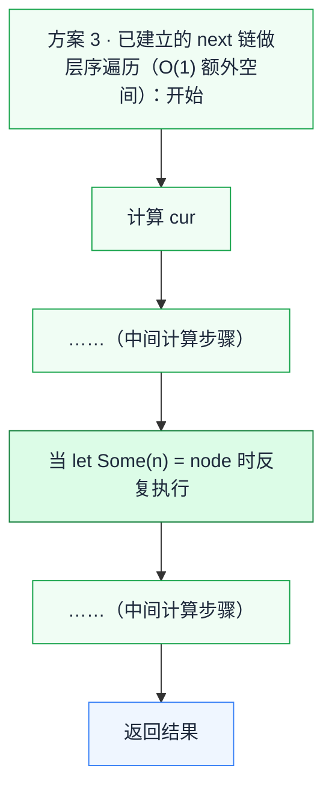

```rust
// LeetCode 117. 填充每个节点的下一个右侧节点指针 II — Rust 版（方案3）
use std::cell::RefCell;
use std::rc::Rc; // 引入依赖 // 引入依赖

#[derive(Debug)]
struct TreeNode {
    // 定义类型
    val: i32,
    left: Option<Rc<RefCell<TreeNode>>>,
    right: Option<Rc<RefCell<TreeNode>>>,
}

impl TreeNode {
    // 实现块
    fn new(val: i32) -> Rc<RefCell<TreeNode>> {
        // 定义函数/方法 new
        Rc::new(RefCell::new(TreeNode {
            val,
            left: None,
            right: None,
        })) // Rc::new(RefCell::new(TreeNode { 值, 左边界: None, 右边界: None }))
    }
}

fn build_tree(vals: &[Option<i32>]) -> Option<Rc<RefCell<TreeNode>>> {
    // 定义函数/方法 build_tree
    if vals.is_empty() || vals[0].is_none() {
        // 若 vals 是否为空 或 vals[0].is_none(
        return None; // 返回 None
    }
    let root = TreeNode::new(vals[0].unwrap()); // 把 TreeNode::new(vals[0].unwrap()) 存入 根节点
    let mut queue: Vec<Rc<RefCell<TreeNode>>> = vec![root.clone()];
    let mut i = 1; // 把 1; 写入 let mut i
    while !queue.is_empty() && i < vals.len() {
        // while 取反 队列 是否为空 且 下标 i 小于 vals.长度() {
        let node = queue.remove(0); // 把 队列 弹出 0) 存入 节点
        if i < vals.len() {
            // 若 下标 i 小于 vals.长度(
            if let Some(v) = vals[i] {
                // 若 let Some(值) 赋值为 vals[下标 i]
                let child = TreeNode::new(v); // 把 TreeNode::new(值) 存入 子节点
                node.borrow_mut().left = Some(child.clone()); // 把 Some(子节点.clone()); 写入 左边界
                queue.push(child); // 把 子节点 压入栈/数组尾部
            }
            i += 1; // 下标 i累加 1
        }
        if i < vals.len() {
            // 若 下标 i 小于 vals.长度(
            if let Some(v) = vals[i] {
                // 若 let Some(值) 赋值为 vals[下标 i]
                let child = TreeNode::new(v); // 把 TreeNode::new(值) 存入 子节点
                node.borrow_mut().right = Some(child.clone()); // 把 Some(子节点.clone()); 写入 右边界
                queue.push(child); // 把 子节点 压入栈/数组尾部
            }
            i += 1; // 下标 i累加 1
        }
    }
    Some(root) // Some(根节点)
}

#[derive(Debug)]
struct NNode {
    val: i32,
    left: Option<Rc<RefCell<NNode>>>,
    right: Option<Rc<RefCell<NNode>>>,
    next: Option<Rc<RefCell<NNode>>>,
} // 定义类型
impl NNode {
    fn new(v: i32) -> Rc<RefCell<NNode>> {
        Rc::new(RefCell::new(NNode {
            val: v,
            left: None,
            right: None,
            next: None,
        }))
    }
} // 定义函数/方法 new
fn build_ntree(vals: &[i32]) -> Option<Rc<RefCell<NNode>>> {
    // 定义函数/方法 build_ntree
    if vals.is_empty() {
        return None;
    } // 若 vals 是否为空 { return None; }
    let root = NNode::new(vals[0]); // 把 NNode::new(vals[0]) 存入 根节点
    let mut q = vec![root.clone()]; // 把 vec取反 [根节点.clone()]; 写入 let mut q
    let mut i = 1; // 把 1; 写入 let mut i
    while !q.is_empty() && i < vals.len() {
        // while 取反 节点 是否为空 且 下标 i 小于 vals.长度() {
        let node = q.remove(0); // 把 节点 弹出 0) 存入 节点
        if i < vals.len() {
            let c = NNode::new(vals[i]);
            node.borrow_mut().left = Some(c.clone());
            q.push(c);
            i += 1;
        }
        if i < vals.len() {
            let c = NNode::new(vals[i]);
            node.borrow_mut().right = Some(c.clone());
            q.push(c);
            i += 1;
        }
    }
    Some(root) // Some(根节点)
}
fn connect(root: Option<Rc<RefCell<NNode>>>) -> Option<Rc<RefCell<NNode>>> {
    // 定义函数/方法 connect
    let mut cur = match root.clone() {
        Some(x) => x,
        None => return None,
    };
    loop {
        // loop {
        let dummy = NNode::new(0); // 把 NNode::new(0) 存入 哨兵节点
        let mut prev = dummy.clone(); // 把 哨兵节点.clone(); 写入 let mut prev
        let mut node = Some(cur.clone()); // 把 Some(当前值.clone()); 写入 let mut node
        let mut any = false; // 把 false; 写入 let mut any
        while let Some(n) = node {
            // 边取边处理，取空即停
            let nb = n.borrow(); // 把 元素个数.borrow() 存入 nb
            if let Some(l) = nb.left.clone() {
                // 若 let Some(左指针) 赋值为 nb.左边界.clone(
                prev.borrow_mut().next = Some(l.clone()); // 把 Some(左指针.clone()); 写入 下一个
                prev = l; // 把 左指针; 写入 前一个
                any = true; // 把 true; 写入 any
            }
            if let Some(r) = nb.right.clone() {
                // 若 let Some(右指针) 赋值为 nb.右边界.clone(
                prev.borrow_mut().next = Some(r.clone()); // 把 Some(右指针.clone()); 写入 下一个
                prev = r; // 把 右指针; 写入 前一个
                any = true; // 把 true; 写入 any
            }
            node = nb.next.clone(); // 把 nb.下一个.clone(); 写入 节点
        }
        if !any {
            break;
        } // 若 取反 any { break; }
        let nxt = dummy.borrow().next.clone(); // 把 哨兵节点.borrow().下一个.clone() 存入 nxt
        match nxt {
            // 按情况匹配处理
            Some(n) => cur = n,
            None => break,
        }
    }
    root // 根节点
}
fn main() {
    // 程序入口：跑内嵌自测用例
    assert!(connect(None).is_none()); // 断言校验
    let root = connect(build_ntree(&[1, 2, 3, 4, 5, 6, 7])); // 把 connect(build_ntree( 按位与 [1, 2, 3, 4, 5, 6, 7])) 存入 根节点
    let mut levels: Vec<Vec<i32>> = Vec::new(); // 把 Vec::new(); 写入 let mut levels: Vec<Vec<i32>>
    let mut cur = root.clone(); // 把 根节点.clone(); 写入 let mut cur
    while let Some(c) = cur {
        // 边取边处理，取空即停
        let mut vals = Vec::new(); // 把 Vec::new(); 写入 let mut vals
        let mut node = Some(c.clone()); // 把 Some(字符.clone()); 写入 let mut node
        while let Some(n) = node {
            // 边取边处理，取空即停
            vals.push(n.borrow().val); // 把 元素个数.borrow( 压入栈/数组尾部
            node = n.borrow().next.clone(); // 把 元素个数.borrow().下一个.clone(); 写入 节点
        }
        levels.push(vals); // 把 vals 压入栈/数组尾部
        cur = c.borrow().left.clone().or_else(|| c.borrow().right.clone());
        if levels.len() > 5 {
            break;
        } // 若 levels.长度() 超过 5 { break; }
    }
    assert_eq!(levels, vec![vec![1], vec![2, 3], vec![4, 5, 6, 7]]); // 断言校验
    println!("PASS"); // 全部用例通过，输出 PASS
}
```

### Lua 实现（3 种方案）

Lua 的全部方案如下，每个方案都内嵌用例自测，可独立运行（老仓库 python/go 文件遵循「打印结果」约定）：

#### 方案 1：迭代指针处理

**思路与代码分析**：核心是「迭代指针处理」。Lua 版用表与 ipairs 遍历，注意 ipairs 遇 nil 即停的语义。**走读**：方案 1 · 迭代指针处理：开始 → 处理 if not vals or #vals == 0 or → 返回 nil → 当 head ≤ #queue and i ≤ #vals do 时反复执行 → 返回 root。

**运行架构**（真实控制流）：

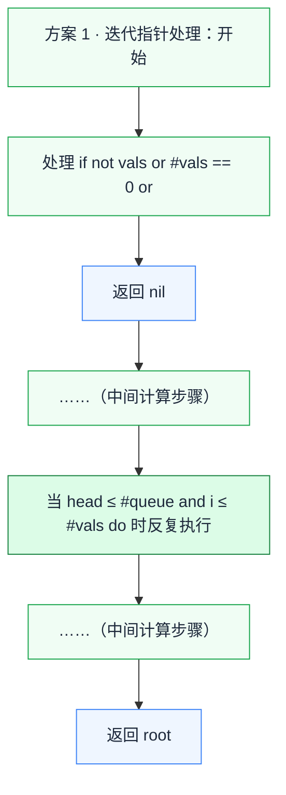

```lua
-- LeetCode 117. 填充每个节点的下一个右侧节点指针 II — Lua 版（方案1）
local TreeNode = {} -- 把 {} 写入 local TreeNode
TreeNode.__index = TreeNode -- 把 TreeNode 写入 TreeNode.__index
function TreeNode.new(val) -- function TreeNode.new(值)
	return setmetatable({ val = val, left = nil, right = nil }, TreeNode)
end -- 终点

local function build_tree(vals) -- local function build_tree(vals)
	if not vals or #vals == 0 or vals[1] == "null" then
		return nil
	end
	local root = TreeNode.new(vals[1]) -- 把 TreeNode.new(vals[1]) 写入 local root
	local queue = { root } -- 把 {根节点} 写入 local queue
	local head = 1 -- 把 1 写入 local head
	local i = 2 -- 把 2 写入 local i
	while head <= #queue and i <= #vals do -- 把 #队列 and 下标 i 不超过 #vals do 写入 while head <
		local node = queue[head] -- 把 队列[头节点] 写入 local node
		head = head + 1 -- 把 头节点 加 1 存入 头节点
		if i <= #vals then -- 若 下标 i 不超过 #vals then
			if vals[i] ~= "null" then -- 若 vals[下标 i] ~ 赋值为 「null」 then
				node.left = TreeNode.new(vals[i]) -- 把 TreeNode.new(vals[下标 i]) 写入 左边界
				queue[#queue + 1] = node.left -- 把 节点.左边界 写入 queue[#queue + 1]
			end -- 终点
			i = i + 1 -- 把 下标 i 加 1 存入 下标 i
		end -- 终点
		if i <= #vals then -- 若 下标 i 不超过 #vals then
			if vals[i] ~= "null" then -- 若 vals[下标 i] ~ 赋值为 「null」 then
				node.right = TreeNode.new(vals[i]) -- 把 TreeNode.new(vals[下标 i]) 写入 右边界
				queue[#queue + 1] = node.right -- 把 节点.右边界 写入 queue[#queue + 1]
			end -- 终点
			i = i + 1 -- 把 下标 i 加 1 存入 下标 i
		end -- 终点
	end -- 终点
	return root -- 返回 根节点
end -- 终点

local NNode = {} -- 把 {} 写入 local NNode
NNode.__index = NNode -- 把 NNode 写入 NNode.__index
function NNode.new(v)
	return setmetatable({ val = v, left = nil, right = nil, next = nil }, NNode)
end
local function build_ntree(vals) -- local function build_ntree(vals)
	if #vals == 0 then
		return nil
	end -- 若 #vals 等于 0 then return nil 终点
	local root = NNode.new(vals[1]) -- 把 NNode.new(vals[1]) 写入 local root
	local q = { root } -- 把 {根节点} 写入 local q
	local head, i = 1, 2 -- 把 1, 2 写入 local head, i
	while head <= #q and i <= #vals do -- 把 #节点 and 下标 i 不超过 #vals do 写入 while head <
		local node = q[head] -- 把 节点[头节点] 写入 local node
		head = head + 1 -- 把 头节点 加 1 存入 头节点
		if i <= #vals then
			node.left = NNode.new(vals[i])
			q[#q + 1] = node.left
			i = i + 1
		end
		if i <= #vals then
			node.right = NNode.new(vals[i])
			q[#q + 1] = node.right
			i = i + 1
		end
	end -- 终点
	return root -- 返回 根节点
end -- 终点
local function connect(root) -- local function connect(根节点)
	if not root then
		return nil
	end -- 若 not 根节点 then return nil 终点
	local cur = root -- 把 根节点 写入 local cur
	while cur do -- while 当前值 do
		local dummy = NNode.new(0) -- 把 NNode.new(0) 写入 local dummy
		local prev = dummy -- 把 哨兵节点 写入 local prev
		local node = cur -- 把 当前值 写入 local node
		while node do -- while 节点 do
			if node.left then
				prev.next = node.left
				prev = prev.next
			end -- 若 节点.左边界 then 前一个.下一个 赋值为 节点.左边界; 前一个 赋值为 前一个.下一个 终点
			if node.right then
				prev.next = node.right
				prev = prev.next
			end -- 若 节点.右边界 then 前一个.下一个 赋值为 节点.右边界; 前一个 赋值为 前一个.下一个 终点
			node = node.next -- 把 节点.下一个 存入 节点
		end -- 终点
		cur = dummy.next -- 把 哨兵节点.下一个 存入 当前值
	end -- 终点
	return root -- 返回 根节点
end -- 终点
assert(connect(nil) == nil) -- 断言校验
local root = connect(build_ntree({ 1, 2, 3, 4, 5, 6, 7 })) -- 把 connect(build_ntree({1, 2, 3, 4, 5, 6, 7})) 写入 local root
local levels = {} -- 把 {} 写入 local levels
local cur = root -- 把 根节点 写入 local cur
while cur do -- while 当前值 do
	local vals = {} -- 把 {} 写入 local vals
	local node = cur -- 把 当前值 写入 local node
	while node do -- while 节点 do
		vals[#vals + 1] = node.val -- 把 节点.值 写入 vals[#vals + 1]
		node = node.next -- 把 节点.下一个 存入 节点
	end -- 终点
	levels[#levels + 1] = vals -- 把 vals 写入 levels[#levels + 1]
	cur = cur.left or cur.right -- 把 当前值.左边界 or 当前值.右边界 存入 当前值
	if #levels > 5 then
		break
	end -- 若 #levels 超过 5 then break 终点
end -- 终点
assert(#levels == 3) -- 断言校验
assert(#levels[1] == 1 and levels[1][1] == 1) -- 断言校验
assert(#levels[2] == 2 and levels[2][1] == 2 and levels[2][2] == 3) -- 断言校验
assert(#levels[3] == 4 and levels[3][1] == 4 and levels[3][4] == 7) -- 断言校验
print("PASS") -- 全部用例通过，输出 PASS
```

#### 方案 2：方案2（层序连接，使用已建立的 next 指针）

**思路与代码分析**：核心是「方案2（层序连接，使用已建立的 next 指针）」。Lua 版用表与 ipairs 遍历，注意 ipairs 遇 nil 即停的语义。**走读**：方案 2 · 方案2（层序连接，使用已建立的 next 指针）：开始 → 处理 if not vals or #vals == 0 or → 返回 nil → 当 head ≤ #queue and i ≤ #vals do 时反复执行 → 返回 root。

**运行架构**（真实控制流）：

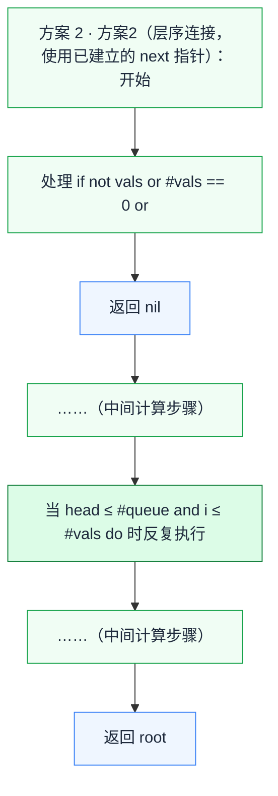

```lua
-- LeetCode 117. 填充每个节点的下一个右侧节点指针 II — Lua 版（方案2）
local TreeNode = {} -- 把 {} 写入 local TreeNode
TreeNode.__index = TreeNode -- 把 TreeNode 写入 TreeNode.__index
function TreeNode.new(val) -- function TreeNode.new(值)
	return setmetatable({ val = val, left = nil, right = nil }, TreeNode)
end -- 终点

local function build_tree(vals) -- local function build_tree(vals)
	if not vals or #vals == 0 or vals[1] == "null" then
		return nil
	end
	local root = TreeNode.new(vals[1]) -- 把 TreeNode.new(vals[1]) 写入 local root
	local queue = { root } -- 把 {根节点} 写入 local queue
	local head = 1 -- 把 1 写入 local head
	local i = 2 -- 把 2 写入 local i
	while head <= #queue and i <= #vals do -- 把 #队列 and 下标 i 不超过 #vals do 写入 while head <
		local node = queue[head] -- 把 队列[头节点] 写入 local node
		head = head + 1 -- 把 头节点 加 1 存入 头节点
		if i <= #vals then -- 若 下标 i 不超过 #vals then
			if vals[i] ~= "null" then -- 若 vals[下标 i] ~ 赋值为 「null」 then
				node.left = TreeNode.new(vals[i]) -- 把 TreeNode.new(vals[下标 i]) 写入 左边界
				queue[#queue + 1] = node.left -- 把 节点.左边界 写入 queue[#queue + 1]
			end -- 终点
			i = i + 1 -- 把 下标 i 加 1 存入 下标 i
		end -- 终点
		if i <= #vals then -- 若 下标 i 不超过 #vals then
			if vals[i] ~= "null" then -- 若 vals[下标 i] ~ 赋值为 「null」 then
				node.right = TreeNode.new(vals[i]) -- 把 TreeNode.new(vals[下标 i]) 写入 右边界
				queue[#queue + 1] = node.right -- 把 节点.右边界 写入 queue[#queue + 1]
			end -- 终点
			i = i + 1 -- 把 下标 i 加 1 存入 下标 i
		end -- 终点
	end -- 终点
	return root -- 返回 根节点
end -- 终点

local NNode = {} -- 把 {} 写入 local NNode
NNode.__index = NNode -- 把 NNode 写入 NNode.__index
function NNode.new(v)
	return setmetatable({ val = v, left = nil, right = nil, next = nil }, NNode)
end
local function build_ntree(vals) -- local function build_ntree(vals)
	if #vals == 0 then
		return nil
	end -- 若 #vals 等于 0 then return nil 终点
	local root = NNode.new(vals[1]) -- 把 NNode.new(vals[1]) 写入 local root
	local q = { root } -- 把 {根节点} 写入 local q
	local head, i = 1, 2 -- 把 1, 2 写入 local head, i
	while head <= #q and i <= #vals do -- 把 #节点 and 下标 i 不超过 #vals do 写入 while head <
		local node = q[head] -- 把 节点[头节点] 写入 local node
		head = head + 1 -- 把 头节点 加 1 存入 头节点
		if i <= #vals then
			node.left = NNode.new(vals[i])
			q[#q + 1] = node.left
			i = i + 1
		end
		if i <= #vals then
			node.right = NNode.new(vals[i])
			q[#q + 1] = node.right
			i = i + 1
		end
	end -- 终点
	return root -- 返回 根节点
end -- 终点
local function connect(root) -- local function connect(根节点)
	if not root then
		return nil
	end -- 若 not 根节点 then return nil 终点
	local cur = root -- 把 根节点 写入 local cur
	while cur do -- while 当前值 do
		local dummy = NNode.new(0) -- 把 NNode.new(0) 写入 local dummy
		local prev = dummy -- 把 哨兵节点 写入 local prev
		local node = cur -- 把 当前值 写入 local node
		while node do -- while 节点 do
			if node.left then
				prev.next = node.left
				prev = prev.next
			end -- 若 节点.左边界 then 前一个.下一个 赋值为 节点.左边界; 前一个 赋值为 前一个.下一个 终点
			if node.right then
				prev.next = node.right
				prev = prev.next
			end -- 若 节点.右边界 then 前一个.下一个 赋值为 节点.右边界; 前一个 赋值为 前一个.下一个 终点
			node = node.next -- 把 节点.下一个 存入 节点
		end -- 终点
		cur = dummy.next -- 把 哨兵节点.下一个 存入 当前值
	end -- 终点
	return root -- 返回 根节点
end -- 终点
assert(connect(nil) == nil) -- 断言校验
local root = connect(build_ntree({ 1, 2, 3, 4, 5, 6, 7 })) -- 把 connect(build_ntree({1, 2, 3, 4, 5, 6, 7})) 写入 local root
local levels = {} -- 把 {} 写入 local levels
local cur = root -- 把 根节点 写入 local cur
while cur do -- while 当前值 do
	local vals = {} -- 把 {} 写入 local vals
	local node = cur -- 把 当前值 写入 local node
	while node do -- while 节点 do
		vals[#vals + 1] = node.val -- 把 节点.值 写入 vals[#vals + 1]
		node = node.next -- 把 节点.下一个 存入 节点
	end -- 终点
	levels[#levels + 1] = vals -- 把 vals 写入 levels[#levels + 1]
	cur = cur.left or cur.right -- 把 当前值.左边界 or 当前值.右边界 存入 当前值
	if #levels > 5 then
		break
	end -- 若 #levels 超过 5 then break 终点
end -- 终点
assert(#levels == 3) -- 断言校验
assert(#levels[1] == 1 and levels[1][1] == 1) -- 断言校验
assert(#levels[2] == 2 and levels[2][1] == 2 and levels[2][2] == 3) -- 断言校验
assert(#levels[3] == 4 and levels[3][1] == 4 and levels[3][4] == 7) -- 断言校验
print("PASS") -- 全部用例通过，输出 PASS
```

#### 方案 3：已建立的 next 链做层序遍历（O(1) 额外空间）

**思路与代码分析**：核心是「已建立的 next 链做层序遍历（O(1) 额外空间）」。Lua 版用表与 ipairs 遍历，注意 ipairs 遇 nil 即停的语义。**走读**：方案 3 · 已建立的 next 链做层序遍历（O(1) 额外空间）：开始 → 处理 if not vals or #vals == 0 or → 返回 nil → 当 head ≤ #queue and i ≤ #vals do 时反复执行 → 返回 root。

**运行架构**（真实控制流）：

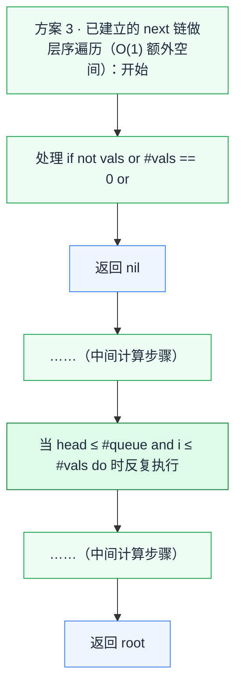

```lua
-- LeetCode 117. 填充每个节点的下一个右侧节点指针 II — Lua 版（方案3）
local TreeNode = {} -- 把 {} 写入 local TreeNode
TreeNode.__index = TreeNode -- 把 TreeNode 写入 TreeNode.__index
function TreeNode.new(val) -- function TreeNode.new(值)
	return setmetatable({ val = val, left = nil, right = nil }, TreeNode)
end -- 终点

local function build_tree(vals) -- local function build_tree(vals)
	if not vals or #vals == 0 or vals[1] == "null" then
		return nil
	end
	local root = TreeNode.new(vals[1]) -- 把 TreeNode.new(vals[1]) 写入 local root
	local queue = { root } -- 把 {根节点} 写入 local queue
	local head = 1 -- 把 1 写入 local head
	local i = 2 -- 把 2 写入 local i
	while head <= #queue and i <= #vals do -- 把 #队列 and 下标 i 不超过 #vals do 写入 while head <
		local node = queue[head] -- 把 队列[头节点] 写入 local node
		head = head + 1 -- 把 头节点 加 1 存入 头节点
		if i <= #vals then -- 若 下标 i 不超过 #vals then
			if vals[i] ~= "null" then -- 若 vals[下标 i] ~ 赋值为 「null」 then
				node.left = TreeNode.new(vals[i]) -- 把 TreeNode.new(vals[下标 i]) 写入 左边界
				queue[#queue + 1] = node.left -- 把 节点.左边界 写入 queue[#queue + 1]
			end -- 终点
			i = i + 1 -- 把 下标 i 加 1 存入 下标 i
		end -- 终点
		if i <= #vals then -- 若 下标 i 不超过 #vals then
			if vals[i] ~= "null" then -- 若 vals[下标 i] ~ 赋值为 「null」 then
				node.right = TreeNode.new(vals[i]) -- 把 TreeNode.new(vals[下标 i]) 写入 右边界
				queue[#queue + 1] = node.right -- 把 节点.右边界 写入 queue[#queue + 1]
			end -- 终点
			i = i + 1 -- 把 下标 i 加 1 存入 下标 i
		end -- 终点
	end -- 终点
	return root -- 返回 根节点
end -- 终点

local NNode = {} -- 把 {} 写入 local NNode
NNode.__index = NNode -- 把 NNode 写入 NNode.__index
function NNode.new(v)
	return setmetatable({ val = v, left = nil, right = nil, next = nil }, NNode)
end
local function build_ntree(vals) -- local function build_ntree(vals)
	if #vals == 0 then
		return nil
	end -- 若 #vals 等于 0 then return nil 终点
	local root = NNode.new(vals[1]) -- 把 NNode.new(vals[1]) 写入 local root
	local q = { root } -- 把 {根节点} 写入 local q
	local head, i = 1, 2 -- 把 1, 2 写入 local head, i
	while head <= #q and i <= #vals do -- 把 #节点 and 下标 i 不超过 #vals do 写入 while head <
		local node = q[head] -- 把 节点[头节点] 写入 local node
		head = head + 1 -- 把 头节点 加 1 存入 头节点
		if i <= #vals then
			node.left = NNode.new(vals[i])
			q[#q + 1] = node.left
			i = i + 1
		end
		if i <= #vals then
			node.right = NNode.new(vals[i])
			q[#q + 1] = node.right
			i = i + 1
		end
	end -- 终点
	return root -- 返回 根节点
end -- 终点
local function connect(root) -- local function connect(根节点)
	if not root then
		return nil
	end -- 若 not 根节点 then return nil 终点
	local cur = root -- 把 根节点 写入 local cur
	while cur do -- while 当前值 do
		local dummy = NNode.new(0) -- 把 NNode.new(0) 写入 local dummy
		local prev = dummy -- 把 哨兵节点 写入 local prev
		local node = cur -- 把 当前值 写入 local node
		while node do -- while 节点 do
			if node.left then
				prev.next = node.left
				prev = prev.next
			end -- 若 节点.左边界 then 前一个.下一个 赋值为 节点.左边界; 前一个 赋值为 前一个.下一个 终点
			if node.right then
				prev.next = node.right
				prev = prev.next
			end -- 若 节点.右边界 then 前一个.下一个 赋值为 节点.右边界; 前一个 赋值为 前一个.下一个 终点
			node = node.next -- 把 节点.下一个 存入 节点
		end -- 终点
		cur = dummy.next -- 把 哨兵节点.下一个 存入 当前值
	end -- 终点
	return root -- 返回 根节点
end -- 终点
assert(connect(nil) == nil) -- 断言校验
local root = connect(build_ntree({ 1, 2, 3, 4, 5, 6, 7 })) -- 把 connect(build_ntree({1, 2, 3, 4, 5, 6, 7})) 写入 local root
local levels = {} -- 把 {} 写入 local levels
local cur = root -- 把 根节点 写入 local cur
while cur do -- while 当前值 do
	local vals = {} -- 把 {} 写入 local vals
	local node = cur -- 把 当前值 写入 local node
	while node do -- while 节点 do
		vals[#vals + 1] = node.val -- 把 节点.值 写入 vals[#vals + 1]
		node = node.next -- 把 节点.下一个 存入 节点
	end -- 终点
	levels[#levels + 1] = vals -- 把 vals 写入 levels[#levels + 1]
	cur = cur.left or cur.right -- 把 当前值.左边界 or 当前值.右边界 存入 当前值
	if #levels > 5 then
		break
	end -- 若 #levels 超过 5 then break 终点
end -- 终点
assert(#levels == 3) -- 断言校验
assert(#levels[1] == 1 and levels[1][1] == 1) -- 断言校验
assert(#levels[2] == 2 and levels[2][1] == 2 and levels[2][2] == 3) -- 断言校验
assert(#levels[3] == 4 and levels[3][1] == 4 and levels[3][4] == 7) -- 断言校验
print("PASS") -- 全部用例通过，输出 PASS
```

### C 实现（3 种方案）

C 的全部方案如下，每个方案都内嵌用例自测，可独立运行（老仓库 python/go 文件遵循「打印结果」约定）：

#### 方案 1：迭代指针处理

**思路与代码分析**：核心是「迭代指针处理」。C 版手动管理下标与内存，循环边界全部显式写出。代码里依次做这些事：单循环线性扫描。**走读**：方案 1 · 迭代指针处理：开始 → 命中条件，直接返回 → 更新 *cur → 当 (cur) 时反复执行 → 遍历循环 → 返回 root。

**运行架构**（真实控制流）：

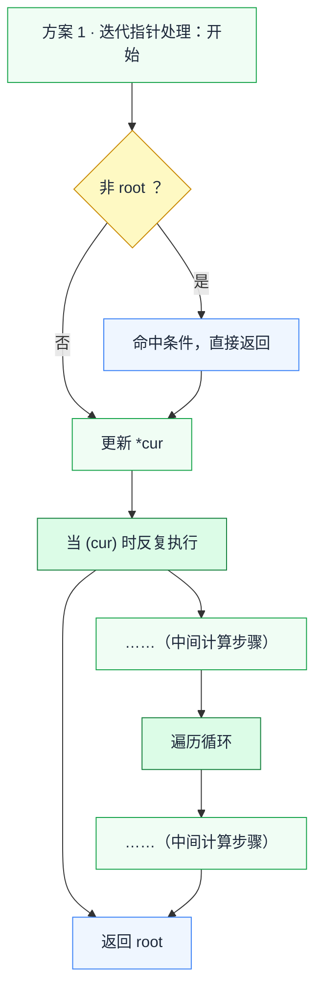

```c
/* LeetCode 117. 填充每个节点的下一个右侧节点指针 II — C 版（方案1） */
#include <stdio.h>                   // 引入头文件
#include <stdlib.h>                  // 引入头文件
#define INT_MIN_SN (-2147483647 - 1) // #define INT_MIN_SN ( 减 2147483647 减 1)

typedef struct TreeNode {   // typedef struct TreeNode {
    int val;                // int 值;
    struct TreeNode *left;  // 定义类型
    struct TreeNode *right; // 定义类型
} TreeNode;                 // } TreeNode;

static TreeNode *build_tree(const int *vals,
                            int n) { // static TreeNode 乘 build_tree(const int 乘 vals, int 元素个数) {
    if (n == 0 || vals[0] == INT_MIN_SN)
        return NULL; // 若 元素个数 等于 0 或 vals[0] 等于 INT_MIN_SN，直接返回 NULL
    TreeNode *root = malloc(sizeof(TreeNode)); // 把 malloc(sizeof(TreeNode)); 写入 TreeNode *root
    root->val = vals[0];
    root->left = root->right = NULL;
    TreeNode **queue =
        malloc(sizeof(TreeNode *) * n); // 把 malloc(sizeof(TreeNode 乘 ) 乘 元素个数); 写入 TreeNode **queue
    int head = 0, tail = 0, i = 1; // 把 0, 尾节点 赋值为 0, 下标 i 赋值为 1 存入 头节点
    queue[tail++] = root;          // 把 根节点; 写入 queue[tail++]
    while (head < tail && i < n) { // 循环，直到不满足「头节点 小于 尾节点 且 下标 i 小于 元素个数」
        TreeNode *node = queue[head++];                // 把 队列[头节点 加一 ]; 写入 TreeNode *node
        if (i < n) {                                   // 若 下标 i 小于 元素个数
            if (vals[i] != INT_MIN_SN) {               // 若 vals[下标 i] 不等于 INT_MIN_SN
                node->left = malloc(sizeof(TreeNode)); // 把 malloc(sizeof(TreeNode)); 写入 node->left
                node->left->val = vals[i];
                node->left->left = node->left->right = NULL;
                queue[tail++] = node->left; // 把 节点 减 超过 左边界; 写入 queue[tail++]
            }
            i++; // 下标 i 加一
        }
        if (i < n) {                                    // 若 下标 i 小于 元素个数
            if (vals[i] != INT_MIN_SN) {                // 若 vals[下标 i] 不等于 INT_MIN_SN
                node->right = malloc(sizeof(TreeNode)); // 把 malloc(sizeof(TreeNode)); 写入 node->right
                node->right->val = vals[i];
                node->right->left = node->right->right = NULL;
                queue[tail++] = node->right; // 把 节点 减 超过 右边界; 写入 queue[tail++]
            }
            i++; // 下标 i 加一
        }
    }
    free(queue); // free(队列);
    return root; // 返回 根节点
}

static void free_tree(TreeNode *n) { // 定义函数/方法 free_tree
    if (!n)
        return;          // 若 取反 元素个数) return;
    free_tree(n->left);  // free_tree(元素个数 减 超过 左边界);
    free_tree(n->right); // free_tree(元素个数 减 超过 右边界);
    free(n);             // free(元素个数);
}

typedef struct NNode {
    int val;
    struct NNode *left, *right, *next;
} NNode;
static NNode *nnew(int v) {
    NNode *n = calloc(1, sizeof(NNode));
    n->val = v;
    return n;
}
static void free_ntree(NNode *n) {
    if (!n)
        return;
    free_ntree(n->left);
    free_ntree(n->right);
    free(n);
}
static NNode *build_ntree(const int *vals,
                          int n) { // static NNode 乘 build_ntree(const int 乘 vals, int 元素个数) {
    if (n == 0)
        return NULL;               // 若 元素个数 等于 0，直接返回 NULL
    NNode *root = nnew(vals[0]);   // 把 nnew(vals[0]); 写入 NNode *root
    NNode *q[256];                 // NNode 乘 节点[256];
    int head = 0, tail = 0, i = 1; // 把 0, 尾节点 赋值为 0, 下标 i 赋值为 1 存入 头节点
    q[tail++] = root;              // 把 根节点; 写入 q[tail++]
    while (head < tail && i < n) { // 循环，直到不满足「头节点 小于 尾节点 且 下标 i 小于 元素个数」
        NNode *node = q[head++]; // 把 节点[头节点 加一 ]; 写入 NNode *node
        if (i < n) {
            node->left = nnew(vals[i]);
            q[tail++] = node->left;
            i++;
        }
        if (i < n) {
            node->right = nnew(vals[i]);
            q[tail++] = node->right;
            i++;
        }
    }
    return root; // 返回 根节点
}
static NNode *connect(NNode *root) { // static NNode 乘 connect(NNode 乘 根节点) {
    if (!root)
        return NULL;          // 若 取反 根节点，直接返回 NULL
    NNode *cur = root;        // 把 根节点; 写入 NNode *cur
    while (cur) {             // 循环，直到不满足「当前值」
        NNode dummy = {0};    // 把 {0}; 写入 NNode dummy
        NNode *prev = &dummy; // 把 按位与 哨兵节点; 写入 NNode *prev
        for (NNode *node = cur; node;
             node = node->next) { // 把 当前值; 节点; 节点 赋值为 节点 减 超过 下一个) { 写入 for (NNode *node
            if (node->left) {
                prev->next = node->left;
                prev = prev->next;
            }
            if (node->right) {
                prev->next = node->right;
                prev = prev->next;
            }
        }
        cur = dummy.next; // 把 哨兵节点.下一个; 写入 当前值
    }
    return root; // 返回 根节点
}
int main(void) {                        // 程序入口：跑内嵌自测用例
    int vals[] = {1, 2, 3, 4, 5, 6, 7}; // 把 {1,2,3,4,5,6,7}; 写入 int vals[]
    if (connect(NULL) != NULL) {
        printf("FAIL nil\n");
        return 1;
    } // 若 connect(NULL) 不等于 NULL) { 输出「FAIL nil 」); return 1; }
    NNode *root = connect(build_ntree(vals, 7));  // 把 connect(build_ntree(vals, 7)); 写入 NNode *root
    int want[3][4] = {{1}, {2, 3}, {4, 5, 6, 7}}; // 把 { {1}, {2,3}, {4,5,6,7} }; 写入 int want[3][4]
    int wantn[3] = {1, 2, 4};                     // 把 {1, 2, 4}; 写入 int wantn[3]
    NNode *cur = root;                            // 把 根节点; 写入 NNode *cur
    int level = 0;                                // 把 0 存入 level
    while (cur && level < 3) {                 // 循环，直到不满足「当前值 且 level 小于 3」
        int cnt = 0;                           // 把 0 存入 计数
        for (NNode *n = cur; n; n = n->next) { // 把 当前值; 元素个数; 元素个数 赋值为 元素个数 减 超过
                                               // 下一个) { 写入 for (NNode *n
            if (cnt >= wantn[level] || n->val != want[level][cnt]) {
                printf("FAIL L%d\n", level);
                return 1;
            }
            cnt++; // 计数 加一
        }
        if (cnt != wantn[level]) {
            printf("FAIL L%d cnt\n", level);
            return 1;
        }
        cur = cur->left ? cur->left : cur->right; // 把 当前值 减 超过 左边界 ? 当前值 减 超过 左边界 : 当前值
                                                  // 减 超过 右边界; 写入 当前值
        level++; // level 加一
    }
    if (level != 3) {
        printf("FAIL levels\n");
        return 1;
    }                 // 若 level 不等于 3) { 输出「FAIL levels 」); return 1; }
    free_ntree(root); // free_ntree(根节点);
    printf("PASS\n"); // 全部用例通过，输出 PASS
    return 0;         // 返回 0
}
```

#### 方案 2：方案2（层序连接，使用已建立的 next 指针）

**思路与代码分析**：核心是「方案2（层序连接，使用已建立的 next 指针）」。C 版手动管理下标与内存，循环边界全部显式写出。代码里依次做这些事：单循环线性扫描。**走读**：方案 2 · 方案2（层序连接，使用已建立的 next 指针）：开始 → 命中条件，直接返回 → 更新 *cur → 当 (cur) 时反复执行 → 遍历循环 → 返回 root。

**运行架构**（真实控制流）：

```mermaid
graph TD
    N0["方案 2 · 方案2（层序连接，使用已建立的 next 指针）：开始"]
    N1{"非 root ？"}
    N2["命中条件，直接返回"]
    N3["更新 *cur"]
    N4["当 (cur) 时反复执行"]
    D1["……（中间计算步骤）"]
    N7["遍历循环"]
    D2["……（中间计算步骤）"]
    N16["返回 root"]
    N0 --> N1
    N1 -- 是 --> N2
    N1 -- 否 --> N3
    N3 --> N4
    N4 --> N16
    N2 --> N3
    N4 --> D1
    D1 --> N7
    N7 --> D2
    D2 --> N16
    classDef n fill:#f0fdf4,stroke:#16a34a,color:#1e293b;
    classDef lp fill:#dcfce7,stroke:#15803d,color:#1e293b;
    classDef dc fill:#fef9c3,stroke:#ca8a04,color:#1e293b;
    classDef tm fill:#eff6ff,stroke:#3b82f6,color:#1e293b;
    class N0,N3,D1,D2 n;
    class N4,N7 lp;
    class N1 dc;
    class N2,N16 tm;
```

```c
/* LeetCode 117. 填充每个节点的下一个右侧节点指针 II — C 版（方案2） */
#include <stdio.h>                   // 引入头文件
#include <stdlib.h>                  // 引入头文件
#define INT_MIN_SN (-2147483647 - 1) // #define INT_MIN_SN ( 减 2147483647 减 1)

typedef struct TreeNode {   // typedef struct TreeNode {
    int val;                // int 值;
    struct TreeNode *left;  // 定义类型
    struct TreeNode *right; // 定义类型
} TreeNode;                 // } TreeNode;

static TreeNode *build_tree(const int *vals,
                            int n) { // static TreeNode 乘 build_tree(const int 乘 vals, int 元素个数) {
    if (n == 0 || vals[0] == INT_MIN_SN)
        return NULL; // 若 元素个数 等于 0 或 vals[0] 等于 INT_MIN_SN，直接返回 NULL
    TreeNode *root = malloc(sizeof(TreeNode)); // 把 malloc(sizeof(TreeNode)); 写入 TreeNode *root
    root->val = vals[0];
    root->left = root->right = NULL;
    TreeNode **queue =
        malloc(sizeof(TreeNode *) * n); // 把 malloc(sizeof(TreeNode 乘 ) 乘 元素个数); 写入 TreeNode **queue
    int head = 0, tail = 0, i = 1; // 把 0, 尾节点 赋值为 0, 下标 i 赋值为 1 存入 头节点
    queue[tail++] = root;          // 把 根节点; 写入 queue[tail++]
    while (head < tail && i < n) { // 循环，直到不满足「头节点 小于 尾节点 且 下标 i 小于 元素个数」
        TreeNode *node = queue[head++];                // 把 队列[头节点 加一 ]; 写入 TreeNode *node
        if (i < n) {                                   // 若 下标 i 小于 元素个数
            if (vals[i] != INT_MIN_SN) {               // 若 vals[下标 i] 不等于 INT_MIN_SN
                node->left = malloc(sizeof(TreeNode)); // 把 malloc(sizeof(TreeNode)); 写入 node->left
                node->left->val = vals[i];
                node->left->left = node->left->right = NULL;
                queue[tail++] = node->left; // 把 节点 减 超过 左边界; 写入 queue[tail++]
            }
            i++; // 下标 i 加一
        }
        if (i < n) {                                    // 若 下标 i 小于 元素个数
            if (vals[i] != INT_MIN_SN) {                // 若 vals[下标 i] 不等于 INT_MIN_SN
                node->right = malloc(sizeof(TreeNode)); // 把 malloc(sizeof(TreeNode)); 写入 node->right
                node->right->val = vals[i];
                node->right->left = node->right->right = NULL;
                queue[tail++] = node->right; // 把 节点 减 超过 右边界; 写入 queue[tail++]
            }
            i++; // 下标 i 加一
        }
    }
    free(queue); // free(队列);
    return root; // 返回 根节点
}

static void free_tree(TreeNode *n) { // 定义函数/方法 free_tree
    if (!n)
        return;          // 若 取反 元素个数) return;
    free_tree(n->left);  // free_tree(元素个数 减 超过 左边界);
    free_tree(n->right); // free_tree(元素个数 减 超过 右边界);
    free(n);             // free(元素个数);
}

typedef struct NNode {
    int val;
    struct NNode *left, *right, *next;
} NNode;
static NNode *nnew(int v) {
    NNode *n = calloc(1, sizeof(NNode));
    n->val = v;
    return n;
}
static void free_ntree(NNode *n) {
    if (!n)
        return;
    free_ntree(n->left);
    free_ntree(n->right);
    free(n);
}
static NNode *build_ntree(const int *vals,
                          int n) { // static NNode 乘 build_ntree(const int 乘 vals, int 元素个数) {
    if (n == 0)
        return NULL;               // 若 元素个数 等于 0，直接返回 NULL
    NNode *root = nnew(vals[0]);   // 把 nnew(vals[0]); 写入 NNode *root
    NNode *q[256];                 // NNode 乘 节点[256];
    int head = 0, tail = 0, i = 1; // 把 0, 尾节点 赋值为 0, 下标 i 赋值为 1 存入 头节点
    q[tail++] = root;              // 把 根节点; 写入 q[tail++]
    while (head < tail && i < n) { // 循环，直到不满足「头节点 小于 尾节点 且 下标 i 小于 元素个数」
        NNode *node = q[head++]; // 把 节点[头节点 加一 ]; 写入 NNode *node
        if (i < n) {
            node->left = nnew(vals[i]);
            q[tail++] = node->left;
            i++;
        }
        if (i < n) {
            node->right = nnew(vals[i]);
            q[tail++] = node->right;
            i++;
        }
    }
    return root; // 返回 根节点
}
static NNode *connect(NNode *root) { // static NNode 乘 connect(NNode 乘 根节点) {
    if (!root)
        return NULL;          // 若 取反 根节点，直接返回 NULL
    NNode *cur = root;        // 把 根节点; 写入 NNode *cur
    while (cur) {             // 循环，直到不满足「当前值」
        NNode dummy = {0};    // 把 {0}; 写入 NNode dummy
        NNode *prev = &dummy; // 把 按位与 哨兵节点; 写入 NNode *prev
        for (NNode *node = cur; node;
             node = node->next) { // 把 当前值; 节点; 节点 赋值为 节点 减 超过 下一个) { 写入 for (NNode *node
            if (node->left) {
                prev->next = node->left;
                prev = prev->next;
            }
            if (node->right) {
                prev->next = node->right;
                prev = prev->next;
            }
        }
        cur = dummy.next; // 把 哨兵节点.下一个; 写入 当前值
    }
    return root; // 返回 根节点
}
int main(void) {                        // 程序入口：跑内嵌自测用例
    int vals[] = {1, 2, 3, 4, 5, 6, 7}; // 把 {1,2,3,4,5,6,7}; 写入 int vals[]
    if (connect(NULL) != NULL) {
        printf("FAIL nil\n");
        return 1;
    } // 若 connect(NULL) 不等于 NULL) { 输出「FAIL nil 」); return 1; }
    NNode *root = connect(build_ntree(vals, 7));  // 把 connect(build_ntree(vals, 7)); 写入 NNode *root
    int want[3][4] = {{1}, {2, 3}, {4, 5, 6, 7}}; // 把 { {1}, {2,3}, {4,5,6,7} }; 写入 int want[3][4]
    int wantn[3] = {1, 2, 4};                     // 把 {1, 2, 4}; 写入 int wantn[3]
    NNode *cur = root;                            // 把 根节点; 写入 NNode *cur
    int level = 0;                                // 把 0 存入 level
    while (cur && level < 3) {                 // 循环，直到不满足「当前值 且 level 小于 3」
        int cnt = 0;                           // 把 0 存入 计数
        for (NNode *n = cur; n; n = n->next) { // 把 当前值; 元素个数; 元素个数 赋值为 元素个数 减 超过
                                               // 下一个) { 写入 for (NNode *n
            if (cnt >= wantn[level] || n->val != want[level][cnt]) {
                printf("FAIL L%d\n", level);
                return 1;
            }
            cnt++; // 计数 加一
        }
        if (cnt != wantn[level]) {
            printf("FAIL L%d cnt\n", level);
            return 1;
        }
        cur = cur->left ? cur->left : cur->right; // 把 当前值 减 超过 左边界 ? 当前值 减 超过 左边界 : 当前值
                                                  // 减 超过 右边界; 写入 当前值
        level++; // level 加一
    }
    if (level != 3) {
        printf("FAIL levels\n");
        return 1;
    }                 // 若 level 不等于 3) { 输出「FAIL levels 」); return 1; }
    free_ntree(root); // free_ntree(根节点);
    printf("PASS\n"); // 全部用例通过，输出 PASS
    return 0;         // 返回 0
}
```

#### 方案 3：已建立的 next 链做层序遍历（O(1) 额外空间）

**思路与代码分析**：核心是「已建立的 next 链做层序遍历（O(1) 额外空间）」。C 版手动管理下标与内存，循环边界全部显式写出。代码里依次做这些事：单循环线性扫描。**走读**：方案 3 · 已建立的 next 链做层序遍历（O(1) 额外空间）：开始 → 命中条件，直接返回 → 更新 *cur → 当 (cur) 时反复执行 → 遍历循环 → 返回 root。

**运行架构**（真实控制流）：

```mermaid
graph TD
    N0["方案 3 · 已建立的 next 链做层序遍历（O(1) 额外空间）：开始"]
    N1{"非 root ？"}
    N2["命中条件，直接返回"]
    N3["更新 *cur"]
    N4["当 (cur) 时反复执行"]
    D1["……（中间计算步骤）"]
    N7["遍历循环"]
    D2["……（中间计算步骤）"]
    N16["返回 root"]
    N0 --> N1
    N1 -- 是 --> N2
    N1 -- 否 --> N3
    N3 --> N4
    N4 --> N16
    N2 --> N3
    N4 --> D1
    D1 --> N7
    N7 --> D2
    D2 --> N16
    classDef n fill:#f0fdf4,stroke:#16a34a,color:#1e293b;
    classDef lp fill:#dcfce7,stroke:#15803d,color:#1e293b;
    classDef dc fill:#fef9c3,stroke:#ca8a04,color:#1e293b;
    classDef tm fill:#eff6ff,stroke:#3b82f6,color:#1e293b;
    class N0,N3,D1,D2 n;
    class N4,N7 lp;
    class N1 dc;
    class N2,N16 tm;
```

```c
/* LeetCode 117. 填充每个节点的下一个右侧节点指针 II — C 版（方案3） */
#include <stdio.h>                   // 引入头文件
#include <stdlib.h>                  // 引入头文件
#define INT_MIN_SN (-2147483647 - 1) // #define INT_MIN_SN ( 减 2147483647 减 1)

typedef struct TreeNode {   // typedef struct TreeNode {
    int val;                // int 值;
    struct TreeNode *left;  // 定义类型
    struct TreeNode *right; // 定义类型
} TreeNode;                 // } TreeNode;

static TreeNode *build_tree(const int *vals,
                            int n) { // static TreeNode 乘 build_tree(const int 乘 vals, int 元素个数) {
    if (n == 0 || vals[0] == INT_MIN_SN)
        return NULL; // 若 元素个数 等于 0 或 vals[0] 等于 INT_MIN_SN，直接返回 NULL
    TreeNode *root = malloc(sizeof(TreeNode)); // 把 malloc(sizeof(TreeNode)); 写入 TreeNode *root
    root->val = vals[0];
    root->left = root->right = NULL;
    TreeNode **queue =
        malloc(sizeof(TreeNode *) * n); // 把 malloc(sizeof(TreeNode 乘 ) 乘 元素个数); 写入 TreeNode **queue
    int head = 0, tail = 0, i = 1; // 把 0, 尾节点 赋值为 0, 下标 i 赋值为 1 存入 头节点
    queue[tail++] = root;          // 把 根节点; 写入 queue[tail++]
    while (head < tail && i < n) { // 循环，直到不满足「头节点 小于 尾节点 且 下标 i 小于 元素个数」
        TreeNode *node = queue[head++];                // 把 队列[头节点 加一 ]; 写入 TreeNode *node
        if (i < n) {                                   // 若 下标 i 小于 元素个数
            if (vals[i] != INT_MIN_SN) {               // 若 vals[下标 i] 不等于 INT_MIN_SN
                node->left = malloc(sizeof(TreeNode)); // 把 malloc(sizeof(TreeNode)); 写入 node->left
                node->left->val = vals[i];
                node->left->left = node->left->right = NULL;
                queue[tail++] = node->left; // 把 节点 减 超过 左边界; 写入 queue[tail++]
            }
            i++; // 下标 i 加一
        }
        if (i < n) {                                    // 若 下标 i 小于 元素个数
            if (vals[i] != INT_MIN_SN) {                // 若 vals[下标 i] 不等于 INT_MIN_SN
                node->right = malloc(sizeof(TreeNode)); // 把 malloc(sizeof(TreeNode)); 写入 node->right
                node->right->val = vals[i];
                node->right->left = node->right->right = NULL;
                queue[tail++] = node->right; // 把 节点 减 超过 右边界; 写入 queue[tail++]
            }
            i++; // 下标 i 加一
        }
    }
    free(queue); // free(队列);
    return root; // 返回 根节点
}

static void free_tree(TreeNode *n) { // 定义函数/方法 free_tree
    if (!n)
        return;          // 若 取反 元素个数) return;
    free_tree(n->left);  // free_tree(元素个数 减 超过 左边界);
    free_tree(n->right); // free_tree(元素个数 减 超过 右边界);
    free(n);             // free(元素个数);
}

typedef struct NNode {
    int val;
    struct NNode *left, *right, *next;
} NNode;
static NNode *nnew(int v) {
    NNode *n = calloc(1, sizeof(NNode));
    n->val = v;
    return n;
}
static void free_ntree(NNode *n) {
    if (!n)
        return;
    free_ntree(n->left);
    free_ntree(n->right);
    free(n);
}
static NNode *build_ntree(const int *vals,
                          int n) { // static NNode 乘 build_ntree(const int 乘 vals, int 元素个数) {
    if (n == 0)
        return NULL;               // 若 元素个数 等于 0，直接返回 NULL
    NNode *root = nnew(vals[0]);   // 把 nnew(vals[0]); 写入 NNode *root
    NNode *q[256];                 // NNode 乘 节点[256];
    int head = 0, tail = 0, i = 1; // 把 0, 尾节点 赋值为 0, 下标 i 赋值为 1 存入 头节点
    q[tail++] = root;              // 把 根节点; 写入 q[tail++]
    while (head < tail && i < n) { // 循环，直到不满足「头节点 小于 尾节点 且 下标 i 小于 元素个数」
        NNode *node = q[head++]; // 把 节点[头节点 加一 ]; 写入 NNode *node
        if (i < n) {
            node->left = nnew(vals[i]);
            q[tail++] = node->left;
            i++;
        }
        if (i < n) {
            node->right = nnew(vals[i]);
            q[tail++] = node->right;
            i++;
        }
    }
    return root; // 返回 根节点
}
static NNode *connect(NNode *root) { // static NNode 乘 connect(NNode 乘 根节点) {
    if (!root)
        return NULL;          // 若 取反 根节点，直接返回 NULL
    NNode *cur = root;        // 把 根节点; 写入 NNode *cur
    while (cur) {             // 循环，直到不满足「当前值」
        NNode dummy = {0};    // 把 {0}; 写入 NNode dummy
        NNode *prev = &dummy; // 把 按位与 哨兵节点; 写入 NNode *prev
        for (NNode *node = cur; node;
             node = node->next) { // 把 当前值; 节点; 节点 赋值为 节点 减 超过 下一个) { 写入 for (NNode *node
            if (node->left) {
                prev->next = node->left;
                prev = prev->next;
            }
            if (node->right) {
                prev->next = node->right;
                prev = prev->next;
            }
        }
        cur = dummy.next; // 把 哨兵节点.下一个; 写入 当前值
    }
    return root; // 返回 根节点
}
int main(void) {                        // 程序入口：跑内嵌自测用例
    int vals[] = {1, 2, 3, 4, 5, 6, 7}; // 把 {1,2,3,4,5,6,7}; 写入 int vals[]
    if (connect(NULL) != NULL) {
        printf("FAIL nil\n");
        return 1;
    } // 若 connect(NULL) 不等于 NULL) { 输出「FAIL nil 」); return 1; }
    NNode *root = connect(build_ntree(vals, 7));  // 把 connect(build_ntree(vals, 7)); 写入 NNode *root
    int want[3][4] = {{1}, {2, 3}, {4, 5, 6, 7}}; // 把 { {1}, {2,3}, {4,5,6,7} }; 写入 int want[3][4]
    int wantn[3] = {1, 2, 4};                     // 把 {1, 2, 4}; 写入 int wantn[3]
    NNode *cur = root;                            // 把 根节点; 写入 NNode *cur
    int level = 0;                                // 把 0 存入 level
    while (cur && level < 3) {                 // 循环，直到不满足「当前值 且 level 小于 3」
        int cnt = 0;                           // 把 0 存入 计数
        for (NNode *n = cur; n; n = n->next) { // 把 当前值; 元素个数; 元素个数 赋值为 元素个数 减 超过
                                               // 下一个) { 写入 for (NNode *n
            if (cnt >= wantn[level] || n->val != want[level][cnt]) {
                printf("FAIL L%d\n", level);
                return 1;
            }
            cnt++; // 计数 加一
        }
        if (cnt != wantn[level]) {
            printf("FAIL L%d cnt\n", level);
            return 1;
        }
        cur = cur->left ? cur->left : cur->right; // 把 当前值 减 超过 左边界 ? 当前值 减 超过 左边界 : 当前值
                                                  // 减 超过 右边界; 写入 当前值
        level++; // level 加一
    }
    if (level != 3) {
        printf("FAIL levels\n");
        return 1;
    }                 // 若 level 不等于 3) { 输出「FAIL levels 」); return 1; }
    free_ntree(root); // free_ntree(根节点);
    printf("PASS\n"); // 全部用例通过，输出 PASS
    return 0;         // 返回 0
}
```

### C++ 实现（3 种方案）

C++ 的全部方案如下，每个方案都内嵌用例自测，可独立运行（老仓库 python/go 文件遵循「打印结果」约定）：

#### 方案 1：迭代指针处理

**思路与代码分析**：核心是「迭代指针处理」。C++ 版用 STL 容器与迭代器，减少手写下标错误。代码里依次做这些事：单循环线性扫描。**走读**：方案 1 · 迭代指针处理：开始 → 命中条件，直接返回 → 更新 *cur → 当 (cur) 时反复执行 → 遍历循环 → 返回 root。

**运行架构**（真实控制流）：

```mermaid
graph TD
    N0["方案 1 · 迭代指针处理：开始"]
    N1{"非 root ？"}
    N2["命中条件，直接返回"]
    N3["更新 *cur"]
    N4["当 (cur) 时反复执行"]
    D1["……（中间计算步骤）"]
    N7["遍历循环"]
    D2["……（中间计算步骤）"]
    N16["返回 root"]
    N0 --> N1
    N1 -- 是 --> N2
    N1 -- 否 --> N3
    N3 --> N4
    N4 --> N16
    N2 --> N3
    N4 --> D1
    D1 --> N7
    N7 --> D2
    D2 --> N16
    classDef n fill:#f0fdf4,stroke:#16a34a,color:#1e293b;
    classDef lp fill:#dcfce7,stroke:#15803d,color:#1e293b;
    classDef dc fill:#fef9c3,stroke:#ca8a04,color:#1e293b;
    classDef tm fill:#eff6ff,stroke:#3b82f6,color:#1e293b;
    class N0,N3,D1,D2 n;
    class N4,N7 lp;
    class N1 dc;
    class N2,N16 tm;
```

```cpp
// LeetCode 117. 填充每个节点的下一个右侧节点指针 II — C++ 版（方案1）
#include <cassert>  // 引入头文件
#include <cstdint>  // 引入头文件
#include <iostream> // 引入头文件
#include <optional> // 引入头文件
#include <queue>    // 引入头文件
#include <vector>   // 引入头文件

struct TreeNode {    // 定义类型
    int val;         // int 值;
    TreeNode *left;  // TreeNode 乘 左边界;
    TreeNode *right; // TreeNode 乘 右边界;
    explicit TreeNode(int v) : val(v), left(nullptr), right(nullptr) {}
};

static TreeNode *build_tree(const std::vector<std::optional<int>> &vals) {
    if (vals.empty() || !vals[0].has_value())
        return nullptr; // 若 vals 是否为空 或 取反 vals[0].has_value()，直接返回 nullptr
    auto *root = new TreeNode(*vals[0]); // 把 new TreeNode( 乘 vals[0]); 写入 auto *root
    std::queue<TreeNode *> q;            // std::队列 小于 TreeNode 乘 超过 节点;
    q.push(root);                        // 把 根节点 压入栈/数组尾部
    size_t i = 1;                        // 把 1; 写入 size_t i
    while (!q.empty() &&
           i < vals.size()) { // 循环，直到不满足「取反 节点 是否为空 且 下标 i 小于 vals.大小(」
        TreeNode *node = q.front();                  // 把 节点.front(); 写入 TreeNode *node
        q.pop();                                     // 弹出栈顶元素
        if (i < vals.size()) {                       // 若 下标 i 小于 vals.大小(
            if (vals[i].has_value()) {               // 若 vals[下标 i].has_value(
                node->left = new TreeNode(*vals[i]); // 把 new TreeNode( 乘 vals[下标 i]); 写入 node->left
                q.push(node->left);                  // 把 节点 减 超过 左边界 压入栈/数组尾部
            }
            ++i; // 加一 下标 i;
        }
        if (i < vals.size()) {                        // 若 下标 i 小于 vals.大小(
            if (vals[i].has_value()) {                // 若 vals[下标 i].has_value(
                node->right = new TreeNode(*vals[i]); // 把 new TreeNode( 乘 vals[下标 i]); 写入 node->right
                q.push(node->right); // 把 节点 减 超过 右边界 压入栈/数组尾部
            }
            ++i; // 加一 下标 i;
        }
    }
    return root; // 返回 根节点
}

static void free_tree(TreeNode *n) { // 定义函数/方法 free_tree
    if (!n)
        return;          // 若 取反 元素个数) return;
    free_tree(n->left);  // free_tree(元素个数 减 超过 左边界);
    free_tree(n->right); // free_tree(元素个数 减 超过 右边界);
    delete n;            // delete 元素个数;
}

struct NNode { // 定义类型
    int val;   // int 值;
    NNode *left = nullptr, *right = nullptr, *next = nullptr;
    explicit NNode(int v) : val(v) {} // explicit NNode(int 值) : 值(值) {}
};
static NNode *buildNTree(const std::vector<int> &vals) {
    if (vals.empty())
        return nullptr;              // 若 vals 是否为空，直接返回 nullptr
    auto *root = new NNode(vals[0]); // 把 new NNode(vals[0]); 写入 auto *root
    std::queue<NNode *> q;           // std::队列 小于 NNode 乘 超过 节点;
    q.push(root);                    // 把 根节点 压入栈/数组尾部
    size_t i = 1;                    // 把 1; 写入 size_t i
    while (!q.empty() &&
           i < vals.size()) { // 循环，直到不满足「取反 节点 是否为空 且 下标 i 小于 vals.大小(」
        auto *node = q.front(); // 把 节点.front(); 写入 auto *node
        q.pop();                // 弹出栈顶元素
        if (i < vals.size()) {
            node->left = new NNode(vals[i]);
            q.push(node->left);
            ++i;
        }
        if (i < vals.size()) {
            node->right = new NNode(vals[i]);
            q.push(node->right);
            ++i;
        }
    }
    return root; // 返回 根节点
}
static NNode *connect(NNode *root) { // static NNode 乘 connect(NNode 乘 根节点) {
    if (!root)
        return nullptr;       // 若 取反 根节点，直接返回 nullptr
    NNode *cur = root;        // 把 根节点; 写入 NNode *cur
    while (cur) {             // 循环，直到不满足「当前值」
        NNode dummy(0);       // NNode 哨兵节点(0);
        NNode *prev = &dummy; // 把 按位与 哨兵节点; 写入 NNode *prev
        for (NNode *node = cur; node;
             node = node->next) { // 把 当前值; 节点; 节点 赋值为 节点 减 超过 下一个) { 写入 for (NNode *node
            if (node->left) {
                prev->next = node->left;
                prev = prev->next;
            }
            if (node->right) {
                prev->next = node->right;
                prev = prev->next;
            }
        }
        cur = dummy.next; // 把 哨兵节点.下一个; 写入 当前值
    }
    return root; // 返回 根节点
}
int main() {                             // 程序入口：跑内嵌自测用例
    assert(connect(nullptr) == nullptr); // 断言校验
    auto *root = connect(
        buildNTree({1, 2, 3, 4, 5, 6, 7})); // 把 connect(buildNTree({1, 2, 3, 4, 5, 6, 7})); 写入 auto *root
    std::vector<std::vector<int>> levels;   // std::vector 小于 std::vector 小于 int 超过 超过 levels;
    auto *cur = root;                       // 把 根节点; 写入 auto *cur
    while (cur && levels.size() < 5) { // 循环，直到不满足「当前值 且 levels.大小() 小于 5」
        std::vector<int> vals;         // std::vector 小于 int 超过 vals;
        for (auto *n = cur; n; n = n->next)
            vals.push_back(n->val);
        levels.push_back(vals); // levels 追加 vals);
        cur = cur->left ? cur->left : cur->right; // 把 当前值 减 超过 左边界 ? 当前值 减 超过 左边界 : 当前值
                                                  // 减 超过 右边界; 写入 当前值
    }
    assert((levels == std::vector<std::vector<int>>{{1}, {2, 3}, {4, 5, 6, 7}})); // 断言校验
    std::cout << "PASS" << std::endl; // 全部用例通过，输出 PASS
    return 0;                         // 返回 0
}
```

#### 方案 2：方案2（层序连接，使用已建立的 next 指针）

**思路与代码分析**：核心是「方案2（层序连接，使用已建立的 next 指针）」。C++ 版用 STL 容器与迭代器，减少手写下标错误。代码里依次做这些事：单循环线性扫描。**走读**：方案 2 · 方案2（层序连接，使用已建立的 next 指针）：开始 → 命中条件，直接返回 → 更新 *cur → 当 (cur) 时反复执行 → 遍历循环 → 返回 root。

**运行架构**（真实控制流）：

```mermaid
graph TD
    N0["方案 2 · 方案2（层序连接，使用已建立的 next 指针）：开始"]
    N1{"非 root ？"}
    N2["命中条件，直接返回"]
    N3["更新 *cur"]
    N4["当 (cur) 时反复执行"]
    D1["……（中间计算步骤）"]
    N7["遍历循环"]
    D2["……（中间计算步骤）"]
    N16["返回 root"]
    N0 --> N1
    N1 -- 是 --> N2
    N1 -- 否 --> N3
    N3 --> N4
    N4 --> N16
    N2 --> N3
    N4 --> D1
    D1 --> N7
    N7 --> D2
    D2 --> N16
    classDef n fill:#f0fdf4,stroke:#16a34a,color:#1e293b;
    classDef lp fill:#dcfce7,stroke:#15803d,color:#1e293b;
    classDef dc fill:#fef9c3,stroke:#ca8a04,color:#1e293b;
    classDef tm fill:#eff6ff,stroke:#3b82f6,color:#1e293b;
    class N0,N3,D1,D2 n;
    class N4,N7 lp;
    class N1 dc;
    class N2,N16 tm;
```

```cpp
// LeetCode 117. 填充每个节点的下一个右侧节点指针 II — C++ 版（方案2）
#include <cassert>  // 引入头文件
#include <cstdint>  // 引入头文件
#include <iostream> // 引入头文件
#include <optional> // 引入头文件
#include <queue>    // 引入头文件
#include <vector>   // 引入头文件

struct TreeNode {    // 定义类型
    int val;         // int 值;
    TreeNode *left;  // TreeNode 乘 左边界;
    TreeNode *right; // TreeNode 乘 右边界;
    explicit TreeNode(int v) : val(v), left(nullptr), right(nullptr) {}
};

static TreeNode *build_tree(const std::vector<std::optional<int>> &vals) {
    if (vals.empty() || !vals[0].has_value())
        return nullptr; // 若 vals 是否为空 或 取反 vals[0].has_value()，直接返回 nullptr
    auto *root = new TreeNode(*vals[0]); // 把 new TreeNode( 乘 vals[0]); 写入 auto *root
    std::queue<TreeNode *> q;            // std::队列 小于 TreeNode 乘 超过 节点;
    q.push(root);                        // 把 根节点 压入栈/数组尾部
    size_t i = 1;                        // 把 1; 写入 size_t i
    while (!q.empty() &&
           i < vals.size()) { // 循环，直到不满足「取反 节点 是否为空 且 下标 i 小于 vals.大小(」
        TreeNode *node = q.front();                  // 把 节点.front(); 写入 TreeNode *node
        q.pop();                                     // 弹出栈顶元素
        if (i < vals.size()) {                       // 若 下标 i 小于 vals.大小(
            if (vals[i].has_value()) {               // 若 vals[下标 i].has_value(
                node->left = new TreeNode(*vals[i]); // 把 new TreeNode( 乘 vals[下标 i]); 写入 node->left
                q.push(node->left);                  // 把 节点 减 超过 左边界 压入栈/数组尾部
            }
            ++i; // 加一 下标 i;
        }
        if (i < vals.size()) {                        // 若 下标 i 小于 vals.大小(
            if (vals[i].has_value()) {                // 若 vals[下标 i].has_value(
                node->right = new TreeNode(*vals[i]); // 把 new TreeNode( 乘 vals[下标 i]); 写入 node->right
                q.push(node->right); // 把 节点 减 超过 右边界 压入栈/数组尾部
            }
            ++i; // 加一 下标 i;
        }
    }
    return root; // 返回 根节点
}

static void free_tree(TreeNode *n) { // 定义函数/方法 free_tree
    if (!n)
        return;          // 若 取反 元素个数) return;
    free_tree(n->left);  // free_tree(元素个数 减 超过 左边界);
    free_tree(n->right); // free_tree(元素个数 减 超过 右边界);
    delete n;            // delete 元素个数;
}

struct NNode { // 定义类型
    int val;   // int 值;
    NNode *left = nullptr, *right = nullptr, *next = nullptr;
    explicit NNode(int v) : val(v) {} // explicit NNode(int 值) : 值(值) {}
};
static NNode *buildNTree(const std::vector<int> &vals) {
    if (vals.empty())
        return nullptr;              // 若 vals 是否为空，直接返回 nullptr
    auto *root = new NNode(vals[0]); // 把 new NNode(vals[0]); 写入 auto *root
    std::queue<NNode *> q;           // std::队列 小于 NNode 乘 超过 节点;
    q.push(root);                    // 把 根节点 压入栈/数组尾部
    size_t i = 1;                    // 把 1; 写入 size_t i
    while (!q.empty() &&
           i < vals.size()) { // 循环，直到不满足「取反 节点 是否为空 且 下标 i 小于 vals.大小(」
        auto *node = q.front(); // 把 节点.front(); 写入 auto *node
        q.pop();                // 弹出栈顶元素
        if (i < vals.size()) {
            node->left = new NNode(vals[i]);
            q.push(node->left);
            ++i;
        }
        if (i < vals.size()) {
            node->right = new NNode(vals[i]);
            q.push(node->right);
            ++i;
        }
    }
    return root; // 返回 根节点
}
static NNode *connect(NNode *root) { // static NNode 乘 connect(NNode 乘 根节点) {
    if (!root)
        return nullptr;       // 若 取反 根节点，直接返回 nullptr
    NNode *cur = root;        // 把 根节点; 写入 NNode *cur
    while (cur) {             // 循环，直到不满足「当前值」
        NNode dummy(0);       // NNode 哨兵节点(0);
        NNode *prev = &dummy; // 把 按位与 哨兵节点; 写入 NNode *prev
        for (NNode *node = cur; node;
             node = node->next) { // 把 当前值; 节点; 节点 赋值为 节点 减 超过 下一个) { 写入 for (NNode *node
            if (node->left) {
                prev->next = node->left;
                prev = prev->next;
            }
            if (node->right) {
                prev->next = node->right;
                prev = prev->next;
            }
        }
        cur = dummy.next; // 把 哨兵节点.下一个; 写入 当前值
    }
    return root; // 返回 根节点
}
int main() {                             // 程序入口：跑内嵌自测用例
    assert(connect(nullptr) == nullptr); // 断言校验
    auto *root = connect(
        buildNTree({1, 2, 3, 4, 5, 6, 7})); // 把 connect(buildNTree({1, 2, 3, 4, 5, 6, 7})); 写入 auto *root
    std::vector<std::vector<int>> levels;   // std::vector 小于 std::vector 小于 int 超过 超过 levels;
    auto *cur = root;                       // 把 根节点; 写入 auto *cur
    while (cur && levels.size() < 5) { // 循环，直到不满足「当前值 且 levels.大小() 小于 5」
        std::vector<int> vals;         // std::vector 小于 int 超过 vals;
        for (auto *n = cur; n; n = n->next)
            vals.push_back(n->val);
        levels.push_back(vals); // levels 追加 vals);
        cur = cur->left ? cur->left : cur->right; // 把 当前值 减 超过 左边界 ? 当前值 减 超过 左边界 : 当前值
                                                  // 减 超过 右边界; 写入 当前值
    }
    assert((levels == std::vector<std::vector<int>>{{1}, {2, 3}, {4, 5, 6, 7}})); // 断言校验
    std::cout << "PASS" << std::endl; // 全部用例通过，输出 PASS
    return 0;                         // 返回 0
}
```

#### 方案 3：已建立的 next 链做层序遍历（O(1) 额外空间）

**思路与代码分析**：核心是「已建立的 next 链做层序遍历（O(1) 额外空间）」。C++ 版用 STL 容器与迭代器，减少手写下标错误。代码里依次做这些事：单循环线性扫描。**走读**：方案 3 · 已建立的 next 链做层序遍历（O(1) 额外空间）：开始 → 命中条件，直接返回 → 更新 *cur → 当 (cur) 时反复执行 → 遍历循环 → 返回 root。

**运行架构**（真实控制流）：

```mermaid
graph TD
    N0["方案 3 · 已建立的 next 链做层序遍历（O(1) 额外空间）：开始"]
    N1{"非 root ？"}
    N2["命中条件，直接返回"]
    N3["更新 *cur"]
    N4["当 (cur) 时反复执行"]
    D1["……（中间计算步骤）"]
    N7["遍历循环"]
    D2["……（中间计算步骤）"]
    N16["返回 root"]
    N0 --> N1
    N1 -- 是 --> N2
    N1 -- 否 --> N3
    N3 --> N4
    N4 --> N16
    N2 --> N3
    N4 --> D1
    D1 --> N7
    N7 --> D2
    D2 --> N16
    classDef n fill:#f0fdf4,stroke:#16a34a,color:#1e293b;
    classDef lp fill:#dcfce7,stroke:#15803d,color:#1e293b;
    classDef dc fill:#fef9c3,stroke:#ca8a04,color:#1e293b;
    classDef tm fill:#eff6ff,stroke:#3b82f6,color:#1e293b;
    class N0,N3,D1,D2 n;
    class N4,N7 lp;
    class N1 dc;
    class N2,N16 tm;
```

```cpp
// LeetCode 117. 填充每个节点的下一个右侧节点指针 II — C++ 版（方案3）
#include <cassert>  // 引入头文件
#include <cstdint>  // 引入头文件
#include <iostream> // 引入头文件
#include <optional> // 引入头文件
#include <queue>    // 引入头文件
#include <vector>   // 引入头文件

struct TreeNode {    // 定义类型
    int val;         // int 值;
    TreeNode *left;  // TreeNode 乘 左边界;
    TreeNode *right; // TreeNode 乘 右边界;
    explicit TreeNode(int v) : val(v), left(nullptr), right(nullptr) {}
};

static TreeNode *build_tree(const std::vector<std::optional<int>> &vals) {
    if (vals.empty() || !vals[0].has_value())
        return nullptr; // 若 vals 是否为空 或 取反 vals[0].has_value()，直接返回 nullptr
    auto *root = new TreeNode(*vals[0]); // 把 new TreeNode( 乘 vals[0]); 写入 auto *root
    std::queue<TreeNode *> q;            // std::队列 小于 TreeNode 乘 超过 节点;
    q.push(root);                        // 把 根节点 压入栈/数组尾部
    size_t i = 1;                        // 把 1; 写入 size_t i
    while (!q.empty() &&
           i < vals.size()) { // 循环，直到不满足「取反 节点 是否为空 且 下标 i 小于 vals.大小(」
        TreeNode *node = q.front();                  // 把 节点.front(); 写入 TreeNode *node
        q.pop();                                     // 弹出栈顶元素
        if (i < vals.size()) {                       // 若 下标 i 小于 vals.大小(
            if (vals[i].has_value()) {               // 若 vals[下标 i].has_value(
                node->left = new TreeNode(*vals[i]); // 把 new TreeNode( 乘 vals[下标 i]); 写入 node->left
                q.push(node->left);                  // 把 节点 减 超过 左边界 压入栈/数组尾部
            }
            ++i; // 加一 下标 i;
        }
        if (i < vals.size()) {                        // 若 下标 i 小于 vals.大小(
            if (vals[i].has_value()) {                // 若 vals[下标 i].has_value(
                node->right = new TreeNode(*vals[i]); // 把 new TreeNode( 乘 vals[下标 i]); 写入 node->right
                q.push(node->right); // 把 节点 减 超过 右边界 压入栈/数组尾部
            }
            ++i; // 加一 下标 i;
        }
    }
    return root; // 返回 根节点
}

static void free_tree(TreeNode *n) { // 定义函数/方法 free_tree
    if (!n)
        return;          // 若 取反 元素个数) return;
    free_tree(n->left);  // free_tree(元素个数 减 超过 左边界);
    free_tree(n->right); // free_tree(元素个数 减 超过 右边界);
    delete n;            // delete 元素个数;
}

struct NNode { // 定义类型
    int val;   // int 值;
    NNode *left = nullptr, *right = nullptr, *next = nullptr;
    explicit NNode(int v) : val(v) {} // explicit NNode(int 值) : 值(值) {}
};
static NNode *buildNTree(const std::vector<int> &vals) {
    if (vals.empty())
        return nullptr;              // 若 vals 是否为空，直接返回 nullptr
    auto *root = new NNode(vals[0]); // 把 new NNode(vals[0]); 写入 auto *root
    std::queue<NNode *> q;           // std::队列 小于 NNode 乘 超过 节点;
    q.push(root);                    // 把 根节点 压入栈/数组尾部
    size_t i = 1;                    // 把 1; 写入 size_t i
    while (!q.empty() &&
           i < vals.size()) { // 循环，直到不满足「取反 节点 是否为空 且 下标 i 小于 vals.大小(」
        auto *node = q.front(); // 把 节点.front(); 写入 auto *node
        q.pop();                // 弹出栈顶元素
        if (i < vals.size()) {
            node->left = new NNode(vals[i]);
            q.push(node->left);
            ++i;
        }
        if (i < vals.size()) {
            node->right = new NNode(vals[i]);
            q.push(node->right);
            ++i;
        }
    }
    return root; // 返回 根节点
}
static NNode *connect(NNode *root) { // static NNode 乘 connect(NNode 乘 根节点) {
    if (!root)
        return nullptr;       // 若 取反 根节点，直接返回 nullptr
    NNode *cur = root;        // 把 根节点; 写入 NNode *cur
    while (cur) {             // 循环，直到不满足「当前值」
        NNode dummy(0);       // NNode 哨兵节点(0);
        NNode *prev = &dummy; // 把 按位与 哨兵节点; 写入 NNode *prev
        for (NNode *node = cur; node;
             node = node->next) { // 把 当前值; 节点; 节点 赋值为 节点 减 超过 下一个) { 写入 for (NNode *node
            if (node->left) {
                prev->next = node->left;
                prev = prev->next;
            }
            if (node->right) {
                prev->next = node->right;
                prev = prev->next;
            }
        }
        cur = dummy.next; // 把 哨兵节点.下一个; 写入 当前值
    }
    return root; // 返回 根节点
}
int main() {                             // 程序入口：跑内嵌自测用例
    assert(connect(nullptr) == nullptr); // 断言校验
    auto *root = connect(
        buildNTree({1, 2, 3, 4, 5, 6, 7})); // 把 connect(buildNTree({1, 2, 3, 4, 5, 6, 7})); 写入 auto *root
    std::vector<std::vector<int>> levels;   // std::vector 小于 std::vector 小于 int 超过 超过 levels;
    auto *cur = root;                       // 把 根节点; 写入 auto *cur
    while (cur && levels.size() < 5) { // 循环，直到不满足「当前值 且 levels.大小() 小于 5」
        std::vector<int> vals;         // std::vector 小于 int 超过 vals;
        for (auto *n = cur; n; n = n->next)
            vals.push_back(n->val);
        levels.push_back(vals); // levels 追加 vals);
        cur = cur->left ? cur->left : cur->right; // 把 当前值 减 超过 左边界 ? 当前值 减 超过 左边界 : 当前值
                                                  // 减 超过 右边界; 写入 当前值
    }
    assert((levels == std::vector<std::vector<int>>{{1}, {2, 3}, {4, 5, 6, 7}})); // 断言校验
    std::cout << "PASS" << std::endl; // 全部用例通过，输出 PASS
    return 0;                         // 返回 0
}
```

### R 实现（3 种方案）

R 的全部方案如下，每个方案都内嵌用例自测，可独立运行（老仓库 python/go 文件遵循「打印结果」约定）：

#### 方案 1：迭代指针处理

**思路与代码分析**：核心是「迭代指针处理」。R 版用向量化思维与 1 起始下标，注意 1:n 的降序陷阱。**走读**：方案 1 · 迭代指针处理：开始 → 更新 new.env(parent → 处理 e$val ＜- val → 处理 e$left ＜- left → 处理 e$right ＜- right → 调用 class(e) ＜- TreeNode → 处理 e → 返回结果。

**运行架构**（真实控制流）：

```mermaid
graph TD
    N0["方案 1 · 迭代指针处理：开始"]
    N1["更新 new.env(parent"]
    N2["处理 e$val ＜- val"]
    N3["处理 e$left ＜- left"]
    N4["处理 e$right ＜- right"]
    N5["调用 class(e) ＜- TreeNode"]
    N6["处理 e"]
    N7["返回结果"]
    N0 --> N1
    N1 --> N2
    N2 --> N3
    N3 --> N4
    N4 --> N5
    N5 --> N6
    N6 --> N7
    classDef n fill:#f0fdf4,stroke:#16a34a,color:#1e293b;
    classDef lp fill:#dcfce7,stroke:#15803d,color:#1e293b;
    classDef dc fill:#fef9c3,stroke:#ca8a04,color:#1e293b;
    classDef tm fill:#eff6ff,stroke:#3b82f6,color:#1e293b;
    class N0,N1,N2,N3,N4,N5,N6 n;
    class N7 tm;
```

```r
# 填充每个节点的下一个右侧节点指针 II — R 版（方案1） 树节点：R 必须 environment 引用语义（list 是值语义）
# 定义函数 TreeNode（参数：值, 左边界 赋值为 NULL, 右边界 赋值为 NULL）
TreeNode <- function(val, left = NULL, right = NULL) {
    e <- new.env(parent = emptyenv())  # 把 new.env(parent 赋值为 emptyenv()) 存入 e
    e$val <- val
    e$left <- left
    e$right <- right  # 把 值; e$左边界 小于 减 左边界; e$右边界 小于 减 右边界 存入 e$val
    class(e) <- "TreeNode"  # 把 「TreeNode」 存入 class(e)
    e
}
build_tree <- function(vals) {
    # 定义函数 build_tree（参数：vals）
    if (length(vals) == 0 || is.na(vals[[1]]))
        return(NULL)  # 若 长度(vals) 等于 0 或 is.na(vals[[1]])) return(NULL
    root <- TreeNode(vals[[1]])  # 把 TreeNode(vals[[1]]) 存入 根节点
    queue <- list(root)  # 把 列表(根节点) 存入 队列
    head <- 1L  # 把 1L 存入 头节点
    i <- 2L  # 把 2L 存入 下标 i
    while (head <= length(queue) && i <= length(vals)) {
        # 循环，直到不满足「头节点 不超过 长度(队列) 且 下标 i 不超过 长度(vals」
        node <- queue[[head]]  # 把 队列[[头节点]] 存入 节点
        head <- head + 1L  # 把 头节点 加 1L 存入 头节点
        if (i <= length(vals)) {
            # 若 下标 i 不超过 长度(vals 若 取反 is.na(vals[[下标 i]]
            if (!is.na(vals[[i]])) {
                node$left <- TreeNode(vals[[i]])  # 把 TreeNode(vals[[下标 i]]) 存入 node$left
                queue[[length(queue) + 1L]] <- node$left  # 队列[[长度(队列) 加 1L]] 小于 减 节点$左边界
            }
            i <- i + 1L  # 把 下标 i 加 1L 存入 下标 i
        }
        if (i <= length(vals)) {
            # 若 下标 i 不超过 长度(vals 若 取反 is.na(vals[[下标 i]]
            if (!is.na(vals[[i]])) {
                node$right <- TreeNode(vals[[i]])  # 把 TreeNode(vals[[下标 i]]) 存入 node$right
                queue[[length(queue) + 1L]] <- node$right  # 队列[[长度(队列) 加 1L]] 小于 减 节点$右边界
            }
            i <- i + 1L  # 把 下标 i 加 1L 存入 下标 i
        }
    }
    root  # 根节点
}
# 层序转列表（用于断言输出） 定义函数 tree_to_levels（参数：根节点）
tree_to_levels <- function(root) {
    if (is.null(root))
        return(list())  # 若 is.null(根节点)) return(列表(
    res <- list()  # 把 列表() 存入 结果
    level <- list(root)  # 把 列表(根节点) 存入 level
    while (length(level) > 0) {
        # 循环，直到不满足「长度(level) 超过 0」
        vals <- list()
        nxt <- list()  # 把 列表(); nxt 小于 减 列表() 存入 vals
        for (nd in level) {
            # for (nd in level) {
            vals[[length(vals) + 1L]] <- nd$val  # vals[[长度(vals) 加 1L]] 小于 减 nd$值
            if (!is.null(nd$left))
                nxt[[length(nxt) + 1L]] <- nd$left  # 若 取反 is.null(nd$左边界)) nxt[[长度(nxt) 加 1L]] 小于 减 nd$左边界
            if (!is.null(nd$right))
                nxt[[length(nxt) + 1L]] <- nd$right  # 若 取反 is.null(nd$右边界)) nxt[[长度(nxt) 加 1L]] 小于 减 nd$右边界
        }
        res[[length(res) + 1L]] <- unlist(vals)  # 结果[[长度(结果) 加 1L]] 小于 减 unlist(vals)
        level <- nxt  # 把 nxt 存入 level
    }
    res  # 结果
}
NNode <- function(v) {
    e <- new.env(parent = emptyenv())
    e$val <- v
    e$left <- NULL
    e$right <- NULL
    e$nxt <- NULL
    class(e) <- "NNode"
    e
}  # 定义函数 NNode（参数：值）
build_ntree <- function(vals) {
    # 定义函数 build_ntree（参数：vals）
    if (length(vals) == 0L)
        return(NULL)  # 若 长度(vals) 等于 0L) return(NULL
    root <- NNode(vals[1L])  # 把 NNode(vals[1L]) 存入 根节点
    q <- list(root)
    head <- 1L
    i <- 2L  # 把 列表(根节点); 头节点 小于 减 1L; 下标 i 小于 减 2L 存入 节点
    while (head <= length(q) && i <= length(vals)) {
        # 循环，直到不满足「头节点 不超过 长度(节点) 且 下标 i 不超过 长度(vals」
        node <- q[[head]]
        head <- head + 1L  # 把 节点[[头节点]]; 头节点 小于 减 头节点 加 1L 存入 节点
        if (i <= length(vals)) {
            node$left <- NNode(vals[i])
            q[[length(q) + 1L]] <- node$left
            i <- i + 1L
        }
        if (i <= length(vals)) {
            node$right <- NNode(vals[i])
            q[[length(q) + 1L]] <- node$right
            i <- i + 1L
        }
    }
    root  # 根节点
}
connect <- function(root) {
    # 定义函数 connect（参数：根节点）
    if (is.null(root))
        return(NULL)  # 若 is.null(根节点)) return(NULL
    cur <- root  # 把 根节点 存入 当前值
    while (!is.null(cur)) {
        # 循环，直到不满足「取反 is.null(当前值」
        dummy <- NNode(0L)  # 把 NNode(0L) 存入 哨兵节点
        prev <- dummy  # 把 哨兵节点 存入 前一个
        node <- cur  # 把 当前值 存入 节点
        while (!is.null(node)) {
            # 循环，直到不满足「取反 is.null(节点」
            if (!is.null(node$left)) {
                prev$nxt <- node$left
                prev <- prev$nxt
            }
            if (!is.null(node$right)) {
                prev$nxt <- node$right
                prev <- prev$nxt
            }
            node <- node$nxt  # 把 节点$nxt 存入 节点
        }
        cur <- dummy$nxt  # 把 哨兵节点$nxt 存入 当前值
    }
    root  # 根节点
}
stopifnot(is.null(connect(NULL)))  # 断言校验
root <- connect(build_ntree(1:7))  # 把 connect(build_ntree(1:7)) 存入 根节点
levels <- list()  # 把 列表() 存入 levels
cur <- root  # 把 根节点 存入 当前值
while (!is.null(cur) && length(levels) < 5L) {
    # 循环，直到不满足「取反 is.null(当前值) 且 长度(levels) 小于 5L」
    vals <- integer(0)  # 把 integer(0) 存入 vals
    node <- cur  # 把 当前值 存入 节点
    while (!is.null(node)) {
        vals[[length(vals) + 1L]] <- node$val
        node <- node$nxt
    }
    levels[[length(levels) + 1L]] <- vals  # levels[[长度(levels) 加 1L]] 小于 减 vals
    cur <- if (!is.null(cur$left))
        cur$left else cur$right  # 把 if (取反 is.null(当前值$左边界)) 当前值$左边界 else 当前值$右边界 存入 当前值
}
stopifnot(identical(levels, list(1L, 2:3, 4:7)))  # 断言校验
cat("PASS\n")  # 全部用例通过，输出 PASS
```

#### 方案 2：方案2（层序连接，使用已建立的 next 指针）

**思路与代码分析**：核心是「方案2（层序连接，使用已建立的 next 指针）」。R 版用向量化思维与 1 起始下标，注意 1:n 的降序陷阱。**走读**：方案 2 · 方案2（层序连接，使用已建立的 next 指针）：开始 → 更新 new.env(parent → 处理 e$val ＜- val → 处理 e$left ＜- left → 处理 e$right ＜- right → 调用 class(e) ＜- TreeNode → 处理 e → 返回结果。

**运行架构**（真实控制流）：

```mermaid
graph TD
    N0["方案 2 · 方案2（层序连接，使用已建立的 next 指针）：开始"]
    N1["更新 new.env(parent"]
    N2["处理 e$val ＜- val"]
    N3["处理 e$left ＜- left"]
    N4["处理 e$right ＜- right"]
    N5["调用 class(e) ＜- TreeNode"]
    N6["处理 e"]
    N7["返回结果"]
    N0 --> N1
    N1 --> N2
    N2 --> N3
    N3 --> N4
    N4 --> N5
    N5 --> N6
    N6 --> N7
    classDef n fill:#f0fdf4,stroke:#16a34a,color:#1e293b;
    classDef lp fill:#dcfce7,stroke:#15803d,color:#1e293b;
    classDef dc fill:#fef9c3,stroke:#ca8a04,color:#1e293b;
    classDef tm fill:#eff6ff,stroke:#3b82f6,color:#1e293b;
    class N0,N1,N2,N3,N4,N5,N6 n;
    class N7 tm;
```

```r
# 填充每个节点的下一个右侧节点指针 II — R 版（方案2） 树节点：R 必须 environment 引用语义（list 是值语义）
# 定义函数 TreeNode（参数：值, 左边界 赋值为 NULL, 右边界 赋值为 NULL）
TreeNode <- function(val, left = NULL, right = NULL) {
    e <- new.env(parent = emptyenv())  # 把 new.env(parent 赋值为 emptyenv()) 存入 e
    e$val <- val
    e$left <- left
    e$right <- right  # 把 值; e$左边界 小于 减 左边界; e$右边界 小于 减 右边界 存入 e$val
    class(e) <- "TreeNode"  # 把 「TreeNode」 存入 class(e)
    e
}
build_tree <- function(vals) {
    # 定义函数 build_tree（参数：vals）
    if (length(vals) == 0 || is.na(vals[[1]]))
        return(NULL)  # 若 长度(vals) 等于 0 或 is.na(vals[[1]])) return(NULL
    root <- TreeNode(vals[[1]])  # 把 TreeNode(vals[[1]]) 存入 根节点
    queue <- list(root)  # 把 列表(根节点) 存入 队列
    head <- 1L  # 把 1L 存入 头节点
    i <- 2L  # 把 2L 存入 下标 i
    while (head <= length(queue) && i <= length(vals)) {
        # 循环，直到不满足「头节点 不超过 长度(队列) 且 下标 i 不超过 长度(vals」
        node <- queue[[head]]  # 把 队列[[头节点]] 存入 节点
        head <- head + 1L  # 把 头节点 加 1L 存入 头节点
        if (i <= length(vals)) {
            # 若 下标 i 不超过 长度(vals 若 取反 is.na(vals[[下标 i]]
            if (!is.na(vals[[i]])) {
                node$left <- TreeNode(vals[[i]])  # 把 TreeNode(vals[[下标 i]]) 存入 node$left
                queue[[length(queue) + 1L]] <- node$left  # 队列[[长度(队列) 加 1L]] 小于 减 节点$左边界
            }
            i <- i + 1L  # 把 下标 i 加 1L 存入 下标 i
        }
        if (i <= length(vals)) {
            # 若 下标 i 不超过 长度(vals 若 取反 is.na(vals[[下标 i]]
            if (!is.na(vals[[i]])) {
                node$right <- TreeNode(vals[[i]])  # 把 TreeNode(vals[[下标 i]]) 存入 node$right
                queue[[length(queue) + 1L]] <- node$right  # 队列[[长度(队列) 加 1L]] 小于 减 节点$右边界
            }
            i <- i + 1L  # 把 下标 i 加 1L 存入 下标 i
        }
    }
    root  # 根节点
}
# 层序转列表（用于断言输出） 定义函数 tree_to_levels（参数：根节点）
tree_to_levels <- function(root) {
    if (is.null(root))
        return(list())  # 若 is.null(根节点)) return(列表(
    res <- list()  # 把 列表() 存入 结果
    level <- list(root)  # 把 列表(根节点) 存入 level
    while (length(level) > 0) {
        # 循环，直到不满足「长度(level) 超过 0」
        vals <- list()
        nxt <- list()  # 把 列表(); nxt 小于 减 列表() 存入 vals
        for (nd in level) {
            # for (nd in level) {
            vals[[length(vals) + 1L]] <- nd$val  # vals[[长度(vals) 加 1L]] 小于 减 nd$值
            if (!is.null(nd$left))
                nxt[[length(nxt) + 1L]] <- nd$left  # 若 取反 is.null(nd$左边界)) nxt[[长度(nxt) 加 1L]] 小于 减 nd$左边界
            if (!is.null(nd$right))
                nxt[[length(nxt) + 1L]] <- nd$right  # 若 取反 is.null(nd$右边界)) nxt[[长度(nxt) 加 1L]] 小于 减 nd$右边界
        }
        res[[length(res) + 1L]] <- unlist(vals)  # 结果[[长度(结果) 加 1L]] 小于 减 unlist(vals)
        level <- nxt  # 把 nxt 存入 level
    }
    res  # 结果
}
NNode <- function(v) {
    e <- new.env(parent = emptyenv())
    e$val <- v
    e$left <- NULL
    e$right <- NULL
    e$nxt <- NULL
    class(e) <- "NNode"
    e
}  # 定义函数 NNode（参数：值）
build_ntree <- function(vals) {
    # 定义函数 build_ntree（参数：vals）
    if (length(vals) == 0L)
        return(NULL)  # 若 长度(vals) 等于 0L) return(NULL
    root <- NNode(vals[1L])  # 把 NNode(vals[1L]) 存入 根节点
    q <- list(root)
    head <- 1L
    i <- 2L  # 把 列表(根节点); 头节点 小于 减 1L; 下标 i 小于 减 2L 存入 节点
    while (head <= length(q) && i <= length(vals)) {
        # 循环，直到不满足「头节点 不超过 长度(节点) 且 下标 i 不超过 长度(vals」
        node <- q[[head]]
        head <- head + 1L  # 把 节点[[头节点]]; 头节点 小于 减 头节点 加 1L 存入 节点
        if (i <= length(vals)) {
            node$left <- NNode(vals[i])
            q[[length(q) + 1L]] <- node$left
            i <- i + 1L
        }
        if (i <= length(vals)) {
            node$right <- NNode(vals[i])
            q[[length(q) + 1L]] <- node$right
            i <- i + 1L
        }
    }
    root  # 根节点
}
connect <- function(root) {
    # 定义函数 connect（参数：根节点）
    if (is.null(root))
        return(NULL)  # 若 is.null(根节点)) return(NULL
    cur <- root  # 把 根节点 存入 当前值
    while (!is.null(cur)) {
        # 循环，直到不满足「取反 is.null(当前值」
        dummy <- NNode(0L)  # 把 NNode(0L) 存入 哨兵节点
        prev <- dummy  # 把 哨兵节点 存入 前一个
        node <- cur  # 把 当前值 存入 节点
        while (!is.null(node)) {
            # 循环，直到不满足「取反 is.null(节点」
            if (!is.null(node$left)) {
                prev$nxt <- node$left
                prev <- prev$nxt
            }
            if (!is.null(node$right)) {
                prev$nxt <- node$right
                prev <- prev$nxt
            }
            node <- node$nxt  # 把 节点$nxt 存入 节点
        }
        cur <- dummy$nxt  # 把 哨兵节点$nxt 存入 当前值
    }
    root  # 根节点
}
stopifnot(is.null(connect(NULL)))  # 断言校验
root <- connect(build_ntree(1:7))  # 把 connect(build_ntree(1:7)) 存入 根节点
levels <- list()  # 把 列表() 存入 levels
cur <- root  # 把 根节点 存入 当前值
while (!is.null(cur) && length(levels) < 5L) {
    # 循环，直到不满足「取反 is.null(当前值) 且 长度(levels) 小于 5L」
    vals <- integer(0)  # 把 integer(0) 存入 vals
    node <- cur  # 把 当前值 存入 节点
    while (!is.null(node)) {
        vals[[length(vals) + 1L]] <- node$val
        node <- node$nxt
    }
    levels[[length(levels) + 1L]] <- vals  # levels[[长度(levels) 加 1L]] 小于 减 vals
    cur <- if (!is.null(cur$left))
        cur$left else cur$right  # 把 if (取反 is.null(当前值$左边界)) 当前值$左边界 else 当前值$右边界 存入 当前值
}
stopifnot(identical(levels, list(1L, 2:3, 4:7)))  # 断言校验
cat("PASS\n")  # 全部用例通过，输出 PASS
```

#### 方案 3：已建立的 next 链做层序遍历（O(1) 额外空间）

**思路与代码分析**：核心是「已建立的 next 链做层序遍历（O(1) 额外空间）」。R 版用向量化思维与 1 起始下标，注意 1:n 的降序陷阱。**走读**：方案 3 · 已建立的 next 链做层序遍历（O(1) 额外空间）：开始 → 更新 new.env(parent → 处理 e$val ＜- val → 处理 e$left ＜- left → 处理 e$right ＜- right → 调用 class(e) ＜- TreeNode → 处理 e → 返回结果。

**运行架构**（真实控制流）：

```mermaid
graph TD
    N0["方案 3 · 已建立的 next 链做层序遍历（O(1) 额外空间）：开始"]
    N1["更新 new.env(parent"]
    N2["处理 e$val ＜- val"]
    N3["处理 e$left ＜- left"]
    N4["处理 e$right ＜- right"]
    N5["调用 class(e) ＜- TreeNode"]
    N6["处理 e"]
    N7["返回结果"]
    N0 --> N1
    N1 --> N2
    N2 --> N3
    N3 --> N4
    N4 --> N5
    N5 --> N6
    N6 --> N7
    classDef n fill:#f0fdf4,stroke:#16a34a,color:#1e293b;
    classDef lp fill:#dcfce7,stroke:#15803d,color:#1e293b;
    classDef dc fill:#fef9c3,stroke:#ca8a04,color:#1e293b;
    classDef tm fill:#eff6ff,stroke:#3b82f6,color:#1e293b;
    class N0,N1,N2,N3,N4,N5,N6 n;
    class N7 tm;
```

```r
# 填充每个节点的下一个右侧节点指针 II — R 版（方案3） 树节点：R 必须 environment 引用语义（list 是值语义）
# 定义函数 TreeNode（参数：值, 左边界 赋值为 NULL, 右边界 赋值为 NULL）
TreeNode <- function(val, left = NULL, right = NULL) {
    e <- new.env(parent = emptyenv())  # 把 new.env(parent 赋值为 emptyenv()) 存入 e
    e$val <- val
    e$left <- left
    e$right <- right  # 把 值; e$左边界 小于 减 左边界; e$右边界 小于 减 右边界 存入 e$val
    class(e) <- "TreeNode"  # 把 「TreeNode」 存入 class(e)
    e
}
build_tree <- function(vals) {
    # 定义函数 build_tree（参数：vals）
    if (length(vals) == 0 || is.na(vals[[1]]))
        return(NULL)  # 若 长度(vals) 等于 0 或 is.na(vals[[1]])) return(NULL
    root <- TreeNode(vals[[1]])  # 把 TreeNode(vals[[1]]) 存入 根节点
    queue <- list(root)  # 把 列表(根节点) 存入 队列
    head <- 1L  # 把 1L 存入 头节点
    i <- 2L  # 把 2L 存入 下标 i
    while (head <= length(queue) && i <= length(vals)) {
        # 循环，直到不满足「头节点 不超过 长度(队列) 且 下标 i 不超过 长度(vals」
        node <- queue[[head]]  # 把 队列[[头节点]] 存入 节点
        head <- head + 1L  # 把 头节点 加 1L 存入 头节点
        if (i <= length(vals)) {
            # 若 下标 i 不超过 长度(vals 若 取反 is.na(vals[[下标 i]]
            if (!is.na(vals[[i]])) {
                node$left <- TreeNode(vals[[i]])  # 把 TreeNode(vals[[下标 i]]) 存入 node$left
                queue[[length(queue) + 1L]] <- node$left  # 队列[[长度(队列) 加 1L]] 小于 减 节点$左边界
            }
            i <- i + 1L  # 把 下标 i 加 1L 存入 下标 i
        }
        if (i <= length(vals)) {
            # 若 下标 i 不超过 长度(vals 若 取反 is.na(vals[[下标 i]]
            if (!is.na(vals[[i]])) {
                node$right <- TreeNode(vals[[i]])  # 把 TreeNode(vals[[下标 i]]) 存入 node$right
                queue[[length(queue) + 1L]] <- node$right  # 队列[[长度(队列) 加 1L]] 小于 减 节点$右边界
            }
            i <- i + 1L  # 把 下标 i 加 1L 存入 下标 i
        }
    }
    root  # 根节点
}
# 层序转列表（用于断言输出） 定义函数 tree_to_levels（参数：根节点）
tree_to_levels <- function(root) {
    if (is.null(root))
        return(list())  # 若 is.null(根节点)) return(列表(
    res <- list()  # 把 列表() 存入 结果
    level <- list(root)  # 把 列表(根节点) 存入 level
    while (length(level) > 0) {
        # 循环，直到不满足「长度(level) 超过 0」
        vals <- list()
        nxt <- list()  # 把 列表(); nxt 小于 减 列表() 存入 vals
        for (nd in level) {
            # for (nd in level) {
            vals[[length(vals) + 1L]] <- nd$val  # vals[[长度(vals) 加 1L]] 小于 减 nd$值
            if (!is.null(nd$left))
                nxt[[length(nxt) + 1L]] <- nd$left  # 若 取反 is.null(nd$左边界)) nxt[[长度(nxt) 加 1L]] 小于 减 nd$左边界
            if (!is.null(nd$right))
                nxt[[length(nxt) + 1L]] <- nd$right  # 若 取反 is.null(nd$右边界)) nxt[[长度(nxt) 加 1L]] 小于 减 nd$右边界
        }
        res[[length(res) + 1L]] <- unlist(vals)  # 结果[[长度(结果) 加 1L]] 小于 减 unlist(vals)
        level <- nxt  # 把 nxt 存入 level
    }
    res  # 结果
}
NNode <- function(v) {
    e <- new.env(parent = emptyenv())
    e$val <- v
    e$left <- NULL
    e$right <- NULL
    e$nxt <- NULL
    class(e) <- "NNode"
    e
}  # 定义函数 NNode（参数：值）
build_ntree <- function(vals) {
    # 定义函数 build_ntree（参数：vals）
    if (length(vals) == 0L)
        return(NULL)  # 若 长度(vals) 等于 0L) return(NULL
    root <- NNode(vals[1L])  # 把 NNode(vals[1L]) 存入 根节点
    q <- list(root)
    head <- 1L
    i <- 2L  # 把 列表(根节点); 头节点 小于 减 1L; 下标 i 小于 减 2L 存入 节点
    while (head <= length(q) && i <= length(vals)) {
        # 循环，直到不满足「头节点 不超过 长度(节点) 且 下标 i 不超过 长度(vals」
        node <- q[[head]]
        head <- head + 1L  # 把 节点[[头节点]]; 头节点 小于 减 头节点 加 1L 存入 节点
        if (i <= length(vals)) {
            node$left <- NNode(vals[i])
            q[[length(q) + 1L]] <- node$left
            i <- i + 1L
        }
        if (i <= length(vals)) {
            node$right <- NNode(vals[i])
            q[[length(q) + 1L]] <- node$right
            i <- i + 1L
        }
    }
    root  # 根节点
}
connect <- function(root) {
    # 定义函数 connect（参数：根节点）
    if (is.null(root))
        return(NULL)  # 若 is.null(根节点)) return(NULL
    cur <- root  # 把 根节点 存入 当前值
    while (!is.null(cur)) {
        # 循环，直到不满足「取反 is.null(当前值」
        dummy <- NNode(0L)  # 把 NNode(0L) 存入 哨兵节点
        prev <- dummy  # 把 哨兵节点 存入 前一个
        node <- cur  # 把 当前值 存入 节点
        while (!is.null(node)) {
            # 循环，直到不满足「取反 is.null(节点」
            if (!is.null(node$left)) {
                prev$nxt <- node$left
                prev <- prev$nxt
            }
            if (!is.null(node$right)) {
                prev$nxt <- node$right
                prev <- prev$nxt
            }
            node <- node$nxt  # 把 节点$nxt 存入 节点
        }
        cur <- dummy$nxt  # 把 哨兵节点$nxt 存入 当前值
    }
    root  # 根节点
}
stopifnot(is.null(connect(NULL)))  # 断言校验
root <- connect(build_ntree(1:7))  # 把 connect(build_ntree(1:7)) 存入 根节点
levels <- list()  # 把 列表() 存入 levels
cur <- root  # 把 根节点 存入 当前值
while (!is.null(cur) && length(levels) < 5L) {
    # 循环，直到不满足「取反 is.null(当前值) 且 长度(levels) 小于 5L」
    vals <- integer(0)  # 把 integer(0) 存入 vals
    node <- cur  # 把 当前值 存入 节点
    while (!is.null(node)) {
        vals[[length(vals) + 1L]] <- node$val
        node <- node$nxt
    }
    levels[[length(levels) + 1L]] <- vals  # levels[[长度(levels) 加 1L]] 小于 减 vals
    cur <- if (!is.null(cur$left))
        cur$left else cur$right  # 把 if (取反 is.null(当前值$左边界)) 当前值$左边界 else 当前值$右边界 存入 当前值
}
stopifnot(identical(levels, list(1L, 2:3, 4:7)))  # 断言校验
cat("PASS\n")  # 全部用例通过，输出 PASS
```

### Zig 实现（3 种方案）

Zig 的全部方案如下，每个方案都内嵌用例自测，可独立运行（老仓库 python/go 文件遵循「打印结果」约定）：

#### 方案 1：迭代指针处理

**思路与代码分析**：核心是「迭代指针处理」。Zig 版显式分配与清零，整型边界处理严格。**走读**：方案 1 · 迭代指针处理：开始 → 命中条件，直接返回 → 计算 root → 当 (head ＜ q.items.len and i ＜ vals.len) 时反复执行 → 返回 root。

**运行架构**（真实控制流）：

```mermaid
graph TD
    N0["方案 1 · 迭代指针处理：开始"]
    N1{"vals.len == 0 ？"}
    N2["命中条件，直接返回"]
    N3["计算 root"]
    D1["……（中间计算步骤）"]
    N8["当 (head ＜ q.items.len and i ＜ vals.len) 时反复执行"]
    D2["……（中间计算步骤）"]
    N21["返回 root"]
    N0 --> N1
    N1 -- 是 --> N2
    N1 -- 否 --> N3
    N8 --> N21
    N2 --> N3
    N3 --> D1
    D1 --> N8
    N8 --> D2
    D2 --> N21
    classDef n fill:#f0fdf4,stroke:#16a34a,color:#1e293b;
    classDef lp fill:#dcfce7,stroke:#15803d,color:#1e293b;
    classDef dc fill:#fef9c3,stroke:#ca8a04,color:#1e293b;
    classDef tm fill:#eff6ff,stroke:#3b82f6,color:#1e293b;
    class N0,N3,D1,D2 n;
    class N8 lp;
    class N1 dc;
    class N2,N21 tm;
```

```zig
// LeetCode 117. 填充每个节点的下一个右侧节点指针 II — Zig 版（方案1）
const std = @import("std"); // 把 @import(「std」) 存入 std

const TreeNode = struct { // 把 struct { 存入 TreeNode
    val: i32,
    left: ?*TreeNode,
    right: ?*TreeNode,
};

fn buildTree(allocator: std.mem.Allocator, vals: []const i32) !?*TreeNode { // 定义函数/方法 buildTree
    if (vals.len == 0 or vals[0] == -1) return null; // 若 vals.长度 等于 0 or vals[0] 等于 减 1，直接返回 null
    const root = try allocator.create(TreeNode); // 把 try allocator.create(TreeNode) 存入 根节点
    root.* = .{ .val = vals[0], .left = null, .right = null };
    var queue = std.ArrayList(*TreeNode).init(allocator); // 把 std.ArrayList( 乘 TreeNode).init(allocator) 存入 队列
    defer queue.deinit(); // defer 队列.deinit();
    try queue.append(root); // 把 根节点 追加到列表尾部
    var head: usize = 0; // 把 0; 写入 var head: usize
    var i: usize = 1; // 把 1; 写入 var i: usize
    while (head < queue.items.len and i < vals.len) { // 循环，直到不满足「头节点 小于 队列.items.长度 and 下标 i 小于 vals.长度」
        const node = queue.items[head]; // 把 队列.items[头节点] 存入 节点
        head += 1; // 头节点累加 1
        if (i < vals.len) { // 若 下标 i 小于 vals.长度
            if (vals[i] != -1) { // 若 vals[下标 i] 不等于 减 1
                const child = try allocator.create(TreeNode); // 把 try allocator.create(TreeNode) 存入 子节点
                child.* = .{ .val = vals[i], .left = null, .right = null };
                node.left = child; // 把 子节点; 写入 左边界
                try queue.append(child); // 把 子节点 追加到列表尾部
            }
            i += 1; // 下标 i累加 1
        }
        if (i < vals.len) { // 若 下标 i 小于 vals.长度
            if (vals[i] != -1) { // 若 vals[下标 i] 不等于 减 1
                const child = try allocator.create(TreeNode); // 把 try allocator.create(TreeNode) 存入 子节点
                child.* = .{ .val = vals[i], .left = null, .right = null };
                node.right = child; // 把 子节点; 写入 右边界
                try queue.append(child); // 把 子节点 追加到列表尾部
            }
            i += 1; // 下标 i累加 1
        }
    }
    return root; // 返回 根节点
}

const NNode = struct { val: i32, left: ?*NNode, right: ?*NNode, next: ?*NNode };
fn nnew(v: i32, alloc: std.mem.Allocator) *NNode { // 定义函数/方法 nnew
    const n = alloc.create(NNode) catch unreachable; // 把 alloc.create(NNode) catch unreachable 存入 元素个数
    n.* = .{ .val = v, .left = null, .right = null, .next = null };
    return n; // 返回 元素个数
}
fn buildNTree(vals: []const i32, alloc: std.mem.Allocator) ?*NNode { // 定义函数/方法 buildNTree
    if (vals.len == 0) return null; // 若 vals.长度 等于 0，直接返回 null
    const root = nnew(vals[0], alloc); // 把 nnew(vals[0], alloc) 存入 根节点
    var q = std.ArrayList(*NNode).init(alloc); // 把 std.ArrayList( 乘 NNode).init(alloc) 存入 节点
    q.append(root) catch unreachable; // 把 根节点 追加到列表尾部
    var head: usize = 0; // 把 0; 写入 var head: usize
    var i: usize = 1; // 把 1; 写入 var i: usize
    while (head < q.items.len and i < vals.len) { // 循环，直到不满足「头节点 小于 节点.items.长度 and 下标 i 小于 vals.长度」
        const node = q.items[head]; // 把 节点.items[头节点] 存入 节点
        head += 1; // 头节点累加 1
        if (i < vals.len) {
            const c = nnew(vals[i], alloc);
            node.left = c;
            q.append(c) catch unreachable;
            i += 1;
        }
        if (i < vals.len) {
            const c = nnew(vals[i], alloc);
            node.right = c;
            q.append(c) catch unreachable;
            i += 1;
        }
    }
    return root; // 返回 根节点
}
fn connect(root: ?*NNode) ?*NNode { // 定义函数/方法 connect
    var cur = root orelse return null; // 把 根节点 orelse return null 存入 当前值
    while (true) { // 循环，直到不满足「true」
        var dummy = NNode{ .val = 0, .left = null, .right = null, .next = null };
        var prev: *NNode = &dummy; // 把 按位与 哨兵节点; 写入 var prev: *NNode
        var node: ?*NNode = cur; // 把 当前值; 写入 var node: ?*NNode
        while (node) |n| { // 循环，直到不满足「节点) 按位或 元素个数 按位或」
            if (n.left) |l| {
                prev.next = l;
                prev = l;
            } // 若 元素个数.左边界) 按位或 左指针 按位或 { 前一个.下一个 赋值为 左指针; 前一个 赋值为 左指针; }
            if (n.right) |r| {
                prev.next = r;
                prev = r;
            } // 若 元素个数.右边界) 按位或 右指针 按位或 { 前一个.下一个 赋值为 右指针; 前一个 赋值为 右指针; }
            node = n.next; // 把 元素个数.下一个; 写入 节点
        }
        cur = dummy.next orelse break; // 把 哨兵节点.下一个 orelse break; 写入 当前值
    }
    return root; // 返回 根节点
}
pub fn main() !void { // 程序入口：跑内嵌自测用例
    var arena = std.heap.ArenaAllocator.init(std.heap.page_allocator); // 把 std.堆.ArenaAllocator.init(std.堆.page_allocator) 存入 arena
    defer arena.deinit(); // defer arena.deinit();
    const alloc = arena.allocator(); // 把 arena.allocator() 存入 alloc
    if (connect(null) != null) return error.TestFailed; // 若 connect(null) 不等于 null，直接返回 error.TestFailed
    const root = connect(buildNTree(&[_]i32{ 1, 2, 3, 4, 5, 6, 7 }, alloc)).?;
    var level: usize = 0; // 把 0; 写入 var level: usize
    var cur: ?*NNode = root; // 把 根节点; 写入 var cur: ?*NNode
    const want = [_][]const i32{ &[_]i32{1}, &[_]i32{ 2, 3 }, &[_]i32{ 4, 5, 6, 7 } };
    while (cur != null and level < 3) { // 循环，直到不满足「当前值 不等于 null and level 小于 3」
        var cnt: usize = 0; // 把 0; 写入 var cnt: usize
        var node: ?*NNode = cur; // 把 当前值; 写入 var node: ?*NNode
        while (node) |n| { // 循环，直到不满足「节点) 按位或 元素个数 按位或」
            if (cnt >= want[level].len or n.val != want[level][cnt]) return error.TestFailed;
            cnt += 1; // 计数累加 1
            node = n.next; // 把 元素个数.下一个; 写入 节点
        }
        if (cnt != want[level].len) return error.TestFailed; // 若 计数 不等于 want[level].长度，直接返回 error.TestFailed
        const c = cur.?; // 把 当前值.? 存入 字符
        cur = if (c.left) |l| l else c.right; // 把 if (字符.左边界) 按位或 左指针 按位或 左指针 else 字符.右边界; 写入 当前值
        level += 1; // level累加 1
    }
    if (level != 3) return error.TestFailed; // 若 level 不等于 3，直接返回 error.TestFailed
    std.debug.print("PASS\n", .{}); // 全部用例通过，输出 PASS
}
```

#### 方案 2：方案2（层序连接，使用已建立的 next 指针）

**思路与代码分析**：核心是「方案2（层序连接，使用已建立的 next 指针）」。Zig 版显式分配与清零，整型边界处理严格。**走读**：方案 2 · 方案2（层序连接，使用已建立的 next 指针）：开始 → 命中条件，直接返回 → 计算 root → 当 (head ＜ q.items.len and i ＜ vals.len) 时反复执行 → 返回 root。

**运行架构**（真实控制流）：

```mermaid
graph TD
    N0["方案 2 · 方案2（层序连接，使用已建立的 next 指针）：开始"]
    N1{"vals.len == 0 ？"}
    N2["命中条件，直接返回"]
    N3["计算 root"]
    D1["……（中间计算步骤）"]
    N8["当 (head ＜ q.items.len and i ＜ vals.len) 时反复执行"]
    D2["……（中间计算步骤）"]
    N21["返回 root"]
    N0 --> N1
    N1 -- 是 --> N2
    N1 -- 否 --> N3
    N8 --> N21
    N2 --> N3
    N3 --> D1
    D1 --> N8
    N8 --> D2
    D2 --> N21
    classDef n fill:#f0fdf4,stroke:#16a34a,color:#1e293b;
    classDef lp fill:#dcfce7,stroke:#15803d,color:#1e293b;
    classDef dc fill:#fef9c3,stroke:#ca8a04,color:#1e293b;
    classDef tm fill:#eff6ff,stroke:#3b82f6,color:#1e293b;
    class N0,N3,D1,D2 n;
    class N8 lp;
    class N1 dc;
    class N2,N21 tm;
```

```zig
// LeetCode 117. 填充每个节点的下一个右侧节点指针 II — Zig 版（方案2）
const std = @import("std"); // 把 @import(「std」) 存入 std

const TreeNode = struct { // 把 struct { 存入 TreeNode
    val: i32,
    left: ?*TreeNode,
    right: ?*TreeNode,
};

fn buildTree(allocator: std.mem.Allocator, vals: []const i32) !?*TreeNode { // 定义函数/方法 buildTree
    if (vals.len == 0 or vals[0] == -1) return null; // 若 vals.长度 等于 0 or vals[0] 等于 减 1，直接返回 null
    const root = try allocator.create(TreeNode); // 把 try allocator.create(TreeNode) 存入 根节点
    root.* = .{ .val = vals[0], .left = null, .right = null };
    var queue = std.ArrayList(*TreeNode).init(allocator); // 把 std.ArrayList( 乘 TreeNode).init(allocator) 存入 队列
    defer queue.deinit(); // defer 队列.deinit();
    try queue.append(root); // 把 根节点 追加到列表尾部
    var head: usize = 0; // 把 0; 写入 var head: usize
    var i: usize = 1; // 把 1; 写入 var i: usize
    while (head < queue.items.len and i < vals.len) { // 循环，直到不满足「头节点 小于 队列.items.长度 and 下标 i 小于 vals.长度」
        const node = queue.items[head]; // 把 队列.items[头节点] 存入 节点
        head += 1; // 头节点累加 1
        if (i < vals.len) { // 若 下标 i 小于 vals.长度
            if (vals[i] != -1) { // 若 vals[下标 i] 不等于 减 1
                const child = try allocator.create(TreeNode); // 把 try allocator.create(TreeNode) 存入 子节点
                child.* = .{ .val = vals[i], .left = null, .right = null };
                node.left = child; // 把 子节点; 写入 左边界
                try queue.append(child); // 把 子节点 追加到列表尾部
            }
            i += 1; // 下标 i累加 1
        }
        if (i < vals.len) { // 若 下标 i 小于 vals.长度
            if (vals[i] != -1) { // 若 vals[下标 i] 不等于 减 1
                const child = try allocator.create(TreeNode); // 把 try allocator.create(TreeNode) 存入 子节点
                child.* = .{ .val = vals[i], .left = null, .right = null };
                node.right = child; // 把 子节点; 写入 右边界
                try queue.append(child); // 把 子节点 追加到列表尾部
            }
            i += 1; // 下标 i累加 1
        }
    }
    return root; // 返回 根节点
}

const NNode = struct { val: i32, left: ?*NNode, right: ?*NNode, next: ?*NNode };
fn nnew(v: i32, alloc: std.mem.Allocator) *NNode { // 定义函数/方法 nnew
    const n = alloc.create(NNode) catch unreachable; // 把 alloc.create(NNode) catch unreachable 存入 元素个数
    n.* = .{ .val = v, .left = null, .right = null, .next = null };
    return n; // 返回 元素个数
}
fn buildNTree(vals: []const i32, alloc: std.mem.Allocator) ?*NNode { // 定义函数/方法 buildNTree
    if (vals.len == 0) return null; // 若 vals.长度 等于 0，直接返回 null
    const root = nnew(vals[0], alloc); // 把 nnew(vals[0], alloc) 存入 根节点
    var q = std.ArrayList(*NNode).init(alloc); // 把 std.ArrayList( 乘 NNode).init(alloc) 存入 节点
    q.append(root) catch unreachable; // 把 根节点 追加到列表尾部
    var head: usize = 0; // 把 0; 写入 var head: usize
    var i: usize = 1; // 把 1; 写入 var i: usize
    while (head < q.items.len and i < vals.len) { // 循环，直到不满足「头节点 小于 节点.items.长度 and 下标 i 小于 vals.长度」
        const node = q.items[head]; // 把 节点.items[头节点] 存入 节点
        head += 1; // 头节点累加 1
        if (i < vals.len) {
            const c = nnew(vals[i], alloc);
            node.left = c;
            q.append(c) catch unreachable;
            i += 1;
        }
        if (i < vals.len) {
            const c = nnew(vals[i], alloc);
            node.right = c;
            q.append(c) catch unreachable;
            i += 1;
        }
    }
    return root; // 返回 根节点
}
fn connect(root: ?*NNode) ?*NNode { // 定义函数/方法 connect
    var cur = root orelse return null; // 把 根节点 orelse return null 存入 当前值
    while (true) { // 循环，直到不满足「true」
        var dummy = NNode{ .val = 0, .left = null, .right = null, .next = null };
        var prev: *NNode = &dummy; // 把 按位与 哨兵节点; 写入 var prev: *NNode
        var node: ?*NNode = cur; // 把 当前值; 写入 var node: ?*NNode
        while (node) |n| { // 循环，直到不满足「节点) 按位或 元素个数 按位或」
            if (n.left) |l| {
                prev.next = l;
                prev = l;
            } // 若 元素个数.左边界) 按位或 左指针 按位或 { 前一个.下一个 赋值为 左指针; 前一个 赋值为 左指针; }
            if (n.right) |r| {
                prev.next = r;
                prev = r;
            } // 若 元素个数.右边界) 按位或 右指针 按位或 { 前一个.下一个 赋值为 右指针; 前一个 赋值为 右指针; }
            node = n.next; // 把 元素个数.下一个; 写入 节点
        }
        cur = dummy.next orelse break; // 把 哨兵节点.下一个 orelse break; 写入 当前值
    }
    return root; // 返回 根节点
}
pub fn main() !void { // 程序入口：跑内嵌自测用例
    var arena = std.heap.ArenaAllocator.init(std.heap.page_allocator); // 把 std.堆.ArenaAllocator.init(std.堆.page_allocator) 存入 arena
    defer arena.deinit(); // defer arena.deinit();
    const alloc = arena.allocator(); // 把 arena.allocator() 存入 alloc
    if (connect(null) != null) return error.TestFailed; // 若 connect(null) 不等于 null，直接返回 error.TestFailed
    const root = connect(buildNTree(&[_]i32{ 1, 2, 3, 4, 5, 6, 7 }, alloc)).?;
    var level: usize = 0; // 把 0; 写入 var level: usize
    var cur: ?*NNode = root; // 把 根节点; 写入 var cur: ?*NNode
    const want = [_][]const i32{ &[_]i32{1}, &[_]i32{ 2, 3 }, &[_]i32{ 4, 5, 6, 7 } };
    while (cur != null and level < 3) { // 循环，直到不满足「当前值 不等于 null and level 小于 3」
        var cnt: usize = 0; // 把 0; 写入 var cnt: usize
        var node: ?*NNode = cur; // 把 当前值; 写入 var node: ?*NNode
        while (node) |n| { // 循环，直到不满足「节点) 按位或 元素个数 按位或」
            if (cnt >= want[level].len or n.val != want[level][cnt]) return error.TestFailed;
            cnt += 1; // 计数累加 1
            node = n.next; // 把 元素个数.下一个; 写入 节点
        }
        if (cnt != want[level].len) return error.TestFailed; // 若 计数 不等于 want[level].长度，直接返回 error.TestFailed
        const c = cur.?; // 把 当前值.? 存入 字符
        cur = if (c.left) |l| l else c.right; // 把 if (字符.左边界) 按位或 左指针 按位或 左指针 else 字符.右边界; 写入 当前值
        level += 1; // level累加 1
    }
    if (level != 3) return error.TestFailed; // 若 level 不等于 3，直接返回 error.TestFailed
    std.debug.print("PASS\n", .{}); // 全部用例通过，输出 PASS
}
```

#### 方案 3：已建立的 next 链做层序遍历（O(1) 额外空间）

**思路与代码分析**：核心是「已建立的 next 链做层序遍历（O(1) 额外空间）」。Zig 版显式分配与清零，整型边界处理严格。**走读**：方案 3 · 已建立的 next 链做层序遍历（O(1) 额外空间）：开始 → 命中条件，直接返回 → 计算 root → 当 (head ＜ q.items.len and i ＜ vals.len) 时反复执行 → 返回 root。

**运行架构**（真实控制流）：

```mermaid
graph TD
    N0["方案 3 · 已建立的 next 链做层序遍历（O(1) 额外空间）：开始"]
    N1{"vals.len == 0 ？"}
    N2["命中条件，直接返回"]
    N3["计算 root"]
    D1["……（中间计算步骤）"]
    N8["当 (head ＜ q.items.len and i ＜ vals.len) 时反复执行"]
    D2["……（中间计算步骤）"]
    N21["返回 root"]
    N0 --> N1
    N1 -- 是 --> N2
    N1 -- 否 --> N3
    N8 --> N21
    N2 --> N3
    N3 --> D1
    D1 --> N8
    N8 --> D2
    D2 --> N21
    classDef n fill:#f0fdf4,stroke:#16a34a,color:#1e293b;
    classDef lp fill:#dcfce7,stroke:#15803d,color:#1e293b;
    classDef dc fill:#fef9c3,stroke:#ca8a04,color:#1e293b;
    classDef tm fill:#eff6ff,stroke:#3b82f6,color:#1e293b;
    class N0,N3,D1,D2 n;
    class N8 lp;
    class N1 dc;
    class N2,N21 tm;
```

```zig
// LeetCode 117. 填充每个节点的下一个右侧节点指针 II — Zig 版（方案3）
const std = @import("std"); // 把 @import(「std」) 存入 std

const TreeNode = struct { // 把 struct { 存入 TreeNode
    val: i32,
    left: ?*TreeNode,
    right: ?*TreeNode,
};

fn buildTree(allocator: std.mem.Allocator, vals: []const i32) !?*TreeNode { // 定义函数/方法 buildTree
    if (vals.len == 0 or vals[0] == -1) return null; // 若 vals.长度 等于 0 or vals[0] 等于 减 1，直接返回 null
    const root = try allocator.create(TreeNode); // 把 try allocator.create(TreeNode) 存入 根节点
    root.* = .{ .val = vals[0], .left = null, .right = null };
    var queue = std.ArrayList(*TreeNode).init(allocator); // 把 std.ArrayList( 乘 TreeNode).init(allocator) 存入 队列
    defer queue.deinit(); // defer 队列.deinit();
    try queue.append(root); // 把 根节点 追加到列表尾部
    var head: usize = 0; // 把 0; 写入 var head: usize
    var i: usize = 1; // 把 1; 写入 var i: usize
    while (head < queue.items.len and i < vals.len) { // 循环，直到不满足「头节点 小于 队列.items.长度 and 下标 i 小于 vals.长度」
        const node = queue.items[head]; // 把 队列.items[头节点] 存入 节点
        head += 1; // 头节点累加 1
        if (i < vals.len) { // 若 下标 i 小于 vals.长度
            if (vals[i] != -1) { // 若 vals[下标 i] 不等于 减 1
                const child = try allocator.create(TreeNode); // 把 try allocator.create(TreeNode) 存入 子节点
                child.* = .{ .val = vals[i], .left = null, .right = null };
                node.left = child; // 把 子节点; 写入 左边界
                try queue.append(child); // 把 子节点 追加到列表尾部
            }
            i += 1; // 下标 i累加 1
        }
        if (i < vals.len) { // 若 下标 i 小于 vals.长度
            if (vals[i] != -1) { // 若 vals[下标 i] 不等于 减 1
                const child = try allocator.create(TreeNode); // 把 try allocator.create(TreeNode) 存入 子节点
                child.* = .{ .val = vals[i], .left = null, .right = null };
                node.right = child; // 把 子节点; 写入 右边界
                try queue.append(child); // 把 子节点 追加到列表尾部
            }
            i += 1; // 下标 i累加 1
        }
    }
    return root; // 返回 根节点
}

const NNode = struct { val: i32, left: ?*NNode, right: ?*NNode, next: ?*NNode };
fn nnew(v: i32, alloc: std.mem.Allocator) *NNode { // 定义函数/方法 nnew
    const n = alloc.create(NNode) catch unreachable; // 把 alloc.create(NNode) catch unreachable 存入 元素个数
    n.* = .{ .val = v, .left = null, .right = null, .next = null };
    return n; // 返回 元素个数
}
fn buildNTree(vals: []const i32, alloc: std.mem.Allocator) ?*NNode { // 定义函数/方法 buildNTree
    if (vals.len == 0) return null; // 若 vals.长度 等于 0，直接返回 null
    const root = nnew(vals[0], alloc); // 把 nnew(vals[0], alloc) 存入 根节点
    var q = std.ArrayList(*NNode).init(alloc); // 把 std.ArrayList( 乘 NNode).init(alloc) 存入 节点
    q.append(root) catch unreachable; // 把 根节点 追加到列表尾部
    var head: usize = 0; // 把 0; 写入 var head: usize
    var i: usize = 1; // 把 1; 写入 var i: usize
    while (head < q.items.len and i < vals.len) { // 循环，直到不满足「头节点 小于 节点.items.长度 and 下标 i 小于 vals.长度」
        const node = q.items[head]; // 把 节点.items[头节点] 存入 节点
        head += 1; // 头节点累加 1
        if (i < vals.len) {
            const c = nnew(vals[i], alloc);
            node.left = c;
            q.append(c) catch unreachable;
            i += 1;
        }
        if (i < vals.len) {
            const c = nnew(vals[i], alloc);
            node.right = c;
            q.append(c) catch unreachable;
            i += 1;
        }
    }
    return root; // 返回 根节点
}
fn connect(root: ?*NNode) ?*NNode { // 定义函数/方法 connect
    var cur = root orelse return null; // 把 根节点 orelse return null 存入 当前值
    while (true) { // 循环，直到不满足「true」
        var dummy = NNode{ .val = 0, .left = null, .right = null, .next = null };
        var prev: *NNode = &dummy; // 把 按位与 哨兵节点; 写入 var prev: *NNode
        var node: ?*NNode = cur; // 把 当前值; 写入 var node: ?*NNode
        while (node) |n| { // 循环，直到不满足「节点) 按位或 元素个数 按位或」
            if (n.left) |l| {
                prev.next = l;
                prev = l;
            } // 若 元素个数.左边界) 按位或 左指针 按位或 { 前一个.下一个 赋值为 左指针; 前一个 赋值为 左指针; }
            if (n.right) |r| {
                prev.next = r;
                prev = r;
            } // 若 元素个数.右边界) 按位或 右指针 按位或 { 前一个.下一个 赋值为 右指针; 前一个 赋值为 右指针; }
            node = n.next; // 把 元素个数.下一个; 写入 节点
        }
        cur = dummy.next orelse break; // 把 哨兵节点.下一个 orelse break; 写入 当前值
    }
    return root; // 返回 根节点
}
pub fn main() !void { // 程序入口：跑内嵌自测用例
    var arena = std.heap.ArenaAllocator.init(std.heap.page_allocator); // 把 std.堆.ArenaAllocator.init(std.堆.page_allocator) 存入 arena
    defer arena.deinit(); // defer arena.deinit();
    const alloc = arena.allocator(); // 把 arena.allocator() 存入 alloc
    if (connect(null) != null) return error.TestFailed; // 若 connect(null) 不等于 null，直接返回 error.TestFailed
    const root = connect(buildNTree(&[_]i32{ 1, 2, 3, 4, 5, 6, 7 }, alloc)).?;
    var level: usize = 0; // 把 0; 写入 var level: usize
    var cur: ?*NNode = root; // 把 根节点; 写入 var cur: ?*NNode
    const want = [_][]const i32{ &[_]i32{1}, &[_]i32{ 2, 3 }, &[_]i32{ 4, 5, 6, 7 } };
    while (cur != null and level < 3) { // 循环，直到不满足「当前值 不等于 null and level 小于 3」
        var cnt: usize = 0; // 把 0; 写入 var cnt: usize
        var node: ?*NNode = cur; // 把 当前值; 写入 var node: ?*NNode
        while (node) |n| { // 循环，直到不满足「节点) 按位或 元素个数 按位或」
            if (cnt >= want[level].len or n.val != want[level][cnt]) return error.TestFailed;
            cnt += 1; // 计数累加 1
            node = n.next; // 把 元素个数.下一个; 写入 节点
        }
        if (cnt != want[level].len) return error.TestFailed; // 若 计数 不等于 want[level].长度，直接返回 error.TestFailed
        const c = cur.?; // 把 当前值.? 存入 字符
        cur = if (c.left) |l| l else c.right; // 把 if (字符.左边界) 按位或 左指针 按位或 左指针 else 字符.右边界; 写入 当前值
        level += 1; // level累加 1
    }
    if (level != 3) return error.TestFailed; // 若 level 不等于 3，直接返回 error.TestFailed
    std.debug.print("PASS\n", .{}); // 全部用例通过，输出 PASS
}
```

### Dart 实现（3 种方案）

Dart 的全部方案如下，每个方案都内嵌用例自测，可独立运行（老仓库 python/go 文件遵循「打印结果」约定）：

#### 方案 1：迭代指针处理

**思路与代码分析**：核心是「迭代指针处理」。Dart 版用可空类型标注与集合方法，注意空安全。代码里依次做这些事：单循环线性扫描。**走读**：方案 1 · 迭代指针处理：开始 → 命中条件，直接返回 → 更新 res → 当 (level.isNotEmpty) 时反复执行 → 遍历循环 → 返回 res。

**运行架构**（真实控制流）：

```mermaid
graph TD
    N0["方案 1 · 迭代指针处理：开始"]
    N1{"root == null ？"}
    N2["命中条件，直接返回"]
    N3["更新 res"]
    D1["……（中间计算步骤）"]
    N5["当 (level.isNotEmpty) 时反复执行"]
    D2["……（中间计算步骤）"]
    N8["遍历循环"]
    D3["……（中间计算步骤）"]
    N16["返回 res"]
    N0 --> N1
    N1 -- 是 --> N2
    N1 -- 否 --> N3
    N5 --> N16
    N2 --> N3
    N3 --> D1
    D1 --> N5
    N5 --> D2
    D2 --> N8
    N8 --> D3
    D3 --> N16
    classDef n fill:#f0fdf4,stroke:#16a34a,color:#1e293b;
    classDef lp fill:#dcfce7,stroke:#15803d,color:#1e293b;
    classDef dc fill:#fef9c3,stroke:#ca8a04,color:#1e293b;
    classDef tm fill:#eff6ff,stroke:#3b82f6,color:#1e293b;
    class N0,N3,D1,D2,D3 n;
    class N5,N8 lp;
    class N1 dc;
    class N2,N16 tm;
```

```dart
// LeetCode 117. 填充每个节点的下一个右侧节点指针 II — Dart 版（方案1）
class TreeNode {
  // 定义类型
  int val; // int 值;
  TreeNode? left; // TreeNode? 左边界;
  TreeNode? right; // TreeNode? 右边界;
  TreeNode(this.val); // TreeNode(this.值);
}

TreeNode? buildTree(List<int?> vals) {
  // TreeNode? buildTree(List 小于 int? 超过 vals) {
  if (vals.isEmpty || vals[0] == null)
    return null; // 若 vals.isEmpty 或 vals[0] 等于 null，直接返回 null
  final root = TreeNode(vals[0]!); // 把 TreeNode(vals[0]取反 ) 存入 根节点
  final queue = <TreeNode>[root]; // 把 小于 TreeNode 超过 [根节点] 存入 队列
  var head = 0; // 把 0 存入 头节点
  var i = 1; // 把 1 存入 下标 i
  while (head < queue.length && i < vals.length) {
    // 循环，直到不满足「头节点 小于 队列.长度 且 下标 i 小于 vals.长度」
    final node = queue[head++]; // 把 队列[头节点 加一 ] 存入 节点
    if (i < vals.length) {
      // 若 下标 i 小于 vals.长度
      if (vals[i] != null) {
        // 若 vals[下标 i] 不等于 null
        node.left = TreeNode(vals[i]!); // 把 TreeNode(vals[下标 i]取反 ); 写入 左边界
        queue.add(node.left!); // 队列 追加 节点.左边界取反 );
      }
      i++; // 下标 i 加一
    }
    if (i < vals.length) {
      // 若 下标 i 小于 vals.长度
      if (vals[i] != null) {
        // 若 vals[下标 i] 不等于 null
        node.right = TreeNode(vals[i]!); // 把 TreeNode(vals[下标 i]取反 ); 写入 右边界
        queue.add(node.right!); // 队列 追加 节点.右边界取反 );
      }
      i++; // 下标 i 加一
    }
  }
  return root; // 返回 根节点
}

List<List<int>> treeToLevels(TreeNode? root) {
  // 定义函数/方法 treeToLevels
  if (root == null) return []; // 若 根节点 等于 null，直接返回 []
  final res = <List<int>>[]; // 把 小于 List 小于 int 超过 超过 [] 存入 结果
  var level = <TreeNode>[root]; // 把 小于 TreeNode 超过 [根节点] 存入 level
  while (level.isNotEmpty) {
    // 循环，直到不满足「level.isNotEmpty」
    final vals = <int>[]; // 把 小于 int 超过 [] 存入 vals
    final nxt = <TreeNode>[]; // 把 小于 TreeNode 超过 [] 存入 nxt
    for (final n in level) {
      // for (final 元素个数 in level) {
      vals.add(n.val); // vals 追加 元素个数.值);
      if (n.left != null)
        nxt.add(n.left!); // 若 元素个数.左边界 不等于 null) nxt 追加 元素个数.左边界取反 );
      if (n.right != null)
        nxt.add(n.right!); // 若 元素个数.右边界 不等于 null) nxt 追加 元素个数.右边界取反 );
    }
    res.add(vals); // 结果 追加 vals);
    level = nxt; // 把 nxt 存入 level
  }
  return res; // 返回 结果
}

class NNode {
  // 定义类型
  final int val; // final int 值;
  NNode? left, right, next; // NNode? 左边界, 右边界, 下一个;
  NNode(this.val); // NNode(this.值);
}

NNode? buildNTree(List<int> vals) {
  // NNode? buildNTree(List 小于 int 超过 vals) {
  if (vals.isEmpty) return null; // 若 vals.isEmpty，直接返回 null
  final root = NNode(vals[0]); // 把 NNode(vals[0]) 存入 根节点
  final q = <NNode>[root]; // 把 小于 NNode 超过 [根节点] 存入 节点
  var head = 0; // 把 0 存入 头节点
  var i = 1; // 把 1 存入 下标 i
  while (head < q.length && i < vals.length) {
    // 循环，直到不满足「头节点 小于 节点.长度 且 下标 i 小于 vals.长度」
    final node = q[head++]; // 把 节点[头节点 加一 ] 存入 节点
    if (i < vals.length) {
      // 若 下标 i 小于 vals.长度
      node.left = NNode(vals[i]); // 把 NNode(vals[下标 i]); 写入 左边界
      q.add(node.left!); // 节点 追加 节点.左边界取反 );
      i++; // 下标 i 加一
    }
    if (i < vals.length) {
      // 若 下标 i 小于 vals.长度
      node.right = NNode(vals[i]); // 把 NNode(vals[下标 i]); 写入 右边界
      q.add(node.right!); // 节点 追加 节点.右边界取反 );
      i++; // 下标 i 加一
    }
  }
  return root; // 返回 根节点
}

NNode? connect(NNode? root) {
  // NNode? connect(NNode? 根节点) {
  if (root == null) return null; // 若 根节点 等于 null，直接返回 null
  NNode? cur = root; // 把 根节点; 写入 NNode? cur
  while (cur != null) {
    // 循环，直到不满足「当前值 不等于 null」
    final dummy = NNode(0); // 把 NNode(0) 存入 哨兵节点
    var prev = dummy; // 把 哨兵节点 存入 前一个
    NNode? node = cur; // 把 当前值; 写入 NNode? node
    while (node != null) {
      // 循环，直到不满足「节点 不等于 null」
      if (node.left != null) {
        // 若 节点.左边界 不等于 null
        prev.next = node.left; // 把 节点.左边界; 写入 下一个
        prev = prev.next!; // 把 前一个.下一个取反 存入 前一个
      }
      if (node.right != null) {
        // 若 节点.右边界 不等于 null
        prev.next = node.right; // 把 节点.右边界; 写入 下一个
        prev = prev.next!; // 把 前一个.下一个取反 存入 前一个
      }
      node = node.next; // 把 节点.下一个 存入 节点
    }
    cur = dummy.next; // 把 哨兵节点.下一个 存入 当前值
  }
  return root; // 返回 根节点
}

void main() {
  // 程序入口：跑内嵌自测用例
  if (connect(null) != null)
    throw StateError('c0'); // 若 connect(null) 不等于 null) throw StateError('c0');
  final root = connect(
    buildNTree([1, 2, 3, 4, 5, 6, 7]),
  )!; // 把 connect(buildNTree([1, 2, 3, 4, 5, 6, 7]))取反 存入 根节点
  final levels = <List<int>>[]; // 把 小于 List 小于 int 超过 超过 [] 存入 levels
  NNode? cur = root; // 把 根节点; 写入 NNode? cur
  while (cur != null && levels.length < 5) {
    // 循环，直到不满足「当前值 不等于 null 且 levels.长度 小于 5」
    final vals = <int>[]; // 把 小于 int 超过 [] 存入 vals
    NNode? node = cur; // 把 当前值; 写入 NNode? node
    while (node != null) {
      // 循环，直到不满足「节点 不等于 null」
      vals.add(node.val); // vals 追加 节点.值);
      node = node.next; // 把 节点.下一个 存入 节点
    }
    levels.add(vals); // levels 追加 vals);
    cur = cur.left ?? cur.right; // 把 当前值.左边界 ?? 当前值.右边界 存入 当前值
  }
  if (levels.length != 3)
    throw StateError(
      'levels',
    ); // 若 levels.长度 不等于 3) throw StateError('levels');
  if (levels[0].toString() != '[1]' ||
      levels[1].toString() != '[2, 3]' ||
      levels[2].toString() != '[4, 5, 6, 7]')
    throw StateError('vals');
  print('PASS'); // 全部用例通过，输出 PASS
}
```

#### 方案 2：方案2（层序连接，使用已建立的 next 指针）

**思路与代码分析**：核心是「方案2（层序连接，使用已建立的 next 指针）」。Dart 版用可空类型标注与集合方法，注意空安全。代码里依次做这些事：单循环线性扫描。**走读**：方案 2 · 方案2（层序连接，使用已建立的 next 指针）：开始 → 命中条件，直接返回 → 更新 res → 当 (level.isNotEmpty) 时反复执行 → 遍历循环 → 返回 res。

**运行架构**（真实控制流）：

```mermaid
graph TD
    N0["方案 2 · 方案2（层序连接，使用已建立的 next 指针）：开始"]
    N1{"root == null ？"}
    N2["命中条件，直接返回"]
    N3["更新 res"]
    D1["……（中间计算步骤）"]
    N5["当 (level.isNotEmpty) 时反复执行"]
    D2["……（中间计算步骤）"]
    N8["遍历循环"]
    D3["……（中间计算步骤）"]
    N16["返回 res"]
    N0 --> N1
    N1 -- 是 --> N2
    N1 -- 否 --> N3
    N5 --> N16
    N2 --> N3
    N3 --> D1
    D1 --> N5
    N5 --> D2
    D2 --> N8
    N8 --> D3
    D3 --> N16
    classDef n fill:#f0fdf4,stroke:#16a34a,color:#1e293b;
    classDef lp fill:#dcfce7,stroke:#15803d,color:#1e293b;
    classDef dc fill:#fef9c3,stroke:#ca8a04,color:#1e293b;
    classDef tm fill:#eff6ff,stroke:#3b82f6,color:#1e293b;
    class N0,N3,D1,D2,D3 n;
    class N5,N8 lp;
    class N1 dc;
    class N2,N16 tm;
```

```dart
// LeetCode 117. 填充每个节点的下一个右侧节点指针 II — Dart 版（方案2）
class TreeNode {
  // 定义类型
  int val; // int 值;
  TreeNode? left; // TreeNode? 左边界;
  TreeNode? right; // TreeNode? 右边界;
  TreeNode(this.val); // TreeNode(this.值);
}

TreeNode? buildTree(List<int?> vals) {
  // TreeNode? buildTree(List 小于 int? 超过 vals) {
  if (vals.isEmpty || vals[0] == null)
    return null; // 若 vals.isEmpty 或 vals[0] 等于 null，直接返回 null
  final root = TreeNode(vals[0]!); // 把 TreeNode(vals[0]取反 ) 存入 根节点
  final queue = <TreeNode>[root]; // 把 小于 TreeNode 超过 [根节点] 存入 队列
  var head = 0; // 把 0 存入 头节点
  var i = 1; // 把 1 存入 下标 i
  while (head < queue.length && i < vals.length) {
    // 循环，直到不满足「头节点 小于 队列.长度 且 下标 i 小于 vals.长度」
    final node = queue[head++]; // 把 队列[头节点 加一 ] 存入 节点
    if (i < vals.length) {
      // 若 下标 i 小于 vals.长度
      if (vals[i] != null) {
        // 若 vals[下标 i] 不等于 null
        node.left = TreeNode(vals[i]!); // 把 TreeNode(vals[下标 i]取反 ); 写入 左边界
        queue.add(node.left!); // 队列 追加 节点.左边界取反 );
      }
      i++; // 下标 i 加一
    }
    if (i < vals.length) {
      // 若 下标 i 小于 vals.长度
      if (vals[i] != null) {
        // 若 vals[下标 i] 不等于 null
        node.right = TreeNode(vals[i]!); // 把 TreeNode(vals[下标 i]取反 ); 写入 右边界
        queue.add(node.right!); // 队列 追加 节点.右边界取反 );
      }
      i++; // 下标 i 加一
    }
  }
  return root; // 返回 根节点
}

List<List<int>> treeToLevels(TreeNode? root) {
  // 定义函数/方法 treeToLevels
  if (root == null) return []; // 若 根节点 等于 null，直接返回 []
  final res = <List<int>>[]; // 把 小于 List 小于 int 超过 超过 [] 存入 结果
  var level = <TreeNode>[root]; // 把 小于 TreeNode 超过 [根节点] 存入 level
  while (level.isNotEmpty) {
    // 循环，直到不满足「level.isNotEmpty」
    final vals = <int>[]; // 把 小于 int 超过 [] 存入 vals
    final nxt = <TreeNode>[]; // 把 小于 TreeNode 超过 [] 存入 nxt
    for (final n in level) {
      // for (final 元素个数 in level) {
      vals.add(n.val); // vals 追加 元素个数.值);
      if (n.left != null)
        nxt.add(n.left!); // 若 元素个数.左边界 不等于 null) nxt 追加 元素个数.左边界取反 );
      if (n.right != null)
        nxt.add(n.right!); // 若 元素个数.右边界 不等于 null) nxt 追加 元素个数.右边界取反 );
    }
    res.add(vals); // 结果 追加 vals);
    level = nxt; // 把 nxt 存入 level
  }
  return res; // 返回 结果
}

class NNode {
  // 定义类型
  final int val; // final int 值;
  NNode? left, right, next; // NNode? 左边界, 右边界, 下一个;
  NNode(this.val); // NNode(this.值);
}

NNode? buildNTree(List<int> vals) {
  // NNode? buildNTree(List 小于 int 超过 vals) {
  if (vals.isEmpty) return null; // 若 vals.isEmpty，直接返回 null
  final root = NNode(vals[0]); // 把 NNode(vals[0]) 存入 根节点
  final q = <NNode>[root]; // 把 小于 NNode 超过 [根节点] 存入 节点
  var head = 0; // 把 0 存入 头节点
  var i = 1; // 把 1 存入 下标 i
  while (head < q.length && i < vals.length) {
    // 循环，直到不满足「头节点 小于 节点.长度 且 下标 i 小于 vals.长度」
    final node = q[head++]; // 把 节点[头节点 加一 ] 存入 节点
    if (i < vals.length) {
      // 若 下标 i 小于 vals.长度
      node.left = NNode(vals[i]); // 把 NNode(vals[下标 i]); 写入 左边界
      q.add(node.left!); // 节点 追加 节点.左边界取反 );
      i++; // 下标 i 加一
    }
    if (i < vals.length) {
      // 若 下标 i 小于 vals.长度
      node.right = NNode(vals[i]); // 把 NNode(vals[下标 i]); 写入 右边界
      q.add(node.right!); // 节点 追加 节点.右边界取反 );
      i++; // 下标 i 加一
    }
  }
  return root; // 返回 根节点
}

NNode? connect(NNode? root) {
  // NNode? connect(NNode? 根节点) {
  if (root == null) return null; // 若 根节点 等于 null，直接返回 null
  NNode? cur = root; // 把 根节点; 写入 NNode? cur
  while (cur != null) {
    // 循环，直到不满足「当前值 不等于 null」
    final dummy = NNode(0); // 把 NNode(0) 存入 哨兵节点
    var prev = dummy; // 把 哨兵节点 存入 前一个
    NNode? node = cur; // 把 当前值; 写入 NNode? node
    while (node != null) {
      // 循环，直到不满足「节点 不等于 null」
      if (node.left != null) {
        // 若 节点.左边界 不等于 null
        prev.next = node.left; // 把 节点.左边界; 写入 下一个
        prev = prev.next!; // 把 前一个.下一个取反 存入 前一个
      }
      if (node.right != null) {
        // 若 节点.右边界 不等于 null
        prev.next = node.right; // 把 节点.右边界; 写入 下一个
        prev = prev.next!; // 把 前一个.下一个取反 存入 前一个
      }
      node = node.next; // 把 节点.下一个 存入 节点
    }
    cur = dummy.next; // 把 哨兵节点.下一个 存入 当前值
  }
  return root; // 返回 根节点
}

void main() {
  // 程序入口：跑内嵌自测用例
  if (connect(null) != null)
    throw StateError('c0'); // 若 connect(null) 不等于 null) throw StateError('c0');
  final root = connect(
    buildNTree([1, 2, 3, 4, 5, 6, 7]),
  )!; // 把 connect(buildNTree([1, 2, 3, 4, 5, 6, 7]))取反 存入 根节点
  final levels = <List<int>>[]; // 把 小于 List 小于 int 超过 超过 [] 存入 levels
  NNode? cur = root; // 把 根节点; 写入 NNode? cur
  while (cur != null && levels.length < 5) {
    // 循环，直到不满足「当前值 不等于 null 且 levels.长度 小于 5」
    final vals = <int>[]; // 把 小于 int 超过 [] 存入 vals
    NNode? node = cur; // 把 当前值; 写入 NNode? node
    while (node != null) {
      // 循环，直到不满足「节点 不等于 null」
      vals.add(node.val); // vals 追加 节点.值);
      node = node.next; // 把 节点.下一个 存入 节点
    }
    levels.add(vals); // levels 追加 vals);
    cur = cur.left ?? cur.right; // 把 当前值.左边界 ?? 当前值.右边界 存入 当前值
  }
  if (levels.length != 3)
    throw StateError(
      'levels',
    ); // 若 levels.长度 不等于 3) throw StateError('levels');
  if (levels[0].toString() != '[1]' ||
      levels[1].toString() != '[2, 3]' ||
      levels[2].toString() != '[4, 5, 6, 7]')
    throw StateError('vals');
  print('PASS'); // 全部用例通过，输出 PASS
}
```

#### 方案 3：已建立的 next 链做层序遍历（O(1) 额外空间）

**思路与代码分析**：核心是「已建立的 next 链做层序遍历（O(1) 额外空间）」。Dart 版用可空类型标注与集合方法，注意空安全。代码里依次做这些事：单循环线性扫描。**走读**：方案 3 · 已建立的 next 链做层序遍历（O(1) 额外空间）：开始 → 命中条件，直接返回 → 更新 res → 当 (level.isNotEmpty) 时反复执行 → 遍历循环 → 返回 res。

**运行架构**（真实控制流）：

```mermaid
graph TD
    N0["方案 3 · 已建立的 next 链做层序遍历（O(1) 额外空间）：开始"]
    N1{"root == null ？"}
    N2["命中条件，直接返回"]
    N3["更新 res"]
    D1["……（中间计算步骤）"]
    N5["当 (level.isNotEmpty) 时反复执行"]
    D2["……（中间计算步骤）"]
    N8["遍历循环"]
    D3["……（中间计算步骤）"]
    N16["返回 res"]
    N0 --> N1
    N1 -- 是 --> N2
    N1 -- 否 --> N3
    N5 --> N16
    N2 --> N3
    N3 --> D1
    D1 --> N5
    N5 --> D2
    D2 --> N8
    N8 --> D3
    D3 --> N16
    classDef n fill:#f0fdf4,stroke:#16a34a,color:#1e293b;
    classDef lp fill:#dcfce7,stroke:#15803d,color:#1e293b;
    classDef dc fill:#fef9c3,stroke:#ca8a04,color:#1e293b;
    classDef tm fill:#eff6ff,stroke:#3b82f6,color:#1e293b;
    class N0,N3,D1,D2,D3 n;
    class N5,N8 lp;
    class N1 dc;
    class N2,N16 tm;
```

```dart
// LeetCode 117. 填充每个节点的下一个右侧节点指针 II — Dart 版（方案3）
class TreeNode {
  // 定义类型
  int val; // int 值;
  TreeNode? left; // TreeNode? 左边界;
  TreeNode? right; // TreeNode? 右边界;
  TreeNode(this.val); // TreeNode(this.值);
}

TreeNode? buildTree(List<int?> vals) {
  // TreeNode? buildTree(List 小于 int? 超过 vals) {
  if (vals.isEmpty || vals[0] == null)
    return null; // 若 vals.isEmpty 或 vals[0] 等于 null，直接返回 null
  final root = TreeNode(vals[0]!); // 把 TreeNode(vals[0]取反 ) 存入 根节点
  final queue = <TreeNode>[root]; // 把 小于 TreeNode 超过 [根节点] 存入 队列
  var head = 0; // 把 0 存入 头节点
  var i = 1; // 把 1 存入 下标 i
  while (head < queue.length && i < vals.length) {
    // 循环，直到不满足「头节点 小于 队列.长度 且 下标 i 小于 vals.长度」
    final node = queue[head++]; // 把 队列[头节点 加一 ] 存入 节点
    if (i < vals.length) {
      // 若 下标 i 小于 vals.长度
      if (vals[i] != null) {
        // 若 vals[下标 i] 不等于 null
        node.left = TreeNode(vals[i]!); // 把 TreeNode(vals[下标 i]取反 ); 写入 左边界
        queue.add(node.left!); // 队列 追加 节点.左边界取反 );
      }
      i++; // 下标 i 加一
    }
    if (i < vals.length) {
      // 若 下标 i 小于 vals.长度
      if (vals[i] != null) {
        // 若 vals[下标 i] 不等于 null
        node.right = TreeNode(vals[i]!); // 把 TreeNode(vals[下标 i]取反 ); 写入 右边界
        queue.add(node.right!); // 队列 追加 节点.右边界取反 );
      }
      i++; // 下标 i 加一
    }
  }
  return root; // 返回 根节点
}

List<List<int>> treeToLevels(TreeNode? root) {
  // 定义函数/方法 treeToLevels
  if (root == null) return []; // 若 根节点 等于 null，直接返回 []
  final res = <List<int>>[]; // 把 小于 List 小于 int 超过 超过 [] 存入 结果
  var level = <TreeNode>[root]; // 把 小于 TreeNode 超过 [根节点] 存入 level
  while (level.isNotEmpty) {
    // 循环，直到不满足「level.isNotEmpty」
    final vals = <int>[]; // 把 小于 int 超过 [] 存入 vals
    final nxt = <TreeNode>[]; // 把 小于 TreeNode 超过 [] 存入 nxt
    for (final n in level) {
      // for (final 元素个数 in level) {
      vals.add(n.val); // vals 追加 元素个数.值);
      if (n.left != null)
        nxt.add(n.left!); // 若 元素个数.左边界 不等于 null) nxt 追加 元素个数.左边界取反 );
      if (n.right != null)
        nxt.add(n.right!); // 若 元素个数.右边界 不等于 null) nxt 追加 元素个数.右边界取反 );
    }
    res.add(vals); // 结果 追加 vals);
    level = nxt; // 把 nxt 存入 level
  }
  return res; // 返回 结果
}

class NNode {
  // 定义类型
  final int val; // final int 值;
  NNode? left, right, next; // NNode? 左边界, 右边界, 下一个;
  NNode(this.val); // NNode(this.值);
}

NNode? buildNTree(List<int> vals) {
  // NNode? buildNTree(List 小于 int 超过 vals) {
  if (vals.isEmpty) return null; // 若 vals.isEmpty，直接返回 null
  final root = NNode(vals[0]); // 把 NNode(vals[0]) 存入 根节点
  final q = <NNode>[root]; // 把 小于 NNode 超过 [根节点] 存入 节点
  var head = 0; // 把 0 存入 头节点
  var i = 1; // 把 1 存入 下标 i
  while (head < q.length && i < vals.length) {
    // 循环，直到不满足「头节点 小于 节点.长度 且 下标 i 小于 vals.长度」
    final node = q[head++]; // 把 节点[头节点 加一 ] 存入 节点
    if (i < vals.length) {
      // 若 下标 i 小于 vals.长度
      node.left = NNode(vals[i]); // 把 NNode(vals[下标 i]); 写入 左边界
      q.add(node.left!); // 节点 追加 节点.左边界取反 );
      i++; // 下标 i 加一
    }
    if (i < vals.length) {
      // 若 下标 i 小于 vals.长度
      node.right = NNode(vals[i]); // 把 NNode(vals[下标 i]); 写入 右边界
      q.add(node.right!); // 节点 追加 节点.右边界取反 );
      i++; // 下标 i 加一
    }
  }
  return root; // 返回 根节点
}

NNode? connect(NNode? root) {
  // NNode? connect(NNode? 根节点) {
  if (root == null) return null; // 若 根节点 等于 null，直接返回 null
  NNode? cur = root; // 把 根节点; 写入 NNode? cur
  while (cur != null) {
    // 循环，直到不满足「当前值 不等于 null」
    final dummy = NNode(0); // 把 NNode(0) 存入 哨兵节点
    var prev = dummy; // 把 哨兵节点 存入 前一个
    NNode? node = cur; // 把 当前值; 写入 NNode? node
    while (node != null) {
      // 循环，直到不满足「节点 不等于 null」
      if (node.left != null) {
        // 若 节点.左边界 不等于 null
        prev.next = node.left; // 把 节点.左边界; 写入 下一个
        prev = prev.next!; // 把 前一个.下一个取反 存入 前一个
      }
      if (node.right != null) {
        // 若 节点.右边界 不等于 null
        prev.next = node.right; // 把 节点.右边界; 写入 下一个
        prev = prev.next!; // 把 前一个.下一个取反 存入 前一个
      }
      node = node.next; // 把 节点.下一个 存入 节点
    }
    cur = dummy.next; // 把 哨兵节点.下一个 存入 当前值
  }
  return root; // 返回 根节点
}

void main() {
  // 程序入口：跑内嵌自测用例
  if (connect(null) != null)
    throw StateError('c0'); // 若 connect(null) 不等于 null) throw StateError('c0');
  final root = connect(
    buildNTree([1, 2, 3, 4, 5, 6, 7]),
  )!; // 把 connect(buildNTree([1, 2, 3, 4, 5, 6, 7]))取反 存入 根节点
  final levels = <List<int>>[]; // 把 小于 List 小于 int 超过 超过 [] 存入 levels
  NNode? cur = root; // 把 根节点; 写入 NNode? cur
  while (cur != null && levels.length < 5) {
    // 循环，直到不满足「当前值 不等于 null 且 levels.长度 小于 5」
    final vals = <int>[]; // 把 小于 int 超过 [] 存入 vals
    NNode? node = cur; // 把 当前值; 写入 NNode? node
    while (node != null) {
      // 循环，直到不满足「节点 不等于 null」
      vals.add(node.val); // vals 追加 节点.值);
      node = node.next; // 把 节点.下一个 存入 节点
    }
    levels.add(vals); // levels 追加 vals);
    cur = cur.left ?? cur.right; // 把 当前值.左边界 ?? 当前值.右边界 存入 当前值
  }
  if (levels.length != 3)
    throw StateError(
      'levels',
    ); // 若 levels.长度 不等于 3) throw StateError('levels');
  if (levels[0].toString() != '[1]' ||
      levels[1].toString() != '[2, 3]' ||
      levels[2].toString() != '[4, 5, 6, 7]')
    throw StateError('vals');
  print('PASS'); // 全部用例通过，输出 PASS
}
```

---

## 内容总结

- **填充每个节点的下一个右侧节点指针 ii**（二叉树 · Medium）：共 3 个方案，主线思路「迭代指针处理」；时间 O(n)（单趟线性扫描）；动画演示DFS 点亮过程，附录给出 11 种语言 × 全部方案的可运行实现。
- 来源博客：[https://blog.csdn.net/tyro_java/article/details/145385760](https://blog.csdn.net/tyro_java/article/details/145385760)
- 导航：[📋 总目录](../) ｜ [← 120 填充每个节点的下一个右侧节点指针](../120_填充每个节点的下一个右侧节点指针/) ｜ [122 二叉树的前序遍历 →](../122_二叉树的前序遍历/)
