# 122 · 二叉树的前序遍历（第六阶段 · 二叉树 · Medium）

> **难度**：⭐⭐ Medium ｜ **专题**：二叉树
> **学习定位**：第六阶段 · 二叉树第 122 篇 ｜ **解法数**：6
> **内容总结**：**二叉树的前序遍历**（二叉树 · Medium）：共 6 个方案，主线思路「迭代指针处理」；时间 O(n)（单趟线性扫描）；动画演示DFS 点亮过程，附录给出 11 种语言 × 全部方案的可运行实现。

---

## 题目描述

给你二叉树的根节点 `root` ，返回它节点值的 前序 遍历。

- 主函数签名：`function levelList(root: TreeNode | null): number[][]`

**用例（来自原题）**：

**示例 1**

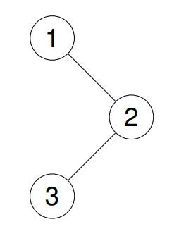

**示例 2**

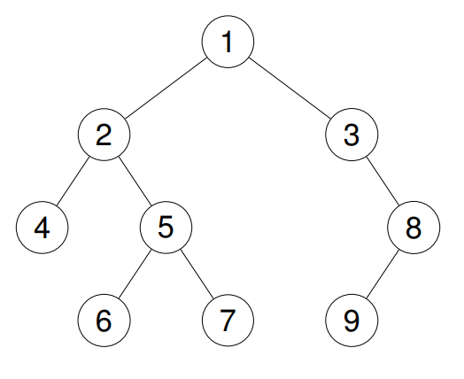

**示例 3**

**示例 4**
> 题面与 [leetcode.cn 官方](https://leetcode.cn/problems/binary-tree-preorder-traversal/)一致，示例配图取自官方题面。

**数据范围与注意事项**：

- 树中节点数目在范围 `[0, 100]` 内
- `-100 <= Node.val <= 100`
- 进阶：递归算法很简单，你可以通过迭代算法完成吗？
- **易错点**：递归出口（空节点）必须先写，否则直接空指针。

## 题目分析

**场景是什么**：树是分层数据的标准形态，这类题练的是递归分治与遍历序，对应真实开发里的目录树、组件树。本题就是该场景的 Medium 级练习，主线做法是「迭代指针处理」。

**主线怎么解**：把主解法从头到尾过一遍，它其实在依次做这几件事：队列或堆的调度。

## 解题思路

**方案对比**（共 6 个方案，由浅入深）：

| 方案 | 时间复杂度 | 空间复杂度 |
|---|---|---|
| 方案 1 · 迭代指针处理 | O(n)（单趟线性扫描） | O(1) 到 O(n)（视辅助结构） |
| 方案 2 · 迭代指针处理 | O(n)（单趟线性扫描） | O(1) 到 O(n)（视辅助结构） |
| 方案 3 · 迭代指针处理 | O(n)（单趟线性扫描） | O(1) 到 O(n)（视辅助结构） |
| 方案 4 · 迭代指针处理 | O(n)（单趟线性扫描） | O(1) 到 O(n)（视辅助结构） |
| 方案 5 · 迭代指针处理 | O(n)（单趟线性扫描） | O(1) 到 O(n)（视辅助结构） |
| 方案 6 · 方案6（迭代，显式栈） | O(n)（单趟线性扫描） | O(1) 到 O(n)（视辅助结构） |

**由浅入深的路径**：迭代指针处理 → 方案6（迭代，显式栈）；每往右一步，都在补上一步的短板。

**方案间的取舍**：方案 1（迭代指针处理）；方案 2（迭代指针处理）；方案 3（迭代指针处理）；方案 4（迭代指针处理）；方案 5（迭代指针处理）；方案 6（方案6（迭代，显式栈））。数据规模小、可读性优先时选靠前的方案；规模大、性能优先时选靠后的方案。

**怎么读这一篇**：

- 🐣 **新手路线**：把「题目描述」的示例 1 在纸上手推一遍 → 读方案 1（最直观的写法）与它的代码走读 → 按「运行方式」本地跑通看 PASS → 回头对比方案 2 之后的写法差在哪
- 🦅 **大佬路线**：直接锁定最优方案 1（迭代指针处理，O(n)（单趟线性扫描））→ 跳读该方案代码与走读 → 用「逐步拆解与面试追问」补齐复杂度推导与边界追问

### 动态算法图（DFS 点亮，GIF 自动循环）


动画演示二叉树专题里DFS 点亮的典型过程；每个方案在「TypeScript 解题方案」一节还配了专属动画与专属流程图。

### 主解法流程图（真实控制流）

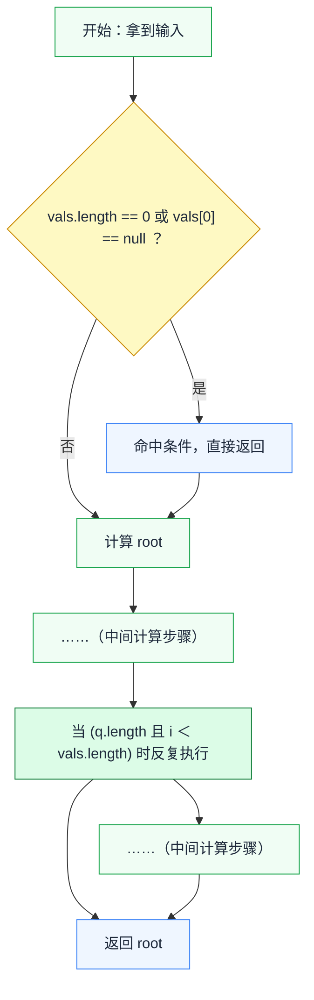

## TypeScript 解题方案（6 个方案逐个讲）

> **运行与提交**：每个方案都是自包含文件（内嵌用例自测，输出 PASS），整块复制到 `.ts` 文件后 `node 文件名` 即可运行。提交 LeetCode 时，把 `demo` 内的算法函数与辅助类型/函数整体取出、置于文件顶层即可。涉及交互/特殊接口的题以题面给定签名为准。

### 方案 1：迭代指针处理

**分析与思路**：核心做法是「迭代指针处理」。代码里依次做这些事：队列或堆的调度。

**运行方式**：`node 本文件`，内嵌用例全部通过会输出 PASS。


**方案专属流程图**（真实控制流）：

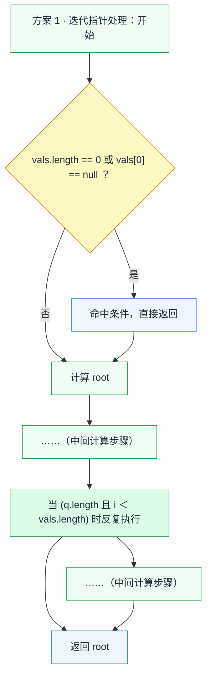

```typescript
export function demo(): void {
  // 程序入口：跑内嵌自测用例
  class TreeNode {
    val: number;
    left: TreeNode | null;
    right: TreeNode | null;
    constructor(v = 0, l: TreeNode | null = null, r: TreeNode | null = null) {
      this.val = v;
      this.left = l;
      this.right = r;
    }
  } // 定义类型
  function buildTree(vals: (number | null)[]): TreeNode | null {
    // 定义函数/方法 buildTree
    if (vals.length === 0 || vals[0] === null) return null; // 若 vals.长度 全等于 0 或 vals[0] 全等于 null，直接返回 null
    const root = new TreeNode(vals[0] as number);
    const q: TreeNode[] = [root];
    let i = 1;
    while (q.length && i < vals.length) {
      const node = q.shift()!;
      if (i < vals.length && vals[i] !== null) {
        node.left = new TreeNode(vals[i] as number);
        q.push(node.left);
      }
      i++;
      if (i < vals.length && vals[i] !== null) {
        node.right = new TreeNode(vals[i] as number);
        q.push(node.right);
      }
      i++;
    }
    return root; // 返回 根节点
  }
  function levelList(root: TreeNode | null): number[][] {
    if (!root) return [];
    const res: number[][] = [];
    let q: TreeNode[] = [root];
    while (q.length) {
      const lvl: number[] = [];
      const n = q.length;
      for (let k = 0; k < n; k++) {
        const node = q.shift()!;
        lvl.push(node.val);
        if (node.left) q.push(node.left);
        if (node.right) q.push(node.right);
      }
      res.push(lvl);
    }
    return res;
  } // 定义函数/方法 levelList
  function sameTree(a: TreeNode | null, b: TreeNode | null): boolean {
    if (!a && !b) return true;
    if (!a || !b) return false;
    if (a.val !== b.val) return false;
    return sameTree(a.left, b.left) && sameTree(a.right, b.right);
  } // 定义函数/方法 sameTree
  function inorderT(root: TreeNode | null): number[] {
    if (!root) return [];
    return [...inorderT(root.left), root.val, ...inorderT(root.right)];
  } // 定义函数/方法 inorderT
  function preorderTraversal(root: TreeNode | null): number[] {
    if (!root) return [];
    return [
      root.val,
      ...preorderTraversal(root.left),
      ...preorderTraversal(root.right),
    ];
  } // 定义函数/方法 preorderTraversal
  if (
    JSON.stringify(preorderTraversal(buildTree([1, 2, 3, null, 4, 5]))) !==
    JSON.stringify([1, 2, 4, 3, 5])
  ) {
    console.log('FAIL');
    throw new Error('FAILED');
  }
  if (preorderTraversal(null).length !== 0) {
    console.log('FAIL nil');
    throw new Error('FAILED');
  }
  console.log('PASS'); // 全部用例通过，输出 PASS
}
demo(); // demo();
```

### 方案 2：迭代指针处理

**分析与思路**：核心做法是「迭代指针处理」。代码里依次做这些事：队列或堆的调度。

**运行方式**：`node 本文件`，内嵌用例全部通过会输出 PASS。


**方案专属流程图**（真实控制流）：


```typescript
class TreeNode {
  // 定义类型
  val: number;
  left: TreeNode | null;
  right: TreeNode | null; // 值: number; 左边界: TreeNode 按位或 null; 右边界: TreeNode 按位或 null;
  constructor(
    val: number,
    left: TreeNode | null = null,
    right: TreeNode | null = null,
  ) {
    this.val = val;
    this.left = left;
    this.right = right; // 把 值; this.左边界 赋值为 左边界; this.右边界 赋值为 右边界; 写入 值
  }
}
function buildTree(vals: (number | null)[]): TreeNode | null {
  // 定义函数/方法 buildTree
  if (vals.length === 0 || vals[0] === null) return null; // 若 vals.长度 全等于 0 或 vals[0] 全等于 null，直接返回 null
  const root = new TreeNode(vals[0] as number); // 把 new TreeNode(vals[0] as number) 存入 根节点
  const q: (TreeNode | null)[] = [root];
  let i = 1; // 把 [根节点]; let 下标 i 赋值为 1; 写入 const q: (TreeNode | null)[]
  while (i < vals.length) {
    // 循环，直到不满足「下标 i 小于 vals.长度」
    const node = q.shift() as TreeNode; // 把 节点.shift() as TreeNode 存入 节点
    if (i < vals.length && vals[i] !== null) {
      node.left = new TreeNode(vals[i] as number);
      q.push(node.left);
    }
    i++; // 下标 i 加一
    if (i < vals.length && vals[i] !== null) {
      node.right = new TreeNode(vals[i] as number);
      q.push(node.right);
    }
    i++; // 下标 i 加一
  }
  return root; // 返回 根节点
}
function inorder(root: TreeNode | null, out: number[] = []): number[] {
  // 定义函数/方法 inorder
  if (!root) return out; // 若 取反 根节点，直接返回 out
  inorder(root.left, out);
  out.push(root.val);
  inorder(root.right, out); // 把 根节点.值 压入栈/数组尾部
  return out; // 返回 out
}
function levelOrderBottom(root: TreeNode | null): number[][] {
  // 定义函数/方法 levelOrderBottom
  const res: number[][] = []; // 把 []; 写入 const res: number[][]
  if (!root) return res; // 若 取反 根节点，直接返回 结果
  let q: (TreeNode | null)[] = [root]; // 把 [根节点]; 写入 let q: (TreeNode | null)[]
  while (q.length) {
    // 循环，直到不满足「节点.长度」
    const level: number[] = [];
    const nxt: (TreeNode | null)[] = [];
    for (const node of q) {
      if (node) {
        level.push(node.val);
        if (node.left) nxt.push(node.left);
        if (node.right) nxt.push(node.right);
      }
    } // 把 节点.值 压入栈/数组尾部
    res.unshift(level);
    q = nxt; // 把 nxt; 写入 res.unshift(level); q
  }
  return res; // 返回 结果
}
function binaryTreePaths(root: TreeNode | null): string[] {
  // 定义函数/方法 binaryTreePaths
  const paths: string[] = []; // 把 []; 写入 const paths: string[]
  function dfs(node: TreeNode | null, path: string): void {
    // 定义函数/方法 dfs
    if (!node) return; // 若 取反 节点) return;
    path += String(node.val); // 当前路径累加 String(节点.值)
    if (!node.left && !node.right)
      paths.push(path); // 若 取反 节点.左边界 且 取反 节点.右边界) paths 追加 当前路径);
    else {
      path += '->';
      dfs(node.left, path);
      dfs(node.right, path);
    } // 否则
  }
  dfs(root, ''); // dfs(根节点, 「」);
  return paths; // 返回 paths
}
function averageOfLevels(root: TreeNode | null): number[] {
  // 定义函数/方法 averageOfLevels
  const result: number[] = []; // 把 []; 写入 const result: number[]
  let level: (TreeNode | null)[] = [root]; // 把 [根节点]; 写入 let level: (TreeNode | null)[]
  while (level.length) {
    // 循环，直到不满足「level.长度」
    let total = 0;
    const nxt: (TreeNode | null)[] = []; // 把 0; const nxt: (TreeNode 按位或 null)[] 赋值为 [] 存入 总和
    for (const node of level) {
      if (node) {
        total += node.val;
        if (node.left) nxt.push(node.left);
        if (node.right) nxt.push(node.right);
      }
    } // 把 节点.左边界 压入栈/数组尾部
    result.push(total / level.length); // 把 总和 除以 level.长度 压入栈/数组尾部
    level = nxt; // 把 nxt 存入 level
  }
  return result; // 返回 结果
}

function assertEq(actual: any, expected: any, msg: string = ''): void {
  // 定义函数/方法 assertEq
  const a = JSON.stringify(actual);
  const e = JSON.stringify(expected);
  if (a !== e)
    throw new Error(
      'ASSERT FAILED ' + msg + ' :: actual=' + a + ' expected=' + e,
    );
}

function preorderTraversal(root: TreeNode | null): number[] {
  // 定义函数/方法 preorderTraversal
  const ans: number[] = [];
  const stack: TreeNode[] = [];
  let cur: TreeNode | null = root;
  while (cur || stack.length) {
    // 循环，直到不满足「当前值 或 栈.长度」
    while (cur) {
      ans.push(cur.val);
      stack.push(cur);
      cur = cur.left;
    } // 循环，直到不满足「当前值) { 答案 追加 当前值.值); 栈 追加 当前值); 当前值 赋值为 当前值.左边界; }」
    if (stack.length) {
      cur = stack.pop()!;
      cur = cur.right;
    } // 若 栈.长度) { 当前值 赋值为 栈 弹出 )取反 ; 当前值 赋值为 当前值.右边界; }
  }
  return ans; // 返回 答案
}
export function demo(): void {
  // 程序入口：跑内嵌自测用例
  assertEq(preorderTraversal(null), [], 'null'); // 断言校验
  assertEq(
    preorderTraversal(buildTree([1, null, 2, null, 3])),
    [1, 2, 3],
    'pre',
  ); // 断言校验
  console.log('PASS'); // 全部用例通过，输出 PASS
}
demo(); // demo();
```

### 方案 3：迭代指针处理

**分析与思路**：核心做法是「迭代指针处理」。代码里依次做这些事：队列或堆的调度。

**运行方式**：`node 本文件`，内嵌用例全部通过会输出 PASS。


**方案专属流程图**（真实控制流）：

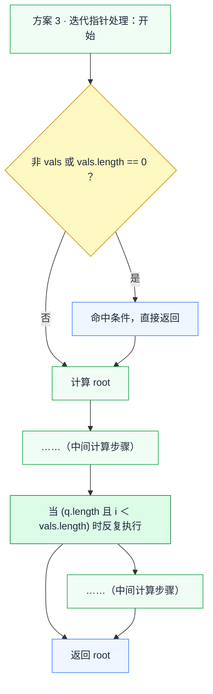

```typescript
class TreeNode {
  // 定义类型
  val: any;
  left: any;
  right: any; // 值: any; 左边界: any; 右边界: any;
  constructor(val?: any, left?: any, right?: any) {
    // constructor(值?: any, 左边界?: any, 右边界?: any) {
    this.val = val === undefined ? 0 : val; // 把 (值 全等于 undefined ? 0 : 值); 写入 值
    this.left = left === undefined ? null : left; // 把 (左边界 全等于 undefined ? null : 左边界); 写入 左边界
    this.right = right === undefined ? null : right; // 把 (右边界 全等于 undefined ? null : 右边界); 写入 右边界
  }
}
function buildTree(vals: any): any {
  // 定义函数/方法 buildTree
  if (!vals || vals.length === 0) return null; // 若 取反 vals 或 vals.长度 全等于 0，直接返回 null
  const root = new TreeNode(vals[0]);
  const q: any[] = [root];
  let i = 1;
  while (q.length && i < vals.length) {
    // 循环，直到不满足「节点.长度 且 下标 i 小于 vals.长度」
    const node = q.shift(); // 把 节点.shift() 存入 节点
    if (vals[i] !== null && vals[i] !== undefined) {
      node.left = new TreeNode(vals[i]);
      q.push(node.left);
    }
    i++; // 下标 i 加一
    if (i < vals.length && vals[i] !== null && vals[i] !== undefined) {
      node.right = new TreeNode(vals[i]);
      q.push(node.right);
    }
    i++; // 下标 i 加一
  }
  return root; // 返回 根节点
}
function treeToLevel(root: any): any[] {
  // 定义函数/方法 treeToLevel
  if (!root) return []; // 若 取反 根节点，直接返回 []
  const out: any[] = [];
  const q: any[] = [root]; // 把 []; const 节点: any[] 赋值为 [根节点]; 写入 const out: any[]
  while (q.length) {
    // 循环，直到不满足「节点.长度」
    const n = q.shift(); // 把 节点.shift() 存入 元素个数
    if (n === null || n === undefined) {
      out.push(null);
      continue;
    }
    out.push(n.val);
    q.push(n.left);
    q.push(n.right); // 把 元素个数.值 压入栈/数组尾部
  }
  while (out.length && out[out.length - 1] === null) out.pop(); // 循环，直到不满足「out.长度 且 out[out.长度 减 1] 全等于 null) out 弹出 );」
  return out; // 返回 out
}
class ListNode {
  // 定义类型
  val: any;
  next: any; // 值: any; 下一个: any;
  constructor(val?: any, next?: any) {
    this.val = val === undefined ? 0 : val;
    this.next = next === undefined ? null : next;
  }
}
function buildList(vals: any): any {
  // 定义函数/方法 buildList
  const dummy = new ListNode(0);
  let cur = dummy; // 把 new ListNode(0); let 当前值 赋值为 哨兵节点 存入 哨兵节点
  for (const v of vals) {
    cur.next = new ListNode(v);
    cur = cur.next;
  } // 把 new ListNode(值); 当前值 赋值为 当前值.下一个; } 写入 下一个
  return dummy.next; // 返回 哨兵节点.下一个
}
function listToArray(head: any): any[] {
  // 定义函数/方法 listToArray
  const out: any[] = [];
  let p = head; // 把 []; let 节点 赋值为 头节点; 写入 const out: any[]
  while (p) {
    out.push(p.val);
    p = p.next;
  } // 循环，直到不满足「节点) { out 追加 节点.值); 节点 赋值为 节点.下一个; }」
  return out; // 返回 out
}
// python-runtime shims
function pyLen(a: any): number {
  // 定义函数/方法 pyLen
  if (a === null || a === undefined) return 0; // 若 数组 全等于 null 或 数组 全等于 undefined，直接返回 0
  if (
    typeof a === 'string' ||
    Array.isArray(a) ||
    a instanceof Set ||
    a instanceof Map
  )
    return a.length ?? a.size;
  if (typeof a === 'object') return Object.keys(a).length; // 若 typeof 数组 全等于 'object'，直接返回 Object.keys(数组).长度
  return 0; // 返回 0
}
function pySlice(a: any, i: any, j: any, step?: any): any {
  // 定义函数/方法 pySlice
  if (typeof a === 'string') {
    const r = [...a].slice(i ?? 0, j ?? a.length);
    return step ? r.reverse().join('') : r.join('');
  }
  const arr = Array.isArray(a) ? a : [...a]; // 把 Array.isArray(数组) ? 数组 : 复制的 数组 存入 数组
  return arr.slice(i ?? 0, j ?? arr.length); // 返回 数组 截取 下标 i ?? 0, 下标 j ?? 数组.长度)
}
function pyRange(a: any, b?: any, step?: any): any[] {
  // 定义函数/方法 pyRange
  let s = 0,
    e = a,
    st = 1; // 把 0, e 赋值为 数组, st 赋值为 1 存入 字符串
  if (b !== undefined) {
    s = a;
    e = b;
  } // 若 b 不等于 undefined) { 字符串 赋值为 数组; e 赋值为 b; }
  if (step !== undefined) st = step; // 若 步数 不等于 undefined) st 赋值为 步数;
  const out: any[] = []; // 把 []; 写入 const out: any[]
  if (st > 0) for (let i = s; i < e; i += st) out.push(i);
  else for (let i = s; i > e; i += st) out.push(i); // 否则
  return out; // 返回 out
}
function pyIn(x: any, coll: any): boolean {
  // 定义函数/方法 pyIn
  if (coll === null || coll === undefined) return false; // 若 coll 全等于 null 或 coll 全等于 undefined，直接返回 false
  if (Array.isArray(coll)) return coll.includes(x); // 若 Array.isArray(coll)，直接返回 coll 是否包含 x)
  if (coll instanceof Set || coll instanceof Map) return coll.has(x); // 若 coll instanceof Set 或 coll instanceof Map，直接返回 coll.has(x)
  if (typeof coll === 'object') return x in coll; // 若 typeof coll 全等于 'object'，直接返回 x in coll
  if (typeof coll === 'string') return coll.indexOf(x) >= 0; // 若 typeof coll 全等于 'string'，直接返回 coll 查找 x) 不低于 0
  return false; // 返回 false
}
function pySorted(a: any): any[] {
  // 定义函数/方法 pySorted
  const arr = typeof a === 'string' ? [...a] : [...a]; // 把 (typeof 数组 全等于 'string') ? 复制的 数组 : 复制的 数组 存入 数组
  return arr.sort((x: any, y: any) => (x < y ? -1 : x > y ? 1 : 0));
}
function pyMin(a: any, b?: any): any {
  if (b !== undefined) return Math.min(a, b);
  if (Array.isArray(a) || a instanceof Set) return Math.min(...a);
  return Math.min(a);
} // 定义函数/方法 pyMin
function pyMax(a: any, b?: any): any {
  if (b !== undefined) return Math.max(a, b);
  if (Array.isArray(a) || a instanceof Set) return Math.max(...a);
  return Math.max(a);
} // 定义函数/方法 pyMax
function pySum(a: any): number {
  let s = 0;
  for (const v of a) s += v;
  return s;
} // 定义函数/方法 pySum
function pyAbs(x: any): number {
  return Math.abs(x);
} // 定义函数/方法 pyAbs
function pyEnumerate(a: any): any[] {
  const out: any[] = [];
  let i = 0;
  for (const v of a) {
    out.push([i, v]);
    i++;
  }
  return out;
} // 定义函数/方法 pyEnumerate
function pyZip(a: any, b: any): any[] {
  const n = Math.min(a.length, b.length);
  const out: any[] = [];
  for (let i = 0; i < n; i++) out.push([a[i], b[i]]);
  return out;
} // 定义函数/方法 pyZip
function pyDictGet(d: any, k: any, def?: any): any {
  return k in d ? d[k] : def === undefined ? null : def;
} // 定义函数/方法 pyDictGet
function pyPrint(...args: any[]): void {
  console.log(
    args
      .map((a) => (typeof a === 'object' && a !== null ? JSON.stringify(a) : a))
      .join(' '),
  );
} // 定义函数/方法 pyPrint
// collections / heapq
function heapPush(h: any[], x: any): void {
  h.push(x);
  let i = h.length - 1;
  while (i > 0) {
    const p = (i - 1) >> 1;
    if (h[p] <= h[i]) break;
    [h[p], h[i]] = [h[i], h[p]];
    i = p;
  }
} // 定义函数/方法 heapPush
function heapPop(h: any[]): any {
  const top = h[0];
  const last = h.pop();
  if (h.length) {
    h[0] = last;
    let i = 0;
    const n = h.length;
    while (true) {
      let l = 2 * i + 1,
        r = 2 * i + 2,
        s = i;
      if (l < n && h[l] < h[s]) s = l;
      if (r < n && h[r] < h[s]) s = r;
      if (s === i) break;
      [h[s], h[i]] = [h[i], h[s]];
      i = s;
    }
  }
  return top;
} // 定义函数/方法 heapPop
class Deque {
  private a: any[] = [];
  push(x: any) {
    this.a.push(x);
  }
  pushLeft(x: any) {
    this.a.unshift(x);
  }
  pop() {
    return this.a.pop();
  }
  popLeft() {
    return this.a.shift();
  }
  get length() {
    return this.a.length;
  }
  toArray() {
    return this.a.slice();
  }
} // 定义类型
function Counter(iter: any): any {
  const m: any = {};
  for (const v of iter) m[v] = (m[v] || 0) + 1;
  return m;
} // 定义函数/方法 Counter
function gcd(a: any, b: any): any {
  while (b) {
    [a, b] = [b, a % b];
  }
  return a;
} // 定义函数/方法 gcd
function pyInf(): number {
  return Infinity;
} // 定义函数/方法 pyInf

function norm(x: any): any {
  // 定义函数/方法 norm
  if (x === null || x === undefined) return null; // 若 x 全等于 null 或 x 全等于 undefined，直接返回 null
  if (typeof x === 'object') {
    // 若 typeof x 全等于 'object'
    if (x instanceof Deque) return x.toArray(); // 若 x instanceof Deque，直接返回 x.toArray()
    if (Array.isArray(x)) return x.map(norm); // 若 Array.isArray(x)，直接返回 x.映射表(norm)
    if (
      typeof x.val === 'number' &&
      (typeof x.left !== 'undefined' || typeof x.right !== 'undefined')
    )
      return treeToLevel(x);
    if (typeof x.next !== 'undefined' && typeof x.val === 'number')
      return listToArray(x);
    if (x instanceof Set) return [...x].sort(); // 若 x instanceof Set，直接返回 复制的 x 排序 )
    if (x instanceof Map) return Object.fromEntries(x); // 若 x instanceof Map，直接返回 Object.fromEntries(x)
    const o: any = {};
    for (const k of Object.keys(x)) o[k] = norm(x[k]);
    return o;
  }
  return x; // 返回 x
}
function eq(a: any, b: any): boolean {
  // 定义函数/方法 eq
  const x = norm(a),
    y = norm(b); // 把 norm(数组), y 赋值为 norm(b) 存入 x
  if (x === y) return true; // 若 x 全等于 y，直接返回 true
  if (x === null || y === null) return x === y; // 若 x 全等于 null 或 y 全等于 null，直接返回 x 全等于 y
  if (Array.isArray(x) && Array.isArray(y)) {
    // 若 Array.isArray(x) 且 Array.isArray(y
    if (x.length !== y.length) return false; // 若 x.长度 不等于 y.长度，直接返回 false
    for (let i = 0; i < x.length; i++) if (!eq(x[i], y[i])) return false; // 让 下标 i 从 0 开始计数，下标 i 小于 x.长度 就继续
    return true; // 返回 true
  }
  if (typeof x === 'object' && typeof y === 'object') {
    // 若 typeof x 全等于 'object' 且 typeof y 全等于 'object'
    const kx = Object.keys(x),
      ky = Object.keys(y); // 把 Object.keys(x), ky 赋值为 Object.keys(y) 存入 kx
    if (kx.length !== ky.length) return false; // 若 kx.长度 不等于 ky.长度，直接返回 false
    for (const k of kx) if (!eq(x[k], y[k])) return false;
    return true; // 返回 true
  }
  return x === y; // 返回 x 全等于 y
}

function preorderTraversal(root) {
  // 定义函数/方法 preorderTraversal
  const res = []; // 把 [] 存入 结果
  let cur = root; // 把 根节点 存入 当前值
  while (cur) {
    // 循环，直到不满足「当前值」
    if (!cur.left) {
      res.push(cur.val);
      cur = cur.right;
    } // 若 取反 当前值.左边界) { 结果 追加 当前值.值); 当前值 赋值为 当前值.右边界; }
    else {
      // 否则
      let pred = cur.left; // 把 当前值.左边界 存入 pred
      while (pred.right && pred.right !== cur) pred = pred.right; // 循环，直到不满足「pred.右边界 且 pred.右边界 不等于 当前值) pred 赋值为 pred.右边界;」
      if (!pred.right) {
        res.push(cur.val);
        pred.right = cur;
        cur = cur.left;
      } else {
        pred.right = null;
        cur = cur.right;
      } // 否则
    }
  }
  return res; // 返回 结果
}
export function demo(): void {
  // 程序入口：跑内嵌自测用例
  const cases = [
    { in: buildTree([1, null, 2, 3]), want: [1, 2, 3] },
    { in: buildTree([]), want: [] },
    { in: buildTree([1]), want: [1] },
    { in: buildTree([1, 2, 3, 4, 5]), want: [1, 2, 4, 5, 3] },
  ];
  let fail = false; // 把 false 存入 fail
  for (const c of cases) {
    const got = preorderTraversal(c.in);
    if (!eq(got, c.want)) {
      fail = true;
      console.log('FAIL', JSON.stringify(got), 'want', JSON.stringify(c.want));
    }
  } // 打印输出
  if (fail) throw new Error('FAILED'); // 若 fail) throw new Error(「FAILED」);
  console.log('PASS'); // 全部用例通过，输出 PASS
}
demo(); // demo();
```

### 方案 4：迭代指针处理

**分析与思路**：核心做法是「迭代指针处理」。代码里依次做这些事：队列或堆的调度。

**运行方式**：`node 本文件`，内嵌用例全部通过会输出 PASS。


**方案专属流程图**（真实控制流）：


```typescript
class TreeNode {
  // 定义类型
  val: number;
  left: TreeNode | null;
  right: TreeNode | null; // 值: number; 左边界: TreeNode 按位或 null; 右边界: TreeNode 按位或 null;
  constructor(
    val: number,
    left: TreeNode | null = null,
    right: TreeNode | null = null,
  ) {
    this.val = val;
    this.left = left;
    this.right = right; // 把 值; this.左边界 赋值为 左边界; this.右边界 赋值为 右边界; 写入 值
  }
}
function buildTree(vals: (number | null)[]): TreeNode | null {
  // 定义函数/方法 buildTree
  if (vals.length === 0 || vals[0] === null) return null; // 若 vals.长度 全等于 0 或 vals[0] 全等于 null，直接返回 null
  const root = new TreeNode(vals[0] as number); // 把 new TreeNode(vals[0] as number) 存入 根节点
  const q: (TreeNode | null)[] = [root];
  let i = 1; // 把 [根节点]; let 下标 i 赋值为 1; 写入 const q: (TreeNode | null)[]
  while (i < vals.length) {
    // 循环，直到不满足「下标 i 小于 vals.长度」
    const node = q.shift() as TreeNode; // 把 节点.shift() as TreeNode 存入 节点
    if (i < vals.length && vals[i] !== null) {
      node.left = new TreeNode(vals[i] as number);
      q.push(node.left);
    }
    i++; // 下标 i 加一
    if (i < vals.length && vals[i] !== null) {
      node.right = new TreeNode(vals[i] as number);
      q.push(node.right);
    }
    i++; // 下标 i 加一
  }
  return root; // 返回 根节点
}
function inorder(root: TreeNode | null, out: number[] = []): number[] {
  // 定义函数/方法 inorder
  if (!root) return out; // 若 取反 根节点，直接返回 out
  inorder(root.left, out);
  out.push(root.val);
  inorder(root.right, out); // 把 根节点.值 压入栈/数组尾部
  return out; // 返回 out
}
function levelOrderBottom(root: TreeNode | null): number[][] {
  // 定义函数/方法 levelOrderBottom
  const res: number[][] = []; // 把 []; 写入 const res: number[][]
  if (!root) return res; // 若 取反 根节点，直接返回 结果
  let q: (TreeNode | null)[] = [root]; // 把 [根节点]; 写入 let q: (TreeNode | null)[]
  while (q.length) {
    // 循环，直到不满足「节点.长度」
    const level: number[] = [];
    const nxt: (TreeNode | null)[] = [];
    for (const node of q) {
      if (node) {
        level.push(node.val);
        if (node.left) nxt.push(node.left);
        if (node.right) nxt.push(node.right);
      }
    } // 把 节点.值 压入栈/数组尾部
    res.unshift(level);
    q = nxt; // 把 nxt; 写入 res.unshift(level); q
  }
  return res; // 返回 结果
}
function binaryTreePaths(root: TreeNode | null): string[] {
  // 定义函数/方法 binaryTreePaths
  const paths: string[] = []; // 把 []; 写入 const paths: string[]
  function dfs(node: TreeNode | null, path: string): void {
    // 定义函数/方法 dfs
    if (!node) return; // 若 取反 节点) return;
    path += String(node.val); // 当前路径累加 String(节点.值)
    if (!node.left && !node.right)
      paths.push(path); // 若 取反 节点.左边界 且 取反 节点.右边界) paths 追加 当前路径);
    else {
      path += '->';
      dfs(node.left, path);
      dfs(node.right, path);
    } // 否则
  }
  dfs(root, ''); // dfs(根节点, 「」);
  return paths; // 返回 paths
}
function averageOfLevels(root: TreeNode | null): number[] {
  // 定义函数/方法 averageOfLevels
  const result: number[] = []; // 把 []; 写入 const result: number[]
  let level: (TreeNode | null)[] = [root]; // 把 [根节点]; 写入 let level: (TreeNode | null)[]
  while (level.length) {
    // 循环，直到不满足「level.长度」
    let total = 0;
    const nxt: (TreeNode | null)[] = []; // 把 0; const nxt: (TreeNode 按位或 null)[] 赋值为 [] 存入 总和
    for (const node of level) {
      if (node) {
        total += node.val;
        if (node.left) nxt.push(node.left);
        if (node.right) nxt.push(node.right);
      }
    } // 把 节点.左边界 压入栈/数组尾部
    result.push(total / level.length); // 把 总和 除以 level.长度 压入栈/数组尾部
    level = nxt; // 把 nxt 存入 level
  }
  return result; // 返回 结果
}

function assertEq(actual: any, expected: any, msg: string = ''): void {
  // 定义函数/方法 assertEq
  const a = JSON.stringify(actual);
  const e = JSON.stringify(expected);
  if (a !== e)
    throw new Error(
      'ASSERT FAILED ' + msg + ' :: actual=' + a + ' expected=' + e,
    );
}

function preorderTraversal(root: TreeNode | null): number[] {
  // 定义函数/方法 preorderTraversal
  if (!root) return []; // 若 取反 根节点，直接返回 []
  return [
    root.val,
    ...preorderTraversal(root.left),
    ...preorderTraversal(root.right),
  ];
}
export function demo(): void {
  // 程序入口：跑内嵌自测用例
  assertEq(
    preorderTraversal(buildTree([1, null, 2, null, 3])),
    [1, 2, 3],
    'pre',
  ); // 断言校验
  assertEq(preorderTraversal(null), [], 'null'); // 断言校验
  console.log('PASS'); // 全部用例通过，输出 PASS
}
demo(); // demo();
```

### 方案 5：迭代指针处理

**分析与思路**：核心做法是「迭代指针处理」。代码里依次做这些事：队列或堆的调度。

**运行方式**：`node 本文件`，内嵌用例全部通过会输出 PASS。


**方案专属流程图**（真实控制流）：

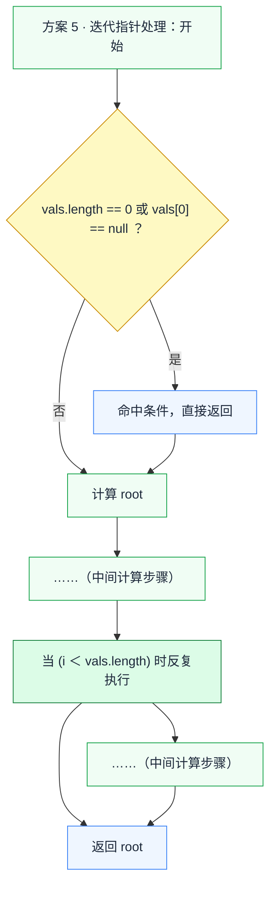

```typescript
class TreeNode {
  // 定义类型
  val: number;
  left: TreeNode | null;
  right: TreeNode | null; // 值: number; 左边界: TreeNode 按位或 null; 右边界: TreeNode 按位或 null;
  constructor(
    val: number,
    left: TreeNode | null = null,
    right: TreeNode | null = null,
  ) {
    this.val = val;
    this.left = left;
    this.right = right; // 把 值; this.左边界 赋值为 左边界; this.右边界 赋值为 右边界; 写入 值
  }
}
function buildTree(vals: (number | null)[]): TreeNode | null {
  // 定义函数/方法 buildTree
  if (vals.length === 0 || vals[0] === null) return null; // 若 vals.长度 全等于 0 或 vals[0] 全等于 null，直接返回 null
  const root = new TreeNode(vals[0] as number); // 把 new TreeNode(vals[0] as number) 存入 根节点
  const q: (TreeNode | null)[] = [root];
  let i = 1; // 把 [根节点]; let 下标 i 赋值为 1; 写入 const q: (TreeNode | null)[]
  while (i < vals.length) {
    // 循环，直到不满足「下标 i 小于 vals.长度」
    const node = q.shift() as TreeNode; // 把 节点.shift() as TreeNode 存入 节点
    if (i < vals.length && vals[i] !== null) {
      node.left = new TreeNode(vals[i] as number);
      q.push(node.left);
    }
    i++; // 下标 i 加一
    if (i < vals.length && vals[i] !== null) {
      node.right = new TreeNode(vals[i] as number);
      q.push(node.right);
    }
    i++; // 下标 i 加一
  }
  return root; // 返回 根节点
}
function inorder(root: TreeNode | null, out: number[] = []): number[] {
  // 定义函数/方法 inorder
  if (!root) return out; // 若 取反 根节点，直接返回 out
  inorder(root.left, out);
  out.push(root.val);
  inorder(root.right, out); // 把 根节点.值 压入栈/数组尾部
  return out; // 返回 out
}
function levelOrderBottom(root: TreeNode | null): number[][] {
  // 定义函数/方法 levelOrderBottom
  const res: number[][] = []; // 把 []; 写入 const res: number[][]
  if (!root) return res; // 若 取反 根节点，直接返回 结果
  let q: (TreeNode | null)[] = [root]; // 把 [根节点]; 写入 let q: (TreeNode | null)[]
  while (q.length) {
    // 循环，直到不满足「节点.长度」
    const level: number[] = [];
    const nxt: (TreeNode | null)[] = [];
    for (const node of q) {
      if (node) {
        level.push(node.val);
        if (node.left) nxt.push(node.left);
        if (node.right) nxt.push(node.right);
      }
    } // 把 节点.值 压入栈/数组尾部
    res.unshift(level);
    q = nxt; // 把 nxt; 写入 res.unshift(level); q
  }
  return res; // 返回 结果
}
function binaryTreePaths(root: TreeNode | null): string[] {
  // 定义函数/方法 binaryTreePaths
  const paths: string[] = []; // 把 []; 写入 const paths: string[]
  function dfs(node: TreeNode | null, path: string): void {
    // 定义函数/方法 dfs
    if (!node) return; // 若 取反 节点) return;
    path += String(node.val); // 当前路径累加 String(节点.值)
    if (!node.left && !node.right)
      paths.push(path); // 若 取反 节点.左边界 且 取反 节点.右边界) paths 追加 当前路径);
    else {
      path += '->';
      dfs(node.left, path);
      dfs(node.right, path);
    } // 否则
  }
  dfs(root, ''); // dfs(根节点, 「」);
  return paths; // 返回 paths
}
function averageOfLevels(root: TreeNode | null): number[] {
  // 定义函数/方法 averageOfLevels
  const result: number[] = []; // 把 []; 写入 const result: number[]
  let level: (TreeNode | null)[] = [root]; // 把 [根节点]; 写入 let level: (TreeNode | null)[]
  while (level.length) {
    // 循环，直到不满足「level.长度」
    let total = 0;
    const nxt: (TreeNode | null)[] = []; // 把 0; const nxt: (TreeNode 按位或 null)[] 赋值为 [] 存入 总和
    for (const node of level) {
      if (node) {
        total += node.val;
        if (node.left) nxt.push(node.left);
        if (node.right) nxt.push(node.right);
      }
    } // 把 节点.左边界 压入栈/数组尾部
    result.push(total / level.length); // 把 总和 除以 level.长度 压入栈/数组尾部
    level = nxt; // 把 nxt 存入 level
  }
  return result; // 返回 结果
}

function assertEq(actual: any, expected: any, msg: string = ''): void {
  // 定义函数/方法 assertEq
  const a = JSON.stringify(actual);
  const e = JSON.stringify(expected);
  if (a !== e)
    throw new Error(
      'ASSERT FAILED ' + msg + ' :: actual=' + a + ' expected=' + e,
    );
}

function preorderTraversal(root: TreeNode | null): number[] {
  // 定义函数/方法 preorderTraversal
  const res: number[] = []; // 把 []; 写入 const res: number[]
  function dfs(node: TreeNode | null): void {
    if (!node) return;
    res.push(node.val);
    dfs(node.left);
    dfs(node.right);
  } // 定义函数/方法 dfs
  dfs(root); // dfs(根节点);
  return res; // 返回 结果
}
export function demo(): void {
  // 程序入口：跑内嵌自测用例
  assertEq(
    preorderTraversal(buildTree([1, null, 2, null, 3])),
    [1, 2, 3],
    'pre',
  ); // 断言校验
  assertEq(preorderTraversal(null), [], 'null'); // 断言校验
  console.log('PASS'); // 全部用例通过，输出 PASS
}
demo(); // demo();
```

### 方案 6：方案6（迭代，显式栈）

**分析与思路**：核心做法是「方案6（迭代，显式栈）」。代码里依次做这些事：队列或堆的调度。

**运行方式**：`node 本文件`，内嵌用例全部通过会输出 PASS。

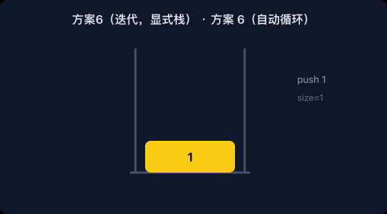

**方案专属流程图**（真实控制流）：

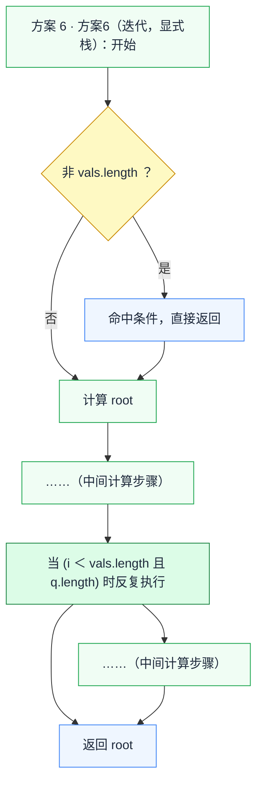

```typescript
/**
 ** LeetCode 144. 二叉树的前序遍历
 ** 方案：方案6（迭代，显式栈）
 ** 来源：python 参考忠实移植
 */

class TreeNode {
  // 定义类型
  val: number; // 值: number;
  left: TreeNode | null; // 左边界: TreeNode 按位或 null;
  right: TreeNode | null; // 右边界: TreeNode 按位或 null;
  constructor(val?: number, left?: TreeNode | null, right?: TreeNode | null) {
    this.val = val === undefined ? 0 : val; // 把 值 全等于 undefined ? 0 : 值; 写入 值
    this.left = left === undefined ? null : left; // 把 左边界 全等于 undefined ? null : 左边界; 写入 左边界
    this.right = right === undefined ? null : right; // 把 右边界 全等于 undefined ? null : 右边界; 写入 右边界
  }
}

function buildTree(vals: (number | null)[]): TreeNode | null {
  // 定义函数/方法 buildTree
  if (!vals.length) return null; // 若 取反 vals.长度，直接返回 null
  const root = new TreeNode(vals[0]); // 把 new TreeNode(vals[0]) 存入 根节点
  const q: TreeNode[] = [root]; // 把 [根节点]; 写入 const q: TreeNode[]
  let i = 1; // 把 1 存入 下标 i
  while (i < vals.length && q.length) {
    // 循环，直到不满足「下标 i 小于 vals.长度 且 节点.长度」
    const node = q.shift()!; // 把 节点.shift()取反 存入 节点
    if (i < vals.length && vals[i] !== null) {
      // 若 下标 i 小于 vals.长度 且 vals[下标 i] 不等于 null
      node.left = new TreeNode(vals[i] as number); // 把 new TreeNode(vals[下标 i] as number); 写入 左边界
      q.push(node.left); // 把 节点.左边界 压入栈/数组尾部
    }
    i++; // 下标 i 加一
    if (i < vals.length && vals[i] !== null) {
      // 若 下标 i 小于 vals.长度 且 vals[下标 i] 不等于 null
      node.right = new TreeNode(vals[i] as number); // 把 new TreeNode(vals[下标 i] as number); 写入 右边界
      q.push(node.right); // 把 节点.右边界 压入栈/数组尾部
    }
    i++; // 下标 i 加一
  }
  return root; // 返回 根节点
}

function preorderTraversal(root: TreeNode | null): number[] {
  // 定义函数/方法 preorderTraversal
  const res: number[] = []; // 把 []; 写入 const res: number[]
  const stack: TreeNode[] = []; // 把 []; 写入 const stack: TreeNode[]
  if (root) stack.push(root); // 若 根节点) 栈 追加 根节点);
  while (stack.length) {
    // 循环，直到不满足「栈.长度」
    const node = stack.pop()!; // 把 栈 弹出 )取反 存入 节点
    res.push(node.val); // 把 节点.值 压入栈/数组尾部
    if (node.right) stack.push(node.right); // 若 节点.右边界) 栈 追加 节点.右边界);
    if (node.left) stack.push(node.left); // 若 节点.左边界) 栈 追加 节点.左边界);
  }
  return res; // 返回 结果
}

export function demo(): void {
  // 程序入口：跑内嵌自测用例
  const cases: { in: (number | null)[]; want: number[] }[] = [
    { in: [1, null, 2, null, 3], want: [1, 2, 3] },
    { in: [1, 2, 3, null, null, 4, 5], want: [1, 2, 3, 4, 5] },
    { in: [], want: [] },
  ];
  let fail = false; // 把 false 存入 fail
  for (const c of cases) {
    // for (const 字符 of cases) {
    const got = preorderTraversal(buildTree(c.in)); // 把 preorderTraversal(buildTree(字符.in)) 存入 got
    if (JSON.stringify(got) !== JSON.stringify(c.want)) {
      // 若 JSON.stringify(got) 不等于 JSON.stringify(字符.want
      fail = true; // 把 true 存入 fail
      console.log(
        'FAIL',
        JSON.stringify(c.in),
        'want',
        JSON.stringify(c.want),
        'got',
        JSON.stringify(got),
      ); // 打印输出
    }
  }
  if (fail) throw new Error('FAILED'); // 若 fail) throw new Error(「FAILED」);
  console.log('PASS'); // 全部用例通过，输出 PASS
}
demo(); // demo();
```

## 逐步拆解与面试追问

**复杂度**：时间 O(n)（单趟线性扫描），空间 O(1) 到 O(n)（视辅助结构）

**为什么是这个量级**：每个元素被常数次访问，辅助哈希或栈的开销与 n 同阶

**面试官可能会追问**：

- 递归和迭代写法各自的空间开销？
- 能否用层序统一处理？
- 空节点的边界如何约定？

## 关键 API 速查（TS 主解法实际用到，附官方链接）

| API | 作用 | 使用要点 | 官方文档 |
|---|---|---|---|
| `Array.prototype.push()` | 尾部追加 | 返回新长度；可一次多个；均摊 O(1)；会改变原数组 | [官方文档](https://developer.mozilla.org/zh-CN/docs/Web/JavaScript/Reference/Global_Objects/Array/push) |
| `Array.prototype.shift()` | 头部取出 | O(n)（后续元素整体前移）；大量头部操作请用链表或双端结构 | [官方文档](https://developer.mozilla.org/zh-CN/docs/Web/JavaScript/Reference/Global_Objects/Array/shift) |
| `JSON.stringify()` | 序列化为 JSON 字符串 | 常用于结构化比较（深度相等判定）；undefined/函数/循环引用会被丢弃或抛错 | [官方文档](https://developer.mozilla.org/zh-CN/docs/Web/JavaScript/Reference/Global_Objects/JSON/stringify) |

### 各语言官方文档导航

- **TypeScript / JS**：[MDN 中文参考](https://developer.mozilla.org/zh-CN/)
- **Python**：[Python 官方文档](https://docs.python.org/zh-cn/3/)
- **Go**：[Go 标准库](https://pkg.go.dev/std)
- **Java**：[JDK 17 API](https://docs.oracle.com/en/java/javase/17/docs/api/)
- **Rust**：[Rust 标准库](https://doc.rust-lang.org/std/)
- **Lua**：[Lua 5.4 手册](https://www.lua.org/manual/5.4/)
- **C**：[Cppreference C](https://zh.cppreference.com/w/c)
- **C++**：[Cppreference C++](https://zh.cppreference.com/w/cpp)
- **R**：[R 官方手册](https://stat.ethz.ch/R-manual/)
- **Zig**：[Zig 语言文档](https://ziglang.org/documentation/master/)
- **Dart**：[Dart API](https://api.dart.dev/)

## 附录：其他 10 种语言全部实现（每种语言列举其全部方案）

> TypeScript 的全部方案见「TypeScript 解题方案」一节；下面是其余 10 种语言的对应实现，每种语言的每个方案都带思路分析、代码走读与专属运行架构图。
> 每个方案都内嵌用例自测，可独立运行（老仓库 python/go 文件遵循「打印结果」约定）。
> 完整解法文件见 `dsa/<语言>/tree/lc_144_二叉树的前序遍历/`。

### Python 实现（6 种方案）

Python 的全部方案如下，每个方案都内嵌用例自测，可独立运行（老仓库 python/go 文件遵循「打印结果」约定）：

#### 方案 1：迭代指针处理

**思路与代码分析**：核心是「迭代指针处理」。Python 版用切片与字典推导式简化操作，突出可读性。**走读**：方案 1 · 迭代指针处理：开始 → 更新 result → 更新 ! → 命中条件，直接返回 → 向 result 追加记录 → 调用 isValid(root.left) and preor → 处理 root.left → 处理 ) → 调用 isValid(root.right) and preo → 处理 root.right → 处理 ) → 返回 result → 返回 preorderHandler(root)。

**运行架构**（真实控制流）：

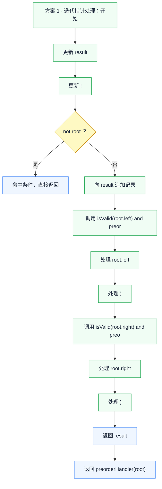

```python
import sys  # 提高递归深度上限（深输入防 RecursionError）

sys.setrecursionlimit(200000)  # 树/链表类题目节点数可达 1e4 量级

def preorderTraversal(root):  # 定义函数 preorderTraversal（参数：根节点）
    result = []  # 把 [] 存入 结果

    def isValid(val):  # 定义函数 isValid（参数：值）
        val != None  # 把 None 写入 val !

        def preorderHandler(root):  # 定义函数 preorderHandler（参数：根节点）
            if not root:
                return result  # 若 not 根节点: return 结果
            isValid(root.val) and result.append(root.val)  # 把 根节点.值 追加到列表尾部
            isValid(root.left) and preorderHandler(
                root.left
            )  # isValid(根节点.左边界) and preorderHandler(根节点.左边界)
            isValid(root.right) and preorderHandler(
                root.right
            )  # isValid(根节点.右边界) and preorderHandler(根节点.右边界)
            return result  # 返回 结果

        return preorderHandler(root)  # 返回 preorderHandler(根节点)

if __name__ == "__main__":  # 若 __name__ 等于 '__main__'
    print(preorderTraversal(None))  # 打印输出
```

#### 方案 2：迭代指针处理

**思路与代码分析**：核心是「迭代指针处理」。Python 版用切片与字典推导式简化操作，突出可读性。**走读**：方案 2 · 迭代指针处理：开始 → 更新 ans → 更新 stack → 更新 cur → 当 cur or len(stack): 时反复执行 → 当 cur: 时反复执行 → 向 ans 追加记录 → 向 stack 追加记录 → 更新 cur → 若 len(stack)：从 stack 弹出 → 从 stack 弹出 → 更新 cur → 返回 ans。

**运行架构**（真实控制流）：

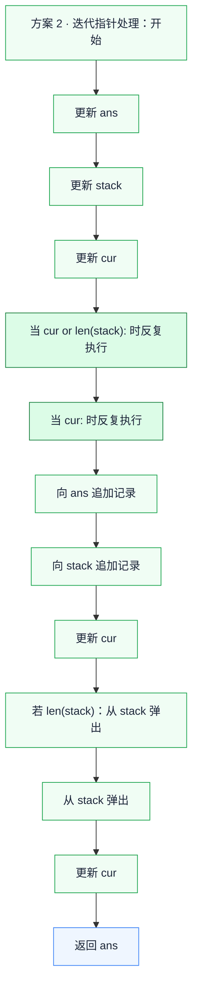

```python
import sys  # 提高递归深度上限（深输入防 RecursionError）

sys.setrecursionlimit(200000)  # 树/链表类题目节点数可达 1e4 量级

def preorderTraversal(root):  # 定义函数 preorderTraversal（参数：根节点）
    ans = []  # 把 [] 存入 答案
    stack = []  # 把 [] 存入 栈
    cur = root  # 把 根节点 存入 当前值
    while cur or len(stack):  # 循环，直到不满足「当前值 or 长度(栈」
        while cur:  # 循环，直到不满足「当前值」
            ans.append(cur.val)  # 把 当前值.值 追加到列表尾部
            stack.append(cur)  # 把 当前值 追加到列表尾部
            cur = cur.left  # 把 当前值.左边界 存入 当前值
        if len(stack):  # 若 长度(栈
            cur = stack.pop()  # 把 栈 弹出 ) 存入 当前值
            cur = cur.right  # 把 当前值.右边界 存入 当前值
    return ans  # 返回 答案

if __name__ == "__main__":  # 若 __name__ 等于 '__main__'
    print(preorderTraversal(None))  # 打印输出
```

#### 方案 3：迭代指针处理

**思路与代码分析**：核心是「迭代指针处理」。Python 版用切片与字典推导式简化操作，突出可读性。**走读**：方案 3 · 迭代指针处理：开始 → 更新 res → 当 cur: 时反复执行 → 当 ( 时反复执行 → 返回 res。

**运行架构**（真实控制流）：

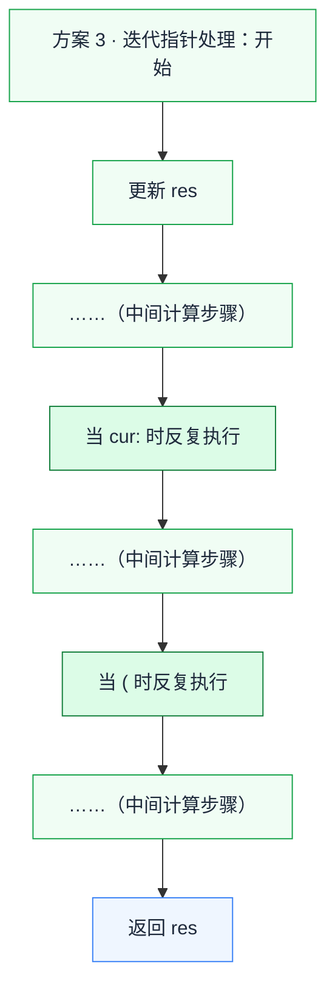

```python
import sys  # 提高递归深度上限（深输入防 RecursionError）

sys.setrecursionlimit(200000)  # 树/链表类题目节点数可达 1e4 量级

class TreeNode:  # 定义类
    def __init__(self, val=0, left=None, right=None):  # 构造函数：初始化成员
        self.val = val  # 把 值 写入 值
        self.left = left  # 把 左边界 写入 左边界
        self.right = right  # 把 右边界 写入 右边界

def preorderTraversal(root):  # 定义函数 preorderTraversal（参数：根节点）
    res = []  # 把 [] 存入 结果
    cur = root  # 把 根节点 存入 当前值
    while cur:  # 循环，直到不满足「当前值」
        if not cur.left:  # 若 not 当前值.左边界
            res.append(cur.val)  # 把 当前值.值 追加到列表尾部
            cur = cur.right  # 把 当前值.右边界 存入 当前值
        else:  # 否则
            pred = cur.left  # 把 当前值.左边界 存入 pred
            while (
                pred.right and pred.right is not cur
            ):  # 循环，直到不满足「pred.右边界 and pred.右边界 is not 当前值」
                pred = pred.right  # 把 pred.右边界 存入 pred
            if not pred.right:  # 若 not pred.右边界
                res.append(cur.val)  # 把 当前值.值 追加到列表尾部
                pred.right = cur  # 把 当前值 写入 右边界
                cur = cur.left  # 把 当前值.左边界 存入 当前值
            else:  # 否则
                pred.right = None  # 把 None 写入 右边界
                cur = cur.right  # 把 当前值.右边界 存入 当前值
    return res  # 返回 结果

def build_tree(vals):  # 定义函数 build_tree（参数：vals）
    if not vals:  # 若 not vals
        return None  # 返回 None
    root = TreeNode(vals[0])  # 把 TreeNode(vals[0]) 存入 根节点
    q = [root]  # 把 [根节点] 存入 节点
    i = 1  # 把 1 存入 下标 i
    while i < len(vals):  # 循环，直到不满足「下标 i 小于 长度(vals」
        node = q.pop(0)  # 把 节点 弹出 0) 存入 节点
        if vals[i] is not None:  # 若 vals[下标 i] is not None
            node.left = TreeNode(vals[i])  # 把 TreeNode(vals[下标 i]) 写入 左边界
            q.append(node.left)  # 把 节点.左边界 追加到列表尾部
        i += 1  # 下标 i累加 1
        if i < len(vals):  # 若 下标 i 小于 长度(vals
            if vals[i] is not None:  # 若 vals[下标 i] is not None
                node.right = TreeNode(vals[i])  # 把 TreeNode(vals[下标 i]) 写入 右边界
                q.append(node.right)  # 把 节点.右边界 追加到列表尾部
            i += 1  # 下标 i累加 1
    return root  # 返回 根节点

if __name__ == "__main__":  # 若 __name__ 等于 '__main__'
    root = build_tree([1, None, 2, None, 3])  # 把 build_tree([1, None, 2, None, 3]) 存入 根节点
    print(preorderTraversal(root))  # 打印输出
```

#### 方案 4：迭代指针处理

**思路与代码分析**：核心是「迭代指针处理」。Python 版用切片与字典推导式简化操作，突出可读性。**走读**：方案 4 · 迭代指针处理：开始 → 命中条件，直接返回 → 返回 [root.val] + preorderTraversal(root.left) + preorderTraversal(root.right)。

**运行架构**（真实控制流）：

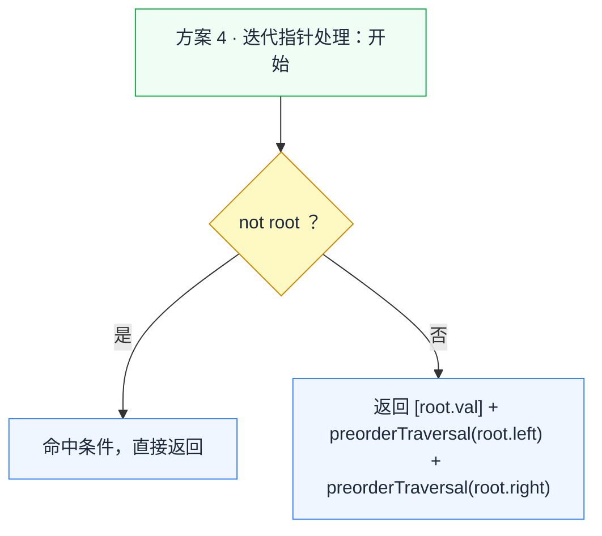

```python
import sys  # 提高递归深度上限（深输入防 RecursionError）

sys.setrecursionlimit(200000)  # 树/链表类题目节点数可达 1e4 量级

class TreeNode:  # 定义类
    def __init__(self, val=0, left=None, right=None):  # 构造函数：初始化成员
        self.val = val  # 把 值 写入 值
        self.left = left  # 把 左边界 写入 左边界
        self.right = right  # 把 右边界 写入 右边界

def preorderTraversal(root):  # 定义函数 preorderTraversal（参数：根节点）
    if not root:  # 若 not 根节点
        return []  # 返回 []
    return [root.val] + preorderTraversal(root.left) + preorderTraversal(root.right)

def build_tree(vals):  # 定义函数 build_tree（参数：vals）
    if not vals:  # 若 not vals
        return None  # 返回 None
    root = TreeNode(vals[0])  # 把 TreeNode(vals[0]) 存入 根节点
    q = [root]  # 把 [根节点] 存入 节点
    i = 1  # 把 1 存入 下标 i
    while i < len(vals):  # 循环，直到不满足「下标 i 小于 长度(vals」
        node = q.pop(0)  # 把 节点 弹出 0) 存入 节点
        if vals[i] is not None:  # 若 vals[下标 i] is not None
            node.left = TreeNode(vals[i])  # 把 TreeNode(vals[下标 i]) 写入 左边界
            q.append(node.left)  # 把 节点.左边界 追加到列表尾部
        i += 1  # 下标 i累加 1
        if i < len(vals):  # 若 下标 i 小于 长度(vals
            if vals[i] is not None:  # 若 vals[下标 i] is not None
                node.right = TreeNode(vals[i])  # 把 TreeNode(vals[下标 i]) 写入 右边界
                q.append(node.right)  # 把 节点.右边界 追加到列表尾部
            i += 1  # 下标 i累加 1
    return root  # 返回 根节点

if __name__ == "__main__":  # 若 __name__ 等于 '__main__'
    root = build_tree([1, None, 2, None, 3])  # 把 build_tree([1, None, 2, None, 3]) 存入 根节点
    print(preorderTraversal(root))  # 打印输出
```

#### 方案 5：迭代指针处理

**思路与代码分析**：核心是「迭代指针处理」。Python 版用切片与字典推导式简化操作，突出可读性。**走读**：方案 5 · 迭代指针处理：开始 → 更新 res → 命中条件，直接返回 → 向 res 追加记录 → 调用 dfs(node.left) → 调用 dfs(node.right) → 调用 dfs(root) → 返回 res。

**运行架构**（真实控制流）：

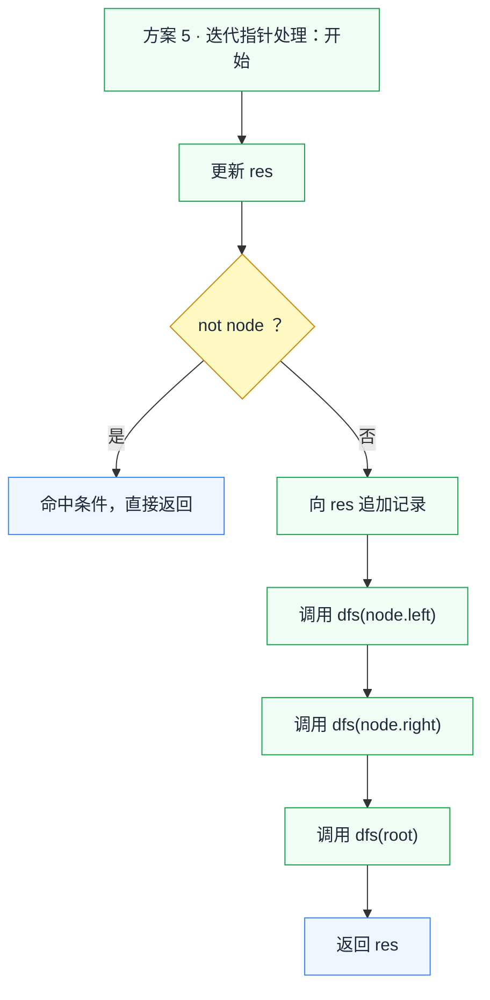

```python
import sys  # 提高递归深度上限（深输入防 RecursionError）

sys.setrecursionlimit(200000)  # 树/链表类题目节点数可达 1e4 量级

class TreeNode:  # 定义类
    def __init__(self, val=0, left=None, right=None):  # 构造函数：初始化成员
        self.val = val  # 把 值 写入 值
        self.left = left  # 把 左边界 写入 左边界
        self.right = right  # 把 右边界 写入 右边界

def preorderTraversal(root):  # 定义函数 preorderTraversal（参数：根节点）
    res = []  # 把 [] 存入 结果

    def dfs(node):  # 定义函数 dfs（参数：节点）
        if not node:  # 若 not 节点
            return  # return
        res.append(node.val)  # 把 节点.值 追加到列表尾部
        dfs(node.left)  # dfs(节点.左边界)
        dfs(node.right)  # dfs(节点.右边界)

    dfs(root)  # dfs(根节点)
    return res  # 返回 结果

def build_tree(vals):  # 定义函数 build_tree（参数：vals）
    if not vals:  # 若 not vals
        return None  # 返回 None
    root = TreeNode(vals[0])  # 把 TreeNode(vals[0]) 存入 根节点
    q = [root]  # 把 [根节点] 存入 节点
    i = 1  # 把 1 存入 下标 i
    while i < len(vals):  # 循环，直到不满足「下标 i 小于 长度(vals」
        node = q.pop(0)  # 把 节点 弹出 0) 存入 节点
        if vals[i] is not None:  # 若 vals[下标 i] is not None
            node.left = TreeNode(vals[i])  # 把 TreeNode(vals[下标 i]) 写入 左边界
            q.append(node.left)  # 把 节点.左边界 追加到列表尾部
        i += 1  # 下标 i累加 1
        if i < len(vals):  # 若 下标 i 小于 长度(vals
            if vals[i] is not None:  # 若 vals[下标 i] is not None
                node.right = TreeNode(vals[i])  # 把 TreeNode(vals[下标 i]) 写入 右边界
                q.append(node.right)  # 把 节点.右边界 追加到列表尾部
            i += 1  # 下标 i累加 1
    return root  # 返回 根节点

if __name__ == "__main__":  # 若 __name__ 等于 '__main__'
    root = build_tree([1, None, 2, None, 3])  # 把 build_tree([1, None, 2, None, 3]) 存入 根节点
    print(preorderTraversal(root))  # 打印输出
```

#### 方案 6：方案6（迭代，显式栈）

**思路与代码分析**：核心是「方案6（迭代，显式栈）」。Python 版用切片与字典推导式简化操作，突出可读性。**走读**：方案 6 · 方案6（迭代，显式栈）：开始 → 更新 stack → 若 root：向 stack 追加记录 → 向 stack 追加记录 → 当 stack: 时反复执行 → 从 stack 弹出 → 向 res 追加记录 → 若 node.right：向 stack 追加记录 → 向 stack 追加记录 → 若 node.left：向 stack 追加记录 → 向 stack 追加记录 → 返回 res。

**运行架构**（真实控制流）：

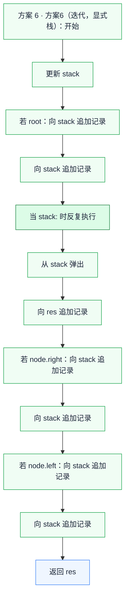

```python
import sys  # 提高递归深度上限（深输入防 RecursionError）

sys.setrecursionlimit(200000)  # 树/链表类题目节点数可达 1e4 量级

class TreeNode:  # 定义类
    def __init__(self, val=0, left=None, right=None):  # 构造函数：初始化成员
        self.val = val  # 把 值 写入 值
        self.left = left  # 把 左边界 写入 左边界
        self.right = right  # 把 右边界 写入 右边界

def preorderTraversal(root):  # 定义函数 preorderTraversal（参数：根节点）
    res, stack = [], []  # 把 [], [] 写入 res, stack
    if root:  # 若 根节点
        stack.append(root)  # 把 根节点 追加到列表尾部
    while stack:  # 循环，直到不满足「栈」
        node = stack.pop()  # 把 栈 弹出 ) 存入 节点
        res.append(node.val)  # 把 节点.值 追加到列表尾部
        if node.right:  # 若 节点.右边界
            stack.append(node.right)  # 把 节点.右边界 追加到列表尾部
        if node.left:  # 若 节点.左边界
            stack.append(node.left)  # 把 节点.左边界 追加到列表尾部
    return res  # 返回 结果

def build_tree(vals):  # 定义函数 build_tree（参数：vals）
    if not vals:  # 若 not vals
        return None  # 返回 None
    root = TreeNode(vals[0])  # 把 TreeNode(vals[0]) 存入 根节点
    q = [root]  # 把 [根节点] 存入 节点
    i = 1  # 把 1 存入 下标 i
    while i < len(vals):  # 循环，直到不满足「下标 i 小于 长度(vals」
        node = q.pop(0)  # 把 节点 弹出 0) 存入 节点
        if vals[i] is not None:  # 若 vals[下标 i] is not None
            node.left = TreeNode(vals[i])  # 把 TreeNode(vals[下标 i]) 写入 左边界
            q.append(node.left)  # 把 节点.左边界 追加到列表尾部
        i += 1  # 下标 i累加 1
        if i < len(vals):  # 若 下标 i 小于 长度(vals
            if vals[i] is not None:  # 若 vals[下标 i] is not None
                node.right = TreeNode(vals[i])  # 把 TreeNode(vals[下标 i]) 写入 右边界
                q.append(node.right)  # 把 节点.右边界 追加到列表尾部
            i += 1  # 下标 i累加 1
    return root  # 返回 根节点

if __name__ == "__main__":  # 若 __name__ 等于 '__main__'
    root = build_tree([1, None, 2, None, 3])  # 把 build_tree([1, None, 2, None, 3]) 存入 根节点
    print(preorderTraversal(root))  # 打印输出
```

### Go 实现（6 种方案）

Go 的全部方案如下，每个方案都内嵌用例自测，可独立运行（老仓库 python/go 文件遵循「打印结果」约定）：

#### 方案 1：迭代指针处理

**思路与代码分析**：核心是「迭代指针处理」。Go 版用切片与多返回值惯用法，显式处理索引边界。**走读**：方案 1 · 迭代指针处理：开始 → 返回 &v。

**运行架构**（真实控制流）：

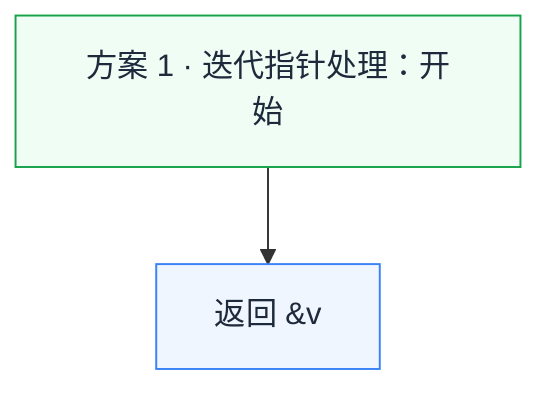

```go
package main // 引入依赖

import (
	"fmt"
	"os"
	"reflect"
) // 引入依赖

type TreeNode struct { // 定义类型
	Val   int       // Val int
	Left  *TreeNode // Left 乘 TreeNode
	Right *TreeNode // Right 乘 TreeNode
}

func pi(v int) *int { return &v } // 定义函数/方法 pi

func buildTree(vals []*int) *TreeNode { // 定义函数/方法 buildTree
	if len(vals) == 0 || vals[0] == nil { // 若 长度(vals) 等于 0 或 vals[0] 等于 nil
		return nil // 返回 nil
	}
	root := &TreeNode{Val: *vals[0]} // 把 按位与 TreeNode{Val: 乘 vals[0]} 写入 root :
	q := []*TreeNode{root}           // 把 [] 乘 TreeNode{根节点} 写入 q :
	i := 1                           // 把 1 写入 i :
	for i < len(vals) {              // for 下标 i 小于 长度(vals) {
		node := q[0]        // 把 节点[0] 写入 node :
		q = q[1:]           // 把 节点[1:] 写入 节点
		if vals[i] != nil { // 若 vals[下标 i] 不等于 nil
			node.Left = &TreeNode{Val: *vals[i]} // 把 按位与 TreeNode{Val: 乘 vals[下标 i]} 写入 node.Left
			q = append(q, node.Left)             // 把 append(节点, 节点.Left) 写入 节点
		}
		i++                // 下标 i 加一
		if i < len(vals) { // 若 下标 i 小于 长度(vals
			if vals[i] != nil { // 若 vals[下标 i] 不等于 nil
				node.Right = &TreeNode{Val: *vals[i]} // 把 按位与 TreeNode{Val: 乘 vals[下标 i]} 写入 node.Right
				q = append(q, node.Right)             // 把 append(节点, 节点.Right) 写入 节点
			}
			i++ // 下标 i 加一
		}
	}
	return root // 返回 根节点
}

// faithful port of the (degenerate) python reference: always returns nil
func preorderTraversal(root *TreeNode) []int { // 定义函数/方法 preorderTraversal
	return nil // 返回 nil
}

func main() { // 程序入口：跑内嵌自测用例
	cases := []struct { // 把 []struct { 写入 cases :
		vals []int // vals []int
		want []int // want []int
	}{ // }{
		{[]int{1, 2, 3}, nil},
		{nil, nil},
	}
	ok := true                // 把 true 写入 ok :
	for _, c := range cases { // 同时取 _ 与 字符 遍历
		var pvals []*int   // var pvals [] 乘 int
		if c.vals != nil { // 若 字符.vals 不等于 nil
			pvals = make([]*int, len(c.vals)) // 把 make([] 乘 int, 长度(字符.vals)) 写入 pvals
			for i, v := range c.vals {        // 同时取 下标 i 与 值 遍历
				pvals[i] = pi(v) // 把 pi(值) 写入 pvals[i]
			}
		}
		got := preorderTraversal(buildTree(pvals)) // 把 preorderTraversal(buildTree(pvals)) 写入 got :
		if !reflect.DeepEqual(got, c.want) {       // 若 取反 reflect.DeepEqual(got, 字符.want
			ok = false                                                               // 把 false 写入 ok
			fmt.Printf("FAIL preorder(vals=%v) = %v want %v\n", c.vals, got, c.want) // 打印输出
		}
	}
	if !ok { // 若 取反 ok
		os.Exit(1) // os.Exit(1)
	}
	fmt.Println("PASS") // 全部用例通过，输出 PASS
}
```

#### 方案 2：迭代指针处理

**思路与代码分析**：核心是「迭代指针处理」。Go 版用切片与多返回值惯用法，显式处理索引边界。**走读**：方案 2 · 迭代指针处理：开始 → 返回 &v。

**运行架构**（真实控制流）：

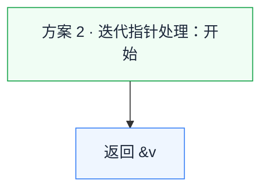

```go
package main // 引入依赖

import (
	"fmt"
	"os"
	"reflect"
) // 引入依赖

type TreeNode struct { // 定义类型
	Val   int       // Val int
	Left  *TreeNode // Left 乘 TreeNode
	Right *TreeNode // Right 乘 TreeNode
}

func pi(v int) *int { return &v } // 定义函数/方法 pi

func buildTree(vals []*int) *TreeNode { // 定义函数/方法 buildTree
	if len(vals) == 0 || vals[0] == nil { // 若 长度(vals) 等于 0 或 vals[0] 等于 nil
		return nil // 返回 nil
	}
	root := &TreeNode{Val: *vals[0]} // 把 按位与 TreeNode{Val: 乘 vals[0]} 写入 root :
	q := []*TreeNode{root}           // 把 [] 乘 TreeNode{根节点} 写入 q :
	i := 1                           // 把 1 写入 i :
	for i < len(vals) {              // for 下标 i 小于 长度(vals) {
		node := q[0]        // 把 节点[0] 写入 node :
		q = q[1:]           // 把 节点[1:] 写入 节点
		if vals[i] != nil { // 若 vals[下标 i] 不等于 nil
			node.Left = &TreeNode{Val: *vals[i]} // 把 按位与 TreeNode{Val: 乘 vals[下标 i]} 写入 node.Left
			q = append(q, node.Left)             // 把 append(节点, 节点.Left) 写入 节点
		}
		i++                // 下标 i 加一
		if i < len(vals) { // 若 下标 i 小于 长度(vals
			if vals[i] != nil { // 若 vals[下标 i] 不等于 nil
				node.Right = &TreeNode{Val: *vals[i]} // 把 按位与 TreeNode{Val: 乘 vals[下标 i]} 写入 node.Right
				q = append(q, node.Right)             // 把 append(节点, 节点.Right) 写入 节点
			}
			i++ // 下标 i 加一
		}
	}
	return root // 返回 根节点
}

func preorderTraversal(root *TreeNode) []int { // 定义函数/方法 preorderTraversal
	ans := []int{}                     // 把 []int{} 写入 ans :
	stack := []*TreeNode{}             // 把 [] 乘 TreeNode{} 写入 stack :
	cur := root                        // 把 根节点 写入 cur :
	for cur != nil || len(stack) > 0 { // 把 nil 或 长度(栈) 超过 0 { 写入 for cur !
		for cur != nil { // 把 nil { 写入 for cur !
			ans = append(ans, cur.Val) // 把 append(答案, 当前值.Val) 写入 答案
			stack = append(stack, cur) // 把 append(栈, 当前值) 写入 栈
			cur = cur.Left             // 把 当前值.Left 写入 当前值
		}
		if len(stack) > 0 { // 若 长度(栈) 超过 0
			cur = stack[len(stack)-1]    // 把 栈[长度(栈) 减 1] 写入 当前值
			stack = stack[:len(stack)-1] // 把 栈[:长度(栈) 减 1] 写入 栈
			cur = cur.Right              // 把 当前值.Right 写入 当前值
		}
	}
	return ans // 返回 答案
}

func main() { // 程序入口：跑内嵌自测用例
	cases := []struct { // 把 []struct { 写入 cases :
		vals []int // vals []int
		want []int // want []int
	}{ // }{
		{[]int{1, 2, 3}, []int{1, 2, 3}},
		{nil, []int{}},
		{[]int{1, -1, 2, -1, 3}, []int{1, 2, 3}},
	}
	ok := true                // 把 true 写入 ok :
	for _, c := range cases { // 同时取 _ 与 字符 遍历
		var pvals []*int   // var pvals [] 乘 int
		if c.vals != nil { // 若 字符.vals 不等于 nil
			pvals = make([]*int, len(c.vals)) // 把 make([] 乘 int, 长度(字符.vals)) 写入 pvals
			for i, v := range c.vals {        // 同时取 下标 i 与 值 遍历
				if v == -1 { // 若 值 等于 减 1
					pvals[i] = nil // 把 nil 写入 pvals[i]
				} else { // 否则
					pvals[i] = pi(v) // 把 pi(值) 写入 pvals[i]
				}
			}
		}
		got := preorderTraversal(buildTree(pvals)) // 把 preorderTraversal(buildTree(pvals)) 写入 got :
		if !reflect.DeepEqual(got, c.want) {       // 若 取反 reflect.DeepEqual(got, 字符.want
			ok = false                                                               // 把 false 写入 ok
			fmt.Printf("FAIL preorder(vals=%v) = %v want %v\n", c.vals, got, c.want) // 打印输出
		}
	}
	if !ok { // 若 取反 ok
		os.Exit(1) // os.Exit(1)
	}
	fmt.Println("PASS") // 全部用例通过，输出 PASS
}
```

#### 方案 3：迭代指针处理

**思路与代码分析**：核心是「迭代指针处理」。Go 版用切片与多返回值惯用法，显式处理索引边界。**走读**：方案 3 · 迭代指针处理：开始 → 返回 &v。

**运行架构**（真实控制流）：

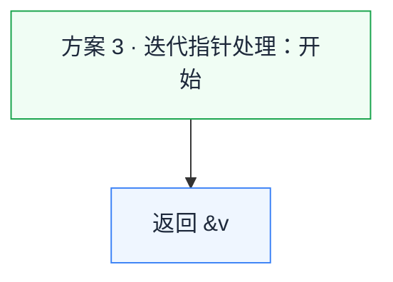

```go
package main // 引入依赖

import (
	"fmt"
	"os"
	"reflect"
) // 引入依赖

type TreeNode struct { // 定义类型
	Val   int       // Val int
	Left  *TreeNode // Left 乘 TreeNode
	Right *TreeNode // Right 乘 TreeNode
}

func pi(v int) *int { return &v } // 定义函数/方法 pi

func buildTree(vals []*int) *TreeNode { // 定义函数/方法 buildTree
	if len(vals) == 0 || vals[0] == nil { // 若 长度(vals) 等于 0 或 vals[0] 等于 nil
		return nil // 返回 nil
	}
	root := &TreeNode{Val: *vals[0]} // 把 按位与 TreeNode{Val: 乘 vals[0]} 写入 root :
	q := []*TreeNode{root}           // 把 [] 乘 TreeNode{根节点} 写入 q :
	i := 1                           // 把 1 写入 i :
	for i < len(vals) {              // for 下标 i 小于 长度(vals) {
		node := q[0]        // 把 节点[0] 写入 node :
		q = q[1:]           // 把 节点[1:] 写入 节点
		if vals[i] != nil { // 若 vals[下标 i] 不等于 nil
			node.Left = &TreeNode{Val: *vals[i]} // 把 按位与 TreeNode{Val: 乘 vals[下标 i]} 写入 node.Left
			q = append(q, node.Left)             // 把 append(节点, 节点.Left) 写入 节点
		}
		i++                // 下标 i 加一
		if i < len(vals) { // 若 下标 i 小于 长度(vals
			if vals[i] != nil { // 若 vals[下标 i] 不等于 nil
				node.Right = &TreeNode{Val: *vals[i]} // 把 按位与 TreeNode{Val: 乘 vals[下标 i]} 写入 node.Right
				q = append(q, node.Right)             // 把 append(节点, 节点.Right) 写入 节点
			}
			i++ // 下标 i 加一
		}
	}
	return root // 返回 根节点
}

func preorderTraversal(root *TreeNode) []int { // 定义函数/方法 preorderTraversal
	res := []int{}   // 把 []int{} 写入 res :
	cur := root      // 把 根节点 写入 cur :
	for cur != nil { // 把 nil { 写入 for cur !
		if cur.Left == nil { // 若 当前值.Left 等于 nil
			res = append(res, cur.Val) // 把 append(结果, 当前值.Val) 写入 结果
			cur = cur.Right            // 把 当前值.Right 写入 当前值
		} else { // 否则
			pred := cur.Left                             // 把 当前值.Left 写入 pred :
			for pred.Right != nil && pred.Right != cur { // 把 nil 且 pred.Right 不等于 当前值 { 写入 for pred.Right !
				pred = pred.Right // 把 pred.Right 写入 pred
			}
			if pred.Right == nil { // 若 pred.Right 等于 nil
				res = append(res, cur.Val) // 把 append(结果, 当前值.Val) 写入 结果
				pred.Right = cur           // 把 当前值 写入 pred.Right
				cur = cur.Left             // 把 当前值.Left 写入 当前值
			} else { // 否则
				pred.Right = nil // 把 nil 写入 pred.Right
				cur = cur.Right  // 把 当前值.Right 写入 当前值
			}
		}
	}
	return res // 返回 结果
}

func main() { // 程序入口：跑内嵌自测用例
	cases := []struct { // 把 []struct { 写入 cases :
		vals []int // vals []int
		want []int // want []int
	}{ // }{
		{[]int{1, 2, 3}, []int{1, 2, 3}},
		{nil, []int{}},
		{[]int{1, -1, 2, -1, 3}, []int{1, 2, 3}},
	}
	ok := true                // 把 true 写入 ok :
	for _, c := range cases { // 同时取 _ 与 字符 遍历
		var pvals []*int   // var pvals [] 乘 int
		if c.vals != nil { // 若 字符.vals 不等于 nil
			pvals = make([]*int, len(c.vals)) // 把 make([] 乘 int, 长度(字符.vals)) 写入 pvals
			for i, v := range c.vals {        // 同时取 下标 i 与 值 遍历
				if v == -1 { // 若 值 等于 减 1
					pvals[i] = nil // 把 nil 写入 pvals[i]
				} else { // 否则
					pvals[i] = pi(v) // 把 pi(值) 写入 pvals[i]
				}
			}
		}
		got := preorderTraversal(buildTree(pvals)) // 把 preorderTraversal(buildTree(pvals)) 写入 got :
		if !reflect.DeepEqual(got, c.want) {       // 若 取反 reflect.DeepEqual(got, 字符.want
			ok = false                                                               // 把 false 写入 ok
			fmt.Printf("FAIL preorder(vals=%v) = %v want %v\n", c.vals, got, c.want) // 打印输出
		}
	}
	if !ok { // 若 取反 ok
		os.Exit(1) // os.Exit(1)
	}
	fmt.Println("PASS") // 全部用例通过，输出 PASS
}
```

#### 方案 4：迭代指针处理

**思路与代码分析**：核心是「迭代指针处理」。Go 版用切片与多返回值惯用法，显式处理索引边界。**走读**：方案 4 · 迭代指针处理：开始 → 处理 if root == nil → 返回 []int → 返回 append(append([]int。

**运行架构**（真实控制流）：

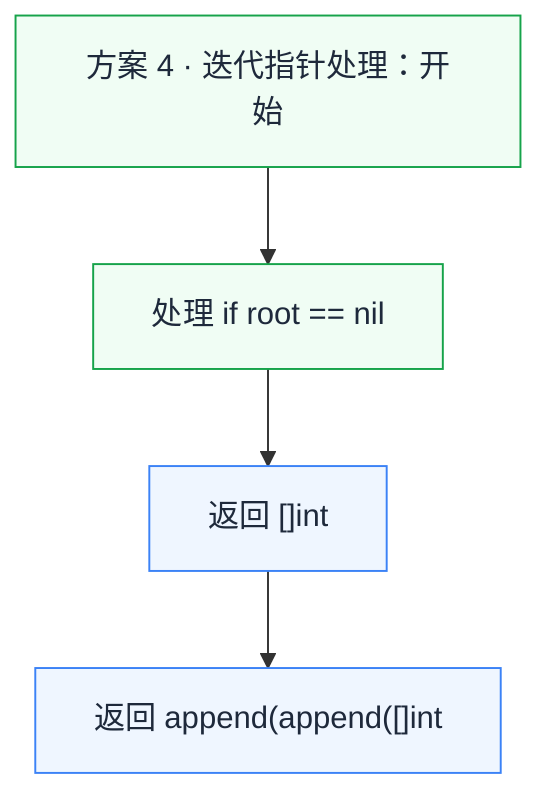

```go
package main // 引入依赖
import (
	"fmt"
	"os"
	"reflect"
) // 引入依赖
type TreeNode struct {
	Val   int
	Left  *TreeNode
	Right *TreeNode
}                        // 定义类型
const NULL = -1000000000 // 把 减 1000000000 存入 NULL
func buildTree(vals []int) *TreeNode { // 定义函数/方法 buildTree
	if len(vals) == 0 || vals[0] == NULL {
		return nil
	} // 若 长度(vals) 等于 0 或 vals[0] 等于 NULL { return nil }
	root := &TreeNode{Val: vals[0]} // 把 按位与 TreeNode{Val: vals[0]} 写入 root :
	q := []*TreeNode{root}
	i := 1                            // 把 [] 乘 TreeNode{根节点}; 下标 i : 赋值为 1 写入 q :
	for len(q) > 0 && i < len(vals) { // 定义函数/方法 len
		node := q[0]
		q = q[1:] // 把 节点[0]; 节点 赋值为 节点[1:] 写入 node :
		if i < len(vals) && vals[i] != NULL {
			node.Left = &TreeNode{Val: vals[i]}
			q = append(q, node.Left)
		}
		i++
		if i < len(vals) && vals[i] != NULL {
			node.Right = &TreeNode{Val: vals[i]}
			q = append(q, node.Right)
		}
		i++
	}
	return root // 返回 根节点
}
func levelList(root *TreeNode) [][]int { // 定义函数/方法 levelList
	if root == nil {
		return [][]int{}
	} // 若 根节点 等于 nil { return [][]int{} }
	res := [][]int{}
	q := []*TreeNode{root} // 把 [][]int{}; 节点 : 赋值为 [] 乘 TreeNode{根节点} 写入 res :
	for len(q) > 0 {       // for 长度(节点) 超过 0 {
		lvl := []int{}
		n := len(q)              // 把 []int{}; 元素个数 : 赋值为 长度(节点) 写入 lvl :
		for k := 0; k < n; k++ { // 让 下标 k 从 0 开始计数
			node := q[0]
			q = q[1:]                   // 把 节点[0]; 节点 赋值为 节点[1:] 写入 node :
			lvl = append(lvl, node.Val) // 把 append(lvl, 节点.Val) 写入 lvl
			if node.Left != nil {
				q = append(q, node.Left)
			} // 若 节点.Left 不等于 nil { 节点 赋值为 append(节点, 节点.Left) }
			if node.Right != nil {
				q = append(q, node.Right)
			} // 若 节点.Right 不等于 nil { 节点 赋值为 append(节点, 节点.Right) }
		}
		res = append(res, lvl) // 把 append(结果, lvl) 写入 结果
	}
	return res // 返回 结果
}
func sameTree(a, b *TreeNode) bool { // 定义函数/方法 sameTree
	if a == nil && b == nil {
		return true
	} // 若 数组 等于 nil 且 b 等于 nil { return true }
	if a == nil || b == nil {
		return false
	} // 若 数组 等于 nil 或 b 等于 nil { return false }
	if a.Val != b.Val {
		return false
	} // 若 数组.Val 不等于 b.Val { return false }
	return sameTree(a.Left, b.Left) && sameTree(a.Right, b.Right) // 定义函数/方法 sameTree
}
func inorderT(root *TreeNode) []int { // 定义函数/方法 inorderT
	if root == nil {
		return []int{}
	} // 若 根节点 等于 nil { return []int{} }
	return append(append(inorderT(root.Left), root.Val), inorderT(root.Right)...) // 定义函数/方法 append
}
func preorderTraversal(root *TreeNode) []int { // 定义函数/方法 preorderTraversal
	if root == nil {
		return []int{}
	} // 若 根节点 等于 nil { return []int{} }
	return append(append([]int{root.Val}, preorderTraversal(root.Left)...), preorderTraversal(root.Right)...) // 定义函数/方法 append
}
func main() { // 程序入口：跑内嵌自测用例
	if got := preorderTraversal(buildTree([]int{1, 2, 3, NULL, 4, 5})); !reflect.DeepEqual(got, []int{1, 2, 4, 3, 5}) {
		fmt.Println("FAIL", got)
		os.Exit(1)
	}
	if got := preorderTraversal(nil); len(got) != 0 {
		fmt.Println("FAIL nil")
		os.Exit(1)
	}
	fmt.Println("PASS") // 全部用例通过，输出 PASS
}
```

#### 方案 5：迭代指针处理

**思路与代码分析**：核心是「迭代指针处理」。Go 版用切片与多返回值惯用法，显式处理索引边界。**走读**：方案 5 · 迭代指针处理：开始 → 处理 if root == nil → 返回 []int → 返回 append(append([]int。

**运行架构**（真实控制流）：


```go
package main // 引入依赖
import (
	"fmt"
	"os"
	"reflect"
) // 引入依赖
type TreeNode struct {
	Val   int
	Left  *TreeNode
	Right *TreeNode
}                        // 定义类型
const NULL = -1000000000 // 把 减 1000000000 存入 NULL
func buildTree(vals []int) *TreeNode { // 定义函数/方法 buildTree
	if len(vals) == 0 || vals[0] == NULL {
		return nil
	} // 若 长度(vals) 等于 0 或 vals[0] 等于 NULL { return nil }
	root := &TreeNode{Val: vals[0]} // 把 按位与 TreeNode{Val: vals[0]} 写入 root :
	q := []*TreeNode{root}
	i := 1                            // 把 [] 乘 TreeNode{根节点}; 下标 i : 赋值为 1 写入 q :
	for len(q) > 0 && i < len(vals) { // 定义函数/方法 len
		node := q[0]
		q = q[1:] // 把 节点[0]; 节点 赋值为 节点[1:] 写入 node :
		if i < len(vals) && vals[i] != NULL {
			node.Left = &TreeNode{Val: vals[i]}
			q = append(q, node.Left)
		}
		i++
		if i < len(vals) && vals[i] != NULL {
			node.Right = &TreeNode{Val: vals[i]}
			q = append(q, node.Right)
		}
		i++
	}
	return root // 返回 根节点
}
func levelList(root *TreeNode) [][]int { // 定义函数/方法 levelList
	if root == nil {
		return [][]int{}
	} // 若 根节点 等于 nil { return [][]int{} }
	res := [][]int{}
	q := []*TreeNode{root} // 把 [][]int{}; 节点 : 赋值为 [] 乘 TreeNode{根节点} 写入 res :
	for len(q) > 0 {       // for 长度(节点) 超过 0 {
		lvl := []int{}
		n := len(q)              // 把 []int{}; 元素个数 : 赋值为 长度(节点) 写入 lvl :
		for k := 0; k < n; k++ { // 让 下标 k 从 0 开始计数
			node := q[0]
			q = q[1:]                   // 把 节点[0]; 节点 赋值为 节点[1:] 写入 node :
			lvl = append(lvl, node.Val) // 把 append(lvl, 节点.Val) 写入 lvl
			if node.Left != nil {
				q = append(q, node.Left)
			} // 若 节点.Left 不等于 nil { 节点 赋值为 append(节点, 节点.Left) }
			if node.Right != nil {
				q = append(q, node.Right)
			} // 若 节点.Right 不等于 nil { 节点 赋值为 append(节点, 节点.Right) }
		}
		res = append(res, lvl) // 把 append(结果, lvl) 写入 结果
	}
	return res // 返回 结果
}
func sameTree(a, b *TreeNode) bool { // 定义函数/方法 sameTree
	if a == nil && b == nil {
		return true
	} // 若 数组 等于 nil 且 b 等于 nil { return true }
	if a == nil || b == nil {
		return false
	} // 若 数组 等于 nil 或 b 等于 nil { return false }
	if a.Val != b.Val {
		return false
	} // 若 数组.Val 不等于 b.Val { return false }
	return sameTree(a.Left, b.Left) && sameTree(a.Right, b.Right) // 定义函数/方法 sameTree
}
func inorderT(root *TreeNode) []int { // 定义函数/方法 inorderT
	if root == nil {
		return []int{}
	} // 若 根节点 等于 nil { return []int{} }
	return append(append(inorderT(root.Left), root.Val), inorderT(root.Right)...) // 定义函数/方法 append
}
func preorderTraversal(root *TreeNode) []int { // 定义函数/方法 preorderTraversal
	if root == nil {
		return []int{}
	} // 若 根节点 等于 nil { return []int{} }
	return append(append([]int{root.Val}, preorderTraversal(root.Left)...), preorderTraversal(root.Right)...) // 定义函数/方法 append
}
func main() { // 程序入口：跑内嵌自测用例
	if got := preorderTraversal(buildTree([]int{1, 2, 3, NULL, 4, 5})); !reflect.DeepEqual(got, []int{1, 2, 4, 3, 5}) {
		fmt.Println("FAIL", got)
		os.Exit(1)
	}
	if got := preorderTraversal(nil); len(got) != 0 {
		fmt.Println("FAIL nil")
		os.Exit(1)
	}
	fmt.Println("PASS") // 全部用例通过，输出 PASS
}
```

#### 方案 6：方案6（迭代，显式栈）

**思路与代码分析**：核心是「方案6（迭代，显式栈）」。Go 版用切片与多返回值惯用法，显式处理索引边界。**走读**：方案 6 · 方案6（迭代，显式栈）：开始 → 返回 &v。

**运行架构**（真实控制流）：

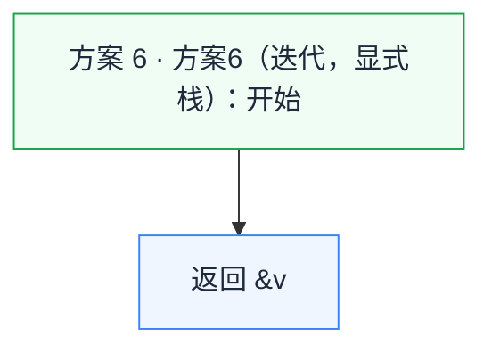

```go
package main // 引入依赖

import (
	"fmt"
	"os"
	"reflect"
) // 引入依赖

type TreeNode struct { // 定义类型
	Val   int       // Val int
	Left  *TreeNode // Left 乘 TreeNode
	Right *TreeNode // Right 乘 TreeNode
}

func pi(v int) *int { return &v } // 定义函数/方法 pi

func buildTree(vals []*int) *TreeNode { // 定义函数/方法 buildTree
	if len(vals) == 0 || vals[0] == nil { // 若 长度(vals) 等于 0 或 vals[0] 等于 nil
		return nil // 返回 nil
	}
	root := &TreeNode{Val: *vals[0]} // 把 按位与 TreeNode{Val: 乘 vals[0]} 写入 root :
	q := []*TreeNode{root}           // 把 [] 乘 TreeNode{根节点} 写入 q :
	i := 1                           // 把 1 写入 i :
	for i < len(vals) {              // for 下标 i 小于 长度(vals) {
		node := q[0]        // 把 节点[0] 写入 node :
		q = q[1:]           // 把 节点[1:] 写入 节点
		if vals[i] != nil { // 若 vals[下标 i] 不等于 nil
			node.Left = &TreeNode{Val: *vals[i]} // 把 按位与 TreeNode{Val: 乘 vals[下标 i]} 写入 node.Left
			q = append(q, node.Left)             // 把 append(节点, 节点.Left) 写入 节点
		}
		i++                // 下标 i 加一
		if i < len(vals) { // 若 下标 i 小于 长度(vals
			if vals[i] != nil { // 若 vals[下标 i] 不等于 nil
				node.Right = &TreeNode{Val: *vals[i]} // 把 按位与 TreeNode{Val: 乘 vals[下标 i]} 写入 node.Right
				q = append(q, node.Right)             // 把 append(节点, 节点.Right) 写入 节点
			}
			i++ // 下标 i 加一
		}
	}
	return root // 返回 根节点
}

func preorderTraversal(root *TreeNode) []int { // 定义函数/方法 preorderTraversal
	res := []int{}         // 把 []int{} 写入 res :
	stack := []*TreeNode{} // 把 [] 乘 TreeNode{} 写入 stack :
	if root != nil {       // 若 根节点 不等于 nil
		stack = append(stack, root) // 把 append(栈, 根节点) 写入 栈
	}
	for len(stack) > 0 { // for 长度(栈) 超过 0 {
		node := stack[len(stack)-1]  // 把 栈[长度(栈) 减 1] 写入 node :
		stack = stack[:len(stack)-1] // 把 栈[:长度(栈) 减 1] 写入 栈
		res = append(res, node.Val)  // 把 append(结果, 节点.Val) 写入 结果
		if node.Right != nil {       // 若 节点.Right 不等于 nil
			stack = append(stack, node.Right) // 把 append(栈, 节点.Right) 写入 栈
		}
		if node.Left != nil { // 若 节点.Left 不等于 nil
			stack = append(stack, node.Left) // 把 append(栈, 节点.Left) 写入 栈
		}
	}
	return res // 返回 结果
}

func main() { // 程序入口：跑内嵌自测用例
	cases := []struct { // 把 []struct { 写入 cases :
		vals []int // vals []int
		want []int // want []int
	}{ // }{
		{[]int{1, 2, 3}, []int{1, 2, 3}},
		{nil, []int{}},
		{[]int{1, -1, 2, -1, 3}, []int{1, 2, 3}},
	}
	ok := true                // 把 true 写入 ok :
	for _, c := range cases { // 同时取 _ 与 字符 遍历
		var pvals []*int   // var pvals [] 乘 int
		if c.vals != nil { // 若 字符.vals 不等于 nil
			pvals = make([]*int, len(c.vals)) // 把 make([] 乘 int, 长度(字符.vals)) 写入 pvals
			for i, v := range c.vals {        // 同时取 下标 i 与 值 遍历
				if v == -1 { // 若 值 等于 减 1
					pvals[i] = nil // 把 nil 写入 pvals[i]
				} else { // 否则
					pvals[i] = pi(v) // 把 pi(值) 写入 pvals[i]
				}
			}
		}
		got := preorderTraversal(buildTree(pvals)) // 把 preorderTraversal(buildTree(pvals)) 写入 got :
		if !reflect.DeepEqual(got, c.want) {       // 若 取反 reflect.DeepEqual(got, 字符.want
			ok = false                                                               // 把 false 写入 ok
			fmt.Printf("FAIL preorder(vals=%v) = %v want %v\n", c.vals, got, c.want) // 打印输出
		}
	}
	if !ok { // 若 取反 ok
		os.Exit(1) // os.Exit(1)
	}
	fmt.Println("PASS") // 全部用例通过，输出 PASS
}
```

### Java 实现（6 种方案）

Java 的全部方案如下，每个方案都内嵌用例自测，可独立运行（老仓库 python/go 文件遵循「打印结果」约定）：

#### 方案 1：迭代指针处理

**思路与代码分析**：核心是「迭代指针处理」。Java 版用类与静态方法组织，集合操作显式明了。**走读**：方案 1 · 迭代指针处理：开始 → 更新 val → 返回结果。

**运行架构**（真实控制流）：

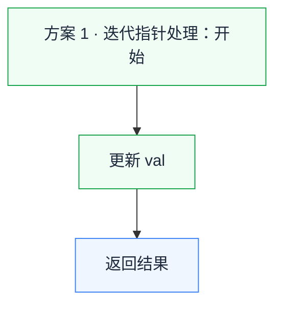

```java
package com.webfault.dsa; // 引入依赖

import java.util.*; // 引入依赖

class Lc144S1 { // 定义类型
  static class TreeNode { // static class TreeNode {
    int val;
    TreeNode left;
    TreeNode right; // int 值; TreeNode 左边界; TreeNode 右边界;

    TreeNode(int v) {
      val = v;
    } // 把 值; } 写入 TreeNode(int v){ val

    TreeNode(int v, TreeNode l, TreeNode r) {
      val = v;
      left = l;
      right = r;
    }
  }

  static TreeNode buildTree(Integer[] vals) { // 定义函数/方法 buildTree
    if (vals.length == 0) return null; // 若 vals.长度 等于 0，直接返回 null
    TreeNode root = new TreeNode(vals[0]); // 把 new TreeNode(vals[0]); 写入 TreeNode root
    Queue<TreeNode> q = new LinkedList<>(); // 把 new LinkedList 小于 超过 (); 写入 Queue<TreeNode> q
    q.offer(root); // 节点.offer(根节点);
    int i = 1; // 把 1 存入 下标 i
    while (i < vals.length) { // 循环，直到不满足「下标 i 小于 vals.长度」
      TreeNode node = q.poll(); // 把 节点.poll(); 写入 TreeNode node
      if (i < vals.length && vals[i] != null) {
        node.left = new TreeNode(vals[i]);
        q.offer(node.left);
      }
      i++; // 下标 i 加一
      if (i < vals.length && vals[i] != null) {
        node.right = new TreeNode(vals[i]);
        q.offer(node.right);
      }
      i++; // 下标 i 加一
    }
    return root; // 返回 根节点
  }

  static List<Integer> preorder(TreeNode root) { // 定义函数/方法 preorder
    return null; // 返回 null
  }

  public static void main(String[] args) { // public static void main(String[] args) {
    Lc144S1 s = new Lc144S1(); // 把 new Lc144S1(); 写入 Lc144S1 s
    List<Integer> g1 = s.preorder(null); // 把 字符串.preorder(null); 写入 List<Integer> g1
    List<Integer> g2 = s.preorder(buildTree(new Integer[] {1, 2, 3}));
    boolean ok = true; // 把 true; 写入 boolean ok
    if (g1 != null || g2 != null) {
      ok = false;
      System.out.println("FAIL degenerate got " + g1 + " " + g2);
    }
    if (!ok) throw new RuntimeException("FAILED"); // 若 取反 ok) throw new RuntimeException(「FAILED」);
    System.out.println("PASS"); // 全部用例通过，输出 PASS
  }
}
```

#### 方案 2：迭代指针处理

**思路与代码分析**：核心是「迭代指针处理」。Java 版用类与静态方法组织，集合操作显式明了。**走读**：方案 2 · 迭代指针处理：开始 → 更新 val → 返回结果。

**运行架构**（真实控制流）：

```mermaid
graph TD
    N0["方案 2 · 迭代指针处理：开始"]
    N1["更新 val"]
    N2["返回结果"]
    N0 --> N1
    N1 --> N2
    classDef n fill:#f0fdf4,stroke:#16a34a,color:#1e293b;
    classDef lp fill:#dcfce7,stroke:#15803d,color:#1e293b;
    classDef dc fill:#fef9c3,stroke:#ca8a04,color:#1e293b;
    classDef tm fill:#eff6ff,stroke:#3b82f6,color:#1e293b;
    class N0,N1 n;
    class N2 tm;
```

```java
package com.webfault.dsa; // 引入依赖

import java.util.*; // 引入依赖

class Lc144S2 { // 定义类型
  static class TreeNode { // static class TreeNode {
    int val;
    TreeNode left;
    TreeNode right; // int 值; TreeNode 左边界; TreeNode 右边界;

    TreeNode(int v) {
      val = v;
    } // 把 值; } 写入 TreeNode(int v){ val

    TreeNode(int v, TreeNode l, TreeNode r) {
      val = v;
      left = l;
      right = r;
    }
  }

  static TreeNode buildTree(Integer[] vals) { // 定义函数/方法 buildTree
    if (vals.length == 0) return null; // 若 vals.长度 等于 0，直接返回 null
    TreeNode root = new TreeNode(vals[0]); // 把 new TreeNode(vals[0]); 写入 TreeNode root
    Queue<TreeNode> q = new LinkedList<>(); // 把 new LinkedList 小于 超过 (); 写入 Queue<TreeNode> q
    q.offer(root); // 节点.offer(根节点);
    int i = 1; // 把 1 存入 下标 i
    while (i < vals.length) { // 循环，直到不满足「下标 i 小于 vals.长度」
      TreeNode node = q.poll(); // 把 节点.poll(); 写入 TreeNode node
      if (i < vals.length && vals[i] != null) {
        node.left = new TreeNode(vals[i]);
        q.offer(node.left);
      }
      i++; // 下标 i 加一
      if (i < vals.length && vals[i] != null) {
        node.right = new TreeNode(vals[i]);
        q.offer(node.right);
      }
      i++; // 下标 i 加一
    }
    return root; // 返回 根节点
  }

  static List<Integer> preorder(TreeNode root) { // 定义函数/方法 preorder
    List<Integer> ans = new ArrayList<>(); // 把 new ArrayList 小于 超过 (); 写入 List<Integer> ans
    Deque<TreeNode> stack =
        new ArrayDeque<>(); // 把 new ArrayDeque 小于 超过 (); 写入 Deque<TreeNode> stack
    TreeNode cur = root; // 把 根节点; 写入 TreeNode cur
    while (cur != null || !stack.isEmpty()) { // 循环，直到不满足「当前值 不等于 null 或 取反 栈.isEmpty(」
      while (cur != null) {
        ans.add(cur.val);
        stack.push(cur);
        cur = cur.left;
      }
      if (!stack.isEmpty()) {
        cur = stack.pop();
        cur = cur.right;
      } // 若 取反 栈.isEmpty()) { 当前值 赋值为 栈 弹出 ); 当前值 赋值为 当前值.右边界; }
    }
    return ans; // 返回 答案
  }

  public static void main(String[] args) { // public static void main(String[] args) {
    Lc144S2 s = new Lc144S2(); // 把 new Lc144S2(); 写入 Lc144S2 s
    TreeNode t1 = buildTree(new Integer[] {1, null, 2, null, 3});
    TreeNode t2 =
        buildTree(new Integer[] {1, 2, 3}); // 把 buildTree(new Integer[]{1, 2, 3}); 写入 TreeNode t2
    TreeNode t3 = buildTree(new Integer[] {}); // 把 buildTree(new Integer[]{}); 写入 TreeNode t3
    List<Integer>[] wants =
        new List[] {Arrays.asList(1, 2, 3), Arrays.asList(1, 2, 3), Arrays.asList()};
    TreeNode[] ins = {t1, t2, t3}; // 把 {t1, t2, t3}; 写入 TreeNode[] ins
    boolean ok = true; // 把 true; 写入 boolean ok
    for (int i = 0; i < 3; i++) { // 让 下标 i 从 0 开始计数，下标 i 小于 3 就继续
      List<Integer> got = s.preorder(ins[i]); // 把 字符串.preorder(ins[下标 i]); 写入 List<Integer> got
      if (!wants[i].equals(got)) {
        ok = false;
        System.out.println("FAIL case " + i + " got " + got + " want " + wants[i]);
      }
    }
    if (!ok) throw new RuntimeException("FAILED"); // 若 取反 ok) throw new RuntimeException(「FAILED」);
    System.out.println("PASS"); // 全部用例通过，输出 PASS
  }
}
```

#### 方案 3：迭代指针处理

**思路与代码分析**：核心是「迭代指针处理」。Java 版用类与静态方法组织，集合操作显式明了。**走读**：方案 3 · 迭代指针处理：开始 → 更新 val → 返回结果。

**运行架构**（真实控制流）：

```mermaid
graph TD
    N0["方案 3 · 迭代指针处理：开始"]
    N1["更新 val"]
    N2["返回结果"]
    N0 --> N1
    N1 --> N2
    classDef n fill:#f0fdf4,stroke:#16a34a,color:#1e293b;
    classDef lp fill:#dcfce7,stroke:#15803d,color:#1e293b;
    classDef dc fill:#fef9c3,stroke:#ca8a04,color:#1e293b;
    classDef tm fill:#eff6ff,stroke:#3b82f6,color:#1e293b;
    class N0,N1 n;
    class N2 tm;
```

```java
package com.webfault.dsa; // 引入依赖

import java.util.*; // 引入依赖

class Lc144S3 { // 定义类型
  static class TreeNode { // static class TreeNode {
    int val;
    TreeNode left;
    TreeNode right; // int 值; TreeNode 左边界; TreeNode 右边界;

    TreeNode(int v) {
      val = v;
    } // 把 值; } 写入 TreeNode(int v){ val

    TreeNode(int v, TreeNode l, TreeNode r) {
      val = v;
      left = l;
      right = r;
    }
  }

  static TreeNode buildTree(Integer[] vals) { // 定义函数/方法 buildTree
    if (vals.length == 0) return null; // 若 vals.长度 等于 0，直接返回 null
    TreeNode root = new TreeNode(vals[0]); // 把 new TreeNode(vals[0]); 写入 TreeNode root
    Queue<TreeNode> q = new LinkedList<>(); // 把 new LinkedList 小于 超过 (); 写入 Queue<TreeNode> q
    q.offer(root); // 节点.offer(根节点);
    int i = 1; // 把 1 存入 下标 i
    while (i < vals.length) { // 循环，直到不满足「下标 i 小于 vals.长度」
      TreeNode node = q.poll(); // 把 节点.poll(); 写入 TreeNode node
      if (i < vals.length && vals[i] != null) {
        node.left = new TreeNode(vals[i]);
        q.offer(node.left);
      }
      i++; // 下标 i 加一
      if (i < vals.length && vals[i] != null) {
        node.right = new TreeNode(vals[i]);
        q.offer(node.right);
      }
      i++; // 下标 i 加一
    }
    return root; // 返回 根节点
  }

  static List<Integer> preorder(TreeNode root) { // 定义函数/方法 preorder
    List<Integer> res = new ArrayList<>(); // 把 new ArrayList 小于 超过 (); 写入 List<Integer> res
    TreeNode cur = root; // 把 根节点; 写入 TreeNode cur
    while (cur != null) { // 循环，直到不满足「当前值 不等于 null」
      if (cur.left == null) {
        res.add(cur.val);
        cur = cur.right;
      } // 若 当前值.左边界 等于 null) { 结果 追加 当前值.值); 当前值 赋值为 当前值.右边界; }
      else { // 否则
        TreeNode pred = cur.left; // 把 当前值.左边界; 写入 TreeNode pred
        while (pred.right != null && pred.right != cur) pred = pred.right;
        if (pred.right == null) {
          res.add(cur.val);
          pred.right = cur;
          cur = cur.left;
        } else {
          pred.right = null;
          cur = cur.right;
        } // 否则
      }
    }
    return res; // 返回 结果
  }

  public static void main(String[] args) { // public static void main(String[] args) {
    Lc144S3 s = new Lc144S3(); // 把 new Lc144S3(); 写入 Lc144S3 s
    TreeNode t1 = buildTree(new Integer[] {1, null, 2, null, 3});
    TreeNode t2 =
        buildTree(new Integer[] {1, 2, 3}); // 把 buildTree(new Integer[]{1, 2, 3}); 写入 TreeNode t2
    TreeNode t3 = buildTree(new Integer[] {}); // 把 buildTree(new Integer[]{}); 写入 TreeNode t3
    List<Integer>[] wants =
        new List[] {Arrays.asList(1, 2, 3), Arrays.asList(1, 2, 3), Arrays.asList()};
    TreeNode[] ins = {t1, t2, t3}; // 把 {t1, t2, t3}; 写入 TreeNode[] ins
    boolean ok = true; // 把 true; 写入 boolean ok
    for (int i = 0; i < 3; i++) { // 让 下标 i 从 0 开始计数，下标 i 小于 3 就继续
      List<Integer> got = s.preorder(ins[i]); // 把 字符串.preorder(ins[下标 i]); 写入 List<Integer> got
      if (!wants[i].equals(got)) {
        ok = false;
        System.out.println("FAIL case " + i + " got " + got + " want " + wants[i]);
      }
    }
    if (!ok) throw new RuntimeException("FAILED"); // 若 取反 ok) throw new RuntimeException(「FAILED」);
    System.out.println("PASS"); // 全部用例通过，输出 PASS
  }
}
```

#### 方案 4：迭代指针处理

**思路与代码分析**：核心是「迭代指针处理」。Java 版用类与静态方法组织，集合操作显式明了。**走读**：方案 4 · 迭代指针处理：开始 → 更新 val → 返回结果。

**运行架构**（真实控制流）：

```mermaid
graph TD
    N0["方案 4 · 迭代指针处理：开始"]
    N1["更新 val"]
    N2["返回结果"]
    N0 --> N1
    N1 --> N2
    classDef n fill:#f0fdf4,stroke:#16a34a,color:#1e293b;
    classDef lp fill:#dcfce7,stroke:#15803d,color:#1e293b;
    classDef dc fill:#fef9c3,stroke:#ca8a04,color:#1e293b;
    classDef tm fill:#eff6ff,stroke:#3b82f6,color:#1e293b;
    class N0,N1 n;
    class N2 tm;
```

```java
package com.webfault.dsa; // 引入依赖

import java.util.*; // 引入依赖

class Lc144S4 { // 定义类型
  static class TreeNode { // static class TreeNode {
    int val;
    TreeNode left;
    TreeNode right; // int 值; TreeNode 左边界; TreeNode 右边界;

    TreeNode(int v) {
      val = v;
    } // 把 值; } 写入 TreeNode(int v){ val

    TreeNode(int v, TreeNode l, TreeNode r) {
      val = v;
      left = l;
      right = r;
    }
  }

  static TreeNode buildTree(Integer[] vals) { // 定义函数/方法 buildTree
    if (vals.length == 0) return null; // 若 vals.长度 等于 0，直接返回 null
    TreeNode root = new TreeNode(vals[0]); // 把 new TreeNode(vals[0]); 写入 TreeNode root
    Queue<TreeNode> q = new LinkedList<>(); // 把 new LinkedList 小于 超过 (); 写入 Queue<TreeNode> q
    q.offer(root); // 节点.offer(根节点);
    int i = 1; // 把 1 存入 下标 i
    while (i < vals.length) { // 循环，直到不满足「下标 i 小于 vals.长度」
      TreeNode node = q.poll(); // 把 节点.poll(); 写入 TreeNode node
      if (i < vals.length && vals[i] != null) {
        node.left = new TreeNode(vals[i]);
        q.offer(node.left);
      }
      i++; // 下标 i 加一
      if (i < vals.length && vals[i] != null) {
        node.right = new TreeNode(vals[i]);
        q.offer(node.right);
      }
      i++; // 下标 i 加一
    }
    return root; // 返回 根节点
  }

  static List<Integer> preorder(TreeNode root) { // 定义函数/方法 preorder
    List<Integer> res = new ArrayList<>(); // 把 new ArrayList 小于 超过 (); 写入 List<Integer> res
    if (root == null) return res; // 若 根节点 等于 null，直接返回 结果
    res.add(root.val); // 结果 追加 根节点.值);
    res.addAll(preorder(root.left)); // 结果.addAll(preorder(根节点.左边界));
    res.addAll(preorder(root.right)); // 结果.addAll(preorder(根节点.右边界));
    return res; // 返回 结果
  }

  public static void main(String[] args) { // public static void main(String[] args) {
    Lc144S4 s = new Lc144S4(); // 把 new Lc144S4(); 写入 Lc144S4 s
    TreeNode t1 = buildTree(new Integer[] {1, null, 2, null, 3});
    TreeNode t2 =
        buildTree(new Integer[] {1, 2, 3}); // 把 buildTree(new Integer[]{1, 2, 3}); 写入 TreeNode t2
    TreeNode t3 = buildTree(new Integer[] {}); // 把 buildTree(new Integer[]{}); 写入 TreeNode t3
    List<Integer>[] wants =
        new List[] {Arrays.asList(1, 2, 3), Arrays.asList(1, 2, 3), Arrays.asList()};
    TreeNode[] ins = {t1, t2, t3}; // 把 {t1, t2, t3}; 写入 TreeNode[] ins
    boolean ok = true; // 把 true; 写入 boolean ok
    for (int i = 0; i < 3; i++) { // 让 下标 i 从 0 开始计数，下标 i 小于 3 就继续
      List<Integer> got = s.preorder(ins[i]); // 把 字符串.preorder(ins[下标 i]); 写入 List<Integer> got
      if (!wants[i].equals(got)) {
        ok = false;
        System.out.println("FAIL case " + i + " got " + got + " want " + wants[i]);
      }
    }
    if (!ok) throw new RuntimeException("FAILED"); // 若 取反 ok) throw new RuntimeException(「FAILED」);
    System.out.println("PASS"); // 全部用例通过，输出 PASS
  }
}
```

#### 方案 5：迭代指针处理

**思路与代码分析**：核心是「迭代指针处理」。Java 版用类与静态方法组织，集合操作显式明了。**走读**：方案 5 · 迭代指针处理：开始 → 更新 val → 返回结果。

**运行架构**（真实控制流）：

```mermaid
graph TD
    N0["方案 5 · 迭代指针处理：开始"]
    N1["更新 val"]
    N2["返回结果"]
    N0 --> N1
    N1 --> N2
    classDef n fill:#f0fdf4,stroke:#16a34a,color:#1e293b;
    classDef lp fill:#dcfce7,stroke:#15803d,color:#1e293b;
    classDef dc fill:#fef9c3,stroke:#ca8a04,color:#1e293b;
    classDef tm fill:#eff6ff,stroke:#3b82f6,color:#1e293b;
    class N0,N1 n;
    class N2 tm;
```

```java
package com.webfault.dsa; // 引入依赖

import java.util.*; // 引入依赖

class Lc144S5 { // 定义类型
  static class TreeNode { // static class TreeNode {
    int val;
    TreeNode left;
    TreeNode right; // int 值; TreeNode 左边界; TreeNode 右边界;

    TreeNode(int v) {
      val = v;
    } // 把 值; } 写入 TreeNode(int v){ val

    TreeNode(int v, TreeNode l, TreeNode r) {
      val = v;
      left = l;
      right = r;
    }
  }

  static TreeNode buildTree(Integer[] vals) { // 定义函数/方法 buildTree
    if (vals.length == 0) return null; // 若 vals.长度 等于 0，直接返回 null
    TreeNode root = new TreeNode(vals[0]); // 把 new TreeNode(vals[0]); 写入 TreeNode root
    Queue<TreeNode> q = new LinkedList<>(); // 把 new LinkedList 小于 超过 (); 写入 Queue<TreeNode> q
    q.offer(root); // 节点.offer(根节点);
    int i = 1; // 把 1 存入 下标 i
    while (i < vals.length) { // 循环，直到不满足「下标 i 小于 vals.长度」
      TreeNode node = q.poll(); // 把 节点.poll(); 写入 TreeNode node
      if (i < vals.length && vals[i] != null) {
        node.left = new TreeNode(vals[i]);
        q.offer(node.left);
      }
      i++; // 下标 i 加一
      if (i < vals.length && vals[i] != null) {
        node.right = new TreeNode(vals[i]);
        q.offer(node.right);
      }
      i++; // 下标 i 加一
    }
    return root; // 返回 根节点
  }

  static List<Integer> preorder(TreeNode root) { // 定义函数/方法 preorder
    List<Integer> res = new ArrayList<>(); // 把 new ArrayList 小于 超过 (); 写入 List<Integer> res
    dfs(root, res); // dfs(根节点, 结果);
    return res; // 返回 结果
  }

  static void dfs(TreeNode node, List<Integer> res) { // 定义函数/方法 dfs
    if (node == null) return; // 若 节点 等于 null) return;
    res.add(node.val); // 结果 追加 节点.值);
    dfs(node.left, res); // dfs(节点.左边界, 结果);
    dfs(node.right, res); // dfs(节点.右边界, 结果);
  }

  public static void main(String[] args) { // public static void main(String[] args) {
    Lc144S5 s = new Lc144S5(); // 把 new Lc144S5(); 写入 Lc144S5 s
    TreeNode t1 = buildTree(new Integer[] {1, null, 2, null, 3});
    TreeNode t2 =
        buildTree(new Integer[] {1, 2, 3}); // 把 buildTree(new Integer[]{1, 2, 3}); 写入 TreeNode t2
    TreeNode t3 = buildTree(new Integer[] {}); // 把 buildTree(new Integer[]{}); 写入 TreeNode t3
    List<Integer>[] wants =
        new List[] {Arrays.asList(1, 2, 3), Arrays.asList(1, 2, 3), Arrays.asList()};
    TreeNode[] ins = {t1, t2, t3}; // 把 {t1, t2, t3}; 写入 TreeNode[] ins
    boolean ok = true; // 把 true; 写入 boolean ok
    for (int i = 0; i < 3; i++) { // 让 下标 i 从 0 开始计数，下标 i 小于 3 就继续
      List<Integer> got = s.preorder(ins[i]); // 把 字符串.preorder(ins[下标 i]); 写入 List<Integer> got
      if (!wants[i].equals(got)) {
        ok = false;
        System.out.println("FAIL case " + i + " got " + got + " want " + wants[i]);
      }
    }
    if (!ok) throw new RuntimeException("FAILED"); // 若 取反 ok) throw new RuntimeException(「FAILED」);
    System.out.println("PASS"); // 全部用例通过，输出 PASS
  }
}
```

#### 方案 6：方案6（迭代，显式栈）

**思路与代码分析**：核心是「方案6（迭代，显式栈）」。Java 版用类与静态方法组织，集合操作显式明了。**走读**：方案 6 · 方案6（迭代，显式栈）：开始 → 更新 val → 返回结果。

**运行架构**（真实控制流）：

```mermaid
graph TD
    N0["方案 6 · 方案6（迭代，显式栈）：开始"]
    N1["更新 val"]
    N2["返回结果"]
    N0 --> N1
    N1 --> N2
    classDef n fill:#f0fdf4,stroke:#16a34a,color:#1e293b;
    classDef lp fill:#dcfce7,stroke:#15803d,color:#1e293b;
    classDef dc fill:#fef9c3,stroke:#ca8a04,color:#1e293b;
    classDef tm fill:#eff6ff,stroke:#3b82f6,color:#1e293b;
    class N0,N1 n;
    class N2 tm;
```

```java
package com.webfault.dsa; // 引入依赖

import java.util.*; // 引入依赖

class Lc144S6 { // 定义类型
  static class TreeNode { // static class TreeNode {
    int val;
    TreeNode left;
    TreeNode right; // int 值; TreeNode 左边界; TreeNode 右边界;

    TreeNode(int v) {
      val = v;
    } // 把 值; } 写入 TreeNode(int v){ val

    TreeNode(int v, TreeNode l, TreeNode r) {
      val = v;
      left = l;
      right = r;
    }
  }

  static TreeNode buildTree(Integer[] vals) { // 定义函数/方法 buildTree
    if (vals.length == 0) return null; // 若 vals.长度 等于 0，直接返回 null
    TreeNode root = new TreeNode(vals[0]); // 把 new TreeNode(vals[0]); 写入 TreeNode root
    Queue<TreeNode> q = new LinkedList<>(); // 把 new LinkedList 小于 超过 (); 写入 Queue<TreeNode> q
    q.offer(root); // 节点.offer(根节点);
    int i = 1; // 把 1 存入 下标 i
    while (i < vals.length) { // 循环，直到不满足「下标 i 小于 vals.长度」
      TreeNode node = q.poll(); // 把 节点.poll(); 写入 TreeNode node
      if (i < vals.length && vals[i] != null) {
        node.left = new TreeNode(vals[i]);
        q.offer(node.left);
      }
      i++; // 下标 i 加一
      if (i < vals.length && vals[i] != null) {
        node.right = new TreeNode(vals[i]);
        q.offer(node.right);
      }
      i++; // 下标 i 加一
    }
    return root; // 返回 根节点
  }

  static List<Integer> preorder(TreeNode root) { // 定义函数/方法 preorder
    List<Integer> res = new ArrayList<>(); // 把 new ArrayList 小于 超过 (); 写入 List<Integer> res
    Deque<TreeNode> stack =
        new ArrayDeque<>(); // 把 new ArrayDeque 小于 超过 (); 写入 Deque<TreeNode> stack
    if (root != null) stack.push(root); // 若 根节点 不等于 null) 栈 追加 根节点);
    while (!stack.isEmpty()) { // 循环，直到不满足「取反 栈.isEmpty(」
      TreeNode node = stack.pop(); // 弹出栈顶元素
      res.add(node.val); // 结果 追加 节点.值);
      if (node.right != null) stack.push(node.right); // 若 节点.右边界 不等于 null) 栈 追加 节点.右边界);
      if (node.left != null) stack.push(node.left); // 若 节点.左边界 不等于 null) 栈 追加 节点.左边界);
    }
    return res; // 返回 结果
  }

  public static void main(String[] args) { // public static void main(String[] args) {
    Lc144S6 s = new Lc144S6(); // 把 new Lc144S6(); 写入 Lc144S6 s
    TreeNode t1 = buildTree(new Integer[] {1, null, 2, null, 3});
    TreeNode t2 =
        buildTree(new Integer[] {1, 2, 3}); // 把 buildTree(new Integer[]{1, 2, 3}); 写入 TreeNode t2
    TreeNode t3 = buildTree(new Integer[] {}); // 把 buildTree(new Integer[]{}); 写入 TreeNode t3
    List<Integer>[] wants =
        new List[] {Arrays.asList(1, 2, 3), Arrays.asList(1, 2, 3), Arrays.asList()};
    TreeNode[] ins = {t1, t2, t3}; // 把 {t1, t2, t3}; 写入 TreeNode[] ins
    boolean ok = true; // 把 true; 写入 boolean ok
    for (int i = 0; i < 3; i++) { // 让 下标 i 从 0 开始计数，下标 i 小于 3 就继续
      List<Integer> got = s.preorder(ins[i]); // 把 字符串.preorder(ins[下标 i]); 写入 List<Integer> got
      if (!wants[i].equals(got)) {
        ok = false;
        System.out.println("FAIL case " + i + " got " + got + " want " + wants[i]);
      }
    }
    if (!ok) throw new RuntimeException("FAILED"); // 若 取反 ok) throw new RuntimeException(「FAILED」);
    System.out.println("PASS"); // 全部用例通过，输出 PASS
  }
}
```

### Rust 实现（6 种方案）

Rust 的全部方案如下，每个方案都内嵌用例自测，可独立运行（老仓库 python/go 文件遵循「打印结果」约定）：

#### 方案 1：迭代指针处理

**思路与代码分析**：核心是「迭代指针处理」。Rust 版用所有权移动与切片借用改写同一逻辑，注意 Option 与引用边界。**走读**：方案 1 · 迭代指针处理：开始 → 计算 root → 更新 Some(x) → 更新 None → 计算 res → 调用 res.extend(preorder_traversa → 调用 res.extend(preorder_traversa → 处理 res → 返回结果。

**运行架构**（真实控制流）：

```mermaid
graph TD
    N0["方案 1 · 迭代指针处理：开始"]
    N1["计算 root"]
    N2["更新 Some(x)"]
    N3["更新 None"]
    N4["计算 res"]
    N5["调用 res.extend(preorder_traversa"]
    N6["调用 res.extend(preorder_traversa"]
    N7["处理 res"]
    N8["返回结果"]
    N0 --> N1
    N1 --> N2
    N2 --> N3
    N3 --> N4
    N4 --> N5
    N5 --> N6
    N6 --> N7
    N7 --> N8
    classDef n fill:#f0fdf4,stroke:#16a34a,color:#1e293b;
    classDef lp fill:#dcfce7,stroke:#15803d,color:#1e293b;
    classDef dc fill:#fef9c3,stroke:#ca8a04,color:#1e293b;
    classDef tm fill:#eff6ff,stroke:#3b82f6,color:#1e293b;
    class N0,N1,N2,N3,N4,N5,N6,N7 n;
    class N8 tm;
```

```rust
// LeetCode 144. 二叉树的前序遍历 — Rust 版（方案1）
use std::cell::RefCell;
use std::rc::Rc; // 引入依赖 // 引入依赖

#[derive(Debug)]
struct TreeNode {
    // 定义类型
    val: i32,
    left: Option<Rc<RefCell<TreeNode>>>,
    right: Option<Rc<RefCell<TreeNode>>>,
}

impl TreeNode {
    // 实现块
    fn new(val: i32) -> Rc<RefCell<TreeNode>> {
        // 定义函数/方法 new
        Rc::new(RefCell::new(TreeNode {
            val,
            left: None,
            right: None,
        })) // Rc::new(RefCell::new(TreeNode { 值, 左边界: None, 右边界: None }))
    }
}

fn build_tree(vals: &[Option<i32>]) -> Option<Rc<RefCell<TreeNode>>> {
    // 定义函数/方法 build_tree
    if vals.is_empty() || vals[0].is_none() {
        // 若 vals 是否为空 或 vals[0].is_none(
        return None; // 返回 None
    }
    let root = TreeNode::new(vals[0].unwrap()); // 把 TreeNode::new(vals[0].unwrap()) 存入 根节点
    let mut queue: Vec<Rc<RefCell<TreeNode>>> = vec![root.clone()];
    let mut i = 1; // 把 1; 写入 let mut i
    while !queue.is_empty() && i < vals.len() {
        // while 取反 队列 是否为空 且 下标 i 小于 vals.长度() {
        let node = queue.remove(0); // 把 队列 弹出 0) 存入 节点
        if i < vals.len() {
            // 若 下标 i 小于 vals.长度(
            if let Some(v) = vals[i] {
                // 若 let Some(值) 赋值为 vals[下标 i]
                let child = TreeNode::new(v); // 把 TreeNode::new(值) 存入 子节点
                node.borrow_mut().left = Some(child.clone()); // 把 Some(子节点.clone()); 写入 左边界
                queue.push(child); // 把 子节点 压入栈/数组尾部
            }
            i += 1; // 下标 i累加 1
        }
        if i < vals.len() {
            // 若 下标 i 小于 vals.长度(
            if let Some(v) = vals[i] {
                // 若 let Some(值) 赋值为 vals[下标 i]
                let child = TreeNode::new(v); // 把 TreeNode::new(值) 存入 子节点
                node.borrow_mut().right = Some(child.clone()); // 把 Some(子节点.clone()); 写入 右边界
                queue.push(child); // 把 子节点 压入栈/数组尾部
            }
            i += 1; // 下标 i累加 1
        }
    }
    Some(root) // Some(根节点)
}

fn preorder_traversal(root: Option<Rc<RefCell<TreeNode>>>) -> Vec<i32> {
    // 定义函数/方法 preorder_traversal
    let root = match root {
        Some(x) => x,
        None => return vec![],
    };
    let mut res = vec![root.borrow().val]; // 把 vec取反 [根节点.borrow().值]; 写入 let mut res
    res.extend(preorder_traversal(root.borrow().left.clone())); // 结果.extend(preorder_traversal(根节点.borrow().左边界.clone()));
    res.extend(preorder_traversal(root.borrow().right.clone())); // 结果.extend(preorder_traversal(根节点.borrow().右边界.clone()));
    res // 结果
}
fn main() {
    // 程序入口：跑内嵌自测用例
    assert_eq!(
        preorder_traversal(build_tree(&[
            Some(1),
            Some(2),
            Some(3),
            None,
            Some(4),
            Some(5)
        ])),
        vec![1, 2, 4, 3, 5]
    ); // 断言校验
    assert!(preorder_traversal(None).is_empty()); // 断言校验
    println!("PASS"); // 全部用例通过，输出 PASS
}
```

#### 方案 2：迭代指针处理

**思路与代码分析**：核心是「迭代指针处理」。Rust 版用所有权移动与切片借用改写同一逻辑，注意 Option 与引用边界。**走读**：方案 2 · 迭代指针处理：开始 → 计算 root → 更新 Some(x) → 更新 None → 计算 res → 调用 res.extend(preorder_traversa → 调用 res.extend(preorder_traversa → 处理 res → 返回结果。

**运行架构**（真实控制流）：

```mermaid
graph TD
    N0["方案 2 · 迭代指针处理：开始"]
    N1["计算 root"]
    N2["更新 Some(x)"]
    N3["更新 None"]
    N4["计算 res"]
    N5["调用 res.extend(preorder_traversa"]
    N6["调用 res.extend(preorder_traversa"]
    N7["处理 res"]
    N8["返回结果"]
    N0 --> N1
    N1 --> N2
    N2 --> N3
    N3 --> N4
    N4 --> N5
    N5 --> N6
    N6 --> N7
    N7 --> N8
    classDef n fill:#f0fdf4,stroke:#16a34a,color:#1e293b;
    classDef lp fill:#dcfce7,stroke:#15803d,color:#1e293b;
    classDef dc fill:#fef9c3,stroke:#ca8a04,color:#1e293b;
    classDef tm fill:#eff6ff,stroke:#3b82f6,color:#1e293b;
    class N0,N1,N2,N3,N4,N5,N6,N7 n;
    class N8 tm;
```

```rust
// LeetCode 144. 二叉树的前序遍历 — Rust 版（方案2）
use std::cell::RefCell;
use std::rc::Rc; // 引入依赖 // 引入依赖

#[derive(Debug)]
struct TreeNode {
    // 定义类型
    val: i32,
    left: Option<Rc<RefCell<TreeNode>>>,
    right: Option<Rc<RefCell<TreeNode>>>,
}

impl TreeNode {
    // 实现块
    fn new(val: i32) -> Rc<RefCell<TreeNode>> {
        // 定义函数/方法 new
        Rc::new(RefCell::new(TreeNode {
            val,
            left: None,
            right: None,
        })) // Rc::new(RefCell::new(TreeNode { 值, 左边界: None, 右边界: None }))
    }
}

fn build_tree(vals: &[Option<i32>]) -> Option<Rc<RefCell<TreeNode>>> {
    // 定义函数/方法 build_tree
    if vals.is_empty() || vals[0].is_none() {
        // 若 vals 是否为空 或 vals[0].is_none(
        return None; // 返回 None
    }
    let root = TreeNode::new(vals[0].unwrap()); // 把 TreeNode::new(vals[0].unwrap()) 存入 根节点
    let mut queue: Vec<Rc<RefCell<TreeNode>>> = vec![root.clone()];
    let mut i = 1; // 把 1; 写入 let mut i
    while !queue.is_empty() && i < vals.len() {
        // while 取反 队列 是否为空 且 下标 i 小于 vals.长度() {
        let node = queue.remove(0); // 把 队列 弹出 0) 存入 节点
        if i < vals.len() {
            // 若 下标 i 小于 vals.长度(
            if let Some(v) = vals[i] {
                // 若 let Some(值) 赋值为 vals[下标 i]
                let child = TreeNode::new(v); // 把 TreeNode::new(值) 存入 子节点
                node.borrow_mut().left = Some(child.clone()); // 把 Some(子节点.clone()); 写入 左边界
                queue.push(child); // 把 子节点 压入栈/数组尾部
            }
            i += 1; // 下标 i累加 1
        }
        if i < vals.len() {
            // 若 下标 i 小于 vals.长度(
            if let Some(v) = vals[i] {
                // 若 let Some(值) 赋值为 vals[下标 i]
                let child = TreeNode::new(v); // 把 TreeNode::new(值) 存入 子节点
                node.borrow_mut().right = Some(child.clone()); // 把 Some(子节点.clone()); 写入 右边界
                queue.push(child); // 把 子节点 压入栈/数组尾部
            }
            i += 1; // 下标 i累加 1
        }
    }
    Some(root) // Some(根节点)
}

fn preorder_traversal(root: Option<Rc<RefCell<TreeNode>>>) -> Vec<i32> {
    // 定义函数/方法 preorder_traversal
    let root = match root {
        Some(x) => x,
        None => return vec![],
    };
    let mut res = vec![root.borrow().val]; // 把 vec取反 [根节点.borrow().值]; 写入 let mut res
    res.extend(preorder_traversal(root.borrow().left.clone())); // 结果.extend(preorder_traversal(根节点.borrow().左边界.clone()));
    res.extend(preorder_traversal(root.borrow().right.clone())); // 结果.extend(preorder_traversal(根节点.borrow().右边界.clone()));
    res // 结果
}
fn main() {
    // 程序入口：跑内嵌自测用例
    assert_eq!(
        preorder_traversal(build_tree(&[
            Some(1),
            Some(2),
            Some(3),
            None,
            Some(4),
            Some(5)
        ])),
        vec![1, 2, 4, 3, 5]
    ); // 断言校验
    assert!(preorder_traversal(None).is_empty()); // 断言校验
    println!("PASS"); // 全部用例通过，输出 PASS
}
```

#### 方案 3：迭代指针处理

**思路与代码分析**：核心是「迭代指针处理」。Rust 版用所有权移动与切片借用改写同一逻辑，注意 Option 与引用边界。**走读**：方案 3 · 迭代指针处理：开始 → 计算 root → 更新 Some(x) → 更新 None → 计算 res → 调用 res.extend(preorder_traversa → 调用 res.extend(preorder_traversa → 处理 res → 返回结果。

**运行架构**（真实控制流）：

```mermaid
graph TD
    N0["方案 3 · 迭代指针处理：开始"]
    N1["计算 root"]
    N2["更新 Some(x)"]
    N3["更新 None"]
    N4["计算 res"]
    N5["调用 res.extend(preorder_traversa"]
    N6["调用 res.extend(preorder_traversa"]
    N7["处理 res"]
    N8["返回结果"]
    N0 --> N1
    N1 --> N2
    N2 --> N3
    N3 --> N4
    N4 --> N5
    N5 --> N6
    N6 --> N7
    N7 --> N8
    classDef n fill:#f0fdf4,stroke:#16a34a,color:#1e293b;
    classDef lp fill:#dcfce7,stroke:#15803d,color:#1e293b;
    classDef dc fill:#fef9c3,stroke:#ca8a04,color:#1e293b;
    classDef tm fill:#eff6ff,stroke:#3b82f6,color:#1e293b;
    class N0,N1,N2,N3,N4,N5,N6,N7 n;
    class N8 tm;
```

```rust
// LeetCode 144. 二叉树的前序遍历 — Rust 版（方案3）
use std::cell::RefCell;
use std::rc::Rc; // 引入依赖 // 引入依赖

#[derive(Debug)]
struct TreeNode {
    // 定义类型
    val: i32,
    left: Option<Rc<RefCell<TreeNode>>>,
    right: Option<Rc<RefCell<TreeNode>>>,
}

impl TreeNode {
    // 实现块
    fn new(val: i32) -> Rc<RefCell<TreeNode>> {
        // 定义函数/方法 new
        Rc::new(RefCell::new(TreeNode {
            val,
            left: None,
            right: None,
        })) // Rc::new(RefCell::new(TreeNode { 值, 左边界: None, 右边界: None }))
    }
}

fn build_tree(vals: &[Option<i32>]) -> Option<Rc<RefCell<TreeNode>>> {
    // 定义函数/方法 build_tree
    if vals.is_empty() || vals[0].is_none() {
        // 若 vals 是否为空 或 vals[0].is_none(
        return None; // 返回 None
    }
    let root = TreeNode::new(vals[0].unwrap()); // 把 TreeNode::new(vals[0].unwrap()) 存入 根节点
    let mut queue: Vec<Rc<RefCell<TreeNode>>> = vec![root.clone()];
    let mut i = 1; // 把 1; 写入 let mut i
    while !queue.is_empty() && i < vals.len() {
        // while 取反 队列 是否为空 且 下标 i 小于 vals.长度() {
        let node = queue.remove(0); // 把 队列 弹出 0) 存入 节点
        if i < vals.len() {
            // 若 下标 i 小于 vals.长度(
            if let Some(v) = vals[i] {
                // 若 let Some(值) 赋值为 vals[下标 i]
                let child = TreeNode::new(v); // 把 TreeNode::new(值) 存入 子节点
                node.borrow_mut().left = Some(child.clone()); // 把 Some(子节点.clone()); 写入 左边界
                queue.push(child); // 把 子节点 压入栈/数组尾部
            }
            i += 1; // 下标 i累加 1
        }
        if i < vals.len() {
            // 若 下标 i 小于 vals.长度(
            if let Some(v) = vals[i] {
                // 若 let Some(值) 赋值为 vals[下标 i]
                let child = TreeNode::new(v); // 把 TreeNode::new(值) 存入 子节点
                node.borrow_mut().right = Some(child.clone()); // 把 Some(子节点.clone()); 写入 右边界
                queue.push(child); // 把 子节点 压入栈/数组尾部
            }
            i += 1; // 下标 i累加 1
        }
    }
    Some(root) // Some(根节点)
}

fn preorder_traversal(root: Option<Rc<RefCell<TreeNode>>>) -> Vec<i32> {
    // 定义函数/方法 preorder_traversal
    let root = match root {
        Some(x) => x,
        None => return vec![],
    };
    let mut res = vec![root.borrow().val]; // 把 vec取反 [根节点.borrow().值]; 写入 let mut res
    res.extend(preorder_traversal(root.borrow().left.clone())); // 结果.extend(preorder_traversal(根节点.borrow().左边界.clone()));
    res.extend(preorder_traversal(root.borrow().right.clone())); // 结果.extend(preorder_traversal(根节点.borrow().右边界.clone()));
    res // 结果
}
fn main() {
    // 程序入口：跑内嵌自测用例
    assert_eq!(
        preorder_traversal(build_tree(&[
            Some(1),
            Some(2),
            Some(3),
            None,
            Some(4),
            Some(5)
        ])),
        vec![1, 2, 4, 3, 5]
    ); // 断言校验
    assert!(preorder_traversal(None).is_empty()); // 断言校验
    println!("PASS"); // 全部用例通过，输出 PASS
}
```

#### 方案 4：迭代指针处理

**思路与代码分析**：核心是「迭代指针处理」。Rust 版用所有权移动与切片借用改写同一逻辑，注意 Option 与引用边界。**走读**：方案 4 · 迭代指针处理：开始 → 计算 root → 更新 Some(x) → 更新 None → 计算 res → 调用 res.extend(preorder_traversa → 调用 res.extend(preorder_traversa → 处理 res → 返回结果。

**运行架构**（真实控制流）：

```mermaid
graph TD
    N0["方案 4 · 迭代指针处理：开始"]
    N1["计算 root"]
    N2["更新 Some(x)"]
    N3["更新 None"]
    N4["计算 res"]
    N5["调用 res.extend(preorder_traversa"]
    N6["调用 res.extend(preorder_traversa"]
    N7["处理 res"]
    N8["返回结果"]
    N0 --> N1
    N1 --> N2
    N2 --> N3
    N3 --> N4
    N4 --> N5
    N5 --> N6
    N6 --> N7
    N7 --> N8
    classDef n fill:#f0fdf4,stroke:#16a34a,color:#1e293b;
    classDef lp fill:#dcfce7,stroke:#15803d,color:#1e293b;
    classDef dc fill:#fef9c3,stroke:#ca8a04,color:#1e293b;
    classDef tm fill:#eff6ff,stroke:#3b82f6,color:#1e293b;
    class N0,N1,N2,N3,N4,N5,N6,N7 n;
    class N8 tm;
```

```rust
// LeetCode 144. 二叉树的前序遍历 — Rust 版（方案4）
use std::cell::RefCell;
use std::rc::Rc; // 引入依赖 // 引入依赖

#[derive(Debug)]
struct TreeNode {
    // 定义类型
    val: i32,
    left: Option<Rc<RefCell<TreeNode>>>,
    right: Option<Rc<RefCell<TreeNode>>>,
}

impl TreeNode {
    // 实现块
    fn new(val: i32) -> Rc<RefCell<TreeNode>> {
        // 定义函数/方法 new
        Rc::new(RefCell::new(TreeNode {
            val,
            left: None,
            right: None,
        })) // Rc::new(RefCell::new(TreeNode { 值, 左边界: None, 右边界: None }))
    }
}

fn build_tree(vals: &[Option<i32>]) -> Option<Rc<RefCell<TreeNode>>> {
    // 定义函数/方法 build_tree
    if vals.is_empty() || vals[0].is_none() {
        // 若 vals 是否为空 或 vals[0].is_none(
        return None; // 返回 None
    }
    let root = TreeNode::new(vals[0].unwrap()); // 把 TreeNode::new(vals[0].unwrap()) 存入 根节点
    let mut queue: Vec<Rc<RefCell<TreeNode>>> = vec![root.clone()];
    let mut i = 1; // 把 1; 写入 let mut i
    while !queue.is_empty() && i < vals.len() {
        // while 取反 队列 是否为空 且 下标 i 小于 vals.长度() {
        let node = queue.remove(0); // 把 队列 弹出 0) 存入 节点
        if i < vals.len() {
            // 若 下标 i 小于 vals.长度(
            if let Some(v) = vals[i] {
                // 若 let Some(值) 赋值为 vals[下标 i]
                let child = TreeNode::new(v); // 把 TreeNode::new(值) 存入 子节点
                node.borrow_mut().left = Some(child.clone()); // 把 Some(子节点.clone()); 写入 左边界
                queue.push(child); // 把 子节点 压入栈/数组尾部
            }
            i += 1; // 下标 i累加 1
        }
        if i < vals.len() {
            // 若 下标 i 小于 vals.长度(
            if let Some(v) = vals[i] {
                // 若 let Some(值) 赋值为 vals[下标 i]
                let child = TreeNode::new(v); // 把 TreeNode::new(值) 存入 子节点
                node.borrow_mut().right = Some(child.clone()); // 把 Some(子节点.clone()); 写入 右边界
                queue.push(child); // 把 子节点 压入栈/数组尾部
            }
            i += 1; // 下标 i累加 1
        }
    }
    Some(root) // Some(根节点)
}

fn preorder_traversal(root: Option<Rc<RefCell<TreeNode>>>) -> Vec<i32> {
    // 定义函数/方法 preorder_traversal
    let root = match root {
        Some(x) => x,
        None => return vec![],
    };
    let mut res = vec![root.borrow().val]; // 把 vec取反 [根节点.borrow().值]; 写入 let mut res
    res.extend(preorder_traversal(root.borrow().left.clone())); // 结果.extend(preorder_traversal(根节点.borrow().左边界.clone()));
    res.extend(preorder_traversal(root.borrow().right.clone())); // 结果.extend(preorder_traversal(根节点.borrow().右边界.clone()));
    res // 结果
}
fn main() {
    // 程序入口：跑内嵌自测用例
    assert_eq!(
        preorder_traversal(build_tree(&[
            Some(1),
            Some(2),
            Some(3),
            None,
            Some(4),
            Some(5)
        ])),
        vec![1, 2, 4, 3, 5]
    ); // 断言校验
    assert!(preorder_traversal(None).is_empty()); // 断言校验
    println!("PASS"); // 全部用例通过，输出 PASS
}
```

#### 方案 5：迭代指针处理

**思路与代码分析**：核心是「迭代指针处理」。Rust 版用所有权移动与切片借用改写同一逻辑，注意 Option 与引用边界。**走读**：方案 5 · 迭代指针处理：开始 → 计算 root → 更新 Some(x) → 更新 None → 计算 res → 调用 res.extend(preorder_traversa → 调用 res.extend(preorder_traversa → 处理 res → 返回结果。

**运行架构**（真实控制流）：

```mermaid
graph TD
    N0["方案 5 · 迭代指针处理：开始"]
    N1["计算 root"]
    N2["更新 Some(x)"]
    N3["更新 None"]
    N4["计算 res"]
    N5["调用 res.extend(preorder_traversa"]
    N6["调用 res.extend(preorder_traversa"]
    N7["处理 res"]
    N8["返回结果"]
    N0 --> N1
    N1 --> N2
    N2 --> N3
    N3 --> N4
    N4 --> N5
    N5 --> N6
    N6 --> N7
    N7 --> N8
    classDef n fill:#f0fdf4,stroke:#16a34a,color:#1e293b;
    classDef lp fill:#dcfce7,stroke:#15803d,color:#1e293b;
    classDef dc fill:#fef9c3,stroke:#ca8a04,color:#1e293b;
    classDef tm fill:#eff6ff,stroke:#3b82f6,color:#1e293b;
    class N0,N1,N2,N3,N4,N5,N6,N7 n;
    class N8 tm;
```

```rust
// LeetCode 144. 二叉树的前序遍历 — Rust 版（方案5）
use std::cell::RefCell;
use std::rc::Rc; // 引入依赖 // 引入依赖

#[derive(Debug)]
struct TreeNode {
    // 定义类型
    val: i32,
    left: Option<Rc<RefCell<TreeNode>>>,
    right: Option<Rc<RefCell<TreeNode>>>,
}

impl TreeNode {
    // 实现块
    fn new(val: i32) -> Rc<RefCell<TreeNode>> {
        // 定义函数/方法 new
        Rc::new(RefCell::new(TreeNode {
            val,
            left: None,
            right: None,
        })) // Rc::new(RefCell::new(TreeNode { 值, 左边界: None, 右边界: None }))
    }
}

fn build_tree(vals: &[Option<i32>]) -> Option<Rc<RefCell<TreeNode>>> {
    // 定义函数/方法 build_tree
    if vals.is_empty() || vals[0].is_none() {
        // 若 vals 是否为空 或 vals[0].is_none(
        return None; // 返回 None
    }
    let root = TreeNode::new(vals[0].unwrap()); // 把 TreeNode::new(vals[0].unwrap()) 存入 根节点
    let mut queue: Vec<Rc<RefCell<TreeNode>>> = vec![root.clone()];
    let mut i = 1; // 把 1; 写入 let mut i
    while !queue.is_empty() && i < vals.len() {
        // while 取反 队列 是否为空 且 下标 i 小于 vals.长度() {
        let node = queue.remove(0); // 把 队列 弹出 0) 存入 节点
        if i < vals.len() {
            // 若 下标 i 小于 vals.长度(
            if let Some(v) = vals[i] {
                // 若 let Some(值) 赋值为 vals[下标 i]
                let child = TreeNode::new(v); // 把 TreeNode::new(值) 存入 子节点
                node.borrow_mut().left = Some(child.clone()); // 把 Some(子节点.clone()); 写入 左边界
                queue.push(child); // 把 子节点 压入栈/数组尾部
            }
            i += 1; // 下标 i累加 1
        }
        if i < vals.len() {
            // 若 下标 i 小于 vals.长度(
            if let Some(v) = vals[i] {
                // 若 let Some(值) 赋值为 vals[下标 i]
                let child = TreeNode::new(v); // 把 TreeNode::new(值) 存入 子节点
                node.borrow_mut().right = Some(child.clone()); // 把 Some(子节点.clone()); 写入 右边界
                queue.push(child); // 把 子节点 压入栈/数组尾部
            }
            i += 1; // 下标 i累加 1
        }
    }
    Some(root) // Some(根节点)
}

fn preorder_traversal(root: Option<Rc<RefCell<TreeNode>>>) -> Vec<i32> {
    // 定义函数/方法 preorder_traversal
    let root = match root {
        Some(x) => x,
        None => return vec![],
    };
    let mut res = vec![root.borrow().val]; // 把 vec取反 [根节点.borrow().值]; 写入 let mut res
    res.extend(preorder_traversal(root.borrow().left.clone())); // 结果.extend(preorder_traversal(根节点.borrow().左边界.clone()));
    res.extend(preorder_traversal(root.borrow().right.clone())); // 结果.extend(preorder_traversal(根节点.borrow().右边界.clone()));
    res // 结果
}
fn main() {
    // 程序入口：跑内嵌自测用例
    assert_eq!(
        preorder_traversal(build_tree(&[
            Some(1),
            Some(2),
            Some(3),
            None,
            Some(4),
            Some(5)
        ])),
        vec![1, 2, 4, 3, 5]
    ); // 断言校验
    assert!(preorder_traversal(None).is_empty()); // 断言校验
    println!("PASS"); // 全部用例通过，输出 PASS
}
```

#### 方案 6：方案6（迭代，显式栈）

**思路与代码分析**：核心是「方案6（迭代，显式栈）」。Rust 版用所有权移动与切片借用改写同一逻辑，注意 Option 与引用边界。**走读**：方案 6 · 方案6（迭代，显式栈）：开始 → 计算 root → 更新 Some(x) → 更新 None → 计算 res → 调用 res.extend(preorder_traversa → 调用 res.extend(preorder_traversa → 处理 res → 返回结果。

**运行架构**（真实控制流）：

```mermaid
graph TD
    N0["方案 6 · 方案6（迭代，显式栈）：开始"]
    N1["计算 root"]
    N2["更新 Some(x)"]
    N3["更新 None"]
    N4["计算 res"]
    N5["调用 res.extend(preorder_traversa"]
    N6["调用 res.extend(preorder_traversa"]
    N7["处理 res"]
    N8["返回结果"]
    N0 --> N1
    N1 --> N2
    N2 --> N3
    N3 --> N4
    N4 --> N5
    N5 --> N6
    N6 --> N7
    N7 --> N8
    classDef n fill:#f0fdf4,stroke:#16a34a,color:#1e293b;
    classDef lp fill:#dcfce7,stroke:#15803d,color:#1e293b;
    classDef dc fill:#fef9c3,stroke:#ca8a04,color:#1e293b;
    classDef tm fill:#eff6ff,stroke:#3b82f6,color:#1e293b;
    class N0,N1,N2,N3,N4,N5,N6,N7 n;
    class N8 tm;
```

```rust
// LeetCode 144. 二叉树的前序遍历 — Rust 版（方案6）
use std::cell::RefCell;
use std::rc::Rc; // 引入依赖 // 引入依赖

#[derive(Debug)]
struct TreeNode {
    // 定义类型
    val: i32,
    left: Option<Rc<RefCell<TreeNode>>>,
    right: Option<Rc<RefCell<TreeNode>>>,
}

impl TreeNode {
    // 实现块
    fn new(val: i32) -> Rc<RefCell<TreeNode>> {
        // 定义函数/方法 new
        Rc::new(RefCell::new(TreeNode {
            val,
            left: None,
            right: None,
        })) // Rc::new(RefCell::new(TreeNode { 值, 左边界: None, 右边界: None }))
    }
}

fn build_tree(vals: &[Option<i32>]) -> Option<Rc<RefCell<TreeNode>>> {
    // 定义函数/方法 build_tree
    if vals.is_empty() || vals[0].is_none() {
        // 若 vals 是否为空 或 vals[0].is_none(
        return None; // 返回 None
    }
    let root = TreeNode::new(vals[0].unwrap()); // 把 TreeNode::new(vals[0].unwrap()) 存入 根节点
    let mut queue: Vec<Rc<RefCell<TreeNode>>> = vec![root.clone()];
    let mut i = 1; // 把 1; 写入 let mut i
    while !queue.is_empty() && i < vals.len() {
        // while 取反 队列 是否为空 且 下标 i 小于 vals.长度() {
        let node = queue.remove(0); // 把 队列 弹出 0) 存入 节点
        if i < vals.len() {
            // 若 下标 i 小于 vals.长度(
            if let Some(v) = vals[i] {
                // 若 let Some(值) 赋值为 vals[下标 i]
                let child = TreeNode::new(v); // 把 TreeNode::new(值) 存入 子节点
                node.borrow_mut().left = Some(child.clone()); // 把 Some(子节点.clone()); 写入 左边界
                queue.push(child); // 把 子节点 压入栈/数组尾部
            }
            i += 1; // 下标 i累加 1
        }
        if i < vals.len() {
            // 若 下标 i 小于 vals.长度(
            if let Some(v) = vals[i] {
                // 若 let Some(值) 赋值为 vals[下标 i]
                let child = TreeNode::new(v); // 把 TreeNode::new(值) 存入 子节点
                node.borrow_mut().right = Some(child.clone()); // 把 Some(子节点.clone()); 写入 右边界
                queue.push(child); // 把 子节点 压入栈/数组尾部
            }
            i += 1; // 下标 i累加 1
        }
    }
    Some(root) // Some(根节点)
}

fn preorder_traversal(root: Option<Rc<RefCell<TreeNode>>>) -> Vec<i32> {
    // 定义函数/方法 preorder_traversal
    let root = match root {
        Some(x) => x,
        None => return vec![],
    };
    let mut res = vec![root.borrow().val]; // 把 vec取反 [根节点.borrow().值]; 写入 let mut res
    res.extend(preorder_traversal(root.borrow().left.clone())); // 结果.extend(preorder_traversal(根节点.borrow().左边界.clone()));
    res.extend(preorder_traversal(root.borrow().right.clone())); // 结果.extend(preorder_traversal(根节点.borrow().右边界.clone()));
    res // 结果
}
fn main() {
    // 程序入口：跑内嵌自测用例
    assert_eq!(
        preorder_traversal(build_tree(&[
            Some(1),
            Some(2),
            Some(3),
            None,
            Some(4),
            Some(5)
        ])),
        vec![1, 2, 4, 3, 5]
    ); // 断言校验
    assert!(preorder_traversal(None).is_empty()); // 断言校验
    println!("PASS"); // 全部用例通过，输出 PASS
}
```

### Lua 实现（6 种方案）

Lua 的全部方案如下，每个方案都内嵌用例自测，可独立运行（老仓库 python/go 文件遵循「打印结果」约定）：

#### 方案 1：迭代指针处理

**思路与代码分析**：核心是「迭代指针处理」。Lua 版用表与 ipairs 遍历，注意 ipairs 遇 nil 即停的语义。**走读**：方案 1 · 迭代指针处理：开始 → 处理 if not vals or #vals == 0 or → 返回 nil → 当 head ≤ #queue and i ≤ #vals do 时反复执行 → 返回 root。

**运行架构**（真实控制流）：

```mermaid
graph TD
    N0["方案 1 · 迭代指针处理：开始"]
    N1["处理 if not vals or #vals == 0 or"]
    N2["返回 nil"]
    D1["……（中间计算步骤）"]
    N7["当 head ≤ #queue and i ≤ #vals do 时反复执行"]
    D2["……（中间计算步骤）"]
    N20["返回 root"]
    N0 --> N1
    N1 --> N2
    N2 --> D1
    D1 --> N7
    N7 --> D2
    D2 --> N20
    classDef n fill:#f0fdf4,stroke:#16a34a,color:#1e293b;
    classDef lp fill:#dcfce7,stroke:#15803d,color:#1e293b;
    classDef dc fill:#fef9c3,stroke:#ca8a04,color:#1e293b;
    classDef tm fill:#eff6ff,stroke:#3b82f6,color:#1e293b;
    class N0,N1,D1,D2 n;
    class N7 lp;
    class N2,N20 tm;
```

```lua
-- LeetCode 144. 二叉树的前序遍历 — Lua 版（方案1）
local TreeNode = {} -- 把 {} 写入 local TreeNode
TreeNode.__index = TreeNode -- 把 TreeNode 写入 TreeNode.__index
function TreeNode.new(val) -- function TreeNode.new(值)
	return setmetatable({ val = val, left = nil, right = nil }, TreeNode)
end -- 终点

local function build_tree(vals) -- local function build_tree(vals)
	if not vals or #vals == 0 or vals[1] == "null" then
		return nil
	end
	local root = TreeNode.new(vals[1]) -- 把 TreeNode.new(vals[1]) 写入 local root
	local queue = { root } -- 把 {根节点} 写入 local queue
	local head = 1 -- 把 1 写入 local head
	local i = 2 -- 把 2 写入 local i
	while head <= #queue and i <= #vals do -- 把 #队列 and 下标 i 不超过 #vals do 写入 while head <
		local node = queue[head] -- 把 队列[头节点] 写入 local node
		head = head + 1 -- 把 头节点 加 1 存入 头节点
		if i <= #vals then -- 若 下标 i 不超过 #vals then
			if vals[i] ~= "null" then -- 若 vals[下标 i] ~ 赋值为 「null」 then
				node.left = TreeNode.new(vals[i]) -- 把 TreeNode.new(vals[下标 i]) 写入 左边界
				queue[#queue + 1] = node.left -- 把 节点.左边界 写入 queue[#queue + 1]
			end -- 终点
			i = i + 1 -- 把 下标 i 加 1 存入 下标 i
		end -- 终点
		if i <= #vals then -- 若 下标 i 不超过 #vals then
			if vals[i] ~= "null" then -- 若 vals[下标 i] ~ 赋值为 「null」 then
				node.right = TreeNode.new(vals[i]) -- 把 TreeNode.new(vals[下标 i]) 写入 右边界
				queue[#queue + 1] = node.right -- 把 节点.右边界 写入 queue[#queue + 1]
			end -- 终点
			i = i + 1 -- 把 下标 i 加 1 存入 下标 i
		end -- 终点
	end -- 终点
	return root -- 返回 根节点
end -- 终点

local function preorder_traversal(root) -- local function preorder_traversal(根节点)
	if not root then
		return {}
	end -- 若 not 根节点 then return {} 终点
	local res = { root.val } -- 把 {根节点.值} 写入 local res
	local l = preorder_traversal(root.left) -- 把 preorder_traversal(根节点.左边界) 写入 local l
	local r = preorder_traversal(root.right) -- 把 preorder_traversal(根节点.右边界) 写入 local r
	for _, v in ipairs(l) do
		res[#res + 1] = v
	end -- 遍历取 值
	for _, v in ipairs(r) do
		res[#res + 1] = v
	end -- 遍历取 值
	return res -- 返回 结果
end -- 终点
local a = preorder_traversal(build_tree({ 1, 2, 3, "null", 4, 5 }))
assert(#a == 5 and a[1] == 1 and a[2] == 2 and a[3] == 4 and a[4] == 3 and a[5] == 5) -- 断言校验
assert(#preorder_traversal(nil) == 0) -- 断言校验
print("PASS") -- 全部用例通过，输出 PASS
```

#### 方案 2：迭代指针处理

**思路与代码分析**：核心是「迭代指针处理」。Lua 版用表与 ipairs 遍历，注意 ipairs 遇 nil 即停的语义。**走读**：方案 2 · 迭代指针处理：开始 → 处理 if not vals or #vals == 0 or → 返回 nil → 当 head ≤ #queue and i ≤ #vals do 时反复执行 → 返回 root。

**运行架构**（真实控制流）：

```mermaid
graph TD
    N0["方案 2 · 迭代指针处理：开始"]
    N1["处理 if not vals or #vals == 0 or"]
    N2["返回 nil"]
    D1["……（中间计算步骤）"]
    N7["当 head ≤ #queue and i ≤ #vals do 时反复执行"]
    D2["……（中间计算步骤）"]
    N20["返回 root"]
    N0 --> N1
    N1 --> N2
    N2 --> D1
    D1 --> N7
    N7 --> D2
    D2 --> N20
    classDef n fill:#f0fdf4,stroke:#16a34a,color:#1e293b;
    classDef lp fill:#dcfce7,stroke:#15803d,color:#1e293b;
    classDef dc fill:#fef9c3,stroke:#ca8a04,color:#1e293b;
    classDef tm fill:#eff6ff,stroke:#3b82f6,color:#1e293b;
    class N0,N1,D1,D2 n;
    class N7 lp;
    class N2,N20 tm;
```

```lua
-- LeetCode 144. 二叉树的前序遍历 — Lua 版（方案2）
local TreeNode = {} -- 把 {} 写入 local TreeNode
TreeNode.__index = TreeNode -- 把 TreeNode 写入 TreeNode.__index
function TreeNode.new(val) -- function TreeNode.new(值)
	return setmetatable({ val = val, left = nil, right = nil }, TreeNode)
end -- 终点

local function build_tree(vals) -- local function build_tree(vals)
	if not vals or #vals == 0 or vals[1] == "null" then
		return nil
	end
	local root = TreeNode.new(vals[1]) -- 把 TreeNode.new(vals[1]) 写入 local root
	local queue = { root } -- 把 {根节点} 写入 local queue
	local head = 1 -- 把 1 写入 local head
	local i = 2 -- 把 2 写入 local i
	while head <= #queue and i <= #vals do -- 把 #队列 and 下标 i 不超过 #vals do 写入 while head <
		local node = queue[head] -- 把 队列[头节点] 写入 local node
		head = head + 1 -- 把 头节点 加 1 存入 头节点
		if i <= #vals then -- 若 下标 i 不超过 #vals then
			if vals[i] ~= "null" then -- 若 vals[下标 i] ~ 赋值为 「null」 then
				node.left = TreeNode.new(vals[i]) -- 把 TreeNode.new(vals[下标 i]) 写入 左边界
				queue[#queue + 1] = node.left -- 把 节点.左边界 写入 queue[#queue + 1]
			end -- 终点
			i = i + 1 -- 把 下标 i 加 1 存入 下标 i
		end -- 终点
		if i <= #vals then -- 若 下标 i 不超过 #vals then
			if vals[i] ~= "null" then -- 若 vals[下标 i] ~ 赋值为 「null」 then
				node.right = TreeNode.new(vals[i]) -- 把 TreeNode.new(vals[下标 i]) 写入 右边界
				queue[#queue + 1] = node.right -- 把 节点.右边界 写入 queue[#queue + 1]
			end -- 终点
			i = i + 1 -- 把 下标 i 加 1 存入 下标 i
		end -- 终点
	end -- 终点
	return root -- 返回 根节点
end -- 终点

local function preorder_traversal(root) -- local function preorder_traversal(根节点)
	if not root then
		return {}
	end -- 若 not 根节点 then return {} 终点
	local res = { root.val } -- 把 {根节点.值} 写入 local res
	local l = preorder_traversal(root.left) -- 把 preorder_traversal(根节点.左边界) 写入 local l
	local r = preorder_traversal(root.right) -- 把 preorder_traversal(根节点.右边界) 写入 local r
	for _, v in ipairs(l) do
		res[#res + 1] = v
	end -- 遍历取 值
	for _, v in ipairs(r) do
		res[#res + 1] = v
	end -- 遍历取 值
	return res -- 返回 结果
end -- 终点
local a = preorder_traversal(build_tree({ 1, 2, 3, "null", 4, 5 }))
assert(#a == 5 and a[1] == 1 and a[2] == 2 and a[3] == 4 and a[4] == 3 and a[5] == 5) -- 断言校验
assert(#preorder_traversal(nil) == 0) -- 断言校验
print("PASS") -- 全部用例通过，输出 PASS
```

#### 方案 3：迭代指针处理

**思路与代码分析**：核心是「迭代指针处理」。Lua 版用表与 ipairs 遍历，注意 ipairs 遇 nil 即停的语义。**走读**：方案 3 · 迭代指针处理：开始 → 处理 if not vals or #vals == 0 or → 返回 nil → 当 head ≤ #queue and i ≤ #vals do 时反复执行 → 返回 root。

**运行架构**（真实控制流）：

```mermaid
graph TD
    N0["方案 3 · 迭代指针处理：开始"]
    N1["处理 if not vals or #vals == 0 or"]
    N2["返回 nil"]
    D1["……（中间计算步骤）"]
    N7["当 head ≤ #queue and i ≤ #vals do 时反复执行"]
    D2["……（中间计算步骤）"]
    N20["返回 root"]
    N0 --> N1
    N1 --> N2
    N2 --> D1
    D1 --> N7
    N7 --> D2
    D2 --> N20
    classDef n fill:#f0fdf4,stroke:#16a34a,color:#1e293b;
    classDef lp fill:#dcfce7,stroke:#15803d,color:#1e293b;
    classDef dc fill:#fef9c3,stroke:#ca8a04,color:#1e293b;
    classDef tm fill:#eff6ff,stroke:#3b82f6,color:#1e293b;
    class N0,N1,D1,D2 n;
    class N7 lp;
    class N2,N20 tm;
```

```lua
-- LeetCode 144. 二叉树的前序遍历 — Lua 版（方案3）
local TreeNode = {} -- 把 {} 写入 local TreeNode
TreeNode.__index = TreeNode -- 把 TreeNode 写入 TreeNode.__index
function TreeNode.new(val) -- function TreeNode.new(值)
	return setmetatable({ val = val, left = nil, right = nil }, TreeNode)
end -- 终点

local function build_tree(vals) -- local function build_tree(vals)
	if not vals or #vals == 0 or vals[1] == "null" then
		return nil
	end
	local root = TreeNode.new(vals[1]) -- 把 TreeNode.new(vals[1]) 写入 local root
	local queue = { root } -- 把 {根节点} 写入 local queue
	local head = 1 -- 把 1 写入 local head
	local i = 2 -- 把 2 写入 local i
	while head <= #queue and i <= #vals do -- 把 #队列 and 下标 i 不超过 #vals do 写入 while head <
		local node = queue[head] -- 把 队列[头节点] 写入 local node
		head = head + 1 -- 把 头节点 加 1 存入 头节点
		if i <= #vals then -- 若 下标 i 不超过 #vals then
			if vals[i] ~= "null" then -- 若 vals[下标 i] ~ 赋值为 「null」 then
				node.left = TreeNode.new(vals[i]) -- 把 TreeNode.new(vals[下标 i]) 写入 左边界
				queue[#queue + 1] = node.left -- 把 节点.左边界 写入 queue[#queue + 1]
			end -- 终点
			i = i + 1 -- 把 下标 i 加 1 存入 下标 i
		end -- 终点
		if i <= #vals then -- 若 下标 i 不超过 #vals then
			if vals[i] ~= "null" then -- 若 vals[下标 i] ~ 赋值为 「null」 then
				node.right = TreeNode.new(vals[i]) -- 把 TreeNode.new(vals[下标 i]) 写入 右边界
				queue[#queue + 1] = node.right -- 把 节点.右边界 写入 queue[#queue + 1]
			end -- 终点
			i = i + 1 -- 把 下标 i 加 1 存入 下标 i
		end -- 终点
	end -- 终点
	return root -- 返回 根节点
end -- 终点

local function preorder_traversal(root) -- local function preorder_traversal(根节点)
	if not root then
		return {}
	end -- 若 not 根节点 then return {} 终点
	local res = { root.val } -- 把 {根节点.值} 写入 local res
	local l = preorder_traversal(root.left) -- 把 preorder_traversal(根节点.左边界) 写入 local l
	local r = preorder_traversal(root.right) -- 把 preorder_traversal(根节点.右边界) 写入 local r
	for _, v in ipairs(l) do
		res[#res + 1] = v
	end -- 遍历取 值
	for _, v in ipairs(r) do
		res[#res + 1] = v
	end -- 遍历取 值
	return res -- 返回 结果
end -- 终点
local a = preorder_traversal(build_tree({ 1, 2, 3, "null", 4, 5 }))
assert(#a == 5 and a[1] == 1 and a[2] == 2 and a[3] == 4 and a[4] == 3 and a[5] == 5) -- 断言校验
assert(#preorder_traversal(nil) == 0) -- 断言校验
print("PASS") -- 全部用例通过，输出 PASS
```

#### 方案 4：迭代指针处理

**思路与代码分析**：核心是「迭代指针处理」。Lua 版用表与 ipairs 遍历，注意 ipairs 遇 nil 即停的语义。**走读**：方案 4 · 迭代指针处理：开始 → 处理 if not vals or #vals == 0 or → 返回 nil → 当 head ≤ #queue and i ≤ #vals do 时反复执行 → 返回 root。

**运行架构**（真实控制流）：

```mermaid
graph TD
    N0["方案 4 · 迭代指针处理：开始"]
    N1["处理 if not vals or #vals == 0 or"]
    N2["返回 nil"]
    D1["……（中间计算步骤）"]
    N7["当 head ≤ #queue and i ≤ #vals do 时反复执行"]
    D2["……（中间计算步骤）"]
    N20["返回 root"]
    N0 --> N1
    N1 --> N2
    N2 --> D1
    D1 --> N7
    N7 --> D2
    D2 --> N20
    classDef n fill:#f0fdf4,stroke:#16a34a,color:#1e293b;
    classDef lp fill:#dcfce7,stroke:#15803d,color:#1e293b;
    classDef dc fill:#fef9c3,stroke:#ca8a04,color:#1e293b;
    classDef tm fill:#eff6ff,stroke:#3b82f6,color:#1e293b;
    class N0,N1,D1,D2 n;
    class N7 lp;
    class N2,N20 tm;
```

```lua
-- LeetCode 144. 二叉树的前序遍历 — Lua 版（方案4）
local TreeNode = {} -- 把 {} 写入 local TreeNode
TreeNode.__index = TreeNode -- 把 TreeNode 写入 TreeNode.__index
function TreeNode.new(val) -- function TreeNode.new(值)
	return setmetatable({ val = val, left = nil, right = nil }, TreeNode)
end -- 终点

local function build_tree(vals) -- local function build_tree(vals)
	if not vals or #vals == 0 or vals[1] == "null" then
		return nil
	end
	local root = TreeNode.new(vals[1]) -- 把 TreeNode.new(vals[1]) 写入 local root
	local queue = { root } -- 把 {根节点} 写入 local queue
	local head = 1 -- 把 1 写入 local head
	local i = 2 -- 把 2 写入 local i
	while head <= #queue and i <= #vals do -- 把 #队列 and 下标 i 不超过 #vals do 写入 while head <
		local node = queue[head] -- 把 队列[头节点] 写入 local node
		head = head + 1 -- 把 头节点 加 1 存入 头节点
		if i <= #vals then -- 若 下标 i 不超过 #vals then
			if vals[i] ~= "null" then -- 若 vals[下标 i] ~ 赋值为 「null」 then
				node.left = TreeNode.new(vals[i]) -- 把 TreeNode.new(vals[下标 i]) 写入 左边界
				queue[#queue + 1] = node.left -- 把 节点.左边界 写入 queue[#queue + 1]
			end -- 终点
			i = i + 1 -- 把 下标 i 加 1 存入 下标 i
		end -- 终点
		if i <= #vals then -- 若 下标 i 不超过 #vals then
			if vals[i] ~= "null" then -- 若 vals[下标 i] ~ 赋值为 「null」 then
				node.right = TreeNode.new(vals[i]) -- 把 TreeNode.new(vals[下标 i]) 写入 右边界
				queue[#queue + 1] = node.right -- 把 节点.右边界 写入 queue[#queue + 1]
			end -- 终点
			i = i + 1 -- 把 下标 i 加 1 存入 下标 i
		end -- 终点
	end -- 终点
	return root -- 返回 根节点
end -- 终点

local function preorder_traversal(root) -- local function preorder_traversal(根节点)
	if not root then
		return {}
	end -- 若 not 根节点 then return {} 终点
	local res = { root.val } -- 把 {根节点.值} 写入 local res
	local l = preorder_traversal(root.left) -- 把 preorder_traversal(根节点.左边界) 写入 local l
	local r = preorder_traversal(root.right) -- 把 preorder_traversal(根节点.右边界) 写入 local r
	for _, v in ipairs(l) do
		res[#res + 1] = v
	end -- 遍历取 值
	for _, v in ipairs(r) do
		res[#res + 1] = v
	end -- 遍历取 值
	return res -- 返回 结果
end -- 终点
local a = preorder_traversal(build_tree({ 1, 2, 3, "null", 4, 5 }))
assert(#a == 5 and a[1] == 1 and a[2] == 2 and a[3] == 4 and a[4] == 3 and a[5] == 5) -- 断言校验
assert(#preorder_traversal(nil) == 0) -- 断言校验
print("PASS") -- 全部用例通过，输出 PASS
```

#### 方案 5：迭代指针处理

**思路与代码分析**：核心是「迭代指针处理」。Lua 版用表与 ipairs 遍历，注意 ipairs 遇 nil 即停的语义。**走读**：方案 5 · 迭代指针处理：开始 → 处理 if not vals or #vals == 0 or → 返回 nil → 当 head ≤ #queue and i ≤ #vals do 时反复执行 → 返回 root。

**运行架构**（真实控制流）：

```mermaid
graph TD
    N0["方案 5 · 迭代指针处理：开始"]
    N1["处理 if not vals or #vals == 0 or"]
    N2["返回 nil"]
    D1["……（中间计算步骤）"]
    N7["当 head ≤ #queue and i ≤ #vals do 时反复执行"]
    D2["……（中间计算步骤）"]
    N20["返回 root"]
    N0 --> N1
    N1 --> N2
    N2 --> D1
    D1 --> N7
    N7 --> D2
    D2 --> N20
    classDef n fill:#f0fdf4,stroke:#16a34a,color:#1e293b;
    classDef lp fill:#dcfce7,stroke:#15803d,color:#1e293b;
    classDef dc fill:#fef9c3,stroke:#ca8a04,color:#1e293b;
    classDef tm fill:#eff6ff,stroke:#3b82f6,color:#1e293b;
    class N0,N1,D1,D2 n;
    class N7 lp;
    class N2,N20 tm;
```

```lua
-- LeetCode 144. 二叉树的前序遍历 — Lua 版（方案5）
local TreeNode = {} -- 把 {} 写入 local TreeNode
TreeNode.__index = TreeNode -- 把 TreeNode 写入 TreeNode.__index
function TreeNode.new(val) -- function TreeNode.new(值)
	return setmetatable({ val = val, left = nil, right = nil }, TreeNode)
end -- 终点

local function build_tree(vals) -- local function build_tree(vals)
	if not vals or #vals == 0 or vals[1] == "null" then
		return nil
	end
	local root = TreeNode.new(vals[1]) -- 把 TreeNode.new(vals[1]) 写入 local root
	local queue = { root } -- 把 {根节点} 写入 local queue
	local head = 1 -- 把 1 写入 local head
	local i = 2 -- 把 2 写入 local i
	while head <= #queue and i <= #vals do -- 把 #队列 and 下标 i 不超过 #vals do 写入 while head <
		local node = queue[head] -- 把 队列[头节点] 写入 local node
		head = head + 1 -- 把 头节点 加 1 存入 头节点
		if i <= #vals then -- 若 下标 i 不超过 #vals then
			if vals[i] ~= "null" then -- 若 vals[下标 i] ~ 赋值为 「null」 then
				node.left = TreeNode.new(vals[i]) -- 把 TreeNode.new(vals[下标 i]) 写入 左边界
				queue[#queue + 1] = node.left -- 把 节点.左边界 写入 queue[#queue + 1]
			end -- 终点
			i = i + 1 -- 把 下标 i 加 1 存入 下标 i
		end -- 终点
		if i <= #vals then -- 若 下标 i 不超过 #vals then
			if vals[i] ~= "null" then -- 若 vals[下标 i] ~ 赋值为 「null」 then
				node.right = TreeNode.new(vals[i]) -- 把 TreeNode.new(vals[下标 i]) 写入 右边界
				queue[#queue + 1] = node.right -- 把 节点.右边界 写入 queue[#queue + 1]
			end -- 终点
			i = i + 1 -- 把 下标 i 加 1 存入 下标 i
		end -- 终点
	end -- 终点
	return root -- 返回 根节点
end -- 终点

local function preorder_traversal(root) -- local function preorder_traversal(根节点)
	if not root then
		return {}
	end -- 若 not 根节点 then return {} 终点
	local res = { root.val } -- 把 {根节点.值} 写入 local res
	local l = preorder_traversal(root.left) -- 把 preorder_traversal(根节点.左边界) 写入 local l
	local r = preorder_traversal(root.right) -- 把 preorder_traversal(根节点.右边界) 写入 local r
	for _, v in ipairs(l) do
		res[#res + 1] = v
	end -- 遍历取 值
	for _, v in ipairs(r) do
		res[#res + 1] = v
	end -- 遍历取 值
	return res -- 返回 结果
end -- 终点
local a = preorder_traversal(build_tree({ 1, 2, 3, "null", 4, 5 }))
assert(#a == 5 and a[1] == 1 and a[2] == 2 and a[3] == 4 and a[4] == 3 and a[5] == 5) -- 断言校验
assert(#preorder_traversal(nil) == 0) -- 断言校验
print("PASS") -- 全部用例通过，输出 PASS
```

#### 方案 6：方案6（迭代，显式栈）

**思路与代码分析**：核心是「方案6（迭代，显式栈）」。Lua 版用表与 ipairs 遍历，注意 ipairs 遇 nil 即停的语义。**走读**：方案 6 · 方案6（迭代，显式栈）：开始 → 处理 if not vals or #vals == 0 or → 返回 nil → 当 head ≤ #queue and i ≤ #vals do 时反复执行 → 返回 root。

**运行架构**（真实控制流）：

```mermaid
graph TD
    N0["方案 6 · 方案6（迭代，显式栈）：开始"]
    N1["处理 if not vals or #vals == 0 or"]
    N2["返回 nil"]
    D1["……（中间计算步骤）"]
    N7["当 head ≤ #queue and i ≤ #vals do 时反复执行"]
    D2["……（中间计算步骤）"]
    N20["返回 root"]
    N0 --> N1
    N1 --> N2
    N2 --> D1
    D1 --> N7
    N7 --> D2
    D2 --> N20
    classDef n fill:#f0fdf4,stroke:#16a34a,color:#1e293b;
    classDef lp fill:#dcfce7,stroke:#15803d,color:#1e293b;
    classDef dc fill:#fef9c3,stroke:#ca8a04,color:#1e293b;
    classDef tm fill:#eff6ff,stroke:#3b82f6,color:#1e293b;
    class N0,N1,D1,D2 n;
    class N7 lp;
    class N2,N20 tm;
```

```lua
-- LeetCode 144. 二叉树的前序遍历 — Lua 版（方案6）
local TreeNode = {} -- 把 {} 写入 local TreeNode
TreeNode.__index = TreeNode -- 把 TreeNode 写入 TreeNode.__index
function TreeNode.new(val) -- function TreeNode.new(值)
	return setmetatable({ val = val, left = nil, right = nil }, TreeNode)
end -- 终点

local function build_tree(vals) -- local function build_tree(vals)
	if not vals or #vals == 0 or vals[1] == "null" then
		return nil
	end
	local root = TreeNode.new(vals[1]) -- 把 TreeNode.new(vals[1]) 写入 local root
	local queue = { root } -- 把 {根节点} 写入 local queue
	local head = 1 -- 把 1 写入 local head
	local i = 2 -- 把 2 写入 local i
	while head <= #queue and i <= #vals do -- 把 #队列 and 下标 i 不超过 #vals do 写入 while head <
		local node = queue[head] -- 把 队列[头节点] 写入 local node
		head = head + 1 -- 把 头节点 加 1 存入 头节点
		if i <= #vals then -- 若 下标 i 不超过 #vals then
			if vals[i] ~= "null" then -- 若 vals[下标 i] ~ 赋值为 「null」 then
				node.left = TreeNode.new(vals[i]) -- 把 TreeNode.new(vals[下标 i]) 写入 左边界
				queue[#queue + 1] = node.left -- 把 节点.左边界 写入 queue[#queue + 1]
			end -- 终点
			i = i + 1 -- 把 下标 i 加 1 存入 下标 i
		end -- 终点
		if i <= #vals then -- 若 下标 i 不超过 #vals then
			if vals[i] ~= "null" then -- 若 vals[下标 i] ~ 赋值为 「null」 then
				node.right = TreeNode.new(vals[i]) -- 把 TreeNode.new(vals[下标 i]) 写入 右边界
				queue[#queue + 1] = node.right -- 把 节点.右边界 写入 queue[#queue + 1]
			end -- 终点
			i = i + 1 -- 把 下标 i 加 1 存入 下标 i
		end -- 终点
	end -- 终点
	return root -- 返回 根节点
end -- 终点

local function preorder_traversal(root) -- local function preorder_traversal(根节点)
	if not root then
		return {}
	end -- 若 not 根节点 then return {} 终点
	local res = { root.val } -- 把 {根节点.值} 写入 local res
	local l = preorder_traversal(root.left) -- 把 preorder_traversal(根节点.左边界) 写入 local l
	local r = preorder_traversal(root.right) -- 把 preorder_traversal(根节点.右边界) 写入 local r
	for _, v in ipairs(l) do
		res[#res + 1] = v
	end -- 遍历取 值
	for _, v in ipairs(r) do
		res[#res + 1] = v
	end -- 遍历取 值
	return res -- 返回 结果
end -- 终点
local a = preorder_traversal(build_tree({ 1, 2, 3, "null", 4, 5 }))
assert(#a == 5 and a[1] == 1 and a[2] == 2 and a[3] == 4 and a[4] == 3 and a[5] == 5) -- 断言校验
assert(#preorder_traversal(nil) == 0) -- 断言校验
print("PASS") -- 全部用例通过，输出 PASS
```

### C 实现（6 种方案）

C 的全部方案如下，每个方案都内嵌用例自测，可独立运行（老仓库 python/go 文件遵循「打印结果」约定）：

#### 方案 1：迭代指针处理

**思路与代码分析**：核心是「迭代指针处理」。C 版手动管理下标与内存，循环边界全部显式写出。**走读**：方案 1 · 迭代指针处理：开始 → 更新 cnt → 调用 dfs_pre(root, out, &cnt) → 返回 cnt。

**运行架构**（真实控制流）：

```mermaid
graph TD
    N0["方案 1 · 迭代指针处理：开始"]
    N1["更新 cnt"]
    N2["调用 dfs_pre(root, out, &cnt)"]
    N3["返回 cnt"]
    N0 --> N1
    N1 --> N2
    N2 --> N3
    classDef n fill:#f0fdf4,stroke:#16a34a,color:#1e293b;
    classDef lp fill:#dcfce7,stroke:#15803d,color:#1e293b;
    classDef dc fill:#fef9c3,stroke:#ca8a04,color:#1e293b;
    classDef tm fill:#eff6ff,stroke:#3b82f6,color:#1e293b;
    class N0,N1,N2 n;
    class N3 tm;
```

```c
/* LeetCode 144. 二叉树的前序遍历 — C 版（方案1） */
#include <stdio.h>                   // 引入头文件
#include <stdlib.h>                  // 引入头文件
#define INT_MIN_SN (-2147483647 - 1) // #define INT_MIN_SN ( 减 2147483647 减 1)

typedef struct TreeNode {   // typedef struct TreeNode {
    int val;                // int 值;
    struct TreeNode *left;  // 定义类型
    struct TreeNode *right; // 定义类型
} TreeNode;                 // } TreeNode;

static TreeNode *build_tree(const int *vals,
                            int n) { // static TreeNode 乘 build_tree(const int 乘 vals, int 元素个数) {
    if (n == 0 || vals[0] == INT_MIN_SN)
        return NULL; // 若 元素个数 等于 0 或 vals[0] 等于 INT_MIN_SN，直接返回 NULL
    TreeNode *root = malloc(sizeof(TreeNode)); // 把 malloc(sizeof(TreeNode)); 写入 TreeNode *root
    root->val = vals[0];
    root->left = root->right = NULL;
    TreeNode **queue =
        malloc(sizeof(TreeNode *) * n); // 把 malloc(sizeof(TreeNode 乘 ) 乘 元素个数); 写入 TreeNode **queue
    int head = 0, tail = 0, i = 1; // 把 0, 尾节点 赋值为 0, 下标 i 赋值为 1 存入 头节点
    queue[tail++] = root;          // 把 根节点; 写入 queue[tail++]
    while (head < tail && i < n) { // 循环，直到不满足「头节点 小于 尾节点 且 下标 i 小于 元素个数」
        TreeNode *node = queue[head++];                // 把 队列[头节点 加一 ]; 写入 TreeNode *node
        if (i < n) {                                   // 若 下标 i 小于 元素个数
            if (vals[i] != INT_MIN_SN) {               // 若 vals[下标 i] 不等于 INT_MIN_SN
                node->left = malloc(sizeof(TreeNode)); // 把 malloc(sizeof(TreeNode)); 写入 node->left
                node->left->val = vals[i];
                node->left->left = node->left->right = NULL;
                queue[tail++] = node->left; // 把 节点 减 超过 左边界; 写入 queue[tail++]
            }
            i++; // 下标 i 加一
        }
        if (i < n) {                                    // 若 下标 i 小于 元素个数
            if (vals[i] != INT_MIN_SN) {                // 若 vals[下标 i] 不等于 INT_MIN_SN
                node->right = malloc(sizeof(TreeNode)); // 把 malloc(sizeof(TreeNode)); 写入 node->right
                node->right->val = vals[i];
                node->right->left = node->right->right = NULL;
                queue[tail++] = node->right; // 把 节点 减 超过 右边界; 写入 queue[tail++]
            }
            i++; // 下标 i 加一
        }
    }
    free(queue); // free(队列);
    return root; // 返回 根节点
}

static void free_tree(TreeNode *n) { // 定义函数/方法 free_tree
    if (!n)
        return;          // 若 取反 元素个数) return;
    free_tree(n->left);  // free_tree(元素个数 减 超过 左边界);
    free_tree(n->right); // free_tree(元素个数 减 超过 右边界);
    free(n);             // free(元素个数);
}

static void dfs_pre(TreeNode *n, int *out, int *cnt) { // 定义函数/方法 dfs_pre
    if (!n)
        return;                  // 若 取反 元素个数) return;
    out[(*cnt)++] = n->val;      // 把 元素个数 减 超过 值; 写入 out[(*cnt)++]
    dfs_pre(n->left, out, cnt);  // dfs_pre(元素个数 减 超过 左边界, out, 计数);
    dfs_pre(n->right, out, cnt); // dfs_pre(元素个数 减 超过 右边界, out, 计数);
}
static int preorder_traversal(TreeNode *root, int out[]) { // 定义函数/方法 preorder_traversal
    int cnt = 0;                                           // 把 0 存入 计数
    dfs_pre(root, out, &cnt);                              // dfs_pre(根节点, out, 按位与 计数);
    return cnt;                                            // 返回 计数
}
int main(void) {                           // 程序入口：跑内嵌自测用例
    int out[64], n;                        // int out[64], 元素个数;
    int v[] = {1, 2, 3, INT_MIN_SN, 4, 5}; // 把 {1,2,3,INT_MIN_SN,4,5}; 写入 int v[]
    int w[] = {1, 2, 4, 3, 5};             // 把 {1,2,4,3,5}; 写入 int w[]
    n = preorder_traversal(build_tree(v, 6),
                           out); // 把 preorder_traversal(build_tree(值, 6), out); 写入 元素个数
    if (n != 5) {
        printf("FAIL len\n");
        return 1;
    } // 若 元素个数 不等于 5) { 输出「FAIL 长度 」); return 1; }
    for (int i = 0; i < 5; i++)
        if (out[i] != w[i]) {
            printf("FAIL %d\n", i);
            return 1;
        } // 让 下标 i 从 0 开始计数，下标 i 小于 5 就继续
    if (preorder_traversal(NULL, out) != 0) {
        printf("FAIL nil\n");
        return 1;
    }
    printf("PASS\n"); // 全部用例通过，输出 PASS
    return 0;         // 返回 0
}
```

#### 方案 2：迭代指针处理

**思路与代码分析**：核心是「迭代指针处理」。C 版手动管理下标与内存，循环边界全部显式写出。**走读**：方案 2 · 迭代指针处理：开始 → 更新 cnt → 调用 dfs_pre(root, out, &cnt) → 返回 cnt。

**运行架构**（真实控制流）：

```mermaid
graph TD
    N0["方案 2 · 迭代指针处理：开始"]
    N1["更新 cnt"]
    N2["调用 dfs_pre(root, out, &cnt)"]
    N3["返回 cnt"]
    N0 --> N1
    N1 --> N2
    N2 --> N3
    classDef n fill:#f0fdf4,stroke:#16a34a,color:#1e293b;
    classDef lp fill:#dcfce7,stroke:#15803d,color:#1e293b;
    classDef dc fill:#fef9c3,stroke:#ca8a04,color:#1e293b;
    classDef tm fill:#eff6ff,stroke:#3b82f6,color:#1e293b;
    class N0,N1,N2 n;
    class N3 tm;
```

```c
/* LeetCode 144. 二叉树的前序遍历 — C 版（方案2） */
#include <stdio.h>                   // 引入头文件
#include <stdlib.h>                  // 引入头文件
#define INT_MIN_SN (-2147483647 - 1) // #define INT_MIN_SN ( 减 2147483647 减 1)

typedef struct TreeNode {   // typedef struct TreeNode {
    int val;                // int 值;
    struct TreeNode *left;  // 定义类型
    struct TreeNode *right; // 定义类型
} TreeNode;                 // } TreeNode;

static TreeNode *build_tree(const int *vals,
                            int n) { // static TreeNode 乘 build_tree(const int 乘 vals, int 元素个数) {
    if (n == 0 || vals[0] == INT_MIN_SN)
        return NULL; // 若 元素个数 等于 0 或 vals[0] 等于 INT_MIN_SN，直接返回 NULL
    TreeNode *root = malloc(sizeof(TreeNode)); // 把 malloc(sizeof(TreeNode)); 写入 TreeNode *root
    root->val = vals[0];
    root->left = root->right = NULL;
    TreeNode **queue =
        malloc(sizeof(TreeNode *) * n); // 把 malloc(sizeof(TreeNode 乘 ) 乘 元素个数); 写入 TreeNode **queue
    int head = 0, tail = 0, i = 1; // 把 0, 尾节点 赋值为 0, 下标 i 赋值为 1 存入 头节点
    queue[tail++] = root;          // 把 根节点; 写入 queue[tail++]
    while (head < tail && i < n) { // 循环，直到不满足「头节点 小于 尾节点 且 下标 i 小于 元素个数」
        TreeNode *node = queue[head++];                // 把 队列[头节点 加一 ]; 写入 TreeNode *node
        if (i < n) {                                   // 若 下标 i 小于 元素个数
            if (vals[i] != INT_MIN_SN) {               // 若 vals[下标 i] 不等于 INT_MIN_SN
                node->left = malloc(sizeof(TreeNode)); // 把 malloc(sizeof(TreeNode)); 写入 node->left
                node->left->val = vals[i];
                node->left->left = node->left->right = NULL;
                queue[tail++] = node->left; // 把 节点 减 超过 左边界; 写入 queue[tail++]
            }
            i++; // 下标 i 加一
        }
        if (i < n) {                                    // 若 下标 i 小于 元素个数
            if (vals[i] != INT_MIN_SN) {                // 若 vals[下标 i] 不等于 INT_MIN_SN
                node->right = malloc(sizeof(TreeNode)); // 把 malloc(sizeof(TreeNode)); 写入 node->right
                node->right->val = vals[i];
                node->right->left = node->right->right = NULL;
                queue[tail++] = node->right; // 把 节点 减 超过 右边界; 写入 queue[tail++]
            }
            i++; // 下标 i 加一
        }
    }
    free(queue); // free(队列);
    return root; // 返回 根节点
}

static void free_tree(TreeNode *n) { // 定义函数/方法 free_tree
    if (!n)
        return;          // 若 取反 元素个数) return;
    free_tree(n->left);  // free_tree(元素个数 减 超过 左边界);
    free_tree(n->right); // free_tree(元素个数 减 超过 右边界);
    free(n);             // free(元素个数);
}

static void dfs_pre(TreeNode *n, int *out, int *cnt) { // 定义函数/方法 dfs_pre
    if (!n)
        return;                  // 若 取反 元素个数) return;
    out[(*cnt)++] = n->val;      // 把 元素个数 减 超过 值; 写入 out[(*cnt)++]
    dfs_pre(n->left, out, cnt);  // dfs_pre(元素个数 减 超过 左边界, out, 计数);
    dfs_pre(n->right, out, cnt); // dfs_pre(元素个数 减 超过 右边界, out, 计数);
}
static int preorder_traversal(TreeNode *root, int out[]) { // 定义函数/方法 preorder_traversal
    int cnt = 0;                                           // 把 0 存入 计数
    dfs_pre(root, out, &cnt);                              // dfs_pre(根节点, out, 按位与 计数);
    return cnt;                                            // 返回 计数
}
int main(void) {                           // 程序入口：跑内嵌自测用例
    int out[64], n;                        // int out[64], 元素个数;
    int v[] = {1, 2, 3, INT_MIN_SN, 4, 5}; // 把 {1,2,3,INT_MIN_SN,4,5}; 写入 int v[]
    int w[] = {1, 2, 4, 3, 5};             // 把 {1,2,4,3,5}; 写入 int w[]
    n = preorder_traversal(build_tree(v, 6),
                           out); // 把 preorder_traversal(build_tree(值, 6), out); 写入 元素个数
    if (n != 5) {
        printf("FAIL len\n");
        return 1;
    } // 若 元素个数 不等于 5) { 输出「FAIL 长度 」); return 1; }
    for (int i = 0; i < 5; i++)
        if (out[i] != w[i]) {
            printf("FAIL %d\n", i);
            return 1;
        } // 让 下标 i 从 0 开始计数，下标 i 小于 5 就继续
    if (preorder_traversal(NULL, out) != 0) {
        printf("FAIL nil\n");
        return 1;
    }
    printf("PASS\n"); // 全部用例通过，输出 PASS
    return 0;         // 返回 0
}
```

#### 方案 3：迭代指针处理

**思路与代码分析**：核心是「迭代指针处理」。C 版手动管理下标与内存，循环边界全部显式写出。**走读**：方案 3 · 迭代指针处理：开始 → 更新 cnt → 调用 dfs_pre(root, out, &cnt) → 返回 cnt。

**运行架构**（真实控制流）：

```mermaid
graph TD
    N0["方案 3 · 迭代指针处理：开始"]
    N1["更新 cnt"]
    N2["调用 dfs_pre(root, out, &cnt)"]
    N3["返回 cnt"]
    N0 --> N1
    N1 --> N2
    N2 --> N3
    classDef n fill:#f0fdf4,stroke:#16a34a,color:#1e293b;
    classDef lp fill:#dcfce7,stroke:#15803d,color:#1e293b;
    classDef dc fill:#fef9c3,stroke:#ca8a04,color:#1e293b;
    classDef tm fill:#eff6ff,stroke:#3b82f6,color:#1e293b;
    class N0,N1,N2 n;
    class N3 tm;
```

```c
/* LeetCode 144. 二叉树的前序遍历 — C 版（方案3） */
#include <stdio.h>                   // 引入头文件
#include <stdlib.h>                  // 引入头文件
#define INT_MIN_SN (-2147483647 - 1) // #define INT_MIN_SN ( 减 2147483647 减 1)

typedef struct TreeNode {   // typedef struct TreeNode {
    int val;                // int 值;
    struct TreeNode *left;  // 定义类型
    struct TreeNode *right; // 定义类型
} TreeNode;                 // } TreeNode;

static TreeNode *build_tree(const int *vals,
                            int n) { // static TreeNode 乘 build_tree(const int 乘 vals, int 元素个数) {
    if (n == 0 || vals[0] == INT_MIN_SN)
        return NULL; // 若 元素个数 等于 0 或 vals[0] 等于 INT_MIN_SN，直接返回 NULL
    TreeNode *root = malloc(sizeof(TreeNode)); // 把 malloc(sizeof(TreeNode)); 写入 TreeNode *root
    root->val = vals[0];
    root->left = root->right = NULL;
    TreeNode **queue =
        malloc(sizeof(TreeNode *) * n); // 把 malloc(sizeof(TreeNode 乘 ) 乘 元素个数); 写入 TreeNode **queue
    int head = 0, tail = 0, i = 1; // 把 0, 尾节点 赋值为 0, 下标 i 赋值为 1 存入 头节点
    queue[tail++] = root;          // 把 根节点; 写入 queue[tail++]
    while (head < tail && i < n) { // 循环，直到不满足「头节点 小于 尾节点 且 下标 i 小于 元素个数」
        TreeNode *node = queue[head++];                // 把 队列[头节点 加一 ]; 写入 TreeNode *node
        if (i < n) {                                   // 若 下标 i 小于 元素个数
            if (vals[i] != INT_MIN_SN) {               // 若 vals[下标 i] 不等于 INT_MIN_SN
                node->left = malloc(sizeof(TreeNode)); // 把 malloc(sizeof(TreeNode)); 写入 node->left
                node->left->val = vals[i];
                node->left->left = node->left->right = NULL;
                queue[tail++] = node->left; // 把 节点 减 超过 左边界; 写入 queue[tail++]
            }
            i++; // 下标 i 加一
        }
        if (i < n) {                                    // 若 下标 i 小于 元素个数
            if (vals[i] != INT_MIN_SN) {                // 若 vals[下标 i] 不等于 INT_MIN_SN
                node->right = malloc(sizeof(TreeNode)); // 把 malloc(sizeof(TreeNode)); 写入 node->right
                node->right->val = vals[i];
                node->right->left = node->right->right = NULL;
                queue[tail++] = node->right; // 把 节点 减 超过 右边界; 写入 queue[tail++]
            }
            i++; // 下标 i 加一
        }
    }
    free(queue); // free(队列);
    return root; // 返回 根节点
}

static void free_tree(TreeNode *n) { // 定义函数/方法 free_tree
    if (!n)
        return;          // 若 取反 元素个数) return;
    free_tree(n->left);  // free_tree(元素个数 减 超过 左边界);
    free_tree(n->right); // free_tree(元素个数 减 超过 右边界);
    free(n);             // free(元素个数);
}

static void dfs_pre(TreeNode *n, int *out, int *cnt) { // 定义函数/方法 dfs_pre
    if (!n)
        return;                  // 若 取反 元素个数) return;
    out[(*cnt)++] = n->val;      // 把 元素个数 减 超过 值; 写入 out[(*cnt)++]
    dfs_pre(n->left, out, cnt);  // dfs_pre(元素个数 减 超过 左边界, out, 计数);
    dfs_pre(n->right, out, cnt); // dfs_pre(元素个数 减 超过 右边界, out, 计数);
}
static int preorder_traversal(TreeNode *root, int out[]) { // 定义函数/方法 preorder_traversal
    int cnt = 0;                                           // 把 0 存入 计数
    dfs_pre(root, out, &cnt);                              // dfs_pre(根节点, out, 按位与 计数);
    return cnt;                                            // 返回 计数
}
int main(void) {                           // 程序入口：跑内嵌自测用例
    int out[64], n;                        // int out[64], 元素个数;
    int v[] = {1, 2, 3, INT_MIN_SN, 4, 5}; // 把 {1,2,3,INT_MIN_SN,4,5}; 写入 int v[]
    int w[] = {1, 2, 4, 3, 5};             // 把 {1,2,4,3,5}; 写入 int w[]
    n = preorder_traversal(build_tree(v, 6),
                           out); // 把 preorder_traversal(build_tree(值, 6), out); 写入 元素个数
    if (n != 5) {
        printf("FAIL len\n");
        return 1;
    } // 若 元素个数 不等于 5) { 输出「FAIL 长度 」); return 1; }
    for (int i = 0; i < 5; i++)
        if (out[i] != w[i]) {
            printf("FAIL %d\n", i);
            return 1;
        } // 让 下标 i 从 0 开始计数，下标 i 小于 5 就继续
    if (preorder_traversal(NULL, out) != 0) {
        printf("FAIL nil\n");
        return 1;
    }
    printf("PASS\n"); // 全部用例通过，输出 PASS
    return 0;         // 返回 0
}
```

#### 方案 4：迭代指针处理

**思路与代码分析**：核心是「迭代指针处理」。C 版手动管理下标与内存，循环边界全部显式写出。**走读**：方案 4 · 迭代指针处理：开始 → 更新 cnt → 调用 dfs_pre(root, out, &cnt) → 返回 cnt。

**运行架构**（真实控制流）：

```mermaid
graph TD
    N0["方案 4 · 迭代指针处理：开始"]
    N1["更新 cnt"]
    N2["调用 dfs_pre(root, out, &cnt)"]
    N3["返回 cnt"]
    N0 --> N1
    N1 --> N2
    N2 --> N3
    classDef n fill:#f0fdf4,stroke:#16a34a,color:#1e293b;
    classDef lp fill:#dcfce7,stroke:#15803d,color:#1e293b;
    classDef dc fill:#fef9c3,stroke:#ca8a04,color:#1e293b;
    classDef tm fill:#eff6ff,stroke:#3b82f6,color:#1e293b;
    class N0,N1,N2 n;
    class N3 tm;
```

```c
/* LeetCode 144. 二叉树的前序遍历 — C 版（方案4） */
#include <stdio.h>                   // 引入头文件
#include <stdlib.h>                  // 引入头文件
#define INT_MIN_SN (-2147483647 - 1) // #define INT_MIN_SN ( 减 2147483647 减 1)

typedef struct TreeNode {   // typedef struct TreeNode {
    int val;                // int 值;
    struct TreeNode *left;  // 定义类型
    struct TreeNode *right; // 定义类型
} TreeNode;                 // } TreeNode;

static TreeNode *build_tree(const int *vals,
                            int n) { // static TreeNode 乘 build_tree(const int 乘 vals, int 元素个数) {
    if (n == 0 || vals[0] == INT_MIN_SN)
        return NULL; // 若 元素个数 等于 0 或 vals[0] 等于 INT_MIN_SN，直接返回 NULL
    TreeNode *root = malloc(sizeof(TreeNode)); // 把 malloc(sizeof(TreeNode)); 写入 TreeNode *root
    root->val = vals[0];
    root->left = root->right = NULL;
    TreeNode **queue =
        malloc(sizeof(TreeNode *) * n); // 把 malloc(sizeof(TreeNode 乘 ) 乘 元素个数); 写入 TreeNode **queue
    int head = 0, tail = 0, i = 1; // 把 0, 尾节点 赋值为 0, 下标 i 赋值为 1 存入 头节点
    queue[tail++] = root;          // 把 根节点; 写入 queue[tail++]
    while (head < tail && i < n) { // 循环，直到不满足「头节点 小于 尾节点 且 下标 i 小于 元素个数」
        TreeNode *node = queue[head++];                // 把 队列[头节点 加一 ]; 写入 TreeNode *node
        if (i < n) {                                   // 若 下标 i 小于 元素个数
            if (vals[i] != INT_MIN_SN) {               // 若 vals[下标 i] 不等于 INT_MIN_SN
                node->left = malloc(sizeof(TreeNode)); // 把 malloc(sizeof(TreeNode)); 写入 node->left
                node->left->val = vals[i];
                node->left->left = node->left->right = NULL;
                queue[tail++] = node->left; // 把 节点 减 超过 左边界; 写入 queue[tail++]
            }
            i++; // 下标 i 加一
        }
        if (i < n) {                                    // 若 下标 i 小于 元素个数
            if (vals[i] != INT_MIN_SN) {                // 若 vals[下标 i] 不等于 INT_MIN_SN
                node->right = malloc(sizeof(TreeNode)); // 把 malloc(sizeof(TreeNode)); 写入 node->right
                node->right->val = vals[i];
                node->right->left = node->right->right = NULL;
                queue[tail++] = node->right; // 把 节点 减 超过 右边界; 写入 queue[tail++]
            }
            i++; // 下标 i 加一
        }
    }
    free(queue); // free(队列);
    return root; // 返回 根节点
}

static void free_tree(TreeNode *n) { // 定义函数/方法 free_tree
    if (!n)
        return;          // 若 取反 元素个数) return;
    free_tree(n->left);  // free_tree(元素个数 减 超过 左边界);
    free_tree(n->right); // free_tree(元素个数 减 超过 右边界);
    free(n);             // free(元素个数);
}

static void dfs_pre(TreeNode *n, int *out, int *cnt) { // 定义函数/方法 dfs_pre
    if (!n)
        return;                  // 若 取反 元素个数) return;
    out[(*cnt)++] = n->val;      // 把 元素个数 减 超过 值; 写入 out[(*cnt)++]
    dfs_pre(n->left, out, cnt);  // dfs_pre(元素个数 减 超过 左边界, out, 计数);
    dfs_pre(n->right, out, cnt); // dfs_pre(元素个数 减 超过 右边界, out, 计数);
}
static int preorder_traversal(TreeNode *root, int out[]) { // 定义函数/方法 preorder_traversal
    int cnt = 0;                                           // 把 0 存入 计数
    dfs_pre(root, out, &cnt);                              // dfs_pre(根节点, out, 按位与 计数);
    return cnt;                                            // 返回 计数
}
int main(void) {                           // 程序入口：跑内嵌自测用例
    int out[64], n;                        // int out[64], 元素个数;
    int v[] = {1, 2, 3, INT_MIN_SN, 4, 5}; // 把 {1,2,3,INT_MIN_SN,4,5}; 写入 int v[]
    int w[] = {1, 2, 4, 3, 5};             // 把 {1,2,4,3,5}; 写入 int w[]
    n = preorder_traversal(build_tree(v, 6),
                           out); // 把 preorder_traversal(build_tree(值, 6), out); 写入 元素个数
    if (n != 5) {
        printf("FAIL len\n");
        return 1;
    } // 若 元素个数 不等于 5) { 输出「FAIL 长度 」); return 1; }
    for (int i = 0; i < 5; i++)
        if (out[i] != w[i]) {
            printf("FAIL %d\n", i);
            return 1;
        } // 让 下标 i 从 0 开始计数，下标 i 小于 5 就继续
    if (preorder_traversal(NULL, out) != 0) {
        printf("FAIL nil\n");
        return 1;
    }
    printf("PASS\n"); // 全部用例通过，输出 PASS
    return 0;         // 返回 0
}
```

#### 方案 5：迭代指针处理

**思路与代码分析**：核心是「迭代指针处理」。C 版手动管理下标与内存，循环边界全部显式写出。**走读**：方案 5 · 迭代指针处理：开始 → 更新 cnt → 调用 dfs_pre(root, out, &cnt) → 返回 cnt。

**运行架构**（真实控制流）：

```mermaid
graph TD
    N0["方案 5 · 迭代指针处理：开始"]
    N1["更新 cnt"]
    N2["调用 dfs_pre(root, out, &cnt)"]
    N3["返回 cnt"]
    N0 --> N1
    N1 --> N2
    N2 --> N3
    classDef n fill:#f0fdf4,stroke:#16a34a,color:#1e293b;
    classDef lp fill:#dcfce7,stroke:#15803d,color:#1e293b;
    classDef dc fill:#fef9c3,stroke:#ca8a04,color:#1e293b;
    classDef tm fill:#eff6ff,stroke:#3b82f6,color:#1e293b;
    class N0,N1,N2 n;
    class N3 tm;
```

```c
/* LeetCode 144. 二叉树的前序遍历 — C 版（方案5） */
#include <stdio.h>                   // 引入头文件
#include <stdlib.h>                  // 引入头文件
#define INT_MIN_SN (-2147483647 - 1) // #define INT_MIN_SN ( 减 2147483647 减 1)

typedef struct TreeNode {   // typedef struct TreeNode {
    int val;                // int 值;
    struct TreeNode *left;  // 定义类型
    struct TreeNode *right; // 定义类型
} TreeNode;                 // } TreeNode;

static TreeNode *build_tree(const int *vals,
                            int n) { // static TreeNode 乘 build_tree(const int 乘 vals, int 元素个数) {
    if (n == 0 || vals[0] == INT_MIN_SN)
        return NULL; // 若 元素个数 等于 0 或 vals[0] 等于 INT_MIN_SN，直接返回 NULL
    TreeNode *root = malloc(sizeof(TreeNode)); // 把 malloc(sizeof(TreeNode)); 写入 TreeNode *root
    root->val = vals[0];
    root->left = root->right = NULL;
    TreeNode **queue =
        malloc(sizeof(TreeNode *) * n); // 把 malloc(sizeof(TreeNode 乘 ) 乘 元素个数); 写入 TreeNode **queue
    int head = 0, tail = 0, i = 1; // 把 0, 尾节点 赋值为 0, 下标 i 赋值为 1 存入 头节点
    queue[tail++] = root;          // 把 根节点; 写入 queue[tail++]
    while (head < tail && i < n) { // 循环，直到不满足「头节点 小于 尾节点 且 下标 i 小于 元素个数」
        TreeNode *node = queue[head++];                // 把 队列[头节点 加一 ]; 写入 TreeNode *node
        if (i < n) {                                   // 若 下标 i 小于 元素个数
            if (vals[i] != INT_MIN_SN) {               // 若 vals[下标 i] 不等于 INT_MIN_SN
                node->left = malloc(sizeof(TreeNode)); // 把 malloc(sizeof(TreeNode)); 写入 node->left
                node->left->val = vals[i];
                node->left->left = node->left->right = NULL;
                queue[tail++] = node->left; // 把 节点 减 超过 左边界; 写入 queue[tail++]
            }
            i++; // 下标 i 加一
        }
        if (i < n) {                                    // 若 下标 i 小于 元素个数
            if (vals[i] != INT_MIN_SN) {                // 若 vals[下标 i] 不等于 INT_MIN_SN
                node->right = malloc(sizeof(TreeNode)); // 把 malloc(sizeof(TreeNode)); 写入 node->right
                node->right->val = vals[i];
                node->right->left = node->right->right = NULL;
                queue[tail++] = node->right; // 把 节点 减 超过 右边界; 写入 queue[tail++]
            }
            i++; // 下标 i 加一
        }
    }
    free(queue); // free(队列);
    return root; // 返回 根节点
}

static void free_tree(TreeNode *n) { // 定义函数/方法 free_tree
    if (!n)
        return;          // 若 取反 元素个数) return;
    free_tree(n->left);  // free_tree(元素个数 减 超过 左边界);
    free_tree(n->right); // free_tree(元素个数 减 超过 右边界);
    free(n);             // free(元素个数);
}

static void dfs_pre(TreeNode *n, int *out, int *cnt) { // 定义函数/方法 dfs_pre
    if (!n)
        return;                  // 若 取反 元素个数) return;
    out[(*cnt)++] = n->val;      // 把 元素个数 减 超过 值; 写入 out[(*cnt)++]
    dfs_pre(n->left, out, cnt);  // dfs_pre(元素个数 减 超过 左边界, out, 计数);
    dfs_pre(n->right, out, cnt); // dfs_pre(元素个数 减 超过 右边界, out, 计数);
}
static int preorder_traversal(TreeNode *root, int out[]) { // 定义函数/方法 preorder_traversal
    int cnt = 0;                                           // 把 0 存入 计数
    dfs_pre(root, out, &cnt);                              // dfs_pre(根节点, out, 按位与 计数);
    return cnt;                                            // 返回 计数
}
int main(void) {                           // 程序入口：跑内嵌自测用例
    int out[64], n;                        // int out[64], 元素个数;
    int v[] = {1, 2, 3, INT_MIN_SN, 4, 5}; // 把 {1,2,3,INT_MIN_SN,4,5}; 写入 int v[]
    int w[] = {1, 2, 4, 3, 5};             // 把 {1,2,4,3,5}; 写入 int w[]
    n = preorder_traversal(build_tree(v, 6),
                           out); // 把 preorder_traversal(build_tree(值, 6), out); 写入 元素个数
    if (n != 5) {
        printf("FAIL len\n");
        return 1;
    } // 若 元素个数 不等于 5) { 输出「FAIL 长度 」); return 1; }
    for (int i = 0; i < 5; i++)
        if (out[i] != w[i]) {
            printf("FAIL %d\n", i);
            return 1;
        } // 让 下标 i 从 0 开始计数，下标 i 小于 5 就继续
    if (preorder_traversal(NULL, out) != 0) {
        printf("FAIL nil\n");
        return 1;
    }
    printf("PASS\n"); // 全部用例通过，输出 PASS
    return 0;         // 返回 0
}
```

#### 方案 6：方案6（迭代，显式栈）

**思路与代码分析**：核心是「方案6（迭代，显式栈）」。C 版手动管理下标与内存，循环边界全部显式写出。**走读**：方案 6 · 方案6（迭代，显式栈）：开始 → 更新 cnt → 调用 dfs_pre(root, out, &cnt) → 返回 cnt。

**运行架构**（真实控制流）：

```mermaid
graph TD
    N0["方案 6 · 方案6（迭代，显式栈）：开始"]
    N1["更新 cnt"]
    N2["调用 dfs_pre(root, out, &cnt)"]
    N3["返回 cnt"]
    N0 --> N1
    N1 --> N2
    N2 --> N3
    classDef n fill:#f0fdf4,stroke:#16a34a,color:#1e293b;
    classDef lp fill:#dcfce7,stroke:#15803d,color:#1e293b;
    classDef dc fill:#fef9c3,stroke:#ca8a04,color:#1e293b;
    classDef tm fill:#eff6ff,stroke:#3b82f6,color:#1e293b;
    class N0,N1,N2 n;
    class N3 tm;
```

```c
/* LeetCode 144. 二叉树的前序遍历 — C 版（方案6） */
#include <stdio.h>                   // 引入头文件
#include <stdlib.h>                  // 引入头文件
#define INT_MIN_SN (-2147483647 - 1) // #define INT_MIN_SN ( 减 2147483647 减 1)

typedef struct TreeNode {   // typedef struct TreeNode {
    int val;                // int 值;
    struct TreeNode *left;  // 定义类型
    struct TreeNode *right; // 定义类型
} TreeNode;                 // } TreeNode;

static TreeNode *build_tree(const int *vals,
                            int n) { // static TreeNode 乘 build_tree(const int 乘 vals, int 元素个数) {
    if (n == 0 || vals[0] == INT_MIN_SN)
        return NULL; // 若 元素个数 等于 0 或 vals[0] 等于 INT_MIN_SN，直接返回 NULL
    TreeNode *root = malloc(sizeof(TreeNode)); // 把 malloc(sizeof(TreeNode)); 写入 TreeNode *root
    root->val = vals[0];
    root->left = root->right = NULL;
    TreeNode **queue =
        malloc(sizeof(TreeNode *) * n); // 把 malloc(sizeof(TreeNode 乘 ) 乘 元素个数); 写入 TreeNode **queue
    int head = 0, tail = 0, i = 1; // 把 0, 尾节点 赋值为 0, 下标 i 赋值为 1 存入 头节点
    queue[tail++] = root;          // 把 根节点; 写入 queue[tail++]
    while (head < tail && i < n) { // 循环，直到不满足「头节点 小于 尾节点 且 下标 i 小于 元素个数」
        TreeNode *node = queue[head++];                // 把 队列[头节点 加一 ]; 写入 TreeNode *node
        if (i < n) {                                   // 若 下标 i 小于 元素个数
            if (vals[i] != INT_MIN_SN) {               // 若 vals[下标 i] 不等于 INT_MIN_SN
                node->left = malloc(sizeof(TreeNode)); // 把 malloc(sizeof(TreeNode)); 写入 node->left
                node->left->val = vals[i];
                node->left->left = node->left->right = NULL;
                queue[tail++] = node->left; // 把 节点 减 超过 左边界; 写入 queue[tail++]
            }
            i++; // 下标 i 加一
        }
        if (i < n) {                                    // 若 下标 i 小于 元素个数
            if (vals[i] != INT_MIN_SN) {                // 若 vals[下标 i] 不等于 INT_MIN_SN
                node->right = malloc(sizeof(TreeNode)); // 把 malloc(sizeof(TreeNode)); 写入 node->right
                node->right->val = vals[i];
                node->right->left = node->right->right = NULL;
                queue[tail++] = node->right; // 把 节点 减 超过 右边界; 写入 queue[tail++]
            }
            i++; // 下标 i 加一
        }
    }
    free(queue); // free(队列);
    return root; // 返回 根节点
}

static void free_tree(TreeNode *n) { // 定义函数/方法 free_tree
    if (!n)
        return;          // 若 取反 元素个数) return;
    free_tree(n->left);  // free_tree(元素个数 减 超过 左边界);
    free_tree(n->right); // free_tree(元素个数 减 超过 右边界);
    free(n);             // free(元素个数);
}

static void dfs_pre(TreeNode *n, int *out, int *cnt) { // 定义函数/方法 dfs_pre
    if (!n)
        return;                  // 若 取反 元素个数) return;
    out[(*cnt)++] = n->val;      // 把 元素个数 减 超过 值; 写入 out[(*cnt)++]
    dfs_pre(n->left, out, cnt);  // dfs_pre(元素个数 减 超过 左边界, out, 计数);
    dfs_pre(n->right, out, cnt); // dfs_pre(元素个数 减 超过 右边界, out, 计数);
}
static int preorder_traversal(TreeNode *root, int out[]) { // 定义函数/方法 preorder_traversal
    int cnt = 0;                                           // 把 0 存入 计数
    dfs_pre(root, out, &cnt);                              // dfs_pre(根节点, out, 按位与 计数);
    return cnt;                                            // 返回 计数
}
int main(void) {                           // 程序入口：跑内嵌自测用例
    int out[64], n;                        // int out[64], 元素个数;
    int v[] = {1, 2, 3, INT_MIN_SN, 4, 5}; // 把 {1,2,3,INT_MIN_SN,4,5}; 写入 int v[]
    int w[] = {1, 2, 4, 3, 5};             // 把 {1,2,4,3,5}; 写入 int w[]
    n = preorder_traversal(build_tree(v, 6),
                           out); // 把 preorder_traversal(build_tree(值, 6), out); 写入 元素个数
    if (n != 5) {
        printf("FAIL len\n");
        return 1;
    } // 若 元素个数 不等于 5) { 输出「FAIL 长度 」); return 1; }
    for (int i = 0; i < 5; i++)
        if (out[i] != w[i]) {
            printf("FAIL %d\n", i);
            return 1;
        } // 让 下标 i 从 0 开始计数，下标 i 小于 5 就继续
    if (preorder_traversal(NULL, out) != 0) {
        printf("FAIL nil\n");
        return 1;
    }
    printf("PASS\n"); // 全部用例通过，输出 PASS
    return 0;         // 返回 0
}
```

### C++ 实现（6 种方案）

C++ 的全部方案如下，每个方案都内嵌用例自测，可独立运行（老仓库 python/go 文件遵循「打印结果」约定）：

#### 方案 1：迭代指针处理

**思路与代码分析**：核心是「迭代指针处理」。C++ 版用 STL 容器与迭代器，减少手写下标错误。**走读**：方案 1 · 迭代指针处理：开始 → 命中条件，直接返回 → 处理 std::vector＜int＞ res → 更新 l → 更新 r → 调用 res.insert(res.end(), l.begi → 调用 res.insert(res.end(), r.begi → 返回 res。

**运行架构**（真实控制流）：

```mermaid
graph TD
    N0["方案 1 · 迭代指针处理：开始"]
    N1{"非 root ？"}
    N2["命中条件，直接返回"]
    N3["处理 std::vector＜int＞ res"]
    N4["更新 l"]
    N5["更新 r"]
    N6["调用 res.insert(res.end(), l.begi"]
    N7["调用 res.insert(res.end(), r.begi"]
    N8["返回 res"]
    N0 --> N1
    N1 -- 是 --> N2
    N1 -- 否 --> N3
    N3 --> N4
    N4 --> N5
    N5 --> N6
    N6 --> N7
    N7 --> N8
    classDef n fill:#f0fdf4,stroke:#16a34a,color:#1e293b;
    classDef lp fill:#dcfce7,stroke:#15803d,color:#1e293b;
    classDef dc fill:#fef9c3,stroke:#ca8a04,color:#1e293b;
    classDef tm fill:#eff6ff,stroke:#3b82f6,color:#1e293b;
    class N0,N3,N4,N5,N6,N7 n;
    class N1 dc;
    class N2,N8 tm;
```

```cpp
// LeetCode 144. 二叉树的前序遍历 — C++ 版（方案1）
#include <cassert>  // 引入头文件
#include <cstdint>  // 引入头文件
#include <iostream> // 引入头文件
#include <optional> // 引入头文件
#include <queue>    // 引入头文件
#include <vector>   // 引入头文件

struct TreeNode {    // 定义类型
    int val;         // int 值;
    TreeNode *left;  // TreeNode 乘 左边界;
    TreeNode *right; // TreeNode 乘 右边界;
    explicit TreeNode(int v) : val(v), left(nullptr), right(nullptr) {}
};

static TreeNode *build_tree(const std::vector<std::optional<int>> &vals) {
    if (vals.empty() || !vals[0].has_value())
        return nullptr; // 若 vals 是否为空 或 取反 vals[0].has_value()，直接返回 nullptr
    auto *root = new TreeNode(*vals[0]); // 把 new TreeNode( 乘 vals[0]); 写入 auto *root
    std::queue<TreeNode *> q;            // std::队列 小于 TreeNode 乘 超过 节点;
    q.push(root);                        // 把 根节点 压入栈/数组尾部
    size_t i = 1;                        // 把 1; 写入 size_t i
    while (!q.empty() &&
           i < vals.size()) { // 循环，直到不满足「取反 节点 是否为空 且 下标 i 小于 vals.大小(」
        TreeNode *node = q.front();                  // 把 节点.front(); 写入 TreeNode *node
        q.pop();                                     // 弹出栈顶元素
        if (i < vals.size()) {                       // 若 下标 i 小于 vals.大小(
            if (vals[i].has_value()) {               // 若 vals[下标 i].has_value(
                node->left = new TreeNode(*vals[i]); // 把 new TreeNode( 乘 vals[下标 i]); 写入 node->left
                q.push(node->left);                  // 把 节点 减 超过 左边界 压入栈/数组尾部
            }
            ++i; // 加一 下标 i;
        }
        if (i < vals.size()) {                        // 若 下标 i 小于 vals.大小(
            if (vals[i].has_value()) {                // 若 vals[下标 i].has_value(
                node->right = new TreeNode(*vals[i]); // 把 new TreeNode( 乘 vals[下标 i]); 写入 node->right
                q.push(node->right); // 把 节点 减 超过 右边界 压入栈/数组尾部
            }
            ++i; // 加一 下标 i;
        }
    }
    return root; // 返回 根节点
}

static void free_tree(TreeNode *n) { // 定义函数/方法 free_tree
    if (!n)
        return;          // 若 取反 元素个数) return;
    free_tree(n->left);  // free_tree(元素个数 减 超过 左边界);
    free_tree(n->right); // free_tree(元素个数 减 超过 右边界);
    delete n;            // delete 元素个数;
}

static std::vector<int> preorderTraversal(TreeNode *root) {
    if (!root)
        return {};                          // 若 取反 根节点，直接返回 {}
    std::vector<int> res{root->val};        // std::vector 小于 int 超过 结果{根节点 减 超过 值};
    auto l = preorderTraversal(root->left); // 把 preorderTraversal(根节点 减 超过 左边界) 存入 左指针
    auto r = preorderTraversal(root->right); // 把 preorderTraversal(根节点 减 超过 右边界) 存入 右指针
    res.insert(res.end(), l.begin(), l.end()); // 结果 插入 结果.终点(), 左指针 迭代位置 , 左指针.终点());
    res.insert(res.end(), r.begin(), r.end()); // 结果 插入 结果.终点(), 右指针 迭代位置 , 右指针.终点());
    return res;                                // 返回 结果
}
int main() { // 程序入口：跑内嵌自测用例
    assert((preorderTraversal(build_tree({1, 2, 3, std::nullopt, 4, 5})) ==
            std::vector<int>{1, 2, 4, 3, 5}));  // 断言校验
    assert(preorderTraversal(nullptr).empty()); // 断言校验
    std::cout << "PASS" << std::endl;           // 全部用例通过，输出 PASS
    return 0;                                   // 返回 0
}
```

#### 方案 2：迭代指针处理

**思路与代码分析**：核心是「迭代指针处理」。C++ 版用 STL 容器与迭代器，减少手写下标错误。**走读**：方案 2 · 迭代指针处理：开始 → 命中条件，直接返回 → 处理 std::vector＜int＞ res → 更新 l → 更新 r → 调用 res.insert(res.end(), l.begi → 调用 res.insert(res.end(), r.begi → 返回 res。

**运行架构**（真实控制流）：

```mermaid
graph TD
    N0["方案 2 · 迭代指针处理：开始"]
    N1{"非 root ？"}
    N2["命中条件，直接返回"]
    N3["处理 std::vector＜int＞ res"]
    N4["更新 l"]
    N5["更新 r"]
    N6["调用 res.insert(res.end(), l.begi"]
    N7["调用 res.insert(res.end(), r.begi"]
    N8["返回 res"]
    N0 --> N1
    N1 -- 是 --> N2
    N1 -- 否 --> N3
    N3 --> N4
    N4 --> N5
    N5 --> N6
    N6 --> N7
    N7 --> N8
    classDef n fill:#f0fdf4,stroke:#16a34a,color:#1e293b;
    classDef lp fill:#dcfce7,stroke:#15803d,color:#1e293b;
    classDef dc fill:#fef9c3,stroke:#ca8a04,color:#1e293b;
    classDef tm fill:#eff6ff,stroke:#3b82f6,color:#1e293b;
    class N0,N3,N4,N5,N6,N7 n;
    class N1 dc;
    class N2,N8 tm;
```

```cpp
// LeetCode 144. 二叉树的前序遍历 — C++ 版（方案2）
#include <cassert>  // 引入头文件
#include <cstdint>  // 引入头文件
#include <iostream> // 引入头文件
#include <optional> // 引入头文件
#include <queue>    // 引入头文件
#include <vector>   // 引入头文件

struct TreeNode {    // 定义类型
    int val;         // int 值;
    TreeNode *left;  // TreeNode 乘 左边界;
    TreeNode *right; // TreeNode 乘 右边界;
    explicit TreeNode(int v) : val(v), left(nullptr), right(nullptr) {}
};

static TreeNode *build_tree(const std::vector<std::optional<int>> &vals) {
    if (vals.empty() || !vals[0].has_value())
        return nullptr; // 若 vals 是否为空 或 取反 vals[0].has_value()，直接返回 nullptr
    auto *root = new TreeNode(*vals[0]); // 把 new TreeNode( 乘 vals[0]); 写入 auto *root
    std::queue<TreeNode *> q;            // std::队列 小于 TreeNode 乘 超过 节点;
    q.push(root);                        // 把 根节点 压入栈/数组尾部
    size_t i = 1;                        // 把 1; 写入 size_t i
    while (!q.empty() &&
           i < vals.size()) { // 循环，直到不满足「取反 节点 是否为空 且 下标 i 小于 vals.大小(」
        TreeNode *node = q.front();                  // 把 节点.front(); 写入 TreeNode *node
        q.pop();                                     // 弹出栈顶元素
        if (i < vals.size()) {                       // 若 下标 i 小于 vals.大小(
            if (vals[i].has_value()) {               // 若 vals[下标 i].has_value(
                node->left = new TreeNode(*vals[i]); // 把 new TreeNode( 乘 vals[下标 i]); 写入 node->left
                q.push(node->left);                  // 把 节点 减 超过 左边界 压入栈/数组尾部
            }
            ++i; // 加一 下标 i;
        }
        if (i < vals.size()) {                        // 若 下标 i 小于 vals.大小(
            if (vals[i].has_value()) {                // 若 vals[下标 i].has_value(
                node->right = new TreeNode(*vals[i]); // 把 new TreeNode( 乘 vals[下标 i]); 写入 node->right
                q.push(node->right); // 把 节点 减 超过 右边界 压入栈/数组尾部
            }
            ++i; // 加一 下标 i;
        }
    }
    return root; // 返回 根节点
}

static void free_tree(TreeNode *n) { // 定义函数/方法 free_tree
    if (!n)
        return;          // 若 取反 元素个数) return;
    free_tree(n->left);  // free_tree(元素个数 减 超过 左边界);
    free_tree(n->right); // free_tree(元素个数 减 超过 右边界);
    delete n;            // delete 元素个数;
}

static std::vector<int> preorderTraversal(TreeNode *root) {
    if (!root)
        return {};                          // 若 取反 根节点，直接返回 {}
    std::vector<int> res{root->val};        // std::vector 小于 int 超过 结果{根节点 减 超过 值};
    auto l = preorderTraversal(root->left); // 把 preorderTraversal(根节点 减 超过 左边界) 存入 左指针
    auto r = preorderTraversal(root->right); // 把 preorderTraversal(根节点 减 超过 右边界) 存入 右指针
    res.insert(res.end(), l.begin(), l.end()); // 结果 插入 结果.终点(), 左指针 迭代位置 , 左指针.终点());
    res.insert(res.end(), r.begin(), r.end()); // 结果 插入 结果.终点(), 右指针 迭代位置 , 右指针.终点());
    return res;                                // 返回 结果
}
int main() { // 程序入口：跑内嵌自测用例
    assert((preorderTraversal(build_tree({1, 2, 3, std::nullopt, 4, 5})) ==
            std::vector<int>{1, 2, 4, 3, 5}));  // 断言校验
    assert(preorderTraversal(nullptr).empty()); // 断言校验
    std::cout << "PASS" << std::endl;           // 全部用例通过，输出 PASS
    return 0;                                   // 返回 0
}
```

#### 方案 3：迭代指针处理

**思路与代码分析**：核心是「迭代指针处理」。C++ 版用 STL 容器与迭代器，减少手写下标错误。**走读**：方案 3 · 迭代指针处理：开始 → 命中条件，直接返回 → 处理 std::vector＜int＞ res → 更新 l → 更新 r → 调用 res.insert(res.end(), l.begi → 调用 res.insert(res.end(), r.begi → 返回 res。

**运行架构**（真实控制流）：

```mermaid
graph TD
    N0["方案 3 · 迭代指针处理：开始"]
    N1{"非 root ？"}
    N2["命中条件，直接返回"]
    N3["处理 std::vector＜int＞ res"]
    N4["更新 l"]
    N5["更新 r"]
    N6["调用 res.insert(res.end(), l.begi"]
    N7["调用 res.insert(res.end(), r.begi"]
    N8["返回 res"]
    N0 --> N1
    N1 -- 是 --> N2
    N1 -- 否 --> N3
    N3 --> N4
    N4 --> N5
    N5 --> N6
    N6 --> N7
    N7 --> N8
    classDef n fill:#f0fdf4,stroke:#16a34a,color:#1e293b;
    classDef lp fill:#dcfce7,stroke:#15803d,color:#1e293b;
    classDef dc fill:#fef9c3,stroke:#ca8a04,color:#1e293b;
    classDef tm fill:#eff6ff,stroke:#3b82f6,color:#1e293b;
    class N0,N3,N4,N5,N6,N7 n;
    class N1 dc;
    class N2,N8 tm;
```

```cpp
// LeetCode 144. 二叉树的前序遍历 — C++ 版（方案3）
#include <cassert>  // 引入头文件
#include <cstdint>  // 引入头文件
#include <iostream> // 引入头文件
#include <optional> // 引入头文件
#include <queue>    // 引入头文件
#include <vector>   // 引入头文件

struct TreeNode {    // 定义类型
    int val;         // int 值;
    TreeNode *left;  // TreeNode 乘 左边界;
    TreeNode *right; // TreeNode 乘 右边界;
    explicit TreeNode(int v) : val(v), left(nullptr), right(nullptr) {}
};

static TreeNode *build_tree(const std::vector<std::optional<int>> &vals) {
    if (vals.empty() || !vals[0].has_value())
        return nullptr; // 若 vals 是否为空 或 取反 vals[0].has_value()，直接返回 nullptr
    auto *root = new TreeNode(*vals[0]); // 把 new TreeNode( 乘 vals[0]); 写入 auto *root
    std::queue<TreeNode *> q;            // std::队列 小于 TreeNode 乘 超过 节点;
    q.push(root);                        // 把 根节点 压入栈/数组尾部
    size_t i = 1;                        // 把 1; 写入 size_t i
    while (!q.empty() &&
           i < vals.size()) { // 循环，直到不满足「取反 节点 是否为空 且 下标 i 小于 vals.大小(」
        TreeNode *node = q.front();                  // 把 节点.front(); 写入 TreeNode *node
        q.pop();                                     // 弹出栈顶元素
        if (i < vals.size()) {                       // 若 下标 i 小于 vals.大小(
            if (vals[i].has_value()) {               // 若 vals[下标 i].has_value(
                node->left = new TreeNode(*vals[i]); // 把 new TreeNode( 乘 vals[下标 i]); 写入 node->left
                q.push(node->left);                  // 把 节点 减 超过 左边界 压入栈/数组尾部
            }
            ++i; // 加一 下标 i;
        }
        if (i < vals.size()) {                        // 若 下标 i 小于 vals.大小(
            if (vals[i].has_value()) {                // 若 vals[下标 i].has_value(
                node->right = new TreeNode(*vals[i]); // 把 new TreeNode( 乘 vals[下标 i]); 写入 node->right
                q.push(node->right); // 把 节点 减 超过 右边界 压入栈/数组尾部
            }
            ++i; // 加一 下标 i;
        }
    }
    return root; // 返回 根节点
}

static void free_tree(TreeNode *n) { // 定义函数/方法 free_tree
    if (!n)
        return;          // 若 取反 元素个数) return;
    free_tree(n->left);  // free_tree(元素个数 减 超过 左边界);
    free_tree(n->right); // free_tree(元素个数 减 超过 右边界);
    delete n;            // delete 元素个数;
}

static std::vector<int> preorderTraversal(TreeNode *root) {
    if (!root)
        return {};                          // 若 取反 根节点，直接返回 {}
    std::vector<int> res{root->val};        // std::vector 小于 int 超过 结果{根节点 减 超过 值};
    auto l = preorderTraversal(root->left); // 把 preorderTraversal(根节点 减 超过 左边界) 存入 左指针
    auto r = preorderTraversal(root->right); // 把 preorderTraversal(根节点 减 超过 右边界) 存入 右指针
    res.insert(res.end(), l.begin(), l.end()); // 结果 插入 结果.终点(), 左指针 迭代位置 , 左指针.终点());
    res.insert(res.end(), r.begin(), r.end()); // 结果 插入 结果.终点(), 右指针 迭代位置 , 右指针.终点());
    return res;                                // 返回 结果
}
int main() { // 程序入口：跑内嵌自测用例
    assert((preorderTraversal(build_tree({1, 2, 3, std::nullopt, 4, 5})) ==
            std::vector<int>{1, 2, 4, 3, 5}));  // 断言校验
    assert(preorderTraversal(nullptr).empty()); // 断言校验
    std::cout << "PASS" << std::endl;           // 全部用例通过，输出 PASS
    return 0;                                   // 返回 0
}
```

#### 方案 4：迭代指针处理

**思路与代码分析**：核心是「迭代指针处理」。C++ 版用 STL 容器与迭代器，减少手写下标错误。**走读**：方案 4 · 迭代指针处理：开始 → 命中条件，直接返回 → 处理 std::vector＜int＞ res → 更新 l → 更新 r → 调用 res.insert(res.end(), l.begi → 调用 res.insert(res.end(), r.begi → 返回 res。

**运行架构**（真实控制流）：

```mermaid
graph TD
    N0["方案 4 · 迭代指针处理：开始"]
    N1{"非 root ？"}
    N2["命中条件，直接返回"]
    N3["处理 std::vector＜int＞ res"]
    N4["更新 l"]
    N5["更新 r"]
    N6["调用 res.insert(res.end(), l.begi"]
    N7["调用 res.insert(res.end(), r.begi"]
    N8["返回 res"]
    N0 --> N1
    N1 -- 是 --> N2
    N1 -- 否 --> N3
    N3 --> N4
    N4 --> N5
    N5 --> N6
    N6 --> N7
    N7 --> N8
    classDef n fill:#f0fdf4,stroke:#16a34a,color:#1e293b;
    classDef lp fill:#dcfce7,stroke:#15803d,color:#1e293b;
    classDef dc fill:#fef9c3,stroke:#ca8a04,color:#1e293b;
    classDef tm fill:#eff6ff,stroke:#3b82f6,color:#1e293b;
    class N0,N3,N4,N5,N6,N7 n;
    class N1 dc;
    class N2,N8 tm;
```

```cpp
// LeetCode 144. 二叉树的前序遍历 — C++ 版（方案4）
#include <cassert>  // 引入头文件
#include <cstdint>  // 引入头文件
#include <iostream> // 引入头文件
#include <optional> // 引入头文件
#include <queue>    // 引入头文件
#include <vector>   // 引入头文件

struct TreeNode {    // 定义类型
    int val;         // int 值;
    TreeNode *left;  // TreeNode 乘 左边界;
    TreeNode *right; // TreeNode 乘 右边界;
    explicit TreeNode(int v) : val(v), left(nullptr), right(nullptr) {}
};

static TreeNode *build_tree(const std::vector<std::optional<int>> &vals) {
    if (vals.empty() || !vals[0].has_value())
        return nullptr; // 若 vals 是否为空 或 取反 vals[0].has_value()，直接返回 nullptr
    auto *root = new TreeNode(*vals[0]); // 把 new TreeNode( 乘 vals[0]); 写入 auto *root
    std::queue<TreeNode *> q;            // std::队列 小于 TreeNode 乘 超过 节点;
    q.push(root);                        // 把 根节点 压入栈/数组尾部
    size_t i = 1;                        // 把 1; 写入 size_t i
    while (!q.empty() &&
           i < vals.size()) { // 循环，直到不满足「取反 节点 是否为空 且 下标 i 小于 vals.大小(」
        TreeNode *node = q.front();                  // 把 节点.front(); 写入 TreeNode *node
        q.pop();                                     // 弹出栈顶元素
        if (i < vals.size()) {                       // 若 下标 i 小于 vals.大小(
            if (vals[i].has_value()) {               // 若 vals[下标 i].has_value(
                node->left = new TreeNode(*vals[i]); // 把 new TreeNode( 乘 vals[下标 i]); 写入 node->left
                q.push(node->left);                  // 把 节点 减 超过 左边界 压入栈/数组尾部
            }
            ++i; // 加一 下标 i;
        }
        if (i < vals.size()) {                        // 若 下标 i 小于 vals.大小(
            if (vals[i].has_value()) {                // 若 vals[下标 i].has_value(
                node->right = new TreeNode(*vals[i]); // 把 new TreeNode( 乘 vals[下标 i]); 写入 node->right
                q.push(node->right); // 把 节点 减 超过 右边界 压入栈/数组尾部
            }
            ++i; // 加一 下标 i;
        }
    }
    return root; // 返回 根节点
}

static void free_tree(TreeNode *n) { // 定义函数/方法 free_tree
    if (!n)
        return;          // 若 取反 元素个数) return;
    free_tree(n->left);  // free_tree(元素个数 减 超过 左边界);
    free_tree(n->right); // free_tree(元素个数 减 超过 右边界);
    delete n;            // delete 元素个数;
}

static std::vector<int> preorderTraversal(TreeNode *root) {
    if (!root)
        return {};                          // 若 取反 根节点，直接返回 {}
    std::vector<int> res{root->val};        // std::vector 小于 int 超过 结果{根节点 减 超过 值};
    auto l = preorderTraversal(root->left); // 把 preorderTraversal(根节点 减 超过 左边界) 存入 左指针
    auto r = preorderTraversal(root->right); // 把 preorderTraversal(根节点 减 超过 右边界) 存入 右指针
    res.insert(res.end(), l.begin(), l.end()); // 结果 插入 结果.终点(), 左指针 迭代位置 , 左指针.终点());
    res.insert(res.end(), r.begin(), r.end()); // 结果 插入 结果.终点(), 右指针 迭代位置 , 右指针.终点());
    return res;                                // 返回 结果
}
int main() { // 程序入口：跑内嵌自测用例
    assert((preorderTraversal(build_tree({1, 2, 3, std::nullopt, 4, 5})) ==
            std::vector<int>{1, 2, 4, 3, 5}));  // 断言校验
    assert(preorderTraversal(nullptr).empty()); // 断言校验
    std::cout << "PASS" << std::endl;           // 全部用例通过，输出 PASS
    return 0;                                   // 返回 0
}
```

#### 方案 5：迭代指针处理

**思路与代码分析**：核心是「迭代指针处理」。C++ 版用 STL 容器与迭代器，减少手写下标错误。**走读**：方案 5 · 迭代指针处理：开始 → 命中条件，直接返回 → 处理 std::vector＜int＞ res → 更新 l → 更新 r → 调用 res.insert(res.end(), l.begi → 调用 res.insert(res.end(), r.begi → 返回 res。

**运行架构**（真实控制流）：

```mermaid
graph TD
    N0["方案 5 · 迭代指针处理：开始"]
    N1{"非 root ？"}
    N2["命中条件，直接返回"]
    N3["处理 std::vector＜int＞ res"]
    N4["更新 l"]
    N5["更新 r"]
    N6["调用 res.insert(res.end(), l.begi"]
    N7["调用 res.insert(res.end(), r.begi"]
    N8["返回 res"]
    N0 --> N1
    N1 -- 是 --> N2
    N1 -- 否 --> N3
    N3 --> N4
    N4 --> N5
    N5 --> N6
    N6 --> N7
    N7 --> N8
    classDef n fill:#f0fdf4,stroke:#16a34a,color:#1e293b;
    classDef lp fill:#dcfce7,stroke:#15803d,color:#1e293b;
    classDef dc fill:#fef9c3,stroke:#ca8a04,color:#1e293b;
    classDef tm fill:#eff6ff,stroke:#3b82f6,color:#1e293b;
    class N0,N3,N4,N5,N6,N7 n;
    class N1 dc;
    class N2,N8 tm;
```

```cpp
// LeetCode 144. 二叉树的前序遍历 — C++ 版（方案5）
#include <cassert>  // 引入头文件
#include <cstdint>  // 引入头文件
#include <iostream> // 引入头文件
#include <optional> // 引入头文件
#include <queue>    // 引入头文件
#include <vector>   // 引入头文件

struct TreeNode {    // 定义类型
    int val;         // int 值;
    TreeNode *left;  // TreeNode 乘 左边界;
    TreeNode *right; // TreeNode 乘 右边界;
    explicit TreeNode(int v) : val(v), left(nullptr), right(nullptr) {}
};

static TreeNode *build_tree(const std::vector<std::optional<int>> &vals) {
    if (vals.empty() || !vals[0].has_value())
        return nullptr; // 若 vals 是否为空 或 取反 vals[0].has_value()，直接返回 nullptr
    auto *root = new TreeNode(*vals[0]); // 把 new TreeNode( 乘 vals[0]); 写入 auto *root
    std::queue<TreeNode *> q;            // std::队列 小于 TreeNode 乘 超过 节点;
    q.push(root);                        // 把 根节点 压入栈/数组尾部
    size_t i = 1;                        // 把 1; 写入 size_t i
    while (!q.empty() &&
           i < vals.size()) { // 循环，直到不满足「取反 节点 是否为空 且 下标 i 小于 vals.大小(」
        TreeNode *node = q.front();                  // 把 节点.front(); 写入 TreeNode *node
        q.pop();                                     // 弹出栈顶元素
        if (i < vals.size()) {                       // 若 下标 i 小于 vals.大小(
            if (vals[i].has_value()) {               // 若 vals[下标 i].has_value(
                node->left = new TreeNode(*vals[i]); // 把 new TreeNode( 乘 vals[下标 i]); 写入 node->left
                q.push(node->left);                  // 把 节点 减 超过 左边界 压入栈/数组尾部
            }
            ++i; // 加一 下标 i;
        }
        if (i < vals.size()) {                        // 若 下标 i 小于 vals.大小(
            if (vals[i].has_value()) {                // 若 vals[下标 i].has_value(
                node->right = new TreeNode(*vals[i]); // 把 new TreeNode( 乘 vals[下标 i]); 写入 node->right
                q.push(node->right); // 把 节点 减 超过 右边界 压入栈/数组尾部
            }
            ++i; // 加一 下标 i;
        }
    }
    return root; // 返回 根节点
}

static void free_tree(TreeNode *n) { // 定义函数/方法 free_tree
    if (!n)
        return;          // 若 取反 元素个数) return;
    free_tree(n->left);  // free_tree(元素个数 减 超过 左边界);
    free_tree(n->right); // free_tree(元素个数 减 超过 右边界);
    delete n;            // delete 元素个数;
}

static std::vector<int> preorderTraversal(TreeNode *root) {
    if (!root)
        return {};                          // 若 取反 根节点，直接返回 {}
    std::vector<int> res{root->val};        // std::vector 小于 int 超过 结果{根节点 减 超过 值};
    auto l = preorderTraversal(root->left); // 把 preorderTraversal(根节点 减 超过 左边界) 存入 左指针
    auto r = preorderTraversal(root->right); // 把 preorderTraversal(根节点 减 超过 右边界) 存入 右指针
    res.insert(res.end(), l.begin(), l.end()); // 结果 插入 结果.终点(), 左指针 迭代位置 , 左指针.终点());
    res.insert(res.end(), r.begin(), r.end()); // 结果 插入 结果.终点(), 右指针 迭代位置 , 右指针.终点());
    return res;                                // 返回 结果
}
int main() { // 程序入口：跑内嵌自测用例
    assert((preorderTraversal(build_tree({1, 2, 3, std::nullopt, 4, 5})) ==
            std::vector<int>{1, 2, 4, 3, 5}));  // 断言校验
    assert(preorderTraversal(nullptr).empty()); // 断言校验
    std::cout << "PASS" << std::endl;           // 全部用例通过，输出 PASS
    return 0;                                   // 返回 0
}
```

#### 方案 6：方案6（迭代，显式栈）

**思路与代码分析**：核心是「方案6（迭代，显式栈）」。C++ 版用 STL 容器与迭代器，减少手写下标错误。**走读**：方案 6 · 方案6（迭代，显式栈）：开始 → 命中条件，直接返回 → 处理 std::vector＜int＞ res → 更新 l → 更新 r → 调用 res.insert(res.end(), l.begi → 调用 res.insert(res.end(), r.begi → 返回 res。

**运行架构**（真实控制流）：

```mermaid
graph TD
    N0["方案 6 · 方案6（迭代，显式栈）：开始"]
    N1{"非 root ？"}
    N2["命中条件，直接返回"]
    N3["处理 std::vector＜int＞ res"]
    N4["更新 l"]
    N5["更新 r"]
    N6["调用 res.insert(res.end(), l.begi"]
    N7["调用 res.insert(res.end(), r.begi"]
    N8["返回 res"]
    N0 --> N1
    N1 -- 是 --> N2
    N1 -- 否 --> N3
    N3 --> N4
    N4 --> N5
    N5 --> N6
    N6 --> N7
    N7 --> N8
    classDef n fill:#f0fdf4,stroke:#16a34a,color:#1e293b;
    classDef lp fill:#dcfce7,stroke:#15803d,color:#1e293b;
    classDef dc fill:#fef9c3,stroke:#ca8a04,color:#1e293b;
    classDef tm fill:#eff6ff,stroke:#3b82f6,color:#1e293b;
    class N0,N3,N4,N5,N6,N7 n;
    class N1 dc;
    class N2,N8 tm;
```

```cpp
// LeetCode 144. 二叉树的前序遍历 — C++ 版（方案6）
#include <cassert>  // 引入头文件
#include <cstdint>  // 引入头文件
#include <iostream> // 引入头文件
#include <optional> // 引入头文件
#include <queue>    // 引入头文件
#include <vector>   // 引入头文件

struct TreeNode {    // 定义类型
    int val;         // int 值;
    TreeNode *left;  // TreeNode 乘 左边界;
    TreeNode *right; // TreeNode 乘 右边界;
    explicit TreeNode(int v) : val(v), left(nullptr), right(nullptr) {}
};

static TreeNode *build_tree(const std::vector<std::optional<int>> &vals) {
    if (vals.empty() || !vals[0].has_value())
        return nullptr; // 若 vals 是否为空 或 取反 vals[0].has_value()，直接返回 nullptr
    auto *root = new TreeNode(*vals[0]); // 把 new TreeNode( 乘 vals[0]); 写入 auto *root
    std::queue<TreeNode *> q;            // std::队列 小于 TreeNode 乘 超过 节点;
    q.push(root);                        // 把 根节点 压入栈/数组尾部
    size_t i = 1;                        // 把 1; 写入 size_t i
    while (!q.empty() &&
           i < vals.size()) { // 循环，直到不满足「取反 节点 是否为空 且 下标 i 小于 vals.大小(」
        TreeNode *node = q.front();                  // 把 节点.front(); 写入 TreeNode *node
        q.pop();                                     // 弹出栈顶元素
        if (i < vals.size()) {                       // 若 下标 i 小于 vals.大小(
            if (vals[i].has_value()) {               // 若 vals[下标 i].has_value(
                node->left = new TreeNode(*vals[i]); // 把 new TreeNode( 乘 vals[下标 i]); 写入 node->left
                q.push(node->left);                  // 把 节点 减 超过 左边界 压入栈/数组尾部
            }
            ++i; // 加一 下标 i;
        }
        if (i < vals.size()) {                        // 若 下标 i 小于 vals.大小(
            if (vals[i].has_value()) {                // 若 vals[下标 i].has_value(
                node->right = new TreeNode(*vals[i]); // 把 new TreeNode( 乘 vals[下标 i]); 写入 node->right
                q.push(node->right); // 把 节点 减 超过 右边界 压入栈/数组尾部
            }
            ++i; // 加一 下标 i;
        }
    }
    return root; // 返回 根节点
}

static void free_tree(TreeNode *n) { // 定义函数/方法 free_tree
    if (!n)
        return;          // 若 取反 元素个数) return;
    free_tree(n->left);  // free_tree(元素个数 减 超过 左边界);
    free_tree(n->right); // free_tree(元素个数 减 超过 右边界);
    delete n;            // delete 元素个数;
}

static std::vector<int> preorderTraversal(TreeNode *root) {
    if (!root)
        return {};                          // 若 取反 根节点，直接返回 {}
    std::vector<int> res{root->val};        // std::vector 小于 int 超过 结果{根节点 减 超过 值};
    auto l = preorderTraversal(root->left); // 把 preorderTraversal(根节点 减 超过 左边界) 存入 左指针
    auto r = preorderTraversal(root->right); // 把 preorderTraversal(根节点 减 超过 右边界) 存入 右指针
    res.insert(res.end(), l.begin(), l.end()); // 结果 插入 结果.终点(), 左指针 迭代位置 , 左指针.终点());
    res.insert(res.end(), r.begin(), r.end()); // 结果 插入 结果.终点(), 右指针 迭代位置 , 右指针.终点());
    return res;                                // 返回 结果
}
int main() { // 程序入口：跑内嵌自测用例
    assert((preorderTraversal(build_tree({1, 2, 3, std::nullopt, 4, 5})) ==
            std::vector<int>{1, 2, 4, 3, 5}));  // 断言校验
    assert(preorderTraversal(nullptr).empty()); // 断言校验
    std::cout << "PASS" << std::endl;           // 全部用例通过，输出 PASS
    return 0;                                   // 返回 0
}
```

### R 实现（6 种方案）

R 的全部方案如下，每个方案都内嵌用例自测，可独立运行（老仓库 python/go 文件遵循「打印结果」约定）：

#### 方案 1：迭代指针处理

**思路与代码分析**：核心是「迭代指针处理」。R 版用向量化思维与 1 起始下标，注意 1:n 的降序陷阱。**走读**：方案 1 · 迭代指针处理：开始 → 更新 new.env(parent → 处理 e$val ＜- val → 处理 e$left ＜- left → 处理 e$right ＜- right → 调用 class(e) ＜- TreeNode → 处理 e → 返回结果。

**运行架构**（真实控制流）：

```mermaid
graph TD
    N0["方案 1 · 迭代指针处理：开始"]
    N1["更新 new.env(parent"]
    N2["处理 e$val ＜- val"]
    N3["处理 e$left ＜- left"]
    N4["处理 e$right ＜- right"]
    N5["调用 class(e) ＜- TreeNode"]
    N6["处理 e"]
    N7["返回结果"]
    N0 --> N1
    N1 --> N2
    N2 --> N3
    N3 --> N4
    N4 --> N5
    N5 --> N6
    N6 --> N7
    classDef n fill:#f0fdf4,stroke:#16a34a,color:#1e293b;
    classDef lp fill:#dcfce7,stroke:#15803d,color:#1e293b;
    classDef dc fill:#fef9c3,stroke:#ca8a04,color:#1e293b;
    classDef tm fill:#eff6ff,stroke:#3b82f6,color:#1e293b;
    class N0,N1,N2,N3,N4,N5,N6 n;
    class N7 tm;
```

```r
# 版（方案1） 树节点：R 必须 environment 引用语义（list 是值语义） 定义函数 TreeNode（参数：值, 左边界 赋值为
# NULL, 右边界 赋值为 NULL）
TreeNode <- function(val, left = NULL, right = NULL) {
    e <- new.env(parent = emptyenv())  # 把 new.env(parent 赋值为 emptyenv()) 存入 e
    e$val <- val
    e$left <- left
    e$right <- right  # 把 值; e$左边界 小于 减 左边界; e$右边界 小于 减 右边界 存入 e$val
    class(e) <- "TreeNode"  # 把 「TreeNode」 存入 class(e)
    e
}
build_tree <- function(vals) {
    # 定义函数 build_tree（参数：vals）
    if (length(vals) == 0 || is.na(vals[[1]]))
        return(NULL)  # 若 长度(vals) 等于 0 或 is.na(vals[[1]])) return(NULL
    root <- TreeNode(vals[[1]])  # 把 TreeNode(vals[[1]]) 存入 根节点
    queue <- list(root)  # 把 列表(根节点) 存入 队列
    head <- 1L  # 把 1L 存入 头节点
    i <- 2L  # 把 2L 存入 下标 i
    while (head <= length(queue) && i <= length(vals)) {
        # 循环，直到不满足「头节点 不超过 长度(队列) 且 下标 i 不超过 长度(vals」
        node <- queue[[head]]  # 把 队列[[头节点]] 存入 节点
        head <- head + 1L  # 把 头节点 加 1L 存入 头节点
        if (i <= length(vals)) {
            # 若 下标 i 不超过 长度(vals 若 取反 is.na(vals[[下标 i]]
            if (!is.na(vals[[i]])) {
                node$left <- TreeNode(vals[[i]])  # 把 TreeNode(vals[[下标 i]]) 存入 node$left
                queue[[length(queue) + 1L]] <- node$left  # 队列[[长度(队列) 加 1L]] 小于 减 节点$左边界
            }
            i <- i + 1L  # 把 下标 i 加 1L 存入 下标 i
        }
        if (i <= length(vals)) {
            # 若 下标 i 不超过 长度(vals 若 取反 is.na(vals[[下标 i]]
            if (!is.na(vals[[i]])) {
                node$right <- TreeNode(vals[[i]])  # 把 TreeNode(vals[[下标 i]]) 存入 node$right
                queue[[length(queue) + 1L]] <- node$right  # 队列[[长度(队列) 加 1L]] 小于 减 节点$右边界
            }
            i <- i + 1L  # 把 下标 i 加 1L 存入 下标 i
        }
    }
    root  # 根节点
}
# 层序转列表（用于断言输出） 定义函数 tree_to_levels（参数：根节点）
tree_to_levels <- function(root) {
    if (is.null(root))
        return(list())  # 若 is.null(根节点)) return(列表(
    res <- list()  # 把 列表() 存入 结果
    level <- list(root)  # 把 列表(根节点) 存入 level
    while (length(level) > 0) {
        # 循环，直到不满足「长度(level) 超过 0」
        vals <- list()
        nxt <- list()  # 把 列表(); nxt 小于 减 列表() 存入 vals
        for (nd in level) {
            # for (nd in level) {
            vals[[length(vals) + 1L]] <- nd$val  # vals[[长度(vals) 加 1L]] 小于 减 nd$值
            if (!is.null(nd$left))
                nxt[[length(nxt) + 1L]] <- nd$left  # 若 取反 is.null(nd$左边界)) nxt[[长度(nxt) 加 1L]] 小于 减 nd$左边界
            if (!is.null(nd$right))
                nxt[[length(nxt) + 1L]] <- nd$right  # 若 取反 is.null(nd$右边界)) nxt[[长度(nxt) 加 1L]] 小于 减 nd$右边界
        }
        res[[length(res) + 1L]] <- unlist(vals)  # 结果[[长度(结果) 加 1L]] 小于 减 unlist(vals)
        level <- nxt  # 把 nxt 存入 level
    }
    res  # 结果
}
preorder_traversal <- function(root) {
    # 定义函数 preorder_traversal（参数：根节点）
    if (is.null(root))
        return(integer(0))  # 若 is.null(根节点)) return(integer(0
    c(root$val, preorder_traversal(root$left), preorder_traversal(root$right))
}
a <- preorder_traversal(build_tree(list(1L, 2L, 3L, NA, 4L, 5L)))
stopifnot(identical(a, c(1L, 2L, 4L, 3L, 5L)))  # 断言校验
stopifnot(length(preorder_traversal(NULL)) == 0L)  # 断言校验
cat("PASS\n")  # 全部用例通过，输出 PASS
```

#### 方案 2：迭代指针处理

**思路与代码分析**：核心是「迭代指针处理」。R 版用向量化思维与 1 起始下标，注意 1:n 的降序陷阱。**走读**：方案 2 · 迭代指针处理：开始 → 更新 new.env(parent → 处理 e$val ＜- val → 处理 e$left ＜- left → 处理 e$right ＜- right → 调用 class(e) ＜- TreeNode → 处理 e → 返回结果。

**运行架构**（真实控制流）：

```mermaid
graph TD
    N0["方案 2 · 迭代指针处理：开始"]
    N1["更新 new.env(parent"]
    N2["处理 e$val ＜- val"]
    N3["处理 e$left ＜- left"]
    N4["处理 e$right ＜- right"]
    N5["调用 class(e) ＜- TreeNode"]
    N6["处理 e"]
    N7["返回结果"]
    N0 --> N1
    N1 --> N2
    N2 --> N3
    N3 --> N4
    N4 --> N5
    N5 --> N6
    N6 --> N7
    classDef n fill:#f0fdf4,stroke:#16a34a,color:#1e293b;
    classDef lp fill:#dcfce7,stroke:#15803d,color:#1e293b;
    classDef dc fill:#fef9c3,stroke:#ca8a04,color:#1e293b;
    classDef tm fill:#eff6ff,stroke:#3b82f6,color:#1e293b;
    class N0,N1,N2,N3,N4,N5,N6 n;
    class N7 tm;
```

```r
# 版（方案2） 树节点：R 必须 environment 引用语义（list 是值语义） 定义函数 TreeNode（参数：值, 左边界 赋值为
# NULL, 右边界 赋值为 NULL）
TreeNode <- function(val, left = NULL, right = NULL) {
    e <- new.env(parent = emptyenv())  # 把 new.env(parent 赋值为 emptyenv()) 存入 e
    e$val <- val
    e$left <- left
    e$right <- right  # 把 值; e$左边界 小于 减 左边界; e$右边界 小于 减 右边界 存入 e$val
    class(e) <- "TreeNode"  # 把 「TreeNode」 存入 class(e)
    e
}
build_tree <- function(vals) {
    # 定义函数 build_tree（参数：vals）
    if (length(vals) == 0 || is.na(vals[[1]]))
        return(NULL)  # 若 长度(vals) 等于 0 或 is.na(vals[[1]])) return(NULL
    root <- TreeNode(vals[[1]])  # 把 TreeNode(vals[[1]]) 存入 根节点
    queue <- list(root)  # 把 列表(根节点) 存入 队列
    head <- 1L  # 把 1L 存入 头节点
    i <- 2L  # 把 2L 存入 下标 i
    while (head <= length(queue) && i <= length(vals)) {
        # 循环，直到不满足「头节点 不超过 长度(队列) 且 下标 i 不超过 长度(vals」
        node <- queue[[head]]  # 把 队列[[头节点]] 存入 节点
        head <- head + 1L  # 把 头节点 加 1L 存入 头节点
        if (i <= length(vals)) {
            # 若 下标 i 不超过 长度(vals 若 取反 is.na(vals[[下标 i]]
            if (!is.na(vals[[i]])) {
                node$left <- TreeNode(vals[[i]])  # 把 TreeNode(vals[[下标 i]]) 存入 node$left
                queue[[length(queue) + 1L]] <- node$left  # 队列[[长度(队列) 加 1L]] 小于 减 节点$左边界
            }
            i <- i + 1L  # 把 下标 i 加 1L 存入 下标 i
        }
        if (i <= length(vals)) {
            # 若 下标 i 不超过 长度(vals 若 取反 is.na(vals[[下标 i]]
            if (!is.na(vals[[i]])) {
                node$right <- TreeNode(vals[[i]])  # 把 TreeNode(vals[[下标 i]]) 存入 node$right
                queue[[length(queue) + 1L]] <- node$right  # 队列[[长度(队列) 加 1L]] 小于 减 节点$右边界
            }
            i <- i + 1L  # 把 下标 i 加 1L 存入 下标 i
        }
    }
    root  # 根节点
}
# 层序转列表（用于断言输出） 定义函数 tree_to_levels（参数：根节点）
tree_to_levels <- function(root) {
    if (is.null(root))
        return(list())  # 若 is.null(根节点)) return(列表(
    res <- list()  # 把 列表() 存入 结果
    level <- list(root)  # 把 列表(根节点) 存入 level
    while (length(level) > 0) {
        # 循环，直到不满足「长度(level) 超过 0」
        vals <- list()
        nxt <- list()  # 把 列表(); nxt 小于 减 列表() 存入 vals
        for (nd in level) {
            # for (nd in level) {
            vals[[length(vals) + 1L]] <- nd$val  # vals[[长度(vals) 加 1L]] 小于 减 nd$值
            if (!is.null(nd$left))
                nxt[[length(nxt) + 1L]] <- nd$left  # 若 取反 is.null(nd$左边界)) nxt[[长度(nxt) 加 1L]] 小于 减 nd$左边界
            if (!is.null(nd$right))
                nxt[[length(nxt) + 1L]] <- nd$right  # 若 取反 is.null(nd$右边界)) nxt[[长度(nxt) 加 1L]] 小于 减 nd$右边界
        }
        res[[length(res) + 1L]] <- unlist(vals)  # 结果[[长度(结果) 加 1L]] 小于 减 unlist(vals)
        level <- nxt  # 把 nxt 存入 level
    }
    res  # 结果
}
preorder_traversal <- function(root) {
    # 定义函数 preorder_traversal（参数：根节点）
    if (is.null(root))
        return(integer(0))  # 若 is.null(根节点)) return(integer(0
    c(root$val, preorder_traversal(root$left), preorder_traversal(root$right))
}
a <- preorder_traversal(build_tree(list(1L, 2L, 3L, NA, 4L, 5L)))
stopifnot(identical(a, c(1L, 2L, 4L, 3L, 5L)))  # 断言校验
stopifnot(length(preorder_traversal(NULL)) == 0L)  # 断言校验
cat("PASS\n")  # 全部用例通过，输出 PASS
```

#### 方案 3：迭代指针处理

**思路与代码分析**：核心是「迭代指针处理」。R 版用向量化思维与 1 起始下标，注意 1:n 的降序陷阱。**走读**：方案 3 · 迭代指针处理：开始 → 更新 new.env(parent → 处理 e$val ＜- val → 处理 e$left ＜- left → 处理 e$right ＜- right → 调用 class(e) ＜- TreeNode → 处理 e → 返回结果。

**运行架构**（真实控制流）：

```mermaid
graph TD
    N0["方案 3 · 迭代指针处理：开始"]
    N1["更新 new.env(parent"]
    N2["处理 e$val ＜- val"]
    N3["处理 e$left ＜- left"]
    N4["处理 e$right ＜- right"]
    N5["调用 class(e) ＜- TreeNode"]
    N6["处理 e"]
    N7["返回结果"]
    N0 --> N1
    N1 --> N2
    N2 --> N3
    N3 --> N4
    N4 --> N5
    N5 --> N6
    N6 --> N7
    classDef n fill:#f0fdf4,stroke:#16a34a,color:#1e293b;
    classDef lp fill:#dcfce7,stroke:#15803d,color:#1e293b;
    classDef dc fill:#fef9c3,stroke:#ca8a04,color:#1e293b;
    classDef tm fill:#eff6ff,stroke:#3b82f6,color:#1e293b;
    class N0,N1,N2,N3,N4,N5,N6 n;
    class N7 tm;
```

```r
# 版（方案3） 树节点：R 必须 environment 引用语义（list 是值语义） 定义函数 TreeNode（参数：值, 左边界 赋值为
# NULL, 右边界 赋值为 NULL）
TreeNode <- function(val, left = NULL, right = NULL) {
    e <- new.env(parent = emptyenv())  # 把 new.env(parent 赋值为 emptyenv()) 存入 e
    e$val <- val
    e$left <- left
    e$right <- right  # 把 值; e$左边界 小于 减 左边界; e$右边界 小于 减 右边界 存入 e$val
    class(e) <- "TreeNode"  # 把 「TreeNode」 存入 class(e)
    e
}
build_tree <- function(vals) {
    # 定义函数 build_tree（参数：vals）
    if (length(vals) == 0 || is.na(vals[[1]]))
        return(NULL)  # 若 长度(vals) 等于 0 或 is.na(vals[[1]])) return(NULL
    root <- TreeNode(vals[[1]])  # 把 TreeNode(vals[[1]]) 存入 根节点
    queue <- list(root)  # 把 列表(根节点) 存入 队列
    head <- 1L  # 把 1L 存入 头节点
    i <- 2L  # 把 2L 存入 下标 i
    while (head <= length(queue) && i <= length(vals)) {
        # 循环，直到不满足「头节点 不超过 长度(队列) 且 下标 i 不超过 长度(vals」
        node <- queue[[head]]  # 把 队列[[头节点]] 存入 节点
        head <- head + 1L  # 把 头节点 加 1L 存入 头节点
        if (i <= length(vals)) {
            # 若 下标 i 不超过 长度(vals 若 取反 is.na(vals[[下标 i]]
            if (!is.na(vals[[i]])) {
                node$left <- TreeNode(vals[[i]])  # 把 TreeNode(vals[[下标 i]]) 存入 node$left
                queue[[length(queue) + 1L]] <- node$left  # 队列[[长度(队列) 加 1L]] 小于 减 节点$左边界
            }
            i <- i + 1L  # 把 下标 i 加 1L 存入 下标 i
        }
        if (i <= length(vals)) {
            # 若 下标 i 不超过 长度(vals 若 取反 is.na(vals[[下标 i]]
            if (!is.na(vals[[i]])) {
                node$right <- TreeNode(vals[[i]])  # 把 TreeNode(vals[[下标 i]]) 存入 node$right
                queue[[length(queue) + 1L]] <- node$right  # 队列[[长度(队列) 加 1L]] 小于 减 节点$右边界
            }
            i <- i + 1L  # 把 下标 i 加 1L 存入 下标 i
        }
    }
    root  # 根节点
}
# 层序转列表（用于断言输出） 定义函数 tree_to_levels（参数：根节点）
tree_to_levels <- function(root) {
    if (is.null(root))
        return(list())  # 若 is.null(根节点)) return(列表(
    res <- list()  # 把 列表() 存入 结果
    level <- list(root)  # 把 列表(根节点) 存入 level
    while (length(level) > 0) {
        # 循环，直到不满足「长度(level) 超过 0」
        vals <- list()
        nxt <- list()  # 把 列表(); nxt 小于 减 列表() 存入 vals
        for (nd in level) {
            # for (nd in level) {
            vals[[length(vals) + 1L]] <- nd$val  # vals[[长度(vals) 加 1L]] 小于 减 nd$值
            if (!is.null(nd$left))
                nxt[[length(nxt) + 1L]] <- nd$left  # 若 取反 is.null(nd$左边界)) nxt[[长度(nxt) 加 1L]] 小于 减 nd$左边界
            if (!is.null(nd$right))
                nxt[[length(nxt) + 1L]] <- nd$right  # 若 取反 is.null(nd$右边界)) nxt[[长度(nxt) 加 1L]] 小于 减 nd$右边界
        }
        res[[length(res) + 1L]] <- unlist(vals)  # 结果[[长度(结果) 加 1L]] 小于 减 unlist(vals)
        level <- nxt  # 把 nxt 存入 level
    }
    res  # 结果
}
preorder_traversal <- function(root) {
    # 定义函数 preorder_traversal（参数：根节点）
    if (is.null(root))
        return(integer(0))  # 若 is.null(根节点)) return(integer(0
    c(root$val, preorder_traversal(root$left), preorder_traversal(root$right))
}
a <- preorder_traversal(build_tree(list(1L, 2L, 3L, NA, 4L, 5L)))
stopifnot(identical(a, c(1L, 2L, 4L, 3L, 5L)))  # 断言校验
stopifnot(length(preorder_traversal(NULL)) == 0L)  # 断言校验
cat("PASS\n")  # 全部用例通过，输出 PASS
```

#### 方案 4：迭代指针处理

**思路与代码分析**：核心是「迭代指针处理」。R 版用向量化思维与 1 起始下标，注意 1:n 的降序陷阱。**走读**：方案 4 · 迭代指针处理：开始 → 更新 new.env(parent → 处理 e$val ＜- val → 处理 e$left ＜- left → 处理 e$right ＜- right → 调用 class(e) ＜- TreeNode → 处理 e → 返回结果。

**运行架构**（真实控制流）：

```mermaid
graph TD
    N0["方案 4 · 迭代指针处理：开始"]
    N1["更新 new.env(parent"]
    N2["处理 e$val ＜- val"]
    N3["处理 e$left ＜- left"]
    N4["处理 e$right ＜- right"]
    N5["调用 class(e) ＜- TreeNode"]
    N6["处理 e"]
    N7["返回结果"]
    N0 --> N1
    N1 --> N2
    N2 --> N3
    N3 --> N4
    N4 --> N5
    N5 --> N6
    N6 --> N7
    classDef n fill:#f0fdf4,stroke:#16a34a,color:#1e293b;
    classDef lp fill:#dcfce7,stroke:#15803d,color:#1e293b;
    classDef dc fill:#fef9c3,stroke:#ca8a04,color:#1e293b;
    classDef tm fill:#eff6ff,stroke:#3b82f6,color:#1e293b;
    class N0,N1,N2,N3,N4,N5,N6 n;
    class N7 tm;
```

```r
# 版（方案4） 树节点：R 必须 environment 引用语义（list 是值语义） 定义函数 TreeNode（参数：值, 左边界 赋值为
# NULL, 右边界 赋值为 NULL）
TreeNode <- function(val, left = NULL, right = NULL) {
    e <- new.env(parent = emptyenv())  # 把 new.env(parent 赋值为 emptyenv()) 存入 e
    e$val <- val
    e$left <- left
    e$right <- right  # 把 值; e$左边界 小于 减 左边界; e$右边界 小于 减 右边界 存入 e$val
    class(e) <- "TreeNode"  # 把 「TreeNode」 存入 class(e)
    e
}
build_tree <- function(vals) {
    # 定义函数 build_tree（参数：vals）
    if (length(vals) == 0 || is.na(vals[[1]]))
        return(NULL)  # 若 长度(vals) 等于 0 或 is.na(vals[[1]])) return(NULL
    root <- TreeNode(vals[[1]])  # 把 TreeNode(vals[[1]]) 存入 根节点
    queue <- list(root)  # 把 列表(根节点) 存入 队列
    head <- 1L  # 把 1L 存入 头节点
    i <- 2L  # 把 2L 存入 下标 i
    while (head <= length(queue) && i <= length(vals)) {
        # 循环，直到不满足「头节点 不超过 长度(队列) 且 下标 i 不超过 长度(vals」
        node <- queue[[head]]  # 把 队列[[头节点]] 存入 节点
        head <- head + 1L  # 把 头节点 加 1L 存入 头节点
        if (i <= length(vals)) {
            # 若 下标 i 不超过 长度(vals 若 取反 is.na(vals[[下标 i]]
            if (!is.na(vals[[i]])) {
                node$left <- TreeNode(vals[[i]])  # 把 TreeNode(vals[[下标 i]]) 存入 node$left
                queue[[length(queue) + 1L]] <- node$left  # 队列[[长度(队列) 加 1L]] 小于 减 节点$左边界
            }
            i <- i + 1L  # 把 下标 i 加 1L 存入 下标 i
        }
        if (i <= length(vals)) {
            # 若 下标 i 不超过 长度(vals 若 取反 is.na(vals[[下标 i]]
            if (!is.na(vals[[i]])) {
                node$right <- TreeNode(vals[[i]])  # 把 TreeNode(vals[[下标 i]]) 存入 node$right
                queue[[length(queue) + 1L]] <- node$right  # 队列[[长度(队列) 加 1L]] 小于 减 节点$右边界
            }
            i <- i + 1L  # 把 下标 i 加 1L 存入 下标 i
        }
    }
    root  # 根节点
}
# 层序转列表（用于断言输出） 定义函数 tree_to_levels（参数：根节点）
tree_to_levels <- function(root) {
    if (is.null(root))
        return(list())  # 若 is.null(根节点)) return(列表(
    res <- list()  # 把 列表() 存入 结果
    level <- list(root)  # 把 列表(根节点) 存入 level
    while (length(level) > 0) {
        # 循环，直到不满足「长度(level) 超过 0」
        vals <- list()
        nxt <- list()  # 把 列表(); nxt 小于 减 列表() 存入 vals
        for (nd in level) {
            # for (nd in level) {
            vals[[length(vals) + 1L]] <- nd$val  # vals[[长度(vals) 加 1L]] 小于 减 nd$值
            if (!is.null(nd$left))
                nxt[[length(nxt) + 1L]] <- nd$left  # 若 取反 is.null(nd$左边界)) nxt[[长度(nxt) 加 1L]] 小于 减 nd$左边界
            if (!is.null(nd$right))
                nxt[[length(nxt) + 1L]] <- nd$right  # 若 取反 is.null(nd$右边界)) nxt[[长度(nxt) 加 1L]] 小于 减 nd$右边界
        }
        res[[length(res) + 1L]] <- unlist(vals)  # 结果[[长度(结果) 加 1L]] 小于 减 unlist(vals)
        level <- nxt  # 把 nxt 存入 level
    }
    res  # 结果
}
preorder_traversal <- function(root) {
    # 定义函数 preorder_traversal（参数：根节点）
    if (is.null(root))
        return(integer(0))  # 若 is.null(根节点)) return(integer(0
    c(root$val, preorder_traversal(root$left), preorder_traversal(root$right))
}
a <- preorder_traversal(build_tree(list(1L, 2L, 3L, NA, 4L, 5L)))
stopifnot(identical(a, c(1L, 2L, 4L, 3L, 5L)))  # 断言校验
stopifnot(length(preorder_traversal(NULL)) == 0L)  # 断言校验
cat("PASS\n")  # 全部用例通过，输出 PASS
```

#### 方案 5：迭代指针处理

**思路与代码分析**：核心是「迭代指针处理」。R 版用向量化思维与 1 起始下标，注意 1:n 的降序陷阱。**走读**：方案 5 · 迭代指针处理：开始 → 更新 new.env(parent → 处理 e$val ＜- val → 处理 e$left ＜- left → 处理 e$right ＜- right → 调用 class(e) ＜- TreeNode → 处理 e → 返回结果。

**运行架构**（真实控制流）：

```mermaid
graph TD
    N0["方案 5 · 迭代指针处理：开始"]
    N1["更新 new.env(parent"]
    N2["处理 e$val ＜- val"]
    N3["处理 e$left ＜- left"]
    N4["处理 e$right ＜- right"]
    N5["调用 class(e) ＜- TreeNode"]
    N6["处理 e"]
    N7["返回结果"]
    N0 --> N1
    N1 --> N2
    N2 --> N3
    N3 --> N4
    N4 --> N5
    N5 --> N6
    N6 --> N7
    classDef n fill:#f0fdf4,stroke:#16a34a,color:#1e293b;
    classDef lp fill:#dcfce7,stroke:#15803d,color:#1e293b;
    classDef dc fill:#fef9c3,stroke:#ca8a04,color:#1e293b;
    classDef tm fill:#eff6ff,stroke:#3b82f6,color:#1e293b;
    class N0,N1,N2,N3,N4,N5,N6 n;
    class N7 tm;
```

```r
# 版（方案5） 树节点：R 必须 environment 引用语义（list 是值语义） 定义函数 TreeNode（参数：值, 左边界 赋值为
# NULL, 右边界 赋值为 NULL）
TreeNode <- function(val, left = NULL, right = NULL) {
    e <- new.env(parent = emptyenv())  # 把 new.env(parent 赋值为 emptyenv()) 存入 e
    e$val <- val
    e$left <- left
    e$right <- right  # 把 值; e$左边界 小于 减 左边界; e$右边界 小于 减 右边界 存入 e$val
    class(e) <- "TreeNode"  # 把 「TreeNode」 存入 class(e)
    e
}
build_tree <- function(vals) {
    # 定义函数 build_tree（参数：vals）
    if (length(vals) == 0 || is.na(vals[[1]]))
        return(NULL)  # 若 长度(vals) 等于 0 或 is.na(vals[[1]])) return(NULL
    root <- TreeNode(vals[[1]])  # 把 TreeNode(vals[[1]]) 存入 根节点
    queue <- list(root)  # 把 列表(根节点) 存入 队列
    head <- 1L  # 把 1L 存入 头节点
    i <- 2L  # 把 2L 存入 下标 i
    while (head <= length(queue) && i <= length(vals)) {
        # 循环，直到不满足「头节点 不超过 长度(队列) 且 下标 i 不超过 长度(vals」
        node <- queue[[head]]  # 把 队列[[头节点]] 存入 节点
        head <- head + 1L  # 把 头节点 加 1L 存入 头节点
        if (i <= length(vals)) {
            # 若 下标 i 不超过 长度(vals 若 取反 is.na(vals[[下标 i]]
            if (!is.na(vals[[i]])) {
                node$left <- TreeNode(vals[[i]])  # 把 TreeNode(vals[[下标 i]]) 存入 node$left
                queue[[length(queue) + 1L]] <- node$left  # 队列[[长度(队列) 加 1L]] 小于 减 节点$左边界
            }
            i <- i + 1L  # 把 下标 i 加 1L 存入 下标 i
        }
        if (i <= length(vals)) {
            # 若 下标 i 不超过 长度(vals 若 取反 is.na(vals[[下标 i]]
            if (!is.na(vals[[i]])) {
                node$right <- TreeNode(vals[[i]])  # 把 TreeNode(vals[[下标 i]]) 存入 node$right
                queue[[length(queue) + 1L]] <- node$right  # 队列[[长度(队列) 加 1L]] 小于 减 节点$右边界
            }
            i <- i + 1L  # 把 下标 i 加 1L 存入 下标 i
        }
    }
    root  # 根节点
}
# 层序转列表（用于断言输出） 定义函数 tree_to_levels（参数：根节点）
tree_to_levels <- function(root) {
    if (is.null(root))
        return(list())  # 若 is.null(根节点)) return(列表(
    res <- list()  # 把 列表() 存入 结果
    level <- list(root)  # 把 列表(根节点) 存入 level
    while (length(level) > 0) {
        # 循环，直到不满足「长度(level) 超过 0」
        vals <- list()
        nxt <- list()  # 把 列表(); nxt 小于 减 列表() 存入 vals
        for (nd in level) {
            # for (nd in level) {
            vals[[length(vals) + 1L]] <- nd$val  # vals[[长度(vals) 加 1L]] 小于 减 nd$值
            if (!is.null(nd$left))
                nxt[[length(nxt) + 1L]] <- nd$left  # 若 取反 is.null(nd$左边界)) nxt[[长度(nxt) 加 1L]] 小于 减 nd$左边界
            if (!is.null(nd$right))
                nxt[[length(nxt) + 1L]] <- nd$right  # 若 取反 is.null(nd$右边界)) nxt[[长度(nxt) 加 1L]] 小于 减 nd$右边界
        }
        res[[length(res) + 1L]] <- unlist(vals)  # 结果[[长度(结果) 加 1L]] 小于 减 unlist(vals)
        level <- nxt  # 把 nxt 存入 level
    }
    res  # 结果
}
preorder_traversal <- function(root) {
    # 定义函数 preorder_traversal（参数：根节点）
    if (is.null(root))
        return(integer(0))  # 若 is.null(根节点)) return(integer(0
    c(root$val, preorder_traversal(root$left), preorder_traversal(root$right))
}
a <- preorder_traversal(build_tree(list(1L, 2L, 3L, NA, 4L, 5L)))
stopifnot(identical(a, c(1L, 2L, 4L, 3L, 5L)))  # 断言校验
stopifnot(length(preorder_traversal(NULL)) == 0L)  # 断言校验
cat("PASS\n")  # 全部用例通过，输出 PASS
```

#### 方案 6：方案6（迭代，显式栈）

**思路与代码分析**：核心是「方案6（迭代，显式栈）」。R 版用向量化思维与 1 起始下标，注意 1:n 的降序陷阱。**走读**：方案 6 · 方案6（迭代，显式栈）：开始 → 更新 new.env(parent → 处理 e$val ＜- val → 处理 e$left ＜- left → 处理 e$right ＜- right → 调用 class(e) ＜- TreeNode → 处理 e → 返回结果。

**运行架构**（真实控制流）：

```mermaid
graph TD
    N0["方案 6 · 方案6（迭代，显式栈）：开始"]
    N1["更新 new.env(parent"]
    N2["处理 e$val ＜- val"]
    N3["处理 e$left ＜- left"]
    N4["处理 e$right ＜- right"]
    N5["调用 class(e) ＜- TreeNode"]
    N6["处理 e"]
    N7["返回结果"]
    N0 --> N1
    N1 --> N2
    N2 --> N3
    N3 --> N4
    N4 --> N5
    N5 --> N6
    N6 --> N7
    classDef n fill:#f0fdf4,stroke:#16a34a,color:#1e293b;
    classDef lp fill:#dcfce7,stroke:#15803d,color:#1e293b;
    classDef dc fill:#fef9c3,stroke:#ca8a04,color:#1e293b;
    classDef tm fill:#eff6ff,stroke:#3b82f6,color:#1e293b;
    class N0,N1,N2,N3,N4,N5,N6 n;
    class N7 tm;
```

```r
# 版（方案6） 树节点：R 必须 environment 引用语义（list 是值语义） 定义函数 TreeNode（参数：值, 左边界 赋值为
# NULL, 右边界 赋值为 NULL）
TreeNode <- function(val, left = NULL, right = NULL) {
    e <- new.env(parent = emptyenv())  # 把 new.env(parent 赋值为 emptyenv()) 存入 e
    e$val <- val
    e$left <- left
    e$right <- right  # 把 值; e$左边界 小于 减 左边界; e$右边界 小于 减 右边界 存入 e$val
    class(e) <- "TreeNode"  # 把 「TreeNode」 存入 class(e)
    e
}
build_tree <- function(vals) {
    # 定义函数 build_tree（参数：vals）
    if (length(vals) == 0 || is.na(vals[[1]]))
        return(NULL)  # 若 长度(vals) 等于 0 或 is.na(vals[[1]])) return(NULL
    root <- TreeNode(vals[[1]])  # 把 TreeNode(vals[[1]]) 存入 根节点
    queue <- list(root)  # 把 列表(根节点) 存入 队列
    head <- 1L  # 把 1L 存入 头节点
    i <- 2L  # 把 2L 存入 下标 i
    while (head <= length(queue) && i <= length(vals)) {
        # 循环，直到不满足「头节点 不超过 长度(队列) 且 下标 i 不超过 长度(vals」
        node <- queue[[head]]  # 把 队列[[头节点]] 存入 节点
        head <- head + 1L  # 把 头节点 加 1L 存入 头节点
        if (i <= length(vals)) {
            # 若 下标 i 不超过 长度(vals 若 取反 is.na(vals[[下标 i]]
            if (!is.na(vals[[i]])) {
                node$left <- TreeNode(vals[[i]])  # 把 TreeNode(vals[[下标 i]]) 存入 node$left
                queue[[length(queue) + 1L]] <- node$left  # 队列[[长度(队列) 加 1L]] 小于 减 节点$左边界
            }
            i <- i + 1L  # 把 下标 i 加 1L 存入 下标 i
        }
        if (i <= length(vals)) {
            # 若 下标 i 不超过 长度(vals 若 取反 is.na(vals[[下标 i]]
            if (!is.na(vals[[i]])) {
                node$right <- TreeNode(vals[[i]])  # 把 TreeNode(vals[[下标 i]]) 存入 node$right
                queue[[length(queue) + 1L]] <- node$right  # 队列[[长度(队列) 加 1L]] 小于 减 节点$右边界
            }
            i <- i + 1L  # 把 下标 i 加 1L 存入 下标 i
        }
    }
    root  # 根节点
}
# 层序转列表（用于断言输出） 定义函数 tree_to_levels（参数：根节点）
tree_to_levels <- function(root) {
    if (is.null(root))
        return(list())  # 若 is.null(根节点)) return(列表(
    res <- list()  # 把 列表() 存入 结果
    level <- list(root)  # 把 列表(根节点) 存入 level
    while (length(level) > 0) {
        # 循环，直到不满足「长度(level) 超过 0」
        vals <- list()
        nxt <- list()  # 把 列表(); nxt 小于 减 列表() 存入 vals
        for (nd in level) {
            # for (nd in level) {
            vals[[length(vals) + 1L]] <- nd$val  # vals[[长度(vals) 加 1L]] 小于 减 nd$值
            if (!is.null(nd$left))
                nxt[[length(nxt) + 1L]] <- nd$left  # 若 取反 is.null(nd$左边界)) nxt[[长度(nxt) 加 1L]] 小于 减 nd$左边界
            if (!is.null(nd$right))
                nxt[[length(nxt) + 1L]] <- nd$right  # 若 取反 is.null(nd$右边界)) nxt[[长度(nxt) 加 1L]] 小于 减 nd$右边界
        }
        res[[length(res) + 1L]] <- unlist(vals)  # 结果[[长度(结果) 加 1L]] 小于 减 unlist(vals)
        level <- nxt  # 把 nxt 存入 level
    }
    res  # 结果
}
preorder_traversal <- function(root) {
    # 定义函数 preorder_traversal（参数：根节点）
    if (is.null(root))
        return(integer(0))  # 若 is.null(根节点)) return(integer(0
    c(root$val, preorder_traversal(root$left), preorder_traversal(root$right))
}
a <- preorder_traversal(build_tree(list(1L, 2L, 3L, NA, 4L, 5L)))
stopifnot(identical(a, c(1L, 2L, 4L, 3L, 5L)))  # 断言校验
stopifnot(length(preorder_traversal(NULL)) == 0L)  # 断言校验
cat("PASS\n")  # 全部用例通过，输出 PASS
```

### Zig 实现（6 种方案）

Zig 的全部方案如下，每个方案都内嵌用例自测，可独立运行（老仓库 python/go 文件遵循「打印结果」约定）：

#### 方案 1：迭代指针处理

**思路与代码分析**：核心是「迭代指针处理」。Zig 版显式分配与清零，整型边界处理严格。**走读**：方案 1 · 迭代指针处理：开始 → 计算 res → 计算 D → 计算 node → 向 out 追加记录 → 调用 dfs(node.left, out) → 调用 dfs(node.right, out) → 调用 D.dfs(root, &res) → 返回 res。

**运行架构**（真实控制流）：

```mermaid
graph TD
    N0["方案 1 · 迭代指针处理：开始"]
    N1["计算 res"]
    N2["计算 D"]
    N3["计算 node"]
    N4["向 out 追加记录"]
    N5["调用 dfs(node.left, out)"]
    N6["调用 dfs(node.right, out)"]
    N7["调用 D.dfs(root, &res)"]
    N8["返回 res"]
    N0 --> N1
    N1 --> N2
    N2 --> N3
    N3 --> N4
    N4 --> N5
    N5 --> N6
    N6 --> N7
    N7 --> N8
    classDef n fill:#f0fdf4,stroke:#16a34a,color:#1e293b;
    classDef lp fill:#dcfce7,stroke:#15803d,color:#1e293b;
    classDef dc fill:#fef9c3,stroke:#ca8a04,color:#1e293b;
    classDef tm fill:#eff6ff,stroke:#3b82f6,color:#1e293b;
    class N0,N1,N2,N3,N4,N5,N6,N7 n;
    class N8 tm;
```

```zig
// LeetCode 144. 二叉树的前序遍历 — Zig 版（方案1）
const std = @import("std"); // 把 @import(「std」) 存入 std

const TreeNode = struct { // 把 struct { 存入 TreeNode
    val: i32,
    left: ?*TreeNode,
    right: ?*TreeNode,
};

fn buildTree(allocator: std.mem.Allocator, vals: []const i32) !?*TreeNode { // 定义函数/方法 buildTree
    if (vals.len == 0 or vals[0] == -1) return null; // 若 vals.长度 等于 0 or vals[0] 等于 减 1，直接返回 null
    const root = try allocator.create(TreeNode); // 把 try allocator.create(TreeNode) 存入 根节点
    root.* = .{ .val = vals[0], .left = null, .right = null };
    var queue = std.ArrayList(*TreeNode).init(allocator); // 把 std.ArrayList( 乘 TreeNode).init(allocator) 存入 队列
    defer queue.deinit(); // defer 队列.deinit();
    try queue.append(root); // 把 根节点 追加到列表尾部
    var head: usize = 0; // 把 0; 写入 var head: usize
    var i: usize = 1; // 把 1; 写入 var i: usize
    while (head < queue.items.len and i < vals.len) { // 循环，直到不满足「头节点 小于 队列.items.长度 and 下标 i 小于 vals.长度」
        const node = queue.items[head]; // 把 队列.items[头节点] 存入 节点
        head += 1; // 头节点累加 1
        if (i < vals.len) { // 若 下标 i 小于 vals.长度
            if (vals[i] != -1) { // 若 vals[下标 i] 不等于 减 1
                const child = try allocator.create(TreeNode); // 把 try allocator.create(TreeNode) 存入 子节点
                child.* = .{ .val = vals[i], .left = null, .right = null };
                node.left = child; // 把 子节点; 写入 左边界
                try queue.append(child); // 把 子节点 追加到列表尾部
            }
            i += 1; // 下标 i累加 1
        }
        if (i < vals.len) { // 若 下标 i 小于 vals.长度
            if (vals[i] != -1) { // 若 vals[下标 i] 不等于 减 1
                const child = try allocator.create(TreeNode); // 把 try allocator.create(TreeNode) 存入 子节点
                child.* = .{ .val = vals[i], .left = null, .right = null };
                node.right = child; // 把 子节点; 写入 右边界
                try queue.append(child); // 把 子节点 追加到列表尾部
            }
            i += 1; // 下标 i累加 1
        }
    }
    return root; // 返回 根节点
}

fn preorderTraversal(root: ?*TreeNode, alloc: std.mem.Allocator) std.ArrayList(i32) { // 定义函数/方法 preorderTraversal
    var res = std.ArrayList(i32).init(alloc); // 把 std.ArrayList(i32).init(alloc) 存入 结果
    const D = struct { // 把 struct { 存入 D
        fn dfs(n: ?*TreeNode, out: *std.ArrayList(i32)) void { // 定义函数/方法 dfs
            const node = n orelse return; // 把 元素个数 orelse return 存入 节点
            out.append(node.val) catch unreachable; // 把 节点.值 追加到列表尾部
            dfs(node.left, out); // dfs(节点.左边界, out);
            dfs(node.right, out); // dfs(节点.右边界, out);
        }
    };
    D.dfs(root, &res); // D.dfs(根节点, 按位与 结果);
    return res; // 返回 结果
}
pub fn main() !void { // 程序入口：跑内嵌自测用例
    var arena = std.heap.ArenaAllocator.init(std.heap.page_allocator); // 把 std.堆.ArenaAllocator.init(std.堆.page_allocator) 存入 arena
    defer arena.deinit(); // defer arena.deinit();
    const alloc = arena.allocator(); // 把 arena.allocator() 存入 alloc
    const res = preorderTraversal(try buildTree(alloc, &[_]i32{ 1, 2, 3, -1, 4, 5 }), alloc);
    const want = [_]i32{ 1, 2, 4, 3, 5 }; // 把 [_]i32{ 1, 2, 4, 3, 5 } 存入 want
    if (res.items.len != want.len) return error.TestFailed; // 若 结果.items.长度 不等于 want.长度，直接返回 error.TestFailed
    for (want, 0..) |w, i| if (res.items[i] != w) return error.TestFailed;
    if (preorderTraversal(null, alloc).items.len != 0) return error.TestFailed;
    std.debug.print("PASS\n", .{}); // 全部用例通过，输出 PASS
}
```

#### 方案 2：迭代指针处理

**思路与代码分析**：核心是「迭代指针处理」。Zig 版显式分配与清零，整型边界处理严格。**走读**：方案 2 · 迭代指针处理：开始 → 计算 res → 计算 D → 计算 node → 向 out 追加记录 → 调用 dfs(node.left, out) → 调用 dfs(node.right, out) → 调用 D.dfs(root, &res) → 返回 res。

**运行架构**（真实控制流）：

```mermaid
graph TD
    N0["方案 2 · 迭代指针处理：开始"]
    N1["计算 res"]
    N2["计算 D"]
    N3["计算 node"]
    N4["向 out 追加记录"]
    N5["调用 dfs(node.left, out)"]
    N6["调用 dfs(node.right, out)"]
    N7["调用 D.dfs(root, &res)"]
    N8["返回 res"]
    N0 --> N1
    N1 --> N2
    N2 --> N3
    N3 --> N4
    N4 --> N5
    N5 --> N6
    N6 --> N7
    N7 --> N8
    classDef n fill:#f0fdf4,stroke:#16a34a,color:#1e293b;
    classDef lp fill:#dcfce7,stroke:#15803d,color:#1e293b;
    classDef dc fill:#fef9c3,stroke:#ca8a04,color:#1e293b;
    classDef tm fill:#eff6ff,stroke:#3b82f6,color:#1e293b;
    class N0,N1,N2,N3,N4,N5,N6,N7 n;
    class N8 tm;
```

```zig
// LeetCode 144. 二叉树的前序遍历 — Zig 版（方案2）
const std = @import("std"); // 把 @import(「std」) 存入 std

const TreeNode = struct { // 把 struct { 存入 TreeNode
    val: i32,
    left: ?*TreeNode,
    right: ?*TreeNode,
};

fn buildTree(allocator: std.mem.Allocator, vals: []const i32) !?*TreeNode { // 定义函数/方法 buildTree
    if (vals.len == 0 or vals[0] == -1) return null; // 若 vals.长度 等于 0 or vals[0] 等于 减 1，直接返回 null
    const root = try allocator.create(TreeNode); // 把 try allocator.create(TreeNode) 存入 根节点
    root.* = .{ .val = vals[0], .left = null, .right = null };
    var queue = std.ArrayList(*TreeNode).init(allocator); // 把 std.ArrayList( 乘 TreeNode).init(allocator) 存入 队列
    defer queue.deinit(); // defer 队列.deinit();
    try queue.append(root); // 把 根节点 追加到列表尾部
    var head: usize = 0; // 把 0; 写入 var head: usize
    var i: usize = 1; // 把 1; 写入 var i: usize
    while (head < queue.items.len and i < vals.len) { // 循环，直到不满足「头节点 小于 队列.items.长度 and 下标 i 小于 vals.长度」
        const node = queue.items[head]; // 把 队列.items[头节点] 存入 节点
        head += 1; // 头节点累加 1
        if (i < vals.len) { // 若 下标 i 小于 vals.长度
            if (vals[i] != -1) { // 若 vals[下标 i] 不等于 减 1
                const child = try allocator.create(TreeNode); // 把 try allocator.create(TreeNode) 存入 子节点
                child.* = .{ .val = vals[i], .left = null, .right = null };
                node.left = child; // 把 子节点; 写入 左边界
                try queue.append(child); // 把 子节点 追加到列表尾部
            }
            i += 1; // 下标 i累加 1
        }
        if (i < vals.len) { // 若 下标 i 小于 vals.长度
            if (vals[i] != -1) { // 若 vals[下标 i] 不等于 减 1
                const child = try allocator.create(TreeNode); // 把 try allocator.create(TreeNode) 存入 子节点
                child.* = .{ .val = vals[i], .left = null, .right = null };
                node.right = child; // 把 子节点; 写入 右边界
                try queue.append(child); // 把 子节点 追加到列表尾部
            }
            i += 1; // 下标 i累加 1
        }
    }
    return root; // 返回 根节点
}

fn preorderTraversal(root: ?*TreeNode, alloc: std.mem.Allocator) std.ArrayList(i32) { // 定义函数/方法 preorderTraversal
    var res = std.ArrayList(i32).init(alloc); // 把 std.ArrayList(i32).init(alloc) 存入 结果
    const D = struct { // 把 struct { 存入 D
        fn dfs(n: ?*TreeNode, out: *std.ArrayList(i32)) void { // 定义函数/方法 dfs
            const node = n orelse return; // 把 元素个数 orelse return 存入 节点
            out.append(node.val) catch unreachable; // 把 节点.值 追加到列表尾部
            dfs(node.left, out); // dfs(节点.左边界, out);
            dfs(node.right, out); // dfs(节点.右边界, out);
        }
    };
    D.dfs(root, &res); // D.dfs(根节点, 按位与 结果);
    return res; // 返回 结果
}
pub fn main() !void { // 程序入口：跑内嵌自测用例
    var arena = std.heap.ArenaAllocator.init(std.heap.page_allocator); // 把 std.堆.ArenaAllocator.init(std.堆.page_allocator) 存入 arena
    defer arena.deinit(); // defer arena.deinit();
    const alloc = arena.allocator(); // 把 arena.allocator() 存入 alloc
    const res = preorderTraversal(try buildTree(alloc, &[_]i32{ 1, 2, 3, -1, 4, 5 }), alloc);
    const want = [_]i32{ 1, 2, 4, 3, 5 }; // 把 [_]i32{ 1, 2, 4, 3, 5 } 存入 want
    if (res.items.len != want.len) return error.TestFailed; // 若 结果.items.长度 不等于 want.长度，直接返回 error.TestFailed
    for (want, 0..) |w, i| if (res.items[i] != w) return error.TestFailed;
    if (preorderTraversal(null, alloc).items.len != 0) return error.TestFailed;
    std.debug.print("PASS\n", .{}); // 全部用例通过，输出 PASS
}
```

#### 方案 3：迭代指针处理

**思路与代码分析**：核心是「迭代指针处理」。Zig 版显式分配与清零，整型边界处理严格。**走读**：方案 3 · 迭代指针处理：开始 → 计算 res → 计算 D → 计算 node → 向 out 追加记录 → 调用 dfs(node.left, out) → 调用 dfs(node.right, out) → 调用 D.dfs(root, &res) → 返回 res。

**运行架构**（真实控制流）：

```mermaid
graph TD
    N0["方案 3 · 迭代指针处理：开始"]
    N1["计算 res"]
    N2["计算 D"]
    N3["计算 node"]
    N4["向 out 追加记录"]
    N5["调用 dfs(node.left, out)"]
    N6["调用 dfs(node.right, out)"]
    N7["调用 D.dfs(root, &res)"]
    N8["返回 res"]
    N0 --> N1
    N1 --> N2
    N2 --> N3
    N3 --> N4
    N4 --> N5
    N5 --> N6
    N6 --> N7
    N7 --> N8
    classDef n fill:#f0fdf4,stroke:#16a34a,color:#1e293b;
    classDef lp fill:#dcfce7,stroke:#15803d,color:#1e293b;
    classDef dc fill:#fef9c3,stroke:#ca8a04,color:#1e293b;
    classDef tm fill:#eff6ff,stroke:#3b82f6,color:#1e293b;
    class N0,N1,N2,N3,N4,N5,N6,N7 n;
    class N8 tm;
```

```zig
// LeetCode 144. 二叉树的前序遍历 — Zig 版（方案3）
const std = @import("std"); // 把 @import(「std」) 存入 std

const TreeNode = struct { // 把 struct { 存入 TreeNode
    val: i32,
    left: ?*TreeNode,
    right: ?*TreeNode,
};

fn buildTree(allocator: std.mem.Allocator, vals: []const i32) !?*TreeNode { // 定义函数/方法 buildTree
    if (vals.len == 0 or vals[0] == -1) return null; // 若 vals.长度 等于 0 or vals[0] 等于 减 1，直接返回 null
    const root = try allocator.create(TreeNode); // 把 try allocator.create(TreeNode) 存入 根节点
    root.* = .{ .val = vals[0], .left = null, .right = null };
    var queue = std.ArrayList(*TreeNode).init(allocator); // 把 std.ArrayList( 乘 TreeNode).init(allocator) 存入 队列
    defer queue.deinit(); // defer 队列.deinit();
    try queue.append(root); // 把 根节点 追加到列表尾部
    var head: usize = 0; // 把 0; 写入 var head: usize
    var i: usize = 1; // 把 1; 写入 var i: usize
    while (head < queue.items.len and i < vals.len) { // 循环，直到不满足「头节点 小于 队列.items.长度 and 下标 i 小于 vals.长度」
        const node = queue.items[head]; // 把 队列.items[头节点] 存入 节点
        head += 1; // 头节点累加 1
        if (i < vals.len) { // 若 下标 i 小于 vals.长度
            if (vals[i] != -1) { // 若 vals[下标 i] 不等于 减 1
                const child = try allocator.create(TreeNode); // 把 try allocator.create(TreeNode) 存入 子节点
                child.* = .{ .val = vals[i], .left = null, .right = null };
                node.left = child; // 把 子节点; 写入 左边界
                try queue.append(child); // 把 子节点 追加到列表尾部
            }
            i += 1; // 下标 i累加 1
        }
        if (i < vals.len) { // 若 下标 i 小于 vals.长度
            if (vals[i] != -1) { // 若 vals[下标 i] 不等于 减 1
                const child = try allocator.create(TreeNode); // 把 try allocator.create(TreeNode) 存入 子节点
                child.* = .{ .val = vals[i], .left = null, .right = null };
                node.right = child; // 把 子节点; 写入 右边界
                try queue.append(child); // 把 子节点 追加到列表尾部
            }
            i += 1; // 下标 i累加 1
        }
    }
    return root; // 返回 根节点
}

fn preorderTraversal(root: ?*TreeNode, alloc: std.mem.Allocator) std.ArrayList(i32) { // 定义函数/方法 preorderTraversal
    var res = std.ArrayList(i32).init(alloc); // 把 std.ArrayList(i32).init(alloc) 存入 结果
    const D = struct { // 把 struct { 存入 D
        fn dfs(n: ?*TreeNode, out: *std.ArrayList(i32)) void { // 定义函数/方法 dfs
            const node = n orelse return; // 把 元素个数 orelse return 存入 节点
            out.append(node.val) catch unreachable; // 把 节点.值 追加到列表尾部
            dfs(node.left, out); // dfs(节点.左边界, out);
            dfs(node.right, out); // dfs(节点.右边界, out);
        }
    };
    D.dfs(root, &res); // D.dfs(根节点, 按位与 结果);
    return res; // 返回 结果
}
pub fn main() !void { // 程序入口：跑内嵌自测用例
    var arena = std.heap.ArenaAllocator.init(std.heap.page_allocator); // 把 std.堆.ArenaAllocator.init(std.堆.page_allocator) 存入 arena
    defer arena.deinit(); // defer arena.deinit();
    const alloc = arena.allocator(); // 把 arena.allocator() 存入 alloc
    const res = preorderTraversal(try buildTree(alloc, &[_]i32{ 1, 2, 3, -1, 4, 5 }), alloc);
    const want = [_]i32{ 1, 2, 4, 3, 5 }; // 把 [_]i32{ 1, 2, 4, 3, 5 } 存入 want
    if (res.items.len != want.len) return error.TestFailed; // 若 结果.items.长度 不等于 want.长度，直接返回 error.TestFailed
    for (want, 0..) |w, i| if (res.items[i] != w) return error.TestFailed;
    if (preorderTraversal(null, alloc).items.len != 0) return error.TestFailed;
    std.debug.print("PASS\n", .{}); // 全部用例通过，输出 PASS
}
```

#### 方案 4：迭代指针处理

**思路与代码分析**：核心是「迭代指针处理」。Zig 版显式分配与清零，整型边界处理严格。**走读**：方案 4 · 迭代指针处理：开始 → 计算 res → 计算 D → 计算 node → 向 out 追加记录 → 调用 dfs(node.left, out) → 调用 dfs(node.right, out) → 调用 D.dfs(root, &res) → 返回 res。

**运行架构**（真实控制流）：

```mermaid
graph TD
    N0["方案 4 · 迭代指针处理：开始"]
    N1["计算 res"]
    N2["计算 D"]
    N3["计算 node"]
    N4["向 out 追加记录"]
    N5["调用 dfs(node.left, out)"]
    N6["调用 dfs(node.right, out)"]
    N7["调用 D.dfs(root, &res)"]
    N8["返回 res"]
    N0 --> N1
    N1 --> N2
    N2 --> N3
    N3 --> N4
    N4 --> N5
    N5 --> N6
    N6 --> N7
    N7 --> N8
    classDef n fill:#f0fdf4,stroke:#16a34a,color:#1e293b;
    classDef lp fill:#dcfce7,stroke:#15803d,color:#1e293b;
    classDef dc fill:#fef9c3,stroke:#ca8a04,color:#1e293b;
    classDef tm fill:#eff6ff,stroke:#3b82f6,color:#1e293b;
    class N0,N1,N2,N3,N4,N5,N6,N7 n;
    class N8 tm;
```

```zig
// LeetCode 144. 二叉树的前序遍历 — Zig 版（方案4）
const std = @import("std"); // 把 @import(「std」) 存入 std

const TreeNode = struct { // 把 struct { 存入 TreeNode
    val: i32,
    left: ?*TreeNode,
    right: ?*TreeNode,
};

fn buildTree(allocator: std.mem.Allocator, vals: []const i32) !?*TreeNode { // 定义函数/方法 buildTree
    if (vals.len == 0 or vals[0] == -1) return null; // 若 vals.长度 等于 0 or vals[0] 等于 减 1，直接返回 null
    const root = try allocator.create(TreeNode); // 把 try allocator.create(TreeNode) 存入 根节点
    root.* = .{ .val = vals[0], .left = null, .right = null };
    var queue = std.ArrayList(*TreeNode).init(allocator); // 把 std.ArrayList( 乘 TreeNode).init(allocator) 存入 队列
    defer queue.deinit(); // defer 队列.deinit();
    try queue.append(root); // 把 根节点 追加到列表尾部
    var head: usize = 0; // 把 0; 写入 var head: usize
    var i: usize = 1; // 把 1; 写入 var i: usize
    while (head < queue.items.len and i < vals.len) { // 循环，直到不满足「头节点 小于 队列.items.长度 and 下标 i 小于 vals.长度」
        const node = queue.items[head]; // 把 队列.items[头节点] 存入 节点
        head += 1; // 头节点累加 1
        if (i < vals.len) { // 若 下标 i 小于 vals.长度
            if (vals[i] != -1) { // 若 vals[下标 i] 不等于 减 1
                const child = try allocator.create(TreeNode); // 把 try allocator.create(TreeNode) 存入 子节点
                child.* = .{ .val = vals[i], .left = null, .right = null };
                node.left = child; // 把 子节点; 写入 左边界
                try queue.append(child); // 把 子节点 追加到列表尾部
            }
            i += 1; // 下标 i累加 1
        }
        if (i < vals.len) { // 若 下标 i 小于 vals.长度
            if (vals[i] != -1) { // 若 vals[下标 i] 不等于 减 1
                const child = try allocator.create(TreeNode); // 把 try allocator.create(TreeNode) 存入 子节点
                child.* = .{ .val = vals[i], .left = null, .right = null };
                node.right = child; // 把 子节点; 写入 右边界
                try queue.append(child); // 把 子节点 追加到列表尾部
            }
            i += 1; // 下标 i累加 1
        }
    }
    return root; // 返回 根节点
}

fn preorderTraversal(root: ?*TreeNode, alloc: std.mem.Allocator) std.ArrayList(i32) { // 定义函数/方法 preorderTraversal
    var res = std.ArrayList(i32).init(alloc); // 把 std.ArrayList(i32).init(alloc) 存入 结果
    const D = struct { // 把 struct { 存入 D
        fn dfs(n: ?*TreeNode, out: *std.ArrayList(i32)) void { // 定义函数/方法 dfs
            const node = n orelse return; // 把 元素个数 orelse return 存入 节点
            out.append(node.val) catch unreachable; // 把 节点.值 追加到列表尾部
            dfs(node.left, out); // dfs(节点.左边界, out);
            dfs(node.right, out); // dfs(节点.右边界, out);
        }
    };
    D.dfs(root, &res); // D.dfs(根节点, 按位与 结果);
    return res; // 返回 结果
}
pub fn main() !void { // 程序入口：跑内嵌自测用例
    var arena = std.heap.ArenaAllocator.init(std.heap.page_allocator); // 把 std.堆.ArenaAllocator.init(std.堆.page_allocator) 存入 arena
    defer arena.deinit(); // defer arena.deinit();
    const alloc = arena.allocator(); // 把 arena.allocator() 存入 alloc
    const res = preorderTraversal(try buildTree(alloc, &[_]i32{ 1, 2, 3, -1, 4, 5 }), alloc);
    const want = [_]i32{ 1, 2, 4, 3, 5 }; // 把 [_]i32{ 1, 2, 4, 3, 5 } 存入 want
    if (res.items.len != want.len) return error.TestFailed; // 若 结果.items.长度 不等于 want.长度，直接返回 error.TestFailed
    for (want, 0..) |w, i| if (res.items[i] != w) return error.TestFailed;
    if (preorderTraversal(null, alloc).items.len != 0) return error.TestFailed;
    std.debug.print("PASS\n", .{}); // 全部用例通过，输出 PASS
}
```

#### 方案 5：迭代指针处理

**思路与代码分析**：核心是「迭代指针处理」。Zig 版显式分配与清零，整型边界处理严格。**走读**：方案 5 · 迭代指针处理：开始 → 计算 res → 计算 D → 计算 node → 向 out 追加记录 → 调用 dfs(node.left, out) → 调用 dfs(node.right, out) → 调用 D.dfs(root, &res) → 返回 res。

**运行架构**（真实控制流）：

```mermaid
graph TD
    N0["方案 5 · 迭代指针处理：开始"]
    N1["计算 res"]
    N2["计算 D"]
    N3["计算 node"]
    N4["向 out 追加记录"]
    N5["调用 dfs(node.left, out)"]
    N6["调用 dfs(node.right, out)"]
    N7["调用 D.dfs(root, &res)"]
    N8["返回 res"]
    N0 --> N1
    N1 --> N2
    N2 --> N3
    N3 --> N4
    N4 --> N5
    N5 --> N6
    N6 --> N7
    N7 --> N8
    classDef n fill:#f0fdf4,stroke:#16a34a,color:#1e293b;
    classDef lp fill:#dcfce7,stroke:#15803d,color:#1e293b;
    classDef dc fill:#fef9c3,stroke:#ca8a04,color:#1e293b;
    classDef tm fill:#eff6ff,stroke:#3b82f6,color:#1e293b;
    class N0,N1,N2,N3,N4,N5,N6,N7 n;
    class N8 tm;
```

```zig
// LeetCode 144. 二叉树的前序遍历 — Zig 版（方案5）
const std = @import("std"); // 把 @import(「std」) 存入 std

const TreeNode = struct { // 把 struct { 存入 TreeNode
    val: i32,
    left: ?*TreeNode,
    right: ?*TreeNode,
};

fn buildTree(allocator: std.mem.Allocator, vals: []const i32) !?*TreeNode { // 定义函数/方法 buildTree
    if (vals.len == 0 or vals[0] == -1) return null; // 若 vals.长度 等于 0 or vals[0] 等于 减 1，直接返回 null
    const root = try allocator.create(TreeNode); // 把 try allocator.create(TreeNode) 存入 根节点
    root.* = .{ .val = vals[0], .left = null, .right = null };
    var queue = std.ArrayList(*TreeNode).init(allocator); // 把 std.ArrayList( 乘 TreeNode).init(allocator) 存入 队列
    defer queue.deinit(); // defer 队列.deinit();
    try queue.append(root); // 把 根节点 追加到列表尾部
    var head: usize = 0; // 把 0; 写入 var head: usize
    var i: usize = 1; // 把 1; 写入 var i: usize
    while (head < queue.items.len and i < vals.len) { // 循环，直到不满足「头节点 小于 队列.items.长度 and 下标 i 小于 vals.长度」
        const node = queue.items[head]; // 把 队列.items[头节点] 存入 节点
        head += 1; // 头节点累加 1
        if (i < vals.len) { // 若 下标 i 小于 vals.长度
            if (vals[i] != -1) { // 若 vals[下标 i] 不等于 减 1
                const child = try allocator.create(TreeNode); // 把 try allocator.create(TreeNode) 存入 子节点
                child.* = .{ .val = vals[i], .left = null, .right = null };
                node.left = child; // 把 子节点; 写入 左边界
                try queue.append(child); // 把 子节点 追加到列表尾部
            }
            i += 1; // 下标 i累加 1
        }
        if (i < vals.len) { // 若 下标 i 小于 vals.长度
            if (vals[i] != -1) { // 若 vals[下标 i] 不等于 减 1
                const child = try allocator.create(TreeNode); // 把 try allocator.create(TreeNode) 存入 子节点
                child.* = .{ .val = vals[i], .left = null, .right = null };
                node.right = child; // 把 子节点; 写入 右边界
                try queue.append(child); // 把 子节点 追加到列表尾部
            }
            i += 1; // 下标 i累加 1
        }
    }
    return root; // 返回 根节点
}

fn preorderTraversal(root: ?*TreeNode, alloc: std.mem.Allocator) std.ArrayList(i32) { // 定义函数/方法 preorderTraversal
    var res = std.ArrayList(i32).init(alloc); // 把 std.ArrayList(i32).init(alloc) 存入 结果
    const D = struct { // 把 struct { 存入 D
        fn dfs(n: ?*TreeNode, out: *std.ArrayList(i32)) void { // 定义函数/方法 dfs
            const node = n orelse return; // 把 元素个数 orelse return 存入 节点
            out.append(node.val) catch unreachable; // 把 节点.值 追加到列表尾部
            dfs(node.left, out); // dfs(节点.左边界, out);
            dfs(node.right, out); // dfs(节点.右边界, out);
        }
    };
    D.dfs(root, &res); // D.dfs(根节点, 按位与 结果);
    return res; // 返回 结果
}
pub fn main() !void { // 程序入口：跑内嵌自测用例
    var arena = std.heap.ArenaAllocator.init(std.heap.page_allocator); // 把 std.堆.ArenaAllocator.init(std.堆.page_allocator) 存入 arena
    defer arena.deinit(); // defer arena.deinit();
    const alloc = arena.allocator(); // 把 arena.allocator() 存入 alloc
    const res = preorderTraversal(try buildTree(alloc, &[_]i32{ 1, 2, 3, -1, 4, 5 }), alloc);
    const want = [_]i32{ 1, 2, 4, 3, 5 }; // 把 [_]i32{ 1, 2, 4, 3, 5 } 存入 want
    if (res.items.len != want.len) return error.TestFailed; // 若 结果.items.长度 不等于 want.长度，直接返回 error.TestFailed
    for (want, 0..) |w, i| if (res.items[i] != w) return error.TestFailed;
    if (preorderTraversal(null, alloc).items.len != 0) return error.TestFailed;
    std.debug.print("PASS\n", .{}); // 全部用例通过，输出 PASS
}
```

#### 方案 6：方案6（迭代，显式栈）

**思路与代码分析**：核心是「方案6（迭代，显式栈）」。Zig 版显式分配与清零，整型边界处理严格。**走读**：方案 6 · 方案6（迭代，显式栈）：开始 → 计算 res → 计算 D → 计算 node → 向 out 追加记录 → 调用 dfs(node.left, out) → 调用 dfs(node.right, out) → 调用 D.dfs(root, &res) → 返回 res。

**运行架构**（真实控制流）：

```mermaid
graph TD
    N0["方案 6 · 方案6（迭代，显式栈）：开始"]
    N1["计算 res"]
    N2["计算 D"]
    N3["计算 node"]
    N4["向 out 追加记录"]
    N5["调用 dfs(node.left, out)"]
    N6["调用 dfs(node.right, out)"]
    N7["调用 D.dfs(root, &res)"]
    N8["返回 res"]
    N0 --> N1
    N1 --> N2
    N2 --> N3
    N3 --> N4
    N4 --> N5
    N5 --> N6
    N6 --> N7
    N7 --> N8
    classDef n fill:#f0fdf4,stroke:#16a34a,color:#1e293b;
    classDef lp fill:#dcfce7,stroke:#15803d,color:#1e293b;
    classDef dc fill:#fef9c3,stroke:#ca8a04,color:#1e293b;
    classDef tm fill:#eff6ff,stroke:#3b82f6,color:#1e293b;
    class N0,N1,N2,N3,N4,N5,N6,N7 n;
    class N8 tm;
```

```zig
// LeetCode 144. 二叉树的前序遍历 — Zig 版（方案6）
const std = @import("std"); // 把 @import(「std」) 存入 std

const TreeNode = struct { // 把 struct { 存入 TreeNode
    val: i32,
    left: ?*TreeNode,
    right: ?*TreeNode,
};

fn buildTree(allocator: std.mem.Allocator, vals: []const i32) !?*TreeNode { // 定义函数/方法 buildTree
    if (vals.len == 0 or vals[0] == -1) return null; // 若 vals.长度 等于 0 or vals[0] 等于 减 1，直接返回 null
    const root = try allocator.create(TreeNode); // 把 try allocator.create(TreeNode) 存入 根节点
    root.* = .{ .val = vals[0], .left = null, .right = null };
    var queue = std.ArrayList(*TreeNode).init(allocator); // 把 std.ArrayList( 乘 TreeNode).init(allocator) 存入 队列
    defer queue.deinit(); // defer 队列.deinit();
    try queue.append(root); // 把 根节点 追加到列表尾部
    var head: usize = 0; // 把 0; 写入 var head: usize
    var i: usize = 1; // 把 1; 写入 var i: usize
    while (head < queue.items.len and i < vals.len) { // 循环，直到不满足「头节点 小于 队列.items.长度 and 下标 i 小于 vals.长度」
        const node = queue.items[head]; // 把 队列.items[头节点] 存入 节点
        head += 1; // 头节点累加 1
        if (i < vals.len) { // 若 下标 i 小于 vals.长度
            if (vals[i] != -1) { // 若 vals[下标 i] 不等于 减 1
                const child = try allocator.create(TreeNode); // 把 try allocator.create(TreeNode) 存入 子节点
                child.* = .{ .val = vals[i], .left = null, .right = null };
                node.left = child; // 把 子节点; 写入 左边界
                try queue.append(child); // 把 子节点 追加到列表尾部
            }
            i += 1; // 下标 i累加 1
        }
        if (i < vals.len) { // 若 下标 i 小于 vals.长度
            if (vals[i] != -1) { // 若 vals[下标 i] 不等于 减 1
                const child = try allocator.create(TreeNode); // 把 try allocator.create(TreeNode) 存入 子节点
                child.* = .{ .val = vals[i], .left = null, .right = null };
                node.right = child; // 把 子节点; 写入 右边界
                try queue.append(child); // 把 子节点 追加到列表尾部
            }
            i += 1; // 下标 i累加 1
        }
    }
    return root; // 返回 根节点
}

fn preorderTraversal(root: ?*TreeNode, alloc: std.mem.Allocator) std.ArrayList(i32) { // 定义函数/方法 preorderTraversal
    var res = std.ArrayList(i32).init(alloc); // 把 std.ArrayList(i32).init(alloc) 存入 结果
    const D = struct { // 把 struct { 存入 D
        fn dfs(n: ?*TreeNode, out: *std.ArrayList(i32)) void { // 定义函数/方法 dfs
            const node = n orelse return; // 把 元素个数 orelse return 存入 节点
            out.append(node.val) catch unreachable; // 把 节点.值 追加到列表尾部
            dfs(node.left, out); // dfs(节点.左边界, out);
            dfs(node.right, out); // dfs(节点.右边界, out);
        }
    };
    D.dfs(root, &res); // D.dfs(根节点, 按位与 结果);
    return res; // 返回 结果
}
pub fn main() !void { // 程序入口：跑内嵌自测用例
    var arena = std.heap.ArenaAllocator.init(std.heap.page_allocator); // 把 std.堆.ArenaAllocator.init(std.堆.page_allocator) 存入 arena
    defer arena.deinit(); // defer arena.deinit();
    const alloc = arena.allocator(); // 把 arena.allocator() 存入 alloc
    const res = preorderTraversal(try buildTree(alloc, &[_]i32{ 1, 2, 3, -1, 4, 5 }), alloc);
    const want = [_]i32{ 1, 2, 4, 3, 5 }; // 把 [_]i32{ 1, 2, 4, 3, 5 } 存入 want
    if (res.items.len != want.len) return error.TestFailed; // 若 结果.items.长度 不等于 want.长度，直接返回 error.TestFailed
    for (want, 0..) |w, i| if (res.items[i] != w) return error.TestFailed;
    if (preorderTraversal(null, alloc).items.len != 0) return error.TestFailed;
    std.debug.print("PASS\n", .{}); // 全部用例通过，输出 PASS
}
```

### Dart 实现（6 种方案）

Dart 的全部方案如下，每个方案都内嵌用例自测，可独立运行（老仓库 python/go 文件遵循「打印结果」约定）：

#### 方案 1：迭代指针处理

**思路与代码分析**：核心是「迭代指针处理」。Dart 版用可空类型标注与集合方法，注意空安全。**走读**：方案 1 · 迭代指针处理：开始 → 命中条件，直接返回 → 返回 [ → 处理 root.val, → 处理 ...preorderTraversal(root.le → 处理 ...preorderTraversal(root.ri → 处理 ]。

**运行架构**（真实控制流）：

```mermaid
graph TD
    N0["方案 1 · 迭代指针处理：开始"]
    N1{"root == null ？"}
    N2["命中条件，直接返回"]
    N3["返回 ["]
    N4["处理 root.val,"]
    N5["处理 ...preorderTraversal(root.le"]
    N6["处理 ...preorderTraversal(root.ri"]
    N7["处理 ]"]
    N0 --> N1
    N1 -- 是 --> N2
    N1 -- 否 --> N3
    N3 --> N4
    N4 --> N5
    N5 --> N6
    N6 --> N7
    classDef n fill:#f0fdf4,stroke:#16a34a,color:#1e293b;
    classDef lp fill:#dcfce7,stroke:#15803d,color:#1e293b;
    classDef dc fill:#fef9c3,stroke:#ca8a04,color:#1e293b;
    classDef tm fill:#eff6ff,stroke:#3b82f6,color:#1e293b;
    class N0,N4,N5,N6,N7 n;
    class N1 dc;
    class N2,N3 tm;
```

```dart
// LeetCode 144. 二叉树的前序遍历 — Dart 版（方案1）
class TreeNode {
  // 定义类型
  int val; // int 值;
  TreeNode? left; // TreeNode? 左边界;
  TreeNode? right; // TreeNode? 右边界;
  TreeNode(this.val); // TreeNode(this.值);
}

TreeNode? buildTree(List<int?> vals) {
  // TreeNode? buildTree(List 小于 int? 超过 vals) {
  if (vals.isEmpty || vals[0] == null)
    return null; // 若 vals.isEmpty 或 vals[0] 等于 null，直接返回 null
  final root = TreeNode(vals[0]!); // 把 TreeNode(vals[0]取反 ) 存入 根节点
  final queue = <TreeNode>[root]; // 把 小于 TreeNode 超过 [根节点] 存入 队列
  var head = 0; // 把 0 存入 头节点
  var i = 1; // 把 1 存入 下标 i
  while (head < queue.length && i < vals.length) {
    // 循环，直到不满足「头节点 小于 队列.长度 且 下标 i 小于 vals.长度」
    final node = queue[head++]; // 把 队列[头节点 加一 ] 存入 节点
    if (i < vals.length) {
      // 若 下标 i 小于 vals.长度
      if (vals[i] != null) {
        // 若 vals[下标 i] 不等于 null
        node.left = TreeNode(vals[i]!); // 把 TreeNode(vals[下标 i]取反 ); 写入 左边界
        queue.add(node.left!); // 队列 追加 节点.左边界取反 );
      }
      i++; // 下标 i 加一
    }
    if (i < vals.length) {
      // 若 下标 i 小于 vals.长度
      if (vals[i] != null) {
        // 若 vals[下标 i] 不等于 null
        node.right = TreeNode(vals[i]!); // 把 TreeNode(vals[下标 i]取反 ); 写入 右边界
        queue.add(node.right!); // 队列 追加 节点.右边界取反 );
      }
      i++; // 下标 i 加一
    }
  }
  return root; // 返回 根节点
}

List<List<int>> treeToLevels(TreeNode? root) {
  // 定义函数/方法 treeToLevels
  if (root == null) return []; // 若 根节点 等于 null，直接返回 []
  final res = <List<int>>[]; // 把 小于 List 小于 int 超过 超过 [] 存入 结果
  var level = <TreeNode>[root]; // 把 小于 TreeNode 超过 [根节点] 存入 level
  while (level.isNotEmpty) {
    // 循环，直到不满足「level.isNotEmpty」
    final vals = <int>[]; // 把 小于 int 超过 [] 存入 vals
    final nxt = <TreeNode>[]; // 把 小于 TreeNode 超过 [] 存入 nxt
    for (final n in level) {
      // for (final 元素个数 in level) {
      vals.add(n.val); // vals 追加 元素个数.值);
      if (n.left != null)
        nxt.add(n.left!); // 若 元素个数.左边界 不等于 null) nxt 追加 元素个数.左边界取反 );
      if (n.right != null)
        nxt.add(n.right!); // 若 元素个数.右边界 不等于 null) nxt 追加 元素个数.右边界取反 );
    }
    res.add(vals); // 结果 追加 vals);
    level = nxt; // 把 nxt 存入 level
  }
  return res; // 返回 结果
}

List<int> preorderTraversal(TreeNode? root) {
  // 定义函数/方法 preorderTraversal
  if (root == null) return []; // 若 根节点 等于 null，直接返回 []
  return [
    root.val,
    ...preorderTraversal(root.left),
    ...preorderTraversal(root.right),
  ];
}

void main() {
  // 程序入口：跑内嵌自测用例
  if (preorderTraversal(buildTree([1, 2, 3, null, 4, 5])).toString() !=
      '[1, 2, 4, 3, 5]')
    throw StateError('c1');
  if (preorderTraversal(null).isNotEmpty) throw StateError('c2');
  print('PASS'); // 全部用例通过，输出 PASS
}
```

#### 方案 2：迭代指针处理

**思路与代码分析**：核心是「迭代指针处理」。Dart 版用可空类型标注与集合方法，注意空安全。**走读**：方案 2 · 迭代指针处理：开始 → 命中条件，直接返回 → 返回 [ → 处理 root.val, → 处理 ...preorderTraversal(root.le → 处理 ...preorderTraversal(root.ri → 处理 ]。

**运行架构**（真实控制流）：

```mermaid
graph TD
    N0["方案 2 · 迭代指针处理：开始"]
    N1{"root == null ？"}
    N2["命中条件，直接返回"]
    N3["返回 ["]
    N4["处理 root.val,"]
    N5["处理 ...preorderTraversal(root.le"]
    N6["处理 ...preorderTraversal(root.ri"]
    N7["处理 ]"]
    N0 --> N1
    N1 -- 是 --> N2
    N1 -- 否 --> N3
    N3 --> N4
    N4 --> N5
    N5 --> N6
    N6 --> N7
    classDef n fill:#f0fdf4,stroke:#16a34a,color:#1e293b;
    classDef lp fill:#dcfce7,stroke:#15803d,color:#1e293b;
    classDef dc fill:#fef9c3,stroke:#ca8a04,color:#1e293b;
    classDef tm fill:#eff6ff,stroke:#3b82f6,color:#1e293b;
    class N0,N4,N5,N6,N7 n;
    class N1 dc;
    class N2,N3 tm;
```

```dart
// LeetCode 144. 二叉树的前序遍历 — Dart 版（方案2）
class TreeNode {
  // 定义类型
  int val; // int 值;
  TreeNode? left; // TreeNode? 左边界;
  TreeNode? right; // TreeNode? 右边界;
  TreeNode(this.val); // TreeNode(this.值);
}

TreeNode? buildTree(List<int?> vals) {
  // TreeNode? buildTree(List 小于 int? 超过 vals) {
  if (vals.isEmpty || vals[0] == null)
    return null; // 若 vals.isEmpty 或 vals[0] 等于 null，直接返回 null
  final root = TreeNode(vals[0]!); // 把 TreeNode(vals[0]取反 ) 存入 根节点
  final queue = <TreeNode>[root]; // 把 小于 TreeNode 超过 [根节点] 存入 队列
  var head = 0; // 把 0 存入 头节点
  var i = 1; // 把 1 存入 下标 i
  while (head < queue.length && i < vals.length) {
    // 循环，直到不满足「头节点 小于 队列.长度 且 下标 i 小于 vals.长度」
    final node = queue[head++]; // 把 队列[头节点 加一 ] 存入 节点
    if (i < vals.length) {
      // 若 下标 i 小于 vals.长度
      if (vals[i] != null) {
        // 若 vals[下标 i] 不等于 null
        node.left = TreeNode(vals[i]!); // 把 TreeNode(vals[下标 i]取反 ); 写入 左边界
        queue.add(node.left!); // 队列 追加 节点.左边界取反 );
      }
      i++; // 下标 i 加一
    }
    if (i < vals.length) {
      // 若 下标 i 小于 vals.长度
      if (vals[i] != null) {
        // 若 vals[下标 i] 不等于 null
        node.right = TreeNode(vals[i]!); // 把 TreeNode(vals[下标 i]取反 ); 写入 右边界
        queue.add(node.right!); // 队列 追加 节点.右边界取反 );
      }
      i++; // 下标 i 加一
    }
  }
  return root; // 返回 根节点
}

List<List<int>> treeToLevels(TreeNode? root) {
  // 定义函数/方法 treeToLevels
  if (root == null) return []; // 若 根节点 等于 null，直接返回 []
  final res = <List<int>>[]; // 把 小于 List 小于 int 超过 超过 [] 存入 结果
  var level = <TreeNode>[root]; // 把 小于 TreeNode 超过 [根节点] 存入 level
  while (level.isNotEmpty) {
    // 循环，直到不满足「level.isNotEmpty」
    final vals = <int>[]; // 把 小于 int 超过 [] 存入 vals
    final nxt = <TreeNode>[]; // 把 小于 TreeNode 超过 [] 存入 nxt
    for (final n in level) {
      // for (final 元素个数 in level) {
      vals.add(n.val); // vals 追加 元素个数.值);
      if (n.left != null)
        nxt.add(n.left!); // 若 元素个数.左边界 不等于 null) nxt 追加 元素个数.左边界取反 );
      if (n.right != null)
        nxt.add(n.right!); // 若 元素个数.右边界 不等于 null) nxt 追加 元素个数.右边界取反 );
    }
    res.add(vals); // 结果 追加 vals);
    level = nxt; // 把 nxt 存入 level
  }
  return res; // 返回 结果
}

List<int> preorderTraversal(TreeNode? root) {
  // 定义函数/方法 preorderTraversal
  if (root == null) return []; // 若 根节点 等于 null，直接返回 []
  return [
    root.val,
    ...preorderTraversal(root.left),
    ...preorderTraversal(root.right),
  ];
}

void main() {
  // 程序入口：跑内嵌自测用例
  if (preorderTraversal(buildTree([1, 2, 3, null, 4, 5])).toString() !=
      '[1, 2, 4, 3, 5]')
    throw StateError('c1');
  if (preorderTraversal(null).isNotEmpty) throw StateError('c2');
  print('PASS'); // 全部用例通过，输出 PASS
}
```

#### 方案 3：迭代指针处理

**思路与代码分析**：核心是「迭代指针处理」。Dart 版用可空类型标注与集合方法，注意空安全。**走读**：方案 3 · 迭代指针处理：开始 → 命中条件，直接返回 → 返回 [ → 处理 root.val, → 处理 ...preorderTraversal(root.le → 处理 ...preorderTraversal(root.ri → 处理 ]。

**运行架构**（真实控制流）：

```mermaid
graph TD
    N0["方案 3 · 迭代指针处理：开始"]
    N1{"root == null ？"}
    N2["命中条件，直接返回"]
    N3["返回 ["]
    N4["处理 root.val,"]
    N5["处理 ...preorderTraversal(root.le"]
    N6["处理 ...preorderTraversal(root.ri"]
    N7["处理 ]"]
    N0 --> N1
    N1 -- 是 --> N2
    N1 -- 否 --> N3
    N3 --> N4
    N4 --> N5
    N5 --> N6
    N6 --> N7
    classDef n fill:#f0fdf4,stroke:#16a34a,color:#1e293b;
    classDef lp fill:#dcfce7,stroke:#15803d,color:#1e293b;
    classDef dc fill:#fef9c3,stroke:#ca8a04,color:#1e293b;
    classDef tm fill:#eff6ff,stroke:#3b82f6,color:#1e293b;
    class N0,N4,N5,N6,N7 n;
    class N1 dc;
    class N2,N3 tm;
```

```dart
// LeetCode 144. 二叉树的前序遍历 — Dart 版（方案3）
class TreeNode {
  // 定义类型
  int val; // int 值;
  TreeNode? left; // TreeNode? 左边界;
  TreeNode? right; // TreeNode? 右边界;
  TreeNode(this.val); // TreeNode(this.值);
}

TreeNode? buildTree(List<int?> vals) {
  // TreeNode? buildTree(List 小于 int? 超过 vals) {
  if (vals.isEmpty || vals[0] == null)
    return null; // 若 vals.isEmpty 或 vals[0] 等于 null，直接返回 null
  final root = TreeNode(vals[0]!); // 把 TreeNode(vals[0]取反 ) 存入 根节点
  final queue = <TreeNode>[root]; // 把 小于 TreeNode 超过 [根节点] 存入 队列
  var head = 0; // 把 0 存入 头节点
  var i = 1; // 把 1 存入 下标 i
  while (head < queue.length && i < vals.length) {
    // 循环，直到不满足「头节点 小于 队列.长度 且 下标 i 小于 vals.长度」
    final node = queue[head++]; // 把 队列[头节点 加一 ] 存入 节点
    if (i < vals.length) {
      // 若 下标 i 小于 vals.长度
      if (vals[i] != null) {
        // 若 vals[下标 i] 不等于 null
        node.left = TreeNode(vals[i]!); // 把 TreeNode(vals[下标 i]取反 ); 写入 左边界
        queue.add(node.left!); // 队列 追加 节点.左边界取反 );
      }
      i++; // 下标 i 加一
    }
    if (i < vals.length) {
      // 若 下标 i 小于 vals.长度
      if (vals[i] != null) {
        // 若 vals[下标 i] 不等于 null
        node.right = TreeNode(vals[i]!); // 把 TreeNode(vals[下标 i]取反 ); 写入 右边界
        queue.add(node.right!); // 队列 追加 节点.右边界取反 );
      }
      i++; // 下标 i 加一
    }
  }
  return root; // 返回 根节点
}

List<List<int>> treeToLevels(TreeNode? root) {
  // 定义函数/方法 treeToLevels
  if (root == null) return []; // 若 根节点 等于 null，直接返回 []
  final res = <List<int>>[]; // 把 小于 List 小于 int 超过 超过 [] 存入 结果
  var level = <TreeNode>[root]; // 把 小于 TreeNode 超过 [根节点] 存入 level
  while (level.isNotEmpty) {
    // 循环，直到不满足「level.isNotEmpty」
    final vals = <int>[]; // 把 小于 int 超过 [] 存入 vals
    final nxt = <TreeNode>[]; // 把 小于 TreeNode 超过 [] 存入 nxt
    for (final n in level) {
      // for (final 元素个数 in level) {
      vals.add(n.val); // vals 追加 元素个数.值);
      if (n.left != null)
        nxt.add(n.left!); // 若 元素个数.左边界 不等于 null) nxt 追加 元素个数.左边界取反 );
      if (n.right != null)
        nxt.add(n.right!); // 若 元素个数.右边界 不等于 null) nxt 追加 元素个数.右边界取反 );
    }
    res.add(vals); // 结果 追加 vals);
    level = nxt; // 把 nxt 存入 level
  }
  return res; // 返回 结果
}

List<int> preorderTraversal(TreeNode? root) {
  // 定义函数/方法 preorderTraversal
  if (root == null) return []; // 若 根节点 等于 null，直接返回 []
  return [
    root.val,
    ...preorderTraversal(root.left),
    ...preorderTraversal(root.right),
  ];
}

void main() {
  // 程序入口：跑内嵌自测用例
  if (preorderTraversal(buildTree([1, 2, 3, null, 4, 5])).toString() !=
      '[1, 2, 4, 3, 5]')
    throw StateError('c1');
  if (preorderTraversal(null).isNotEmpty) throw StateError('c2');
  print('PASS'); // 全部用例通过，输出 PASS
}
```

#### 方案 4：迭代指针处理

**思路与代码分析**：核心是「迭代指针处理」。Dart 版用可空类型标注与集合方法，注意空安全。**走读**：方案 4 · 迭代指针处理：开始 → 命中条件，直接返回 → 返回 [ → 处理 root.val, → 处理 ...preorderTraversal(root.le → 处理 ...preorderTraversal(root.ri → 处理 ]。

**运行架构**（真实控制流）：

```mermaid
graph TD
    N0["方案 4 · 迭代指针处理：开始"]
    N1{"root == null ？"}
    N2["命中条件，直接返回"]
    N3["返回 ["]
    N4["处理 root.val,"]
    N5["处理 ...preorderTraversal(root.le"]
    N6["处理 ...preorderTraversal(root.ri"]
    N7["处理 ]"]
    N0 --> N1
    N1 -- 是 --> N2
    N1 -- 否 --> N3
    N3 --> N4
    N4 --> N5
    N5 --> N6
    N6 --> N7
    classDef n fill:#f0fdf4,stroke:#16a34a,color:#1e293b;
    classDef lp fill:#dcfce7,stroke:#15803d,color:#1e293b;
    classDef dc fill:#fef9c3,stroke:#ca8a04,color:#1e293b;
    classDef tm fill:#eff6ff,stroke:#3b82f6,color:#1e293b;
    class N0,N4,N5,N6,N7 n;
    class N1 dc;
    class N2,N3 tm;
```

```dart
// LeetCode 144. 二叉树的前序遍历 — Dart 版（方案4）
class TreeNode {
  // 定义类型
  int val; // int 值;
  TreeNode? left; // TreeNode? 左边界;
  TreeNode? right; // TreeNode? 右边界;
  TreeNode(this.val); // TreeNode(this.值);
}

TreeNode? buildTree(List<int?> vals) {
  // TreeNode? buildTree(List 小于 int? 超过 vals) {
  if (vals.isEmpty || vals[0] == null)
    return null; // 若 vals.isEmpty 或 vals[0] 等于 null，直接返回 null
  final root = TreeNode(vals[0]!); // 把 TreeNode(vals[0]取反 ) 存入 根节点
  final queue = <TreeNode>[root]; // 把 小于 TreeNode 超过 [根节点] 存入 队列
  var head = 0; // 把 0 存入 头节点
  var i = 1; // 把 1 存入 下标 i
  while (head < queue.length && i < vals.length) {
    // 循环，直到不满足「头节点 小于 队列.长度 且 下标 i 小于 vals.长度」
    final node = queue[head++]; // 把 队列[头节点 加一 ] 存入 节点
    if (i < vals.length) {
      // 若 下标 i 小于 vals.长度
      if (vals[i] != null) {
        // 若 vals[下标 i] 不等于 null
        node.left = TreeNode(vals[i]!); // 把 TreeNode(vals[下标 i]取反 ); 写入 左边界
        queue.add(node.left!); // 队列 追加 节点.左边界取反 );
      }
      i++; // 下标 i 加一
    }
    if (i < vals.length) {
      // 若 下标 i 小于 vals.长度
      if (vals[i] != null) {
        // 若 vals[下标 i] 不等于 null
        node.right = TreeNode(vals[i]!); // 把 TreeNode(vals[下标 i]取反 ); 写入 右边界
        queue.add(node.right!); // 队列 追加 节点.右边界取反 );
      }
      i++; // 下标 i 加一
    }
  }
  return root; // 返回 根节点
}

List<List<int>> treeToLevels(TreeNode? root) {
  // 定义函数/方法 treeToLevels
  if (root == null) return []; // 若 根节点 等于 null，直接返回 []
  final res = <List<int>>[]; // 把 小于 List 小于 int 超过 超过 [] 存入 结果
  var level = <TreeNode>[root]; // 把 小于 TreeNode 超过 [根节点] 存入 level
  while (level.isNotEmpty) {
    // 循环，直到不满足「level.isNotEmpty」
    final vals = <int>[]; // 把 小于 int 超过 [] 存入 vals
    final nxt = <TreeNode>[]; // 把 小于 TreeNode 超过 [] 存入 nxt
    for (final n in level) {
      // for (final 元素个数 in level) {
      vals.add(n.val); // vals 追加 元素个数.值);
      if (n.left != null)
        nxt.add(n.left!); // 若 元素个数.左边界 不等于 null) nxt 追加 元素个数.左边界取反 );
      if (n.right != null)
        nxt.add(n.right!); // 若 元素个数.右边界 不等于 null) nxt 追加 元素个数.右边界取反 );
    }
    res.add(vals); // 结果 追加 vals);
    level = nxt; // 把 nxt 存入 level
  }
  return res; // 返回 结果
}

List<int> preorderTraversal(TreeNode? root) {
  // 定义函数/方法 preorderTraversal
  if (root == null) return []; // 若 根节点 等于 null，直接返回 []
  return [
    root.val,
    ...preorderTraversal(root.left),
    ...preorderTraversal(root.right),
  ];
}

void main() {
  // 程序入口：跑内嵌自测用例
  if (preorderTraversal(buildTree([1, 2, 3, null, 4, 5])).toString() !=
      '[1, 2, 4, 3, 5]')
    throw StateError('c1');
  if (preorderTraversal(null).isNotEmpty) throw StateError('c2');
  print('PASS'); // 全部用例通过，输出 PASS
}
```

#### 方案 5：迭代指针处理

**思路与代码分析**：核心是「迭代指针处理」。Dart 版用可空类型标注与集合方法，注意空安全。**走读**：方案 5 · 迭代指针处理：开始 → 命中条件，直接返回 → 返回 [ → 处理 root.val, → 处理 ...preorderTraversal(root.le → 处理 ...preorderTraversal(root.ri → 处理 ]。

**运行架构**（真实控制流）：

```mermaid
graph TD
    N0["方案 5 · 迭代指针处理：开始"]
    N1{"root == null ？"}
    N2["命中条件，直接返回"]
    N3["返回 ["]
    N4["处理 root.val,"]
    N5["处理 ...preorderTraversal(root.le"]
    N6["处理 ...preorderTraversal(root.ri"]
    N7["处理 ]"]
    N0 --> N1
    N1 -- 是 --> N2
    N1 -- 否 --> N3
    N3 --> N4
    N4 --> N5
    N5 --> N6
    N6 --> N7
    classDef n fill:#f0fdf4,stroke:#16a34a,color:#1e293b;
    classDef lp fill:#dcfce7,stroke:#15803d,color:#1e293b;
    classDef dc fill:#fef9c3,stroke:#ca8a04,color:#1e293b;
    classDef tm fill:#eff6ff,stroke:#3b82f6,color:#1e293b;
    class N0,N4,N5,N6,N7 n;
    class N1 dc;
    class N2,N3 tm;
```

```dart
// LeetCode 144. 二叉树的前序遍历 — Dart 版（方案5）
class TreeNode {
  // 定义类型
  int val; // int 值;
  TreeNode? left; // TreeNode? 左边界;
  TreeNode? right; // TreeNode? 右边界;
  TreeNode(this.val); // TreeNode(this.值);
}

TreeNode? buildTree(List<int?> vals) {
  // TreeNode? buildTree(List 小于 int? 超过 vals) {
  if (vals.isEmpty || vals[0] == null)
    return null; // 若 vals.isEmpty 或 vals[0] 等于 null，直接返回 null
  final root = TreeNode(vals[0]!); // 把 TreeNode(vals[0]取反 ) 存入 根节点
  final queue = <TreeNode>[root]; // 把 小于 TreeNode 超过 [根节点] 存入 队列
  var head = 0; // 把 0 存入 头节点
  var i = 1; // 把 1 存入 下标 i
  while (head < queue.length && i < vals.length) {
    // 循环，直到不满足「头节点 小于 队列.长度 且 下标 i 小于 vals.长度」
    final node = queue[head++]; // 把 队列[头节点 加一 ] 存入 节点
    if (i < vals.length) {
      // 若 下标 i 小于 vals.长度
      if (vals[i] != null) {
        // 若 vals[下标 i] 不等于 null
        node.left = TreeNode(vals[i]!); // 把 TreeNode(vals[下标 i]取反 ); 写入 左边界
        queue.add(node.left!); // 队列 追加 节点.左边界取反 );
      }
      i++; // 下标 i 加一
    }
    if (i < vals.length) {
      // 若 下标 i 小于 vals.长度
      if (vals[i] != null) {
        // 若 vals[下标 i] 不等于 null
        node.right = TreeNode(vals[i]!); // 把 TreeNode(vals[下标 i]取反 ); 写入 右边界
        queue.add(node.right!); // 队列 追加 节点.右边界取反 );
      }
      i++; // 下标 i 加一
    }
  }
  return root; // 返回 根节点
}

List<List<int>> treeToLevels(TreeNode? root) {
  // 定义函数/方法 treeToLevels
  if (root == null) return []; // 若 根节点 等于 null，直接返回 []
  final res = <List<int>>[]; // 把 小于 List 小于 int 超过 超过 [] 存入 结果
  var level = <TreeNode>[root]; // 把 小于 TreeNode 超过 [根节点] 存入 level
  while (level.isNotEmpty) {
    // 循环，直到不满足「level.isNotEmpty」
    final vals = <int>[]; // 把 小于 int 超过 [] 存入 vals
    final nxt = <TreeNode>[]; // 把 小于 TreeNode 超过 [] 存入 nxt
    for (final n in level) {
      // for (final 元素个数 in level) {
      vals.add(n.val); // vals 追加 元素个数.值);
      if (n.left != null)
        nxt.add(n.left!); // 若 元素个数.左边界 不等于 null) nxt 追加 元素个数.左边界取反 );
      if (n.right != null)
        nxt.add(n.right!); // 若 元素个数.右边界 不等于 null) nxt 追加 元素个数.右边界取反 );
    }
    res.add(vals); // 结果 追加 vals);
    level = nxt; // 把 nxt 存入 level
  }
  return res; // 返回 结果
}

List<int> preorderTraversal(TreeNode? root) {
  // 定义函数/方法 preorderTraversal
  if (root == null) return []; // 若 根节点 等于 null，直接返回 []
  return [
    root.val,
    ...preorderTraversal(root.left),
    ...preorderTraversal(root.right),
  ];
}

void main() {
  // 程序入口：跑内嵌自测用例
  if (preorderTraversal(buildTree([1, 2, 3, null, 4, 5])).toString() !=
      '[1, 2, 4, 3, 5]')
    throw StateError('c1');
  if (preorderTraversal(null).isNotEmpty) throw StateError('c2');
  print('PASS'); // 全部用例通过，输出 PASS
}
```

#### 方案 6：方案6（迭代，显式栈）

**思路与代码分析**：核心是「方案6（迭代，显式栈）」。Dart 版用可空类型标注与集合方法，注意空安全。**走读**：方案 6 · 方案6（迭代，显式栈）：开始 → 命中条件，直接返回 → 返回 [ → 处理 root.val, → 处理 ...preorderTraversal(root.le → 处理 ...preorderTraversal(root.ri → 处理 ]。

**运行架构**（真实控制流）：

```mermaid
graph TD
    N0["方案 6 · 方案6（迭代，显式栈）：开始"]
    N1{"root == null ？"}
    N2["命中条件，直接返回"]
    N3["返回 ["]
    N4["处理 root.val,"]
    N5["处理 ...preorderTraversal(root.le"]
    N6["处理 ...preorderTraversal(root.ri"]
    N7["处理 ]"]
    N0 --> N1
    N1 -- 是 --> N2
    N1 -- 否 --> N3
    N3 --> N4
    N4 --> N5
    N5 --> N6
    N6 --> N7
    classDef n fill:#f0fdf4,stroke:#16a34a,color:#1e293b;
    classDef lp fill:#dcfce7,stroke:#15803d,color:#1e293b;
    classDef dc fill:#fef9c3,stroke:#ca8a04,color:#1e293b;
    classDef tm fill:#eff6ff,stroke:#3b82f6,color:#1e293b;
    class N0,N4,N5,N6,N7 n;
    class N1 dc;
    class N2,N3 tm;
```

```dart
// LeetCode 144. 二叉树的前序遍历 — Dart 版（方案6）
class TreeNode {
  // 定义类型
  int val; // int 值;
  TreeNode? left; // TreeNode? 左边界;
  TreeNode? right; // TreeNode? 右边界;
  TreeNode(this.val); // TreeNode(this.值);
}

TreeNode? buildTree(List<int?> vals) {
  // TreeNode? buildTree(List 小于 int? 超过 vals) {
  if (vals.isEmpty || vals[0] == null)
    return null; // 若 vals.isEmpty 或 vals[0] 等于 null，直接返回 null
  final root = TreeNode(vals[0]!); // 把 TreeNode(vals[0]取反 ) 存入 根节点
  final queue = <TreeNode>[root]; // 把 小于 TreeNode 超过 [根节点] 存入 队列
  var head = 0; // 把 0 存入 头节点
  var i = 1; // 把 1 存入 下标 i
  while (head < queue.length && i < vals.length) {
    // 循环，直到不满足「头节点 小于 队列.长度 且 下标 i 小于 vals.长度」
    final node = queue[head++]; // 把 队列[头节点 加一 ] 存入 节点
    if (i < vals.length) {
      // 若 下标 i 小于 vals.长度
      if (vals[i] != null) {
        // 若 vals[下标 i] 不等于 null
        node.left = TreeNode(vals[i]!); // 把 TreeNode(vals[下标 i]取反 ); 写入 左边界
        queue.add(node.left!); // 队列 追加 节点.左边界取反 );
      }
      i++; // 下标 i 加一
    }
    if (i < vals.length) {
      // 若 下标 i 小于 vals.长度
      if (vals[i] != null) {
        // 若 vals[下标 i] 不等于 null
        node.right = TreeNode(vals[i]!); // 把 TreeNode(vals[下标 i]取反 ); 写入 右边界
        queue.add(node.right!); // 队列 追加 节点.右边界取反 );
      }
      i++; // 下标 i 加一
    }
  }
  return root; // 返回 根节点
}

List<List<int>> treeToLevels(TreeNode? root) {
  // 定义函数/方法 treeToLevels
  if (root == null) return []; // 若 根节点 等于 null，直接返回 []
  final res = <List<int>>[]; // 把 小于 List 小于 int 超过 超过 [] 存入 结果
  var level = <TreeNode>[root]; // 把 小于 TreeNode 超过 [根节点] 存入 level
  while (level.isNotEmpty) {
    // 循环，直到不满足「level.isNotEmpty」
    final vals = <int>[]; // 把 小于 int 超过 [] 存入 vals
    final nxt = <TreeNode>[]; // 把 小于 TreeNode 超过 [] 存入 nxt
    for (final n in level) {
      // for (final 元素个数 in level) {
      vals.add(n.val); // vals 追加 元素个数.值);
      if (n.left != null)
        nxt.add(n.left!); // 若 元素个数.左边界 不等于 null) nxt 追加 元素个数.左边界取反 );
      if (n.right != null)
        nxt.add(n.right!); // 若 元素个数.右边界 不等于 null) nxt 追加 元素个数.右边界取反 );
    }
    res.add(vals); // 结果 追加 vals);
    level = nxt; // 把 nxt 存入 level
  }
  return res; // 返回 结果
}

List<int> preorderTraversal(TreeNode? root) {
  // 定义函数/方法 preorderTraversal
  if (root == null) return []; // 若 根节点 等于 null，直接返回 []
  return [
    root.val,
    ...preorderTraversal(root.left),
    ...preorderTraversal(root.right),
  ];
}

void main() {
  // 程序入口：跑内嵌自测用例
  if (preorderTraversal(buildTree([1, 2, 3, null, 4, 5])).toString() !=
      '[1, 2, 4, 3, 5]')
    throw StateError('c1');
  if (preorderTraversal(null).isNotEmpty) throw StateError('c2');
  print('PASS'); // 全部用例通过，输出 PASS
}
```

---

## 内容总结

- **二叉树的前序遍历**（二叉树 · Medium）：共 6 个方案，主线思路「迭代指针处理」；时间 O(n)（单趟线性扫描）；动画演示DFS 点亮过程，附录给出 11 种语言 × 全部方案的可运行实现。
- 来源博客：[https://blog.csdn.net/tyro_java/article/details/130742026](https://blog.csdn.net/tyro_java/article/details/130742026)
- 导航：[📋 总目录](../) ｜ [← 121 填充每个节点的下一个右侧节点指针](../121_填充每个节点的下一个右侧节点指针_ii/) ｜ [123 lcp 10. 二叉树任务调度 →](../123_leetcode_lcp_10._二叉树任务调度/)
