# 123 · lcp 10. 二叉树任务调度（第六阶段 · 二叉树 · Medium）

> **难度**：⭐⭐ Medium ｜ **专题**：二叉树
> **学习定位**：第六阶段 · 二叉树第 123 篇 ｜ **解法数**：2
> **内容总结**：**lcp 10. 二叉树任务调度**（二叉树 · Medium）：共 2 个方案，主线思路「深度优先-贪心）」；时间 O(n)（单趟线性扫描）；动画演示DFS 点亮过程，附录给出 11 种语言 × 全部方案的可运行实现。

---

## 题目描述

lcp 10. 二叉树任务调度。具体输入输出约定见函数签名与用例。

- 主函数签名：`function dfs(root: TreeNode | null): number[]`

**用例演示**（摘自主解法内嵌自测，输入到输出一目了然）：

```typescript
const cases: { vals: (number | null)[]; want: number }[] = [
  { vals: [47, 74, 31], want: 121.0 },
  { vals: [15, 21, null, 24, null, 27, 26], want: 87.0 },
  { vals: [1, 3, 2, null, null, 4, 4], want: 7.5 },
];
```

**数据范围与注意事项**：

- **易错点**：递归出口（空节点）必须先写，否则直接空指针。

## 题目分析

**场景是什么**：树是分层数据的标准形态，这类题练的是递归分治与遍历序，对应真实开发里的目录树、组件树。本题就是该场景的 Medium 级练习，主线做法是「深度优先-贪心）」。

**主线怎么解**：把主解法从头到尾过一遍，它其实在依次做这几件事：队列或堆的调度。

## 解题思路

**方案对比**（共 2 个方案，由浅入深）：

| 方案 | 时间复杂度 | 空间复杂度 |
|---|---|---|
| 方案 1 · 深度优先-贪心） | O(n)（单趟线性扫描） | O(1) 到 O(n)（视辅助结构） |
| 方案 2 · 深度优先-优化） | O(n)（单趟线性扫描） | O(1) 到 O(n)（视辅助结构） |

**由浅入深的路径**：深度优先-贪心） → 深度优先-优化）；每往右一步，都在补上一步的短板。

**方案间的取舍**：方案 1（深度优先-贪心））；方案 2（深度优先-优化））。数据规模小、可读性优先时选靠前的方案；规模大、性能优先时选靠后的方案。

**怎么读这一篇**：

- 🐣 **新手路线**：把「题目描述」的示例 1 在纸上手推一遍 → 读方案 1（最直观的写法）与它的代码走读 → 按「运行方式」本地跑通看 PASS → 回头对比方案 2 之后的写法差在哪
- 🦅 **大佬路线**：直接锁定最优方案 1（深度优先-贪心），O(n)（单趟线性扫描））→ 跳读该方案代码与走读 → 用「逐步拆解与面试追问」补齐复杂度推导与边界追问

### 动态算法图（DFS 点亮，GIF 自动循环）


动画演示二叉树专题里DFS 点亮的典型过程；每个方案在「TypeScript 解题方案」一节还配了专属动画与专属流程图。

### 主解法流程图（真实控制流）

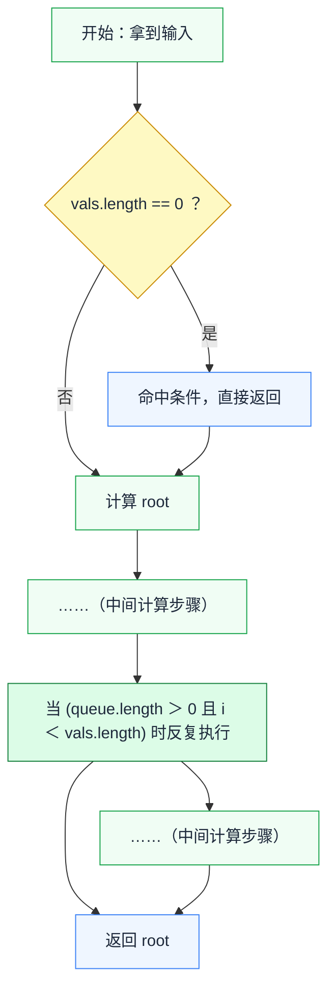

## TypeScript 解题方案（2 个方案逐个讲）

> **运行与提交**：每个方案都是自包含文件（内嵌用例自测，输出 PASS），整块复制到 `.ts` 文件后 `node 文件名` 即可运行。提交 LeetCode 时，把 `demo` 内的算法函数与辅助类型/函数整体取出、置于文件顶层即可。涉及交互/特殊接口的题以题面给定签名为准。

### 方案 1：深度优先-贪心）

**分析与思路**：核心做法是「深度优先-贪心）」。代码里依次做这些事：队列或堆的调度。

**运行方式**：`node 本文件`，内嵌用例全部通过会输出 PASS。


**方案专属流程图**（真实控制流）：

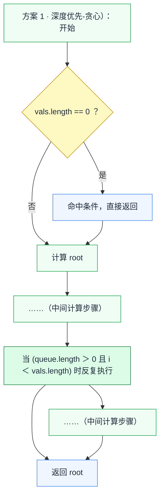

```typescript
// LeetCode LCP 10. 二叉树任务调度 — TS 版（方案1：深度优先-贪心）

class TreeNode {
  // 二叉树节点：val 为自身执行时间
  val: number;
  left: TreeNode | null;
  right: TreeNode | null;
  constructor(val: number) {
    this.val = val;
    this.left = null;
    this.right = null;
  }
}

function buildTree(vals: (number | null)[]): TreeNode | null {
  // 层序数组建树，null 表示空节点
  if (vals.length === 0) return null;
  const root = new TreeNode(vals[0] as number);
  const queue: TreeNode[] = [root]; // 队列里只放非空节点
  let i = 1;
  while (queue.length > 0 && i < vals.length) {
    const node = queue.shift() as TreeNode; // 出队一个父节点
    if (i < vals.length && vals[i] !== null) {
      // 左孩子
      node.left = new TreeNode(vals[i] as number);
      queue.push(node.left);
    }
    i++;
    if (i < vals.length && vals[i] !== null) {
      // 右孩子
      node.right = new TreeNode(vals[i] as number);
      queue.push(node.right);
    }
    i++;
  }
  return root;
}

// dfs 返回 [子树总耗时, 两台机器并行可节省的耗时]
function dfs(root: TreeNode | null): number[] {
  if (root === null) return [0.0, 0.0]; // 空子树：总耗时 0，节省 0
  const [a, b] = dfs(root.left); // a: 左子树总耗时, b: 左子树已节省
  const [c, d] = dfs(root.right); // c: 右子树总耗时, d: 右子树已节省
  let saved: number;
  if ((c - 2 * d <= a && a <= c) || (a - 2 * b <= c && c <= a)) {
    // 一侧的串行下界落在另一侧的耗时区间内：两台机器互相填空，左右几乎完全并行
    saved = (a + c) / 2.0; // 浮点除法：总和为奇数时会出现 0.5
  } else if (a - 2 * b > c) {
    // 左子树串行段太长：右子树整体塞进左边空闲的那台机器
    saved = b + c;
  } else {
    // 右子树占主导：左子树整体塞进右边空闲的那台机器
    saved = a + d;
  }
  return [a + c + root.val, saved]; // 加上当前节点自身的执行时间
}

function minimalExecutionTime(root: TreeNode | null): number {
  // 答案 = 子树总和 - 并行节省
  const [total, saved] = dfs(root);
  return total - saved;
}

// 三个官方用例
const cases: { vals: (number | null)[]; want: number }[] = [
  { vals: [47, 74, 31], want: 121.0 },
  { vals: [15, 21, null, 24, null, 27, 26], want: 87.0 },
  { vals: [1, 3, 2, null, null, 4, 4], want: 7.5 },
];
let fail = false;
for (const tc of cases) {
  const got = minimalExecutionTime(buildTree(tc.vals));
  if (Math.abs(got - tc.want) >= 1e-6) {
    // 浮点比较用 1e-6 容差
    console.log('FAIL', tc.vals, 'got', got, 'want', tc.want); // 失败打印 FAIL
    fail = true;
  }
}
if (fail) process.exit(1); // 非零退出
console.log('PASS'); // 全部用例通过，输出 PASS
```

### 方案 2：深度优先-优化）

**分析与思路**：核心做法是「深度优先-优化）」。代码里依次做这些事：队列或堆的调度。

**运行方式**：`node 本文件`，内嵌用例全部通过会输出 PASS。


**方案专属流程图**（真实控制流）：

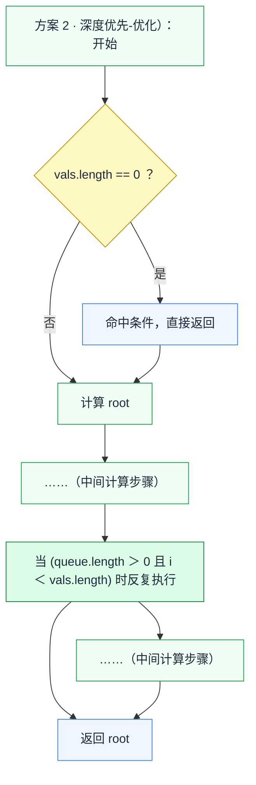

```typescript
// LeetCode LCP 10. 二叉树任务调度 — TS 版（方案2：深度优先-优化）

class TreeNode {
  // 二叉树节点：val 为自身执行时间
  val: number;
  left: TreeNode | null;
  right: TreeNode | null;
  constructor(val: number) {
    this.val = val;
    this.left = null;
    this.right = null;
  }
}

function buildTree(vals: (number | null)[]): TreeNode | null {
  // 层序数组建树，null 表示空节点
  if (vals.length === 0) return null;
  const root = new TreeNode(vals[0] as number);
  const queue: TreeNode[] = [root]; // 队列里只放非空节点
  let i = 1;
  while (queue.length > 0 && i < vals.length) {
    const node = queue.shift() as TreeNode; // 出队一个父节点
    if (i < vals.length && vals[i] !== null) {
      // 左孩子
      node.left = new TreeNode(vals[i] as number);
      queue.push(node.left);
    }
    i++;
    if (i < vals.length && vals[i] !== null) {
      // 右孩子
      node.right = new TreeNode(vals[i] as number);
      queue.push(node.right);
    }
    i++;
  }
  return root;
}

// dfs 返回 [子树总耗时, 子树最小完成时间 maxExec]
function dfs(root: TreeNode | null): number[] {
  if (root === null) return [0.0, 0.0]; // 空子树
  const [leftSum, leftExec] = dfs(root.left); // 左子树的总耗时与最小完成时间
  const [rightSum, rightExec] = dfs(root.right);
  // 当前任务自身必须独占串行跑完；孩子任务两条机器可穿插：
  // 下界取「较慢的一侧」与「两侧工作量均分到两台机器」的较大者
  const parallel = (leftSum + rightSum) / 2.0; // 两台机器均摊左右子树总工作量（浮点）
  const maxExec = root.val + Math.max(Math.max(leftExec, rightExec), parallel);
  return [leftSum + rightSum + root.val, maxExec];
}

function minimalExecutionTime(root: TreeNode | null): number {
  // 答案 = 整棵树的最小完成时间
  return dfs(root)[1];
}

// 三个官方用例
const cases: { vals: (number | null)[]; want: number }[] = [
  { vals: [47, 74, 31], want: 121.0 },
  { vals: [15, 21, null, 24, null, 27, 26], want: 87.0 },
  { vals: [1, 3, 2, null, null, 4, 4], want: 7.5 },
];
let fail = false;
for (const tc of cases) {
  const got = minimalExecutionTime(buildTree(tc.vals));
  if (Math.abs(got - tc.want) >= 1e-6) {
    // 浮点比较用 1e-6 容差
    console.log('FAIL', tc.vals, 'got', got, 'want', tc.want); // 失败打印 FAIL
    fail = true;
  }
}
if (fail) process.exit(1); // 非零退出
console.log('PASS'); // 全部用例通过，输出 PASS
```

## 逐步拆解与面试追问

**复杂度**：时间 O(n)（单趟线性扫描），空间 O(1) 到 O(n)（视辅助结构）

**为什么是这个量级**：每个元素被常数次访问，辅助哈希或栈的开销与 n 同阶

**面试官可能会追问**：

- 递归和迭代写法各自的空间开销？
- 能否用层序统一处理？
- 空节点的边界如何约定？

## 关键 API 速查（TS 主解法实际用到，附官方链接）

| API | 作用 | 使用要点 | 官方文档 |
|---|---|---|---|
| `Array.prototype.push()` | 尾部追加 | 返回新长度；可一次多个；均摊 O(1)；会改变原数组 | [官方文档](https://developer.mozilla.org/zh-CN/docs/Web/JavaScript/Reference/Global_Objects/Array/push) |
| `Array.prototype.shift()` | 头部取出 | O(n)（后续元素整体前移）；大量头部操作请用链表或双端结构 | [官方文档](https://developer.mozilla.org/zh-CN/docs/Web/JavaScript/Reference/Global_Objects/Array/shift) |
| `Math.abs()` | 绝对值 | 入参会被隐式转数字；-0 返回 +0 | [官方文档](https://developer.mozilla.org/zh-CN/docs/Web/JavaScript/Reference/Global_Objects/Math/abs) |

### 各语言官方文档导航

- **TypeScript / JS**：[MDN 中文参考](https://developer.mozilla.org/zh-CN/)
- **Python**：[Python 官方文档](https://docs.python.org/zh-cn/3/)
- **Go**：[Go 标准库](https://pkg.go.dev/std)
- **Java**：[JDK 17 API](https://docs.oracle.com/en/java/javase/17/docs/api/)
- **Rust**：[Rust 标准库](https://doc.rust-lang.org/std/)
- **Lua**：[Lua 5.4 手册](https://www.lua.org/manual/5.4/)
- **C**：[Cppreference C](https://zh.cppreference.com/w/c)
- **C++**：[Cppreference C++](https://zh.cppreference.com/w/cpp)
- **R**：[R 官方手册](https://stat.ethz.ch/R-manual/)
- **Zig**：[Zig 语言文档](https://ziglang.org/documentation/master/)
- **Dart**：[Dart API](https://api.dart.dev/)

## 附录：其他 10 种语言全部实现（每种语言列举其全部方案）

> TypeScript 的全部方案见「TypeScript 解题方案」一节；下面是其余 10 种语言的对应实现，每种语言的每个方案都带思路分析、代码走读与专属运行架构图。
> 每个方案都内嵌用例自测，可独立运行（老仓库 python/go 文件遵循「打印结果」约定）。
> 完整解法文件见 `dsa/<语言>/tree/lc_145370679_leetcode_lcp_10._二叉树任务调度/`。

### Python 实现（2 种方案）

Python 的全部方案如下，每个方案都内嵌用例自测，可独立运行（老仓库 python/go 文件遵循「打印结果」约定）：

#### 方案 1：深度优先-贪心）

**思路与代码分析**：核心是「深度优先-贪心）」。Python 版用切片与字典推导式简化操作，突出可读性。**走读**：方案 1 · 深度优先-贪心）：开始 → 命中条件，直接返回 → 更新 root → 当 queue and i ＜ len(vals): 时反复执行 → 返回 root。

**运行架构**（真实控制流）：

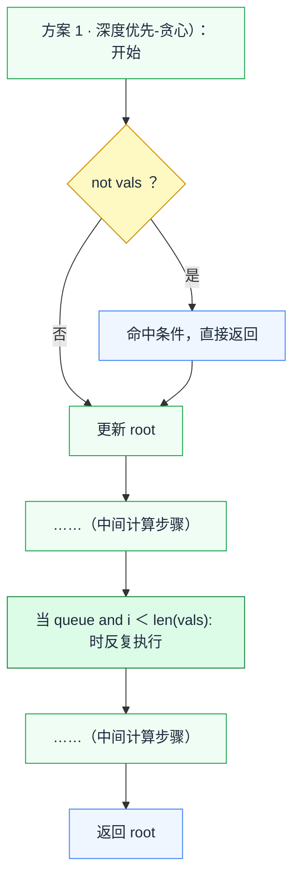

```python
# LeetCode LCP 10. 二叉树任务调度 — Python 版（方案1：深度优先-贪心）

import sys  # 提高递归深度上限（深输入防 RecursionError）

sys.setrecursionlimit(200000)  # 树/链表类题目节点数可达 1e4 量级

class TreeNode:  # 二叉树节点：val 为自身执行时间
    def __init__(self, val=0, left=None, right=None):
        self.val = val
        self.left = left
        self.right = right

def build_tree(vals):  # 层序数组建树，None 表示空节点
    if not vals:
        return None
    root = TreeNode(vals[0])
    queue = [root]  # 队列里只放非空节点
    i = 1
    while queue and i < len(vals):
        node = queue.pop(0)  # 出队一个父节点
        if i < len(vals) and vals[i] is not None:  # 左孩子
            node.left = TreeNode(vals[i])
            queue.append(node.left)
        i += 1
        if i < len(vals) and vals[i] is not None:  # 右孩子
            node.right = TreeNode(vals[i])
            queue.append(node.right)
        i += 1
    return root

def dfs(root):  # 返回 [子树总耗时, 两台机器并行可节省的耗时]
    if root is None:  # 空子树：总耗时 0，节省 0
        return [0.0, 0.0]
    a, b = dfs(root.left)  # a: 左子树总耗时, b: 左子树已节省
    c, d = dfs(root.right)  # c: 右子树总耗时, d: 右子树已节省
    if (c - 2 * d <= a and a <= c) or (a - 2 * b <= c and c <= a):
        # 一侧的串行下界落在另一侧的耗时区间内：两台机器互相填空，左右几乎完全并行
        saved = (a + c) / 2.0  # 浮点除法：总和为奇数时会出现 0.5
    elif a - 2 * b > c:
        # 左子树串行段太长：右子树整体塞进左边空闲的那台机器
        saved = b + c
    else:
        # 右子树占主导：左子树整体塞进右边空闲的那台机器
        saved = a + d
    return [a + c + root.val, saved]  # 加上当前节点自身的执行时间

def minimal_exec_time(root):  # 答案 = 子树总和 - 并行节省
    total, saved = dfs(root)
    return total - saved

if __name__ == "__main__":  # 若 __name__ 等于 '__main__'
    cases = [  # 三个官方用例
        ([47, 74, 31], 121.0),
        ([15, 21, None, 24, None, 27, 26], 87.0),
        ([1, 3, 2, None, None, 4, 4], 7.5),
    ]
    ok = True
    for vals, want in cases:
        got = minimal_exec_time(build_tree(vals))
        if abs(got - want) >= 1e-6:  # 浮点比较用 1e-6 容差
            print("FAIL", vals, "got", got, "want", want)  # 失败打印 FAIL
            ok = False
    if not ok:
        raise SystemExit(1)  # 非零退出
    print("PASS")  # 全部用例通过，输出 PASS
```

#### 方案 2：深度优先-优化）

**思路与代码分析**：核心是「深度优先-优化）」。Python 版用切片与字典推导式简化操作，突出可读性。**走读**：方案 2 · 深度优先-优化）：开始 → 命中条件，直接返回 → 更新 root → 当 queue and i ＜ len(vals): 时反复执行 → 返回 root。

**运行架构**（真实控制流）：


```python
# LeetCode LCP 10. 二叉树任务调度 — Python 版（方案2：深度优先-优化）

import sys  # 提高递归深度上限（深输入防 RecursionError）

sys.setrecursionlimit(200000)  # 树/链表类题目节点数可达 1e4 量级

class TreeNode:  # 二叉树节点：val 为自身执行时间
    def __init__(self, val=0, left=None, right=None):
        self.val = val
        self.left = left
        self.right = right

def build_tree(vals):  # 层序数组建树，None 表示空节点
    if not vals:
        return None
    root = TreeNode(vals[0])
    queue = [root]  # 队列里只放非空节点
    i = 1
    while queue and i < len(vals):
        node = queue.pop(0)  # 出队一个父节点
        if i < len(vals) and vals[i] is not None:  # 左孩子
            node.left = TreeNode(vals[i])
            queue.append(node.left)
        i += 1
        if i < len(vals) and vals[i] is not None:  # 右孩子
            node.right = TreeNode(vals[i])
            queue.append(node.right)
        i += 1
    return root

def dfs(root):  # 返回 [子树总耗时, 子树最小完成时间 max_exec]
    if root is None:  # 空子树
        return [0.0, 0.0]
    left_sum, left_exec = dfs(root.left)  # 左子树的总耗时与最小完成时间
    right_sum, right_exec = dfs(root.right)
    # 当前任务自身必须独占串行跑完；孩子任务两条机器可穿插：
    # 下界取「较慢的一侧」与「两侧工作量均分到两台机器」的较大者
    parallel = (left_sum + right_sum) / 2.0  # 两台机器均摊左右子树总工作量（浮点）
    max_exec = root.val + max(max(left_exec, right_exec), parallel)
    return [left_sum + right_sum + root.val, max_exec]

def minimal_exec_time(root):  # 答案 = 整棵树的最小完成时间
    return dfs(root)[1]

if __name__ == "__main__":  # 若 __name__ 等于 '__main__'
    cases = [  # 三个官方用例
        ([47, 74, 31], 121.0),
        ([15, 21, None, 24, None, 27, 26], 87.0),
        ([1, 3, 2, None, None, 4, 4], 7.5),
    ]
    ok = True
    for vals, want in cases:
        got = minimal_exec_time(build_tree(vals))
        if abs(got - want) >= 1e-6:  # 浮点比较用 1e-6 容差
            print("FAIL", vals, "got", got, "want", want)  # 失败打印 FAIL
            ok = False
    if not ok:
        raise SystemExit(1)  # 非零退出
    print("PASS")  # 全部用例通过，输出 PASS
```

### Go 实现（2 种方案）

Go 的全部方案如下，每个方案都内嵌用例自测，可独立运行（老仓库 python/go 文件遵循「打印结果」约定）：

#### 方案 1：深度优先-贪心）

**思路与代码分析**：核心是「深度优先-贪心）」。Go 版用切片与多返回值惯用法，显式处理索引边界。**走读**：方案 1 · 深度优先-贪心）：开始 → 更新 : → 返回 r[0] - r[1]。

**运行架构**（真实控制流）：

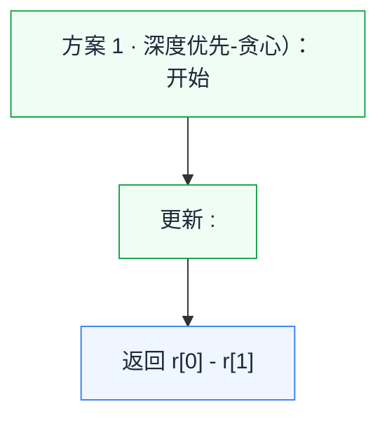

```go
// LeetCode LCP 10. 二叉树任务调度 — Go 版（方案1：深度优先-贪心）

package main

import (
	"fmt"
	"os"
)

type TreeNode struct { // 二叉树节点：Val 为自身执行时间（用 float64 承载并行节省的 0.5）
	Val         float64
	Left, Right *TreeNode
}

// buildTree 层序数组建树，nil 表示空节点
func buildTree(vals []interface{}) *TreeNode {
	if len(vals) == 0 {
		return nil
	}
	root := &TreeNode{Val: vals[0].(float64)}
	queue := []*TreeNode{root} // 队列里只放非空节点
	i := 1
	for len(queue) > 0 && i < len(vals) {
		node := queue[0] // 出队一个父节点
		queue = queue[1:]
		if i < len(vals) && vals[i] != nil { // 左孩子
			node.Left = &TreeNode{Val: vals[i].(float64)}
			queue = append(queue, node.Left)
		}
		i++
		if i < len(vals) && vals[i] != nil { // 右孩子
			node.Right = &TreeNode{Val: vals[i].(float64)}
			queue = append(queue, node.Right)
		}
		i++
	}
	return root
}

// dfs 返回 [子树总耗时, 两台机器并行可节省的耗时]
func dfs(root *TreeNode) [2]float64 {
	if root == nil {
		return [2]float64{0.0, 0.0} // 空子树：总耗时 0，节省 0
	}
	left := dfs(root.Left)   // a: 左子树总耗时, b: 左子树已节省
	right := dfs(root.Right) // c: 右子树总耗时, d: 右子树已节省
	a, b := left[0], left[1]
	c, d := right[0], right[1]
	var saved float64
	if (c-2*d <= a && a <= c) || (a-2*b <= c && c <= a) {
		// 一侧的串行下界落在另一侧的耗时区间内：两台机器互相填空，左右几乎完全并行
		saved = (a + c) / 2.0 // 浮点除法：总和为奇数时会出现 0.5
	} else if a-2*b > c {
		// 左子树串行段太长：右子树整体塞进左边空闲的那台机器
		saved = b + c
	} else {
		// 右子树占主导：左子树整体塞进右边空闲的那台机器
		saved = a + d
	}
	return [2]float64{a + c + root.Val, saved} // 加上当前节点自身的执行时间
}

// minimalExecutionTime 答案 = 子树总和 - 并行节省
func minimalExecutionTime(root *TreeNode) float64 {
	r := dfs(root)
	return r[0] - r[1]
}

func main() { // 程序入口：跑内嵌自测用例（三个官方用例）
	cases := []struct {
		vals []interface{}
		want float64
	}{
		{[]interface{}{47.0, 74.0, 31.0}, 121.0},
		{[]interface{}{15.0, 21.0, nil, 24.0, nil, 27.0, 26.0}, 87.0},
		{[]interface{}{1.0, 3.0, 2.0, nil, nil, 4.0, 4.0}, 7.5},
	}
	for _, tc := range cases {
		got := minimalExecutionTime(buildTree(tc.vals))
		if diff := got - tc.want; diff > 1e-6 || diff < -1e-6 { // 浮点比较用 1e-6 容差
			fmt.Println("FAIL got", got, "want", tc.want) // 失败打印 FAIL
			os.Exit(1)                                    // 非零退出
		}
	}
	fmt.Println("PASS") // 全部用例通过，输出 PASS
}
```

#### 方案 2：深度优先-优化）

**思路与代码分析**：核心是「深度优先-优化）」。Go 版用切片与多返回值惯用法，显式处理索引边界。**走读**：方案 2 · 深度优先-优化）：开始 → 返回 dfs(root)[1]。

**运行架构**（真实控制流）：

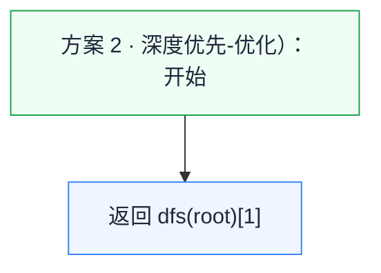

```go
// LeetCode LCP 10. 二叉树任务调度 — Go 版（方案2：深度优先-优化）

package main

import (
	"fmt"
	"math"
	"os"
)

type TreeNode struct { // 二叉树节点：Val 为自身执行时间（用 float64 承载均摊的 0.5）
	Val         float64
	Left, Right *TreeNode
}

// buildTree 层序数组建树，nil 表示空节点
func buildTree(vals []interface{}) *TreeNode {
	if len(vals) == 0 {
		return nil
	}
	root := &TreeNode{Val: vals[0].(float64)}
	queue := []*TreeNode{root} // 队列里只放非空节点
	i := 1
	for len(queue) > 0 && i < len(vals) {
		node := queue[0] // 出队一个父节点
		queue = queue[1:]
		if i < len(vals) && vals[i] != nil { // 左孩子
			node.Left = &TreeNode{Val: vals[i].(float64)}
			queue = append(queue, node.Left)
		}
		i++
		if i < len(vals) && vals[i] != nil { // 右孩子
			node.Right = &TreeNode{Val: vals[i].(float64)}
			queue = append(queue, node.Right)
		}
		i++
	}
	return root
}

// dfs 返回 [子树总耗时, 子树最小完成时间 maxExec]
func dfs(root *TreeNode) [2]float64 {
	if root == nil {
		return [2]float64{0.0, 0.0} // 空子树
	}
	left := dfs(root.Left)   // 左子树的总耗时与最小完成时间
	right := dfs(root.Right) // 右子树的总耗时与最小完成时间
	leftSum, leftExec := left[0], left[1]
	rightSum, rightExec := right[0], right[1]
	// 当前任务自身必须独占串行跑完；孩子任务两条机器可穿插：
	// 下界取「较慢的一侧」与「两侧工作量均分到两台机器」的较大者
	parallel := (leftSum + rightSum) / 2.0 // 两台机器均摊左右子树总工作量（浮点）
	maxExec := root.Val + math.Max(math.Max(leftExec, rightExec), parallel)
	return [2]float64{leftSum + rightSum + root.Val, maxExec}
}

// minimalExecutionTime 答案 = 整棵树的最小完成时间
func minimalExecutionTime(root *TreeNode) float64 {
	return dfs(root)[1]
}

func main() { // 程序入口：跑内嵌自测用例（三个官方用例）
	cases := []struct {
		vals []interface{}
		want float64
	}{
		{[]interface{}{47.0, 74.0, 31.0}, 121.0},
		{[]interface{}{15.0, 21.0, nil, 24.0, nil, 27.0, 26.0}, 87.0},
		{[]interface{}{1.0, 3.0, 2.0, nil, nil, 4.0, 4.0}, 7.5},
	}
	for _, tc := range cases {
		got := minimalExecutionTime(buildTree(tc.vals))
		if diff := got - tc.want; diff > 1e-6 || diff < -1e-6 { // 浮点比较用 1e-6 容差
			fmt.Println("FAIL got", got, "want", tc.want) // 失败打印 FAIL
			os.Exit(1)                                    // 非零退出
		}
	}
	fmt.Println("PASS") // 全部用例通过，输出 PASS
}
```

### Java 实现（2 种方案）

Java 的全部方案如下，每个方案都内嵌用例自测，可独立运行（老仓库 python/go 文件遵循「打印结果」约定）：

#### 方案 1：深度优先-贪心）

**思路与代码分析**：核心是「深度优先-贪心）」。Java 版用类与静态方法组织，集合操作显式明了。**走读**：方案 1 · 深度优先-贪心）：开始 → 更新 r → 返回 r[0] - r[1]。

**运行架构**（真实控制流）：


```java
// LeetCode LCP 10. 二叉树任务调度 — Java 版（方案1：深度优先-贪心）

package com.webfault.dsa;

import java.util.ArrayDeque;
import java.util.Arrays;
import java.util.Deque;
import java.util.List;

class Lcp10S1 { // 非 public class：文件名可以与类名不同
  static class TreeNode { // 二叉树节点：val 为自身执行时间（double 承载并行节省的 0.5）
    double val;
    TreeNode left;
    TreeNode right;

    TreeNode(double val) {
      this.val = val;
    }
  }

  // 层序数组建树，null 表示空节点
  static TreeNode buildTree(List<Double> vals) {
    if (vals.isEmpty()) return null;
    TreeNode root = new TreeNode(vals.get(0));
    Deque<TreeNode> queue = new ArrayDeque<>(); // 队列里只放非空节点
    queue.add(root);
    int i = 1;
    while (!queue.isEmpty() && i < vals.size()) {
      TreeNode node = queue.poll(); // 出队一个父节点
      if (i < vals.size() && vals.get(i) != null) { // 左孩子
        node.left = new TreeNode(vals.get(i));
        queue.add(node.left);
      }
      i++;
      if (i < vals.size() && vals.get(i) != null) { // 右孩子
        node.right = new TreeNode(vals.get(i));
        queue.add(node.right);
      }
      i++;
    }
    return root;
  }

  // dfs 返回 [子树总耗时, 两台机器并行可节省的耗时]
  static double[] dfs(TreeNode root) {
    if (root == null) return new double[] {0.0, 0.0}; // 空子树：总耗时 0，节省 0
    double[] left = dfs(root.left);
    double[] right = dfs(root.right);
    double a = left[0], b = left[1]; // a: 左子树总耗时, b: 左子树已节省
    double c = right[0], d = right[1]; // c: 右子树总耗时, d: 右子树已节省
    double saved;
    if ((c - 2 * d <= a && a <= c) || (a - 2 * b <= c && c <= a)) {
      // 一侧的串行下界落在另一侧的耗时区间内：两台机器互相填空，左右几乎完全并行
      saved = (a + c) / 2.0; // 浮点除法：总和为奇数时会出现 0.5
    } else if (a - 2 * b > c) {
      // 左子树串行段太长：右子树整体塞进左边空闲的那台机器
      saved = b + c;
    } else {
      // 右子树占主导：左子树整体塞进右边空闲的那台机器
      saved = a + d;
    }
    return new double[] {a + c + root.val, saved}; // 加上当前节点自身的执行时间
  }

  // 答案 = 子树总和 - 并行节省
  static double minimalExecutionTime(TreeNode root) {
    double[] r = dfs(root);
    return r[0] - r[1];
  }

  public static void main(String[] args) { // 程序入口：跑内嵌自测用例（三个官方用例）
    List<List<Double>> cases =
        Arrays.asList(
            Arrays.asList(47.0, 74.0, 31.0),
            Arrays.asList(15.0, 21.0, null, 24.0, null, 27.0, 26.0),
            Arrays.asList(1.0, 3.0, 2.0, null, null, 4.0, 4.0));
    double[] wants = {121.0, 87.0, 7.5};
    for (int i = 0; i < cases.size(); i++) {
      double got = minimalExecutionTime(buildTree(cases.get(i)));
      if (Math.abs(got - wants[i]) >= 1e-6) { // 浮点比较用 1e-6 容差
        throw new RuntimeException("FAIL got=" + got + " want=" + wants[i]); // 失败抛异常（非零退出）
      }
    }
    System.out.println("PASS"); // 全部用例通过，输出 PASS
  }
}
```

#### 方案 2：深度优先-优化）

**思路与代码分析**：核心是「深度优先-优化）」。Java 版用类与静态方法组织，集合操作显式明了。**走读**：方案 2 · 深度优先-优化）：开始 → 返回 dfs(root)[1]。

**运行架构**（真实控制流）：


```java
// LeetCode LCP 10. 二叉树任务调度 — Java 版（方案2：深度优先-优化）

package com.webfault.dsa;

import java.util.ArrayDeque;
import java.util.Arrays;
import java.util.Deque;
import java.util.List;

class Lcp10S2 { // 非 public class：文件名可以与类名不同
  static class TreeNode { // 二叉树节点：val 为自身执行时间（double 承载均摊的 0.5）
    double val;
    TreeNode left;
    TreeNode right;

    TreeNode(double val) {
      this.val = val;
    }
  }

  // 层序数组建树，null 表示空节点
  static TreeNode buildTree(List<Double> vals) {
    if (vals.isEmpty()) return null;
    TreeNode root = new TreeNode(vals.get(0));
    Deque<TreeNode> queue = new ArrayDeque<>(); // 队列里只放非空节点
    queue.add(root);
    int i = 1;
    while (!queue.isEmpty() && i < vals.size()) {
      TreeNode node = queue.poll(); // 出队一个父节点
      if (i < vals.size() && vals.get(i) != null) { // 左孩子
        node.left = new TreeNode(vals.get(i));
        queue.add(node.left);
      }
      i++;
      if (i < vals.size() && vals.get(i) != null) { // 右孩子
        node.right = new TreeNode(vals.get(i));
        queue.add(node.right);
      }
      i++;
    }
    return root;
  }

  // dfs 返回 [子树总耗时, 子树最小完成时间 maxExec]
  static double[] dfs(TreeNode root) {
    if (root == null) return new double[] {0.0, 0.0}; // 空子树
    double[] left = dfs(root.left); // 左子树的总耗时与最小完成时间
    double[] right = dfs(root.right); // 右子树的总耗时与最小完成时间
    // 当前任务自身必须独占串行跑完；孩子任务两条机器可穿插：
    // 下界取「较慢的一侧」与「两侧工作量均分到两台机器」的较大者
    double parallel = (left[0] + right[0]) / 2.0; // 两台机器均摊左右子树总工作量（浮点）
    double maxExec = root.val + Math.max(Math.max(left[1], right[1]), parallel);
    return new double[] {left[0] + right[0] + root.val, maxExec};
  }

  // 答案 = 整棵树的最小完成时间
  static double minimalExecutionTime(TreeNode root) {
    return dfs(root)[1];
  }

  public static void main(String[] args) { // 程序入口：跑内嵌自测用例（三个官方用例）
    List<List<Double>> cases =
        Arrays.asList(
            Arrays.asList(47.0, 74.0, 31.0),
            Arrays.asList(15.0, 21.0, null, 24.0, null, 27.0, 26.0),
            Arrays.asList(1.0, 3.0, 2.0, null, null, 4.0, 4.0));
    double[] wants = {121.0, 87.0, 7.5};
    for (int i = 0; i < cases.size(); i++) {
      double got = minimalExecutionTime(buildTree(cases.get(i)));
      if (Math.abs(got - wants[i]) >= 1e-6) { // 浮点比较用 1e-6 容差
        throw new RuntimeException("FAIL got=" + got + " want=" + wants[i]); // 失败抛异常（非零退出）
      }
    }
    System.out.println("PASS"); // 全部用例通过，输出 PASS
  }
}
```

### Rust 实现（2 种方案）

Rust 的全部方案如下，每个方案都内嵌用例自测，可独立运行（老仓库 python/go 文件遵循「打印结果」约定）：

#### 方案 1：深度优先-贪心）

**思路与代码分析**：核心是「深度优先-贪心）」。Rust 版用所有权移动与切片借用改写同一逻辑，注意 Option 与引用边界。**走读**：方案 1 · 深度优先-贪心）：开始 → 处理 if vals.is_empty() → 返回 None → 当 i ＜ vals.len() 时反复执行。

**运行架构**（真实控制流）：


```rust
// LeetCode LCP 10. 二叉树任务调度 — Rust 版（方案1：深度优先-贪心）

struct TreeNode {
    // 二叉树节点：val 为自身执行时间（f64 承载并行节省的 0.5）
    val: f64,
    left: Option<Box<TreeNode>>,
    right: Option<Box<TreeNode>>,
}

struct ArenaNode {
    // 建树中转用的 arena 节点（下标引用，规避 Box 的所有权问题）
    val: f64,
    left: Option<usize>,
    right: Option<usize>,
}

// 层序数组建树，None 表示空节点；先用 arena 组装，再转成 Box 链式树
fn build_tree(vals: &[Option<f64>]) -> Option<Box<TreeNode>> {
    if vals.is_empty() {
        return None;
    }
    let mut arena: Vec<ArenaNode> = Vec::new();
    arena.push(ArenaNode {
        val: vals[0].unwrap(),
        left: None,
        right: None,
    }); // 根节点
    let mut queue: std::collections::VecDeque<usize> = std::collections::VecDeque::new();
    queue.push_back(0); // 队列里只放非空节点的下标
    let mut i = 1; // 下一个待处理的数组位置
    while i < vals.len() {
        let p = match queue.pop_front() {
            // 出队一个父节点
            Some(p) => p,
            None => break,
        };
        if let Some(v) = vals[i] {
            // 左孩子
            let k = arena.len();
            arena.push(ArenaNode {
                val: v,
                left: None,
                right: None,
            });
            arena[p].left = Some(k);
            queue.push_back(k);
        }
        i += 1;
        if i < vals.len() {
            if let Some(v) = vals[i] {
                // 右孩子
                let k = arena.len();
                arena.push(ArenaNode {
                    val: v,
                    left: None,
                    right: None,
                });
                arena[p].right = Some(k);
                queue.push_back(k);
            }
            i += 1;
        }
    }
    // 递归把 arena 下标树转成 Box 链式树
    fn link(arena: &[ArenaNode], idx: Option<usize>) -> Option<Box<TreeNode>> {
        let i = idx?;
        let n = &arena[i];
        Some(Box::new(TreeNode {
            val: n.val,
            left: link(arena, n.left),
            right: link(arena, n.right),
        }))
    }
    link(&arena, Some(0))
}

// dfs 返回 (子树总耗时, 两台机器并行可节省的耗时)
fn dfs(root: Option<&TreeNode>) -> (f64, f64) {
    let node = match root {
        Some(n) => n,
        None => return (0.0, 0.0), // 空子树：总耗时 0，节省 0
    };
    let (a, b) = dfs(node.left.as_deref()); // a: 左子树总耗时, b: 左子树已节省
    let (c, d) = dfs(node.right.as_deref()); // c: 右子树总耗时, d: 右子树已节省
    let saved = if (c - 2.0 * d <= a && a <= c) || (a - 2.0 * b <= c && c <= a) {
        // 一侧的串行下界落在另一侧的耗时区间内：两台机器互相填空，左右几乎完全并行
        (a + c) / 2.0 // 浮点除法：总和为奇数时会出现 0.5
    } else if a - 2.0 * b > c {
        // 左子树串行段太长：右子树整体塞进左边空闲的那台机器
        b + c
    } else {
        // 右子树占主导：左子树整体塞进右边空闲的那台机器
        a + d
    };
    (a + c + node.val, saved) // 加上当前节点自身的执行时间
}

// 答案 = 子树总和 - 并行节省
fn minimal_execution_time(root: Option<&TreeNode>) -> f64 {
    let (total, saved) = dfs(root);
    total - saved
}

fn main() {
    // 程序入口：跑内嵌自测用例（三个官方用例）
    let cases: Vec<(Vec<Option<f64>>, f64)> = vec![
        (vec![Some(47.0), Some(74.0), Some(31.0)], 121.0),
        (
            vec![
                Some(15.0),
                Some(21.0),
                None,
                Some(24.0),
                None,
                Some(27.0),
                Some(26.0),
            ],
            87.0,
        ),
        (
            vec![
                Some(1.0),
                Some(3.0),
                Some(2.0),
                None,
                None,
                Some(4.0),
                Some(4.0),
            ],
            7.5,
        ),
    ];
    let mut fail = false;
    for (vals, want) in cases {
        let tree = build_tree(&vals);
        let got = minimal_execution_time(tree.as_deref());
        if (got - want).abs() >= 1e-6 {
            // 浮点比较用 1e-6 容差
            println!("FAIL got {} want {}", got, want); // 失败打印 FAIL
            fail = true;
        }
    }
    if fail {
        std::process::exit(1); // 非零退出
    }
    println!("PASS"); // 全部用例通过，输出 PASS
}
```

#### 方案 2：深度优先-优化）

**思路与代码分析**：核心是「深度优先-优化）」。Rust 版用所有权移动与切片借用改写同一逻辑，注意 Option 与引用边界。**走读**：方案 2 · 深度优先-优化）：开始 → 处理 if vals.is_empty() → 返回 None → 当 i ＜ vals.len() 时反复执行。

**运行架构**（真实控制流）：

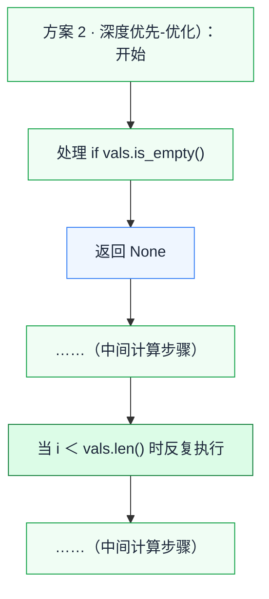

```rust
// LeetCode LCP 10. 二叉树任务调度 — Rust 版（方案2：深度优先-优化）

struct TreeNode {
    // 二叉树节点：val 为自身执行时间（f64 承载均摊的 0.5）
    val: f64,
    left: Option<Box<TreeNode>>,
    right: Option<Box<TreeNode>>,
}

struct ArenaNode {
    // 建树中转用的 arena 节点（下标引用，规避 Box 的所有权问题）
    val: f64,
    left: Option<usize>,
    right: Option<usize>,
}

// 层序数组建树，None 表示空节点；先用 arena 组装，再转成 Box 链式树
fn build_tree(vals: &[Option<f64>]) -> Option<Box<TreeNode>> {
    if vals.is_empty() {
        return None;
    }
    let mut arena: Vec<ArenaNode> = Vec::new();
    arena.push(ArenaNode {
        val: vals[0].unwrap(),
        left: None,
        right: None,
    }); // 根节点
    let mut queue: std::collections::VecDeque<usize> = std::collections::VecDeque::new();
    queue.push_back(0); // 队列里只放非空节点的下标
    let mut i = 1; // 下一个待处理的数组位置
    while i < vals.len() {
        let p = match queue.pop_front() {
            // 出队一个父节点
            Some(p) => p,
            None => break,
        };
        if let Some(v) = vals[i] {
            // 左孩子
            let k = arena.len();
            arena.push(ArenaNode {
                val: v,
                left: None,
                right: None,
            });
            arena[p].left = Some(k);
            queue.push_back(k);
        }
        i += 1;
        if i < vals.len() {
            if let Some(v) = vals[i] {
                // 右孩子
                let k = arena.len();
                arena.push(ArenaNode {
                    val: v,
                    left: None,
                    right: None,
                });
                arena[p].right = Some(k);
                queue.push_back(k);
            }
            i += 1;
        }
    }
    // 递归把 arena 下标树转成 Box 链式树
    fn link(arena: &[ArenaNode], idx: Option<usize>) -> Option<Box<TreeNode>> {
        let i = idx?;
        let n = &arena[i];
        Some(Box::new(TreeNode {
            val: n.val,
            left: link(arena, n.left),
            right: link(arena, n.right),
        }))
    }
    link(&arena, Some(0))
}

// dfs 返回 (子树总耗时, 子树最小完成时间 max_exec)
fn dfs(root: Option<&TreeNode>) -> (f64, f64) {
    let node = match root {
        Some(n) => n,
        None => return (0.0, 0.0), // 空子树
    };
    let (left_sum, left_exec) = dfs(node.left.as_deref()); // 左子树的总耗时与最小完成时间
    let (right_sum, right_exec) = dfs(node.right.as_deref()); // 右子树的总耗时与最小完成时间
                                                              // 当前任务自身必须独占串行跑完；孩子任务两条机器可穿插：
                                                              // 下界取「较慢的一侧」与「两侧工作量均分到两台机器」的较大者
    let parallel = (left_sum + right_sum) / 2.0; // 两台机器均摊左右子树总工作量（浮点）
    let max_exec = node.val + f64::max(f64::max(left_exec, right_exec), parallel);
    (left_sum + right_sum + node.val, max_exec)
}

// 答案 = 整棵树的最小完成时间
fn minimal_execution_time(root: Option<&TreeNode>) -> f64 {
    dfs(root).1
}

fn main() {
    // 程序入口：跑内嵌自测用例（三个官方用例）
    let cases: Vec<(Vec<Option<f64>>, f64)> = vec![
        (vec![Some(47.0), Some(74.0), Some(31.0)], 121.0),
        (
            vec![
                Some(15.0),
                Some(21.0),
                None,
                Some(24.0),
                None,
                Some(27.0),
                Some(26.0),
            ],
            87.0,
        ),
        (
            vec![
                Some(1.0),
                Some(3.0),
                Some(2.0),
                None,
                None,
                Some(4.0),
                Some(4.0),
            ],
            7.5,
        ),
    ];
    let mut fail = false;
    for (vals, want) in cases {
        let tree = build_tree(&vals);
        let got = minimal_execution_time(tree.as_deref());
        if (got - want).abs() >= 1e-6 {
            // 浮点比较用 1e-6 容差
            println!("FAIL got {} want {}", got, want); // 失败打印 FAIL
            fail = true;
        }
    }
    if fail {
        std::process::exit(1); // 非零退出
    }
    println!("PASS"); // 全部用例通过，输出 PASS
}
```

### Lua 实现（2 种方案）

Lua 的全部方案如下，每个方案都内嵌用例自测，可独立运行（老仓库 python/go 文件遵循「打印结果」约定）：

#### 方案 1：深度优先-贪心）

**思路与代码分析**：核心是「深度优先-贪心）」。Lua 版用表与 ipairs 遍历，注意 ipairs 遇 nil 即停的语义。**走读**：方案 1 · 深度优先-贪心）：开始 → 返回 。

**运行架构**（真实控制流）：

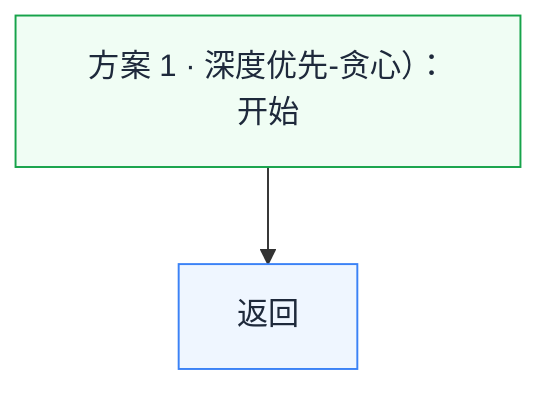

```lua
-- LeetCode LCP 10. 二叉树任务调度 — Lua 版（方案1：深度优先-贪心）

-- 层序数组建树：用 "n" 字符串表示空节点（nil 会把数组截断）
local function new_node(val)
	return { val = val, left = nil, right = nil } -- 二叉树节点：val 为自身执行时间
end

local function build_tree(vals)
	if #vals == 0 then
		return nil
	end
	local root = new_node(vals[1])
	local queue = { root } -- 队列里只放非空节点
	local head, i = 1, 2
	while head <= #queue and i <= #vals do
		local node = queue[head] -- 出队一个父节点
		head = head + 1
		if i <= #vals and vals[i] ~= "n" then -- 左孩子
			node.left = new_node(vals[i])
			queue[#queue + 1] = node.left
		end
		i = i + 1
		if i <= #vals and vals[i] ~= "n" then -- 右孩子
			node.right = new_node(vals[i])
			queue[#queue + 1] = node.right
		end
		i = i + 1
	end
	return root
end

-- dfs 返回 子树总耗时, 两台机器并行可节省的耗时（Lua 多返回值）
local function dfs(root)
	if root == nil then
		return 0.0, 0.0
	end -- 空子树：总耗时 0，节省 0
	local a, b = dfs(root.left) -- a: 左子树总耗时, b: 左子树已节省
	local c, d = dfs(root.right) -- c: 右子树总耗时, d: 右子树已节省
	local saved
	if (c - 2 * d <= a and a <= c) or (a - 2 * b <= c and c <= a) then
		-- 一侧的串行下界落在另一侧的耗时区间内：两台机器互相填空，左右几乎完全并行
		saved = (a + c) / 2.0 -- Lua 的 / 永远是浮点除法：总和为奇数时会出现 0.5
	elseif a - 2 * b > c then
		-- 左子树串行段太长：右子树整体塞进左边空闲的那台机器
		saved = b + c
	else
		-- 右子树占主导：左子树整体塞进右边空闲的那台机器
		saved = a + d
	end
	return a + c + root.val, saved -- 加上当前节点自身的执行时间
end

local function minimal_execution_time(root) -- 答案 = 子树总和 - 并行节省
	local total, saved = dfs(root)
	return total - saved
end

local cases = { -- 三个官方用例
	{ { 47, 74, 31 }, 121.0 },
	{ { 15, 21, "n", 24, "n", 27, 26 }, 87.0 },
	{ { 1, 3, 2, "n", "n", 4, 4 }, 7.5 },
}
local fail = false
for _, case in ipairs(cases) do
	local got = minimal_execution_time(build_tree(case[1]))
	if math.abs(got - case[2]) >= 1e-6 then -- 浮点比较用 1e-6 容差
		print("FAIL got", got, "want", case[2]) -- 失败打印 FAIL
		fail = true
	end
end
if fail then
	os.exit(1)
end -- 非零退出
print("PASS") -- 全部用例通过，输出 PASS
```

#### 方案 2：深度优先-优化）

**思路与代码分析**：核心是「深度优先-优化）」。Lua 版用表与 ipairs 遍历，注意 ipairs 遇 nil 即停的语义。**走读**：方案 2 · 深度优先-优化）：开始 → 返回 。

**运行架构**（真实控制流）：

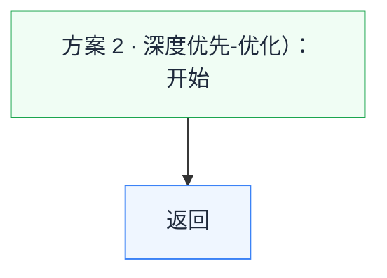

```lua
-- LeetCode LCP 10. 二叉树任务调度 — Lua 版（方案2：深度优先-优化）

-- 层序数组建树：用 "n" 字符串表示空节点（nil 会把数组截断）
local function new_node(val)
	return { val = val, left = nil, right = nil } -- 二叉树节点：val 为自身执行时间
end

local function build_tree(vals)
	if #vals == 0 then
		return nil
	end
	local root = new_node(vals[1])
	local queue = { root } -- 队列里只放非空节点
	local head, i = 1, 2
	while head <= #queue and i <= #vals do
		local node = queue[head] -- 出队一个父节点
		head = head + 1
		if i <= #vals and vals[i] ~= "n" then -- 左孩子
			node.left = new_node(vals[i])
			queue[#queue + 1] = node.left
		end
		i = i + 1
		if i <= #vals and vals[i] ~= "n" then -- 右孩子
			node.right = new_node(vals[i])
			queue[#queue + 1] = node.right
		end
		i = i + 1
	end
	return root
end

-- dfs 返回 子树总耗时, 子树最小完成时间 max_exec（Lua 多返回值）
local function dfs(root)
	if root == nil then
		return 0.0, 0.0
	end -- 空子树
	local left_sum, left_exec = dfs(root.left) -- 左子树的总耗时与最小完成时间
	local right_sum, right_exec = dfs(root.right) -- 右子树的总耗时与最小完成时间
	-- 当前任务自身必须独占串行跑完；孩子任务两条机器可穿插：
	-- 下界取「较慢的一侧」与「两侧工作量均分到两台机器」的较大者
	local parallel = (left_sum + right_sum) / 2.0 -- 两台机器均摊左右子树总工作量（浮点）
	local max_exec = root.val + math.max(math.max(left_exec, right_exec), parallel)
	return left_sum + right_sum + root.val, max_exec
end

local function minimal_execution_time(root) -- 答案 = 整棵树的最小完成时间
	local _, max_exec = dfs(root)
	return max_exec
end

local cases = { -- 三个官方用例
	{ { 47, 74, 31 }, 121.0 },
	{ { 15, 21, "n", 24, "n", 27, 26 }, 87.0 },
	{ { 1, 3, 2, "n", "n", 4, 4 }, 7.5 },
}
local fail = false
for _, case in ipairs(cases) do
	local got = minimal_execution_time(build_tree(case[1]))
	if math.abs(got - case[2]) >= 1e-6 then -- 浮点比较用 1e-6 容差
		print("FAIL got", got, "want", case[2]) -- 失败打印 FAIL
		fail = true
	end
end
if fail then
	os.exit(1)
end -- 非零退出
print("PASS") -- 全部用例通过，输出 PASS
```

### C 实现（2 种方案）

C 的全部方案如下，每个方案都内嵌用例自测，可独立运行（老仓库 python/go 文件遵循「打印结果」约定）：

#### 方案 1：深度优先-贪心）

**思路与代码分析**：核心是「深度优先-贪心）」。C 版手动管理下标与内存，循环边界全部显式写出。**走读**：方案 1 · 深度优先-贪心）：开始 → 命中条件，直接返回 → 更新 *root → 当 (head ＜ tail 且 i ＜ n) 时反复执行 → 返回 root。

**运行架构**（真实控制流）：

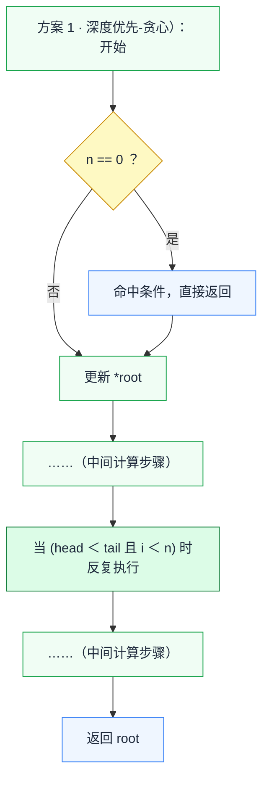

```c
// LeetCode LCP 10. 二叉树任务调度 — C 版（方案1：深度优先-贪心）
#include <math.h>   // 引入头文件
#include <stdio.h>  // 引入头文件
#include <stdlib.h> // 引入头文件

// 二叉树节点：val 为自身执行时间（double 承载并行节省的 0.5）
typedef struct TreeNode {
    double val;
    struct TreeNode *left, *right;
} TreeNode;

static TreeNode *new_node(double val) { // 新建节点
    TreeNode *n = (TreeNode *)malloc(sizeof(TreeNode));
    n->val = val;
    n->left = NULL;
    n->right = NULL;
    return n;
}

// 层序数组建树，NAN 表示空节点（任务耗时恒为正，用 NAN 做哨兵安全）
static TreeNode *build_tree(const double *vals, int n) {
    if (n == 0)
        return NULL;
    TreeNode *root = new_node(vals[0]);
    TreeNode **queue = (TreeNode **)malloc(sizeof(TreeNode *) * (size_t)n); // 队列里只放非空节点
    int head = 0, tail = 0, i = 1;
    queue[tail++] = root;
    while (head < tail && i < n) {
        TreeNode *node = queue[head++]; // 出队一个父节点
        if (i < n && !isnan(vals[i])) { // 左孩子
            node->left = new_node(vals[i]);
            queue[tail++] = node->left;
        }
        i++;
        if (i < n && !isnan(vals[i])) { // 右孩子
            node->right = new_node(vals[i]);
            queue[tail++] = node->right;
        }
        i++;
    }
    free(queue);
    return root;
}

static void free_tree(TreeNode *root) { // 递归释放整棵树
    if (root == NULL)
        return;
    free_tree(root->left);
    free_tree(root->right);
    free(root);
}

// dfs：递归求出子树总耗时 *sum 与两台机器并行可节省的耗时 *saved
static void dfs(const TreeNode *root, double *sum, double *saved) {
    if (root == NULL) { // 空子树：总耗时 0，节省 0
        *sum = 0.0;
        *saved = 0.0;
        return;
    }
    double a, b, c, d;
    dfs(root->left, &a, &b);  // a: 左子树总耗时, b: 左子树已节省
    dfs(root->right, &c, &d); // c: 右子树总耗时, d: 右子树已节省
    double s;
    if ((c - 2.0 * d <= a && a <= c) || (a - 2.0 * b <= c && c <= a)) {
        // 一侧的串行下界落在另一侧的耗时区间内：两台机器互相填空，左右几乎完全并行
        s = (a + c) / 2.0; // 浮点除法：总和为奇数时会出现 0.5
    } else if (a - 2.0 * b > c) {
        // 左子树串行段太长：右子树整体塞进左边空闲的那台机器
        s = b + c;
    } else {
        // 右子树占主导：左子树整体塞进右边空闲的那台机器
        s = a + d;
    }
    *sum = a + c + root->val; // 加上当前节点自身的执行时间
    *saved = s;
}

static double minimal_execution_time(const TreeNode *root) { // 答案 = 子树总和 - 并行节省
    double total, saved;
    dfs(root, &total, &saved);
    return total - saved;
}

int main(void) { // 程序入口：跑内嵌自测用例（三个官方用例）
    const double c1[] = {47, 74, 31};
    const double c2[] = {15, 21, NAN, 24, NAN, 27, 26};
    const double c3[] = {1, 3, 2, NAN, NAN, 4, 4};
    const double *vals[] = {c1, c2, c3};
    const int lens[] = {3, 7, 7};
    const double wants[] = {121.0, 87.0, 7.5};
    for (int k = 0; k < 3; k++) {
        TreeNode *root = build_tree(vals[k], lens[k]);
        double got = minimal_execution_time(root);
        free_tree(root);
        if (fabs(got - wants[k]) >= 1e-6) {                 // 浮点比较用 1e-6 容差
            printf("FAIL got %f want %f\n", got, wants[k]); // 失败打印 FAIL
            return 1;                                       // 非零退出
        }
    }
    printf("PASS\n"); // 全部用例通过，输出 PASS
    return 0;         // 返回 0 表示通过
}
```

#### 方案 2：深度优先-优化）

**思路与代码分析**：核心是「深度优先-优化）」。C 版手动管理下标与内存，循环边界全部显式写出。**走读**：方案 2 · 深度优先-优化）：开始 → 命中条件，直接返回 → 更新 *root → 当 (head ＜ tail 且 i ＜ n) 时反复执行 → 返回 root。

**运行架构**（真实控制流）：

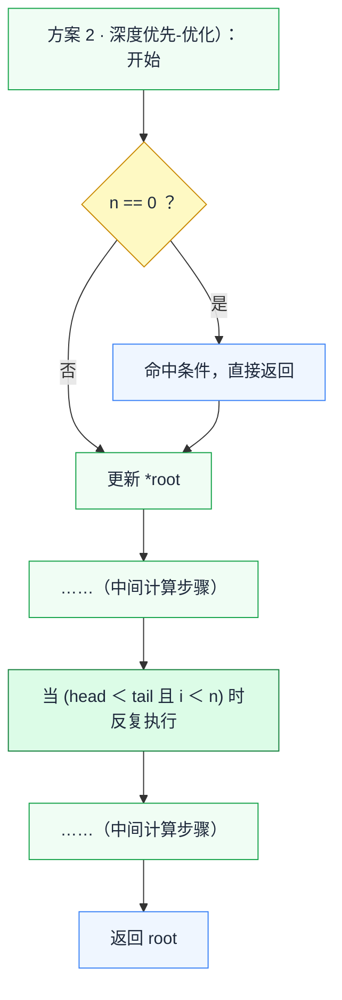

```c
// LeetCode LCP 10. 二叉树任务调度 — C 版（方案2：深度优先-优化）
#include <math.h>   // 引入头文件
#include <stdio.h>  // 引入头文件
#include <stdlib.h> // 引入头文件

// 二叉树节点：val 为自身执行时间（double 承载均摊的 0.5）
typedef struct TreeNode {
    double val;
    struct TreeNode *left, *right;
} TreeNode;

static TreeNode *new_node(double val) { // 新建节点
    TreeNode *n = (TreeNode *)malloc(sizeof(TreeNode));
    n->val = val;
    n->left = NULL;
    n->right = NULL;
    return n;
}

// 层序数组建树，NAN 表示空节点（任务耗时恒为正，用 NAN 做哨兵安全）
static TreeNode *build_tree(const double *vals, int n) {
    if (n == 0)
        return NULL;
    TreeNode *root = new_node(vals[0]);
    TreeNode **queue = (TreeNode **)malloc(sizeof(TreeNode *) * (size_t)n); // 队列里只放非空节点
    int head = 0, tail = 0, i = 1;
    queue[tail++] = root;
    while (head < tail && i < n) {
        TreeNode *node = queue[head++]; // 出队一个父节点
        if (i < n && !isnan(vals[i])) { // 左孩子
            node->left = new_node(vals[i]);
            queue[tail++] = node->left;
        }
        i++;
        if (i < n && !isnan(vals[i])) { // 右孩子
            node->right = new_node(vals[i]);
            queue[tail++] = node->right;
        }
        i++;
    }
    free(queue);
    return root;
}

static void free_tree(TreeNode *root) { // 递归释放整棵树
    if (root == NULL)
        return;
    free_tree(root->left);
    free_tree(root->right);
    free(root);
}

static double dmax(double x, double y) { return x > y ? x : y; } // 双数取大

// dfs：递归求出子树总耗时 *sum 与子树最小完成时间 *max_exec
static void dfs(const TreeNode *root, double *sum, double *max_exec) {
    if (root == NULL) { // 空子树
        *sum = 0.0;
        *max_exec = 0.0;
        return;
    }
    double left_sum, left_exec, right_sum, right_exec;
    dfs(root->left, &left_sum, &left_exec);    // 左子树的总耗时与最小完成时间
    dfs(root->right, &right_sum, &right_exec); // 右子树的总耗时与最小完成时间
    // 当前任务自身必须独占串行跑完；孩子任务两条机器可穿插：
    // 下界取「较慢的一侧」与「两侧工作量均分到两台机器」的较大者
    double parallel = (left_sum + right_sum) / 2.0; // 两台机器均摊左右子树总工作量（浮点）
    *max_exec = root->val + dmax(dmax(left_exec, right_exec), parallel);
    *sum = left_sum + right_sum + root->val;
}

static double minimal_execution_time(const TreeNode *root) { // 答案 = 整棵树的最小完成时间
    double total, max_exec;
    dfs(root, &total, &max_exec);
    return max_exec;
}

int main(void) { // 程序入口：跑内嵌自测用例（三个官方用例）
    const double c1[] = {47, 74, 31};
    const double c2[] = {15, 21, NAN, 24, NAN, 27, 26};
    const double c3[] = {1, 3, 2, NAN, NAN, 4, 4};
    const double *vals[] = {c1, c2, c3};
    const int lens[] = {3, 7, 7};
    const double wants[] = {121.0, 87.0, 7.5};
    for (int k = 0; k < 3; k++) {
        TreeNode *root = build_tree(vals[k], lens[k]);
        double got = minimal_execution_time(root);
        free_tree(root);
        if (fabs(got - wants[k]) >= 1e-6) {                 // 浮点比较用 1e-6 容差
            printf("FAIL got %f want %f\n", got, wants[k]); // 失败打印 FAIL
            return 1;                                       // 非零退出
        }
    }
    printf("PASS\n"); // 全部用例通过，输出 PASS
    return 0;         // 返回 0 表示通过
}
```

### C++ 实现（2 种方案）

C++ 的全部方案如下，每个方案都内嵌用例自测，可独立运行（老仓库 python/go 文件遵循「打印结果」约定）：

#### 方案 1：深度优先-贪心）

**思路与代码分析**：核心是「深度优先-贪心）」。C++ 版用 STL 容器与迭代器，减少手写下标错误。**走读**：方案 1 · 深度优先-贪心）：开始 → 更新 r → 返回 r.first - r.second。

**运行架构**（真实控制流）：

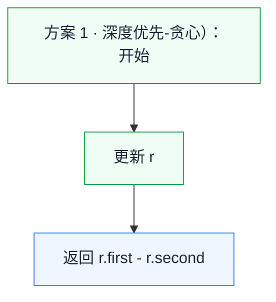

```cpp
// LeetCode LCP 10. 二叉树任务调度 — C++ 版（方案1：深度优先-贪心）
#include <cmath>   // 引入头文件
#include <cstdio>  // 引入头文件
#include <cstdlib> // 引入头文件
#include <queue>   // 引入头文件
#include <utility> // 引入头文件
#include <vector>  // 引入头文件

// 二叉树节点：val 为自身执行时间（double 承载并行节省的 0.5）
struct TreeNode {
    double val;
    TreeNode *left;
    TreeNode *right;
    TreeNode(double v) : val(v), left(NULL), right(NULL) {} // 构造函数
};

// 层序数组建树，NAN 表示空节点（任务耗时恒为正，用 NAN 做哨兵安全）
static TreeNode *build_tree(const std::vector<double> &vals) {
    if (vals.empty())
        return NULL;
    TreeNode *root = new TreeNode(vals[0]);
    std::queue<TreeNode *> queue; // 队列里只放非空节点
    queue.push(root);
    size_t i = 1;
    while (!queue.empty() && i < vals.size()) {
        TreeNode *node = queue.front(); // 出队一个父节点
        queue.pop();
        if (i < vals.size() && !isnan(vals[i])) { // 左孩子
            node->left = new TreeNode(vals[i]);
            queue.push(node->left);
        }
        i++;
        if (i < vals.size() && !isnan(vals[i])) { // 右孩子
            node->right = new TreeNode(vals[i]);
            queue.push(node->right);
        }
        i++;
    }
    return root;
}

static void free_tree(TreeNode *root) { // 递归释放整棵树
    if (root == NULL)
        return;
    free_tree(root->left);
    free_tree(root->right);
    delete root;
}

// dfs 返回 (子树总耗时, 两台机器并行可节省的耗时)
static std::pair<double, double> dfs(const TreeNode *root) {
    if (root == NULL)
        return std::make_pair(0.0, 0.0); // 空子树：总耗时 0，节省 0
    std::pair<double, double> left = dfs(root->left);
    std::pair<double, double> right = dfs(root->right);
    double a = left.first, b = left.second;   // a: 左子树总耗时, b: 左子树已节省
    double c = right.first, d = right.second; // c: 右子树总耗时, d: 右子树已节省
    double saved;
    if ((c - 2.0 * d <= a && a <= c) || (a - 2.0 * b <= c && c <= a)) {
        // 一侧的串行下界落在另一侧的耗时区间内：两台机器互相填空，左右几乎完全并行
        saved = (a + c) / 2.0; // 浮点除法：总和为奇数时会出现 0.5
    } else if (a - 2.0 * b > c) {
        // 左子树串行段太长：右子树整体塞进左边空闲的那台机器
        saved = b + c;
    } else {
        // 右子树占主导：左子树整体塞进右边空闲的那台机器
        saved = a + d;
    }
    return std::make_pair(a + c + root->val, saved); // 加上当前节点自身的执行时间
}

static double minimal_execution_time(const TreeNode *root) { // 答案 = 子树总和 - 并行节省
    std::pair<double, double> r = dfs(root);
    return r.first - r.second;
}

int main() { // 程序入口：跑内嵌自测用例（三个官方用例）
    const double c1[] = {47, 74, 31};
    const double c2[] = {15, 21, NAN, 24, NAN, 27, 26};
    const double c3[] = {1, 3, 2, NAN, NAN, 4, 4};
    const double wants[] = {121.0, 87.0, 7.5};
    const double *vals[] = {c1, c2, c3};
    const size_t lens[] = {3, 7, 7};
    for (int k = 0; k < 3; k++) {
        TreeNode *root = build_tree(std::vector<double>(vals[k], vals[k] + lens[k]));
        double got = minimal_execution_time(root);
        free_tree(root);
        if (std::fabs(got - wants[k]) >= 1e-6) {                 // 浮点比较用 1e-6 容差
            std::printf("FAIL got %f want %f\n", got, wants[k]); // 失败打印 FAIL
            return 1;                                            // 非零退出
        }
    }
    std::printf("PASS\n"); // 全部用例通过，输出 PASS
    return 0;              // 返回 0 表示通过
}
```

#### 方案 2：深度优先-优化）

**思路与代码分析**：核心是「深度优先-优化）」。C++ 版用 STL 容器与迭代器，减少手写下标错误。**走读**：方案 2 · 深度优先-优化）：开始 → 返回 dfs(root).second。

**运行架构**（真实控制流）：

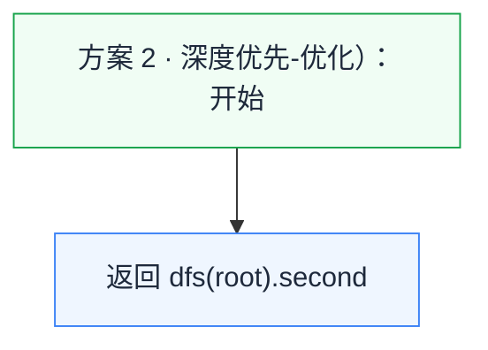

```cpp
// LeetCode LCP 10. 二叉树任务调度 — C++ 版（方案2：深度优先-优化）
#include <algorithm> // 引入头文件
#include <cmath>     // 引入头文件
#include <cstdio>    // 引入头文件
#include <cstdlib>   // 引入头文件
#include <queue>     // 引入头文件
#include <utility>   // 引入头文件
#include <vector>    // 引入头文件

// 二叉树节点：val 为自身执行时间（double 承载均摊的 0.5）
struct TreeNode {
    double val;
    TreeNode *left;
    TreeNode *right;
    TreeNode(double v) : val(v), left(NULL), right(NULL) {} // 构造函数
};

// 层序数组建树，NAN 表示空节点（任务耗时恒为正，用 NAN 做哨兵安全）
static TreeNode *build_tree(const std::vector<double> &vals) {
    if (vals.empty())
        return NULL;
    TreeNode *root = new TreeNode(vals[0]);
    std::queue<TreeNode *> queue; // 队列里只放非空节点
    queue.push(root);
    size_t i = 1;
    while (!queue.empty() && i < vals.size()) {
        TreeNode *node = queue.front(); // 出队一个父节点
        queue.pop();
        if (i < vals.size() && !isnan(vals[i])) { // 左孩子
            node->left = new TreeNode(vals[i]);
            queue.push(node->left);
        }
        i++;
        if (i < vals.size() && !isnan(vals[i])) { // 右孩子
            node->right = new TreeNode(vals[i]);
            queue.push(node->right);
        }
        i++;
    }
    return root;
}

static void free_tree(TreeNode *root) { // 递归释放整棵树
    if (root == NULL)
        return;
    free_tree(root->left);
    free_tree(root->right);
    delete root;
}

// dfs 返回 (子树总耗时, 子树最小完成时间 max_exec)
static std::pair<double, double> dfs(const TreeNode *root) {
    if (root == NULL)
        return std::make_pair(0.0, 0.0);                // 空子树
    std::pair<double, double> left = dfs(root->left);   // 左子树的总耗时与最小完成时间
    std::pair<double, double> right = dfs(root->right); // 右子树的总耗时与最小完成时间
    // 当前任务自身必须独占串行跑完；孩子任务两条机器可穿插：
    // 下界取「较慢的一侧」与「两侧工作量均分到两台机器」的较大者
    double parallel = (left.first + right.first) / 2.0; // 两台机器均摊左右子树总工作量（浮点）
    double max_exec = root->val + std::max(std::max(left.second, right.second), parallel);
    return std::make_pair(left.first + right.first + root->val, max_exec);
}

static double minimal_execution_time(const TreeNode *root) { // 答案 = 整棵树的最小完成时间
    return dfs(root).second;
}

int main() { // 程序入口：跑内嵌自测用例（三个官方用例）
    const double c1[] = {47, 74, 31};
    const double c2[] = {15, 21, NAN, 24, NAN, 27, 26};
    const double c3[] = {1, 3, 2, NAN, NAN, 4, 4};
    const double wants[] = {121.0, 87.0, 7.5};
    const double *vals[] = {c1, c2, c3};
    const size_t lens[] = {3, 7, 7};
    for (int k = 0; k < 3; k++) {
        TreeNode *root = build_tree(std::vector<double>(vals[k], vals[k] + lens[k]));
        double got = minimal_execution_time(root);
        free_tree(root);
        if (std::fabs(got - wants[k]) >= 1e-6) {                 // 浮点比较用 1e-6 容差
            std::printf("FAIL got %f want %f\n", got, wants[k]); // 失败打印 FAIL
            return 1;                                            // 非零退出
        }
    }
    std::printf("PASS\n"); // 全部用例通过，输出 PASS
    return 0;              // 返回 0 表示通过
}
```

### R 实现（2 种方案）

R 的全部方案如下，每个方案都内嵌用例自测，可独立运行（老仓库 python/go 文件遵循「打印结果」约定）：

#### 方案 1：深度优先-贪心）

**思路与代码分析**：核心是「深度优先-贪心）」。R 版用向量化思维与 1 起始下标，注意 1:n 的降序陷阱。**走读**：方案 1 · 深度优先-贪心）：开始 → 更新 new.env(parent → 处理 node$val ＜- val → 处理 node → 返回结果。

**运行架构**（真实控制流）：

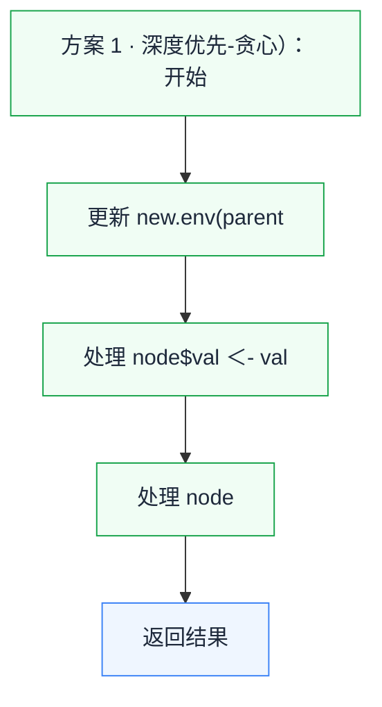

```r
# LeetCode LCP 10. 二叉树任务调度 — R 版（方案1：深度优先-贪心）

new_node <- function(val) {  # 用 environment 表示节点：引用语义，队列建树时可原地挂孩子
  node <- new.env(parent = emptyenv())
  node$val <- val  # val 为自身执行时间
  node
}

build_tree <- function(vals) {  # 层序数组建树，NULL 表示空节点（list 会保留 NULL 元素）
  if (length(vals) == 0) return(NULL)
  root <- new_node(vals[[1]])
  queue <- list(root)  # 队列里只放非空节点
  i <- 2
  while (length(queue) > 0 && i <= length(vals)) {
    node <- queue[[1]]  # 出队一个父节点
    queue <- queue[-1]
    if (i <= length(vals) && !is.null(vals[[i]])) {  # 左孩子
      node$left <- new_node(vals[[i]])
      queue <- c(queue, list(node$left))
    }
    i <- i + 1
    if (i <= length(vals) && !is.null(vals[[i]])) {  # 右孩子
      node$right <- new_node(vals[[i]])
      queue <- c(queue, list(node$right))
    }
    i <- i + 1
  }
  root
}

dfs <- function(node) {  # 返回 c(子树总耗时, 两台机器并行可节省的耗时)
  if (is.null(node)) return(c(0, 0))  # 空子树：总耗时 0，节省 0
  left <- dfs(node$left)
  right <- dfs(node$right)
  a <- left[1]; b <- left[2]     # a: 左子树总耗时, b: 左子树已节省
  cc <- right[1]; d <- right[2]  # cc: 右子树总耗时（避开 R 内置函数 c 的名字）, d: 右子树已节省
  if ((cc - 2 * d <= a && a <= cc) || (a - 2 * b <= cc && cc <= a)) {
    # 一侧的串行下界落在另一侧的耗时区间内：两台机器互相填空，左右几乎完全并行
    saved <- (a + cc) / 2.0  # R 的 / 永远是浮点除法：总和为奇数时会出现 0.5
  } else if (a - 2 * b > cc) {
    # 左子树串行段太长：右子树整体塞进左边空闲的那台机器
    saved <- b + cc
  } else {
    # 右子树占主导：左子树整体塞进右边空闲的那台机器
    saved <- a + d
  }
  c(a + cc + node$val, saved)  # 加上当前节点自身的执行时间
}

minimal_execution_time <- function(root) {  # 答案 = 子树总和 - 并行节省
  r <- dfs(root)
  r[1] - r[2]
}

cases <- list(  # 三个官方用例
  list(list(47, 74, 31), 121.0),
  list(list(15, 21, NULL, 24, NULL, 27, 26), 87.0),
  list(list(1, 3, 2, NULL, NULL, 4, 4), 7.5)
)
fail <- FALSE
for (k in seq_along(cases)) {
  got <- minimal_execution_time(build_tree(cases[[k]][[1]]))
  if (abs(got - cases[[k]][[2]]) >= 1e-6) {  # 浮点比较用 1e-6 容差（与 all.equal 同口径）
    cat("FAIL got", got, "want", cases[[k]][[2]], "\n")  # 失败打印 FAIL
    fail <- TRUE
  }
}
if (fail) quit(status = 1)  # 非零退出
cat("PASS\n")  # 全部用例通过，输出 PASS
```

#### 方案 2：深度优先-优化）

**思路与代码分析**：核心是「深度优先-优化）」。R 版用向量化思维与 1 起始下标，注意 1:n 的降序陷阱。**走读**：方案 2 · 深度优先-优化）：开始 → 更新 new.env(parent → 处理 node$val ＜- val → 处理 node → 返回结果。

**运行架构**（真实控制流）：

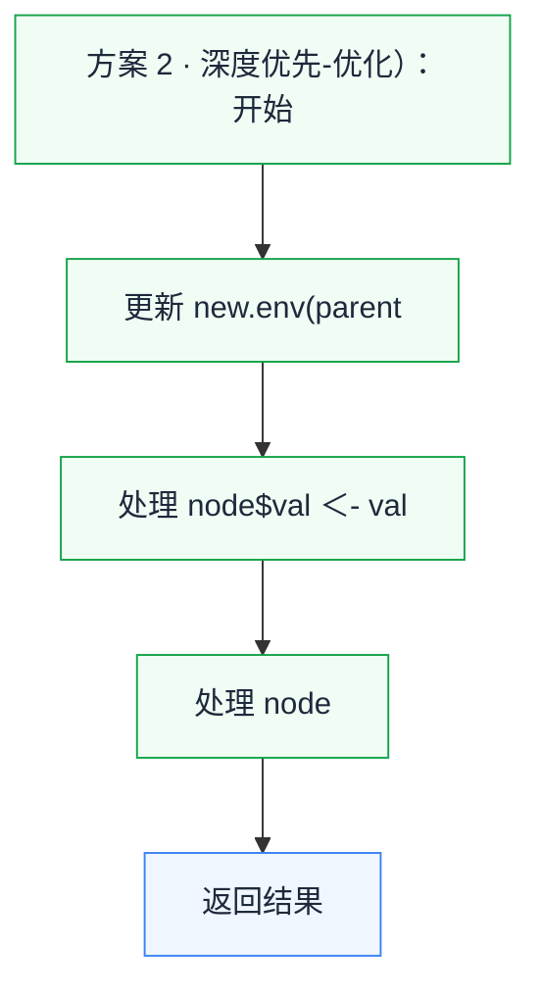

```r
# LeetCode LCP 10. 二叉树任务调度 — R 版（方案2：深度优先-优化）

new_node <- function(val) {  # 用 environment 表示节点：引用语义，队列建树时可原地挂孩子
  node <- new.env(parent = emptyenv())
  node$val <- val  # val 为自身执行时间
  node
}

build_tree <- function(vals) {  # 层序数组建树，NULL 表示空节点（list 会保留 NULL 元素）
  if (length(vals) == 0) return(NULL)
  root <- new_node(vals[[1]])
  queue <- list(root)  # 队列里只放非空节点
  i <- 2
  while (length(queue) > 0 && i <= length(vals)) {
    node <- queue[[1]]  # 出队一个父节点
    queue <- queue[-1]
    if (i <= length(vals) && !is.null(vals[[i]])) {  # 左孩子
      node$left <- new_node(vals[[i]])
      queue <- c(queue, list(node$left))
    }
    i <- i + 1
    if (i <= length(vals) && !is.null(vals[[i]])) {  # 右孩子
      node$right <- new_node(vals[[i]])
      queue <- c(queue, list(node$right))
    }
    i <- i + 1
  }
  root
}

dfs <- function(node) {  # 返回 c(子树总耗时, 子树最小完成时间 max_exec)
  if (is.null(node)) return(c(0, 0))  # 空子树
  left <- dfs(node$left)    # 左子树的总耗时与最小完成时间
  right <- dfs(node$right)  # 右子树的总耗时与最小完成时间
  # 当前任务自身必须独占串行跑完；孩子任务两条机器可穿插：
  # 下界取「较慢的一侧」与「两侧工作量均分到两台机器」的较大者
  parallel <- (left[1] + right[1]) / 2.0  # 两台机器均摊左右子树总工作量（浮点）
  max_exec <- node$val + max(max(left[2], right[2]), parallel)
  c(left[1] + right[1] + node$val, max_exec)
}

minimal_execution_time <- function(root) {  # 答案 = 整棵树的最小完成时间
  dfs(root)[2]
}

cases <- list(  # 三个官方用例
  list(list(47, 74, 31), 121.0),
  list(list(15, 21, NULL, 24, NULL, 27, 26), 87.0),
  list(list(1, 3, 2, NULL, NULL, 4, 4), 7.5)
)
fail <- FALSE
for (k in seq_along(cases)) {
  got <- minimal_execution_time(build_tree(cases[[k]][[1]]))
  if (abs(got - cases[[k]][[2]]) >= 1e-6) {  # 浮点比较用 1e-6 容差（与 all.equal 同口径）
    cat("FAIL got", got, "want", cases[[k]][[2]], "\n")  # 失败打印 FAIL
    fail <- TRUE
  }
}
if (fail) quit(status = 1)  # 非零退出
cat("PASS\n")  # 全部用例通过，输出 PASS
```

### Zig 实现（2 种方案）

Zig 的全部方案如下，每个方案都内嵌用例自测，可独立运行（老仓库 python/go 文件遵循「打印结果」约定）：

#### 方案 1：深度优先-贪心）

**思路与代码分析**：核心是「深度优先-贪心）」。Zig 版显式分配与清零，整型边界处理严格。**走读**：方案 1 · 深度优先-贪心）：开始 → 命中条件，直接返回 → 计算 root → 当 (head ＜ queue.items.len and i ＜ vals.len) 时反复执行 → 返回 root。

**运行架构**（真实控制流）：

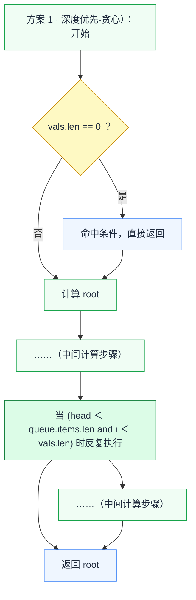

```zig
// LeetCode LCP 10. 二叉树任务调度 — Zig 版（方案1：深度优先-贪心）
const std = @import("std"); // 把 @import(「std」) 存入 std

// 二叉树节点：val 为自身执行时间（f64 承载并行节省的 0.5）
const TreeNode = struct {
    val: f64,
    left: ?*TreeNode = null,
    right: ?*TreeNode = null,
};

fn new_node(alloc: std.mem.Allocator, val: f64) !*TreeNode { // 新建节点
    const n = try alloc.create(TreeNode);
    n.* = .{ .val = val };
    return n;
}

// 层序数组建树，NAN 表示空节点（任务耗时恒为正，用 NAN 做哨兵安全）
fn build_tree(alloc: std.mem.Allocator, vals: []const f64) !?*TreeNode {
    if (vals.len == 0) return null;
    const root = try new_node(alloc, vals[0]);
    var queue = std.ArrayList(*TreeNode).init(alloc); // 队列里只放非空节点
    defer queue.deinit();
    try queue.append(root);
    var head: usize = 0;
    var i: usize = 1;
    while (head < queue.items.len and i < vals.len) {
        const node = queue.items[head]; // 出队一个父节点
        head += 1;
        if (i < vals.len and !std.math.isNan(vals[i])) { // 左孩子
            const child = try new_node(alloc, vals[i]);
            node.left = child;
            try queue.append(child);
        }
        i += 1;
        if (i < vals.len and !std.math.isNan(vals[i])) { // 右孩子
            const child = try new_node(alloc, vals[i]);
            node.right = child;
            try queue.append(child);
        }
        i += 1;
    }
    return root;
}

// dfs 的返回结构：sum 子树总耗时，saved 两台机器并行可节省的耗时
const Dfs = struct { sum: f64, saved: f64 };

fn dfs(root: ?*TreeNode) Dfs {
    const node = root orelse return .{ .sum = 0.0, .saved = 0.0 }; // 空子树：总耗时 0，节省 0
    const left = dfs(node.left); // a: 左子树总耗时, b: 左子树已节省
    const right = dfs(node.right); // c: 右子树总耗时, d: 右子树已节省
    var saved: f64 = undefined;
    if ((right.sum - 2.0 * right.saved <= left.sum and left.sum <= right.sum) or
        (left.sum - 2.0 * left.saved <= right.sum and right.sum <= left.sum))
    {
        // 一侧的串行下界落在另一侧的耗时区间内：两台机器互相填空，左右几乎完全并行
        saved = (left.sum + right.sum) / 2.0; // 浮点除法：总和为奇数时会出现 0.5
    } else if (left.sum - 2.0 * left.saved > right.sum) {
        // 左子树串行段太长：右子树整体塞进左边空闲的那台机器
        saved = left.saved + right.sum;
    } else {
        // 右子树占主导：左子树整体塞进右边空闲的那台机器
        saved = left.sum + right.saved;
    }
    return .{ .sum = left.sum + right.sum + node.val, .saved = saved }; // 加上当前节点自身的执行时间
}

fn minimal_execution_time(root: ?*TreeNode) f64 { // 答案 = 子树总和 - 并行节省
    const r = dfs(root);
    return r.sum - r.saved;
}

pub fn main() !void { // 程序入口：跑内嵌自测用例（三个官方用例）
    var arena = std.heap.ArenaAllocator.init(std.heap.page_allocator);
    defer arena.deinit();
    const alloc = arena.allocator();
    const nan = std.math.nan(f64);
    const Case = struct { vals: []const f64, want: f64 };
    const cases = [_]Case{
        .{ .vals = &[_]f64{ 47, 74, 31 }, .want = 121.0 },
        .{ .vals = &[_]f64{ 15, 21, nan, 24, nan, 27, 26 }, .want = 87.0 },
        .{ .vals = &[_]f64{ 1, 3, 2, nan, nan, 4, 4 }, .want = 7.5 },
    };
    for (cases) |case| {
        const root = try build_tree(alloc, case.vals);
        const got = minimal_execution_time(root);
        const diff = got - case.want;
        if (diff > 1e-6 or diff < -1e-6) { // 浮点比较用 1e-6 容差
            std.debug.print("FAIL got {d} want {d}\n", .{ got, case.want }); // 失败打印 FAIL
            std.process.exit(1); // 非零退出
        }
    }
    std.debug.print("PASS\n", .{}); // 全部用例通过，输出 PASS
}
```

#### 方案 2：深度优先-优化）

**思路与代码分析**：核心是「深度优先-优化）」。Zig 版显式分配与清零，整型边界处理严格。**走读**：方案 2 · 深度优先-优化）：开始 → 命中条件，直接返回 → 计算 root → 当 (head ＜ queue.items.len and i ＜ vals.len) 时反复执行 → 返回 root。

**运行架构**（真实控制流）：

```mermaid
graph TD
    N0["方案 2 · 深度优先-优化）：开始"]
    N1{"vals.len == 0 ？"}
    N2["命中条件，直接返回"]
    N3["计算 root"]
    D1["……（中间计算步骤）"]
    N9["当 (head ＜ queue.items.len and i ＜ vals.len) 时反复执行"]
    D2["……（中间计算步骤）"]
    N22["返回 root"]
    N0 --> N1
    N1 -- 是 --> N2
    N1 -- 否 --> N3
    N9 --> N22
    N2 --> N3
    N3 --> D1
    D1 --> N9
    N9 --> D2
    D2 --> N22
    classDef n fill:#f0fdf4,stroke:#16a34a,color:#1e293b;
    classDef lp fill:#dcfce7,stroke:#15803d,color:#1e293b;
    classDef dc fill:#fef9c3,stroke:#ca8a04,color:#1e293b;
    classDef tm fill:#eff6ff,stroke:#3b82f6,color:#1e293b;
    class N0,N3,D1,D2 n;
    class N9 lp;
    class N1 dc;
    class N2,N22 tm;
```

```zig
// LeetCode LCP 10. 二叉树任务调度 — Zig 版（方案2：深度优先-优化）
const std = @import("std"); // 把 @import(「std」) 存入 std

// 二叉树节点：val 为自身执行时间（f64 承载均摊的 0.5）
const TreeNode = struct {
    val: f64,
    left: ?*TreeNode = null,
    right: ?*TreeNode = null,
};

fn new_node(alloc: std.mem.Allocator, val: f64) !*TreeNode { // 新建节点
    const n = try alloc.create(TreeNode);
    n.* = .{ .val = val };
    return n;
}

// 层序数组建树，NAN 表示空节点（任务耗时恒为正，用 NAN 做哨兵安全）
fn build_tree(alloc: std.mem.Allocator, vals: []const f64) !?*TreeNode {
    if (vals.len == 0) return null;
    const root = try new_node(alloc, vals[0]);
    var queue = std.ArrayList(*TreeNode).init(alloc); // 队列里只放非空节点
    defer queue.deinit();
    try queue.append(root);
    var head: usize = 0;
    var i: usize = 1;
    while (head < queue.items.len and i < vals.len) {
        const node = queue.items[head]; // 出队一个父节点
        head += 1;
        if (i < vals.len and !std.math.isNan(vals[i])) { // 左孩子
            const child = try new_node(alloc, vals[i]);
            node.left = child;
            try queue.append(child);
        }
        i += 1;
        if (i < vals.len and !std.math.isNan(vals[i])) { // 右孩子
            const child = try new_node(alloc, vals[i]);
            node.right = child;
            try queue.append(child);
        }
        i += 1;
    }
    return root;
}

// dfs 的返回结构：sum 子树总耗时，exec 子树最小完成时间
const Dfs = struct { sum: f64, exec: f64 };

fn dfs(root: ?*TreeNode) Dfs {
    const node = root orelse return .{ .sum = 0.0, .exec = 0.0 }; // 空子树
    const left = dfs(node.left); // 左子树的总耗时与最小完成时间
    const right = dfs(node.right); // 右子树的总耗时与最小完成时间
    // 当前任务自身必须独占串行跑完；孩子任务两条机器可穿插：
    // 下界取「较慢的一侧」与「两侧工作量均分到两台机器」的较大者
    const parallel = (left.sum + right.sum) / 2.0; // 两台机器均摊左右子树总工作量（浮点）
    const exec = node.val + @max(@max(left.exec, right.exec), parallel);
    return .{ .sum = left.sum + right.sum + node.val, .exec = exec };
}

fn minimal_execution_time(root: ?*TreeNode) f64 { // 答案 = 整棵树的最小完成时间
    return dfs(root).exec;
}

pub fn main() !void { // 程序入口：跑内嵌自测用例（三个官方用例）
    var arena = std.heap.ArenaAllocator.init(std.heap.page_allocator);
    defer arena.deinit();
    const alloc = arena.allocator();
    const nan = std.math.nan(f64);
    const Case = struct { vals: []const f64, want: f64 };
    const cases = [_]Case{
        .{ .vals = &[_]f64{ 47, 74, 31 }, .want = 121.0 },
        .{ .vals = &[_]f64{ 15, 21, nan, 24, nan, 27, 26 }, .want = 87.0 },
        .{ .vals = &[_]f64{ 1, 3, 2, nan, nan, 4, 4 }, .want = 7.5 },
    };
    for (cases) |case| {
        const root = try build_tree(alloc, case.vals);
        const got = minimal_execution_time(root);
        const diff = got - case.want;
        if (diff > 1e-6 or diff < -1e-6) { // 浮点比较用 1e-6 容差
            std.debug.print("FAIL got {d} want {d}\n", .{ got, case.want }); // 失败打印 FAIL
            std.process.exit(1); // 非零退出
        }
    }
    std.debug.print("PASS\n", .{}); // 全部用例通过，输出 PASS
}
```

### Dart 实现（2 种方案）

Dart 的全部方案如下，每个方案都内嵌用例自测，可独立运行（老仓库 python/go 文件遵循「打印结果」约定）：

#### 方案 1：深度优先-贪心）

**思路与代码分析**：核心是「深度优先-贪心）」。Dart 版用可空类型标注与集合方法，注意空安全。**走读**：方案 1 · 深度优先-贪心）：开始 → 更新 r → 返回 r[0] - r[1]。

**运行架构**（真实控制流）：

```mermaid
graph TD
    N0["方案 1 · 深度优先-贪心）：开始"]
    N1["更新 r"]
    N2["返回 r[0] - r[1]"]
    N0 --> N1
    N1 --> N2
    classDef n fill:#f0fdf4,stroke:#16a34a,color:#1e293b;
    classDef lp fill:#dcfce7,stroke:#15803d,color:#1e293b;
    classDef dc fill:#fef9c3,stroke:#ca8a04,color:#1e293b;
    classDef tm fill:#eff6ff,stroke:#3b82f6,color:#1e293b;
    class N0,N1 n;
    class N2 tm;
```

```dart
// LeetCode LCP 10. 二叉树任务调度 — Dart 版（方案1：深度优先-贪心）

import 'dart:io'; // 引入依赖（退出码用 exit）

class TreeNode {
  // 二叉树节点：val 为自身执行时间（double 承载并行节省的 0.5）
  double val;
  TreeNode? left;
  TreeNode? right;
  TreeNode(this.val);
}

TreeNode? buildTree(List<double?> vals) {
  // 层序数组建树，null 表示空节点
  if (vals.isEmpty) return null;
  final root = TreeNode(vals[0]!);
  final queue = <TreeNode>[root]; // 队列里只放非空节点
  int i = 1;
  while (queue.isNotEmpty && i < vals.length) {
    final node = queue.removeAt(0); // 出队一个父节点
    if (i < vals.length && vals[i] != null) {
      // 左孩子
      node.left = TreeNode(vals[i]!);
      queue.add(node.left!);
    }
    i++;
    if (i < vals.length && vals[i] != null) {
      // 右孩子
      node.right = TreeNode(vals[i]!);
      queue.add(node.right!);
    }
    i++;
  }
  return root;
}

// dfs 返回 [子树总耗时, 两台机器并行可节省的耗时]
List<double> dfs(TreeNode? root) {
  if (root == null) return [0.0, 0.0]; // 空子树：总耗时 0，节省 0
  final left = dfs(root.left);
  final right = dfs(root.right);
  final a = left[0], b = left[1]; // a: 左子树总耗时, b: 左子树已节省
  final c = right[0], d = right[1]; // c: 右子树总耗时, d: 右子树已节省
  double saved;
  if ((c - 2 * d <= a && a <= c) || (a - 2 * b <= c && c <= a)) {
    // 一侧的串行下界落在另一侧的耗时区间内：两台机器互相填空，左右几乎完全并行
    saved = (a + c) / 2.0; // 浮点除法：总和为奇数时会出现 0.5
  } else if (a - 2 * b > c) {
    // 左子树串行段太长：右子树整体塞进左边空闲的那台机器
    saved = b + c;
  } else {
    // 右子树占主导：左子树整体塞进右边空闲的那台机器
    saved = a + d;
  }
  return [a + c + root.val, saved]; // 加上当前节点自身的执行时间
}

double minimalExecutionTime(TreeNode? root) {
  // 答案 = 子树总和 - 并行节省
  final r = dfs(root);
  return r[0] - r[1];
}

void main() {
  // 程序入口：跑内嵌自测用例（三个官方用例）
  final cases = <List<dynamic>>[
    [
      <double?>[47, 74, 31],
      121.0,
    ],
    [
      <double?>[15, 21, null, 24, null, 27, 26],
      87.0,
    ],
    [
      <double?>[1, 3, 2, null, null, 4, 4],
      7.5,
    ],
  ];
  var fail = false;
  for (final tc in cases) {
    final vals = tc[0] as List<double?>;
    final want = tc[1] as double;
    final got = minimalExecutionTime(buildTree(vals));
    if ((got - want).abs() >= 1e-6) {
      // 浮点比较用 1e-6 容差
      print('FAIL got $got want $want'); // 失败打印 FAIL
      fail = true;
    }
  }
  if (fail) exit(1); // 非零退出
  print('PASS'); // 全部用例通过，输出 PASS
}
```

#### 方案 2：深度优先-优化）

**思路与代码分析**：核心是「深度优先-优化）」。Dart 版用可空类型标注与集合方法，注意空安全。**走读**：方案 2 · 深度优先-优化）：开始 → 返回 dfs(root)[1]。

**运行架构**（真实控制流）：

```mermaid
graph TD
    N0["方案 2 · 深度优先-优化）：开始"]
    N1["返回 dfs(root)[1]"]
    N0 --> N1
    classDef n fill:#f0fdf4,stroke:#16a34a,color:#1e293b;
    classDef lp fill:#dcfce7,stroke:#15803d,color:#1e293b;
    classDef dc fill:#fef9c3,stroke:#ca8a04,color:#1e293b;
    classDef tm fill:#eff6ff,stroke:#3b82f6,color:#1e293b;
    class N0 n;
    class N1 tm;
```

```dart
// LeetCode LCP 10. 二叉树任务调度 — Dart 版（方案2：深度优先-优化）

import 'dart:io'; // 引入依赖（退出码用 exit）
import 'dart:math' show max; // 引入依赖（取最大值）

class TreeNode {
  // 二叉树节点：val 为自身执行时间（double 承载均摊的 0.5）
  double val;
  TreeNode? left;
  TreeNode? right;
  TreeNode(this.val);
}

TreeNode? buildTree(List<double?> vals) {
  // 层序数组建树，null 表示空节点
  if (vals.isEmpty) return null;
  final root = TreeNode(vals[0]!);
  final queue = <TreeNode>[root]; // 队列里只放非空节点
  int i = 1;
  while (queue.isNotEmpty && i < vals.length) {
    final node = queue.removeAt(0); // 出队一个父节点
    if (i < vals.length && vals[i] != null) {
      // 左孩子
      node.left = TreeNode(vals[i]!);
      queue.add(node.left!);
    }
    i++;
    if (i < vals.length && vals[i] != null) {
      // 右孩子
      node.right = TreeNode(vals[i]!);
      queue.add(node.right!);
    }
    i++;
  }
  return root;
}

// dfs 返回 [子树总耗时, 子树最小完成时间 maxExec]
List<double> dfs(TreeNode? root) {
  if (root == null) return [0.0, 0.0]; // 空子树
  final left = dfs(root.left); // 左子树的总耗时与最小完成时间
  final right = dfs(root.right); // 右子树的总耗时与最小完成时间
  // 当前任务自身必须独占串行跑完；孩子任务两条机器可穿插：
  // 下界取「较慢的一侧」与「两侧工作量均分到两台机器」的较大者
  final parallel = (left[0] + right[0]) / 2.0; // 两台机器均摊左右子树总工作量（浮点）
  final maxExec = root.val + max(max(left[1], right[1]), parallel);
  return [left[0] + right[0] + root.val, maxExec];
}

double minimalExecutionTime(TreeNode? root) {
  // 答案 = 整棵树的最小完成时间
  return dfs(root)[1];
}

void main() {
  // 程序入口：跑内嵌自测用例（三个官方用例）
  final cases = <List<dynamic>>[
    [
      <double?>[47, 74, 31],
      121.0,
    ],
    [
      <double?>[15, 21, null, 24, null, 27, 26],
      87.0,
    ],
    [
      <double?>[1, 3, 2, null, null, 4, 4],
      7.5,
    ],
  ];
  var fail = false;
  for (final tc in cases) {
    final vals = tc[0] as List<double?>;
    final want = tc[1] as double;
    final got = minimalExecutionTime(buildTree(vals));
    if ((got - want).abs() >= 1e-6) {
      // 浮点比较用 1e-6 容差
      print('FAIL got $got want $want'); // 失败打印 FAIL
      fail = true;
    }
  }
  if (fail) exit(1); // 非零退出
  print('PASS'); // 全部用例通过，输出 PASS
}
```

---

## 内容总结

- **lcp 10. 二叉树任务调度**（二叉树 · Medium）：共 2 个方案，主线思路「深度优先-贪心）」；时间 O(n)（单趟线性扫描）；动画演示DFS 点亮过程，附录给出 11 种语言 × 全部方案的可运行实现。
- 来源博客：[https://blog.csdn.net/tyro_java/article/details/145370679](https://blog.csdn.net/tyro_java/article/details/145370679)
- 导航：[📋 总目录](../) ｜ [← 122 二叉树的前序遍历](../122_二叉树的前序遍历/) ｜ [124 二叉树的后序遍历 →](../124_二叉树的后序遍历/)
