# 125 · 二叉树的右视图（第六阶段 · 二叉树 · Medium）

> **难度**：⭐⭐ Medium ｜ **专题**：二叉树
> **学习定位**：第六阶段 · 二叉树第 125 篇 ｜ **解法数**：2
> **内容总结**：**二叉树的右视图**（二叉树 · Medium）：共 2 个方案，主线思路「迭代指针处理」；时间 O(n)（单趟线性扫描）；动画演示DFS 点亮过程，附录给出 11 种语言 × 全部方案的可运行实现。

---

## 题目描述

给定一个二叉树的 根节点 `root`，想象自己站在它的右侧，按照从顶部到底部的顺序，返回从右侧所能看到的节点值。

- 主函数签名：`function rightSideView(root: TreeNode | null): number[]`

**用例（来自原题）**：

**示例 1**

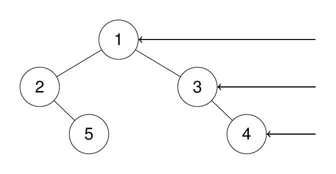

**示例 2**

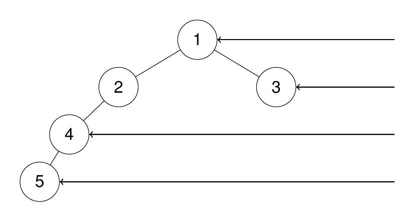

**示例 3**

**示例 4**
> 题面与 [leetcode.cn 官方](https://leetcode.cn/problems/binary-tree-right-side-view/)一致，示例配图取自官方题面。

**数据范围与注意事项**：

- 二叉树的节点个数的范围是 `[0,100]`
- `-100 <= Node.val <= 100`
- **易错点**：递归出口（空节点）必须先写，否则直接空指针。

## 题目分析

**场景是什么**：树是分层数据的标准形态，这类题练的是递归分治与遍历序，对应真实开发里的目录树、组件树。本题就是该场景的 Medium 级练习，主线做法是「迭代指针处理」。

**主线怎么解**：把主解法从头到尾过一遍，它其实在依次做这几件事：队列或堆的调度。

## 解题思路

**方案对比**（共 2 个方案，由浅入深）：

| 方案 | 时间复杂度 | 空间复杂度 |
|---|---|---|
| 方案 1 · 迭代指针处理 | O(n)（单趟线性扫描） | O(1) 到 O(n)（视辅助结构） |
| 方案 2 · 迭代指针处理 | O(n)（单趟线性扫描） | O(1) 到 O(n)（视辅助结构） |

**方案间的取舍**：方案 1（迭代指针处理）；方案 2（迭代指针处理）。数据规模小、可读性优先时选靠前的方案；规模大、性能优先时选靠后的方案。

**怎么读这一篇**：

- 🐣 **新手路线**：把「题目描述」的示例 1 在纸上手推一遍 → 读方案 1（最直观的写法）与它的代码走读 → 按「运行方式」本地跑通看 PASS → 回头对比方案 2 之后的写法差在哪
- 🦅 **大佬路线**：直接锁定最优方案 1（迭代指针处理，O(n)（单趟线性扫描））→ 跳读该方案代码与走读 → 用「逐步拆解与面试追问」补齐复杂度推导与边界追问

### 动态算法图（DFS 点亮，GIF 自动循环）

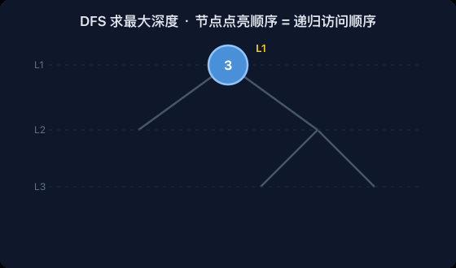

动画演示二叉树专题里DFS 点亮的典型过程；每个方案在「TypeScript 解题方案」一节还配了专属动画与专属流程图。

### 主解法流程图（真实控制流）

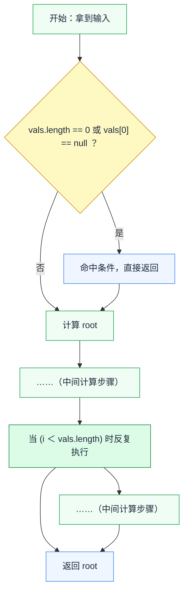

## TypeScript 解题方案（2 个方案逐个讲）

> **运行与提交**：每个方案都是自包含文件（内嵌用例自测，输出 PASS），整块复制到 `.ts` 文件后 `node 文件名` 即可运行。提交 LeetCode 时，把 `demo` 内的算法函数与辅助类型/函数整体取出、置于文件顶层即可。涉及交互/特殊接口的题以题面给定签名为准。

### 方案 1：迭代指针处理

**分析与思路**：核心做法是「迭代指针处理」。代码里依次做这些事：队列或堆的调度。

**运行方式**：`node 本文件`，内嵌用例全部通过会输出 PASS。


**方案专属流程图**（真实控制流）：


```typescript
export function demo(): void {
  // 程序入口：跑内嵌自测用例
  class TreeNode {
    // 定义类型
    val: number; // 值: number;
    left: TreeNode | null; // 左边界: TreeNode 按位或 null;
    right: TreeNode | null; // 右边界: TreeNode 按位或 null;
    constructor(val?: number, left?: TreeNode | null, right?: TreeNode | null) {
      this.val = val === undefined ? 0 : val; // 把 值 全等于 undefined ? 0 : 值; 写入 值
      this.left = left === undefined ? null : left; // 把 左边界 全等于 undefined ? null : 左边界; 写入 左边界
      this.right = right === undefined ? null : right; // 把 右边界 全等于 undefined ? null : 右边界; 写入 右边界
    }
  }

  function buildTree(vals: (number | null)[]): TreeNode | null {
    // 定义函数/方法 buildTree
    if (vals.length === 0 || vals[0] === null) return null; // 若 vals.长度 全等于 0 或 vals[0] 全等于 null，直接返回 null
    const root = new TreeNode(vals[0]!); // 把 new TreeNode(vals[0]取反 ) 存入 根节点
    const q: TreeNode[] = [root]; // 把 [根节点]; 写入 const q: TreeNode[]
    let i = 1; // 把 1 存入 下标 i
    while (i < vals.length) {
      // 循环，直到不满足「下标 i 小于 vals.长度」
      const node = q.shift()!; // 把 节点.shift()取反 存入 节点
      if (vals[i] !== null) {
        // 若 vals[下标 i] 不等于 null
        node.left = new TreeNode(vals[i]!); // 把 new TreeNode(vals[下标 i]取反 ); 写入 左边界
        q.push(node.left); // 把 节点.左边界 压入栈/数组尾部
      }
      i++; // 下标 i 加一
      if (i < vals.length) {
        // 若 下标 i 小于 vals.长度
        if (vals[i] !== null) {
          // 若 vals[下标 i] 不等于 null
          node.right = new TreeNode(vals[i]!); // 把 new TreeNode(vals[下标 i]取反 ); 写入 右边界
          q.push(node.right); // 把 节点.右边界 压入栈/数组尾部
        }
        i++; // 下标 i 加一
      }
    }
    return root; // 返回 根节点
  }

  function rightSideView(root: TreeNode | null): number[] {
    // 定义函数/方法 rightSideView
    if (root === null) return []; // 若 根节点 全等于 null，直接返回 []
    const result: number[] = []; // 把 []; 写入 const result: number[]
    function dfs(node: TreeNode | null, depth: number): void {
      // 定义函数/方法 dfs
      if (node === null) return; // 若 节点 全等于 null) return;
      if (depth === result.length) result.push(node.val); // 若 深度 全等于 结果.长度) 结果 追加 节点.值);
      dfs(node.right, depth + 1); // dfs(节点.右边界, 深度 加 1);
      dfs(node.left, depth + 1); // dfs(节点.左边界, 深度 加 1);
    }
    dfs(root, 0); // dfs(根节点, 0);
    return result; // 返回 结果
  }

  function eq(a: number[], b: number[]): boolean {
    // 定义函数/方法 eq
    if (a.length !== b.length) return false; // 若 数组.长度 不等于 b.长度，直接返回 false
    for (let i = 0; i < a.length; i++) if (a[i] !== b[i]) return false; // 让 下标 i 从 0 开始计数，下标 i 小于 数组.长度 就继续
    return true; // 返回 true
  }

  const cases: { in: (number | null)[]; want: number[] }[] = [
    { in: [1, 2, 3, null, 5, null, 4], want: [1, 3, 4] },
    { in: [], want: [] },
    { in: [1], want: [1] },
  ];
  let fail = false; // 把 false 存入 fail
  for (const c of cases) {
    // for (const 字符 of cases) {
    const got = rightSideView(buildTree(c.in)); // 把 rightSideView(buildTree(字符.in)) 存入 got
    if (!eq(got, c.want)) {
      // 若 取反 eq(got, 字符.want
      fail = true; // 把 true 存入 fail
      console.log(
        'FAIL in=' +
          JSON.stringify(c.in) +
          ' got=' +
          JSON.stringify(got) +
          ' want=' +
          JSON.stringify(c.want),
      ); // 打印输出
    }
  }
  if (fail) throw new Error('FAILED'); // 若 fail) throw new Error(「FAILED」);
  console.log('PASS'); // 全部用例通过，输出 PASS
}
demo(); // demo();
```

### 方案 2：迭代指针处理

**分析与思路**：核心做法是「迭代指针处理」。代码里依次做这些事：队列或堆的调度。

**运行方式**：`node 本文件`，内嵌用例全部通过会输出 PASS。


**方案专属流程图**（真实控制流）：

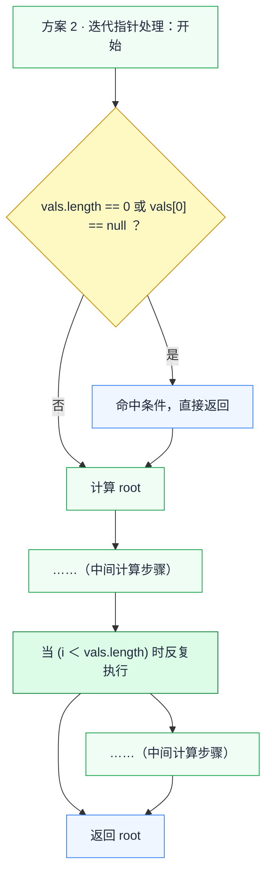

```typescript
export function demo(): void {
  // 程序入口：跑内嵌自测用例
  class TreeNode {
    // 定义类型
    val: number; // 值: number;
    left: TreeNode | null; // 左边界: TreeNode 按位或 null;
    right: TreeNode | null; // 右边界: TreeNode 按位或 null;
    constructor(val?: number, left?: TreeNode | null, right?: TreeNode | null) {
      this.val = val === undefined ? 0 : val; // 把 值 全等于 undefined ? 0 : 值; 写入 值
      this.left = left === undefined ? null : left; // 把 左边界 全等于 undefined ? null : 左边界; 写入 左边界
      this.right = right === undefined ? null : right; // 把 右边界 全等于 undefined ? null : 右边界; 写入 右边界
    }
  }

  function buildTree(vals: (number | null)[]): TreeNode | null {
    // 定义函数/方法 buildTree
    if (vals.length === 0 || vals[0] === null) return null; // 若 vals.长度 全等于 0 或 vals[0] 全等于 null，直接返回 null
    const root = new TreeNode(vals[0]!); // 把 new TreeNode(vals[0]取反 ) 存入 根节点
    const q: TreeNode[] = [root]; // 把 [根节点]; 写入 const q: TreeNode[]
    let i = 1; // 把 1 存入 下标 i
    while (i < vals.length) {
      // 循环，直到不满足「下标 i 小于 vals.长度」
      const node = q.shift()!; // 把 节点.shift()取反 存入 节点
      if (vals[i] !== null) {
        // 若 vals[下标 i] 不等于 null
        node.left = new TreeNode(vals[i]!); // 把 new TreeNode(vals[下标 i]取反 ); 写入 左边界
        q.push(node.left); // 把 节点.左边界 压入栈/数组尾部
      }
      i++; // 下标 i 加一
      if (i < vals.length) {
        // 若 下标 i 小于 vals.长度
        if (vals[i] !== null) {
          // 若 vals[下标 i] 不等于 null
          node.right = new TreeNode(vals[i]!); // 把 new TreeNode(vals[下标 i]取反 ); 写入 右边界
          q.push(node.right); // 把 节点.右边界 压入栈/数组尾部
        }
        i++; // 下标 i 加一
      }
    }
    return root; // 返回 根节点
  }

  function rightSideView(root: TreeNode | null): number[] {
    // 定义函数/方法 rightSideView
    if (root === null) return []; // 若 根节点 全等于 null，直接返回 []
    const result: number[] = []; // 把 []; 写入 const result: number[]
    const queue: TreeNode[] = [root]; // 把 [根节点]; 写入 const queue: TreeNode[]
    while (queue.length > 0) {
      // 循环，直到不满足「队列.长度 超过 0」
      const levelSize = queue.length; // 把 队列.长度 存入 levelSize
      for (let i = 0; i < levelSize; i++) {
        // 让 下标 i 从 0 开始计数，下标 i 小于 levelSize 就继续
        const node = queue.shift()!; // 把 队列.shift()取反 存入 节点
        if (i === levelSize - 1) result.push(node.val); // 若 下标 i 全等于 levelSize 减 1) 结果 追加 节点.值);
        if (node.left !== null) queue.push(node.left); // 若 节点.左边界 不等于 null) 队列 追加 节点.左边界);
        if (node.right !== null) queue.push(node.right); // 若 节点.右边界 不等于 null) 队列 追加 节点.右边界);
      }
    }
    return result; // 返回 结果
  }

  function eq(a: number[], b: number[]): boolean {
    // 定义函数/方法 eq
    if (a.length !== b.length) return false; // 若 数组.长度 不等于 b.长度，直接返回 false
    for (let i = 0; i < a.length; i++) if (a[i] !== b[i]) return false; // 让 下标 i 从 0 开始计数，下标 i 小于 数组.长度 就继续
    return true; // 返回 true
  }

  const cases: { in: (number | null)[]; want: number[] }[] = [
    { in: [1, 2, 3, null, 5, null, 4], want: [1, 3, 4] },
    { in: [], want: [] },
    { in: [1], want: [1] },
  ];
  let fail = false; // 把 false 存入 fail
  for (const c of cases) {
    // for (const 字符 of cases) {
    const got = rightSideView(buildTree(c.in)); // 把 rightSideView(buildTree(字符.in)) 存入 got
    if (!eq(got, c.want)) {
      // 若 取反 eq(got, 字符.want
      fail = true; // 把 true 存入 fail
      console.log(
        'FAIL in=' +
          JSON.stringify(c.in) +
          ' got=' +
          JSON.stringify(got) +
          ' want=' +
          JSON.stringify(c.want),
      ); // 打印输出
    }
  }
  if (fail) throw new Error('FAILED'); // 若 fail) throw new Error(「FAILED」);
  console.log('PASS'); // 全部用例通过，输出 PASS
}
demo(); // demo();
```

## 逐步拆解与面试追问

**复杂度**：时间 O(n)（单趟线性扫描），空间 O(1) 到 O(n)（视辅助结构）

**为什么是这个量级**：每个元素被常数次访问，辅助哈希或栈的开销与 n 同阶

**面试官可能会追问**：

- 递归和迭代写法各自的空间开销？
- 能否用层序统一处理？
- 空节点的边界如何约定？

## 关键 API 速查（TS 主解法实际用到，附官方链接）

| API | 作用 | 使用要点 | 官方文档 |
|---|---|---|---|
| `Array.prototype.push()` | 尾部追加 | 返回新长度；可一次多个；均摊 O(1)；会改变原数组 | [官方文档](https://developer.mozilla.org/zh-CN/docs/Web/JavaScript/Reference/Global_Objects/Array/push) |
| `Array.prototype.shift()` | 头部取出 | O(n)（后续元素整体前移）；大量头部操作请用链表或双端结构 | [官方文档](https://developer.mozilla.org/zh-CN/docs/Web/JavaScript/Reference/Global_Objects/Array/shift) |
| `JSON.stringify()` | 序列化为 JSON 字符串 | 常用于结构化比较（深度相等判定）；undefined/函数/循环引用会被丢弃或抛错 | [官方文档](https://developer.mozilla.org/zh-CN/docs/Web/JavaScript/Reference/Global_Objects/JSON/stringify) |

### 各语言官方文档导航

- **TypeScript / JS**：[MDN 中文参考](https://developer.mozilla.org/zh-CN/)
- **Python**：[Python 官方文档](https://docs.python.org/zh-cn/3/)
- **Go**：[Go 标准库](https://pkg.go.dev/std)
- **Java**：[JDK 17 API](https://docs.oracle.com/en/java/javase/17/docs/api/)
- **Rust**：[Rust 标准库](https://doc.rust-lang.org/std/)
- **Lua**：[Lua 5.4 手册](https://www.lua.org/manual/5.4/)
- **C**：[Cppreference C](https://zh.cppreference.com/w/c)
- **C++**：[Cppreference C++](https://zh.cppreference.com/w/cpp)
- **R**：[R 官方手册](https://stat.ethz.ch/R-manual/)
- **Zig**：[Zig 语言文档](https://ziglang.org/documentation/master/)
- **Dart**：[Dart API](https://api.dart.dev/)

## 附录：其他 10 种语言全部实现（每种语言列举其全部方案）

> TypeScript 的全部方案见「TypeScript 解题方案」一节；下面是其余 10 种语言的对应实现，每种语言的每个方案都带思路分析、代码走读与专属运行架构图。
> 每个方案都内嵌用例自测，可独立运行（老仓库 python/go 文件遵循「打印结果」约定）。
> 完整解法文件见 `dsa/<语言>/tree/lc_199_二叉树的右视图/`。

### Python 实现（2 种方案）

Python 的全部方案如下，每个方案都内嵌用例自测，可独立运行（老仓库 python/go 文件遵循「打印结果」约定）：

#### 方案 1：迭代指针处理

**思路与代码分析**：核心是「迭代指针处理」。Python 版用切片与字典推导式简化操作，突出可读性。代码里依次做这些事：队列或堆的调度。**走读**：方案 1 · 迭代指针处理：开始 → 命中条件，直接返回 → 处理 from collections import dequ → 当 queue: 时反复执行 → 循环 i：从 0 到 level_size 前 → 返回 result。

**运行架构**（真实控制流）：

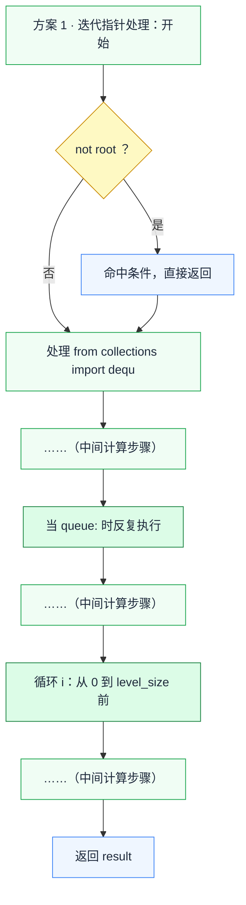

```python
import sys  # 提高递归深度上限（深输入防 RecursionError）

sys.setrecursionlimit(200000)  # 树/链表类题目节点数可达 1e4 量级

class TreeNode:  # 定义类
    def __init__(self, val=0, left=None, right=None):  # 构造函数：初始化成员
        self.val = val  # 把 值 写入 值
        self.left = left  # 把 左边界 写入 左边界
        self.right = right  # 把 右边界 写入 右边界

def rightSideView(root):  # 定义函数 rightSideView（参数：根节点）
    if not root:  # 若 not 根节点
        return []  # 返回 []
    from collections import deque  # from collections import deque

    result = []  # 把 [] 存入 结果
    queue = deque([root])  # 把 deque([根节点]) 存入 队列
    while queue:  # 循环，直到不满足「队列」
        level_size = len(queue)  # 把 长度(队列) 存入 level_size
        for i in range(level_size):  # 让 下标 i 从 level_size 遍历
            node = queue.popleft()  # 把 队列.popleft() 存入 节点
            if i == level_size - 1:  # 若 下标 i 等于 level_size 减 1
                result.append(node.val)  # 把 节点.值 追加到列表尾部
            if node.left:  # 若 节点.左边界
                queue.append(node.left)  # 把 节点.左边界 追加到列表尾部
            if node.right:  # 若 节点.右边界
                queue.append(node.right)  # 把 节点.右边界 追加到列表尾部
    return result  # 返回 结果

if __name__ == "__main__":  # 若 __name__ 等于 '__main__'
    # build tree: [1,2,3,null,5,null,4]
    root = TreeNode(1)  # 把 TreeNode(1) 存入 根节点
    root.left = TreeNode(2)  # 把 TreeNode(2) 写入 左边界
    root.right = TreeNode(3)  # 把 TreeNode(3) 写入 右边界
    root.left.right = TreeNode(5)  # 把 TreeNode(5) 写入 右边界
    root.right.right = TreeNode(4)  # 把 TreeNode(4) 写入 右边界
    print(rightSideView(root))  # 打印输出
```

#### 方案 2：迭代指针处理

**思路与代码分析**：核心是「迭代指针处理」。Python 版用切片与字典推导式简化操作，突出可读性。**走读**：方案 2 · 迭代指针处理：开始 → 命中条件，直接返回 → 更新 result → 命中条件，直接返回 → 若 depth == len(result)：向 result 追加记录 → 向 result 追加记录 → 调用 dfs(node.right, depth + 1) → 调用 dfs(node.left, depth + 1) → 调用 dfs(root, 0) → 返回 result。

**运行架构**（真实控制流）：

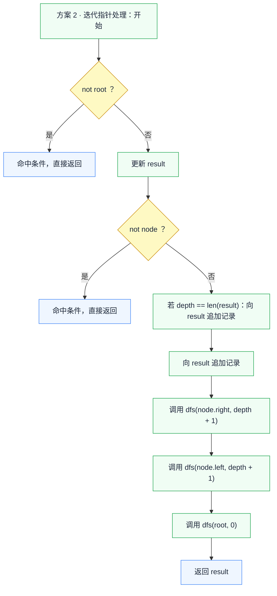

```python
import sys  # 提高递归深度上限（深输入防 RecursionError）

sys.setrecursionlimit(200000)  # 树/链表类题目节点数可达 1e4 量级

class TreeNode:  # 定义类
    def __init__(self, val=0, left=None, right=None):  # 构造函数：初始化成员
        self.val = val  # 把 值 写入 值
        self.left = left  # 把 左边界 写入 左边界
        self.right = right  # 把 右边界 写入 右边界

def rightSideView(root):  # 定义函数 rightSideView（参数：根节点）
    if not root:  # 若 not 根节点
        return []  # 返回 []
    result = []  # 把 [] 存入 结果

    def dfs(node, depth):  # 定义函数 dfs（参数：节点, 深度）
        if not node:  # 若 not 节点
            return  # return
        if depth == len(result):  # 若 深度 等于 长度(结果
            result.append(node.val)  # 把 节点.值 追加到列表尾部
        dfs(node.right, depth + 1)  # dfs(节点.右边界, 深度 加 1)
        dfs(node.left, depth + 1)  # dfs(节点.左边界, 深度 加 1)

    dfs(root, 0)  # dfs(根节点, 0)
    return result  # 返回 结果

if __name__ == "__main__":  # 若 __name__ 等于 '__main__'
    # build tree: [1,2,3,null,5,null,4]
    root = TreeNode(1)  # 把 TreeNode(1) 存入 根节点
    root.left = TreeNode(2)  # 把 TreeNode(2) 写入 左边界
    root.right = TreeNode(3)  # 把 TreeNode(3) 写入 右边界
    root.left.right = TreeNode(5)  # 把 TreeNode(5) 写入 右边界
    root.right.right = TreeNode(4)  # 把 TreeNode(4) 写入 右边界
    print(rightSideView(root))  # 打印输出
```

### Go 实现（2 种方案）

Go 的全部方案如下，每个方案都内嵌用例自测，可独立运行（老仓库 python/go 文件遵循「打印结果」约定）：

#### 方案 1：迭代指针处理

**思路与代码分析**：核心是「迭代指针处理」。Go 版用切片与多返回值惯用法，显式处理索引边界。**走读**：方案 1 · 迭代指针处理：开始 → 处理 if root == nil → 返回 []int → 遍历循环 → 遍历循环 → 返回 result。

**运行架构**（真实控制流）：

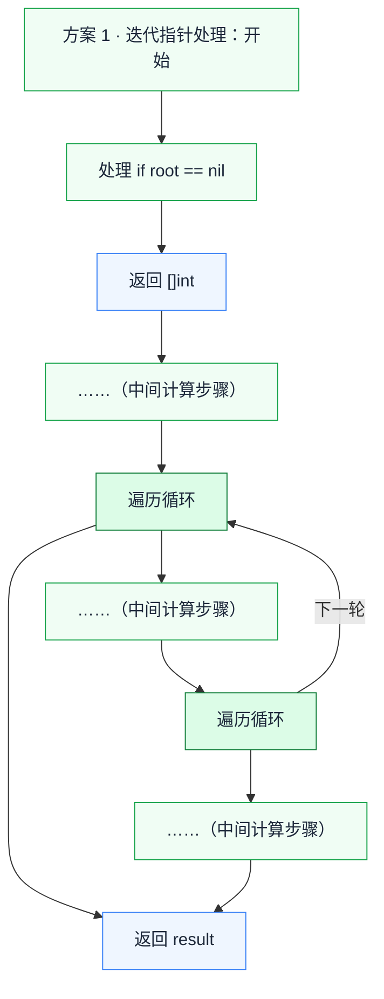

```go
package main // 引入依赖

import (
	"fmt"     // 「fmt」
	"os"      // 「os」
	"reflect" // 「reflect」
)

type TreeNode struct {
	Val         int
	Left, Right *TreeNode
} // 定义类型

func buildTree(vals []int, nullVal int) *TreeNode { // 定义函数/方法 buildTree
	if len(vals) == 0 || vals[0] == nullVal {
		return nil
	} // 若 长度(vals) 等于 0 或 vals[0] 等于 nullVal { return nil }
	root := &TreeNode{Val: vals[0]}     // 把 按位与 TreeNode{Val: vals[0]} 写入 root :
	q := []*TreeNode{root}              // 把 [] 乘 TreeNode{根节点} 写入 q :
	idx := 1                            // 把 1 写入 idx :
	for len(q) > 0 && idx < len(vals) { // 定义函数/方法 len
		node := q[0]
		q = q[1:]                                    // 把 节点[0]; 节点 赋值为 节点[1:] 写入 node :
		if idx < len(vals) && vals[idx] != nullVal { // 若 idx 小于 长度(vals) 且 vals[idx] 不等于 nullVal
			node.Left = &TreeNode{Val: vals[idx]}
			q = append(q, node.Left)
		}
		idx++                                        // idx 加一
		if idx < len(vals) && vals[idx] != nullVal { // 若 idx 小于 长度(vals) 且 vals[idx] 不等于 nullVal
			node.Right = &TreeNode{Val: vals[idx]}
			q = append(q, node.Right)
		}
		idx++ // idx 加一
	}
	return root // 返回 根节点
}

// 忠实翻译 python/tree/lc_199_二叉树的右视图/solution_1_1_____1_______.py.py
func rightSideView(root *TreeNode) []int { // 定义函数/方法 rightSideView
	if root == nil {
		return []int{}
	} // 若 根节点 等于 nil { return []int{} }
	result := []int{}          // 把 []int{} 写入 result :
	queue := []*TreeNode{root} // 把 [] 乘 TreeNode{根节点} 写入 queue :
	for len(queue) > 0 {       // for 长度(队列) 超过 0 {
		levelSize := len(queue)          // 把 长度(队列) 写入 levelSize :
		for i := 0; i < levelSize; i++ { // 让 下标 i 从 0 开始计数
			node := queue[0]
			queue = queue[1:] // 把 队列[0]; 队列 赋值为 队列[1:] 写入 node :
			if i == levelSize-1 {
				result = append(result, node.Val)
			} // 若 下标 i 等于 levelSize 减 1 { 结果 赋值为 append(结果, 节点.Val) }
			if node.Left != nil {
				queue = append(queue, node.Left)
			} // 若 节点.Left 不等于 nil { 队列 赋值为 append(队列, 节点.Left) }
			if node.Right != nil {
				queue = append(queue, node.Right)
			} // 若 节点.Right 不等于 nil { 队列 赋值为 append(队列, 节点.Right) }
		}
	}
	return result // 返回 结果
}

func eqIntSlice(a, b []int) bool { return reflect.DeepEqual(a, b) } // 定义函数/方法 eqIntSlice

func main() { // 程序入口：跑内嵌自测用例
	nullVal := 1000001 // 把 1000001 写入 nullVal :
	type caseT struct {
		vals []int
		want []int
	} // 定义类型
	cases := []caseT{ // 把 []caseT{ 写入 cases :
		{[]int{1, 2, 3, nullVal, 5, nullVal, 4}, []int{1, 3, 4}},
		{[]int{1}, []int{1}},
		{[]int{}, []int{}},
		{[]int{1, 2, 3, 4, nullVal, nullVal, 5}, []int{1, 3, 5}},
		{[]int{1, 2, nullVal, 3, nullVal, 4, nullVal}, []int{1, 2, 3, 4}},
	}
	ok := true                // 把 true 写入 ok :
	for _, c := range cases { // 同时取 _ 与 字符 遍历
		root := buildTree(c.vals, nullVal) // 把 buildTree(字符.vals, nullVal) 写入 root :
		got := rightSideView(root)         // 把 rightSideView(根节点) 写入 got :
		if !eqIntSlice(got, c.want) {      // 若 取反 eqIntSlice(got, 字符.want
			ok = false                                                             // 把 false 写入 ok
			fmt.Printf("FAIL rightSideView(%v)=%v want %v\n", c.vals, got, c.want) // 打印输出
		}
	}
	if !ok {
		os.Exit(1)
	} // 若 取反 ok { os.Exit(1) }
	fmt.Println("PASS") // 全部用例通过，输出 PASS
}
```

#### 方案 2：迭代指针处理

**思路与代码分析**：核心是「迭代指针处理」。Go 版用切片与多返回值惯用法，显式处理索引边界。**走读**：方案 2 · 迭代指针处理：开始 → 更新 : → 计算 dfs → 更新 dfs → 处理 if node == nil → 返回  → 处理 if depth == len(result) → 更新 result → 调用 dfs(node.Right, depth+1) → 调用 dfs(node.Left, depth+1) → 调用 dfs(root, 0) → 返回 result。

**运行架构**（真实控制流）：

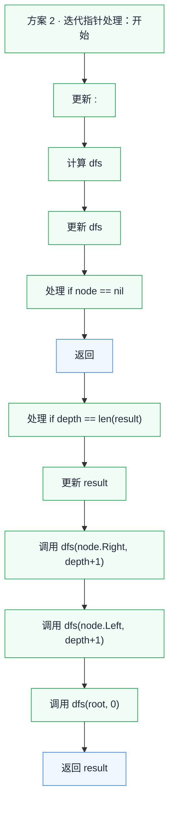

```go
package main // 引入依赖

import (
	"fmt"     // 「fmt」
	"os"      // 「os」
	"reflect" // 「reflect」
)

type TreeNode struct {
	Val         int
	Left, Right *TreeNode
} // 定义类型

func buildTree(vals []int, nullVal int) *TreeNode { // 定义函数/方法 buildTree
	if len(vals) == 0 || vals[0] == nullVal {
		return nil
	} // 若 长度(vals) 等于 0 或 vals[0] 等于 nullVal { return nil }
	root := &TreeNode{Val: vals[0]}     // 把 按位与 TreeNode{Val: vals[0]} 写入 root :
	q := []*TreeNode{root}              // 把 [] 乘 TreeNode{根节点} 写入 q :
	idx := 1                            // 把 1 写入 idx :
	for len(q) > 0 && idx < len(vals) { // 定义函数/方法 len
		node := q[0]
		q = q[1:]                                    // 把 节点[0]; 节点 赋值为 节点[1:] 写入 node :
		if idx < len(vals) && vals[idx] != nullVal { // 若 idx 小于 长度(vals) 且 vals[idx] 不等于 nullVal
			node.Left = &TreeNode{Val: vals[idx]}
			q = append(q, node.Left)
		}
		idx++                                        // idx 加一
		if idx < len(vals) && vals[idx] != nullVal { // 若 idx 小于 长度(vals) 且 vals[idx] 不等于 nullVal
			node.Right = &TreeNode{Val: vals[idx]}
			q = append(q, node.Right)
		}
		idx++ // idx 加一
	}
	return root // 返回 根节点
}

// 忠实翻译 python/tree/lc_199_二叉树的右视图/solution_2_2_____2_______.py.py
func rightSideView(root *TreeNode) []int { // 定义函数/方法 rightSideView
	result := []int{}                       // 把 []int{} 写入 result :
	var dfs func(*TreeNode, int)            // var dfs func( 乘 TreeNode, int)
	dfs = func(node *TreeNode, depth int) { // 把 func(节点 乘 TreeNode, 深度 int) { 写入 dfs
		if node == nil {
			return
		} // 若 节点 等于 nil { return }
		if depth == len(result) {
			result = append(result, node.Val)
		} // 若 深度 等于 长度(结果) { 结果 赋值为 append(结果, 节点.Val) }
		dfs(node.Right, depth+1) // dfs(节点.Right, 深度 加 1)
		dfs(node.Left, depth+1)  // dfs(节点.Left, 深度 加 1)
	}
	dfs(root, 0)  // dfs(根节点, 0)
	return result // 返回 结果
}

func eqIntSlice(a, b []int) bool { return reflect.DeepEqual(a, b) } // 定义函数/方法 eqIntSlice

func main() { // 程序入口：跑内嵌自测用例
	nullVal := 1000001 // 把 1000001 写入 nullVal :
	type caseT struct {
		vals []int
		want []int
	} // 定义类型
	cases := []caseT{ // 把 []caseT{ 写入 cases :
		{[]int{1, 2, 3, nullVal, 5, nullVal, 4}, []int{1, 3, 4}},
		{[]int{1}, []int{1}},
		{[]int{}, []int{}},
		{[]int{1, 2, 3, 4, nullVal, nullVal, 5}, []int{1, 3, 5}},
		{[]int{1, 2, nullVal, 3, nullVal, 4, nullVal}, []int{1, 2, 3, 4}},
	}
	ok := true                // 把 true 写入 ok :
	for _, c := range cases { // 同时取 _ 与 字符 遍历
		root := buildTree(c.vals, nullVal) // 把 buildTree(字符.vals, nullVal) 写入 root :
		got := rightSideView(root)         // 把 rightSideView(根节点) 写入 got :
		if !eqIntSlice(got, c.want) {      // 若 取反 eqIntSlice(got, 字符.want
			ok = false                                                             // 把 false 写入 ok
			fmt.Printf("FAIL rightSideView(%v)=%v want %v\n", c.vals, got, c.want) // 打印输出
		}
	}
	if !ok {
		os.Exit(1)
	} // 若 取反 ok { os.Exit(1) }
	fmt.Println("PASS") // 全部用例通过，输出 PASS
}
```

### Java 实现（2 种方案）

Java 的全部方案如下，每个方案都内嵌用例自测，可独立运行（老仓库 python/go 文件遵循「打印结果」约定）：

#### 方案 1：迭代指针处理

**思路与代码分析**：核心是「迭代指针处理」。Java 版用类与静态方法组织，集合操作显式明了。代码里依次做这些事：单循环线性扫描。**走读**：方案 1 · 迭代指针处理：开始 → 命中条件，直接返回 → 命中条件，直接返回 → 遍历循环 → 命中条件，直接返回 → 返回 true。

**运行架构**（真实控制流）：


```java
package com.webfault.dsa; // 引入依赖

import java.util.*; // 引入依赖

class TreeNode { // 定义类型
  int val; // int 值;
  TreeNode left; // TreeNode 左边界;
  TreeNode right; // TreeNode 右边界;

  TreeNode(int v) {
    val = v;
  } // 把 值; } 写入 TreeNode(int v) { val

  TreeNode(int v, TreeNode l, TreeNode r) {
    val = v;
    left = l;
    right = r;
  }
}

class Main { // 定义类型
  List<Integer> rightSideView(TreeNode root) { // 定义函数/方法 rightSideView
    if (root == null) return new ArrayList<>(); // 若 根节点 等于 null，直接返回 new ArrayList 小于 超过 ()
    List<Integer> result = new ArrayList<>(); // 把 new ArrayList 小于 超过 (); 写入 List<Integer> result
    Deque<TreeNode> queue =
        new ArrayDeque<>(); // 把 new ArrayDeque 小于 超过 (); 写入 Deque<TreeNode> queue
    queue.add(root); // 队列 追加 根节点);
    while (!queue.isEmpty()) { // 循环，直到不满足「取反 队列.isEmpty(」
      int levelSize = queue.size(); // 把 队列.大小() 存入 levelSize
      for (int i = 0; i < levelSize; i++) { // 让 下标 i 从 0 开始计数，下标 i 小于 levelSize 就继续
        TreeNode node = queue.poll(); // 把 队列.poll(); 写入 TreeNode node
        if (i == levelSize - 1) result.add(node.val); // 若 下标 i 等于 levelSize 减 1) 结果 追加 节点.值);
        if (node.left != null) queue.add(node.left); // 若 节点.左边界 不等于 null) 队列 追加 节点.左边界);
        if (node.right != null) queue.add(node.right); // 若 节点.右边界 不等于 null) 队列 追加 节点.右边界);
      }
    }
    return result; // 返回 结果
  }

  static boolean eqList(List<Integer> a, List<Integer> b) { // 定义函数/方法 eqList
    if (a == null || b == null) return a == b; // 若 数组 等于 null 或 b 等于 null，直接返回 数组 等于 b
    if (a.size() != b.size()) return false; // 若 数组.大小() 不等于 b.大小()，直接返回 false
    for (int i = 0; i < a.size(); i++)
      if (!a.get(i).equals(b.get(i))) return false; // 让 下标 i 从 0 开始计数，下标 i 小于 数组.大小() 就继续
    return true; // 返回 true
  }

  public static void main(String[] args) { // public static void main(String[] args) {
    Main s = new Main(); // 把 new Main(); 写入 Main s
    // case 1: [1,2,3,null,5,null,4]
    TreeNode r1 =
        new TreeNode(
            1, new TreeNode(2, null, new TreeNode(5)), new TreeNode(3, null, new TreeNode(4)));
    // case 2: empty
    TreeNode r2 = null; // 把 null; 写入 TreeNode r2
    // case 3: single node
    TreeNode r3 = new TreeNode(1); // 把 new TreeNode(1); 写入 TreeNode r3
    Object[][] cases = { // 把 { 写入 Object[][] cases
      {r1, Arrays.asList(1, 3, 4)},
      {r2, new ArrayList<Integer>()},
      {r3, Arrays.asList(1)},
    };
    boolean ok = true; // 把 true; 写入 boolean ok
    for (Object[] c : cases) { // for (Object[] 字符 : cases) {
      List<Integer> got =
          s.rightSideView(
              (TreeNode) c[0]); // 把 字符串.rightSideView((TreeNode) 字符[0]); 写入 List<Integer> got
      if (!eqList(got, (List<Integer>) c[1])) { // 若 取反 eqList(got, (List 小于 Integer 超过 ) 字符[1]
        ok = false; // 把 false; 写入 ok
        System.out.println("FAIL rightSideView got=" + got + " want=" + c[1]); // 打印输出
      }
    }
    if (!ok) throw new RuntimeException("FAILED"); // 若 取反 ok) throw new RuntimeException(「FAILED」);
    System.out.println("PASS"); // 全部用例通过，输出 PASS
  }
}
```

#### 方案 2：迭代指针处理

**思路与代码分析**：核心是「迭代指针处理」。Java 版用类与静态方法组织，集合操作显式明了。代码里依次做这些事：单循环线性扫描。**走读**：方案 2 · 迭代指针处理：开始 → 命中条件，直接返回 → 命中条件，直接返回 → 遍历循环 → 命中条件，直接返回 → 返回 true。

**运行架构**（真实控制流）：

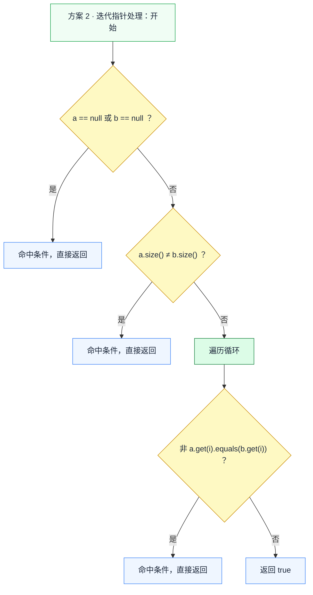

```java
package com.webfault.dsa; // 引入依赖

import java.util.*; // 引入依赖

class TreeNode2 { // 定义类型
  int val; // int 值;
  TreeNode2 left; // TreeNode2 左边界;
  TreeNode2 right; // TreeNode2 右边界;

  TreeNode2(int v) {
    val = v;
  } // 把 值; } 写入 TreeNode2(int v) { val

  TreeNode2(int v, TreeNode2 l, TreeNode2 r) {
    val = v;
    left = l;
    right = r;
  }
}

class Main { // 定义类型
  List<Integer> result = new ArrayList<>(); // 把 new ArrayList 小于 超过 (); 写入 List<Integer> result

  void dfs(TreeNode2 node, int depth) { // 定义函数/方法 dfs
    if (node == null) return; // 若 节点 等于 null) return;
    if (depth == result.size()) result.add(node.val); // 若 深度 等于 结果.大小()) 结果 追加 节点.值);
    dfs(node.right, depth + 1); // dfs(节点.右边界, 深度 加 1);
    dfs(node.left, depth + 1); // dfs(节点.左边界, 深度 加 1);
  }

  List<Integer> rightSideView(TreeNode2 root) { // 定义函数/方法 rightSideView
    result = new ArrayList<>(); // 把 new ArrayList 小于 超过 (); 写入 结果
    dfs(root, 0); // dfs(根节点, 0);
    return result; // 返回 结果
  }

  static boolean eqList(List<Integer> a, List<Integer> b) { // 定义函数/方法 eqList
    if (a == null || b == null) return a == b; // 若 数组 等于 null 或 b 等于 null，直接返回 数组 等于 b
    if (a.size() != b.size()) return false; // 若 数组.大小() 不等于 b.大小()，直接返回 false
    for (int i = 0; i < a.size(); i++)
      if (!a.get(i).equals(b.get(i))) return false; // 让 下标 i 从 0 开始计数，下标 i 小于 数组.大小() 就继续
    return true; // 返回 true
  }

  public static void main(String[] args) { // public static void main(String[] args) {
    Main s = new Main(); // 把 new Main(); 写入 Main s
    TreeNode2 r1 =
        new TreeNode2(
            1, new TreeNode2(2, null, new TreeNode2(5)), new TreeNode2(3, null, new TreeNode2(4)));
    TreeNode2 r2 = null; // 把 null; 写入 TreeNode2 r2
    TreeNode2 r3 = new TreeNode2(1); // 把 new TreeNode2(1); 写入 TreeNode2 r3
    Object[][] cases = { // 把 { 写入 Object[][] cases
      {r1, Arrays.asList(1, 3, 4)},
      {r2, new ArrayList<Integer>()},
      {r3, Arrays.asList(1)},
    };
    boolean ok = true; // 把 true; 写入 boolean ok
    for (Object[] c : cases) { // for (Object[] 字符 : cases) {
      List<Integer> got =
          s.rightSideView(
              (TreeNode2) c[0]); // 把 字符串.rightSideView((TreeNode2) 字符[0]); 写入 List<Integer> got
      if (!eqList(got, (List<Integer>) c[1])) { // 若 取反 eqList(got, (List 小于 Integer 超过 ) 字符[1]
        ok = false; // 把 false; 写入 ok
        System.out.println("FAIL rightSideView got=" + got + " want=" + c[1]); // 打印输出
      }
    }
    if (!ok) throw new RuntimeException("FAILED"); // 若 取反 ok) throw new RuntimeException(「FAILED」);
    System.out.println("PASS"); // 全部用例通过，输出 PASS
  }
}
```

### Rust 实现（2 种方案）

Rust 的全部方案如下，每个方案都内嵌用例自测，可独立运行（老仓库 python/go 文件遵循「打印结果」约定）：

#### 方案 1：迭代指针处理

**思路与代码分析**：核心是「迭代指针处理」。Rust 版用所有权移动与切片借用改写同一逻辑，注意 Option 与引用边界。**走读**：方案 1 · 迭代指针处理：开始 → 计算 result → 计算 node → 更新 Some(x) → 更新 None → 处理 if depth == result.len() → 向 result 追加记录 → 调用 dfs(node.borrow().right.as_r → 调用 dfs(node.borrow().left.as_re → 调用 dfs(root.as_ref(), 0, &mut r → 处理 result → 返回结果。

**运行架构**（真实控制流）：

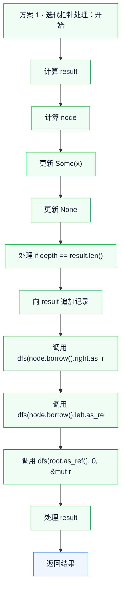

```rust
// LeetCode 199. 二叉树的右视图 — Rust 版（方案1）
use std::cell::RefCell;
use std::rc::Rc; // 引入依赖 // 引入依赖

#[derive(Debug)]
struct TreeNode {
    // 定义类型
    val: i32,
    left: Option<Rc<RefCell<TreeNode>>>,
    right: Option<Rc<RefCell<TreeNode>>>,
}

impl TreeNode {
    // 实现块
    fn new(val: i32) -> Rc<RefCell<TreeNode>> {
        // 定义函数/方法 new
        Rc::new(RefCell::new(TreeNode {
            val,
            left: None,
            right: None,
        })) // Rc::new(RefCell::new(TreeNode { 值, 左边界: None, 右边界: None }))
    }
}

fn build_tree(vals: &[Option<i32>]) -> Option<Rc<RefCell<TreeNode>>> {
    // 定义函数/方法 build_tree
    if vals.is_empty() || vals[0].is_none() {
        // 若 vals 是否为空 或 vals[0].is_none(
        return None; // 返回 None
    }
    let root = TreeNode::new(vals[0].unwrap()); // 把 TreeNode::new(vals[0].unwrap()) 存入 根节点
    let mut queue: Vec<Rc<RefCell<TreeNode>>> = vec![root.clone()];
    let mut i = 1; // 把 1; 写入 let mut i
    while !queue.is_empty() && i < vals.len() {
        // while 取反 队列 是否为空 且 下标 i 小于 vals.长度() {
        let node = queue.remove(0); // 把 队列 弹出 0) 存入 节点
        if i < vals.len() {
            // 若 下标 i 小于 vals.长度(
            if let Some(v) = vals[i] {
                // 若 let Some(值) 赋值为 vals[下标 i]
                let child = TreeNode::new(v); // 把 TreeNode::new(值) 存入 子节点
                node.borrow_mut().left = Some(child.clone()); // 把 Some(子节点.clone()); 写入 左边界
                queue.push(child); // 把 子节点 压入栈/数组尾部
            }
            i += 1; // 下标 i累加 1
        }
        if i < vals.len() {
            // 若 下标 i 小于 vals.长度(
            if let Some(v) = vals[i] {
                // 若 let Some(值) 赋值为 vals[下标 i]
                let child = TreeNode::new(v); // 把 TreeNode::new(值) 存入 子节点
                node.borrow_mut().right = Some(child.clone()); // 把 Some(子节点.clone()); 写入 右边界
                queue.push(child); // 把 子节点 压入栈/数组尾部
            }
            i += 1; // 下标 i累加 1
        }
    }
    Some(root) // Some(根节点)
}

fn right_side_view(root: Option<Rc<RefCell<TreeNode>>>) -> Vec<i32> {
    // 定义函数/方法 right_side_view
    let mut result = Vec::new(); // 把 Vec::new(); 写入 let mut result
    fn dfs(n: Option<&Rc<RefCell<TreeNode>>>, depth: usize, result: &mut Vec<i32>) {
        // 定义函数/方法 dfs
        let node = match n {
            Some(x) => x,
            None => return,
        };
        if depth == result.len() {
            result.push(node.borrow().val);
        } // 若 深度 等于 结果.长度() { 结果 追加 节点.borrow().值); }
        dfs(node.borrow().right.as_ref(), depth + 1, result); // dfs(节点.borrow().右边界.as_ref(), 深度 加 1, 结果);
        dfs(node.borrow().left.as_ref(), depth + 1, result); // dfs(节点.borrow().左边界.as_ref(), 深度 加 1, 结果);
    }
    dfs(root.as_ref(), 0, &mut result); // dfs(根节点.as_ref(), 0, 按位与 mut 结果);
    result // 结果
}
fn main() {
    // 程序入口：跑内嵌自测用例
    assert_eq!(
        right_side_view(build_tree(&[
            Some(1),
            Some(2),
            Some(3),
            None,
            Some(5),
            None,
            Some(4)
        ])),
        vec![1, 3, 4]
    ); // 断言校验
    assert_eq!(right_side_view(None), Vec::<i32>::new()); // 断言校验
    assert_eq!(right_side_view(build_tree(&[Some(1)])), vec![1]); // 断言校验
    println!("PASS"); // 全部用例通过，输出 PASS
}
```

#### 方案 2：迭代指针处理

**思路与代码分析**：核心是「迭代指针处理」。Rust 版用所有权移动与切片借用改写同一逻辑，注意 Option 与引用边界。**走读**：方案 2 · 迭代指针处理：开始 → 计算 result → 计算 node → 更新 Some(x) → 更新 None → 处理 if depth == result.len() → 向 result 追加记录 → 调用 dfs(node.borrow().right.as_r → 调用 dfs(node.borrow().left.as_re → 调用 dfs(root.as_ref(), 0, &mut r → 处理 result → 返回结果。

**运行架构**（真实控制流）：


```rust
// LeetCode 199. 二叉树的右视图 — Rust 版（方案2）
use std::cell::RefCell;
use std::rc::Rc; // 引入依赖 // 引入依赖

#[derive(Debug)]
struct TreeNode {
    // 定义类型
    val: i32,
    left: Option<Rc<RefCell<TreeNode>>>,
    right: Option<Rc<RefCell<TreeNode>>>,
}

impl TreeNode {
    // 实现块
    fn new(val: i32) -> Rc<RefCell<TreeNode>> {
        // 定义函数/方法 new
        Rc::new(RefCell::new(TreeNode {
            val,
            left: None,
            right: None,
        })) // Rc::new(RefCell::new(TreeNode { 值, 左边界: None, 右边界: None }))
    }
}

fn build_tree(vals: &[Option<i32>]) -> Option<Rc<RefCell<TreeNode>>> {
    // 定义函数/方法 build_tree
    if vals.is_empty() || vals[0].is_none() {
        // 若 vals 是否为空 或 vals[0].is_none(
        return None; // 返回 None
    }
    let root = TreeNode::new(vals[0].unwrap()); // 把 TreeNode::new(vals[0].unwrap()) 存入 根节点
    let mut queue: Vec<Rc<RefCell<TreeNode>>> = vec![root.clone()];
    let mut i = 1; // 把 1; 写入 let mut i
    while !queue.is_empty() && i < vals.len() {
        // while 取反 队列 是否为空 且 下标 i 小于 vals.长度() {
        let node = queue.remove(0); // 把 队列 弹出 0) 存入 节点
        if i < vals.len() {
            // 若 下标 i 小于 vals.长度(
            if let Some(v) = vals[i] {
                // 若 let Some(值) 赋值为 vals[下标 i]
                let child = TreeNode::new(v); // 把 TreeNode::new(值) 存入 子节点
                node.borrow_mut().left = Some(child.clone()); // 把 Some(子节点.clone()); 写入 左边界
                queue.push(child); // 把 子节点 压入栈/数组尾部
            }
            i += 1; // 下标 i累加 1
        }
        if i < vals.len() {
            // 若 下标 i 小于 vals.长度(
            if let Some(v) = vals[i] {
                // 若 let Some(值) 赋值为 vals[下标 i]
                let child = TreeNode::new(v); // 把 TreeNode::new(值) 存入 子节点
                node.borrow_mut().right = Some(child.clone()); // 把 Some(子节点.clone()); 写入 右边界
                queue.push(child); // 把 子节点 压入栈/数组尾部
            }
            i += 1; // 下标 i累加 1
        }
    }
    Some(root) // Some(根节点)
}

fn right_side_view(root: Option<Rc<RefCell<TreeNode>>>) -> Vec<i32> {
    // 定义函数/方法 right_side_view
    let mut result = Vec::new(); // 把 Vec::new(); 写入 let mut result
    fn dfs(n: Option<&Rc<RefCell<TreeNode>>>, depth: usize, result: &mut Vec<i32>) {
        // 定义函数/方法 dfs
        let node = match n {
            Some(x) => x,
            None => return,
        };
        if depth == result.len() {
            result.push(node.borrow().val);
        } // 若 深度 等于 结果.长度() { 结果 追加 节点.borrow().值); }
        dfs(node.borrow().right.as_ref(), depth + 1, result); // dfs(节点.borrow().右边界.as_ref(), 深度 加 1, 结果);
        dfs(node.borrow().left.as_ref(), depth + 1, result); // dfs(节点.borrow().左边界.as_ref(), 深度 加 1, 结果);
    }
    dfs(root.as_ref(), 0, &mut result); // dfs(根节点.as_ref(), 0, 按位与 mut 结果);
    result // 结果
}
fn main() {
    // 程序入口：跑内嵌自测用例
    assert_eq!(
        right_side_view(build_tree(&[
            Some(1),
            Some(2),
            Some(3),
            None,
            Some(5),
            None,
            Some(4)
        ])),
        vec![1, 3, 4]
    ); // 断言校验
    assert_eq!(right_side_view(None), Vec::<i32>::new()); // 断言校验
    assert_eq!(right_side_view(build_tree(&[Some(1)])), vec![1]); // 断言校验
    println!("PASS"); // 全部用例通过，输出 PASS
}
```

### Lua 实现（2 种方案）

Lua 的全部方案如下，每个方案都内嵌用例自测，可独立运行（老仓库 python/go 文件遵循「打印结果」约定）：

#### 方案 1：迭代指针处理

**思路与代码分析**：核心是「迭代指针处理」。Lua 版用表与 ipairs 遍历，注意 ipairs 遇 nil 即停的语义。**走读**：方案 1 · 迭代指针处理：开始 → 处理 if not vals or #vals == 0 or → 返回 nil → 当 head ≤ #queue and i ≤ #vals do 时反复执行 → 返回 root。

**运行架构**（真实控制流）：

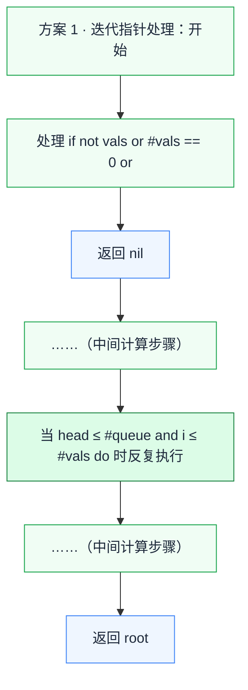

```lua
-- LeetCode 199. 二叉树的右视图 — Lua 版（方案1）
local TreeNode = {} -- 把 {} 写入 local TreeNode
TreeNode.__index = TreeNode -- 把 TreeNode 写入 TreeNode.__index
function TreeNode.new(val) -- function TreeNode.new(值)
	return setmetatable({ val = val, left = nil, right = nil }, TreeNode)
end -- 终点

local function build_tree(vals) -- local function build_tree(vals)
	if not vals or #vals == 0 or vals[1] == "null" then
		return nil
	end
	local root = TreeNode.new(vals[1]) -- 把 TreeNode.new(vals[1]) 写入 local root
	local queue = { root } -- 把 {根节点} 写入 local queue
	local head = 1 -- 把 1 写入 local head
	local i = 2 -- 把 2 写入 local i
	while head <= #queue and i <= #vals do -- 把 #队列 and 下标 i 不超过 #vals do 写入 while head <
		local node = queue[head] -- 把 队列[头节点] 写入 local node
		head = head + 1 -- 把 头节点 加 1 存入 头节点
		if i <= #vals then -- 若 下标 i 不超过 #vals then
			if vals[i] ~= "null" then -- 若 vals[下标 i] ~ 赋值为 「null」 then
				node.left = TreeNode.new(vals[i]) -- 把 TreeNode.new(vals[下标 i]) 写入 左边界
				queue[#queue + 1] = node.left -- 把 节点.左边界 写入 queue[#queue + 1]
			end -- 终点
			i = i + 1 -- 把 下标 i 加 1 存入 下标 i
		end -- 终点
		if i <= #vals then -- 若 下标 i 不超过 #vals then
			if vals[i] ~= "null" then -- 若 vals[下标 i] ~ 赋值为 「null」 then
				node.right = TreeNode.new(vals[i]) -- 把 TreeNode.new(vals[下标 i]) 写入 右边界
				queue[#queue + 1] = node.right -- 把 节点.右边界 写入 queue[#queue + 1]
			end -- 终点
			i = i + 1 -- 把 下标 i 加 1 存入 下标 i
		end -- 终点
	end -- 终点
	return root -- 返回 根节点
end -- 终点

local function right_side_view(root) -- local function right_side_view(根节点)
	local result = {} -- 把 {} 写入 local result
	local function dfs(n, depth) -- local function dfs(元素个数, 深度)
		if not n then
			return
		end -- 若 not 元素个数 then return 终点
		if depth == #result then
			result[#result + 1] = n.val
		end -- 若 深度 等于 #结果 then 结果[#结果 加 1] 赋值为 元素个数.值 终点
		dfs(n.right, depth + 1) -- dfs(元素个数.右边界, 深度 加 1)
		dfs(n.left, depth + 1) -- dfs(元素个数.左边界, 深度 加 1)
	end -- 终点
	dfs(root, 0) -- dfs(根节点, 0)
	return result -- 返回 结果
end -- 终点
local function eq(a, b) -- local function eq(数组, b)
	if #a ~= #b then
		return false
	end -- 若 #数组 ~ 赋值为 #b then return false 终点
	for i = 1, #a do
		if a[i] ~= b[i] then
			return false
		end
	end
	return true -- 返回 true
end -- 终点
assert(eq(right_side_view(build_tree({ 1, 2, 3, "null", 5, "null", 4 })), { 1, 3, 4 })) -- 断言校验
assert(eq(right_side_view(nil), {})) -- 断言校验
assert(eq(right_side_view(build_tree({ 1 })), { 1 })) -- 断言校验
print("PASS") -- 全部用例通过，输出 PASS
```

#### 方案 2：迭代指针处理

**思路与代码分析**：核心是「迭代指针处理」。Lua 版用表与 ipairs 遍历，注意 ipairs 遇 nil 即停的语义。**走读**：方案 2 · 迭代指针处理：开始 → 处理 if not vals or #vals == 0 or → 返回 nil → 当 head ≤ #queue and i ≤ #vals do 时反复执行 → 返回 root。

**运行架构**（真实控制流）：

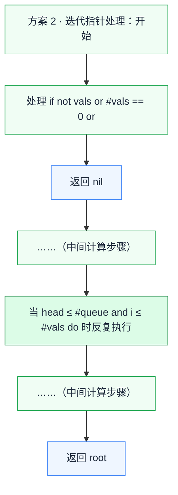

```lua
-- LeetCode 199. 二叉树的右视图 — Lua 版（方案2）
local TreeNode = {} -- 把 {} 写入 local TreeNode
TreeNode.__index = TreeNode -- 把 TreeNode 写入 TreeNode.__index
function TreeNode.new(val) -- function TreeNode.new(值)
	return setmetatable({ val = val, left = nil, right = nil }, TreeNode)
end -- 终点

local function build_tree(vals) -- local function build_tree(vals)
	if not vals or #vals == 0 or vals[1] == "null" then
		return nil
	end
	local root = TreeNode.new(vals[1]) -- 把 TreeNode.new(vals[1]) 写入 local root
	local queue = { root } -- 把 {根节点} 写入 local queue
	local head = 1 -- 把 1 写入 local head
	local i = 2 -- 把 2 写入 local i
	while head <= #queue and i <= #vals do -- 把 #队列 and 下标 i 不超过 #vals do 写入 while head <
		local node = queue[head] -- 把 队列[头节点] 写入 local node
		head = head + 1 -- 把 头节点 加 1 存入 头节点
		if i <= #vals then -- 若 下标 i 不超过 #vals then
			if vals[i] ~= "null" then -- 若 vals[下标 i] ~ 赋值为 「null」 then
				node.left = TreeNode.new(vals[i]) -- 把 TreeNode.new(vals[下标 i]) 写入 左边界
				queue[#queue + 1] = node.left -- 把 节点.左边界 写入 queue[#queue + 1]
			end -- 终点
			i = i + 1 -- 把 下标 i 加 1 存入 下标 i
		end -- 终点
		if i <= #vals then -- 若 下标 i 不超过 #vals then
			if vals[i] ~= "null" then -- 若 vals[下标 i] ~ 赋值为 「null」 then
				node.right = TreeNode.new(vals[i]) -- 把 TreeNode.new(vals[下标 i]) 写入 右边界
				queue[#queue + 1] = node.right -- 把 节点.右边界 写入 queue[#queue + 1]
			end -- 终点
			i = i + 1 -- 把 下标 i 加 1 存入 下标 i
		end -- 终点
	end -- 终点
	return root -- 返回 根节点
end -- 终点

local function right_side_view(root) -- local function right_side_view(根节点)
	local result = {} -- 把 {} 写入 local result
	local function dfs(n, depth) -- local function dfs(元素个数, 深度)
		if not n then
			return
		end -- 若 not 元素个数 then return 终点
		if depth == #result then
			result[#result + 1] = n.val
		end -- 若 深度 等于 #结果 then 结果[#结果 加 1] 赋值为 元素个数.值 终点
		dfs(n.right, depth + 1) -- dfs(元素个数.右边界, 深度 加 1)
		dfs(n.left, depth + 1) -- dfs(元素个数.左边界, 深度 加 1)
	end -- 终点
	dfs(root, 0) -- dfs(根节点, 0)
	return result -- 返回 结果
end -- 终点
local function eq(a, b) -- local function eq(数组, b)
	if #a ~= #b then
		return false
	end -- 若 #数组 ~ 赋值为 #b then return false 终点
	for i = 1, #a do
		if a[i] ~= b[i] then
			return false
		end
	end
	return true -- 返回 true
end -- 终点
assert(eq(right_side_view(build_tree({ 1, 2, 3, "null", 5, "null", 4 })), { 1, 3, 4 })) -- 断言校验
assert(eq(right_side_view(nil), {})) -- 断言校验
assert(eq(right_side_view(build_tree({ 1 })), { 1 })) -- 断言校验
print("PASS") -- 全部用例通过，输出 PASS
```

### C 实现（2 种方案）

C 的全部方案如下，每个方案都内嵌用例自测，可独立运行（老仓库 python/go 文件遵循「打印结果」约定）：

#### 方案 1：迭代指针处理

**思路与代码分析**：核心是「迭代指针处理」。C 版手动管理下标与内存，循环边界全部显式写出。**走读**：方案 1 · 迭代指针处理：开始 → 更新 cnt → 调用 dfs_rsv(root, 0, out, &cnt) → 返回 cnt。

**运行架构**（真实控制流）：

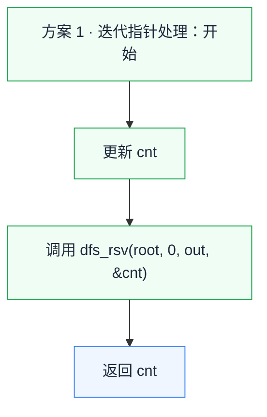

```c
/* LeetCode 199. 二叉树的右视图 — C 版（方案1） */
#include <stdio.h>                   // 引入头文件
#include <stdlib.h>                  // 引入头文件
#define INT_MIN_SN (-2147483647 - 1) // #define INT_MIN_SN ( 减 2147483647 减 1)

typedef struct TreeNode {   // typedef struct TreeNode {
    int val;                // int 值;
    struct TreeNode *left;  // 定义类型
    struct TreeNode *right; // 定义类型
} TreeNode;                 // } TreeNode;

static TreeNode *build_tree(const int *vals,
                            int n) { // static TreeNode 乘 build_tree(const int 乘 vals, int 元素个数) {
    if (n == 0 || vals[0] == INT_MIN_SN)
        return NULL; // 若 元素个数 等于 0 或 vals[0] 等于 INT_MIN_SN，直接返回 NULL
    TreeNode *root = malloc(sizeof(TreeNode)); // 把 malloc(sizeof(TreeNode)); 写入 TreeNode *root
    root->val = vals[0];
    root->left = root->right = NULL;
    TreeNode **queue =
        malloc(sizeof(TreeNode *) * n); // 把 malloc(sizeof(TreeNode 乘 ) 乘 元素个数); 写入 TreeNode **queue
    int head = 0, tail = 0, i = 1; // 把 0, 尾节点 赋值为 0, 下标 i 赋值为 1 存入 头节点
    queue[tail++] = root;          // 把 根节点; 写入 queue[tail++]
    while (head < tail && i < n) { // 循环，直到不满足「头节点 小于 尾节点 且 下标 i 小于 元素个数」
        TreeNode *node = queue[head++];                // 把 队列[头节点 加一 ]; 写入 TreeNode *node
        if (i < n) {                                   // 若 下标 i 小于 元素个数
            if (vals[i] != INT_MIN_SN) {               // 若 vals[下标 i] 不等于 INT_MIN_SN
                node->left = malloc(sizeof(TreeNode)); // 把 malloc(sizeof(TreeNode)); 写入 node->left
                node->left->val = vals[i];
                node->left->left = node->left->right = NULL;
                queue[tail++] = node->left; // 把 节点 减 超过 左边界; 写入 queue[tail++]
            }
            i++; // 下标 i 加一
        }
        if (i < n) {                                    // 若 下标 i 小于 元素个数
            if (vals[i] != INT_MIN_SN) {                // 若 vals[下标 i] 不等于 INT_MIN_SN
                node->right = malloc(sizeof(TreeNode)); // 把 malloc(sizeof(TreeNode)); 写入 node->right
                node->right->val = vals[i];
                node->right->left = node->right->right = NULL;
                queue[tail++] = node->right; // 把 节点 减 超过 右边界; 写入 queue[tail++]
            }
            i++; // 下标 i 加一
        }
    }
    free(queue); // free(队列);
    return root; // 返回 根节点
}

static void free_tree(TreeNode *n) { // 定义函数/方法 free_tree
    if (!n)
        return;          // 若 取反 元素个数) return;
    free_tree(n->left);  // free_tree(元素个数 减 超过 左边界);
    free_tree(n->right); // free_tree(元素个数 减 超过 右边界);
    free(n);             // free(元素个数);
}

static void dfs_rsv(TreeNode *n, int depth, int *out, int *cnt) { // 定义函数/方法 dfs_rsv
    if (!n)
        return; // 若 取反 元素个数) return;
    if (depth == *cnt)
        out[(*cnt)++] = n->val; // 若 深度 等于 乘 计数) out[( 乘 计数) 加一 ] 赋值为 元素个数 减 超过 值;
    dfs_rsv(n->right, depth + 1, out, cnt); // dfs_rsv(元素个数 减 超过 右边界, 深度 加 1, out, 计数);
    dfs_rsv(n->left, depth + 1, out, cnt); // dfs_rsv(元素个数 减 超过 左边界, 深度 加 1, out, 计数);
}
static int right_side_view(TreeNode *root, int out[]) { // 定义函数/方法 right_side_view
    int cnt = 0;                                        // 把 0 存入 计数
    dfs_rsv(root, 0, out, &cnt);                        // dfs_rsv(根节点, 0, out, 按位与 计数);
    return cnt;                                         // 返回 计数
}
int main(void) {                                        // 程序入口：跑内嵌自测用例
    int out[64], n;                                     // int out[64], 元素个数;
    int v1[] = {1, 2, 3, INT_MIN_SN, 5, INT_MIN_SN, 4}; // 把 {1,2,3,INT_MIN_SN,5,INT_MIN_SN,4}; 写入 int v1[]
    int w1[] = {1, 3, 4};                               // 把 {1,3,4}; 写入 int w1[]
    n = right_side_view(build_tree(v1, 7), out); // 把 right_side_view(build_tree(v1, 7), out); 写入 元素个数
    if (n != 3 || out[0] != 1 || out[1] != 3 || out[2] != 4) {
        printf("FAIL 1\n");
        return 1;
    }
    if (right_side_view(NULL, out) != 0) {
        printf("FAIL 2\n");
        return 1;
    }
    int v3[] = {1};                              // 把 {1}; 写入 int v3[]
    n = right_side_view(build_tree(v3, 1), out); // 把 right_side_view(build_tree(v3, 1), out); 写入 元素个数
    if (n != 1 || out[0] != 1) {
        printf("FAIL 3\n");
        return 1;
    } // 若 元素个数 不等于 1 或 out[0] 不等于 1) { 输出「FAIL 3 」); return 1; }
    printf("PASS\n"); // 全部用例通过，输出 PASS
    return 0;         // 返回 0
}
```

#### 方案 2：迭代指针处理

**思路与代码分析**：核心是「迭代指针处理」。C 版手动管理下标与内存，循环边界全部显式写出。**走读**：方案 2 · 迭代指针处理：开始 → 更新 cnt → 调用 dfs_rsv(root, 0, out, &cnt) → 返回 cnt。

**运行架构**（真实控制流）：

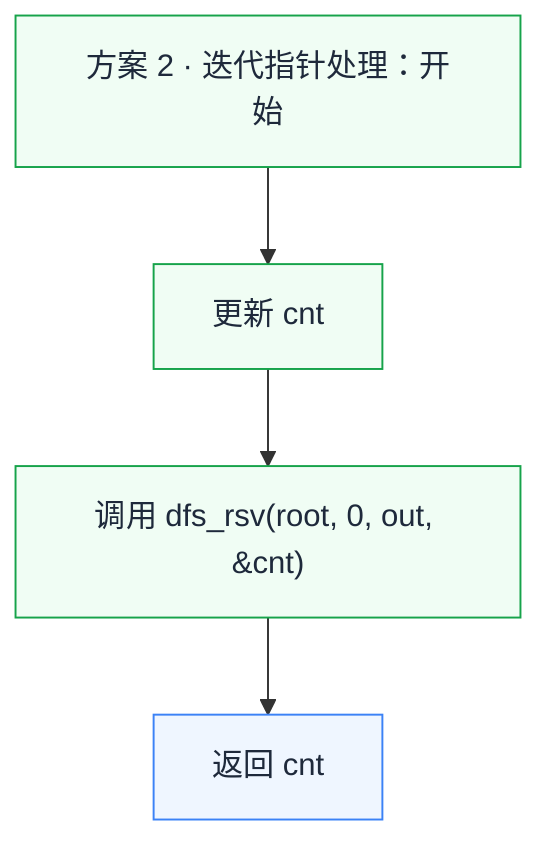

```c
/* LeetCode 199. 二叉树的右视图 — C 版（方案2） */
#include <stdio.h>                   // 引入头文件
#include <stdlib.h>                  // 引入头文件
#define INT_MIN_SN (-2147483647 - 1) // #define INT_MIN_SN ( 减 2147483647 减 1)

typedef struct TreeNode {   // typedef struct TreeNode {
    int val;                // int 值;
    struct TreeNode *left;  // 定义类型
    struct TreeNode *right; // 定义类型
} TreeNode;                 // } TreeNode;

static TreeNode *build_tree(const int *vals,
                            int n) { // static TreeNode 乘 build_tree(const int 乘 vals, int 元素个数) {
    if (n == 0 || vals[0] == INT_MIN_SN)
        return NULL; // 若 元素个数 等于 0 或 vals[0] 等于 INT_MIN_SN，直接返回 NULL
    TreeNode *root = malloc(sizeof(TreeNode)); // 把 malloc(sizeof(TreeNode)); 写入 TreeNode *root
    root->val = vals[0];
    root->left = root->right = NULL;
    TreeNode **queue =
        malloc(sizeof(TreeNode *) * n); // 把 malloc(sizeof(TreeNode 乘 ) 乘 元素个数); 写入 TreeNode **queue
    int head = 0, tail = 0, i = 1; // 把 0, 尾节点 赋值为 0, 下标 i 赋值为 1 存入 头节点
    queue[tail++] = root;          // 把 根节点; 写入 queue[tail++]
    while (head < tail && i < n) { // 循环，直到不满足「头节点 小于 尾节点 且 下标 i 小于 元素个数」
        TreeNode *node = queue[head++];                // 把 队列[头节点 加一 ]; 写入 TreeNode *node
        if (i < n) {                                   // 若 下标 i 小于 元素个数
            if (vals[i] != INT_MIN_SN) {               // 若 vals[下标 i] 不等于 INT_MIN_SN
                node->left = malloc(sizeof(TreeNode)); // 把 malloc(sizeof(TreeNode)); 写入 node->left
                node->left->val = vals[i];
                node->left->left = node->left->right = NULL;
                queue[tail++] = node->left; // 把 节点 减 超过 左边界; 写入 queue[tail++]
            }
            i++; // 下标 i 加一
        }
        if (i < n) {                                    // 若 下标 i 小于 元素个数
            if (vals[i] != INT_MIN_SN) {                // 若 vals[下标 i] 不等于 INT_MIN_SN
                node->right = malloc(sizeof(TreeNode)); // 把 malloc(sizeof(TreeNode)); 写入 node->right
                node->right->val = vals[i];
                node->right->left = node->right->right = NULL;
                queue[tail++] = node->right; // 把 节点 减 超过 右边界; 写入 queue[tail++]
            }
            i++; // 下标 i 加一
        }
    }
    free(queue); // free(队列);
    return root; // 返回 根节点
}

static void free_tree(TreeNode *n) { // 定义函数/方法 free_tree
    if (!n)
        return;          // 若 取反 元素个数) return;
    free_tree(n->left);  // free_tree(元素个数 减 超过 左边界);
    free_tree(n->right); // free_tree(元素个数 减 超过 右边界);
    free(n);             // free(元素个数);
}

static void dfs_rsv(TreeNode *n, int depth, int *out, int *cnt) { // 定义函数/方法 dfs_rsv
    if (!n)
        return; // 若 取反 元素个数) return;
    if (depth == *cnt)
        out[(*cnt)++] = n->val; // 若 深度 等于 乘 计数) out[( 乘 计数) 加一 ] 赋值为 元素个数 减 超过 值;
    dfs_rsv(n->right, depth + 1, out, cnt); // dfs_rsv(元素个数 减 超过 右边界, 深度 加 1, out, 计数);
    dfs_rsv(n->left, depth + 1, out, cnt); // dfs_rsv(元素个数 减 超过 左边界, 深度 加 1, out, 计数);
}
static int right_side_view(TreeNode *root, int out[]) { // 定义函数/方法 right_side_view
    int cnt = 0;                                        // 把 0 存入 计数
    dfs_rsv(root, 0, out, &cnt);                        // dfs_rsv(根节点, 0, out, 按位与 计数);
    return cnt;                                         // 返回 计数
}
int main(void) {                                        // 程序入口：跑内嵌自测用例
    int out[64], n;                                     // int out[64], 元素个数;
    int v1[] = {1, 2, 3, INT_MIN_SN, 5, INT_MIN_SN, 4}; // 把 {1,2,3,INT_MIN_SN,5,INT_MIN_SN,4}; 写入 int v1[]
    int w1[] = {1, 3, 4};                               // 把 {1,3,4}; 写入 int w1[]
    n = right_side_view(build_tree(v1, 7), out); // 把 right_side_view(build_tree(v1, 7), out); 写入 元素个数
    if (n != 3 || out[0] != 1 || out[1] != 3 || out[2] != 4) {
        printf("FAIL 1\n");
        return 1;
    }
    if (right_side_view(NULL, out) != 0) {
        printf("FAIL 2\n");
        return 1;
    }
    int v3[] = {1};                              // 把 {1}; 写入 int v3[]
    n = right_side_view(build_tree(v3, 1), out); // 把 right_side_view(build_tree(v3, 1), out); 写入 元素个数
    if (n != 1 || out[0] != 1) {
        printf("FAIL 3\n");
        return 1;
    } // 若 元素个数 不等于 1 或 out[0] 不等于 1) { 输出「FAIL 3 」); return 1; }
    printf("PASS\n"); // 全部用例通过，输出 PASS
    return 0;         // 返回 0
}
```

### C++ 实现（2 种方案）

C++ 的全部方案如下，每个方案都内嵌用例自测，可独立运行（老仓库 python/go 文件遵循「打印结果」约定）：

#### 方案 1：迭代指针处理

**思路与代码分析**：核心是「迭代指针处理」。C++ 版用 STL 容器与迭代器，减少手写下标错误。**走读**：方案 1 · 迭代指针处理：开始 → 处理 std::vector＜int＞ result → 更新 dfs → 命中条件，直接返回 → 若 depth == static_cast＜int＞(result.size())：调用 result.push_back(n-＞val) → 调用 result.push_back(n-＞val) → 调用 dfs(n-＞right, depth + 1) → 调用 dfs(n-＞left, depth + 1) → 调用 dfs(root, 0) → 返回 result。

**运行架构**（真实控制流）：


```cpp
// LeetCode 199. 二叉树的右视图 — C++ 版（方案1）
#include <cassert>  // 引入头文件
#include <cstdint>  // 引入头文件
#include <iostream> // 引入头文件
#include <optional> // 引入头文件
#include <queue>    // 引入头文件
#include <vector>   // 引入头文件

struct TreeNode {    // 定义类型
    int val;         // int 值;
    TreeNode *left;  // TreeNode 乘 左边界;
    TreeNode *right; // TreeNode 乘 右边界;
    explicit TreeNode(int v) : val(v), left(nullptr), right(nullptr) {}
};

static TreeNode *build_tree(const std::vector<std::optional<int>> &vals) {
    if (vals.empty() || !vals[0].has_value())
        return nullptr; // 若 vals 是否为空 或 取反 vals[0].has_value()，直接返回 nullptr
    auto *root = new TreeNode(*vals[0]); // 把 new TreeNode( 乘 vals[0]); 写入 auto *root
    std::queue<TreeNode *> q;            // std::队列 小于 TreeNode 乘 超过 节点;
    q.push(root);                        // 把 根节点 压入栈/数组尾部
    size_t i = 1;                        // 把 1; 写入 size_t i
    while (!q.empty() &&
           i < vals.size()) { // 循环，直到不满足「取反 节点 是否为空 且 下标 i 小于 vals.大小(」
        TreeNode *node = q.front();                  // 把 节点.front(); 写入 TreeNode *node
        q.pop();                                     // 弹出栈顶元素
        if (i < vals.size()) {                       // 若 下标 i 小于 vals.大小(
            if (vals[i].has_value()) {               // 若 vals[下标 i].has_value(
                node->left = new TreeNode(*vals[i]); // 把 new TreeNode( 乘 vals[下标 i]); 写入 node->left
                q.push(node->left);                  // 把 节点 减 超过 左边界 压入栈/数组尾部
            }
            ++i; // 加一 下标 i;
        }
        if (i < vals.size()) {                        // 若 下标 i 小于 vals.大小(
            if (vals[i].has_value()) {                // 若 vals[下标 i].has_value(
                node->right = new TreeNode(*vals[i]); // 把 new TreeNode( 乘 vals[下标 i]); 写入 node->right
                q.push(node->right); // 把 节点 减 超过 右边界 压入栈/数组尾部
            }
            ++i; // 加一 下标 i;
        }
    }
    return root; // 返回 根节点
}

static void free_tree(TreeNode *n) { // 定义函数/方法 free_tree
    if (!n)
        return;          // 若 取反 元素个数) return;
    free_tree(n->left);  // free_tree(元素个数 减 超过 左边界);
    free_tree(n->right); // free_tree(元素个数 减 超过 右边界);
    delete n;            // delete 元素个数;
}

static std::vector<int>
rightSideView(TreeNode *root) { // static std::vector 小于 int 超过 rightSideView(TreeNode 乘 根节点) {
    std::vector<int> result;    // std::vector 小于 int 超过 结果;
    std::function<void(TreeNode *, int)> dfs = [&](TreeNode *n, int depth) {
        if (!n)
            return; // 若 取反 元素个数) return;
        if (depth == static_cast<int>(result.size()))
            result.push_back(n->val); // 若 深度 等于 static_cast 小于 int 超过 (结果.大小())) 结果 追加
                                      // 元素个数 减 超过 值);
        dfs(n->right, depth + 1); // dfs(元素个数 减 超过 右边界, 深度 加 1);
        dfs(n->left, depth + 1);  // dfs(元素个数 减 超过 左边界, 深度 加 1);
    };
    dfs(root, 0);  // dfs(根节点, 0);
    return result; // 返回 结果
}
int main() { // 程序入口：跑内嵌自测用例
    assert((rightSideView(build_tree({1, 2, 3, std::nullopt, 5, std::nullopt, 4})) ==
            std::vector<int>{1, 3, 4}));                             // 断言校验
    assert(rightSideView(nullptr).empty());                          // 断言校验
    assert((rightSideView(build_tree({1})) == std::vector<int>{1})); // 断言校验
    std::cout << "PASS" << std::endl;                                // 全部用例通过，输出 PASS
    return 0;                                                        // 返回 0
}
```

#### 方案 2：迭代指针处理

**思路与代码分析**：核心是「迭代指针处理」。C++ 版用 STL 容器与迭代器，减少手写下标错误。**走读**：方案 2 · 迭代指针处理：开始 → 处理 std::vector＜int＞ result → 更新 dfs → 命中条件，直接返回 → 若 depth == static_cast＜int＞(result.size())：调用 result.push_back(n-＞val) → 调用 result.push_back(n-＞val) → 调用 dfs(n-＞right, depth + 1) → 调用 dfs(n-＞left, depth + 1) → 调用 dfs(root, 0) → 返回 result。

**运行架构**（真实控制流）：

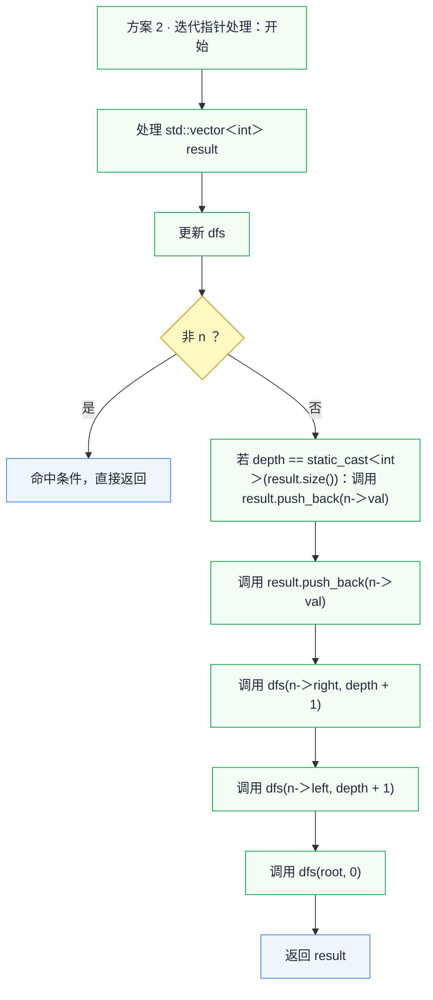

```cpp
// LeetCode 199. 二叉树的右视图 — C++ 版（方案2）
#include <cassert>  // 引入头文件
#include <cstdint>  // 引入头文件
#include <iostream> // 引入头文件
#include <optional> // 引入头文件
#include <queue>    // 引入头文件
#include <vector>   // 引入头文件

struct TreeNode {    // 定义类型
    int val;         // int 值;
    TreeNode *left;  // TreeNode 乘 左边界;
    TreeNode *right; // TreeNode 乘 右边界;
    explicit TreeNode(int v) : val(v), left(nullptr), right(nullptr) {}
};

static TreeNode *build_tree(const std::vector<std::optional<int>> &vals) {
    if (vals.empty() || !vals[0].has_value())
        return nullptr; // 若 vals 是否为空 或 取反 vals[0].has_value()，直接返回 nullptr
    auto *root = new TreeNode(*vals[0]); // 把 new TreeNode( 乘 vals[0]); 写入 auto *root
    std::queue<TreeNode *> q;            // std::队列 小于 TreeNode 乘 超过 节点;
    q.push(root);                        // 把 根节点 压入栈/数组尾部
    size_t i = 1;                        // 把 1; 写入 size_t i
    while (!q.empty() &&
           i < vals.size()) { // 循环，直到不满足「取反 节点 是否为空 且 下标 i 小于 vals.大小(」
        TreeNode *node = q.front();                  // 把 节点.front(); 写入 TreeNode *node
        q.pop();                                     // 弹出栈顶元素
        if (i < vals.size()) {                       // 若 下标 i 小于 vals.大小(
            if (vals[i].has_value()) {               // 若 vals[下标 i].has_value(
                node->left = new TreeNode(*vals[i]); // 把 new TreeNode( 乘 vals[下标 i]); 写入 node->left
                q.push(node->left);                  // 把 节点 减 超过 左边界 压入栈/数组尾部
            }
            ++i; // 加一 下标 i;
        }
        if (i < vals.size()) {                        // 若 下标 i 小于 vals.大小(
            if (vals[i].has_value()) {                // 若 vals[下标 i].has_value(
                node->right = new TreeNode(*vals[i]); // 把 new TreeNode( 乘 vals[下标 i]); 写入 node->right
                q.push(node->right); // 把 节点 减 超过 右边界 压入栈/数组尾部
            }
            ++i; // 加一 下标 i;
        }
    }
    return root; // 返回 根节点
}

static void free_tree(TreeNode *n) { // 定义函数/方法 free_tree
    if (!n)
        return;          // 若 取反 元素个数) return;
    free_tree(n->left);  // free_tree(元素个数 减 超过 左边界);
    free_tree(n->right); // free_tree(元素个数 减 超过 右边界);
    delete n;            // delete 元素个数;
}

static std::vector<int>
rightSideView(TreeNode *root) { // static std::vector 小于 int 超过 rightSideView(TreeNode 乘 根节点) {
    std::vector<int> result;    // std::vector 小于 int 超过 结果;
    std::function<void(TreeNode *, int)> dfs = [&](TreeNode *n, int depth) {
        if (!n)
            return; // 若 取反 元素个数) return;
        if (depth == static_cast<int>(result.size()))
            result.push_back(n->val); // 若 深度 等于 static_cast 小于 int 超过 (结果.大小())) 结果 追加
                                      // 元素个数 减 超过 值);
        dfs(n->right, depth + 1); // dfs(元素个数 减 超过 右边界, 深度 加 1);
        dfs(n->left, depth + 1);  // dfs(元素个数 减 超过 左边界, 深度 加 1);
    };
    dfs(root, 0);  // dfs(根节点, 0);
    return result; // 返回 结果
}
int main() { // 程序入口：跑内嵌自测用例
    assert((rightSideView(build_tree({1, 2, 3, std::nullopt, 5, std::nullopt, 4})) ==
            std::vector<int>{1, 3, 4}));                             // 断言校验
    assert(rightSideView(nullptr).empty());                          // 断言校验
    assert((rightSideView(build_tree({1})) == std::vector<int>{1})); // 断言校验
    std::cout << "PASS" << std::endl;                                // 全部用例通过，输出 PASS
    return 0;                                                        // 返回 0
}
```

### R 实现（2 种方案）

R 的全部方案如下，每个方案都内嵌用例自测，可独立运行（老仓库 python/go 文件遵循「打印结果」约定）：

#### 方案 1：迭代指针处理

**思路与代码分析**：核心是「迭代指针处理」。R 版用向量化思维与 1 起始下标，注意 1:n 的降序陷阱。**走读**：方案 1 · 迭代指针处理：开始 → 更新 new.env(parent → 处理 e$val ＜- val → 处理 e$left ＜- left → 处理 e$right ＜- right → 调用 class(e) ＜- TreeNode → 处理 e → 返回结果。

**运行架构**（真实控制流）：

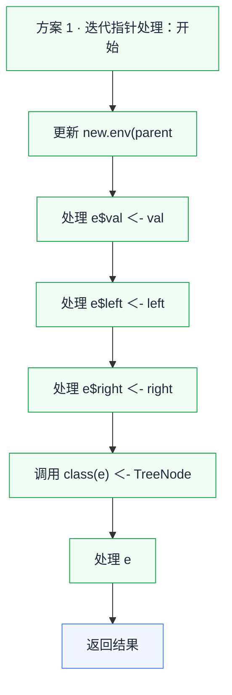

```r
# 版（方案1） 树节点：R 必须 environment 引用语义（list 是值语义） 定义函数 TreeNode（参数：值, 左边界 赋值为
# NULL, 右边界 赋值为 NULL）
TreeNode <- function(val, left = NULL, right = NULL) {
    e <- new.env(parent = emptyenv())  # 把 new.env(parent 赋值为 emptyenv()) 存入 e
    e$val <- val
    e$left <- left
    e$right <- right  # 把 值; e$左边界 小于 减 左边界; e$右边界 小于 减 右边界 存入 e$val
    class(e) <- "TreeNode"  # 把 「TreeNode」 存入 class(e)
    e
}
build_tree <- function(vals) {
    # 定义函数 build_tree（参数：vals）
    if (length(vals) == 0 || is.na(vals[[1]]))
        return(NULL)  # 若 长度(vals) 等于 0 或 is.na(vals[[1]])) return(NULL
    root <- TreeNode(vals[[1]])  # 把 TreeNode(vals[[1]]) 存入 根节点
    queue <- list(root)  # 把 列表(根节点) 存入 队列
    head <- 1L  # 把 1L 存入 头节点
    i <- 2L  # 把 2L 存入 下标 i
    while (head <= length(queue) && i <= length(vals)) {
        # 循环，直到不满足「头节点 不超过 长度(队列) 且 下标 i 不超过 长度(vals」
        node <- queue[[head]]  # 把 队列[[头节点]] 存入 节点
        head <- head + 1L  # 把 头节点 加 1L 存入 头节点
        if (i <= length(vals)) {
            # 若 下标 i 不超过 长度(vals 若 取反 is.na(vals[[下标 i]]
            if (!is.na(vals[[i]])) {
                node$left <- TreeNode(vals[[i]])  # 把 TreeNode(vals[[下标 i]]) 存入 node$left
                queue[[length(queue) + 1L]] <- node$left  # 队列[[长度(队列) 加 1L]] 小于 减 节点$左边界
            }
            i <- i + 1L  # 把 下标 i 加 1L 存入 下标 i
        }
        if (i <= length(vals)) {
            # 若 下标 i 不超过 长度(vals 若 取反 is.na(vals[[下标 i]]
            if (!is.na(vals[[i]])) {
                node$right <- TreeNode(vals[[i]])  # 把 TreeNode(vals[[下标 i]]) 存入 node$right
                queue[[length(queue) + 1L]] <- node$right  # 队列[[长度(队列) 加 1L]] 小于 减 节点$右边界
            }
            i <- i + 1L  # 把 下标 i 加 1L 存入 下标 i
        }
    }
    root  # 根节点
}
# 层序转列表（用于断言输出） 定义函数 tree_to_levels（参数：根节点）
tree_to_levels <- function(root) {
    if (is.null(root))
        return(list())  # 若 is.null(根节点)) return(列表(
    res <- list()  # 把 列表() 存入 结果
    level <- list(root)  # 把 列表(根节点) 存入 level
    while (length(level) > 0) {
        # 循环，直到不满足「长度(level) 超过 0」
        vals <- list()
        nxt <- list()  # 把 列表(); nxt 小于 减 列表() 存入 vals
        for (nd in level) {
            # for (nd in level) {
            vals[[length(vals) + 1L]] <- nd$val  # vals[[长度(vals) 加 1L]] 小于 减 nd$值
            if (!is.null(nd$left))
                nxt[[length(nxt) + 1L]] <- nd$left  # 若 取反 is.null(nd$左边界)) nxt[[长度(nxt) 加 1L]] 小于 减 nd$左边界
            if (!is.null(nd$right))
                nxt[[length(nxt) + 1L]] <- nd$right  # 若 取反 is.null(nd$右边界)) nxt[[长度(nxt) 加 1L]] 小于 减 nd$右边界
        }
        res[[length(res) + 1L]] <- unlist(vals)  # 结果[[长度(结果) 加 1L]] 小于 减 unlist(vals)
        level <- nxt  # 把 nxt 存入 level
    }
    res  # 结果
}
right_side_view <- function(root) {
    # 定义函数 right_side_view（参数：根节点）
    result <- integer(0)  # 把 integer(0) 存入 结果
    dfs <- function(n, depth) {
        # 定义函数 dfs（参数：元素个数, 深度）
        if (is.null(n))
            return(invisible(NULL))  # 若 is.null(元素个数)) return(invisible(NULL
        if (depth == length(result))
            result[[length(result) + 1L]] <<- n$val  # 若 深度 等于 长度(结果)) 结果[[长度(结果) 加 1L]] 小于 小于 减 元素个数$值
        dfs(n$right, depth + 1L)  # dfs(元素个数$右边界, 深度 加 1L)
        dfs(n$left, depth + 1L)  # dfs(元素个数$左边界, 深度 加 1L)
    }
    dfs(root, 0L)  # dfs(根节点, 0L)
    result  # 结果
}
stopifnot(identical(right_side_view(build_tree(list(1L, 2L, 3L, NA, 5L, NA, 4L))), c(1L, 3L, 4L)))  # 断言校验
stopifnot(identical(right_side_view(NULL), integer(0)))  # 断言校验
stopifnot(identical(right_side_view(build_tree(list(1L))), 1L))  # 断言校验
cat("PASS\n")  # 全部用例通过，输出 PASS
```

#### 方案 2：迭代指针处理

**思路与代码分析**：核心是「迭代指针处理」。R 版用向量化思维与 1 起始下标，注意 1:n 的降序陷阱。**走读**：方案 2 · 迭代指针处理：开始 → 更新 new.env(parent → 处理 e$val ＜- val → 处理 e$left ＜- left → 处理 e$right ＜- right → 调用 class(e) ＜- TreeNode → 处理 e → 返回结果。

**运行架构**（真实控制流）：

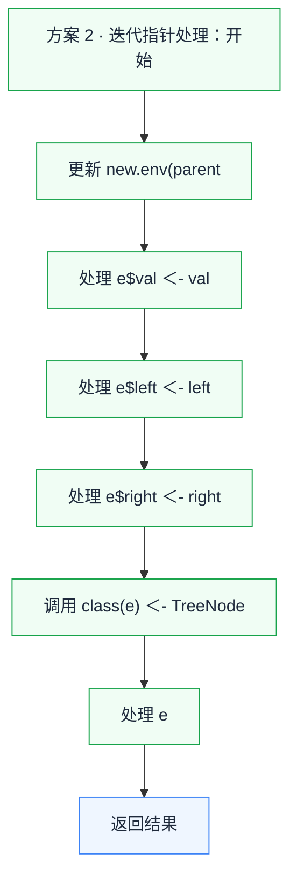

```r
# 版（方案2） 树节点：R 必须 environment 引用语义（list 是值语义） 定义函数 TreeNode（参数：值, 左边界 赋值为
# NULL, 右边界 赋值为 NULL）
TreeNode <- function(val, left = NULL, right = NULL) {
    e <- new.env(parent = emptyenv())  # 把 new.env(parent 赋值为 emptyenv()) 存入 e
    e$val <- val
    e$left <- left
    e$right <- right  # 把 值; e$左边界 小于 减 左边界; e$右边界 小于 减 右边界 存入 e$val
    class(e) <- "TreeNode"  # 把 「TreeNode」 存入 class(e)
    e
}
build_tree <- function(vals) {
    # 定义函数 build_tree（参数：vals）
    if (length(vals) == 0 || is.na(vals[[1]]))
        return(NULL)  # 若 长度(vals) 等于 0 或 is.na(vals[[1]])) return(NULL
    root <- TreeNode(vals[[1]])  # 把 TreeNode(vals[[1]]) 存入 根节点
    queue <- list(root)  # 把 列表(根节点) 存入 队列
    head <- 1L  # 把 1L 存入 头节点
    i <- 2L  # 把 2L 存入 下标 i
    while (head <= length(queue) && i <= length(vals)) {
        # 循环，直到不满足「头节点 不超过 长度(队列) 且 下标 i 不超过 长度(vals」
        node <- queue[[head]]  # 把 队列[[头节点]] 存入 节点
        head <- head + 1L  # 把 头节点 加 1L 存入 头节点
        if (i <= length(vals)) {
            # 若 下标 i 不超过 长度(vals 若 取反 is.na(vals[[下标 i]]
            if (!is.na(vals[[i]])) {
                node$left <- TreeNode(vals[[i]])  # 把 TreeNode(vals[[下标 i]]) 存入 node$left
                queue[[length(queue) + 1L]] <- node$left  # 队列[[长度(队列) 加 1L]] 小于 减 节点$左边界
            }
            i <- i + 1L  # 把 下标 i 加 1L 存入 下标 i
        }
        if (i <= length(vals)) {
            # 若 下标 i 不超过 长度(vals 若 取反 is.na(vals[[下标 i]]
            if (!is.na(vals[[i]])) {
                node$right <- TreeNode(vals[[i]])  # 把 TreeNode(vals[[下标 i]]) 存入 node$right
                queue[[length(queue) + 1L]] <- node$right  # 队列[[长度(队列) 加 1L]] 小于 减 节点$右边界
            }
            i <- i + 1L  # 把 下标 i 加 1L 存入 下标 i
        }
    }
    root  # 根节点
}
# 层序转列表（用于断言输出） 定义函数 tree_to_levels（参数：根节点）
tree_to_levels <- function(root) {
    if (is.null(root))
        return(list())  # 若 is.null(根节点)) return(列表(
    res <- list()  # 把 列表() 存入 结果
    level <- list(root)  # 把 列表(根节点) 存入 level
    while (length(level) > 0) {
        # 循环，直到不满足「长度(level) 超过 0」
        vals <- list()
        nxt <- list()  # 把 列表(); nxt 小于 减 列表() 存入 vals
        for (nd in level) {
            # for (nd in level) {
            vals[[length(vals) + 1L]] <- nd$val  # vals[[长度(vals) 加 1L]] 小于 减 nd$值
            if (!is.null(nd$left))
                nxt[[length(nxt) + 1L]] <- nd$left  # 若 取反 is.null(nd$左边界)) nxt[[长度(nxt) 加 1L]] 小于 减 nd$左边界
            if (!is.null(nd$right))
                nxt[[length(nxt) + 1L]] <- nd$right  # 若 取反 is.null(nd$右边界)) nxt[[长度(nxt) 加 1L]] 小于 减 nd$右边界
        }
        res[[length(res) + 1L]] <- unlist(vals)  # 结果[[长度(结果) 加 1L]] 小于 减 unlist(vals)
        level <- nxt  # 把 nxt 存入 level
    }
    res  # 结果
}
right_side_view <- function(root) {
    # 定义函数 right_side_view（参数：根节点）
    result <- integer(0)  # 把 integer(0) 存入 结果
    dfs <- function(n, depth) {
        # 定义函数 dfs（参数：元素个数, 深度）
        if (is.null(n))
            return(invisible(NULL))  # 若 is.null(元素个数)) return(invisible(NULL
        if (depth == length(result))
            result[[length(result) + 1L]] <<- n$val  # 若 深度 等于 长度(结果)) 结果[[长度(结果) 加 1L]] 小于 小于 减 元素个数$值
        dfs(n$right, depth + 1L)  # dfs(元素个数$右边界, 深度 加 1L)
        dfs(n$left, depth + 1L)  # dfs(元素个数$左边界, 深度 加 1L)
    }
    dfs(root, 0L)  # dfs(根节点, 0L)
    result  # 结果
}
stopifnot(identical(right_side_view(build_tree(list(1L, 2L, 3L, NA, 5L, NA, 4L))), c(1L, 3L, 4L)))  # 断言校验
stopifnot(identical(right_side_view(NULL), integer(0)))  # 断言校验
stopifnot(identical(right_side_view(build_tree(list(1L))), 1L))  # 断言校验
cat("PASS\n")  # 全部用例通过，输出 PASS
```

### Zig 实现（2 种方案）

Zig 的全部方案如下，每个方案都内嵌用例自测，可独立运行（老仓库 python/go 文件遵循「打印结果」约定）：

#### 方案 1：迭代指针处理

**思路与代码分析**：核心是「迭代指针处理」。Zig 版显式分配与清零，整型边界处理严格。**走读**：方案 1 · 迭代指针处理：开始 → 计算 D → 计算 node → 若 depth == o.items.len) o.append(node.val：处理 catch unreachable → 调用 dfs(node.right, depth + 1, o → 调用 dfs(node.left, depth + 1, o) → 调用 D.dfs(root, 0, out) → 返回结果。

**运行架构**（真实控制流）：

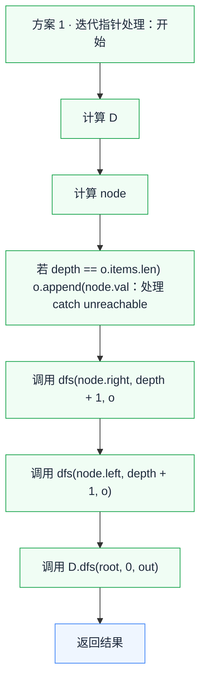

```zig
// LeetCode 199. 二叉树的右视图 — Zig 版（方案1）
const std = @import("std"); // 把 @import(「std」) 存入 std

const TreeNode = struct { // 把 struct { 存入 TreeNode
    val: i32,
    left: ?*TreeNode,
    right: ?*TreeNode,
};

fn buildTree(allocator: std.mem.Allocator, vals: []const i32) !?*TreeNode { // 定义函数/方法 buildTree
    if (vals.len == 0 or vals[0] == -1) return null; // 若 vals.长度 等于 0 or vals[0] 等于 减 1，直接返回 null
    const root = try allocator.create(TreeNode); // 把 try allocator.create(TreeNode) 存入 根节点
    root.* = .{ .val = vals[0], .left = null, .right = null };
    var queue = std.ArrayList(*TreeNode).init(allocator); // 把 std.ArrayList( 乘 TreeNode).init(allocator) 存入 队列
    defer queue.deinit(); // defer 队列.deinit();
    try queue.append(root); // 把 根节点 追加到列表尾部
    var head: usize = 0; // 把 0; 写入 var head: usize
    var i: usize = 1; // 把 1; 写入 var i: usize
    while (head < queue.items.len and i < vals.len) { // 循环，直到不满足「头节点 小于 队列.items.长度 and 下标 i 小于 vals.长度」
        const node = queue.items[head]; // 把 队列.items[头节点] 存入 节点
        head += 1; // 头节点累加 1
        if (i < vals.len) { // 若 下标 i 小于 vals.长度
            if (vals[i] != -1) { // 若 vals[下标 i] 不等于 减 1
                const child = try allocator.create(TreeNode); // 把 try allocator.create(TreeNode) 存入 子节点
                child.* = .{ .val = vals[i], .left = null, .right = null };
                node.left = child; // 把 子节点; 写入 左边界
                try queue.append(child); // 把 子节点 追加到列表尾部
            }
            i += 1; // 下标 i累加 1
        }
        if (i < vals.len) { // 若 下标 i 小于 vals.长度
            if (vals[i] != -1) { // 若 vals[下标 i] 不等于 减 1
                const child = try allocator.create(TreeNode); // 把 try allocator.create(TreeNode) 存入 子节点
                child.* = .{ .val = vals[i], .left = null, .right = null };
                node.right = child; // 把 子节点; 写入 右边界
                try queue.append(child); // 把 子节点 追加到列表尾部
            }
            i += 1; // 下标 i累加 1
        }
    }
    return root; // 返回 根节点
}

fn rightSideView(root: ?*TreeNode, out: *std.ArrayList(i32)) void { // 定义函数/方法 rightSideView
    const D = struct { // 把 struct { 存入 D
        fn dfs(n: ?*TreeNode, depth: usize, o: *std.ArrayList(i32)) void { // 定义函数/方法 dfs
            const node = n orelse return; // 把 元素个数 orelse return 存入 节点
            if (depth == o.items.len) o.append(node.val) catch unreachable; // 若 深度 等于 o.items.长度) o 追加 节点.值) catch unreachable;
            dfs(node.right, depth + 1, o); // dfs(节点.右边界, 深度 加 1, o);
            dfs(node.left, depth + 1, o); // dfs(节点.左边界, 深度 加 1, o);
        }
    };
    D.dfs(root, 0, out); // D.dfs(根节点, 0, out);
}
pub fn main() !void { // 程序入口：跑内嵌自测用例
    var arena = std.heap.ArenaAllocator.init(std.heap.page_allocator); // 把 std.堆.ArenaAllocator.init(std.堆.page_allocator) 存入 arena
    defer arena.deinit(); // defer arena.deinit();
    const alloc = arena.allocator(); // 把 arena.allocator() 存入 alloc
    var out = std.ArrayList(i32).init(std.heap.page_allocator); // 把 std.ArrayList(i32).init(std.堆.page_allocator) 存入 out
    defer out.deinit(); // defer out.deinit();
    rightSideView(try buildTree(alloc, &[_]i32{ 1, 2, 3, -1, 5, -1, 4 }), &out);
    const w1 = [_]i32{ 1, 3, 4 }; // 把 [_]i32{ 1, 3, 4 } 存入 w1
    if (out.items.len != w1.len) return error.TestFailed; // 若 out.items.长度 不等于 w1.长度，直接返回 error.TestFailed
    for (w1, 0..) |w, i| if (out.items[i] != w) return error.TestFailed;
    out.clearRetainingCapacity(); // out.clearRetainingCapacity();
    rightSideView(null, &out); // rightSideView(null, 按位与 out);
    if (out.items.len != 0) return error.TestFailed; // 若 out.items.长度 不等于 0，直接返回 error.TestFailed
    out.clearRetainingCapacity(); // out.clearRetainingCapacity();
    rightSideView(try buildTree(alloc, &[_]i32{1}), &out); // rightSideView(try buildTree(alloc, 按位与 [_]i32{1}), 按位与 out);
    if (out.items.len != 1 or out.items[0] != 1) return error.TestFailed;
    std.debug.print("PASS\n", .{}); // 全部用例通过，输出 PASS
}
```

#### 方案 2：迭代指针处理

**思路与代码分析**：核心是「迭代指针处理」。Zig 版显式分配与清零，整型边界处理严格。**走读**：方案 2 · 迭代指针处理：开始 → 计算 D → 计算 node → 若 depth == o.items.len) o.append(node.val：处理 catch unreachable → 调用 dfs(node.right, depth + 1, o → 调用 dfs(node.left, depth + 1, o) → 调用 D.dfs(root, 0, out) → 返回结果。

**运行架构**（真实控制流）：

```mermaid
graph TD
    N0["方案 2 · 迭代指针处理：开始"]
    N1["计算 D"]
    N2["计算 node"]
    N3["若 depth == o.items.len) o.append(node.val：处理 catch unreachable"]
    N4["调用 dfs(node.right, depth + 1, o"]
    N5["调用 dfs(node.left, depth + 1, o)"]
    N6["调用 D.dfs(root, 0, out)"]
    N7["返回结果"]
    N0 --> N1
    N1 --> N2
    N2 --> N3
    N3 --> N4
    N4 --> N5
    N5 --> N6
    N6 --> N7
    classDef n fill:#f0fdf4,stroke:#16a34a,color:#1e293b;
    classDef lp fill:#dcfce7,stroke:#15803d,color:#1e293b;
    classDef dc fill:#fef9c3,stroke:#ca8a04,color:#1e293b;
    classDef tm fill:#eff6ff,stroke:#3b82f6,color:#1e293b;
    class N0,N1,N2,N3,N4,N5,N6 n;
    class N7 tm;
```

```zig
// LeetCode 199. 二叉树的右视图 — Zig 版（方案2）
const std = @import("std"); // 把 @import(「std」) 存入 std

const TreeNode = struct { // 把 struct { 存入 TreeNode
    val: i32,
    left: ?*TreeNode,
    right: ?*TreeNode,
};

fn buildTree(allocator: std.mem.Allocator, vals: []const i32) !?*TreeNode { // 定义函数/方法 buildTree
    if (vals.len == 0 or vals[0] == -1) return null; // 若 vals.长度 等于 0 or vals[0] 等于 减 1，直接返回 null
    const root = try allocator.create(TreeNode); // 把 try allocator.create(TreeNode) 存入 根节点
    root.* = .{ .val = vals[0], .left = null, .right = null };
    var queue = std.ArrayList(*TreeNode).init(allocator); // 把 std.ArrayList( 乘 TreeNode).init(allocator) 存入 队列
    defer queue.deinit(); // defer 队列.deinit();
    try queue.append(root); // 把 根节点 追加到列表尾部
    var head: usize = 0; // 把 0; 写入 var head: usize
    var i: usize = 1; // 把 1; 写入 var i: usize
    while (head < queue.items.len and i < vals.len) { // 循环，直到不满足「头节点 小于 队列.items.长度 and 下标 i 小于 vals.长度」
        const node = queue.items[head]; // 把 队列.items[头节点] 存入 节点
        head += 1; // 头节点累加 1
        if (i < vals.len) { // 若 下标 i 小于 vals.长度
            if (vals[i] != -1) { // 若 vals[下标 i] 不等于 减 1
                const child = try allocator.create(TreeNode); // 把 try allocator.create(TreeNode) 存入 子节点
                child.* = .{ .val = vals[i], .left = null, .right = null };
                node.left = child; // 把 子节点; 写入 左边界
                try queue.append(child); // 把 子节点 追加到列表尾部
            }
            i += 1; // 下标 i累加 1
        }
        if (i < vals.len) { // 若 下标 i 小于 vals.长度
            if (vals[i] != -1) { // 若 vals[下标 i] 不等于 减 1
                const child = try allocator.create(TreeNode); // 把 try allocator.create(TreeNode) 存入 子节点
                child.* = .{ .val = vals[i], .left = null, .right = null };
                node.right = child; // 把 子节点; 写入 右边界
                try queue.append(child); // 把 子节点 追加到列表尾部
            }
            i += 1; // 下标 i累加 1
        }
    }
    return root; // 返回 根节点
}

fn rightSideView(root: ?*TreeNode, out: *std.ArrayList(i32)) void { // 定义函数/方法 rightSideView
    const D = struct { // 把 struct { 存入 D
        fn dfs(n: ?*TreeNode, depth: usize, o: *std.ArrayList(i32)) void { // 定义函数/方法 dfs
            const node = n orelse return; // 把 元素个数 orelse return 存入 节点
            if (depth == o.items.len) o.append(node.val) catch unreachable; // 若 深度 等于 o.items.长度) o 追加 节点.值) catch unreachable;
            dfs(node.right, depth + 1, o); // dfs(节点.右边界, 深度 加 1, o);
            dfs(node.left, depth + 1, o); // dfs(节点.左边界, 深度 加 1, o);
        }
    };
    D.dfs(root, 0, out); // D.dfs(根节点, 0, out);
}
pub fn main() !void { // 程序入口：跑内嵌自测用例
    var arena = std.heap.ArenaAllocator.init(std.heap.page_allocator); // 把 std.堆.ArenaAllocator.init(std.堆.page_allocator) 存入 arena
    defer arena.deinit(); // defer arena.deinit();
    const alloc = arena.allocator(); // 把 arena.allocator() 存入 alloc
    var out = std.ArrayList(i32).init(std.heap.page_allocator); // 把 std.ArrayList(i32).init(std.堆.page_allocator) 存入 out
    defer out.deinit(); // defer out.deinit();
    rightSideView(try buildTree(alloc, &[_]i32{ 1, 2, 3, -1, 5, -1, 4 }), &out);
    const w1 = [_]i32{ 1, 3, 4 }; // 把 [_]i32{ 1, 3, 4 } 存入 w1
    if (out.items.len != w1.len) return error.TestFailed; // 若 out.items.长度 不等于 w1.长度，直接返回 error.TestFailed
    for (w1, 0..) |w, i| if (out.items[i] != w) return error.TestFailed;
    out.clearRetainingCapacity(); // out.clearRetainingCapacity();
    rightSideView(null, &out); // rightSideView(null, 按位与 out);
    if (out.items.len != 0) return error.TestFailed; // 若 out.items.长度 不等于 0，直接返回 error.TestFailed
    out.clearRetainingCapacity(); // out.clearRetainingCapacity();
    rightSideView(try buildTree(alloc, &[_]i32{1}), &out); // rightSideView(try buildTree(alloc, 按位与 [_]i32{1}), 按位与 out);
    if (out.items.len != 1 or out.items[0] != 1) return error.TestFailed;
    std.debug.print("PASS\n", .{}); // 全部用例通过，输出 PASS
}
```

### Dart 实现（2 种方案）

Dart 的全部方案如下，每个方案都内嵌用例自测，可独立运行（老仓库 python/go 文件遵循「打印结果」约定）：

#### 方案 1：迭代指针处理

**思路与代码分析**：核心是「迭代指针处理」。Dart 版用可空类型标注与集合方法，注意空安全。**走读**：方案 1 · 迭代指针处理：开始 → 更新 result → 处理 void dfs(TreeNode? n, int de → 命中条件，直接返回 → 若 depth == result.length：调用 result.add(n.val) → 调用 result.add(n.val) → 调用 dfs(n.right, depth + 1) → 调用 dfs(n.left, depth + 1) → 调用 dfs(root, 0) → 返回 result。

**运行架构**（真实控制流）：

```mermaid
graph TD
    N0["方案 1 · 迭代指针处理：开始"]
    N1["更新 result"]
    N2["处理 void dfs(TreeNode? n, int de"]
    N3{"n == null ？"}
    N4["命中条件，直接返回"]
    N5["若 depth == result.length：调用 result.add(n.val)"]
    N6["调用 result.add(n.val)"]
    N7["调用 dfs(n.right, depth + 1)"]
    N8["调用 dfs(n.left, depth + 1)"]
    N9["调用 dfs(root, 0)"]
    N10["返回 result"]
    N0 --> N1
    N1 --> N2
    N2 --> N3
    N3 -- 是 --> N4
    N3 -- 否 --> N5
    N5 --> N6
    N6 --> N7
    N7 --> N8
    N8 --> N9
    N9 --> N10
    classDef n fill:#f0fdf4,stroke:#16a34a,color:#1e293b;
    classDef lp fill:#dcfce7,stroke:#15803d,color:#1e293b;
    classDef dc fill:#fef9c3,stroke:#ca8a04,color:#1e293b;
    classDef tm fill:#eff6ff,stroke:#3b82f6,color:#1e293b;
    class N0,N1,N2,N5,N6,N7,N8,N9 n;
    class N3 dc;
    class N4,N10 tm;
```

```dart
// LeetCode 199. 二叉树的右视图 — Dart 版（方案1）
class TreeNode {
  // 定义类型
  int val; // int 值;
  TreeNode? left; // TreeNode? 左边界;
  TreeNode? right; // TreeNode? 右边界;
  TreeNode(this.val); // TreeNode(this.值);
}

TreeNode? buildTree(List<int?> vals) {
  // TreeNode? buildTree(List 小于 int? 超过 vals) {
  if (vals.isEmpty || vals[0] == null)
    return null; // 若 vals.isEmpty 或 vals[0] 等于 null，直接返回 null
  final root = TreeNode(vals[0]!); // 把 TreeNode(vals[0]取反 ) 存入 根节点
  final queue = <TreeNode>[root]; // 把 小于 TreeNode 超过 [根节点] 存入 队列
  var head = 0; // 把 0 存入 头节点
  var i = 1; // 把 1 存入 下标 i
  while (head < queue.length && i < vals.length) {
    // 循环，直到不满足「头节点 小于 队列.长度 且 下标 i 小于 vals.长度」
    final node = queue[head++]; // 把 队列[头节点 加一 ] 存入 节点
    if (i < vals.length) {
      // 若 下标 i 小于 vals.长度
      if (vals[i] != null) {
        // 若 vals[下标 i] 不等于 null
        node.left = TreeNode(vals[i]!); // 把 TreeNode(vals[下标 i]取反 ); 写入 左边界
        queue.add(node.left!); // 队列 追加 节点.左边界取反 );
      }
      i++; // 下标 i 加一
    }
    if (i < vals.length) {
      // 若 下标 i 小于 vals.长度
      if (vals[i] != null) {
        // 若 vals[下标 i] 不等于 null
        node.right = TreeNode(vals[i]!); // 把 TreeNode(vals[下标 i]取反 ); 写入 右边界
        queue.add(node.right!); // 队列 追加 节点.右边界取反 );
      }
      i++; // 下标 i 加一
    }
  }
  return root; // 返回 根节点
}

List<List<int>> treeToLevels(TreeNode? root) {
  // 定义函数/方法 treeToLevels
  if (root == null) return []; // 若 根节点 等于 null，直接返回 []
  final res = <List<int>>[]; // 把 小于 List 小于 int 超过 超过 [] 存入 结果
  var level = <TreeNode>[root]; // 把 小于 TreeNode 超过 [根节点] 存入 level
  while (level.isNotEmpty) {
    // 循环，直到不满足「level.isNotEmpty」
    final vals = <int>[]; // 把 小于 int 超过 [] 存入 vals
    final nxt = <TreeNode>[]; // 把 小于 TreeNode 超过 [] 存入 nxt
    for (final n in level) {
      // for (final 元素个数 in level) {
      vals.add(n.val); // vals 追加 元素个数.值);
      if (n.left != null)
        nxt.add(n.left!); // 若 元素个数.左边界 不等于 null) nxt 追加 元素个数.左边界取反 );
      if (n.right != null)
        nxt.add(n.right!); // 若 元素个数.右边界 不等于 null) nxt 追加 元素个数.右边界取反 );
    }
    res.add(vals); // 结果 追加 vals);
    level = nxt; // 把 nxt 存入 level
  }
  return res; // 返回 结果
}

List<int> rightSideView(TreeNode? root) {
  // 定义函数/方法 rightSideView
  final result = <int>[]; // 把 小于 int 超过 [] 存入 结果
  void dfs(TreeNode? n, int depth) {
    // 定义函数/方法 dfs
    if (n == null) return; // 若 元素个数 等于 null) return;
    if (depth == result.length)
      result.add(n.val); // 若 深度 等于 结果.长度) 结果 追加 元素个数.值);
    dfs(n.right, depth + 1); // dfs(元素个数.右边界, 深度 加 1);
    dfs(n.left, depth + 1); // dfs(元素个数.左边界, 深度 加 1);
  }

  dfs(root, 0); // dfs(根节点, 0);
  return result; // 返回 结果
}

void main() {
  // 程序入口：跑内嵌自测用例
  if (rightSideView(buildTree([1, 2, 3, null, 5, null, 4])).toString() !=
      '[1, 3, 4]')
    throw StateError('c1');
  if (rightSideView(null).isNotEmpty)
    throw StateError(
      'c2',
    ); // 若 rightSideView(null).isNotEmpty) throw StateError('c2');
  if (rightSideView(buildTree([1])).toString() != '[1]') throw StateError('c3');
  print('PASS'); // 全部用例通过，输出 PASS
}
```

#### 方案 2：迭代指针处理

**思路与代码分析**：核心是「迭代指针处理」。Dart 版用可空类型标注与集合方法，注意空安全。**走读**：方案 2 · 迭代指针处理：开始 → 更新 result → 处理 void dfs(TreeNode? n, int de → 命中条件，直接返回 → 若 depth == result.length：调用 result.add(n.val) → 调用 result.add(n.val) → 调用 dfs(n.right, depth + 1) → 调用 dfs(n.left, depth + 1) → 调用 dfs(root, 0) → 返回 result。

**运行架构**（真实控制流）：

```mermaid
graph TD
    N0["方案 2 · 迭代指针处理：开始"]
    N1["更新 result"]
    N2["处理 void dfs(TreeNode? n, int de"]
    N3{"n == null ？"}
    N4["命中条件，直接返回"]
    N5["若 depth == result.length：调用 result.add(n.val)"]
    N6["调用 result.add(n.val)"]
    N7["调用 dfs(n.right, depth + 1)"]
    N8["调用 dfs(n.left, depth + 1)"]
    N9["调用 dfs(root, 0)"]
    N10["返回 result"]
    N0 --> N1
    N1 --> N2
    N2 --> N3
    N3 -- 是 --> N4
    N3 -- 否 --> N5
    N5 --> N6
    N6 --> N7
    N7 --> N8
    N8 --> N9
    N9 --> N10
    classDef n fill:#f0fdf4,stroke:#16a34a,color:#1e293b;
    classDef lp fill:#dcfce7,stroke:#15803d,color:#1e293b;
    classDef dc fill:#fef9c3,stroke:#ca8a04,color:#1e293b;
    classDef tm fill:#eff6ff,stroke:#3b82f6,color:#1e293b;
    class N0,N1,N2,N5,N6,N7,N8,N9 n;
    class N3 dc;
    class N4,N10 tm;
```

```dart
// LeetCode 199. 二叉树的右视图 — Dart 版（方案2）
class TreeNode {
  // 定义类型
  int val; // int 值;
  TreeNode? left; // TreeNode? 左边界;
  TreeNode? right; // TreeNode? 右边界;
  TreeNode(this.val); // TreeNode(this.值);
}

TreeNode? buildTree(List<int?> vals) {
  // TreeNode? buildTree(List 小于 int? 超过 vals) {
  if (vals.isEmpty || vals[0] == null)
    return null; // 若 vals.isEmpty 或 vals[0] 等于 null，直接返回 null
  final root = TreeNode(vals[0]!); // 把 TreeNode(vals[0]取反 ) 存入 根节点
  final queue = <TreeNode>[root]; // 把 小于 TreeNode 超过 [根节点] 存入 队列
  var head = 0; // 把 0 存入 头节点
  var i = 1; // 把 1 存入 下标 i
  while (head < queue.length && i < vals.length) {
    // 循环，直到不满足「头节点 小于 队列.长度 且 下标 i 小于 vals.长度」
    final node = queue[head++]; // 把 队列[头节点 加一 ] 存入 节点
    if (i < vals.length) {
      // 若 下标 i 小于 vals.长度
      if (vals[i] != null) {
        // 若 vals[下标 i] 不等于 null
        node.left = TreeNode(vals[i]!); // 把 TreeNode(vals[下标 i]取反 ); 写入 左边界
        queue.add(node.left!); // 队列 追加 节点.左边界取反 );
      }
      i++; // 下标 i 加一
    }
    if (i < vals.length) {
      // 若 下标 i 小于 vals.长度
      if (vals[i] != null) {
        // 若 vals[下标 i] 不等于 null
        node.right = TreeNode(vals[i]!); // 把 TreeNode(vals[下标 i]取反 ); 写入 右边界
        queue.add(node.right!); // 队列 追加 节点.右边界取反 );
      }
      i++; // 下标 i 加一
    }
  }
  return root; // 返回 根节点
}

List<List<int>> treeToLevels(TreeNode? root) {
  // 定义函数/方法 treeToLevels
  if (root == null) return []; // 若 根节点 等于 null，直接返回 []
  final res = <List<int>>[]; // 把 小于 List 小于 int 超过 超过 [] 存入 结果
  var level = <TreeNode>[root]; // 把 小于 TreeNode 超过 [根节点] 存入 level
  while (level.isNotEmpty) {
    // 循环，直到不满足「level.isNotEmpty」
    final vals = <int>[]; // 把 小于 int 超过 [] 存入 vals
    final nxt = <TreeNode>[]; // 把 小于 TreeNode 超过 [] 存入 nxt
    for (final n in level) {
      // for (final 元素个数 in level) {
      vals.add(n.val); // vals 追加 元素个数.值);
      if (n.left != null)
        nxt.add(n.left!); // 若 元素个数.左边界 不等于 null) nxt 追加 元素个数.左边界取反 );
      if (n.right != null)
        nxt.add(n.right!); // 若 元素个数.右边界 不等于 null) nxt 追加 元素个数.右边界取反 );
    }
    res.add(vals); // 结果 追加 vals);
    level = nxt; // 把 nxt 存入 level
  }
  return res; // 返回 结果
}

List<int> rightSideView(TreeNode? root) {
  // 定义函数/方法 rightSideView
  final result = <int>[]; // 把 小于 int 超过 [] 存入 结果
  void dfs(TreeNode? n, int depth) {
    // 定义函数/方法 dfs
    if (n == null) return; // 若 元素个数 等于 null) return;
    if (depth == result.length)
      result.add(n.val); // 若 深度 等于 结果.长度) 结果 追加 元素个数.值);
    dfs(n.right, depth + 1); // dfs(元素个数.右边界, 深度 加 1);
    dfs(n.left, depth + 1); // dfs(元素个数.左边界, 深度 加 1);
  }

  dfs(root, 0); // dfs(根节点, 0);
  return result; // 返回 结果
}

void main() {
  // 程序入口：跑内嵌自测用例
  if (rightSideView(buildTree([1, 2, 3, null, 5, null, 4])).toString() !=
      '[1, 3, 4]')
    throw StateError('c1');
  if (rightSideView(null).isNotEmpty)
    throw StateError(
      'c2',
    ); // 若 rightSideView(null).isNotEmpty) throw StateError('c2');
  if (rightSideView(buildTree([1])).toString() != '[1]') throw StateError('c3');
  print('PASS'); // 全部用例通过，输出 PASS
}
```

---

## 内容总结

- **二叉树的右视图**（二叉树 · Medium）：共 2 个方案，主线思路「迭代指针处理」；时间 O(n)（单趟线性扫描）；动画演示DFS 点亮过程，附录给出 11 种语言 × 全部方案的可运行实现。
- 来源博客：[https://blog.csdn.net/tyro_java/article/details/145030731](https://blog.csdn.net/tyro_java/article/details/145030731)
- 导航：[📋 总目录](../) ｜ [← 124 二叉树的后序遍历](../124_二叉树的后序遍历/) ｜ [126 完全二叉树的节点个数 →](../126_完全二叉树的节点个数/)
