# 127 · 二叉搜索树中第 k 小的元素（第六阶段 · 二叉树 · Medium）

> **难度**：⭐⭐ Medium ｜ **专题**：二叉树
> **学习定位**：第六阶段 · 二叉树第 127 篇 ｜ **解法数**：2
> **内容总结**：**二叉搜索树中第 k 小的元素**（二叉树 · Medium）：共 2 个方案，主线思路「迭代指针处理」；时间 O(n)（单趟线性扫描）；动画演示DFS 点亮过程，附录给出 11 种语言 × 全部方案的可运行实现。

---

## 题目描述

给定一个二叉搜索树的根节点 `root` ，和一个整数 `k` ，请你设计一个算法查找其中第 `k` 小的元素（`k` 从 1 开始计数）。

- 主函数签名：`function assertEq(actual: any, expected: any, msg: string = ''): void`

**用例（来自原题）**：

**示例 1**

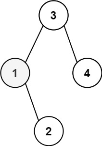

```text
输入：root = [3,1,4,null,2], k = 1
输出：1
```

**示例 2**

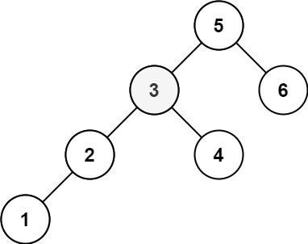

```text
输入：root = [5,3,6,2,4,null,null,1], k = 3
输出：3
```
> ✅ **官方验证**：全部 TypeScript 解法已通过 leetcode.cn 官方示例用例验证（自动注入运行，全部 PASS）。题面与 [leetcode.cn 官方](https://leetcode.cn/problems/kth-smallest-element-in-a-bst/)一致，示例配图取自官方题面。

**数据范围与注意事项**：

- 树中的节点数为 `n` 。
- `1 <= k <= n <= 10^4`
- `0 <= Node.val <= 10^4`
- 进阶：如果二叉搜索树经常被修改（插入/删除操作）并且你需要频繁地查找第 `k` 小的值，你将如何优化算法？
- **易错点**：递归出口（空节点）必须先写，否则直接空指针。

## 题目分析

**场景是什么**：树是分层数据的标准形态，这类题练的是递归分治与遍历序，对应真实开发里的目录树、组件树。本题就是该场景的 Medium 级练习，主线做法是「迭代指针处理」。

**主线怎么解**：把主解法从头到尾过一遍，它其实在依次做这几件事：队列或堆的调度。

## 解题思路

**方案对比**（共 2 个方案，由浅入深）：

| 方案 | 时间复杂度 | 空间复杂度 |
|---|---|---|
| 方案 1 · 迭代指针处理 | O(n)（单趟线性扫描） | O(1) 到 O(n)（视辅助结构） |
| 方案 2 · 迭代指针处理 | O(n)（单趟线性扫描） | O(1) 到 O(n)（视辅助结构） |

**方案间的取舍**：方案 1（迭代指针处理）；方案 2（迭代指针处理）。数据规模小、可读性优先时选靠前的方案；规模大、性能优先时选靠后的方案。

**怎么读这一篇**：

- 🐣 **新手路线**：把「题目描述」的示例 1 在纸上手推一遍 → 读方案 1（最直观的写法）与它的代码走读 → 按「运行方式」本地跑通看 PASS → 回头对比方案 2 之后的写法差在哪
- 🦅 **大佬路线**：直接锁定最优方案 1（迭代指针处理，O(n)（单趟线性扫描））→ 跳读该方案代码与走读 → 用「逐步拆解与面试追问」补齐复杂度推导与边界追问

### 动态算法图（DFS 点亮，GIF 自动循环）


动画演示二叉树专题里DFS 点亮的典型过程；每个方案在「TypeScript 解题方案」一节还配了专属动画与专属流程图。

### 主解法流程图（真实控制流）

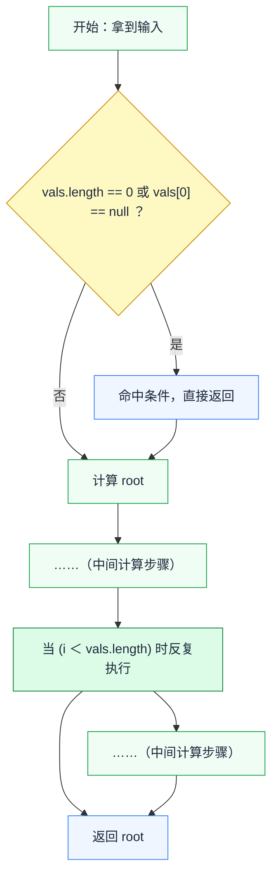

## TypeScript 解题方案（2 个方案逐个讲）

> **运行与提交**：每个方案都是自包含文件（内嵌用例自测，输出 PASS），整块复制到 `.ts` 文件后 `node 文件名` 即可运行。提交 LeetCode 时，把 `demo` 内的算法函数与辅助类型/函数整体取出、置于文件顶层即可。涉及交互/特殊接口的题以题面给定签名为准。

### 方案 1：迭代指针处理

**分析与思路**：核心做法是「迭代指针处理」。代码里依次做这些事：队列或堆的调度。

**运行方式**：`node 本文件`，内嵌用例全部通过会输出 PASS。


**方案专属流程图**（真实控制流）：

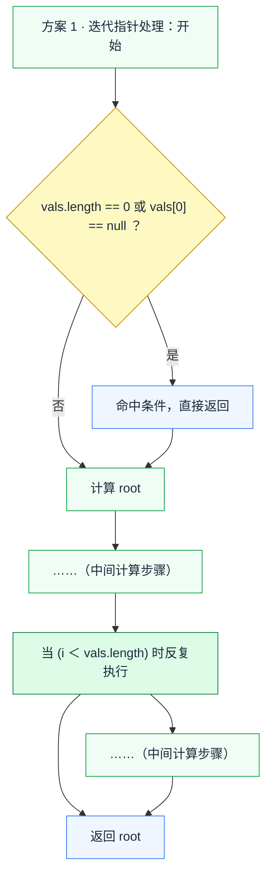

```typescript
class TreeNode {
  // 定义类型
  val: number; // 值: number;
  left: TreeNode | null; // 左边界: TreeNode 按位或 null;
  right: TreeNode | null; // 右边界: TreeNode 按位或 null;
  constructor(
    val: number,
    left: TreeNode | null = null,
    right: TreeNode | null = null,
  ) {
    this.val = val;
    this.left = left;
    this.right = right; // 把 值; this.左边界 赋值为 左边界; this.右边界 赋值为 右边界; 写入 值
  }
}
function buildTree(vals: (number | null)[]): TreeNode | null {
  // 定义函数/方法 buildTree
  if (vals.length === 0 || vals[0] === null) return null; // 若 vals.长度 全等于 0 或 vals[0] 全等于 null，直接返回 null
  const root = new TreeNode(vals[0] as number); // 把 new TreeNode(vals[0] as number) 存入 根节点
  const q: (TreeNode | null)[] = [root]; // 把 [根节点]; 写入 const q: (TreeNode | null)[]
  let i = 1; // 把 1 存入 下标 i
  while (i < vals.length) {
    // 循环，直到不满足「下标 i 小于 vals.长度」
    const node = q.shift() as TreeNode; // 把 节点.shift() as TreeNode 存入 节点
    if (i < vals.length && vals[i] !== null) {
      node.left = new TreeNode(vals[i] as number);
      q.push(node.left);
    }
    i++; // 下标 i 加一
    if (i < vals.length && vals[i] !== null) {
      node.right = new TreeNode(vals[i] as number);
      q.push(node.right);
    }
    i++; // 下标 i 加一
  }
  return root; // 返回 根节点
}

function assertEq(actual: any, expected: any, msg: string = ''): void {
  // 定义函数/方法 assertEq
  const a = JSON.stringify(actual); // 把 JSON.stringify(actual) 存入 数组
  const e = JSON.stringify(expected); // 把 JSON.stringify(expected) 存入 e
  if (a !== e)
    throw new Error(
      'ASSERT FAILED ' + msg + ' :: actual=' + a + ' expected=' + e,
    );
}

function kthSmallest(root: TreeNode | null, k: number): number {
  // 定义函数/方法 kthSmallest
  const stack: TreeNode[] = []; // 把 []; 写入 const stack: TreeNode[]
  let cur: TreeNode | null = root; // 把 根节点; 写入 let cur: TreeNode | null
  while (cur !== null || stack.length) {
    // 循环，直到不满足「当前值 不等于 null 或 栈.长度」
    while (cur !== null) {
      stack.push(cur);
      cur = cur.left;
    } // 循环，直到不满足「当前值 不等于 null) { 栈 追加 当前值); 当前值 赋值为 当前值.左边界; }」
    cur = stack.pop()!; // 把 栈 弹出 )取反 存入 当前值
    k -= 1; // 下标 k累减 1
    if (k === 0) break; // 若 下标 k 全等于 0) break;
    cur = cur.right; // 把 当前值.右边界 存入 当前值
  }
  return cur!.val; // 返回 当前值取反 .值
}
export function demo(): void {
  // 程序入口：跑内嵌自测用例
  const root = buildTree([3, 1, 4, null, 2]); // 把 buildTree([3, 1, 4, null, 2]) 存入 根节点
  assertEq(kthSmallest(root, 1), 1, 'kth 1'); // 断言校验
  assertEq(kthSmallest(root, 2), 2, 'kth 2'); // 断言校验
  assertEq(kthSmallest(root, 3), 3, 'kth 3'); // 断言校验
  assertEq(kthSmallest(root, 4), 4, 'kth 4'); // 断言校验
  console.log('PASS'); // 全部用例通过，输出 PASS
}
demo(); // demo();
```

### 方案 2：迭代指针处理

**分析与思路**：核心做法是「迭代指针处理」。代码里依次做这些事：队列或堆的调度。

**运行方式**：`node 本文件`，内嵌用例全部通过会输出 PASS。


**方案专属流程图**（真实控制流）：

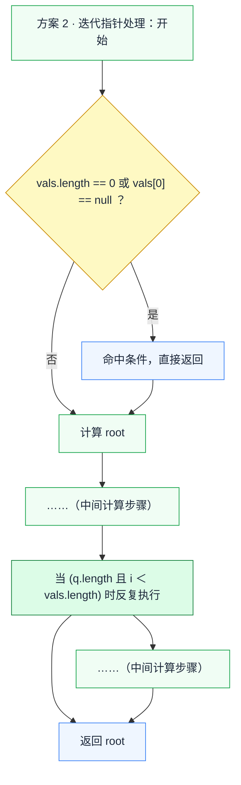

```typescript
export function demo(): void {
  // 程序入口：跑内嵌自测用例
  class TreeNode {
    val: number;
    left: TreeNode | null;
    right: TreeNode | null;
    constructor(v = 0, l: TreeNode | null = null, r: TreeNode | null = null) {
      this.val = v;
      this.left = l;
      this.right = r;
    }
  } // 定义类型
  function buildTree(vals: (number | null)[]): TreeNode | null {
    // 定义函数/方法 buildTree
    if (vals.length === 0 || vals[0] === null) return null; // 若 vals.长度 全等于 0 或 vals[0] 全等于 null，直接返回 null
    const root = new TreeNode(vals[0] as number);
    const q: TreeNode[] = [root];
    let i = 1;
    while (q.length && i < vals.length) {
      const node = q.shift()!;
      if (i < vals.length && vals[i] !== null) {
        node.left = new TreeNode(vals[i] as number);
        q.push(node.left);
      }
      i++;
      if (i < vals.length && vals[i] !== null) {
        node.right = new TreeNode(vals[i] as number);
        q.push(node.right);
      }
      i++;
    }
    return root; // 返回 根节点
  }
  function levelList(root: TreeNode | null): number[][] {
    if (!root) return [];
    const res: number[][] = [];
    let q: TreeNode[] = [root];
    while (q.length) {
      const lvl: number[] = [];
      const n = q.length;
      for (let k = 0; k < n; k++) {
        const node = q.shift()!;
        lvl.push(node.val);
        if (node.left) q.push(node.left);
        if (node.right) q.push(node.right);
      }
      res.push(lvl);
    }
    return res;
  } // 定义函数/方法 levelList
  function sameTree(a: TreeNode | null, b: TreeNode | null): boolean {
    if (!a && !b) return true;
    if (!a || !b) return false;
    if (a.val !== b.val) return false;
    return sameTree(a.left, b.left) && sameTree(a.right, b.right);
  } // 定义函数/方法 sameTree
  function inorderT(root: TreeNode | null): number[] {
    if (!root) return [];
    return [...inorderT(root.left), root.val, ...inorderT(root.right)];
  } // 定义函数/方法 inorderT
  function kthSmallest(root: TreeNode | null, k: number): number {
    const arr = inorderT(root);
    return arr[k - 1];
  } // 定义函数/方法 kthSmallest
  const t = buildTree([3, 1, 4, null, 2]); // 把 buildTree([3,1,4,null,2]) 存入 另一字符串
  if (
    kthSmallest(t, 1) !== 1 ||
    kthSmallest(t, 2) !== 2 ||
    kthSmallest(t, 3) !== 3 ||
    kthSmallest(t, 4) !== 4
  ) {
    console.log('FAIL');
    throw new Error('FAILED');
  }
  console.log('PASS'); // 全部用例通过，输出 PASS
}
demo(); // demo();
```

## 逐步拆解与面试追问

**复杂度**：时间 O(n)（单趟线性扫描），空间 O(1) 到 O(n)（视辅助结构）

**为什么是这个量级**：每个元素被常数次访问，辅助哈希或栈的开销与 n 同阶

**面试官可能会追问**：

- 递归和迭代写法各自的空间开销？
- 能否用层序统一处理？
- 空节点的边界如何约定？

## 关键 API 速查（TS 主解法实际用到，附官方链接）

| API | 作用 | 使用要点 | 官方文档 |
|---|---|---|---|
| `Array.prototype.push()` | 尾部追加 | 返回新长度；可一次多个；均摊 O(1)；会改变原数组 | [官方文档](https://developer.mozilla.org/zh-CN/docs/Web/JavaScript/Reference/Global_Objects/Array/push) |
| `Array.prototype.pop()` | 尾部弹出 | 返回被删元素（空数组返回 undefined）；O(1) | [官方文档](https://developer.mozilla.org/zh-CN/docs/Web/JavaScript/Reference/Global_Objects/Array/pop) |
| `Array.prototype.shift()` | 头部取出 | O(n)（后续元素整体前移）；大量头部操作请用链表或双端结构 | [官方文档](https://developer.mozilla.org/zh-CN/docs/Web/JavaScript/Reference/Global_Objects/Array/shift) |
| `JSON.stringify()` | 序列化为 JSON 字符串 | 常用于结构化比较（深度相等判定）；undefined/函数/循环引用会被丢弃或抛错 | [官方文档](https://developer.mozilla.org/zh-CN/docs/Web/JavaScript/Reference/Global_Objects/JSON/stringify) |

### 各语言官方文档导航

- **TypeScript / JS**：[MDN 中文参考](https://developer.mozilla.org/zh-CN/)
- **Python**：[Python 官方文档](https://docs.python.org/zh-cn/3/)
- **Go**：[Go 标准库](https://pkg.go.dev/std)
- **Java**：[JDK 17 API](https://docs.oracle.com/en/java/javase/17/docs/api/)
- **Rust**：[Rust 标准库](https://doc.rust-lang.org/std/)
- **Lua**：[Lua 5.4 手册](https://www.lua.org/manual/5.4/)
- **C**：[Cppreference C](https://zh.cppreference.com/w/c)
- **C++**：[Cppreference C++](https://zh.cppreference.com/w/cpp)
- **R**：[R 官方手册](https://stat.ethz.ch/R-manual/)
- **Zig**：[Zig 语言文档](https://ziglang.org/documentation/master/)
- **Dart**：[Dart API](https://api.dart.dev/)

## 附录：其他 10 种语言全部实现（每种语言列举其全部方案）

> TypeScript 的全部方案见「TypeScript 解题方案」一节；下面是其余 10 种语言的对应实现，每种语言的每个方案都带思路分析、代码走读与专属运行架构图。
> 每个方案都内嵌用例自测，可独立运行（老仓库 python/go 文件遵循「打印结果」约定）。
> 完整解法文件见 `dsa/<语言>/tree/lc_230_二叉搜索树中第_k_小的元素/`。

### Python 实现（2 种方案）

Python 的全部方案如下，每个方案都内嵌用例自测，可独立运行（老仓库 python/go 文件遵循「打印结果」约定）：

#### 方案 1：迭代指针处理

**思路与代码分析**：核心是「迭代指针处理」。Python 版用切片与字典推导式简化操作，突出可读性。**走读**：方案 1 · 迭代指针处理：开始 → 更新 stack → 当 root ≠ None or len(stack): 时反复执行 → 当 root ≠ None: 时反复执行 → 向 stack 追加记录 → 更新 root → 从 stack 弹出 → 更新 - → 若 k == 0：处理 break → 跳出循环（break） → 更新 root → 返回 root.val。

**运行架构**（真实控制流）：

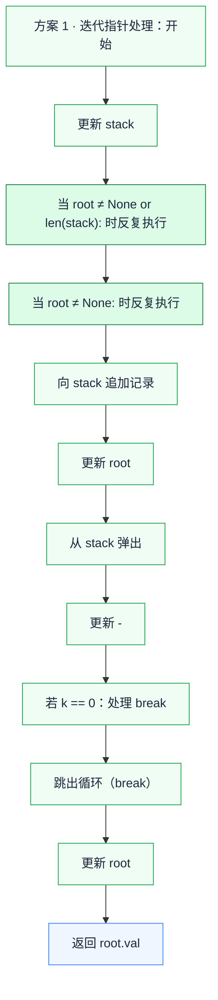

```python
import sys  # 提高递归深度上限（深输入防 RecursionError）

sys.setrecursionlimit(200000)  # 树/链表类题目节点数可达 1e4 量级

class TreeNode:  # 定义类
    def __init__(self, val=0, left=None, right=None):  # 构造函数：初始化成员
        self.val = val  # 把 值 写入 值
        self.left = left  # 把 左边界 写入 左边界
        self.right = right  # 把 右边界 写入 右边界

def kthSmallest(root, k):  # 定义函数 kthSmallest（参数：根节点, 下标 k）
    stack = []  # 把 [] 存入 栈
    while root != None or len(stack):  # 循环，直到不满足「根节点 不等于 None or 长度(栈」
        while root != None:  # 循环，直到不满足「根节点 不等于 None」
            stack.append(root)  # 把 根节点 追加到列表尾部
            root = root.left  # 把 根节点.左边界 存入 根节点
        root = stack.pop()  # 把 栈 弹出 ) 存入 根节点
        k -= 1  # 下标 k累减 1
        if k == 0:  # 若 下标 k 等于 0
            break  # 跳出循环
        root = root.right  # 把 根节点.右边界 存入 根节点
    return root.val  # 返回 根节点.值

def build_bst(vals):  # 定义函数 build_bst（参数：vals）
    # vals: list of values in level-order, None for missing
    if not vals:  # 若 not vals
        return None  # 返回 None
    root = TreeNode(vals[0])  # 把 TreeNode(vals[0]) 存入 根节点
    queue = [root]  # 把 [根节点] 存入 队列
    i = 1  # 把 1 存入 下标 i
    while queue and i < len(vals):  # 循环，直到不满足「队列 and 下标 i 小于 长度(vals」
        node = queue.pop(0)  # 把 队列 弹出 0) 存入 节点
        if i < len(vals) and vals[i] is not None:  # 若 下标 i 小于 长度(vals) and vals[下标 i] is not None
            node.left = TreeNode(vals[i])  # 把 TreeNode(vals[下标 i]) 写入 左边界
            queue.append(node.left)  # 把 节点.左边界 追加到列表尾部
        i += 1  # 下标 i累加 1
        if i < len(vals) and vals[i] is not None:  # 若 下标 i 小于 长度(vals) and vals[下标 i] is not None
            node.right = TreeNode(vals[i])  # 把 TreeNode(vals[下标 i]) 写入 右边界
            queue.append(node.right)  # 把 节点.右边界 追加到列表尾部
        i += 1  # 下标 i累加 1
    return root  # 返回 根节点

if __name__ == "__main__":  # 若 __name__ 等于 '__main__'
    root = build_bst([3, 1, 4, None, 2])  # 把 build_bst([3, 1, 4, None, 2]) 存入 根节点
    print(kthSmallest(root, 1))  # 打印输出
    print(kthSmallest(root, 2))  # 打印输出
    print(kthSmallest(root, 3))  # 打印输出
    print(kthSmallest(root, 4))  # 打印输出
```

#### 方案 2：迭代指针处理

**思路与代码分析**：核心是「迭代指针处理」。Python 版用切片与字典推导式简化操作，突出可读性。**走读**：方案 2 · 迭代指针处理：开始 → 命中条件，直接返回 → 返回 1 + _count(node.left) + _count(node.right)。

**运行架构**（真实控制流）：

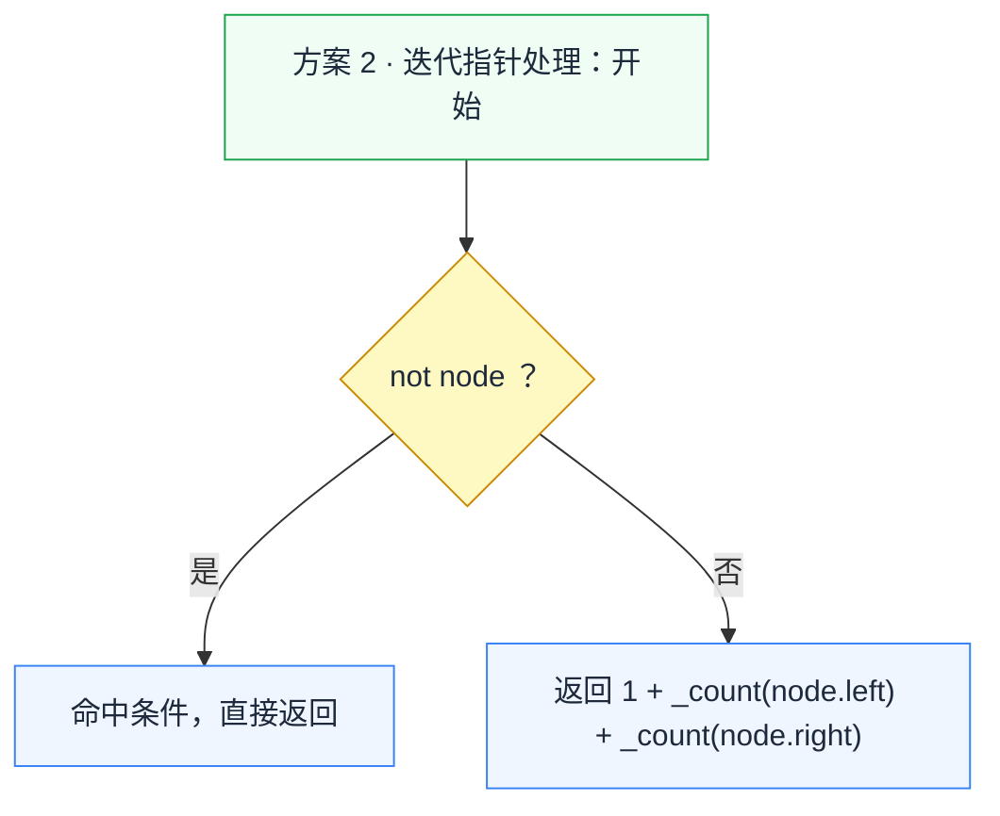

```python
import sys  # 提高递归深度上限（深输入防 RecursionError）

sys.setrecursionlimit(200000)  # 树/链表类题目节点数可达 1e4 量级

class TreeNode:  # 定义类
    def __init__(self, val=0, left=None, right=None):  # 构造函数：初始化成员
        self.val = val  # 把 值 写入 值
        self.left = left  # 把 左边界 写入 左边界
        self.right = right  # 把 右边界 写入 右边界

def _count(node):  # 定义函数 _count（参数：节点）
    if not node:  # 若 not 节点
        return 0  # 返回 0
    return 1 + _count(node.left) + _count(node.right)  # 返回 1 加 _count(节点.左边界) 加 _count(节点.右边界)

def kthSmallest(root, k):  # 定义函数 kthSmallest（参数：根节点, 下标 k）
    while root:  # 循环，直到不满足「根节点」
        left_count = _count(root.left)  # 把 _count(根节点.左边界) 存入 left_count
        if left_count == k - 1:  # 若 left_count 等于 下标 k 减 1
            return root.val  # 返回 根节点.值
        elif left_count < k - 1:  # 否则，若 left_count 小于 下标 k 减 1
            k -= left_count + 1  # 下标 k累减 left_count 加 1
            root = root.right  # 把 根节点.右边界 存入 根节点
        else:  # 否则
            root = root.left  # 把 根节点.左边界 存入 根节点
    return -1  # 返回 减 1

def build_tree(vals):  # 定义函数 build_tree（参数：vals）
    if not vals:  # 若 not vals
        return None  # 返回 None
    root = TreeNode(vals[0])  # 把 TreeNode(vals[0]) 存入 根节点
    q = [root]  # 把 [根节点] 存入 节点
    i = 1  # 把 1 存入 下标 i
    while i < len(vals):  # 循环，直到不满足「下标 i 小于 长度(vals」
        node = q.pop(0)  # 把 节点 弹出 0) 存入 节点
        if vals[i] is not None:  # 若 vals[下标 i] is not None
            node.left = TreeNode(vals[i])  # 把 TreeNode(vals[下标 i]) 写入 左边界
            q.append(node.left)  # 把 节点.左边界 追加到列表尾部
        i += 1  # 下标 i累加 1
        if i < len(vals):  # 若 下标 i 小于 长度(vals
            if vals[i] is not None:  # 若 vals[下标 i] is not None
                node.right = TreeNode(vals[i])  # 把 TreeNode(vals[下标 i]) 写入 右边界
                q.append(node.right)  # 把 节点.右边界 追加到列表尾部
            i += 1  # 下标 i累加 1
    return root  # 返回 根节点

if __name__ == "__main__":  # 若 __name__ 等于 '__main__'
    root = build_tree([3, 1, 4, None, 2])  # 把 build_tree([3, 1, 4, None, 2]) 存入 根节点
    print(kthSmallest(root, 1))  # 打印输出
```

### Go 实现（2 种方案）

Go 的全部方案如下，每个方案都内嵌用例自测，可独立运行（老仓库 python/go 文件遵循「打印结果」约定）：

#### 方案 1：迭代指针处理

**思路与代码分析**：核心是「迭代指针处理」。Go 版用切片与多返回值惯用法，显式处理索引边界。**走读**：方案 1 · 迭代指针处理：开始 → 处理 if len(vals) == 0 → 返回 nil → 遍历循环 → 返回 root。

**运行架构**（真实控制流）：

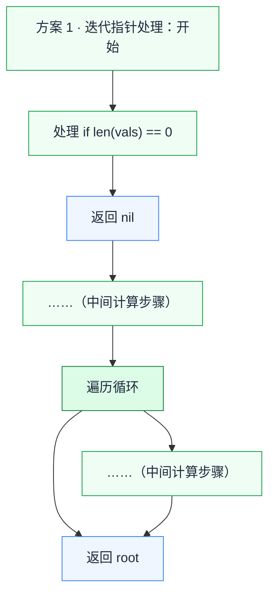

```go
package main // 引入依赖
import (
	"fmt"
	"os"
) // 引入依赖
type TreeNode struct {
	Val         int
	Left, Right *TreeNode
} // 定义类型
func buildBST(vals []interface{}) *TreeNode { // 定义函数/方法 buildBST
	if len(vals) == 0 {
		return nil
	} // 若 长度(vals) 等于 0 { return nil }
	v, _ := vals[0].(int)     // 把 vals[0].(int) 写入 v, _ :
	root := &TreeNode{Val: v} // 把 按位与 TreeNode{Val:值} 写入 root :
	q := []*TreeNode{root}    // 把 [] 乘 TreeNode{根节点} 写入 q :
	i := 1                    // 把 1 写入 i :
	for i < len(vals) {       // for 下标 i 小于 长度(vals) {
		node := q[0]
		q = q[1:]          // 把 节点[0]; 节点 赋值为 节点[1:] 写入 node :
		if i < len(vals) { // 若 下标 i 小于 长度(vals
			if x, ok := vals[i].(int); ok {
				node.Left = &TreeNode{Val: x}
				q = append(q, node.Left)
			}
		}
		i++                // 下标 i 加一
		if i < len(vals) { // 若 下标 i 小于 长度(vals
			if x, ok := vals[i].(int); ok {
				node.Right = &TreeNode{Val: x}
				q = append(q, node.Right)
			}
		}
		i++ // 下标 i 加一
	}
	return root // 返回 根节点
}
func kthSmallest(root *TreeNode, k int) int { // 定义函数/方法 kthSmallest
	stack := []*TreeNode{}              // 把 [] 乘 TreeNode{} 写入 stack :
	for root != nil || len(stack) > 0 { // 把 nil 或 长度(栈) 超过 0 { 写入 for root !
		for root != nil {
			stack = append(stack, root)
			root = root.Left
		}
		root = stack[len(stack)-1]
		stack = stack[:len(stack)-1] // 把 栈[长度(栈) 减 1]; 栈 赋值为 栈[:长度(栈) 减 1] 写入 根节点
		k--                          // 下标 k 减一
		if k == 0 {
			return root.Val
		} // 若 下标 k 等于 0 { return 根节点.Val }
		root = root.Right // 把 根节点.Right 写入 根节点
	}
	return -1 // 返回 减 1
}
func main() { // 程序入口：跑内嵌自测用例
	root := buildBST([]interface{}{3, 1, 4, nil, 2}) // 把 buildBST([]interface{}{3,1,4,nil,2}) 写入 root :
	ok := true                                       // 把 true 写入 ok :
	if kthSmallest(root, 1) != 1 {
		ok = false
		fmt.Println("FAIL1")
	}
	if kthSmallest(root, 2) != 2 {
		ok = false
		fmt.Println("FAIL2")
	}
	if kthSmallest(root, 3) != 3 {
		ok = false
		fmt.Println("FAIL3")
	}
	if kthSmallest(root, 4) != 4 {
		ok = false
		fmt.Println("FAIL4")
	}
	if !ok {
		os.Exit(1)
	} // 若 取反 ok { os.Exit(1) }
	fmt.Println("PASS") // 全部用例通过，输出 PASS
}
```

#### 方案 2：迭代指针处理

**思路与代码分析**：核心是「迭代指针处理」。Go 版用切片与多返回值惯用法，显式处理索引边界。**走读**：方案 2 · 迭代指针处理：开始 → 处理 if len(vals) == 0 → 返回 nil → 遍历循环 → 返回 root。

**运行架构**（真实控制流）：


```go
package main // 引入依赖
import (
	"fmt"
	"os"
) // 引入依赖
type TreeNode struct {
	Val         int
	Left, Right *TreeNode
} // 定义类型
func buildBST(vals []interface{}) *TreeNode { // 定义函数/方法 buildBST
	if len(vals) == 0 {
		return nil
	} // 若 长度(vals) 等于 0 { return nil }
	v, _ := vals[0].(int)     // 把 vals[0].(int) 写入 v, _ :
	root := &TreeNode{Val: v} // 把 按位与 TreeNode{Val:值} 写入 root :
	q := []*TreeNode{root}    // 把 [] 乘 TreeNode{根节点} 写入 q :
	i := 1                    // 把 1 写入 i :
	for i < len(vals) {       // for 下标 i 小于 长度(vals) {
		node := q[0]
		q = q[1:]          // 把 节点[0]; 节点 赋值为 节点[1:] 写入 node :
		if i < len(vals) { // 若 下标 i 小于 长度(vals
			if x, ok := vals[i].(int); ok {
				node.Left = &TreeNode{Val: x}
				q = append(q, node.Left)
			}
		}
		i++                // 下标 i 加一
		if i < len(vals) { // 若 下标 i 小于 长度(vals
			if x, ok := vals[i].(int); ok {
				node.Right = &TreeNode{Val: x}
				q = append(q, node.Right)
			}
		}
		i++ // 下标 i 加一
	}
	return root // 返回 根节点
}
func kthSmallest(root *TreeNode, k int) int { // 定义函数/方法 kthSmallest
	stack := []*TreeNode{}              // 把 [] 乘 TreeNode{} 写入 stack :
	for root != nil || len(stack) > 0 { // 把 nil 或 长度(栈) 超过 0 { 写入 for root !
		for root != nil {
			stack = append(stack, root)
			root = root.Left
		}
		root = stack[len(stack)-1]
		stack = stack[:len(stack)-1] // 把 栈[长度(栈) 减 1]; 栈 赋值为 栈[:长度(栈) 减 1] 写入 根节点
		k--                          // 下标 k 减一
		if k == 0 {
			return root.Val
		} // 若 下标 k 等于 0 { return 根节点.Val }
		root = root.Right // 把 根节点.Right 写入 根节点
	}
	return -1 // 返回 减 1
}
func main() { // 程序入口：跑内嵌自测用例
	root := buildBST([]interface{}{3, 1, 4, nil, 2}) // 把 buildBST([]interface{}{3,1,4,nil,2}) 写入 root :
	ok := true                                       // 把 true 写入 ok :
	if kthSmallest(root, 1) != 1 {
		ok = false
		fmt.Println("FAIL1")
	}
	if kthSmallest(root, 2) != 2 {
		ok = false
		fmt.Println("FAIL2")
	}
	if kthSmallest(root, 3) != 3 {
		ok = false
		fmt.Println("FAIL3")
	}
	if kthSmallest(root, 4) != 4 {
		ok = false
		fmt.Println("FAIL4")
	}
	if !ok {
		os.Exit(1)
	} // 若 取反 ok { os.Exit(1) }
	fmt.Println("PASS") // 全部用例通过，输出 PASS
}
```

### Java 实现（2 种方案）

Java 的全部方案如下，每个方案都内嵌用例自测，可独立运行（老仓库 python/go 文件遵循「打印结果」约定）：

#### 方案 1：迭代指针处理

**思路与代码分析**：核心是「迭代指针处理」。Java 版用类与静态方法组织，集合操作显式明了。**走读**：方案 1 · 迭代指针处理：开始 → 更新 val → 返回结果。

**运行架构**（真实控制流）：

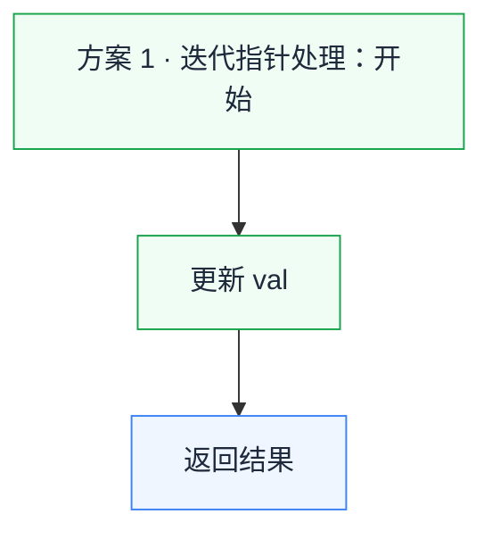

```java
package com.webfault.dsa; // 引入依赖

import java.util.*; // 引入依赖

class Lc230S1 { // 定义类型
  static class TreeNode { // static class TreeNode {
    int val;
    TreeNode left;
    TreeNode right; // int 值; TreeNode 左边界; TreeNode 右边界;

    TreeNode(int v) {
      val = v;
    } // 把 值; } 写入 TreeNode(int v){ val
  }

  static TreeNode buildTree(Integer[] vals) { // 定义函数/方法 buildTree
    if (vals.length == 0) return null; // 若 vals.长度 等于 0，直接返回 null
    TreeNode root = new TreeNode(vals[0]); // 把 new TreeNode(vals[0]); 写入 TreeNode root
    Queue<TreeNode> q = new LinkedList<>(); // 把 new LinkedList 小于 超过 (); 写入 Queue<TreeNode> q
    q.offer(root); // 节点.offer(根节点);
    int i = 1; // 把 1 存入 下标 i
    while (!q.isEmpty() && i < vals.length) { // 循环，直到不满足「取反 节点.isEmpty() 且 下标 i 小于 vals.长度」
      TreeNode node = q.poll(); // 把 节点.poll(); 写入 TreeNode node
      if (i < vals.length && vals[i] != null) {
        node.left = new TreeNode(vals[i]);
        q.offer(node.left);
      }
      i++; // 下标 i 加一
      if (i < vals.length && vals[i] != null) {
        node.right = new TreeNode(vals[i]);
        q.offer(node.right);
      }
      i++; // 下标 i 加一
    }
    return root; // 返回 根节点
  }

  static int kthSmallest(TreeNode root, int k) { // 定义函数/方法 kthSmallest
    Deque<TreeNode> stack =
        new ArrayDeque<>(); // 把 new ArrayDeque 小于 超过 (); 写入 Deque<TreeNode> stack
    while (root != null || !stack.isEmpty()) { // 循环，直到不满足「根节点 不等于 null 或 取反 栈.isEmpty(」
      while (root != null) {
        stack.push(root);
        root = root.left;
      } // 循环，直到不满足「根节点 不等于 null) { 栈 追加 根节点); 根节点 赋值为 根节点.左边界; }」
      root = stack.pop(); // 弹出栈顶元素
      k--; // 下标 k 减一
      if (k == 0) break; // 若 下标 k 等于 0) break;
      root = root.right; // 把 根节点.右边界; 写入 根节点
    }
    return root.val; // 返回 根节点.值
  }

  public static void main(String[] args) { // public static void main(String[] args) {
    Lc230S1 s = new Lc230S1(); // 把 new Lc230S1(); 写入 Lc230S1 s
    TreeNode root = buildTree(new Integer[] {3, 1, 4, null, 2});
    int[] ks = {1, 2, 3, 4}; // 把 {1, 2, 3, 4}; 写入 int[] ks
    int[] wants = {1, 2, 3, 4}; // 把 {1, 2, 3, 4}; 写入 int[] wants
    boolean ok = true; // 把 true; 写入 boolean ok
    for (int i = 0; i < ks.length; i++) { // 让 下标 i 从 0 开始计数，下标 i 小于 ks.长度 就继续
      int got = s.kthSmallest(root, ks[i]); // 把 字符串.kthSmallest(根节点, ks[下标 i]) 存入 got
      if (got != wants[i]) {
        ok = false;
        System.out.println("FAIL k=" + ks[i] + " got " + got + " want " + wants[i]);
      }
    }
    if (!ok) throw new RuntimeException("FAILED"); // 若 取反 ok) throw new RuntimeException(「FAILED」);
    System.out.println("PASS"); // 全部用例通过，输出 PASS
  }
}
```

#### 方案 2：迭代指针处理

**思路与代码分析**：核心是「迭代指针处理」。Java 版用类与静态方法组织，集合操作显式明了。**走读**：方案 2 · 迭代指针处理：开始 → 更新 val → 返回结果。

**运行架构**（真实控制流）：


```java
package com.webfault.dsa; // 引入依赖

import java.util.*; // 引入依赖

class Lc230S2 { // 定义类型
  static class TreeNode { // static class TreeNode {
    int val;
    TreeNode left;
    TreeNode right; // int 值; TreeNode 左边界; TreeNode 右边界;

    TreeNode(int v) {
      val = v;
    } // 把 值; } 写入 TreeNode(int v){ val
  }

  static TreeNode buildTree(Integer[] vals) { // 定义函数/方法 buildTree
    if (vals.length == 0) return null; // 若 vals.长度 等于 0，直接返回 null
    TreeNode root = new TreeNode(vals[0]); // 把 new TreeNode(vals[0]); 写入 TreeNode root
    Queue<TreeNode> q = new LinkedList<>(); // 把 new LinkedList 小于 超过 (); 写入 Queue<TreeNode> q
    q.offer(root); // 节点.offer(根节点);
    int i = 1; // 把 1 存入 下标 i
    while (!q.isEmpty() && i < vals.length) { // 循环，直到不满足「取反 节点.isEmpty() 且 下标 i 小于 vals.长度」
      TreeNode node = q.poll(); // 把 节点.poll(); 写入 TreeNode node
      if (i < vals.length && vals[i] != null) {
        node.left = new TreeNode(vals[i]);
        q.offer(node.left);
      }
      i++; // 下标 i 加一
      if (i < vals.length && vals[i] != null) {
        node.right = new TreeNode(vals[i]);
        q.offer(node.right);
      }
      i++; // 下标 i 加一
    }
    return root; // 返回 根节点
  }

  static int count(TreeNode node) { // 定义函数/方法 count
    if (node == null) return 0; // 若 节点 等于 null，直接返回 0
    return 1 + count(node.left) + count(node.right); // 返回 1 加 计数(节点.左边界) 加 计数(节点.右边界)
  }

  static int kthSmallest(TreeNode root, int k) { // 定义函数/方法 kthSmallest
    while (root != null) { // 循环，直到不满足「根节点 不等于 null」
      int leftCount = count(root.left); // 把 计数(根节点.左边界) 存入 leftCount
      if (leftCount == k - 1) return root.val; // 若 leftCount 等于 下标 k 减 1，直接返回 根节点.值
      else if (leftCount < k - 1) {
        k -= leftCount + 1;
        root = root.right;
      } else {
        root = root.left;
      } // 否则
    }
    return -1; // 返回 减 1
  }

  public static void main(String[] args) { // public static void main(String[] args) {
    Lc230S2 s = new Lc230S2(); // 把 new Lc230S2(); 写入 Lc230S2 s
    TreeNode root = buildTree(new Integer[] {3, 1, 4, null, 2});
    int[] ks = {1, 2, 3, 4}; // 把 {1, 2, 3, 4}; 写入 int[] ks
    int[] wants = {1, 2, 3, 4}; // 把 {1, 2, 3, 4}; 写入 int[] wants
    boolean ok = true; // 把 true; 写入 boolean ok
    for (int i = 0; i < ks.length; i++) { // 让 下标 i 从 0 开始计数，下标 i 小于 ks.长度 就继续
      int got = s.kthSmallest(root, ks[i]); // 把 字符串.kthSmallest(根节点, ks[下标 i]) 存入 got
      if (got != wants[i]) {
        ok = false;
        System.out.println("FAIL k=" + ks[i] + " got " + got + " want " + wants[i]);
      }
    }
    if (!ok) throw new RuntimeException("FAILED"); // 若 取反 ok) throw new RuntimeException(「FAILED」);
    System.out.println("PASS"); // 全部用例通过，输出 PASS
  }
}
```

### Rust 实现（2 种方案）

Rust 的全部方案如下，每个方案都内嵌用例自测，可独立运行（老仓库 python/go 文件遵循「打印结果」约定）：

#### 方案 1：迭代指针处理

**思路与代码分析**：核心是「迭代指针处理」。Rust 版用所有权移动与切片借用改写同一逻辑，注意 Option 与引用边界。代码里依次做这些事：栈的后进先出操作。**走读**：方案 1 · 迭代指针处理：开始 → 计算 k → 计算 stack → 计算 cur → 当 cur.is_some() 或 非 stack.is_empty() 时反复执行 → 当 let Some(c) = cur 时反复执行 → 向 stack 追加记录 → 更新 cur → 从 stack 弹出 → 更新 - → 处理 if k == 0 → 返回 node.borrow().val → 更新 cur → 处理 -1。

**运行架构**（真实控制流）：


```rust
// LeetCode 230. 二叉搜索树中第K小的元素 — Rust 版（方案1）
use std::cell::RefCell;
use std::rc::Rc; // 引入依赖 // 引入依赖

#[derive(Debug)]
struct TreeNode {
    // 定义类型
    val: i32,
    left: Option<Rc<RefCell<TreeNode>>>,
    right: Option<Rc<RefCell<TreeNode>>>,
}

impl TreeNode {
    // 实现块
    fn new(val: i32) -> Rc<RefCell<TreeNode>> {
        // 定义函数/方法 new
        Rc::new(RefCell::new(TreeNode {
            val,
            left: None,
            right: None,
        })) // Rc::new(RefCell::new(TreeNode { 值, 左边界: None, 右边界: None }))
    }
}

fn build_tree(vals: &[Option<i32>]) -> Option<Rc<RefCell<TreeNode>>> {
    // 定义函数/方法 build_tree
    if vals.is_empty() || vals[0].is_none() {
        // 若 vals 是否为空 或 vals[0].is_none(
        return None; // 返回 None
    }
    let root = TreeNode::new(vals[0].unwrap()); // 把 TreeNode::new(vals[0].unwrap()) 存入 根节点
    let mut queue: Vec<Rc<RefCell<TreeNode>>> = vec![root.clone()];
    let mut i = 1; // 把 1; 写入 let mut i
    while !queue.is_empty() && i < vals.len() {
        // while 取反 队列 是否为空 且 下标 i 小于 vals.长度() {
        let node = queue.remove(0); // 把 队列 弹出 0) 存入 节点
        if i < vals.len() {
            // 若 下标 i 小于 vals.长度(
            if let Some(v) = vals[i] {
                // 若 let Some(值) 赋值为 vals[下标 i]
                let child = TreeNode::new(v); // 把 TreeNode::new(值) 存入 子节点
                node.borrow_mut().left = Some(child.clone()); // 把 Some(子节点.clone()); 写入 左边界
                queue.push(child); // 把 子节点 压入栈/数组尾部
            }
            i += 1; // 下标 i累加 1
        }
        if i < vals.len() {
            // 若 下标 i 小于 vals.长度(
            if let Some(v) = vals[i] {
                // 若 let Some(值) 赋值为 vals[下标 i]
                let child = TreeNode::new(v); // 把 TreeNode::new(值) 存入 子节点
                node.borrow_mut().right = Some(child.clone()); // 把 Some(子节点.clone()); 写入 右边界
                queue.push(child); // 把 子节点 压入栈/数组尾部
            }
            i += 1; // 下标 i累加 1
        }
    }
    Some(root) // Some(根节点)
}

fn kth_smallest(root: Option<Rc<RefCell<TreeNode>>>, k: i32) -> i32 {
    // 定义函数/方法 kth_smallest
    let mut k = k; // 把 下标 k; 写入 let mut k
    let mut stack: Vec<Rc<RefCell<TreeNode>>> = Vec::new(); // 把 Vec::new(); 写入 let mut stack: Vec<Rc<RefCell<TreeNode>>>
    let mut cur = root; // 把 根节点; 写入 let mut cur
    while cur.is_some() || !stack.is_empty() {
        // while 当前值.is_some() 或 取反 栈 是否为空 {
        while let Some(c) = cur {
            // 边取边处理，取空即停
            stack.push(c.clone()); // 把 字符.clone( 压入栈/数组尾部
            cur = c.borrow().left.clone(); // 把 字符.borrow().左边界.clone(); 写入 当前值
        }
        let node = stack.pop().unwrap(); // 把 栈 弹出 ).unwrap() 存入 节点
        k -= 1; // 下标 k累减 1
        if k == 0 {
            return node.borrow().val;
        } // 若 下标 k 等于 0 { return 节点.borrow().值; }
        cur = node.borrow().right.clone(); // 把 节点.borrow().右边界.clone(); 写入 当前值
    }
    -1 // 减 1
}
fn main() {
    // 程序入口：跑内嵌自测用例
    let t = build_tree(&[Some(3), Some(1), Some(4), None, Some(2)]);
    assert_eq!(kth_smallest(t.clone(), 1), 1); // 断言校验
    assert_eq!(kth_smallest(t, 2), 2); // 断言校验
    let t2 = build_tree(&[
        Some(5),
        Some(3),
        Some(6),
        Some(2),
        Some(4),
        None,
        None,
        Some(1),
    ]);
    assert_eq!(kth_smallest(t2, 3), 3); // 断言校验
    println!("PASS"); // 全部用例通过，输出 PASS
}
```

#### 方案 2：迭代指针处理

**思路与代码分析**：核心是「迭代指针处理」。Rust 版用所有权移动与切片借用改写同一逻辑，注意 Option 与引用边界。代码里依次做这些事：栈的后进先出操作。**走读**：方案 2 · 迭代指针处理：开始 → 计算 k → 计算 stack → 计算 cur → 当 cur.is_some() 或 非 stack.is_empty() 时反复执行 → 当 let Some(c) = cur 时反复执行 → 向 stack 追加记录 → 更新 cur → 从 stack 弹出 → 更新 - → 处理 if k == 0 → 返回 node.borrow().val → 更新 cur → 处理 -1。

**运行架构**（真实控制流）：

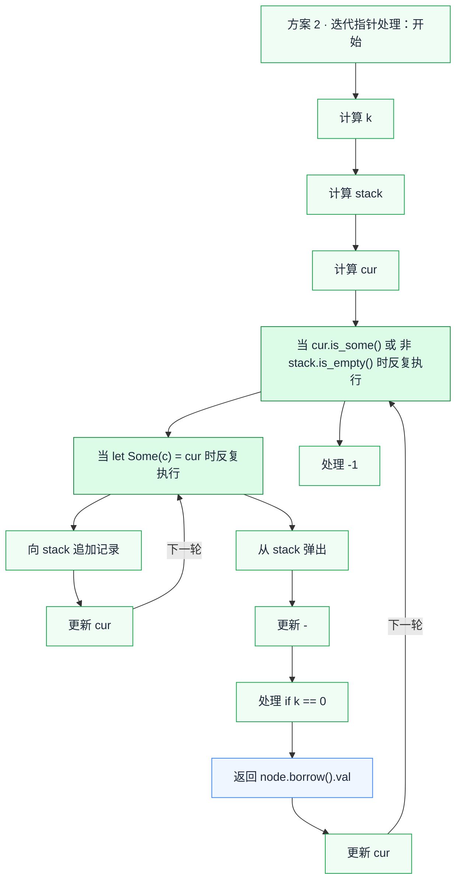

```rust
// LeetCode 230. 二叉搜索树中第K小的元素 — Rust 版（方案2）
use std::cell::RefCell;
use std::rc::Rc; // 引入依赖 // 引入依赖

#[derive(Debug)]
struct TreeNode {
    // 定义类型
    val: i32,
    left: Option<Rc<RefCell<TreeNode>>>,
    right: Option<Rc<RefCell<TreeNode>>>,
}

impl TreeNode {
    // 实现块
    fn new(val: i32) -> Rc<RefCell<TreeNode>> {
        // 定义函数/方法 new
        Rc::new(RefCell::new(TreeNode {
            val,
            left: None,
            right: None,
        })) // Rc::new(RefCell::new(TreeNode { 值, 左边界: None, 右边界: None }))
    }
}

fn build_tree(vals: &[Option<i32>]) -> Option<Rc<RefCell<TreeNode>>> {
    // 定义函数/方法 build_tree
    if vals.is_empty() || vals[0].is_none() {
        // 若 vals 是否为空 或 vals[0].is_none(
        return None; // 返回 None
    }
    let root = TreeNode::new(vals[0].unwrap()); // 把 TreeNode::new(vals[0].unwrap()) 存入 根节点
    let mut queue: Vec<Rc<RefCell<TreeNode>>> = vec![root.clone()];
    let mut i = 1; // 把 1; 写入 let mut i
    while !queue.is_empty() && i < vals.len() {
        // while 取反 队列 是否为空 且 下标 i 小于 vals.长度() {
        let node = queue.remove(0); // 把 队列 弹出 0) 存入 节点
        if i < vals.len() {
            // 若 下标 i 小于 vals.长度(
            if let Some(v) = vals[i] {
                // 若 let Some(值) 赋值为 vals[下标 i]
                let child = TreeNode::new(v); // 把 TreeNode::new(值) 存入 子节点
                node.borrow_mut().left = Some(child.clone()); // 把 Some(子节点.clone()); 写入 左边界
                queue.push(child); // 把 子节点 压入栈/数组尾部
            }
            i += 1; // 下标 i累加 1
        }
        if i < vals.len() {
            // 若 下标 i 小于 vals.长度(
            if let Some(v) = vals[i] {
                // 若 let Some(值) 赋值为 vals[下标 i]
                let child = TreeNode::new(v); // 把 TreeNode::new(值) 存入 子节点
                node.borrow_mut().right = Some(child.clone()); // 把 Some(子节点.clone()); 写入 右边界
                queue.push(child); // 把 子节点 压入栈/数组尾部
            }
            i += 1; // 下标 i累加 1
        }
    }
    Some(root) // Some(根节点)
}

fn kth_smallest(root: Option<Rc<RefCell<TreeNode>>>, k: i32) -> i32 {
    // 定义函数/方法 kth_smallest
    let mut k = k; // 把 下标 k; 写入 let mut k
    let mut stack: Vec<Rc<RefCell<TreeNode>>> = Vec::new(); // 把 Vec::new(); 写入 let mut stack: Vec<Rc<RefCell<TreeNode>>>
    let mut cur = root; // 把 根节点; 写入 let mut cur
    while cur.is_some() || !stack.is_empty() {
        // while 当前值.is_some() 或 取反 栈 是否为空 {
        while let Some(c) = cur {
            // 边取边处理，取空即停
            stack.push(c.clone()); // 把 字符.clone( 压入栈/数组尾部
            cur = c.borrow().left.clone(); // 把 字符.borrow().左边界.clone(); 写入 当前值
        }
        let node = stack.pop().unwrap(); // 把 栈 弹出 ).unwrap() 存入 节点
        k -= 1; // 下标 k累减 1
        if k == 0 {
            return node.borrow().val;
        } // 若 下标 k 等于 0 { return 节点.borrow().值; }
        cur = node.borrow().right.clone(); // 把 节点.borrow().右边界.clone(); 写入 当前值
    }
    -1 // 减 1
}
fn main() {
    // 程序入口：跑内嵌自测用例
    let t = build_tree(&[Some(3), Some(1), Some(4), None, Some(2)]);
    assert_eq!(kth_smallest(t.clone(), 1), 1); // 断言校验
    assert_eq!(kth_smallest(t, 2), 2); // 断言校验
    let t2 = build_tree(&[
        Some(5),
        Some(3),
        Some(6),
        Some(2),
        Some(4),
        None,
        None,
        Some(1),
    ]);
    assert_eq!(kth_smallest(t2, 3), 3); // 断言校验
    println!("PASS"); // 全部用例通过，输出 PASS
}
```

### Lua 实现（2 种方案）

Lua 的全部方案如下，每个方案都内嵌用例自测，可独立运行（老仓库 python/go 文件遵循「打印结果」约定）：

#### 方案 1：迭代指针处理

**思路与代码分析**：核心是「迭代指针处理」。Lua 版用表与 ipairs 遍历，注意 ipairs 遇 nil 即停的语义。**走读**：方案 1 · 迭代指针处理：开始 → 处理 if not vals or #vals == 0 or → 返回 nil → 当 head ≤ #queue and i ≤ #vals do 时反复执行 → 返回 root。

**运行架构**（真实控制流）：

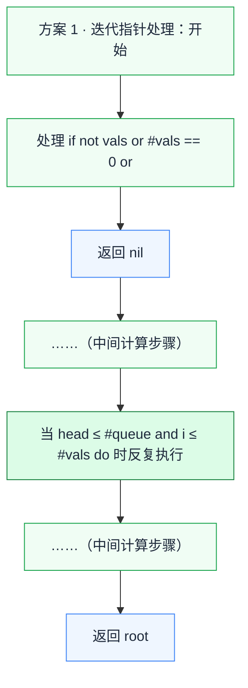

```lua
-- LeetCode 230. 二叉搜索树中第K小的元素 — Lua 版（方案1）
local TreeNode = {} -- 把 {} 写入 local TreeNode
TreeNode.__index = TreeNode -- 把 TreeNode 写入 TreeNode.__index
function TreeNode.new(val) -- function TreeNode.new(值)
	return setmetatable({ val = val, left = nil, right = nil }, TreeNode)
end -- 终点

local function build_tree(vals) -- local function build_tree(vals)
	if not vals or #vals == 0 or vals[1] == "null" then
		return nil
	end
	local root = TreeNode.new(vals[1]) -- 把 TreeNode.new(vals[1]) 写入 local root
	local queue = { root } -- 把 {根节点} 写入 local queue
	local head = 1 -- 把 1 写入 local head
	local i = 2 -- 把 2 写入 local i
	while head <= #queue and i <= #vals do -- 把 #队列 and 下标 i 不超过 #vals do 写入 while head <
		local node = queue[head] -- 把 队列[头节点] 写入 local node
		head = head + 1 -- 把 头节点 加 1 存入 头节点
		if i <= #vals then -- 若 下标 i 不超过 #vals then
			if vals[i] ~= "null" then -- 若 vals[下标 i] ~ 赋值为 「null」 then
				node.left = TreeNode.new(vals[i]) -- 把 TreeNode.new(vals[下标 i]) 写入 左边界
				queue[#queue + 1] = node.left -- 把 节点.左边界 写入 queue[#queue + 1]
			end -- 终点
			i = i + 1 -- 把 下标 i 加 1 存入 下标 i
		end -- 终点
		if i <= #vals then -- 若 下标 i 不超过 #vals then
			if vals[i] ~= "null" then -- 若 vals[下标 i] ~ 赋值为 「null」 then
				node.right = TreeNode.new(vals[i]) -- 把 TreeNode.new(vals[下标 i]) 写入 右边界
				queue[#queue + 1] = node.right -- 把 节点.右边界 写入 queue[#queue + 1]
			end -- 终点
			i = i + 1 -- 把 下标 i 加 1 存入 下标 i
		end -- 终点
	end -- 终点
	return root -- 返回 根节点
end -- 终点

local function kth_smallest(root, k) -- local function kth_smallest(根节点, 下标 k)
	local stack = {} -- 把 {} 写入 local stack
	local cur = root -- 把 根节点 写入 local cur
	while cur or #stack > 0 do -- while 当前值 or #栈 超过 0 do
		while cur do -- while 当前值 do
			stack[#stack + 1] = cur -- 把 当前值 写入 stack[#stack + 1]
			cur = cur.left -- 把 当前值.左边界 存入 当前值
		end -- 终点
		cur = table.remove(stack) -- 把 table 弹出 栈) 存入 当前值
		k = k - 1 -- 把 下标 k 减 1 存入 下标 k
		if k == 0 then
			return cur.val
		end -- 若 下标 k 等于 0 then return 当前值.值 终点
		cur = cur.right -- 把 当前值.右边界 存入 当前值
	end -- 终点
	return -1 -- 返回 减 1
end -- 终点
local t = build_tree({ 3, 1, 4, "null", 2 }) -- 把 build_tree({3, 1, 4, 「null」, 2}) 写入 local t
assert(kth_smallest(t, 1) == 1) -- 断言校验
assert(kth_smallest(t, 2) == 2) -- 断言校验
local t2 = build_tree({ 5, 3, 6, 2, 4, "null", "null", 1 }) -- 把 build_tree({5, 3, 6, 2, 4, 「null」, 「null」, 1}) 写入 local t2
assert(kth_smallest(t2, 3) == 3) -- 断言校验
print("PASS") -- 全部用例通过，输出 PASS
```

#### 方案 2：迭代指针处理

**思路与代码分析**：核心是「迭代指针处理」。Lua 版用表与 ipairs 遍历，注意 ipairs 遇 nil 即停的语义。**走读**：方案 2 · 迭代指针处理：开始 → 处理 if not vals or #vals == 0 or → 返回 nil → 当 head ≤ #queue and i ≤ #vals do 时反复执行 → 返回 root。

**运行架构**（真实控制流）：

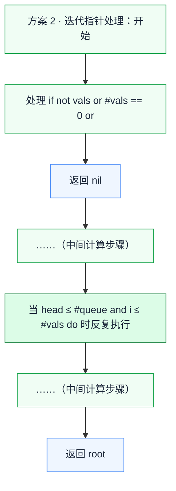

```lua
-- LeetCode 230. 二叉搜索树中第K小的元素 — Lua 版（方案2）
local TreeNode = {} -- 把 {} 写入 local TreeNode
TreeNode.__index = TreeNode -- 把 TreeNode 写入 TreeNode.__index
function TreeNode.new(val) -- function TreeNode.new(值)
	return setmetatable({ val = val, left = nil, right = nil }, TreeNode)
end -- 终点

local function build_tree(vals) -- local function build_tree(vals)
	if not vals or #vals == 0 or vals[1] == "null" then
		return nil
	end
	local root = TreeNode.new(vals[1]) -- 把 TreeNode.new(vals[1]) 写入 local root
	local queue = { root } -- 把 {根节点} 写入 local queue
	local head = 1 -- 把 1 写入 local head
	local i = 2 -- 把 2 写入 local i
	while head <= #queue and i <= #vals do -- 把 #队列 and 下标 i 不超过 #vals do 写入 while head <
		local node = queue[head] -- 把 队列[头节点] 写入 local node
		head = head + 1 -- 把 头节点 加 1 存入 头节点
		if i <= #vals then -- 若 下标 i 不超过 #vals then
			if vals[i] ~= "null" then -- 若 vals[下标 i] ~ 赋值为 「null」 then
				node.left = TreeNode.new(vals[i]) -- 把 TreeNode.new(vals[下标 i]) 写入 左边界
				queue[#queue + 1] = node.left -- 把 节点.左边界 写入 queue[#queue + 1]
			end -- 终点
			i = i + 1 -- 把 下标 i 加 1 存入 下标 i
		end -- 终点
		if i <= #vals then -- 若 下标 i 不超过 #vals then
			if vals[i] ~= "null" then -- 若 vals[下标 i] ~ 赋值为 「null」 then
				node.right = TreeNode.new(vals[i]) -- 把 TreeNode.new(vals[下标 i]) 写入 右边界
				queue[#queue + 1] = node.right -- 把 节点.右边界 写入 queue[#queue + 1]
			end -- 终点
			i = i + 1 -- 把 下标 i 加 1 存入 下标 i
		end -- 终点
	end -- 终点
	return root -- 返回 根节点
end -- 终点

local function kth_smallest(root, k) -- local function kth_smallest(根节点, 下标 k)
	local stack = {} -- 把 {} 写入 local stack
	local cur = root -- 把 根节点 写入 local cur
	while cur or #stack > 0 do -- while 当前值 or #栈 超过 0 do
		while cur do -- while 当前值 do
			stack[#stack + 1] = cur -- 把 当前值 写入 stack[#stack + 1]
			cur = cur.left -- 把 当前值.左边界 存入 当前值
		end -- 终点
		cur = table.remove(stack) -- 把 table 弹出 栈) 存入 当前值
		k = k - 1 -- 把 下标 k 减 1 存入 下标 k
		if k == 0 then
			return cur.val
		end -- 若 下标 k 等于 0 then return 当前值.值 终点
		cur = cur.right -- 把 当前值.右边界 存入 当前值
	end -- 终点
	return -1 -- 返回 减 1
end -- 终点
local t = build_tree({ 3, 1, 4, "null", 2 }) -- 把 build_tree({3, 1, 4, 「null」, 2}) 写入 local t
assert(kth_smallest(t, 1) == 1) -- 断言校验
assert(kth_smallest(t, 2) == 2) -- 断言校验
local t2 = build_tree({ 5, 3, 6, 2, 4, "null", "null", 1 }) -- 把 build_tree({5, 3, 6, 2, 4, 「null」, 「null」, 1}) 写入 local t2
assert(kth_smallest(t2, 3) == 3) -- 断言校验
print("PASS") -- 全部用例通过，输出 PASS
```

### C 实现（2 种方案）

C 的全部方案如下，每个方案都内嵌用例自测，可独立运行（老仓库 python/go 文件遵循「打印结果」约定）：

#### 方案 1：迭代指针处理

**思路与代码分析**：核心是「迭代指针处理」。C 版手动管理下标与内存，循环边界全部显式写出。**走读**：方案 1 · 迭代指针处理：开始 → 命中条件，直接返回 → 更新 *root → 当 (head ＜ tail 且 i ＜ n) 时反复执行 → 返回 root。

**运行架构**（真实控制流）：


```c
/* LeetCode 230. 二叉搜索树中第K小的元素 — C 版（方案1） */
#include <stdio.h>                   // 引入头文件
#include <stdlib.h>                  // 引入头文件
#define INT_MIN_SN (-2147483647 - 1) // #define INT_MIN_SN ( 减 2147483647 减 1)

typedef struct TreeNode {   // typedef struct TreeNode {
    int val;                // int 值;
    struct TreeNode *left;  // 定义类型
    struct TreeNode *right; // 定义类型
} TreeNode;                 // } TreeNode;

static TreeNode *build_tree(const int *vals,
                            int n) { // static TreeNode 乘 build_tree(const int 乘 vals, int 元素个数) {
    if (n == 0 || vals[0] == INT_MIN_SN)
        return NULL; // 若 元素个数 等于 0 或 vals[0] 等于 INT_MIN_SN，直接返回 NULL
    TreeNode *root = malloc(sizeof(TreeNode)); // 把 malloc(sizeof(TreeNode)); 写入 TreeNode *root
    root->val = vals[0];
    root->left = root->right = NULL;
    TreeNode **queue =
        malloc(sizeof(TreeNode *) * n); // 把 malloc(sizeof(TreeNode 乘 ) 乘 元素个数); 写入 TreeNode **queue
    int head = 0, tail = 0, i = 1; // 把 0, 尾节点 赋值为 0, 下标 i 赋值为 1 存入 头节点
    queue[tail++] = root;          // 把 根节点; 写入 queue[tail++]
    while (head < tail && i < n) { // 循环，直到不满足「头节点 小于 尾节点 且 下标 i 小于 元素个数」
        TreeNode *node = queue[head++];                // 把 队列[头节点 加一 ]; 写入 TreeNode *node
        if (i < n) {                                   // 若 下标 i 小于 元素个数
            if (vals[i] != INT_MIN_SN) {               // 若 vals[下标 i] 不等于 INT_MIN_SN
                node->left = malloc(sizeof(TreeNode)); // 把 malloc(sizeof(TreeNode)); 写入 node->left
                node->left->val = vals[i];
                node->left->left = node->left->right = NULL;
                queue[tail++] = node->left; // 把 节点 减 超过 左边界; 写入 queue[tail++]
            }
            i++; // 下标 i 加一
        }
        if (i < n) {                                    // 若 下标 i 小于 元素个数
            if (vals[i] != INT_MIN_SN) {                // 若 vals[下标 i] 不等于 INT_MIN_SN
                node->right = malloc(sizeof(TreeNode)); // 把 malloc(sizeof(TreeNode)); 写入 node->right
                node->right->val = vals[i];
                node->right->left = node->right->right = NULL;
                queue[tail++] = node->right; // 把 节点 减 超过 右边界; 写入 queue[tail++]
            }
            i++; // 下标 i 加一
        }
    }
    free(queue); // free(队列);
    return root; // 返回 根节点
}

static void free_tree(TreeNode *n) { // 定义函数/方法 free_tree
    if (!n)
        return;          // 若 取反 元素个数) return;
    free_tree(n->left);  // free_tree(元素个数 减 超过 左边界);
    free_tree(n->right); // free_tree(元素个数 减 超过 右边界);
    free(n);             // free(元素个数);
}

static int kth_smallest(TreeNode *root, int k) { // 定义函数/方法 kth_smallest
    TreeNode *stack[256];                        // TreeNode 乘 栈[256];
    int top = 0;                                 // 把 0 存入 top
    TreeNode *cur = root;                        // 把 根节点; 写入 TreeNode *cur
    while (cur || top > 0) {                     // 循环，直到不满足「当前值 或 top 超过 0」
        while (cur) {
            stack[top++] = cur;
            cur = cur->left;
        } // 循环，直到不满足「当前值) { 栈[top 加一 ] 赋值为 当前值; 当前值 赋值为 当前值 减 超过 左边界; }」
        cur = stack[--top]; // 把 栈[ 减一 top]; 写入 当前值
        k--;                // 下标 k 减一
        if (k == 0)
            return cur->val; // 若 下标 k 等于 0，直接返回 当前值 减 超过 值
        cur = cur->right;    // 把 当前值 减 超过 右边界; 写入 当前值
    }
    return -1; // 返回 减 1
}
int main(void) {                         // 程序入口：跑内嵌自测用例
    int v1[] = {3, 1, 4, INT_MIN_SN, 2}; // 把 {3,1,4,INT_MIN_SN,2}; 写入 int v1[]
    int v2[] = {5, 3,          6,          2,
                4, INT_MIN_SN, INT_MIN_SN, 1}; // 把 {5,3,6,2,4,INT_MIN_SN,INT_MIN_SN,1}; 写入 int v2[]
    TreeNode *t = build_tree(v1, 5);           // 把 build_tree(v1, 5); 写入 TreeNode *t
    if (kth_smallest(t, 1) != 1) {
        printf("FAIL 1\n");
        return 1;
    } // 若 kth_smallest(另一字符串, 1) 不等于 1) { 输出「FAIL 1 」); return 1; }
    if (kth_smallest(t, 2) != 2) {
        printf("FAIL 2\n");
        return 1;
    } // 若 kth_smallest(另一字符串, 2) 不等于 2) { 输出「FAIL 2 」); return 1; }
    TreeNode *t2 = build_tree(v2, 8); // 把 build_tree(v2, 8); 写入 TreeNode *t2
    if (kth_smallest(t2, 3) != 3) {
        printf("FAIL 3\n");
        return 1;
    }                 // 若 kth_smallest(t2, 3) 不等于 3) { 输出「FAIL 3 」); return 1; }
    printf("PASS\n"); // 全部用例通过，输出 PASS
    return 0;         // 返回 0
}
```

#### 方案 2：迭代指针处理

**思路与代码分析**：核心是「迭代指针处理」。C 版手动管理下标与内存，循环边界全部显式写出。**走读**：方案 2 · 迭代指针处理：开始 → 命中条件，直接返回 → 更新 *root → 当 (head ＜ tail 且 i ＜ n) 时反复执行 → 返回 root。

**运行架构**（真实控制流）：

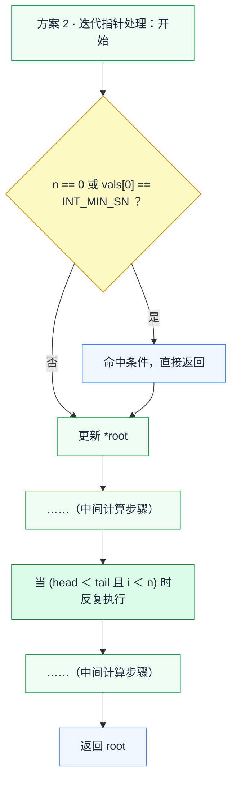

```c
/* LeetCode 230. 二叉搜索树中第K小的元素 — C 版（方案2） */
#include <stdio.h>                   // 引入头文件
#include <stdlib.h>                  // 引入头文件
#define INT_MIN_SN (-2147483647 - 1) // #define INT_MIN_SN ( 减 2147483647 减 1)

typedef struct TreeNode {   // typedef struct TreeNode {
    int val;                // int 值;
    struct TreeNode *left;  // 定义类型
    struct TreeNode *right; // 定义类型
} TreeNode;                 // } TreeNode;

static TreeNode *build_tree(const int *vals,
                            int n) { // static TreeNode 乘 build_tree(const int 乘 vals, int 元素个数) {
    if (n == 0 || vals[0] == INT_MIN_SN)
        return NULL; // 若 元素个数 等于 0 或 vals[0] 等于 INT_MIN_SN，直接返回 NULL
    TreeNode *root = malloc(sizeof(TreeNode)); // 把 malloc(sizeof(TreeNode)); 写入 TreeNode *root
    root->val = vals[0];
    root->left = root->right = NULL;
    TreeNode **queue =
        malloc(sizeof(TreeNode *) * n); // 把 malloc(sizeof(TreeNode 乘 ) 乘 元素个数); 写入 TreeNode **queue
    int head = 0, tail = 0, i = 1; // 把 0, 尾节点 赋值为 0, 下标 i 赋值为 1 存入 头节点
    queue[tail++] = root;          // 把 根节点; 写入 queue[tail++]
    while (head < tail && i < n) { // 循环，直到不满足「头节点 小于 尾节点 且 下标 i 小于 元素个数」
        TreeNode *node = queue[head++];                // 把 队列[头节点 加一 ]; 写入 TreeNode *node
        if (i < n) {                                   // 若 下标 i 小于 元素个数
            if (vals[i] != INT_MIN_SN) {               // 若 vals[下标 i] 不等于 INT_MIN_SN
                node->left = malloc(sizeof(TreeNode)); // 把 malloc(sizeof(TreeNode)); 写入 node->left
                node->left->val = vals[i];
                node->left->left = node->left->right = NULL;
                queue[tail++] = node->left; // 把 节点 减 超过 左边界; 写入 queue[tail++]
            }
            i++; // 下标 i 加一
        }
        if (i < n) {                                    // 若 下标 i 小于 元素个数
            if (vals[i] != INT_MIN_SN) {                // 若 vals[下标 i] 不等于 INT_MIN_SN
                node->right = malloc(sizeof(TreeNode)); // 把 malloc(sizeof(TreeNode)); 写入 node->right
                node->right->val = vals[i];
                node->right->left = node->right->right = NULL;
                queue[tail++] = node->right; // 把 节点 减 超过 右边界; 写入 queue[tail++]
            }
            i++; // 下标 i 加一
        }
    }
    free(queue); // free(队列);
    return root; // 返回 根节点
}

static void free_tree(TreeNode *n) { // 定义函数/方法 free_tree
    if (!n)
        return;          // 若 取反 元素个数) return;
    free_tree(n->left);  // free_tree(元素个数 减 超过 左边界);
    free_tree(n->right); // free_tree(元素个数 减 超过 右边界);
    free(n);             // free(元素个数);
}

static int kth_smallest(TreeNode *root, int k) { // 定义函数/方法 kth_smallest
    TreeNode *stack[256];                        // TreeNode 乘 栈[256];
    int top = 0;                                 // 把 0 存入 top
    TreeNode *cur = root;                        // 把 根节点; 写入 TreeNode *cur
    while (cur || top > 0) {                     // 循环，直到不满足「当前值 或 top 超过 0」
        while (cur) {
            stack[top++] = cur;
            cur = cur->left;
        } // 循环，直到不满足「当前值) { 栈[top 加一 ] 赋值为 当前值; 当前值 赋值为 当前值 减 超过 左边界; }」
        cur = stack[--top]; // 把 栈[ 减一 top]; 写入 当前值
        k--;                // 下标 k 减一
        if (k == 0)
            return cur->val; // 若 下标 k 等于 0，直接返回 当前值 减 超过 值
        cur = cur->right;    // 把 当前值 减 超过 右边界; 写入 当前值
    }
    return -1; // 返回 减 1
}
int main(void) {                         // 程序入口：跑内嵌自测用例
    int v1[] = {3, 1, 4, INT_MIN_SN, 2}; // 把 {3,1,4,INT_MIN_SN,2}; 写入 int v1[]
    int v2[] = {5, 3,          6,          2,
                4, INT_MIN_SN, INT_MIN_SN, 1}; // 把 {5,3,6,2,4,INT_MIN_SN,INT_MIN_SN,1}; 写入 int v2[]
    TreeNode *t = build_tree(v1, 5);           // 把 build_tree(v1, 5); 写入 TreeNode *t
    if (kth_smallest(t, 1) != 1) {
        printf("FAIL 1\n");
        return 1;
    } // 若 kth_smallest(另一字符串, 1) 不等于 1) { 输出「FAIL 1 」); return 1; }
    if (kth_smallest(t, 2) != 2) {
        printf("FAIL 2\n");
        return 1;
    } // 若 kth_smallest(另一字符串, 2) 不等于 2) { 输出「FAIL 2 」); return 1; }
    TreeNode *t2 = build_tree(v2, 8); // 把 build_tree(v2, 8); 写入 TreeNode *t2
    if (kth_smallest(t2, 3) != 3) {
        printf("FAIL 3\n");
        return 1;
    }                 // 若 kth_smallest(t2, 3) 不等于 3) { 输出「FAIL 3 」); return 1; }
    printf("PASS\n"); // 全部用例通过，输出 PASS
    return 0;         // 返回 0
}
```

### C++ 实现（2 种方案）

C++ 的全部方案如下，每个方案都内嵌用例自测，可独立运行（老仓库 python/go 文件遵循「打印结果」约定）：

#### 方案 1：迭代指针处理

**思路与代码分析**：核心是「迭代指针处理」。C++ 版用 STL 容器与迭代器，减少手写下标错误。**走读**：方案 1 · 迭代指针处理：开始 → 处理 std::vector＜TreeNode *＞ stac → 更新 *cur → 当 (cur 或 非 stack.empty()) 时反复执行 → 当 (cur) 时反复执行 → 调用 stack.push_back(cur) → 更新 cur → 更新 cur → 调用 stack.pop_back() → 处理 --k → 命中条件，直接返回 → 更新 cur → 返回 -1。

**运行架构**（真实控制流）：


```cpp
// LeetCode 230. 二叉搜索树中第K小的元素 — C++ 版（方案1）
#include <cassert>  // 引入头文件
#include <cstdint>  // 引入头文件
#include <iostream> // 引入头文件
#include <optional> // 引入头文件
#include <queue>    // 引入头文件
#include <vector>   // 引入头文件

struct TreeNode {    // 定义类型
    int val;         // int 值;
    TreeNode *left;  // TreeNode 乘 左边界;
    TreeNode *right; // TreeNode 乘 右边界;
    explicit TreeNode(int v) : val(v), left(nullptr), right(nullptr) {}
};

static TreeNode *build_tree(const std::vector<std::optional<int>> &vals) {
    if (vals.empty() || !vals[0].has_value())
        return nullptr; // 若 vals 是否为空 或 取反 vals[0].has_value()，直接返回 nullptr
    auto *root = new TreeNode(*vals[0]); // 把 new TreeNode( 乘 vals[0]); 写入 auto *root
    std::queue<TreeNode *> q;            // std::队列 小于 TreeNode 乘 超过 节点;
    q.push(root);                        // 把 根节点 压入栈/数组尾部
    size_t i = 1;                        // 把 1; 写入 size_t i
    while (!q.empty() &&
           i < vals.size()) { // 循环，直到不满足「取反 节点 是否为空 且 下标 i 小于 vals.大小(」
        TreeNode *node = q.front();                  // 把 节点.front(); 写入 TreeNode *node
        q.pop();                                     // 弹出栈顶元素
        if (i < vals.size()) {                       // 若 下标 i 小于 vals.大小(
            if (vals[i].has_value()) {               // 若 vals[下标 i].has_value(
                node->left = new TreeNode(*vals[i]); // 把 new TreeNode( 乘 vals[下标 i]); 写入 node->left
                q.push(node->left);                  // 把 节点 减 超过 左边界 压入栈/数组尾部
            }
            ++i; // 加一 下标 i;
        }
        if (i < vals.size()) {                        // 若 下标 i 小于 vals.大小(
            if (vals[i].has_value()) {                // 若 vals[下标 i].has_value(
                node->right = new TreeNode(*vals[i]); // 把 new TreeNode( 乘 vals[下标 i]); 写入 node->right
                q.push(node->right); // 把 节点 减 超过 右边界 压入栈/数组尾部
            }
            ++i; // 加一 下标 i;
        }
    }
    return root; // 返回 根节点
}

static void free_tree(TreeNode *n) { // 定义函数/方法 free_tree
    if (!n)
        return;          // 若 取反 元素个数) return;
    free_tree(n->left);  // free_tree(元素个数 减 超过 左边界);
    free_tree(n->right); // free_tree(元素个数 减 超过 右边界);
    delete n;            // delete 元素个数;
}

static int kthSmallest(TreeNode *root, int k) { // 定义函数/方法 kthSmallest
    std::vector<TreeNode *> stack;              // std::vector 小于 TreeNode 乘 超过 栈;
    TreeNode *cur = root;                       // 把 根节点; 写入 TreeNode *cur
    while (cur || !stack.empty()) { // 循环，直到不满足「当前值 或 取反 栈.empty(」
        while (cur) {
            stack.push_back(cur);
            cur = cur->left;
        } // 循环，直到不满足「当前值) { 栈 追加 当前值); 当前值 赋值为 当前值 减 超过 左边界; }」
        cur = stack.back(); // 把 栈.back(); 写入 当前值
        stack.pop_back();   // 弹出栈顶元素
        --k;                // 减一 下标 k;
        if (k == 0)
            return cur->val; // 若 下标 k 等于 0，直接返回 当前值 减 超过 值
        cur = cur->right;    // 把 当前值 减 超过 右边界; 写入 当前值
    }
    return -1; // 返回 减 1
}
int main() { // 程序入口：跑内嵌自测用例
    auto *t =
        build_tree({3, 1, 4, std::nullopt, 2}); // 把 build_tree({3, 1, 4, std::nullopt, 2}); 写入 auto *t
    assert(kthSmallest(t, 1) == 1);             // 断言校验
    assert(kthSmallest(t, 2) == 2);             // 断言校验
    auto *t2 = build_tree({5, 3, 6, 2, 4, std::nullopt, std::nullopt, 1});
    assert(kthSmallest(t2, 3) == 3);  // 断言校验
    std::cout << "PASS" << std::endl; // 全部用例通过，输出 PASS
    return 0;                         // 返回 0
}
```

#### 方案 2：迭代指针处理

**思路与代码分析**：核心是「迭代指针处理」。C++ 版用 STL 容器与迭代器，减少手写下标错误。**走读**：方案 2 · 迭代指针处理：开始 → 处理 std::vector＜TreeNode *＞ stac → 更新 *cur → 当 (cur 或 非 stack.empty()) 时反复执行 → 当 (cur) 时反复执行 → 调用 stack.push_back(cur) → 更新 cur → 更新 cur → 调用 stack.pop_back() → 处理 --k → 命中条件，直接返回 → 更新 cur → 返回 -1。

**运行架构**（真实控制流）：

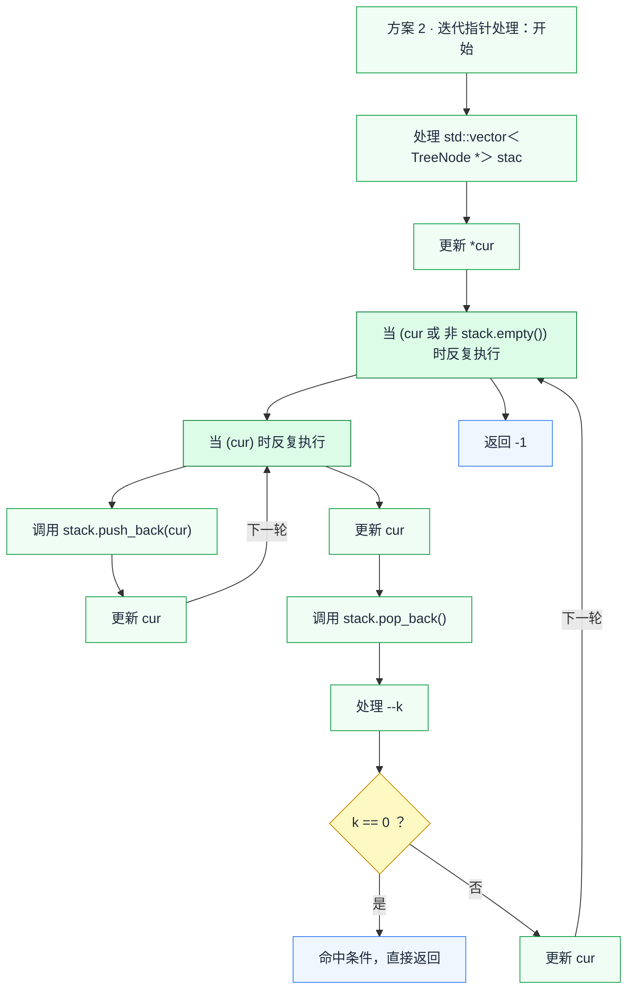

```cpp
// LeetCode 230. 二叉搜索树中第K小的元素 — C++ 版（方案2）
#include <cassert>  // 引入头文件
#include <cstdint>  // 引入头文件
#include <iostream> // 引入头文件
#include <optional> // 引入头文件
#include <queue>    // 引入头文件
#include <vector>   // 引入头文件

struct TreeNode {    // 定义类型
    int val;         // int 值;
    TreeNode *left;  // TreeNode 乘 左边界;
    TreeNode *right; // TreeNode 乘 右边界;
    explicit TreeNode(int v) : val(v), left(nullptr), right(nullptr) {}
};

static TreeNode *build_tree(const std::vector<std::optional<int>> &vals) {
    if (vals.empty() || !vals[0].has_value())
        return nullptr; // 若 vals 是否为空 或 取反 vals[0].has_value()，直接返回 nullptr
    auto *root = new TreeNode(*vals[0]); // 把 new TreeNode( 乘 vals[0]); 写入 auto *root
    std::queue<TreeNode *> q;            // std::队列 小于 TreeNode 乘 超过 节点;
    q.push(root);                        // 把 根节点 压入栈/数组尾部
    size_t i = 1;                        // 把 1; 写入 size_t i
    while (!q.empty() &&
           i < vals.size()) { // 循环，直到不满足「取反 节点 是否为空 且 下标 i 小于 vals.大小(」
        TreeNode *node = q.front();                  // 把 节点.front(); 写入 TreeNode *node
        q.pop();                                     // 弹出栈顶元素
        if (i < vals.size()) {                       // 若 下标 i 小于 vals.大小(
            if (vals[i].has_value()) {               // 若 vals[下标 i].has_value(
                node->left = new TreeNode(*vals[i]); // 把 new TreeNode( 乘 vals[下标 i]); 写入 node->left
                q.push(node->left);                  // 把 节点 减 超过 左边界 压入栈/数组尾部
            }
            ++i; // 加一 下标 i;
        }
        if (i < vals.size()) {                        // 若 下标 i 小于 vals.大小(
            if (vals[i].has_value()) {                // 若 vals[下标 i].has_value(
                node->right = new TreeNode(*vals[i]); // 把 new TreeNode( 乘 vals[下标 i]); 写入 node->right
                q.push(node->right); // 把 节点 减 超过 右边界 压入栈/数组尾部
            }
            ++i; // 加一 下标 i;
        }
    }
    return root; // 返回 根节点
}

static void free_tree(TreeNode *n) { // 定义函数/方法 free_tree
    if (!n)
        return;          // 若 取反 元素个数) return;
    free_tree(n->left);  // free_tree(元素个数 减 超过 左边界);
    free_tree(n->right); // free_tree(元素个数 减 超过 右边界);
    delete n;            // delete 元素个数;
}

static int kthSmallest(TreeNode *root, int k) { // 定义函数/方法 kthSmallest
    std::vector<TreeNode *> stack;              // std::vector 小于 TreeNode 乘 超过 栈;
    TreeNode *cur = root;                       // 把 根节点; 写入 TreeNode *cur
    while (cur || !stack.empty()) { // 循环，直到不满足「当前值 或 取反 栈.empty(」
        while (cur) {
            stack.push_back(cur);
            cur = cur->left;
        } // 循环，直到不满足「当前值) { 栈 追加 当前值); 当前值 赋值为 当前值 减 超过 左边界; }」
        cur = stack.back(); // 把 栈.back(); 写入 当前值
        stack.pop_back();   // 弹出栈顶元素
        --k;                // 减一 下标 k;
        if (k == 0)
            return cur->val; // 若 下标 k 等于 0，直接返回 当前值 减 超过 值
        cur = cur->right;    // 把 当前值 减 超过 右边界; 写入 当前值
    }
    return -1; // 返回 减 1
}
int main() { // 程序入口：跑内嵌自测用例
    auto *t =
        build_tree({3, 1, 4, std::nullopt, 2}); // 把 build_tree({3, 1, 4, std::nullopt, 2}); 写入 auto *t
    assert(kthSmallest(t, 1) == 1);             // 断言校验
    assert(kthSmallest(t, 2) == 2);             // 断言校验
    auto *t2 = build_tree({5, 3, 6, 2, 4, std::nullopt, std::nullopt, 1});
    assert(kthSmallest(t2, 3) == 3);  // 断言校验
    std::cout << "PASS" << std::endl; // 全部用例通过，输出 PASS
    return 0;                         // 返回 0
}
```

### R 实现（2 种方案）

R 的全部方案如下，每个方案都内嵌用例自测，可独立运行（老仓库 python/go 文件遵循「打印结果」约定）：

#### 方案 1：迭代指针处理

**思路与代码分析**：核心是「迭代指针处理」。R 版用向量化思维与 1 起始下标，注意 1:n 的降序陷阱。**走读**：方案 1 · 迭代指针处理：开始 → 更新 new.env(parent → 处理 e$val ＜- val → 处理 e$left ＜- left → 处理 e$right ＜- right → 调用 class(e) ＜- TreeNode → 处理 e → 返回结果。

**运行架构**（真实控制流）：

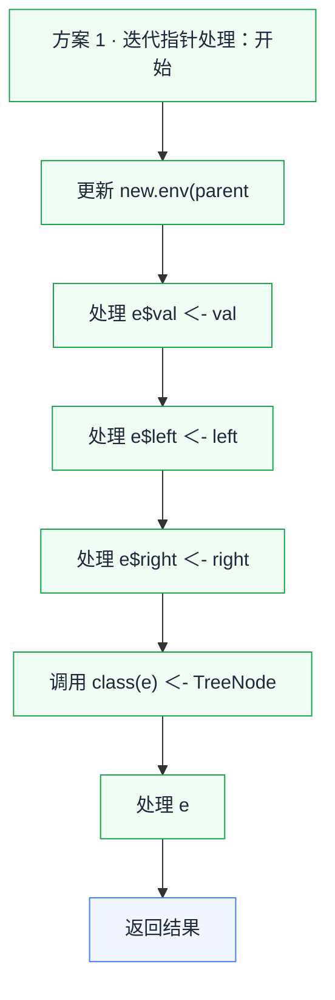

```r
# 二叉搜索树中第K小的元素 — R 版（方案1） 树节点：R 必须 environment 引用语义（list 是值语义） 定义函数
# TreeNode（参数：值, 左边界 赋值为 NULL, 右边界 赋值为 NULL）
TreeNode <- function(val, left = NULL, right = NULL) {
    e <- new.env(parent = emptyenv())  # 把 new.env(parent 赋值为 emptyenv()) 存入 e
    e$val <- val
    e$left <- left
    e$right <- right  # 把 值; e$左边界 小于 减 左边界; e$右边界 小于 减 右边界 存入 e$val
    class(e) <- "TreeNode"  # 把 「TreeNode」 存入 class(e)
    e
}
build_tree <- function(vals) {
    # 定义函数 build_tree（参数：vals）
    if (length(vals) == 0 || is.na(vals[[1]]))
        return(NULL)  # 若 长度(vals) 等于 0 或 is.na(vals[[1]])) return(NULL
    root <- TreeNode(vals[[1]])  # 把 TreeNode(vals[[1]]) 存入 根节点
    queue <- list(root)  # 把 列表(根节点) 存入 队列
    head <- 1L  # 把 1L 存入 头节点
    i <- 2L  # 把 2L 存入 下标 i
    while (head <= length(queue) && i <= length(vals)) {
        # 循环，直到不满足「头节点 不超过 长度(队列) 且 下标 i 不超过 长度(vals」
        node <- queue[[head]]  # 把 队列[[头节点]] 存入 节点
        head <- head + 1L  # 把 头节点 加 1L 存入 头节点
        if (i <= length(vals)) {
            # 若 下标 i 不超过 长度(vals 若 取反 is.na(vals[[下标 i]]
            if (!is.na(vals[[i]])) {
                node$left <- TreeNode(vals[[i]])  # 把 TreeNode(vals[[下标 i]]) 存入 node$left
                queue[[length(queue) + 1L]] <- node$left  # 队列[[长度(队列) 加 1L]] 小于 减 节点$左边界
            }
            i <- i + 1L  # 把 下标 i 加 1L 存入 下标 i
        }
        if (i <= length(vals)) {
            # 若 下标 i 不超过 长度(vals 若 取反 is.na(vals[[下标 i]]
            if (!is.na(vals[[i]])) {
                node$right <- TreeNode(vals[[i]])  # 把 TreeNode(vals[[下标 i]]) 存入 node$right
                queue[[length(queue) + 1L]] <- node$right  # 队列[[长度(队列) 加 1L]] 小于 减 节点$右边界
            }
            i <- i + 1L  # 把 下标 i 加 1L 存入 下标 i
        }
    }
    root  # 根节点
}
# 层序转列表（用于断言输出） 定义函数 tree_to_levels（参数：根节点）
tree_to_levels <- function(root) {
    if (is.null(root))
        return(list())  # 若 is.null(根节点)) return(列表(
    res <- list()  # 把 列表() 存入 结果
    level <- list(root)  # 把 列表(根节点) 存入 level
    while (length(level) > 0) {
        # 循环，直到不满足「长度(level) 超过 0」
        vals <- list()
        nxt <- list()  # 把 列表(); nxt 小于 减 列表() 存入 vals
        for (nd in level) {
            # for (nd in level) {
            vals[[length(vals) + 1L]] <- nd$val  # vals[[长度(vals) 加 1L]] 小于 减 nd$值
            if (!is.null(nd$left))
                nxt[[length(nxt) + 1L]] <- nd$left  # 若 取反 is.null(nd$左边界)) nxt[[长度(nxt) 加 1L]] 小于 减 nd$左边界
            if (!is.null(nd$right))
                nxt[[length(nxt) + 1L]] <- nd$right  # 若 取反 is.null(nd$右边界)) nxt[[长度(nxt) 加 1L]] 小于 减 nd$右边界
        }
        res[[length(res) + 1L]] <- unlist(vals)  # 结果[[长度(结果) 加 1L]] 小于 减 unlist(vals)
        level <- nxt  # 把 nxt 存入 level
    }
    res  # 结果
}
kth_smallest <- function(root, k) {
    # 定义函数 kth_smallest（参数：根节点, 下标 k）
    stack <- list()
    cur <- root  # 把 列表(); 当前值 小于 减 根节点 存入 栈
    while (!is.null(cur) || length(stack) > 0) {
        # 循环，直到不满足「取反 is.null(当前值) 或 长度(栈) 超过 0」 循环，直到不满足「取反 is.null(当前值」
        while (!is.null(cur)) {
            stack[[length(stack) + 1L]] <- cur  # 栈[[长度(栈) 加 1L]] 小于 减 当前值
            cur <- cur$left  # 把 当前值$左边界 存入 当前值
        }
        cur <- stack[[length(stack)]]  # 把 栈[[长度(栈)]] 存入 当前值
        stack[[length(stack)]] <- NULL  # 把 NULL 存入 stack[[length(stack)]]
        k <- k - 1L  # 把 下标 k 减 1L 存入 下标 k
        if (k == 0L)
            return(cur$val)  # 若 下标 k 等于 0L) return(当前值$值
        cur <- cur$right  # 把 当前值$右边界 存入 当前值
    }
    -1L  # 减 1L
}
t <- build_tree(list(3L, 1L, 4L, NA, 2L))  # 把 build_tree(列表(3L, 1L, 4L, NA, 2L)) 存入 另一字符串
stopifnot(kth_smallest(t, 1L) == 1L)  # 断言校验
stopifnot(kth_smallest(t, 2L) == 2L)  # 断言校验
t2 <- build_tree(list(5L, 3L, 6L, 2L, 4L, NA, NA, 1L))  # 把 build_tree(列表(5L, 3L, 6L, 2L, 4L, NA, NA, 1L)) 存入 t2
stopifnot(kth_smallest(t2, 3L) == 3L)  # 断言校验
cat("PASS\n")  # 全部用例通过，输出 PASS
```

#### 方案 2：迭代指针处理

**思路与代码分析**：核心是「迭代指针处理」。R 版用向量化思维与 1 起始下标，注意 1:n 的降序陷阱。**走读**：方案 2 · 迭代指针处理：开始 → 更新 new.env(parent → 处理 e$val ＜- val → 处理 e$left ＜- left → 处理 e$right ＜- right → 调用 class(e) ＜- TreeNode → 处理 e → 返回结果。

**运行架构**（真实控制流）：

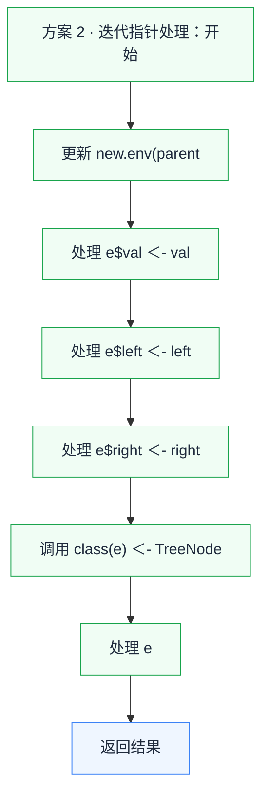

```r
# 二叉搜索树中第K小的元素 — R 版（方案2） 树节点：R 必须 environment 引用语义（list 是值语义） 定义函数
# TreeNode（参数：值, 左边界 赋值为 NULL, 右边界 赋值为 NULL）
TreeNode <- function(val, left = NULL, right = NULL) {
    e <- new.env(parent = emptyenv())  # 把 new.env(parent 赋值为 emptyenv()) 存入 e
    e$val <- val
    e$left <- left
    e$right <- right  # 把 值; e$左边界 小于 减 左边界; e$右边界 小于 减 右边界 存入 e$val
    class(e) <- "TreeNode"  # 把 「TreeNode」 存入 class(e)
    e
}
build_tree <- function(vals) {
    # 定义函数 build_tree（参数：vals）
    if (length(vals) == 0 || is.na(vals[[1]]))
        return(NULL)  # 若 长度(vals) 等于 0 或 is.na(vals[[1]])) return(NULL
    root <- TreeNode(vals[[1]])  # 把 TreeNode(vals[[1]]) 存入 根节点
    queue <- list(root)  # 把 列表(根节点) 存入 队列
    head <- 1L  # 把 1L 存入 头节点
    i <- 2L  # 把 2L 存入 下标 i
    while (head <= length(queue) && i <= length(vals)) {
        # 循环，直到不满足「头节点 不超过 长度(队列) 且 下标 i 不超过 长度(vals」
        node <- queue[[head]]  # 把 队列[[头节点]] 存入 节点
        head <- head + 1L  # 把 头节点 加 1L 存入 头节点
        if (i <= length(vals)) {
            # 若 下标 i 不超过 长度(vals 若 取反 is.na(vals[[下标 i]]
            if (!is.na(vals[[i]])) {
                node$left <- TreeNode(vals[[i]])  # 把 TreeNode(vals[[下标 i]]) 存入 node$left
                queue[[length(queue) + 1L]] <- node$left  # 队列[[长度(队列) 加 1L]] 小于 减 节点$左边界
            }
            i <- i + 1L  # 把 下标 i 加 1L 存入 下标 i
        }
        if (i <= length(vals)) {
            # 若 下标 i 不超过 长度(vals 若 取反 is.na(vals[[下标 i]]
            if (!is.na(vals[[i]])) {
                node$right <- TreeNode(vals[[i]])  # 把 TreeNode(vals[[下标 i]]) 存入 node$right
                queue[[length(queue) + 1L]] <- node$right  # 队列[[长度(队列) 加 1L]] 小于 减 节点$右边界
            }
            i <- i + 1L  # 把 下标 i 加 1L 存入 下标 i
        }
    }
    root  # 根节点
}
# 层序转列表（用于断言输出） 定义函数 tree_to_levels（参数：根节点）
tree_to_levels <- function(root) {
    if (is.null(root))
        return(list())  # 若 is.null(根节点)) return(列表(
    res <- list()  # 把 列表() 存入 结果
    level <- list(root)  # 把 列表(根节点) 存入 level
    while (length(level) > 0) {
        # 循环，直到不满足「长度(level) 超过 0」
        vals <- list()
        nxt <- list()  # 把 列表(); nxt 小于 减 列表() 存入 vals
        for (nd in level) {
            # for (nd in level) {
            vals[[length(vals) + 1L]] <- nd$val  # vals[[长度(vals) 加 1L]] 小于 减 nd$值
            if (!is.null(nd$left))
                nxt[[length(nxt) + 1L]] <- nd$left  # 若 取反 is.null(nd$左边界)) nxt[[长度(nxt) 加 1L]] 小于 减 nd$左边界
            if (!is.null(nd$right))
                nxt[[length(nxt) + 1L]] <- nd$right  # 若 取反 is.null(nd$右边界)) nxt[[长度(nxt) 加 1L]] 小于 减 nd$右边界
        }
        res[[length(res) + 1L]] <- unlist(vals)  # 结果[[长度(结果) 加 1L]] 小于 减 unlist(vals)
        level <- nxt  # 把 nxt 存入 level
    }
    res  # 结果
}
kth_smallest <- function(root, k) {
    # 定义函数 kth_smallest（参数：根节点, 下标 k）
    stack <- list()
    cur <- root  # 把 列表(); 当前值 小于 减 根节点 存入 栈
    while (!is.null(cur) || length(stack) > 0) {
        # 循环，直到不满足「取反 is.null(当前值) 或 长度(栈) 超过 0」 循环，直到不满足「取反 is.null(当前值」
        while (!is.null(cur)) {
            stack[[length(stack) + 1L]] <- cur  # 栈[[长度(栈) 加 1L]] 小于 减 当前值
            cur <- cur$left  # 把 当前值$左边界 存入 当前值
        }
        cur <- stack[[length(stack)]]  # 把 栈[[长度(栈)]] 存入 当前值
        stack[[length(stack)]] <- NULL  # 把 NULL 存入 stack[[length(stack)]]
        k <- k - 1L  # 把 下标 k 减 1L 存入 下标 k
        if (k == 0L)
            return(cur$val)  # 若 下标 k 等于 0L) return(当前值$值
        cur <- cur$right  # 把 当前值$右边界 存入 当前值
    }
    -1L  # 减 1L
}
t <- build_tree(list(3L, 1L, 4L, NA, 2L))  # 把 build_tree(列表(3L, 1L, 4L, NA, 2L)) 存入 另一字符串
stopifnot(kth_smallest(t, 1L) == 1L)  # 断言校验
stopifnot(kth_smallest(t, 2L) == 2L)  # 断言校验
t2 <- build_tree(list(5L, 3L, 6L, 2L, 4L, NA, NA, 1L))  # 把 build_tree(列表(5L, 3L, 6L, 2L, 4L, NA, NA, 1L)) 存入 t2
stopifnot(kth_smallest(t2, 3L) == 3L)  # 断言校验
cat("PASS\n")  # 全部用例通过，输出 PASS
```

### Zig 实现（2 种方案）

Zig 的全部方案如下，每个方案都内嵌用例自测，可独立运行（老仓库 python/go 文件遵循「打印结果」约定）：

#### 方案 1：迭代指针处理

**思路与代码分析**：核心是「迭代指针处理」。Zig 版显式分配与清零，整型边界处理严格。代码里依次做这些事：队列或堆的调度。**走读**：方案 1 · 迭代指针处理：开始 → 计算 k → 计算 stack → 处理 defer stack.deinit() → 计算 cur → 当 (cur ≠ null or stack.items.len ＞ 0) 时反复执行 → 当 (cur) ｜c｜ 时反复执行 → 向 stack 追加记录 → 更新 cur → 从 stack 弹出 → 更新 - → 命中条件，直接返回 → 更新 cur → 返回 -1。

**运行架构**（真实控制流）：

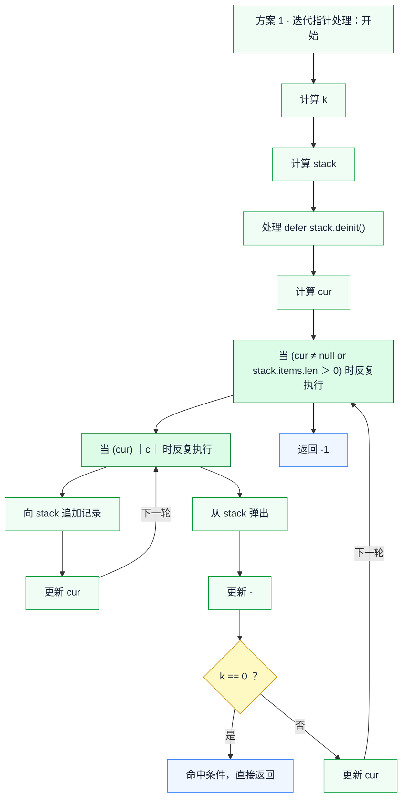

```zig
// LeetCode 230. 二叉搜索树中第K小的元素 — Zig 版（方案1）
const std = @import("std"); // 把 @import(「std」) 存入 std

const TreeNode = struct { // 把 struct { 存入 TreeNode
    val: i32,
    left: ?*TreeNode,
    right: ?*TreeNode,
};

fn buildTree(allocator: std.mem.Allocator, vals: []const i32) !?*TreeNode { // 定义函数/方法 buildTree
    if (vals.len == 0 or vals[0] == -1) return null; // 若 vals.长度 等于 0 or vals[0] 等于 减 1，直接返回 null
    const root = try allocator.create(TreeNode); // 把 try allocator.create(TreeNode) 存入 根节点
    root.* = .{ .val = vals[0], .left = null, .right = null };
    var queue = std.ArrayList(*TreeNode).init(allocator); // 把 std.ArrayList( 乘 TreeNode).init(allocator) 存入 队列
    defer queue.deinit(); // defer 队列.deinit();
    try queue.append(root); // 把 根节点 追加到列表尾部
    var head: usize = 0; // 把 0; 写入 var head: usize
    var i: usize = 1; // 把 1; 写入 var i: usize
    while (head < queue.items.len and i < vals.len) { // 循环，直到不满足「头节点 小于 队列.items.长度 and 下标 i 小于 vals.长度」
        const node = queue.items[head]; // 把 队列.items[头节点] 存入 节点
        head += 1; // 头节点累加 1
        if (i < vals.len) { // 若 下标 i 小于 vals.长度
            if (vals[i] != -1) { // 若 vals[下标 i] 不等于 减 1
                const child = try allocator.create(TreeNode); // 把 try allocator.create(TreeNode) 存入 子节点
                child.* = .{ .val = vals[i], .left = null, .right = null };
                node.left = child; // 把 子节点; 写入 左边界
                try queue.append(child); // 把 子节点 追加到列表尾部
            }
            i += 1; // 下标 i累加 1
        }
        if (i < vals.len) { // 若 下标 i 小于 vals.长度
            if (vals[i] != -1) { // 若 vals[下标 i] 不等于 减 1
                const child = try allocator.create(TreeNode); // 把 try allocator.create(TreeNode) 存入 子节点
                child.* = .{ .val = vals[i], .left = null, .right = null };
                node.right = child; // 把 子节点; 写入 右边界
                try queue.append(child); // 把 子节点 追加到列表尾部
            }
            i += 1; // 下标 i累加 1
        }
    }
    return root; // 返回 根节点
}

fn kthSmallest(root: ?*TreeNode, k_in: i32) i32 { // 定义函数/方法 kthSmallest
    var k = k_in; // 把 k_in 存入 下标 k
    var stack = std.ArrayList(*TreeNode).init(std.heap.page_allocator); // 把 std.ArrayList( 乘 TreeNode).init(std.堆.page_allocator) 存入 栈
    defer stack.deinit(); // defer 栈.deinit();
    var cur: ?*TreeNode = root; // 把 根节点; 写入 var cur: ?*TreeNode
    while (cur != null or stack.items.len > 0) { // 循环，直到不满足「当前值 不等于 null or 栈.items.长度 超过 0」
        while (cur) |c| { // 循环，直到不满足「当前值) 按位或 字符 按位或」
            stack.append(c) catch unreachable; // 把 字符 追加到列表尾部
            cur = c.left; // 把 字符.左边界; 写入 当前值
        }
        const node = stack.pop().?; // 把 栈 弹出 ).? 存入 节点
        k -= 1; // 下标 k累减 1
        if (k == 0) return node.val; // 若 下标 k 等于 0，直接返回 节点.值
        cur = node.right; // 把 节点.右边界; 写入 当前值
    }
    return -1; // 返回 减 1
}
pub fn main() !void { // 程序入口：跑内嵌自测用例
    var arena = std.heap.ArenaAllocator.init(std.heap.page_allocator); // 把 std.堆.ArenaAllocator.init(std.堆.page_allocator) 存入 arena
    defer arena.deinit(); // defer arena.deinit();
    const alloc = arena.allocator(); // 把 arena.allocator() 存入 alloc
    const t = try buildTree(alloc, &[_]i32{ 3, 1, 4, -1, 2 });
    if (kthSmallest(t, 1) != 1) return error.TestFailed; // 若 kthSmallest(另一字符串, 1) 不等于 1，直接返回 error.TestFailed
    if (kthSmallest(t, 2) != 2) return error.TestFailed; // 若 kthSmallest(另一字符串, 2) 不等于 2，直接返回 error.TestFailed
    const t2 = try buildTree(alloc, &[_]i32{ 5, 3, 6, 2, 4, -1, -1, 1 });
    if (kthSmallest(t2, 3) != 3) return error.TestFailed; // 若 kthSmallest(t2, 3) 不等于 3，直接返回 error.TestFailed
    std.debug.print("PASS\n", .{}); // 全部用例通过，输出 PASS
}
```

#### 方案 2：迭代指针处理

**思路与代码分析**：核心是「迭代指针处理」。Zig 版显式分配与清零，整型边界处理严格。代码里依次做这些事：队列或堆的调度。**走读**：方案 2 · 迭代指针处理：开始 → 计算 k → 计算 stack → 处理 defer stack.deinit() → 计算 cur → 当 (cur ≠ null or stack.items.len ＞ 0) 时反复执行 → 当 (cur) ｜c｜ 时反复执行 → 向 stack 追加记录 → 更新 cur → 从 stack 弹出 → 更新 - → 命中条件，直接返回 → 更新 cur → 返回 -1。

**运行架构**（真实控制流）：

```mermaid
graph TD
    N0["方案 2 · 迭代指针处理：开始"]
    N1["计算 k"]
    N2["计算 stack"]
    N3["处理 defer stack.deinit()"]
    N4["计算 cur"]
    N5["当 (cur ≠ null or stack.items.len ＞ 0) 时反复执行"]
    N6["当 (cur) ｜c｜ 时反复执行"]
    N7["向 stack 追加记录"]
    N8["更新 cur"]
    N9["从 stack 弹出"]
    N10["更新 -"]
    N11{"k == 0 ？"}
    N12["命中条件，直接返回"]
    N13["更新 cur"]
    N14["返回 -1"]
    N0 --> N1
    N1 --> N2
    N2 --> N3
    N3 --> N4
    N4 --> N5
    N5 --> N6
    N6 --> N7
    N7 --> N8
    N8 -- 下一轮 --> N6
    N6 --> N9
    N9 --> N10
    N10 --> N11
    N11 -- 是 --> N12
    N11 -- 否 --> N13
    N13 -- 下一轮 --> N5
    N5 --> N14
    classDef n fill:#f0fdf4,stroke:#16a34a,color:#1e293b;
    classDef lp fill:#dcfce7,stroke:#15803d,color:#1e293b;
    classDef dc fill:#fef9c3,stroke:#ca8a04,color:#1e293b;
    classDef tm fill:#eff6ff,stroke:#3b82f6,color:#1e293b;
    class N0,N1,N2,N3,N4,N7,N8,N9,N10,N13 n;
    class N5,N6 lp;
    class N11 dc;
    class N12,N14 tm;
```

```zig
// LeetCode 230. 二叉搜索树中第K小的元素 — Zig 版（方案2）
const std = @import("std"); // 把 @import(「std」) 存入 std

const TreeNode = struct { // 把 struct { 存入 TreeNode
    val: i32,
    left: ?*TreeNode,
    right: ?*TreeNode,
};

fn buildTree(allocator: std.mem.Allocator, vals: []const i32) !?*TreeNode { // 定义函数/方法 buildTree
    if (vals.len == 0 or vals[0] == -1) return null; // 若 vals.长度 等于 0 or vals[0] 等于 减 1，直接返回 null
    const root = try allocator.create(TreeNode); // 把 try allocator.create(TreeNode) 存入 根节点
    root.* = .{ .val = vals[0], .left = null, .right = null };
    var queue = std.ArrayList(*TreeNode).init(allocator); // 把 std.ArrayList( 乘 TreeNode).init(allocator) 存入 队列
    defer queue.deinit(); // defer 队列.deinit();
    try queue.append(root); // 把 根节点 追加到列表尾部
    var head: usize = 0; // 把 0; 写入 var head: usize
    var i: usize = 1; // 把 1; 写入 var i: usize
    while (head < queue.items.len and i < vals.len) { // 循环，直到不满足「头节点 小于 队列.items.长度 and 下标 i 小于 vals.长度」
        const node = queue.items[head]; // 把 队列.items[头节点] 存入 节点
        head += 1; // 头节点累加 1
        if (i < vals.len) { // 若 下标 i 小于 vals.长度
            if (vals[i] != -1) { // 若 vals[下标 i] 不等于 减 1
                const child = try allocator.create(TreeNode); // 把 try allocator.create(TreeNode) 存入 子节点
                child.* = .{ .val = vals[i], .left = null, .right = null };
                node.left = child; // 把 子节点; 写入 左边界
                try queue.append(child); // 把 子节点 追加到列表尾部
            }
            i += 1; // 下标 i累加 1
        }
        if (i < vals.len) { // 若 下标 i 小于 vals.长度
            if (vals[i] != -1) { // 若 vals[下标 i] 不等于 减 1
                const child = try allocator.create(TreeNode); // 把 try allocator.create(TreeNode) 存入 子节点
                child.* = .{ .val = vals[i], .left = null, .right = null };
                node.right = child; // 把 子节点; 写入 右边界
                try queue.append(child); // 把 子节点 追加到列表尾部
            }
            i += 1; // 下标 i累加 1
        }
    }
    return root; // 返回 根节点
}

fn kthSmallest(root: ?*TreeNode, k_in: i32) i32 { // 定义函数/方法 kthSmallest
    var k = k_in; // 把 k_in 存入 下标 k
    var stack = std.ArrayList(*TreeNode).init(std.heap.page_allocator); // 把 std.ArrayList( 乘 TreeNode).init(std.堆.page_allocator) 存入 栈
    defer stack.deinit(); // defer 栈.deinit();
    var cur: ?*TreeNode = root; // 把 根节点; 写入 var cur: ?*TreeNode
    while (cur != null or stack.items.len > 0) { // 循环，直到不满足「当前值 不等于 null or 栈.items.长度 超过 0」
        while (cur) |c| { // 循环，直到不满足「当前值) 按位或 字符 按位或」
            stack.append(c) catch unreachable; // 把 字符 追加到列表尾部
            cur = c.left; // 把 字符.左边界; 写入 当前值
        }
        const node = stack.pop().?; // 把 栈 弹出 ).? 存入 节点
        k -= 1; // 下标 k累减 1
        if (k == 0) return node.val; // 若 下标 k 等于 0，直接返回 节点.值
        cur = node.right; // 把 节点.右边界; 写入 当前值
    }
    return -1; // 返回 减 1
}
pub fn main() !void { // 程序入口：跑内嵌自测用例
    var arena = std.heap.ArenaAllocator.init(std.heap.page_allocator); // 把 std.堆.ArenaAllocator.init(std.堆.page_allocator) 存入 arena
    defer arena.deinit(); // defer arena.deinit();
    const alloc = arena.allocator(); // 把 arena.allocator() 存入 alloc
    const t = try buildTree(alloc, &[_]i32{ 3, 1, 4, -1, 2 });
    if (kthSmallest(t, 1) != 1) return error.TestFailed; // 若 kthSmallest(另一字符串, 1) 不等于 1，直接返回 error.TestFailed
    if (kthSmallest(t, 2) != 2) return error.TestFailed; // 若 kthSmallest(另一字符串, 2) 不等于 2，直接返回 error.TestFailed
    const t2 = try buildTree(alloc, &[_]i32{ 5, 3, 6, 2, 4, -1, -1, 1 });
    if (kthSmallest(t2, 3) != 3) return error.TestFailed; // 若 kthSmallest(t2, 3) 不等于 3，直接返回 error.TestFailed
    std.debug.print("PASS\n", .{}); // 全部用例通过，输出 PASS
}
```

### Dart 实现（2 种方案）

Dart 的全部方案如下，每个方案都内嵌用例自测，可独立运行（老仓库 python/go 文件遵循「打印结果」约定）：

#### 方案 1：迭代指针处理

**思路与代码分析**：核心是「迭代指针处理」。Dart 版用可空类型标注与集合方法，注意空安全。**走读**：方案 1 · 迭代指针处理：开始 → 更新 stack → 计算 cur → 当 (cur ≠ null 或 stack.isNotEmpty) 时反复执行 → 当 (cur ≠ null) 时反复执行 → 调用 stack.add(cur) → 更新 cur → 更新 cur → 处理 k-- → 命中条件，直接返回 → 更新 cur → 返回 -1。

**运行架构**（真实控制流）：

```mermaid
graph TD
    N0["方案 1 · 迭代指针处理：开始"]
    N1["更新 stack"]
    N2["计算 cur"]
    N3["当 (cur ≠ null 或 stack.isNotEmpty) 时反复执行"]
    N4["当 (cur ≠ null) 时反复执行"]
    N5["调用 stack.add(cur)"]
    N6["更新 cur"]
    N7["更新 cur"]
    N8["处理 k--"]
    N9{"k == 0 ？"}
    N10["命中条件，直接返回"]
    N11["更新 cur"]
    N12["返回 -1"]
    N0 --> N1
    N1 --> N2
    N2 --> N3
    N3 --> N4
    N4 --> N5
    N5 --> N6
    N6 -- 下一轮 --> N4
    N4 --> N7
    N7 --> N8
    N8 --> N9
    N9 -- 是 --> N10
    N9 -- 否 --> N11
    N11 -- 下一轮 --> N3
    N3 --> N12
    classDef n fill:#f0fdf4,stroke:#16a34a,color:#1e293b;
    classDef lp fill:#dcfce7,stroke:#15803d,color:#1e293b;
    classDef dc fill:#fef9c3,stroke:#ca8a04,color:#1e293b;
    classDef tm fill:#eff6ff,stroke:#3b82f6,color:#1e293b;
    class N0,N1,N2,N5,N6,N7,N8,N11 n;
    class N3,N4 lp;
    class N9 dc;
    class N10,N12 tm;
```

```dart
// LeetCode 230. 二叉搜索树中第K小的元素 — Dart 版（方案1）
class TreeNode {
  // 定义类型
  int val; // int 值;
  TreeNode? left; // TreeNode? 左边界;
  TreeNode? right; // TreeNode? 右边界;
  TreeNode(this.val); // TreeNode(this.值);
}

TreeNode? buildTree(List<int?> vals) {
  // TreeNode? buildTree(List 小于 int? 超过 vals) {
  if (vals.isEmpty || vals[0] == null)
    return null; // 若 vals.isEmpty 或 vals[0] 等于 null，直接返回 null
  final root = TreeNode(vals[0]!); // 把 TreeNode(vals[0]取反 ) 存入 根节点
  final queue = <TreeNode>[root]; // 把 小于 TreeNode 超过 [根节点] 存入 队列
  var head = 0; // 把 0 存入 头节点
  var i = 1; // 把 1 存入 下标 i
  while (head < queue.length && i < vals.length) {
    // 循环，直到不满足「头节点 小于 队列.长度 且 下标 i 小于 vals.长度」
    final node = queue[head++]; // 把 队列[头节点 加一 ] 存入 节点
    if (i < vals.length) {
      // 若 下标 i 小于 vals.长度
      if (vals[i] != null) {
        // 若 vals[下标 i] 不等于 null
        node.left = TreeNode(vals[i]!); // 把 TreeNode(vals[下标 i]取反 ); 写入 左边界
        queue.add(node.left!); // 队列 追加 节点.左边界取反 );
      }
      i++; // 下标 i 加一
    }
    if (i < vals.length) {
      // 若 下标 i 小于 vals.长度
      if (vals[i] != null) {
        // 若 vals[下标 i] 不等于 null
        node.right = TreeNode(vals[i]!); // 把 TreeNode(vals[下标 i]取反 ); 写入 右边界
        queue.add(node.right!); // 队列 追加 节点.右边界取反 );
      }
      i++; // 下标 i 加一
    }
  }
  return root; // 返回 根节点
}

List<List<int>> treeToLevels(TreeNode? root) {
  // 定义函数/方法 treeToLevels
  if (root == null) return []; // 若 根节点 等于 null，直接返回 []
  final res = <List<int>>[]; // 把 小于 List 小于 int 超过 超过 [] 存入 结果
  var level = <TreeNode>[root]; // 把 小于 TreeNode 超过 [根节点] 存入 level
  while (level.isNotEmpty) {
    // 循环，直到不满足「level.isNotEmpty」
    final vals = <int>[]; // 把 小于 int 超过 [] 存入 vals
    final nxt = <TreeNode>[]; // 把 小于 TreeNode 超过 [] 存入 nxt
    for (final n in level) {
      // for (final 元素个数 in level) {
      vals.add(n.val); // vals 追加 元素个数.值);
      if (n.left != null)
        nxt.add(n.left!); // 若 元素个数.左边界 不等于 null) nxt 追加 元素个数.左边界取反 );
      if (n.right != null)
        nxt.add(n.right!); // 若 元素个数.右边界 不等于 null) nxt 追加 元素个数.右边界取反 );
    }
    res.add(vals); // 结果 追加 vals);
    level = nxt; // 把 nxt 存入 level
  }
  return res; // 返回 结果
}

int kthSmallest(TreeNode? root, int k) {
  // 定义函数/方法 kthSmallest
  final stack = <TreeNode>[]; // 把 小于 TreeNode 超过 [] 存入 栈
  var cur = root; // 把 根节点 存入 当前值
  while (cur != null || stack.isNotEmpty) {
    // 循环，直到不满足「当前值 不等于 null 或 栈.isNotEmpty」
    while (cur != null) {
      // 循环，直到不满足「当前值 不等于 null」
      stack.add(cur); // 栈 追加 当前值);
      cur = cur.left; // 把 当前值.左边界 存入 当前值
    }
    cur = stack.removeLast(); // 把 栈.removeLast() 存入 当前值
    k--; // 下标 k 减一
    if (k == 0) return cur.val; // 若 下标 k 等于 0，直接返回 当前值.值
    cur = cur.right; // 把 当前值.右边界 存入 当前值
  }
  return -1; // 返回 减 1
}

void main() {
  // 程序入口：跑内嵌自测用例
  final t = buildTree([
    3,
    1,
    4,
    null,
    2,
  ]); // 把 buildTree([3, 1, 4, null, 2]) 存入 另一字符串
  if (kthSmallest(t, 1) != 1)
    throw StateError(
      'c1',
    ); // 若 kthSmallest(另一字符串, 1) 不等于 1) throw StateError('c1');
  if (kthSmallest(t, 2) != 2)
    throw StateError(
      'c2',
    ); // 若 kthSmallest(另一字符串, 2) 不等于 2) throw StateError('c2');
  final t2 = buildTree([
    5,
    3,
    6,
    2,
    4,
    null,
    null,
    1,
  ]); // 把 buildTree([5, 3, 6, 2, 4, null, null, 1]) 存入 t2
  if (kthSmallest(t2, 3) != 3)
    throw StateError(
      'c3',
    ); // 若 kthSmallest(t2, 3) 不等于 3) throw StateError('c3');
  print('PASS'); // 全部用例通过，输出 PASS
}
```

#### 方案 2：迭代指针处理

**思路与代码分析**：核心是「迭代指针处理」。Dart 版用可空类型标注与集合方法，注意空安全。**走读**：方案 2 · 迭代指针处理：开始 → 更新 stack → 计算 cur → 当 (cur ≠ null 或 stack.isNotEmpty) 时反复执行 → 当 (cur ≠ null) 时反复执行 → 调用 stack.add(cur) → 更新 cur → 更新 cur → 处理 k-- → 命中条件，直接返回 → 更新 cur → 返回 -1。

**运行架构**（真实控制流）：

```mermaid
graph TD
    N0["方案 2 · 迭代指针处理：开始"]
    N1["更新 stack"]
    N2["计算 cur"]
    N3["当 (cur ≠ null 或 stack.isNotEmpty) 时反复执行"]
    N4["当 (cur ≠ null) 时反复执行"]
    N5["调用 stack.add(cur)"]
    N6["更新 cur"]
    N7["更新 cur"]
    N8["处理 k--"]
    N9{"k == 0 ？"}
    N10["命中条件，直接返回"]
    N11["更新 cur"]
    N12["返回 -1"]
    N0 --> N1
    N1 --> N2
    N2 --> N3
    N3 --> N4
    N4 --> N5
    N5 --> N6
    N6 -- 下一轮 --> N4
    N4 --> N7
    N7 --> N8
    N8 --> N9
    N9 -- 是 --> N10
    N9 -- 否 --> N11
    N11 -- 下一轮 --> N3
    N3 --> N12
    classDef n fill:#f0fdf4,stroke:#16a34a,color:#1e293b;
    classDef lp fill:#dcfce7,stroke:#15803d,color:#1e293b;
    classDef dc fill:#fef9c3,stroke:#ca8a04,color:#1e293b;
    classDef tm fill:#eff6ff,stroke:#3b82f6,color:#1e293b;
    class N0,N1,N2,N5,N6,N7,N8,N11 n;
    class N3,N4 lp;
    class N9 dc;
    class N10,N12 tm;
```

```dart
// LeetCode 230. 二叉搜索树中第K小的元素 — Dart 版（方案2）
class TreeNode {
  // 定义类型
  int val; // int 值;
  TreeNode? left; // TreeNode? 左边界;
  TreeNode? right; // TreeNode? 右边界;
  TreeNode(this.val); // TreeNode(this.值);
}

TreeNode? buildTree(List<int?> vals) {
  // TreeNode? buildTree(List 小于 int? 超过 vals) {
  if (vals.isEmpty || vals[0] == null)
    return null; // 若 vals.isEmpty 或 vals[0] 等于 null，直接返回 null
  final root = TreeNode(vals[0]!); // 把 TreeNode(vals[0]取反 ) 存入 根节点
  final queue = <TreeNode>[root]; // 把 小于 TreeNode 超过 [根节点] 存入 队列
  var head = 0; // 把 0 存入 头节点
  var i = 1; // 把 1 存入 下标 i
  while (head < queue.length && i < vals.length) {
    // 循环，直到不满足「头节点 小于 队列.长度 且 下标 i 小于 vals.长度」
    final node = queue[head++]; // 把 队列[头节点 加一 ] 存入 节点
    if (i < vals.length) {
      // 若 下标 i 小于 vals.长度
      if (vals[i] != null) {
        // 若 vals[下标 i] 不等于 null
        node.left = TreeNode(vals[i]!); // 把 TreeNode(vals[下标 i]取反 ); 写入 左边界
        queue.add(node.left!); // 队列 追加 节点.左边界取反 );
      }
      i++; // 下标 i 加一
    }
    if (i < vals.length) {
      // 若 下标 i 小于 vals.长度
      if (vals[i] != null) {
        // 若 vals[下标 i] 不等于 null
        node.right = TreeNode(vals[i]!); // 把 TreeNode(vals[下标 i]取反 ); 写入 右边界
        queue.add(node.right!); // 队列 追加 节点.右边界取反 );
      }
      i++; // 下标 i 加一
    }
  }
  return root; // 返回 根节点
}

List<List<int>> treeToLevels(TreeNode? root) {
  // 定义函数/方法 treeToLevels
  if (root == null) return []; // 若 根节点 等于 null，直接返回 []
  final res = <List<int>>[]; // 把 小于 List 小于 int 超过 超过 [] 存入 结果
  var level = <TreeNode>[root]; // 把 小于 TreeNode 超过 [根节点] 存入 level
  while (level.isNotEmpty) {
    // 循环，直到不满足「level.isNotEmpty」
    final vals = <int>[]; // 把 小于 int 超过 [] 存入 vals
    final nxt = <TreeNode>[]; // 把 小于 TreeNode 超过 [] 存入 nxt
    for (final n in level) {
      // for (final 元素个数 in level) {
      vals.add(n.val); // vals 追加 元素个数.值);
      if (n.left != null)
        nxt.add(n.left!); // 若 元素个数.左边界 不等于 null) nxt 追加 元素个数.左边界取反 );
      if (n.right != null)
        nxt.add(n.right!); // 若 元素个数.右边界 不等于 null) nxt 追加 元素个数.右边界取反 );
    }
    res.add(vals); // 结果 追加 vals);
    level = nxt; // 把 nxt 存入 level
  }
  return res; // 返回 结果
}

int kthSmallest(TreeNode? root, int k) {
  // 定义函数/方法 kthSmallest
  final stack = <TreeNode>[]; // 把 小于 TreeNode 超过 [] 存入 栈
  var cur = root; // 把 根节点 存入 当前值
  while (cur != null || stack.isNotEmpty) {
    // 循环，直到不满足「当前值 不等于 null 或 栈.isNotEmpty」
    while (cur != null) {
      // 循环，直到不满足「当前值 不等于 null」
      stack.add(cur); // 栈 追加 当前值);
      cur = cur.left; // 把 当前值.左边界 存入 当前值
    }
    cur = stack.removeLast(); // 把 栈.removeLast() 存入 当前值
    k--; // 下标 k 减一
    if (k == 0) return cur.val; // 若 下标 k 等于 0，直接返回 当前值.值
    cur = cur.right; // 把 当前值.右边界 存入 当前值
  }
  return -1; // 返回 减 1
}

void main() {
  // 程序入口：跑内嵌自测用例
  final t = buildTree([
    3,
    1,
    4,
    null,
    2,
  ]); // 把 buildTree([3, 1, 4, null, 2]) 存入 另一字符串
  if (kthSmallest(t, 1) != 1)
    throw StateError(
      'c1',
    ); // 若 kthSmallest(另一字符串, 1) 不等于 1) throw StateError('c1');
  if (kthSmallest(t, 2) != 2)
    throw StateError(
      'c2',
    ); // 若 kthSmallest(另一字符串, 2) 不等于 2) throw StateError('c2');
  final t2 = buildTree([
    5,
    3,
    6,
    2,
    4,
    null,
    null,
    1,
  ]); // 把 buildTree([5, 3, 6, 2, 4, null, null, 1]) 存入 t2
  if (kthSmallest(t2, 3) != 3)
    throw StateError(
      'c3',
    ); // 若 kthSmallest(t2, 3) 不等于 3) throw StateError('c3');
  print('PASS'); // 全部用例通过，输出 PASS
}
```

---

## 内容总结

- **二叉搜索树中第 k 小的元素**（二叉树 · Medium）：共 2 个方案，主线思路「迭代指针处理」；时间 O(n)（单趟线性扫描）；动画演示DFS 点亮过程，附录给出 11 种语言 × 全部方案的可运行实现。
- 来源博客：[https://blog.csdn.net/tyro_java/article/details/145053587](https://blog.csdn.net/tyro_java/article/details/145053587)
- 导航：[📋 总目录](../) ｜ [← 126 完全二叉树的节点个数](../126_完全二叉树的节点个数/) ｜ [128 二叉树的最近公共祖先 →](../128_二叉树的最近公共祖先/)
