# 128 · 二叉树的最近公共祖先（第六阶段 · 二叉树 · Medium）

> **难度**：⭐⭐ Medium ｜ **专题**：二叉树
> **学习定位**：第六阶段 · 二叉树第 128 篇 ｜ **解法数**：3
> **内容总结**：**二叉树的最近公共祖先**（二叉树 · Medium）：共 3 个方案，主线思路「直接实现」；时间 O(n) 量级；动画演示DFS 点亮过程，附录给出 11 种语言 × 全部方案的可运行实现。

---

## 题目描述

给定一个二叉树，找到该树中两个指定节点的最近公共祖先。

百度百科中最近公共祖先的定义为：「对于有根树 T 的两个节点 p、q，最近公共祖先表示为一个节点 x，满足 x 是 p、q 的祖先且 x 的深度尽可能大（一个节点也可以是它自己的祖先）。」

- 主函数签名：`function find(root: TreeNode | null, val: number): TreeNode | null`

**用例（来自原题）**：

**示例 1**


```text
输入：root = [3,5,1,6,2,0,8,null,null,7,4], p = 5, q = 1
输出：3
```

解释：节点 5 和节点 1 的最近公共祖先是节点 3 。

**示例 2**

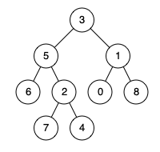

```text
输入：root = [3,5,1,6,2,0,8,null,null,7,4], p = 5, q = 4
输出：5
```

解释：节点 5 和节点 4 的最近公共祖先是节点 5 。因为根据定义最近公共祖先节点可以为节点本身。

**示例 3**

```text
输入：root = [1,2], p = 1, q = 2
输出：1
```
> 题面与 [leetcode.cn 官方](https://leetcode.cn/problems/lowest-common-ancestor-of-a-binary-tree/)一致，示例配图取自官方题面。

**数据范围与注意事项**：

- `树中节点数目在范围 `[2, 10^5]` 内。`
- `-10^9 <= Node.val <= 10^9`
- 所有 `Node.val` `互不相同` 。
- `p != q`
- `p` 和 `q` 均存在于给定的二叉树中。
- **易错点**：递归出口（空节点）必须先写，否则直接空指针。

## 题目分析

**场景是什么**：树是分层数据的标准形态，这类题练的是递归分治与遍历序，对应真实开发里的目录树、组件树。本题就是该场景的 Medium 级练习，主线做法是「直接实现」。

**主线怎么解**：主解法结构简单：读入、处理、返回。

## 解题思路

**方案对比**（共 3 个方案，由浅入深）：

| 方案 | 时间复杂度 | 空间复杂度 |
|---|---|---|
| 方案 1 · 直接实现 | O(n) 量级 | O(n) |
| 方案 2 · 直接实现 | O(n) 量级 | O(n) |
| 方案 3 · 直接实现 | O(n) 量级 | O(n) |

**方案间的取舍**：方案 1（直接实现）；方案 2（直接实现）；方案 3（直接实现）。数据规模小、可读性优先时选靠前的方案；规模大、性能优先时选靠后的方案。

**怎么读这一篇**：

- 🐣 **新手路线**：把「题目描述」的示例 1 在纸上手推一遍 → 读方案 1（最直观的写法）与它的代码走读 → 按「运行方式」本地跑通看 PASS → 回头对比方案 2 之后的写法差在哪
- 🦅 **大佬路线**：直接锁定最优方案 1（直接实现，O(n) 量级）→ 跳读该方案代码与走读 → 用「逐步拆解与面试追问」补齐复杂度推导与边界追问

### 动态算法图（DFS 点亮，GIF 自动循环）


动画演示二叉树专题里DFS 点亮的典型过程；每个方案在「TypeScript 解题方案」一节还配了专属动画与专属流程图。

### 主解法流程图（真实控制流）

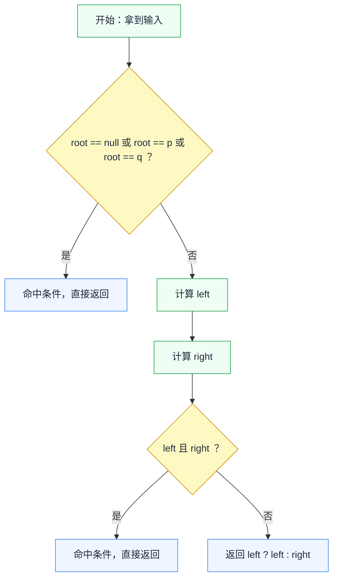

## TypeScript 解题方案（3 个方案逐个讲）

> **运行与提交**：每个方案都是自包含文件（内嵌用例自测，输出 PASS），整块复制到 `.ts` 文件后 `node 文件名` 即可运行。提交 LeetCode 时，把 `demo` 内的算法函数与辅助类型/函数整体取出、置于文件顶层即可。涉及交互/特殊接口的题以题面给定签名为准。

### 方案 1：直接实现

**分析与思路**：核心做法是「直接实现」。

**运行方式**：`node 本文件`，内嵌用例全部通过会输出 PASS。


**方案专属流程图**（真实控制流）：

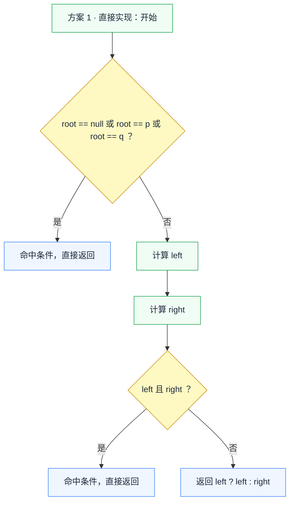

```typescript
export function demo(): void {
  // 程序入口：跑内嵌自测用例
  class TreeNode {
    // 定义类型
    val: number;
    left: TreeNode | null;
    right: TreeNode | null; // 值: number; 左边界: TreeNode 按位或 null; 右边界: TreeNode 按位或 null;
    constructor(
      val: number,
      left: TreeNode | null = null,
      right: TreeNode | null = null,
    ) {
      this.val = val;
      this.left = left;
      this.right = right; // 把 值; this.左边界 赋值为 左边界; this.右边界 赋值为 右边界; 写入 值
    }
  }
  function lowestCommonAncestor(
    root: TreeNode | null,
    p: TreeNode,
    q: TreeNode,
  ): TreeNode | null {
    // 定义函数/方法 lowestCommonAncestor
    if (root === null || root === p || root === q) return root; // 若 根节点 全等于 null 或 根节点 全等于 节点 或 根节点 全等于 节点，直接返回 根节点
    const left = lowestCommonAncestor(root.left, p, q); // 把 lowestCommonAncestor(根节点.左边界, 节点, 节点) 存入 左边界
    const right = lowestCommonAncestor(root.right, p, q); // 把 lowestCommonAncestor(根节点.右边界, 节点, 节点) 存入 右边界
    if (left && right) return root; // 若 左边界 且 右边界，直接返回 根节点
    return left ? left : right; // 返回 左边界 ? 左边界 : 右边界
  }
  function find(root: TreeNode | null, val: number): TreeNode | null {
    // 定义函数/方法 find
    if (root === null) return null; // 若 根节点 全等于 null，直接返回 null
    if (root.val === val) return root; // 若 根节点.值 全等于 值，直接返回 根节点
    return find(root.left, val) || find(root.right, val); // 返回 find(根节点.左边界, 值) 或 find(根节点.右边界, 值)
  }
  function build(): TreeNode {
    // 定义函数/方法 build
    const root = new TreeNode(3); // 把 new TreeNode(3) 存入 根节点
    root.left = new TreeNode(5); // 把 new TreeNode(5); 写入 左边界
    root.right = new TreeNode(1); // 把 new TreeNode(1); 写入 右边界
    root.left.left = new TreeNode(6); // 把 new TreeNode(6); 写入 左边界
    root.left.right = new TreeNode(2); // 把 new TreeNode(2); 写入 右边界
    root.right.left = new TreeNode(0); // 把 new TreeNode(0); 写入 左边界
    root.right.right = new TreeNode(8); // 把 new TreeNode(8); 写入 右边界
    root.left.right.left = new TreeNode(7); // 把 new TreeNode(7); 写入 左边界
    root.left.right.right = new TreeNode(4); // 把 new TreeNode(4); 写入 右边界
    return root; // 返回 根节点
  }
  const cases: [number, number, number][] = [
    [5, 1, 3],
    [5, 4, 5],
    [6, 4, 5],
  ];
  let fail = false; // 把 false 存入 fail
  for (const [pv, qv, want] of cases) {
    // for (const [pv, qv, want] of cases) {
    const root = build(); // 把 build() 存入 根节点
    const p = find(root, pv)!; // 把 find(根节点, pv)取反 存入 节点
    const q = find(root, qv)!; // 把 find(根节点, qv)取反 存入 节点
    const lca = lowestCommonAncestor(root, p, q); // 把 lowestCommonAncestor(根节点, 节点, 节点) 存入 lca
    const got = lca ? lca.val : -1; // 把 lca ? lca.值 : 减 1 存入 got
    if (got !== want) {
      fail = true;
      console.log('FAIL (' + pv + ',' + qv + ') got ' + got + ' want ' + want);
    }
  }
  if (fail) throw new Error('FAILED'); // 若 fail) throw new Error(「FAILED」);
  console.log('PASS'); // 全部用例通过，输出 PASS
}
demo(); // demo();
```

### 方案 2：直接实现

**分析与思路**：核心做法是「直接实现」。

**运行方式**：`node 本文件`，内嵌用例全部通过会输出 PASS。


**方案专属流程图**（真实控制流）：


```typescript
export function demo(): void {
  // 程序入口：跑内嵌自测用例
  class TreeNode {
    // 定义类型
    val: number;
    left: TreeNode | null;
    right: TreeNode | null; // 值: number; 左边界: TreeNode 按位或 null; 右边界: TreeNode 按位或 null;
    constructor(
      val: number,
      left: TreeNode | null = null,
      right: TreeNode | null = null,
    ) {
      this.val = val;
      this.left = left;
      this.right = right; // 把 值; this.左边界 赋值为 左边界; this.右边界 赋值为 右边界; 写入 值
    }
  }
  function lowestCommonAncestor(
    root: TreeNode | null,
    p: TreeNode,
    q: TreeNode,
  ): TreeNode | null {
    // 定义函数/方法 lowestCommonAncestor
    if (root === null || root === p || root === q) return root; // 若 根节点 全等于 null 或 根节点 全等于 节点 或 根节点 全等于 节点，直接返回 根节点
    const left = lowestCommonAncestor(root.left, p, q); // 把 lowestCommonAncestor(根节点.左边界, 节点, 节点) 存入 左边界
    const right = lowestCommonAncestor(root.right, p, q); // 把 lowestCommonAncestor(根节点.右边界, 节点, 节点) 存入 右边界
    if (left && right) return root; // 若 左边界 且 右边界，直接返回 根节点
    return left ? left : right; // 返回 左边界 ? 左边界 : 右边界
  }
  function find(root: TreeNode | null, val: number): TreeNode | null {
    // 定义函数/方法 find
    if (root === null) return null; // 若 根节点 全等于 null，直接返回 null
    if (root.val === val) return root; // 若 根节点.值 全等于 值，直接返回 根节点
    return find(root.left, val) || find(root.right, val); // 返回 find(根节点.左边界, 值) 或 find(根节点.右边界, 值)
  }
  function build(): TreeNode {
    // 定义函数/方法 build
    const root = new TreeNode(3); // 把 new TreeNode(3) 存入 根节点
    root.left = new TreeNode(5); // 把 new TreeNode(5); 写入 左边界
    root.right = new TreeNode(1); // 把 new TreeNode(1); 写入 右边界
    root.left.left = new TreeNode(6); // 把 new TreeNode(6); 写入 左边界
    root.left.right = new TreeNode(2); // 把 new TreeNode(2); 写入 右边界
    root.right.left = new TreeNode(0); // 把 new TreeNode(0); 写入 左边界
    root.right.right = new TreeNode(8); // 把 new TreeNode(8); 写入 右边界
    root.left.right.left = new TreeNode(7); // 把 new TreeNode(7); 写入 左边界
    root.left.right.right = new TreeNode(4); // 把 new TreeNode(4); 写入 右边界
    return root; // 返回 根节点
  }
  const cases: [number, number, number][] = [
    [5, 1, 3],
    [5, 4, 5],
    [6, 4, 5],
  ];
  let fail = false; // 把 false 存入 fail
  for (const [pv, qv, want] of cases) {
    // for (const [pv, qv, want] of cases) {
    const root = build(); // 把 build() 存入 根节点
    const p = find(root, pv)!; // 把 find(根节点, pv)取反 存入 节点
    const q = find(root, qv)!; // 把 find(根节点, qv)取反 存入 节点
    const lca = lowestCommonAncestor(root, p, q); // 把 lowestCommonAncestor(根节点, 节点, 节点) 存入 lca
    const got = lca ? lca.val : -1; // 把 lca ? lca.值 : 减 1 存入 got
    if (got !== want) {
      fail = true;
      console.log('FAIL (' + pv + ',' + qv + ') got ' + got + ' want ' + want);
    }
  }
  if (fail) throw new Error('FAILED'); // 若 fail) throw new Error(「FAILED」);
  console.log('PASS'); // 全部用例通过，输出 PASS
}
demo(); // demo();
```

### 方案 3：直接实现

**分析与思路**：核心做法是「直接实现」。

**运行方式**：`node 本文件`，内嵌用例全部通过会输出 PASS。


**方案专属流程图**（真实控制流）：


```typescript
export function demo(): void {
  // 程序入口：跑内嵌自测用例
  class TreeNode {
    // 定义类型
    val: number;
    left: TreeNode | null;
    right: TreeNode | null; // 值: number; 左边界: TreeNode 按位或 null; 右边界: TreeNode 按位或 null;
    constructor(
      val: number,
      left: TreeNode | null = null,
      right: TreeNode | null = null,
    ) {
      this.val = val;
      this.left = left;
      this.right = right; // 把 值; this.左边界 赋值为 左边界; this.右边界 赋值为 右边界; 写入 值
    }
  }
  function lowestCommonAncestor(
    root: TreeNode | null,
    p: TreeNode,
    q: TreeNode,
  ): TreeNode | null {
    // 定义函数/方法 lowestCommonAncestor
    if (root === null || root === p || root === q) return root; // 若 根节点 全等于 null 或 根节点 全等于 节点 或 根节点 全等于 节点，直接返回 根节点
    const left = lowestCommonAncestor(root.left, p, q); // 把 lowestCommonAncestor(根节点.左边界, 节点, 节点) 存入 左边界
    const right = lowestCommonAncestor(root.right, p, q); // 把 lowestCommonAncestor(根节点.右边界, 节点, 节点) 存入 右边界
    if (left && right) return root; // 若 左边界 且 右边界，直接返回 根节点
    return left ? left : right; // 返回 左边界 ? 左边界 : 右边界
  }
  function find(root: TreeNode | null, val: number): TreeNode | null {
    // 定义函数/方法 find
    if (root === null) return null; // 若 根节点 全等于 null，直接返回 null
    if (root.val === val) return root; // 若 根节点.值 全等于 值，直接返回 根节点
    return find(root.left, val) || find(root.right, val); // 返回 find(根节点.左边界, 值) 或 find(根节点.右边界, 值)
  }
  function build(): TreeNode {
    // 定义函数/方法 build
    const root = new TreeNode(3); // 把 new TreeNode(3) 存入 根节点
    root.left = new TreeNode(5); // 把 new TreeNode(5); 写入 左边界
    root.right = new TreeNode(1); // 把 new TreeNode(1); 写入 右边界
    root.left.left = new TreeNode(6); // 把 new TreeNode(6); 写入 左边界
    root.left.right = new TreeNode(2); // 把 new TreeNode(2); 写入 右边界
    root.right.left = new TreeNode(0); // 把 new TreeNode(0); 写入 左边界
    root.right.right = new TreeNode(8); // 把 new TreeNode(8); 写入 右边界
    root.left.right.left = new TreeNode(7); // 把 new TreeNode(7); 写入 左边界
    root.left.right.right = new TreeNode(4); // 把 new TreeNode(4); 写入 右边界
    return root; // 返回 根节点
  }
  const cases: [number, number, number][] = [
    [5, 1, 3],
    [5, 4, 5],
    [6, 4, 5],
  ];
  let fail = false; // 把 false 存入 fail
  for (const [pv, qv, want] of cases) {
    // for (const [pv, qv, want] of cases) {
    const root = build(); // 把 build() 存入 根节点
    const p = find(root, pv)!; // 把 find(根节点, pv)取反 存入 节点
    const q = find(root, qv)!; // 把 find(根节点, qv)取反 存入 节点
    const lca = lowestCommonAncestor(root, p, q); // 把 lowestCommonAncestor(根节点, 节点, 节点) 存入 lca
    const got = lca ? lca.val : -1; // 把 lca ? lca.值 : 减 1 存入 got
    if (got !== want) {
      fail = true;
      console.log('FAIL (' + pv + ',' + qv + ') got ' + got + ' want ' + want);
    }
  }
  if (fail) throw new Error('FAILED'); // 若 fail) throw new Error(「FAILED」);
  console.log('PASS'); // 全部用例通过，输出 PASS
}
demo(); // demo();
```

## 逐步拆解与面试追问

**复杂度**：时间 O(n) 量级，空间 O(n)

**为什么是这个量级**：整体只对数据做有限趟处理

**面试官可能会追问**：

- 递归和迭代写法各自的空间开销？
- 能否用层序统一处理？
- 空节点的边界如何约定？

## 关键 API 速查（TS 主解法实际用到，附官方链接）

本题主解法只用到基础语法（变量、循环、比较），不依赖特殊库 API。

### 各语言官方文档导航

- **TypeScript / JS**：[MDN 中文参考](https://developer.mozilla.org/zh-CN/)
- **Python**：[Python 官方文档](https://docs.python.org/zh-cn/3/)
- **Go**：[Go 标准库](https://pkg.go.dev/std)
- **Java**：[JDK 17 API](https://docs.oracle.com/en/java/javase/17/docs/api/)
- **Rust**：[Rust 标准库](https://doc.rust-lang.org/std/)
- **Lua**：[Lua 5.4 手册](https://www.lua.org/manual/5.4/)
- **C**：[Cppreference C](https://zh.cppreference.com/w/c)
- **C++**：[Cppreference C++](https://zh.cppreference.com/w/cpp)
- **R**：[R 官方手册](https://stat.ethz.ch/R-manual/)
- **Zig**：[Zig 语言文档](https://ziglang.org/documentation/master/)
- **Dart**：[Dart API](https://api.dart.dev/)

## 附录：其他 10 种语言全部实现（每种语言列举其全部方案）

> TypeScript 的全部方案见「TypeScript 解题方案」一节；下面是其余 10 种语言的对应实现，每种语言的每个方案都带思路分析、代码走读与专属运行架构图。
> 每个方案都内嵌用例自测，可独立运行（老仓库 python/go 文件遵循「打印结果」约定）。
> 完整解法文件见 `dsa/<语言>/tree/lc_236_二叉树的最近公共祖先/`。

### Python 实现（3 种方案）

Python 的全部方案如下，每个方案都内嵌用例自测，可独立运行（老仓库 python/go 文件遵循「打印结果」约定）：

#### 方案 1：直接实现

**思路与代码分析**：核心是「直接实现」。Python 版用切片与字典推导式简化操作，突出可读性。**走读**：方案 1 · 直接实现：开始 → 命中条件，直接返回 → 更新 left → 处理 root.left, p, q → 处理 ) → 更新 right → 处理 root.right, p, q → 处理 ) → 命中条件，直接返回 → 返回 left if left else right。

**运行架构**（真实控制流）：

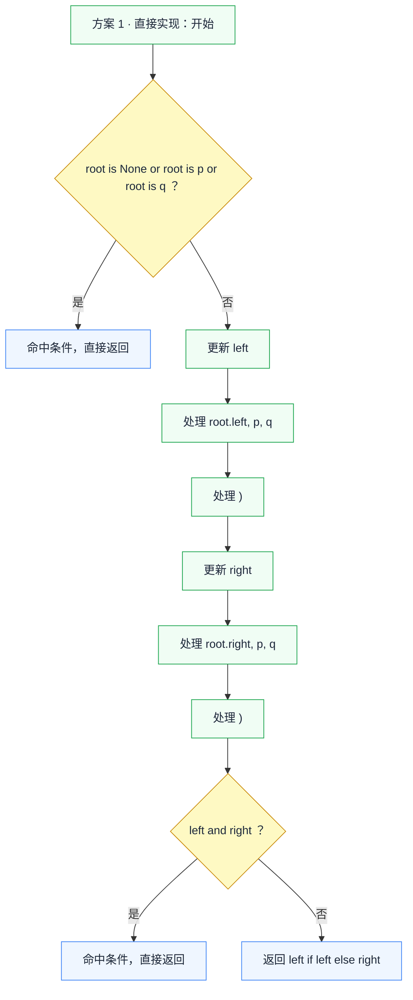

```python
import sys  # 提高递归深度上限（深输入防 RecursionError）

sys.setrecursionlimit(200000)  # 树/链表类题目节点数可达 1e4 量级

class TreeNode:  # 定义类
    def __init__(self, val=0, left=None, right=None):  # 构造函数：初始化成员
        self.val = val  # 把 值 写入 值
        self.left = left  # 把 左边界 写入 左边界
        self.right = right  # 把 右边界 写入 右边界

def lowestCommonAncestor(root, p, q):  # 定义函数 lowestCommonAncestor（参数：根节点, 节点, 节点）
    if root is None or root is p or root is q:  # 若 根节点 is None or 根节点 is 节点 or 根节点 is 节点
        return root  # 返回 根节点
    left = lowestCommonAncestor(
        root.left, p, q
    )  # 把 lowestCommonAncestor(根节点.左边界, 节点, 节点) 存入 左边界
    right = lowestCommonAncestor(
        root.right, p, q
    )  # 把 lowestCommonAncestor(根节点.右边界, 节点, 节点) 存入 右边界
    if left and right:  # 若 左边界 and 右边界
        return root  # 返回 根节点
    return left if left else right  # 返回 左边界 if 左边界 else 右边界

def find(root, val):  # 定义函数 find（参数：根节点, 值）
    if root is None:  # 若 根节点 is None
        return None  # 返回 None
    if root.val == val:  # 若 根节点.值 等于 值
        return root  # 返回 根节点
    return find(root.left, val) or find(
        root.right, val
    )  # 返回 find(根节点.左边界, 值) or find(根节点.右边界, 值)

if __name__ == "__main__":  # 若 __name__ 等于 '__main__'
    # 构造示例树：root=3, left=5, right=1, 5的子节点9,7 ...
    root = TreeNode(3)  # 把 TreeNode(3) 存入 根节点
    root.left = TreeNode(5)  # 把 TreeNode(5) 写入 左边界
    root.right = TreeNode(1)  # 把 TreeNode(1) 写入 右边界
    root.left.left = TreeNode(6)  # 把 TreeNode(6) 写入 左边界
    root.left.right = TreeNode(2)  # 把 TreeNode(2) 写入 右边界
    root.right.left = TreeNode(0)  # 把 TreeNode(0) 写入 左边界
    root.right.right = TreeNode(8)  # 把 TreeNode(8) 写入 右边界
    root.left.right.left = TreeNode(7)  # 把 TreeNode(7) 写入 左边界
    root.left.right.right = TreeNode(4)  # 把 TreeNode(4) 写入 右边界
    p = find(root, 5)  # 把 find(根节点, 5) 存入 节点
    q = find(root, 1)  # 把 find(根节点, 1) 存入 节点
    ans = lowestCommonAncestor(root, p, q)  # 把 lowestCommonAncestor(根节点, 节点, 节点) 存入 答案
    print(ans.val if ans else None)  # 打印输出
```

#### 方案 2：直接实现

**思路与代码分析**：核心是「直接实现」。Python 版用切片与字典推导式简化操作，突出可读性。**走读**：方案 2 · 直接实现：开始 → 命中条件，直接返回 → 更新 left → 处理 root.left, p, q → 处理 ) → 更新 right → 处理 root.right, p, q → 处理 ) → 命中条件，直接返回 → 返回 left if left else right。

**运行架构**（真实控制流）：


```python
import sys  # 提高递归深度上限（深输入防 RecursionError）

sys.setrecursionlimit(200000)  # 树/链表类题目节点数可达 1e4 量级

class TreeNode:  # 定义类
    def __init__(self, val=0, left=None, right=None):  # 构造函数：初始化成员
        self.val = val  # 把 值 写入 值
        self.left = left  # 把 左边界 写入 左边界
        self.right = right  # 把 右边界 写入 右边界

def lowestCommonAncestor(root, p, q):  # 定义函数 lowestCommonAncestor（参数：根节点, 节点, 节点）
    if root is None or root == p or root == q:  # 若 根节点 is None or 根节点 等于 节点 or 根节点 等于 节点
        return root  # 返回 根节点
    left = lowestCommonAncestor(
        root.left, p, q
    )  # 把 lowestCommonAncestor(根节点.左边界, 节点, 节点) 存入 左边界
    right = lowestCommonAncestor(
        root.right, p, q
    )  # 把 lowestCommonAncestor(根节点.右边界, 节点, 节点) 存入 右边界
    if left and right:  # 若 左边界 and 右边界
        return root  # 返回 根节点
    return left if left else right  # 返回 左边界 if 左边界 else 右边界

if __name__ == "__main__":  # 若 __name__ 等于 '__main__'
    # build tree: [3,5,1,6,2,0,8,null,null,7,4]
    root = TreeNode(3)  # 把 TreeNode(3) 存入 根节点
    root.left = TreeNode(5)  # 把 TreeNode(5) 写入 左边界
    root.right = TreeNode(1)  # 把 TreeNode(1) 写入 右边界
    root.left.left = TreeNode(6)  # 把 TreeNode(6) 写入 左边界
    root.left.right = TreeNode(2)  # 把 TreeNode(2) 写入 右边界
    root.right.left = TreeNode(0)  # 把 TreeNode(0) 写入 左边界
    root.right.right = TreeNode(8)  # 把 TreeNode(8) 写入 右边界
    root.left.right.left = TreeNode(7)  # 把 TreeNode(7) 写入 左边界
    root.left.right.right = TreeNode(4)  # 把 TreeNode(4) 写入 右边界
    p = root.left  # 5
    q = root.left.right.right  # 4
    lca = lowestCommonAncestor(root, p, q)  # 把 lowestCommonAncestor(根节点, 节点, 节点) 存入 lca
    print(lca.val if lca else None)  # 打印输出
```

#### 方案 3：直接实现

**思路与代码分析**：核心是「直接实现」。Python 版用切片与字典推导式简化操作，突出可读性。**走读**：方案 3 · 直接实现：开始 → 命中条件，直接返回 → 更新 left → 处理 root.left, p, q → 处理 ) → 更新 right → 处理 root.right, p, q → 处理 ) → 命中条件，直接返回 → 返回 left if left else right。

**运行架构**（真实控制流）：


```python
import sys  # 提高递归深度上限（深输入防 RecursionError）

sys.setrecursionlimit(200000)  # 树/链表类题目节点数可达 1e4 量级

class TreeNode:  # 定义类
    def __init__(self, val=0, left=None, right=None):  # 构造函数：初始化成员
        self.val = val  # 把 值 写入 值
        self.left = left  # 把 左边界 写入 左边界
        self.right = right  # 把 右边界 写入 右边界

def lowestCommonAncestor(root, p, q):  # 定义函数 lowestCommonAncestor（参数：根节点, 节点, 节点）
    if root is None or root == p or root == q:  # 若 根节点 is None or 根节点 等于 节点 or 根节点 等于 节点
        return root  # 返回 根节点
    left = lowestCommonAncestor(
        root.left, p, q
    )  # 把 lowestCommonAncestor(根节点.左边界, 节点, 节点) 存入 左边界
    right = lowestCommonAncestor(
        root.right, p, q
    )  # 把 lowestCommonAncestor(根节点.右边界, 节点, 节点) 存入 右边界
    if left and right:  # 若 左边界 and 右边界
        return root  # 返回 根节点
    return left if left else right  # 返回 左边界 if 左边界 else 右边界

if __name__ == "__main__":  # 若 __name__ 等于 '__main__'
    # build tree: [3,5,1,6,2,0,8,null,null,7,4]
    root = TreeNode(3)  # 把 TreeNode(3) 存入 根节点
    root.left = TreeNode(5)  # 把 TreeNode(5) 写入 左边界
    root.right = TreeNode(1)  # 把 TreeNode(1) 写入 右边界
    root.left.left = TreeNode(6)  # 把 TreeNode(6) 写入 左边界
    root.left.right = TreeNode(2)  # 把 TreeNode(2) 写入 右边界
    root.right.left = TreeNode(0)  # 把 TreeNode(0) 写入 左边界
    root.right.right = TreeNode(8)  # 把 TreeNode(8) 写入 右边界
    root.left.right.left = TreeNode(7)  # 把 TreeNode(7) 写入 左边界
    root.left.right.right = TreeNode(4)  # 把 TreeNode(4) 写入 右边界
    p = root.left  # 5
    q = root.right  # 1
    lca = lowestCommonAncestor(root, p, q)  # 把 lowestCommonAncestor(根节点, 节点, 节点) 存入 lca
    print(lca.val if lca else None)  # 打印输出
```

### Go 实现（3 种方案）

Go 的全部方案如下，每个方案都内嵌用例自测，可独立运行（老仓库 python/go 文件遵循「打印结果」约定）：

#### 方案 1：直接实现

**思路与代码分析**：核心是「直接实现」。Go 版用切片与多返回值惯用法，显式处理索引边界。**走读**：方案 1 · 直接实现：开始 → 处理 if root == nil → 返回 nil → 处理 if root.Val == v → 返回 root → 处理 if l := find(root.Left, v) → 返回 l → 返回 find(root.Right, v)。

**运行架构**（真实控制流）：

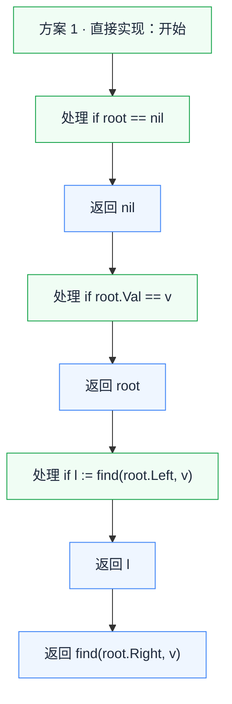

```go
package main // 引入依赖
import (
	"fmt"
	"os"
) // 引入依赖
type TreeNode struct {
	Val   int
	Left  *TreeNode
	Right *TreeNode
}                        // 定义类型
const NULL = -1000000000 // 把 减 1000000000 存入 NULL
func buildTree(vals []int) *TreeNode { // 定义函数/方法 buildTree
	if len(vals) == 0 || vals[0] == NULL {
		return nil
	} // 若 长度(vals) 等于 0 或 vals[0] 等于 NULL { return nil }
	root := &TreeNode{Val: vals[0]} // 把 按位与 TreeNode{Val: vals[0]} 写入 root :
	q := []*TreeNode{root}
	i := 1                            // 把 [] 乘 TreeNode{根节点}; 下标 i : 赋值为 1 写入 q :
	for len(q) > 0 && i < len(vals) { // 定义函数/方法 len
		node := q[0]
		q = q[1:] // 把 节点[0]; 节点 赋值为 节点[1:] 写入 node :
		if i < len(vals) && vals[i] != NULL {
			node.Left = &TreeNode{Val: vals[i]}
			q = append(q, node.Left)
		}
		i++
		if i < len(vals) && vals[i] != NULL {
			node.Right = &TreeNode{Val: vals[i]}
			q = append(q, node.Right)
		}
		i++
	}
	return root // 返回 根节点
}
func levelList(root *TreeNode) [][]int { // 定义函数/方法 levelList
	if root == nil {
		return [][]int{}
	} // 若 根节点 等于 nil { return [][]int{} }
	res := [][]int{}
	q := []*TreeNode{root} // 把 [][]int{}; 节点 : 赋值为 [] 乘 TreeNode{根节点} 写入 res :
	for len(q) > 0 {       // for 长度(节点) 超过 0 {
		lvl := []int{}
		n := len(q)              // 把 []int{}; 元素个数 : 赋值为 长度(节点) 写入 lvl :
		for k := 0; k < n; k++ { // 让 下标 k 从 0 开始计数
			node := q[0]
			q = q[1:]                   // 把 节点[0]; 节点 赋值为 节点[1:] 写入 node :
			lvl = append(lvl, node.Val) // 把 append(lvl, 节点.Val) 写入 lvl
			if node.Left != nil {
				q = append(q, node.Left)
			} // 若 节点.Left 不等于 nil { 节点 赋值为 append(节点, 节点.Left) }
			if node.Right != nil {
				q = append(q, node.Right)
			} // 若 节点.Right 不等于 nil { 节点 赋值为 append(节点, 节点.Right) }
		}
		res = append(res, lvl) // 把 append(结果, lvl) 写入 结果
	}
	return res // 返回 结果
}
func sameTree(a, b *TreeNode) bool { // 定义函数/方法 sameTree
	if a == nil && b == nil {
		return true
	} // 若 数组 等于 nil 且 b 等于 nil { return true }
	if a == nil || b == nil {
		return false
	} // 若 数组 等于 nil 或 b 等于 nil { return false }
	if a.Val != b.Val {
		return false
	} // 若 数组.Val 不等于 b.Val { return false }
	return sameTree(a.Left, b.Left) && sameTree(a.Right, b.Right) // 定义函数/方法 sameTree
}
func inorderT(root *TreeNode) []int { // 定义函数/方法 inorderT
	if root == nil {
		return []int{}
	} // 若 根节点 等于 nil { return []int{} }
	return append(append(inorderT(root.Left), root.Val), inorderT(root.Right)...) // 定义函数/方法 append
}
func lowestCommonAncestor(root, p, q *TreeNode) *TreeNode { // 定义函数/方法 lowestCommonAncestor
	if root == nil || root == p || root == q {
		return root
	} // 若 根节点 等于 nil 或 根节点 等于 节点 或 根节点 等于 节点 { return 根节点 }
	left := lowestCommonAncestor(root.Left, p, q)   // 把 lowestCommonAncestor(根节点.Left, 节点, 节点) 写入 left :
	right := lowestCommonAncestor(root.Right, p, q) // 把 lowestCommonAncestor(根节点.Right, 节点, 节点) 写入 right :
	if left != nil && right != nil {
		return root
	} // 若 左边界 不等于 nil 且 右边界 不等于 nil { return 根节点 }
	if left != nil {
		return left
	} // 若 左边界 不等于 nil { return 左边界 }
	return right // 返回 右边界
}
func find(root *TreeNode, v int) *TreeNode { // 定义函数/方法 find
	if root == nil {
		return nil
	} // 若 根节点 等于 nil { return nil }
	if root.Val == v {
		return root
	} // 若 根节点.Val 等于 值 { return 根节点 }
	if l := find(root.Left, v); l != nil {
		return l
	} // 若 左指针 : 赋值为 find(根节点.Left, 值); 左指针 不等于 nil { return 左指针 }
	return find(root.Right, v) // 定义函数/方法 find
}
func main() { // 程序入口：跑内嵌自测用例
	root := buildTree([]int{3, 5, 1, 6, 2, 0, 8, NULL, NULL, 7, 4}) // 把 buildTree([]int{3,5,1,6,2,0,8,NULL,NULL,7,4}) 写入 root :
	p := find(root, 5)
	q := find(root, 1) // 把 find(根节点, 5); 节点 : 赋值为 find(根节点, 1) 写入 p :
	if lca := lowestCommonAncestor(root, p, q); lca == nil || lca.Val != 3 {
		fmt.Println("FAIL", lca)
		os.Exit(1)
	}
	fmt.Println("PASS") // 全部用例通过，输出 PASS
}
```

#### 方案 2：直接实现

**思路与代码分析**：核心是「直接实现」。Go 版用切片与多返回值惯用法，显式处理索引边界。**走读**：方案 2 · 直接实现：开始 → 处理 if root == nil 或 root == p → 返回 root → 更新 : → 更新 : → 处理 if left ≠ nil 且 right ≠ n → 返回 root → 处理 if left ≠ nil → 返回 left → 返回 right。

**运行架构**（真实控制流）：


```go
package main // 引入依赖

import (
	"fmt"
	"os"
) // 引入依赖

type TreeNode struct { // 定义类型
	Val   int       // Val int
	Left  *TreeNode // Left 乘 TreeNode
	Right *TreeNode // Right 乘 TreeNode
}

func lowestCommonAncestor(root, p, q *TreeNode) *TreeNode { // 定义函数/方法 lowestCommonAncestor
	if root == nil || root == p || root == q { // 若 根节点 等于 nil 或 根节点 等于 节点 或 根节点 等于 节点
		return root // 返回 根节点
	}
	left := lowestCommonAncestor(root.Left, p, q)   // 把 lowestCommonAncestor(根节点.Left, 节点, 节点) 写入 left :
	right := lowestCommonAncestor(root.Right, p, q) // 把 lowestCommonAncestor(根节点.Right, 节点, 节点) 写入 right :
	if left != nil && right != nil {                // 若 左边界 不等于 nil 且 右边界 不等于 nil
		return root // 返回 根节点
	}
	if left != nil { // 若 左边界 不等于 nil
		return left // 返回 左边界
	}
	return right // 返回 右边界
}

func main() { // 程序入口：跑内嵌自测用例
	root := &TreeNode{Val: 3}                 // 把 按位与 TreeNode{Val: 3} 写入 root :
	root.Left = &TreeNode{Val: 5}             // 把 按位与 TreeNode{Val: 5} 写入 root.Left
	root.Right = &TreeNode{Val: 1}            // 把 按位与 TreeNode{Val: 1} 写入 root.Right
	root.Left.Left = &TreeNode{Val: 6}        // 把 按位与 TreeNode{Val: 6} 写入 root.Left.Left
	root.Left.Right = &TreeNode{Val: 2}       // 把 按位与 TreeNode{Val: 2} 写入 root.Left.Right
	root.Right.Left = &TreeNode{Val: 0}       // 把 按位与 TreeNode{Val: 0} 写入 root.Right.Left
	root.Right.Right = &TreeNode{Val: 8}      // 把 按位与 TreeNode{Val: 8} 写入 root.Right.Right
	root.Left.Right.Left = &TreeNode{Val: 7}  // 把 按位与 TreeNode{Val: 7} 写入 root.Left.Right.Left
	root.Left.Right.Right = &TreeNode{Val: 4} // 把 按位与 TreeNode{Val: 4} 写入 root.Left.Right.Right
	p := root.Left                            // 把 根节点.Left 写入 p :
	q := root.Left.Right.Right                // 把 根节点.Left.Right.Right 写入 q :
	lca := lowestCommonAncestor(root, p, q)   // 把 lowestCommonAncestor(根节点, 节点, 节点) 写入 lca :
	if lca == nil || lca.Val != 5 {           // 若 lca 等于 nil 或 lca.Val 不等于 5
		fmt.Printf("FAIL got=%v want=5\n", lca) // 打印输出
		os.Exit(1)                              // os.Exit(1)
	}
	fmt.Println("PASS") // 全部用例通过，输出 PASS
}
```

#### 方案 3：直接实现

**思路与代码分析**：核心是「直接实现」。Go 版用切片与多返回值惯用法，显式处理索引边界。**走读**：方案 3 · 直接实现：开始 → 处理 if root == nil 或 root == p → 返回 root → 更新 : → 更新 : → 处理 if left ≠ nil 且 right ≠ n → 返回 root → 处理 if left ≠ nil → 返回 left → 返回 right。

**运行架构**（真实控制流）：

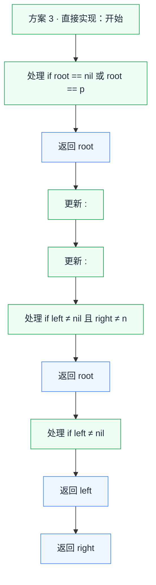

```go
package main // 引入依赖

import (
	"fmt"
	"os"
) // 引入依赖

type TreeNode struct { // 定义类型
	Val   int       // Val int
	Left  *TreeNode // Left 乘 TreeNode
	Right *TreeNode // Right 乘 TreeNode
}

func lowestCommonAncestor(root, p, q *TreeNode) *TreeNode { // 定义函数/方法 lowestCommonAncestor
	if root == nil || root == p || root == q { // 若 根节点 等于 nil 或 根节点 等于 节点 或 根节点 等于 节点
		return root // 返回 根节点
	}
	left := lowestCommonAncestor(root.Left, p, q)   // 把 lowestCommonAncestor(根节点.Left, 节点, 节点) 写入 left :
	right := lowestCommonAncestor(root.Right, p, q) // 把 lowestCommonAncestor(根节点.Right, 节点, 节点) 写入 right :
	if left != nil && right != nil {                // 若 左边界 不等于 nil 且 右边界 不等于 nil
		return root // 返回 根节点
	}
	if left != nil { // 若 左边界 不等于 nil
		return left // 返回 左边界
	}
	return right // 返回 右边界
}

func main() { // 程序入口：跑内嵌自测用例
	root := &TreeNode{Val: 3}                 // 把 按位与 TreeNode{Val: 3} 写入 root :
	root.Left = &TreeNode{Val: 5}             // 把 按位与 TreeNode{Val: 5} 写入 root.Left
	root.Right = &TreeNode{Val: 1}            // 把 按位与 TreeNode{Val: 1} 写入 root.Right
	root.Left.Left = &TreeNode{Val: 6}        // 把 按位与 TreeNode{Val: 6} 写入 root.Left.Left
	root.Left.Right = &TreeNode{Val: 2}       // 把 按位与 TreeNode{Val: 2} 写入 root.Left.Right
	root.Right.Left = &TreeNode{Val: 0}       // 把 按位与 TreeNode{Val: 0} 写入 root.Right.Left
	root.Right.Right = &TreeNode{Val: 8}      // 把 按位与 TreeNode{Val: 8} 写入 root.Right.Right
	root.Left.Right.Left = &TreeNode{Val: 7}  // 把 按位与 TreeNode{Val: 7} 写入 root.Left.Right.Left
	root.Left.Right.Right = &TreeNode{Val: 4} // 把 按位与 TreeNode{Val: 4} 写入 root.Left.Right.Right
	p := root.Left                            // 把 根节点.Left 写入 p :
	q := root.Right                           // 把 根节点.Right 写入 q :
	lca := lowestCommonAncestor(root, p, q)   // 把 lowestCommonAncestor(根节点, 节点, 节点) 写入 lca :
	if lca == nil || lca.Val != 3 {           // 若 lca 等于 nil 或 lca.Val 不等于 3
		fmt.Printf("FAIL got=%v want=3\n", lca) // 打印输出
		os.Exit(1)                              // os.Exit(1)
	}
	fmt.Println("PASS") // 全部用例通过，输出 PASS
}
```

### Java 实现（3 种方案）

Java 的全部方案如下，每个方案都内嵌用例自测，可独立运行（老仓库 python/go 文件遵循「打印结果」约定）：

#### 方案 1：直接实现

**思路与代码分析**：核心是「直接实现」。Java 版用类与静态方法组织，集合操作显式明了。**走读**：方案 1 · 直接实现：开始 → 更新 val → 返回结果。

**运行架构**（真实控制流）：

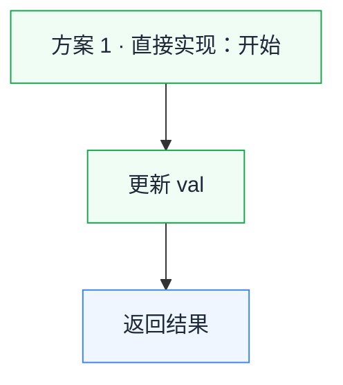

```java
package com.webfault.dsa; // 引入依赖

import java.util.*; // 引入依赖

class lc236_solution_1_1_____1___ { // 定义类型
  static class TreeNode { // static class TreeNode {
    int val; // int 值;
    TreeNode left, right; // TreeNode 左边界, 右边界;

    TreeNode(int v) {
      val = v;
    } // 把 值; } 写入 TreeNode(int v) { val
  }

  public TreeNode lowestCommonAncestor(
      TreeNode root, TreeNode p, TreeNode q) { // 定义函数/方法 lowestCommonAncestor
    if (root == null || root == p || root == q) { // 若 根节点 等于 null 或 根节点 等于 节点 或 根节点 等于 节点
      return root; // 返回 根节点
    }
    TreeNode left =
        lowestCommonAncestor(
            root.left, p, q); // 把 lowestCommonAncestor(根节点.左边界, 节点, 节点); 写入 TreeNode left
    TreeNode right =
        lowestCommonAncestor(
            root.right, p, q); // 把 lowestCommonAncestor(根节点.右边界, 节点, 节点); 写入 TreeNode right
    if (left != null && right != null) { // 若 左边界 不等于 null 且 右边界 不等于 null
      return root; // 返回 根节点
    }
    return left != null ? left : right; // 返回 左边界 不等于 null ? 左边界 : 右边界
  }

  static TreeNode find(TreeNode root, int val) { // 定义函数/方法 find
    if (root == null) return null; // 若 根节点 等于 null，直接返回 null
    if (root.val == val) return root; // 若 根节点.值 等于 值，直接返回 根节点
    TreeNode l = find(root.left, val); // 把 find(根节点.左边界, 值); 写入 TreeNode l
    return l != null ? l : find(root.right, val); // 返回 左指针 不等于 null ? 左指针 : find(根节点.右边界, 值)
  }

  public static void main(String[] args) { // public static void main(String[] args) {
    lc236_solution_1_1_____1___ s = new lc236_solution_1_1_____1___();
    TreeNode root = new TreeNode(3); // 把 new TreeNode(3); 写入 TreeNode root
    root.left = new TreeNode(5); // 把 new TreeNode(5); 写入 左边界
    root.right = new TreeNode(1); // 把 new TreeNode(1); 写入 右边界
    root.left.left = new TreeNode(6); // 把 new TreeNode(6); 写入 左边界
    root.left.right = new TreeNode(2); // 把 new TreeNode(2); 写入 右边界
    root.right.left = new TreeNode(0); // 把 new TreeNode(0); 写入 左边界
    root.right.right = new TreeNode(8); // 把 new TreeNode(8); 写入 右边界
    root.left.right.left = new TreeNode(7); // 把 new TreeNode(7); 写入 左边界
    root.left.right.right = new TreeNode(4); // 把 new TreeNode(4); 写入 右边界
    int[][] cases = {{5, 1, 3}, {5, 4, 5}, {6, 8, 3}, {7, 4, 2}, {5, 5, 5}};
    boolean ok = true; // 把 true; 写入 boolean ok
    for (int[] c : cases) { // for (int[] 字符 : cases) {
      TreeNode p = find(root, c[0]); // 把 find(根节点, 字符[0]); 写入 TreeNode p
      TreeNode q = find(root, c[1]); // 把 find(根节点, 字符[1]); 写入 TreeNode q
      TreeNode ans =
          s.lowestCommonAncestor(
              root, p, q); // 把 字符串.lowestCommonAncestor(根节点, 节点, 节点); 写入 TreeNode ans
      int got = ans == null ? -1 : ans.val; // 把 答案 等于 null ? 减 1 : 答案.值 存入 got
      if (got != c[2]) { // 若 got 不等于 字符[2]
        ok = false; // 把 false; 写入 ok
        System.out.println("FAIL LCA(" + c[0] + "," + c[1] + ")=" + got + " want " + c[2]); // 打印输出
      }
    }
    if (!ok) throw new RuntimeException("FAILED"); // 若 取反 ok) throw new RuntimeException(「FAILED」);
    System.out.println("PASS"); // 全部用例通过，输出 PASS
  }
}
```

#### 方案 2：直接实现

**思路与代码分析**：核心是「直接实现」。Java 版用类与静态方法组织，集合操作显式明了。

**运行架构**（真实控制流）：

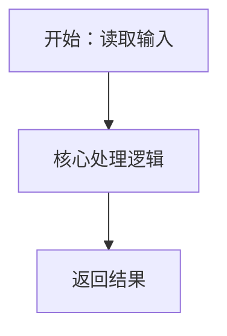

```java
package com.webfault.dsa; // 引入依赖

class Main { // 定义类型
  static class TreeNode {
    int val;
    TreeNode left;
    TreeNode right;

    TreeNode() {}

    TreeNode(int v) {
      val = v;
    }

    TreeNode(int v, TreeNode l, TreeNode r) {
      val = v;
      left = l;
      right = r;
    }
  }

  static TreeNode buildTree(Integer[] vals) { // 定义函数/方法 buildTree
    if (vals.length == 0 || vals[0] == null)
      return null; // 若 vals.长度 等于 0 或 vals[0] 等于 null，直接返回 null
    TreeNode root = new TreeNode(vals[0]);
    java.util.LinkedList<TreeNode> q = new java.util.LinkedList<>();
    q.add(root);
    int i = 1;
    while (!q.isEmpty() && i < vals.length) {
      TreeNode node = q.poll();
      if (i < vals.length && vals[i] != null) {
        node.left = new TreeNode(vals[i]);
        q.add(node.left);
      }
      i++;
      if (i < vals.length && vals[i] != null) {
        node.right = new TreeNode(vals[i]);
        q.add(node.right);
      }
      i++;
    }
    return root; // 返回 根节点
  }

  static boolean sameTree(TreeNode a, TreeNode b) {
    if (a == null && b == null) return true;
    if (a == null || b == null) return false;
    if (a.val != b.val) return false;
    return sameTree(a.left, b.left) && sameTree(a.right, b.right);
  }

  static java.util.List<Integer> inorderT(TreeNode r) {
    java.util.List<Integer> l = new java.util.ArrayList<>();
    if (r != null) {
      l.addAll(inorderT(r.left));
      l.add(r.val);
      l.addAll(inorderT(r.right));
    }
    return l;
  }

  static TreeNode lowestCommonAncestor(TreeNode root, TreeNode p, TreeNode q) {
    if (root == null || root == p || root == q) return root;
    TreeNode l = lowestCommonAncestor(root.left, p, q);
    TreeNode r = lowestCommonAncestor(root.right, p, q);
    if (l != null && r != null) return root;
    return l != null ? l : r;
  }

  static TreeNode find(TreeNode root, int v) {
    if (root == null) return null;
    if (root.val == v) return root;
    TreeNode l = find(root.left, v);
    if (l != null) return l;
    return find(root.right, v);
  }

  public static void main(String[] args) { // public static void main(String[] args) {
    Integer[] a = {3, 5, 1, 6, 2, 0, 8, null, null, 7, 4};
    TreeNode root = buildTree(a);
    TreeNode lca = lowestCommonAncestor(root, find(root, 5), find(root, 1));
    if (lca == null || lca.val != 3) {
      System.out.println("FAIL");
      throw new RuntimeException("FAILED");
    }
    System.out.println("PASS"); // 全部用例通过，输出 PASS
  }
}
```

#### 方案 3：直接实现

**思路与代码分析**：核心是「直接实现」。Java 版用类与静态方法组织，集合操作显式明了。

**运行架构**：与方案 2 的控制流相同（同算法在该语言的等价实现），图见上。

```java
package com.webfault.dsa; // 引入依赖

class Main { // 定义类型
  static class TreeNode {
    int val;
    TreeNode left;
    TreeNode right;

    TreeNode() {}

    TreeNode(int v) {
      val = v;
    }

    TreeNode(int v, TreeNode l, TreeNode r) {
      val = v;
      left = l;
      right = r;
    }
  }

  static TreeNode buildTree(Integer[] vals) { // 定义函数/方法 buildTree
    if (vals.length == 0 || vals[0] == null)
      return null; // 若 vals.长度 等于 0 或 vals[0] 等于 null，直接返回 null
    TreeNode root = new TreeNode(vals[0]);
    java.util.LinkedList<TreeNode> q = new java.util.LinkedList<>();
    q.add(root);
    int i = 1;
    while (!q.isEmpty() && i < vals.length) {
      TreeNode node = q.poll();
      if (i < vals.length && vals[i] != null) {
        node.left = new TreeNode(vals[i]);
        q.add(node.left);
      }
      i++;
      if (i < vals.length && vals[i] != null) {
        node.right = new TreeNode(vals[i]);
        q.add(node.right);
      }
      i++;
    }
    return root; // 返回 根节点
  }

  static boolean sameTree(TreeNode a, TreeNode b) {
    if (a == null && b == null) return true;
    if (a == null || b == null) return false;
    if (a.val != b.val) return false;
    return sameTree(a.left, b.left) && sameTree(a.right, b.right);
  }

  static java.util.List<Integer> inorderT(TreeNode r) {
    java.util.List<Integer> l = new java.util.ArrayList<>();
    if (r != null) {
      l.addAll(inorderT(r.left));
      l.add(r.val);
      l.addAll(inorderT(r.right));
    }
    return l;
  }

  static TreeNode lowestCommonAncestor(TreeNode root, TreeNode p, TreeNode q) {
    if (root == null || root == p || root == q) return root;
    TreeNode l = lowestCommonAncestor(root.left, p, q);
    TreeNode r = lowestCommonAncestor(root.right, p, q);
    if (l != null && r != null) return root;
    return l != null ? l : r;
  }

  static TreeNode find(TreeNode root, int v) {
    if (root == null) return null;
    if (root.val == v) return root;
    TreeNode l = find(root.left, v);
    if (l != null) return l;
    return find(root.right, v);
  }

  public static void main(String[] args) { // public static void main(String[] args) {
    Integer[] a = {3, 5, 1, 6, 2, 0, 8, null, null, 7, 4};
    TreeNode root = buildTree(a);
    TreeNode lca = lowestCommonAncestor(root, find(root, 5), find(root, 1));
    if (lca == null || lca.val != 3) {
      System.out.println("FAIL");
      throw new RuntimeException("FAILED");
    }
    System.out.println("PASS"); // 全部用例通过，输出 PASS
  }
}
```

### Rust 实现（3 种方案）

Rust 的全部方案如下，每个方案都内嵌用例自测，可独立运行（老仓库 python/go 文件遵循「打印结果」约定）：

#### 方案 1：直接实现

**思路与代码分析**：核心是「直接实现」。Rust 版用所有权移动与切片借用改写同一逻辑，注意 Option 与引用边界。**走读**：方案 1 · 直接实现：开始 → 调用 lca(root.as_ref(), p, q).unw → 返回结果。

**运行架构**（真实控制流）：

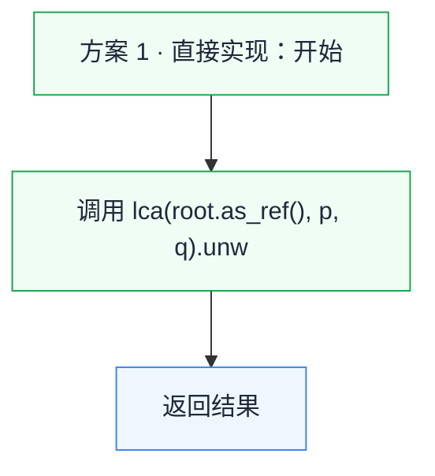

```rust
// LeetCode 236. 二叉树的最近公共祖先 — Rust 版（方案1）
use std::cell::RefCell;
use std::rc::Rc; // 引入依赖 // 引入依赖

#[derive(Debug)]
struct TreeNode {
    // 定义类型
    val: i32,
    left: Option<Rc<RefCell<TreeNode>>>,
    right: Option<Rc<RefCell<TreeNode>>>,
}

impl TreeNode {
    // 实现块
    fn new(val: i32) -> Rc<RefCell<TreeNode>> {
        // 定义函数/方法 new
        Rc::new(RefCell::new(TreeNode {
            val,
            left: None,
            right: None,
        })) // Rc::new(RefCell::new(TreeNode { 值, 左边界: None, 右边界: None }))
    }
}

fn build_tree(vals: &[Option<i32>]) -> Option<Rc<RefCell<TreeNode>>> {
    // 定义函数/方法 build_tree
    if vals.is_empty() || vals[0].is_none() {
        // 若 vals 是否为空 或 vals[0].is_none(
        return None; // 返回 None
    }
    let root = TreeNode::new(vals[0].unwrap()); // 把 TreeNode::new(vals[0].unwrap()) 存入 根节点
    let mut queue: Vec<Rc<RefCell<TreeNode>>> = vec![root.clone()];
    let mut i = 1; // 把 1; 写入 let mut i
    while !queue.is_empty() && i < vals.len() {
        // while 取反 队列 是否为空 且 下标 i 小于 vals.长度() {
        let node = queue.remove(0); // 把 队列 弹出 0) 存入 节点
        if i < vals.len() {
            // 若 下标 i 小于 vals.长度(
            if let Some(v) = vals[i] {
                // 若 let Some(值) 赋值为 vals[下标 i]
                let child = TreeNode::new(v); // 把 TreeNode::new(值) 存入 子节点
                node.borrow_mut().left = Some(child.clone()); // 把 Some(子节点.clone()); 写入 左边界
                queue.push(child); // 把 子节点 压入栈/数组尾部
            }
            i += 1; // 下标 i累加 1
        }
        if i < vals.len() {
            // 若 下标 i 小于 vals.长度(
            if let Some(v) = vals[i] {
                // 若 let Some(值) 赋值为 vals[下标 i]
                let child = TreeNode::new(v); // 把 TreeNode::new(值) 存入 子节点
                node.borrow_mut().right = Some(child.clone()); // 把 Some(子节点.clone()); 写入 右边界
                queue.push(child); // 把 子节点 压入栈/数组尾部
            }
            i += 1; // 下标 i累加 1
        }
    }
    Some(root) // Some(根节点)
}

fn lca(n: Option<&Rc<RefCell<TreeNode>>>, p: i32, q: i32) -> Option<i32> {
    // 定义函数/方法 lca
    let node = n?; // 把 元素个数? 存入 节点
    let nb = node.borrow(); // 把 节点.borrow() 存入 nb
    if nb.val == p || nb.val == q {
        return Some(nb.val);
    } // 若 nb.值 等于 节点 或 nb.值 等于 节点 { return Some(nb.值); }
    let l = lca(nb.left.as_ref(), p, q); // 把 lca(nb.左边界.as_ref(), 节点, 节点) 存入 左指针
    let r = lca(nb.right.as_ref(), p, q); // 把 lca(nb.右边界.as_ref(), 节点, 节点) 存入 右指针
    if l.is_some() && r.is_some() {
        return Some(nb.val);
    } // 若 左指针.is_some() 且 右指针.is_some() { return Some(nb.值); }
    l.or(r) // 左指针.or(右指针)
}
fn lowest_common_ancestor(root: Option<Rc<RefCell<TreeNode>>>, p: i32, q: i32) -> i32 {
    // 定义函数/方法 lowest_common_ancestor
    lca(root.as_ref(), p, q).unwrap_or(-1) // lca(根节点.as_ref(), 节点, 节点).unwrap_or( 减 1)
}
fn main() {
    // 程序入口：跑内嵌自测用例
    let t = build_tree(&[
        Some(3),
        Some(5),
        Some(1),
        Some(6),
        Some(2),
        Some(0),
        Some(8),
        None,
        None,
        Some(7),
        Some(4),
    ]);
    assert_eq!(lowest_common_ancestor(t.clone(), 5, 1), 3); // 断言校验
    assert_eq!(lowest_common_ancestor(t, 5, 4), 5); // 断言校验
    println!("PASS"); // 全部用例通过，输出 PASS
}
```

#### 方案 2：直接实现

**思路与代码分析**：核心是「直接实现」。Rust 版用所有权移动与切片借用改写同一逻辑，注意 Option 与引用边界。**走读**：方案 2 · 直接实现：开始 → 调用 lca(root.as_ref(), p, q).unw → 返回结果。

**运行架构**（真实控制流）：


```rust
// LeetCode 236. 二叉树的最近公共祖先 — Rust 版（方案2）
use std::cell::RefCell;
use std::rc::Rc; // 引入依赖 // 引入依赖

#[derive(Debug)]
struct TreeNode {
    // 定义类型
    val: i32,
    left: Option<Rc<RefCell<TreeNode>>>,
    right: Option<Rc<RefCell<TreeNode>>>,
}

impl TreeNode {
    // 实现块
    fn new(val: i32) -> Rc<RefCell<TreeNode>> {
        // 定义函数/方法 new
        Rc::new(RefCell::new(TreeNode {
            val,
            left: None,
            right: None,
        })) // Rc::new(RefCell::new(TreeNode { 值, 左边界: None, 右边界: None }))
    }
}

fn build_tree(vals: &[Option<i32>]) -> Option<Rc<RefCell<TreeNode>>> {
    // 定义函数/方法 build_tree
    if vals.is_empty() || vals[0].is_none() {
        // 若 vals 是否为空 或 vals[0].is_none(
        return None; // 返回 None
    }
    let root = TreeNode::new(vals[0].unwrap()); // 把 TreeNode::new(vals[0].unwrap()) 存入 根节点
    let mut queue: Vec<Rc<RefCell<TreeNode>>> = vec![root.clone()];
    let mut i = 1; // 把 1; 写入 let mut i
    while !queue.is_empty() && i < vals.len() {
        // while 取反 队列 是否为空 且 下标 i 小于 vals.长度() {
        let node = queue.remove(0); // 把 队列 弹出 0) 存入 节点
        if i < vals.len() {
            // 若 下标 i 小于 vals.长度(
            if let Some(v) = vals[i] {
                // 若 let Some(值) 赋值为 vals[下标 i]
                let child = TreeNode::new(v); // 把 TreeNode::new(值) 存入 子节点
                node.borrow_mut().left = Some(child.clone()); // 把 Some(子节点.clone()); 写入 左边界
                queue.push(child); // 把 子节点 压入栈/数组尾部
            }
            i += 1; // 下标 i累加 1
        }
        if i < vals.len() {
            // 若 下标 i 小于 vals.长度(
            if let Some(v) = vals[i] {
                // 若 let Some(值) 赋值为 vals[下标 i]
                let child = TreeNode::new(v); // 把 TreeNode::new(值) 存入 子节点
                node.borrow_mut().right = Some(child.clone()); // 把 Some(子节点.clone()); 写入 右边界
                queue.push(child); // 把 子节点 压入栈/数组尾部
            }
            i += 1; // 下标 i累加 1
        }
    }
    Some(root) // Some(根节点)
}

fn lca(n: Option<&Rc<RefCell<TreeNode>>>, p: i32, q: i32) -> Option<i32> {
    // 定义函数/方法 lca
    let node = n?; // 把 元素个数? 存入 节点
    let nb = node.borrow(); // 把 节点.borrow() 存入 nb
    if nb.val == p || nb.val == q {
        return Some(nb.val);
    } // 若 nb.值 等于 节点 或 nb.值 等于 节点 { return Some(nb.值); }
    let l = lca(nb.left.as_ref(), p, q); // 把 lca(nb.左边界.as_ref(), 节点, 节点) 存入 左指针
    let r = lca(nb.right.as_ref(), p, q); // 把 lca(nb.右边界.as_ref(), 节点, 节点) 存入 右指针
    if l.is_some() && r.is_some() {
        return Some(nb.val);
    } // 若 左指针.is_some() 且 右指针.is_some() { return Some(nb.值); }
    l.or(r) // 左指针.or(右指针)
}
fn lowest_common_ancestor(root: Option<Rc<RefCell<TreeNode>>>, p: i32, q: i32) -> i32 {
    // 定义函数/方法 lowest_common_ancestor
    lca(root.as_ref(), p, q).unwrap_or(-1) // lca(根节点.as_ref(), 节点, 节点).unwrap_or( 减 1)
}
fn main() {
    // 程序入口：跑内嵌自测用例
    let t = build_tree(&[
        Some(3),
        Some(5),
        Some(1),
        Some(6),
        Some(2),
        Some(0),
        Some(8),
        None,
        None,
        Some(7),
        Some(4),
    ]);
    assert_eq!(lowest_common_ancestor(t.clone(), 5, 1), 3); // 断言校验
    assert_eq!(lowest_common_ancestor(t, 5, 4), 5); // 断言校验
    println!("PASS"); // 全部用例通过，输出 PASS
}
```

#### 方案 3：直接实现

**思路与代码分析**：核心是「直接实现」。Rust 版用所有权移动与切片借用改写同一逻辑，注意 Option 与引用边界。**走读**：方案 3 · 直接实现：开始 → 调用 lca(root.as_ref(), p, q).unw → 返回结果。

**运行架构**（真实控制流）：


```rust
// LeetCode 236. 二叉树的最近公共祖先 — Rust 版（方案3）
use std::cell::RefCell;
use std::rc::Rc; // 引入依赖 // 引入依赖

#[derive(Debug)]
struct TreeNode {
    // 定义类型
    val: i32,
    left: Option<Rc<RefCell<TreeNode>>>,
    right: Option<Rc<RefCell<TreeNode>>>,
}

impl TreeNode {
    // 实现块
    fn new(val: i32) -> Rc<RefCell<TreeNode>> {
        // 定义函数/方法 new
        Rc::new(RefCell::new(TreeNode {
            val,
            left: None,
            right: None,
        })) // Rc::new(RefCell::new(TreeNode { 值, 左边界: None, 右边界: None }))
    }
}

fn build_tree(vals: &[Option<i32>]) -> Option<Rc<RefCell<TreeNode>>> {
    // 定义函数/方法 build_tree
    if vals.is_empty() || vals[0].is_none() {
        // 若 vals 是否为空 或 vals[0].is_none(
        return None; // 返回 None
    }
    let root = TreeNode::new(vals[0].unwrap()); // 把 TreeNode::new(vals[0].unwrap()) 存入 根节点
    let mut queue: Vec<Rc<RefCell<TreeNode>>> = vec![root.clone()];
    let mut i = 1; // 把 1; 写入 let mut i
    while !queue.is_empty() && i < vals.len() {
        // while 取反 队列 是否为空 且 下标 i 小于 vals.长度() {
        let node = queue.remove(0); // 把 队列 弹出 0) 存入 节点
        if i < vals.len() {
            // 若 下标 i 小于 vals.长度(
            if let Some(v) = vals[i] {
                // 若 let Some(值) 赋值为 vals[下标 i]
                let child = TreeNode::new(v); // 把 TreeNode::new(值) 存入 子节点
                node.borrow_mut().left = Some(child.clone()); // 把 Some(子节点.clone()); 写入 左边界
                queue.push(child); // 把 子节点 压入栈/数组尾部
            }
            i += 1; // 下标 i累加 1
        }
        if i < vals.len() {
            // 若 下标 i 小于 vals.长度(
            if let Some(v) = vals[i] {
                // 若 let Some(值) 赋值为 vals[下标 i]
                let child = TreeNode::new(v); // 把 TreeNode::new(值) 存入 子节点
                node.borrow_mut().right = Some(child.clone()); // 把 Some(子节点.clone()); 写入 右边界
                queue.push(child); // 把 子节点 压入栈/数组尾部
            }
            i += 1; // 下标 i累加 1
        }
    }
    Some(root) // Some(根节点)
}

fn lca(n: Option<&Rc<RefCell<TreeNode>>>, p: i32, q: i32) -> Option<i32> {
    // 定义函数/方法 lca
    let node = n?; // 把 元素个数? 存入 节点
    let nb = node.borrow(); // 把 节点.borrow() 存入 nb
    if nb.val == p || nb.val == q {
        return Some(nb.val);
    } // 若 nb.值 等于 节点 或 nb.值 等于 节点 { return Some(nb.值); }
    let l = lca(nb.left.as_ref(), p, q); // 把 lca(nb.左边界.as_ref(), 节点, 节点) 存入 左指针
    let r = lca(nb.right.as_ref(), p, q); // 把 lca(nb.右边界.as_ref(), 节点, 节点) 存入 右指针
    if l.is_some() && r.is_some() {
        return Some(nb.val);
    } // 若 左指针.is_some() 且 右指针.is_some() { return Some(nb.值); }
    l.or(r) // 左指针.or(右指针)
}
fn lowest_common_ancestor(root: Option<Rc<RefCell<TreeNode>>>, p: i32, q: i32) -> i32 {
    // 定义函数/方法 lowest_common_ancestor
    lca(root.as_ref(), p, q).unwrap_or(-1) // lca(根节点.as_ref(), 节点, 节点).unwrap_or( 减 1)
}
fn main() {
    // 程序入口：跑内嵌自测用例
    let t = build_tree(&[
        Some(3),
        Some(5),
        Some(1),
        Some(6),
        Some(2),
        Some(0),
        Some(8),
        None,
        None,
        Some(7),
        Some(4),
    ]);
    assert_eq!(lowest_common_ancestor(t.clone(), 5, 1), 3); // 断言校验
    assert_eq!(lowest_common_ancestor(t, 5, 4), 5); // 断言校验
    println!("PASS"); // 全部用例通过，输出 PASS
}
```

### Lua 实现（3 种方案）

Lua 的全部方案如下，每个方案都内嵌用例自测，可独立运行（老仓库 python/go 文件遵循「打印结果」约定）：

#### 方案 1：直接实现

**思路与代码分析**：核心是「直接实现」。Lua 版用表与 ipairs 遍历，注意 ipairs 遇 nil 即停的语义。**走读**：方案 1 · 直接实现：开始 → 处理 if not vals or #vals == 0 or → 返回 nil → 当 head ≤ #queue and i ≤ #vals do 时反复执行 → 返回 root。

**运行架构**（真实控制流）：


```lua
-- LeetCode 236. 二叉树的最近公共祖先 — Lua 版（方案1）
local TreeNode = {} -- 把 {} 写入 local TreeNode
TreeNode.__index = TreeNode -- 把 TreeNode 写入 TreeNode.__index
function TreeNode.new(val) -- function TreeNode.new(值)
	return setmetatable({ val = val, left = nil, right = nil }, TreeNode)
end -- 终点

local function build_tree(vals) -- local function build_tree(vals)
	if not vals or #vals == 0 or vals[1] == "null" then
		return nil
	end
	local root = TreeNode.new(vals[1]) -- 把 TreeNode.new(vals[1]) 写入 local root
	local queue = { root } -- 把 {根节点} 写入 local queue
	local head = 1 -- 把 1 写入 local head
	local i = 2 -- 把 2 写入 local i
	while head <= #queue and i <= #vals do -- 把 #队列 and 下标 i 不超过 #vals do 写入 while head <
		local node = queue[head] -- 把 队列[头节点] 写入 local node
		head = head + 1 -- 把 头节点 加 1 存入 头节点
		if i <= #vals then -- 若 下标 i 不超过 #vals then
			if vals[i] ~= "null" then -- 若 vals[下标 i] ~ 赋值为 「null」 then
				node.left = TreeNode.new(vals[i]) -- 把 TreeNode.new(vals[下标 i]) 写入 左边界
				queue[#queue + 1] = node.left -- 把 节点.左边界 写入 queue[#queue + 1]
			end -- 终点
			i = i + 1 -- 把 下标 i 加 1 存入 下标 i
		end -- 终点
		if i <= #vals then -- 若 下标 i 不超过 #vals then
			if vals[i] ~= "null" then -- 若 vals[下标 i] ~ 赋值为 「null」 then
				node.right = TreeNode.new(vals[i]) -- 把 TreeNode.new(vals[下标 i]) 写入 右边界
				queue[#queue + 1] = node.right -- 把 节点.右边界 写入 queue[#queue + 1]
			end -- 终点
			i = i + 1 -- 把 下标 i 加 1 存入 下标 i
		end -- 终点
	end -- 终点
	return root -- 返回 根节点
end -- 终点

local function lca(n, p, q) -- local function lca(元素个数, 节点, 节点)
	if not n then
		return nil
	end -- 若 not 元素个数 then return nil 终点
	if n.val == p or n.val == q then
		return n.val
	end -- 若 元素个数.值 等于 节点 or 元素个数.值 等于 节点 then return 元素个数.值 终点
	local l = lca(n.left, p, q) -- 把 lca(元素个数.左边界, 节点, 节点) 写入 local l
	local r = lca(n.right, p, q) -- 把 lca(元素个数.右边界, 节点, 节点) 写入 local r
	if l and r then
		return n.val
	end -- 若 左指针 and 右指针 then return 元素个数.值 终点
	if l then
		return l
	end -- 若 左指针 then return 左指针 终点
	return r -- 返回 右指针
end -- 终点
local function lowest_common_ancestor(root, p, q) -- local function lowest_common_ancestor(根节点, 节点, 节点)
	return lca(root, p, q) or -1 -- 返回 lca(根节点, 节点, 节点) or 减 1
end -- 终点
local t = build_tree({ 3, 5, 1, 6, 2, 0, 8, "null", "null", 7, 4 })
assert(lowest_common_ancestor(t, 5, 1) == 3) -- 断言校验
assert(lowest_common_ancestor(t, 5, 4) == 5) -- 断言校验
print("PASS") -- 全部用例通过，输出 PASS
```

#### 方案 2：直接实现

**思路与代码分析**：核心是「直接实现」。Lua 版用表与 ipairs 遍历，注意 ipairs 遇 nil 即停的语义。**走读**：方案 2 · 直接实现：开始 → 处理 if not vals or #vals == 0 or → 返回 nil → 当 head ≤ #queue and i ≤ #vals do 时反复执行 → 返回 root。

**运行架构**（真实控制流）：


```lua
-- LeetCode 236. 二叉树的最近公共祖先 — Lua 版（方案2）
local TreeNode = {} -- 把 {} 写入 local TreeNode
TreeNode.__index = TreeNode -- 把 TreeNode 写入 TreeNode.__index
function TreeNode.new(val) -- function TreeNode.new(值)
	return setmetatable({ val = val, left = nil, right = nil }, TreeNode)
end -- 终点

local function build_tree(vals) -- local function build_tree(vals)
	if not vals or #vals == 0 or vals[1] == "null" then
		return nil
	end
	local root = TreeNode.new(vals[1]) -- 把 TreeNode.new(vals[1]) 写入 local root
	local queue = { root } -- 把 {根节点} 写入 local queue
	local head = 1 -- 把 1 写入 local head
	local i = 2 -- 把 2 写入 local i
	while head <= #queue and i <= #vals do -- 把 #队列 and 下标 i 不超过 #vals do 写入 while head <
		local node = queue[head] -- 把 队列[头节点] 写入 local node
		head = head + 1 -- 把 头节点 加 1 存入 头节点
		if i <= #vals then -- 若 下标 i 不超过 #vals then
			if vals[i] ~= "null" then -- 若 vals[下标 i] ~ 赋值为 「null」 then
				node.left = TreeNode.new(vals[i]) -- 把 TreeNode.new(vals[下标 i]) 写入 左边界
				queue[#queue + 1] = node.left -- 把 节点.左边界 写入 queue[#queue + 1]
			end -- 终点
			i = i + 1 -- 把 下标 i 加 1 存入 下标 i
		end -- 终点
		if i <= #vals then -- 若 下标 i 不超过 #vals then
			if vals[i] ~= "null" then -- 若 vals[下标 i] ~ 赋值为 「null」 then
				node.right = TreeNode.new(vals[i]) -- 把 TreeNode.new(vals[下标 i]) 写入 右边界
				queue[#queue + 1] = node.right -- 把 节点.右边界 写入 queue[#queue + 1]
			end -- 终点
			i = i + 1 -- 把 下标 i 加 1 存入 下标 i
		end -- 终点
	end -- 终点
	return root -- 返回 根节点
end -- 终点

local function lca(n, p, q) -- local function lca(元素个数, 节点, 节点)
	if not n then
		return nil
	end -- 若 not 元素个数 then return nil 终点
	if n.val == p or n.val == q then
		return n.val
	end -- 若 元素个数.值 等于 节点 or 元素个数.值 等于 节点 then return 元素个数.值 终点
	local l = lca(n.left, p, q) -- 把 lca(元素个数.左边界, 节点, 节点) 写入 local l
	local r = lca(n.right, p, q) -- 把 lca(元素个数.右边界, 节点, 节点) 写入 local r
	if l and r then
		return n.val
	end -- 若 左指针 and 右指针 then return 元素个数.值 终点
	if l then
		return l
	end -- 若 左指针 then return 左指针 终点
	return r -- 返回 右指针
end -- 终点
local function lowest_common_ancestor(root, p, q) -- local function lowest_common_ancestor(根节点, 节点, 节点)
	return lca(root, p, q) or -1 -- 返回 lca(根节点, 节点, 节点) or 减 1
end -- 终点
local t = build_tree({ 3, 5, 1, 6, 2, 0, 8, "null", "null", 7, 4 })
assert(lowest_common_ancestor(t, 5, 1) == 3) -- 断言校验
assert(lowest_common_ancestor(t, 5, 4) == 5) -- 断言校验
print("PASS") -- 全部用例通过，输出 PASS
```

#### 方案 3：直接实现

**思路与代码分析**：核心是「直接实现」。Lua 版用表与 ipairs 遍历，注意 ipairs 遇 nil 即停的语义。**走读**：方案 3 · 直接实现：开始 → 处理 if not vals or #vals == 0 or → 返回 nil → 当 head ≤ #queue and i ≤ #vals do 时反复执行 → 返回 root。

**运行架构**（真实控制流）：

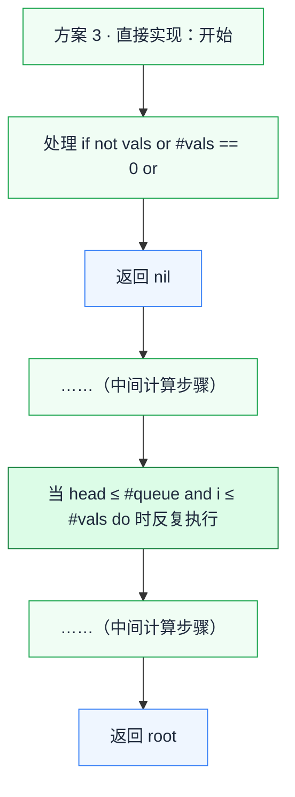

```lua
-- LeetCode 236. 二叉树的最近公共祖先 — Lua 版（方案3）
local TreeNode = {} -- 把 {} 写入 local TreeNode
TreeNode.__index = TreeNode -- 把 TreeNode 写入 TreeNode.__index
function TreeNode.new(val) -- function TreeNode.new(值)
	return setmetatable({ val = val, left = nil, right = nil }, TreeNode)
end -- 终点

local function build_tree(vals) -- local function build_tree(vals)
	if not vals or #vals == 0 or vals[1] == "null" then
		return nil
	end
	local root = TreeNode.new(vals[1]) -- 把 TreeNode.new(vals[1]) 写入 local root
	local queue = { root } -- 把 {根节点} 写入 local queue
	local head = 1 -- 把 1 写入 local head
	local i = 2 -- 把 2 写入 local i
	while head <= #queue and i <= #vals do -- 把 #队列 and 下标 i 不超过 #vals do 写入 while head <
		local node = queue[head] -- 把 队列[头节点] 写入 local node
		head = head + 1 -- 把 头节点 加 1 存入 头节点
		if i <= #vals then -- 若 下标 i 不超过 #vals then
			if vals[i] ~= "null" then -- 若 vals[下标 i] ~ 赋值为 「null」 then
				node.left = TreeNode.new(vals[i]) -- 把 TreeNode.new(vals[下标 i]) 写入 左边界
				queue[#queue + 1] = node.left -- 把 节点.左边界 写入 queue[#queue + 1]
			end -- 终点
			i = i + 1 -- 把 下标 i 加 1 存入 下标 i
		end -- 终点
		if i <= #vals then -- 若 下标 i 不超过 #vals then
			if vals[i] ~= "null" then -- 若 vals[下标 i] ~ 赋值为 「null」 then
				node.right = TreeNode.new(vals[i]) -- 把 TreeNode.new(vals[下标 i]) 写入 右边界
				queue[#queue + 1] = node.right -- 把 节点.右边界 写入 queue[#queue + 1]
			end -- 终点
			i = i + 1 -- 把 下标 i 加 1 存入 下标 i
		end -- 终点
	end -- 终点
	return root -- 返回 根节点
end -- 终点

local function lca(n, p, q) -- local function lca(元素个数, 节点, 节点)
	if not n then
		return nil
	end -- 若 not 元素个数 then return nil 终点
	if n.val == p or n.val == q then
		return n.val
	end -- 若 元素个数.值 等于 节点 or 元素个数.值 等于 节点 then return 元素个数.值 终点
	local l = lca(n.left, p, q) -- 把 lca(元素个数.左边界, 节点, 节点) 写入 local l
	local r = lca(n.right, p, q) -- 把 lca(元素个数.右边界, 节点, 节点) 写入 local r
	if l and r then
		return n.val
	end -- 若 左指针 and 右指针 then return 元素个数.值 终点
	if l then
		return l
	end -- 若 左指针 then return 左指针 终点
	return r -- 返回 右指针
end -- 终点
local function lowest_common_ancestor(root, p, q) -- local function lowest_common_ancestor(根节点, 节点, 节点)
	return lca(root, p, q) or -1 -- 返回 lca(根节点, 节点, 节点) or 减 1
end -- 终点
local t = build_tree({ 3, 5, 1, 6, 2, 0, 8, "null", "null", 7, 4 })
assert(lowest_common_ancestor(t, 5, 1) == 3) -- 断言校验
assert(lowest_common_ancestor(t, 5, 4) == 5) -- 断言校验
print("PASS") -- 全部用例通过，输出 PASS
```

### C 实现（3 种方案）

C 的全部方案如下，每个方案都内嵌用例自测，可独立运行（老仓库 python/go 文件遵循「打印结果」约定）：

#### 方案 1：直接实现

**思路与代码分析**：核心是「直接实现」。C 版手动管理下标与内存，循环边界全部显式写出。**走读**：方案 1 · 直接实现：开始 → 命中条件，直接返回 → 更新 *root → 当 (head ＜ tail 且 i ＜ n) 时反复执行 → 返回 root。

**运行架构**（真实控制流）：

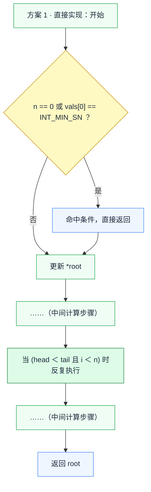

```c
/* LeetCode 236. 二叉树的最近公共祖先 — C 版（方案1） */
#include <stdio.h>                   // 引入头文件
#include <stdlib.h>                  // 引入头文件
#define INT_MIN_SN (-2147483647 - 1) // #define INT_MIN_SN ( 减 2147483647 减 1)

typedef struct TreeNode {   // typedef struct TreeNode {
    int val;                // int 值;
    struct TreeNode *left;  // 定义类型
    struct TreeNode *right; // 定义类型
} TreeNode;                 // } TreeNode;

static TreeNode *build_tree(const int *vals,
                            int n) { // static TreeNode 乘 build_tree(const int 乘 vals, int 元素个数) {
    if (n == 0 || vals[0] == INT_MIN_SN)
        return NULL; // 若 元素个数 等于 0 或 vals[0] 等于 INT_MIN_SN，直接返回 NULL
    TreeNode *root = malloc(sizeof(TreeNode)); // 把 malloc(sizeof(TreeNode)); 写入 TreeNode *root
    root->val = vals[0];
    root->left = root->right = NULL;
    TreeNode **queue =
        malloc(sizeof(TreeNode *) * n); // 把 malloc(sizeof(TreeNode 乘 ) 乘 元素个数); 写入 TreeNode **queue
    int head = 0, tail = 0, i = 1; // 把 0, 尾节点 赋值为 0, 下标 i 赋值为 1 存入 头节点
    queue[tail++] = root;          // 把 根节点; 写入 queue[tail++]
    while (head < tail && i < n) { // 循环，直到不满足「头节点 小于 尾节点 且 下标 i 小于 元素个数」
        TreeNode *node = queue[head++];                // 把 队列[头节点 加一 ]; 写入 TreeNode *node
        if (i < n) {                                   // 若 下标 i 小于 元素个数
            if (vals[i] != INT_MIN_SN) {               // 若 vals[下标 i] 不等于 INT_MIN_SN
                node->left = malloc(sizeof(TreeNode)); // 把 malloc(sizeof(TreeNode)); 写入 node->left
                node->left->val = vals[i];
                node->left->left = node->left->right = NULL;
                queue[tail++] = node->left; // 把 节点 减 超过 左边界; 写入 queue[tail++]
            }
            i++; // 下标 i 加一
        }
        if (i < n) {                                    // 若 下标 i 小于 元素个数
            if (vals[i] != INT_MIN_SN) {                // 若 vals[下标 i] 不等于 INT_MIN_SN
                node->right = malloc(sizeof(TreeNode)); // 把 malloc(sizeof(TreeNode)); 写入 node->right
                node->right->val = vals[i];
                node->right->left = node->right->right = NULL;
                queue[tail++] = node->right; // 把 节点 减 超过 右边界; 写入 queue[tail++]
            }
            i++; // 下标 i 加一
        }
    }
    free(queue); // free(队列);
    return root; // 返回 根节点
}

static void free_tree(TreeNode *n) { // 定义函数/方法 free_tree
    if (!n)
        return;          // 若 取反 元素个数) return;
    free_tree(n->left);  // free_tree(元素个数 减 超过 左边界);
    free_tree(n->right); // free_tree(元素个数 减 超过 右边界);
    free(n);             // free(元素个数);
}

static int lca(TreeNode *n, int p, int q, int *found) { // 定义函数/方法 lca
    if (!n)
        return -1; // 若 取反 元素个数，直接返回 减 1
    if (n->val == p || n->val == q) {
        (*found)++;
        return n->val;
    }
    int f_before = *found; // 把 乘 found 存入 f_before
    int l = lca(n->left, p, q, found); // 把 lca(元素个数 减 超过 左边界, 节点, 节点, found) 存入 左指针
    int r = lca(n->right, p, q, found); // 把 lca(元素个数 减 超过 右边界, 节点, 节点, found) 存入 右指针
    if (*found >= 2) {                  // 若 乘 found 不低于 2
        if (l != -1 && r != -1)
            return n->val; // 若 左指针 不等于 减 1 且 右指针 不等于 减 1，直接返回 元素个数 减 超过 值
        return (l != -1) ? l : r; // 返回 (左指针 不等于 减 1) ? 左指针 : 右指针
    }
    if (*found > f_before)
        return (l != -1) ? l
                         : r; // 若 乘 found 超过 f_before，直接返回 (左指针 不等于 减 1) ? 左指针 : 右指针
    return -1; // 返回 减 1
}
static int lowest_common_ancestor(TreeNode *root, int p, int q) { // 定义函数/方法 lowest_common_ancestor
    int found = 0;                                                // 把 0 存入 found
    return lca(root, p, q, &found); // 返回 lca(根节点, 节点, 节点, 按位与 found)
}
int main(void) { // 程序入口：跑内嵌自测用例
    int v[] = {3, 5,          1,          6, 2, 0,
               8, INT_MIN_SN, INT_MIN_SN, 7, 4}; // 把 {3,5,1,6,2,0,8,INT_MIN_SN,INT_MIN_SN,7,4}; 写入 int v[]
    TreeNode *t = build_tree(v, 11);             // 把 build_tree(值, 11); 写入 TreeNode *t
    if (lowest_common_ancestor(t, 5, 1) != 3) {
        printf("FAIL 1\n");
        return 1;
    }
    if (lowest_common_ancestor(t, 5, 4) != 5) {
        printf("FAIL 2\n");
        return 1;
    }
    printf("PASS\n"); // 全部用例通过，输出 PASS
    return 0;         // 返回 0
}
```

#### 方案 2：直接实现

**思路与代码分析**：核心是「直接实现」。C 版手动管理下标与内存，循环边界全部显式写出。**走读**：方案 2 · 直接实现：开始 → 命中条件，直接返回 → 更新 *root → 当 (head ＜ tail 且 i ＜ n) 时反复执行 → 返回 root。

**运行架构**（真实控制流）：


```c
/* LeetCode 236. 二叉树的最近公共祖先 — C 版（方案2） */
#include <stdio.h>                   // 引入头文件
#include <stdlib.h>                  // 引入头文件
#define INT_MIN_SN (-2147483647 - 1) // #define INT_MIN_SN ( 减 2147483647 减 1)

typedef struct TreeNode {   // typedef struct TreeNode {
    int val;                // int 值;
    struct TreeNode *left;  // 定义类型
    struct TreeNode *right; // 定义类型
} TreeNode;                 // } TreeNode;

static TreeNode *build_tree(const int *vals,
                            int n) { // static TreeNode 乘 build_tree(const int 乘 vals, int 元素个数) {
    if (n == 0 || vals[0] == INT_MIN_SN)
        return NULL; // 若 元素个数 等于 0 或 vals[0] 等于 INT_MIN_SN，直接返回 NULL
    TreeNode *root = malloc(sizeof(TreeNode)); // 把 malloc(sizeof(TreeNode)); 写入 TreeNode *root
    root->val = vals[0];
    root->left = root->right = NULL;
    TreeNode **queue =
        malloc(sizeof(TreeNode *) * n); // 把 malloc(sizeof(TreeNode 乘 ) 乘 元素个数); 写入 TreeNode **queue
    int head = 0, tail = 0, i = 1; // 把 0, 尾节点 赋值为 0, 下标 i 赋值为 1 存入 头节点
    queue[tail++] = root;          // 把 根节点; 写入 queue[tail++]
    while (head < tail && i < n) { // 循环，直到不满足「头节点 小于 尾节点 且 下标 i 小于 元素个数」
        TreeNode *node = queue[head++];                // 把 队列[头节点 加一 ]; 写入 TreeNode *node
        if (i < n) {                                   // 若 下标 i 小于 元素个数
            if (vals[i] != INT_MIN_SN) {               // 若 vals[下标 i] 不等于 INT_MIN_SN
                node->left = malloc(sizeof(TreeNode)); // 把 malloc(sizeof(TreeNode)); 写入 node->left
                node->left->val = vals[i];
                node->left->left = node->left->right = NULL;
                queue[tail++] = node->left; // 把 节点 减 超过 左边界; 写入 queue[tail++]
            }
            i++; // 下标 i 加一
        }
        if (i < n) {                                    // 若 下标 i 小于 元素个数
            if (vals[i] != INT_MIN_SN) {                // 若 vals[下标 i] 不等于 INT_MIN_SN
                node->right = malloc(sizeof(TreeNode)); // 把 malloc(sizeof(TreeNode)); 写入 node->right
                node->right->val = vals[i];
                node->right->left = node->right->right = NULL;
                queue[tail++] = node->right; // 把 节点 减 超过 右边界; 写入 queue[tail++]
            }
            i++; // 下标 i 加一
        }
    }
    free(queue); // free(队列);
    return root; // 返回 根节点
}

static void free_tree(TreeNode *n) { // 定义函数/方法 free_tree
    if (!n)
        return;          // 若 取反 元素个数) return;
    free_tree(n->left);  // free_tree(元素个数 减 超过 左边界);
    free_tree(n->right); // free_tree(元素个数 减 超过 右边界);
    free(n);             // free(元素个数);
}

static int lca(TreeNode *n, int p, int q, int *found) { // 定义函数/方法 lca
    if (!n)
        return -1; // 若 取反 元素个数，直接返回 减 1
    if (n->val == p || n->val == q) {
        (*found)++;
        return n->val;
    }
    int f_before = *found; // 把 乘 found 存入 f_before
    int l = lca(n->left, p, q, found); // 把 lca(元素个数 减 超过 左边界, 节点, 节点, found) 存入 左指针
    int r = lca(n->right, p, q, found); // 把 lca(元素个数 减 超过 右边界, 节点, 节点, found) 存入 右指针
    if (*found >= 2) {                  // 若 乘 found 不低于 2
        if (l != -1 && r != -1)
            return n->val; // 若 左指针 不等于 减 1 且 右指针 不等于 减 1，直接返回 元素个数 减 超过 值
        return (l != -1) ? l : r; // 返回 (左指针 不等于 减 1) ? 左指针 : 右指针
    }
    if (*found > f_before)
        return (l != -1) ? l
                         : r; // 若 乘 found 超过 f_before，直接返回 (左指针 不等于 减 1) ? 左指针 : 右指针
    return -1; // 返回 减 1
}
static int lowest_common_ancestor(TreeNode *root, int p, int q) { // 定义函数/方法 lowest_common_ancestor
    int found = 0;                                                // 把 0 存入 found
    return lca(root, p, q, &found); // 返回 lca(根节点, 节点, 节点, 按位与 found)
}
int main(void) { // 程序入口：跑内嵌自测用例
    int v[] = {3, 5,          1,          6, 2, 0,
               8, INT_MIN_SN, INT_MIN_SN, 7, 4}; // 把 {3,5,1,6,2,0,8,INT_MIN_SN,INT_MIN_SN,7,4}; 写入 int v[]
    TreeNode *t = build_tree(v, 11);             // 把 build_tree(值, 11); 写入 TreeNode *t
    if (lowest_common_ancestor(t, 5, 1) != 3) {
        printf("FAIL 1\n");
        return 1;
    }
    if (lowest_common_ancestor(t, 5, 4) != 5) {
        printf("FAIL 2\n");
        return 1;
    }
    printf("PASS\n"); // 全部用例通过，输出 PASS
    return 0;         // 返回 0
}
```

#### 方案 3：直接实现

**思路与代码分析**：核心是「直接实现」。C 版手动管理下标与内存，循环边界全部显式写出。**走读**：方案 3 · 直接实现：开始 → 命中条件，直接返回 → 更新 *root → 当 (head ＜ tail 且 i ＜ n) 时反复执行 → 返回 root。

**运行架构**（真实控制流）：

```mermaid
graph TD
    N0["方案 3 · 直接实现：开始"]
    N1{"n == 0 或 vals[0] == INT_MIN_SN ？"}
    N2["命中条件，直接返回"]
    N3["更新 *root"]
    D1["……（中间计算步骤）"]
    N10["当 (head ＜ tail 且 i ＜ n) 时反复执行"]
    D2["……（中间计算步骤）"]
    N27["返回 root"]
    N0 --> N1
    N1 -- 是 --> N2
    N1 -- 否 --> N3
    N2 --> N3
    N3 --> D1
    D1 --> N10
    N10 --> D2
    D2 --> N27
    classDef n fill:#f0fdf4,stroke:#16a34a,color:#1e293b;
    classDef lp fill:#dcfce7,stroke:#15803d,color:#1e293b;
    classDef dc fill:#fef9c3,stroke:#ca8a04,color:#1e293b;
    classDef tm fill:#eff6ff,stroke:#3b82f6,color:#1e293b;
    class N0,N3,D1,D2 n;
    class N10 lp;
    class N1 dc;
    class N2,N27 tm;
```

```c
/* LeetCode 236. 二叉树的最近公共祖先 — C 版（方案3） */
#include <stdio.h>                   // 引入头文件
#include <stdlib.h>                  // 引入头文件
#define INT_MIN_SN (-2147483647 - 1) // #define INT_MIN_SN ( 减 2147483647 减 1)

typedef struct TreeNode {   // typedef struct TreeNode {
    int val;                // int 值;
    struct TreeNode *left;  // 定义类型
    struct TreeNode *right; // 定义类型
} TreeNode;                 // } TreeNode;

static TreeNode *build_tree(const int *vals,
                            int n) { // static TreeNode 乘 build_tree(const int 乘 vals, int 元素个数) {
    if (n == 0 || vals[0] == INT_MIN_SN)
        return NULL; // 若 元素个数 等于 0 或 vals[0] 等于 INT_MIN_SN，直接返回 NULL
    TreeNode *root = malloc(sizeof(TreeNode)); // 把 malloc(sizeof(TreeNode)); 写入 TreeNode *root
    root->val = vals[0];
    root->left = root->right = NULL;
    TreeNode **queue =
        malloc(sizeof(TreeNode *) * n); // 把 malloc(sizeof(TreeNode 乘 ) 乘 元素个数); 写入 TreeNode **queue
    int head = 0, tail = 0, i = 1; // 把 0, 尾节点 赋值为 0, 下标 i 赋值为 1 存入 头节点
    queue[tail++] = root;          // 把 根节点; 写入 queue[tail++]
    while (head < tail && i < n) { // 循环，直到不满足「头节点 小于 尾节点 且 下标 i 小于 元素个数」
        TreeNode *node = queue[head++];                // 把 队列[头节点 加一 ]; 写入 TreeNode *node
        if (i < n) {                                   // 若 下标 i 小于 元素个数
            if (vals[i] != INT_MIN_SN) {               // 若 vals[下标 i] 不等于 INT_MIN_SN
                node->left = malloc(sizeof(TreeNode)); // 把 malloc(sizeof(TreeNode)); 写入 node->left
                node->left->val = vals[i];
                node->left->left = node->left->right = NULL;
                queue[tail++] = node->left; // 把 节点 减 超过 左边界; 写入 queue[tail++]
            }
            i++; // 下标 i 加一
        }
        if (i < n) {                                    // 若 下标 i 小于 元素个数
            if (vals[i] != INT_MIN_SN) {                // 若 vals[下标 i] 不等于 INT_MIN_SN
                node->right = malloc(sizeof(TreeNode)); // 把 malloc(sizeof(TreeNode)); 写入 node->right
                node->right->val = vals[i];
                node->right->left = node->right->right = NULL;
                queue[tail++] = node->right; // 把 节点 减 超过 右边界; 写入 queue[tail++]
            }
            i++; // 下标 i 加一
        }
    }
    free(queue); // free(队列);
    return root; // 返回 根节点
}

static void free_tree(TreeNode *n) { // 定义函数/方法 free_tree
    if (!n)
        return;          // 若 取反 元素个数) return;
    free_tree(n->left);  // free_tree(元素个数 减 超过 左边界);
    free_tree(n->right); // free_tree(元素个数 减 超过 右边界);
    free(n);             // free(元素个数);
}

static int lca(TreeNode *n, int p, int q, int *found) { // 定义函数/方法 lca
    if (!n)
        return -1; // 若 取反 元素个数，直接返回 减 1
    if (n->val == p || n->val == q) {
        (*found)++;
        return n->val;
    }
    int f_before = *found; // 把 乘 found 存入 f_before
    int l = lca(n->left, p, q, found); // 把 lca(元素个数 减 超过 左边界, 节点, 节点, found) 存入 左指针
    int r = lca(n->right, p, q, found); // 把 lca(元素个数 减 超过 右边界, 节点, 节点, found) 存入 右指针
    if (*found >= 2) {                  // 若 乘 found 不低于 2
        if (l != -1 && r != -1)
            return n->val; // 若 左指针 不等于 减 1 且 右指针 不等于 减 1，直接返回 元素个数 减 超过 值
        return (l != -1) ? l : r; // 返回 (左指针 不等于 减 1) ? 左指针 : 右指针
    }
    if (*found > f_before)
        return (l != -1) ? l
                         : r; // 若 乘 found 超过 f_before，直接返回 (左指针 不等于 减 1) ? 左指针 : 右指针
    return -1; // 返回 减 1
}
static int lowest_common_ancestor(TreeNode *root, int p, int q) { // 定义函数/方法 lowest_common_ancestor
    int found = 0;                                                // 把 0 存入 found
    return lca(root, p, q, &found); // 返回 lca(根节点, 节点, 节点, 按位与 found)
}
int main(void) { // 程序入口：跑内嵌自测用例
    int v[] = {3, 5,          1,          6, 2, 0,
               8, INT_MIN_SN, INT_MIN_SN, 7, 4}; // 把 {3,5,1,6,2,0,8,INT_MIN_SN,INT_MIN_SN,7,4}; 写入 int v[]
    TreeNode *t = build_tree(v, 11);             // 把 build_tree(值, 11); 写入 TreeNode *t
    if (lowest_common_ancestor(t, 5, 1) != 3) {
        printf("FAIL 1\n");
        return 1;
    }
    if (lowest_common_ancestor(t, 5, 4) != 5) {
        printf("FAIL 2\n");
        return 1;
    }
    printf("PASS\n"); // 全部用例通过，输出 PASS
    return 0;         // 返回 0
}
```

### C++ 实现（3 种方案）

C++ 的全部方案如下，每个方案都内嵌用例自测，可独立运行（老仓库 python/go 文件遵循「打印结果」约定）：

#### 方案 1：直接实现

**思路与代码分析**：核心是「直接实现」。C++ 版用 STL 容器与迭代器，减少手写下标错误。**走读**：方案 1 · 直接实现：开始 → 更新 found → 返回 lca(root, p, q, found)。

**运行架构**（真实控制流）：

```mermaid
graph TD
    N0["方案 1 · 直接实现：开始"]
    N1["更新 found"]
    N2["返回 lca(root, p, q, found)"]
    N0 --> N1
    N1 --> N2
    classDef n fill:#f0fdf4,stroke:#16a34a,color:#1e293b;
    classDef lp fill:#dcfce7,stroke:#15803d,color:#1e293b;
    classDef dc fill:#fef9c3,stroke:#ca8a04,color:#1e293b;
    classDef tm fill:#eff6ff,stroke:#3b82f6,color:#1e293b;
    class N0,N1 n;
    class N2 tm;
```

```cpp
// LeetCode 236. 二叉树的最近公共祖先 — C++ 版（方案1）
#include <cassert>  // 引入头文件
#include <cstdint>  // 引入头文件
#include <iostream> // 引入头文件
#include <optional> // 引入头文件
#include <queue>    // 引入头文件
#include <vector>   // 引入头文件

struct TreeNode {    // 定义类型
    int val;         // int 值;
    TreeNode *left;  // TreeNode 乘 左边界;
    TreeNode *right; // TreeNode 乘 右边界;
    explicit TreeNode(int v) : val(v), left(nullptr), right(nullptr) {}
};

static TreeNode *build_tree(const std::vector<std::optional<int>> &vals) {
    if (vals.empty() || !vals[0].has_value())
        return nullptr; // 若 vals 是否为空 或 取反 vals[0].has_value()，直接返回 nullptr
    auto *root = new TreeNode(*vals[0]); // 把 new TreeNode( 乘 vals[0]); 写入 auto *root
    std::queue<TreeNode *> q;            // std::队列 小于 TreeNode 乘 超过 节点;
    q.push(root);                        // 把 根节点 压入栈/数组尾部
    size_t i = 1;                        // 把 1; 写入 size_t i
    while (!q.empty() &&
           i < vals.size()) { // 循环，直到不满足「取反 节点 是否为空 且 下标 i 小于 vals.大小(」
        TreeNode *node = q.front();                  // 把 节点.front(); 写入 TreeNode *node
        q.pop();                                     // 弹出栈顶元素
        if (i < vals.size()) {                       // 若 下标 i 小于 vals.大小(
            if (vals[i].has_value()) {               // 若 vals[下标 i].has_value(
                node->left = new TreeNode(*vals[i]); // 把 new TreeNode( 乘 vals[下标 i]); 写入 node->left
                q.push(node->left);                  // 把 节点 减 超过 左边界 压入栈/数组尾部
            }
            ++i; // 加一 下标 i;
        }
        if (i < vals.size()) {                        // 若 下标 i 小于 vals.大小(
            if (vals[i].has_value()) {                // 若 vals[下标 i].has_value(
                node->right = new TreeNode(*vals[i]); // 把 new TreeNode( 乘 vals[下标 i]); 写入 node->right
                q.push(node->right); // 把 节点 减 超过 右边界 压入栈/数组尾部
            }
            ++i; // 加一 下标 i;
        }
    }
    return root; // 返回 根节点
}

static void free_tree(TreeNode *n) { // 定义函数/方法 free_tree
    if (!n)
        return;          // 若 取反 元素个数) return;
    free_tree(n->left);  // free_tree(元素个数 减 超过 左边界);
    free_tree(n->right); // free_tree(元素个数 减 超过 右边界);
    delete n;            // delete 元素个数;
}

static int lca(TreeNode *n, int p, int q, int &found) { // 定义函数/方法 lca
    if (!n)
        return -1; // 若 取反 元素个数，直接返回 减 1
    if (n->val == p || n->val == q) {
        ++found;
        return n->val;
    }
    int before = found;                // 把 found 存入 before
    int l = lca(n->left, p, q, found); // 把 lca(元素个数 减 超过 左边界, 节点, 节点, found) 存入 左指针
    int r = lca(n->right, p, q, found); // 把 lca(元素个数 减 超过 右边界, 节点, 节点, found) 存入 右指针
    if (l != -1 && r != -1)
        return n->val; // 若 左指针 不等于 减 1 且 右指针 不等于 减 1，直接返回 元素个数 减 超过 值
    if (found > before)
        return (l != -1) ? l : r; // 若 found 超过 before，直接返回 (左指针 不等于 减 1) ? 左指针 : 右指针
    return -1;                    // 返回 减 1
}
static int lowestCommonAncestor(TreeNode *root, int p, int q) { // 定义函数/方法 lowestCommonAncestor
    int found = 0;                                              // 把 0 存入 found
    return lca(root, p, q, found); // 返回 lca(根节点, 节点, 节点, found)
}
int main() { // 程序入口：跑内嵌自测用例
    auto *t = build_tree({3, 5, 1, 6, 2, 0, 8, std::nullopt, std::nullopt, 7, 4});
    assert(lowestCommonAncestor(t, 5, 1) == 3); // 断言校验
    assert(lowestCommonAncestor(t, 5, 4) == 5); // 断言校验
    std::cout << "PASS" << std::endl;           // 全部用例通过，输出 PASS
    return 0;                                   // 返回 0
}
```

#### 方案 2：直接实现

**思路与代码分析**：核心是「直接实现」。C++ 版用 STL 容器与迭代器，减少手写下标错误。**走读**：方案 2 · 直接实现：开始 → 更新 found → 返回 lca(root, p, q, found)。

**运行架构**（真实控制流）：

```mermaid
graph TD
    N0["方案 2 · 直接实现：开始"]
    N1["更新 found"]
    N2["返回 lca(root, p, q, found)"]
    N0 --> N1
    N1 --> N2
    classDef n fill:#f0fdf4,stroke:#16a34a,color:#1e293b;
    classDef lp fill:#dcfce7,stroke:#15803d,color:#1e293b;
    classDef dc fill:#fef9c3,stroke:#ca8a04,color:#1e293b;
    classDef tm fill:#eff6ff,stroke:#3b82f6,color:#1e293b;
    class N0,N1 n;
    class N2 tm;
```

```cpp
// LeetCode 236. 二叉树的最近公共祖先 — C++ 版（方案2）
#include <cassert>  // 引入头文件
#include <cstdint>  // 引入头文件
#include <iostream> // 引入头文件
#include <optional> // 引入头文件
#include <queue>    // 引入头文件
#include <vector>   // 引入头文件

struct TreeNode {    // 定义类型
    int val;         // int 值;
    TreeNode *left;  // TreeNode 乘 左边界;
    TreeNode *right; // TreeNode 乘 右边界;
    explicit TreeNode(int v) : val(v), left(nullptr), right(nullptr) {}
};

static TreeNode *build_tree(const std::vector<std::optional<int>> &vals) {
    if (vals.empty() || !vals[0].has_value())
        return nullptr; // 若 vals 是否为空 或 取反 vals[0].has_value()，直接返回 nullptr
    auto *root = new TreeNode(*vals[0]); // 把 new TreeNode( 乘 vals[0]); 写入 auto *root
    std::queue<TreeNode *> q;            // std::队列 小于 TreeNode 乘 超过 节点;
    q.push(root);                        // 把 根节点 压入栈/数组尾部
    size_t i = 1;                        // 把 1; 写入 size_t i
    while (!q.empty() &&
           i < vals.size()) { // 循环，直到不满足「取反 节点 是否为空 且 下标 i 小于 vals.大小(」
        TreeNode *node = q.front();                  // 把 节点.front(); 写入 TreeNode *node
        q.pop();                                     // 弹出栈顶元素
        if (i < vals.size()) {                       // 若 下标 i 小于 vals.大小(
            if (vals[i].has_value()) {               // 若 vals[下标 i].has_value(
                node->left = new TreeNode(*vals[i]); // 把 new TreeNode( 乘 vals[下标 i]); 写入 node->left
                q.push(node->left);                  // 把 节点 减 超过 左边界 压入栈/数组尾部
            }
            ++i; // 加一 下标 i;
        }
        if (i < vals.size()) {                        // 若 下标 i 小于 vals.大小(
            if (vals[i].has_value()) {                // 若 vals[下标 i].has_value(
                node->right = new TreeNode(*vals[i]); // 把 new TreeNode( 乘 vals[下标 i]); 写入 node->right
                q.push(node->right); // 把 节点 减 超过 右边界 压入栈/数组尾部
            }
            ++i; // 加一 下标 i;
        }
    }
    return root; // 返回 根节点
}

static void free_tree(TreeNode *n) { // 定义函数/方法 free_tree
    if (!n)
        return;          // 若 取反 元素个数) return;
    free_tree(n->left);  // free_tree(元素个数 减 超过 左边界);
    free_tree(n->right); // free_tree(元素个数 减 超过 右边界);
    delete n;            // delete 元素个数;
}

static int lca(TreeNode *n, int p, int q, int &found) { // 定义函数/方法 lca
    if (!n)
        return -1; // 若 取反 元素个数，直接返回 减 1
    if (n->val == p || n->val == q) {
        ++found;
        return n->val;
    }
    int before = found;                // 把 found 存入 before
    int l = lca(n->left, p, q, found); // 把 lca(元素个数 减 超过 左边界, 节点, 节点, found) 存入 左指针
    int r = lca(n->right, p, q, found); // 把 lca(元素个数 减 超过 右边界, 节点, 节点, found) 存入 右指针
    if (l != -1 && r != -1)
        return n->val; // 若 左指针 不等于 减 1 且 右指针 不等于 减 1，直接返回 元素个数 减 超过 值
    if (found > before)
        return (l != -1) ? l : r; // 若 found 超过 before，直接返回 (左指针 不等于 减 1) ? 左指针 : 右指针
    return -1;                    // 返回 减 1
}
static int lowestCommonAncestor(TreeNode *root, int p, int q) { // 定义函数/方法 lowestCommonAncestor
    int found = 0;                                              // 把 0 存入 found
    return lca(root, p, q, found); // 返回 lca(根节点, 节点, 节点, found)
}
int main() { // 程序入口：跑内嵌自测用例
    auto *t = build_tree({3, 5, 1, 6, 2, 0, 8, std::nullopt, std::nullopt, 7, 4});
    assert(lowestCommonAncestor(t, 5, 1) == 3); // 断言校验
    assert(lowestCommonAncestor(t, 5, 4) == 5); // 断言校验
    std::cout << "PASS" << std::endl;           // 全部用例通过，输出 PASS
    return 0;                                   // 返回 0
}
```

#### 方案 3：直接实现

**思路与代码分析**：核心是「直接实现」。C++ 版用 STL 容器与迭代器，减少手写下标错误。**走读**：方案 3 · 直接实现：开始 → 更新 found → 返回 lca(root, p, q, found)。

**运行架构**（真实控制流）：

```mermaid
graph TD
    N0["方案 3 · 直接实现：开始"]
    N1["更新 found"]
    N2["返回 lca(root, p, q, found)"]
    N0 --> N1
    N1 --> N2
    classDef n fill:#f0fdf4,stroke:#16a34a,color:#1e293b;
    classDef lp fill:#dcfce7,stroke:#15803d,color:#1e293b;
    classDef dc fill:#fef9c3,stroke:#ca8a04,color:#1e293b;
    classDef tm fill:#eff6ff,stroke:#3b82f6,color:#1e293b;
    class N0,N1 n;
    class N2 tm;
```

```cpp
// LeetCode 236. 二叉树的最近公共祖先 — C++ 版（方案3）
#include <cassert>  // 引入头文件
#include <cstdint>  // 引入头文件
#include <iostream> // 引入头文件
#include <optional> // 引入头文件
#include <queue>    // 引入头文件
#include <vector>   // 引入头文件

struct TreeNode {    // 定义类型
    int val;         // int 值;
    TreeNode *left;  // TreeNode 乘 左边界;
    TreeNode *right; // TreeNode 乘 右边界;
    explicit TreeNode(int v) : val(v), left(nullptr), right(nullptr) {}
};

static TreeNode *build_tree(const std::vector<std::optional<int>> &vals) {
    if (vals.empty() || !vals[0].has_value())
        return nullptr; // 若 vals 是否为空 或 取反 vals[0].has_value()，直接返回 nullptr
    auto *root = new TreeNode(*vals[0]); // 把 new TreeNode( 乘 vals[0]); 写入 auto *root
    std::queue<TreeNode *> q;            // std::队列 小于 TreeNode 乘 超过 节点;
    q.push(root);                        // 把 根节点 压入栈/数组尾部
    size_t i = 1;                        // 把 1; 写入 size_t i
    while (!q.empty() &&
           i < vals.size()) { // 循环，直到不满足「取反 节点 是否为空 且 下标 i 小于 vals.大小(」
        TreeNode *node = q.front();                  // 把 节点.front(); 写入 TreeNode *node
        q.pop();                                     // 弹出栈顶元素
        if (i < vals.size()) {                       // 若 下标 i 小于 vals.大小(
            if (vals[i].has_value()) {               // 若 vals[下标 i].has_value(
                node->left = new TreeNode(*vals[i]); // 把 new TreeNode( 乘 vals[下标 i]); 写入 node->left
                q.push(node->left);                  // 把 节点 减 超过 左边界 压入栈/数组尾部
            }
            ++i; // 加一 下标 i;
        }
        if (i < vals.size()) {                        // 若 下标 i 小于 vals.大小(
            if (vals[i].has_value()) {                // 若 vals[下标 i].has_value(
                node->right = new TreeNode(*vals[i]); // 把 new TreeNode( 乘 vals[下标 i]); 写入 node->right
                q.push(node->right); // 把 节点 减 超过 右边界 压入栈/数组尾部
            }
            ++i; // 加一 下标 i;
        }
    }
    return root; // 返回 根节点
}

static void free_tree(TreeNode *n) { // 定义函数/方法 free_tree
    if (!n)
        return;          // 若 取反 元素个数) return;
    free_tree(n->left);  // free_tree(元素个数 减 超过 左边界);
    free_tree(n->right); // free_tree(元素个数 减 超过 右边界);
    delete n;            // delete 元素个数;
}

static int lca(TreeNode *n, int p, int q, int &found) { // 定义函数/方法 lca
    if (!n)
        return -1; // 若 取反 元素个数，直接返回 减 1
    if (n->val == p || n->val == q) {
        ++found;
        return n->val;
    }
    int before = found;                // 把 found 存入 before
    int l = lca(n->left, p, q, found); // 把 lca(元素个数 减 超过 左边界, 节点, 节点, found) 存入 左指针
    int r = lca(n->right, p, q, found); // 把 lca(元素个数 减 超过 右边界, 节点, 节点, found) 存入 右指针
    if (l != -1 && r != -1)
        return n->val; // 若 左指针 不等于 减 1 且 右指针 不等于 减 1，直接返回 元素个数 减 超过 值
    if (found > before)
        return (l != -1) ? l : r; // 若 found 超过 before，直接返回 (左指针 不等于 减 1) ? 左指针 : 右指针
    return -1;                    // 返回 减 1
}
static int lowestCommonAncestor(TreeNode *root, int p, int q) { // 定义函数/方法 lowestCommonAncestor
    int found = 0;                                              // 把 0 存入 found
    return lca(root, p, q, found); // 返回 lca(根节点, 节点, 节点, found)
}
int main() { // 程序入口：跑内嵌自测用例
    auto *t = build_tree({3, 5, 1, 6, 2, 0, 8, std::nullopt, std::nullopt, 7, 4});
    assert(lowestCommonAncestor(t, 5, 1) == 3); // 断言校验
    assert(lowestCommonAncestor(t, 5, 4) == 5); // 断言校验
    std::cout << "PASS" << std::endl;           // 全部用例通过，输出 PASS
    return 0;                                   // 返回 0
}
```

### R 实现（3 种方案）

R 的全部方案如下，每个方案都内嵌用例自测，可独立运行（老仓库 python/go 文件遵循「打印结果」约定）：

#### 方案 1：直接实现

**思路与代码分析**：核心是「直接实现」。R 版用向量化思维与 1 起始下标，注意 1:n 的降序陷阱。**走读**：方案 1 · 直接实现：开始 → 更新 new.env(parent → 处理 e$val ＜- val → 处理 e$left ＜- left → 处理 e$right ＜- right → 调用 class(e) ＜- TreeNode → 处理 e → 返回结果。

**运行架构**（真实控制流）：

```mermaid
graph TD
    N0["方案 1 · 直接实现：开始"]
    N1["更新 new.env(parent"]
    N2["处理 e$val ＜- val"]
    N3["处理 e$left ＜- left"]
    N4["处理 e$right ＜- right"]
    N5["调用 class(e) ＜- TreeNode"]
    N6["处理 e"]
    N7["返回结果"]
    N0 --> N1
    N1 --> N2
    N2 --> N3
    N3 --> N4
    N4 --> N5
    N5 --> N6
    N6 --> N7
    classDef n fill:#f0fdf4,stroke:#16a34a,color:#1e293b;
    classDef lp fill:#dcfce7,stroke:#15803d,color:#1e293b;
    classDef dc fill:#fef9c3,stroke:#ca8a04,color:#1e293b;
    classDef tm fill:#eff6ff,stroke:#3b82f6,color:#1e293b;
    class N0,N1,N2,N3,N4,N5,N6 n;
    class N7 tm;
```

```r
# — R 版（方案1） 树节点：R 必须 environment 引用语义（list 是值语义） 定义函数 TreeNode（参数：值, 左边界
# 赋值为 NULL, 右边界 赋值为 NULL）
TreeNode <- function(val, left = NULL, right = NULL) {
    e <- new.env(parent = emptyenv())  # 把 new.env(parent 赋值为 emptyenv()) 存入 e
    e$val <- val
    e$left <- left
    e$right <- right  # 把 值; e$左边界 小于 减 左边界; e$右边界 小于 减 右边界 存入 e$val
    class(e) <- "TreeNode"  # 把 「TreeNode」 存入 class(e)
    e
}
build_tree <- function(vals) {
    # 定义函数 build_tree（参数：vals）
    if (length(vals) == 0 || is.na(vals[[1]]))
        return(NULL)  # 若 长度(vals) 等于 0 或 is.na(vals[[1]])) return(NULL
    root <- TreeNode(vals[[1]])  # 把 TreeNode(vals[[1]]) 存入 根节点
    queue <- list(root)  # 把 列表(根节点) 存入 队列
    head <- 1L  # 把 1L 存入 头节点
    i <- 2L  # 把 2L 存入 下标 i
    while (head <= length(queue) && i <= length(vals)) {
        # 循环，直到不满足「头节点 不超过 长度(队列) 且 下标 i 不超过 长度(vals」
        node <- queue[[head]]  # 把 队列[[头节点]] 存入 节点
        head <- head + 1L  # 把 头节点 加 1L 存入 头节点
        if (i <= length(vals)) {
            # 若 下标 i 不超过 长度(vals 若 取反 is.na(vals[[下标 i]]
            if (!is.na(vals[[i]])) {
                node$left <- TreeNode(vals[[i]])  # 把 TreeNode(vals[[下标 i]]) 存入 node$left
                queue[[length(queue) + 1L]] <- node$left  # 队列[[长度(队列) 加 1L]] 小于 减 节点$左边界
            }
            i <- i + 1L  # 把 下标 i 加 1L 存入 下标 i
        }
        if (i <= length(vals)) {
            # 若 下标 i 不超过 长度(vals 若 取反 is.na(vals[[下标 i]]
            if (!is.na(vals[[i]])) {
                node$right <- TreeNode(vals[[i]])  # 把 TreeNode(vals[[下标 i]]) 存入 node$right
                queue[[length(queue) + 1L]] <- node$right  # 队列[[长度(队列) 加 1L]] 小于 减 节点$右边界
            }
            i <- i + 1L  # 把 下标 i 加 1L 存入 下标 i
        }
    }
    root  # 根节点
}
# 层序转列表（用于断言输出） 定义函数 tree_to_levels（参数：根节点）
tree_to_levels <- function(root) {
    if (is.null(root))
        return(list())  # 若 is.null(根节点)) return(列表(
    res <- list()  # 把 列表() 存入 结果
    level <- list(root)  # 把 列表(根节点) 存入 level
    while (length(level) > 0) {
        # 循环，直到不满足「长度(level) 超过 0」
        vals <- list()
        nxt <- list()  # 把 列表(); nxt 小于 减 列表() 存入 vals
        for (nd in level) {
            # for (nd in level) {
            vals[[length(vals) + 1L]] <- nd$val  # vals[[长度(vals) 加 1L]] 小于 减 nd$值
            if (!is.null(nd$left))
                nxt[[length(nxt) + 1L]] <- nd$left  # 若 取反 is.null(nd$左边界)) nxt[[长度(nxt) 加 1L]] 小于 减 nd$左边界
            if (!is.null(nd$right))
                nxt[[length(nxt) + 1L]] <- nd$right  # 若 取反 is.null(nd$右边界)) nxt[[长度(nxt) 加 1L]] 小于 减 nd$右边界
        }
        res[[length(res) + 1L]] <- unlist(vals)  # 结果[[长度(结果) 加 1L]] 小于 减 unlist(vals)
        level <- nxt  # 把 nxt 存入 level
    }
    res  # 结果
}
lca_fn <- function(n, p, q, found) {
    # 定义函数 lca_fn（参数：元素个数, 节点, 节点, found）
    if (is.null(n))
        return(-1L)  # 若 is.null(元素个数)) return( 减 1L
    if (n$val == p || n$val == q) {
        # 若 元素个数$值 等于 节点 或 元素个数$值 等于 节点
        found$cnt <- found$cnt + 1L  # 把 found$计数 加 1L 存入 found$cnt
        return(n$val)  # 返回 元素个数$值
    }
    before <- found$cnt  # 把 found$计数 存入 before
    l <- lca_fn(n$left, p, q, found)  # 把 lca_fn(元素个数$左边界, 节点, 节点, found) 存入 左指针
    r <- lca_fn(n$right, p, q, found)  # 把 lca_fn(元素个数$右边界, 节点, 节点, found) 存入 右指针
    if (l != -1L && r != -1L)
        return(n$val)  # 若 左指针 不等于 减 1L 且 右指针 不等于 减 1L) return(元素个数$值
    if (found$cnt > before)
        return(if (l != -1L) l else r)  # 若 found$计数 超过 before) return(if (左指针 不等于 减 1L) 左指针 else 右指针
    -1L  # 减 1L
}
lowest_common_ancestor <- function(root, p, q) {
    # 定义函数 lowest_common_ancestor（参数：根节点, 节点, 节点）
    found <- new.env(parent = emptyenv())
    found$cnt <- 0L  # 把 new.env(parent 赋值为 emptyenv()); found$计数 小于 减 0L 存入 found
    lca_fn(root, p, q, found)  # lca_fn(根节点, 节点, 节点, found)
}
t <- build_tree(list(3L, 5L, 1L, 6L, 2L, 0L, 8L, NA, NA, 7L, 4L))
stopifnot(lowest_common_ancestor(t, 5L, 1L) == 3L)  # 断言校验
stopifnot(lowest_common_ancestor(t, 5L, 4L) == 5L)  # 断言校验
cat("PASS\n")  # 全部用例通过，输出 PASS
```

#### 方案 2：直接实现

**思路与代码分析**：核心是「直接实现」。R 版用向量化思维与 1 起始下标，注意 1:n 的降序陷阱。**走读**：方案 2 · 直接实现：开始 → 更新 new.env(parent → 处理 e$val ＜- val → 处理 e$left ＜- left → 处理 e$right ＜- right → 调用 class(e) ＜- TreeNode → 处理 e → 返回结果。

**运行架构**（真实控制流）：

```mermaid
graph TD
    N0["方案 2 · 直接实现：开始"]
    N1["更新 new.env(parent"]
    N2["处理 e$val ＜- val"]
    N3["处理 e$left ＜- left"]
    N4["处理 e$right ＜- right"]
    N5["调用 class(e) ＜- TreeNode"]
    N6["处理 e"]
    N7["返回结果"]
    N0 --> N1
    N1 --> N2
    N2 --> N3
    N3 --> N4
    N4 --> N5
    N5 --> N6
    N6 --> N7
    classDef n fill:#f0fdf4,stroke:#16a34a,color:#1e293b;
    classDef lp fill:#dcfce7,stroke:#15803d,color:#1e293b;
    classDef dc fill:#fef9c3,stroke:#ca8a04,color:#1e293b;
    classDef tm fill:#eff6ff,stroke:#3b82f6,color:#1e293b;
    class N0,N1,N2,N3,N4,N5,N6 n;
    class N7 tm;
```

```r
# — R 版（方案2） 树节点：R 必须 environment 引用语义（list 是值语义） 定义函数 TreeNode（参数：值, 左边界
# 赋值为 NULL, 右边界 赋值为 NULL）
TreeNode <- function(val, left = NULL, right = NULL) {
    e <- new.env(parent = emptyenv())  # 把 new.env(parent 赋值为 emptyenv()) 存入 e
    e$val <- val
    e$left <- left
    e$right <- right  # 把 值; e$左边界 小于 减 左边界; e$右边界 小于 减 右边界 存入 e$val
    class(e) <- "TreeNode"  # 把 「TreeNode」 存入 class(e)
    e
}
build_tree <- function(vals) {
    # 定义函数 build_tree（参数：vals）
    if (length(vals) == 0 || is.na(vals[[1]]))
        return(NULL)  # 若 长度(vals) 等于 0 或 is.na(vals[[1]])) return(NULL
    root <- TreeNode(vals[[1]])  # 把 TreeNode(vals[[1]]) 存入 根节点
    queue <- list(root)  # 把 列表(根节点) 存入 队列
    head <- 1L  # 把 1L 存入 头节点
    i <- 2L  # 把 2L 存入 下标 i
    while (head <= length(queue) && i <= length(vals)) {
        # 循环，直到不满足「头节点 不超过 长度(队列) 且 下标 i 不超过 长度(vals」
        node <- queue[[head]]  # 把 队列[[头节点]] 存入 节点
        head <- head + 1L  # 把 头节点 加 1L 存入 头节点
        if (i <= length(vals)) {
            # 若 下标 i 不超过 长度(vals 若 取反 is.na(vals[[下标 i]]
            if (!is.na(vals[[i]])) {
                node$left <- TreeNode(vals[[i]])  # 把 TreeNode(vals[[下标 i]]) 存入 node$left
                queue[[length(queue) + 1L]] <- node$left  # 队列[[长度(队列) 加 1L]] 小于 减 节点$左边界
            }
            i <- i + 1L  # 把 下标 i 加 1L 存入 下标 i
        }
        if (i <= length(vals)) {
            # 若 下标 i 不超过 长度(vals 若 取反 is.na(vals[[下标 i]]
            if (!is.na(vals[[i]])) {
                node$right <- TreeNode(vals[[i]])  # 把 TreeNode(vals[[下标 i]]) 存入 node$right
                queue[[length(queue) + 1L]] <- node$right  # 队列[[长度(队列) 加 1L]] 小于 减 节点$右边界
            }
            i <- i + 1L  # 把 下标 i 加 1L 存入 下标 i
        }
    }
    root  # 根节点
}
# 层序转列表（用于断言输出） 定义函数 tree_to_levels（参数：根节点）
tree_to_levels <- function(root) {
    if (is.null(root))
        return(list())  # 若 is.null(根节点)) return(列表(
    res <- list()  # 把 列表() 存入 结果
    level <- list(root)  # 把 列表(根节点) 存入 level
    while (length(level) > 0) {
        # 循环，直到不满足「长度(level) 超过 0」
        vals <- list()
        nxt <- list()  # 把 列表(); nxt 小于 减 列表() 存入 vals
        for (nd in level) {
            # for (nd in level) {
            vals[[length(vals) + 1L]] <- nd$val  # vals[[长度(vals) 加 1L]] 小于 减 nd$值
            if (!is.null(nd$left))
                nxt[[length(nxt) + 1L]] <- nd$left  # 若 取反 is.null(nd$左边界)) nxt[[长度(nxt) 加 1L]] 小于 减 nd$左边界
            if (!is.null(nd$right))
                nxt[[length(nxt) + 1L]] <- nd$right  # 若 取反 is.null(nd$右边界)) nxt[[长度(nxt) 加 1L]] 小于 减 nd$右边界
        }
        res[[length(res) + 1L]] <- unlist(vals)  # 结果[[长度(结果) 加 1L]] 小于 减 unlist(vals)
        level <- nxt  # 把 nxt 存入 level
    }
    res  # 结果
}
lca_fn <- function(n, p, q, found) {
    # 定义函数 lca_fn（参数：元素个数, 节点, 节点, found）
    if (is.null(n))
        return(-1L)  # 若 is.null(元素个数)) return( 减 1L
    if (n$val == p || n$val == q) {
        # 若 元素个数$值 等于 节点 或 元素个数$值 等于 节点
        found$cnt <- found$cnt + 1L  # 把 found$计数 加 1L 存入 found$cnt
        return(n$val)  # 返回 元素个数$值
    }
    before <- found$cnt  # 把 found$计数 存入 before
    l <- lca_fn(n$left, p, q, found)  # 把 lca_fn(元素个数$左边界, 节点, 节点, found) 存入 左指针
    r <- lca_fn(n$right, p, q, found)  # 把 lca_fn(元素个数$右边界, 节点, 节点, found) 存入 右指针
    if (l != -1L && r != -1L)
        return(n$val)  # 若 左指针 不等于 减 1L 且 右指针 不等于 减 1L) return(元素个数$值
    if (found$cnt > before)
        return(if (l != -1L) l else r)  # 若 found$计数 超过 before) return(if (左指针 不等于 减 1L) 左指针 else 右指针
    -1L  # 减 1L
}
lowest_common_ancestor <- function(root, p, q) {
    # 定义函数 lowest_common_ancestor（参数：根节点, 节点, 节点）
    found <- new.env(parent = emptyenv())
    found$cnt <- 0L  # 把 new.env(parent 赋值为 emptyenv()); found$计数 小于 减 0L 存入 found
    lca_fn(root, p, q, found)  # lca_fn(根节点, 节点, 节点, found)
}
t <- build_tree(list(3L, 5L, 1L, 6L, 2L, 0L, 8L, NA, NA, 7L, 4L))
stopifnot(lowest_common_ancestor(t, 5L, 1L) == 3L)  # 断言校验
stopifnot(lowest_common_ancestor(t, 5L, 4L) == 5L)  # 断言校验
cat("PASS\n")  # 全部用例通过，输出 PASS
```

#### 方案 3：直接实现

**思路与代码分析**：核心是「直接实现」。R 版用向量化思维与 1 起始下标，注意 1:n 的降序陷阱。**走读**：方案 3 · 直接实现：开始 → 更新 new.env(parent → 处理 e$val ＜- val → 处理 e$left ＜- left → 处理 e$right ＜- right → 调用 class(e) ＜- TreeNode → 处理 e → 返回结果。

**运行架构**（真实控制流）：

```mermaid
graph TD
    N0["方案 3 · 直接实现：开始"]
    N1["更新 new.env(parent"]
    N2["处理 e$val ＜- val"]
    N3["处理 e$left ＜- left"]
    N4["处理 e$right ＜- right"]
    N5["调用 class(e) ＜- TreeNode"]
    N6["处理 e"]
    N7["返回结果"]
    N0 --> N1
    N1 --> N2
    N2 --> N3
    N3 --> N4
    N4 --> N5
    N5 --> N6
    N6 --> N7
    classDef n fill:#f0fdf4,stroke:#16a34a,color:#1e293b;
    classDef lp fill:#dcfce7,stroke:#15803d,color:#1e293b;
    classDef dc fill:#fef9c3,stroke:#ca8a04,color:#1e293b;
    classDef tm fill:#eff6ff,stroke:#3b82f6,color:#1e293b;
    class N0,N1,N2,N3,N4,N5,N6 n;
    class N7 tm;
```

```r
# — R 版（方案3） 树节点：R 必须 environment 引用语义（list 是值语义） 定义函数 TreeNode（参数：值, 左边界
# 赋值为 NULL, 右边界 赋值为 NULL）
TreeNode <- function(val, left = NULL, right = NULL) {
    e <- new.env(parent = emptyenv())  # 把 new.env(parent 赋值为 emptyenv()) 存入 e
    e$val <- val
    e$left <- left
    e$right <- right  # 把 值; e$左边界 小于 减 左边界; e$右边界 小于 减 右边界 存入 e$val
    class(e) <- "TreeNode"  # 把 「TreeNode」 存入 class(e)
    e
}
build_tree <- function(vals) {
    # 定义函数 build_tree（参数：vals）
    if (length(vals) == 0 || is.na(vals[[1]]))
        return(NULL)  # 若 长度(vals) 等于 0 或 is.na(vals[[1]])) return(NULL
    root <- TreeNode(vals[[1]])  # 把 TreeNode(vals[[1]]) 存入 根节点
    queue <- list(root)  # 把 列表(根节点) 存入 队列
    head <- 1L  # 把 1L 存入 头节点
    i <- 2L  # 把 2L 存入 下标 i
    while (head <= length(queue) && i <= length(vals)) {
        # 循环，直到不满足「头节点 不超过 长度(队列) 且 下标 i 不超过 长度(vals」
        node <- queue[[head]]  # 把 队列[[头节点]] 存入 节点
        head <- head + 1L  # 把 头节点 加 1L 存入 头节点
        if (i <= length(vals)) {
            # 若 下标 i 不超过 长度(vals 若 取反 is.na(vals[[下标 i]]
            if (!is.na(vals[[i]])) {
                node$left <- TreeNode(vals[[i]])  # 把 TreeNode(vals[[下标 i]]) 存入 node$left
                queue[[length(queue) + 1L]] <- node$left  # 队列[[长度(队列) 加 1L]] 小于 减 节点$左边界
            }
            i <- i + 1L  # 把 下标 i 加 1L 存入 下标 i
        }
        if (i <= length(vals)) {
            # 若 下标 i 不超过 长度(vals 若 取反 is.na(vals[[下标 i]]
            if (!is.na(vals[[i]])) {
                node$right <- TreeNode(vals[[i]])  # 把 TreeNode(vals[[下标 i]]) 存入 node$right
                queue[[length(queue) + 1L]] <- node$right  # 队列[[长度(队列) 加 1L]] 小于 减 节点$右边界
            }
            i <- i + 1L  # 把 下标 i 加 1L 存入 下标 i
        }
    }
    root  # 根节点
}
# 层序转列表（用于断言输出） 定义函数 tree_to_levels（参数：根节点）
tree_to_levels <- function(root) {
    if (is.null(root))
        return(list())  # 若 is.null(根节点)) return(列表(
    res <- list()  # 把 列表() 存入 结果
    level <- list(root)  # 把 列表(根节点) 存入 level
    while (length(level) > 0) {
        # 循环，直到不满足「长度(level) 超过 0」
        vals <- list()
        nxt <- list()  # 把 列表(); nxt 小于 减 列表() 存入 vals
        for (nd in level) {
            # for (nd in level) {
            vals[[length(vals) + 1L]] <- nd$val  # vals[[长度(vals) 加 1L]] 小于 减 nd$值
            if (!is.null(nd$left))
                nxt[[length(nxt) + 1L]] <- nd$left  # 若 取反 is.null(nd$左边界)) nxt[[长度(nxt) 加 1L]] 小于 减 nd$左边界
            if (!is.null(nd$right))
                nxt[[length(nxt) + 1L]] <- nd$right  # 若 取反 is.null(nd$右边界)) nxt[[长度(nxt) 加 1L]] 小于 减 nd$右边界
        }
        res[[length(res) + 1L]] <- unlist(vals)  # 结果[[长度(结果) 加 1L]] 小于 减 unlist(vals)
        level <- nxt  # 把 nxt 存入 level
    }
    res  # 结果
}
lca_fn <- function(n, p, q, found) {
    # 定义函数 lca_fn（参数：元素个数, 节点, 节点, found）
    if (is.null(n))
        return(-1L)  # 若 is.null(元素个数)) return( 减 1L
    if (n$val == p || n$val == q) {
        # 若 元素个数$值 等于 节点 或 元素个数$值 等于 节点
        found$cnt <- found$cnt + 1L  # 把 found$计数 加 1L 存入 found$cnt
        return(n$val)  # 返回 元素个数$值
    }
    before <- found$cnt  # 把 found$计数 存入 before
    l <- lca_fn(n$left, p, q, found)  # 把 lca_fn(元素个数$左边界, 节点, 节点, found) 存入 左指针
    r <- lca_fn(n$right, p, q, found)  # 把 lca_fn(元素个数$右边界, 节点, 节点, found) 存入 右指针
    if (l != -1L && r != -1L)
        return(n$val)  # 若 左指针 不等于 减 1L 且 右指针 不等于 减 1L) return(元素个数$值
    if (found$cnt > before)
        return(if (l != -1L) l else r)  # 若 found$计数 超过 before) return(if (左指针 不等于 减 1L) 左指针 else 右指针
    -1L  # 减 1L
}
lowest_common_ancestor <- function(root, p, q) {
    # 定义函数 lowest_common_ancestor（参数：根节点, 节点, 节点）
    found <- new.env(parent = emptyenv())
    found$cnt <- 0L  # 把 new.env(parent 赋值为 emptyenv()); found$计数 小于 减 0L 存入 found
    lca_fn(root, p, q, found)  # lca_fn(根节点, 节点, 节点, found)
}
t <- build_tree(list(3L, 5L, 1L, 6L, 2L, 0L, 8L, NA, NA, 7L, 4L))
stopifnot(lowest_common_ancestor(t, 5L, 1L) == 3L)  # 断言校验
stopifnot(lowest_common_ancestor(t, 5L, 4L) == 5L)  # 断言校验
cat("PASS\n")  # 全部用例通过，输出 PASS
```

### Zig 实现（3 种方案）

Zig 的全部方案如下，每个方案都内嵌用例自测，可独立运行（老仓库 python/go 文件遵循「打印结果」约定）：

#### 方案 1：直接实现

**思路与代码分析**：核心是「直接实现」。Zig 版显式分配与清零，整型边界处理严格。**走读**：方案 1 · 直接实现：开始 → 计算 found → 返回 lca(root, p, q, &found)。

**运行架构**（真实控制流）：

```mermaid
graph TD
    N0["方案 1 · 直接实现：开始"]
    N1["计算 found"]
    N2["返回 lca(root, p, q, &found)"]
    N0 --> N1
    N1 --> N2
    classDef n fill:#f0fdf4,stroke:#16a34a,color:#1e293b;
    classDef lp fill:#dcfce7,stroke:#15803d,color:#1e293b;
    classDef dc fill:#fef9c3,stroke:#ca8a04,color:#1e293b;
    classDef tm fill:#eff6ff,stroke:#3b82f6,color:#1e293b;
    class N0,N1 n;
    class N2 tm;
```

```zig
// LeetCode 236. 二叉树的最近公共祖先 — Zig 版（方案1）
const std = @import("std"); // 把 @import(「std」) 存入 std

const TreeNode = struct { // 把 struct { 存入 TreeNode
    val: i32,
    left: ?*TreeNode,
    right: ?*TreeNode,
};

fn buildTree(allocator: std.mem.Allocator, vals: []const i32) !?*TreeNode { // 定义函数/方法 buildTree
    if (vals.len == 0 or vals[0] == -1) return null; // 若 vals.长度 等于 0 or vals[0] 等于 减 1，直接返回 null
    const root = try allocator.create(TreeNode); // 把 try allocator.create(TreeNode) 存入 根节点
    root.* = .{ .val = vals[0], .left = null, .right = null };
    var queue = std.ArrayList(*TreeNode).init(allocator); // 把 std.ArrayList( 乘 TreeNode).init(allocator) 存入 队列
    defer queue.deinit(); // defer 队列.deinit();
    try queue.append(root); // 把 根节点 追加到列表尾部
    var head: usize = 0; // 把 0; 写入 var head: usize
    var i: usize = 1; // 把 1; 写入 var i: usize
    while (head < queue.items.len and i < vals.len) { // 循环，直到不满足「头节点 小于 队列.items.长度 and 下标 i 小于 vals.长度」
        const node = queue.items[head]; // 把 队列.items[头节点] 存入 节点
        head += 1; // 头节点累加 1
        if (i < vals.len) { // 若 下标 i 小于 vals.长度
            if (vals[i] != -1) { // 若 vals[下标 i] 不等于 减 1
                const child = try allocator.create(TreeNode); // 把 try allocator.create(TreeNode) 存入 子节点
                child.* = .{ .val = vals[i], .left = null, .right = null };
                node.left = child; // 把 子节点; 写入 左边界
                try queue.append(child); // 把 子节点 追加到列表尾部
            }
            i += 1; // 下标 i累加 1
        }
        if (i < vals.len) { // 若 下标 i 小于 vals.长度
            if (vals[i] != -1) { // 若 vals[下标 i] 不等于 减 1
                const child = try allocator.create(TreeNode); // 把 try allocator.create(TreeNode) 存入 子节点
                child.* = .{ .val = vals[i], .left = null, .right = null };
                node.right = child; // 把 子节点; 写入 右边界
                try queue.append(child); // 把 子节点 追加到列表尾部
            }
            i += 1; // 下标 i累加 1
        }
    }
    return root; // 返回 根节点
}

fn lca(n: ?*TreeNode, p: i32, q: i32, found: *i32) i32 { // 定义函数/方法 lca
    const node = n orelse return -1; // 把 元素个数 orelse return 减 1 存入 节点
    if (node.val == p or node.val == q) { // 若 节点.值 等于 节点 or 节点.值 等于 节点
        found.* += 1; // 把 1; 写入 found.* +
        return node.val; // 返回 节点.值
    }
    const before = found.*; // 把 found. 乘 存入 before
    const l = lca(node.left, p, q, found); // 把 lca(节点.左边界, 节点, 节点, found) 存入 左指针
    const r = lca(node.right, p, q, found); // 把 lca(节点.右边界, 节点, 节点, found) 存入 右指针
    if (l != -1 and r != -1) return node.val; // 若 左指针 不等于 减 1 and 右指针 不等于 减 1，直接返回 节点.值
    if (found.* > before) return if (l != -1) l else r; // 若 found. 乘 超过 before，直接返回 if (左指针 不等于 减 1) 左指针 else 右指针
    return -1; // 返回 减 1
}
fn lowestCommonAncestor(root: ?*TreeNode, p: i32, q: i32) i32 { // 定义函数/方法 lowestCommonAncestor
    var found: i32 = 0; // 把 0; 写入 var found: i32
    return lca(root, p, q, &found); // 返回 lca(根节点, 节点, 节点, 按位与 found)
}
pub fn main() !void { // 程序入口：跑内嵌自测用例
    var arena = std.heap.ArenaAllocator.init(std.heap.page_allocator); // 把 std.堆.ArenaAllocator.init(std.堆.page_allocator) 存入 arena
    defer arena.deinit(); // defer arena.deinit();
    const t = try buildTree(arena.allocator(), &[_]i32{ 3, 5, 1, 6, 2, 0, 8, -1, -1, 7, 4 });
    if (lowestCommonAncestor(t, 5, 1) != 3) return error.TestFailed;
    if (lowestCommonAncestor(t, 5, 4) != 5) return error.TestFailed;
    std.debug.print("PASS\n", .{}); // 全部用例通过，输出 PASS
}
```

#### 方案 2：直接实现

**思路与代码分析**：核心是「直接实现」。Zig 版显式分配与清零，整型边界处理严格。**走读**：方案 2 · 直接实现：开始 → 计算 found → 返回 lca(root, p, q, &found)。

**运行架构**（真实控制流）：

```mermaid
graph TD
    N0["方案 2 · 直接实现：开始"]
    N1["计算 found"]
    N2["返回 lca(root, p, q, &found)"]
    N0 --> N1
    N1 --> N2
    classDef n fill:#f0fdf4,stroke:#16a34a,color:#1e293b;
    classDef lp fill:#dcfce7,stroke:#15803d,color:#1e293b;
    classDef dc fill:#fef9c3,stroke:#ca8a04,color:#1e293b;
    classDef tm fill:#eff6ff,stroke:#3b82f6,color:#1e293b;
    class N0,N1 n;
    class N2 tm;
```

```zig
// LeetCode 236. 二叉树的最近公共祖先 — Zig 版（方案2）
const std = @import("std"); // 把 @import(「std」) 存入 std

const TreeNode = struct { // 把 struct { 存入 TreeNode
    val: i32,
    left: ?*TreeNode,
    right: ?*TreeNode,
};

fn buildTree(allocator: std.mem.Allocator, vals: []const i32) !?*TreeNode { // 定义函数/方法 buildTree
    if (vals.len == 0 or vals[0] == -1) return null; // 若 vals.长度 等于 0 or vals[0] 等于 减 1，直接返回 null
    const root = try allocator.create(TreeNode); // 把 try allocator.create(TreeNode) 存入 根节点
    root.* = .{ .val = vals[0], .left = null, .right = null };
    var queue = std.ArrayList(*TreeNode).init(allocator); // 把 std.ArrayList( 乘 TreeNode).init(allocator) 存入 队列
    defer queue.deinit(); // defer 队列.deinit();
    try queue.append(root); // 把 根节点 追加到列表尾部
    var head: usize = 0; // 把 0; 写入 var head: usize
    var i: usize = 1; // 把 1; 写入 var i: usize
    while (head < queue.items.len and i < vals.len) { // 循环，直到不满足「头节点 小于 队列.items.长度 and 下标 i 小于 vals.长度」
        const node = queue.items[head]; // 把 队列.items[头节点] 存入 节点
        head += 1; // 头节点累加 1
        if (i < vals.len) { // 若 下标 i 小于 vals.长度
            if (vals[i] != -1) { // 若 vals[下标 i] 不等于 减 1
                const child = try allocator.create(TreeNode); // 把 try allocator.create(TreeNode) 存入 子节点
                child.* = .{ .val = vals[i], .left = null, .right = null };
                node.left = child; // 把 子节点; 写入 左边界
                try queue.append(child); // 把 子节点 追加到列表尾部
            }
            i += 1; // 下标 i累加 1
        }
        if (i < vals.len) { // 若 下标 i 小于 vals.长度
            if (vals[i] != -1) { // 若 vals[下标 i] 不等于 减 1
                const child = try allocator.create(TreeNode); // 把 try allocator.create(TreeNode) 存入 子节点
                child.* = .{ .val = vals[i], .left = null, .right = null };
                node.right = child; // 把 子节点; 写入 右边界
                try queue.append(child); // 把 子节点 追加到列表尾部
            }
            i += 1; // 下标 i累加 1
        }
    }
    return root; // 返回 根节点
}

fn lca(n: ?*TreeNode, p: i32, q: i32, found: *i32) i32 { // 定义函数/方法 lca
    const node = n orelse return -1; // 把 元素个数 orelse return 减 1 存入 节点
    if (node.val == p or node.val == q) { // 若 节点.值 等于 节点 or 节点.值 等于 节点
        found.* += 1; // 把 1; 写入 found.* +
        return node.val; // 返回 节点.值
    }
    const before = found.*; // 把 found. 乘 存入 before
    const l = lca(node.left, p, q, found); // 把 lca(节点.左边界, 节点, 节点, found) 存入 左指针
    const r = lca(node.right, p, q, found); // 把 lca(节点.右边界, 节点, 节点, found) 存入 右指针
    if (l != -1 and r != -1) return node.val; // 若 左指针 不等于 减 1 and 右指针 不等于 减 1，直接返回 节点.值
    if (found.* > before) return if (l != -1) l else r; // 若 found. 乘 超过 before，直接返回 if (左指针 不等于 减 1) 左指针 else 右指针
    return -1; // 返回 减 1
}
fn lowestCommonAncestor(root: ?*TreeNode, p: i32, q: i32) i32 { // 定义函数/方法 lowestCommonAncestor
    var found: i32 = 0; // 把 0; 写入 var found: i32
    return lca(root, p, q, &found); // 返回 lca(根节点, 节点, 节点, 按位与 found)
}
pub fn main() !void { // 程序入口：跑内嵌自测用例
    var arena = std.heap.ArenaAllocator.init(std.heap.page_allocator); // 把 std.堆.ArenaAllocator.init(std.堆.page_allocator) 存入 arena
    defer arena.deinit(); // defer arena.deinit();
    const t = try buildTree(arena.allocator(), &[_]i32{ 3, 5, 1, 6, 2, 0, 8, -1, -1, 7, 4 });
    if (lowestCommonAncestor(t, 5, 1) != 3) return error.TestFailed;
    if (lowestCommonAncestor(t, 5, 4) != 5) return error.TestFailed;
    std.debug.print("PASS\n", .{}); // 全部用例通过，输出 PASS
}
```

#### 方案 3：直接实现

**思路与代码分析**：核心是「直接实现」。Zig 版显式分配与清零，整型边界处理严格。**走读**：方案 3 · 直接实现：开始 → 计算 found → 返回 lca(root, p, q, &found)。

**运行架构**（真实控制流）：

```mermaid
graph TD
    N0["方案 3 · 直接实现：开始"]
    N1["计算 found"]
    N2["返回 lca(root, p, q, &found)"]
    N0 --> N1
    N1 --> N2
    classDef n fill:#f0fdf4,stroke:#16a34a,color:#1e293b;
    classDef lp fill:#dcfce7,stroke:#15803d,color:#1e293b;
    classDef dc fill:#fef9c3,stroke:#ca8a04,color:#1e293b;
    classDef tm fill:#eff6ff,stroke:#3b82f6,color:#1e293b;
    class N0,N1 n;
    class N2 tm;
```

```zig
// LeetCode 236. 二叉树的最近公共祖先 — Zig 版（方案3）
const std = @import("std"); // 把 @import(「std」) 存入 std

const TreeNode = struct { // 把 struct { 存入 TreeNode
    val: i32,
    left: ?*TreeNode,
    right: ?*TreeNode,
};

fn buildTree(allocator: std.mem.Allocator, vals: []const i32) !?*TreeNode { // 定义函数/方法 buildTree
    if (vals.len == 0 or vals[0] == -1) return null; // 若 vals.长度 等于 0 or vals[0] 等于 减 1，直接返回 null
    const root = try allocator.create(TreeNode); // 把 try allocator.create(TreeNode) 存入 根节点
    root.* = .{ .val = vals[0], .left = null, .right = null };
    var queue = std.ArrayList(*TreeNode).init(allocator); // 把 std.ArrayList( 乘 TreeNode).init(allocator) 存入 队列
    defer queue.deinit(); // defer 队列.deinit();
    try queue.append(root); // 把 根节点 追加到列表尾部
    var head: usize = 0; // 把 0; 写入 var head: usize
    var i: usize = 1; // 把 1; 写入 var i: usize
    while (head < queue.items.len and i < vals.len) { // 循环，直到不满足「头节点 小于 队列.items.长度 and 下标 i 小于 vals.长度」
        const node = queue.items[head]; // 把 队列.items[头节点] 存入 节点
        head += 1; // 头节点累加 1
        if (i < vals.len) { // 若 下标 i 小于 vals.长度
            if (vals[i] != -1) { // 若 vals[下标 i] 不等于 减 1
                const child = try allocator.create(TreeNode); // 把 try allocator.create(TreeNode) 存入 子节点
                child.* = .{ .val = vals[i], .left = null, .right = null };
                node.left = child; // 把 子节点; 写入 左边界
                try queue.append(child); // 把 子节点 追加到列表尾部
            }
            i += 1; // 下标 i累加 1
        }
        if (i < vals.len) { // 若 下标 i 小于 vals.长度
            if (vals[i] != -1) { // 若 vals[下标 i] 不等于 减 1
                const child = try allocator.create(TreeNode); // 把 try allocator.create(TreeNode) 存入 子节点
                child.* = .{ .val = vals[i], .left = null, .right = null };
                node.right = child; // 把 子节点; 写入 右边界
                try queue.append(child); // 把 子节点 追加到列表尾部
            }
            i += 1; // 下标 i累加 1
        }
    }
    return root; // 返回 根节点
}

fn lca(n: ?*TreeNode, p: i32, q: i32, found: *i32) i32 { // 定义函数/方法 lca
    const node = n orelse return -1; // 把 元素个数 orelse return 减 1 存入 节点
    if (node.val == p or node.val == q) { // 若 节点.值 等于 节点 or 节点.值 等于 节点
        found.* += 1; // 把 1; 写入 found.* +
        return node.val; // 返回 节点.值
    }
    const before = found.*; // 把 found. 乘 存入 before
    const l = lca(node.left, p, q, found); // 把 lca(节点.左边界, 节点, 节点, found) 存入 左指针
    const r = lca(node.right, p, q, found); // 把 lca(节点.右边界, 节点, 节点, found) 存入 右指针
    if (l != -1 and r != -1) return node.val; // 若 左指针 不等于 减 1 and 右指针 不等于 减 1，直接返回 节点.值
    if (found.* > before) return if (l != -1) l else r; // 若 found. 乘 超过 before，直接返回 if (左指针 不等于 减 1) 左指针 else 右指针
    return -1; // 返回 减 1
}
fn lowestCommonAncestor(root: ?*TreeNode, p: i32, q: i32) i32 { // 定义函数/方法 lowestCommonAncestor
    var found: i32 = 0; // 把 0; 写入 var found: i32
    return lca(root, p, q, &found); // 返回 lca(根节点, 节点, 节点, 按位与 found)
}
pub fn main() !void { // 程序入口：跑内嵌自测用例
    var arena = std.heap.ArenaAllocator.init(std.heap.page_allocator); // 把 std.堆.ArenaAllocator.init(std.堆.page_allocator) 存入 arena
    defer arena.deinit(); // defer arena.deinit();
    const t = try buildTree(arena.allocator(), &[_]i32{ 3, 5, 1, 6, 2, 0, 8, -1, -1, 7, 4 });
    if (lowestCommonAncestor(t, 5, 1) != 3) return error.TestFailed;
    if (lowestCommonAncestor(t, 5, 4) != 5) return error.TestFailed;
    std.debug.print("PASS\n", .{}); // 全部用例通过，输出 PASS
}
```

### Dart 实现（3 种方案）

Dart 的全部方案如下，每个方案都内嵌用例自测，可独立运行（老仓库 python/go 文件遵循「打印结果」约定）：

#### 方案 1：直接实现

**思路与代码分析**：核心是「直接实现」。Dart 版用可空类型标注与集合方法，注意空安全。**走读**：方案 1 · 直接实现：开始 → 返回 lca(root, p, q, _F())。

**运行架构**（真实控制流）：

```mermaid
graph TD
    N0["方案 1 · 直接实现：开始"]
    N1["返回 lca(root, p, q, _F())"]
    N0 --> N1
    classDef n fill:#f0fdf4,stroke:#16a34a,color:#1e293b;
    classDef lp fill:#dcfce7,stroke:#15803d,color:#1e293b;
    classDef dc fill:#fef9c3,stroke:#ca8a04,color:#1e293b;
    classDef tm fill:#eff6ff,stroke:#3b82f6,color:#1e293b;
    class N0 n;
    class N1 tm;
```

```dart
// LeetCode 236. 二叉树的最近公共祖先 — Dart 版（方案1）
class TreeNode {
  // 定义类型
  int val; // int 值;
  TreeNode? left; // TreeNode? 左边界;
  TreeNode? right; // TreeNode? 右边界;
  TreeNode(this.val); // TreeNode(this.值);
}

TreeNode? buildTree(List<int?> vals) {
  // TreeNode? buildTree(List 小于 int? 超过 vals) {
  if (vals.isEmpty || vals[0] == null)
    return null; // 若 vals.isEmpty 或 vals[0] 等于 null，直接返回 null
  final root = TreeNode(vals[0]!); // 把 TreeNode(vals[0]取反 ) 存入 根节点
  final queue = <TreeNode>[root]; // 把 小于 TreeNode 超过 [根节点] 存入 队列
  var head = 0; // 把 0 存入 头节点
  var i = 1; // 把 1 存入 下标 i
  while (head < queue.length && i < vals.length) {
    // 循环，直到不满足「头节点 小于 队列.长度 且 下标 i 小于 vals.长度」
    final node = queue[head++]; // 把 队列[头节点 加一 ] 存入 节点
    if (i < vals.length) {
      // 若 下标 i 小于 vals.长度
      if (vals[i] != null) {
        // 若 vals[下标 i] 不等于 null
        node.left = TreeNode(vals[i]!); // 把 TreeNode(vals[下标 i]取反 ); 写入 左边界
        queue.add(node.left!); // 队列 追加 节点.左边界取反 );
      }
      i++; // 下标 i 加一
    }
    if (i < vals.length) {
      // 若 下标 i 小于 vals.长度
      if (vals[i] != null) {
        // 若 vals[下标 i] 不等于 null
        node.right = TreeNode(vals[i]!); // 把 TreeNode(vals[下标 i]取反 ); 写入 右边界
        queue.add(node.right!); // 队列 追加 节点.右边界取反 );
      }
      i++; // 下标 i 加一
    }
  }
  return root; // 返回 根节点
}

List<List<int>> treeToLevels(TreeNode? root) {
  // 定义函数/方法 treeToLevels
  if (root == null) return []; // 若 根节点 等于 null，直接返回 []
  final res = <List<int>>[]; // 把 小于 List 小于 int 超过 超过 [] 存入 结果
  var level = <TreeNode>[root]; // 把 小于 TreeNode 超过 [根节点] 存入 level
  while (level.isNotEmpty) {
    // 循环，直到不满足「level.isNotEmpty」
    final vals = <int>[]; // 把 小于 int 超过 [] 存入 vals
    final nxt = <TreeNode>[]; // 把 小于 TreeNode 超过 [] 存入 nxt
    for (final n in level) {
      // for (final 元素个数 in level) {
      vals.add(n.val); // vals 追加 元素个数.值);
      if (n.left != null)
        nxt.add(n.left!); // 若 元素个数.左边界 不等于 null) nxt 追加 元素个数.左边界取反 );
      if (n.right != null)
        nxt.add(n.right!); // 若 元素个数.右边界 不等于 null) nxt 追加 元素个数.右边界取反 );
    }
    res.add(vals); // 结果 追加 vals);
    level = nxt; // 把 nxt 存入 level
  }
  return res; // 返回 结果
}

class _F {
  // 定义类型
  int cnt = 0; // 把 0 存入 计数
}

int lca(TreeNode? n, int p, int q, _F found) {
  // 定义函数/方法 lca
  if (n == null) return -1; // 若 元素个数 等于 null，直接返回 减 1
  if (n.val == p || n.val == q) {
    // 若 元素个数.值 等于 节点 或 元素个数.值 等于 节点
    found.cnt++; // found.计数 加一 ;
    return n.val; // 返回 元素个数.值
  }
  final before = found.cnt; // 把 found.计数 存入 before
  final l = lca(n.left, p, q, found); // 把 lca(元素个数.左边界, 节点, 节点, found) 存入 左指针
  final r = lca(n.right, p, q, found); // 把 lca(元素个数.右边界, 节点, 节点, found) 存入 右指针
  if (l != -1 && r != -1)
    return n.val; // 若 左指针 不等于 减 1 且 右指针 不等于 减 1，直接返回 元素个数.值
  if (found.cnt > before)
    return l != -1 ? l : r; // 若 found.计数 超过 before，直接返回 左指针 不等于 减 1 ? 左指针 : 右指针
  return -1; // 返回 减 1
}

int lowestCommonAncestor(TreeNode? root, int p, int q) {
  // 定义函数/方法 lowestCommonAncestor
  return lca(root, p, q, _F()); // 返回 lca(根节点, 节点, 节点, _F())
}

void main() {
  // 程序入口：跑内嵌自测用例
  final t = buildTree([3, 5, 1, 6, 2, 0, 8, null, null, 7, 4]);
  if (lowestCommonAncestor(t, 5, 1) != 3) throw StateError('c1');
  if (lowestCommonAncestor(t, 5, 4) != 5) throw StateError('c2');
  print('PASS'); // 全部用例通过，输出 PASS
}
```

#### 方案 2：直接实现

**思路与代码分析**：核心是「直接实现」。Dart 版用可空类型标注与集合方法，注意空安全。**走读**：方案 2 · 直接实现：开始 → 返回 lca(root, p, q, _F())。

**运行架构**（真实控制流）：

```mermaid
graph TD
    N0["方案 2 · 直接实现：开始"]
    N1["返回 lca(root, p, q, _F())"]
    N0 --> N1
    classDef n fill:#f0fdf4,stroke:#16a34a,color:#1e293b;
    classDef lp fill:#dcfce7,stroke:#15803d,color:#1e293b;
    classDef dc fill:#fef9c3,stroke:#ca8a04,color:#1e293b;
    classDef tm fill:#eff6ff,stroke:#3b82f6,color:#1e293b;
    class N0 n;
    class N1 tm;
```

```dart
// LeetCode 236. 二叉树的最近公共祖先 — Dart 版（方案2）
class TreeNode {
  // 定义类型
  int val; // int 值;
  TreeNode? left; // TreeNode? 左边界;
  TreeNode? right; // TreeNode? 右边界;
  TreeNode(this.val); // TreeNode(this.值);
}

TreeNode? buildTree(List<int?> vals) {
  // TreeNode? buildTree(List 小于 int? 超过 vals) {
  if (vals.isEmpty || vals[0] == null)
    return null; // 若 vals.isEmpty 或 vals[0] 等于 null，直接返回 null
  final root = TreeNode(vals[0]!); // 把 TreeNode(vals[0]取反 ) 存入 根节点
  final queue = <TreeNode>[root]; // 把 小于 TreeNode 超过 [根节点] 存入 队列
  var head = 0; // 把 0 存入 头节点
  var i = 1; // 把 1 存入 下标 i
  while (head < queue.length && i < vals.length) {
    // 循环，直到不满足「头节点 小于 队列.长度 且 下标 i 小于 vals.长度」
    final node = queue[head++]; // 把 队列[头节点 加一 ] 存入 节点
    if (i < vals.length) {
      // 若 下标 i 小于 vals.长度
      if (vals[i] != null) {
        // 若 vals[下标 i] 不等于 null
        node.left = TreeNode(vals[i]!); // 把 TreeNode(vals[下标 i]取反 ); 写入 左边界
        queue.add(node.left!); // 队列 追加 节点.左边界取反 );
      }
      i++; // 下标 i 加一
    }
    if (i < vals.length) {
      // 若 下标 i 小于 vals.长度
      if (vals[i] != null) {
        // 若 vals[下标 i] 不等于 null
        node.right = TreeNode(vals[i]!); // 把 TreeNode(vals[下标 i]取反 ); 写入 右边界
        queue.add(node.right!); // 队列 追加 节点.右边界取反 );
      }
      i++; // 下标 i 加一
    }
  }
  return root; // 返回 根节点
}

List<List<int>> treeToLevels(TreeNode? root) {
  // 定义函数/方法 treeToLevels
  if (root == null) return []; // 若 根节点 等于 null，直接返回 []
  final res = <List<int>>[]; // 把 小于 List 小于 int 超过 超过 [] 存入 结果
  var level = <TreeNode>[root]; // 把 小于 TreeNode 超过 [根节点] 存入 level
  while (level.isNotEmpty) {
    // 循环，直到不满足「level.isNotEmpty」
    final vals = <int>[]; // 把 小于 int 超过 [] 存入 vals
    final nxt = <TreeNode>[]; // 把 小于 TreeNode 超过 [] 存入 nxt
    for (final n in level) {
      // for (final 元素个数 in level) {
      vals.add(n.val); // vals 追加 元素个数.值);
      if (n.left != null)
        nxt.add(n.left!); // 若 元素个数.左边界 不等于 null) nxt 追加 元素个数.左边界取反 );
      if (n.right != null)
        nxt.add(n.right!); // 若 元素个数.右边界 不等于 null) nxt 追加 元素个数.右边界取反 );
    }
    res.add(vals); // 结果 追加 vals);
    level = nxt; // 把 nxt 存入 level
  }
  return res; // 返回 结果
}

class _F {
  // 定义类型
  int cnt = 0; // 把 0 存入 计数
}

int lca(TreeNode? n, int p, int q, _F found) {
  // 定义函数/方法 lca
  if (n == null) return -1; // 若 元素个数 等于 null，直接返回 减 1
  if (n.val == p || n.val == q) {
    // 若 元素个数.值 等于 节点 或 元素个数.值 等于 节点
    found.cnt++; // found.计数 加一 ;
    return n.val; // 返回 元素个数.值
  }
  final before = found.cnt; // 把 found.计数 存入 before
  final l = lca(n.left, p, q, found); // 把 lca(元素个数.左边界, 节点, 节点, found) 存入 左指针
  final r = lca(n.right, p, q, found); // 把 lca(元素个数.右边界, 节点, 节点, found) 存入 右指针
  if (l != -1 && r != -1)
    return n.val; // 若 左指针 不等于 减 1 且 右指针 不等于 减 1，直接返回 元素个数.值
  if (found.cnt > before)
    return l != -1 ? l : r; // 若 found.计数 超过 before，直接返回 左指针 不等于 减 1 ? 左指针 : 右指针
  return -1; // 返回 减 1
}

int lowestCommonAncestor(TreeNode? root, int p, int q) {
  // 定义函数/方法 lowestCommonAncestor
  return lca(root, p, q, _F()); // 返回 lca(根节点, 节点, 节点, _F())
}

void main() {
  // 程序入口：跑内嵌自测用例
  final t = buildTree([3, 5, 1, 6, 2, 0, 8, null, null, 7, 4]);
  if (lowestCommonAncestor(t, 5, 1) != 3) throw StateError('c1');
  if (lowestCommonAncestor(t, 5, 4) != 5) throw StateError('c2');
  print('PASS'); // 全部用例通过，输出 PASS
}
```

#### 方案 3：直接实现

**思路与代码分析**：核心是「直接实现」。Dart 版用可空类型标注与集合方法，注意空安全。**走读**：方案 3 · 直接实现：开始 → 返回 lca(root, p, q, _F())。

**运行架构**（真实控制流）：

```mermaid
graph TD
    N0["方案 3 · 直接实现：开始"]
    N1["返回 lca(root, p, q, _F())"]
    N0 --> N1
    classDef n fill:#f0fdf4,stroke:#16a34a,color:#1e293b;
    classDef lp fill:#dcfce7,stroke:#15803d,color:#1e293b;
    classDef dc fill:#fef9c3,stroke:#ca8a04,color:#1e293b;
    classDef tm fill:#eff6ff,stroke:#3b82f6,color:#1e293b;
    class N0 n;
    class N1 tm;
```

```dart
// LeetCode 236. 二叉树的最近公共祖先 — Dart 版（方案3）
class TreeNode {
  // 定义类型
  int val; // int 值;
  TreeNode? left; // TreeNode? 左边界;
  TreeNode? right; // TreeNode? 右边界;
  TreeNode(this.val); // TreeNode(this.值);
}

TreeNode? buildTree(List<int?> vals) {
  // TreeNode? buildTree(List 小于 int? 超过 vals) {
  if (vals.isEmpty || vals[0] == null)
    return null; // 若 vals.isEmpty 或 vals[0] 等于 null，直接返回 null
  final root = TreeNode(vals[0]!); // 把 TreeNode(vals[0]取反 ) 存入 根节点
  final queue = <TreeNode>[root]; // 把 小于 TreeNode 超过 [根节点] 存入 队列
  var head = 0; // 把 0 存入 头节点
  var i = 1; // 把 1 存入 下标 i
  while (head < queue.length && i < vals.length) {
    // 循环，直到不满足「头节点 小于 队列.长度 且 下标 i 小于 vals.长度」
    final node = queue[head++]; // 把 队列[头节点 加一 ] 存入 节点
    if (i < vals.length) {
      // 若 下标 i 小于 vals.长度
      if (vals[i] != null) {
        // 若 vals[下标 i] 不等于 null
        node.left = TreeNode(vals[i]!); // 把 TreeNode(vals[下标 i]取反 ); 写入 左边界
        queue.add(node.left!); // 队列 追加 节点.左边界取反 );
      }
      i++; // 下标 i 加一
    }
    if (i < vals.length) {
      // 若 下标 i 小于 vals.长度
      if (vals[i] != null) {
        // 若 vals[下标 i] 不等于 null
        node.right = TreeNode(vals[i]!); // 把 TreeNode(vals[下标 i]取反 ); 写入 右边界
        queue.add(node.right!); // 队列 追加 节点.右边界取反 );
      }
      i++; // 下标 i 加一
    }
  }
  return root; // 返回 根节点
}

List<List<int>> treeToLevels(TreeNode? root) {
  // 定义函数/方法 treeToLevels
  if (root == null) return []; // 若 根节点 等于 null，直接返回 []
  final res = <List<int>>[]; // 把 小于 List 小于 int 超过 超过 [] 存入 结果
  var level = <TreeNode>[root]; // 把 小于 TreeNode 超过 [根节点] 存入 level
  while (level.isNotEmpty) {
    // 循环，直到不满足「level.isNotEmpty」
    final vals = <int>[]; // 把 小于 int 超过 [] 存入 vals
    final nxt = <TreeNode>[]; // 把 小于 TreeNode 超过 [] 存入 nxt
    for (final n in level) {
      // for (final 元素个数 in level) {
      vals.add(n.val); // vals 追加 元素个数.值);
      if (n.left != null)
        nxt.add(n.left!); // 若 元素个数.左边界 不等于 null) nxt 追加 元素个数.左边界取反 );
      if (n.right != null)
        nxt.add(n.right!); // 若 元素个数.右边界 不等于 null) nxt 追加 元素个数.右边界取反 );
    }
    res.add(vals); // 结果 追加 vals);
    level = nxt; // 把 nxt 存入 level
  }
  return res; // 返回 结果
}

class _F {
  // 定义类型
  int cnt = 0; // 把 0 存入 计数
}

int lca(TreeNode? n, int p, int q, _F found) {
  // 定义函数/方法 lca
  if (n == null) return -1; // 若 元素个数 等于 null，直接返回 减 1
  if (n.val == p || n.val == q) {
    // 若 元素个数.值 等于 节点 或 元素个数.值 等于 节点
    found.cnt++; // found.计数 加一 ;
    return n.val; // 返回 元素个数.值
  }
  final before = found.cnt; // 把 found.计数 存入 before
  final l = lca(n.left, p, q, found); // 把 lca(元素个数.左边界, 节点, 节点, found) 存入 左指针
  final r = lca(n.right, p, q, found); // 把 lca(元素个数.右边界, 节点, 节点, found) 存入 右指针
  if (l != -1 && r != -1)
    return n.val; // 若 左指针 不等于 减 1 且 右指针 不等于 减 1，直接返回 元素个数.值
  if (found.cnt > before)
    return l != -1 ? l : r; // 若 found.计数 超过 before，直接返回 左指针 不等于 减 1 ? 左指针 : 右指针
  return -1; // 返回 减 1
}

int lowestCommonAncestor(TreeNode? root, int p, int q) {
  // 定义函数/方法 lowestCommonAncestor
  return lca(root, p, q, _F()); // 返回 lca(根节点, 节点, 节点, _F())
}

void main() {
  // 程序入口：跑内嵌自测用例
  final t = buildTree([3, 5, 1, 6, 2, 0, 8, null, null, 7, 4]);
  if (lowestCommonAncestor(t, 5, 1) != 3) throw StateError('c1');
  if (lowestCommonAncestor(t, 5, 4) != 5) throw StateError('c2');
  print('PASS'); // 全部用例通过，输出 PASS
}
```

---

## 内容总结

- **二叉树的最近公共祖先**（二叉树 · Medium）：共 3 个方案，主线思路「直接实现」；时间 O(n) 量级；动画演示DFS 点亮过程，附录给出 11 种语言 × 全部方案的可运行实现。
- 来源博客：[https://blog.csdn.net/tyro_java/article/details/145083302](https://blog.csdn.net/tyro_java/article/details/145083302)
- 导航：[📋 总目录](../) ｜ [← 127 二叉搜索树中第 k 小的元素](../127_二叉搜索树中第_k_小的元素/) ｜ [129 二叉树的所有路径 →](../129_二叉树的所有路径/)
