# 129 · 二叉树的所有路径（第六阶段 · 二叉树 · Medium）

> **难度**：⭐⭐ Medium ｜ **专题**：二叉树
> **学习定位**：第六阶段 · 二叉树第 129 篇 ｜ **解法数**：2
> **内容总结**：**二叉树的所有路径**（二叉树 · Medium）：共 2 个方案，主线思路「迭代指针处理」；时间 O(n)（单趟线性扫描）；动画演示DFS 点亮过程，附录给出 11 种语言 × 全部方案的可运行实现。

---

## 题目描述

给你一个二叉树的根节点 `root`。

按 任意顺序 ，返回所有 从根节点到叶子节点 的路径。

叶子节点 是指没有子节点的节点。

- 主函数签名：`function inorder(root: TreeNode | null, out: number[] = []): number[]`

**用例（来自原题）**：

**示例 1**

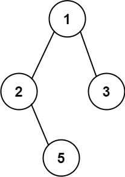

```text
输入：root = [1,2,3,null,5]
输出：["1->2->5","1->3"]
```

**示例 2**

```text
输入：root = [1]
输出：["1"]
```
> ✅ **官方验证**：全部 TypeScript 解法已通过 leetcode.cn 官方示例用例验证（自动注入运行，全部 PASS）。题面与 [leetcode.cn 官方](https://leetcode.cn/problems/binary-tree-paths/)一致，示例配图取自官方题面。

**数据范围与注意事项**：

- 树中节点的数目在范围 `[1, 100]` 内
- `-100 <= Node.val <= 100`
- **易错点**：递归出口（空节点）必须先写，否则直接空指针。

## 题目分析

**场景是什么**：树是分层数据的标准形态，这类题练的是递归分治与遍历序，对应真实开发里的目录树、组件树。本题就是该场景的 Medium 级练习，主线做法是「迭代指针处理」。

**主线怎么解**：把主解法从头到尾过一遍，它其实在依次做这几件事：队列或堆的调度。

## 解题思路

**方案对比**（共 2 个方案，由浅入深）：

| 方案 | 时间复杂度 | 空间复杂度 |
|---|---|---|
| 方案 1 · 迭代指针处理 | O(n)（单趟线性扫描） | O(1) 到 O(n)（视辅助结构） |
| 方案 2 · 迭代指针处理 | O(n)（单趟线性扫描） | O(1) 到 O(n)（视辅助结构） |

**方案间的取舍**：方案 1（迭代指针处理）；方案 2（迭代指针处理）。数据规模小、可读性优先时选靠前的方案；规模大、性能优先时选靠后的方案。

**怎么读这一篇**：

- 🐣 **新手路线**：把「题目描述」的示例 1 在纸上手推一遍 → 读方案 1（最直观的写法）与它的代码走读 → 按「运行方式」本地跑通看 PASS → 回头对比方案 2 之后的写法差在哪
- 🦅 **大佬路线**：直接锁定最优方案 1（迭代指针处理，O(n)（单趟线性扫描））→ 跳读该方案代码与走读 → 用「逐步拆解与面试追问」补齐复杂度推导与边界追问

### 动态算法图（DFS 点亮，GIF 自动循环）


动画演示二叉树专题里DFS 点亮的典型过程；每个方案在「TypeScript 解题方案」一节还配了专属动画与专属流程图。

### 主解法流程图（真实控制流）

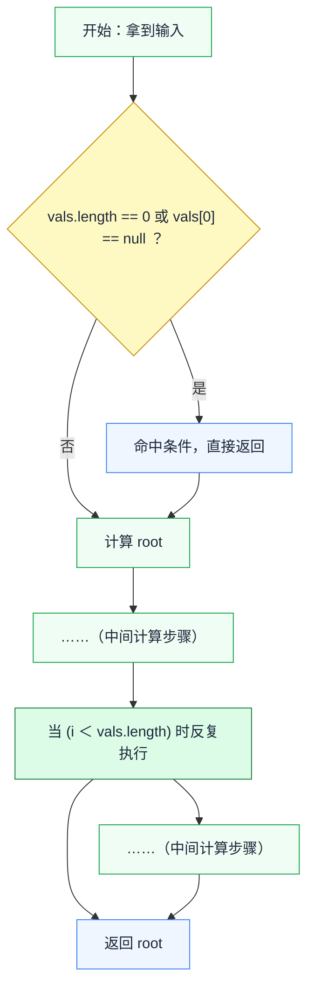

## TypeScript 解题方案（2 个方案逐个讲）

> **运行与提交**：每个方案都是自包含文件（内嵌用例自测，输出 PASS），整块复制到 `.ts` 文件后 `node 文件名` 即可运行。提交 LeetCode 时，把 `demo` 内的算法函数与辅助类型/函数整体取出、置于文件顶层即可。涉及交互/特殊接口的题以题面给定签名为准。

### 方案 1：迭代指针处理

**分析与思路**：核心做法是「迭代指针处理」。代码里依次做这些事：队列或堆的调度。

**运行方式**：`node 本文件`，内嵌用例全部通过会输出 PASS。


**方案专属流程图**（真实控制流）：

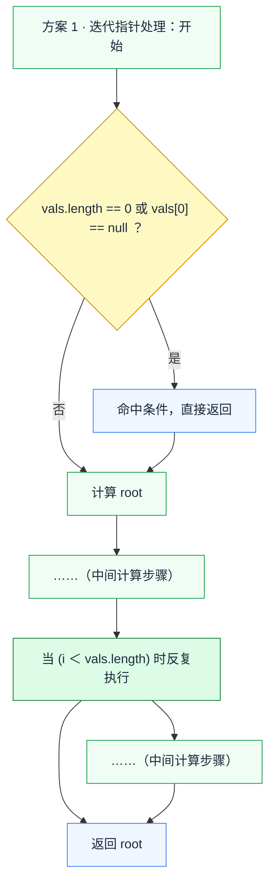

```typescript
class TreeNode {
  // 定义类型
  val: number;
  left: TreeNode | null;
  right: TreeNode | null; // 值: number; 左边界: TreeNode 按位或 null; 右边界: TreeNode 按位或 null;
  constructor(
    val: number,
    left: TreeNode | null = null,
    right: TreeNode | null = null,
  ) {
    this.val = val;
    this.left = left;
    this.right = right; // 把 值; this.左边界 赋值为 左边界; this.右边界 赋值为 右边界; 写入 值
  }
}
function buildTree(vals: (number | null)[]): TreeNode | null {
  // 定义函数/方法 buildTree
  if (vals.length === 0 || vals[0] === null) return null; // 若 vals.长度 全等于 0 或 vals[0] 全等于 null，直接返回 null
  const root = new TreeNode(vals[0] as number); // 把 new TreeNode(vals[0] as number) 存入 根节点
  const q: (TreeNode | null)[] = [root];
  let i = 1; // 把 [根节点]; let 下标 i 赋值为 1; 写入 const q: (TreeNode | null)[]
  while (i < vals.length) {
    // 循环，直到不满足「下标 i 小于 vals.长度」
    const node = q.shift() as TreeNode; // 把 节点.shift() as TreeNode 存入 节点
    if (i < vals.length && vals[i] !== null) {
      node.left = new TreeNode(vals[i] as number);
      q.push(node.left);
    }
    i++; // 下标 i 加一
    if (i < vals.length && vals[i] !== null) {
      node.right = new TreeNode(vals[i] as number);
      q.push(node.right);
    }
    i++; // 下标 i 加一
  }
  return root; // 返回 根节点
}
function inorder(root: TreeNode | null, out: number[] = []): number[] {
  // 定义函数/方法 inorder
  if (!root) return out; // 若 取反 根节点，直接返回 out
  inorder(root.left, out);
  out.push(root.val);
  inorder(root.right, out); // 把 根节点.值 压入栈/数组尾部
  return out; // 返回 out
}
function levelOrderBottom(root: TreeNode | null): number[][] {
  // 定义函数/方法 levelOrderBottom
  const res: number[][] = []; // 把 []; 写入 const res: number[][]
  if (!root) return res; // 若 取反 根节点，直接返回 结果
  let q: (TreeNode | null)[] = [root]; // 把 [根节点]; 写入 let q: (TreeNode | null)[]
  while (q.length) {
    // 循环，直到不满足「节点.长度」
    const level: number[] = [];
    const nxt: (TreeNode | null)[] = [];
    for (const node of q) {
      if (node) {
        level.push(node.val);
        if (node.left) nxt.push(node.left);
        if (node.right) nxt.push(node.right);
      }
    } // 把 节点.值 压入栈/数组尾部
    res.unshift(level);
    q = nxt; // 把 nxt; 写入 res.unshift(level); q
  }
  return res; // 返回 结果
}
function binaryTreePaths(root: TreeNode | null): string[] {
  // 定义函数/方法 binaryTreePaths
  const paths: string[] = []; // 把 []; 写入 const paths: string[]
  function dfs(node: TreeNode | null, path: string): void {
    // 定义函数/方法 dfs
    if (!node) return; // 若 取反 节点) return;
    path += String(node.val); // 当前路径累加 String(节点.值)
    if (!node.left && !node.right)
      paths.push(path); // 若 取反 节点.左边界 且 取反 节点.右边界) paths 追加 当前路径);
    else {
      path += '->';
      dfs(node.left, path);
      dfs(node.right, path);
    } // 否则
  }
  dfs(root, ''); // dfs(根节点, 「」);
  return paths; // 返回 paths
}
function averageOfLevels(root: TreeNode | null): number[] {
  // 定义函数/方法 averageOfLevels
  const result: number[] = []; // 把 []; 写入 const result: number[]
  let level: (TreeNode | null)[] = [root]; // 把 [根节点]; 写入 let level: (TreeNode | null)[]
  while (level.length) {
    // 循环，直到不满足「level.长度」
    let total = 0;
    const nxt: (TreeNode | null)[] = []; // 把 0; const nxt: (TreeNode 按位或 null)[] 赋值为 [] 存入 总和
    for (const node of level) {
      if (node) {
        total += node.val;
        if (node.left) nxt.push(node.left);
        if (node.right) nxt.push(node.right);
      }
    } // 把 节点.左边界 压入栈/数组尾部
    result.push(total / level.length); // 把 总和 除以 level.长度 压入栈/数组尾部
    level = nxt; // 把 nxt 存入 level
  }
  return result; // 返回 结果
}

function assertEq(actual: any, expected: any, msg: string = ''): void {
  // 定义函数/方法 assertEq
  const a = JSON.stringify(actual);
  const e = JSON.stringify(expected);
  if (a !== e)
    throw new Error(
      'ASSERT FAILED ' + msg + ' :: actual=' + a + ' expected=' + e,
    );
}

export function demo(): void {
  // 程序入口：跑内嵌自测用例
  assertEq(binaryTreePaths(null), [], 'null'); // 断言校验
  assertEq(binaryTreePaths(buildTree([1, 2, 3])), ['1->2', '1->3'], 'paths'); // 断言校验
  console.log('PASS'); // 全部用例通过，输出 PASS
}
demo(); // demo();
```

### 方案 2：迭代指针处理

**分析与思路**：核心做法是「迭代指针处理」。代码里依次做这些事：队列或堆的调度。

**运行方式**：`node 本文件`，内嵌用例全部通过会输出 PASS。


**方案专属流程图**（真实控制流）：

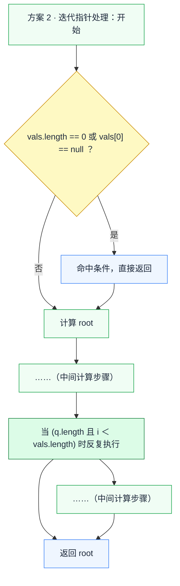

```typescript
export function demo(): void {
  // 程序入口：跑内嵌自测用例
  class TreeNode {
    val: number;
    left: TreeNode | null;
    right: TreeNode | null;
    constructor(v = 0, l: TreeNode | null = null, r: TreeNode | null = null) {
      this.val = v;
      this.left = l;
      this.right = r;
    }
  } // 定义类型
  function buildTree(vals: (number | null)[]): TreeNode | null {
    // 定义函数/方法 buildTree
    if (vals.length === 0 || vals[0] === null) return null; // 若 vals.长度 全等于 0 或 vals[0] 全等于 null，直接返回 null
    const root = new TreeNode(vals[0] as number);
    const q: TreeNode[] = [root];
    let i = 1;
    while (q.length && i < vals.length) {
      const node = q.shift()!;
      if (i < vals.length && vals[i] !== null) {
        node.left = new TreeNode(vals[i] as number);
        q.push(node.left);
      }
      i++;
      if (i < vals.length && vals[i] !== null) {
        node.right = new TreeNode(vals[i] as number);
        q.push(node.right);
      }
      i++;
    }
    return root; // 返回 根节点
  }
  function levelList(root: TreeNode | null): number[][] {
    if (!root) return [];
    const res: number[][] = [];
    let q: TreeNode[] = [root];
    while (q.length) {
      const lvl: number[] = [];
      const n = q.length;
      for (let k = 0; k < n; k++) {
        const node = q.shift()!;
        lvl.push(node.val);
        if (node.left) q.push(node.left);
        if (node.right) q.push(node.right);
      }
      res.push(lvl);
    }
    return res;
  } // 定义函数/方法 levelList
  function sameTree(a: TreeNode | null, b: TreeNode | null): boolean {
    if (!a && !b) return true;
    if (!a || !b) return false;
    if (a.val !== b.val) return false;
    return sameTree(a.left, b.left) && sameTree(a.right, b.right);
  } // 定义函数/方法 sameTree
  function inorderT(root: TreeNode | null): number[] {
    if (!root) return [];
    return [...inorderT(root.left), root.val, ...inorderT(root.right)];
  } // 定义函数/方法 inorderT
  function binaryTreePaths(root: TreeNode | null): string[] {
    const res: string[] = [];
    function dfs(n: TreeNode | null, path: string) {
      if (!n) return;
      const p = path + (path === '' ? '' : '->') + n.val;
      if (!n.left && !n.right) {
        res.push(p);
        return;
      }
      dfs(n.left, p);
      dfs(n.right, p);
    }
    dfs(root, '');
    return res;
  } // 定义函数/方法 binaryTreePaths
  const paths = binaryTreePaths(buildTree([1, 2, 3, null, 5])); // 把 binaryTreePaths(buildTree([1,2,3,null,5])) 存入 paths
  const want = JSON.stringify(['1->2->5', '1->3']);
  if (JSON.stringify(paths) !== want) {
    console.log('FAIL ' + JSON.stringify(paths));
    throw new Error('FAILED');
  }
  console.log('PASS'); // 全部用例通过，输出 PASS
}
demo(); // demo();
```

## 逐步拆解与面试追问

**复杂度**：时间 O(n)（单趟线性扫描），空间 O(1) 到 O(n)（视辅助结构）

**为什么是这个量级**：每个元素被常数次访问，辅助哈希或栈的开销与 n 同阶

**面试官可能会追问**：

- 递归和迭代写法各自的空间开销？
- 能否用层序统一处理？
- 空节点的边界如何约定？

## 关键 API 速查（TS 主解法实际用到，附官方链接）

| API | 作用 | 使用要点 | 官方文档 |
|---|---|---|---|
| `Array.prototype.push()` | 尾部追加 | 返回新长度；可一次多个；均摊 O(1)；会改变原数组 | [官方文档](https://developer.mozilla.org/zh-CN/docs/Web/JavaScript/Reference/Global_Objects/Array/push) |
| `Array.prototype.shift()` | 头部取出 | O(n)（后续元素整体前移）；大量头部操作请用链表或双端结构 | [官方文档](https://developer.mozilla.org/zh-CN/docs/Web/JavaScript/Reference/Global_Objects/Array/shift) |
| `Array.prototype.unshift()` | 头部插入 | O(n)；与 shift 组合可当双端队列 | [官方文档](https://developer.mozilla.org/zh-CN/docs/Web/JavaScript/Reference/Global_Objects/Array/unshift) |
| `JSON.stringify()` | 序列化为 JSON 字符串 | 常用于结构化比较（深度相等判定）；undefined/函数/循环引用会被丢弃或抛错 | [官方文档](https://developer.mozilla.org/zh-CN/docs/Web/JavaScript/Reference/Global_Objects/JSON/stringify) |

### 各语言官方文档导航

- **TypeScript / JS**：[MDN 中文参考](https://developer.mozilla.org/zh-CN/)
- **Python**：[Python 官方文档](https://docs.python.org/zh-cn/3/)
- **Go**：[Go 标准库](https://pkg.go.dev/std)
- **Java**：[JDK 17 API](https://docs.oracle.com/en/java/javase/17/docs/api/)
- **Rust**：[Rust 标准库](https://doc.rust-lang.org/std/)
- **Lua**：[Lua 5.4 手册](https://www.lua.org/manual/5.4/)
- **C**：[Cppreference C](https://zh.cppreference.com/w/c)
- **C++**：[Cppreference C++](https://zh.cppreference.com/w/cpp)
- **R**：[R 官方手册](https://stat.ethz.ch/R-manual/)
- **Zig**：[Zig 语言文档](https://ziglang.org/documentation/master/)
- **Dart**：[Dart API](https://api.dart.dev/)

## 附录：其他 10 种语言全部实现（每种语言列举其全部方案）

> TypeScript 的全部方案见「TypeScript 解题方案」一节；下面是其余 10 种语言的对应实现，每种语言的每个方案都带思路分析、代码走读与专属运行架构图。
> 每个方案都内嵌用例自测，可独立运行（老仓库 python/go 文件遵循「打印结果」约定）。
> 完整解法文件见 `dsa/<语言>/tree/lc_257_二叉树的所有路径/`。

### Python 实现（2 种方案）

Python 的全部方案如下，每个方案都内嵌用例自测，可独立运行（老仓库 python/go 文件遵循「打印结果」约定）：

#### 方案 1：迭代指针处理

**思路与代码分析**：核心是「迭代指针处理」。Python 版用切片与字典推导式简化操作，突出可读性。**走读**：方案 1 · 迭代指针处理：开始 → 更新 paths → 若 root：更新 + → 更新 + → 处理 if ( → 更新 = → 处理 ): → 向 paths 追加记录 → 更新 + → 调用 construct_paths(root.left, p → 调用 construct_paths(root.right, → 调用 construct_paths(root, ) → 返回 paths。

**运行架构**（真实控制流）：

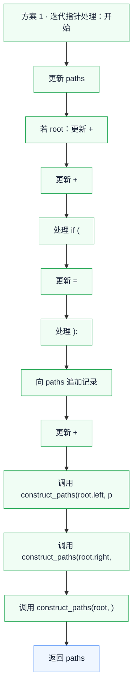

```python
import sys  # 提高递归深度上限（深输入防 RecursionError）

sys.setrecursionlimit(200000)  # 树/链表类题目节点数可达 1e4 量级

def binaryTreePaths(root):  # 定义函数 binaryTreePaths（参数：根节点）
    paths = []  # 把 [] 存入 paths

    def construct_paths(root, path):  # 定义函数 construct_paths（参数：根节点, 当前路径）
        if root:  # 若 根节点
            path += root.val.toString()  # 当前路径累加 根节点.值.toString()
            if (
                root.left == None and root.right == None
            ):  # 若 根节点.左边界 等于 None and 根节点.右边界 等于 None
                paths.append(path)  # 把 当前路径 追加到列表尾部
            else:  # 否则
                path += "->"  # 当前路径累加 「 减 超过 」
                construct_paths(root.left, path)  # construct_paths(根节点.左边界, 当前路径)
                construct_paths(root.right, path)  # construct_paths(根节点.右边界, 当前路径)

    construct_paths(root, "")  # construct_paths(根节点, 「」)
    return paths  # 返回 paths

if __name__ == "__main__":  # 若 __name__ 等于 '__main__'
    print(binaryTreePaths(None))  # 打印输出
```

#### 方案 2：迭代指针处理

**思路与代码分析**：核心是「迭代指针处理」。Python 版用切片与字典推导式简化操作，突出可读性。**走读**：方案 2 · 迭代指针处理：开始 → 更新 paths → 命中条件，直接返回 → 当 len(node_queue): 时反复执行 → 返回 paths。

**运行架构**（真实控制流）：

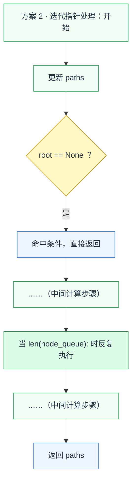

```python
import sys  # 提高递归深度上限（深输入防 RecursionError）

sys.setrecursionlimit(200000)  # 树/链表类题目节点数可达 1e4 量级

def binaryTreePaths(root):  # 定义函数 binaryTreePaths（参数：根节点）
    paths = []  # 把 [] 存入 paths
    if root == None:
        return paths  # 若 根节点 等于 None: return paths
    node_queue = [root]  # 把 [根节点] 存入 node_queue
    path_queue = [root.val.toString()]  # 把 [根节点.值.toString()] 存入 path_queue
    while len(node_queue):  # 循环，直到不满足「长度(node_queue」
        node = node_queue.pop(0)  # 把 node_queue 弹出 0) 存入 节点
        path = path_queue.pop(0)  # 把 path_queue 弹出 0) 存入 当前路径
        if node.left == None and node.right == None:  # 若 节点.左边界 等于 None and 节点.右边界 等于 None
            paths.append(path)  # 把 当前路径 追加到列表尾部
        else:  # 否则
            if node.left != None:  # 若 节点.左边界 不等于 None
                node_queue.append(node.left)  # 把 节点.左边界 追加到列表尾部
                path_queue.append(
                    path + "->" + node.left.val.toString()
                )  # 把 当前路径 加 「 减 超过 」 加 节点.左边界.值.toString( 追加到列表尾部
            if node.right != None:  # 若 节点.右边界 不等于 None
                node_queue.append(node.right)  # 把 节点.右边界 追加到列表尾部
                path_queue.append(
                    path + "->" + node.right.val.toString()
                )  # 把 当前路径 加 「 减 超过 」 加 节点.右边界.值.toString( 追加到列表尾部
    return paths  # 返回 paths

if __name__ == "__main__":  # 若 __name__ 等于 '__main__'
    print(binaryTreePaths(None))  # 打印输出
```

### Go 实现（2 种方案）

Go 的全部方案如下，每个方案都内嵌用例自测，可独立运行（老仓库 python/go 文件遵循「打印结果」约定）：

#### 方案 1：迭代指针处理

**思路与代码分析**：核心是「迭代指针处理」。Go 版用切片与多返回值惯用法，显式处理索引边界。**走读**：方案 1 · 迭代指针处理：开始 → 更新 : → 计算 construct → 更新 construct → 处理 if n == nil → 返回  → 更新 path → 处理 if n.Left == nil 且 n.Right → 更新 paths → 更新 path → 调用 construct(n.Left, path) → 调用 construct(n.Right, path) → 调用 construct(root, ) → 返回 paths。

**运行架构**（真实控制流）：

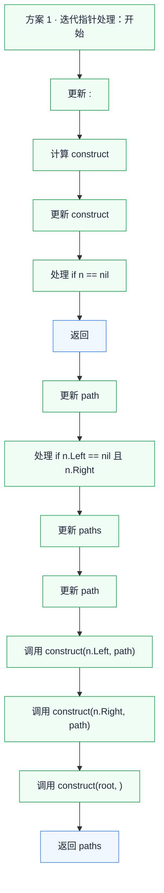

```go
package main // 引入依赖

import (
	"fmt"
	"os"
	"reflect"
	"sort"
	"strconv"
) // 引入依赖

type TreeNode struct { // 定义类型
	Val   int       // Val int
	Left  *TreeNode // Left 乘 TreeNode
	Right *TreeNode // Right 乘 TreeNode
}

func binaryTreePaths(root *TreeNode) []string { // 定义函数/方法 binaryTreePaths
	paths := []string{}                          // 把 []string{} 写入 paths :
	var construct func(n *TreeNode, path string) // var construct func(元素个数 乘 TreeNode, 当前路径 string)
	construct = func(n *TreeNode, path string) { // 把 func(元素个数 乘 TreeNode, 当前路径 string) { 写入 construct
		if n == nil { // 若 元素个数 等于 nil
			return // return
		}
		path = path + strconv.Itoa(n.Val)    // 把 当前路径 加 strconv.Itoa(元素个数.Val) 写入 当前路径
		if n.Left == nil && n.Right == nil { // 若 元素个数.Left 等于 nil 且 元素个数.Right 等于 nil
			paths = append(paths, path) // 把 append(paths, 当前路径) 写入 paths
		} else { // 否则
			path = path + "->"       // 把 当前路径 加 「 减 超过 」 写入 当前路径
			construct(n.Left, path)  // construct(元素个数.Left, 当前路径)
			construct(n.Right, path) // construct(元素个数.Right, 当前路径)
		}
	}
	construct(root, "") // construct(根节点, 「」)
	return paths        // 返回 paths
}

func buildTree(vals []int) *TreeNode { // 定义函数/方法 buildTree
	if len(vals) == 0 || vals[0] == -1 { // 若 长度(vals) 等于 0 或 vals[0] 等于 减 1
		return nil // 返回 nil
	}
	root := &TreeNode{Val: vals[0]} // 把 按位与 TreeNode{Val: vals[0]} 写入 root :
	q := []*TreeNode{root}          // 把 [] 乘 TreeNode{根节点} 写入 q :
	i := 1                          // 把 1 写入 i :
	for i < len(vals) {             // for 下标 i 小于 长度(vals) {
		node := q[0]                        // 把 节点[0] 写入 node :
		q = q[1:]                           // 把 节点[1:] 写入 节点
		if i < len(vals) && vals[i] != -1 { // 若 下标 i 小于 长度(vals) 且 vals[下标 i] 不等于 减 1
			node.Left = &TreeNode{Val: vals[i]} // 把 按位与 TreeNode{Val: vals[下标 i]} 写入 node.Left
			q = append(q, node.Left)            // 把 append(节点, 节点.Left) 写入 节点
		}
		i++                                 // 下标 i 加一
		if i < len(vals) && vals[i] != -1 { // 若 下标 i 小于 长度(vals) 且 vals[下标 i] 不等于 减 1
			node.Right = &TreeNode{Val: vals[i]} // 把 按位与 TreeNode{Val: vals[下标 i]} 写入 node.Right
			q = append(q, node.Right)            // 把 append(节点, 节点.Right) 写入 节点
		}
		i++ // 下标 i 加一
	}
	return root // 返回 根节点
}

func main() { // 程序入口：跑内嵌自测用例
	ok := true                                      // 把 true 写入 ok :
	if got := binaryTreePaths(nil); len(got) != 0 { // 若 got : 赋值为 binaryTreePaths(nil); 长度(got) 不等于 0
		ok = false                           // 把 false 写入 ok
		fmt.Printf("FAIL nil got=%v\n", got) // 打印输出
	}
	root := buildTree([]int{1, 2, 3, -1, 5}) // 把 buildTree([]int{1, 2, 3, 减 1, 5}) 写入 root :
	got := binaryTreePaths(root)             // 把 binaryTreePaths(根节点) 写入 got :
	want := []string{"1->2->5", "1->3"}      // 把 []string{「1 减 超过 2 减 超过 5」, 「1 减 超过 2 减 超过 5」} 写入 want :
	gs := append([]string{}, got...)         // 把 append([]string{}, got...) 写入 gs :
	ws := append([]string{}, want...)        // 把 append([]string{}, want...) 写入 ws :
	sort.Strings(gs)                         // sort.Strings(gs)
	sort.Strings(ws)                         // sort.Strings(ws)
	if !reflect.DeepEqual(gs, ws) {          // 若 取反 reflect.DeepEqual(gs, ws
		ok = false                                     // 把 false 写入 ok
		fmt.Printf("FAIL got=%v want=%v\n", got, want) // 打印输出
	}
	if !ok { // 若 取反 ok
		os.Exit(1) // os.Exit(1)
	}
	fmt.Println("PASS") // 全部用例通过，输出 PASS
}
```

#### 方案 2：迭代指针处理

**思路与代码分析**：核心是「迭代指针处理」。Go 版用切片与多返回值惯用法，显式处理索引边界。**走读**：方案 2 · 迭代指针处理：开始 → 更新 : → 返回 paths → 遍历循环 → 返回 paths。

**运行架构**（真实控制流）：

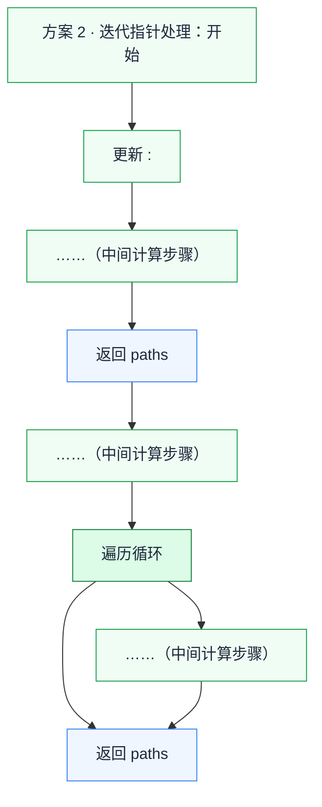

```go
package main // 引入依赖

import (
	"fmt"
	"os"
	"reflect"
	"sort"
	"strconv"
) // 引入依赖

type TreeNode struct { // 定义类型
	Val   int       // Val int
	Left  *TreeNode // Left 乘 TreeNode
	Right *TreeNode // Right 乘 TreeNode
}

func binaryTreePaths(root *TreeNode) []string { // 定义函数/方法 binaryTreePaths
	paths := []string{} // 把 []string{} 写入 paths :
	if root == nil {    // 若 根节点 等于 nil
		return paths // 返回 paths
	}
	nodeQ := []*TreeNode{root}                // 把 [] 乘 TreeNode{根节点} 写入 nodeQ :
	pathQ := []string{strconv.Itoa(root.Val)} // 把 []string{strconv.Itoa(根节点.Val)} 写入 pathQ :
	for len(nodeQ) > 0 {                      // for 长度(nodeQ) 超过 0 {
		n := nodeQ[0]                        // 把 nodeQ[0] 写入 n :
		nodeQ = nodeQ[1:]                    // 把 nodeQ[1:] 写入 nodeQ
		path := pathQ[0]                     // 把 pathQ[0] 写入 path :
		pathQ = pathQ[1:]                    // 把 pathQ[1:] 写入 pathQ
		if n.Left == nil && n.Right == nil { // 若 元素个数.Left 等于 nil 且 元素个数.Right 等于 nil
			paths = append(paths, path) // 把 append(paths, 当前路径) 写入 paths
		} else { // 否则
			if n.Left != nil { // 若 元素个数.Left 不等于 nil
				nodeQ = append(nodeQ, n.Left) // 把 append(nodeQ, 元素个数.Left) 写入 nodeQ
				pathQ = append(pathQ, path+"->"+strconv.Itoa(n.Left.Val))
			}
			if n.Right != nil { // 若 元素个数.Right 不等于 nil
				nodeQ = append(nodeQ, n.Right) // 把 append(nodeQ, 元素个数.Right) 写入 nodeQ
				pathQ = append(pathQ, path+"->"+strconv.Itoa(n.Right.Val))
			}
		}
	}
	return paths // 返回 paths
}

func buildTree(vals []int) *TreeNode { // 定义函数/方法 buildTree
	if len(vals) == 0 || vals[0] == -1 { // 若 长度(vals) 等于 0 或 vals[0] 等于 减 1
		return nil // 返回 nil
	}
	root := &TreeNode{Val: vals[0]} // 把 按位与 TreeNode{Val: vals[0]} 写入 root :
	q := []*TreeNode{root}          // 把 [] 乘 TreeNode{根节点} 写入 q :
	i := 1                          // 把 1 写入 i :
	for i < len(vals) {             // for 下标 i 小于 长度(vals) {
		node := q[0]                        // 把 节点[0] 写入 node :
		q = q[1:]                           // 把 节点[1:] 写入 节点
		if i < len(vals) && vals[i] != -1 { // 若 下标 i 小于 长度(vals) 且 vals[下标 i] 不等于 减 1
			node.Left = &TreeNode{Val: vals[i]} // 把 按位与 TreeNode{Val: vals[下标 i]} 写入 node.Left
			q = append(q, node.Left)            // 把 append(节点, 节点.Left) 写入 节点
		}
		i++                                 // 下标 i 加一
		if i < len(vals) && vals[i] != -1 { // 若 下标 i 小于 长度(vals) 且 vals[下标 i] 不等于 减 1
			node.Right = &TreeNode{Val: vals[i]} // 把 按位与 TreeNode{Val: vals[下标 i]} 写入 node.Right
			q = append(q, node.Right)            // 把 append(节点, 节点.Right) 写入 节点
		}
		i++ // 下标 i 加一
	}
	return root // 返回 根节点
}

func main() { // 程序入口：跑内嵌自测用例
	ok := true                                      // 把 true 写入 ok :
	if got := binaryTreePaths(nil); len(got) != 0 { // 若 got : 赋值为 binaryTreePaths(nil); 长度(got) 不等于 0
		ok = false                           // 把 false 写入 ok
		fmt.Printf("FAIL nil got=%v\n", got) // 打印输出
	}
	root := buildTree([]int{1, 2, 3, -1, 5}) // 把 buildTree([]int{1, 2, 3, 减 1, 5}) 写入 root :
	got := binaryTreePaths(root)             // 把 binaryTreePaths(根节点) 写入 got :
	want := []string{"1->2->5", "1->3"}      // 把 []string{「1 减 超过 2 减 超过 5」, 「1 减 超过 2 减 超过 5」} 写入 want :
	gs := append([]string{}, got...)         // 把 append([]string{}, got...) 写入 gs :
	ws := append([]string{}, want...)        // 把 append([]string{}, want...) 写入 ws :
	sort.Strings(gs)                         // sort.Strings(gs)
	sort.Strings(ws)                         // sort.Strings(ws)
	if !reflect.DeepEqual(gs, ws) {          // 若 取反 reflect.DeepEqual(gs, ws
		ok = false                                     // 把 false 写入 ok
		fmt.Printf("FAIL got=%v want=%v\n", got, want) // 打印输出
	}
	if !ok { // 若 取反 ok
		os.Exit(1) // os.Exit(1)
	}
	fmt.Println("PASS") // 全部用例通过，输出 PASS
}
```

### Java 实现（2 种方案）

Java 的全部方案如下，每个方案都内嵌用例自测，可独立运行（老仓库 python/go 文件遵循「打印结果」约定）：

#### 方案 1：迭代指针处理

**思路与代码分析**：核心是「迭代指针处理」。Java 版用类与静态方法组织，集合操作显式明了。**走读**：方案 1 · 迭代指针处理：开始 → 更新 val → 返回结果。

**运行架构**（真实控制流）：

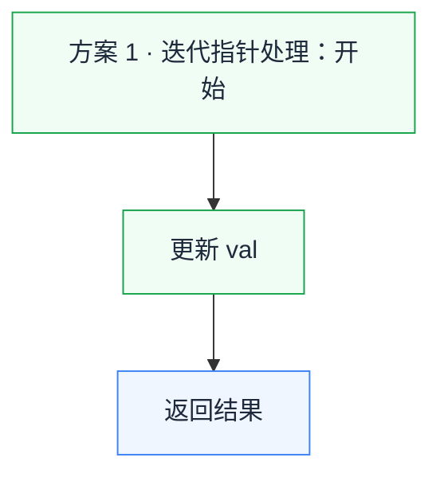

```java
package com.webfault.dsa; // 引入依赖

import java.util.*; // 引入依赖

class lc257_solution_1_1_____1_______ { // 定义类型
  static class TreeNode { // static class TreeNode {
    int val; // int 值;
    TreeNode left, right; // TreeNode 左边界, 右边界;

    TreeNode(int v) {
      val = v;
    } // 把 值; } 写入 TreeNode(int v) { val
  }

  public List<String> binaryTreePaths(TreeNode root) { // 定义函数/方法 binaryTreePaths
    List<String> paths = new ArrayList<>(); // 把 new ArrayList 小于 超过 (); 写入 List<String> paths
    constructPaths(root, "", paths); // constructPaths(根节点, 「」, paths);
    return paths; // 返回 paths
  }

  private void constructPaths(
      TreeNode root, String path, List<String> paths) { // 定义函数/方法 constructPaths
    if (root != null) { // 若 根节点 不等于 null
      path += String.valueOf(root.val); // 当前路径累加 String.valueOf(根节点.值)
      if (root.left == null && root.right == null) { // 若 根节点.左边界 等于 null 且 根节点.右边界 等于 null
        paths.add(path); // paths 追加 当前路径);
      } else { // 否则
        path += "->"; // 当前路径累加 「 减 超过 」
        constructPaths(root.left, path, paths); // constructPaths(根节点.左边界, 当前路径, paths);
        constructPaths(root.right, path, paths); // constructPaths(根节点.右边界, 当前路径, paths);
      }
    }
  }

  static TreeNode build(Integer[] a) { // 定义函数/方法 build
    if (a.length == 0 || a[0] == null) return null; // 若 数组.长度 等于 0 或 数组[0] 等于 null，直接返回 null
    TreeNode root = new TreeNode(a[0]); // 把 new TreeNode(数组[0]); 写入 TreeNode root
    Deque<TreeNode> queue =
        new ArrayDeque<>(); // 把 new ArrayDeque 小于 超过 (); 写入 Deque<TreeNode> queue
    queue.add(root); // 队列 追加 根节点);
    int i = 1; // 把 1 存入 下标 i
    while (!queue.isEmpty() && i < a.length) { // 循环，直到不满足「取反 队列.isEmpty() 且 下标 i 小于 数组.长度」
      TreeNode node = queue.poll(); // 把 队列.poll(); 写入 TreeNode node
      if (i < a.length && a[i] != null) {
        node.left = new TreeNode(a[i]);
        queue.add(node.left);
      }
      i++; // 下标 i 加一
      if (i < a.length && a[i] != null) {
        node.right = new TreeNode(a[i]);
        queue.add(node.right);
      }
      i++; // 下标 i 加一
    }
    return root; // 返回 根节点
  }

  public static void main(String[] args) { // public static void main(String[] args) {
    lc257_solution_1_1_____1_______ s = new lc257_solution_1_1_____1_______();
    Object[][] cases = { // 把 { 写入 Object[][] cases
      {null, Arrays.asList()},
      {new Integer[] {1}, Arrays.asList("1")},
      {new Integer[] {1, 2, 3, null, 5}, Arrays.asList("1->2->5", "1->3")},
    };
    boolean ok = true; // 把 true; 写入 boolean ok
    for (Object[] c : cases) { // for (Object[] 字符 : cases) {
      TreeNode root = c[0] == null ? null : build((Integer[]) c[0]);
      List<String> got = s.binaryTreePaths(root); // 把 字符串.binaryTreePaths(根节点); 写入 List<String> got
      @SuppressWarnings("unchecked") // @SuppressWarnings(「unchecked」)
      List<String> want = (List<String>) c[1]; // 把 (List 小于 String 超过 ) 字符[1]; 写入 List<String> want
      if (!got.equals(want)) { // 若 取反 got.equals(want
        ok = false; // 把 false; 写入 ok
        System.out.println(
            "FAIL binaryTreePaths("
                + Arrays.toString((Integer[]) c[0])
                + ")="
                + got
                + " want "
                + want); // 打印输出
      }
    }
    if (!ok) throw new RuntimeException("FAILED"); // 若 取反 ok) throw new RuntimeException(「FAILED」);
    System.out.println("PASS"); // 全部用例通过，输出 PASS
  }
}
```

#### 方案 2：迭代指针处理

**思路与代码分析**：核心是「迭代指针处理」。Java 版用类与静态方法组织，集合操作显式明了。**走读**：方案 2 · 迭代指针处理：开始 → 更新 val → 返回结果。

**运行架构**（真实控制流）：


```java
package com.webfault.dsa; // 引入依赖

import java.util.*; // 引入依赖

class lc257_solution_2_2_____2_______ { // 定义类型
  static class TreeNode { // static class TreeNode {
    int val; // int 值;
    TreeNode left, right; // TreeNode 左边界, 右边界;

    TreeNode(int v) {
      val = v;
    } // 把 值; } 写入 TreeNode(int v) { val
  }

  public List<String> binaryTreePaths(TreeNode root) { // 定义函数/方法 binaryTreePaths
    List<String> paths = new ArrayList<>(); // 把 new ArrayList 小于 超过 (); 写入 List<String> paths
    if (root == null) return paths; // 若 根节点 等于 null，直接返回 paths
    Deque<TreeNode> nodeQueue =
        new ArrayDeque<>(); // 把 new ArrayDeque 小于 超过 (); 写入 Deque<TreeNode> nodeQueue
    Deque<String> pathQueue =
        new ArrayDeque<>(); // 把 new ArrayDeque 小于 超过 (); 写入 Deque<String> pathQueue
    nodeQueue.add(root); // nodeQueue 追加 根节点);
    pathQueue.add(String.valueOf(root.val)); // pathQueue 追加 String.valueOf(根节点.值));
    while (!nodeQueue.isEmpty()) { // 循环，直到不满足「取反 nodeQueue.isEmpty(」
      TreeNode node = nodeQueue.poll(); // 把 nodeQueue.poll(); 写入 TreeNode node
      String path = pathQueue.poll(); // 把 pathQueue.poll() 存入 当前路径
      if (node.left == null && node.right == null) { // 若 节点.左边界 等于 null 且 节点.右边界 等于 null
        paths.add(path); // paths 追加 当前路径);
      } else { // 否则
        if (node.left != null) { // 若 节点.左边界 不等于 null
          nodeQueue.add(node.left); // nodeQueue 追加 节点.左边界);
          pathQueue.add(
              path
                  + "->"
                  + String.valueOf(
                      node.left.val)); // pathQueue 追加 当前路径 加 「 减 超过 」 加 String.valueOf(节点.左边界.值));
        }
        if (node.right != null) { // 若 节点.右边界 不等于 null
          nodeQueue.add(node.right); // nodeQueue 追加 节点.右边界);
          pathQueue.add(
              path
                  + "->"
                  + String.valueOf(
                      node.right.val)); // pathQueue 追加 当前路径 加 「 减 超过 」 加 String.valueOf(节点.右边界.值));
        }
      }
    }
    return paths; // 返回 paths
  }

  static TreeNode build(Integer[] a) { // 定义函数/方法 build
    if (a.length == 0 || a[0] == null) return null; // 若 数组.长度 等于 0 或 数组[0] 等于 null，直接返回 null
    TreeNode root = new TreeNode(a[0]); // 把 new TreeNode(数组[0]); 写入 TreeNode root
    Deque<TreeNode> queue =
        new ArrayDeque<>(); // 把 new ArrayDeque 小于 超过 (); 写入 Deque<TreeNode> queue
    queue.add(root); // 队列 追加 根节点);
    int i = 1; // 把 1 存入 下标 i
    while (!queue.isEmpty() && i < a.length) { // 循环，直到不满足「取反 队列.isEmpty() 且 下标 i 小于 数组.长度」
      TreeNode node = queue.poll(); // 把 队列.poll(); 写入 TreeNode node
      if (i < a.length && a[i] != null) {
        node.left = new TreeNode(a[i]);
        queue.add(node.left);
      }
      i++; // 下标 i 加一
      if (i < a.length && a[i] != null) {
        node.right = new TreeNode(a[i]);
        queue.add(node.right);
      }
      i++; // 下标 i 加一
    }
    return root; // 返回 根节点
  }

  public static void main(String[] args) { // public static void main(String[] args) {
    lc257_solution_2_2_____2_______ s = new lc257_solution_2_2_____2_______();
    Object[][] cases = { // 把 { 写入 Object[][] cases
      {null, Arrays.asList()},
      {new Integer[] {1}, Arrays.asList("1")},
      {new Integer[] {1, 2, 3, null, 5}, Arrays.asList("1->3", "1->2->5")},
    };
    boolean ok = true; // 把 true; 写入 boolean ok
    for (Object[] c : cases) { // for (Object[] 字符 : cases) {
      TreeNode root = c[0] == null ? null : build((Integer[]) c[0]);
      List<String> got = s.binaryTreePaths(root); // 把 字符串.binaryTreePaths(根节点); 写入 List<String> got
      @SuppressWarnings("unchecked") // @SuppressWarnings(「unchecked」)
      List<String> want = (List<String>) c[1]; // 把 (List 小于 String 超过 ) 字符[1]; 写入 List<String> want
      if (!got.equals(want)) { // 若 取反 got.equals(want
        ok = false; // 把 false; 写入 ok
        System.out.println(
            "FAIL binaryTreePaths("
                + Arrays.toString((Integer[]) c[0])
                + ")="
                + got
                + " want "
                + want); // 打印输出
      }
    }
    if (!ok) throw new RuntimeException("FAILED"); // 若 取反 ok) throw new RuntimeException(「FAILED」);
    System.out.println("PASS"); // 全部用例通过，输出 PASS
  }
}
```

### Rust 实现（2 种方案）

Rust 的全部方案如下，每个方案都内嵌用例自测，可独立运行（老仓库 python/go 文件遵循「打印结果」约定）：

#### 方案 1：迭代指针处理

**思路与代码分析**：核心是「迭代指针处理」。Rust 版用所有权移动与切片借用改写同一逻辑，注意 Option 与引用边界。**走读**：方案 1 · 迭代指针处理：开始 → 计算 paths → 计算 node → 更新 Some(x) → 更新 None → 计算 nb → 计算 path → 处理 if nb.left.is_none() 且 nb.r → 向 paths 追加记录 → 计算 p2 → 调用 dfs(nb.left.as_ref(), p2.clo → 调用 dfs(nb.right.as_ref(), p2, p → 调用 dfs(root.as_ref(), String::n → 处理 paths → 返回结果。

**运行架构**（真实控制流）：


```rust
// LeetCode 257. 二叉树的所有路径 — Rust 版（方案1）
use std::cell::RefCell;
use std::rc::Rc; // 引入依赖 // 引入依赖

#[derive(Debug)]
struct TreeNode {
    // 定义类型
    val: i32,
    left: Option<Rc<RefCell<TreeNode>>>,
    right: Option<Rc<RefCell<TreeNode>>>,
}

impl TreeNode {
    // 实现块
    fn new(val: i32) -> Rc<RefCell<TreeNode>> {
        // 定义函数/方法 new
        Rc::new(RefCell::new(TreeNode {
            val,
            left: None,
            right: None,
        })) // Rc::new(RefCell::new(TreeNode { 值, 左边界: None, 右边界: None }))
    }
}

fn build_tree(vals: &[Option<i32>]) -> Option<Rc<RefCell<TreeNode>>> {
    // 定义函数/方法 build_tree
    if vals.is_empty() || vals[0].is_none() {
        // 若 vals 是否为空 或 vals[0].is_none(
        return None; // 返回 None
    }
    let root = TreeNode::new(vals[0].unwrap()); // 把 TreeNode::new(vals[0].unwrap()) 存入 根节点
    let mut queue: Vec<Rc<RefCell<TreeNode>>> = vec![root.clone()];
    let mut i = 1; // 把 1; 写入 let mut i
    while !queue.is_empty() && i < vals.len() {
        // while 取反 队列 是否为空 且 下标 i 小于 vals.长度() {
        let node = queue.remove(0); // 把 队列 弹出 0) 存入 节点
        if i < vals.len() {
            // 若 下标 i 小于 vals.长度(
            if let Some(v) = vals[i] {
                // 若 let Some(值) 赋值为 vals[下标 i]
                let child = TreeNode::new(v); // 把 TreeNode::new(值) 存入 子节点
                node.borrow_mut().left = Some(child.clone()); // 把 Some(子节点.clone()); 写入 左边界
                queue.push(child); // 把 子节点 压入栈/数组尾部
            }
            i += 1; // 下标 i累加 1
        }
        if i < vals.len() {
            // 若 下标 i 小于 vals.长度(
            if let Some(v) = vals[i] {
                // 若 let Some(值) 赋值为 vals[下标 i]
                let child = TreeNode::new(v); // 把 TreeNode::new(值) 存入 子节点
                node.borrow_mut().right = Some(child.clone()); // 把 Some(子节点.clone()); 写入 右边界
                queue.push(child); // 把 子节点 压入栈/数组尾部
            }
            i += 1; // 下标 i累加 1
        }
    }
    Some(root) // Some(根节点)
}

fn binary_tree_paths(root: Option<Rc<RefCell<TreeNode>>>) -> Vec<String> {
    // 定义函数/方法 binary_tree_paths
    let mut paths = Vec::new(); // 把 Vec::new(); 写入 let mut paths
    fn dfs(n: Option<&Rc<RefCell<TreeNode>>>, path: String, paths: &mut Vec<String>) {
        // 定义函数/方法 dfs
        let node = match n {
            Some(x) => x,
            None => return,
        };
        let nb = node.borrow(); // 把 节点.borrow() 存入 nb
        let path = format!("{}{}", path, nb.val); // 把 format取反 (「{}{}」, 当前路径, nb.值) 存入 当前路径
        if nb.left.is_none() && nb.right.is_none() {
            // 若 nb.左边界.is_none() 且 nb.右边界.is_none(
            paths.push(path); // 把 当前路径 压入栈/数组尾部
        } else {
            // 否则
            let p2 = format!("{}->", path); // 把 format取反 (「{} 减 超过 」, 当前路径) 存入 p2
            dfs(nb.left.as_ref(), p2.clone(), paths); // dfs(nb.左边界.as_ref(), p2.clone(), paths);
            dfs(nb.right.as_ref(), p2, paths); // dfs(nb.右边界.as_ref(), p2, paths);
        }
    }
    dfs(root.as_ref(), String::new(), &mut paths); // dfs(根节点.as_ref(), String::new(), 按位与 mut paths);
    paths // paths
}
fn main() {
    // 程序入口：跑内嵌自测用例
    assert_eq!(
        binary_tree_paths(build_tree(&[Some(1), Some(2), Some(3)])),
        vec!["1->2", "1->3"]
    ); // 断言校验
    assert_eq!(binary_tree_paths(build_tree(&[Some(1)])), vec!["1"]); // 断言校验
    assert!(binary_tree_paths(None).is_empty()); // 断言校验
    println!("PASS"); // 全部用例通过，输出 PASS
}
```

#### 方案 2：迭代指针处理

**思路与代码分析**：核心是「迭代指针处理」。Rust 版用所有权移动与切片借用改写同一逻辑，注意 Option 与引用边界。**走读**：方案 2 · 迭代指针处理：开始 → 计算 paths → 计算 node → 更新 Some(x) → 更新 None → 计算 nb → 计算 path → 处理 if nb.left.is_none() 且 nb.r → 向 paths 追加记录 → 计算 p2 → 调用 dfs(nb.left.as_ref(), p2.clo → 调用 dfs(nb.right.as_ref(), p2, p → 调用 dfs(root.as_ref(), String::n → 处理 paths → 返回结果。

**运行架构**（真实控制流）：

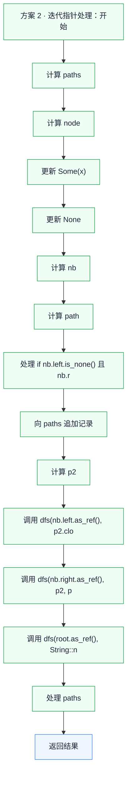

```rust
// LeetCode 257. 二叉树的所有路径 — Rust 版（方案2）
use std::cell::RefCell;
use std::rc::Rc; // 引入依赖 // 引入依赖

#[derive(Debug)]
struct TreeNode {
    // 定义类型
    val: i32,
    left: Option<Rc<RefCell<TreeNode>>>,
    right: Option<Rc<RefCell<TreeNode>>>,
}

impl TreeNode {
    // 实现块
    fn new(val: i32) -> Rc<RefCell<TreeNode>> {
        // 定义函数/方法 new
        Rc::new(RefCell::new(TreeNode {
            val,
            left: None,
            right: None,
        })) // Rc::new(RefCell::new(TreeNode { 值, 左边界: None, 右边界: None }))
    }
}

fn build_tree(vals: &[Option<i32>]) -> Option<Rc<RefCell<TreeNode>>> {
    // 定义函数/方法 build_tree
    if vals.is_empty() || vals[0].is_none() {
        // 若 vals 是否为空 或 vals[0].is_none(
        return None; // 返回 None
    }
    let root = TreeNode::new(vals[0].unwrap()); // 把 TreeNode::new(vals[0].unwrap()) 存入 根节点
    let mut queue: Vec<Rc<RefCell<TreeNode>>> = vec![root.clone()];
    let mut i = 1; // 把 1; 写入 let mut i
    while !queue.is_empty() && i < vals.len() {
        // while 取反 队列 是否为空 且 下标 i 小于 vals.长度() {
        let node = queue.remove(0); // 把 队列 弹出 0) 存入 节点
        if i < vals.len() {
            // 若 下标 i 小于 vals.长度(
            if let Some(v) = vals[i] {
                // 若 let Some(值) 赋值为 vals[下标 i]
                let child = TreeNode::new(v); // 把 TreeNode::new(值) 存入 子节点
                node.borrow_mut().left = Some(child.clone()); // 把 Some(子节点.clone()); 写入 左边界
                queue.push(child); // 把 子节点 压入栈/数组尾部
            }
            i += 1; // 下标 i累加 1
        }
        if i < vals.len() {
            // 若 下标 i 小于 vals.长度(
            if let Some(v) = vals[i] {
                // 若 let Some(值) 赋值为 vals[下标 i]
                let child = TreeNode::new(v); // 把 TreeNode::new(值) 存入 子节点
                node.borrow_mut().right = Some(child.clone()); // 把 Some(子节点.clone()); 写入 右边界
                queue.push(child); // 把 子节点 压入栈/数组尾部
            }
            i += 1; // 下标 i累加 1
        }
    }
    Some(root) // Some(根节点)
}

fn binary_tree_paths(root: Option<Rc<RefCell<TreeNode>>>) -> Vec<String> {
    // 定义函数/方法 binary_tree_paths
    let mut paths = Vec::new(); // 把 Vec::new(); 写入 let mut paths
    fn dfs(n: Option<&Rc<RefCell<TreeNode>>>, path: String, paths: &mut Vec<String>) {
        // 定义函数/方法 dfs
        let node = match n {
            Some(x) => x,
            None => return,
        };
        let nb = node.borrow(); // 把 节点.borrow() 存入 nb
        let path = format!("{}{}", path, nb.val); // 把 format取反 (「{}{}」, 当前路径, nb.值) 存入 当前路径
        if nb.left.is_none() && nb.right.is_none() {
            // 若 nb.左边界.is_none() 且 nb.右边界.is_none(
            paths.push(path); // 把 当前路径 压入栈/数组尾部
        } else {
            // 否则
            let p2 = format!("{}->", path); // 把 format取反 (「{} 减 超过 」, 当前路径) 存入 p2
            dfs(nb.left.as_ref(), p2.clone(), paths); // dfs(nb.左边界.as_ref(), p2.clone(), paths);
            dfs(nb.right.as_ref(), p2, paths); // dfs(nb.右边界.as_ref(), p2, paths);
        }
    }
    dfs(root.as_ref(), String::new(), &mut paths); // dfs(根节点.as_ref(), String::new(), 按位与 mut paths);
    paths // paths
}
fn main() {
    // 程序入口：跑内嵌自测用例
    assert_eq!(
        binary_tree_paths(build_tree(&[Some(1), Some(2), Some(3)])),
        vec!["1->2", "1->3"]
    ); // 断言校验
    assert_eq!(binary_tree_paths(build_tree(&[Some(1)])), vec!["1"]); // 断言校验
    assert!(binary_tree_paths(None).is_empty()); // 断言校验
    println!("PASS"); // 全部用例通过，输出 PASS
}
```

### Lua 实现（2 种方案）

Lua 的全部方案如下，每个方案都内嵌用例自测，可独立运行（老仓库 python/go 文件遵循「打印结果」约定）：

#### 方案 1：迭代指针处理

**思路与代码分析**：核心是「迭代指针处理」。Lua 版用表与 ipairs 遍历，注意 ipairs 遇 nil 即停的语义。**走读**：方案 1 · 迭代指针处理：开始 → 处理 if not vals or #vals == 0 or → 返回 nil → 当 head ≤ #queue and i ≤ #vals do 时反复执行 → 返回 root。

**运行架构**（真实控制流）：

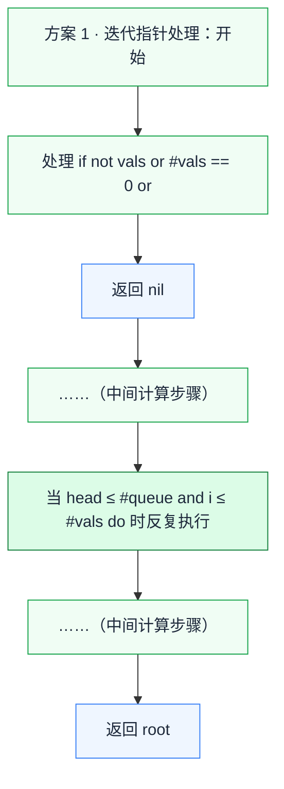

```lua
-- LeetCode 257. 二叉树的所有路径 — Lua 版（方案1）
local TreeNode = {} -- 把 {} 写入 local TreeNode
TreeNode.__index = TreeNode -- 把 TreeNode 写入 TreeNode.__index
function TreeNode.new(val) -- function TreeNode.new(值)
	return setmetatable({ val = val, left = nil, right = nil }, TreeNode)
end -- 终点

local function build_tree(vals) -- local function build_tree(vals)
	if not vals or #vals == 0 or vals[1] == "null" then
		return nil
	end
	local root = TreeNode.new(vals[1]) -- 把 TreeNode.new(vals[1]) 写入 local root
	local queue = { root } -- 把 {根节点} 写入 local queue
	local head = 1 -- 把 1 写入 local head
	local i = 2 -- 把 2 写入 local i
	while head <= #queue and i <= #vals do -- 把 #队列 and 下标 i 不超过 #vals do 写入 while head <
		local node = queue[head] -- 把 队列[头节点] 写入 local node
		head = head + 1 -- 把 头节点 加 1 存入 头节点
		if i <= #vals then -- 若 下标 i 不超过 #vals then
			if vals[i] ~= "null" then -- 若 vals[下标 i] ~ 赋值为 「null」 then
				node.left = TreeNode.new(vals[i]) -- 把 TreeNode.new(vals[下标 i]) 写入 左边界
				queue[#queue + 1] = node.left -- 把 节点.左边界 写入 queue[#queue + 1]
			end -- 终点
			i = i + 1 -- 把 下标 i 加 1 存入 下标 i
		end -- 终点
		if i <= #vals then -- 若 下标 i 不超过 #vals then
			if vals[i] ~= "null" then -- 若 vals[下标 i] ~ 赋值为 「null」 then
				node.right = TreeNode.new(vals[i]) -- 把 TreeNode.new(vals[下标 i]) 写入 右边界
				queue[#queue + 1] = node.right -- 把 节点.右边界 写入 queue[#queue + 1]
			end -- 终点
			i = i + 1 -- 把 下标 i 加 1 存入 下标 i
		end -- 终点
	end -- 终点
	return root -- 返回 根节点
end -- 终点

local function binary_tree_paths(root) -- local function binary_tree_paths(根节点)
	local paths = {} -- 把 {} 写入 local paths
	local function dfs(n, path) -- local function dfs(元素个数, 当前路径)
		if not n then
			return
		end -- 若 not 元素个数 then return 终点
		path = path .. n.val -- 把 当前路径 .. 元素个数.值 存入 当前路径
		if not n.left and not n.right then -- 若 not 元素个数.左边界 and not 元素个数.右边界 then
			paths[#paths + 1] = path -- 把 当前路径 写入 paths[#paths + 1]
		else -- 否则
			path = path .. "->" -- 把 当前路径 .. 「 减 超过 」 存入 当前路径
			dfs(n.left, path) -- dfs(元素个数.左边界, 当前路径)
			dfs(n.right, path) -- dfs(元素个数.右边界, 当前路径)
		end -- 终点
	end -- 终点
	dfs(root, "") -- dfs(根节点, 「」)
	return paths -- 返回 paths
end -- 终点
local a = binary_tree_paths(build_tree({ 1, 2, 3 })) -- 把 binary_tree_paths(build_tree({1, 2, 3})) 写入 local a
assert(#a == 2 and a[1] == "1->2" and a[2] == "1->3") -- 断言校验
local b = binary_tree_paths(build_tree({ 1 })) -- 把 binary_tree_paths(build_tree({1})) 写入 local b
assert(#b == 1 and b[1] == "1") -- 断言校验
assert(#binary_tree_paths(nil) == 0) -- 断言校验
print("PASS") -- 全部用例通过，输出 PASS
```

#### 方案 2：迭代指针处理

**思路与代码分析**：核心是「迭代指针处理」。Lua 版用表与 ipairs 遍历，注意 ipairs 遇 nil 即停的语义。**走读**：方案 2 · 迭代指针处理：开始 → 处理 if not vals or #vals == 0 or → 返回 nil → 当 head ≤ #queue and i ≤ #vals do 时反复执行 → 返回 root。

**运行架构**（真实控制流）：

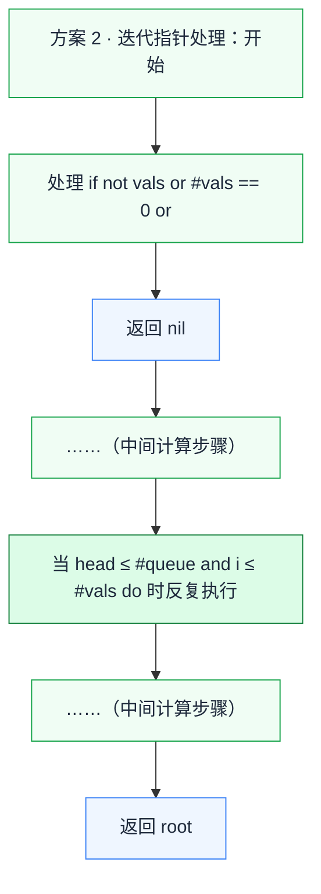

```lua
-- LeetCode 257. 二叉树的所有路径 — Lua 版（方案2）
local TreeNode = {} -- 把 {} 写入 local TreeNode
TreeNode.__index = TreeNode -- 把 TreeNode 写入 TreeNode.__index
function TreeNode.new(val) -- function TreeNode.new(值)
	return setmetatable({ val = val, left = nil, right = nil }, TreeNode)
end -- 终点

local function build_tree(vals) -- local function build_tree(vals)
	if not vals or #vals == 0 or vals[1] == "null" then
		return nil
	end
	local root = TreeNode.new(vals[1]) -- 把 TreeNode.new(vals[1]) 写入 local root
	local queue = { root } -- 把 {根节点} 写入 local queue
	local head = 1 -- 把 1 写入 local head
	local i = 2 -- 把 2 写入 local i
	while head <= #queue and i <= #vals do -- 把 #队列 and 下标 i 不超过 #vals do 写入 while head <
		local node = queue[head] -- 把 队列[头节点] 写入 local node
		head = head + 1 -- 把 头节点 加 1 存入 头节点
		if i <= #vals then -- 若 下标 i 不超过 #vals then
			if vals[i] ~= "null" then -- 若 vals[下标 i] ~ 赋值为 「null」 then
				node.left = TreeNode.new(vals[i]) -- 把 TreeNode.new(vals[下标 i]) 写入 左边界
				queue[#queue + 1] = node.left -- 把 节点.左边界 写入 queue[#queue + 1]
			end -- 终点
			i = i + 1 -- 把 下标 i 加 1 存入 下标 i
		end -- 终点
		if i <= #vals then -- 若 下标 i 不超过 #vals then
			if vals[i] ~= "null" then -- 若 vals[下标 i] ~ 赋值为 「null」 then
				node.right = TreeNode.new(vals[i]) -- 把 TreeNode.new(vals[下标 i]) 写入 右边界
				queue[#queue + 1] = node.right -- 把 节点.右边界 写入 queue[#queue + 1]
			end -- 终点
			i = i + 1 -- 把 下标 i 加 1 存入 下标 i
		end -- 终点
	end -- 终点
	return root -- 返回 根节点
end -- 终点

local function binary_tree_paths(root) -- local function binary_tree_paths(根节点)
	local paths = {} -- 把 {} 写入 local paths
	local function dfs(n, path) -- local function dfs(元素个数, 当前路径)
		if not n then
			return
		end -- 若 not 元素个数 then return 终点
		path = path .. n.val -- 把 当前路径 .. 元素个数.值 存入 当前路径
		if not n.left and not n.right then -- 若 not 元素个数.左边界 and not 元素个数.右边界 then
			paths[#paths + 1] = path -- 把 当前路径 写入 paths[#paths + 1]
		else -- 否则
			path = path .. "->" -- 把 当前路径 .. 「 减 超过 」 存入 当前路径
			dfs(n.left, path) -- dfs(元素个数.左边界, 当前路径)
			dfs(n.right, path) -- dfs(元素个数.右边界, 当前路径)
		end -- 终点
	end -- 终点
	dfs(root, "") -- dfs(根节点, 「」)
	return paths -- 返回 paths
end -- 终点
local a = binary_tree_paths(build_tree({ 1, 2, 3 })) -- 把 binary_tree_paths(build_tree({1, 2, 3})) 写入 local a
assert(#a == 2 and a[1] == "1->2" and a[2] == "1->3") -- 断言校验
local b = binary_tree_paths(build_tree({ 1 })) -- 把 binary_tree_paths(build_tree({1})) 写入 local b
assert(#b == 1 and b[1] == "1") -- 断言校验
assert(#binary_tree_paths(nil) == 0) -- 断言校验
print("PASS") -- 全部用例通过，输出 PASS
```

### C 实现（2 种方案）

C 的全部方案如下，每个方案都内嵌用例自测，可独立运行（老仓库 python/go 文件遵循「打印结果」约定）：

#### 方案 1：迭代指针处理

**思路与代码分析**：核心是「迭代指针处理」。C 版手动管理下标与内存，循环边界全部显式写出。**走读**：方案 1 · 迭代指针处理：开始 → 命中条件，直接返回 → 更新 *root → 当 (head ＜ tail 且 i ＜ n) 时反复执行 → 返回 root。

**运行架构**（真实控制流）：


```c
/* LeetCode 257. 二叉树的所有路径 — C 版（方案1） */
#include <stdio.h>                   // 引入头文件
#include <stdlib.h>                  // 引入头文件
#define INT_MIN_SN (-2147483647 - 1) // #define INT_MIN_SN ( 减 2147483647 减 1)

typedef struct TreeNode {   // typedef struct TreeNode {
    int val;                // int 值;
    struct TreeNode *left;  // 定义类型
    struct TreeNode *right; // 定义类型
} TreeNode;                 // } TreeNode;

static TreeNode *build_tree(const int *vals,
                            int n) { // static TreeNode 乘 build_tree(const int 乘 vals, int 元素个数) {
    if (n == 0 || vals[0] == INT_MIN_SN)
        return NULL; // 若 元素个数 等于 0 或 vals[0] 等于 INT_MIN_SN，直接返回 NULL
    TreeNode *root = malloc(sizeof(TreeNode)); // 把 malloc(sizeof(TreeNode)); 写入 TreeNode *root
    root->val = vals[0];
    root->left = root->right = NULL;
    TreeNode **queue =
        malloc(sizeof(TreeNode *) * n); // 把 malloc(sizeof(TreeNode 乘 ) 乘 元素个数); 写入 TreeNode **queue
    int head = 0, tail = 0, i = 1; // 把 0, 尾节点 赋值为 0, 下标 i 赋值为 1 存入 头节点
    queue[tail++] = root;          // 把 根节点; 写入 queue[tail++]
    while (head < tail && i < n) { // 循环，直到不满足「头节点 小于 尾节点 且 下标 i 小于 元素个数」
        TreeNode *node = queue[head++];                // 把 队列[头节点 加一 ]; 写入 TreeNode *node
        if (i < n) {                                   // 若 下标 i 小于 元素个数
            if (vals[i] != INT_MIN_SN) {               // 若 vals[下标 i] 不等于 INT_MIN_SN
                node->left = malloc(sizeof(TreeNode)); // 把 malloc(sizeof(TreeNode)); 写入 node->left
                node->left->val = vals[i];
                node->left->left = node->left->right = NULL;
                queue[tail++] = node->left; // 把 节点 减 超过 左边界; 写入 queue[tail++]
            }
            i++; // 下标 i 加一
        }
        if (i < n) {                                    // 若 下标 i 小于 元素个数
            if (vals[i] != INT_MIN_SN) {                // 若 vals[下标 i] 不等于 INT_MIN_SN
                node->right = malloc(sizeof(TreeNode)); // 把 malloc(sizeof(TreeNode)); 写入 node->right
                node->right->val = vals[i];
                node->right->left = node->right->right = NULL;
                queue[tail++] = node->right; // 把 节点 减 超过 右边界; 写入 queue[tail++]
            }
            i++; // 下标 i 加一
        }
    }
    free(queue); // free(队列);
    return root; // 返回 根节点
}

static void free_tree(TreeNode *n) { // 定义函数/方法 free_tree
    if (!n)
        return;          // 若 取反 元素个数) return;
    free_tree(n->left);  // free_tree(元素个数 减 超过 左边界);
    free_tree(n->right); // free_tree(元素个数 减 超过 右边界);
    free(n);             // free(元素个数);
}

#include <string.h>                                                           // 引入头文件
static void dfs_paths(TreeNode *n, char *path, char (*paths)[64], int *cnt) { // 定义函数/方法 dfs_paths
    if (!n)
        return;                                       // 若 取反 元素个数) return;
    char buf[64];                                     // char buf[64];
    snprintf(buf, sizeof(buf), "%s%d", path, n->val); // 打印输出
    if (!n->left && !n->right) { // 若 取反 元素个数 减 超过 左边界 且 取反 元素个数 减 超过 右边界
        snprintf(paths[(*cnt)++], 64, "%s", buf); // 打印输出
        return;                                   // return;
    }
    strcat(buf, "->");                    // 打印输出
    dfs_paths(n->left, buf, paths, cnt);  // dfs_paths(元素个数 减 超过 左边界, buf, paths, 计数);
    dfs_paths(n->right, buf, paths, cnt); // dfs_paths(元素个数 减 超过 右边界, buf, paths, 计数);
}
static int binary_tree_paths(TreeNode *root, char (*paths)[64]) { // 定义函数/方法 binary_tree_paths
    int cnt = 0;                                                  // 把 0 存入 计数
    dfs_paths(root, "", paths, &cnt); // dfs_paths(根节点, 「」, paths, 按位与 计数);
    return cnt;                       // 返回 计数
}
int main(void) {        // 程序入口：跑内嵌自测用例
    char paths[64][64]; // char paths[64][64];
    int n = binary_tree_paths(build_tree((int[]){1, 2, 3}, 3), paths);
    if (n != 2 || strcmp(paths[0], "1->2") != 0 || strcmp(paths[1], "1->3") != 0) {
        printf("FAIL 1\n");
        return 1;
    }
    n = binary_tree_paths(build_tree((int[]){1}, 1), paths);
    if (n != 1 || strcmp(paths[0], "1") != 0) {
        printf("FAIL 2\n");
        return 1;
    }
    if (binary_tree_paths(NULL, paths) != 0) {
        printf("FAIL 3\n");
        return 1;
    }
    printf("PASS\n"); // 全部用例通过，输出 PASS
    return 0;         // 返回 0
}
```

#### 方案 2：迭代指针处理

**思路与代码分析**：核心是「迭代指针处理」。C 版手动管理下标与内存，循环边界全部显式写出。**走读**：方案 2 · 迭代指针处理：开始 → 命中条件，直接返回 → 更新 *root → 当 (head ＜ tail 且 i ＜ n) 时反复执行 → 返回 root。

**运行架构**（真实控制流）：

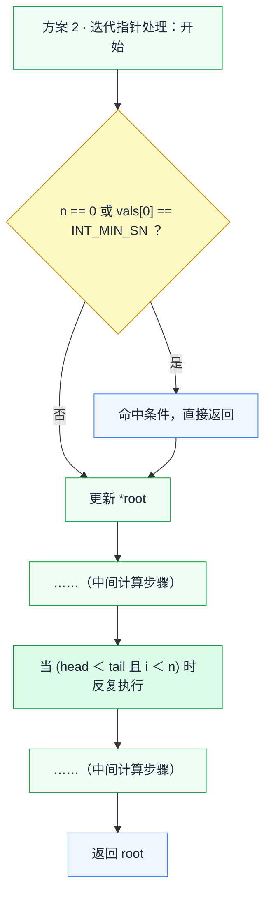

```c
/* LeetCode 257. 二叉树的所有路径 — C 版（方案2） */
#include <stdio.h>                   // 引入头文件
#include <stdlib.h>                  // 引入头文件
#define INT_MIN_SN (-2147483647 - 1) // #define INT_MIN_SN ( 减 2147483647 减 1)

typedef struct TreeNode {   // typedef struct TreeNode {
    int val;                // int 值;
    struct TreeNode *left;  // 定义类型
    struct TreeNode *right; // 定义类型
} TreeNode;                 // } TreeNode;

static TreeNode *build_tree(const int *vals,
                            int n) { // static TreeNode 乘 build_tree(const int 乘 vals, int 元素个数) {
    if (n == 0 || vals[0] == INT_MIN_SN)
        return NULL; // 若 元素个数 等于 0 或 vals[0] 等于 INT_MIN_SN，直接返回 NULL
    TreeNode *root = malloc(sizeof(TreeNode)); // 把 malloc(sizeof(TreeNode)); 写入 TreeNode *root
    root->val = vals[0];
    root->left = root->right = NULL;
    TreeNode **queue =
        malloc(sizeof(TreeNode *) * n); // 把 malloc(sizeof(TreeNode 乘 ) 乘 元素个数); 写入 TreeNode **queue
    int head = 0, tail = 0, i = 1; // 把 0, 尾节点 赋值为 0, 下标 i 赋值为 1 存入 头节点
    queue[tail++] = root;          // 把 根节点; 写入 queue[tail++]
    while (head < tail && i < n) { // 循环，直到不满足「头节点 小于 尾节点 且 下标 i 小于 元素个数」
        TreeNode *node = queue[head++];                // 把 队列[头节点 加一 ]; 写入 TreeNode *node
        if (i < n) {                                   // 若 下标 i 小于 元素个数
            if (vals[i] != INT_MIN_SN) {               // 若 vals[下标 i] 不等于 INT_MIN_SN
                node->left = malloc(sizeof(TreeNode)); // 把 malloc(sizeof(TreeNode)); 写入 node->left
                node->left->val = vals[i];
                node->left->left = node->left->right = NULL;
                queue[tail++] = node->left; // 把 节点 减 超过 左边界; 写入 queue[tail++]
            }
            i++; // 下标 i 加一
        }
        if (i < n) {                                    // 若 下标 i 小于 元素个数
            if (vals[i] != INT_MIN_SN) {                // 若 vals[下标 i] 不等于 INT_MIN_SN
                node->right = malloc(sizeof(TreeNode)); // 把 malloc(sizeof(TreeNode)); 写入 node->right
                node->right->val = vals[i];
                node->right->left = node->right->right = NULL;
                queue[tail++] = node->right; // 把 节点 减 超过 右边界; 写入 queue[tail++]
            }
            i++; // 下标 i 加一
        }
    }
    free(queue); // free(队列);
    return root; // 返回 根节点
}

static void free_tree(TreeNode *n) { // 定义函数/方法 free_tree
    if (!n)
        return;          // 若 取反 元素个数) return;
    free_tree(n->left);  // free_tree(元素个数 减 超过 左边界);
    free_tree(n->right); // free_tree(元素个数 减 超过 右边界);
    free(n);             // free(元素个数);
}

#include <string.h>                                                           // 引入头文件
static void dfs_paths(TreeNode *n, char *path, char (*paths)[64], int *cnt) { // 定义函数/方法 dfs_paths
    if (!n)
        return;                                       // 若 取反 元素个数) return;
    char buf[64];                                     // char buf[64];
    snprintf(buf, sizeof(buf), "%s%d", path, n->val); // 打印输出
    if (!n->left && !n->right) { // 若 取反 元素个数 减 超过 左边界 且 取反 元素个数 减 超过 右边界
        snprintf(paths[(*cnt)++], 64, "%s", buf); // 打印输出
        return;                                   // return;
    }
    strcat(buf, "->");                    // 打印输出
    dfs_paths(n->left, buf, paths, cnt);  // dfs_paths(元素个数 减 超过 左边界, buf, paths, 计数);
    dfs_paths(n->right, buf, paths, cnt); // dfs_paths(元素个数 减 超过 右边界, buf, paths, 计数);
}
static int binary_tree_paths(TreeNode *root, char (*paths)[64]) { // 定义函数/方法 binary_tree_paths
    int cnt = 0;                                                  // 把 0 存入 计数
    dfs_paths(root, "", paths, &cnt); // dfs_paths(根节点, 「」, paths, 按位与 计数);
    return cnt;                       // 返回 计数
}
int main(void) {        // 程序入口：跑内嵌自测用例
    char paths[64][64]; // char paths[64][64];
    int n = binary_tree_paths(build_tree((int[]){1, 2, 3}, 3), paths);
    if (n != 2 || strcmp(paths[0], "1->2") != 0 || strcmp(paths[1], "1->3") != 0) {
        printf("FAIL 1\n");
        return 1;
    }
    n = binary_tree_paths(build_tree((int[]){1}, 1), paths);
    if (n != 1 || strcmp(paths[0], "1") != 0) {
        printf("FAIL 2\n");
        return 1;
    }
    if (binary_tree_paths(NULL, paths) != 0) {
        printf("FAIL 3\n");
        return 1;
    }
    printf("PASS\n"); // 全部用例通过，输出 PASS
    return 0;         // 返回 0
}
```

### C++ 实现（2 种方案）

C++ 的全部方案如下，每个方案都内嵌用例自测，可独立运行（老仓库 python/go 文件遵循「打印结果」约定）：

#### 方案 1：迭代指针处理

**思路与代码分析**：核心是「迭代指针处理」。C++ 版用 STL 容器与迭代器，减少手写下标错误。**走读**：方案 1 · 迭代指针处理：开始 → 处理 std::vector＜std::string＞ pat → 更新 dfs → 命中条件，直接返回 → 更新 + → 若 非 n-＞left 且 非 n-＞right 则： → 调用 paths.push_back(path) → 返回  → 更新 + → 调用 dfs(n-＞left, path) → 调用 dfs(n-＞right, path) → 调用 dfs(root, ) → 返回 paths。

**运行架构**（真实控制流）：

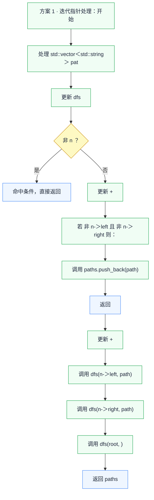

```cpp
// LeetCode 257. 二叉树的所有路径 — C++ 版（方案1）
#include <cassert>  // 引入头文件
#include <cstdint>  // 引入头文件
#include <iostream> // 引入头文件
#include <optional> // 引入头文件
#include <queue>    // 引入头文件
#include <vector>   // 引入头文件

struct TreeNode {    // 定义类型
    int val;         // int 值;
    TreeNode *left;  // TreeNode 乘 左边界;
    TreeNode *right; // TreeNode 乘 右边界;
    explicit TreeNode(int v) : val(v), left(nullptr), right(nullptr) {}
};

static TreeNode *build_tree(const std::vector<std::optional<int>> &vals) {
    if (vals.empty() || !vals[0].has_value())
        return nullptr; // 若 vals 是否为空 或 取反 vals[0].has_value()，直接返回 nullptr
    auto *root = new TreeNode(*vals[0]); // 把 new TreeNode( 乘 vals[0]); 写入 auto *root
    std::queue<TreeNode *> q;            // std::队列 小于 TreeNode 乘 超过 节点;
    q.push(root);                        // 把 根节点 压入栈/数组尾部
    size_t i = 1;                        // 把 1; 写入 size_t i
    while (!q.empty() &&
           i < vals.size()) { // 循环，直到不满足「取反 节点 是否为空 且 下标 i 小于 vals.大小(」
        TreeNode *node = q.front();                  // 把 节点.front(); 写入 TreeNode *node
        q.pop();                                     // 弹出栈顶元素
        if (i < vals.size()) {                       // 若 下标 i 小于 vals.大小(
            if (vals[i].has_value()) {               // 若 vals[下标 i].has_value(
                node->left = new TreeNode(*vals[i]); // 把 new TreeNode( 乘 vals[下标 i]); 写入 node->left
                q.push(node->left);                  // 把 节点 减 超过 左边界 压入栈/数组尾部
            }
            ++i; // 加一 下标 i;
        }
        if (i < vals.size()) {                        // 若 下标 i 小于 vals.大小(
            if (vals[i].has_value()) {                // 若 vals[下标 i].has_value(
                node->right = new TreeNode(*vals[i]); // 把 new TreeNode( 乘 vals[下标 i]); 写入 node->right
                q.push(node->right); // 把 节点 减 超过 右边界 压入栈/数组尾部
            }
            ++i; // 加一 下标 i;
        }
    }
    return root; // 返回 根节点
}

static void free_tree(TreeNode *n) { // 定义函数/方法 free_tree
    if (!n)
        return;          // 若 取反 元素个数) return;
    free_tree(n->left);  // free_tree(元素个数 减 超过 左边界);
    free_tree(n->right); // free_tree(元素个数 减 超过 右边界);
    delete n;            // delete 元素个数;
}

static std::vector<std::string> binaryTreePaths(TreeNode *root) {
    std::vector<std::string> paths; // std::vector 小于 std::string 超过 paths;
    std::function<void(TreeNode *, std::string)> dfs = [&](TreeNode *n, std::string path) {
        if (!n)
            return;                     // 若 取反 元素个数) return;
        path += std::to_string(n->val); // 当前路径累加 std::to_string(元素个数 减 超过 值)
        if (!n->left && !n->right) { // 若 取反 元素个数 减 超过 左边界 且 取反 元素个数 减 超过 右边界
            paths.push_back(path); // paths 追加 当前路径);
            return;                // return;
        }
        path += "->";        // 当前路径累加 「 减 超过 」
        dfs(n->left, path);  // dfs(元素个数 减 超过 左边界, 当前路径);
        dfs(n->right, path); // dfs(元素个数 减 超过 右边界, 当前路径);
    };
    dfs(root, ""); // dfs(根节点, 「」);
    return paths;  // 返回 paths
}
int main() { // 程序入口：跑内嵌自测用例
    assert((binaryTreePaths(build_tree({1, 2, 3})) == std::vector<std::string>{"1->2", "1->3"})); // 断言校验
    assert((binaryTreePaths(build_tree({1})) == std::vector<std::string>{"1"})); // 断言校验
    assert(binaryTreePaths(nullptr).empty());                                    // 断言校验
    std::cout << "PASS" << std::endl; // 全部用例通过，输出 PASS
    return 0;                         // 返回 0
}
```

#### 方案 2：迭代指针处理

**思路与代码分析**：核心是「迭代指针处理」。C++ 版用 STL 容器与迭代器，减少手写下标错误。**走读**：方案 2 · 迭代指针处理：开始 → 处理 std::vector＜std::string＞ pat → 更新 dfs → 命中条件，直接返回 → 更新 + → 若 非 n-＞left 且 非 n-＞right 则： → 调用 paths.push_back(path) → 返回  → 更新 + → 调用 dfs(n-＞left, path) → 调用 dfs(n-＞right, path) → 调用 dfs(root, ) → 返回 paths。

**运行架构**（真实控制流）：


```cpp
// LeetCode 257. 二叉树的所有路径 — C++ 版（方案2）
#include <cassert>  // 引入头文件
#include <cstdint>  // 引入头文件
#include <iostream> // 引入头文件
#include <optional> // 引入头文件
#include <queue>    // 引入头文件
#include <vector>   // 引入头文件

struct TreeNode {    // 定义类型
    int val;         // int 值;
    TreeNode *left;  // TreeNode 乘 左边界;
    TreeNode *right; // TreeNode 乘 右边界;
    explicit TreeNode(int v) : val(v), left(nullptr), right(nullptr) {}
};

static TreeNode *build_tree(const std::vector<std::optional<int>> &vals) {
    if (vals.empty() || !vals[0].has_value())
        return nullptr; // 若 vals 是否为空 或 取反 vals[0].has_value()，直接返回 nullptr
    auto *root = new TreeNode(*vals[0]); // 把 new TreeNode( 乘 vals[0]); 写入 auto *root
    std::queue<TreeNode *> q;            // std::队列 小于 TreeNode 乘 超过 节点;
    q.push(root);                        // 把 根节点 压入栈/数组尾部
    size_t i = 1;                        // 把 1; 写入 size_t i
    while (!q.empty() &&
           i < vals.size()) { // 循环，直到不满足「取反 节点 是否为空 且 下标 i 小于 vals.大小(」
        TreeNode *node = q.front();                  // 把 节点.front(); 写入 TreeNode *node
        q.pop();                                     // 弹出栈顶元素
        if (i < vals.size()) {                       // 若 下标 i 小于 vals.大小(
            if (vals[i].has_value()) {               // 若 vals[下标 i].has_value(
                node->left = new TreeNode(*vals[i]); // 把 new TreeNode( 乘 vals[下标 i]); 写入 node->left
                q.push(node->left);                  // 把 节点 减 超过 左边界 压入栈/数组尾部
            }
            ++i; // 加一 下标 i;
        }
        if (i < vals.size()) {                        // 若 下标 i 小于 vals.大小(
            if (vals[i].has_value()) {                // 若 vals[下标 i].has_value(
                node->right = new TreeNode(*vals[i]); // 把 new TreeNode( 乘 vals[下标 i]); 写入 node->right
                q.push(node->right); // 把 节点 减 超过 右边界 压入栈/数组尾部
            }
            ++i; // 加一 下标 i;
        }
    }
    return root; // 返回 根节点
}

static void free_tree(TreeNode *n) { // 定义函数/方法 free_tree
    if (!n)
        return;          // 若 取反 元素个数) return;
    free_tree(n->left);  // free_tree(元素个数 减 超过 左边界);
    free_tree(n->right); // free_tree(元素个数 减 超过 右边界);
    delete n;            // delete 元素个数;
}

static std::vector<std::string> binaryTreePaths(TreeNode *root) {
    std::vector<std::string> paths; // std::vector 小于 std::string 超过 paths;
    std::function<void(TreeNode *, std::string)> dfs = [&](TreeNode *n, std::string path) {
        if (!n)
            return;                     // 若 取反 元素个数) return;
        path += std::to_string(n->val); // 当前路径累加 std::to_string(元素个数 减 超过 值)
        if (!n->left && !n->right) { // 若 取反 元素个数 减 超过 左边界 且 取反 元素个数 减 超过 右边界
            paths.push_back(path); // paths 追加 当前路径);
            return;                // return;
        }
        path += "->";        // 当前路径累加 「 减 超过 」
        dfs(n->left, path);  // dfs(元素个数 减 超过 左边界, 当前路径);
        dfs(n->right, path); // dfs(元素个数 减 超过 右边界, 当前路径);
    };
    dfs(root, ""); // dfs(根节点, 「」);
    return paths;  // 返回 paths
}
int main() { // 程序入口：跑内嵌自测用例
    assert((binaryTreePaths(build_tree({1, 2, 3})) == std::vector<std::string>{"1->2", "1->3"})); // 断言校验
    assert((binaryTreePaths(build_tree({1})) == std::vector<std::string>{"1"})); // 断言校验
    assert(binaryTreePaths(nullptr).empty());                                    // 断言校验
    std::cout << "PASS" << std::endl; // 全部用例通过，输出 PASS
    return 0;                         // 返回 0
}
```

### R 实现（2 种方案）

R 的全部方案如下，每个方案都内嵌用例自测，可独立运行（老仓库 python/go 文件遵循「打印结果」约定）：

#### 方案 1：迭代指针处理

**思路与代码分析**：核心是「迭代指针处理」。R 版用向量化思维与 1 起始下标，注意 1:n 的降序陷阱。**走读**：方案 1 · 迭代指针处理：开始 → 更新 new.env(parent → 处理 e$val ＜- val → 处理 e$left ＜- left → 处理 e$right ＜- right → 调用 class(e) ＜- TreeNode → 处理 e → 返回结果。

**运行架构**（真实控制流）：

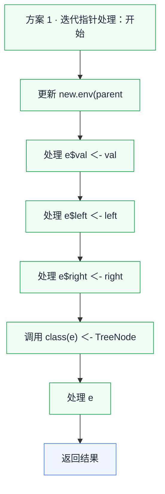

```r
# 版（方案1） 树节点：R 必须 environment 引用语义（list 是值语义） 定义函数 TreeNode（参数：值, 左边界 赋值为
# NULL, 右边界 赋值为 NULL）
TreeNode <- function(val, left = NULL, right = NULL) {
    e <- new.env(parent = emptyenv())  # 把 new.env(parent 赋值为 emptyenv()) 存入 e
    e$val <- val
    e$left <- left
    e$right <- right  # 把 值; e$左边界 小于 减 左边界; e$右边界 小于 减 右边界 存入 e$val
    class(e) <- "TreeNode"  # 把 「TreeNode」 存入 class(e)
    e
}
build_tree <- function(vals) {
    # 定义函数 build_tree（参数：vals）
    if (length(vals) == 0 || is.na(vals[[1]]))
        return(NULL)  # 若 长度(vals) 等于 0 或 is.na(vals[[1]])) return(NULL
    root <- TreeNode(vals[[1]])  # 把 TreeNode(vals[[1]]) 存入 根节点
    queue <- list(root)  # 把 列表(根节点) 存入 队列
    head <- 1L  # 把 1L 存入 头节点
    i <- 2L  # 把 2L 存入 下标 i
    while (head <= length(queue) && i <= length(vals)) {
        # 循环，直到不满足「头节点 不超过 长度(队列) 且 下标 i 不超过 长度(vals」
        node <- queue[[head]]  # 把 队列[[头节点]] 存入 节点
        head <- head + 1L  # 把 头节点 加 1L 存入 头节点
        if (i <= length(vals)) {
            # 若 下标 i 不超过 长度(vals 若 取反 is.na(vals[[下标 i]]
            if (!is.na(vals[[i]])) {
                node$left <- TreeNode(vals[[i]])  # 把 TreeNode(vals[[下标 i]]) 存入 node$left
                queue[[length(queue) + 1L]] <- node$left  # 队列[[长度(队列) 加 1L]] 小于 减 节点$左边界
            }
            i <- i + 1L  # 把 下标 i 加 1L 存入 下标 i
        }
        if (i <= length(vals)) {
            # 若 下标 i 不超过 长度(vals 若 取反 is.na(vals[[下标 i]]
            if (!is.na(vals[[i]])) {
                node$right <- TreeNode(vals[[i]])  # 把 TreeNode(vals[[下标 i]]) 存入 node$right
                queue[[length(queue) + 1L]] <- node$right  # 队列[[长度(队列) 加 1L]] 小于 减 节点$右边界
            }
            i <- i + 1L  # 把 下标 i 加 1L 存入 下标 i
        }
    }
    root  # 根节点
}
# 层序转列表（用于断言输出） 定义函数 tree_to_levels（参数：根节点）
tree_to_levels <- function(root) {
    if (is.null(root))
        return(list())  # 若 is.null(根节点)) return(列表(
    res <- list()  # 把 列表() 存入 结果
    level <- list(root)  # 把 列表(根节点) 存入 level
    while (length(level) > 0) {
        # 循环，直到不满足「长度(level) 超过 0」
        vals <- list()
        nxt <- list()  # 把 列表(); nxt 小于 减 列表() 存入 vals
        for (nd in level) {
            # for (nd in level) {
            vals[[length(vals) + 1L]] <- nd$val  # vals[[长度(vals) 加 1L]] 小于 减 nd$值
            if (!is.null(nd$left))
                nxt[[length(nxt) + 1L]] <- nd$left  # 若 取反 is.null(nd$左边界)) nxt[[长度(nxt) 加 1L]] 小于 减 nd$左边界
            if (!is.null(nd$right))
                nxt[[length(nxt) + 1L]] <- nd$right  # 若 取反 is.null(nd$右边界)) nxt[[长度(nxt) 加 1L]] 小于 减 nd$右边界
        }
        res[[length(res) + 1L]] <- unlist(vals)  # 结果[[长度(结果) 加 1L]] 小于 减 unlist(vals)
        level <- nxt  # 把 nxt 存入 level
    }
    res  # 结果
}
binary_tree_paths <- function(root) {
    # 定义函数 binary_tree_paths（参数：根节点）
    paths <- character(0)  # 把 character(0) 存入 paths
    dfs <- function(n, path) {
        # 定义函数 dfs（参数：元素个数, 当前路径）
        if (is.null(n))
            return(invisible(NULL))  # 若 is.null(元素个数)) return(invisible(NULL
        path <- paste0(path, n$val)  # 把 paste0(当前路径, 元素个数$值) 存入 当前路径
        if (is.null(n$left) && is.null(n$right)) {
            # 若 is.null(元素个数$左边界) 且 is.null(元素个数$右边界
            paths[[length(paths) + 1L]] <<- path  # paths[[长度(paths) 加 1L]] 小于 小于 减 当前路径
            return(invisible(NULL))  # 返回 invisible(NULL
        }
        path <- paste0(path, "->")  # 把 paste0(当前路径, 「 减 超过 」) 存入 当前路径
        dfs(n$left, path)  # dfs(元素个数$左边界, 当前路径)
        dfs(n$right, path)  # dfs(元素个数$右边界, 当前路径)
    }
    dfs(root, "")  # dfs(根节点, 「」)
    paths  # paths
}
stopifnot(identical(binary_tree_paths(build_tree(list(1L, 2L, 3L))), c("1->2", "1->3")))  # 断言校验
stopifnot(identical(binary_tree_paths(build_tree(list(1L))), "1"))  # 断言校验
stopifnot(length(binary_tree_paths(NULL)) == 0L)  # 断言校验
cat("PASS\n")  # 全部用例通过，输出 PASS
```

#### 方案 2：迭代指针处理

**思路与代码分析**：核心是「迭代指针处理」。R 版用向量化思维与 1 起始下标，注意 1:n 的降序陷阱。**走读**：方案 2 · 迭代指针处理：开始 → 更新 new.env(parent → 处理 e$val ＜- val → 处理 e$left ＜- left → 处理 e$right ＜- right → 调用 class(e) ＜- TreeNode → 处理 e → 返回结果。

**运行架构**（真实控制流）：

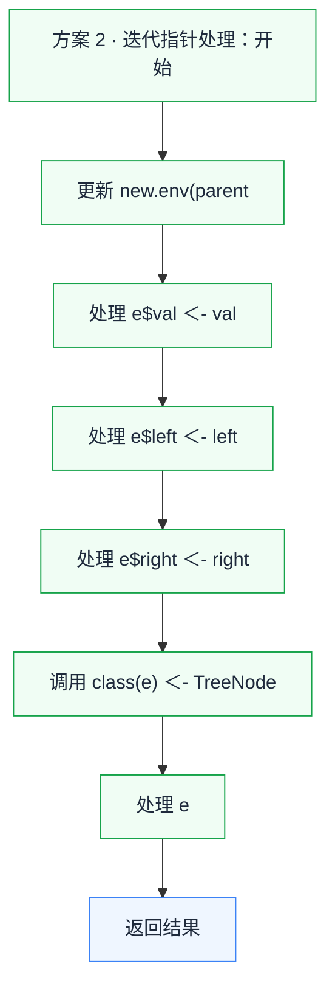

```r
# 版（方案2） 树节点：R 必须 environment 引用语义（list 是值语义） 定义函数 TreeNode（参数：值, 左边界 赋值为
# NULL, 右边界 赋值为 NULL）
TreeNode <- function(val, left = NULL, right = NULL) {
    e <- new.env(parent = emptyenv())  # 把 new.env(parent 赋值为 emptyenv()) 存入 e
    e$val <- val
    e$left <- left
    e$right <- right  # 把 值; e$左边界 小于 减 左边界; e$右边界 小于 减 右边界 存入 e$val
    class(e) <- "TreeNode"  # 把 「TreeNode」 存入 class(e)
    e
}
build_tree <- function(vals) {
    # 定义函数 build_tree（参数：vals）
    if (length(vals) == 0 || is.na(vals[[1]]))
        return(NULL)  # 若 长度(vals) 等于 0 或 is.na(vals[[1]])) return(NULL
    root <- TreeNode(vals[[1]])  # 把 TreeNode(vals[[1]]) 存入 根节点
    queue <- list(root)  # 把 列表(根节点) 存入 队列
    head <- 1L  # 把 1L 存入 头节点
    i <- 2L  # 把 2L 存入 下标 i
    while (head <= length(queue) && i <= length(vals)) {
        # 循环，直到不满足「头节点 不超过 长度(队列) 且 下标 i 不超过 长度(vals」
        node <- queue[[head]]  # 把 队列[[头节点]] 存入 节点
        head <- head + 1L  # 把 头节点 加 1L 存入 头节点
        if (i <= length(vals)) {
            # 若 下标 i 不超过 长度(vals 若 取反 is.na(vals[[下标 i]]
            if (!is.na(vals[[i]])) {
                node$left <- TreeNode(vals[[i]])  # 把 TreeNode(vals[[下标 i]]) 存入 node$left
                queue[[length(queue) + 1L]] <- node$left  # 队列[[长度(队列) 加 1L]] 小于 减 节点$左边界
            }
            i <- i + 1L  # 把 下标 i 加 1L 存入 下标 i
        }
        if (i <= length(vals)) {
            # 若 下标 i 不超过 长度(vals 若 取反 is.na(vals[[下标 i]]
            if (!is.na(vals[[i]])) {
                node$right <- TreeNode(vals[[i]])  # 把 TreeNode(vals[[下标 i]]) 存入 node$right
                queue[[length(queue) + 1L]] <- node$right  # 队列[[长度(队列) 加 1L]] 小于 减 节点$右边界
            }
            i <- i + 1L  # 把 下标 i 加 1L 存入 下标 i
        }
    }
    root  # 根节点
}
# 层序转列表（用于断言输出） 定义函数 tree_to_levels（参数：根节点）
tree_to_levels <- function(root) {
    if (is.null(root))
        return(list())  # 若 is.null(根节点)) return(列表(
    res <- list()  # 把 列表() 存入 结果
    level <- list(root)  # 把 列表(根节点) 存入 level
    while (length(level) > 0) {
        # 循环，直到不满足「长度(level) 超过 0」
        vals <- list()
        nxt <- list()  # 把 列表(); nxt 小于 减 列表() 存入 vals
        for (nd in level) {
            # for (nd in level) {
            vals[[length(vals) + 1L]] <- nd$val  # vals[[长度(vals) 加 1L]] 小于 减 nd$值
            if (!is.null(nd$left))
                nxt[[length(nxt) + 1L]] <- nd$left  # 若 取反 is.null(nd$左边界)) nxt[[长度(nxt) 加 1L]] 小于 减 nd$左边界
            if (!is.null(nd$right))
                nxt[[length(nxt) + 1L]] <- nd$right  # 若 取反 is.null(nd$右边界)) nxt[[长度(nxt) 加 1L]] 小于 减 nd$右边界
        }
        res[[length(res) + 1L]] <- unlist(vals)  # 结果[[长度(结果) 加 1L]] 小于 减 unlist(vals)
        level <- nxt  # 把 nxt 存入 level
    }
    res  # 结果
}
binary_tree_paths <- function(root) {
    # 定义函数 binary_tree_paths（参数：根节点）
    paths <- character(0)  # 把 character(0) 存入 paths
    dfs <- function(n, path) {
        # 定义函数 dfs（参数：元素个数, 当前路径）
        if (is.null(n))
            return(invisible(NULL))  # 若 is.null(元素个数)) return(invisible(NULL
        path <- paste0(path, n$val)  # 把 paste0(当前路径, 元素个数$值) 存入 当前路径
        if (is.null(n$left) && is.null(n$right)) {
            # 若 is.null(元素个数$左边界) 且 is.null(元素个数$右边界
            paths[[length(paths) + 1L]] <<- path  # paths[[长度(paths) 加 1L]] 小于 小于 减 当前路径
            return(invisible(NULL))  # 返回 invisible(NULL
        }
        path <- paste0(path, "->")  # 把 paste0(当前路径, 「 减 超过 」) 存入 当前路径
        dfs(n$left, path)  # dfs(元素个数$左边界, 当前路径)
        dfs(n$right, path)  # dfs(元素个数$右边界, 当前路径)
    }
    dfs(root, "")  # dfs(根节点, 「」)
    paths  # paths
}
stopifnot(identical(binary_tree_paths(build_tree(list(1L, 2L, 3L))), c("1->2", "1->3")))  # 断言校验
stopifnot(identical(binary_tree_paths(build_tree(list(1L))), "1"))  # 断言校验
stopifnot(length(binary_tree_paths(NULL)) == 0L)  # 断言校验
cat("PASS\n")  # 全部用例通过，输出 PASS
```

### Zig 实现（2 种方案）

Zig 的全部方案如下，每个方案都内嵌用例自测，可独立运行（老仓库 python/go 文件遵循「打印结果」约定）：

#### 方案 1：迭代指针处理

**思路与代码分析**：核心是「迭代指针处理」。Zig 版显式分配与清零，整型边界处理严格。**走读**：方案 1 · 迭代指针处理：开始 → 计算 paths → 计算 D → 计算 node → 计算 buf → 调用 buf.appendSlice(path) catch → 调用 buf.writer().print( → 若 node.left == null and node.right == null 则： → 向 out 追加记录 → 返回  → 调用 buf.appendSlice(-＞) catch → 计算 p2 → 调用 dfs(node.left, p2, out, a) → 调用 dfs(node.right, buf.toOwnedS → 调用 D.dfs(root, , &paths, allo → 返回 paths。

**运行架构**（真实控制流）：

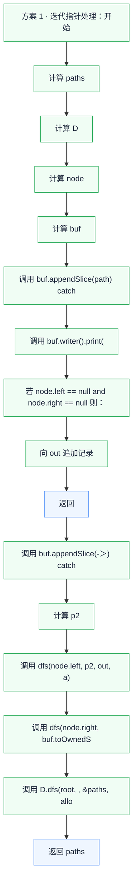

```zig
// LeetCode 257. 二叉树的所有路径 — Zig 版（方案1）
const std = @import("std"); // 把 @import(「std」) 存入 std

const TreeNode = struct { // 把 struct { 存入 TreeNode
    val: i32,
    left: ?*TreeNode,
    right: ?*TreeNode,
};

fn buildTree(allocator: std.mem.Allocator, vals: []const i32) !?*TreeNode { // 定义函数/方法 buildTree
    if (vals.len == 0 or vals[0] == -1) return null; // 若 vals.长度 等于 0 or vals[0] 等于 减 1，直接返回 null
    const root = try allocator.create(TreeNode); // 把 try allocator.create(TreeNode) 存入 根节点
    root.* = .{ .val = vals[0], .left = null, .right = null };
    var queue = std.ArrayList(*TreeNode).init(allocator); // 把 std.ArrayList( 乘 TreeNode).init(allocator) 存入 队列
    defer queue.deinit(); // defer 队列.deinit();
    try queue.append(root); // 把 根节点 追加到列表尾部
    var head: usize = 0; // 把 0; 写入 var head: usize
    var i: usize = 1; // 把 1; 写入 var i: usize
    while (head < queue.items.len and i < vals.len) { // 循环，直到不满足「头节点 小于 队列.items.长度 and 下标 i 小于 vals.长度」
        const node = queue.items[head]; // 把 队列.items[头节点] 存入 节点
        head += 1; // 头节点累加 1
        if (i < vals.len) { // 若 下标 i 小于 vals.长度
            if (vals[i] != -1) { // 若 vals[下标 i] 不等于 减 1
                const child = try allocator.create(TreeNode); // 把 try allocator.create(TreeNode) 存入 子节点
                child.* = .{ .val = vals[i], .left = null, .right = null };
                node.left = child; // 把 子节点; 写入 左边界
                try queue.append(child); // 把 子节点 追加到列表尾部
            }
            i += 1; // 下标 i累加 1
        }
        if (i < vals.len) { // 若 下标 i 小于 vals.长度
            if (vals[i] != -1) { // 若 vals[下标 i] 不等于 减 1
                const child = try allocator.create(TreeNode); // 把 try allocator.create(TreeNode) 存入 子节点
                child.* = .{ .val = vals[i], .left = null, .right = null };
                node.right = child; // 把 子节点; 写入 右边界
                try queue.append(child); // 把 子节点 追加到列表尾部
            }
            i += 1; // 下标 i累加 1
        }
    }
    return root; // 返回 根节点
}

fn binaryTreePaths(root: ?*TreeNode, alloc: std.mem.Allocator) std.ArrayList([]const u8) { // 定义函数/方法 binaryTreePaths
    var paths = std.ArrayList([]const u8).init(alloc); // 把 std.ArrayList([]const u8).init(alloc) 存入 paths
    const D = struct { // 把 struct { 存入 D
        fn dfs(n: ?*TreeNode, path: []const u8, out: *std.ArrayList([]const u8), a: std.mem.Allocator) void { // 定义函数/方法 dfs
            const node = n orelse return; // 把 元素个数 orelse return 存入 节点
            var buf = std.ArrayList(u8).init(a); // 把 std.ArrayList(u8).init(数组) 存入 buf
            buf.appendSlice(path) catch unreachable; // buf.appendSlice(当前路径) catch unreachable;
            buf.writer().print("{d}", .{node.val}) catch unreachable; // 打印输出
            if (node.left == null and node.right == null) { // 若 节点.左边界 等于 null and 节点.右边界 等于 null
                out.append(buf.toOwnedSlice() catch unreachable) catch unreachable; // 把 buf.toOwnedSlice( 追加到列表尾部
                return; // return;
            }
            buf.appendSlice("->") catch unreachable; // buf.appendSlice(「 减 超过 」) catch unreachable;
            const p2 = a.dupe(u8, buf.items) catch unreachable; // 把 数组.dupe(u8, buf.items) catch unreachable 存入 p2
            dfs(node.left, p2, out, a); // dfs(节点.左边界, p2, out, 数组);
            dfs(node.right, buf.toOwnedSlice() catch unreachable, out, a); // dfs(节点.右边界, buf.toOwnedSlice() catch unreachable, out, 数组);
        }
    };
    D.dfs(root, "", &paths, alloc); // D.dfs(根节点, 「」, 按位与 paths, alloc);
    return paths; // 返回 paths
}
pub fn main() !void { // 程序入口：跑内嵌自测用例
    var arena = std.heap.ArenaAllocator.init(std.heap.page_allocator); // 把 std.堆.ArenaAllocator.init(std.堆.page_allocator) 存入 arena
    defer arena.deinit(); // defer arena.deinit();
    const alloc = arena.allocator(); // 把 arena.allocator() 存入 alloc
    var paths = binaryTreePaths(try buildTree(alloc, &[_]i32{ 1, 2, 3 }), alloc);
    if (paths.items.len != 2) return error.TestFailed; // 若 paths.items.长度 不等于 2，直接返回 error.TestFailed
    if (!std.mem.eql(u8, paths.items[0], "1->2") or !std.mem.eql(u8, paths.items[1], "1->3")) return error.TestFailed;
    paths = binaryTreePaths(try buildTree(alloc, &[_]i32{1}), alloc);
    if (paths.items.len != 1 or !std.mem.eql(u8, paths.items[0], "1")) return error.TestFailed;
    if (binaryTreePaths(null, alloc).items.len != 0) return error.TestFailed;
    std.debug.print("PASS\n", .{}); // 全部用例通过，输出 PASS
}
```

#### 方案 2：迭代指针处理

**思路与代码分析**：核心是「迭代指针处理」。Zig 版显式分配与清零，整型边界处理严格。**走读**：方案 2 · 迭代指针处理：开始 → 计算 paths → 计算 D → 计算 node → 计算 buf → 调用 buf.appendSlice(path) catch → 调用 buf.writer().print( → 若 node.left == null and node.right == null 则： → 向 out 追加记录 → 返回  → 调用 buf.appendSlice(-＞) catch → 计算 p2 → 调用 dfs(node.left, p2, out, a) → 调用 dfs(node.right, buf.toOwnedS → 调用 D.dfs(root, , &paths, allo → 返回 paths。

**运行架构**（真实控制流）：

```mermaid
graph TD
    N0["方案 2 · 迭代指针处理：开始"]
    N1["计算 paths"]
    N2["计算 D"]
    N3["计算 node"]
    N4["计算 buf"]
    N5["调用 buf.appendSlice(path) catch"]
    N6["调用 buf.writer().print("]
    N7["若 node.left == null and node.right == null 则："]
    N8["向 out 追加记录"]
    N9["返回 "]
    N10["调用 buf.appendSlice(-＞) catch"]
    N11["计算 p2"]
    N12["调用 dfs(node.left, p2, out, a)"]
    N13["调用 dfs(node.right, buf.toOwnedS"]
    N14["调用 D.dfs(root, , &paths, allo"]
    N15["返回 paths"]
    N0 --> N1
    N1 --> N2
    N2 --> N3
    N3 --> N4
    N4 --> N5
    N5 --> N6
    N6 --> N7
    N7 --> N8
    N8 --> N9
    N9 --> N10
    N10 --> N11
    N11 --> N12
    N12 --> N13
    N13 --> N14
    N14 --> N15
    classDef n fill:#f0fdf4,stroke:#16a34a,color:#1e293b;
    classDef lp fill:#dcfce7,stroke:#15803d,color:#1e293b;
    classDef dc fill:#fef9c3,stroke:#ca8a04,color:#1e293b;
    classDef tm fill:#eff6ff,stroke:#3b82f6,color:#1e293b;
    class N0,N1,N2,N3,N4,N5,N6,N7,N8,N10,N11,N12,N13,N14 n;
    class N9,N15 tm;
```

```zig
// LeetCode 257. 二叉树的所有路径 — Zig 版（方案2）
const std = @import("std"); // 把 @import(「std」) 存入 std

const TreeNode = struct { // 把 struct { 存入 TreeNode
    val: i32,
    left: ?*TreeNode,
    right: ?*TreeNode,
};

fn buildTree(allocator: std.mem.Allocator, vals: []const i32) !?*TreeNode { // 定义函数/方法 buildTree
    if (vals.len == 0 or vals[0] == -1) return null; // 若 vals.长度 等于 0 or vals[0] 等于 减 1，直接返回 null
    const root = try allocator.create(TreeNode); // 把 try allocator.create(TreeNode) 存入 根节点
    root.* = .{ .val = vals[0], .left = null, .right = null };
    var queue = std.ArrayList(*TreeNode).init(allocator); // 把 std.ArrayList( 乘 TreeNode).init(allocator) 存入 队列
    defer queue.deinit(); // defer 队列.deinit();
    try queue.append(root); // 把 根节点 追加到列表尾部
    var head: usize = 0; // 把 0; 写入 var head: usize
    var i: usize = 1; // 把 1; 写入 var i: usize
    while (head < queue.items.len and i < vals.len) { // 循环，直到不满足「头节点 小于 队列.items.长度 and 下标 i 小于 vals.长度」
        const node = queue.items[head]; // 把 队列.items[头节点] 存入 节点
        head += 1; // 头节点累加 1
        if (i < vals.len) { // 若 下标 i 小于 vals.长度
            if (vals[i] != -1) { // 若 vals[下标 i] 不等于 减 1
                const child = try allocator.create(TreeNode); // 把 try allocator.create(TreeNode) 存入 子节点
                child.* = .{ .val = vals[i], .left = null, .right = null };
                node.left = child; // 把 子节点; 写入 左边界
                try queue.append(child); // 把 子节点 追加到列表尾部
            }
            i += 1; // 下标 i累加 1
        }
        if (i < vals.len) { // 若 下标 i 小于 vals.长度
            if (vals[i] != -1) { // 若 vals[下标 i] 不等于 减 1
                const child = try allocator.create(TreeNode); // 把 try allocator.create(TreeNode) 存入 子节点
                child.* = .{ .val = vals[i], .left = null, .right = null };
                node.right = child; // 把 子节点; 写入 右边界
                try queue.append(child); // 把 子节点 追加到列表尾部
            }
            i += 1; // 下标 i累加 1
        }
    }
    return root; // 返回 根节点
}

fn binaryTreePaths(root: ?*TreeNode, alloc: std.mem.Allocator) std.ArrayList([]const u8) { // 定义函数/方法 binaryTreePaths
    var paths = std.ArrayList([]const u8).init(alloc); // 把 std.ArrayList([]const u8).init(alloc) 存入 paths
    const D = struct { // 把 struct { 存入 D
        fn dfs(n: ?*TreeNode, path: []const u8, out: *std.ArrayList([]const u8), a: std.mem.Allocator) void { // 定义函数/方法 dfs
            const node = n orelse return; // 把 元素个数 orelse return 存入 节点
            var buf = std.ArrayList(u8).init(a); // 把 std.ArrayList(u8).init(数组) 存入 buf
            buf.appendSlice(path) catch unreachable; // buf.appendSlice(当前路径) catch unreachable;
            buf.writer().print("{d}", .{node.val}) catch unreachable; // 打印输出
            if (node.left == null and node.right == null) { // 若 节点.左边界 等于 null and 节点.右边界 等于 null
                out.append(buf.toOwnedSlice() catch unreachable) catch unreachable; // 把 buf.toOwnedSlice( 追加到列表尾部
                return; // return;
            }
            buf.appendSlice("->") catch unreachable; // buf.appendSlice(「 减 超过 」) catch unreachable;
            const p2 = a.dupe(u8, buf.items) catch unreachable; // 把 数组.dupe(u8, buf.items) catch unreachable 存入 p2
            dfs(node.left, p2, out, a); // dfs(节点.左边界, p2, out, 数组);
            dfs(node.right, buf.toOwnedSlice() catch unreachable, out, a); // dfs(节点.右边界, buf.toOwnedSlice() catch unreachable, out, 数组);
        }
    };
    D.dfs(root, "", &paths, alloc); // D.dfs(根节点, 「」, 按位与 paths, alloc);
    return paths; // 返回 paths
}
pub fn main() !void { // 程序入口：跑内嵌自测用例
    var arena = std.heap.ArenaAllocator.init(std.heap.page_allocator); // 把 std.堆.ArenaAllocator.init(std.堆.page_allocator) 存入 arena
    defer arena.deinit(); // defer arena.deinit();
    const alloc = arena.allocator(); // 把 arena.allocator() 存入 alloc
    var paths = binaryTreePaths(try buildTree(alloc, &[_]i32{ 1, 2, 3 }), alloc);
    if (paths.items.len != 2) return error.TestFailed; // 若 paths.items.长度 不等于 2，直接返回 error.TestFailed
    if (!std.mem.eql(u8, paths.items[0], "1->2") or !std.mem.eql(u8, paths.items[1], "1->3")) return error.TestFailed;
    paths = binaryTreePaths(try buildTree(alloc, &[_]i32{1}), alloc);
    if (paths.items.len != 1 or !std.mem.eql(u8, paths.items[0], "1")) return error.TestFailed;
    if (binaryTreePaths(null, alloc).items.len != 0) return error.TestFailed;
    std.debug.print("PASS\n", .{}); // 全部用例通过，输出 PASS
}
```

### Dart 实现（2 种方案）

Dart 的全部方案如下，每个方案都内嵌用例自测，可独立运行（老仓库 python/go 文件遵循「打印结果」约定）：

#### 方案 1：迭代指针处理

**思路与代码分析**：核心是「迭代指针处理」。Dart 版用可空类型标注与集合方法，注意空安全。**走读**：方案 1 · 迭代指针处理：开始 → 更新 paths → 处理 void dfs(TreeNode? n, String → 命中条件，直接返回 → 更新 + → 若 n.left == null 且 n.right == null 则： → 调用 paths.add(path) → 返回  → 更新 + → 调用 dfs(n.left, path) → 调用 dfs(n.right, path) → 调用 dfs(root, '') → 返回 paths。

**运行架构**（真实控制流）：

```mermaid
graph TD
    N0["方案 1 · 迭代指针处理：开始"]
    N1["更新 paths"]
    N2["处理 void dfs(TreeNode? n, String"]
    N3{"n == null ？"}
    N4["命中条件，直接返回"]
    N5["更新 +"]
    N6["若 n.left == null 且 n.right == null 则："]
    N7["调用 paths.add(path)"]
    N8["返回 "]
    N9["更新 +"]
    N10["调用 dfs(n.left, path)"]
    N11["调用 dfs(n.right, path)"]
    N12["调用 dfs(root, '')"]
    N13["返回 paths"]
    N0 --> N1
    N1 --> N2
    N2 --> N3
    N3 -- 是 --> N4
    N3 -- 否 --> N5
    N5 --> N6
    N6 --> N7
    N7 --> N8
    N8 --> N9
    N9 --> N10
    N10 --> N11
    N11 --> N12
    N12 --> N13
    classDef n fill:#f0fdf4,stroke:#16a34a,color:#1e293b;
    classDef lp fill:#dcfce7,stroke:#15803d,color:#1e293b;
    classDef dc fill:#fef9c3,stroke:#ca8a04,color:#1e293b;
    classDef tm fill:#eff6ff,stroke:#3b82f6,color:#1e293b;
    class N0,N1,N2,N5,N6,N7,N9,N10,N11,N12 n;
    class N3 dc;
    class N4,N8,N13 tm;
```

```dart
// LeetCode 257. 二叉树的所有路径 — Dart 版（方案1）
class TreeNode {
  // 定义类型
  int val; // int 值;
  TreeNode? left; // TreeNode? 左边界;
  TreeNode? right; // TreeNode? 右边界;
  TreeNode(this.val); // TreeNode(this.值);
}

TreeNode? buildTree(List<int?> vals) {
  // TreeNode? buildTree(List 小于 int? 超过 vals) {
  if (vals.isEmpty || vals[0] == null)
    return null; // 若 vals.isEmpty 或 vals[0] 等于 null，直接返回 null
  final root = TreeNode(vals[0]!); // 把 TreeNode(vals[0]取反 ) 存入 根节点
  final queue = <TreeNode>[root]; // 把 小于 TreeNode 超过 [根节点] 存入 队列
  var head = 0; // 把 0 存入 头节点
  var i = 1; // 把 1 存入 下标 i
  while (head < queue.length && i < vals.length) {
    // 循环，直到不满足「头节点 小于 队列.长度 且 下标 i 小于 vals.长度」
    final node = queue[head++]; // 把 队列[头节点 加一 ] 存入 节点
    if (i < vals.length) {
      // 若 下标 i 小于 vals.长度
      if (vals[i] != null) {
        // 若 vals[下标 i] 不等于 null
        node.left = TreeNode(vals[i]!); // 把 TreeNode(vals[下标 i]取反 ); 写入 左边界
        queue.add(node.left!); // 队列 追加 节点.左边界取反 );
      }
      i++; // 下标 i 加一
    }
    if (i < vals.length) {
      // 若 下标 i 小于 vals.长度
      if (vals[i] != null) {
        // 若 vals[下标 i] 不等于 null
        node.right = TreeNode(vals[i]!); // 把 TreeNode(vals[下标 i]取反 ); 写入 右边界
        queue.add(node.right!); // 队列 追加 节点.右边界取反 );
      }
      i++; // 下标 i 加一
    }
  }
  return root; // 返回 根节点
}

List<List<int>> treeToLevels(TreeNode? root) {
  // 定义函数/方法 treeToLevels
  if (root == null) return []; // 若 根节点 等于 null，直接返回 []
  final res = <List<int>>[]; // 把 小于 List 小于 int 超过 超过 [] 存入 结果
  var level = <TreeNode>[root]; // 把 小于 TreeNode 超过 [根节点] 存入 level
  while (level.isNotEmpty) {
    // 循环，直到不满足「level.isNotEmpty」
    final vals = <int>[]; // 把 小于 int 超过 [] 存入 vals
    final nxt = <TreeNode>[]; // 把 小于 TreeNode 超过 [] 存入 nxt
    for (final n in level) {
      // for (final 元素个数 in level) {
      vals.add(n.val); // vals 追加 元素个数.值);
      if (n.left != null)
        nxt.add(n.left!); // 若 元素个数.左边界 不等于 null) nxt 追加 元素个数.左边界取反 );
      if (n.right != null)
        nxt.add(n.right!); // 若 元素个数.右边界 不等于 null) nxt 追加 元素个数.右边界取反 );
    }
    res.add(vals); // 结果 追加 vals);
    level = nxt; // 把 nxt 存入 level
  }
  return res; // 返回 结果
}

List<String> binaryTreePaths(TreeNode? root) {
  // 定义函数/方法 binaryTreePaths
  final paths = <String>[]; // 把 小于 String 超过 [] 存入 paths
  void dfs(TreeNode? n, String path) {
    // 定义函数/方法 dfs
    if (n == null) return; // 若 元素个数 等于 null) return;
    path += n.val.toString(); // 当前路径累加 元素个数.值.toString()
    if (n.left == null && n.right == null) {
      // 若 元素个数.左边界 等于 null 且 元素个数.右边界 等于 null
      paths.add(path); // paths 追加 当前路径);
      return; // return;
    }
    path += '->'; // 当前路径累加 ' 减 超过 '
    dfs(n.left, path); // dfs(元素个数.左边界, 当前路径);
    dfs(n.right, path); // dfs(元素个数.右边界, 当前路径);
  }

  dfs(root, ''); // dfs(根节点, '');
  return paths; // 返回 paths
}

void main() {
  // 程序入口：跑内嵌自测用例
  if (binaryTreePaths(buildTree([1, 2, 3])).toString() != '[1->2, 1->3]')
    throw StateError('c1');
  if (binaryTreePaths(buildTree([1])).toString() != '[1]')
    throw StateError('c2');
  if (binaryTreePaths(null).isNotEmpty)
    throw StateError(
      'c3',
    ); // 若 binaryTreePaths(null).isNotEmpty) throw StateError('c3');
  print('PASS'); // 全部用例通过，输出 PASS
}
```

#### 方案 2：迭代指针处理

**思路与代码分析**：核心是「迭代指针处理」。Dart 版用可空类型标注与集合方法，注意空安全。**走读**：方案 2 · 迭代指针处理：开始 → 更新 paths → 处理 void dfs(TreeNode? n, String → 命中条件，直接返回 → 更新 + → 若 n.left == null 且 n.right == null 则： → 调用 paths.add(path) → 返回  → 更新 + → 调用 dfs(n.left, path) → 调用 dfs(n.right, path) → 调用 dfs(root, '') → 返回 paths。

**运行架构**（真实控制流）：

```mermaid
graph TD
    N0["方案 2 · 迭代指针处理：开始"]
    N1["更新 paths"]
    N2["处理 void dfs(TreeNode? n, String"]
    N3{"n == null ？"}
    N4["命中条件，直接返回"]
    N5["更新 +"]
    N6["若 n.left == null 且 n.right == null 则："]
    N7["调用 paths.add(path)"]
    N8["返回 "]
    N9["更新 +"]
    N10["调用 dfs(n.left, path)"]
    N11["调用 dfs(n.right, path)"]
    N12["调用 dfs(root, '')"]
    N13["返回 paths"]
    N0 --> N1
    N1 --> N2
    N2 --> N3
    N3 -- 是 --> N4
    N3 -- 否 --> N5
    N5 --> N6
    N6 --> N7
    N7 --> N8
    N8 --> N9
    N9 --> N10
    N10 --> N11
    N11 --> N12
    N12 --> N13
    classDef n fill:#f0fdf4,stroke:#16a34a,color:#1e293b;
    classDef lp fill:#dcfce7,stroke:#15803d,color:#1e293b;
    classDef dc fill:#fef9c3,stroke:#ca8a04,color:#1e293b;
    classDef tm fill:#eff6ff,stroke:#3b82f6,color:#1e293b;
    class N0,N1,N2,N5,N6,N7,N9,N10,N11,N12 n;
    class N3 dc;
    class N4,N8,N13 tm;
```

```dart
// LeetCode 257. 二叉树的所有路径 — Dart 版（方案2）
class TreeNode {
  // 定义类型
  int val; // int 值;
  TreeNode? left; // TreeNode? 左边界;
  TreeNode? right; // TreeNode? 右边界;
  TreeNode(this.val); // TreeNode(this.值);
}

TreeNode? buildTree(List<int?> vals) {
  // TreeNode? buildTree(List 小于 int? 超过 vals) {
  if (vals.isEmpty || vals[0] == null)
    return null; // 若 vals.isEmpty 或 vals[0] 等于 null，直接返回 null
  final root = TreeNode(vals[0]!); // 把 TreeNode(vals[0]取反 ) 存入 根节点
  final queue = <TreeNode>[root]; // 把 小于 TreeNode 超过 [根节点] 存入 队列
  var head = 0; // 把 0 存入 头节点
  var i = 1; // 把 1 存入 下标 i
  while (head < queue.length && i < vals.length) {
    // 循环，直到不满足「头节点 小于 队列.长度 且 下标 i 小于 vals.长度」
    final node = queue[head++]; // 把 队列[头节点 加一 ] 存入 节点
    if (i < vals.length) {
      // 若 下标 i 小于 vals.长度
      if (vals[i] != null) {
        // 若 vals[下标 i] 不等于 null
        node.left = TreeNode(vals[i]!); // 把 TreeNode(vals[下标 i]取反 ); 写入 左边界
        queue.add(node.left!); // 队列 追加 节点.左边界取反 );
      }
      i++; // 下标 i 加一
    }
    if (i < vals.length) {
      // 若 下标 i 小于 vals.长度
      if (vals[i] != null) {
        // 若 vals[下标 i] 不等于 null
        node.right = TreeNode(vals[i]!); // 把 TreeNode(vals[下标 i]取反 ); 写入 右边界
        queue.add(node.right!); // 队列 追加 节点.右边界取反 );
      }
      i++; // 下标 i 加一
    }
  }
  return root; // 返回 根节点
}

List<List<int>> treeToLevels(TreeNode? root) {
  // 定义函数/方法 treeToLevels
  if (root == null) return []; // 若 根节点 等于 null，直接返回 []
  final res = <List<int>>[]; // 把 小于 List 小于 int 超过 超过 [] 存入 结果
  var level = <TreeNode>[root]; // 把 小于 TreeNode 超过 [根节点] 存入 level
  while (level.isNotEmpty) {
    // 循环，直到不满足「level.isNotEmpty」
    final vals = <int>[]; // 把 小于 int 超过 [] 存入 vals
    final nxt = <TreeNode>[]; // 把 小于 TreeNode 超过 [] 存入 nxt
    for (final n in level) {
      // for (final 元素个数 in level) {
      vals.add(n.val); // vals 追加 元素个数.值);
      if (n.left != null)
        nxt.add(n.left!); // 若 元素个数.左边界 不等于 null) nxt 追加 元素个数.左边界取反 );
      if (n.right != null)
        nxt.add(n.right!); // 若 元素个数.右边界 不等于 null) nxt 追加 元素个数.右边界取反 );
    }
    res.add(vals); // 结果 追加 vals);
    level = nxt; // 把 nxt 存入 level
  }
  return res; // 返回 结果
}

List<String> binaryTreePaths(TreeNode? root) {
  // 定义函数/方法 binaryTreePaths
  final paths = <String>[]; // 把 小于 String 超过 [] 存入 paths
  void dfs(TreeNode? n, String path) {
    // 定义函数/方法 dfs
    if (n == null) return; // 若 元素个数 等于 null) return;
    path += n.val.toString(); // 当前路径累加 元素个数.值.toString()
    if (n.left == null && n.right == null) {
      // 若 元素个数.左边界 等于 null 且 元素个数.右边界 等于 null
      paths.add(path); // paths 追加 当前路径);
      return; // return;
    }
    path += '->'; // 当前路径累加 ' 减 超过 '
    dfs(n.left, path); // dfs(元素个数.左边界, 当前路径);
    dfs(n.right, path); // dfs(元素个数.右边界, 当前路径);
  }

  dfs(root, ''); // dfs(根节点, '');
  return paths; // 返回 paths
}

void main() {
  // 程序入口：跑内嵌自测用例
  if (binaryTreePaths(buildTree([1, 2, 3])).toString() != '[1->2, 1->3]')
    throw StateError('c1');
  if (binaryTreePaths(buildTree([1])).toString() != '[1]')
    throw StateError('c2');
  if (binaryTreePaths(null).isNotEmpty)
    throw StateError(
      'c3',
    ); // 若 binaryTreePaths(null).isNotEmpty) throw StateError('c3');
  print('PASS'); // 全部用例通过，输出 PASS
}
```

---

## 内容总结

- **二叉树的所有路径**（二叉树 · Medium）：共 2 个方案，主线思路「迭代指针处理」；时间 O(n)（单趟线性扫描）；动画演示DFS 点亮过程，附录给出 11 种语言 × 全部方案的可运行实现。
- 来源博客：[https://blog.csdn.net/tyro_java/article/details/145083565](https://blog.csdn.net/tyro_java/article/details/145083565)
- 导航：[📋 总目录](../) ｜ [← 128 二叉树的最近公共祖先](../128_二叉树的最近公共祖先/) ｜ [130 左叶子之和 →](../130_左叶子之和/)
