# 132 · 找树左下角的值（第六阶段 · 二叉树 · Medium）

> **难度**：⭐⭐ Medium ｜ **专题**：二叉树
> **学习定位**：第六阶段 · 二叉树第 132 篇 ｜ **解法数**：2
> **内容总结**：**找树左下角的值**（二叉树 · Medium）：共 2 个方案，主线思路「迭代指针处理」；时间 O(n)（单趟线性扫描）；动画演示DFS 点亮过程，附录给出 11 种语言 × 全部方案的可运行实现。

---

## 题目描述

给定一个二叉树的 根节点 `root`。

请找出该二叉树的 最底层 最左边 节点的值。

- 主函数签名：`function levelList(root: TreeNode | null): number[][]`

**用例（来自原题）**：

**示例 1**

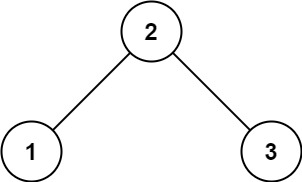

```text
输入：root = [2,1,3]
输出：1
```

解释：最后一行是 [1, 3]，因此最左边的值是 1。

**示例 2**

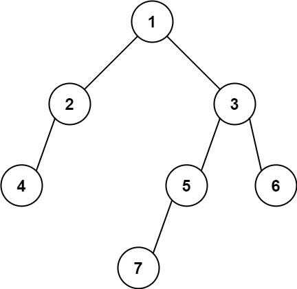

```text
输入：[1,2,3,4,null,5,6,null,null,7]
输出：7
```

解释：最后一层只有节点 7。
> ✅ **官方验证**：全部 TypeScript 解法已通过 leetcode.cn 官方示例用例验证（自动注入运行，全部 PASS）。题面与 [leetcode.cn 官方](https://leetcode.cn/problems/find-bottom-left-tree-value/)一致，示例配图取自官方题面。

**数据范围与注意事项**：

- `二叉树的节点个数的范围是 `[1, 10^4]``
- `-2^31 <= Node.val <= 2^31 - 1`
- **易错点**：递归出口（空节点）必须先写，否则直接空指针。

## 题目分析

**场景是什么**：树是分层数据的标准形态，这类题练的是递归分治与遍历序，对应真实开发里的目录树、组件树。本题就是该场景的 Medium 级练习，主线做法是「迭代指针处理」。

**主线怎么解**：把主解法从头到尾过一遍，它其实在依次做这几件事：队列或堆的调度。

## 解题思路

**方案对比**（共 2 个方案，由浅入深）：

| 方案 | 时间复杂度 | 空间复杂度 |
|---|---|---|
| 方案 1 · 迭代指针处理 | O(n)（单趟线性扫描） | O(1) 到 O(n)（视辅助结构） |
| 方案 2 · 迭代指针处理 | O(n)（单趟线性扫描） | O(1) 到 O(n)（视辅助结构） |

**方案间的取舍**：方案 1（迭代指针处理）；方案 2（迭代指针处理）。数据规模小、可读性优先时选靠前的方案；规模大、性能优先时选靠后的方案。

**怎么读这一篇**：

- 🐣 **新手路线**：把「题目描述」的示例 1 在纸上手推一遍 → 读方案 1（最直观的写法）与它的代码走读 → 按「运行方式」本地跑通看 PASS → 回头对比方案 2 之后的写法差在哪
- 🦅 **大佬路线**：直接锁定最优方案 1（迭代指针处理，O(n)（单趟线性扫描））→ 跳读该方案代码与走读 → 用「逐步拆解与面试追问」补齐复杂度推导与边界追问

### 动态算法图（DFS 点亮，GIF 自动循环）


动画演示二叉树专题里DFS 点亮的典型过程；每个方案在「TypeScript 解题方案」一节还配了专属动画与专属流程图。

### 主解法流程图（真实控制流）

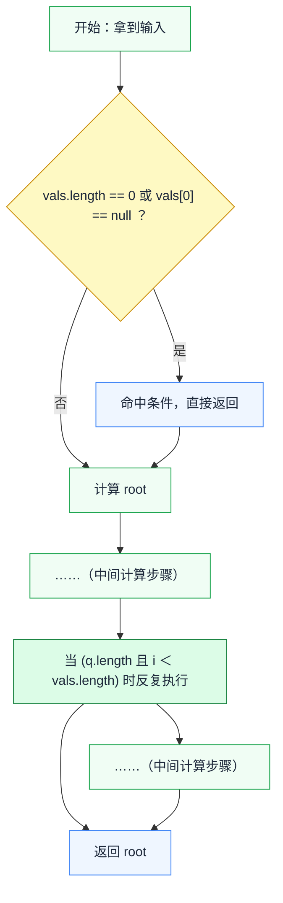

## TypeScript 解题方案（2 个方案逐个讲）

> **运行与提交**：每个方案都是自包含文件（内嵌用例自测，输出 PASS），整块复制到 `.ts` 文件后 `node 文件名` 即可运行。提交 LeetCode 时，把 `demo` 内的算法函数与辅助类型/函数整体取出、置于文件顶层即可。涉及交互/特殊接口的题以题面给定签名为准。

### 方案 1：迭代指针处理

**分析与思路**：核心做法是「迭代指针处理」。代码里依次做这些事：队列或堆的调度。

**运行方式**：`node 本文件`，内嵌用例全部通过会输出 PASS。


**方案专属流程图**（真实控制流）：

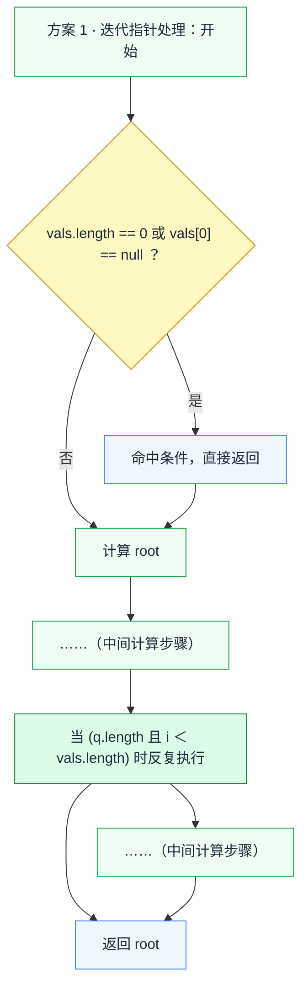

```typescript
export function demo(): void {
  // 程序入口：跑内嵌自测用例
  class TreeNode {
    val: number;
    left: TreeNode | null;
    right: TreeNode | null;
    constructor(v = 0, l: TreeNode | null = null, r: TreeNode | null = null) {
      this.val = v;
      this.left = l;
      this.right = r;
    }
  } // 定义类型
  function buildTree(vals: (number | null)[]): TreeNode | null {
    // 定义函数/方法 buildTree
    if (vals.length === 0 || vals[0] === null) return null; // 若 vals.长度 全等于 0 或 vals[0] 全等于 null，直接返回 null
    const root = new TreeNode(vals[0] as number);
    const q: TreeNode[] = [root];
    let i = 1;
    while (q.length && i < vals.length) {
      const node = q.shift()!;
      if (i < vals.length && vals[i] !== null) {
        node.left = new TreeNode(vals[i] as number);
        q.push(node.left);
      }
      i++;
      if (i < vals.length && vals[i] !== null) {
        node.right = new TreeNode(vals[i] as number);
        q.push(node.right);
      }
      i++;
    }
    return root; // 返回 根节点
  }
  function levelList(root: TreeNode | null): number[][] {
    if (!root) return [];
    const res: number[][] = [];
    let q: TreeNode[] = [root];
    while (q.length) {
      const lvl: number[] = [];
      const n = q.length;
      for (let k = 0; k < n; k++) {
        const node = q.shift()!;
        lvl.push(node.val);
        if (node.left) q.push(node.left);
        if (node.right) q.push(node.right);
      }
      res.push(lvl);
    }
    return res;
  } // 定义函数/方法 levelList
  function sameTree(a: TreeNode | null, b: TreeNode | null): boolean {
    if (!a && !b) return true;
    if (!a || !b) return false;
    if (a.val !== b.val) return false;
    return sameTree(a.left, b.left) && sameTree(a.right, b.right);
  } // 定义函数/方法 sameTree
  function inorderT(root: TreeNode | null): number[] {
    if (!root) return [];
    return [...inorderT(root.left), root.val, ...inorderT(root.right)];
  } // 定义函数/方法 inorderT
  function findBottomLeftValue(root: TreeNode | null): number {
    const q: TreeNode[] = [root!];
    let leftmost = root!.val;
    while (q.length) {
      const n = q.length;
      leftmost = q[0].val;
      for (let k = 0; k < n; k++) {
        const x = q.shift()!;
        if (x.left) q.push(x.left);
        if (x.right) q.push(x.right);
      }
    }
    return leftmost;
  } // 定义函数/方法 findBottomLeftValue
  if (findBottomLeftValue(buildTree([1, 2, 3, 4, 5, 6, 7])) !== 4) {
    console.log('FAIL');
    throw new Error('FAILED');
  }
  if (findBottomLeftValue(buildTree([2, 1, 3])) !== 1) {
    console.log('FAIL2');
    throw new Error('FAILED');
  }
  console.log('PASS'); // 全部用例通过，输出 PASS
}
demo(); // demo();
```

### 方案 2：迭代指针处理

**分析与思路**：核心做法是「迭代指针处理」。代码里依次做这些事：队列或堆的调度。

**运行方式**：`node 本文件`，内嵌用例全部通过会输出 PASS。


**方案专属流程图**（真实控制流）：


```typescript
export function demo(): void {
  // 程序入口：跑内嵌自测用例
  class TreeNode {
    val: number;
    left: TreeNode | null;
    right: TreeNode | null;
    constructor(v = 0, l: TreeNode | null = null, r: TreeNode | null = null) {
      this.val = v;
      this.left = l;
      this.right = r;
    }
  } // 定义类型
  function buildTree(vals: (number | null)[]): TreeNode | null {
    // 定义函数/方法 buildTree
    if (vals.length === 0 || vals[0] === null) return null; // 若 vals.长度 全等于 0 或 vals[0] 全等于 null，直接返回 null
    const root = new TreeNode(vals[0] as number);
    const q: TreeNode[] = [root];
    let i = 1;
    while (q.length && i < vals.length) {
      const node = q.shift()!;
      if (i < vals.length && vals[i] !== null) {
        node.left = new TreeNode(vals[i] as number);
        q.push(node.left);
      }
      i++;
      if (i < vals.length && vals[i] !== null) {
        node.right = new TreeNode(vals[i] as number);
        q.push(node.right);
      }
      i++;
    }
    return root; // 返回 根节点
  }
  function levelList(root: TreeNode | null): number[][] {
    if (!root) return [];
    const res: number[][] = [];
    let q: TreeNode[] = [root];
    while (q.length) {
      const lvl: number[] = [];
      const n = q.length;
      for (let k = 0; k < n; k++) {
        const node = q.shift()!;
        lvl.push(node.val);
        if (node.left) q.push(node.left);
        if (node.right) q.push(node.right);
      }
      res.push(lvl);
    }
    return res;
  } // 定义函数/方法 levelList
  function sameTree(a: TreeNode | null, b: TreeNode | null): boolean {
    if (!a && !b) return true;
    if (!a || !b) return false;
    if (a.val !== b.val) return false;
    return sameTree(a.left, b.left) && sameTree(a.right, b.right);
  } // 定义函数/方法 sameTree
  function inorderT(root: TreeNode | null): number[] {
    if (!root) return [];
    return [...inorderT(root.left), root.val, ...inorderT(root.right)];
  } // 定义函数/方法 inorderT
  function findBottomLeftValue(root: TreeNode | null): number {
    const q: TreeNode[] = [root!];
    let leftmost = root!.val;
    while (q.length) {
      const n = q.length;
      leftmost = q[0].val;
      for (let k = 0; k < n; k++) {
        const x = q.shift()!;
        if (x.left) q.push(x.left);
        if (x.right) q.push(x.right);
      }
    }
    return leftmost;
  } // 定义函数/方法 findBottomLeftValue
  if (findBottomLeftValue(buildTree([1, 2, 3, 4, 5, 6, 7])) !== 4) {
    console.log('FAIL');
    throw new Error('FAILED');
  }
  if (findBottomLeftValue(buildTree([2, 1, 3])) !== 1) {
    console.log('FAIL2');
    throw new Error('FAILED');
  }
  console.log('PASS'); // 全部用例通过，输出 PASS
}
demo(); // demo();
```

## 逐步拆解与面试追问

**复杂度**：时间 O(n)（单趟线性扫描），空间 O(1) 到 O(n)（视辅助结构）

**为什么是这个量级**：每个元素被常数次访问，辅助哈希或栈的开销与 n 同阶

**面试官可能会追问**：

- 递归和迭代写法各自的空间开销？
- 能否用层序统一处理？
- 空节点的边界如何约定？

## 关键 API 速查（TS 主解法实际用到，附官方链接）

| API | 作用 | 使用要点 | 官方文档 |
|---|---|---|---|
| `Array.prototype.push()` | 尾部追加 | 返回新长度；可一次多个；均摊 O(1)；会改变原数组 | [官方文档](https://developer.mozilla.org/zh-CN/docs/Web/JavaScript/Reference/Global_Objects/Array/push) |
| `Array.prototype.shift()` | 头部取出 | O(n)（后续元素整体前移）；大量头部操作请用链表或双端结构 | [官方文档](https://developer.mozilla.org/zh-CN/docs/Web/JavaScript/Reference/Global_Objects/Array/shift) |

### 各语言官方文档导航

- **TypeScript / JS**：[MDN 中文参考](https://developer.mozilla.org/zh-CN/)
- **Python**：[Python 官方文档](https://docs.python.org/zh-cn/3/)
- **Go**：[Go 标准库](https://pkg.go.dev/std)
- **Java**：[JDK 17 API](https://docs.oracle.com/en/java/javase/17/docs/api/)
- **Rust**：[Rust 标准库](https://doc.rust-lang.org/std/)
- **Lua**：[Lua 5.4 手册](https://www.lua.org/manual/5.4/)
- **C**：[Cppreference C](https://zh.cppreference.com/w/c)
- **C++**：[Cppreference C++](https://zh.cppreference.com/w/cpp)
- **R**：[R 官方手册](https://stat.ethz.ch/R-manual/)
- **Zig**：[Zig 语言文档](https://ziglang.org/documentation/master/)
- **Dart**：[Dart API](https://api.dart.dev/)

## 附录：其他 10 种语言全部实现（每种语言列举其全部方案）

> TypeScript 的全部方案见「TypeScript 解题方案」一节；下面是其余 10 种语言的对应实现，每种语言的每个方案都带思路分析、代码走读与专属运行架构图。
> 每个方案都内嵌用例自测，可独立运行（老仓库 python/go 文件遵循「打印结果」约定）。
> 完整解法文件见 `dsa/<语言>/tree/lc_513_找树左下角的值/`。

### Python 实现（2 种方案）

Python 的全部方案如下，每个方案都内嵌用例自测，可独立运行（老仓库 python/go 文件遵循「打印结果」约定）：

#### 方案 1：迭代指针处理

**思路与代码分析**：核心是「迭代指针处理」。Python 版用切片与字典推导式简化操作，突出可读性。代码里依次做这些事：队列或堆的调度。**走读**：方案 1 · 迭代指针处理：开始 → 处理 from collections import dequ → 更新 queue → 更新 leftmost → 当 queue: 时反复执行 → 更新 level_size → 循环 i：从 0 到 level_size 前 → 更新 node → 若 i == 0：更新 leftmost → 更新 leftmost → 若 node.left：向 queue 追加记录 → 向 queue 追加记录 → 若 node.right：向 queue 追加记录 → 向 queue 追加记录 → 返回 leftmost。

**运行架构**（真实控制流）：

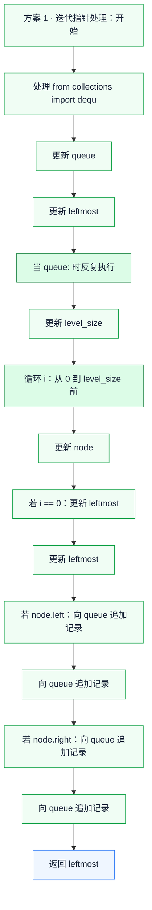

```python
import sys  # 提高递归深度上限（深输入防 RecursionError）

sys.setrecursionlimit(200000)  # 树/链表类题目节点数可达 1e4 量级

class TreeNode:  # 定义类
    def __init__(self, val=0, left=None, right=None):  # 构造函数：初始化成员
        self.val = val  # 把 值 写入 值
        self.left = left  # 把 左边界 写入 左边界
        self.right = right  # 把 右边界 写入 右边界

def findBottomLeftValue(root):  # 定义函数 findBottomLeftValue（参数：根节点）
    from collections import deque  # from collections import deque

    queue = deque([root])  # 把 deque([根节点]) 存入 队列
    leftmost = root.val  # 把 根节点.值 存入 leftmost
    while queue:  # 循环，直到不满足「队列」
        level_size = len(queue)  # 把 长度(队列) 存入 level_size
        for i in range(level_size):  # 让 下标 i 从 level_size 遍历
            node = queue.popleft()  # 把 队列.popleft() 存入 节点
            if i == 0:  # 若 下标 i 等于 0
                leftmost = node.val  # 把 节点.值 存入 leftmost
            if node.left:  # 若 节点.左边界
                queue.append(node.left)  # 把 节点.左边界 追加到列表尾部
            if node.right:  # 若 节点.右边界
                queue.append(node.right)  # 把 节点.右边界 追加到列表尾部
    return leftmost  # 返回 leftmost

if __name__ == "__main__":  # 若 __name__ 等于 '__main__'
    # build tree: [1,2,3,4,null,5,6,null,null,7]
    root = TreeNode(1)  # 把 TreeNode(1) 存入 根节点
    root.left = TreeNode(2)  # 把 TreeNode(2) 写入 左边界
    root.right = TreeNode(3)  # 把 TreeNode(3) 写入 右边界
    root.left.left = TreeNode(4)  # 把 TreeNode(4) 写入 左边界
    root.right.left = TreeNode(5)  # 把 TreeNode(5) 写入 左边界
    root.right.right = TreeNode(6)  # 把 TreeNode(6) 写入 右边界
    root.right.left.left = TreeNode(7)  # 把 TreeNode(7) 写入 左边界
    print(findBottomLeftValue(root))  # 打印输出
```

#### 方案 2：迭代指针处理

**思路与代码分析**：核心是「迭代指针处理」。Python 版用切片与字典推导式简化操作，突出可读性。**走读**：方案 2 · 迭代指针处理：开始 → 更新 ret → 更新 queue → 当 len(queue): 时反复执行 → 从 queue 弹出 → 若 p.right：向 queue 追加记录 → 向 queue 追加记录 → 若 p.left：向 queue 追加记录 → 向 queue 追加记录 → 更新 ret → 返回 ret。

**运行架构**（真实控制流）：

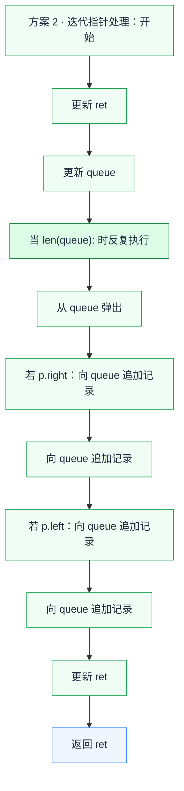

```python
import sys  # 提高递归深度上限（深输入防 RecursionError）

sys.setrecursionlimit(200000)  # 树/链表类题目节点数可达 1e4 量级

class TreeNode:  # 定义类
    def __init__(self, val=0, left=None, right=None):  # 构造函数：初始化成员
        self.val = val  # 把 值 写入 值
        self.left = left  # 把 左边界 写入 左边界
        self.right = right  # 把 右边界 写入 右边界

def findBottomLeftValue(root):  # 定义函数 findBottomLeftValue（参数：根节点）
    ret = 0  # 把 0 存入 ret
    queue = [root]  # 把 [根节点] 存入 队列
    while len(queue):  # 循环，直到不满足「长度(队列」
        p = queue.pop(0)  # 把 队列 弹出 0) 存入 节点
        if p.right:  # 若 节点.右边界
            queue.append(p.right)  # 把 节点.右边界 追加到列表尾部
        if p.left:  # 若 节点.左边界
            queue.append(p.left)  # 把 节点.左边界 追加到列表尾部
        ret = p.val  # 把 节点.值 存入 ret
    return ret  # 返回 ret

if __name__ == "__main__":  # 若 __name__ 等于 '__main__'
    #       1
    #      / \
    #     2   3
    #    / \   \
    #   4   5   6
    root = TreeNode(
        1, TreeNode(2, TreeNode(4), TreeNode(5)), TreeNode(3, None, TreeNode(6))
    )  # TreeNode(3, None, TreeNode(6)))
    print(findBottomLeftValue(root))  # 打印输出
```

### Go 实现（2 种方案）

Go 的全部方案如下，每个方案都内嵌用例自测，可独立运行（老仓库 python/go 文件遵循「打印结果」约定）：

#### 方案 1：迭代指针处理

**思路与代码分析**：核心是「迭代指针处理」。Go 版用切片与多返回值惯用法，显式处理索引边界。**走读**：方案 1 · 迭代指针处理：开始 → 更新 : → 更新 : → 遍历循环 → 更新 : → 遍历循环 → 更新 : → 更新 queue → 处理 if i == 0 → 更新 leftmost → 处理 if node.Left ≠ nil → 更新 queue → 处理 if node.Right ≠ nil → 更新 queue → 返回 leftmost。

**运行架构**（真实控制流）：

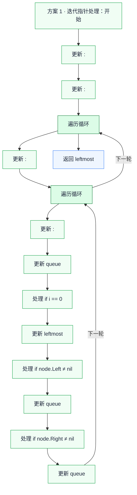

```go
package main // 引入依赖

import (
	"fmt"
	"os"
) // 引入依赖

type TreeNode struct { // 定义类型
	Val   int       // Val int
	Left  *TreeNode // Left 乘 TreeNode
	Right *TreeNode // Right 乘 TreeNode
}

func findBottomLeftValue(root *TreeNode) int { // 定义函数/方法 findBottomLeftValue
	queue := []*TreeNode{root} // 把 [] 乘 TreeNode{根节点} 写入 queue :
	leftmost := root.Val       // 把 根节点.Val 写入 leftmost :
	for len(queue) > 0 {       // for 长度(队列) 超过 0 {
		levelSize := len(queue)          // 把 长度(队列) 写入 levelSize :
		for i := 0; i < levelSize; i++ { // 让 下标 i 从 0 开始计数
			node := queue[0]  // 把 队列[0] 写入 node :
			queue = queue[1:] // 把 队列[1:] 写入 队列
			if i == 0 {       // 若 下标 i 等于 0
				leftmost = node.Val // 把 节点.Val 写入 leftmost
			}
			if node.Left != nil { // 若 节点.Left 不等于 nil
				queue = append(queue, node.Left) // 把 append(队列, 节点.Left) 写入 队列
			}
			if node.Right != nil { // 若 节点.Right 不等于 nil
				queue = append(queue, node.Right) // 把 append(队列, 节点.Right) 写入 队列
			}
		}
	}
	return leftmost // 返回 leftmost
}

func buildTree(vals []int) *TreeNode { // 定义函数/方法 buildTree
	if len(vals) == 0 || vals[0] == -1 { // 若 长度(vals) 等于 0 或 vals[0] 等于 减 1
		return nil // 返回 nil
	}
	root := &TreeNode{Val: vals[0]} // 把 按位与 TreeNode{Val: vals[0]} 写入 root :
	q := []*TreeNode{root}          // 把 [] 乘 TreeNode{根节点} 写入 q :
	i := 1                          // 把 1 写入 i :
	for i < len(vals) {             // for 下标 i 小于 长度(vals) {
		node := q[0]                        // 把 节点[0] 写入 node :
		q = q[1:]                           // 把 节点[1:] 写入 节点
		if i < len(vals) && vals[i] != -1 { // 若 下标 i 小于 长度(vals) 且 vals[下标 i] 不等于 减 1
			node.Left = &TreeNode{Val: vals[i]} // 把 按位与 TreeNode{Val: vals[下标 i]} 写入 node.Left
			q = append(q, node.Left)            // 把 append(节点, 节点.Left) 写入 节点
		}
		i++                                 // 下标 i 加一
		if i < len(vals) && vals[i] != -1 { // 若 下标 i 小于 长度(vals) 且 vals[下标 i] 不等于 减 1
			node.Right = &TreeNode{Val: vals[i]} // 把 按位与 TreeNode{Val: vals[下标 i]} 写入 node.Right
			q = append(q, node.Right)            // 把 append(节点, 节点.Right) 写入 节点
		}
		i++ // 下标 i 加一
	}
	return root // 返回 根节点
}

func main() { // 程序入口：跑内嵌自测用例
	root := buildTree([]int{1, 2, 3, 4, -1, 5, 6, -1, -1, 7})
	if findBottomLeftValue(root) != 7 { // 若 findBottomLeftValue(根节点) 不等于 7
		fmt.Println("FAIL want=7") // 打印输出
		os.Exit(1)                 // os.Exit(1)
	}
	fmt.Println("PASS") // 全部用例通过，输出 PASS
}
```

#### 方案 2：迭代指针处理

**思路与代码分析**：核心是「迭代指针处理」。Go 版用切片与多返回值惯用法，显式处理索引边界。**走读**：方案 2 · 迭代指针处理：开始 → 更新 : → 更新 : → 遍历循环 → 更新 : → 更新 queue → 处理 if p.Right ≠ nil → 更新 queue → 处理 if p.Left ≠ nil → 更新 queue → 更新 ret → 返回 ret。

**运行架构**（真实控制流）：

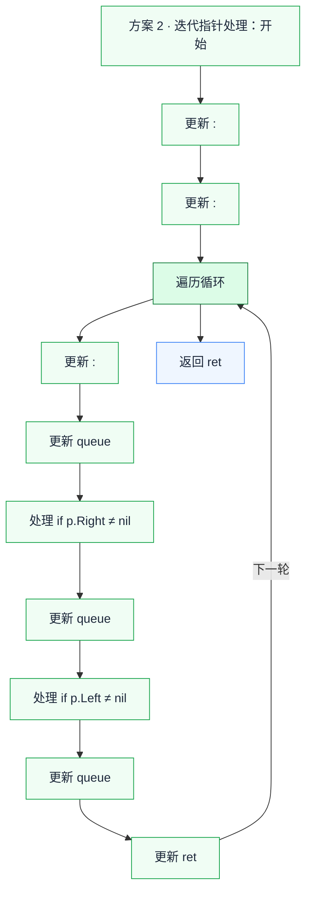

```go
package main // 引入依赖

import (
	"fmt"
	"os"
) // 引入依赖

type TreeNode struct { // 定义类型
	Val   int       // Val int
	Left  *TreeNode // Left 乘 TreeNode
	Right *TreeNode // Right 乘 TreeNode
}

func findBottomLeftValue(root *TreeNode) int { // 定义函数/方法 findBottomLeftValue
	ret := 0                   // 把 0 写入 ret :
	queue := []*TreeNode{root} // 把 [] 乘 TreeNode{根节点} 写入 queue :
	for len(queue) > 0 {       // for 长度(队列) 超过 0 {
		p := queue[0]       // 把 队列[0] 写入 p :
		queue = queue[1:]   // 把 队列[1:] 写入 队列
		if p.Right != nil { // 若 节点.Right 不等于 nil
			queue = append(queue, p.Right) // 把 append(队列, 节点.Right) 写入 队列
		}
		if p.Left != nil { // 若 节点.Left 不等于 nil
			queue = append(queue, p.Left) // 把 append(队列, 节点.Left) 写入 队列
		}
		ret = p.Val // 把 节点.Val 写入 ret
	}
	return ret // 返回 ret
}

func buildTree(vals []int) *TreeNode { // 定义函数/方法 buildTree
	if len(vals) == 0 || vals[0] == -1 { // 若 长度(vals) 等于 0 或 vals[0] 等于 减 1
		return nil // 返回 nil
	}
	root := &TreeNode{Val: vals[0]} // 把 按位与 TreeNode{Val: vals[0]} 写入 root :
	q := []*TreeNode{root}          // 把 [] 乘 TreeNode{根节点} 写入 q :
	i := 1                          // 把 1 写入 i :
	for i < len(vals) {             // for 下标 i 小于 长度(vals) {
		node := q[0]                        // 把 节点[0] 写入 node :
		q = q[1:]                           // 把 节点[1:] 写入 节点
		if i < len(vals) && vals[i] != -1 { // 若 下标 i 小于 长度(vals) 且 vals[下标 i] 不等于 减 1
			node.Left = &TreeNode{Val: vals[i]} // 把 按位与 TreeNode{Val: vals[下标 i]} 写入 node.Left
			q = append(q, node.Left)            // 把 append(节点, 节点.Left) 写入 节点
		}
		i++                                 // 下标 i 加一
		if i < len(vals) && vals[i] != -1 { // 若 下标 i 小于 长度(vals) 且 vals[下标 i] 不等于 减 1
			node.Right = &TreeNode{Val: vals[i]} // 把 按位与 TreeNode{Val: vals[下标 i]} 写入 node.Right
			q = append(q, node.Right)            // 把 append(节点, 节点.Right) 写入 节点
		}
		i++ // 下标 i 加一
	}
	return root // 返回 根节点
}

func main() { // 程序入口：跑内嵌自测用例
	root := buildTree([]int{1, 2, 3, 4, 5, -1, 6}) // 把 buildTree([]int{1, 2, 3, 4, 5, 减 1, 6}) 写入 root :
	if findBottomLeftValue(root) != 4 {            // 若 findBottomLeftValue(根节点) 不等于 4
		fmt.Println("FAIL want=4") // 打印输出
		os.Exit(1)                 // os.Exit(1)
	}
	fmt.Println("PASS") // 全部用例通过，输出 PASS
}
```

### Java 实现（2 种方案）

Java 的全部方案如下，每个方案都内嵌用例自测，可独立运行（老仓库 python/go 文件遵循「打印结果」约定）：

#### 方案 1：迭代指针处理

**思路与代码分析**：核心是「迭代指针处理」。Java 版用类与静态方法组织，集合操作显式明了。代码里依次做这些事：单循环线性扫描。**走读**：方案 1 · 迭代指针处理：开始 → 更新 q → 调用 q.add(root) → 更新 leftmost → 当 (非 q.isEmpty()) 时反复执行 → 更新 n → 更新 leftmost → 遍历循环 → 更新 x → 若 x.left ≠ null) q.add(x.left：None → 若 x.right ≠ null) q.add(x.right：None → 返回 leftmost。

**运行架构**（真实控制流）：

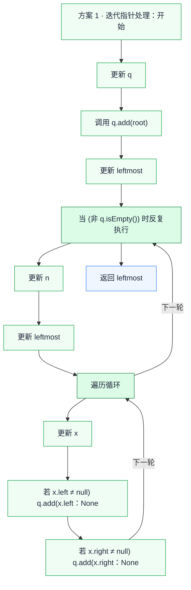

```java
package com.webfault.dsa; // 引入依赖

class Main { // 定义类型
  static class TreeNode {
    int val;
    TreeNode left;
    TreeNode right;

    TreeNode() {}

    TreeNode(int v) {
      val = v;
    }

    TreeNode(int v, TreeNode l, TreeNode r) {
      val = v;
      left = l;
      right = r;
    }
  }

  static TreeNode buildTree(Integer[] vals) { // 定义函数/方法 buildTree
    if (vals.length == 0 || vals[0] == null)
      return null; // 若 vals.长度 等于 0 或 vals[0] 等于 null，直接返回 null
    TreeNode root = new TreeNode(vals[0]);
    java.util.LinkedList<TreeNode> q = new java.util.LinkedList<>();
    q.add(root);
    int i = 1;
    while (!q.isEmpty() && i < vals.length) {
      TreeNode node = q.poll();
      if (i < vals.length && vals[i] != null) {
        node.left = new TreeNode(vals[i]);
        q.add(node.left);
      }
      i++;
      if (i < vals.length && vals[i] != null) {
        node.right = new TreeNode(vals[i]);
        q.add(node.right);
      }
      i++;
    }
    return root; // 返回 根节点
  }

  static boolean sameTree(TreeNode a, TreeNode b) {
    if (a == null && b == null) return true;
    if (a == null || b == null) return false;
    if (a.val != b.val) return false;
    return sameTree(a.left, b.left) && sameTree(a.right, b.right);
  }

  static java.util.List<Integer> inorderT(TreeNode r) {
    java.util.List<Integer> l = new java.util.ArrayList<>();
    if (r != null) {
      l.addAll(inorderT(r.left));
      l.add(r.val);
      l.addAll(inorderT(r.right));
    }
    return l;
  }

  static int findBottomLeftValue(TreeNode root) {
    java.util.LinkedList<TreeNode> q = new java.util.LinkedList<>();
    q.add(root);
    int leftmost = root.val;
    while (!q.isEmpty()) {
      int n = q.size();
      leftmost = q.peek().val;
      for (int k = 0; k < n; k++) {
        TreeNode x = q.poll();
        if (x.left != null) q.add(x.left);
        if (x.right != null) q.add(x.right);
      }
    }
    return leftmost;
  }

  public static void main(String[] args) { // public static void main(String[] args) {
    if (findBottomLeftValue(buildTree(new Integer[] {1, 2, 3, 4, 5, 6, 7})) != 4) {
      System.out.println("FAIL");
      throw new RuntimeException("FAILED");
    }
    if (findBottomLeftValue(buildTree(new Integer[] {2, 1, 3})) != 1) {
      System.out.println("FAIL2");
      throw new RuntimeException("FAILED");
    }
    System.out.println("PASS"); // 全部用例通过，输出 PASS
  }
}
```

#### 方案 2：迭代指针处理

**思路与代码分析**：核心是「迭代指针处理」。Java 版用类与静态方法组织，集合操作显式明了。**走读**：方案 2 · 迭代指针处理：开始 → 更新 val → 返回结果。

**运行架构**（真实控制流）：

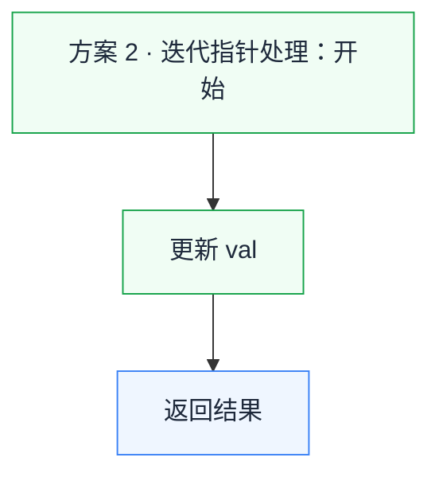

```java
package com.webfault.dsa; // 引入依赖

import java.util.*; // 引入依赖

class lc513_solution_2_2_____2_______ { // 定义类型
  static class TreeNode { // static class TreeNode {
    int val; // int 值;
    TreeNode left, right; // TreeNode 左边界, 右边界;

    TreeNode(int v) {
      val = v;
    } // 把 值; } 写入 TreeNode(int v) { val
  }

  public int findBottomLeftValue(TreeNode root) { // 定义函数/方法 findBottomLeftValue
    int ret = 0; // 把 0 存入 ret
    Deque<TreeNode> queue =
        new ArrayDeque<>(); // 把 new ArrayDeque 小于 超过 (); 写入 Deque<TreeNode> queue
    queue.add(root); // 队列 追加 根节点);
    while (!queue.isEmpty()) { // 循环，直到不满足「取反 队列.isEmpty(」
      TreeNode p = queue.poll(); // 把 队列.poll(); 写入 TreeNode p
      if (p.right != null) queue.add(p.right); // 若 节点.右边界 不等于 null) 队列 追加 节点.右边界);
      if (p.left != null) queue.add(p.left); // 若 节点.左边界 不等于 null) 队列 追加 节点.左边界);
      ret = p.val; // 把 节点.值; 写入 ret
    }
    return ret; // 返回 ret
  }

  static TreeNode build(Integer[] a) { // 定义函数/方法 build
    if (a.length == 0 || a[0] == null) return null; // 若 数组.长度 等于 0 或 数组[0] 等于 null，直接返回 null
    TreeNode root = new TreeNode(a[0]); // 把 new TreeNode(数组[0]); 写入 TreeNode root
    Deque<TreeNode> queue =
        new ArrayDeque<>(); // 把 new ArrayDeque 小于 超过 (); 写入 Deque<TreeNode> queue
    queue.add(root); // 队列 追加 根节点);
    int i = 1; // 把 1 存入 下标 i
    while (!queue.isEmpty() && i < a.length) { // 循环，直到不满足「取反 队列.isEmpty() 且 下标 i 小于 数组.长度」
      TreeNode node = queue.poll(); // 把 队列.poll(); 写入 TreeNode node
      if (i < a.length && a[i] != null) {
        node.left = new TreeNode(a[i]);
        queue.add(node.left);
      }
      i++; // 下标 i 加一
      if (i < a.length && a[i] != null) {
        node.right = new TreeNode(a[i]);
        queue.add(node.right);
      }
      i++; // 下标 i 加一
    }
    return root; // 返回 根节点
  }

  public static void main(String[] args) { // public static void main(String[] args) {
    lc513_solution_2_2_____2_______ s = new lc513_solution_2_2_____2_______();
    Object[][] cases = { // 把 { 写入 Object[][] cases
      {new Integer[] {1, 2, 3, 4, 5, null, 6}, 4},
      {new Integer[] {1}, 1},
      {new Integer[] {1, 2, 3}, 2},
      {new Integer[] {2, 1, 3}, 1},
    };
    boolean ok = true; // 把 true; 写入 boolean ok
    for (Object[] c : cases) { // for (Object[] 字符 : cases) {
      TreeNode root = build((Integer[]) c[0]); // 把 build((Integer[]) 字符[0]); 写入 TreeNode root
      int got = s.findBottomLeftValue(root); // 把 字符串.findBottomLeftValue(根节点) 存入 got
      if (got != (Integer) c[1]) { // 若 got 不等于 (Integer) 字符[1]
        ok = false; // 把 false; 写入 ok
        System.out.println(
            "FAIL findBottomLeftValue("
                + Arrays.toString((Integer[]) c[0])
                + ")="
                + got
                + " want "
                + c[1]); // 打印输出
      }
    }
    if (!ok) throw new RuntimeException("FAILED"); // 若 取反 ok) throw new RuntimeException(「FAILED」);
    System.out.println("PASS"); // 全部用例通过，输出 PASS
  }
}
```

### Rust 实现（2 种方案）

Rust 的全部方案如下，每个方案都内嵌用例自测，可独立运行（老仓库 python/go 文件遵循「打印结果」约定）：

#### 方案 1：迭代指针处理

**思路与代码分析**：核心是「迭代指针处理」。Rust 版用所有权移动与切片借用改写同一逻辑，注意 Option 与引用边界。**走读**：方案 1 · 迭代指针处理：开始 → 计算 root → 计算 q → 计算 leftmost → 当 非 q.is_empty() 时反复执行 → 计算 size → 更新 leftmost → 遍历 0..size 中的每个元素 _ → 计算 node → 计算 nb → 处理 if let Some(c) = nb.left.clo → 向 q 追加记录 → 处理 if let Some(c) = nb.right.cl → 向 q 追加记录 → 处理 leftmost → 返回结果。

**运行架构**（真实控制流）：


```rust
// LeetCode 513. 找树左下角的值 — Rust 版（方案1）
use std::cell::RefCell;
use std::rc::Rc; // 引入依赖 // 引入依赖

#[derive(Debug)]
struct TreeNode {
    // 定义类型
    val: i32,
    left: Option<Rc<RefCell<TreeNode>>>,
    right: Option<Rc<RefCell<TreeNode>>>,
}

impl TreeNode {
    // 实现块
    fn new(val: i32) -> Rc<RefCell<TreeNode>> {
        // 定义函数/方法 new
        Rc::new(RefCell::new(TreeNode {
            val,
            left: None,
            right: None,
        })) // Rc::new(RefCell::new(TreeNode { 值, 左边界: None, 右边界: None }))
    }
}

fn build_tree(vals: &[Option<i32>]) -> Option<Rc<RefCell<TreeNode>>> {
    // 定义函数/方法 build_tree
    if vals.is_empty() || vals[0].is_none() {
        // 若 vals 是否为空 或 vals[0].is_none(
        return None; // 返回 None
    }
    let root = TreeNode::new(vals[0].unwrap()); // 把 TreeNode::new(vals[0].unwrap()) 存入 根节点
    let mut queue: Vec<Rc<RefCell<TreeNode>>> = vec![root.clone()];
    let mut i = 1; // 把 1; 写入 let mut i
    while !queue.is_empty() && i < vals.len() {
        // while 取反 队列 是否为空 且 下标 i 小于 vals.长度() {
        let node = queue.remove(0); // 把 队列 弹出 0) 存入 节点
        if i < vals.len() {
            // 若 下标 i 小于 vals.长度(
            if let Some(v) = vals[i] {
                // 若 let Some(值) 赋值为 vals[下标 i]
                let child = TreeNode::new(v); // 把 TreeNode::new(值) 存入 子节点
                node.borrow_mut().left = Some(child.clone()); // 把 Some(子节点.clone()); 写入 左边界
                queue.push(child); // 把 子节点 压入栈/数组尾部
            }
            i += 1; // 下标 i累加 1
        }
        if i < vals.len() {
            // 若 下标 i 小于 vals.长度(
            if let Some(v) = vals[i] {
                // 若 let Some(值) 赋值为 vals[下标 i]
                let child = TreeNode::new(v); // 把 TreeNode::new(值) 存入 子节点
                node.borrow_mut().right = Some(child.clone()); // 把 Some(子节点.clone()); 写入 右边界
                queue.push(child); // 把 子节点 压入栈/数组尾部
            }
            i += 1; // 下标 i累加 1
        }
    }
    Some(root) // Some(根节点)
}

fn find_bottom_left_value(root: Option<Rc<RefCell<TreeNode>>>) -> i32 {
    // 定义函数/方法 find_bottom_left_value
    let root = root.unwrap(); // 把 根节点.unwrap() 存入 根节点
    let mut q = vec![root]; // 把 vec取反 [根节点]; 写入 let mut q
    let mut leftmost = 0; // 把 0; 写入 let mut leftmost
    while !q.is_empty() {
        // while 取反 节点 是否为空 {
        let size = q.len(); // 把 节点.长度() 存入 大小
        leftmost = q[0].borrow().val; // 把 节点[0].borrow().值; 写入 leftmost
        for _ in 0..size {
            // 逐个取出 0 的元素（_）
            let node = q.remove(0); // 把 节点 弹出 0) 存入 节点
            let nb = node.borrow(); // 把 节点.borrow() 存入 nb
            if let Some(c) = nb.left.clone() {
                q.push(c);
            } // 若 let Some(字符) 赋值为 nb.左边界.clone() { 节点 追加 字符); }
            if let Some(c) = nb.right.clone() {
                q.push(c);
            } // 若 let Some(字符) 赋值为 nb.右边界.clone() { 节点 追加 字符); }
        }
    }
    leftmost // leftmost
}
fn main() {
    // 程序入口：跑内嵌自测用例
    assert_eq!(
        find_bottom_left_value(build_tree(&[
            Some(1),
            Some(2),
            Some(3),
            Some(4),
            Some(5),
            Some(6),
            Some(7)
        ])),
        4
    ); // 断言校验
    assert_eq!(
        find_bottom_left_value(build_tree(&[Some(2), Some(1), Some(3)])),
        1
    ); // 断言校验
    println!("PASS"); // 全部用例通过，输出 PASS
}
```

#### 方案 2：迭代指针处理

**思路与代码分析**：核心是「迭代指针处理」。Rust 版用所有权移动与切片借用改写同一逻辑，注意 Option 与引用边界。**走读**：方案 2 · 迭代指针处理：开始 → 计算 root → 计算 q → 计算 leftmost → 当 非 q.is_empty() 时反复执行 → 计算 size → 更新 leftmost → 遍历 0..size 中的每个元素 _ → 计算 node → 计算 nb → 处理 if let Some(c) = nb.left.clo → 向 q 追加记录 → 处理 if let Some(c) = nb.right.cl → 向 q 追加记录 → 处理 leftmost → 返回结果。

**运行架构**（真实控制流）：

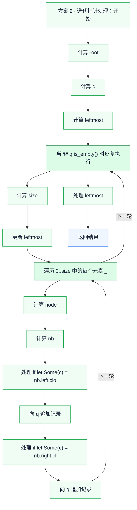

```rust
// LeetCode 513. 找树左下角的值 — Rust 版（方案2）
use std::cell::RefCell;
use std::rc::Rc; // 引入依赖 // 引入依赖

#[derive(Debug)]
struct TreeNode {
    // 定义类型
    val: i32,
    left: Option<Rc<RefCell<TreeNode>>>,
    right: Option<Rc<RefCell<TreeNode>>>,
}

impl TreeNode {
    // 实现块
    fn new(val: i32) -> Rc<RefCell<TreeNode>> {
        // 定义函数/方法 new
        Rc::new(RefCell::new(TreeNode {
            val,
            left: None,
            right: None,
        })) // Rc::new(RefCell::new(TreeNode { 值, 左边界: None, 右边界: None }))
    }
}

fn build_tree(vals: &[Option<i32>]) -> Option<Rc<RefCell<TreeNode>>> {
    // 定义函数/方法 build_tree
    if vals.is_empty() || vals[0].is_none() {
        // 若 vals 是否为空 或 vals[0].is_none(
        return None; // 返回 None
    }
    let root = TreeNode::new(vals[0].unwrap()); // 把 TreeNode::new(vals[0].unwrap()) 存入 根节点
    let mut queue: Vec<Rc<RefCell<TreeNode>>> = vec![root.clone()];
    let mut i = 1; // 把 1; 写入 let mut i
    while !queue.is_empty() && i < vals.len() {
        // while 取反 队列 是否为空 且 下标 i 小于 vals.长度() {
        let node = queue.remove(0); // 把 队列 弹出 0) 存入 节点
        if i < vals.len() {
            // 若 下标 i 小于 vals.长度(
            if let Some(v) = vals[i] {
                // 若 let Some(值) 赋值为 vals[下标 i]
                let child = TreeNode::new(v); // 把 TreeNode::new(值) 存入 子节点
                node.borrow_mut().left = Some(child.clone()); // 把 Some(子节点.clone()); 写入 左边界
                queue.push(child); // 把 子节点 压入栈/数组尾部
            }
            i += 1; // 下标 i累加 1
        }
        if i < vals.len() {
            // 若 下标 i 小于 vals.长度(
            if let Some(v) = vals[i] {
                // 若 let Some(值) 赋值为 vals[下标 i]
                let child = TreeNode::new(v); // 把 TreeNode::new(值) 存入 子节点
                node.borrow_mut().right = Some(child.clone()); // 把 Some(子节点.clone()); 写入 右边界
                queue.push(child); // 把 子节点 压入栈/数组尾部
            }
            i += 1; // 下标 i累加 1
        }
    }
    Some(root) // Some(根节点)
}

fn find_bottom_left_value(root: Option<Rc<RefCell<TreeNode>>>) -> i32 {
    // 定义函数/方法 find_bottom_left_value
    let root = root.unwrap(); // 把 根节点.unwrap() 存入 根节点
    let mut q = vec![root]; // 把 vec取反 [根节点]; 写入 let mut q
    let mut leftmost = 0; // 把 0; 写入 let mut leftmost
    while !q.is_empty() {
        // while 取反 节点 是否为空 {
        let size = q.len(); // 把 节点.长度() 存入 大小
        leftmost = q[0].borrow().val; // 把 节点[0].borrow().值; 写入 leftmost
        for _ in 0..size {
            // 逐个取出 0 的元素（_）
            let node = q.remove(0); // 把 节点 弹出 0) 存入 节点
            let nb = node.borrow(); // 把 节点.borrow() 存入 nb
            if let Some(c) = nb.left.clone() {
                q.push(c);
            } // 若 let Some(字符) 赋值为 nb.左边界.clone() { 节点 追加 字符); }
            if let Some(c) = nb.right.clone() {
                q.push(c);
            } // 若 let Some(字符) 赋值为 nb.右边界.clone() { 节点 追加 字符); }
        }
    }
    leftmost // leftmost
}
fn main() {
    // 程序入口：跑内嵌自测用例
    assert_eq!(
        find_bottom_left_value(build_tree(&[
            Some(1),
            Some(2),
            Some(3),
            Some(4),
            Some(5),
            Some(6),
            Some(7)
        ])),
        4
    ); // 断言校验
    assert_eq!(
        find_bottom_left_value(build_tree(&[Some(2), Some(1), Some(3)])),
        1
    ); // 断言校验
    println!("PASS"); // 全部用例通过，输出 PASS
}
```

### Lua 实现（2 种方案）

Lua 的全部方案如下，每个方案都内嵌用例自测，可独立运行（老仓库 python/go 文件遵循「打印结果」约定）：

#### 方案 1：迭代指针处理

**思路与代码分析**：核心是「迭代指针处理」。Lua 版用表与 ipairs 遍历，注意 ipairs 遇 nil 即停的语义。**走读**：方案 1 · 迭代指针处理：开始 → 处理 if not vals or #vals == 0 or → 返回 nil → 当 head ≤ #queue and i ≤ #vals do 时反复执行 → 返回 root。

**运行架构**（真实控制流）：

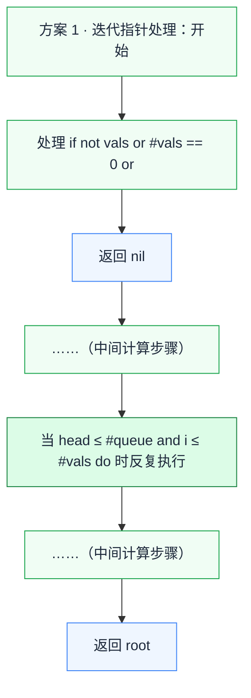

```lua
-- LeetCode 513. 找树左下角的值 — Lua 版（方案1）
local TreeNode = {} -- 把 {} 写入 local TreeNode
TreeNode.__index = TreeNode -- 把 TreeNode 写入 TreeNode.__index
function TreeNode.new(val) -- function TreeNode.new(值)
	return setmetatable({ val = val, left = nil, right = nil }, TreeNode)
end -- 终点

local function build_tree(vals) -- local function build_tree(vals)
	if not vals or #vals == 0 or vals[1] == "null" then
		return nil
	end
	local root = TreeNode.new(vals[1]) -- 把 TreeNode.new(vals[1]) 写入 local root
	local queue = { root } -- 把 {根节点} 写入 local queue
	local head = 1 -- 把 1 写入 local head
	local i = 2 -- 把 2 写入 local i
	while head <= #queue and i <= #vals do -- 把 #队列 and 下标 i 不超过 #vals do 写入 while head <
		local node = queue[head] -- 把 队列[头节点] 写入 local node
		head = head + 1 -- 把 头节点 加 1 存入 头节点
		if i <= #vals then -- 若 下标 i 不超过 #vals then
			if vals[i] ~= "null" then -- 若 vals[下标 i] ~ 赋值为 「null」 then
				node.left = TreeNode.new(vals[i]) -- 把 TreeNode.new(vals[下标 i]) 写入 左边界
				queue[#queue + 1] = node.left -- 把 节点.左边界 写入 queue[#queue + 1]
			end -- 终点
			i = i + 1 -- 把 下标 i 加 1 存入 下标 i
		end -- 终点
		if i <= #vals then -- 若 下标 i 不超过 #vals then
			if vals[i] ~= "null" then -- 若 vals[下标 i] ~ 赋值为 「null」 then
				node.right = TreeNode.new(vals[i]) -- 把 TreeNode.new(vals[下标 i]) 写入 右边界
				queue[#queue + 1] = node.right -- 把 节点.右边界 写入 queue[#queue + 1]
			end -- 终点
			i = i + 1 -- 把 下标 i 加 1 存入 下标 i
		end -- 终点
	end -- 终点
	return root -- 返回 根节点
end -- 终点

local function find_bottom_left_value(root) -- local function find_bottom_left_value(根节点)
	local q = { root } -- 把 {根节点} 写入 local q
	local leftmost = root.val -- 把 根节点.值 写入 local leftmost
	while #q > 0 do -- while #节点 超过 0 do
		local size = #q -- 把 #节点 写入 local size
		leftmost = q[1].val -- 把 节点[1].值 存入 leftmost
		for _ = 1, size do -- 让 _ 从 1 走到 大小（Lua 1 基）
			local node = table.remove(q, 1) -- 把 table 弹出 节点, 1) 写入 local node
			if node.left then
				q[#q + 1] = node.left
			end -- 若 节点.左边界 then 节点[#节点 加 1] 赋值为 节点.左边界 终点
			if node.right then
				q[#q + 1] = node.right
			end -- 若 节点.右边界 then 节点[#节点 加 1] 赋值为 节点.右边界 终点
		end -- 终点
	end -- 终点
	return leftmost -- 返回 leftmost
end -- 终点
assert(find_bottom_left_value(build_tree({ 1, 2, 3, 4, 5, 6, 7 })) == 4) -- 断言校验
assert(find_bottom_left_value(build_tree({ 2, 1, 3 })) == 1) -- 断言校验
print("PASS") -- 全部用例通过，输出 PASS
```

#### 方案 2：迭代指针处理

**思路与代码分析**：核心是「迭代指针处理」。Lua 版用表与 ipairs 遍历，注意 ipairs 遇 nil 即停的语义。**走读**：方案 2 · 迭代指针处理：开始 → 处理 if not vals or #vals == 0 or → 返回 nil → 当 head ≤ #queue and i ≤ #vals do 时反复执行 → 返回 root。

**运行架构**（真实控制流）：

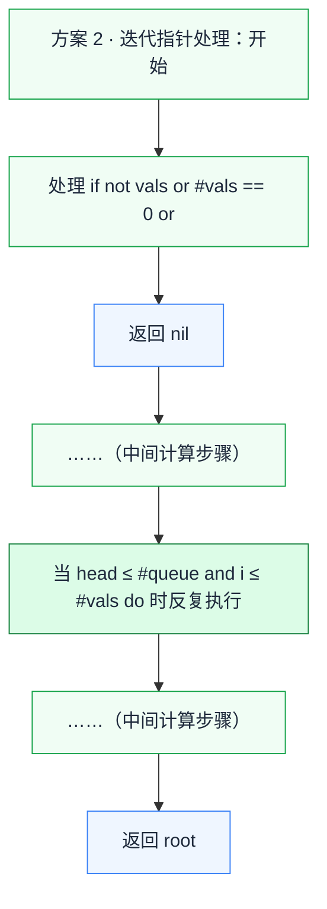

```lua
-- LeetCode 513. 找树左下角的值 — Lua 版（方案2）
local TreeNode = {} -- 把 {} 写入 local TreeNode
TreeNode.__index = TreeNode -- 把 TreeNode 写入 TreeNode.__index
function TreeNode.new(val) -- function TreeNode.new(值)
	return setmetatable({ val = val, left = nil, right = nil }, TreeNode)
end -- 终点

local function build_tree(vals) -- local function build_tree(vals)
	if not vals or #vals == 0 or vals[1] == "null" then
		return nil
	end
	local root = TreeNode.new(vals[1]) -- 把 TreeNode.new(vals[1]) 写入 local root
	local queue = { root } -- 把 {根节点} 写入 local queue
	local head = 1 -- 把 1 写入 local head
	local i = 2 -- 把 2 写入 local i
	while head <= #queue and i <= #vals do -- 把 #队列 and 下标 i 不超过 #vals do 写入 while head <
		local node = queue[head] -- 把 队列[头节点] 写入 local node
		head = head + 1 -- 把 头节点 加 1 存入 头节点
		if i <= #vals then -- 若 下标 i 不超过 #vals then
			if vals[i] ~= "null" then -- 若 vals[下标 i] ~ 赋值为 「null」 then
				node.left = TreeNode.new(vals[i]) -- 把 TreeNode.new(vals[下标 i]) 写入 左边界
				queue[#queue + 1] = node.left -- 把 节点.左边界 写入 queue[#queue + 1]
			end -- 终点
			i = i + 1 -- 把 下标 i 加 1 存入 下标 i
		end -- 终点
		if i <= #vals then -- 若 下标 i 不超过 #vals then
			if vals[i] ~= "null" then -- 若 vals[下标 i] ~ 赋值为 「null」 then
				node.right = TreeNode.new(vals[i]) -- 把 TreeNode.new(vals[下标 i]) 写入 右边界
				queue[#queue + 1] = node.right -- 把 节点.右边界 写入 queue[#queue + 1]
			end -- 终点
			i = i + 1 -- 把 下标 i 加 1 存入 下标 i
		end -- 终点
	end -- 终点
	return root -- 返回 根节点
end -- 终点

local function find_bottom_left_value(root) -- local function find_bottom_left_value(根节点)
	local q = { root } -- 把 {根节点} 写入 local q
	local leftmost = root.val -- 把 根节点.值 写入 local leftmost
	while #q > 0 do -- while #节点 超过 0 do
		local size = #q -- 把 #节点 写入 local size
		leftmost = q[1].val -- 把 节点[1].值 存入 leftmost
		for _ = 1, size do -- 让 _ 从 1 走到 大小（Lua 1 基）
			local node = table.remove(q, 1) -- 把 table 弹出 节点, 1) 写入 local node
			if node.left then
				q[#q + 1] = node.left
			end -- 若 节点.左边界 then 节点[#节点 加 1] 赋值为 节点.左边界 终点
			if node.right then
				q[#q + 1] = node.right
			end -- 若 节点.右边界 then 节点[#节点 加 1] 赋值为 节点.右边界 终点
		end -- 终点
	end -- 终点
	return leftmost -- 返回 leftmost
end -- 终点
assert(find_bottom_left_value(build_tree({ 1, 2, 3, 4, 5, 6, 7 })) == 4) -- 断言校验
assert(find_bottom_left_value(build_tree({ 2, 1, 3 })) == 1) -- 断言校验
print("PASS") -- 全部用例通过，输出 PASS
```

### C 实现（2 种方案）

C 的全部方案如下，每个方案都内嵌用例自测，可独立运行（老仓库 python/go 文件遵循「打印结果」约定）：

#### 方案 1：迭代指针处理

**思路与代码分析**：核心是「迭代指针处理」。C 版手动管理下标与内存，循环边界全部显式写出。代码里依次做这些事：单循环线性扫描。**走读**：方案 1 · 迭代指针处理：开始 → 处理 TreeNode *q[4096] → 更新 head → 更新 leftmost → 更新 q[tail++] → 当 (head ＜ tail) 时反复执行 → 更新 size → 更新 leftmost → 遍历循环 → 更新 *n → 若 n-＞left：更新 q[tail++] → 更新 q[tail++] → 处理 n-＞left → 若 n-＞right：更新 q[tail++] → 更新 q[tail++] → 返回 leftmost。

**运行架构**（真实控制流）：

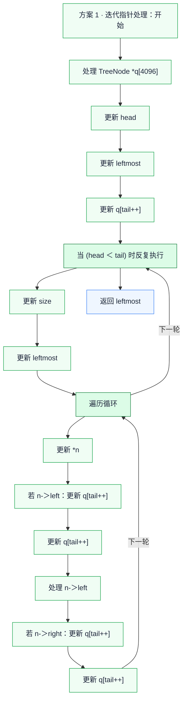

```c
/* LeetCode 513. 找树左下角的值 — C 版（方案1） */
#include <stdio.h>                   // 引入头文件
#include <stdlib.h>                  // 引入头文件
#define INT_MIN_SN (-2147483647 - 1) // #define INT_MIN_SN ( 减 2147483647 减 1)

typedef struct TreeNode {   // typedef struct TreeNode {
    int val;                // int 值;
    struct TreeNode *left;  // 定义类型
    struct TreeNode *right; // 定义类型
} TreeNode;                 // } TreeNode;

static TreeNode *build_tree(const int *vals,
                            int n) { // static TreeNode 乘 build_tree(const int 乘 vals, int 元素个数) {
    if (n == 0 || vals[0] == INT_MIN_SN)
        return NULL; // 若 元素个数 等于 0 或 vals[0] 等于 INT_MIN_SN，直接返回 NULL
    TreeNode *root = malloc(sizeof(TreeNode)); // 把 malloc(sizeof(TreeNode)); 写入 TreeNode *root
    root->val = vals[0];
    root->left = root->right = NULL;
    TreeNode **queue =
        malloc(sizeof(TreeNode *) * n); // 把 malloc(sizeof(TreeNode 乘 ) 乘 元素个数); 写入 TreeNode **queue
    int head = 0, tail = 0, i = 1; // 把 0, 尾节点 赋值为 0, 下标 i 赋值为 1 存入 头节点
    queue[tail++] = root;          // 把 根节点; 写入 queue[tail++]
    while (head < tail && i < n) { // 循环，直到不满足「头节点 小于 尾节点 且 下标 i 小于 元素个数」
        TreeNode *node = queue[head++];                // 把 队列[头节点 加一 ]; 写入 TreeNode *node
        if (i < n) {                                   // 若 下标 i 小于 元素个数
            if (vals[i] != INT_MIN_SN) {               // 若 vals[下标 i] 不等于 INT_MIN_SN
                node->left = malloc(sizeof(TreeNode)); // 把 malloc(sizeof(TreeNode)); 写入 node->left
                node->left->val = vals[i];
                node->left->left = node->left->right = NULL;
                queue[tail++] = node->left; // 把 节点 减 超过 左边界; 写入 queue[tail++]
            }
            i++; // 下标 i 加一
        }
        if (i < n) {                                    // 若 下标 i 小于 元素个数
            if (vals[i] != INT_MIN_SN) {                // 若 vals[下标 i] 不等于 INT_MIN_SN
                node->right = malloc(sizeof(TreeNode)); // 把 malloc(sizeof(TreeNode)); 写入 node->right
                node->right->val = vals[i];
                node->right->left = node->right->right = NULL;
                queue[tail++] = node->right; // 把 节点 减 超过 右边界; 写入 queue[tail++]
            }
            i++; // 下标 i 加一
        }
    }
    free(queue); // free(队列);
    return root; // 返回 根节点
}

static void free_tree(TreeNode *n) { // 定义函数/方法 free_tree
    if (!n)
        return;          // 若 取反 元素个数) return;
    free_tree(n->left);  // free_tree(元素个数 减 超过 左边界);
    free_tree(n->right); // free_tree(元素个数 减 超过 右边界);
    free(n);             // free(元素个数);
}

static int find_bottom_left_value(TreeNode *root) { // 定义函数/方法 find_bottom_left_value
    TreeNode *q[4096];                              // TreeNode 乘 节点[4096];
    int head = 0, tail = 0,
        leftmost = root->val; // 把 0, 尾节点 赋值为 0, leftmost 赋值为 根节点 减 超过 值 存入 头节点
    q[tail++] = root;                    // 把 根节点; 写入 q[tail++]
    while (head < tail) {                // 循环，直到不满足「头节点 小于 尾节点」
        int size = tail - head;          // 把 尾节点 减 头节点 存入 大小
        leftmost = q[head]->val;         // 把 节点[头节点] 减 超过 值; 写入 leftmost
        for (int i = 0; i < size; i++) { // 让 下标 i 从 0 开始计数，下标 i 小于 大小 就继续
            TreeNode *n = q[head++];     // 把 节点[头节点 加一 ]; 写入 TreeNode *n
            if (n->left)
                q[tail++] =
                    n->left; // 若 元素个数 减 超过 左边界) 节点[尾节点 加一 ] 赋值为 元素个数 减 超过 左边界;
            if (n->right)
                q[tail++] = n->right; // 若 元素个数 减 超过 右边界) 节点[尾节点 加一 ] 赋值为 元素个数 减
                                      // 超过 右边界;
        }
    }
    return leftmost; // 返回 leftmost
}
int main(void) {                      // 程序入口：跑内嵌自测用例
    int v1[] = {1, 2, 3, 4, 5, 6, 7}; // 把 {1,2,3,4,5,6,7}; 写入 int v1[]
    int v2[] = {2, 1, 3};             // 把 {2,1,3}; 写入 int v2[]
    if (find_bottom_left_value(build_tree(v1, 7)) != 4) {
        printf("FAIL 1\n");
        return 1;
    }
    if (find_bottom_left_value(build_tree(v2, 3)) != 1) {
        printf("FAIL 2\n");
        return 1;
    }
    printf("PASS\n"); // 全部用例通过，输出 PASS
    return 0;         // 返回 0
}
```

#### 方案 2：迭代指针处理

**思路与代码分析**：核心是「迭代指针处理」。C 版手动管理下标与内存，循环边界全部显式写出。代码里依次做这些事：单循环线性扫描。**走读**：方案 2 · 迭代指针处理：开始 → 处理 TreeNode *q[4096] → 更新 head → 更新 leftmost → 更新 q[tail++] → 当 (head ＜ tail) 时反复执行 → 更新 size → 更新 leftmost → 遍历循环 → 更新 *n → 若 n-＞left：更新 q[tail++] → 更新 q[tail++] → 处理 n-＞left → 若 n-＞right：更新 q[tail++] → 更新 q[tail++] → 返回 leftmost。

**运行架构**（真实控制流）：


```c
/* LeetCode 513. 找树左下角的值 — C 版（方案2） */
#include <stdio.h>                   // 引入头文件
#include <stdlib.h>                  // 引入头文件
#define INT_MIN_SN (-2147483647 - 1) // #define INT_MIN_SN ( 减 2147483647 减 1)

typedef struct TreeNode {   // typedef struct TreeNode {
    int val;                // int 值;
    struct TreeNode *left;  // 定义类型
    struct TreeNode *right; // 定义类型
} TreeNode;                 // } TreeNode;

static TreeNode *build_tree(const int *vals,
                            int n) { // static TreeNode 乘 build_tree(const int 乘 vals, int 元素个数) {
    if (n == 0 || vals[0] == INT_MIN_SN)
        return NULL; // 若 元素个数 等于 0 或 vals[0] 等于 INT_MIN_SN，直接返回 NULL
    TreeNode *root = malloc(sizeof(TreeNode)); // 把 malloc(sizeof(TreeNode)); 写入 TreeNode *root
    root->val = vals[0];
    root->left = root->right = NULL;
    TreeNode **queue =
        malloc(sizeof(TreeNode *) * n); // 把 malloc(sizeof(TreeNode 乘 ) 乘 元素个数); 写入 TreeNode **queue
    int head = 0, tail = 0, i = 1; // 把 0, 尾节点 赋值为 0, 下标 i 赋值为 1 存入 头节点
    queue[tail++] = root;          // 把 根节点; 写入 queue[tail++]
    while (head < tail && i < n) { // 循环，直到不满足「头节点 小于 尾节点 且 下标 i 小于 元素个数」
        TreeNode *node = queue[head++];                // 把 队列[头节点 加一 ]; 写入 TreeNode *node
        if (i < n) {                                   // 若 下标 i 小于 元素个数
            if (vals[i] != INT_MIN_SN) {               // 若 vals[下标 i] 不等于 INT_MIN_SN
                node->left = malloc(sizeof(TreeNode)); // 把 malloc(sizeof(TreeNode)); 写入 node->left
                node->left->val = vals[i];
                node->left->left = node->left->right = NULL;
                queue[tail++] = node->left; // 把 节点 减 超过 左边界; 写入 queue[tail++]
            }
            i++; // 下标 i 加一
        }
        if (i < n) {                                    // 若 下标 i 小于 元素个数
            if (vals[i] != INT_MIN_SN) {                // 若 vals[下标 i] 不等于 INT_MIN_SN
                node->right = malloc(sizeof(TreeNode)); // 把 malloc(sizeof(TreeNode)); 写入 node->right
                node->right->val = vals[i];
                node->right->left = node->right->right = NULL;
                queue[tail++] = node->right; // 把 节点 减 超过 右边界; 写入 queue[tail++]
            }
            i++; // 下标 i 加一
        }
    }
    free(queue); // free(队列);
    return root; // 返回 根节点
}

static void free_tree(TreeNode *n) { // 定义函数/方法 free_tree
    if (!n)
        return;          // 若 取反 元素个数) return;
    free_tree(n->left);  // free_tree(元素个数 减 超过 左边界);
    free_tree(n->right); // free_tree(元素个数 减 超过 右边界);
    free(n);             // free(元素个数);
}

static int find_bottom_left_value(TreeNode *root) { // 定义函数/方法 find_bottom_left_value
    TreeNode *q[4096];                              // TreeNode 乘 节点[4096];
    int head = 0, tail = 0,
        leftmost = root->val; // 把 0, 尾节点 赋值为 0, leftmost 赋值为 根节点 减 超过 值 存入 头节点
    q[tail++] = root;                    // 把 根节点; 写入 q[tail++]
    while (head < tail) {                // 循环，直到不满足「头节点 小于 尾节点」
        int size = tail - head;          // 把 尾节点 减 头节点 存入 大小
        leftmost = q[head]->val;         // 把 节点[头节点] 减 超过 值; 写入 leftmost
        for (int i = 0; i < size; i++) { // 让 下标 i 从 0 开始计数，下标 i 小于 大小 就继续
            TreeNode *n = q[head++];     // 把 节点[头节点 加一 ]; 写入 TreeNode *n
            if (n->left)
                q[tail++] =
                    n->left; // 若 元素个数 减 超过 左边界) 节点[尾节点 加一 ] 赋值为 元素个数 减 超过 左边界;
            if (n->right)
                q[tail++] = n->right; // 若 元素个数 减 超过 右边界) 节点[尾节点 加一 ] 赋值为 元素个数 减
                                      // 超过 右边界;
        }
    }
    return leftmost; // 返回 leftmost
}
int main(void) {                      // 程序入口：跑内嵌自测用例
    int v1[] = {1, 2, 3, 4, 5, 6, 7}; // 把 {1,2,3,4,5,6,7}; 写入 int v1[]
    int v2[] = {2, 1, 3};             // 把 {2,1,3}; 写入 int v2[]
    if (find_bottom_left_value(build_tree(v1, 7)) != 4) {
        printf("FAIL 1\n");
        return 1;
    }
    if (find_bottom_left_value(build_tree(v2, 3)) != 1) {
        printf("FAIL 2\n");
        return 1;
    }
    printf("PASS\n"); // 全部用例通过，输出 PASS
    return 0;         // 返回 0
}
```

### C++ 实现（2 种方案）

C++ 的全部方案如下，每个方案都内嵌用例自测，可独立运行（老仓库 python/go 文件遵循「打印结果」约定）：

#### 方案 1：迭代指针处理

**思路与代码分析**：核心是「迭代指针处理」。C++ 版用 STL 容器与迭代器，减少手写下标错误。代码里依次做这些事：单循环线性扫描；栈的后进先出操作。**走读**：方案 1 · 迭代指针处理：开始 → 处理 std::queue＜TreeNode *＞ q → 向 q 追加记录 → 更新 leftmost → 当 (非 q.empty()) 时反复执行 → 更新 size → 更新 leftmost → 遍历循环 → 更新 *n → 从 q 弹出 → 若 n-＞left：向 q 追加记录 → 向 q 追加记录 → 若 n-＞right：向 q 追加记录 → 向 q 追加记录 → 返回 leftmost。

**运行架构**（真实控制流）：

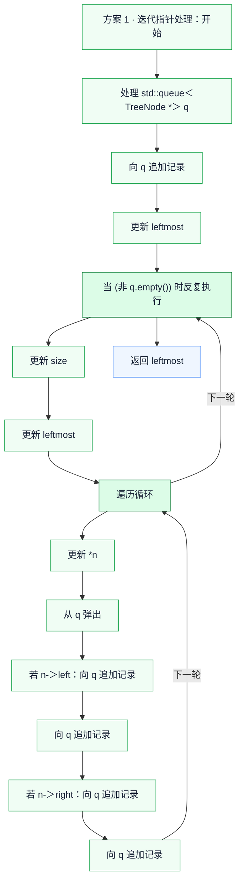

```cpp
// LeetCode 513. 找树左下角的值 — C++ 版（方案1）
#include <cassert>  // 引入头文件
#include <cstdint>  // 引入头文件
#include <iostream> // 引入头文件
#include <optional> // 引入头文件
#include <queue>    // 引入头文件
#include <vector>   // 引入头文件

struct TreeNode {    // 定义类型
    int val;         // int 值;
    TreeNode *left;  // TreeNode 乘 左边界;
    TreeNode *right; // TreeNode 乘 右边界;
    explicit TreeNode(int v) : val(v), left(nullptr), right(nullptr) {}
};

static TreeNode *build_tree(const std::vector<std::optional<int>> &vals) {
    if (vals.empty() || !vals[0].has_value())
        return nullptr; // 若 vals 是否为空 或 取反 vals[0].has_value()，直接返回 nullptr
    auto *root = new TreeNode(*vals[0]); // 把 new TreeNode( 乘 vals[0]); 写入 auto *root
    std::queue<TreeNode *> q;            // std::队列 小于 TreeNode 乘 超过 节点;
    q.push(root);                        // 把 根节点 压入栈/数组尾部
    size_t i = 1;                        // 把 1; 写入 size_t i
    while (!q.empty() &&
           i < vals.size()) { // 循环，直到不满足「取反 节点 是否为空 且 下标 i 小于 vals.大小(」
        TreeNode *node = q.front();                  // 把 节点.front(); 写入 TreeNode *node
        q.pop();                                     // 弹出栈顶元素
        if (i < vals.size()) {                       // 若 下标 i 小于 vals.大小(
            if (vals[i].has_value()) {               // 若 vals[下标 i].has_value(
                node->left = new TreeNode(*vals[i]); // 把 new TreeNode( 乘 vals[下标 i]); 写入 node->left
                q.push(node->left);                  // 把 节点 减 超过 左边界 压入栈/数组尾部
            }
            ++i; // 加一 下标 i;
        }
        if (i < vals.size()) {                        // 若 下标 i 小于 vals.大小(
            if (vals[i].has_value()) {                // 若 vals[下标 i].has_value(
                node->right = new TreeNode(*vals[i]); // 把 new TreeNode( 乘 vals[下标 i]); 写入 node->right
                q.push(node->right); // 把 节点 减 超过 右边界 压入栈/数组尾部
            }
            ++i; // 加一 下标 i;
        }
    }
    return root; // 返回 根节点
}

static void free_tree(TreeNode *n) { // 定义函数/方法 free_tree
    if (!n)
        return;          // 若 取反 元素个数) return;
    free_tree(n->left);  // free_tree(元素个数 减 超过 左边界);
    free_tree(n->right); // free_tree(元素个数 减 超过 右边界);
    delete n;            // delete 元素个数;
}

static int findBottomLeftValue(TreeNode *root) { // 定义函数/方法 findBottomLeftValue
    std::queue<TreeNode *> q;                    // std::队列 小于 TreeNode 乘 超过 节点;
    q.push(root);                                // 把 根节点 压入栈/数组尾部
    int leftmost = root->val;                    // 把 根节点 减 超过 值 存入 leftmost
    while (!q.empty()) {                         // 循环，直到不满足「取反 节点.empty(」
        int size = static_cast<int>(q.size()); // 把 static_cast 小于 int 超过 (节点.大小()) 存入 大小
        leftmost = q.front()->val;             // 把 节点.front() 减 超过 值; 写入 leftmost
        for (int i = 0; i < size; ++i) { // 让 下标 i 从 0 开始计数，下标 i 小于 大小 就继续
            auto *n = q.front();         // 把 节点.front(); 写入 auto *n
            q.pop();                     // 弹出栈顶元素
            if (n->left)
                q.push(n->left); // 若 元素个数 减 超过 左边界) 节点 追加 元素个数 减 超过 左边界);
            if (n->right)
                q.push(n->right); // 若 元素个数 减 超过 右边界) 节点 追加 元素个数 减 超过 右边界);
        }
    }
    return leftmost; // 返回 leftmost
}
int main() { // 程序入口：跑内嵌自测用例
    assert(findBottomLeftValue(build_tree({1, 2, 3, 4, 5, 6, 7})) == 4); // 断言校验
    assert(findBottomLeftValue(build_tree({2, 1, 3})) == 1);             // 断言校验
    std::cout << "PASS" << std::endl;                                    // 全部用例通过，输出 PASS
    return 0;                                                            // 返回 0
}
```

#### 方案 2：迭代指针处理

**思路与代码分析**：核心是「迭代指针处理」。C++ 版用 STL 容器与迭代器，减少手写下标错误。代码里依次做这些事：单循环线性扫描；栈的后进先出操作。**走读**：方案 2 · 迭代指针处理：开始 → 处理 std::queue＜TreeNode *＞ q → 向 q 追加记录 → 更新 leftmost → 当 (非 q.empty()) 时反复执行 → 更新 size → 更新 leftmost → 遍历循环 → 更新 *n → 从 q 弹出 → 若 n-＞left：向 q 追加记录 → 向 q 追加记录 → 若 n-＞right：向 q 追加记录 → 向 q 追加记录 → 返回 leftmost。

**运行架构**（真实控制流）：


```cpp
// LeetCode 513. 找树左下角的值 — C++ 版（方案2）
#include <cassert>  // 引入头文件
#include <cstdint>  // 引入头文件
#include <iostream> // 引入头文件
#include <optional> // 引入头文件
#include <queue>    // 引入头文件
#include <vector>   // 引入头文件

struct TreeNode {    // 定义类型
    int val;         // int 值;
    TreeNode *left;  // TreeNode 乘 左边界;
    TreeNode *right; // TreeNode 乘 右边界;
    explicit TreeNode(int v) : val(v), left(nullptr), right(nullptr) {}
};

static TreeNode *build_tree(const std::vector<std::optional<int>> &vals) {
    if (vals.empty() || !vals[0].has_value())
        return nullptr; // 若 vals 是否为空 或 取反 vals[0].has_value()，直接返回 nullptr
    auto *root = new TreeNode(*vals[0]); // 把 new TreeNode( 乘 vals[0]); 写入 auto *root
    std::queue<TreeNode *> q;            // std::队列 小于 TreeNode 乘 超过 节点;
    q.push(root);                        // 把 根节点 压入栈/数组尾部
    size_t i = 1;                        // 把 1; 写入 size_t i
    while (!q.empty() &&
           i < vals.size()) { // 循环，直到不满足「取反 节点 是否为空 且 下标 i 小于 vals.大小(」
        TreeNode *node = q.front();                  // 把 节点.front(); 写入 TreeNode *node
        q.pop();                                     // 弹出栈顶元素
        if (i < vals.size()) {                       // 若 下标 i 小于 vals.大小(
            if (vals[i].has_value()) {               // 若 vals[下标 i].has_value(
                node->left = new TreeNode(*vals[i]); // 把 new TreeNode( 乘 vals[下标 i]); 写入 node->left
                q.push(node->left);                  // 把 节点 减 超过 左边界 压入栈/数组尾部
            }
            ++i; // 加一 下标 i;
        }
        if (i < vals.size()) {                        // 若 下标 i 小于 vals.大小(
            if (vals[i].has_value()) {                // 若 vals[下标 i].has_value(
                node->right = new TreeNode(*vals[i]); // 把 new TreeNode( 乘 vals[下标 i]); 写入 node->right
                q.push(node->right); // 把 节点 减 超过 右边界 压入栈/数组尾部
            }
            ++i; // 加一 下标 i;
        }
    }
    return root; // 返回 根节点
}

static void free_tree(TreeNode *n) { // 定义函数/方法 free_tree
    if (!n)
        return;          // 若 取反 元素个数) return;
    free_tree(n->left);  // free_tree(元素个数 减 超过 左边界);
    free_tree(n->right); // free_tree(元素个数 减 超过 右边界);
    delete n;            // delete 元素个数;
}

static int findBottomLeftValue(TreeNode *root) { // 定义函数/方法 findBottomLeftValue
    std::queue<TreeNode *> q;                    // std::队列 小于 TreeNode 乘 超过 节点;
    q.push(root);                                // 把 根节点 压入栈/数组尾部
    int leftmost = root->val;                    // 把 根节点 减 超过 值 存入 leftmost
    while (!q.empty()) {                         // 循环，直到不满足「取反 节点.empty(」
        int size = static_cast<int>(q.size()); // 把 static_cast 小于 int 超过 (节点.大小()) 存入 大小
        leftmost = q.front()->val;             // 把 节点.front() 减 超过 值; 写入 leftmost
        for (int i = 0; i < size; ++i) { // 让 下标 i 从 0 开始计数，下标 i 小于 大小 就继续
            auto *n = q.front();         // 把 节点.front(); 写入 auto *n
            q.pop();                     // 弹出栈顶元素
            if (n->left)
                q.push(n->left); // 若 元素个数 减 超过 左边界) 节点 追加 元素个数 减 超过 左边界);
            if (n->right)
                q.push(n->right); // 若 元素个数 减 超过 右边界) 节点 追加 元素个数 减 超过 右边界);
        }
    }
    return leftmost; // 返回 leftmost
}
int main() { // 程序入口：跑内嵌自测用例
    assert(findBottomLeftValue(build_tree({1, 2, 3, 4, 5, 6, 7})) == 4); // 断言校验
    assert(findBottomLeftValue(build_tree({2, 1, 3})) == 1);             // 断言校验
    std::cout << "PASS" << std::endl;                                    // 全部用例通过，输出 PASS
    return 0;                                                            // 返回 0
}
```

### R 实现（2 种方案）

R 的全部方案如下，每个方案都内嵌用例自测，可独立运行（老仓库 python/go 文件遵循「打印结果」约定）：

#### 方案 1：迭代指针处理

**思路与代码分析**：核心是「迭代指针处理」。R 版用向量化思维与 1 起始下标，注意 1:n 的降序陷阱。**走读**：方案 1 · 迭代指针处理：开始 → 更新 new.env(parent → 处理 e$val ＜- val → 处理 e$left ＜- left → 处理 e$right ＜- right → 调用 class(e) ＜- TreeNode → 处理 e → 返回结果。

**运行架构**（真实控制流）：

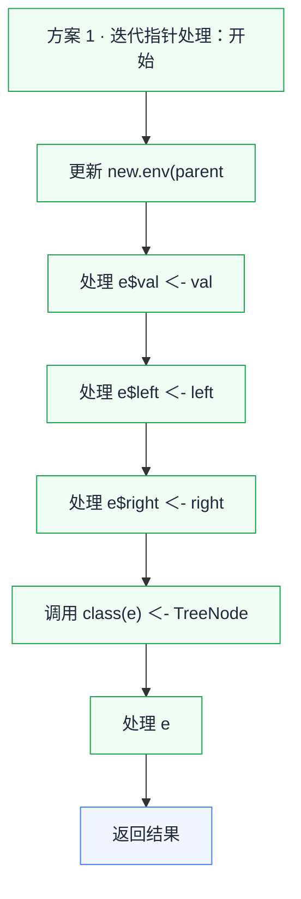

```r
# 版（方案1） 树节点：R 必须 environment 引用语义（list 是值语义） 定义函数 TreeNode（参数：值, 左边界 赋值为
# NULL, 右边界 赋值为 NULL）
TreeNode <- function(val, left = NULL, right = NULL) {
    e <- new.env(parent = emptyenv())  # 把 new.env(parent 赋值为 emptyenv()) 存入 e
    e$val <- val
    e$left <- left
    e$right <- right  # 把 值; e$左边界 小于 减 左边界; e$右边界 小于 减 右边界 存入 e$val
    class(e) <- "TreeNode"  # 把 「TreeNode」 存入 class(e)
    e
}
build_tree <- function(vals) {
    # 定义函数 build_tree（参数：vals）
    if (length(vals) == 0 || is.na(vals[[1]]))
        return(NULL)  # 若 长度(vals) 等于 0 或 is.na(vals[[1]])) return(NULL
    root <- TreeNode(vals[[1]])  # 把 TreeNode(vals[[1]]) 存入 根节点
    queue <- list(root)  # 把 列表(根节点) 存入 队列
    head <- 1L  # 把 1L 存入 头节点
    i <- 2L  # 把 2L 存入 下标 i
    while (head <= length(queue) && i <= length(vals)) {
        # 循环，直到不满足「头节点 不超过 长度(队列) 且 下标 i 不超过 长度(vals」
        node <- queue[[head]]  # 把 队列[[头节点]] 存入 节点
        head <- head + 1L  # 把 头节点 加 1L 存入 头节点
        if (i <= length(vals)) {
            # 若 下标 i 不超过 长度(vals 若 取反 is.na(vals[[下标 i]]
            if (!is.na(vals[[i]])) {
                node$left <- TreeNode(vals[[i]])  # 把 TreeNode(vals[[下标 i]]) 存入 node$left
                queue[[length(queue) + 1L]] <- node$left  # 队列[[长度(队列) 加 1L]] 小于 减 节点$左边界
            }
            i <- i + 1L  # 把 下标 i 加 1L 存入 下标 i
        }
        if (i <= length(vals)) {
            # 若 下标 i 不超过 长度(vals 若 取反 is.na(vals[[下标 i]]
            if (!is.na(vals[[i]])) {
                node$right <- TreeNode(vals[[i]])  # 把 TreeNode(vals[[下标 i]]) 存入 node$right
                queue[[length(queue) + 1L]] <- node$right  # 队列[[长度(队列) 加 1L]] 小于 减 节点$右边界
            }
            i <- i + 1L  # 把 下标 i 加 1L 存入 下标 i
        }
    }
    root  # 根节点
}
# 层序转列表（用于断言输出） 定义函数 tree_to_levels（参数：根节点）
tree_to_levels <- function(root) {
    if (is.null(root))
        return(list())  # 若 is.null(根节点)) return(列表(
    res <- list()  # 把 列表() 存入 结果
    level <- list(root)  # 把 列表(根节点) 存入 level
    while (length(level) > 0) {
        # 循环，直到不满足「长度(level) 超过 0」
        vals <- list()
        nxt <- list()  # 把 列表(); nxt 小于 减 列表() 存入 vals
        for (nd in level) {
            # for (nd in level) {
            vals[[length(vals) + 1L]] <- nd$val  # vals[[长度(vals) 加 1L]] 小于 减 nd$值
            if (!is.null(nd$left))
                nxt[[length(nxt) + 1L]] <- nd$left  # 若 取反 is.null(nd$左边界)) nxt[[长度(nxt) 加 1L]] 小于 减 nd$左边界
            if (!is.null(nd$right))
                nxt[[length(nxt) + 1L]] <- nd$right  # 若 取反 is.null(nd$右边界)) nxt[[长度(nxt) 加 1L]] 小于 减 nd$右边界
        }
        res[[length(res) + 1L]] <- unlist(vals)  # 结果[[长度(结果) 加 1L]] 小于 减 unlist(vals)
        level <- nxt  # 把 nxt 存入 level
    }
    res  # 结果
}
find_bottom_left_value <- function(root) {
    # 定义函数 find_bottom_left_value（参数：根节点）
    lv <- tree_to_levels(root)  # 把 tree_to_levels(根节点) 存入 lv
    lv[[length(lv)]][1L]  # lv[[长度(lv)]][1L]
}
stopifnot(find_bottom_left_value(build_tree(list(1L, 2L, 3L, 4L, 5L, 6L, 7L))) == 4L)  # 断言校验
stopifnot(find_bottom_left_value(build_tree(list(2L, 1L, 3L))) == 1L)  # 断言校验
cat("PASS\n")  # 全部用例通过，输出 PASS
```

#### 方案 2：迭代指针处理

**思路与代码分析**：核心是「迭代指针处理」。R 版用向量化思维与 1 起始下标，注意 1:n 的降序陷阱。**走读**：方案 2 · 迭代指针处理：开始 → 更新 new.env(parent → 处理 e$val ＜- val → 处理 e$left ＜- left → 处理 e$right ＜- right → 调用 class(e) ＜- TreeNode → 处理 e → 返回结果。

**运行架构**（真实控制流）：

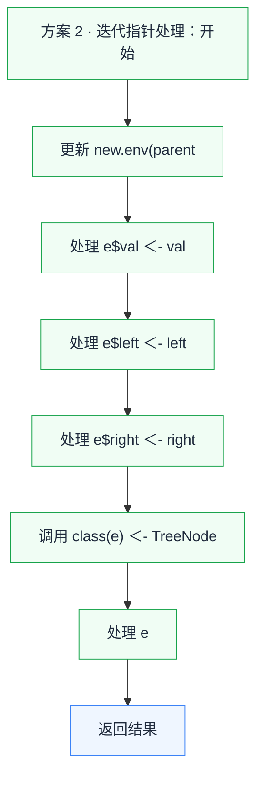

```r
# 版（方案2） 树节点：R 必须 environment 引用语义（list 是值语义） 定义函数 TreeNode（参数：值, 左边界 赋值为
# NULL, 右边界 赋值为 NULL）
TreeNode <- function(val, left = NULL, right = NULL) {
    e <- new.env(parent = emptyenv())  # 把 new.env(parent 赋值为 emptyenv()) 存入 e
    e$val <- val
    e$left <- left
    e$right <- right  # 把 值; e$左边界 小于 减 左边界; e$右边界 小于 减 右边界 存入 e$val
    class(e) <- "TreeNode"  # 把 「TreeNode」 存入 class(e)
    e
}
build_tree <- function(vals) {
    # 定义函数 build_tree（参数：vals）
    if (length(vals) == 0 || is.na(vals[[1]]))
        return(NULL)  # 若 长度(vals) 等于 0 或 is.na(vals[[1]])) return(NULL
    root <- TreeNode(vals[[1]])  # 把 TreeNode(vals[[1]]) 存入 根节点
    queue <- list(root)  # 把 列表(根节点) 存入 队列
    head <- 1L  # 把 1L 存入 头节点
    i <- 2L  # 把 2L 存入 下标 i
    while (head <= length(queue) && i <= length(vals)) {
        # 循环，直到不满足「头节点 不超过 长度(队列) 且 下标 i 不超过 长度(vals」
        node <- queue[[head]]  # 把 队列[[头节点]] 存入 节点
        head <- head + 1L  # 把 头节点 加 1L 存入 头节点
        if (i <= length(vals)) {
            # 若 下标 i 不超过 长度(vals 若 取反 is.na(vals[[下标 i]]
            if (!is.na(vals[[i]])) {
                node$left <- TreeNode(vals[[i]])  # 把 TreeNode(vals[[下标 i]]) 存入 node$left
                queue[[length(queue) + 1L]] <- node$left  # 队列[[长度(队列) 加 1L]] 小于 减 节点$左边界
            }
            i <- i + 1L  # 把 下标 i 加 1L 存入 下标 i
        }
        if (i <= length(vals)) {
            # 若 下标 i 不超过 长度(vals 若 取反 is.na(vals[[下标 i]]
            if (!is.na(vals[[i]])) {
                node$right <- TreeNode(vals[[i]])  # 把 TreeNode(vals[[下标 i]]) 存入 node$right
                queue[[length(queue) + 1L]] <- node$right  # 队列[[长度(队列) 加 1L]] 小于 减 节点$右边界
            }
            i <- i + 1L  # 把 下标 i 加 1L 存入 下标 i
        }
    }
    root  # 根节点
}
# 层序转列表（用于断言输出） 定义函数 tree_to_levels（参数：根节点）
tree_to_levels <- function(root) {
    if (is.null(root))
        return(list())  # 若 is.null(根节点)) return(列表(
    res <- list()  # 把 列表() 存入 结果
    level <- list(root)  # 把 列表(根节点) 存入 level
    while (length(level) > 0) {
        # 循环，直到不满足「长度(level) 超过 0」
        vals <- list()
        nxt <- list()  # 把 列表(); nxt 小于 减 列表() 存入 vals
        for (nd in level) {
            # for (nd in level) {
            vals[[length(vals) + 1L]] <- nd$val  # vals[[长度(vals) 加 1L]] 小于 减 nd$值
            if (!is.null(nd$left))
                nxt[[length(nxt) + 1L]] <- nd$left  # 若 取反 is.null(nd$左边界)) nxt[[长度(nxt) 加 1L]] 小于 减 nd$左边界
            if (!is.null(nd$right))
                nxt[[length(nxt) + 1L]] <- nd$right  # 若 取反 is.null(nd$右边界)) nxt[[长度(nxt) 加 1L]] 小于 减 nd$右边界
        }
        res[[length(res) + 1L]] <- unlist(vals)  # 结果[[长度(结果) 加 1L]] 小于 减 unlist(vals)
        level <- nxt  # 把 nxt 存入 level
    }
    res  # 结果
}
find_bottom_left_value <- function(root) {
    # 定义函数 find_bottom_left_value（参数：根节点）
    lv <- tree_to_levels(root)  # 把 tree_to_levels(根节点) 存入 lv
    lv[[length(lv)]][1L]  # lv[[长度(lv)]][1L]
}
stopifnot(find_bottom_left_value(build_tree(list(1L, 2L, 3L, 4L, 5L, 6L, 7L))) == 4L)  # 断言校验
stopifnot(find_bottom_left_value(build_tree(list(2L, 1L, 3L))) == 1L)  # 断言校验
cat("PASS\n")  # 全部用例通过，输出 PASS
```

### Zig 实现（2 种方案）

Zig 的全部方案如下，每个方案都内嵌用例自测，可独立运行（老仓库 python/go 文件遵循「打印结果」约定）：

#### 方案 1：迭代指针处理

**思路与代码分析**：核心是「迭代指针处理」。Zig 版显式分配与清零，整型边界处理严格。代码里依次做这些事：单循环线性扫描；队列或堆的调度。**走读**：方案 1 · 迭代指针处理：开始 → 计算 r → 计算 q → 处理 defer q.deinit() → 向 q 追加记录 → 计算 head → 计算 leftmost → 当 (head ＜ q.items.len) 时反复执行 → 计算 size → 更新 leftmost → 遍历集合元素 → 计算 node → 更新 + → 若 node.left) ｜c｜ q.append(c：处理 catch unreachable → 若 node.right) ｜c｜ q.append(c：处理 catch unreachable → 返回 leftmost。

**运行架构**（真实控制流）：

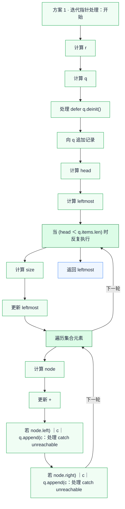

```zig
// LeetCode 513. 找树左下角的值 — Zig 版（方案1）
const std = @import("std"); // 把 @import(「std」) 存入 std

const TreeNode = struct { // 把 struct { 存入 TreeNode
    val: i32,
    left: ?*TreeNode,
    right: ?*TreeNode,
};

fn buildTree(allocator: std.mem.Allocator, vals: []const i32) !?*TreeNode { // 定义函数/方法 buildTree
    if (vals.len == 0 or vals[0] == -1) return null; // 若 vals.长度 等于 0 or vals[0] 等于 减 1，直接返回 null
    const root = try allocator.create(TreeNode); // 把 try allocator.create(TreeNode) 存入 根节点
    root.* = .{ .val = vals[0], .left = null, .right = null };
    var queue = std.ArrayList(*TreeNode).init(allocator); // 把 std.ArrayList( 乘 TreeNode).init(allocator) 存入 队列
    defer queue.deinit(); // defer 队列.deinit();
    try queue.append(root); // 把 根节点 追加到列表尾部
    var head: usize = 0; // 把 0; 写入 var head: usize
    var i: usize = 1; // 把 1; 写入 var i: usize
    while (head < queue.items.len and i < vals.len) { // 循环，直到不满足「头节点 小于 队列.items.长度 and 下标 i 小于 vals.长度」
        const node = queue.items[head]; // 把 队列.items[头节点] 存入 节点
        head += 1; // 头节点累加 1
        if (i < vals.len) { // 若 下标 i 小于 vals.长度
            if (vals[i] != -1) { // 若 vals[下标 i] 不等于 减 1
                const child = try allocator.create(TreeNode); // 把 try allocator.create(TreeNode) 存入 子节点
                child.* = .{ .val = vals[i], .left = null, .right = null };
                node.left = child; // 把 子节点; 写入 左边界
                try queue.append(child); // 把 子节点 追加到列表尾部
            }
            i += 1; // 下标 i累加 1
        }
        if (i < vals.len) { // 若 下标 i 小于 vals.长度
            if (vals[i] != -1) { // 若 vals[下标 i] 不等于 减 1
                const child = try allocator.create(TreeNode); // 把 try allocator.create(TreeNode) 存入 子节点
                child.* = .{ .val = vals[i], .left = null, .right = null };
                node.right = child; // 把 子节点; 写入 右边界
                try queue.append(child); // 把 子节点 追加到列表尾部
            }
            i += 1; // 下标 i累加 1
        }
    }
    return root; // 返回 根节点
}

fn findBottomLeftValue(root: ?*TreeNode) i32 { // 定义函数/方法 findBottomLeftValue
    const r = root.?; // 把 根节点.? 存入 右指针
    var q = std.ArrayList(*TreeNode).init(std.heap.page_allocator);
    defer q.deinit(); // defer 节点.deinit();
    q.append(r) catch unreachable; // 把 右指针 追加到列表尾部
    var head: usize = 0; // 把 0; 写入 var head: usize
    var leftmost: i32 = r.val; // 把 右指针.值; 写入 var leftmost: i32
    while (head < q.items.len) { // 循环，直到不满足「头节点 小于 节点.items.长度」
        const size = q.items.len - head; // 把 节点.items.长度 减 头节点 存入 大小
        leftmost = q.items[head].val; // 把 节点.items[头节点].值; 写入 leftmost
        for (0..size) |_| { // 让 _ 从 0 走到 大小 减一
            const node = q.items[head]; // 把 节点.items[头节点] 存入 节点
            head += 1; // 头节点累加 1
            if (node.left) |c| q.append(c) catch unreachable; // 若 节点.左边界) 按位或 字符 按位或 节点 追加 字符) catch unreachable;
            if (node.right) |c| q.append(c) catch unreachable; // 若 节点.右边界) 按位或 字符 按位或 节点 追加 字符) catch unreachable;
        }
    }
    return leftmost; // 返回 leftmost
}
pub fn main() !void { // 程序入口：跑内嵌自测用例
    var arena = std.heap.ArenaAllocator.init(std.heap.page_allocator); // 把 std.堆.ArenaAllocator.init(std.堆.page_allocator) 存入 arena
    defer arena.deinit(); // defer arena.deinit();
    const alloc = arena.allocator(); // 把 arena.allocator() 存入 alloc
    if (findBottomLeftValue(try buildTree(alloc, &[_]i32{ 1, 2, 3, 4, 5, 6, 7 })) != 4) return error.TestFailed;
    if (findBottomLeftValue(try buildTree(alloc, &[_]i32{ 2, 1, 3 })) != 1) return error.TestFailed;
    std.debug.print("PASS\n", .{}); // 全部用例通过，输出 PASS
}
```

#### 方案 2：迭代指针处理

**思路与代码分析**：核心是「迭代指针处理」。Zig 版显式分配与清零，整型边界处理严格。代码里依次做这些事：单循环线性扫描；队列或堆的调度。**走读**：方案 2 · 迭代指针处理：开始 → 计算 r → 计算 q → 处理 defer q.deinit() → 向 q 追加记录 → 计算 head → 计算 leftmost → 当 (head ＜ q.items.len) 时反复执行 → 计算 size → 更新 leftmost → 遍历集合元素 → 计算 node → 更新 + → 若 node.left) ｜c｜ q.append(c：处理 catch unreachable → 若 node.right) ｜c｜ q.append(c：处理 catch unreachable → 返回 leftmost。

**运行架构**（真实控制流）：

```mermaid
graph TD
    N0["方案 2 · 迭代指针处理：开始"]
    N1["计算 r"]
    N2["计算 q"]
    N3["处理 defer q.deinit()"]
    N4["向 q 追加记录"]
    N5["计算 head"]
    N6["计算 leftmost"]
    N7["当 (head ＜ q.items.len) 时反复执行"]
    N8["计算 size"]
    N9["更新 leftmost"]
    N10["遍历集合元素"]
    N11["计算 node"]
    N12["更新 +"]
    N13["若 node.left) ｜c｜ q.append(c：处理 catch unreachable"]
    N14["若 node.right) ｜c｜ q.append(c：处理 catch unreachable"]
    N15["返回 leftmost"]
    N0 --> N1
    N1 --> N2
    N2 --> N3
    N3 --> N4
    N4 --> N5
    N5 --> N6
    N6 --> N7
    N7 --> N8
    N8 --> N9
    N9 --> N10
    N10 --> N11
    N11 --> N12
    N12 --> N13
    N13 --> N14
    N14 -- 下一轮 --> N10
    N10 -- 下一轮 --> N7
    N7 --> N15
    classDef n fill:#f0fdf4,stroke:#16a34a,color:#1e293b;
    classDef lp fill:#dcfce7,stroke:#15803d,color:#1e293b;
    classDef dc fill:#fef9c3,stroke:#ca8a04,color:#1e293b;
    classDef tm fill:#eff6ff,stroke:#3b82f6,color:#1e293b;
    class N0,N1,N2,N3,N4,N5,N6,N8,N9,N11,N12,N13,N14 n;
    class N7,N10 lp;
    class N15 tm;
```

```zig
// LeetCode 513. 找树左下角的值 — Zig 版（方案2）
const std = @import("std"); // 把 @import(「std」) 存入 std

const TreeNode = struct { // 把 struct { 存入 TreeNode
    val: i32,
    left: ?*TreeNode,
    right: ?*TreeNode,
};

fn buildTree(allocator: std.mem.Allocator, vals: []const i32) !?*TreeNode { // 定义函数/方法 buildTree
    if (vals.len == 0 or vals[0] == -1) return null; // 若 vals.长度 等于 0 or vals[0] 等于 减 1，直接返回 null
    const root = try allocator.create(TreeNode); // 把 try allocator.create(TreeNode) 存入 根节点
    root.* = .{ .val = vals[0], .left = null, .right = null };
    var queue = std.ArrayList(*TreeNode).init(allocator); // 把 std.ArrayList( 乘 TreeNode).init(allocator) 存入 队列
    defer queue.deinit(); // defer 队列.deinit();
    try queue.append(root); // 把 根节点 追加到列表尾部
    var head: usize = 0; // 把 0; 写入 var head: usize
    var i: usize = 1; // 把 1; 写入 var i: usize
    while (head < queue.items.len and i < vals.len) { // 循环，直到不满足「头节点 小于 队列.items.长度 and 下标 i 小于 vals.长度」
        const node = queue.items[head]; // 把 队列.items[头节点] 存入 节点
        head += 1; // 头节点累加 1
        if (i < vals.len) { // 若 下标 i 小于 vals.长度
            if (vals[i] != -1) { // 若 vals[下标 i] 不等于 减 1
                const child = try allocator.create(TreeNode); // 把 try allocator.create(TreeNode) 存入 子节点
                child.* = .{ .val = vals[i], .left = null, .right = null };
                node.left = child; // 把 子节点; 写入 左边界
                try queue.append(child); // 把 子节点 追加到列表尾部
            }
            i += 1; // 下标 i累加 1
        }
        if (i < vals.len) { // 若 下标 i 小于 vals.长度
            if (vals[i] != -1) { // 若 vals[下标 i] 不等于 减 1
                const child = try allocator.create(TreeNode); // 把 try allocator.create(TreeNode) 存入 子节点
                child.* = .{ .val = vals[i], .left = null, .right = null };
                node.right = child; // 把 子节点; 写入 右边界
                try queue.append(child); // 把 子节点 追加到列表尾部
            }
            i += 1; // 下标 i累加 1
        }
    }
    return root; // 返回 根节点
}

fn findBottomLeftValue(root: ?*TreeNode) i32 { // 定义函数/方法 findBottomLeftValue
    const r = root.?; // 把 根节点.? 存入 右指针
    var q = std.ArrayList(*TreeNode).init(std.heap.page_allocator);
    defer q.deinit(); // defer 节点.deinit();
    q.append(r) catch unreachable; // 把 右指针 追加到列表尾部
    var head: usize = 0; // 把 0; 写入 var head: usize
    var leftmost: i32 = r.val; // 把 右指针.值; 写入 var leftmost: i32
    while (head < q.items.len) { // 循环，直到不满足「头节点 小于 节点.items.长度」
        const size = q.items.len - head; // 把 节点.items.长度 减 头节点 存入 大小
        leftmost = q.items[head].val; // 把 节点.items[头节点].值; 写入 leftmost
        for (0..size) |_| { // 让 _ 从 0 走到 大小 减一
            const node = q.items[head]; // 把 节点.items[头节点] 存入 节点
            head += 1; // 头节点累加 1
            if (node.left) |c| q.append(c) catch unreachable; // 若 节点.左边界) 按位或 字符 按位或 节点 追加 字符) catch unreachable;
            if (node.right) |c| q.append(c) catch unreachable; // 若 节点.右边界) 按位或 字符 按位或 节点 追加 字符) catch unreachable;
        }
    }
    return leftmost; // 返回 leftmost
}
pub fn main() !void { // 程序入口：跑内嵌自测用例
    var arena = std.heap.ArenaAllocator.init(std.heap.page_allocator); // 把 std.堆.ArenaAllocator.init(std.堆.page_allocator) 存入 arena
    defer arena.deinit(); // defer arena.deinit();
    const alloc = arena.allocator(); // 把 arena.allocator() 存入 alloc
    if (findBottomLeftValue(try buildTree(alloc, &[_]i32{ 1, 2, 3, 4, 5, 6, 7 })) != 4) return error.TestFailed;
    if (findBottomLeftValue(try buildTree(alloc, &[_]i32{ 2, 1, 3 })) != 1) return error.TestFailed;
    std.debug.print("PASS\n", .{}); // 全部用例通过，输出 PASS
}
```

### Dart 实现（2 种方案）

Dart 的全部方案如下，每个方案都内嵌用例自测，可独立运行（老仓库 python/go 文件遵循「打印结果」约定）：

#### 方案 1：迭代指针处理

**思路与代码分析**：核心是「迭代指针处理」。Dart 版用可空类型标注与集合方法，注意空安全。代码里依次做这些事：单循环线性扫描。**走读**：方案 1 · 迭代指针处理：开始 → 计算 q → 计算 leftmost → 当 (q.isNotEmpty) 时反复执行 → 更新 leftmost → 更新 size → 遍历循环 → 更新 n → 若 n.left ≠ null：调用 q.add(n.left非 ) → 调用 q.add(n.left非 ) → 若 n.right ≠ null：调用 q.add(n.right非 ) → 调用 q.add(n.right非 ) → 返回 leftmost。

**运行架构**（真实控制流）：

```mermaid
graph TD
    N0["方案 1 · 迭代指针处理：开始"]
    N1["计算 q"]
    N2["计算 leftmost"]
    N3["当 (q.isNotEmpty) 时反复执行"]
    N4["更新 leftmost"]
    N5["更新 size"]
    N6["遍历循环"]
    N7["更新 n"]
    N8["若 n.left ≠ null：调用 q.add(n.left非 )"]
    N9["调用 q.add(n.left非 )"]
    N10["若 n.right ≠ null：调用 q.add(n.right非 )"]
    N11["调用 q.add(n.right非 )"]
    N12["返回 leftmost"]
    N0 --> N1
    N1 --> N2
    N2 --> N3
    N3 --> N4
    N4 --> N5
    N5 --> N6
    N6 --> N7
    N7 --> N8
    N8 --> N9
    N9 --> N10
    N10 --> N11
    N11 -- 下一轮 --> N6
    N6 -- 下一轮 --> N3
    N3 --> N12
    classDef n fill:#f0fdf4,stroke:#16a34a,color:#1e293b;
    classDef lp fill:#dcfce7,stroke:#15803d,color:#1e293b;
    classDef dc fill:#fef9c3,stroke:#ca8a04,color:#1e293b;
    classDef tm fill:#eff6ff,stroke:#3b82f6,color:#1e293b;
    class N0,N1,N2,N4,N5,N7,N8,N9,N10,N11 n;
    class N3,N6 lp;
    class N12 tm;
```

```dart
// LeetCode 513. 找树左下角的值 — Dart 版（方案1）
class TreeNode {
  // 定义类型
  int val; // int 值;
  TreeNode? left; // TreeNode? 左边界;
  TreeNode? right; // TreeNode? 右边界;
  TreeNode(this.val); // TreeNode(this.值);
}

TreeNode? buildTree(List<int?> vals) {
  // TreeNode? buildTree(List 小于 int? 超过 vals) {
  if (vals.isEmpty || vals[0] == null)
    return null; // 若 vals.isEmpty 或 vals[0] 等于 null，直接返回 null
  final root = TreeNode(vals[0]!); // 把 TreeNode(vals[0]取反 ) 存入 根节点
  final queue = <TreeNode>[root]; // 把 小于 TreeNode 超过 [根节点] 存入 队列
  var head = 0; // 把 0 存入 头节点
  var i = 1; // 把 1 存入 下标 i
  while (head < queue.length && i < vals.length) {
    // 循环，直到不满足「头节点 小于 队列.长度 且 下标 i 小于 vals.长度」
    final node = queue[head++]; // 把 队列[头节点 加一 ] 存入 节点
    if (i < vals.length) {
      // 若 下标 i 小于 vals.长度
      if (vals[i] != null) {
        // 若 vals[下标 i] 不等于 null
        node.left = TreeNode(vals[i]!); // 把 TreeNode(vals[下标 i]取反 ); 写入 左边界
        queue.add(node.left!); // 队列 追加 节点.左边界取反 );
      }
      i++; // 下标 i 加一
    }
    if (i < vals.length) {
      // 若 下标 i 小于 vals.长度
      if (vals[i] != null) {
        // 若 vals[下标 i] 不等于 null
        node.right = TreeNode(vals[i]!); // 把 TreeNode(vals[下标 i]取反 ); 写入 右边界
        queue.add(node.right!); // 队列 追加 节点.右边界取反 );
      }
      i++; // 下标 i 加一
    }
  }
  return root; // 返回 根节点
}

List<List<int>> treeToLevels(TreeNode? root) {
  // 定义函数/方法 treeToLevels
  if (root == null) return []; // 若 根节点 等于 null，直接返回 []
  final res = <List<int>>[]; // 把 小于 List 小于 int 超过 超过 [] 存入 结果
  var level = <TreeNode>[root]; // 把 小于 TreeNode 超过 [根节点] 存入 level
  while (level.isNotEmpty) {
    // 循环，直到不满足「level.isNotEmpty」
    final vals = <int>[]; // 把 小于 int 超过 [] 存入 vals
    final nxt = <TreeNode>[]; // 把 小于 TreeNode 超过 [] 存入 nxt
    for (final n in level) {
      // for (final 元素个数 in level) {
      vals.add(n.val); // vals 追加 元素个数.值);
      if (n.left != null)
        nxt.add(n.left!); // 若 元素个数.左边界 不等于 null) nxt 追加 元素个数.左边界取反 );
      if (n.right != null)
        nxt.add(n.right!); // 若 元素个数.右边界 不等于 null) nxt 追加 元素个数.右边界取反 );
    }
    res.add(vals); // 结果 追加 vals);
    level = nxt; // 把 nxt 存入 level
  }
  return res; // 返回 结果
}

int findBottomLeftValue(TreeNode? root) {
  // 定义函数/方法 findBottomLeftValue
  var q = <TreeNode>[root!]; // 把 小于 TreeNode 超过 [根节点取反 ] 存入 节点
  var leftmost = root.val; // 把 根节点.值 存入 leftmost
  while (q.isNotEmpty) {
    // 循环，直到不满足「节点.isNotEmpty」
    leftmost = q.first.val; // 把 节点.first.值 存入 leftmost
    final size = q.length; // 把 节点.长度 存入 大小
    for (var i = 0; i < size; i++) {
      // 让 下标 i 从 0 开始计数，下标 i 小于 大小 就继续
      final n = q.removeAt(0); // 把 节点.removeAt(0) 存入 元素个数
      if (n.left != null)
        q.add(n.left!); // 若 元素个数.左边界 不等于 null) 节点 追加 元素个数.左边界取反 );
      if (n.right != null)
        q.add(n.right!); // 若 元素个数.右边界 不等于 null) 节点 追加 元素个数.右边界取反 );
    }
  }
  return leftmost; // 返回 leftmost
}

void main() {
  // 程序入口：跑内嵌自测用例
  if (findBottomLeftValue(buildTree([1, 2, 3, 4, 5, 6, 7])) != 4)
    throw StateError('c1');
  if (findBottomLeftValue(buildTree([2, 1, 3])) != 1) throw StateError('c2');
  print('PASS'); // 全部用例通过，输出 PASS
}
```

#### 方案 2：迭代指针处理

**思路与代码分析**：核心是「迭代指针处理」。Dart 版用可空类型标注与集合方法，注意空安全。代码里依次做这些事：单循环线性扫描。**走读**：方案 2 · 迭代指针处理：开始 → 计算 q → 计算 leftmost → 当 (q.isNotEmpty) 时反复执行 → 更新 leftmost → 更新 size → 遍历循环 → 更新 n → 若 n.left ≠ null：调用 q.add(n.left非 ) → 调用 q.add(n.left非 ) → 若 n.right ≠ null：调用 q.add(n.right非 ) → 调用 q.add(n.right非 ) → 返回 leftmost。

**运行架构**（真实控制流）：

```mermaid
graph TD
    N0["方案 2 · 迭代指针处理：开始"]
    N1["计算 q"]
    N2["计算 leftmost"]
    N3["当 (q.isNotEmpty) 时反复执行"]
    N4["更新 leftmost"]
    N5["更新 size"]
    N6["遍历循环"]
    N7["更新 n"]
    N8["若 n.left ≠ null：调用 q.add(n.left非 )"]
    N9["调用 q.add(n.left非 )"]
    N10["若 n.right ≠ null：调用 q.add(n.right非 )"]
    N11["调用 q.add(n.right非 )"]
    N12["返回 leftmost"]
    N0 --> N1
    N1 --> N2
    N2 --> N3
    N3 --> N4
    N4 --> N5
    N5 --> N6
    N6 --> N7
    N7 --> N8
    N8 --> N9
    N9 --> N10
    N10 --> N11
    N11 -- 下一轮 --> N6
    N6 -- 下一轮 --> N3
    N3 --> N12
    classDef n fill:#f0fdf4,stroke:#16a34a,color:#1e293b;
    classDef lp fill:#dcfce7,stroke:#15803d,color:#1e293b;
    classDef dc fill:#fef9c3,stroke:#ca8a04,color:#1e293b;
    classDef tm fill:#eff6ff,stroke:#3b82f6,color:#1e293b;
    class N0,N1,N2,N4,N5,N7,N8,N9,N10,N11 n;
    class N3,N6 lp;
    class N12 tm;
```

```dart
// LeetCode 513. 找树左下角的值 — Dart 版（方案2）
class TreeNode {
  // 定义类型
  int val; // int 值;
  TreeNode? left; // TreeNode? 左边界;
  TreeNode? right; // TreeNode? 右边界;
  TreeNode(this.val); // TreeNode(this.值);
}

TreeNode? buildTree(List<int?> vals) {
  // TreeNode? buildTree(List 小于 int? 超过 vals) {
  if (vals.isEmpty || vals[0] == null)
    return null; // 若 vals.isEmpty 或 vals[0] 等于 null，直接返回 null
  final root = TreeNode(vals[0]!); // 把 TreeNode(vals[0]取反 ) 存入 根节点
  final queue = <TreeNode>[root]; // 把 小于 TreeNode 超过 [根节点] 存入 队列
  var head = 0; // 把 0 存入 头节点
  var i = 1; // 把 1 存入 下标 i
  while (head < queue.length && i < vals.length) {
    // 循环，直到不满足「头节点 小于 队列.长度 且 下标 i 小于 vals.长度」
    final node = queue[head++]; // 把 队列[头节点 加一 ] 存入 节点
    if (i < vals.length) {
      // 若 下标 i 小于 vals.长度
      if (vals[i] != null) {
        // 若 vals[下标 i] 不等于 null
        node.left = TreeNode(vals[i]!); // 把 TreeNode(vals[下标 i]取反 ); 写入 左边界
        queue.add(node.left!); // 队列 追加 节点.左边界取反 );
      }
      i++; // 下标 i 加一
    }
    if (i < vals.length) {
      // 若 下标 i 小于 vals.长度
      if (vals[i] != null) {
        // 若 vals[下标 i] 不等于 null
        node.right = TreeNode(vals[i]!); // 把 TreeNode(vals[下标 i]取反 ); 写入 右边界
        queue.add(node.right!); // 队列 追加 节点.右边界取反 );
      }
      i++; // 下标 i 加一
    }
  }
  return root; // 返回 根节点
}

List<List<int>> treeToLevels(TreeNode? root) {
  // 定义函数/方法 treeToLevels
  if (root == null) return []; // 若 根节点 等于 null，直接返回 []
  final res = <List<int>>[]; // 把 小于 List 小于 int 超过 超过 [] 存入 结果
  var level = <TreeNode>[root]; // 把 小于 TreeNode 超过 [根节点] 存入 level
  while (level.isNotEmpty) {
    // 循环，直到不满足「level.isNotEmpty」
    final vals = <int>[]; // 把 小于 int 超过 [] 存入 vals
    final nxt = <TreeNode>[]; // 把 小于 TreeNode 超过 [] 存入 nxt
    for (final n in level) {
      // for (final 元素个数 in level) {
      vals.add(n.val); // vals 追加 元素个数.值);
      if (n.left != null)
        nxt.add(n.left!); // 若 元素个数.左边界 不等于 null) nxt 追加 元素个数.左边界取反 );
      if (n.right != null)
        nxt.add(n.right!); // 若 元素个数.右边界 不等于 null) nxt 追加 元素个数.右边界取反 );
    }
    res.add(vals); // 结果 追加 vals);
    level = nxt; // 把 nxt 存入 level
  }
  return res; // 返回 结果
}

int findBottomLeftValue(TreeNode? root) {
  // 定义函数/方法 findBottomLeftValue
  var q = <TreeNode>[root!]; // 把 小于 TreeNode 超过 [根节点取反 ] 存入 节点
  var leftmost = root.val; // 把 根节点.值 存入 leftmost
  while (q.isNotEmpty) {
    // 循环，直到不满足「节点.isNotEmpty」
    leftmost = q.first.val; // 把 节点.first.值 存入 leftmost
    final size = q.length; // 把 节点.长度 存入 大小
    for (var i = 0; i < size; i++) {
      // 让 下标 i 从 0 开始计数，下标 i 小于 大小 就继续
      final n = q.removeAt(0); // 把 节点.removeAt(0) 存入 元素个数
      if (n.left != null)
        q.add(n.left!); // 若 元素个数.左边界 不等于 null) 节点 追加 元素个数.左边界取反 );
      if (n.right != null)
        q.add(n.right!); // 若 元素个数.右边界 不等于 null) 节点 追加 元素个数.右边界取反 );
    }
  }
  return leftmost; // 返回 leftmost
}

void main() {
  // 程序入口：跑内嵌自测用例
  if (findBottomLeftValue(buildTree([1, 2, 3, 4, 5, 6, 7])) != 4)
    throw StateError('c1');
  if (findBottomLeftValue(buildTree([2, 1, 3])) != 1) throw StateError('c2');
  print('PASS'); // 全部用例通过，输出 PASS
}
```

---

## 内容总结

- **找树左下角的值**（二叉树 · Medium）：共 2 个方案，主线思路「迭代指针处理」；时间 O(n)（单趟线性扫描）；动画演示DFS 点亮过程，附录给出 11 种语言 × 全部方案的可运行实现。
- 来源博客：[https://blog.csdn.net/tyro_java/article/details/145368911](https://blog.csdn.net/tyro_java/article/details/145368911)
- 导航：[📋 总目录](../) ｜ [← 131 n 叉树的层序遍历](../131_n_叉树的层序遍历/) ｜ [133 在每个树行中找最大值 →](../133_在每个树行中找最大值/)
