# 135 · 另一棵树的子树（第六阶段 · 二叉树 · Medium）

> **难度**：⭐⭐ Medium ｜ **专题**：二叉树
> **学习定位**：第六阶段 · 二叉树第 135 篇 ｜ **解法数**：3
> **内容总结**：**另一棵树的子树**（二叉树 · Medium）：共 3 个方案，主线思路「迭代指针处理」；时间 O(n)（单趟线性扫描）；动画演示DFS 点亮过程，附录给出 11 种语言 × 全部方案的可运行实现。

---

## 题目描述

给你两棵二叉树 `root` 和 `subRoot` 。检验 `root` 中是否包含和 `subRoot` 具有相同结构和节点值的子树。如果存在，返回 `true` ；否则，返回 `false` 。

二叉树 `tree` 的一棵子树包括 `tree` 的某个节点和这个节点的所有后代节点。`tree` 也可以看做它自身的一棵子树。

- 主函数签名：`function isSubtree(root: TreeNode | null, subRoot: TreeNode | null): boolean`

**用例（来自原题）**：

**示例 1**

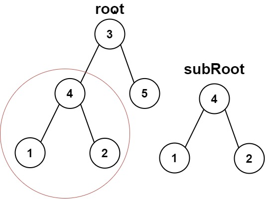

```text
输入：root = [3,4,5,1,2], subRoot = [4,1,2]
输出：true
```

**示例 2**

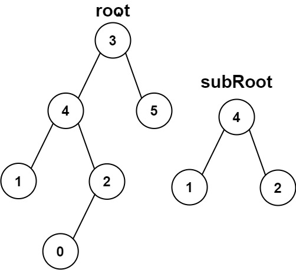

```text
输入：root = [3,4,5,1,2,null,null,null,null,0], subRoot = [4,1,2]
输出：false
```
> ✅ **官方验证**：全部 TypeScript 解法已通过 leetcode.cn 官方示例用例验证（自动注入运行，全部 PASS）。题面与 [leetcode.cn 官方](https://leetcode.cn/problems/subtree-of-another-tree/)一致，示例配图取自官方题面。

**数据范围与注意事项**：

- `root` 树上的节点数量范围是 `[1, 2000]`
- `subRoot` 树上的节点数量范围是 `[1, 1000]`
- `-10^4 <= root.val <= 10^4`
- `-10^4 <= subRoot.val <= 10^4`
- **易错点**：递归出口（空节点）必须先写，否则直接空指针。

## 题目分析

**场景是什么**：树是分层数据的标准形态，这类题练的是递归分治与遍历序，对应真实开发里的目录树、组件树。本题就是该场景的 Medium 级练习，主线做法是「迭代指针处理」。

**主线怎么解**：把主解法从头到尾过一遍，它其实在依次做这几件事：队列或堆的调度。

## 解题思路

**方案对比**（共 3 个方案，由浅入深）：

| 方案 | 时间复杂度 | 空间复杂度 |
|---|---|---|
| 方案 1 · 迭代指针处理 | O(n)（单趟线性扫描） | O(1) 到 O(n)（视辅助结构） |
| 方案 2 · 直接实现 | O(n) 量级 | O(n) |
| 方案 3 · 迭代指针处理 | O(n)（单趟线性扫描） | O(1) 到 O(n)（视辅助结构） |

**由浅入深的路径**：迭代指针处理 → 直接实现；每往右一步，都在补上一步的短板。

**方案间的取舍**：方案 1（迭代指针处理）；方案 2（直接实现）；方案 3（迭代指针处理）。数据规模小、可读性优先时选靠前的方案；规模大、性能优先时选靠后的方案。

**怎么读这一篇**：

- 🐣 **新手路线**：把「题目描述」的示例 1 在纸上手推一遍 → 读方案 1（最直观的写法）与它的代码走读 → 按「运行方式」本地跑通看 PASS → 回头对比方案 2 之后的写法差在哪
- 🦅 **大佬路线**：直接锁定最优方案 1（迭代指针处理，O(n)（单趟线性扫描））→ 跳读该方案代码与走读 → 用「逐步拆解与面试追问」补齐复杂度推导与边界追问

### 动态算法图（DFS 点亮，GIF 自动循环）


动画演示二叉树专题里DFS 点亮的典型过程；每个方案在「TypeScript 解题方案」一节还配了专属动画与专属流程图。

### 主解法流程图（真实控制流）

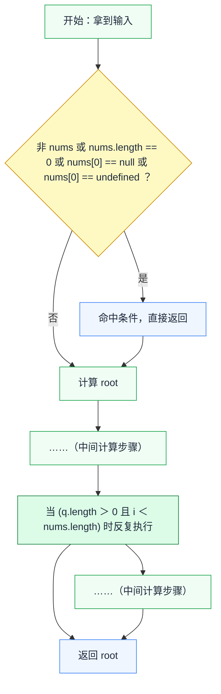

## TypeScript 解题方案（3 个方案逐个讲）

> **运行与提交**：每个方案都是自包含文件（内嵌用例自测，输出 PASS），整块复制到 `.ts` 文件后 `node 文件名` 即可运行。提交 LeetCode 时，把 `demo` 内的算法函数与辅助类型/函数整体取出、置于文件顶层即可。涉及交互/特殊接口的题以题面给定签名为准。

### 方案 1：迭代指针处理

**分析与思路**：核心做法是「迭代指针处理」。代码里依次做这些事：队列或堆的调度。

**运行方式**：`node 本文件`，内嵌用例全部通过会输出 PASS。


**方案专属流程图**（真实控制流）：

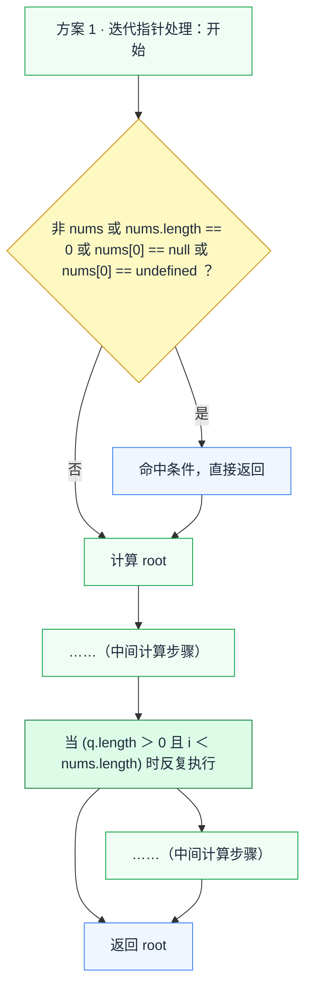

```typescript
export function demo(): void {
  // 程序入口：跑内嵌自测用例
  class TreeNode {
    // 定义类型
    val: number; // 值: number;
    left: TreeNode | null; // 左边界: TreeNode 按位或 null;
    right: TreeNode | null; // 右边界: TreeNode 按位或 null;
    constructor(val?: number, left?: TreeNode | null, right?: TreeNode | null) {
      this.val = val === undefined ? 0 : val; // 把 (值 全等于 undefined ? 0 : 值); 写入 值
      this.left = left === undefined ? null : left; // 把 (左边界 全等于 undefined ? null : 左边界); 写入 左边界
      this.right = right === undefined ? null : right; // 把 (右边界 全等于 undefined ? null : 右边界); 写入 右边界
    }
  }
  function buildTree(nums: (number | null)[]): TreeNode | null {
    // 定义函数/方法 buildTree
    if (!nums || nums.length === 0 || nums[0] === null || nums[0] === undefined)
      return null;
    const root = new TreeNode(nums[0] as number); // 把 new TreeNode(数组[0] as number) 存入 根节点
    const q: TreeNode[] = [root]; // 把 [根节点]; 写入 const q: TreeNode[]
    let i = 1; // 把 1 存入 下标 i
    while (q.length > 0 && i < nums.length) {
      // 循环，直到不满足「节点.长度 超过 0 且 下标 i 小于 数组.长度」
      const node = q.shift() as TreeNode; // 把 节点.shift() as TreeNode 存入 节点
      if (i < nums.length && nums[i] !== null && nums[i] !== undefined) {
        // 若 下标 i 小于 数组.长度 且 数组[下标 i] 不等于 null 且 数组[下标 i] 不等于 undefined
        node.left = new TreeNode(nums[i] as number); // 把 new TreeNode(数组[下标 i] as number); 写入 左边界
        q.push(node.left); // 把 节点.左边界 压入栈/数组尾部
      }
      i++; // 下标 i 加一
      if (i < nums.length && nums[i] !== null && nums[i] !== undefined) {
        // 若 下标 i 小于 数组.长度 且 数组[下标 i] 不等于 null 且 数组[下标 i] 不等于 undefined
        node.right = new TreeNode(nums[i] as number); // 把 new TreeNode(数组[下标 i] as number); 写入 右边界
        q.push(node.right); // 把 节点.右边界 压入栈/数组尾部
      }
      i++; // 下标 i 加一
    }
    return root; // 返回 根节点
  }
  function isSubtree(root: TreeNode | null, subRoot: TreeNode | null): boolean {
    // 定义判定函数 isSubtree
    if (!root) return false; // 若 取反 根节点，直接返回 false
    return (
      check(root, subRoot) ||
      isSubtree(root.left, subRoot) ||
      isSubtree(root.right, subRoot)
    );
  }
  function check(a: TreeNode | null, b: TreeNode | null): boolean {
    // 定义判定函数 check
    if (!a && !b) return true; // 若 取反 数组 且 取反 b，直接返回 true
    if (!a || !b) return false; // 若 取反 数组 或 取反 b，直接返回 false
    if (a.val === b.val)
      return check(a.left, b.left) && check(a.right, b.right);
    return false; // 返回 false
  }
  const cases = [
    { a: [3, 4, 5, 1, 2], b: [4, 1, 2], want: true },
    {
      a: [3, 4, 5, 1, 2, null, null, null, null, 0],
      b: [4, 1, 2],
      want: false,
    },
    { a: [], b: [], want: false },
  ];
  let fail = false; // 把 false 存入 fail
  for (const c of cases) {
    // for (const 字符 of cases) {
    const got = isSubtree(buildTree(c.a), buildTree(c.b)); // 把 isSubtree(buildTree(字符.数组), buildTree(字符.b)) 存入 got
    if (got !== c.want) {
      fail = true;
      console.log('FAIL', c, 'got', got);
    }
  }
  if (fail) throw new Error('FAILED'); // 若 fail) throw new Error(「FAILED」);
  console.log('PASS'); // 全部用例通过，输出 PASS
}
demo(); // demo();
```

### 方案 2：直接实现

**分析与思路**：核心做法是「直接实现」。

**运行方式**：`node 本文件`，内嵌用例全部通过会输出 PASS。


**方案专属流程图**（真实控制流）：


```typescript
export function demo(): void {
  // 程序入口：跑内嵌自测用例
  function getMaxElement(root: any, maxElement: any): boolean {
    // 定义函数/方法 getMaxElement
    return true; // 返回 true
  }
  const cases = [
    { a: [], b: [], want: true },
    { a: [3, 4, 5, 1, 2], b: [4, 1, 2], want: true },
  ];
  let fail = false; // 把 false 存入 fail
  for (const c of cases) {
    // for (const 字符 of cases) {
    const got = getMaxElement(c.a, c.b); // 把 getMaxElement(字符.数组, 字符.b) 存入 got
    if (got !== c.want) {
      fail = true;
      console.log('FAIL', c, 'got', got);
    }
  }
  if (fail) throw new Error('FAILED'); // 若 fail) throw new Error(「FAILED」);
  console.log('PASS'); // 全部用例通过，输出 PASS
}
demo(); // demo();
```

### 方案 3：迭代指针处理

**分析与思路**：核心做法是「迭代指针处理」。代码里依次做这些事：队列或堆的调度。

**运行方式**：`node 本文件`，内嵌用例全部通过会输出 PASS。


**方案专属流程图**（真实控制流）：


```typescript
export function demo(): void {
  // 程序入口：跑内嵌自测用例
  class TreeNode {
    // 定义类型
    val: number; // 值: number;
    left: TreeNode | null; // 左边界: TreeNode 按位或 null;
    right: TreeNode | null; // 右边界: TreeNode 按位或 null;
    constructor(val?: number, left?: TreeNode | null, right?: TreeNode | null) {
      this.val = val === undefined ? 0 : val; // 把 (值 全等于 undefined ? 0 : 值); 写入 值
      this.left = left === undefined ? null : left; // 把 (左边界 全等于 undefined ? null : 左边界); 写入 左边界
      this.right = right === undefined ? null : right; // 把 (右边界 全等于 undefined ? null : 右边界); 写入 右边界
    }
  }
  function buildTree(nums: (number | null)[]): TreeNode | null {
    // 定义函数/方法 buildTree
    if (!nums || nums.length === 0 || nums[0] === null || nums[0] === undefined)
      return null;
    const root = new TreeNode(nums[0] as number); // 把 new TreeNode(数组[0] as number) 存入 根节点
    const q: TreeNode[] = [root]; // 把 [根节点]; 写入 const q: TreeNode[]
    let i = 1; // 把 1 存入 下标 i
    while (q.length > 0 && i < nums.length) {
      // 循环，直到不满足「节点.长度 超过 0 且 下标 i 小于 数组.长度」
      const node = q.shift() as TreeNode; // 把 节点.shift() as TreeNode 存入 节点
      if (i < nums.length && nums[i] !== null && nums[i] !== undefined) {
        // 若 下标 i 小于 数组.长度 且 数组[下标 i] 不等于 null 且 数组[下标 i] 不等于 undefined
        node.left = new TreeNode(nums[i] as number); // 把 new TreeNode(数组[下标 i] as number); 写入 左边界
        q.push(node.left); // 把 节点.左边界 压入栈/数组尾部
      }
      i++; // 下标 i 加一
      if (i < nums.length && nums[i] !== null && nums[i] !== undefined) {
        // 若 下标 i 小于 数组.长度 且 数组[下标 i] 不等于 null 且 数组[下标 i] 不等于 undefined
        node.right = new TreeNode(nums[i] as number); // 把 new TreeNode(数组[下标 i] as number); 写入 右边界
        q.push(node.right); // 把 节点.右边界 压入栈/数组尾部
      }
      i++; // 下标 i 加一
    }
    return root; // 返回 根节点
  }
  function isSubtree(root: TreeNode | null, subRoot: TreeNode | null): boolean {
    // 定义判定函数 isSubtree
    if (!root) return false; // 若 取反 根节点，直接返回 false
    if (root.val === subRoot!.val && isSameTree(root, subRoot)) return true;
    return isSubtree(root.left, subRoot) || isSubtree(root.right, subRoot); // 返回 isSubtree(根节点.左边界, subRoot) 或 isSubtree(根节点.右边界, subRoot)
  }
  function isSameTree(p: TreeNode | null, q: TreeNode | null): boolean {
    // 定义判定函数 isSameTree
    if (!p && !q) return true; // 若 取反 节点 且 取反 节点，直接返回 true
    if (!p || !q) return false; // 若 取反 节点 或 取反 节点，直接返回 false
    if (p.val !== q.val) return false; // 若 节点.值 不等于 节点.值，直接返回 false
    return isSameTree(p.left, q.left) && isSameTree(p.right, q.right); // 返回 isSameTree(节点.左边界, 节点.左边界) 且 isSameTree(节点.右边界, 节点.右边界)
  }
  const cases = [
    { a: [3, 4, 5, 1, 2], b: [4, 1, 2], want: true },
    {
      a: [3, 4, 5, 1, 2, null, null, null, null, 0],
      b: [4, 1, 2],
      want: false,
    },
    { a: [], b: [], want: false },
  ];
  let fail = false; // 把 false 存入 fail
  for (const c of cases) {
    // for (const 字符 of cases) {
    const got = isSubtree(buildTree(c.a), buildTree(c.b)); // 把 isSubtree(buildTree(字符.数组), buildTree(字符.b)) 存入 got
    if (got !== c.want) {
      fail = true;
      console.log('FAIL', c, 'got', got);
    }
  }
  if (fail) throw new Error('FAILED'); // 若 fail) throw new Error(「FAILED」);
  console.log('PASS'); // 全部用例通过，输出 PASS
}
demo(); // demo();
```

## 逐步拆解与面试追问

**复杂度**：时间 O(n)（单趟线性扫描），空间 O(1) 到 O(n)（视辅助结构）

**为什么是这个量级**：每个元素被常数次访问，辅助哈希或栈的开销与 n 同阶

**面试官可能会追问**：

- 递归和迭代写法各自的空间开销？
- 能否用层序统一处理？
- 空节点的边界如何约定？

## 关键 API 速查（TS 主解法实际用到，附官方链接）

| API | 作用 | 使用要点 | 官方文档 |
|---|---|---|---|
| `Array.prototype.push()` | 尾部追加 | 返回新长度；可一次多个；均摊 O(1)；会改变原数组 | [官方文档](https://developer.mozilla.org/zh-CN/docs/Web/JavaScript/Reference/Global_Objects/Array/push) |
| `Array.prototype.shift()` | 头部取出 | O(n)（后续元素整体前移）；大量头部操作请用链表或双端结构 | [官方文档](https://developer.mozilla.org/zh-CN/docs/Web/JavaScript/Reference/Global_Objects/Array/shift) |

### 各语言官方文档导航

- **TypeScript / JS**：[MDN 中文参考](https://developer.mozilla.org/zh-CN/)
- **Python**：[Python 官方文档](https://docs.python.org/zh-cn/3/)
- **Go**：[Go 标准库](https://pkg.go.dev/std)
- **Java**：[JDK 17 API](https://docs.oracle.com/en/java/javase/17/docs/api/)
- **Rust**：[Rust 标准库](https://doc.rust-lang.org/std/)
- **Lua**：[Lua 5.4 手册](https://www.lua.org/manual/5.4/)
- **C**：[Cppreference C](https://zh.cppreference.com/w/c)
- **C++**：[Cppreference C++](https://zh.cppreference.com/w/cpp)
- **R**：[R 官方手册](https://stat.ethz.ch/R-manual/)
- **Zig**：[Zig 语言文档](https://ziglang.org/documentation/master/)
- **Dart**：[Dart API](https://api.dart.dev/)

## 附录：其他 10 种语言全部实现（每种语言列举其全部方案）

> TypeScript 的全部方案见「TypeScript 解题方案」一节；下面是其余 10 种语言的对应实现，每种语言的每个方案都带思路分析、代码走读与专属运行架构图。
> 每个方案都内嵌用例自测，可独立运行（老仓库 python/go 文件遵循「打印结果」约定）。
> 完整解法文件见 `dsa/<语言>/tree/lc_572_另一棵树的子树/`。

### Python 实现（3 种方案）

Python 的全部方案如下，每个方案都内嵌用例自测，可独立运行（老仓库 python/go 文件遵循「打印结果」约定）：

#### 方案 1：迭代指针处理

**思路与代码分析**：核心是「迭代指针处理」。Python 版用切片与字典推导式简化操作，突出可读性。**走读**：方案 1 · 迭代指针处理：开始 → 命中条件，直接返回 → 返回 check(root, subRoot) or isSubtree(root.left, subRoot) or isSubtree(root.right, subRoot)。

**运行架构**（真实控制流）：

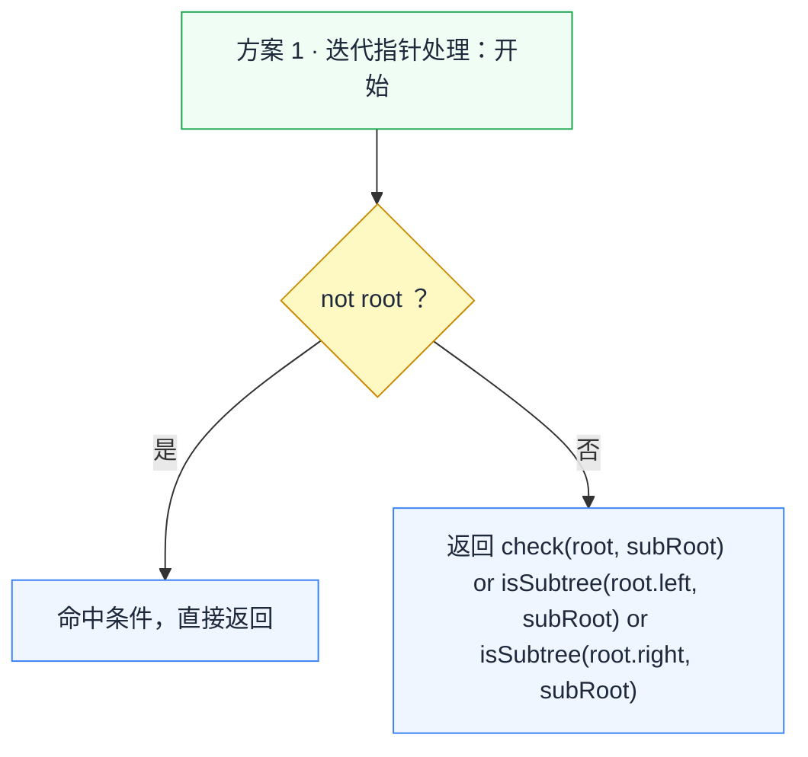

```python
import sys  # 提高递归深度上限（深输入防 RecursionError）

sys.setrecursionlimit(200000)  # 树/链表类题目节点数可达 1e4 量级

def isSubtree(root, subRoot):  # 定义函数 isSubtree（参数：根节点, subRoot）
    if not root:
        return False  # 若 not 根节点: return False
    return check(root, subRoot) or isSubtree(root.left, subRoot) or isSubtree(root.right, subRoot)

def check(a, b):  # 定义函数 check（参数：数组, b）
    if not a and not b:
        return True  # 若 not 数组 and not b: return True
    if not a or not b:
        return False  # 若 not 数组 or not b: return False
    if a.val == b.val:
        return check(a.left, b.left) and check(a.right, b.right)
    return False  # 返回 False

if __name__ == "__main__":  # 若 __name__ 等于 '__main__'
    print(isSubtree(None, None))  # 打印输出
```

#### 方案 2：直接实现

**思路与代码分析**：核心是「直接实现」。Python 版用切片与字典推导式简化操作，突出可读性。**走读**：方案 2 · 直接实现：开始 → 返回 True。

**运行架构**（真实控制流）：

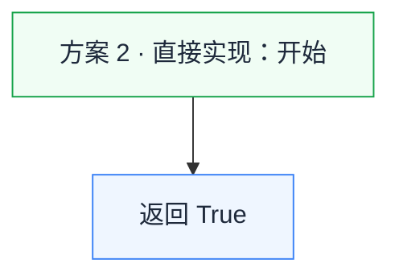

```python
import sys  # 提高递归深度上限（深输入防 RecursionError）

sys.setrecursionlimit(200000)  # 树/链表类题目节点数可达 1e4 量级

def getMaxElement(root, maxElement):  # 定义函数 getMaxElement（参数：根节点, maxElement）
    return True  # 返回 True

if __name__ == "__main__":  # 若 __name__ 等于 '__main__'
    print(getMaxElement(None, None))  # 打印输出
```

#### 方案 3：迭代指针处理

**思路与代码分析**：核心是「迭代指针处理」。Python 版用切片与字典推导式简化操作，突出可读性。**走读**：方案 3 · 迭代指针处理：开始 → 处理 pass → 命中条件，直接返回 → 命中条件，直接返回 → 返回 isSubtree(root.left, subRoot) or isSubtree( → 处理 root.right, subRoot → 处理 )。

**运行架构**（真实控制流）：

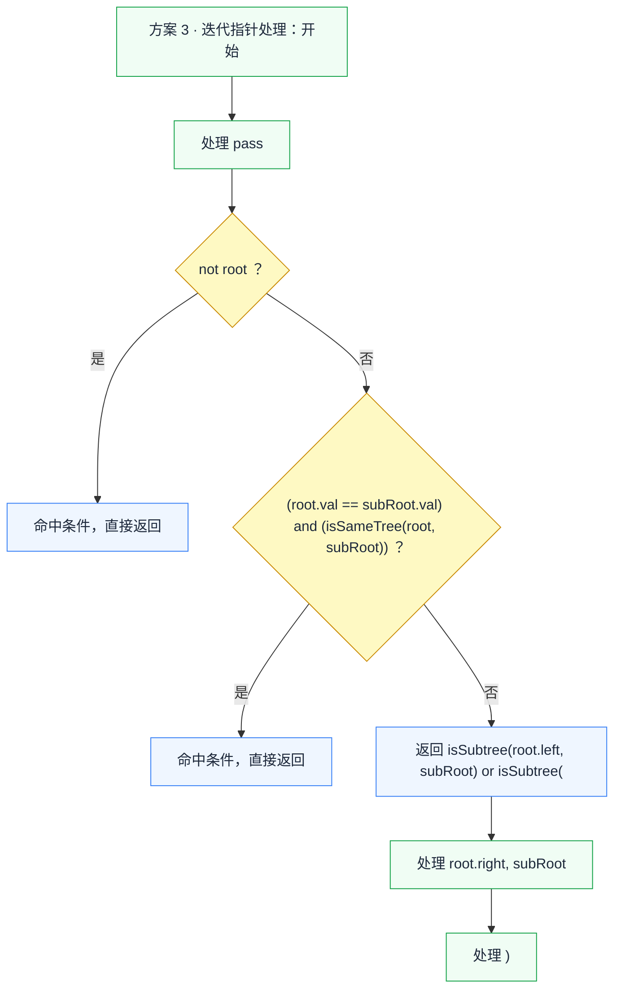

```python
import sys  # 提高递归深度上限（深输入防 RecursionError）

sys.setrecursionlimit(200000)  # 树/链表类题目节点数可达 1e4 量级

def isSubtree(root, subRoot):  # 定义函数 isSubtree（参数：根节点, subRoot）
    pass  # pass
    if not root:
        return False  # 若 not 根节点: return False
    if (root.val == subRoot.val) and (isSameTree(root, subRoot)):
        return True
    return isSubtree(root.left, subRoot) or isSubtree(
        root.right, subRoot
    )  # 返回 isSubtree(根节点.左边界,subRoot) or isSubtree(根节点.右边界,subRoot)

def isSameTree(p, q):  # 定义函数 isSameTree（参数：节点, 节点）
    if not p and not q:
        return True  # 若 not 节点 and not 节点: return True
    if not p or not q:
        return False  # 若 not 节点 or not 节点: return False
    if p.val != q.val:
        return False  # 若 节点.值 不等于 节点.值: return False
    return isSameTree(p.left, q.left) and isSameTree(
        p.right, q.right
    )  # 返回 isSameTree(节点.左边界,节点.左边界) and isSameTree(节点.右边界,节点.右边界)

if __name__ == "__main__":  # 若 __name__ 等于 '__main__'
    print(isSubtree(None, None))  # 打印输出
```

### Go 实现（3 种方案）

Go 的全部方案如下，每个方案都内嵌用例自测，可独立运行（老仓库 python/go 文件遵循「打印结果」约定）：

#### 方案 1：迭代指针处理

**思路与代码分析**：核心是「迭代指针处理」。Go 版用切片与多返回值惯用法，显式处理索引边界。**走读**：方案 1 · 迭代指针处理：开始 → 处理 if root == nil → 返回 false → 返回 check(root, subRoot) 或 isSubtree(root.Left, subRoot) 或 isSubtree(root.Right, subRoot)。

**运行架构**（真实控制流）：

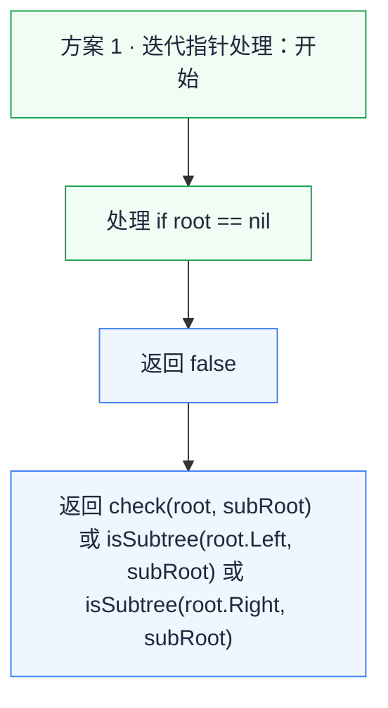

```go
package main // 引入依赖

import (
	"fmt"
	"os"
) // 引入依赖

type TreeNode struct { // 定义类型
	Val   int       // Val int
	Left  *TreeNode // Left 乘 TreeNode
	Right *TreeNode // Right 乘 TreeNode
}

func isSubtree(root *TreeNode, subRoot *TreeNode) bool { // 定义判定函数 isSubtree
	if root == nil { // 若 根节点 等于 nil
		return false // 返回 false
	}
	return check(root, subRoot) || isSubtree(root.Left, subRoot) || isSubtree(root.Right, subRoot) // 定义判定函数 check
}

func check(a, b *TreeNode) bool { // 定义判定函数 check
	if a == nil && b == nil { // 若 数组 等于 nil 且 b 等于 nil
		return true // 返回 true
	}
	if a == nil || b == nil { // 若 数组 等于 nil 或 b 等于 nil
		return false // 返回 false
	}
	if a.Val == b.Val { // 若 数组.Val 等于 b.Val
		return check(a.Left, b.Left) && check(a.Right, b.Right) // 定义判定函数 check
	}
	return false // 返回 false
}

func main() { // 程序入口：跑内嵌自测用例
	sub := &TreeNode{4, &TreeNode{1, nil, nil}, &TreeNode{2, nil, nil}}
	root := &TreeNode{3, &TreeNode{4, &TreeNode{1, nil, nil}, &TreeNode{2, nil, nil}}, &TreeNode{5, nil, nil}}
	sub2 := &TreeNode{4, &TreeNode{1, nil, nil}, &TreeNode{3, nil, nil}}
	type tc struct { // 定义类型
		name string // name string
		got  bool   // got bool
		want bool   // want bool
	}
	cases := []tc{ // 把 []tc{ 写入 cases :
		{"None/None", isSubtree(nil, nil), false},
		{"root/sub", isSubtree(root, sub), true},
		{"root/sub2", isSubtree(root, sub2), false},
	}
	ok := true                // 把 true 写入 ok :
	for _, c := range cases { // 同时取 _ 与 字符 遍历
		if c.got != c.want { // 若 字符.got 不等于 字符.want
			ok = false                                 // 把 false 写入 ok
			fmt.Println("FAIL", c.name, c.got, c.want) // 打印输出
		}
	}
	if !ok { // 若 取反 ok
		os.Exit(1) // os.Exit(1)
	}
	fmt.Println("PASS") // 全部用例通过，输出 PASS
}
```

#### 方案 2：直接实现

**思路与代码分析**：核心是「直接实现」。Go 版用切片与多返回值惯用法，显式处理索引边界。**走读**：方案 2 · 直接实现：开始 → 返回 true。

**运行架构**（真实控制流）：


```go
package main // 引入依赖

import (
	"fmt"
	"os"
) // 引入依赖

type TreeNode struct { // 定义类型
	Val   int       // Val int
	Left  *TreeNode // Left 乘 TreeNode
	Right *TreeNode // Right 乘 TreeNode
}

func getMaxElement(root *TreeNode, maxElement int) bool { // 定义函数/方法 getMaxElement
	return true // 返回 true
}

func main() { // 程序入口：跑内嵌自测用例
	ok := true                  // 把 true 写入 ok :
	if !getMaxElement(nil, 0) { // 若 取反 getMaxElement(nil, 0
		ok = false // 把 false 写入 ok
	}
	if !getMaxElement(nil, 5) { // 若 取反 getMaxElement(nil, 5
		ok = false // 把 false 写入 ok
	}
	if !ok { // 若 取反 ok
		os.Exit(1) // os.Exit(1)
	}
	fmt.Println("PASS") // 全部用例通过，输出 PASS
}
```

#### 方案 3：迭代指针处理

**思路与代码分析**：核心是「迭代指针处理」。Go 版用切片与多返回值惯用法，显式处理索引边界。**走读**：方案 3 · 迭代指针处理：开始 → 处理 if root == nil → 返回 false → 处理 if root.Val == subRoot.Val & → 返回 true → 返回 isSubtree(root.Left, subRoot) 或 isSubtree(root.Right, subRoot)。

**运行架构**（真实控制流）：

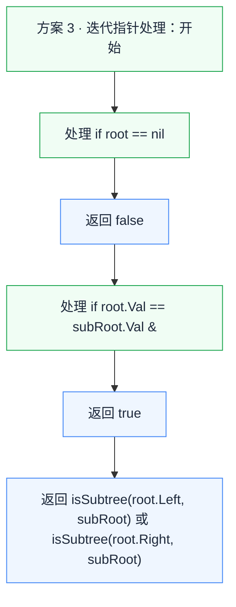

```go
package main // 引入依赖

import (
	"fmt"
	"os"
) // 引入依赖

type TreeNode struct { // 定义类型
	Val   int       // Val int
	Left  *TreeNode // Left 乘 TreeNode
	Right *TreeNode // Right 乘 TreeNode
}

func isSubtree(root *TreeNode, subRoot *TreeNode) bool { // 定义判定函数 isSubtree
	if root == nil { // 若 根节点 等于 nil
		return false // 返回 false
	}
	if root.Val == subRoot.Val && isSameTree(root, subRoot) { // 若 根节点.Val 等于 subRoot.Val 且 isSameTree(根节点, subRoot
		return true // 返回 true
	}
	return isSubtree(root.Left, subRoot) || isSubtree(root.Right, subRoot) // 定义判定函数 isSubtree
}

func isSameTree(p, q *TreeNode) bool { // 定义判定函数 isSameTree
	if p == nil && q == nil { // 若 节点 等于 nil 且 节点 等于 nil
		return true // 返回 true
	}
	if p == nil || q == nil { // 若 节点 等于 nil 或 节点 等于 nil
		return false // 返回 false
	}
	if p.Val != q.Val { // 若 节点.Val 不等于 节点.Val
		return false // 返回 false
	}
	return isSameTree(p.Left, q.Left) && isSameTree(p.Right, q.Right) // 定义判定函数 isSameTree
}

func main() { // 程序入口：跑内嵌自测用例
	sub := &TreeNode{4, &TreeNode{1, nil, nil}, &TreeNode{2, nil, nil}}
	root := &TreeNode{3, &TreeNode{4, &TreeNode{1, nil, nil}, &TreeNode{2, nil, nil}}, &TreeNode{5, nil, nil}}
	sub2 := &TreeNode{4, &TreeNode{1, nil, nil}, &TreeNode{3, nil, nil}}
	type tc struct { // 定义类型
		name string // name string
		got  bool   // got bool
		want bool   // want bool
	}
	cases := []tc{ // 把 []tc{ 写入 cases :
		{"None/None", isSubtree(nil, nil), false},
		{"root/sub", isSubtree(root, sub), true},
		{"root/sub2", isSubtree(root, sub2), false},
	}
	ok := true                // 把 true 写入 ok :
	for _, c := range cases { // 同时取 _ 与 字符 遍历
		if c.got != c.want { // 若 字符.got 不等于 字符.want
			ok = false                                 // 把 false 写入 ok
			fmt.Println("FAIL", c.name, c.got, c.want) // 打印输出
		}
	}
	if !ok { // 若 取反 ok
		os.Exit(1) // os.Exit(1)
	}
	fmt.Println("PASS") // 全部用例通过，输出 PASS
}
```

### Java 实现（3 种方案）

Java 的全部方案如下，每个方案都内嵌用例自测，可独立运行（老仓库 python/go 文件遵循「打印结果」约定）：

#### 方案 1：迭代指针处理

**思路与代码分析**：核心是「迭代指针处理」。Java 版用类与静态方法组织，集合操作显式明了。**走读**：方案 1 · 迭代指针处理：开始 → 更新 val → 返回结果。

**运行架构**（真实控制流）：

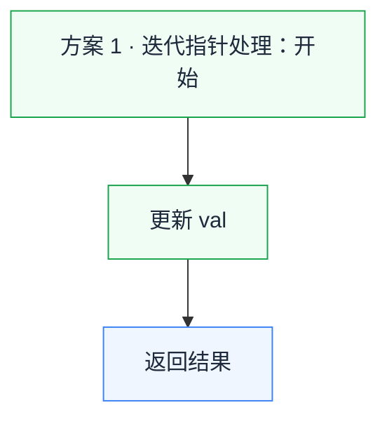

```java
package com.webfault.dsa; // 引入依赖

class solution_1_1_____1___________ { // 定义类型
  static class TreeNode { // static class TreeNode {
    int val; // int 值;
    TreeNode left, right; // TreeNode 左边界, 右边界;

    TreeNode(int v) {
      val = v;
    } // 把 值; } 写入 TreeNode(int v) { val
  }

  public boolean isSubtree(TreeNode root, TreeNode subRoot) { // 定义判定函数 isSubtree
    if (root == null) return false; // 若 根节点 等于 null，直接返回 false
    return check(root, subRoot) || isSubtree(root.left, subRoot) || isSubtree(root.right, subRoot);
  }

  private boolean check(TreeNode a, TreeNode b) { // 定义判定函数 check
    if (a == null && b == null) return true; // 若 数组 等于 null 且 b 等于 null，直接返回 true
    if (a == null || b == null) return false; // 若 数组 等于 null 或 b 等于 null，直接返回 false
    if (a.val == b.val) return check(a.left, b.left) && check(a.right, b.right);
    return false; // 返回 false
  }

  static TreeNode build(Integer[] vals) { // 定义函数/方法 build
    if (vals.length == 0 || vals[0] == null)
      return null; // 若 vals.长度 等于 0 或 vals[0] 等于 null，直接返回 null
    TreeNode root = new TreeNode(vals[0]); // 把 new TreeNode(vals[0]); 写入 TreeNode root
    java.util.Queue<TreeNode> q = new java.util.ArrayDeque<>();
    q.offer(root); // 节点.offer(根节点);
    int i = 1; // 把 1 存入 下标 i
    while (!q.isEmpty() && i < vals.length) { // 循环，直到不满足「取反 节点.isEmpty() 且 下标 i 小于 vals.长度」
      TreeNode n = q.poll(); // 把 节点.poll(); 写入 TreeNode n
      if (i < vals.length && vals[i] != null) { // 若 下标 i 小于 vals.长度 且 vals[下标 i] 不等于 null
        n.left = new TreeNode(vals[i]); // 把 new TreeNode(vals[下标 i]); 写入 左边界
        q.offer(n.left); // 节点.offer(元素个数.左边界);
      }
      i++; // 下标 i 加一
      if (i < vals.length && vals[i] != null) { // 若 下标 i 小于 vals.长度 且 vals[下标 i] 不等于 null
        n.right = new TreeNode(vals[i]); // 把 new TreeNode(vals[下标 i]); 写入 右边界
        q.offer(n.right); // 节点.offer(元素个数.右边界);
      }
      i++; // 下标 i 加一
    }
    return root; // 返回 根节点
  }

  public static void main(String[] args) { // public static void main(String[] args) {
    solution_1_1_____1___________ s = new solution_1_1_____1___________();
    Object[][] cases = { // 把 { 写入 Object[][] cases
      {new Integer[] {3, 4, 5, 1, 2}, new Integer[] {4, 1, 2}, Boolean.TRUE},
      {
        new Integer[] {3, 4, 5, 1, 2, null, null, null, null, 0},
        new Integer[] {4, 1, 2},
        Boolean.FALSE
      },
      {null, null, Boolean.FALSE},
      {new Integer[] {1, 1}, new Integer[] {1}, Boolean.TRUE},
    };
    boolean ok = true; // 把 true; 写入 boolean ok
    for (Object[] c : cases) { // for (Object[] 字符 : cases) {
      TreeNode root = c[0] == null ? null : build((Integer[]) c[0]);
      TreeNode sub = c[1] == null ? null : build((Integer[]) c[1]);
      boolean got = s.isSubtree(root, sub); // 把 字符串.isSubtree(根节点, sub); 写入 boolean got
      boolean want = (Boolean) c[2]; // 把 (Boolean) 字符[2]; 写入 boolean want
      if (got != want) { // 若 got 不等于 want
        ok = false; // 把 false; 写入 ok
        System.out.println(
            "FAIL isSubtree case="
                + java.util.Arrays.toString((Integer[]) c[0])
                + " got="
                + got
                + " want="
                + want); // 打印输出
      }
    }
    if (!ok) throw new RuntimeException("FAILED"); // 若 取反 ok) throw new RuntimeException(「FAILED」);
    System.out.println("PASS"); // 全部用例通过，输出 PASS
  }
}
```

#### 方案 2：直接实现

**思路与代码分析**：核心是「直接实现」。Java 版用类与静态方法组织，集合操作显式明了。**走读**：方案 2 · 直接实现：开始 → 更新 val → 返回结果。

**运行架构**（真实控制流）：

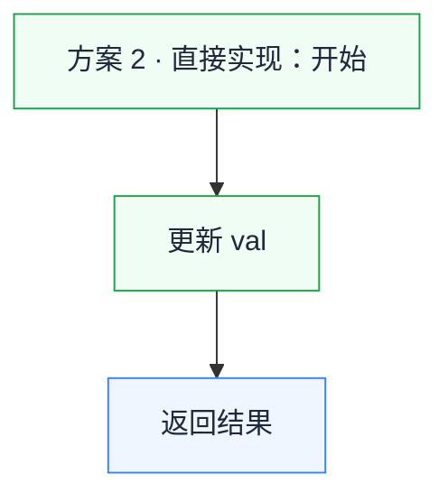

```java
package com.webfault.dsa; // 引入依赖

class solution_2_2_____2______________ { // 定义类型
  static class TreeNode { // static class TreeNode {
    int val; // int 值;
    TreeNode left, right; // TreeNode 左边界, 右边界;

    TreeNode(int v) {
      val = v;
    } // 把 值; } 写入 TreeNode(int v) { val
  }

  public boolean isSubtree(TreeNode root, TreeNode subRoot) { // 定义判定函数 isSubtree
    if (root == null) return false; // 若 根节点 等于 null，直接返回 false
    return isSame(root, subRoot) || isSubtree(root.left, subRoot) || isSubtree(root.right, subRoot);
  }

  private boolean isSame(TreeNode p, TreeNode q) { // 定义判定函数 isSame
    if (p == null && q == null) return true; // 若 节点 等于 null 且 节点 等于 null，直接返回 true
    if (p == null || q == null) return false; // 若 节点 等于 null 或 节点 等于 null，直接返回 false
    if (p.val != q.val) return false; // 若 节点.值 不等于 节点.值，直接返回 false
    return isSame(p.left, q.left)
        && isSame(p.right, q.right); // 返回 isSame(节点.左边界, 节点.左边界) 且 isSame(节点.右边界, 节点.右边界)
  }

  static TreeNode build(Integer[] vals) { // 定义函数/方法 build
    if (vals.length == 0 || vals[0] == null)
      return null; // 若 vals.长度 等于 0 或 vals[0] 等于 null，直接返回 null
    TreeNode root = new TreeNode(vals[0]); // 把 new TreeNode(vals[0]); 写入 TreeNode root
    java.util.Queue<TreeNode> q = new java.util.ArrayDeque<>();
    q.offer(root); // 节点.offer(根节点);
    int i = 1; // 把 1 存入 下标 i
    while (!q.isEmpty() && i < vals.length) { // 循环，直到不满足「取反 节点.isEmpty() 且 下标 i 小于 vals.长度」
      TreeNode n = q.poll(); // 把 节点.poll(); 写入 TreeNode n
      if (i < vals.length && vals[i] != null) { // 若 下标 i 小于 vals.长度 且 vals[下标 i] 不等于 null
        n.left = new TreeNode(vals[i]); // 把 new TreeNode(vals[下标 i]); 写入 左边界
        q.offer(n.left); // 节点.offer(元素个数.左边界);
      }
      i++; // 下标 i 加一
      if (i < vals.length && vals[i] != null) { // 若 下标 i 小于 vals.长度 且 vals[下标 i] 不等于 null
        n.right = new TreeNode(vals[i]); // 把 new TreeNode(vals[下标 i]); 写入 右边界
        q.offer(n.right); // 节点.offer(元素个数.右边界);
      }
      i++; // 下标 i 加一
    }
    return root; // 返回 根节点
  }

  public static void main(String[] args) { // public static void main(String[] args) {
    solution_2_2_____2______________ s = new solution_2_2_____2______________();
    Object[][] cases = { // 把 { 写入 Object[][] cases
      {new Integer[] {3, 4, 5, 1, 2}, new Integer[] {4, 1, 2}, Boolean.TRUE},
      {
        new Integer[] {3, 4, 5, 1, 2, null, null, null, null, 0},
        new Integer[] {4, 1, 2},
        Boolean.FALSE
      },
      {null, null, Boolean.FALSE},
      {new Integer[] {1, 1}, new Integer[] {1}, Boolean.TRUE},
    };
    boolean ok = true; // 把 true; 写入 boolean ok
    for (Object[] c : cases) { // for (Object[] 字符 : cases) {
      TreeNode root = c[0] == null ? null : build((Integer[]) c[0]);
      TreeNode sub = c[1] == null ? null : build((Integer[]) c[1]);
      boolean got = s.isSubtree(root, sub); // 把 字符串.isSubtree(根节点, sub); 写入 boolean got
      boolean want = (Boolean) c[2]; // 把 (Boolean) 字符[2]; 写入 boolean want
      if (got != want) { // 若 got 不等于 want
        ok = false; // 把 false; 写入 ok
        System.out.println(
            "FAIL isSubtree case="
                + java.util.Arrays.toString((Integer[]) c[0])
                + " got="
                + got
                + " want="
                + want); // 打印输出
      }
    }
    if (!ok) throw new RuntimeException("FAILED"); // 若 取反 ok) throw new RuntimeException(「FAILED」);
    System.out.println("PASS"); // 全部用例通过，输出 PASS
  }
}
```

#### 方案 3：迭代指针处理

**思路与代码分析**：核心是「迭代指针处理」。Java 版用类与静态方法组织，集合操作显式明了。

**运行架构**（真实控制流）：

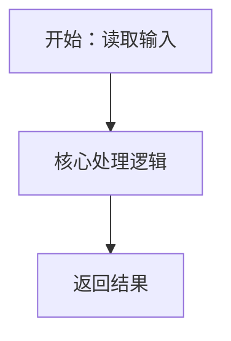

```java
package com.webfault.dsa; // 引入依赖

class Main { // 定义类型
  static class TreeNode {
    int val;
    TreeNode left;
    TreeNode right;

    TreeNode() {}

    TreeNode(int v) {
      val = v;
    }

    TreeNode(int v, TreeNode l, TreeNode r) {
      val = v;
      left = l;
      right = r;
    }
  }

  static TreeNode buildTree(Integer[] vals) { // 定义函数/方法 buildTree
    if (vals.length == 0 || vals[0] == null)
      return null; // 若 vals.长度 等于 0 或 vals[0] 等于 null，直接返回 null
    TreeNode root = new TreeNode(vals[0]);
    java.util.LinkedList<TreeNode> q = new java.util.LinkedList<>();
    q.add(root);
    int i = 1;
    while (!q.isEmpty() && i < vals.length) {
      TreeNode node = q.poll();
      if (i < vals.length && vals[i] != null) {
        node.left = new TreeNode(vals[i]);
        q.add(node.left);
      }
      i++;
      if (i < vals.length && vals[i] != null) {
        node.right = new TreeNode(vals[i]);
        q.add(node.right);
      }
      i++;
    }
    return root; // 返回 根节点
  }

  static boolean sameTree(TreeNode a, TreeNode b) {
    if (a == null && b == null) return true;
    if (a == null || b == null) return false;
    if (a.val != b.val) return false;
    return sameTree(a.left, b.left) && sameTree(a.right, b.right);
  }

  static java.util.List<Integer> inorderT(TreeNode r) {
    java.util.List<Integer> l = new java.util.ArrayList<>();
    if (r != null) {
      l.addAll(inorderT(r.left));
      l.add(r.val);
      l.addAll(inorderT(r.right));
    }
    return l;
  }

  static boolean same(TreeNode a, TreeNode b) {
    if (a == null && b == null) return true;
    if (a == null || b == null) return false;
    if (a.val != b.val) return false;
    return same(a.left, b.left) && same(a.right, b.right);
  }

  static boolean isSubtree(TreeNode root, TreeNode sub) {
    if (root == null) return false;
    if (same(root, sub)) return true;
    return isSubtree(root.left, sub) || isSubtree(root.right, sub);
  }

  public static void main(String[] args) { // public static void main(String[] args) {
    TreeNode root = buildTree(new Integer[] {3, 4, 5, 1, 2});
    TreeNode sub1 = buildTree(new Integer[] {4, 1, 2});
    TreeNode sub2 = buildTree(new Integer[] {4, 1, 3});
    if (!(isSubtree(root, sub1) && !isSubtree(root, sub2))) {
      System.out.println("FAIL");
      throw new RuntimeException("FAILED");
    }
    System.out.println("PASS"); // 全部用例通过，输出 PASS
  }
}
```

### Rust 实现（3 种方案）

Rust 的全部方案如下，每个方案都内嵌用例自测，可独立运行（老仓库 python/go 文件遵循「打印结果」约定）：

#### 方案 1：迭代指针处理

**思路与代码分析**：核心是「迭代指针处理」。Rust 版用所有权移动与切片借用改写同一逻辑，注意 Option 与引用边界。**走读**：方案 1 · 迭代指针处理：开始 → 处理 match (a, b) → 返回结果。

**运行架构**（真实控制流）：

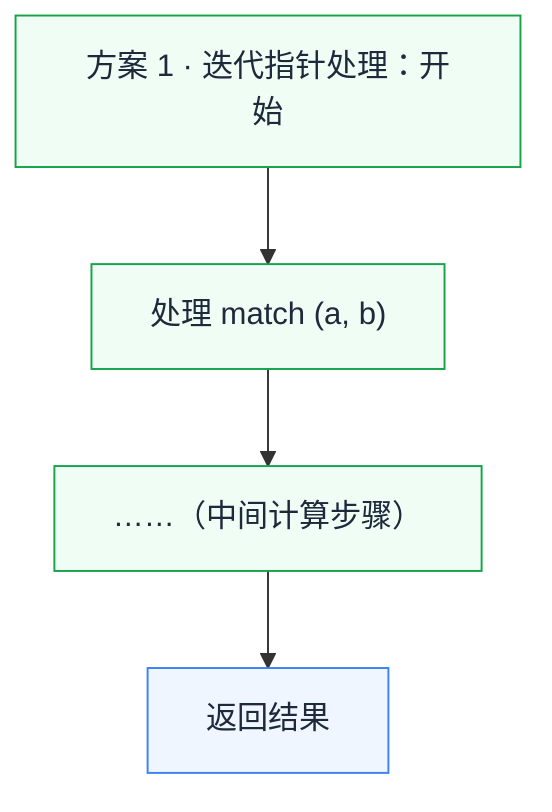

```rust
// LeetCode 572. 另一棵树的子树 — Rust 版（方案1）
use std::cell::RefCell;
use std::rc::Rc; // 引入依赖 // 引入依赖

#[derive(Debug)]
struct TreeNode {
    // 定义类型
    val: i32,
    left: Option<Rc<RefCell<TreeNode>>>,
    right: Option<Rc<RefCell<TreeNode>>>,
}

impl TreeNode {
    // 实现块
    fn new(val: i32) -> Rc<RefCell<TreeNode>> {
        // 定义函数/方法 new
        Rc::new(RefCell::new(TreeNode {
            val,
            left: None,
            right: None,
        })) // Rc::new(RefCell::new(TreeNode { 值, 左边界: None, 右边界: None }))
    }
}

fn build_tree(vals: &[Option<i32>]) -> Option<Rc<RefCell<TreeNode>>> {
    // 定义函数/方法 build_tree
    if vals.is_empty() || vals[0].is_none() {
        // 若 vals 是否为空 或 vals[0].is_none(
        return None; // 返回 None
    }
    let root = TreeNode::new(vals[0].unwrap()); // 把 TreeNode::new(vals[0].unwrap()) 存入 根节点
    let mut queue: Vec<Rc<RefCell<TreeNode>>> = vec![root.clone()];
    let mut i = 1; // 把 1; 写入 let mut i
    while !queue.is_empty() && i < vals.len() {
        // while 取反 队列 是否为空 且 下标 i 小于 vals.长度() {
        let node = queue.remove(0); // 把 队列 弹出 0) 存入 节点
        if i < vals.len() {
            // 若 下标 i 小于 vals.长度(
            if let Some(v) = vals[i] {
                // 若 let Some(值) 赋值为 vals[下标 i]
                let child = TreeNode::new(v); // 把 TreeNode::new(值) 存入 子节点
                node.borrow_mut().left = Some(child.clone()); // 把 Some(子节点.clone()); 写入 左边界
                queue.push(child); // 把 子节点 压入栈/数组尾部
            }
            i += 1; // 下标 i累加 1
        }
        if i < vals.len() {
            // 若 下标 i 小于 vals.长度(
            if let Some(v) = vals[i] {
                // 若 let Some(值) 赋值为 vals[下标 i]
                let child = TreeNode::new(v); // 把 TreeNode::new(值) 存入 子节点
                node.borrow_mut().right = Some(child.clone()); // 把 Some(子节点.clone()); 写入 右边界
                queue.push(child); // 把 子节点 压入栈/数组尾部
            }
            i += 1; // 下标 i累加 1
        }
    }
    Some(root) // Some(根节点)
}
fn same_tree(p: Option<&Rc<RefCell<TreeNode>>>, q: Option<&Rc<RefCell<TreeNode>>>) -> bool {
    // 定义函数/方法 same_tree
    match (p, q) {
        // 按情况匹配处理
        (None, None) => true,
        (Some(a), Some(b)) => {
            let (a, b) = (a.borrow(), b.borrow());
            a.val == b.val
                && same_tree(a.left.as_ref(), b.left.as_ref())
                && same_tree(a.right.as_ref(), b.right.as_ref())
        }
        _ => false,
    }
}

fn is_subtree(root: Option<Rc<RefCell<TreeNode>>>, sub: Option<Rc<RefCell<TreeNode>>>) -> bool {
    // 定义判定函数 is_subtree
    fn check(a: Option<&Rc<RefCell<TreeNode>>>, b: Option<&Rc<RefCell<TreeNode>>>) -> bool {
        // 定义判定函数 check
        match (a, b) {
            // 按情况匹配处理
            (None, None) => true,
            (Some(x), Some(y)) => {
                let (x, y) = (x.borrow(), y.borrow()); // 把 (x.borrow(), y.borrow()); 写入 let (x, y)
                x.val == y.val
                    && check(x.left.as_ref(), y.left.as_ref())
                    && check(x.right.as_ref(), y.right.as_ref())
            }
            _ => false,
        }
    }
    fn go(n: Option<&Rc<RefCell<TreeNode>>>, s: Option<&Rc<RefCell<TreeNode>>>) -> bool {
        // 定义函数/方法 go
        match n {
            // 按情况匹配处理
            None => false,
            Some(x) => {
                check(Some(x), s)
                    || go(x.borrow().left.as_ref(), s)
                    || go(x.borrow().right.as_ref(), s)
            }
        }
    }
    go(root.as_ref(), sub.as_ref()) // go(根节点.as_ref(), sub.as_ref())
}
fn main() {
    // 程序入口：跑内嵌自测用例
    assert!(is_subtree(
        build_tree(&[Some(3), Some(4), Some(5), Some(1), Some(2)]),
        build_tree(&[Some(4), Some(1), Some(2)])
    )); // 断言校验
    assert!(!is_subtree(
        build_tree(&[
            Some(3),
            Some(4),
            Some(5),
            Some(1),
            Some(2),
            None,
            None,
            None,
            None,
            Some(0)
        ]),
        build_tree(&[Some(4), Some(1), Some(2)])
    )); // 断言校验
    assert!(!is_subtree(None, None)); // 断言校验
    println!("PASS"); // 全部用例通过，输出 PASS
}
```

#### 方案 2：直接实现

**思路与代码分析**：核心是「直接实现」。Rust 版用所有权移动与切片借用改写同一逻辑，注意 Option 与引用边界。**走读**：方案 2 · 直接实现：开始 → 处理 match (a, b) → 返回结果。

**运行架构**（真实控制流）：

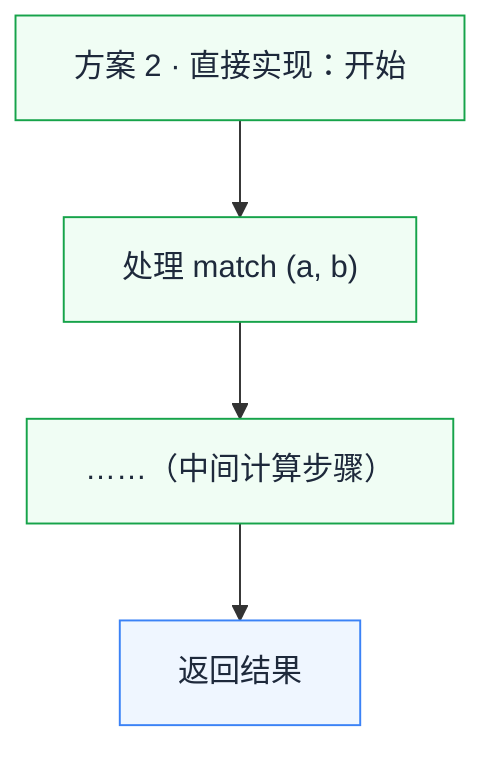

```rust
// LeetCode 572. 另一棵树的子树 — Rust 版（方案2）
use std::cell::RefCell;
use std::rc::Rc; // 引入依赖 // 引入依赖

#[derive(Debug)]
struct TreeNode {
    // 定义类型
    val: i32,
    left: Option<Rc<RefCell<TreeNode>>>,
    right: Option<Rc<RefCell<TreeNode>>>,
}

impl TreeNode {
    // 实现块
    fn new(val: i32) -> Rc<RefCell<TreeNode>> {
        // 定义函数/方法 new
        Rc::new(RefCell::new(TreeNode {
            val,
            left: None,
            right: None,
        })) // Rc::new(RefCell::new(TreeNode { 值, 左边界: None, 右边界: None }))
    }
}

fn build_tree(vals: &[Option<i32>]) -> Option<Rc<RefCell<TreeNode>>> {
    // 定义函数/方法 build_tree
    if vals.is_empty() || vals[0].is_none() {
        // 若 vals 是否为空 或 vals[0].is_none(
        return None; // 返回 None
    }
    let root = TreeNode::new(vals[0].unwrap()); // 把 TreeNode::new(vals[0].unwrap()) 存入 根节点
    let mut queue: Vec<Rc<RefCell<TreeNode>>> = vec![root.clone()];
    let mut i = 1; // 把 1; 写入 let mut i
    while !queue.is_empty() && i < vals.len() {
        // while 取反 队列 是否为空 且 下标 i 小于 vals.长度() {
        let node = queue.remove(0); // 把 队列 弹出 0) 存入 节点
        if i < vals.len() {
            // 若 下标 i 小于 vals.长度(
            if let Some(v) = vals[i] {
                // 若 let Some(值) 赋值为 vals[下标 i]
                let child = TreeNode::new(v); // 把 TreeNode::new(值) 存入 子节点
                node.borrow_mut().left = Some(child.clone()); // 把 Some(子节点.clone()); 写入 左边界
                queue.push(child); // 把 子节点 压入栈/数组尾部
            }
            i += 1; // 下标 i累加 1
        }
        if i < vals.len() {
            // 若 下标 i 小于 vals.长度(
            if let Some(v) = vals[i] {
                // 若 let Some(值) 赋值为 vals[下标 i]
                let child = TreeNode::new(v); // 把 TreeNode::new(值) 存入 子节点
                node.borrow_mut().right = Some(child.clone()); // 把 Some(子节点.clone()); 写入 右边界
                queue.push(child); // 把 子节点 压入栈/数组尾部
            }
            i += 1; // 下标 i累加 1
        }
    }
    Some(root) // Some(根节点)
}
fn same_tree(p: Option<&Rc<RefCell<TreeNode>>>, q: Option<&Rc<RefCell<TreeNode>>>) -> bool {
    // 定义函数/方法 same_tree
    match (p, q) {
        // 按情况匹配处理
        (None, None) => true,
        (Some(a), Some(b)) => {
            let (a, b) = (a.borrow(), b.borrow());
            a.val == b.val
                && same_tree(a.left.as_ref(), b.left.as_ref())
                && same_tree(a.right.as_ref(), b.right.as_ref())
        }
        _ => false,
    }
}

fn is_subtree(root: Option<Rc<RefCell<TreeNode>>>, sub: Option<Rc<RefCell<TreeNode>>>) -> bool {
    // 定义判定函数 is_subtree
    fn check(a: Option<&Rc<RefCell<TreeNode>>>, b: Option<&Rc<RefCell<TreeNode>>>) -> bool {
        // 定义判定函数 check
        match (a, b) {
            // 按情况匹配处理
            (None, None) => true,
            (Some(x), Some(y)) => {
                let (x, y) = (x.borrow(), y.borrow()); // 把 (x.borrow(), y.borrow()); 写入 let (x, y)
                x.val == y.val
                    && check(x.left.as_ref(), y.left.as_ref())
                    && check(x.right.as_ref(), y.right.as_ref())
            }
            _ => false,
        }
    }
    fn go(n: Option<&Rc<RefCell<TreeNode>>>, s: Option<&Rc<RefCell<TreeNode>>>) -> bool {
        // 定义函数/方法 go
        match n {
            // 按情况匹配处理
            None => false,
            Some(x) => {
                check(Some(x), s)
                    || go(x.borrow().left.as_ref(), s)
                    || go(x.borrow().right.as_ref(), s)
            }
        }
    }
    go(root.as_ref(), sub.as_ref()) // go(根节点.as_ref(), sub.as_ref())
}
fn main() {
    // 程序入口：跑内嵌自测用例
    assert!(is_subtree(
        build_tree(&[Some(3), Some(4), Some(5), Some(1), Some(2)]),
        build_tree(&[Some(4), Some(1), Some(2)])
    )); // 断言校验
    assert!(!is_subtree(
        build_tree(&[
            Some(3),
            Some(4),
            Some(5),
            Some(1),
            Some(2),
            None,
            None,
            None,
            None,
            Some(0)
        ]),
        build_tree(&[Some(4), Some(1), Some(2)])
    )); // 断言校验
    assert!(!is_subtree(None, None)); // 断言校验
    println!("PASS"); // 全部用例通过，输出 PASS
}
```

#### 方案 3：迭代指针处理

**思路与代码分析**：核心是「迭代指针处理」。Rust 版用所有权移动与切片借用改写同一逻辑，注意 Option 与引用边界。**走读**：方案 3 · 迭代指针处理：开始 → 处理 match (a, b) → 返回结果。

**运行架构**（真实控制流）：


```rust
// LeetCode 572. 另一棵树的子树 — Rust 版（方案3）
use std::cell::RefCell;
use std::rc::Rc; // 引入依赖 // 引入依赖

#[derive(Debug)]
struct TreeNode {
    // 定义类型
    val: i32,
    left: Option<Rc<RefCell<TreeNode>>>,
    right: Option<Rc<RefCell<TreeNode>>>,
}

impl TreeNode {
    // 实现块
    fn new(val: i32) -> Rc<RefCell<TreeNode>> {
        // 定义函数/方法 new
        Rc::new(RefCell::new(TreeNode {
            val,
            left: None,
            right: None,
        })) // Rc::new(RefCell::new(TreeNode { 值, 左边界: None, 右边界: None }))
    }
}

fn build_tree(vals: &[Option<i32>]) -> Option<Rc<RefCell<TreeNode>>> {
    // 定义函数/方法 build_tree
    if vals.is_empty() || vals[0].is_none() {
        // 若 vals 是否为空 或 vals[0].is_none(
        return None; // 返回 None
    }
    let root = TreeNode::new(vals[0].unwrap()); // 把 TreeNode::new(vals[0].unwrap()) 存入 根节点
    let mut queue: Vec<Rc<RefCell<TreeNode>>> = vec![root.clone()];
    let mut i = 1; // 把 1; 写入 let mut i
    while !queue.is_empty() && i < vals.len() {
        // while 取反 队列 是否为空 且 下标 i 小于 vals.长度() {
        let node = queue.remove(0); // 把 队列 弹出 0) 存入 节点
        if i < vals.len() {
            // 若 下标 i 小于 vals.长度(
            if let Some(v) = vals[i] {
                // 若 let Some(值) 赋值为 vals[下标 i]
                let child = TreeNode::new(v); // 把 TreeNode::new(值) 存入 子节点
                node.borrow_mut().left = Some(child.clone()); // 把 Some(子节点.clone()); 写入 左边界
                queue.push(child); // 把 子节点 压入栈/数组尾部
            }
            i += 1; // 下标 i累加 1
        }
        if i < vals.len() {
            // 若 下标 i 小于 vals.长度(
            if let Some(v) = vals[i] {
                // 若 let Some(值) 赋值为 vals[下标 i]
                let child = TreeNode::new(v); // 把 TreeNode::new(值) 存入 子节点
                node.borrow_mut().right = Some(child.clone()); // 把 Some(子节点.clone()); 写入 右边界
                queue.push(child); // 把 子节点 压入栈/数组尾部
            }
            i += 1; // 下标 i累加 1
        }
    }
    Some(root) // Some(根节点)
}
fn same_tree(p: Option<&Rc<RefCell<TreeNode>>>, q: Option<&Rc<RefCell<TreeNode>>>) -> bool {
    // 定义函数/方法 same_tree
    match (p, q) {
        // 按情况匹配处理
        (None, None) => true,
        (Some(a), Some(b)) => {
            let (a, b) = (a.borrow(), b.borrow());
            a.val == b.val
                && same_tree(a.left.as_ref(), b.left.as_ref())
                && same_tree(a.right.as_ref(), b.right.as_ref())
        }
        _ => false,
    }
}

fn is_subtree(root: Option<Rc<RefCell<TreeNode>>>, sub: Option<Rc<RefCell<TreeNode>>>) -> bool {
    // 定义判定函数 is_subtree
    fn check(a: Option<&Rc<RefCell<TreeNode>>>, b: Option<&Rc<RefCell<TreeNode>>>) -> bool {
        // 定义判定函数 check
        match (a, b) {
            // 按情况匹配处理
            (None, None) => true,
            (Some(x), Some(y)) => {
                let (x, y) = (x.borrow(), y.borrow()); // 把 (x.borrow(), y.borrow()); 写入 let (x, y)
                x.val == y.val
                    && check(x.left.as_ref(), y.left.as_ref())
                    && check(x.right.as_ref(), y.right.as_ref())
            }
            _ => false,
        }
    }
    fn go(n: Option<&Rc<RefCell<TreeNode>>>, s: Option<&Rc<RefCell<TreeNode>>>) -> bool {
        // 定义函数/方法 go
        match n {
            // 按情况匹配处理
            None => false,
            Some(x) => {
                check(Some(x), s)
                    || go(x.borrow().left.as_ref(), s)
                    || go(x.borrow().right.as_ref(), s)
            }
        }
    }
    go(root.as_ref(), sub.as_ref()) // go(根节点.as_ref(), sub.as_ref())
}
fn main() {
    // 程序入口：跑内嵌自测用例
    assert!(is_subtree(
        build_tree(&[Some(3), Some(4), Some(5), Some(1), Some(2)]),
        build_tree(&[Some(4), Some(1), Some(2)])
    )); // 断言校验
    assert!(!is_subtree(
        build_tree(&[
            Some(3),
            Some(4),
            Some(5),
            Some(1),
            Some(2),
            None,
            None,
            None,
            None,
            Some(0)
        ]),
        build_tree(&[Some(4), Some(1), Some(2)])
    )); // 断言校验
    assert!(!is_subtree(None, None)); // 断言校验
    println!("PASS"); // 全部用例通过，输出 PASS
}
```

### Lua 实现（3 种方案）

Lua 的全部方案如下，每个方案都内嵌用例自测，可独立运行（老仓库 python/go 文件遵循「打印结果」约定）：

#### 方案 1：迭代指针处理

**思路与代码分析**：核心是「迭代指针处理」。Lua 版用表与 ipairs 遍历，注意 ipairs 遇 nil 即停的语义。**走读**：方案 1 · 迭代指针处理：开始 → 处理 if not vals or #vals == 0 or → 返回 nil → 当 head ≤ #queue and i ≤ #vals do 时反复执行 → 返回 root。

**运行架构**（真实控制流）：

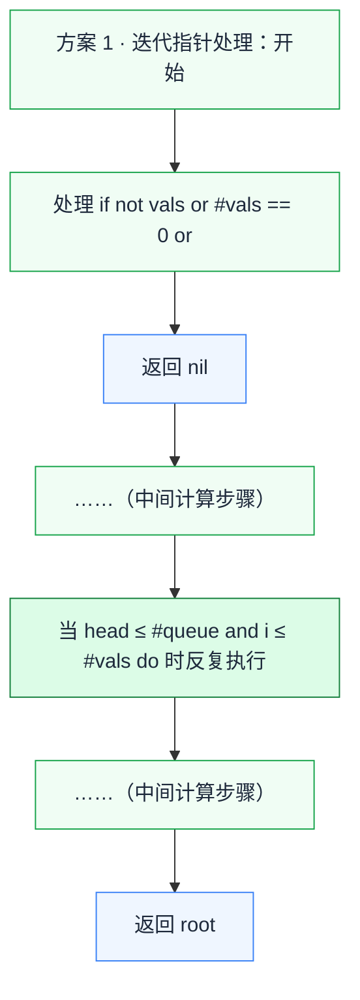

```lua
-- LeetCode 572. 另一棵树的子树 — Lua 版（方案1）
local TreeNode = {} -- 把 {} 写入 local TreeNode
TreeNode.__index = TreeNode -- 把 TreeNode 写入 TreeNode.__index
function TreeNode.new(val) -- function TreeNode.new(值)
	return setmetatable({ val = val, left = nil, right = nil }, TreeNode)
end -- 终点

local function build_tree(vals) -- local function build_tree(vals)
	if not vals or #vals == 0 or vals[1] == "null" then
		return nil
	end
	local root = TreeNode.new(vals[1]) -- 把 TreeNode.new(vals[1]) 写入 local root
	local queue = { root } -- 把 {根节点} 写入 local queue
	local head = 1 -- 把 1 写入 local head
	local i = 2 -- 把 2 写入 local i
	while head <= #queue and i <= #vals do -- 把 #队列 and 下标 i 不超过 #vals do 写入 while head <
		local node = queue[head] -- 把 队列[头节点] 写入 local node
		head = head + 1 -- 把 头节点 加 1 存入 头节点
		if i <= #vals then -- 若 下标 i 不超过 #vals then
			if vals[i] ~= "null" then -- 若 vals[下标 i] ~ 赋值为 「null」 then
				node.left = TreeNode.new(vals[i]) -- 把 TreeNode.new(vals[下标 i]) 写入 左边界
				queue[#queue + 1] = node.left -- 把 节点.左边界 写入 queue[#queue + 1]
			end -- 终点
			i = i + 1 -- 把 下标 i 加 1 存入 下标 i
		end -- 终点
		if i <= #vals then -- 若 下标 i 不超过 #vals then
			if vals[i] ~= "null" then -- 若 vals[下标 i] ~ 赋值为 「null」 then
				node.right = TreeNode.new(vals[i]) -- 把 TreeNode.new(vals[下标 i]) 写入 右边界
				queue[#queue + 1] = node.right -- 把 节点.右边界 写入 queue[#queue + 1]
			end -- 终点
			i = i + 1 -- 把 下标 i 加 1 存入 下标 i
		end -- 终点
	end -- 终点
	return root -- 返回 根节点
end -- 终点
local function same_tree(p, q) -- local function same_tree(节点, 节点)
	if not p and not q then
		return true
	end -- 若 not 节点 and not 节点 then return true 终点
	if not p or not q or p.val ~= q.val then
		return false
	end -- 若 not 节点 or not 节点 or 节点.值 ~ 赋值为 节点.值 then return false 终点
	return same_tree(p.left, q.left) and same_tree(p.right, q.right) -- 返回 same_tree(节点.左边界, 节点.左边界) and same_tree(节点.右边界, 节点.右边界)
end -- 终点

local function check(a, b) -- local function check(数组, b)
	if not a and not b then
		return true
	end -- 若 not 数组 and not b then return true 终点
	if not a or not b or a.val ~= b.val then
		return false
	end -- 若 not 数组 or not b or 数组.值 ~ 赋值为 b.值 then return false 终点
	return check(a.left, b.left) and check(a.right, b.right) -- 返回 check(数组.左边界, b.左边界) and check(数组.右边界, b.右边界)
end -- 终点
local function is_subtree(root, sub) -- local function is_subtree(根节点, sub)
	if not root then
		return false
	end -- 若 not 根节点 then return false 终点
	return check(root, sub) or is_subtree(root.left, sub) or is_subtree(root.right, sub)
end -- 终点
assert(is_subtree(build_tree({ 3, 4, 5, 1, 2 }), build_tree({ 4, 1, 2 })) == true) -- 断言校验
assert(is_subtree(build_tree({ 3, 4, 5, 1, 2, "null", "null", "null", "null", 0 }), build_tree({ 4, 1, 2 })) == false) -- 断言校验
assert(is_subtree(nil, nil) == false) -- 断言校验
print("PASS") -- 全部用例通过，输出 PASS
```

#### 方案 2：直接实现

**思路与代码分析**：核心是「直接实现」。Lua 版用表与 ipairs 遍历，注意 ipairs 遇 nil 即停的语义。**走读**：方案 2 · 直接实现：开始 → 处理 if not vals or #vals == 0 or → 返回 nil → 当 head ≤ #queue and i ≤ #vals do 时反复执行 → 返回 root。

**运行架构**（真实控制流）：

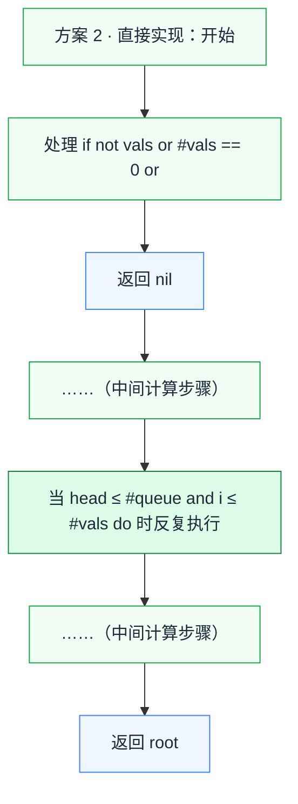

```lua
-- LeetCode 572. 另一棵树的子树 — Lua 版（方案2）
local TreeNode = {} -- 把 {} 写入 local TreeNode
TreeNode.__index = TreeNode -- 把 TreeNode 写入 TreeNode.__index
function TreeNode.new(val) -- function TreeNode.new(值)
	return setmetatable({ val = val, left = nil, right = nil }, TreeNode)
end -- 终点

local function build_tree(vals) -- local function build_tree(vals)
	if not vals or #vals == 0 or vals[1] == "null" then
		return nil
	end
	local root = TreeNode.new(vals[1]) -- 把 TreeNode.new(vals[1]) 写入 local root
	local queue = { root } -- 把 {根节点} 写入 local queue
	local head = 1 -- 把 1 写入 local head
	local i = 2 -- 把 2 写入 local i
	while head <= #queue and i <= #vals do -- 把 #队列 and 下标 i 不超过 #vals do 写入 while head <
		local node = queue[head] -- 把 队列[头节点] 写入 local node
		head = head + 1 -- 把 头节点 加 1 存入 头节点
		if i <= #vals then -- 若 下标 i 不超过 #vals then
			if vals[i] ~= "null" then -- 若 vals[下标 i] ~ 赋值为 「null」 then
				node.left = TreeNode.new(vals[i]) -- 把 TreeNode.new(vals[下标 i]) 写入 左边界
				queue[#queue + 1] = node.left -- 把 节点.左边界 写入 queue[#queue + 1]
			end -- 终点
			i = i + 1 -- 把 下标 i 加 1 存入 下标 i
		end -- 终点
		if i <= #vals then -- 若 下标 i 不超过 #vals then
			if vals[i] ~= "null" then -- 若 vals[下标 i] ~ 赋值为 「null」 then
				node.right = TreeNode.new(vals[i]) -- 把 TreeNode.new(vals[下标 i]) 写入 右边界
				queue[#queue + 1] = node.right -- 把 节点.右边界 写入 queue[#queue + 1]
			end -- 终点
			i = i + 1 -- 把 下标 i 加 1 存入 下标 i
		end -- 终点
	end -- 终点
	return root -- 返回 根节点
end -- 终点
local function same_tree(p, q) -- local function same_tree(节点, 节点)
	if not p and not q then
		return true
	end -- 若 not 节点 and not 节点 then return true 终点
	if not p or not q or p.val ~= q.val then
		return false
	end -- 若 not 节点 or not 节点 or 节点.值 ~ 赋值为 节点.值 then return false 终点
	return same_tree(p.left, q.left) and same_tree(p.right, q.right) -- 返回 same_tree(节点.左边界, 节点.左边界) and same_tree(节点.右边界, 节点.右边界)
end -- 终点

local function check(a, b) -- local function check(数组, b)
	if not a and not b then
		return true
	end -- 若 not 数组 and not b then return true 终点
	if not a or not b or a.val ~= b.val then
		return false
	end -- 若 not 数组 or not b or 数组.值 ~ 赋值为 b.值 then return false 终点
	return check(a.left, b.left) and check(a.right, b.right) -- 返回 check(数组.左边界, b.左边界) and check(数组.右边界, b.右边界)
end -- 终点
local function is_subtree(root, sub) -- local function is_subtree(根节点, sub)
	if not root then
		return false
	end -- 若 not 根节点 then return false 终点
	return check(root, sub) or is_subtree(root.left, sub) or is_subtree(root.right, sub)
end -- 终点
assert(is_subtree(build_tree({ 3, 4, 5, 1, 2 }), build_tree({ 4, 1, 2 })) == true) -- 断言校验
assert(is_subtree(build_tree({ 3, 4, 5, 1, 2, "null", "null", "null", "null", 0 }), build_tree({ 4, 1, 2 })) == false) -- 断言校验
assert(is_subtree(nil, nil) == false) -- 断言校验
print("PASS") -- 全部用例通过，输出 PASS
```

#### 方案 3：迭代指针处理

**思路与代码分析**：核心是「迭代指针处理」。Lua 版用表与 ipairs 遍历，注意 ipairs 遇 nil 即停的语义。**走读**：方案 3 · 迭代指针处理：开始 → 处理 if not vals or #vals == 0 or → 返回 nil → 当 head ≤ #queue and i ≤ #vals do 时反复执行 → 返回 root。

**运行架构**（真实控制流）：

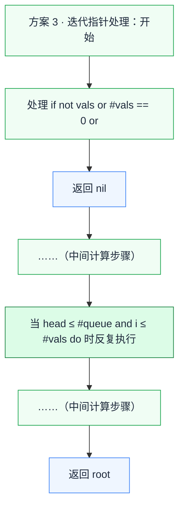

```lua
-- LeetCode 572. 另一棵树的子树 — Lua 版（方案3）
local TreeNode = {} -- 把 {} 写入 local TreeNode
TreeNode.__index = TreeNode -- 把 TreeNode 写入 TreeNode.__index
function TreeNode.new(val) -- function TreeNode.new(值)
	return setmetatable({ val = val, left = nil, right = nil }, TreeNode)
end -- 终点

local function build_tree(vals) -- local function build_tree(vals)
	if not vals or #vals == 0 or vals[1] == "null" then
		return nil
	end
	local root = TreeNode.new(vals[1]) -- 把 TreeNode.new(vals[1]) 写入 local root
	local queue = { root } -- 把 {根节点} 写入 local queue
	local head = 1 -- 把 1 写入 local head
	local i = 2 -- 把 2 写入 local i
	while head <= #queue and i <= #vals do -- 把 #队列 and 下标 i 不超过 #vals do 写入 while head <
		local node = queue[head] -- 把 队列[头节点] 写入 local node
		head = head + 1 -- 把 头节点 加 1 存入 头节点
		if i <= #vals then -- 若 下标 i 不超过 #vals then
			if vals[i] ~= "null" then -- 若 vals[下标 i] ~ 赋值为 「null」 then
				node.left = TreeNode.new(vals[i]) -- 把 TreeNode.new(vals[下标 i]) 写入 左边界
				queue[#queue + 1] = node.left -- 把 节点.左边界 写入 queue[#queue + 1]
			end -- 终点
			i = i + 1 -- 把 下标 i 加 1 存入 下标 i
		end -- 终点
		if i <= #vals then -- 若 下标 i 不超过 #vals then
			if vals[i] ~= "null" then -- 若 vals[下标 i] ~ 赋值为 「null」 then
				node.right = TreeNode.new(vals[i]) -- 把 TreeNode.new(vals[下标 i]) 写入 右边界
				queue[#queue + 1] = node.right -- 把 节点.右边界 写入 queue[#queue + 1]
			end -- 终点
			i = i + 1 -- 把 下标 i 加 1 存入 下标 i
		end -- 终点
	end -- 终点
	return root -- 返回 根节点
end -- 终点
local function same_tree(p, q) -- local function same_tree(节点, 节点)
	if not p and not q then
		return true
	end -- 若 not 节点 and not 节点 then return true 终点
	if not p or not q or p.val ~= q.val then
		return false
	end -- 若 not 节点 or not 节点 or 节点.值 ~ 赋值为 节点.值 then return false 终点
	return same_tree(p.left, q.left) and same_tree(p.right, q.right) -- 返回 same_tree(节点.左边界, 节点.左边界) and same_tree(节点.右边界, 节点.右边界)
end -- 终点

local function check(a, b) -- local function check(数组, b)
	if not a and not b then
		return true
	end -- 若 not 数组 and not b then return true 终点
	if not a or not b or a.val ~= b.val then
		return false
	end -- 若 not 数组 or not b or 数组.值 ~ 赋值为 b.值 then return false 终点
	return check(a.left, b.left) and check(a.right, b.right) -- 返回 check(数组.左边界, b.左边界) and check(数组.右边界, b.右边界)
end -- 终点
local function is_subtree(root, sub) -- local function is_subtree(根节点, sub)
	if not root then
		return false
	end -- 若 not 根节点 then return false 终点
	return check(root, sub) or is_subtree(root.left, sub) or is_subtree(root.right, sub)
end -- 终点
assert(is_subtree(build_tree({ 3, 4, 5, 1, 2 }), build_tree({ 4, 1, 2 })) == true) -- 断言校验
assert(is_subtree(build_tree({ 3, 4, 5, 1, 2, "null", "null", "null", "null", 0 }), build_tree({ 4, 1, 2 })) == false) -- 断言校验
assert(is_subtree(nil, nil) == false) -- 断言校验
print("PASS") -- 全部用例通过，输出 PASS
```

### C 实现（3 种方案）

C 的全部方案如下，每个方案都内嵌用例自测，可独立运行（老仓库 python/go 文件遵循「打印结果」约定）：

#### 方案 1：迭代指针处理

**思路与代码分析**：核心是「迭代指针处理」。C 版手动管理下标与内存，循环边界全部显式写出。**走读**：方案 1 · 迭代指针处理：开始 → 命中条件，直接返回 → 返回 check(root, sub) 或 is_subtree(root-＞left, sub) 或 is_subtree(root-＞right, sub)。

**运行架构**（真实控制流）：

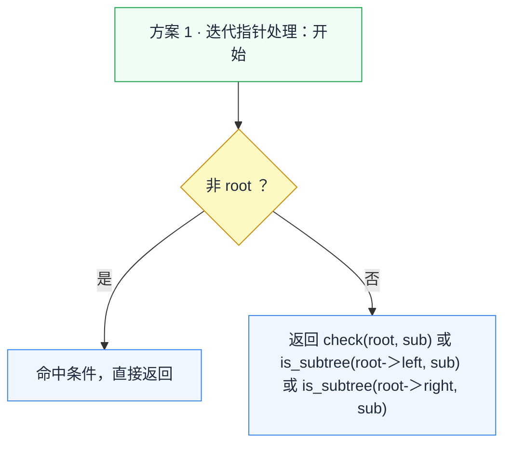

```c
/* LeetCode 572. 另一棵树的子树 — C 版（方案1） */
#include <stdio.h>                   // 引入头文件
#include <stdlib.h>                  // 引入头文件
#define INT_MIN_SN (-2147483647 - 1) // #define INT_MIN_SN ( 减 2147483647 减 1)

typedef struct TreeNode {   // typedef struct TreeNode {
    int val;                // int 值;
    struct TreeNode *left;  // 定义类型
    struct TreeNode *right; // 定义类型
} TreeNode;                 // } TreeNode;

static TreeNode *build_tree(const int *vals,
                            int n) { // static TreeNode 乘 build_tree(const int 乘 vals, int 元素个数) {
    if (n == 0 || vals[0] == INT_MIN_SN)
        return NULL; // 若 元素个数 等于 0 或 vals[0] 等于 INT_MIN_SN，直接返回 NULL
    TreeNode *root = malloc(sizeof(TreeNode)); // 把 malloc(sizeof(TreeNode)); 写入 TreeNode *root
    root->val = vals[0];
    root->left = root->right = NULL;
    TreeNode **queue =
        malloc(sizeof(TreeNode *) * n); // 把 malloc(sizeof(TreeNode 乘 ) 乘 元素个数); 写入 TreeNode **queue
    int head = 0, tail = 0, i = 1; // 把 0, 尾节点 赋值为 0, 下标 i 赋值为 1 存入 头节点
    queue[tail++] = root;          // 把 根节点; 写入 queue[tail++]
    while (head < tail && i < n) { // 循环，直到不满足「头节点 小于 尾节点 且 下标 i 小于 元素个数」
        TreeNode *node = queue[head++];                // 把 队列[头节点 加一 ]; 写入 TreeNode *node
        if (i < n) {                                   // 若 下标 i 小于 元素个数
            if (vals[i] != INT_MIN_SN) {               // 若 vals[下标 i] 不等于 INT_MIN_SN
                node->left = malloc(sizeof(TreeNode)); // 把 malloc(sizeof(TreeNode)); 写入 node->left
                node->left->val = vals[i];
                node->left->left = node->left->right = NULL;
                queue[tail++] = node->left; // 把 节点 减 超过 左边界; 写入 queue[tail++]
            }
            i++; // 下标 i 加一
        }
        if (i < n) {                                    // 若 下标 i 小于 元素个数
            if (vals[i] != INT_MIN_SN) {                // 若 vals[下标 i] 不等于 INT_MIN_SN
                node->right = malloc(sizeof(TreeNode)); // 把 malloc(sizeof(TreeNode)); 写入 node->right
                node->right->val = vals[i];
                node->right->left = node->right->right = NULL;
                queue[tail++] = node->right; // 把 节点 减 超过 右边界; 写入 queue[tail++]
            }
            i++; // 下标 i 加一
        }
    }
    free(queue); // free(队列);
    return root; // 返回 根节点
}

static void free_tree(TreeNode *n) { // 定义函数/方法 free_tree
    if (!n)
        return;          // 若 取反 元素个数) return;
    free_tree(n->left);  // free_tree(元素个数 减 超过 左边界);
    free_tree(n->right); // free_tree(元素个数 减 超过 右边界);
    free(n);             // free(元素个数);
}
static int same_tree(const TreeNode *p, const TreeNode *q) { // 定义函数/方法 same_tree
    if (!p && !q)
        return 1; // 若 取反 节点 且 取反 节点，直接返回 1
    if (!p || !q || p->val != q->val)
        return 0; // 若 取反 节点 或 取反 节点 或 节点 减 超过 值 不等于 节点 减 超过 值，直接返回 0
    return same_tree(p->left, q->left) && same_tree(p->right, q->right);
}

static int check(const TreeNode *a, const TreeNode *b) { // 定义判定函数 check
    if (!a && !b)
        return 1; // 若 取反 数组 且 取反 b，直接返回 1
    if (!a || !b || a->val != b->val)
        return 0; // 若 取反 数组 或 取反 b 或 数组 减 超过 值 不等于 b 减 超过 值，直接返回 0
    return check(a->left, b->left) && check(a->right, b->right);
}
static int is_subtree(const TreeNode *root, const TreeNode *sub) { // 定义判定函数 is_subtree
    if (!root)
        return 0; // 若 取反 根节点，直接返回 0
    return check(root, sub) || is_subtree(root->left, sub) || is_subtree(root->right, sub);
}
int main(void) {                                 // 程序入口：跑内嵌自测用例
    int a1[] = {3, 4, 5, 1, 2}, b[] = {4, 1, 2}; // 把 {3,4,5,1,2}, b[] 赋值为 {4,1,2}; 写入 int a1[]
    int a2[] = {3, 4, 5, 1, 2, INT_MIN_SN, INT_MIN_SN, INT_MIN_SN, INT_MIN_SN, 0};
    if (!is_subtree(build_tree(a1, 5), build_tree(b, 3))) {
        printf("FAIL 1\n");
        return 1;
    }
    if (is_subtree(build_tree(a2, 10), build_tree(b, 3))) {
        printf("FAIL 2\n");
        return 1;
    }
    if (is_subtree(NULL, NULL)) {
        printf("FAIL 3\n");
        return 1;
    }                 // 若 is_subtree(NULL, NULL)) { 输出「FAIL 3 」); return 1; }
    printf("PASS\n"); // 全部用例通过，输出 PASS
    return 0;         // 返回 0
}
```

#### 方案 2：直接实现

**思路与代码分析**：核心是「直接实现」。C 版手动管理下标与内存，循环边界全部显式写出。**走读**：方案 2 · 直接实现：开始 → 命中条件，直接返回 → 返回 check(root, sub) 或 is_subtree(root-＞left, sub) 或 is_subtree(root-＞right, sub)。

**运行架构**（真实控制流）：

```mermaid
graph TD
    N0["方案 2 · 直接实现：开始"]
    N1{"非 root ？"}
    N2["命中条件，直接返回"]
    N3["返回 check(root, sub) 或 is_subtree(root-＞left, sub) 或 is_subtree(root-＞right, sub)"]
    N0 --> N1
    N1 -- 是 --> N2
    N1 -- 否 --> N3
    classDef n fill:#f0fdf4,stroke:#16a34a,color:#1e293b;
    classDef lp fill:#dcfce7,stroke:#15803d,color:#1e293b;
    classDef dc fill:#fef9c3,stroke:#ca8a04,color:#1e293b;
    classDef tm fill:#eff6ff,stroke:#3b82f6,color:#1e293b;
    class N0 n;
    class N1 dc;
    class N2,N3 tm;
```

```c
/* LeetCode 572. 另一棵树的子树 — C 版（方案2） */
#include <stdio.h>                   // 引入头文件
#include <stdlib.h>                  // 引入头文件
#define INT_MIN_SN (-2147483647 - 1) // #define INT_MIN_SN ( 减 2147483647 减 1)

typedef struct TreeNode {   // typedef struct TreeNode {
    int val;                // int 值;
    struct TreeNode *left;  // 定义类型
    struct TreeNode *right; // 定义类型
} TreeNode;                 // } TreeNode;

static TreeNode *build_tree(const int *vals,
                            int n) { // static TreeNode 乘 build_tree(const int 乘 vals, int 元素个数) {
    if (n == 0 || vals[0] == INT_MIN_SN)
        return NULL; // 若 元素个数 等于 0 或 vals[0] 等于 INT_MIN_SN，直接返回 NULL
    TreeNode *root = malloc(sizeof(TreeNode)); // 把 malloc(sizeof(TreeNode)); 写入 TreeNode *root
    root->val = vals[0];
    root->left = root->right = NULL;
    TreeNode **queue =
        malloc(sizeof(TreeNode *) * n); // 把 malloc(sizeof(TreeNode 乘 ) 乘 元素个数); 写入 TreeNode **queue
    int head = 0, tail = 0, i = 1; // 把 0, 尾节点 赋值为 0, 下标 i 赋值为 1 存入 头节点
    queue[tail++] = root;          // 把 根节点; 写入 queue[tail++]
    while (head < tail && i < n) { // 循环，直到不满足「头节点 小于 尾节点 且 下标 i 小于 元素个数」
        TreeNode *node = queue[head++];                // 把 队列[头节点 加一 ]; 写入 TreeNode *node
        if (i < n) {                                   // 若 下标 i 小于 元素个数
            if (vals[i] != INT_MIN_SN) {               // 若 vals[下标 i] 不等于 INT_MIN_SN
                node->left = malloc(sizeof(TreeNode)); // 把 malloc(sizeof(TreeNode)); 写入 node->left
                node->left->val = vals[i];
                node->left->left = node->left->right = NULL;
                queue[tail++] = node->left; // 把 节点 减 超过 左边界; 写入 queue[tail++]
            }
            i++; // 下标 i 加一
        }
        if (i < n) {                                    // 若 下标 i 小于 元素个数
            if (vals[i] != INT_MIN_SN) {                // 若 vals[下标 i] 不等于 INT_MIN_SN
                node->right = malloc(sizeof(TreeNode)); // 把 malloc(sizeof(TreeNode)); 写入 node->right
                node->right->val = vals[i];
                node->right->left = node->right->right = NULL;
                queue[tail++] = node->right; // 把 节点 减 超过 右边界; 写入 queue[tail++]
            }
            i++; // 下标 i 加一
        }
    }
    free(queue); // free(队列);
    return root; // 返回 根节点
}

static void free_tree(TreeNode *n) { // 定义函数/方法 free_tree
    if (!n)
        return;          // 若 取反 元素个数) return;
    free_tree(n->left);  // free_tree(元素个数 减 超过 左边界);
    free_tree(n->right); // free_tree(元素个数 减 超过 右边界);
    free(n);             // free(元素个数);
}
static int same_tree(const TreeNode *p, const TreeNode *q) { // 定义函数/方法 same_tree
    if (!p && !q)
        return 1; // 若 取反 节点 且 取反 节点，直接返回 1
    if (!p || !q || p->val != q->val)
        return 0; // 若 取反 节点 或 取反 节点 或 节点 减 超过 值 不等于 节点 减 超过 值，直接返回 0
    return same_tree(p->left, q->left) && same_tree(p->right, q->right);
}

static int check(const TreeNode *a, const TreeNode *b) { // 定义判定函数 check
    if (!a && !b)
        return 1; // 若 取反 数组 且 取反 b，直接返回 1
    if (!a || !b || a->val != b->val)
        return 0; // 若 取反 数组 或 取反 b 或 数组 减 超过 值 不等于 b 减 超过 值，直接返回 0
    return check(a->left, b->left) && check(a->right, b->right);
}
static int is_subtree(const TreeNode *root, const TreeNode *sub) { // 定义判定函数 is_subtree
    if (!root)
        return 0; // 若 取反 根节点，直接返回 0
    return check(root, sub) || is_subtree(root->left, sub) || is_subtree(root->right, sub);
}
int main(void) {                                 // 程序入口：跑内嵌自测用例
    int a1[] = {3, 4, 5, 1, 2}, b[] = {4, 1, 2}; // 把 {3,4,5,1,2}, b[] 赋值为 {4,1,2}; 写入 int a1[]
    int a2[] = {3, 4, 5, 1, 2, INT_MIN_SN, INT_MIN_SN, INT_MIN_SN, INT_MIN_SN, 0};
    if (!is_subtree(build_tree(a1, 5), build_tree(b, 3))) {
        printf("FAIL 1\n");
        return 1;
    }
    if (is_subtree(build_tree(a2, 10), build_tree(b, 3))) {
        printf("FAIL 2\n");
        return 1;
    }
    if (is_subtree(NULL, NULL)) {
        printf("FAIL 3\n");
        return 1;
    }                 // 若 is_subtree(NULL, NULL)) { 输出「FAIL 3 」); return 1; }
    printf("PASS\n"); // 全部用例通过，输出 PASS
    return 0;         // 返回 0
}
```

#### 方案 3：迭代指针处理

**思路与代码分析**：核心是「迭代指针处理」。C 版手动管理下标与内存，循环边界全部显式写出。**走读**：方案 3 · 迭代指针处理：开始 → 命中条件，直接返回 → 返回 check(root, sub) 或 is_subtree(root-＞left, sub) 或 is_subtree(root-＞right, sub)。

**运行架构**（真实控制流）：

```mermaid
graph TD
    N0["方案 3 · 迭代指针处理：开始"]
    N1{"非 root ？"}
    N2["命中条件，直接返回"]
    N3["返回 check(root, sub) 或 is_subtree(root-＞left, sub) 或 is_subtree(root-＞right, sub)"]
    N0 --> N1
    N1 -- 是 --> N2
    N1 -- 否 --> N3
    classDef n fill:#f0fdf4,stroke:#16a34a,color:#1e293b;
    classDef lp fill:#dcfce7,stroke:#15803d,color:#1e293b;
    classDef dc fill:#fef9c3,stroke:#ca8a04,color:#1e293b;
    classDef tm fill:#eff6ff,stroke:#3b82f6,color:#1e293b;
    class N0 n;
    class N1 dc;
    class N2,N3 tm;
```

```c
/* LeetCode 572. 另一棵树的子树 — C 版（方案3） */
#include <stdio.h>                   // 引入头文件
#include <stdlib.h>                  // 引入头文件
#define INT_MIN_SN (-2147483647 - 1) // #define INT_MIN_SN ( 减 2147483647 减 1)

typedef struct TreeNode {   // typedef struct TreeNode {
    int val;                // int 值;
    struct TreeNode *left;  // 定义类型
    struct TreeNode *right; // 定义类型
} TreeNode;                 // } TreeNode;

static TreeNode *build_tree(const int *vals,
                            int n) { // static TreeNode 乘 build_tree(const int 乘 vals, int 元素个数) {
    if (n == 0 || vals[0] == INT_MIN_SN)
        return NULL; // 若 元素个数 等于 0 或 vals[0] 等于 INT_MIN_SN，直接返回 NULL
    TreeNode *root = malloc(sizeof(TreeNode)); // 把 malloc(sizeof(TreeNode)); 写入 TreeNode *root
    root->val = vals[0];
    root->left = root->right = NULL;
    TreeNode **queue =
        malloc(sizeof(TreeNode *) * n); // 把 malloc(sizeof(TreeNode 乘 ) 乘 元素个数); 写入 TreeNode **queue
    int head = 0, tail = 0, i = 1; // 把 0, 尾节点 赋值为 0, 下标 i 赋值为 1 存入 头节点
    queue[tail++] = root;          // 把 根节点; 写入 queue[tail++]
    while (head < tail && i < n) { // 循环，直到不满足「头节点 小于 尾节点 且 下标 i 小于 元素个数」
        TreeNode *node = queue[head++];                // 把 队列[头节点 加一 ]; 写入 TreeNode *node
        if (i < n) {                                   // 若 下标 i 小于 元素个数
            if (vals[i] != INT_MIN_SN) {               // 若 vals[下标 i] 不等于 INT_MIN_SN
                node->left = malloc(sizeof(TreeNode)); // 把 malloc(sizeof(TreeNode)); 写入 node->left
                node->left->val = vals[i];
                node->left->left = node->left->right = NULL;
                queue[tail++] = node->left; // 把 节点 减 超过 左边界; 写入 queue[tail++]
            }
            i++; // 下标 i 加一
        }
        if (i < n) {                                    // 若 下标 i 小于 元素个数
            if (vals[i] != INT_MIN_SN) {                // 若 vals[下标 i] 不等于 INT_MIN_SN
                node->right = malloc(sizeof(TreeNode)); // 把 malloc(sizeof(TreeNode)); 写入 node->right
                node->right->val = vals[i];
                node->right->left = node->right->right = NULL;
                queue[tail++] = node->right; // 把 节点 减 超过 右边界; 写入 queue[tail++]
            }
            i++; // 下标 i 加一
        }
    }
    free(queue); // free(队列);
    return root; // 返回 根节点
}

static void free_tree(TreeNode *n) { // 定义函数/方法 free_tree
    if (!n)
        return;          // 若 取反 元素个数) return;
    free_tree(n->left);  // free_tree(元素个数 减 超过 左边界);
    free_tree(n->right); // free_tree(元素个数 减 超过 右边界);
    free(n);             // free(元素个数);
}
static int same_tree(const TreeNode *p, const TreeNode *q) { // 定义函数/方法 same_tree
    if (!p && !q)
        return 1; // 若 取反 节点 且 取反 节点，直接返回 1
    if (!p || !q || p->val != q->val)
        return 0; // 若 取反 节点 或 取反 节点 或 节点 减 超过 值 不等于 节点 减 超过 值，直接返回 0
    return same_tree(p->left, q->left) && same_tree(p->right, q->right);
}

static int check(const TreeNode *a, const TreeNode *b) { // 定义判定函数 check
    if (!a && !b)
        return 1; // 若 取反 数组 且 取反 b，直接返回 1
    if (!a || !b || a->val != b->val)
        return 0; // 若 取反 数组 或 取反 b 或 数组 减 超过 值 不等于 b 减 超过 值，直接返回 0
    return check(a->left, b->left) && check(a->right, b->right);
}
static int is_subtree(const TreeNode *root, const TreeNode *sub) { // 定义判定函数 is_subtree
    if (!root)
        return 0; // 若 取反 根节点，直接返回 0
    return check(root, sub) || is_subtree(root->left, sub) || is_subtree(root->right, sub);
}
int main(void) {                                 // 程序入口：跑内嵌自测用例
    int a1[] = {3, 4, 5, 1, 2}, b[] = {4, 1, 2}; // 把 {3,4,5,1,2}, b[] 赋值为 {4,1,2}; 写入 int a1[]
    int a2[] = {3, 4, 5, 1, 2, INT_MIN_SN, INT_MIN_SN, INT_MIN_SN, INT_MIN_SN, 0};
    if (!is_subtree(build_tree(a1, 5), build_tree(b, 3))) {
        printf("FAIL 1\n");
        return 1;
    }
    if (is_subtree(build_tree(a2, 10), build_tree(b, 3))) {
        printf("FAIL 2\n");
        return 1;
    }
    if (is_subtree(NULL, NULL)) {
        printf("FAIL 3\n");
        return 1;
    }                 // 若 is_subtree(NULL, NULL)) { 输出「FAIL 3 」); return 1; }
    printf("PASS\n"); // 全部用例通过，输出 PASS
    return 0;         // 返回 0
}
```

### C++ 实现（3 种方案）

C++ 的全部方案如下，每个方案都内嵌用例自测，可独立运行（老仓库 python/go 文件遵循「打印结果」约定）：

#### 方案 1：迭代指针处理

**思路与代码分析**：核心是「迭代指针处理」。C++ 版用 STL 容器与迭代器，减少手写下标错误。**走读**：方案 1 · 迭代指针处理：开始 → 命中条件，直接返回 → 返回 check(root, sub) 或 isSubtree(root-＞left, sub) 或 isSubtree(root-＞right, sub)。

**运行架构**（真实控制流）：

```mermaid
graph TD
    N0["方案 1 · 迭代指针处理：开始"]
    N1{"非 root ？"}
    N2["命中条件，直接返回"]
    N3["返回 check(root, sub) 或 isSubtree(root-＞left, sub) 或 isSubtree(root-＞right, sub)"]
    N0 --> N1
    N1 -- 是 --> N2
    N1 -- 否 --> N3
    classDef n fill:#f0fdf4,stroke:#16a34a,color:#1e293b;
    classDef lp fill:#dcfce7,stroke:#15803d,color:#1e293b;
    classDef dc fill:#fef9c3,stroke:#ca8a04,color:#1e293b;
    classDef tm fill:#eff6ff,stroke:#3b82f6,color:#1e293b;
    class N0 n;
    class N1 dc;
    class N2,N3 tm;
```

```cpp
// LeetCode 572. 另一棵树的子树 — C++ 版（方案1）
#include <cassert>  // 引入头文件
#include <cstdint>  // 引入头文件
#include <iostream> // 引入头文件
#include <optional> // 引入头文件
#include <queue>    // 引入头文件
#include <vector>   // 引入头文件

struct TreeNode {    // 定义类型
    int val;         // int 值;
    TreeNode *left;  // TreeNode 乘 左边界;
    TreeNode *right; // TreeNode 乘 右边界;
    explicit TreeNode(int v) : val(v), left(nullptr), right(nullptr) {}
};

static TreeNode *build_tree(const std::vector<std::optional<int>> &vals) {
    if (vals.empty() || !vals[0].has_value())
        return nullptr; // 若 vals 是否为空 或 取反 vals[0].has_value()，直接返回 nullptr
    auto *root = new TreeNode(*vals[0]); // 把 new TreeNode( 乘 vals[0]); 写入 auto *root
    std::queue<TreeNode *> q;            // std::队列 小于 TreeNode 乘 超过 节点;
    q.push(root);                        // 把 根节点 压入栈/数组尾部
    size_t i = 1;                        // 把 1; 写入 size_t i
    while (!q.empty() &&
           i < vals.size()) { // 循环，直到不满足「取反 节点 是否为空 且 下标 i 小于 vals.大小(」
        TreeNode *node = q.front();                  // 把 节点.front(); 写入 TreeNode *node
        q.pop();                                     // 弹出栈顶元素
        if (i < vals.size()) {                       // 若 下标 i 小于 vals.大小(
            if (vals[i].has_value()) {               // 若 vals[下标 i].has_value(
                node->left = new TreeNode(*vals[i]); // 把 new TreeNode( 乘 vals[下标 i]); 写入 node->left
                q.push(node->left);                  // 把 节点 减 超过 左边界 压入栈/数组尾部
            }
            ++i; // 加一 下标 i;
        }
        if (i < vals.size()) {                        // 若 下标 i 小于 vals.大小(
            if (vals[i].has_value()) {                // 若 vals[下标 i].has_value(
                node->right = new TreeNode(*vals[i]); // 把 new TreeNode( 乘 vals[下标 i]); 写入 node->right
                q.push(node->right); // 把 节点 减 超过 右边界 压入栈/数组尾部
            }
            ++i; // 加一 下标 i;
        }
    }
    return root; // 返回 根节点
}

static void free_tree(TreeNode *n) { // 定义函数/方法 free_tree
    if (!n)
        return;          // 若 取反 元素个数) return;
    free_tree(n->left);  // free_tree(元素个数 减 超过 左边界);
    free_tree(n->right); // free_tree(元素个数 减 超过 右边界);
    delete n;            // delete 元素个数;
}
static bool sameTree(const TreeNode *p, const TreeNode *q) { // 定义函数/方法 sameTree
    if (!p && !q)
        return true; // 若 取反 节点 且 取反 节点，直接返回 true
    if (!p || !q || p->val != q->val)
        return false; // 若 取反 节点 或 取反 节点 或 节点 减 超过 值 不等于 节点 减 超过 值，直接返回 false
    return sameTree(p->left, q->left) && sameTree(p->right, q->right);
}

static bool check(const TreeNode *a, const TreeNode *b) { // 定义判定函数 check
    if (!a && !b)
        return true; // 若 取反 数组 且 取反 b，直接返回 true
    if (!a || !b || a->val != b->val)
        return false; // 若 取反 数组 或 取反 b 或 数组 减 超过 值 不等于 b 减 超过 值，直接返回 false
    return check(a->left, b->left) && check(a->right, b->right);
}
static bool isSubtree(const TreeNode *root, const TreeNode *sub) { // 定义判定函数 isSubtree
    if (!root)
        return false; // 若 取反 根节点，直接返回 false
    return check(root, sub) || isSubtree(root->left, sub) || isSubtree(root->right, sub);
}
int main() { // 程序入口：跑内嵌自测用例
    assert(isSubtree(build_tree({3, 4, 5, 1, 2}), build_tree({4, 1, 2}))); // 断言校验
    assert(!isSubtree(build_tree({3, 4, 5, 1, 2, std::nullopt, std::nullopt, std::nullopt, std::nullopt, 0}),
                      build_tree({4, 1, 2}))); // 断言校验
    assert(!isSubtree(nullptr, nullptr));      // 断言校验
    std::cout << "PASS" << std::endl;          // 全部用例通过，输出 PASS
    return 0;                                  // 返回 0
}
```

#### 方案 2：直接实现

**思路与代码分析**：核心是「直接实现」。C++ 版用 STL 容器与迭代器，减少手写下标错误。**走读**：方案 2 · 直接实现：开始 → 命中条件，直接返回 → 返回 check(root, sub) 或 isSubtree(root-＞left, sub) 或 isSubtree(root-＞right, sub)。

**运行架构**（真实控制流）：

```mermaid
graph TD
    N0["方案 2 · 直接实现：开始"]
    N1{"非 root ？"}
    N2["命中条件，直接返回"]
    N3["返回 check(root, sub) 或 isSubtree(root-＞left, sub) 或 isSubtree(root-＞right, sub)"]
    N0 --> N1
    N1 -- 是 --> N2
    N1 -- 否 --> N3
    classDef n fill:#f0fdf4,stroke:#16a34a,color:#1e293b;
    classDef lp fill:#dcfce7,stroke:#15803d,color:#1e293b;
    classDef dc fill:#fef9c3,stroke:#ca8a04,color:#1e293b;
    classDef tm fill:#eff6ff,stroke:#3b82f6,color:#1e293b;
    class N0 n;
    class N1 dc;
    class N2,N3 tm;
```

```cpp
// LeetCode 572. 另一棵树的子树 — C++ 版（方案2）
#include <cassert>  // 引入头文件
#include <cstdint>  // 引入头文件
#include <iostream> // 引入头文件
#include <optional> // 引入头文件
#include <queue>    // 引入头文件
#include <vector>   // 引入头文件

struct TreeNode {    // 定义类型
    int val;         // int 值;
    TreeNode *left;  // TreeNode 乘 左边界;
    TreeNode *right; // TreeNode 乘 右边界;
    explicit TreeNode(int v) : val(v), left(nullptr), right(nullptr) {}
};

static TreeNode *build_tree(const std::vector<std::optional<int>> &vals) {
    if (vals.empty() || !vals[0].has_value())
        return nullptr; // 若 vals 是否为空 或 取反 vals[0].has_value()，直接返回 nullptr
    auto *root = new TreeNode(*vals[0]); // 把 new TreeNode( 乘 vals[0]); 写入 auto *root
    std::queue<TreeNode *> q;            // std::队列 小于 TreeNode 乘 超过 节点;
    q.push(root);                        // 把 根节点 压入栈/数组尾部
    size_t i = 1;                        // 把 1; 写入 size_t i
    while (!q.empty() &&
           i < vals.size()) { // 循环，直到不满足「取反 节点 是否为空 且 下标 i 小于 vals.大小(」
        TreeNode *node = q.front();                  // 把 节点.front(); 写入 TreeNode *node
        q.pop();                                     // 弹出栈顶元素
        if (i < vals.size()) {                       // 若 下标 i 小于 vals.大小(
            if (vals[i].has_value()) {               // 若 vals[下标 i].has_value(
                node->left = new TreeNode(*vals[i]); // 把 new TreeNode( 乘 vals[下标 i]); 写入 node->left
                q.push(node->left);                  // 把 节点 减 超过 左边界 压入栈/数组尾部
            }
            ++i; // 加一 下标 i;
        }
        if (i < vals.size()) {                        // 若 下标 i 小于 vals.大小(
            if (vals[i].has_value()) {                // 若 vals[下标 i].has_value(
                node->right = new TreeNode(*vals[i]); // 把 new TreeNode( 乘 vals[下标 i]); 写入 node->right
                q.push(node->right); // 把 节点 减 超过 右边界 压入栈/数组尾部
            }
            ++i; // 加一 下标 i;
        }
    }
    return root; // 返回 根节点
}

static void free_tree(TreeNode *n) { // 定义函数/方法 free_tree
    if (!n)
        return;          // 若 取反 元素个数) return;
    free_tree(n->left);  // free_tree(元素个数 减 超过 左边界);
    free_tree(n->right); // free_tree(元素个数 减 超过 右边界);
    delete n;            // delete 元素个数;
}
static bool sameTree(const TreeNode *p, const TreeNode *q) { // 定义函数/方法 sameTree
    if (!p && !q)
        return true; // 若 取反 节点 且 取反 节点，直接返回 true
    if (!p || !q || p->val != q->val)
        return false; // 若 取反 节点 或 取反 节点 或 节点 减 超过 值 不等于 节点 减 超过 值，直接返回 false
    return sameTree(p->left, q->left) && sameTree(p->right, q->right);
}

static bool check(const TreeNode *a, const TreeNode *b) { // 定义判定函数 check
    if (!a && !b)
        return true; // 若 取反 数组 且 取反 b，直接返回 true
    if (!a || !b || a->val != b->val)
        return false; // 若 取反 数组 或 取反 b 或 数组 减 超过 值 不等于 b 减 超过 值，直接返回 false
    return check(a->left, b->left) && check(a->right, b->right);
}
static bool isSubtree(const TreeNode *root, const TreeNode *sub) { // 定义判定函数 isSubtree
    if (!root)
        return false; // 若 取反 根节点，直接返回 false
    return check(root, sub) || isSubtree(root->left, sub) || isSubtree(root->right, sub);
}
int main() { // 程序入口：跑内嵌自测用例
    assert(isSubtree(build_tree({3, 4, 5, 1, 2}), build_tree({4, 1, 2}))); // 断言校验
    assert(!isSubtree(build_tree({3, 4, 5, 1, 2, std::nullopt, std::nullopt, std::nullopt, std::nullopt, 0}),
                      build_tree({4, 1, 2}))); // 断言校验
    assert(!isSubtree(nullptr, nullptr));      // 断言校验
    std::cout << "PASS" << std::endl;          // 全部用例通过，输出 PASS
    return 0;                                  // 返回 0
}
```

#### 方案 3：迭代指针处理

**思路与代码分析**：核心是「迭代指针处理」。C++ 版用 STL 容器与迭代器，减少手写下标错误。**走读**：方案 3 · 迭代指针处理：开始 → 命中条件，直接返回 → 返回 check(root, sub) 或 isSubtree(root-＞left, sub) 或 isSubtree(root-＞right, sub)。

**运行架构**（真实控制流）：

```mermaid
graph TD
    N0["方案 3 · 迭代指针处理：开始"]
    N1{"非 root ？"}
    N2["命中条件，直接返回"]
    N3["返回 check(root, sub) 或 isSubtree(root-＞left, sub) 或 isSubtree(root-＞right, sub)"]
    N0 --> N1
    N1 -- 是 --> N2
    N1 -- 否 --> N3
    classDef n fill:#f0fdf4,stroke:#16a34a,color:#1e293b;
    classDef lp fill:#dcfce7,stroke:#15803d,color:#1e293b;
    classDef dc fill:#fef9c3,stroke:#ca8a04,color:#1e293b;
    classDef tm fill:#eff6ff,stroke:#3b82f6,color:#1e293b;
    class N0 n;
    class N1 dc;
    class N2,N3 tm;
```

```cpp
// LeetCode 572. 另一棵树的子树 — C++ 版（方案3）
#include <cassert>  // 引入头文件
#include <cstdint>  // 引入头文件
#include <iostream> // 引入头文件
#include <optional> // 引入头文件
#include <queue>    // 引入头文件
#include <vector>   // 引入头文件

struct TreeNode {    // 定义类型
    int val;         // int 值;
    TreeNode *left;  // TreeNode 乘 左边界;
    TreeNode *right; // TreeNode 乘 右边界;
    explicit TreeNode(int v) : val(v), left(nullptr), right(nullptr) {}
};

static TreeNode *build_tree(const std::vector<std::optional<int>> &vals) {
    if (vals.empty() || !vals[0].has_value())
        return nullptr; // 若 vals 是否为空 或 取反 vals[0].has_value()，直接返回 nullptr
    auto *root = new TreeNode(*vals[0]); // 把 new TreeNode( 乘 vals[0]); 写入 auto *root
    std::queue<TreeNode *> q;            // std::队列 小于 TreeNode 乘 超过 节点;
    q.push(root);                        // 把 根节点 压入栈/数组尾部
    size_t i = 1;                        // 把 1; 写入 size_t i
    while (!q.empty() &&
           i < vals.size()) { // 循环，直到不满足「取反 节点 是否为空 且 下标 i 小于 vals.大小(」
        TreeNode *node = q.front();                  // 把 节点.front(); 写入 TreeNode *node
        q.pop();                                     // 弹出栈顶元素
        if (i < vals.size()) {                       // 若 下标 i 小于 vals.大小(
            if (vals[i].has_value()) {               // 若 vals[下标 i].has_value(
                node->left = new TreeNode(*vals[i]); // 把 new TreeNode( 乘 vals[下标 i]); 写入 node->left
                q.push(node->left);                  // 把 节点 减 超过 左边界 压入栈/数组尾部
            }
            ++i; // 加一 下标 i;
        }
        if (i < vals.size()) {                        // 若 下标 i 小于 vals.大小(
            if (vals[i].has_value()) {                // 若 vals[下标 i].has_value(
                node->right = new TreeNode(*vals[i]); // 把 new TreeNode( 乘 vals[下标 i]); 写入 node->right
                q.push(node->right); // 把 节点 减 超过 右边界 压入栈/数组尾部
            }
            ++i; // 加一 下标 i;
        }
    }
    return root; // 返回 根节点
}

static void free_tree(TreeNode *n) { // 定义函数/方法 free_tree
    if (!n)
        return;          // 若 取反 元素个数) return;
    free_tree(n->left);  // free_tree(元素个数 减 超过 左边界);
    free_tree(n->right); // free_tree(元素个数 减 超过 右边界);
    delete n;            // delete 元素个数;
}
static bool sameTree(const TreeNode *p, const TreeNode *q) { // 定义函数/方法 sameTree
    if (!p && !q)
        return true; // 若 取反 节点 且 取反 节点，直接返回 true
    if (!p || !q || p->val != q->val)
        return false; // 若 取反 节点 或 取反 节点 或 节点 减 超过 值 不等于 节点 减 超过 值，直接返回 false
    return sameTree(p->left, q->left) && sameTree(p->right, q->right);
}

static bool check(const TreeNode *a, const TreeNode *b) { // 定义判定函数 check
    if (!a && !b)
        return true; // 若 取反 数组 且 取反 b，直接返回 true
    if (!a || !b || a->val != b->val)
        return false; // 若 取反 数组 或 取反 b 或 数组 减 超过 值 不等于 b 减 超过 值，直接返回 false
    return check(a->left, b->left) && check(a->right, b->right);
}
static bool isSubtree(const TreeNode *root, const TreeNode *sub) { // 定义判定函数 isSubtree
    if (!root)
        return false; // 若 取反 根节点，直接返回 false
    return check(root, sub) || isSubtree(root->left, sub) || isSubtree(root->right, sub);
}
int main() { // 程序入口：跑内嵌自测用例
    assert(isSubtree(build_tree({3, 4, 5, 1, 2}), build_tree({4, 1, 2}))); // 断言校验
    assert(!isSubtree(build_tree({3, 4, 5, 1, 2, std::nullopt, std::nullopt, std::nullopt, std::nullopt, 0}),
                      build_tree({4, 1, 2}))); // 断言校验
    assert(!isSubtree(nullptr, nullptr));      // 断言校验
    std::cout << "PASS" << std::endl;          // 全部用例通过，输出 PASS
    return 0;                                  // 返回 0
}
```

### R 实现（3 种方案）

R 的全部方案如下，每个方案都内嵌用例自测，可独立运行（老仓库 python/go 文件遵循「打印结果」约定）：

#### 方案 1：迭代指针处理

**思路与代码分析**：核心是「迭代指针处理」。R 版用向量化思维与 1 起始下标，注意 1:n 的降序陷阱。**走读**：方案 1 · 迭代指针处理：开始 → 更新 new.env(parent → 处理 e$val ＜- val → 处理 e$left ＜- left → 处理 e$right ＜- right → 调用 class(e) ＜- TreeNode → 处理 e → 返回结果。

**运行架构**（真实控制流）：

```mermaid
graph TD
    N0["方案 1 · 迭代指针处理：开始"]
    N1["更新 new.env(parent"]
    N2["处理 e$val ＜- val"]
    N3["处理 e$left ＜- left"]
    N4["处理 e$right ＜- right"]
    N5["调用 class(e) ＜- TreeNode"]
    N6["处理 e"]
    N7["返回结果"]
    N0 --> N1
    N1 --> N2
    N2 --> N3
    N3 --> N4
    N4 --> N5
    N5 --> N6
    N6 --> N7
    classDef n fill:#f0fdf4,stroke:#16a34a,color:#1e293b;
    classDef lp fill:#dcfce7,stroke:#15803d,color:#1e293b;
    classDef dc fill:#fef9c3,stroke:#ca8a04,color:#1e293b;
    classDef tm fill:#eff6ff,stroke:#3b82f6,color:#1e293b;
    class N0,N1,N2,N3,N4,N5,N6 n;
    class N7 tm;
```

```r
# 版（方案1） 树节点：R 必须 environment 引用语义（list 是值语义） 定义函数 TreeNode（参数：值, 左边界 赋值为
# NULL, 右边界 赋值为 NULL）
TreeNode <- function(val, left = NULL, right = NULL) {
    e <- new.env(parent = emptyenv())  # 把 new.env(parent 赋值为 emptyenv()) 存入 e
    e$val <- val
    e$left <- left
    e$right <- right  # 把 值; e$左边界 小于 减 左边界; e$右边界 小于 减 右边界 存入 e$val
    class(e) <- "TreeNode"  # 把 「TreeNode」 存入 class(e)
    e
}
build_tree <- function(vals) {
    # 定义函数 build_tree（参数：vals）
    if (length(vals) == 0 || is.na(vals[[1]]))
        return(NULL)  # 若 长度(vals) 等于 0 或 is.na(vals[[1]])) return(NULL
    root <- TreeNode(vals[[1]])  # 把 TreeNode(vals[[1]]) 存入 根节点
    queue <- list(root)  # 把 列表(根节点) 存入 队列
    head <- 1L  # 把 1L 存入 头节点
    i <- 2L  # 把 2L 存入 下标 i
    while (head <= length(queue) && i <= length(vals)) {
        # 循环，直到不满足「头节点 不超过 长度(队列) 且 下标 i 不超过 长度(vals」
        node <- queue[[head]]  # 把 队列[[头节点]] 存入 节点
        head <- head + 1L  # 把 头节点 加 1L 存入 头节点
        if (i <= length(vals)) {
            # 若 下标 i 不超过 长度(vals 若 取反 is.na(vals[[下标 i]]
            if (!is.na(vals[[i]])) {
                node$left <- TreeNode(vals[[i]])  # 把 TreeNode(vals[[下标 i]]) 存入 node$left
                queue[[length(queue) + 1L]] <- node$left  # 队列[[长度(队列) 加 1L]] 小于 减 节点$左边界
            }
            i <- i + 1L  # 把 下标 i 加 1L 存入 下标 i
        }
        if (i <= length(vals)) {
            # 若 下标 i 不超过 长度(vals 若 取反 is.na(vals[[下标 i]]
            if (!is.na(vals[[i]])) {
                node$right <- TreeNode(vals[[i]])  # 把 TreeNode(vals[[下标 i]]) 存入 node$right
                queue[[length(queue) + 1L]] <- node$right  # 队列[[长度(队列) 加 1L]] 小于 减 节点$右边界
            }
            i <- i + 1L  # 把 下标 i 加 1L 存入 下标 i
        }
    }
    root  # 根节点
}
# 层序转列表（用于断言输出） 定义函数 tree_to_levels（参数：根节点）
tree_to_levels <- function(root) {
    if (is.null(root))
        return(list())  # 若 is.null(根节点)) return(列表(
    res <- list()  # 把 列表() 存入 结果
    level <- list(root)  # 把 列表(根节点) 存入 level
    while (length(level) > 0) {
        # 循环，直到不满足「长度(level) 超过 0」
        vals <- list()
        nxt <- list()  # 把 列表(); nxt 小于 减 列表() 存入 vals
        for (nd in level) {
            # for (nd in level) {
            vals[[length(vals) + 1L]] <- nd$val  # vals[[长度(vals) 加 1L]] 小于 减 nd$值
            if (!is.null(nd$left))
                nxt[[length(nxt) + 1L]] <- nd$left  # 若 取反 is.null(nd$左边界)) nxt[[长度(nxt) 加 1L]] 小于 减 nd$左边界
            if (!is.null(nd$right))
                nxt[[length(nxt) + 1L]] <- nd$right  # 若 取反 is.null(nd$右边界)) nxt[[长度(nxt) 加 1L]] 小于 减 nd$右边界
        }
        res[[length(res) + 1L]] <- unlist(vals)  # 结果[[长度(结果) 加 1L]] 小于 减 unlist(vals)
        level <- nxt  # 把 nxt 存入 level
    }
    res  # 结果
}
same_tree <- function(p, q) {
    # 定义函数 same_tree（参数：节点, 节点）
    if (is.null(p) && is.null(q))
        return(TRUE)  # 若 is.null(节点) 且 is.null(节点)) return(TRUE
    if (is.null(p) || is.null(q) || p$val != q$val)
        return(FALSE)  # 若 is.null(节点) 或 is.null(节点) 或 节点$值 不等于 节点$值) return(FALSE
    same_tree(p$left, q$left) && same_tree(p$right, q$right)  # same_tree(节点$左边界, 节点$左边界) 且 same_tree(节点$右边界, 节点$右边界)
}
check_fn <- function(a, b) {
    # 定义函数 check_fn（参数：数组, b）
    if (is.null(a) && is.null(b))
        return(TRUE)  # 若 is.null(数组) 且 is.null(b)) return(TRUE
    if (is.null(a) || is.null(b) || a$val != b$val)
        return(FALSE)  # 若 is.null(数组) 或 is.null(b) 或 数组$值 不等于 b$值) return(FALSE
    check_fn(a$left, b$left) && check_fn(a$right, b$right)  # check_fn(数组$左边界, b$左边界) 且 check_fn(数组$右边界, b$右边界)
}
is_subtree <- function(root, sub) {
    # 定义函数 is_subtree（参数：根节点, sub）
    if (is.null(root))
        return(FALSE)  # 若 is.null(根节点)) return(FALSE
    check_fn(root, sub) || is_subtree(root$left, sub) || is_subtree(root$right, sub)
}
stopifnot(is_subtree(build_tree(list(3L, 4L, 5L, 1L, 2L)), build_tree(list(4L, 1L, 2L))))  # 断言校验
stopifnot(!is_subtree(build_tree(list(3L, 4L, 5L, 1L, 2L, NA, NA, NA, NA, 0L)), build_tree(list(4L, 1L, 2L))))  # 断言校验
stopifnot(!is_subtree(NULL, NULL))  # 断言校验
cat("PASS\n")  # 全部用例通过，输出 PASS
```

#### 方案 2：直接实现

**思路与代码分析**：核心是「直接实现」。R 版用向量化思维与 1 起始下标，注意 1:n 的降序陷阱。**走读**：方案 2 · 直接实现：开始 → 更新 new.env(parent → 处理 e$val ＜- val → 处理 e$left ＜- left → 处理 e$right ＜- right → 调用 class(e) ＜- TreeNode → 处理 e → 返回结果。

**运行架构**（真实控制流）：

```mermaid
graph TD
    N0["方案 2 · 直接实现：开始"]
    N1["更新 new.env(parent"]
    N2["处理 e$val ＜- val"]
    N3["处理 e$left ＜- left"]
    N4["处理 e$right ＜- right"]
    N5["调用 class(e) ＜- TreeNode"]
    N6["处理 e"]
    N7["返回结果"]
    N0 --> N1
    N1 --> N2
    N2 --> N3
    N3 --> N4
    N4 --> N5
    N5 --> N6
    N6 --> N7
    classDef n fill:#f0fdf4,stroke:#16a34a,color:#1e293b;
    classDef lp fill:#dcfce7,stroke:#15803d,color:#1e293b;
    classDef dc fill:#fef9c3,stroke:#ca8a04,color:#1e293b;
    classDef tm fill:#eff6ff,stroke:#3b82f6,color:#1e293b;
    class N0,N1,N2,N3,N4,N5,N6 n;
    class N7 tm;
```

```r
# 版（方案2） 树节点：R 必须 environment 引用语义（list 是值语义） 定义函数 TreeNode（参数：值, 左边界 赋值为
# NULL, 右边界 赋值为 NULL）
TreeNode <- function(val, left = NULL, right = NULL) {
    e <- new.env(parent = emptyenv())  # 把 new.env(parent 赋值为 emptyenv()) 存入 e
    e$val <- val
    e$left <- left
    e$right <- right  # 把 值; e$左边界 小于 减 左边界; e$右边界 小于 减 右边界 存入 e$val
    class(e) <- "TreeNode"  # 把 「TreeNode」 存入 class(e)
    e
}
build_tree <- function(vals) {
    # 定义函数 build_tree（参数：vals）
    if (length(vals) == 0 || is.na(vals[[1]]))
        return(NULL)  # 若 长度(vals) 等于 0 或 is.na(vals[[1]])) return(NULL
    root <- TreeNode(vals[[1]])  # 把 TreeNode(vals[[1]]) 存入 根节点
    queue <- list(root)  # 把 列表(根节点) 存入 队列
    head <- 1L  # 把 1L 存入 头节点
    i <- 2L  # 把 2L 存入 下标 i
    while (head <= length(queue) && i <= length(vals)) {
        # 循环，直到不满足「头节点 不超过 长度(队列) 且 下标 i 不超过 长度(vals」
        node <- queue[[head]]  # 把 队列[[头节点]] 存入 节点
        head <- head + 1L  # 把 头节点 加 1L 存入 头节点
        if (i <= length(vals)) {
            # 若 下标 i 不超过 长度(vals 若 取反 is.na(vals[[下标 i]]
            if (!is.na(vals[[i]])) {
                node$left <- TreeNode(vals[[i]])  # 把 TreeNode(vals[[下标 i]]) 存入 node$left
                queue[[length(queue) + 1L]] <- node$left  # 队列[[长度(队列) 加 1L]] 小于 减 节点$左边界
            }
            i <- i + 1L  # 把 下标 i 加 1L 存入 下标 i
        }
        if (i <= length(vals)) {
            # 若 下标 i 不超过 长度(vals 若 取反 is.na(vals[[下标 i]]
            if (!is.na(vals[[i]])) {
                node$right <- TreeNode(vals[[i]])  # 把 TreeNode(vals[[下标 i]]) 存入 node$right
                queue[[length(queue) + 1L]] <- node$right  # 队列[[长度(队列) 加 1L]] 小于 减 节点$右边界
            }
            i <- i + 1L  # 把 下标 i 加 1L 存入 下标 i
        }
    }
    root  # 根节点
}
# 层序转列表（用于断言输出） 定义函数 tree_to_levels（参数：根节点）
tree_to_levels <- function(root) {
    if (is.null(root))
        return(list())  # 若 is.null(根节点)) return(列表(
    res <- list()  # 把 列表() 存入 结果
    level <- list(root)  # 把 列表(根节点) 存入 level
    while (length(level) > 0) {
        # 循环，直到不满足「长度(level) 超过 0」
        vals <- list()
        nxt <- list()  # 把 列表(); nxt 小于 减 列表() 存入 vals
        for (nd in level) {
            # for (nd in level) {
            vals[[length(vals) + 1L]] <- nd$val  # vals[[长度(vals) 加 1L]] 小于 减 nd$值
            if (!is.null(nd$left))
                nxt[[length(nxt) + 1L]] <- nd$left  # 若 取反 is.null(nd$左边界)) nxt[[长度(nxt) 加 1L]] 小于 减 nd$左边界
            if (!is.null(nd$right))
                nxt[[length(nxt) + 1L]] <- nd$right  # 若 取反 is.null(nd$右边界)) nxt[[长度(nxt) 加 1L]] 小于 减 nd$右边界
        }
        res[[length(res) + 1L]] <- unlist(vals)  # 结果[[长度(结果) 加 1L]] 小于 减 unlist(vals)
        level <- nxt  # 把 nxt 存入 level
    }
    res  # 结果
}
same_tree <- function(p, q) {
    # 定义函数 same_tree（参数：节点, 节点）
    if (is.null(p) && is.null(q))
        return(TRUE)  # 若 is.null(节点) 且 is.null(节点)) return(TRUE
    if (is.null(p) || is.null(q) || p$val != q$val)
        return(FALSE)  # 若 is.null(节点) 或 is.null(节点) 或 节点$值 不等于 节点$值) return(FALSE
    same_tree(p$left, q$left) && same_tree(p$right, q$right)  # same_tree(节点$左边界, 节点$左边界) 且 same_tree(节点$右边界, 节点$右边界)
}
check_fn <- function(a, b) {
    # 定义函数 check_fn（参数：数组, b）
    if (is.null(a) && is.null(b))
        return(TRUE)  # 若 is.null(数组) 且 is.null(b)) return(TRUE
    if (is.null(a) || is.null(b) || a$val != b$val)
        return(FALSE)  # 若 is.null(数组) 或 is.null(b) 或 数组$值 不等于 b$值) return(FALSE
    check_fn(a$left, b$left) && check_fn(a$right, b$right)  # check_fn(数组$左边界, b$左边界) 且 check_fn(数组$右边界, b$右边界)
}
is_subtree <- function(root, sub) {
    # 定义函数 is_subtree（参数：根节点, sub）
    if (is.null(root))
        return(FALSE)  # 若 is.null(根节点)) return(FALSE
    check_fn(root, sub) || is_subtree(root$left, sub) || is_subtree(root$right, sub)
}
stopifnot(is_subtree(build_tree(list(3L, 4L, 5L, 1L, 2L)), build_tree(list(4L, 1L, 2L))))  # 断言校验
stopifnot(!is_subtree(build_tree(list(3L, 4L, 5L, 1L, 2L, NA, NA, NA, NA, 0L)), build_tree(list(4L, 1L, 2L))))  # 断言校验
stopifnot(!is_subtree(NULL, NULL))  # 断言校验
cat("PASS\n")  # 全部用例通过，输出 PASS
```

#### 方案 3：迭代指针处理

**思路与代码分析**：核心是「迭代指针处理」。R 版用向量化思维与 1 起始下标，注意 1:n 的降序陷阱。**走读**：方案 3 · 迭代指针处理：开始 → 更新 new.env(parent → 处理 e$val ＜- val → 处理 e$left ＜- left → 处理 e$right ＜- right → 调用 class(e) ＜- TreeNode → 处理 e → 返回结果。

**运行架构**（真实控制流）：

```mermaid
graph TD
    N0["方案 3 · 迭代指针处理：开始"]
    N1["更新 new.env(parent"]
    N2["处理 e$val ＜- val"]
    N3["处理 e$left ＜- left"]
    N4["处理 e$right ＜- right"]
    N5["调用 class(e) ＜- TreeNode"]
    N6["处理 e"]
    N7["返回结果"]
    N0 --> N1
    N1 --> N2
    N2 --> N3
    N3 --> N4
    N4 --> N5
    N5 --> N6
    N6 --> N7
    classDef n fill:#f0fdf4,stroke:#16a34a,color:#1e293b;
    classDef lp fill:#dcfce7,stroke:#15803d,color:#1e293b;
    classDef dc fill:#fef9c3,stroke:#ca8a04,color:#1e293b;
    classDef tm fill:#eff6ff,stroke:#3b82f6,color:#1e293b;
    class N0,N1,N2,N3,N4,N5,N6 n;
    class N7 tm;
```

```r
# 版（方案3） 树节点：R 必须 environment 引用语义（list 是值语义） 定义函数 TreeNode（参数：值, 左边界 赋值为
# NULL, 右边界 赋值为 NULL）
TreeNode <- function(val, left = NULL, right = NULL) {
    e <- new.env(parent = emptyenv())  # 把 new.env(parent 赋值为 emptyenv()) 存入 e
    e$val <- val
    e$left <- left
    e$right <- right  # 把 值; e$左边界 小于 减 左边界; e$右边界 小于 减 右边界 存入 e$val
    class(e) <- "TreeNode"  # 把 「TreeNode」 存入 class(e)
    e
}
build_tree <- function(vals) {
    # 定义函数 build_tree（参数：vals）
    if (length(vals) == 0 || is.na(vals[[1]]))
        return(NULL)  # 若 长度(vals) 等于 0 或 is.na(vals[[1]])) return(NULL
    root <- TreeNode(vals[[1]])  # 把 TreeNode(vals[[1]]) 存入 根节点
    queue <- list(root)  # 把 列表(根节点) 存入 队列
    head <- 1L  # 把 1L 存入 头节点
    i <- 2L  # 把 2L 存入 下标 i
    while (head <= length(queue) && i <= length(vals)) {
        # 循环，直到不满足「头节点 不超过 长度(队列) 且 下标 i 不超过 长度(vals」
        node <- queue[[head]]  # 把 队列[[头节点]] 存入 节点
        head <- head + 1L  # 把 头节点 加 1L 存入 头节点
        if (i <= length(vals)) {
            # 若 下标 i 不超过 长度(vals 若 取反 is.na(vals[[下标 i]]
            if (!is.na(vals[[i]])) {
                node$left <- TreeNode(vals[[i]])  # 把 TreeNode(vals[[下标 i]]) 存入 node$left
                queue[[length(queue) + 1L]] <- node$left  # 队列[[长度(队列) 加 1L]] 小于 减 节点$左边界
            }
            i <- i + 1L  # 把 下标 i 加 1L 存入 下标 i
        }
        if (i <= length(vals)) {
            # 若 下标 i 不超过 长度(vals 若 取反 is.na(vals[[下标 i]]
            if (!is.na(vals[[i]])) {
                node$right <- TreeNode(vals[[i]])  # 把 TreeNode(vals[[下标 i]]) 存入 node$right
                queue[[length(queue) + 1L]] <- node$right  # 队列[[长度(队列) 加 1L]] 小于 减 节点$右边界
            }
            i <- i + 1L  # 把 下标 i 加 1L 存入 下标 i
        }
    }
    root  # 根节点
}
# 层序转列表（用于断言输出） 定义函数 tree_to_levels（参数：根节点）
tree_to_levels <- function(root) {
    if (is.null(root))
        return(list())  # 若 is.null(根节点)) return(列表(
    res <- list()  # 把 列表() 存入 结果
    level <- list(root)  # 把 列表(根节点) 存入 level
    while (length(level) > 0) {
        # 循环，直到不满足「长度(level) 超过 0」
        vals <- list()
        nxt <- list()  # 把 列表(); nxt 小于 减 列表() 存入 vals
        for (nd in level) {
            # for (nd in level) {
            vals[[length(vals) + 1L]] <- nd$val  # vals[[长度(vals) 加 1L]] 小于 减 nd$值
            if (!is.null(nd$left))
                nxt[[length(nxt) + 1L]] <- nd$left  # 若 取反 is.null(nd$左边界)) nxt[[长度(nxt) 加 1L]] 小于 减 nd$左边界
            if (!is.null(nd$right))
                nxt[[length(nxt) + 1L]] <- nd$right  # 若 取反 is.null(nd$右边界)) nxt[[长度(nxt) 加 1L]] 小于 减 nd$右边界
        }
        res[[length(res) + 1L]] <- unlist(vals)  # 结果[[长度(结果) 加 1L]] 小于 减 unlist(vals)
        level <- nxt  # 把 nxt 存入 level
    }
    res  # 结果
}
same_tree <- function(p, q) {
    # 定义函数 same_tree（参数：节点, 节点）
    if (is.null(p) && is.null(q))
        return(TRUE)  # 若 is.null(节点) 且 is.null(节点)) return(TRUE
    if (is.null(p) || is.null(q) || p$val != q$val)
        return(FALSE)  # 若 is.null(节点) 或 is.null(节点) 或 节点$值 不等于 节点$值) return(FALSE
    same_tree(p$left, q$left) && same_tree(p$right, q$right)  # same_tree(节点$左边界, 节点$左边界) 且 same_tree(节点$右边界, 节点$右边界)
}
check_fn <- function(a, b) {
    # 定义函数 check_fn（参数：数组, b）
    if (is.null(a) && is.null(b))
        return(TRUE)  # 若 is.null(数组) 且 is.null(b)) return(TRUE
    if (is.null(a) || is.null(b) || a$val != b$val)
        return(FALSE)  # 若 is.null(数组) 或 is.null(b) 或 数组$值 不等于 b$值) return(FALSE
    check_fn(a$left, b$left) && check_fn(a$right, b$right)  # check_fn(数组$左边界, b$左边界) 且 check_fn(数组$右边界, b$右边界)
}
is_subtree <- function(root, sub) {
    # 定义函数 is_subtree（参数：根节点, sub）
    if (is.null(root))
        return(FALSE)  # 若 is.null(根节点)) return(FALSE
    check_fn(root, sub) || is_subtree(root$left, sub) || is_subtree(root$right, sub)
}
stopifnot(is_subtree(build_tree(list(3L, 4L, 5L, 1L, 2L)), build_tree(list(4L, 1L, 2L))))  # 断言校验
stopifnot(!is_subtree(build_tree(list(3L, 4L, 5L, 1L, 2L, NA, NA, NA, NA, 0L)), build_tree(list(4L, 1L, 2L))))  # 断言校验
stopifnot(!is_subtree(NULL, NULL))  # 断言校验
cat("PASS\n")  # 全部用例通过，输出 PASS
```

### Zig 实现（3 种方案）

Zig 的全部方案如下，每个方案都内嵌用例自测，可独立运行（老仓库 python/go 文件遵循「打印结果」约定）：

#### 方案 1：迭代指针处理

**思路与代码分析**：核心是「迭代指针处理」。Zig 版显式分配与清零，整型边界处理严格。**走读**：方案 1 · 迭代指针处理：开始 → 计算 n → 返回 checkEq(n, sub) or isSubtree(n.left, sub) or isSubtree(n.right, sub)。

**运行架构**（真实控制流）：

```mermaid
graph TD
    N0["方案 1 · 迭代指针处理：开始"]
    N1["计算 n"]
    N2["返回 checkEq(n, sub) or isSubtree(n.left, sub) or isSubtree(n.right, sub)"]
    N0 --> N1
    N1 --> N2
    classDef n fill:#f0fdf4,stroke:#16a34a,color:#1e293b;
    classDef lp fill:#dcfce7,stroke:#15803d,color:#1e293b;
    classDef dc fill:#fef9c3,stroke:#ca8a04,color:#1e293b;
    classDef tm fill:#eff6ff,stroke:#3b82f6,color:#1e293b;
    class N0,N1 n;
    class N2 tm;
```

```zig
// LeetCode 572. 另一棵树的子树 — Zig 版（方案1）
const std = @import("std"); // 把 @import(「std」) 存入 std

const TreeNode = struct { // 把 struct { 存入 TreeNode
    val: i32,
    left: ?*TreeNode,
    right: ?*TreeNode,
};

fn buildTree(allocator: std.mem.Allocator, vals: []const i32) !?*TreeNode { // 定义函数/方法 buildTree
    if (vals.len == 0 or vals[0] == -1) return null; // 若 vals.长度 等于 0 or vals[0] 等于 减 1，直接返回 null
    const root = try allocator.create(TreeNode); // 把 try allocator.create(TreeNode) 存入 根节点
    root.* = .{ .val = vals[0], .left = null, .right = null };
    var queue = std.ArrayList(*TreeNode).init(allocator); // 把 std.ArrayList( 乘 TreeNode).init(allocator) 存入 队列
    defer queue.deinit(); // defer 队列.deinit();
    try queue.append(root); // 把 根节点 追加到列表尾部
    var head: usize = 0; // 把 0; 写入 var head: usize
    var i: usize = 1; // 把 1; 写入 var i: usize
    while (head < queue.items.len and i < vals.len) { // 循环，直到不满足「头节点 小于 队列.items.长度 and 下标 i 小于 vals.长度」
        const node = queue.items[head]; // 把 队列.items[头节点] 存入 节点
        head += 1; // 头节点累加 1
        if (i < vals.len) { // 若 下标 i 小于 vals.长度
            if (vals[i] != -1) { // 若 vals[下标 i] 不等于 减 1
                const child = try allocator.create(TreeNode); // 把 try allocator.create(TreeNode) 存入 子节点
                child.* = .{ .val = vals[i], .left = null, .right = null };
                node.left = child; // 把 子节点; 写入 左边界
                try queue.append(child); // 把 子节点 追加到列表尾部
            }
            i += 1; // 下标 i累加 1
        }
        if (i < vals.len) { // 若 下标 i 小于 vals.长度
            if (vals[i] != -1) { // 若 vals[下标 i] 不等于 减 1
                const child = try allocator.create(TreeNode); // 把 try allocator.create(TreeNode) 存入 子节点
                child.* = .{ .val = vals[i], .left = null, .right = null };
                node.right = child; // 把 子节点; 写入 右边界
                try queue.append(child); // 把 子节点 追加到列表尾部
            }
            i += 1; // 下标 i累加 1
        }
    }
    return root; // 返回 根节点
}
fn sameTree(p: ?*const TreeNode, q: ?*const TreeNode) bool { // 定义函数/方法 sameTree
    if (p == null and q == null) return true; // 若 节点 等于 null and 节点 等于 null，直接返回 true
    if (p == null or q == null) return false; // 若 节点 等于 null or 节点 等于 null，直接返回 false
    const a = p.?; // 把 节点.? 存入 数组
    const b = q.?; // 把 节点.? 存入 b
    return a.val == b.val and sameTree(a.left, b.left) and sameTree(a.right, b.right);
}

fn checkEq(a: ?*const TreeNode, b: ?*const TreeNode) bool { // 定义判定函数 checkEq
    if (a == null and b == null) return true; // 若 数组 等于 null and b 等于 null，直接返回 true
    if (a == null or b == null) return false; // 若 数组 等于 null or b 等于 null，直接返回 false
    const x = a.?; // 把 数组.? 存入 x
    const y = b.?; // 把 b.? 存入 y
    return x.val == y.val and checkEq(x.left, y.left) and checkEq(x.right, y.right);
}
fn isSubtree(root: ?*const TreeNode, sub: ?*const TreeNode) bool { // 定义判定函数 isSubtree
    const n = root orelse return false; // 把 根节点 orelse return false 存入 元素个数
    return checkEq(n, sub) or isSubtree(n.left, sub) or isSubtree(n.right, sub);
}
pub fn main() !void { // 程序入口：跑内嵌自测用例
    var arena = std.heap.ArenaAllocator.init(std.heap.page_allocator); // 把 std.堆.ArenaAllocator.init(std.堆.page_allocator) 存入 arena
    defer arena.deinit(); // defer arena.deinit();
    const alloc = arena.allocator(); // 把 arena.allocator() 存入 alloc
    if (!isSubtree(try buildTree(alloc, &[_]i32{ 3, 4, 5, 1, 2 }), try buildTree(alloc, &[_]i32{ 4, 1, 2 }))) return error.TestFailed;
    if (isSubtree(try buildTree(alloc, &[_]i32{ 3, 4, 5, 1, 2, -1, -1, -1, -1, 0 }), try buildTree(alloc, &[_]i32{ 4, 1, 2 }))) return error.TestFailed;
    if (isSubtree(null, null)) return error.TestFailed; // 若 isSubtree(null, null)，直接返回 error.TestFailed
    std.debug.print("PASS\n", .{}); // 全部用例通过，输出 PASS
}
```

#### 方案 2：直接实现

**思路与代码分析**：核心是「直接实现」。Zig 版显式分配与清零，整型边界处理严格。**走读**：方案 2 · 直接实现：开始 → 计算 n → 返回 checkEq(n, sub) or isSubtree(n.left, sub) or isSubtree(n.right, sub)。

**运行架构**（真实控制流）：

```mermaid
graph TD
    N0["方案 2 · 直接实现：开始"]
    N1["计算 n"]
    N2["返回 checkEq(n, sub) or isSubtree(n.left, sub) or isSubtree(n.right, sub)"]
    N0 --> N1
    N1 --> N2
    classDef n fill:#f0fdf4,stroke:#16a34a,color:#1e293b;
    classDef lp fill:#dcfce7,stroke:#15803d,color:#1e293b;
    classDef dc fill:#fef9c3,stroke:#ca8a04,color:#1e293b;
    classDef tm fill:#eff6ff,stroke:#3b82f6,color:#1e293b;
    class N0,N1 n;
    class N2 tm;
```

```zig
// LeetCode 572. 另一棵树的子树 — Zig 版（方案2）
const std = @import("std"); // 把 @import(「std」) 存入 std

const TreeNode = struct { // 把 struct { 存入 TreeNode
    val: i32,
    left: ?*TreeNode,
    right: ?*TreeNode,
};

fn buildTree(allocator: std.mem.Allocator, vals: []const i32) !?*TreeNode { // 定义函数/方法 buildTree
    if (vals.len == 0 or vals[0] == -1) return null; // 若 vals.长度 等于 0 or vals[0] 等于 减 1，直接返回 null
    const root = try allocator.create(TreeNode); // 把 try allocator.create(TreeNode) 存入 根节点
    root.* = .{ .val = vals[0], .left = null, .right = null };
    var queue = std.ArrayList(*TreeNode).init(allocator); // 把 std.ArrayList( 乘 TreeNode).init(allocator) 存入 队列
    defer queue.deinit(); // defer 队列.deinit();
    try queue.append(root); // 把 根节点 追加到列表尾部
    var head: usize = 0; // 把 0; 写入 var head: usize
    var i: usize = 1; // 把 1; 写入 var i: usize
    while (head < queue.items.len and i < vals.len) { // 循环，直到不满足「头节点 小于 队列.items.长度 and 下标 i 小于 vals.长度」
        const node = queue.items[head]; // 把 队列.items[头节点] 存入 节点
        head += 1; // 头节点累加 1
        if (i < vals.len) { // 若 下标 i 小于 vals.长度
            if (vals[i] != -1) { // 若 vals[下标 i] 不等于 减 1
                const child = try allocator.create(TreeNode); // 把 try allocator.create(TreeNode) 存入 子节点
                child.* = .{ .val = vals[i], .left = null, .right = null };
                node.left = child; // 把 子节点; 写入 左边界
                try queue.append(child); // 把 子节点 追加到列表尾部
            }
            i += 1; // 下标 i累加 1
        }
        if (i < vals.len) { // 若 下标 i 小于 vals.长度
            if (vals[i] != -1) { // 若 vals[下标 i] 不等于 减 1
                const child = try allocator.create(TreeNode); // 把 try allocator.create(TreeNode) 存入 子节点
                child.* = .{ .val = vals[i], .left = null, .right = null };
                node.right = child; // 把 子节点; 写入 右边界
                try queue.append(child); // 把 子节点 追加到列表尾部
            }
            i += 1; // 下标 i累加 1
        }
    }
    return root; // 返回 根节点
}
fn sameTree(p: ?*const TreeNode, q: ?*const TreeNode) bool { // 定义函数/方法 sameTree
    if (p == null and q == null) return true; // 若 节点 等于 null and 节点 等于 null，直接返回 true
    if (p == null or q == null) return false; // 若 节点 等于 null or 节点 等于 null，直接返回 false
    const a = p.?; // 把 节点.? 存入 数组
    const b = q.?; // 把 节点.? 存入 b
    return a.val == b.val and sameTree(a.left, b.left) and sameTree(a.right, b.right);
}

fn checkEq(a: ?*const TreeNode, b: ?*const TreeNode) bool { // 定义判定函数 checkEq
    if (a == null and b == null) return true; // 若 数组 等于 null and b 等于 null，直接返回 true
    if (a == null or b == null) return false; // 若 数组 等于 null or b 等于 null，直接返回 false
    const x = a.?; // 把 数组.? 存入 x
    const y = b.?; // 把 b.? 存入 y
    return x.val == y.val and checkEq(x.left, y.left) and checkEq(x.right, y.right);
}
fn isSubtree(root: ?*const TreeNode, sub: ?*const TreeNode) bool { // 定义判定函数 isSubtree
    const n = root orelse return false; // 把 根节点 orelse return false 存入 元素个数
    return checkEq(n, sub) or isSubtree(n.left, sub) or isSubtree(n.right, sub);
}
pub fn main() !void { // 程序入口：跑内嵌自测用例
    var arena = std.heap.ArenaAllocator.init(std.heap.page_allocator); // 把 std.堆.ArenaAllocator.init(std.堆.page_allocator) 存入 arena
    defer arena.deinit(); // defer arena.deinit();
    const alloc = arena.allocator(); // 把 arena.allocator() 存入 alloc
    if (!isSubtree(try buildTree(alloc, &[_]i32{ 3, 4, 5, 1, 2 }), try buildTree(alloc, &[_]i32{ 4, 1, 2 }))) return error.TestFailed;
    if (isSubtree(try buildTree(alloc, &[_]i32{ 3, 4, 5, 1, 2, -1, -1, -1, -1, 0 }), try buildTree(alloc, &[_]i32{ 4, 1, 2 }))) return error.TestFailed;
    if (isSubtree(null, null)) return error.TestFailed; // 若 isSubtree(null, null)，直接返回 error.TestFailed
    std.debug.print("PASS\n", .{}); // 全部用例通过，输出 PASS
}
```

#### 方案 3：迭代指针处理

**思路与代码分析**：核心是「迭代指针处理」。Zig 版显式分配与清零，整型边界处理严格。**走读**：方案 3 · 迭代指针处理：开始 → 计算 n → 返回 checkEq(n, sub) or isSubtree(n.left, sub) or isSubtree(n.right, sub)。

**运行架构**（真实控制流）：

```mermaid
graph TD
    N0["方案 3 · 迭代指针处理：开始"]
    N1["计算 n"]
    N2["返回 checkEq(n, sub) or isSubtree(n.left, sub) or isSubtree(n.right, sub)"]
    N0 --> N1
    N1 --> N2
    classDef n fill:#f0fdf4,stroke:#16a34a,color:#1e293b;
    classDef lp fill:#dcfce7,stroke:#15803d,color:#1e293b;
    classDef dc fill:#fef9c3,stroke:#ca8a04,color:#1e293b;
    classDef tm fill:#eff6ff,stroke:#3b82f6,color:#1e293b;
    class N0,N1 n;
    class N2 tm;
```

```zig
// LeetCode 572. 另一棵树的子树 — Zig 版（方案3）
const std = @import("std"); // 把 @import(「std」) 存入 std

const TreeNode = struct { // 把 struct { 存入 TreeNode
    val: i32,
    left: ?*TreeNode,
    right: ?*TreeNode,
};

fn buildTree(allocator: std.mem.Allocator, vals: []const i32) !?*TreeNode { // 定义函数/方法 buildTree
    if (vals.len == 0 or vals[0] == -1) return null; // 若 vals.长度 等于 0 or vals[0] 等于 减 1，直接返回 null
    const root = try allocator.create(TreeNode); // 把 try allocator.create(TreeNode) 存入 根节点
    root.* = .{ .val = vals[0], .left = null, .right = null };
    var queue = std.ArrayList(*TreeNode).init(allocator); // 把 std.ArrayList( 乘 TreeNode).init(allocator) 存入 队列
    defer queue.deinit(); // defer 队列.deinit();
    try queue.append(root); // 把 根节点 追加到列表尾部
    var head: usize = 0; // 把 0; 写入 var head: usize
    var i: usize = 1; // 把 1; 写入 var i: usize
    while (head < queue.items.len and i < vals.len) { // 循环，直到不满足「头节点 小于 队列.items.长度 and 下标 i 小于 vals.长度」
        const node = queue.items[head]; // 把 队列.items[头节点] 存入 节点
        head += 1; // 头节点累加 1
        if (i < vals.len) { // 若 下标 i 小于 vals.长度
            if (vals[i] != -1) { // 若 vals[下标 i] 不等于 减 1
                const child = try allocator.create(TreeNode); // 把 try allocator.create(TreeNode) 存入 子节点
                child.* = .{ .val = vals[i], .left = null, .right = null };
                node.left = child; // 把 子节点; 写入 左边界
                try queue.append(child); // 把 子节点 追加到列表尾部
            }
            i += 1; // 下标 i累加 1
        }
        if (i < vals.len) { // 若 下标 i 小于 vals.长度
            if (vals[i] != -1) { // 若 vals[下标 i] 不等于 减 1
                const child = try allocator.create(TreeNode); // 把 try allocator.create(TreeNode) 存入 子节点
                child.* = .{ .val = vals[i], .left = null, .right = null };
                node.right = child; // 把 子节点; 写入 右边界
                try queue.append(child); // 把 子节点 追加到列表尾部
            }
            i += 1; // 下标 i累加 1
        }
    }
    return root; // 返回 根节点
}
fn sameTree(p: ?*const TreeNode, q: ?*const TreeNode) bool { // 定义函数/方法 sameTree
    if (p == null and q == null) return true; // 若 节点 等于 null and 节点 等于 null，直接返回 true
    if (p == null or q == null) return false; // 若 节点 等于 null or 节点 等于 null，直接返回 false
    const a = p.?; // 把 节点.? 存入 数组
    const b = q.?; // 把 节点.? 存入 b
    return a.val == b.val and sameTree(a.left, b.left) and sameTree(a.right, b.right);
}

fn checkEq(a: ?*const TreeNode, b: ?*const TreeNode) bool { // 定义判定函数 checkEq
    if (a == null and b == null) return true; // 若 数组 等于 null and b 等于 null，直接返回 true
    if (a == null or b == null) return false; // 若 数组 等于 null or b 等于 null，直接返回 false
    const x = a.?; // 把 数组.? 存入 x
    const y = b.?; // 把 b.? 存入 y
    return x.val == y.val and checkEq(x.left, y.left) and checkEq(x.right, y.right);
}
fn isSubtree(root: ?*const TreeNode, sub: ?*const TreeNode) bool { // 定义判定函数 isSubtree
    const n = root orelse return false; // 把 根节点 orelse return false 存入 元素个数
    return checkEq(n, sub) or isSubtree(n.left, sub) or isSubtree(n.right, sub);
}
pub fn main() !void { // 程序入口：跑内嵌自测用例
    var arena = std.heap.ArenaAllocator.init(std.heap.page_allocator); // 把 std.堆.ArenaAllocator.init(std.堆.page_allocator) 存入 arena
    defer arena.deinit(); // defer arena.deinit();
    const alloc = arena.allocator(); // 把 arena.allocator() 存入 alloc
    if (!isSubtree(try buildTree(alloc, &[_]i32{ 3, 4, 5, 1, 2 }), try buildTree(alloc, &[_]i32{ 4, 1, 2 }))) return error.TestFailed;
    if (isSubtree(try buildTree(alloc, &[_]i32{ 3, 4, 5, 1, 2, -1, -1, -1, -1, 0 }), try buildTree(alloc, &[_]i32{ 4, 1, 2 }))) return error.TestFailed;
    if (isSubtree(null, null)) return error.TestFailed; // 若 isSubtree(null, null)，直接返回 error.TestFailed
    std.debug.print("PASS\n", .{}); // 全部用例通过，输出 PASS
}
```

### Dart 实现（3 种方案）

Dart 的全部方案如下，每个方案都内嵌用例自测，可独立运行（老仓库 python/go 文件遵循「打印结果」约定）：

#### 方案 1：迭代指针处理

**思路与代码分析**：核心是「迭代指针处理」。Dart 版用可空类型标注与集合方法，注意空安全。**走读**：方案 1 · 迭代指针处理：开始 → 命中条件，直接返回 → 返回 checkEq(root, sub) 或 → 调用 isSubtree(root.left, sub) 或 → 调用 isSubtree(root.right, sub)。

**运行架构**（真实控制流）：

```mermaid
graph TD
    N0["方案 1 · 迭代指针处理：开始"]
    N1{"root == null ？"}
    N2["命中条件，直接返回"]
    N3["返回 checkEq(root, sub) 或"]
    N4["调用 isSubtree(root.left, sub) 或"]
    N5["调用 isSubtree(root.right, sub)"]
    N0 --> N1
    N1 -- 是 --> N2
    N1 -- 否 --> N3
    N3 --> N4
    N4 --> N5
    classDef n fill:#f0fdf4,stroke:#16a34a,color:#1e293b;
    classDef lp fill:#dcfce7,stroke:#15803d,color:#1e293b;
    classDef dc fill:#fef9c3,stroke:#ca8a04,color:#1e293b;
    classDef tm fill:#eff6ff,stroke:#3b82f6,color:#1e293b;
    class N0,N4,N5 n;
    class N1 dc;
    class N2,N3 tm;
```

```dart
// LeetCode 572. 另一棵树的子树 — Dart 版（方案1）
class TreeNode {
  // 定义类型
  int val; // int 值;
  TreeNode? left; // TreeNode? 左边界;
  TreeNode? right; // TreeNode? 右边界;
  TreeNode(this.val); // TreeNode(this.值);
}

TreeNode? buildTree(List<int?> vals) {
  // TreeNode? buildTree(List 小于 int? 超过 vals) {
  if (vals.isEmpty || vals[0] == null)
    return null; // 若 vals.isEmpty 或 vals[0] 等于 null，直接返回 null
  final root = TreeNode(vals[0]!); // 把 TreeNode(vals[0]取反 ) 存入 根节点
  final queue = <TreeNode>[root]; // 把 小于 TreeNode 超过 [根节点] 存入 队列
  var head = 0; // 把 0 存入 头节点
  var i = 1; // 把 1 存入 下标 i
  while (head < queue.length && i < vals.length) {
    // 循环，直到不满足「头节点 小于 队列.长度 且 下标 i 小于 vals.长度」
    final node = queue[head++]; // 把 队列[头节点 加一 ] 存入 节点
    if (i < vals.length) {
      // 若 下标 i 小于 vals.长度
      if (vals[i] != null) {
        // 若 vals[下标 i] 不等于 null
        node.left = TreeNode(vals[i]!); // 把 TreeNode(vals[下标 i]取反 ); 写入 左边界
        queue.add(node.left!); // 队列 追加 节点.左边界取反 );
      }
      i++; // 下标 i 加一
    }
    if (i < vals.length) {
      // 若 下标 i 小于 vals.长度
      if (vals[i] != null) {
        // 若 vals[下标 i] 不等于 null
        node.right = TreeNode(vals[i]!); // 把 TreeNode(vals[下标 i]取反 ); 写入 右边界
        queue.add(node.right!); // 队列 追加 节点.右边界取反 );
      }
      i++; // 下标 i 加一
    }
  }
  return root; // 返回 根节点
}

List<List<int>> treeToLevels(TreeNode? root) {
  // 定义函数/方法 treeToLevels
  if (root == null) return []; // 若 根节点 等于 null，直接返回 []
  final res = <List<int>>[]; // 把 小于 List 小于 int 超过 超过 [] 存入 结果
  var level = <TreeNode>[root]; // 把 小于 TreeNode 超过 [根节点] 存入 level
  while (level.isNotEmpty) {
    // 循环，直到不满足「level.isNotEmpty」
    final vals = <int>[]; // 把 小于 int 超过 [] 存入 vals
    final nxt = <TreeNode>[]; // 把 小于 TreeNode 超过 [] 存入 nxt
    for (final n in level) {
      // for (final 元素个数 in level) {
      vals.add(n.val); // vals 追加 元素个数.值);
      if (n.left != null)
        nxt.add(n.left!); // 若 元素个数.左边界 不等于 null) nxt 追加 元素个数.左边界取反 );
      if (n.right != null)
        nxt.add(n.right!); // 若 元素个数.右边界 不等于 null) nxt 追加 元素个数.右边界取反 );
    }
    res.add(vals); // 结果 追加 vals);
    level = nxt; // 把 nxt 存入 level
  }
  return res; // 返回 结果
}

bool sameTree(TreeNode? p, TreeNode? q) {
  // 定义函数/方法 sameTree
  if (p == null && q == null)
    return true; // 若 节点 等于 null 且 节点 等于 null，直接返回 true
  if (p == null || q == null || p.val != q.val)
    return false; // 若 节点 等于 null 或 节点 等于 null 或 节点.值 不等于 节点.值，直接返回 false
  return sameTree(p.left, q.left) &&
      sameTree(
        p.right,
        q.right,
      ); // 返回 sameTree(节点.左边界, 节点.左边界) 且 sameTree(节点.右边界, 节点.右边界)
}

bool checkEq(TreeNode? a, TreeNode? b) {
  // 定义判定函数 checkEq
  if (a == null && b == null) return true; // 若 数组 等于 null 且 b 等于 null，直接返回 true
  if (a == null || b == null || a.val != b.val)
    return false; // 若 数组 等于 null 或 b 等于 null 或 数组.值 不等于 b.值，直接返回 false
  return checkEq(a.left, b.left) &&
      checkEq(
        a.right,
        b.right,
      ); // 返回 checkEq(数组.左边界, b.左边界) 且 checkEq(数组.右边界, b.右边界)
}

bool isSubtree(TreeNode? root, TreeNode? sub) {
  // 定义判定函数 isSubtree
  if (root == null) return false; // 若 根节点 等于 null，直接返回 false
  return checkEq(root, sub) ||
      isSubtree(root.left, sub) ||
      isSubtree(root.right, sub);
}

void main() {
  // 程序入口：跑内嵌自测用例
  if (!isSubtree(buildTree([3, 4, 5, 1, 2]), buildTree([4, 1, 2])))
    throw StateError('c1');
  if (isSubtree(
    buildTree([3, 4, 5, 1, 2, null, null, null, null, 0]),
    buildTree([4, 1, 2]),
  ))
    throw StateError('c2');
  if (isSubtree(null, null))
    throw StateError('c3'); // 若 isSubtree(null, null)) throw StateError('c3');
  print('PASS'); // 全部用例通过，输出 PASS
}
```

#### 方案 2：直接实现

**思路与代码分析**：核心是「直接实现」。Dart 版用可空类型标注与集合方法，注意空安全。**走读**：方案 2 · 直接实现：开始 → 命中条件，直接返回 → 返回 checkEq(root, sub) 或 → 调用 isSubtree(root.left, sub) 或 → 调用 isSubtree(root.right, sub)。

**运行架构**（真实控制流）：

```mermaid
graph TD
    N0["方案 2 · 直接实现：开始"]
    N1{"root == null ？"}
    N2["命中条件，直接返回"]
    N3["返回 checkEq(root, sub) 或"]
    N4["调用 isSubtree(root.left, sub) 或"]
    N5["调用 isSubtree(root.right, sub)"]
    N0 --> N1
    N1 -- 是 --> N2
    N1 -- 否 --> N3
    N3 --> N4
    N4 --> N5
    classDef n fill:#f0fdf4,stroke:#16a34a,color:#1e293b;
    classDef lp fill:#dcfce7,stroke:#15803d,color:#1e293b;
    classDef dc fill:#fef9c3,stroke:#ca8a04,color:#1e293b;
    classDef tm fill:#eff6ff,stroke:#3b82f6,color:#1e293b;
    class N0,N4,N5 n;
    class N1 dc;
    class N2,N3 tm;
```

```dart
// LeetCode 572. 另一棵树的子树 — Dart 版（方案2）
class TreeNode {
  // 定义类型
  int val; // int 值;
  TreeNode? left; // TreeNode? 左边界;
  TreeNode? right; // TreeNode? 右边界;
  TreeNode(this.val); // TreeNode(this.值);
}

TreeNode? buildTree(List<int?> vals) {
  // TreeNode? buildTree(List 小于 int? 超过 vals) {
  if (vals.isEmpty || vals[0] == null)
    return null; // 若 vals.isEmpty 或 vals[0] 等于 null，直接返回 null
  final root = TreeNode(vals[0]!); // 把 TreeNode(vals[0]取反 ) 存入 根节点
  final queue = <TreeNode>[root]; // 把 小于 TreeNode 超过 [根节点] 存入 队列
  var head = 0; // 把 0 存入 头节点
  var i = 1; // 把 1 存入 下标 i
  while (head < queue.length && i < vals.length) {
    // 循环，直到不满足「头节点 小于 队列.长度 且 下标 i 小于 vals.长度」
    final node = queue[head++]; // 把 队列[头节点 加一 ] 存入 节点
    if (i < vals.length) {
      // 若 下标 i 小于 vals.长度
      if (vals[i] != null) {
        // 若 vals[下标 i] 不等于 null
        node.left = TreeNode(vals[i]!); // 把 TreeNode(vals[下标 i]取反 ); 写入 左边界
        queue.add(node.left!); // 队列 追加 节点.左边界取反 );
      }
      i++; // 下标 i 加一
    }
    if (i < vals.length) {
      // 若 下标 i 小于 vals.长度
      if (vals[i] != null) {
        // 若 vals[下标 i] 不等于 null
        node.right = TreeNode(vals[i]!); // 把 TreeNode(vals[下标 i]取反 ); 写入 右边界
        queue.add(node.right!); // 队列 追加 节点.右边界取反 );
      }
      i++; // 下标 i 加一
    }
  }
  return root; // 返回 根节点
}

List<List<int>> treeToLevels(TreeNode? root) {
  // 定义函数/方法 treeToLevels
  if (root == null) return []; // 若 根节点 等于 null，直接返回 []
  final res = <List<int>>[]; // 把 小于 List 小于 int 超过 超过 [] 存入 结果
  var level = <TreeNode>[root]; // 把 小于 TreeNode 超过 [根节点] 存入 level
  while (level.isNotEmpty) {
    // 循环，直到不满足「level.isNotEmpty」
    final vals = <int>[]; // 把 小于 int 超过 [] 存入 vals
    final nxt = <TreeNode>[]; // 把 小于 TreeNode 超过 [] 存入 nxt
    for (final n in level) {
      // for (final 元素个数 in level) {
      vals.add(n.val); // vals 追加 元素个数.值);
      if (n.left != null)
        nxt.add(n.left!); // 若 元素个数.左边界 不等于 null) nxt 追加 元素个数.左边界取反 );
      if (n.right != null)
        nxt.add(n.right!); // 若 元素个数.右边界 不等于 null) nxt 追加 元素个数.右边界取反 );
    }
    res.add(vals); // 结果 追加 vals);
    level = nxt; // 把 nxt 存入 level
  }
  return res; // 返回 结果
}

bool sameTree(TreeNode? p, TreeNode? q) {
  // 定义函数/方法 sameTree
  if (p == null && q == null)
    return true; // 若 节点 等于 null 且 节点 等于 null，直接返回 true
  if (p == null || q == null || p.val != q.val)
    return false; // 若 节点 等于 null 或 节点 等于 null 或 节点.值 不等于 节点.值，直接返回 false
  return sameTree(p.left, q.left) &&
      sameTree(
        p.right,
        q.right,
      ); // 返回 sameTree(节点.左边界, 节点.左边界) 且 sameTree(节点.右边界, 节点.右边界)
}

bool checkEq(TreeNode? a, TreeNode? b) {
  // 定义判定函数 checkEq
  if (a == null && b == null) return true; // 若 数组 等于 null 且 b 等于 null，直接返回 true
  if (a == null || b == null || a.val != b.val)
    return false; // 若 数组 等于 null 或 b 等于 null 或 数组.值 不等于 b.值，直接返回 false
  return checkEq(a.left, b.left) &&
      checkEq(
        a.right,
        b.right,
      ); // 返回 checkEq(数组.左边界, b.左边界) 且 checkEq(数组.右边界, b.右边界)
}

bool isSubtree(TreeNode? root, TreeNode? sub) {
  // 定义判定函数 isSubtree
  if (root == null) return false; // 若 根节点 等于 null，直接返回 false
  return checkEq(root, sub) ||
      isSubtree(root.left, sub) ||
      isSubtree(root.right, sub);
}

void main() {
  // 程序入口：跑内嵌自测用例
  if (!isSubtree(buildTree([3, 4, 5, 1, 2]), buildTree([4, 1, 2])))
    throw StateError('c1');
  if (isSubtree(
    buildTree([3, 4, 5, 1, 2, null, null, null, null, 0]),
    buildTree([4, 1, 2]),
  ))
    throw StateError('c2');
  if (isSubtree(null, null))
    throw StateError('c3'); // 若 isSubtree(null, null)) throw StateError('c3');
  print('PASS'); // 全部用例通过，输出 PASS
}
```

#### 方案 3：迭代指针处理

**思路与代码分析**：核心是「迭代指针处理」。Dart 版用可空类型标注与集合方法，注意空安全。**走读**：方案 3 · 迭代指针处理：开始 → 命中条件，直接返回 → 返回 checkEq(root, sub) 或 → 调用 isSubtree(root.left, sub) 或 → 调用 isSubtree(root.right, sub)。

**运行架构**（真实控制流）：

```mermaid
graph TD
    N0["方案 3 · 迭代指针处理：开始"]
    N1{"root == null ？"}
    N2["命中条件，直接返回"]
    N3["返回 checkEq(root, sub) 或"]
    N4["调用 isSubtree(root.left, sub) 或"]
    N5["调用 isSubtree(root.right, sub)"]
    N0 --> N1
    N1 -- 是 --> N2
    N1 -- 否 --> N3
    N3 --> N4
    N4 --> N5
    classDef n fill:#f0fdf4,stroke:#16a34a,color:#1e293b;
    classDef lp fill:#dcfce7,stroke:#15803d,color:#1e293b;
    classDef dc fill:#fef9c3,stroke:#ca8a04,color:#1e293b;
    classDef tm fill:#eff6ff,stroke:#3b82f6,color:#1e293b;
    class N0,N4,N5 n;
    class N1 dc;
    class N2,N3 tm;
```

```dart
// LeetCode 572. 另一棵树的子树 — Dart 版（方案3）
class TreeNode {
  // 定义类型
  int val; // int 值;
  TreeNode? left; // TreeNode? 左边界;
  TreeNode? right; // TreeNode? 右边界;
  TreeNode(this.val); // TreeNode(this.值);
}

TreeNode? buildTree(List<int?> vals) {
  // TreeNode? buildTree(List 小于 int? 超过 vals) {
  if (vals.isEmpty || vals[0] == null)
    return null; // 若 vals.isEmpty 或 vals[0] 等于 null，直接返回 null
  final root = TreeNode(vals[0]!); // 把 TreeNode(vals[0]取反 ) 存入 根节点
  final queue = <TreeNode>[root]; // 把 小于 TreeNode 超过 [根节点] 存入 队列
  var head = 0; // 把 0 存入 头节点
  var i = 1; // 把 1 存入 下标 i
  while (head < queue.length && i < vals.length) {
    // 循环，直到不满足「头节点 小于 队列.长度 且 下标 i 小于 vals.长度」
    final node = queue[head++]; // 把 队列[头节点 加一 ] 存入 节点
    if (i < vals.length) {
      // 若 下标 i 小于 vals.长度
      if (vals[i] != null) {
        // 若 vals[下标 i] 不等于 null
        node.left = TreeNode(vals[i]!); // 把 TreeNode(vals[下标 i]取反 ); 写入 左边界
        queue.add(node.left!); // 队列 追加 节点.左边界取反 );
      }
      i++; // 下标 i 加一
    }
    if (i < vals.length) {
      // 若 下标 i 小于 vals.长度
      if (vals[i] != null) {
        // 若 vals[下标 i] 不等于 null
        node.right = TreeNode(vals[i]!); // 把 TreeNode(vals[下标 i]取反 ); 写入 右边界
        queue.add(node.right!); // 队列 追加 节点.右边界取反 );
      }
      i++; // 下标 i 加一
    }
  }
  return root; // 返回 根节点
}

List<List<int>> treeToLevels(TreeNode? root) {
  // 定义函数/方法 treeToLevels
  if (root == null) return []; // 若 根节点 等于 null，直接返回 []
  final res = <List<int>>[]; // 把 小于 List 小于 int 超过 超过 [] 存入 结果
  var level = <TreeNode>[root]; // 把 小于 TreeNode 超过 [根节点] 存入 level
  while (level.isNotEmpty) {
    // 循环，直到不满足「level.isNotEmpty」
    final vals = <int>[]; // 把 小于 int 超过 [] 存入 vals
    final nxt = <TreeNode>[]; // 把 小于 TreeNode 超过 [] 存入 nxt
    for (final n in level) {
      // for (final 元素个数 in level) {
      vals.add(n.val); // vals 追加 元素个数.值);
      if (n.left != null)
        nxt.add(n.left!); // 若 元素个数.左边界 不等于 null) nxt 追加 元素个数.左边界取反 );
      if (n.right != null)
        nxt.add(n.right!); // 若 元素个数.右边界 不等于 null) nxt 追加 元素个数.右边界取反 );
    }
    res.add(vals); // 结果 追加 vals);
    level = nxt; // 把 nxt 存入 level
  }
  return res; // 返回 结果
}

bool sameTree(TreeNode? p, TreeNode? q) {
  // 定义函数/方法 sameTree
  if (p == null && q == null)
    return true; // 若 节点 等于 null 且 节点 等于 null，直接返回 true
  if (p == null || q == null || p.val != q.val)
    return false; // 若 节点 等于 null 或 节点 等于 null 或 节点.值 不等于 节点.值，直接返回 false
  return sameTree(p.left, q.left) &&
      sameTree(
        p.right,
        q.right,
      ); // 返回 sameTree(节点.左边界, 节点.左边界) 且 sameTree(节点.右边界, 节点.右边界)
}

bool checkEq(TreeNode? a, TreeNode? b) {
  // 定义判定函数 checkEq
  if (a == null && b == null) return true; // 若 数组 等于 null 且 b 等于 null，直接返回 true
  if (a == null || b == null || a.val != b.val)
    return false; // 若 数组 等于 null 或 b 等于 null 或 数组.值 不等于 b.值，直接返回 false
  return checkEq(a.left, b.left) &&
      checkEq(
        a.right,
        b.right,
      ); // 返回 checkEq(数组.左边界, b.左边界) 且 checkEq(数组.右边界, b.右边界)
}

bool isSubtree(TreeNode? root, TreeNode? sub) {
  // 定义判定函数 isSubtree
  if (root == null) return false; // 若 根节点 等于 null，直接返回 false
  return checkEq(root, sub) ||
      isSubtree(root.left, sub) ||
      isSubtree(root.right, sub);
}

void main() {
  // 程序入口：跑内嵌自测用例
  if (!isSubtree(buildTree([3, 4, 5, 1, 2]), buildTree([4, 1, 2])))
    throw StateError('c1');
  if (isSubtree(
    buildTree([3, 4, 5, 1, 2, null, null, null, null, 0]),
    buildTree([4, 1, 2]),
  ))
    throw StateError('c2');
  if (isSubtree(null, null))
    throw StateError('c3'); // 若 isSubtree(null, null)) throw StateError('c3');
  print('PASS'); // 全部用例通过，输出 PASS
}
```

---

## 内容总结

- **另一棵树的子树**（二叉树 · Medium）：共 3 个方案，主线思路「迭代指针处理」；时间 O(n)（单趟线性扫描）；动画演示DFS 点亮过程，附录给出 11 种语言 × 全部方案的可运行实现。
- 来源博客：[https://blog.csdn.net/tyro_java/article/details/145089820](https://blog.csdn.net/tyro_java/article/details/145089820)
- 导航：[📋 总目录](../) ｜ [← 134 二叉树的直径](../134_二叉树的直径/) ｜ [136 合并二叉树 →](../136_合并二叉树/)
