# 138 · 最大二叉树（第六阶段 · 二叉树 · Medium）

> **难度**：⭐⭐ Medium ｜ **专题**：二叉树
> **学习定位**：第六阶段 · 二叉树第 138 篇 ｜ **解法数**：3
> **内容总结**：**最大二叉树**（二叉树 · Medium）：共 3 个方案，主线思路「单趟扫描」；时间 O(n)（单趟线性扫描）；动画演示DFS 点亮过程，附录给出 11 种语言 × 全部方案的可运行实现。

---

## 题目描述

给定一个不重复的整数数组 `nums` 。 最大二叉树 可以用下面的算法从 `nums` 递归地构建：创建一个根节点，其值为 `nums` 中的最大值。
 递归地在最大值 左边 的 子数组前缀上 构建左子树。
 递归地在最大值 右边 的 子数组后缀上 构建右子树。

返回 `nums` 构建的 最大二叉树 。

- 主函数签名：`function constructMaximumBinaryTree(nums: number[]): TreeNode | null`

**用例（来自原题）**：

**示例 1**

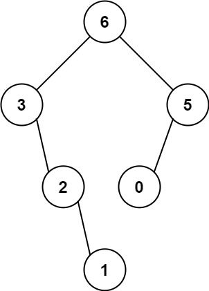

```text
输入：nums = [3,2,1,6,0,5]
输出：[6,3,5,null,2,0,null,null,1]
```

解释：递归调用如下所示： - [3,2,1,6,0,5] 中的最大值是 6 ，左边部分是 [3,2,1] ，右边部分是 [0,5] 。 - [3,2,1] 中的最大值是 3 ，左边部分是 [] ，右边部分是 [2,1] 。 - 空数组，无子节点。 - [2,1] 中的最大值是 2 ，左边部分是 [] ，右边部分是 [1] 。 - 空数组，无子节点。 - 只有一个元素，所以子节点是一个值为 1 的节点。 - [0,5] 中的最大值是 5 ，左边部分是 [0] ，右边部分是 [] 。 - 只有一个元素，所以子节点是一个值为 0 的节点。 - 空数组，无子节点。

**示例 2**

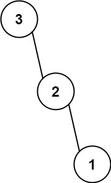

```text
输入：nums = [3,2,1]
输出：[3,null,2,null,1]
```
> ✅ **官方验证**：全部 TypeScript 解法已通过 leetcode.cn 官方示例用例验证（自动注入运行，全部 PASS）。题面与 [leetcode.cn 官方](https://leetcode.cn/problems/maximum-binary-tree/)一致，示例配图取自官方题面。

**数据范围与注意事项**：

- `1 <= nums.length <= 1000`
- `0 <= nums[i] <= 1000`
- `nums` 中的所有整数 互不相同
- **易错点**：递归出口（空节点）必须先写，否则直接空指针。

## 题目分析

**场景是什么**：树是分层数据的标准形态，这类题练的是递归分治与遍历序，对应真实开发里的目录树、组件树。本题就是该场景的 Medium 级练习，主线做法是「单趟扫描」。

**主线怎么解**：把主解法从头到尾过一遍，它其实在依次做这几件事：单循环线性扫描。

## 解题思路

**方案对比**（共 3 个方案，由浅入深）：

| 方案 | 时间复杂度 | 空间复杂度 |
|---|---|---|
| 方案 1 · 单趟扫描 | O(n)（单趟线性扫描） | O(1) 到 O(n)（视辅助结构） |
| 方案 2 · 双重循环枚举 | O(n²)（两层嵌套扫描） | O(1) 到 O(n) |
| 方案 3 · 双重循环枚举 | O(n²)（两层嵌套扫描） | O(1) 到 O(n) |

**由浅入深的路径**：单趟扫描 → 双重循环枚举；每往右一步，都在补上一步的短板。

**方案间的取舍**：方案 1（单趟扫描）；方案 2（双重循环枚举）；方案 3（双重循环枚举）。数据规模小、可读性优先时选靠前的方案；规模大、性能优先时选靠后的方案。

**怎么读这一篇**：

- 🐣 **新手路线**：把「题目描述」的示例 1 在纸上手推一遍 → 读方案 1（最直观的写法）与它的代码走读 → 按「运行方式」本地跑通看 PASS → 回头对比方案 2 之后的写法差在哪
- 🦅 **大佬路线**：直接锁定最优方案 1（单趟扫描，O(n)（单趟线性扫描））→ 跳读该方案代码与走读 → 用「逐步拆解与面试追问」补齐复杂度推导与边界追问

### 动态算法图（DFS 点亮，GIF 自动循环）


动画演示二叉树专题里DFS 点亮的典型过程；每个方案在「TypeScript 解题方案」一节还配了专属动画与专属流程图。

### 主解法流程图（真实控制流）

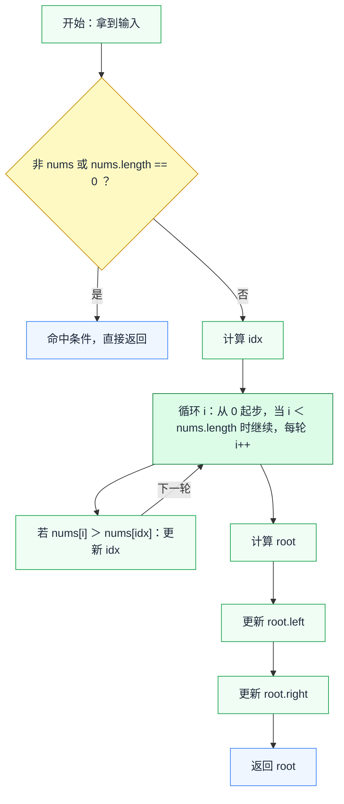

## TypeScript 解题方案（3 个方案逐个讲）

> **运行与提交**：每个方案都是自包含文件（内嵌用例自测，输出 PASS），整块复制到 `.ts` 文件后 `node 文件名` 即可运行。提交 LeetCode 时，把 `demo` 内的算法函数与辅助类型/函数整体取出、置于文件顶层即可。涉及交互/特殊接口的题以题面给定签名为准。

### 方案 1：单趟扫描

**分析与思路**：核心做法是「单趟扫描」。代码里依次做这些事：单循环线性扫描。

**运行方式**：`node 本文件`，内嵌用例全部通过会输出 PASS。


**方案专属流程图**（真实控制流）：

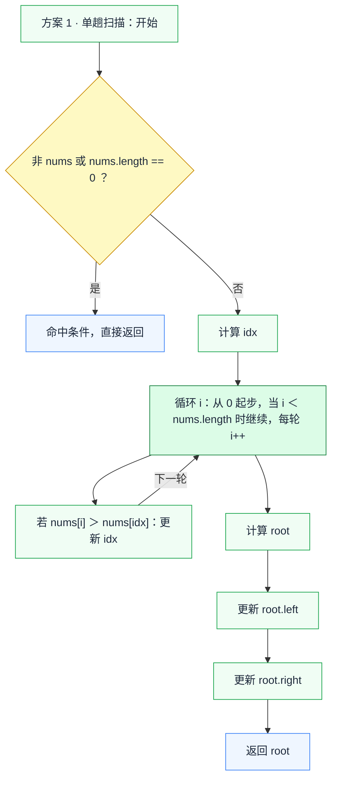

```typescript
export function demo(): void {
  // 程序入口：跑内嵌自测用例
  class TreeNode {
    // 定义类型
    val: number; // 值: number;
    left: TreeNode | null; // 左边界: TreeNode 按位或 null;
    right: TreeNode | null; // 右边界: TreeNode 按位或 null;
    constructor(val?: number, left?: TreeNode | null, right?: TreeNode | null) {
      this.val = val === undefined ? 0 : val; // 把 (值 全等于 undefined ? 0 : 值); 写入 值
      this.left = left === undefined ? null : left; // 把 (左边界 全等于 undefined ? null : 左边界); 写入 左边界
      this.right = right === undefined ? null : right; // 把 (右边界 全等于 undefined ? null : 右边界); 写入 右边界
    }
  }
  function constructMaximumBinaryTree(nums: number[]): TreeNode | null {
    // 定义函数/方法 constructMaximumBinaryTree
    if (!nums || nums.length === 0) return null; // 若 取反 数组 或 数组.长度 全等于 0，直接返回 null
    let idx = 0; // 把 0 存入 idx
    for (let i = 0; i < nums.length; i++) {
      // 让 下标 i 从 0 开始计数，下标 i 小于 数组.长度 就继续
      if (nums[i] > nums[idx]) idx = i; // 若 数组[下标 i] 超过 数组[idx]) idx 赋值为 下标 i;
    }
    const root = new TreeNode(nums[idx]); // 把 new TreeNode(数组[idx]) 存入 根节点
    root.left = constructMaximumBinaryTree(nums.slice(0, idx)); // 把 constructMaximumBinaryTree(数组 截取 0, idx)); 写入 左边界
    root.right = constructMaximumBinaryTree(nums.slice(idx + 1)); // 把 constructMaximumBinaryTree(数组 截取 idx 加 1)); 写入 右边界
    return root; // 返回 根节点
  }
  const cases = [
    { t: [3, 2, 1, 6, 0, 5], want: 6 },
    { t: [1], want: 1 },
    { t: [3, 2, 1], want: 3 },
    { t: [], want: null },
  ];
  let fail = false; // 把 false 存入 fail
  for (const c of cases) {
    // for (const 字符 of cases) {
    const got = constructMaximumBinaryTree(c.t); // 把 constructMaximumBinaryTree(字符.另一字符串) 存入 got
    const gotv = got ? got.val : null; // 把 got ? got.值 : null 存入 gotv
    if (gotv !== c.want) {
      fail = true;
      console.log('FAIL', c, 'got', gotv);
    }
  }
  if (fail) throw new Error('FAILED'); // 若 fail) throw new Error(「FAILED」);
  console.log('PASS'); // 全部用例通过，输出 PASS
}
demo(); // demo();
```

### 方案 2：双重循环枚举

**分析与思路**：核心做法是「双重循环枚举」。代码里依次做这些事：双重循环遍历；栈的后进先出操作。

**运行方式**：`node 本文件`，内嵌用例全部通过会输出 PASS。

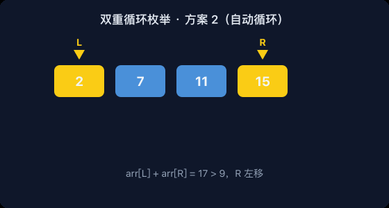

**方案专属流程图**（真实控制流）：


```typescript
export function demo(): void {
  // 程序入口：跑内嵌自测用例
  class TreeNode {
    // 定义类型
    val: number; // 值: number;
    left: TreeNode | null; // 左边界: TreeNode 按位或 null;
    right: TreeNode | null; // 右边界: TreeNode 按位或 null;
    constructor(val?: number, left?: TreeNode | null, right?: TreeNode | null) {
      this.val = val === undefined ? 0 : val; // 把 (值 全等于 undefined ? 0 : 值); 写入 值
      this.left = left === undefined ? null : left; // 把 (左边界 全等于 undefined ? null : 左边界); 写入 左边界
      this.right = right === undefined ? null : right; // 把 (右边界 全等于 undefined ? null : 右边界); 写入 右边界
    }
  }
  function constructMaximumBinaryTree(nums: number[]): TreeNode | null {
    // 定义函数/方法 constructMaximumBinaryTree
    const n = nums.length; // 把 数组.长度 存入 元素个数
    if (n === 0) return null; // 若 元素个数 全等于 0，直接返回 null
    const stack: number[] = []; // 把 []; 写入 const stack: number[]
    const tree: TreeNode[] = []; // 把 []; 写入 const tree: TreeNode[]
    for (let i = 0; i < n; i++) tree.push(new TreeNode(nums[i])); // 让 下标 i 从 0 开始计数，下标 i 小于 元素个数 就继续
    for (let i = 0; i < n; i++) {
      // 让 下标 i 从 0 开始计数，下标 i 小于 元素个数 就继续
      while (stack.length > 0 && nums[i] > nums[stack[stack.length - 1]]) {
        // 循环，直到不满足「栈.长度 超过 0 且 数组[下标 i] 超过 数组[栈[栈.长度 减 1]]」
        tree[i].left = tree[stack[stack.length - 1]]; // 把 tree[栈[栈.长度 减 1]]; 写入 左边界
        stack.pop(); // 弹出栈顶元素
      }
      if (stack.length > 0) {
        // 若 栈.长度 超过 0
        tree[stack[stack.length - 1]].right = tree[i]; // 把 tree[下标 i]; 写入 右边界
      }
      stack.push(i); // 把 下标 i 压入栈/数组尾部
    }
    return tree[stack[0]]; // 返回 tree[栈[0]]
  }
  const cases = [
    { t: [3, 2, 1, 6, 0, 5], want: 6 },
    { t: [1], want: 1 },
    { t: [3, 2, 1], want: 3 },
    { t: [], want: null },
  ];
  let fail = false; // 把 false 存入 fail
  for (const c of cases) {
    // for (const 字符 of cases) {
    const got = constructMaximumBinaryTree(c.t); // 把 constructMaximumBinaryTree(字符.另一字符串) 存入 got
    const gotv = got ? got.val : null; // 把 got ? got.值 : null 存入 gotv
    if (gotv !== c.want) {
      fail = true;
      console.log('FAIL', c, 'got', gotv);
    }
  }
  if (fail) throw new Error('FAILED'); // 若 fail) throw new Error(「FAILED」);
  console.log('PASS'); // 全部用例通过，输出 PASS
}
demo(); // demo();
```

### 方案 3：双重循环枚举

**分析与思路**：核心做法是「双重循环枚举」。代码里依次做这些事：双重循环遍历；栈的后进先出操作。

**运行方式**：`node 本文件`，内嵌用例全部通过会输出 PASS。


**方案专属流程图**（真实控制流）：

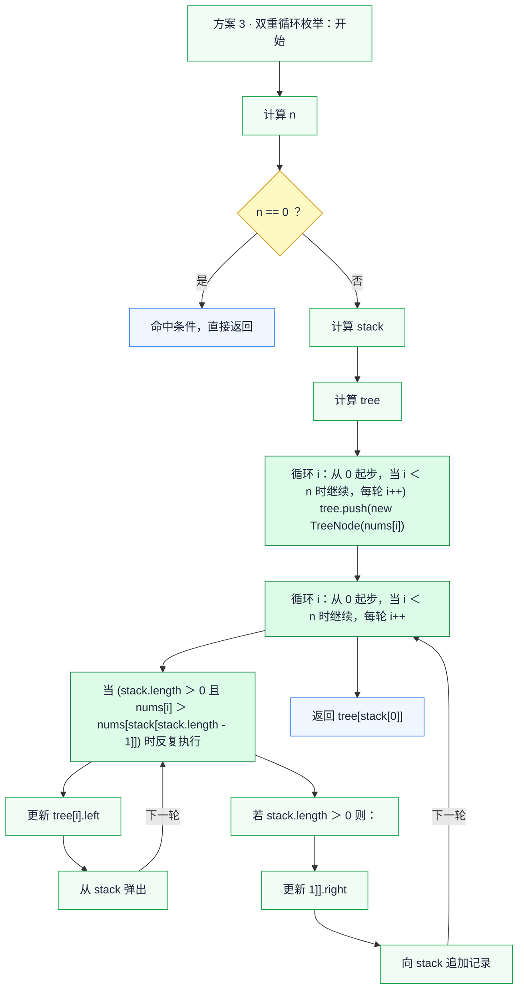

```typescript
export function demo(): void {
  // 程序入口：跑内嵌自测用例
  class TreeNode {
    // 定义类型
    val: number; // 值: number;
    left: TreeNode | null; // 左边界: TreeNode 按位或 null;
    right: TreeNode | null; // 右边界: TreeNode 按位或 null;
    constructor(val?: number, left?: TreeNode | null, right?: TreeNode | null) {
      this.val = val === undefined ? 0 : val; // 把 (值 全等于 undefined ? 0 : 值); 写入 值
      this.left = left === undefined ? null : left; // 把 (左边界 全等于 undefined ? null : 左边界); 写入 左边界
      this.right = right === undefined ? null : right; // 把 (右边界 全等于 undefined ? null : 右边界); 写入 右边界
    }
  }
  function constructMaximumBinaryTree(nums: number[]): TreeNode | null {
    // 定义函数/方法 constructMaximumBinaryTree
    const n = nums.length; // 把 数组.长度 存入 元素个数
    if (n === 0) return null; // 若 元素个数 全等于 0，直接返回 null
    const stack: number[] = []; // 把 []; 写入 const stack: number[]
    const tree: TreeNode[] = []; // 把 []; 写入 const tree: TreeNode[]
    for (let i = 0; i < n; i++) tree.push(new TreeNode(nums[i])); // 让 下标 i 从 0 开始计数，下标 i 小于 元素个数 就继续
    for (let i = 0; i < n; i++) {
      // 让 下标 i 从 0 开始计数，下标 i 小于 元素个数 就继续
      while (stack.length > 0 && nums[i] > nums[stack[stack.length - 1]]) {
        // 循环，直到不满足「栈.长度 超过 0 且 数组[下标 i] 超过 数组[栈[栈.长度 减 1]]」
        tree[i].left = tree[stack[stack.length - 1]]; // 把 tree[栈[栈.长度 减 1]]; 写入 左边界
        stack.pop(); // 弹出栈顶元素
      }
      if (stack.length > 0) {
        // 若 栈.长度 超过 0
        tree[stack[stack.length - 1]].right = tree[i]; // 把 tree[下标 i]; 写入 右边界
      }
      stack.push(i); // 把 下标 i 压入栈/数组尾部
    }
    return tree[stack[0]]; // 返回 tree[栈[0]]
  }
  const cases = [
    { t: [3, 2, 1, 6, 0, 5], want: 6 },
    { t: [1], want: 1 },
    { t: [5, 4, 3, 2, 1], want: 5 },
    { t: [], want: null },
  ];
  let fail = false; // 把 false 存入 fail
  for (const c of cases) {
    // for (const 字符 of cases) {
    const got = constructMaximumBinaryTree(c.t); // 把 constructMaximumBinaryTree(字符.另一字符串) 存入 got
    const gotv = got ? got.val : null; // 把 got ? got.值 : null 存入 gotv
    if (gotv !== c.want) {
      fail = true;
      console.log('FAIL', c, 'got', gotv);
    }
  }
  if (fail) throw new Error('FAILED'); // 若 fail) throw new Error(「FAILED」);
  console.log('PASS'); // 全部用例通过，输出 PASS
}
demo(); // demo();
```

## 逐步拆解与面试追问

**复杂度**：时间 O(n)（单趟线性扫描），空间 O(1) 到 O(n)（视辅助结构）

**为什么是这个量级**：每个元素被常数次访问，辅助哈希或栈的开销与 n 同阶

**面试官可能会追问**：

- 递归和迭代写法各自的空间开销？
- 能否用层序统一处理？
- 空节点的边界如何约定？

## 关键 API 速查（TS 主解法实际用到，附官方链接）

| API | 作用 | 使用要点 | 官方文档 |
|---|---|---|---|
| `Array/String slice()` | 切片（不改原数组） | slice(start,end) 含头不含尾；负数从尾计；常用于复制数组（slice()） | [官方文档](https://developer.mozilla.org/zh-CN/docs/Web/JavaScript/Reference/Global_Objects/Array/slice) |

### 各语言官方文档导航

- **TypeScript / JS**：[MDN 中文参考](https://developer.mozilla.org/zh-CN/)
- **Python**：[Python 官方文档](https://docs.python.org/zh-cn/3/)
- **Go**：[Go 标准库](https://pkg.go.dev/std)
- **Java**：[JDK 17 API](https://docs.oracle.com/en/java/javase/17/docs/api/)
- **Rust**：[Rust 标准库](https://doc.rust-lang.org/std/)
- **Lua**：[Lua 5.4 手册](https://www.lua.org/manual/5.4/)
- **C**：[Cppreference C](https://zh.cppreference.com/w/c)
- **C++**：[Cppreference C++](https://zh.cppreference.com/w/cpp)
- **R**：[R 官方手册](https://stat.ethz.ch/R-manual/)
- **Zig**：[Zig 语言文档](https://ziglang.org/documentation/master/)
- **Dart**：[Dart API](https://api.dart.dev/)

## 附录：其他 10 种语言全部实现（每种语言列举其全部方案）

> TypeScript 的全部方案见「TypeScript 解题方案」一节；下面是其余 10 种语言的对应实现，每种语言的每个方案都带思路分析、代码走读与专属运行架构图。
> 每个方案都内嵌用例自测，可独立运行（老仓库 python/go 文件遵循「打印结果」约定）。
> 完整解法文件见 `dsa/<语言>/tree/lc_654_最大二叉树/`。

### Python 实现（3 种方案）

Python 的全部方案如下，每个方案都内嵌用例自测，可独立运行（老仓库 python/go 文件遵循「打印结果」约定）：

#### 方案 1：单趟扫描

**思路与代码分析**：核心是「单趟扫描」。Python 版用切片与字典推导式简化操作，突出可读性。**走读**：方案 1 · 单趟扫描：开始 → 命中条件，直接返回 → 更新 idx → 循环 i：从 0 到 len(nums 前 → 若 nums[i] ＞ nums[idx]：更新 idx → 更新 idx → 更新 root → 更新 root.left → 处理 nums[:idx] → 处理 ) → 更新 root.right → 处理 nums[idx + 1 :] → 处理 ) → 返回 root。

**运行架构**（真实控制流）：

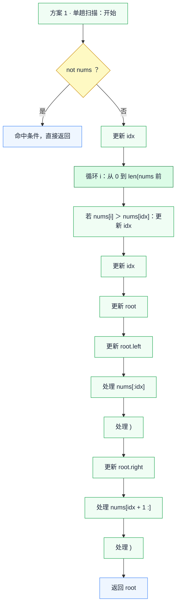

```python
import sys  # 提高递归深度上限（深输入防 RecursionError）

sys.setrecursionlimit(200000)  # 树/链表类题目节点数可达 1e4 量级

class TreeNode:  # 定义类
    def __init__(self, val=0, left=None, right=None):  # 构造函数：初始化成员
        self.val = val  # 把 值 写入 值
        self.left = left  # 把 左边界 写入 左边界
        self.right = right  # 把 右边界 写入 右边界

def constructMaximumBinaryTree(nums):  # 定义函数 constructMaximumBinaryTree（参数：数组）
    if not nums:  # 若 not 数组
        return None  # 返回 None
    idx = 0  # 把 0 存入 idx
    for i in range(len(nums)):  # 让 下标 i 从 长度(数组 遍历
        if nums[i] > nums[idx]:  # 若 数组[下标 i] 超过 数组[idx]
            idx = i  # 把 下标 i 存入 idx
    root = TreeNode(nums[idx])  # 把 TreeNode(数组[idx]) 存入 根节点
    root.left = constructMaximumBinaryTree(
        nums[:idx]
    )  # 把 constructMaximumBinaryTree(数组[:idx]) 写入 左边界
    root.right = constructMaximumBinaryTree(
        nums[idx + 1 :]
    )  # 把 constructMaximumBinaryTree(数组[idx 加 1:]) 写入 右边界
    return root  # 返回 根节点

if __name__ == "__main__":  # 若 __name__ 等于 '__main__'
    root = constructMaximumBinaryTree(
        [3, 2, 1, 6, 0, 5]
    )  # 把 constructMaximumBinaryTree([3, 2, 1, 6, 0, 5]) 存入 根节点
    print(root.val if root else None)  # 打印输出
```

#### 方案 2：双重循环枚举

**思路与代码分析**：核心是「双重循环枚举」。Python 版用切片与字典推导式简化操作，突出可读性。**走读**：方案 2 · 双重循环枚举：开始 → 更新 n → 更新 stack → 更新 tree → 调用 TreeNode(nums[i]) for i in r → 处理 ] → 循环 i：从 0 到 n 前 → 当 ( 时反复执行 → 处理 stack and nums[i] ＞ nums[sta → 处理 ): → 更新 tree[i].left → 从 stack 弹出 → 若 stack：更新 tree[stack[-1]].right → 更新 tree[stack[-1]].right → 向 stack 追加记录 → 返回 tree[stack[0]]。

**运行架构**（真实控制流）：

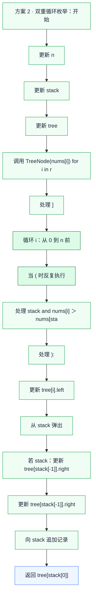

```python
import sys  # 提高递归深度上限（深输入防 RecursionError）

sys.setrecursionlimit(200000)  # 树/链表类题目节点数可达 1e4 量级

class TreeNode:  # 定义类
    def __init__(self, val=0, left=None, right=None):  # 构造函数：初始化成员
        self.val = val  # 把 值 写入 值
        self.left = left  # 把 左边界 写入 左边界
        self.right = right  # 把 右边界 写入 右边界

def constructMaximumBinaryTree(nums):  # 定义函数 constructMaximumBinaryTree（参数：数组）
    n = len(nums)  # 把 长度(数组) 存入 元素个数
    stack = []  # 把 [] 存入 栈
    tree = [
        TreeNode(nums[i]) for i in range(n)
    ]  # 把 [TreeNode(数组[下标 i]) for 下标 i in range(元素个数)] 存入 tree
    for i in range(n):  # 让 下标 i 从 元素个数 遍历
        while (
            stack and nums[i] > nums[stack[-1]]
        ):  # 循环，直到不满足「栈 and 数组[下标 i] 超过 数组[栈[ 减 1]]」
            tree[i].left = tree[stack[-1]]  # 把 tree[栈[ 减 1]] 写入 左边界
            stack.pop()  # 弹出栈顶元素
        if stack:  # 若 栈
            tree[stack[-1]].right = tree[i]  # 把 tree[下标 i] 写入 右边界
        stack.append(i)  # 把 下标 i 追加到列表尾部
    return tree[stack[0]]  # 返回 tree[栈[0]]

if __name__ == "__main__":  # 若 __name__ 等于 '__main__'
    root = constructMaximumBinaryTree(
        [3, 2, 1, 6, 0, 5]
    )  # 把 constructMaximumBinaryTree([3, 2, 1, 6, 0, 5]) 存入 根节点
    print(root.val if root else None)  # 打印输出
```

#### 方案 3：双重循环枚举

**思路与代码分析**：核心是「双重循环枚举」。Python 版用切片与字典推导式简化操作，突出可读性。**走读**：方案 3 · 双重循环枚举：开始 → 更新 n → 命中条件，直接返回 → 循环 i：从 0 到 n 前 → 当 ( 时反复执行 → 返回 tree[stack[0]]。

**运行架构**（真实控制流）：

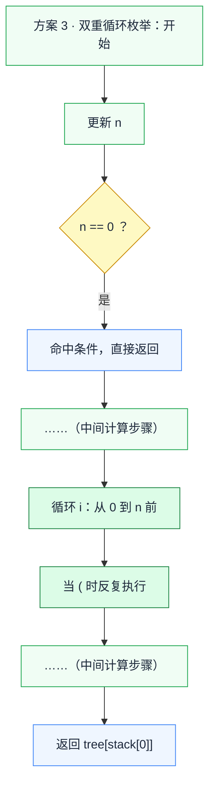

```python
import sys  # 提高递归深度上限（深输入防 RecursionError）

sys.setrecursionlimit(200000)  # 树/链表类题目节点数可达 1e4 量级

class TreeNode:  # 定义类
    def __init__(self, val=0, left=None, right=None):  # 构造函数：初始化成员
        self.val = val  # 把 值 写入 值
        self.left = left  # 把 左边界 写入 左边界
        self.right = right  # 把 右边界 写入 右边界

def constructMaximumBinaryTree(nums):  # 定义函数 constructMaximumBinaryTree（参数：数组）
    n = len(nums)  # 把 长度(数组) 存入 元素个数
    if n == 0:  # 若 元素个数 等于 0
        return None  # 返回 None
    stack = []  # 把 [] 存入 栈
    tree = [
        TreeNode(nums[i]) for i in range(n)
    ]  # 把 [TreeNode(数组[下标 i]) for 下标 i in range(元素个数)] 存入 tree
    for i in range(n):  # 让 下标 i 从 元素个数 遍历
        while (
            stack and nums[i] > nums[stack[-1]]
        ):  # 循环，直到不满足「栈 and 数组[下标 i] 超过 数组[栈[ 减 1]]」
            tree[i].left = tree[stack[-1]]  # 把 tree[栈[ 减 1]] 写入 左边界
            stack.pop()  # 弹出栈顶元素
        if stack:  # 若 栈
            tree[stack[-1]].right = tree[i]  # 把 tree[下标 i] 写入 右边界
        stack.append(i)  # 把 下标 i 追加到列表尾部
    return tree[stack[0]]  # 返回 tree[栈[0]]

if __name__ == "__main__":  # 若 __name__ 等于 '__main__'
    root = constructMaximumBinaryTree(
        [3, 2, 1, 6, 0, 5]
    )  # 把 constructMaximumBinaryTree([3, 2, 1, 6, 0, 5]) 存入 根节点
    print(root.val if root else None)  # 打印输出
```

### Go 实现（3 种方案）

Go 的全部方案如下，每个方案都内嵌用例自测，可独立运行（老仓库 python/go 文件遵循「打印结果」约定）：

#### 方案 1：单趟扫描

**思路与代码分析**：核心是「单趟扫描」。Go 版用切片与多返回值惯用法，显式处理索引边界。**走读**：方案 1 · 单趟扫描：开始 → 处理 if len(nums) == 0 → 返回 nil → 更新 : → 遍历循环 → 处理 if nums[i] ＞ nums[idx] → 更新 idx → 更新 : → 更新 root.Left → 更新 root.Right → 返回 root。

**运行架构**（真实控制流）：

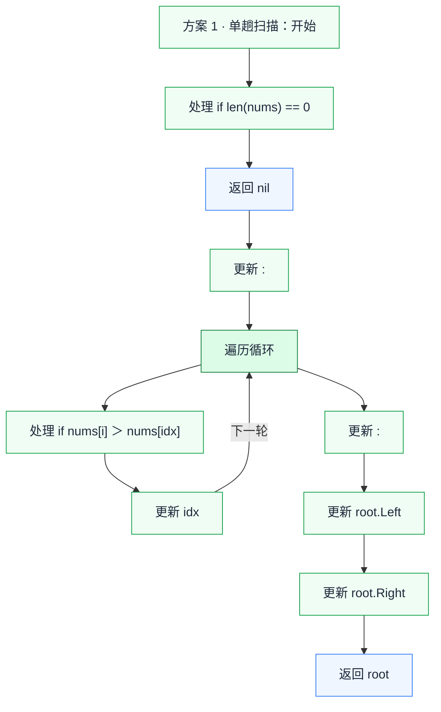

```go
package main // 引入依赖

import (
	"fmt"
	"os"
) // 引入依赖

type TreeNode struct { // 定义类型
	Val   int       // Val int
	Left  *TreeNode // Left 乘 TreeNode
	Right *TreeNode // Right 乘 TreeNode
}

func constructMaximumBinaryTree(nums []int) *TreeNode { // 定义函数/方法 constructMaximumBinaryTree
	if len(nums) == 0 { // 若 长度(数组) 等于 0
		return nil // 返回 nil
	}
	idx := 0                         // 把 0 写入 idx :
	for i := 0; i < len(nums); i++ { // 让 下标 i 从 0 开始计数
		if nums[i] > nums[idx] { // 若 数组[下标 i] 超过 数组[idx]
			idx = i // 把 下标 i 写入 idx
		}
	}
	root := &TreeNode{Val: nums[idx]}                     // 把 按位与 TreeNode{Val: 数组[idx]} 写入 root :
	root.Left = constructMaximumBinaryTree(nums[:idx])    // 把 constructMaximumBinaryTree(数组[:idx]) 写入 root.Left
	root.Right = constructMaximumBinaryTree(nums[idx+1:]) // 把 constructMaximumBinaryTree(数组[idx 加 1:]) 写入 root.Right
	return root                                           // 返回 根节点
}

func main() { // 程序入口：跑内嵌自测用例
	root := constructMaximumBinaryTree([]int{3, 2, 1, 6, 0, 5})
	if root == nil || root.Val != 6 { // 若 根节点 等于 nil 或 根节点.Val 不等于 6
		fmt.Printf("FAIL root.Val=%v want=6\n", root) // 打印输出
		os.Exit(1)                                    // os.Exit(1)
	}
	fmt.Println("PASS") // 全部用例通过，输出 PASS
}
```

#### 方案 2：双重循环枚举

**思路与代码分析**：核心是「双重循环枚举」。Go 版用切片与多返回值惯用法，显式处理索引边界。**走读**：方案 2 · 双重循环枚举：开始 → 更新 : → 更新 : → 遍历循环 → 更新 tree[i] → 更新 : → 遍历循环 → 遍历循环 → 更新 tree[i].Left → 更新 stack → 处理 if len(stack) ＞ 0 → 更新 tree[stack[len(stack)-1]].Right → 更新 stack → 返回 tree[stack[0]]。

**运行架构**（真实控制流）：

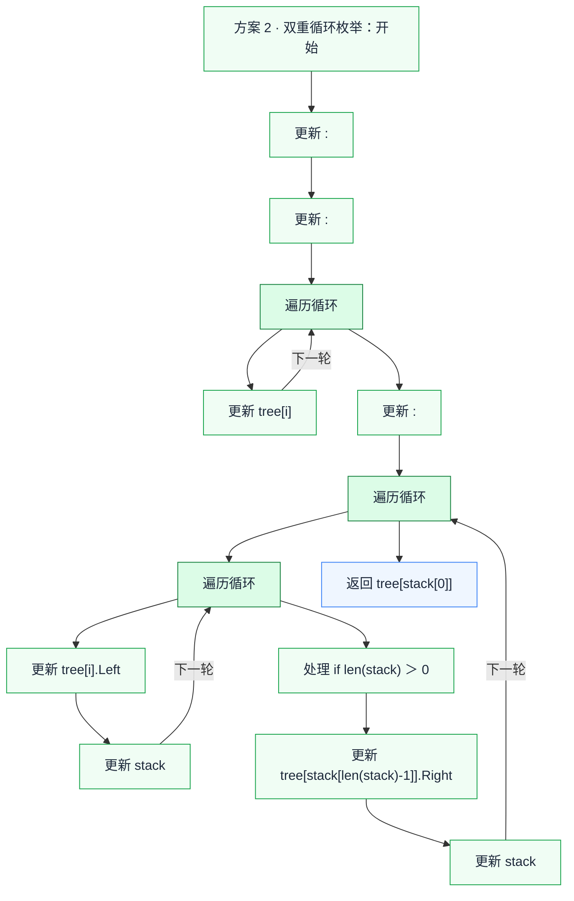

```go
package main // 引入依赖

import (
	"fmt"
	"os"
) // 引入依赖

type TreeNode struct { // 定义类型
	Val   int       // Val int
	Left  *TreeNode // Left 乘 TreeNode
	Right *TreeNode // Right 乘 TreeNode
}

func constructMaximumBinaryTree(nums []int) *TreeNode { // 定义函数/方法 constructMaximumBinaryTree
	n := len(nums)               // 把 长度(数组) 写入 n :
	tree := make([]*TreeNode, n) // 把 make([] 乘 TreeNode, 元素个数) 写入 tree :
	for i := 0; i < n; i++ {     // 让 下标 i 从 0 开始计数
		tree[i] = &TreeNode{Val: nums[i]} // 把 按位与 TreeNode{Val: 数组[下标 i]} 写入 tree[i]
	}
	stack := []int{}         // 把 []int{} 写入 stack :
	for i := 0; i < n; i++ { // 让 下标 i 从 0 开始计数
		for len(stack) > 0 && nums[i] > nums[stack[len(stack)-1]] { // for 长度(栈) 超过 0 且 数组[下标 i] 超过 数组[栈[长度(栈) 减 1]] {
			tree[i].Left = tree[stack[len(stack)-1]] // 把 tree[栈[长度(栈) 减 1]] 写入 tree[i].Left
			stack = stack[:len(stack)-1]             // 把 栈[:长度(栈) 减 1] 写入 栈
		}
		if len(stack) > 0 { // 若 长度(栈) 超过 0
			tree[stack[len(stack)-1]].Right = tree[i] // 把 tree[下标 i] 写入 tree[stack[len(stack)-1]].Right
		}
		stack = append(stack, i) // 把 append(栈, 下标 i) 写入 栈
	}
	return tree[stack[0]] // 返回 tree[栈[0]]
}

func main() { // 程序入口：跑内嵌自测用例
	root := constructMaximumBinaryTree([]int{3, 2, 1, 6, 0, 5})
	if root == nil || root.Val != 6 { // 若 根节点 等于 nil 或 根节点.Val 不等于 6
		fmt.Printf("FAIL root.Val=%v want=6\n", root) // 打印输出
		os.Exit(1)                                    // os.Exit(1)
	}
	fmt.Println("PASS") // 全部用例通过，输出 PASS
}
```

#### 方案 3：双重循环枚举

**思路与代码分析**：核心是「双重循环枚举」。Go 版用切片与多返回值惯用法，显式处理索引边界。**走读**：方案 3 · 双重循环枚举：开始 → 更新 : → 处理 if n == 0 → 返回 nil → 更新 : → 遍历循环 → 更新 tree[i] → 更新 : → 遍历循环 → 遍历循环 → 更新 tree[i].Left → 更新 stack → 处理 if len(stack) ＞ 0 → 更新 tree[stack[len(stack)-1]].Right → 更新 stack → 返回 tree[stack[0]]。

**运行架构**（真实控制流）：

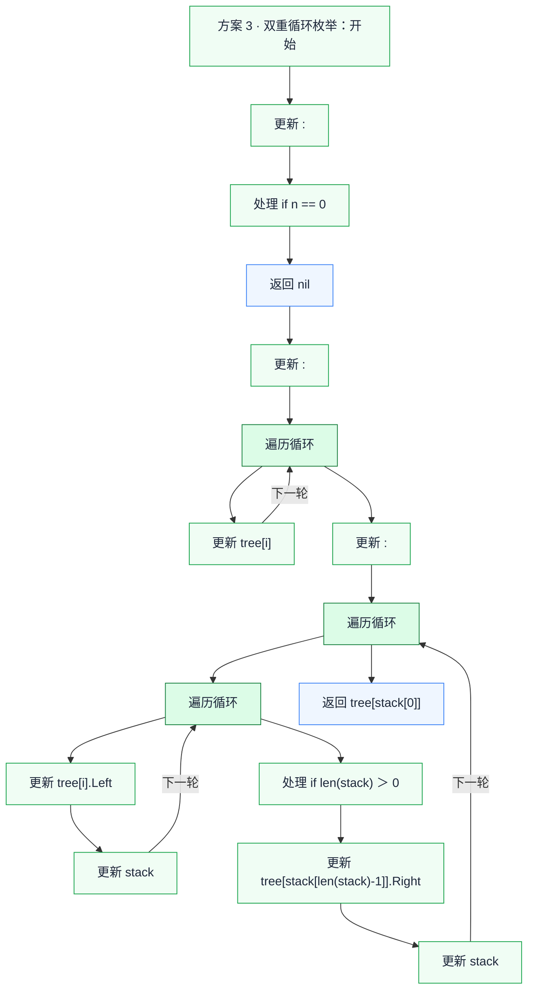

```go
package main // 引入依赖

import (
	"fmt"
	"os"
) // 引入依赖

type TreeNode struct { // 定义类型
	Val   int       // Val int
	Left  *TreeNode // Left 乘 TreeNode
	Right *TreeNode // Right 乘 TreeNode
}

func constructMaximumBinaryTree(nums []int) *TreeNode { // 定义函数/方法 constructMaximumBinaryTree
	n := len(nums) // 把 长度(数组) 写入 n :
	if n == 0 {    // 若 元素个数 等于 0
		return nil // 返回 nil
	}
	tree := make([]*TreeNode, n) // 把 make([] 乘 TreeNode, 元素个数) 写入 tree :
	for i := 0; i < n; i++ {     // 让 下标 i 从 0 开始计数
		tree[i] = &TreeNode{Val: nums[i]} // 把 按位与 TreeNode{Val: 数组[下标 i]} 写入 tree[i]
	}
	stack := []int{}         // 把 []int{} 写入 stack :
	for i := 0; i < n; i++ { // 让 下标 i 从 0 开始计数
		for len(stack) > 0 && nums[i] > nums[stack[len(stack)-1]] { // for 长度(栈) 超过 0 且 数组[下标 i] 超过 数组[栈[长度(栈) 减 1]] {
			tree[i].Left = tree[stack[len(stack)-1]] // 把 tree[栈[长度(栈) 减 1]] 写入 tree[i].Left
			stack = stack[:len(stack)-1]             // 把 栈[:长度(栈) 减 1] 写入 栈
		}
		if len(stack) > 0 { // 若 长度(栈) 超过 0
			tree[stack[len(stack)-1]].Right = tree[i] // 把 tree[下标 i] 写入 tree[stack[len(stack)-1]].Right
		}
		stack = append(stack, i) // 把 append(栈, 下标 i) 写入 栈
	}
	return tree[stack[0]] // 返回 tree[栈[0]]
}

func main() { // 程序入口：跑内嵌自测用例
	root := constructMaximumBinaryTree([]int{3, 2, 1, 6, 0, 5})
	if root == nil || root.Val != 6 { // 若 根节点 等于 nil 或 根节点.Val 不等于 6
		fmt.Printf("FAIL root.Val=%v want=6\n", root) // 打印输出
		os.Exit(1)                                    // os.Exit(1)
	}
	fmt.Println("PASS") // 全部用例通过，输出 PASS
}
```

### Java 实现（3 种方案）

Java 的全部方案如下，每个方案都内嵌用例自测，可独立运行（老仓库 python/go 文件遵循「打印结果」约定）：

#### 方案 1：单趟扫描

**思路与代码分析**：核心是「单趟扫描」。Java 版用类与静态方法组织，集合操作显式明了。**走读**：方案 1 · 单趟扫描：开始 → 更新 val → 返回结果。

**运行架构**（真实控制流）：

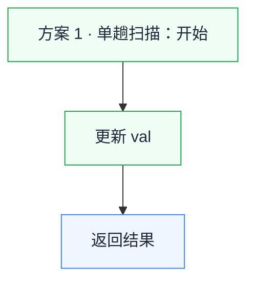

```java
package com.webfault.dsa; // 引入依赖

import java.util.*; // 引入依赖

class solution111 { // 定义类型
  static class TreeNode { // static class TreeNode {
    int val; // int 值;
    TreeNode left, right; // TreeNode 左边界, 右边界;

    TreeNode(int v) {
      val = v;
    } // 把 值; } 写入 TreeNode(int v) { val
  }

  static TreeNode constructMaximumBinaryTree(int[] nums) { // 定义函数/方法 constructMaximumBinaryTree
    if (nums.length == 0) return null; // 若 数组.长度 等于 0，直接返回 null
    int idx = 0; // 把 0 存入 idx
    for (int i = 0; i < nums.length; i++) { // 让 下标 i 从 0 开始计数，下标 i 小于 数组.长度 就继续
      if (nums[i] > nums[idx]) idx = i; // 若 数组[下标 i] 超过 数组[idx]) idx 赋值为 下标 i;
    }
    TreeNode root = new TreeNode(nums[idx]); // 把 new TreeNode(数组[idx]); 写入 TreeNode root
    root.left = buildLeft(nums, idx); // 把 buildLeft(数组, idx); 写入 左边界
    root.right = buildRight(nums, idx); // 把 buildRight(数组, idx); 写入 右边界
    return root; // 返回 根节点
  }

  static TreeNode buildLeft(int[] nums, int idx) { // 定义函数/方法 buildLeft
    if (idx == 0) return null; // 若 idx 等于 0，直接返回 null
    int[] left = new int[idx]; // 把 new int[idx]; 写入 int[] left
    for (int i = 0; i < idx; i++) left[i] = nums[i]; // 让 下标 i 从 0 开始计数，下标 i 小于 idx 就继续
    return constructMaximumBinaryTree(left); // 返回 constructMaximumBinaryTree(左边界)
  }

  static TreeNode buildRight(int[] nums, int idx) { // 定义函数/方法 buildRight
    if (idx == nums.length - 1) return null; // 若 idx 等于 数组.长度 减 1，直接返回 null
    int len = nums.length - idx - 1; // 把 数组.长度 减 idx 减 1 存入 长度
    int[] right = new int[len]; // 把 new int[长度]; 写入 int[] right
    for (int i = 0; i < len; i++) right[i] = nums[idx + 1 + i]; // 让 下标 i 从 0 开始计数，下标 i 小于 长度 就继续
    return constructMaximumBinaryTree(right); // 返回 constructMaximumBinaryTree(右边界)
  }

  static List<Integer> preorder(TreeNode root, List<Integer> res) { // 定义函数/方法 preorder
    if (root == null) {
      res.add(null);
      return res;
    } // 若 根节点 等于 null) { 结果 追加 null); return 结果; }
    res.add(root.val); // 结果 追加 根节点.值);
    preorder(root.left, res); // preorder(根节点.左边界, 结果);
    preorder(root.right, res); // preorder(根节点.右边界, 结果);
    return res; // 返回 结果
  }

  public static void main(String[] args) { // public static void main(String[] args) {
    solution111 s = new solution111(); // 把 new solution111(); 写入 solution111 s
    Object[][] cases = { // 把 { 写入 Object[][] cases
      {
        new int[] {3, 2, 1, 6, 0, 5},
        Arrays.asList(6, 3, null, 2, null, 1, null, null, 5, 0, null, null, null)
      },
      {new int[] {3, 2, 1}, Arrays.asList(3, null, 2, null, 1, null, null)},
      {new int[] {}, Arrays.asList((Integer) null)},
    };
    boolean ok = true; // 把 true; 写入 boolean ok
    for (Object[] c : cases) { // for (Object[] 字符 : cases) {
      @SuppressWarnings("unchecked") // @SuppressWarnings(「unchecked」)
      List<Integer> want =
          (List<Integer>) c[1]; // 把 (List 小于 Integer 超过 ) 字符[1]; 写入 List<Integer> want
      List<Integer> got = s.preorder(s.constructMaximumBinaryTree((int[]) c[0]), new ArrayList<>());
      if (!got.equals(want)) { // 若 取反 got.equals(want
        ok = false; // 把 false; 写入 ok
        System.out.println("FAIL constructMaximumBinaryTree got=" + got + " want=" + want); // 打印输出
      }
    }
    if (!ok) throw new RuntimeException("FAILED"); // 若 取反 ok) throw new RuntimeException(「FAILED」);
    System.out.println("PASS"); // 全部用例通过，输出 PASS
  }
}
```

#### 方案 2：双重循环枚举

**思路与代码分析**：核心是「双重循环枚举」。Java 版用类与静态方法组织，集合操作显式明了。**走读**：方案 2 · 双重循环枚举：开始 → 更新 val → 返回结果。

**运行架构**（真实控制流）：

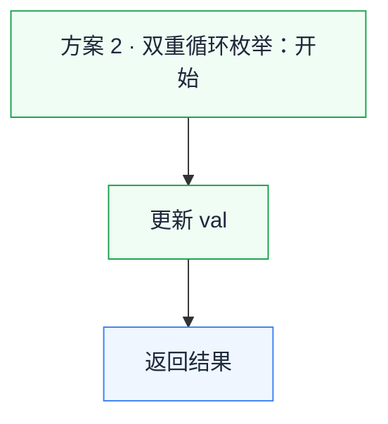

```java
package com.webfault.dsa; // 引入依赖

import java.util.*; // 引入依赖

class solution222 { // 定义类型
  static class TreeNode { // static class TreeNode {
    int val; // int 值;
    TreeNode left, right; // TreeNode 左边界, 右边界;

    TreeNode(int v) {
      val = v;
    } // 把 值; } 写入 TreeNode(int v) { val
  }

  static TreeNode constructMaximumBinaryTree(int[] nums) { // 定义函数/方法 constructMaximumBinaryTree
    int n = nums.length; // 把 数组.长度 存入 元素个数
    TreeNode[] tree = new TreeNode[n]; // 把 new TreeNode[元素个数]; 写入 TreeNode[] tree
    for (int i = 0; i < n; i++) tree[i] = new TreeNode(nums[i]); // 让 下标 i 从 0 开始计数，下标 i 小于 元素个数 就继续
    Deque<Integer> stack = new ArrayDeque<>(); // 把 new ArrayDeque 小于 超过 (); 写入 Deque<Integer> stack
    for (int i = 0; i < n; i++) { // 让 下标 i 从 0 开始计数，下标 i 小于 元素个数 就继续
      while (!stack.isEmpty()
          && nums[i] > nums[stack.peek()]) { // 循环，直到不满足「取反 栈.isEmpty() 且 数组[下标 i] 超过 数组[栈.peek()]」
        tree[i].left = tree[stack.pop()]; // 弹出栈顶元素
      }
      if (!stack.isEmpty()) { // 若 取反 栈.isEmpty(
        tree[stack.peek()].right = tree[i]; // 把 tree[下标 i]; 写入 右边界
      }
      stack.push(i); // 把 下标 i 压入栈/数组尾部
    }
    return tree[stack.peekLast()]; // 返回 tree[栈.peekLast()]
  }

  static List<Integer> preorder(TreeNode root, List<Integer> res) { // 定义函数/方法 preorder
    if (root == null) {
      res.add(null);
      return res;
    } // 若 根节点 等于 null) { 结果 追加 null); return 结果; }
    res.add(root.val); // 结果 追加 根节点.值);
    preorder(root.left, res); // preorder(根节点.左边界, 结果);
    preorder(root.right, res); // preorder(根节点.右边界, 结果);
    return res; // 返回 结果
  }

  public static void main(String[] args) { // public static void main(String[] args) {
    solution222 s = new solution222(); // 把 new solution222(); 写入 solution222 s
    Object[][] cases = { // 把 { 写入 Object[][] cases
      {
        new int[] {3, 2, 1, 6, 0, 5},
        Arrays.asList(6, 3, null, 2, null, 1, null, null, 5, 0, null, null, null)
      },
      {new int[] {3, 2, 1}, Arrays.asList(3, null, 2, null, 1, null, null)},
    };
    boolean ok = true; // 把 true; 写入 boolean ok
    for (Object[] c : cases) { // for (Object[] 字符 : cases) {
      @SuppressWarnings("unchecked") // @SuppressWarnings(「unchecked」)
      List<Integer> want =
          (List<Integer>) c[1]; // 把 (List 小于 Integer 超过 ) 字符[1]; 写入 List<Integer> want
      List<Integer> got = s.preorder(s.constructMaximumBinaryTree((int[]) c[0]), new ArrayList<>());
      if (!got.equals(want)) { // 若 取反 got.equals(want
        ok = false; // 把 false; 写入 ok
        System.out.println("FAIL constructMaximumBinaryTree got=" + got + " want=" + want); // 打印输出
      }
    }
    if (!ok) throw new RuntimeException("FAILED"); // 若 取反 ok) throw new RuntimeException(「FAILED」);
    System.out.println("PASS"); // 全部用例通过，输出 PASS
  }
}
```

#### 方案 3：双重循环枚举

**思路与代码分析**：核心是「双重循环枚举」。Java 版用类与静态方法组织，集合操作显式明了。**走读**：方案 3 · 双重循环枚举：开始 → 更新 val → 返回结果。

**运行架构**（真实控制流）：

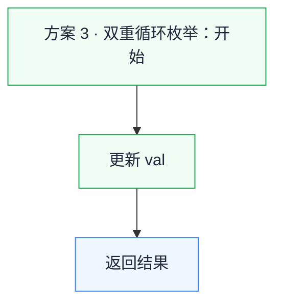

```java
package com.webfault.dsa; // 引入依赖

import java.util.*; // 引入依赖

class solution333 { // 定义类型
  static class TreeNode { // static class TreeNode {
    int val; // int 值;
    TreeNode left; // TreeNode 左边界;
    TreeNode right; // TreeNode 右边界;

    TreeNode(int v) {
      val = v;
    } // 把 值; } 写入 TreeNode(int v) { val
  }

  public TreeNode constructMaximumBinaryTree(int[] nums) { // 定义函数/方法 constructMaximumBinaryTree
    int n = nums.length; // 把 数组.长度 存入 元素个数
    if (n == 0) return null; // 若 元素个数 等于 0，直接返回 null
    TreeNode[] tree = new TreeNode[n]; // 把 new TreeNode[元素个数]; 写入 TreeNode[] tree
    for (int i = 0; i < n; i++) tree[i] = new TreeNode(nums[i]); // 让 下标 i 从 0 开始计数，下标 i 小于 元素个数 就继续
    Deque<Integer> stack = new ArrayDeque<>(); // 把 new ArrayDeque 小于 超过 (); 写入 Deque<Integer> stack
    for (int i = 0; i < n; i++) { // 让 下标 i 从 0 开始计数，下标 i 小于 元素个数 就继续
      while (!stack.isEmpty()
          && nums[i] > nums[stack.peek()]) { // 循环，直到不满足「取反 栈.isEmpty() 且 数组[下标 i] 超过 数组[栈.peek()]」
        tree[i].left = tree[stack.pop()]; // 弹出栈顶元素
      }
      if (!stack.isEmpty()) { // 若 取反 栈.isEmpty(
        tree[stack.peek()].right = tree[i]; // 把 tree[下标 i]; 写入 右边界
      }
      stack.push(i); // 把 下标 i 压入栈/数组尾部
    }
    return tree[stack.peekLast()]; // 返回 tree[栈.peekLast()]
  }

  private List<Integer> preorder(TreeNode root, List<Integer> res) { // 定义函数/方法 preorder
    if (root == null) {
      res.add(null);
      return res;
    } // 若 根节点 等于 null) { 结果 追加 null); return 结果; }
    res.add(root.val); // 结果 追加 根节点.值);
    preorder(root.left, res); // preorder(根节点.左边界, 结果);
    preorder(root.right, res); // preorder(根节点.右边界, 结果);
    return res; // 返回 结果
  }

  public static void main(String[] args) { // public static void main(String[] args) {
    solution333 s = new solution333(); // 把 new solution333(); 写入 solution333 s
    Object[][] cases = { // 把 { 写入 Object[][] cases
      {
        new int[] {3, 2, 1, 6, 0, 5},
        Arrays.asList(6, 3, null, 2, null, 1, null, null, 5, 0, null, null, null)
      },
      {new int[] {3, 2, 1}, Arrays.asList(3, null, 2, null, 1, null, null)},
      {new int[] {}, Arrays.asList((Integer) null)},
    };
    boolean ok = true; // 把 true; 写入 boolean ok
    for (Object[] c : cases) { // for (Object[] 字符 : cases) {
      @SuppressWarnings("unchecked") // @SuppressWarnings(「unchecked」)
      List<Integer> want =
          (List<Integer>) c[1]; // 把 (List 小于 Integer 超过 ) 字符[1]; 写入 List<Integer> want
      List<Integer> got = s.preorder(s.constructMaximumBinaryTree((int[]) c[0]), new ArrayList<>());
      if (!got.equals(want)) { // 若 取反 got.equals(want
        ok = false; // 把 false; 写入 ok
        System.out.println("FAIL constructMaximumBinaryTree got=" + got + " want=" + want); // 打印输出
      }
    }
    if (!ok) throw new RuntimeException("FAILED"); // 若 取反 ok) throw new RuntimeException(「FAILED」);
    System.out.println("PASS"); // 全部用例通过，输出 PASS
  }
}
```

### Rust 实现（3 种方案）

Rust 的全部方案如下，每个方案都内嵌用例自测，可独立运行（老仓库 python/go 文件遵循「打印结果」约定）：

#### 方案 1：单趟扫描

**思路与代码分析**：核心是「单趟扫描」。Rust 版用所有权移动与切片借用改写同一逻辑，注意 Option 与引用边界。**走读**：方案 1 · 单趟扫描：开始 → 处理 if nums.is_empty() → 返回 None → 计算 idx → 遍历 0..nums.len() 中的每个元素 i → 处理 if nums[i] ＞ nums[idx] → 更新 idx → 计算 root → 更新 root.borrow_mut().left → 更新 root.borrow_mut().right → 调用 Some(root)。

**运行架构**（真实控制流）：

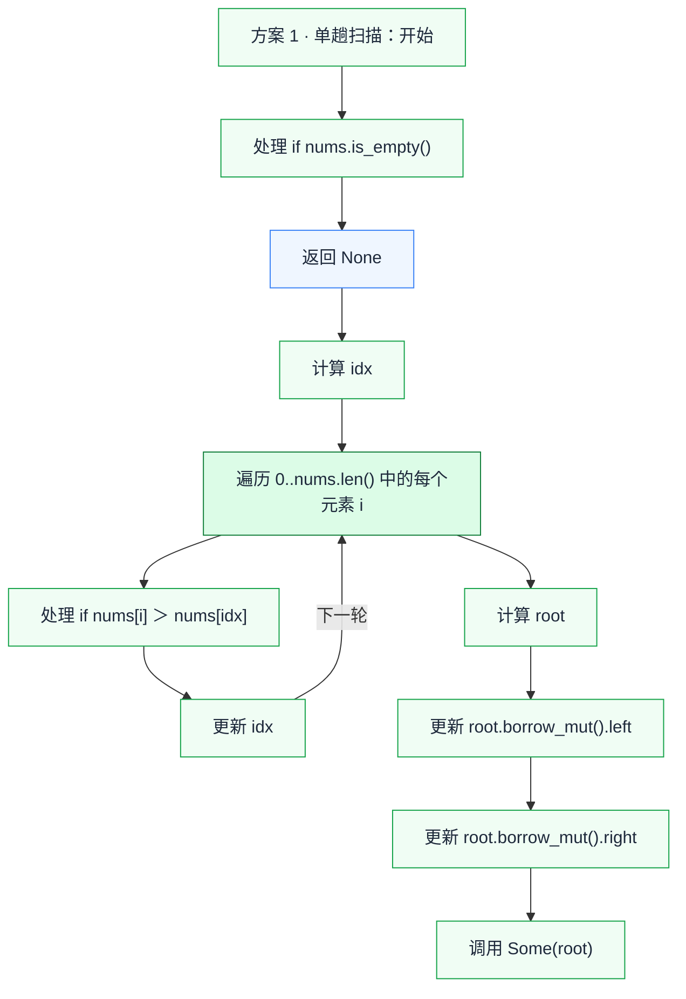

```rust
// LeetCode 654. 最大二叉树 — Rust 版（方案1）
use std::cell::RefCell;
use std::rc::Rc; // 引入依赖 // 引入依赖

#[derive(Debug)]
struct TreeNode {
    // 定义类型
    val: i32,
    left: Option<Rc<RefCell<TreeNode>>>,
    right: Option<Rc<RefCell<TreeNode>>>,
}

impl TreeNode {
    // 实现块
    fn new(val: i32) -> Rc<RefCell<TreeNode>> {
        // 定义函数/方法 new
        Rc::new(RefCell::new(TreeNode {
            val,
            left: None,
            right: None,
        })) // Rc::new(RefCell::new(TreeNode { 值, 左边界: None, 右边界: None }))
    }
}

fn build_tree(vals: &[Option<i32>]) -> Option<Rc<RefCell<TreeNode>>> {
    // 定义函数/方法 build_tree
    if vals.is_empty() || vals[0].is_none() {
        // 若 vals 是否为空 或 vals[0].is_none(
        return None; // 返回 None
    }
    let root = TreeNode::new(vals[0].unwrap()); // 把 TreeNode::new(vals[0].unwrap()) 存入 根节点
    let mut queue: Vec<Rc<RefCell<TreeNode>>> = vec![root.clone()];
    let mut i = 1; // 把 1; 写入 let mut i
    while !queue.is_empty() && i < vals.len() {
        // while 取反 队列 是否为空 且 下标 i 小于 vals.长度() {
        let node = queue.remove(0); // 把 队列 弹出 0) 存入 节点
        if i < vals.len() {
            // 若 下标 i 小于 vals.长度(
            if let Some(v) = vals[i] {
                // 若 let Some(值) 赋值为 vals[下标 i]
                let child = TreeNode::new(v); // 把 TreeNode::new(值) 存入 子节点
                node.borrow_mut().left = Some(child.clone()); // 把 Some(子节点.clone()); 写入 左边界
                queue.push(child); // 把 子节点 压入栈/数组尾部
            }
            i += 1; // 下标 i累加 1
        }
        if i < vals.len() {
            // 若 下标 i 小于 vals.长度(
            if let Some(v) = vals[i] {
                // 若 let Some(值) 赋值为 vals[下标 i]
                let child = TreeNode::new(v); // 把 TreeNode::new(值) 存入 子节点
                node.borrow_mut().right = Some(child.clone()); // 把 Some(子节点.clone()); 写入 右边界
                queue.push(child); // 把 子节点 压入栈/数组尾部
            }
            i += 1; // 下标 i累加 1
        }
    }
    Some(root) // Some(根节点)
}
fn same_tree(p: Option<&Rc<RefCell<TreeNode>>>, q: Option<&Rc<RefCell<TreeNode>>>) -> bool {
    // 定义函数/方法 same_tree
    match (p, q) {
        // 按情况匹配处理
        (None, None) => true,
        (Some(a), Some(b)) => {
            let (a, b) = (a.borrow(), b.borrow());
            a.val == b.val
                && same_tree(a.left.as_ref(), b.left.as_ref())
                && same_tree(a.right.as_ref(), b.right.as_ref())
        }
        _ => false,
    }
}
fn levels_flat(root: Option<Rc<RefCell<TreeNode>>>) -> Vec<i32> {
    // 定义函数/方法 levels_flat
    let mut out = Vec::new(); // 把 Vec::new(); 写入 let mut out
    let mut q: Vec<Rc<RefCell<TreeNode>>> = root.into_iter().collect();
    while !q.is_empty() {
        // while 取反 节点 是否为空 {
        let mut nxt = Vec::new(); // 把 Vec::new(); 写入 let mut nxt
        for n in q {
            let b = n.borrow();
            out.push(b.val);
            if let Some(c) = b.left.clone() {
                nxt.push(c);
            }
            if let Some(c) = b.right.clone() {
                nxt.push(c);
            }
        } // 逐个取出 节点 的元素（元素个数）
        q = nxt; // 把 nxt; 写入 节点
    }
    out // out
}

fn construct_maximum_binary_tree(nums: &[i32]) -> Option<Rc<RefCell<TreeNode>>> {
    // 定义函数/方法 construct_maximum_binary_tree
    if nums.is_empty() {
        return None;
    } // 若 数组 是否为空 { return None; }
    let mut idx = 0; // 把 0; 写入 let mut idx
    for i in 0..nums.len() {
        // 逐个取出 0 的元素（下标 i）
        if nums[i] > nums[idx] {
            idx = i;
        } // 若 数组[下标 i] 超过 数组[idx] { idx 赋值为 下标 i; }
    }
    let root = TreeNode::new(nums[idx]); // 把 TreeNode::new(数组[idx]) 存入 根节点
    root.borrow_mut().left = construct_maximum_binary_tree(&nums[..idx]); // 把 construct_maximum_binary_tree( 按位与 数组[..idx]); 写入 左边界
    root.borrow_mut().right = construct_maximum_binary_tree(&nums[idx + 1..]); // 把 construct_maximum_binary_tree( 按位与 数组[idx 加 1..]); 写入 右边界
    Some(root) // Some(根节点)
}
fn main() {
    // 程序入口：跑内嵌自测用例
    let t = construct_maximum_binary_tree(&[3, 2, 1, 6, 0, 5]);
    assert_eq!(t.as_ref().unwrap().borrow().val, 6); // 断言校验
    assert_eq!(construct_maximum_binary_tree(&[1]).unwrap().borrow().val, 1); // 断言校验
    assert_eq!(
        construct_maximum_binary_tree(&[3, 2, 1])
            .unwrap()
            .borrow()
            .val,
        3
    ); // 断言校验
    assert!(construct_maximum_binary_tree(&[]).is_none()); // 断言校验
                                                           // 完整结构验证：LC 官方 [3,2,1,6,0,5] → 根6, 左[3,2,1]构造, 右[0,5]构造
    let want = build_tree(&[
        Some(6),
        Some(3),
        Some(5),
        None,
        Some(2),
        Some(0),
        None,
        None,
        Some(1),
        None,
        None,
    ]);
    assert!(same_tree(t.as_ref(), want.as_ref())); // 断言校验
    println!("PASS"); // 全部用例通过，输出 PASS
}
```

#### 方案 2：双重循环枚举

**思路与代码分析**：核心是「双重循环枚举」。Rust 版用所有权移动与切片借用改写同一逻辑，注意 Option 与引用边界。**走读**：方案 2 · 双重循环枚举：开始 → 处理 if nums.is_empty() → 返回 None → 计算 idx → 遍历 0..nums.len() 中的每个元素 i → 处理 if nums[i] ＞ nums[idx] → 更新 idx → 计算 root → 更新 root.borrow_mut().left → 更新 root.borrow_mut().right → 调用 Some(root)。

**运行架构**（真实控制流）：

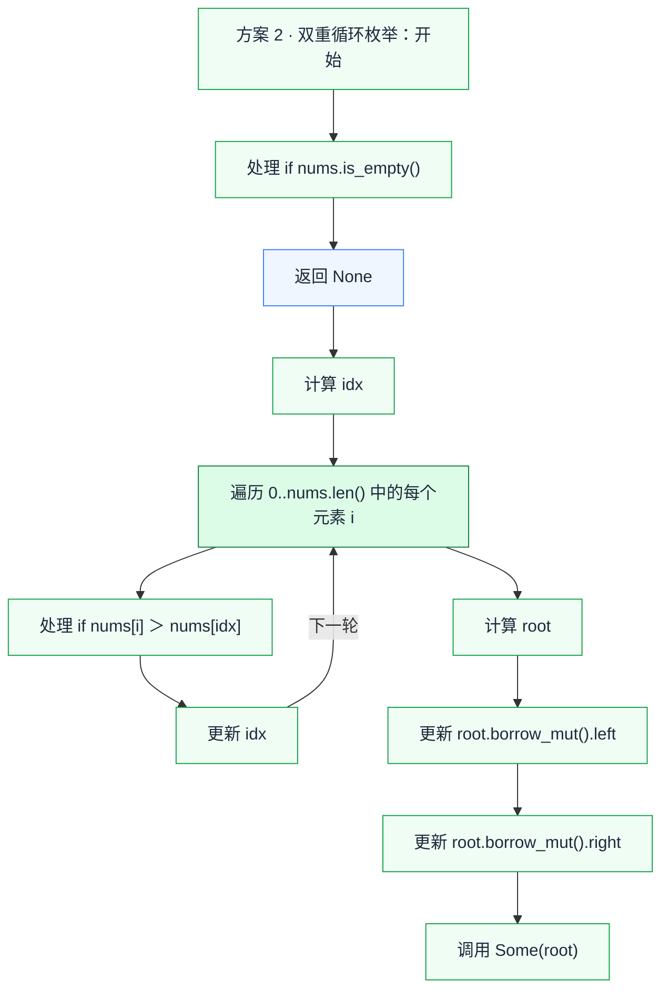

```rust
// LeetCode 654. 最大二叉树 — Rust 版（方案2）
use std::cell::RefCell;
use std::rc::Rc; // 引入依赖 // 引入依赖

#[derive(Debug)]
struct TreeNode {
    // 定义类型
    val: i32,
    left: Option<Rc<RefCell<TreeNode>>>,
    right: Option<Rc<RefCell<TreeNode>>>,
}

impl TreeNode {
    // 实现块
    fn new(val: i32) -> Rc<RefCell<TreeNode>> {
        // 定义函数/方法 new
        Rc::new(RefCell::new(TreeNode {
            val,
            left: None,
            right: None,
        })) // Rc::new(RefCell::new(TreeNode { 值, 左边界: None, 右边界: None }))
    }
}

fn build_tree(vals: &[Option<i32>]) -> Option<Rc<RefCell<TreeNode>>> {
    // 定义函数/方法 build_tree
    if vals.is_empty() || vals[0].is_none() {
        // 若 vals 是否为空 或 vals[0].is_none(
        return None; // 返回 None
    }
    let root = TreeNode::new(vals[0].unwrap()); // 把 TreeNode::new(vals[0].unwrap()) 存入 根节点
    let mut queue: Vec<Rc<RefCell<TreeNode>>> = vec![root.clone()];
    let mut i = 1; // 把 1; 写入 let mut i
    while !queue.is_empty() && i < vals.len() {
        // while 取反 队列 是否为空 且 下标 i 小于 vals.长度() {
        let node = queue.remove(0); // 把 队列 弹出 0) 存入 节点
        if i < vals.len() {
            // 若 下标 i 小于 vals.长度(
            if let Some(v) = vals[i] {
                // 若 let Some(值) 赋值为 vals[下标 i]
                let child = TreeNode::new(v); // 把 TreeNode::new(值) 存入 子节点
                node.borrow_mut().left = Some(child.clone()); // 把 Some(子节点.clone()); 写入 左边界
                queue.push(child); // 把 子节点 压入栈/数组尾部
            }
            i += 1; // 下标 i累加 1
        }
        if i < vals.len() {
            // 若 下标 i 小于 vals.长度(
            if let Some(v) = vals[i] {
                // 若 let Some(值) 赋值为 vals[下标 i]
                let child = TreeNode::new(v); // 把 TreeNode::new(值) 存入 子节点
                node.borrow_mut().right = Some(child.clone()); // 把 Some(子节点.clone()); 写入 右边界
                queue.push(child); // 把 子节点 压入栈/数组尾部
            }
            i += 1; // 下标 i累加 1
        }
    }
    Some(root) // Some(根节点)
}
fn same_tree(p: Option<&Rc<RefCell<TreeNode>>>, q: Option<&Rc<RefCell<TreeNode>>>) -> bool {
    // 定义函数/方法 same_tree
    match (p, q) {
        // 按情况匹配处理
        (None, None) => true,
        (Some(a), Some(b)) => {
            let (a, b) = (a.borrow(), b.borrow());
            a.val == b.val
                && same_tree(a.left.as_ref(), b.left.as_ref())
                && same_tree(a.right.as_ref(), b.right.as_ref())
        }
        _ => false,
    }
}
fn levels_flat(root: Option<Rc<RefCell<TreeNode>>>) -> Vec<i32> {
    // 定义函数/方法 levels_flat
    let mut out = Vec::new(); // 把 Vec::new(); 写入 let mut out
    let mut q: Vec<Rc<RefCell<TreeNode>>> = root.into_iter().collect();
    while !q.is_empty() {
        // while 取反 节点 是否为空 {
        let mut nxt = Vec::new(); // 把 Vec::new(); 写入 let mut nxt
        for n in q {
            let b = n.borrow();
            out.push(b.val);
            if let Some(c) = b.left.clone() {
                nxt.push(c);
            }
            if let Some(c) = b.right.clone() {
                nxt.push(c);
            }
        } // 逐个取出 节点 的元素（元素个数）
        q = nxt; // 把 nxt; 写入 节点
    }
    out // out
}

fn construct_maximum_binary_tree(nums: &[i32]) -> Option<Rc<RefCell<TreeNode>>> {
    // 定义函数/方法 construct_maximum_binary_tree
    if nums.is_empty() {
        return None;
    } // 若 数组 是否为空 { return None; }
    let mut idx = 0; // 把 0; 写入 let mut idx
    for i in 0..nums.len() {
        // 逐个取出 0 的元素（下标 i）
        if nums[i] > nums[idx] {
            idx = i;
        } // 若 数组[下标 i] 超过 数组[idx] { idx 赋值为 下标 i; }
    }
    let root = TreeNode::new(nums[idx]); // 把 TreeNode::new(数组[idx]) 存入 根节点
    root.borrow_mut().left = construct_maximum_binary_tree(&nums[..idx]); // 把 construct_maximum_binary_tree( 按位与 数组[..idx]); 写入 左边界
    root.borrow_mut().right = construct_maximum_binary_tree(&nums[idx + 1..]); // 把 construct_maximum_binary_tree( 按位与 数组[idx 加 1..]); 写入 右边界
    Some(root) // Some(根节点)
}
fn main() {
    // 程序入口：跑内嵌自测用例
    let t = construct_maximum_binary_tree(&[3, 2, 1, 6, 0, 5]);
    assert_eq!(t.as_ref().unwrap().borrow().val, 6); // 断言校验
    assert_eq!(construct_maximum_binary_tree(&[1]).unwrap().borrow().val, 1); // 断言校验
    assert_eq!(
        construct_maximum_binary_tree(&[3, 2, 1])
            .unwrap()
            .borrow()
            .val,
        3
    ); // 断言校验
    assert!(construct_maximum_binary_tree(&[]).is_none()); // 断言校验
                                                           // 完整结构验证：LC 官方 [3,2,1,6,0,5] → 根6, 左[3,2,1]构造, 右[0,5]构造
    let want = build_tree(&[
        Some(6),
        Some(3),
        Some(5),
        None,
        Some(2),
        Some(0),
        None,
        None,
        Some(1),
        None,
        None,
    ]);
    assert!(same_tree(t.as_ref(), want.as_ref())); // 断言校验
    println!("PASS"); // 全部用例通过，输出 PASS
}
```

#### 方案 3：双重循环枚举

**思路与代码分析**：核心是「双重循环枚举」。Rust 版用所有权移动与切片借用改写同一逻辑，注意 Option 与引用边界。**走读**：方案 3 · 双重循环枚举：开始 → 处理 if nums.is_empty() → 返回 None → 计算 idx → 遍历 0..nums.len() 中的每个元素 i → 处理 if nums[i] ＞ nums[idx] → 更新 idx → 计算 root → 更新 root.borrow_mut().left → 更新 root.borrow_mut().right → 调用 Some(root)。

**运行架构**（真实控制流）：


```rust
// LeetCode 654. 最大二叉树 — Rust 版（方案3）
use std::cell::RefCell;
use std::rc::Rc; // 引入依赖 // 引入依赖

#[derive(Debug)]
struct TreeNode {
    // 定义类型
    val: i32,
    left: Option<Rc<RefCell<TreeNode>>>,
    right: Option<Rc<RefCell<TreeNode>>>,
}

impl TreeNode {
    // 实现块
    fn new(val: i32) -> Rc<RefCell<TreeNode>> {
        // 定义函数/方法 new
        Rc::new(RefCell::new(TreeNode {
            val,
            left: None,
            right: None,
        })) // Rc::new(RefCell::new(TreeNode { 值, 左边界: None, 右边界: None }))
    }
}

fn build_tree(vals: &[Option<i32>]) -> Option<Rc<RefCell<TreeNode>>> {
    // 定义函数/方法 build_tree
    if vals.is_empty() || vals[0].is_none() {
        // 若 vals 是否为空 或 vals[0].is_none(
        return None; // 返回 None
    }
    let root = TreeNode::new(vals[0].unwrap()); // 把 TreeNode::new(vals[0].unwrap()) 存入 根节点
    let mut queue: Vec<Rc<RefCell<TreeNode>>> = vec![root.clone()];
    let mut i = 1; // 把 1; 写入 let mut i
    while !queue.is_empty() && i < vals.len() {
        // while 取反 队列 是否为空 且 下标 i 小于 vals.长度() {
        let node = queue.remove(0); // 把 队列 弹出 0) 存入 节点
        if i < vals.len() {
            // 若 下标 i 小于 vals.长度(
            if let Some(v) = vals[i] {
                // 若 let Some(值) 赋值为 vals[下标 i]
                let child = TreeNode::new(v); // 把 TreeNode::new(值) 存入 子节点
                node.borrow_mut().left = Some(child.clone()); // 把 Some(子节点.clone()); 写入 左边界
                queue.push(child); // 把 子节点 压入栈/数组尾部
            }
            i += 1; // 下标 i累加 1
        }
        if i < vals.len() {
            // 若 下标 i 小于 vals.长度(
            if let Some(v) = vals[i] {
                // 若 let Some(值) 赋值为 vals[下标 i]
                let child = TreeNode::new(v); // 把 TreeNode::new(值) 存入 子节点
                node.borrow_mut().right = Some(child.clone()); // 把 Some(子节点.clone()); 写入 右边界
                queue.push(child); // 把 子节点 压入栈/数组尾部
            }
            i += 1; // 下标 i累加 1
        }
    }
    Some(root) // Some(根节点)
}
fn same_tree(p: Option<&Rc<RefCell<TreeNode>>>, q: Option<&Rc<RefCell<TreeNode>>>) -> bool {
    // 定义函数/方法 same_tree
    match (p, q) {
        // 按情况匹配处理
        (None, None) => true,
        (Some(a), Some(b)) => {
            let (a, b) = (a.borrow(), b.borrow());
            a.val == b.val
                && same_tree(a.left.as_ref(), b.left.as_ref())
                && same_tree(a.right.as_ref(), b.right.as_ref())
        }
        _ => false,
    }
}
fn levels_flat(root: Option<Rc<RefCell<TreeNode>>>) -> Vec<i32> {
    // 定义函数/方法 levels_flat
    let mut out = Vec::new(); // 把 Vec::new(); 写入 let mut out
    let mut q: Vec<Rc<RefCell<TreeNode>>> = root.into_iter().collect();
    while !q.is_empty() {
        // while 取反 节点 是否为空 {
        let mut nxt = Vec::new(); // 把 Vec::new(); 写入 let mut nxt
        for n in q {
            let b = n.borrow();
            out.push(b.val);
            if let Some(c) = b.left.clone() {
                nxt.push(c);
            }
            if let Some(c) = b.right.clone() {
                nxt.push(c);
            }
        } // 逐个取出 节点 的元素（元素个数）
        q = nxt; // 把 nxt; 写入 节点
    }
    out // out
}

fn construct_maximum_binary_tree(nums: &[i32]) -> Option<Rc<RefCell<TreeNode>>> {
    // 定义函数/方法 construct_maximum_binary_tree
    if nums.is_empty() {
        return None;
    } // 若 数组 是否为空 { return None; }
    let mut idx = 0; // 把 0; 写入 let mut idx
    for i in 0..nums.len() {
        // 逐个取出 0 的元素（下标 i）
        if nums[i] > nums[idx] {
            idx = i;
        } // 若 数组[下标 i] 超过 数组[idx] { idx 赋值为 下标 i; }
    }
    let root = TreeNode::new(nums[idx]); // 把 TreeNode::new(数组[idx]) 存入 根节点
    root.borrow_mut().left = construct_maximum_binary_tree(&nums[..idx]); // 把 construct_maximum_binary_tree( 按位与 数组[..idx]); 写入 左边界
    root.borrow_mut().right = construct_maximum_binary_tree(&nums[idx + 1..]); // 把 construct_maximum_binary_tree( 按位与 数组[idx 加 1..]); 写入 右边界
    Some(root) // Some(根节点)
}
fn main() {
    // 程序入口：跑内嵌自测用例
    let t = construct_maximum_binary_tree(&[3, 2, 1, 6, 0, 5]);
    assert_eq!(t.as_ref().unwrap().borrow().val, 6); // 断言校验
    assert_eq!(construct_maximum_binary_tree(&[1]).unwrap().borrow().val, 1); // 断言校验
    assert_eq!(
        construct_maximum_binary_tree(&[3, 2, 1])
            .unwrap()
            .borrow()
            .val,
        3
    ); // 断言校验
    assert!(construct_maximum_binary_tree(&[]).is_none()); // 断言校验
                                                           // 完整结构验证：LC 官方 [3,2,1,6,0,5] → 根6, 左[3,2,1]构造, 右[0,5]构造
    let want = build_tree(&[
        Some(6),
        Some(3),
        Some(5),
        None,
        Some(2),
        Some(0),
        None,
        None,
        Some(1),
        None,
        None,
    ]);
    assert!(same_tree(t.as_ref(), want.as_ref())); // 断言校验
    println!("PASS"); // 全部用例通过，输出 PASS
}
```

### Lua 实现（3 种方案）

Lua 的全部方案如下，每个方案都内嵌用例自测，可独立运行（老仓库 python/go 文件遵循「打印结果」约定）：

#### 方案 1：单趟扫描

**思路与代码分析**：核心是「单趟扫描」。Lua 版用表与 ipairs 遍历，注意 ipairs 遇 nil 即停的语义。**走读**：方案 1 · 单趟扫描：开始 → 处理 if not vals or #vals == 0 or → 返回 nil → 当 head ≤ #queue and i ≤ #vals do 时反复执行 → 返回 root。

**运行架构**（真实控制流）：

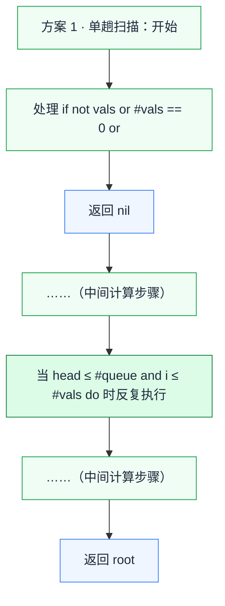

```lua
-- LeetCode 654. 最大二叉树 — Lua 版（方案1）
local TreeNode = {} -- 把 {} 写入 local TreeNode
TreeNode.__index = TreeNode -- 把 TreeNode 写入 TreeNode.__index
function TreeNode.new(val) -- function TreeNode.new(值)
	return setmetatable({ val = val, left = nil, right = nil }, TreeNode)
end -- 终点

local function build_tree(vals) -- local function build_tree(vals)
	if not vals or #vals == 0 or vals[1] == "null" then
		return nil
	end
	local root = TreeNode.new(vals[1]) -- 把 TreeNode.new(vals[1]) 写入 local root
	local queue = { root } -- 把 {根节点} 写入 local queue
	local head = 1 -- 把 1 写入 local head
	local i = 2 -- 把 2 写入 local i
	while head <= #queue and i <= #vals do -- 把 #队列 and 下标 i 不超过 #vals do 写入 while head <
		local node = queue[head] -- 把 队列[头节点] 写入 local node
		head = head + 1 -- 把 头节点 加 1 存入 头节点
		if i <= #vals then -- 若 下标 i 不超过 #vals then
			if vals[i] ~= "null" then -- 若 vals[下标 i] ~ 赋值为 「null」 then
				node.left = TreeNode.new(vals[i]) -- 把 TreeNode.new(vals[下标 i]) 写入 左边界
				queue[#queue + 1] = node.left -- 把 节点.左边界 写入 queue[#queue + 1]
			end -- 终点
			i = i + 1 -- 把 下标 i 加 1 存入 下标 i
		end -- 终点
		if i <= #vals then -- 若 下标 i 不超过 #vals then
			if vals[i] ~= "null" then -- 若 vals[下标 i] ~ 赋值为 「null」 then
				node.right = TreeNode.new(vals[i]) -- 把 TreeNode.new(vals[下标 i]) 写入 右边界
				queue[#queue + 1] = node.right -- 把 节点.右边界 写入 queue[#queue + 1]
			end -- 终点
			i = i + 1 -- 把 下标 i 加 1 存入 下标 i
		end -- 终点
	end -- 终点
	return root -- 返回 根节点
end -- 终点
local function same_tree(p, q) -- local function same_tree(节点, 节点)
	if not p and not q then
		return true
	end -- 若 not 节点 and not 节点 then return true 终点
	if not p or not q or p.val ~= q.val then
		return false
	end -- 若 not 节点 or not 节点 or 节点.值 ~ 赋值为 节点.值 then return false 终点
	return same_tree(p.left, q.left) and same_tree(p.right, q.right) -- 返回 same_tree(节点.左边界, 节点.左边界) and same_tree(节点.右边界, 节点.右边界)
end -- 终点
local function levels_flat(root) -- local function levels_flat(根节点)
	if not root then
		return {}
	end -- 若 not 根节点 then return {} 终点
	local out, q = {}, { root } -- 把 {}, {根节点} 写入 local out, q
	while #q > 0 do -- while #节点 超过 0 do
		local n = #q -- 把 #节点 写入 local n
		for _ = 1, n do -- 让 _ 从 1 走到 元素个数（Lua 1 基）
			local node = table.remove(q, 1) -- 把 table 弹出 节点, 1) 写入 local node
			out[#out + 1] = node.val -- 把 节点.值 写入 out[#out + 1]
			if node.left then
				q[#q + 1] = node.left
			end -- 若 节点.左边界 then 节点[#节点 加 1] 赋值为 节点.左边界 终点
			if node.right then
				q[#q + 1] = node.right
			end -- 若 节点.右边界 then 节点[#节点 加 1] 赋值为 节点.右边界 终点
		end -- 终点
	end -- 终点
	return out -- 返回 out
end -- 终点
local function eq(a, b) -- local function eq(数组, b)
	if #a ~= #b then
		return false
	end -- 若 #数组 ~ 赋值为 #b then return false 终点
	for i = 1, #a do
		if a[i] ~= b[i] then
			return false
		end
	end
	return true -- 返回 true
end -- 终点

local function construct_maximum_binary_tree(nums) -- local function construct_maximum_binary_tree(数组)
	if #nums == 0 then
		return nil
	end -- 若 #数组 等于 0 then return nil 终点
	local idx = 1 -- 把 1 写入 local idx
	for i = 1, #nums do -- 把 1, #数组 do 写入 for i
		if nums[i] > nums[idx] then
			idx = i
		end -- 若 数组[下标 i] 超过 数组[idx] then idx 赋值为 下标 i 终点
	end -- 终点
	local root = TreeNode.new(nums[idx]) -- 把 TreeNode.new(数组[idx]) 写入 local root
	local left, right = {}, {} -- 把 {}, {} 写入 local left, right
	for i = 1, idx - 1 do
		left[#left + 1] = nums[i]
	end -- 让 下标 i 从 1 走到 idx（Lua 1 基）
	for i = idx + 1, #nums do
		right[#right + 1] = nums[i]
	end -- 把 idx 加 1, #数组 do 右边界[#右边界 加 1] 赋值为 数组[下标 i] 终点 写入 for i
	root.left = construct_maximum_binary_tree(left) -- 把 construct_maximum_binary_tree(左边界) 写入 左边界
	root.right = construct_maximum_binary_tree(right) -- 把 construct_maximum_binary_tree(右边界) 写入 右边界
	return root -- 返回 根节点
end -- 终点
local t = construct_maximum_binary_tree({ 3, 2, 1, 6, 0, 5 })
assert(t.val == 6) -- 断言校验
assert(same_tree(t, build_tree({ 6, 3, 5, "null", 2, 0, "null", "null", 1, "null", "null" }))) -- 断言校验
assert(construct_maximum_binary_tree({ 1 }).val == 1) -- 断言校验
assert(construct_maximum_binary_tree({ 3, 2, 1 }).val == 3) -- 断言校验
assert(construct_maximum_binary_tree({}) == nil) -- 断言校验
print("PASS") -- 全部用例通过，输出 PASS
```

#### 方案 2：双重循环枚举

**思路与代码分析**：核心是「双重循环枚举」。Lua 版用表与 ipairs 遍历，注意 ipairs 遇 nil 即停的语义。**走读**：方案 2 · 双重循环枚举：开始 → 处理 if not vals or #vals == 0 or → 返回 nil → 当 head ≤ #queue and i ≤ #vals do 时反复执行 → 返回 root。

**运行架构**（真实控制流）：


```lua
-- LeetCode 654. 最大二叉树 — Lua 版（方案2）
local TreeNode = {} -- 把 {} 写入 local TreeNode
TreeNode.__index = TreeNode -- 把 TreeNode 写入 TreeNode.__index
function TreeNode.new(val) -- function TreeNode.new(值)
	return setmetatable({ val = val, left = nil, right = nil }, TreeNode)
end -- 终点

local function build_tree(vals) -- local function build_tree(vals)
	if not vals or #vals == 0 or vals[1] == "null" then
		return nil
	end
	local root = TreeNode.new(vals[1]) -- 把 TreeNode.new(vals[1]) 写入 local root
	local queue = { root } -- 把 {根节点} 写入 local queue
	local head = 1 -- 把 1 写入 local head
	local i = 2 -- 把 2 写入 local i
	while head <= #queue and i <= #vals do -- 把 #队列 and 下标 i 不超过 #vals do 写入 while head <
		local node = queue[head] -- 把 队列[头节点] 写入 local node
		head = head + 1 -- 把 头节点 加 1 存入 头节点
		if i <= #vals then -- 若 下标 i 不超过 #vals then
			if vals[i] ~= "null" then -- 若 vals[下标 i] ~ 赋值为 「null」 then
				node.left = TreeNode.new(vals[i]) -- 把 TreeNode.new(vals[下标 i]) 写入 左边界
				queue[#queue + 1] = node.left -- 把 节点.左边界 写入 queue[#queue + 1]
			end -- 终点
			i = i + 1 -- 把 下标 i 加 1 存入 下标 i
		end -- 终点
		if i <= #vals then -- 若 下标 i 不超过 #vals then
			if vals[i] ~= "null" then -- 若 vals[下标 i] ~ 赋值为 「null」 then
				node.right = TreeNode.new(vals[i]) -- 把 TreeNode.new(vals[下标 i]) 写入 右边界
				queue[#queue + 1] = node.right -- 把 节点.右边界 写入 queue[#queue + 1]
			end -- 终点
			i = i + 1 -- 把 下标 i 加 1 存入 下标 i
		end -- 终点
	end -- 终点
	return root -- 返回 根节点
end -- 终点
local function same_tree(p, q) -- local function same_tree(节点, 节点)
	if not p and not q then
		return true
	end -- 若 not 节点 and not 节点 then return true 终点
	if not p or not q or p.val ~= q.val then
		return false
	end -- 若 not 节点 or not 节点 or 节点.值 ~ 赋值为 节点.值 then return false 终点
	return same_tree(p.left, q.left) and same_tree(p.right, q.right) -- 返回 same_tree(节点.左边界, 节点.左边界) and same_tree(节点.右边界, 节点.右边界)
end -- 终点
local function levels_flat(root) -- local function levels_flat(根节点)
	if not root then
		return {}
	end -- 若 not 根节点 then return {} 终点
	local out, q = {}, { root } -- 把 {}, {根节点} 写入 local out, q
	while #q > 0 do -- while #节点 超过 0 do
		local n = #q -- 把 #节点 写入 local n
		for _ = 1, n do -- 让 _ 从 1 走到 元素个数（Lua 1 基）
			local node = table.remove(q, 1) -- 把 table 弹出 节点, 1) 写入 local node
			out[#out + 1] = node.val -- 把 节点.值 写入 out[#out + 1]
			if node.left then
				q[#q + 1] = node.left
			end -- 若 节点.左边界 then 节点[#节点 加 1] 赋值为 节点.左边界 终点
			if node.right then
				q[#q + 1] = node.right
			end -- 若 节点.右边界 then 节点[#节点 加 1] 赋值为 节点.右边界 终点
		end -- 终点
	end -- 终点
	return out -- 返回 out
end -- 终点
local function eq(a, b) -- local function eq(数组, b)
	if #a ~= #b then
		return false
	end -- 若 #数组 ~ 赋值为 #b then return false 终点
	for i = 1, #a do
		if a[i] ~= b[i] then
			return false
		end
	end
	return true -- 返回 true
end -- 终点

local function construct_maximum_binary_tree(nums) -- local function construct_maximum_binary_tree(数组)
	if #nums == 0 then
		return nil
	end -- 若 #数组 等于 0 then return nil 终点
	local idx = 1 -- 把 1 写入 local idx
	for i = 1, #nums do -- 把 1, #数组 do 写入 for i
		if nums[i] > nums[idx] then
			idx = i
		end -- 若 数组[下标 i] 超过 数组[idx] then idx 赋值为 下标 i 终点
	end -- 终点
	local root = TreeNode.new(nums[idx]) -- 把 TreeNode.new(数组[idx]) 写入 local root
	local left, right = {}, {} -- 把 {}, {} 写入 local left, right
	for i = 1, idx - 1 do
		left[#left + 1] = nums[i]
	end -- 让 下标 i 从 1 走到 idx（Lua 1 基）
	for i = idx + 1, #nums do
		right[#right + 1] = nums[i]
	end -- 把 idx 加 1, #数组 do 右边界[#右边界 加 1] 赋值为 数组[下标 i] 终点 写入 for i
	root.left = construct_maximum_binary_tree(left) -- 把 construct_maximum_binary_tree(左边界) 写入 左边界
	root.right = construct_maximum_binary_tree(right) -- 把 construct_maximum_binary_tree(右边界) 写入 右边界
	return root -- 返回 根节点
end -- 终点
local t = construct_maximum_binary_tree({ 3, 2, 1, 6, 0, 5 })
assert(t.val == 6) -- 断言校验
assert(same_tree(t, build_tree({ 6, 3, 5, "null", 2, 0, "null", "null", 1, "null", "null" }))) -- 断言校验
assert(construct_maximum_binary_tree({ 1 }).val == 1) -- 断言校验
assert(construct_maximum_binary_tree({ 3, 2, 1 }).val == 3) -- 断言校验
assert(construct_maximum_binary_tree({}) == nil) -- 断言校验
print("PASS") -- 全部用例通过，输出 PASS
```

#### 方案 3：双重循环枚举

**思路与代码分析**：核心是「双重循环枚举」。Lua 版用表与 ipairs 遍历，注意 ipairs 遇 nil 即停的语义。**走读**：方案 3 · 双重循环枚举：开始 → 处理 if not vals or #vals == 0 or → 返回 nil → 当 head ≤ #queue and i ≤ #vals do 时反复执行 → 返回 root。

**运行架构**（真实控制流）：

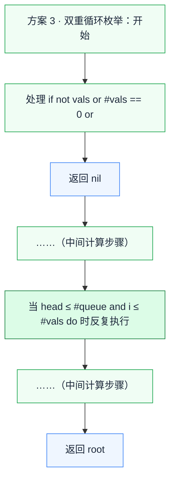

```lua
-- LeetCode 654. 最大二叉树 — Lua 版（方案3）
local TreeNode = {} -- 把 {} 写入 local TreeNode
TreeNode.__index = TreeNode -- 把 TreeNode 写入 TreeNode.__index
function TreeNode.new(val) -- function TreeNode.new(值)
	return setmetatable({ val = val, left = nil, right = nil }, TreeNode)
end -- 终点

local function build_tree(vals) -- local function build_tree(vals)
	if not vals or #vals == 0 or vals[1] == "null" then
		return nil
	end
	local root = TreeNode.new(vals[1]) -- 把 TreeNode.new(vals[1]) 写入 local root
	local queue = { root } -- 把 {根节点} 写入 local queue
	local head = 1 -- 把 1 写入 local head
	local i = 2 -- 把 2 写入 local i
	while head <= #queue and i <= #vals do -- 把 #队列 and 下标 i 不超过 #vals do 写入 while head <
		local node = queue[head] -- 把 队列[头节点] 写入 local node
		head = head + 1 -- 把 头节点 加 1 存入 头节点
		if i <= #vals then -- 若 下标 i 不超过 #vals then
			if vals[i] ~= "null" then -- 若 vals[下标 i] ~ 赋值为 「null」 then
				node.left = TreeNode.new(vals[i]) -- 把 TreeNode.new(vals[下标 i]) 写入 左边界
				queue[#queue + 1] = node.left -- 把 节点.左边界 写入 queue[#queue + 1]
			end -- 终点
			i = i + 1 -- 把 下标 i 加 1 存入 下标 i
		end -- 终点
		if i <= #vals then -- 若 下标 i 不超过 #vals then
			if vals[i] ~= "null" then -- 若 vals[下标 i] ~ 赋值为 「null」 then
				node.right = TreeNode.new(vals[i]) -- 把 TreeNode.new(vals[下标 i]) 写入 右边界
				queue[#queue + 1] = node.right -- 把 节点.右边界 写入 queue[#queue + 1]
			end -- 终点
			i = i + 1 -- 把 下标 i 加 1 存入 下标 i
		end -- 终点
	end -- 终点
	return root -- 返回 根节点
end -- 终点
local function same_tree(p, q) -- local function same_tree(节点, 节点)
	if not p and not q then
		return true
	end -- 若 not 节点 and not 节点 then return true 终点
	if not p or not q or p.val ~= q.val then
		return false
	end -- 若 not 节点 or not 节点 or 节点.值 ~ 赋值为 节点.值 then return false 终点
	return same_tree(p.left, q.left) and same_tree(p.right, q.right) -- 返回 same_tree(节点.左边界, 节点.左边界) and same_tree(节点.右边界, 节点.右边界)
end -- 终点
local function levels_flat(root) -- local function levels_flat(根节点)
	if not root then
		return {}
	end -- 若 not 根节点 then return {} 终点
	local out, q = {}, { root } -- 把 {}, {根节点} 写入 local out, q
	while #q > 0 do -- while #节点 超过 0 do
		local n = #q -- 把 #节点 写入 local n
		for _ = 1, n do -- 让 _ 从 1 走到 元素个数（Lua 1 基）
			local node = table.remove(q, 1) -- 把 table 弹出 节点, 1) 写入 local node
			out[#out + 1] = node.val -- 把 节点.值 写入 out[#out + 1]
			if node.left then
				q[#q + 1] = node.left
			end -- 若 节点.左边界 then 节点[#节点 加 1] 赋值为 节点.左边界 终点
			if node.right then
				q[#q + 1] = node.right
			end -- 若 节点.右边界 then 节点[#节点 加 1] 赋值为 节点.右边界 终点
		end -- 终点
	end -- 终点
	return out -- 返回 out
end -- 终点
local function eq(a, b) -- local function eq(数组, b)
	if #a ~= #b then
		return false
	end -- 若 #数组 ~ 赋值为 #b then return false 终点
	for i = 1, #a do
		if a[i] ~= b[i] then
			return false
		end
	end
	return true -- 返回 true
end -- 终点

local function construct_maximum_binary_tree(nums) -- local function construct_maximum_binary_tree(数组)
	if #nums == 0 then
		return nil
	end -- 若 #数组 等于 0 then return nil 终点
	local idx = 1 -- 把 1 写入 local idx
	for i = 1, #nums do -- 把 1, #数组 do 写入 for i
		if nums[i] > nums[idx] then
			idx = i
		end -- 若 数组[下标 i] 超过 数组[idx] then idx 赋值为 下标 i 终点
	end -- 终点
	local root = TreeNode.new(nums[idx]) -- 把 TreeNode.new(数组[idx]) 写入 local root
	local left, right = {}, {} -- 把 {}, {} 写入 local left, right
	for i = 1, idx - 1 do
		left[#left + 1] = nums[i]
	end -- 让 下标 i 从 1 走到 idx（Lua 1 基）
	for i = idx + 1, #nums do
		right[#right + 1] = nums[i]
	end -- 把 idx 加 1, #数组 do 右边界[#右边界 加 1] 赋值为 数组[下标 i] 终点 写入 for i
	root.left = construct_maximum_binary_tree(left) -- 把 construct_maximum_binary_tree(左边界) 写入 左边界
	root.right = construct_maximum_binary_tree(right) -- 把 construct_maximum_binary_tree(右边界) 写入 右边界
	return root -- 返回 根节点
end -- 终点
local t = construct_maximum_binary_tree({ 3, 2, 1, 6, 0, 5 })
assert(t.val == 6) -- 断言校验
assert(same_tree(t, build_tree({ 6, 3, 5, "null", 2, 0, "null", "null", 1, "null", "null" }))) -- 断言校验
assert(construct_maximum_binary_tree({ 1 }).val == 1) -- 断言校验
assert(construct_maximum_binary_tree({ 3, 2, 1 }).val == 3) -- 断言校验
assert(construct_maximum_binary_tree({}) == nil) -- 断言校验
print("PASS") -- 全部用例通过，输出 PASS
```

### C 实现（3 种方案）

C 的全部方案如下，每个方案都内嵌用例自测，可独立运行（老仓库 python/go 文件遵循「打印结果」约定）：

#### 方案 1：单趟扫描

**思路与代码分析**：核心是「单趟扫描」。C 版手动管理下标与内存，循环边界全部显式写出。代码里依次做这些事：单循环线性扫描。**走读**：方案 1 · 单趟扫描：开始 → 命中条件，直接返回 → 更新 idx → 遍历循环 → 若 nums[i] ＞ nums[idx]：更新 idx → 更新 idx → 更新 *root → 更新 root->val → 更新 root->left → 更新 root->left → 处理 nums, idx) → 更新 root->right → 返回 root。

**运行架构**（真实控制流）：

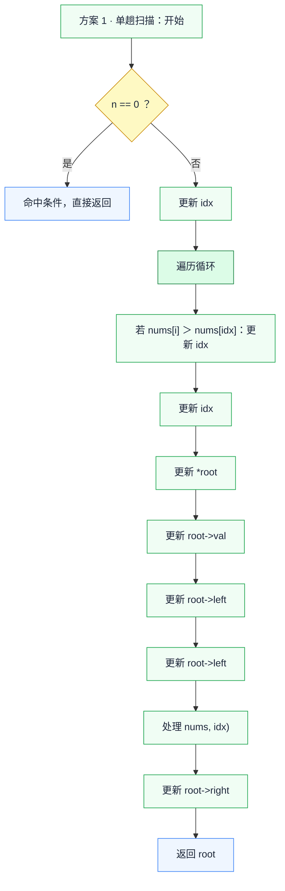

```c
/* LeetCode 654. 最大二叉树 — C 版（方案1） */
#include <stdio.h>                   // 引入头文件
#include <stdlib.h>                  // 引入头文件
#define INT_MIN_SN (-2147483647 - 1) // #define INT_MIN_SN ( 减 2147483647 减 1)

typedef struct TreeNode {   // typedef struct TreeNode {
    int val;                // int 值;
    struct TreeNode *left;  // 定义类型
    struct TreeNode *right; // 定义类型
} TreeNode;                 // } TreeNode;

static TreeNode *build_tree(const int *vals,
                            int n) { // static TreeNode 乘 build_tree(const int 乘 vals, int 元素个数) {
    if (n == 0 || vals[0] == INT_MIN_SN)
        return NULL; // 若 元素个数 等于 0 或 vals[0] 等于 INT_MIN_SN，直接返回 NULL
    TreeNode *root = malloc(sizeof(TreeNode)); // 把 malloc(sizeof(TreeNode)); 写入 TreeNode *root
    root->val = vals[0];
    root->left = root->right = NULL;
    TreeNode **queue =
        malloc(sizeof(TreeNode *) * n); // 把 malloc(sizeof(TreeNode 乘 ) 乘 元素个数); 写入 TreeNode **queue
    int head = 0, tail = 0, i = 1; // 把 0, 尾节点 赋值为 0, 下标 i 赋值为 1 存入 头节点
    queue[tail++] = root;          // 把 根节点; 写入 queue[tail++]
    while (head < tail && i < n) { // 循环，直到不满足「头节点 小于 尾节点 且 下标 i 小于 元素个数」
        TreeNode *node = queue[head++];                // 把 队列[头节点 加一 ]; 写入 TreeNode *node
        if (i < n) {                                   // 若 下标 i 小于 元素个数
            if (vals[i] != INT_MIN_SN) {               // 若 vals[下标 i] 不等于 INT_MIN_SN
                node->left = malloc(sizeof(TreeNode)); // 把 malloc(sizeof(TreeNode)); 写入 node->left
                node->left->val = vals[i];
                node->left->left = node->left->right = NULL;
                queue[tail++] = node->left; // 把 节点 减 超过 左边界; 写入 queue[tail++]
            }
            i++; // 下标 i 加一
        }
        if (i < n) {                                    // 若 下标 i 小于 元素个数
            if (vals[i] != INT_MIN_SN) {                // 若 vals[下标 i] 不等于 INT_MIN_SN
                node->right = malloc(sizeof(TreeNode)); // 把 malloc(sizeof(TreeNode)); 写入 node->right
                node->right->val = vals[i];
                node->right->left = node->right->right = NULL;
                queue[tail++] = node->right; // 把 节点 减 超过 右边界; 写入 queue[tail++]
            }
            i++; // 下标 i 加一
        }
    }
    free(queue); // free(队列);
    return root; // 返回 根节点
}

static void free_tree(TreeNode *n) { // 定义函数/方法 free_tree
    if (!n)
        return;          // 若 取反 元素个数) return;
    free_tree(n->left);  // free_tree(元素个数 减 超过 左边界);
    free_tree(n->right); // free_tree(元素个数 减 超过 右边界);
    free(n);             // free(元素个数);
}
static int same_tree(const TreeNode *p, const TreeNode *q) { // 定义函数/方法 same_tree
    if (!p && !q)
        return 1; // 若 取反 节点 且 取反 节点，直接返回 1
    if (!p || !q || p->val != q->val)
        return 0; // 若 取反 节点 或 取反 节点 或 节点 减 超过 值 不等于 节点 减 超过 值，直接返回 0
    return same_tree(p->left, q->left) && same_tree(p->right, q->right);
}
static int levels_flat(TreeNode *root, int out[]) { // 定义函数/方法 levels_flat
    if (!root)
        return 0; // 若 取反 根节点，直接返回 0
    TreeNode *q[4096];
    int head = 0, tail = 0, cnt = 0; // 把 0, 尾节点 赋值为 0, 计数 赋值为 0; 写入 TreeNode *q[4096]; int head
    q[tail++] = root;                // 把 根节点; 写入 q[tail++]
    while (head < tail) {        // 循环，直到不满足「头节点 小于 尾节点」
        TreeNode *n = q[head++]; // 把 节点[头节点 加一 ]; 写入 TreeNode *n
        out[cnt++] = n->val;     // 把 元素个数 减 超过 值; 写入 out[cnt++]
        if (n->left)
            q[tail++] =
                n->left; // 若 元素个数 减 超过 左边界) 节点[尾节点 加一 ] 赋值为 元素个数 减 超过 左边界;
        if (n->right)
            q[tail++] =
                n->right; // 若 元素个数 减 超过 右边界) 节点[尾节点 加一 ] 赋值为 元素个数 减 超过 右边界;
    }
    return cnt; // 返回 计数
}
static int eqarr(const int *a, int n, const int *b, int m) { // 定义函数/方法 eqarr
    if (n != m)
        return 0; // 若 元素个数 不等于 映射表，直接返回 0
    for (int i = 0; i < n; i++)
        if (a[i] != b[i])
            return 0; // 让 下标 i 从 0 开始计数，下标 i 小于 元素个数 就继续
    return 1;         // 返回 1
}

static TreeNode *construct_maximum_binary_tree(const int *nums, int n) {
    if (n == 0)
        return NULL; // 若 元素个数 等于 0，直接返回 NULL
    int idx = 0;     // 把 0 存入 idx
    for (int i = 0; i < n; i++)
        if (nums[i] > nums[idx])
            idx = i; // 让 下标 i 从 0 开始计数，下标 i 小于 元素个数 就继续
    TreeNode *root = malloc(sizeof(TreeNode)); // 把 malloc(sizeof(TreeNode)); 写入 TreeNode *root
    root->val = nums[idx];
    root->left = root->right = NULL;
    root->left = construct_maximum_binary_tree(
        nums, idx); // 把 construct_maximum_binary_tree(数组, idx); 写入 root->left
    root->right = construct_maximum_binary_tree(nums + idx + 1, n - idx - 1);
    return root; // 返回 根节点
}
int main(void) {                  // 程序入口：跑内嵌自测用例
    int v[] = {3, 2, 1, 6, 0, 5}; // 把 {3,2,1,6,0,5}; 写入 int v[]
    int w[] = {6, 3, 5, INT_MIN_SN, 2, 0, INT_MIN_SN, INT_MIN_SN, 1, INT_MIN_SN, INT_MIN_SN};
    TreeNode *t =
        construct_maximum_binary_tree(v, 6); // 把 construct_maximum_binary_tree(值, 6); 写入 TreeNode *t
    if (t->val != 6) {
        printf("FAIL root\n");
        return 1;
    } // 若 另一字符串 减 超过 值 不等于 6) { 输出「FAIL 根节点 」); return 1; }
    if (!same_tree(t, build_tree(w, 10))) {
        printf("FAIL shape\n");
        return 1;
    }
    int v2[] = {1}; // 把 {1}; 写入 int v2[]
    if (construct_maximum_binary_tree(v2, 1)->val != 1) {
        printf("FAIL 2\n");
        return 1;
    }
    int v3[] = {3, 2, 1}; // 把 {3,2,1}; 写入 int v3[]
    if (construct_maximum_binary_tree(v3, 3)->val != 3) {
        printf("FAIL 3\n");
        return 1;
    }
    if (construct_maximum_binary_tree(NULL, 0) != NULL) {
        printf("FAIL 4\n");
        return 1;
    }
    printf("PASS\n"); // 全部用例通过，输出 PASS
    return 0;         // 返回 0
}
```

#### 方案 2：双重循环枚举

**思路与代码分析**：核心是「双重循环枚举」。C 版手动管理下标与内存，循环边界全部显式写出。代码里依次做这些事：单循环线性扫描。**走读**：方案 2 · 双重循环枚举：开始 → 命中条件，直接返回 → 更新 idx → 遍历循环 → 若 nums[i] ＞ nums[idx]：更新 idx → 更新 idx → 更新 *root → 更新 root->val → 更新 root->left → 更新 root->left → 处理 nums, idx) → 更新 root->right → 返回 root。

**运行架构**（真实控制流）：

```mermaid
graph TD
    N0["方案 2 · 双重循环枚举：开始"]
    N1{"n == 0 ？"}
    N2["命中条件，直接返回"]
    N3["更新 idx"]
    N4["遍历循环"]
    N5["若 nums[i] ＞ nums[idx]：更新 idx"]
    N6["更新 idx"]
    N7["更新 *root"]
    N8["更新 root->val"]
    N9["更新 root->left"]
    N10["更新 root->left"]
    N11["处理 nums, idx)"]
    N12["更新 root->right"]
    N13["返回 root"]
    N0 --> N1
    N1 -- 是 --> N2
    N1 -- 否 --> N3
    N3 --> N4
    N4 --> N5
    N5 --> N6
    N6 --> N7
    N7 --> N8
    N8 --> N9
    N9 --> N10
    N10 --> N11
    N11 --> N12
    N12 --> N13
    classDef n fill:#f0fdf4,stroke:#16a34a,color:#1e293b;
    classDef lp fill:#dcfce7,stroke:#15803d,color:#1e293b;
    classDef dc fill:#fef9c3,stroke:#ca8a04,color:#1e293b;
    classDef tm fill:#eff6ff,stroke:#3b82f6,color:#1e293b;
    class N0,N3,N5,N6,N7,N8,N9,N10,N11,N12 n;
    class N4 lp;
    class N1 dc;
    class N2,N13 tm;
```

```c
/* LeetCode 654. 最大二叉树 — C 版（方案2） */
#include <stdio.h>                   // 引入头文件
#include <stdlib.h>                  // 引入头文件
#define INT_MIN_SN (-2147483647 - 1) // #define INT_MIN_SN ( 减 2147483647 减 1)

typedef struct TreeNode {   // typedef struct TreeNode {
    int val;                // int 值;
    struct TreeNode *left;  // 定义类型
    struct TreeNode *right; // 定义类型
} TreeNode;                 // } TreeNode;

static TreeNode *build_tree(const int *vals,
                            int n) { // static TreeNode 乘 build_tree(const int 乘 vals, int 元素个数) {
    if (n == 0 || vals[0] == INT_MIN_SN)
        return NULL; // 若 元素个数 等于 0 或 vals[0] 等于 INT_MIN_SN，直接返回 NULL
    TreeNode *root = malloc(sizeof(TreeNode)); // 把 malloc(sizeof(TreeNode)); 写入 TreeNode *root
    root->val = vals[0];
    root->left = root->right = NULL;
    TreeNode **queue =
        malloc(sizeof(TreeNode *) * n); // 把 malloc(sizeof(TreeNode 乘 ) 乘 元素个数); 写入 TreeNode **queue
    int head = 0, tail = 0, i = 1; // 把 0, 尾节点 赋值为 0, 下标 i 赋值为 1 存入 头节点
    queue[tail++] = root;          // 把 根节点; 写入 queue[tail++]
    while (head < tail && i < n) { // 循环，直到不满足「头节点 小于 尾节点 且 下标 i 小于 元素个数」
        TreeNode *node = queue[head++];                // 把 队列[头节点 加一 ]; 写入 TreeNode *node
        if (i < n) {                                   // 若 下标 i 小于 元素个数
            if (vals[i] != INT_MIN_SN) {               // 若 vals[下标 i] 不等于 INT_MIN_SN
                node->left = malloc(sizeof(TreeNode)); // 把 malloc(sizeof(TreeNode)); 写入 node->left
                node->left->val = vals[i];
                node->left->left = node->left->right = NULL;
                queue[tail++] = node->left; // 把 节点 减 超过 左边界; 写入 queue[tail++]
            }
            i++; // 下标 i 加一
        }
        if (i < n) {                                    // 若 下标 i 小于 元素个数
            if (vals[i] != INT_MIN_SN) {                // 若 vals[下标 i] 不等于 INT_MIN_SN
                node->right = malloc(sizeof(TreeNode)); // 把 malloc(sizeof(TreeNode)); 写入 node->right
                node->right->val = vals[i];
                node->right->left = node->right->right = NULL;
                queue[tail++] = node->right; // 把 节点 减 超过 右边界; 写入 queue[tail++]
            }
            i++; // 下标 i 加一
        }
    }
    free(queue); // free(队列);
    return root; // 返回 根节点
}

static void free_tree(TreeNode *n) { // 定义函数/方法 free_tree
    if (!n)
        return;          // 若 取反 元素个数) return;
    free_tree(n->left);  // free_tree(元素个数 减 超过 左边界);
    free_tree(n->right); // free_tree(元素个数 减 超过 右边界);
    free(n);             // free(元素个数);
}
static int same_tree(const TreeNode *p, const TreeNode *q) { // 定义函数/方法 same_tree
    if (!p && !q)
        return 1; // 若 取反 节点 且 取反 节点，直接返回 1
    if (!p || !q || p->val != q->val)
        return 0; // 若 取反 节点 或 取反 节点 或 节点 减 超过 值 不等于 节点 减 超过 值，直接返回 0
    return same_tree(p->left, q->left) && same_tree(p->right, q->right);
}
static int levels_flat(TreeNode *root, int out[]) { // 定义函数/方法 levels_flat
    if (!root)
        return 0; // 若 取反 根节点，直接返回 0
    TreeNode *q[4096];
    int head = 0, tail = 0, cnt = 0; // 把 0, 尾节点 赋值为 0, 计数 赋值为 0; 写入 TreeNode *q[4096]; int head
    q[tail++] = root;                // 把 根节点; 写入 q[tail++]
    while (head < tail) {        // 循环，直到不满足「头节点 小于 尾节点」
        TreeNode *n = q[head++]; // 把 节点[头节点 加一 ]; 写入 TreeNode *n
        out[cnt++] = n->val;     // 把 元素个数 减 超过 值; 写入 out[cnt++]
        if (n->left)
            q[tail++] =
                n->left; // 若 元素个数 减 超过 左边界) 节点[尾节点 加一 ] 赋值为 元素个数 减 超过 左边界;
        if (n->right)
            q[tail++] =
                n->right; // 若 元素个数 减 超过 右边界) 节点[尾节点 加一 ] 赋值为 元素个数 减 超过 右边界;
    }
    return cnt; // 返回 计数
}
static int eqarr(const int *a, int n, const int *b, int m) { // 定义函数/方法 eqarr
    if (n != m)
        return 0; // 若 元素个数 不等于 映射表，直接返回 0
    for (int i = 0; i < n; i++)
        if (a[i] != b[i])
            return 0; // 让 下标 i 从 0 开始计数，下标 i 小于 元素个数 就继续
    return 1;         // 返回 1
}

static TreeNode *construct_maximum_binary_tree(const int *nums, int n) {
    if (n == 0)
        return NULL; // 若 元素个数 等于 0，直接返回 NULL
    int idx = 0;     // 把 0 存入 idx
    for (int i = 0; i < n; i++)
        if (nums[i] > nums[idx])
            idx = i; // 让 下标 i 从 0 开始计数，下标 i 小于 元素个数 就继续
    TreeNode *root = malloc(sizeof(TreeNode)); // 把 malloc(sizeof(TreeNode)); 写入 TreeNode *root
    root->val = nums[idx];
    root->left = root->right = NULL;
    root->left = construct_maximum_binary_tree(
        nums, idx); // 把 construct_maximum_binary_tree(数组, idx); 写入 root->left
    root->right = construct_maximum_binary_tree(nums + idx + 1, n - idx - 1);
    return root; // 返回 根节点
}
int main(void) {                  // 程序入口：跑内嵌自测用例
    int v[] = {3, 2, 1, 6, 0, 5}; // 把 {3,2,1,6,0,5}; 写入 int v[]
    int w[] = {6, 3, 5, INT_MIN_SN, 2, 0, INT_MIN_SN, INT_MIN_SN, 1, INT_MIN_SN, INT_MIN_SN};
    TreeNode *t =
        construct_maximum_binary_tree(v, 6); // 把 construct_maximum_binary_tree(值, 6); 写入 TreeNode *t
    if (t->val != 6) {
        printf("FAIL root\n");
        return 1;
    } // 若 另一字符串 减 超过 值 不等于 6) { 输出「FAIL 根节点 」); return 1; }
    if (!same_tree(t, build_tree(w, 10))) {
        printf("FAIL shape\n");
        return 1;
    }
    int v2[] = {1}; // 把 {1}; 写入 int v2[]
    if (construct_maximum_binary_tree(v2, 1)->val != 1) {
        printf("FAIL 2\n");
        return 1;
    }
    int v3[] = {3, 2, 1}; // 把 {3,2,1}; 写入 int v3[]
    if (construct_maximum_binary_tree(v3, 3)->val != 3) {
        printf("FAIL 3\n");
        return 1;
    }
    if (construct_maximum_binary_tree(NULL, 0) != NULL) {
        printf("FAIL 4\n");
        return 1;
    }
    printf("PASS\n"); // 全部用例通过，输出 PASS
    return 0;         // 返回 0
}
```

#### 方案 3：双重循环枚举

**思路与代码分析**：核心是「双重循环枚举」。C 版手动管理下标与内存，循环边界全部显式写出。代码里依次做这些事：单循环线性扫描。**走读**：方案 3 · 双重循环枚举：开始 → 命中条件，直接返回 → 更新 idx → 遍历循环 → 若 nums[i] ＞ nums[idx]：更新 idx → 更新 idx → 更新 *root → 更新 root->val → 更新 root->left → 更新 root->left → 处理 nums, idx) → 更新 root->right → 返回 root。

**运行架构**（真实控制流）：

```mermaid
graph TD
    N0["方案 3 · 双重循环枚举：开始"]
    N1{"n == 0 ？"}
    N2["命中条件，直接返回"]
    N3["更新 idx"]
    N4["遍历循环"]
    N5["若 nums[i] ＞ nums[idx]：更新 idx"]
    N6["更新 idx"]
    N7["更新 *root"]
    N8["更新 root->val"]
    N9["更新 root->left"]
    N10["更新 root->left"]
    N11["处理 nums, idx)"]
    N12["更新 root->right"]
    N13["返回 root"]
    N0 --> N1
    N1 -- 是 --> N2
    N1 -- 否 --> N3
    N3 --> N4
    N4 --> N5
    N5 --> N6
    N6 --> N7
    N7 --> N8
    N8 --> N9
    N9 --> N10
    N10 --> N11
    N11 --> N12
    N12 --> N13
    classDef n fill:#f0fdf4,stroke:#16a34a,color:#1e293b;
    classDef lp fill:#dcfce7,stroke:#15803d,color:#1e293b;
    classDef dc fill:#fef9c3,stroke:#ca8a04,color:#1e293b;
    classDef tm fill:#eff6ff,stroke:#3b82f6,color:#1e293b;
    class N0,N3,N5,N6,N7,N8,N9,N10,N11,N12 n;
    class N4 lp;
    class N1 dc;
    class N2,N13 tm;
```

```c
/* LeetCode 654. 最大二叉树 — C 版（方案3） */
#include <stdio.h>                   // 引入头文件
#include <stdlib.h>                  // 引入头文件
#define INT_MIN_SN (-2147483647 - 1) // #define INT_MIN_SN ( 减 2147483647 减 1)

typedef struct TreeNode {   // typedef struct TreeNode {
    int val;                // int 值;
    struct TreeNode *left;  // 定义类型
    struct TreeNode *right; // 定义类型
} TreeNode;                 // } TreeNode;

static TreeNode *build_tree(const int *vals,
                            int n) { // static TreeNode 乘 build_tree(const int 乘 vals, int 元素个数) {
    if (n == 0 || vals[0] == INT_MIN_SN)
        return NULL; // 若 元素个数 等于 0 或 vals[0] 等于 INT_MIN_SN，直接返回 NULL
    TreeNode *root = malloc(sizeof(TreeNode)); // 把 malloc(sizeof(TreeNode)); 写入 TreeNode *root
    root->val = vals[0];
    root->left = root->right = NULL;
    TreeNode **queue =
        malloc(sizeof(TreeNode *) * n); // 把 malloc(sizeof(TreeNode 乘 ) 乘 元素个数); 写入 TreeNode **queue
    int head = 0, tail = 0, i = 1; // 把 0, 尾节点 赋值为 0, 下标 i 赋值为 1 存入 头节点
    queue[tail++] = root;          // 把 根节点; 写入 queue[tail++]
    while (head < tail && i < n) { // 循环，直到不满足「头节点 小于 尾节点 且 下标 i 小于 元素个数」
        TreeNode *node = queue[head++];                // 把 队列[头节点 加一 ]; 写入 TreeNode *node
        if (i < n) {                                   // 若 下标 i 小于 元素个数
            if (vals[i] != INT_MIN_SN) {               // 若 vals[下标 i] 不等于 INT_MIN_SN
                node->left = malloc(sizeof(TreeNode)); // 把 malloc(sizeof(TreeNode)); 写入 node->left
                node->left->val = vals[i];
                node->left->left = node->left->right = NULL;
                queue[tail++] = node->left; // 把 节点 减 超过 左边界; 写入 queue[tail++]
            }
            i++; // 下标 i 加一
        }
        if (i < n) {                                    // 若 下标 i 小于 元素个数
            if (vals[i] != INT_MIN_SN) {                // 若 vals[下标 i] 不等于 INT_MIN_SN
                node->right = malloc(sizeof(TreeNode)); // 把 malloc(sizeof(TreeNode)); 写入 node->right
                node->right->val = vals[i];
                node->right->left = node->right->right = NULL;
                queue[tail++] = node->right; // 把 节点 减 超过 右边界; 写入 queue[tail++]
            }
            i++; // 下标 i 加一
        }
    }
    free(queue); // free(队列);
    return root; // 返回 根节点
}

static void free_tree(TreeNode *n) { // 定义函数/方法 free_tree
    if (!n)
        return;          // 若 取反 元素个数) return;
    free_tree(n->left);  // free_tree(元素个数 减 超过 左边界);
    free_tree(n->right); // free_tree(元素个数 减 超过 右边界);
    free(n);             // free(元素个数);
}
static int same_tree(const TreeNode *p, const TreeNode *q) { // 定义函数/方法 same_tree
    if (!p && !q)
        return 1; // 若 取反 节点 且 取反 节点，直接返回 1
    if (!p || !q || p->val != q->val)
        return 0; // 若 取反 节点 或 取反 节点 或 节点 减 超过 值 不等于 节点 减 超过 值，直接返回 0
    return same_tree(p->left, q->left) && same_tree(p->right, q->right);
}
static int levels_flat(TreeNode *root, int out[]) { // 定义函数/方法 levels_flat
    if (!root)
        return 0; // 若 取反 根节点，直接返回 0
    TreeNode *q[4096];
    int head = 0, tail = 0, cnt = 0; // 把 0, 尾节点 赋值为 0, 计数 赋值为 0; 写入 TreeNode *q[4096]; int head
    q[tail++] = root;                // 把 根节点; 写入 q[tail++]
    while (head < tail) {        // 循环，直到不满足「头节点 小于 尾节点」
        TreeNode *n = q[head++]; // 把 节点[头节点 加一 ]; 写入 TreeNode *n
        out[cnt++] = n->val;     // 把 元素个数 减 超过 值; 写入 out[cnt++]
        if (n->left)
            q[tail++] =
                n->left; // 若 元素个数 减 超过 左边界) 节点[尾节点 加一 ] 赋值为 元素个数 减 超过 左边界;
        if (n->right)
            q[tail++] =
                n->right; // 若 元素个数 减 超过 右边界) 节点[尾节点 加一 ] 赋值为 元素个数 减 超过 右边界;
    }
    return cnt; // 返回 计数
}
static int eqarr(const int *a, int n, const int *b, int m) { // 定义函数/方法 eqarr
    if (n != m)
        return 0; // 若 元素个数 不等于 映射表，直接返回 0
    for (int i = 0; i < n; i++)
        if (a[i] != b[i])
            return 0; // 让 下标 i 从 0 开始计数，下标 i 小于 元素个数 就继续
    return 1;         // 返回 1
}

static TreeNode *construct_maximum_binary_tree(const int *nums, int n) {
    if (n == 0)
        return NULL; // 若 元素个数 等于 0，直接返回 NULL
    int idx = 0;     // 把 0 存入 idx
    for (int i = 0; i < n; i++)
        if (nums[i] > nums[idx])
            idx = i; // 让 下标 i 从 0 开始计数，下标 i 小于 元素个数 就继续
    TreeNode *root = malloc(sizeof(TreeNode)); // 把 malloc(sizeof(TreeNode)); 写入 TreeNode *root
    root->val = nums[idx];
    root->left = root->right = NULL;
    root->left = construct_maximum_binary_tree(
        nums, idx); // 把 construct_maximum_binary_tree(数组, idx); 写入 root->left
    root->right = construct_maximum_binary_tree(nums + idx + 1, n - idx - 1);
    return root; // 返回 根节点
}
int main(void) {                  // 程序入口：跑内嵌自测用例
    int v[] = {3, 2, 1, 6, 0, 5}; // 把 {3,2,1,6,0,5}; 写入 int v[]
    int w[] = {6, 3, 5, INT_MIN_SN, 2, 0, INT_MIN_SN, INT_MIN_SN, 1, INT_MIN_SN, INT_MIN_SN};
    TreeNode *t =
        construct_maximum_binary_tree(v, 6); // 把 construct_maximum_binary_tree(值, 6); 写入 TreeNode *t
    if (t->val != 6) {
        printf("FAIL root\n");
        return 1;
    } // 若 另一字符串 减 超过 值 不等于 6) { 输出「FAIL 根节点 」); return 1; }
    if (!same_tree(t, build_tree(w, 10))) {
        printf("FAIL shape\n");
        return 1;
    }
    int v2[] = {1}; // 把 {1}; 写入 int v2[]
    if (construct_maximum_binary_tree(v2, 1)->val != 1) {
        printf("FAIL 2\n");
        return 1;
    }
    int v3[] = {3, 2, 1}; // 把 {3,2,1}; 写入 int v3[]
    if (construct_maximum_binary_tree(v3, 3)->val != 3) {
        printf("FAIL 3\n");
        return 1;
    }
    if (construct_maximum_binary_tree(NULL, 0) != NULL) {
        printf("FAIL 4\n");
        return 1;
    }
    printf("PASS\n"); // 全部用例通过，输出 PASS
    return 0;         // 返回 0
}
```

### C++ 实现（3 种方案）

C++ 的全部方案如下，每个方案都内嵌用例自测，可独立运行（老仓库 python/go 文件遵循「打印结果」约定）：

#### 方案 1：单趟扫描

**思路与代码分析**：核心是「单趟扫描」。C++ 版用 STL 容器与迭代器，减少手写下标错误。**走读**：方案 1 · 单趟扫描：开始 → 命中条件，直接返回 → 命中条件，直接返回 → 返回 sameTree(p-＞left, q-＞left) 且 sameTree(p-＞right, q-＞right)。

**运行架构**（真实控制流）：

```mermaid
graph TD
    N0["方案 1 · 单趟扫描：开始"]
    N1{"非 p 且 非 q ？"}
    N2["命中条件，直接返回"]
    N3{"非 p 或 非 q 或 p-＞val ≠ q-＞val ？"}
    N4["命中条件，直接返回"]
    N5["返回 sameTree(p-＞left, q-＞left) 且 sameTree(p-＞right, q-＞right)"]
    N0 --> N1
    N1 -- 是 --> N2
    N1 -- 否 --> N3
    N3 -- 是 --> N4
    N3 -- 否 --> N5
    classDef n fill:#f0fdf4,stroke:#16a34a,color:#1e293b;
    classDef lp fill:#dcfce7,stroke:#15803d,color:#1e293b;
    classDef dc fill:#fef9c3,stroke:#ca8a04,color:#1e293b;
    classDef tm fill:#eff6ff,stroke:#3b82f6,color:#1e293b;
    class N0 n;
    class N1,N3 dc;
    class N2,N4,N5 tm;
```

```cpp
// LeetCode 654. 最大二叉树 — C++ 版（方案1）
#include <cassert>  // 引入头文件
#include <cstdint>  // 引入头文件
#include <iostream> // 引入头文件
#include <optional> // 引入头文件
#include <queue>    // 引入头文件
#include <vector>   // 引入头文件

struct TreeNode {    // 定义类型
    int val;         // int 值;
    TreeNode *left;  // TreeNode 乘 左边界;
    TreeNode *right; // TreeNode 乘 右边界;
    explicit TreeNode(int v) : val(v), left(nullptr), right(nullptr) {}
};

static TreeNode *build_tree(const std::vector<std::optional<int>> &vals) {
    if (vals.empty() || !vals[0].has_value())
        return nullptr; // 若 vals 是否为空 或 取反 vals[0].has_value()，直接返回 nullptr
    auto *root = new TreeNode(*vals[0]); // 把 new TreeNode( 乘 vals[0]); 写入 auto *root
    std::queue<TreeNode *> q;            // std::队列 小于 TreeNode 乘 超过 节点;
    q.push(root);                        // 把 根节点 压入栈/数组尾部
    size_t i = 1;                        // 把 1; 写入 size_t i
    while (!q.empty() &&
           i < vals.size()) { // 循环，直到不满足「取反 节点 是否为空 且 下标 i 小于 vals.大小(」
        TreeNode *node = q.front();                  // 把 节点.front(); 写入 TreeNode *node
        q.pop();                                     // 弹出栈顶元素
        if (i < vals.size()) {                       // 若 下标 i 小于 vals.大小(
            if (vals[i].has_value()) {               // 若 vals[下标 i].has_value(
                node->left = new TreeNode(*vals[i]); // 把 new TreeNode( 乘 vals[下标 i]); 写入 node->left
                q.push(node->left);                  // 把 节点 减 超过 左边界 压入栈/数组尾部
            }
            ++i; // 加一 下标 i;
        }
        if (i < vals.size()) {                        // 若 下标 i 小于 vals.大小(
            if (vals[i].has_value()) {                // 若 vals[下标 i].has_value(
                node->right = new TreeNode(*vals[i]); // 把 new TreeNode( 乘 vals[下标 i]); 写入 node->right
                q.push(node->right); // 把 节点 减 超过 右边界 压入栈/数组尾部
            }
            ++i; // 加一 下标 i;
        }
    }
    return root; // 返回 根节点
}

static void free_tree(TreeNode *n) { // 定义函数/方法 free_tree
    if (!n)
        return;          // 若 取反 元素个数) return;
    free_tree(n->left);  // free_tree(元素个数 减 超过 左边界);
    free_tree(n->right); // free_tree(元素个数 减 超过 右边界);
    delete n;            // delete 元素个数;
}
static bool sameTree(const TreeNode *p, const TreeNode *q) { // 定义函数/方法 sameTree
    if (!p && !q)
        return true; // 若 取反 节点 且 取反 节点，直接返回 true
    if (!p || !q || p->val != q->val)
        return false; // 若 取反 节点 或 取反 节点 或 节点 减 超过 值 不等于 节点 减 超过 值，直接返回 false
    return sameTree(p->left, q->left) && sameTree(p->right, q->right);
}
static std::vector<int>
levelsFlat(TreeNode *root) { // static std::vector 小于 int 超过 levelsFlat(TreeNode 乘 根节点) {
    std::vector<int> out;    // std::vector 小于 int 超过 out;
    if (!root)
        return out;           // 若 取反 根节点，直接返回 out
    std::queue<TreeNode *> q; // std::队列 小于 TreeNode 乘 超过 节点;
    q.push(root);             // 把 根节点 压入栈/数组尾部
    while (!q.empty()) {      // 循环，直到不满足「取反 节点.empty(」
        auto *n = q.front();
        q.pop();               // 弹出栈顶元素
        out.push_back(n->val); // out 追加 元素个数 减 超过 值);
        if (n->left)
            q.push(n->left); // 若 元素个数 减 超过 左边界) 节点 追加 元素个数 减 超过 左边界);
        if (n->right)
            q.push(n->right); // 若 元素个数 减 超过 右边界) 节点 追加 元素个数 减 超过 右边界);
    }
    return out; // 返回 out
}

static TreeNode *constructMaximumBinaryTree(const std::vector<int> &nums) {
    if (nums.empty())
        return nullptr; // 若 数组 是否为空，直接返回 nullptr
    int idx = 0;        // 把 0 存入 idx
    for (int i = 0; i < static_cast<int>(nums.size()); ++i)
        if (nums[i] > nums[idx])
            idx = i; // 让 下标 i 从 0 开始计数，下标 i 小于 static_cast 小于 int 超过 (数组.大小()) 就继续
    auto *root = new TreeNode(nums[idx]); // 把 new TreeNode(数组[idx]); 写入 auto *root
    root->left = constructMaximumBinaryTree(std::vector<int>(nums.begin(), nums.begin() + idx));
    root->right = constructMaximumBinaryTree(std::vector<int>(nums.begin() + idx + 1, nums.end()));
    return root; // 返回 根节点
}
int main() { // 程序入口：跑内嵌自测用例
    auto *t = constructMaximumBinaryTree(
        {3, 2, 1, 6, 0, 5}); // 把 constructMaximumBinaryTree({3, 2, 1, 6, 0, 5}); 写入 auto *t
    assert(t->val == 6);     // 断言校验
    assert(sameTree(t, build_tree({6, 3, 5, std::nullopt, 2, 0, std::nullopt, std::nullopt, 1, std::nullopt,
                                   std::nullopt})));         // 断言校验
    assert(constructMaximumBinaryTree({1})->val == 1);       // 断言校验
    assert(constructMaximumBinaryTree({3, 2, 1})->val == 3); // 断言校验
    assert(constructMaximumBinaryTree({}) == nullptr);       // 断言校验
    std::cout << "PASS" << std::endl;                        // 全部用例通过，输出 PASS
    return 0;                                                // 返回 0
}
```

#### 方案 2：双重循环枚举

**思路与代码分析**：核心是「双重循环枚举」。C++ 版用 STL 容器与迭代器，减少手写下标错误。**走读**：方案 2 · 双重循环枚举：开始 → 命中条件，直接返回 → 命中条件，直接返回 → 返回 sameTree(p-＞left, q-＞left) 且 sameTree(p-＞right, q-＞right)。

**运行架构**（真实控制流）：

```mermaid
graph TD
    N0["方案 2 · 双重循环枚举：开始"]
    N1{"非 p 且 非 q ？"}
    N2["命中条件，直接返回"]
    N3{"非 p 或 非 q 或 p-＞val ≠ q-＞val ？"}
    N4["命中条件，直接返回"]
    N5["返回 sameTree(p-＞left, q-＞left) 且 sameTree(p-＞right, q-＞right)"]
    N0 --> N1
    N1 -- 是 --> N2
    N1 -- 否 --> N3
    N3 -- 是 --> N4
    N3 -- 否 --> N5
    classDef n fill:#f0fdf4,stroke:#16a34a,color:#1e293b;
    classDef lp fill:#dcfce7,stroke:#15803d,color:#1e293b;
    classDef dc fill:#fef9c3,stroke:#ca8a04,color:#1e293b;
    classDef tm fill:#eff6ff,stroke:#3b82f6,color:#1e293b;
    class N0 n;
    class N1,N3 dc;
    class N2,N4,N5 tm;
```

```cpp
// LeetCode 654. 最大二叉树 — C++ 版（方案2）
#include <cassert>  // 引入头文件
#include <cstdint>  // 引入头文件
#include <iostream> // 引入头文件
#include <optional> // 引入头文件
#include <queue>    // 引入头文件
#include <vector>   // 引入头文件

struct TreeNode {    // 定义类型
    int val;         // int 值;
    TreeNode *left;  // TreeNode 乘 左边界;
    TreeNode *right; // TreeNode 乘 右边界;
    explicit TreeNode(int v) : val(v), left(nullptr), right(nullptr) {}
};

static TreeNode *build_tree(const std::vector<std::optional<int>> &vals) {
    if (vals.empty() || !vals[0].has_value())
        return nullptr; // 若 vals 是否为空 或 取反 vals[0].has_value()，直接返回 nullptr
    auto *root = new TreeNode(*vals[0]); // 把 new TreeNode( 乘 vals[0]); 写入 auto *root
    std::queue<TreeNode *> q;            // std::队列 小于 TreeNode 乘 超过 节点;
    q.push(root);                        // 把 根节点 压入栈/数组尾部
    size_t i = 1;                        // 把 1; 写入 size_t i
    while (!q.empty() &&
           i < vals.size()) { // 循环，直到不满足「取反 节点 是否为空 且 下标 i 小于 vals.大小(」
        TreeNode *node = q.front();                  // 把 节点.front(); 写入 TreeNode *node
        q.pop();                                     // 弹出栈顶元素
        if (i < vals.size()) {                       // 若 下标 i 小于 vals.大小(
            if (vals[i].has_value()) {               // 若 vals[下标 i].has_value(
                node->left = new TreeNode(*vals[i]); // 把 new TreeNode( 乘 vals[下标 i]); 写入 node->left
                q.push(node->left);                  // 把 节点 减 超过 左边界 压入栈/数组尾部
            }
            ++i; // 加一 下标 i;
        }
        if (i < vals.size()) {                        // 若 下标 i 小于 vals.大小(
            if (vals[i].has_value()) {                // 若 vals[下标 i].has_value(
                node->right = new TreeNode(*vals[i]); // 把 new TreeNode( 乘 vals[下标 i]); 写入 node->right
                q.push(node->right); // 把 节点 减 超过 右边界 压入栈/数组尾部
            }
            ++i; // 加一 下标 i;
        }
    }
    return root; // 返回 根节点
}

static void free_tree(TreeNode *n) { // 定义函数/方法 free_tree
    if (!n)
        return;          // 若 取反 元素个数) return;
    free_tree(n->left);  // free_tree(元素个数 减 超过 左边界);
    free_tree(n->right); // free_tree(元素个数 减 超过 右边界);
    delete n;            // delete 元素个数;
}
static bool sameTree(const TreeNode *p, const TreeNode *q) { // 定义函数/方法 sameTree
    if (!p && !q)
        return true; // 若 取反 节点 且 取反 节点，直接返回 true
    if (!p || !q || p->val != q->val)
        return false; // 若 取反 节点 或 取反 节点 或 节点 减 超过 值 不等于 节点 减 超过 值，直接返回 false
    return sameTree(p->left, q->left) && sameTree(p->right, q->right);
}
static std::vector<int>
levelsFlat(TreeNode *root) { // static std::vector 小于 int 超过 levelsFlat(TreeNode 乘 根节点) {
    std::vector<int> out;    // std::vector 小于 int 超过 out;
    if (!root)
        return out;           // 若 取反 根节点，直接返回 out
    std::queue<TreeNode *> q; // std::队列 小于 TreeNode 乘 超过 节点;
    q.push(root);             // 把 根节点 压入栈/数组尾部
    while (!q.empty()) {      // 循环，直到不满足「取反 节点.empty(」
        auto *n = q.front();
        q.pop();               // 弹出栈顶元素
        out.push_back(n->val); // out 追加 元素个数 减 超过 值);
        if (n->left)
            q.push(n->left); // 若 元素个数 减 超过 左边界) 节点 追加 元素个数 减 超过 左边界);
        if (n->right)
            q.push(n->right); // 若 元素个数 减 超过 右边界) 节点 追加 元素个数 减 超过 右边界);
    }
    return out; // 返回 out
}

static TreeNode *constructMaximumBinaryTree(const std::vector<int> &nums) {
    if (nums.empty())
        return nullptr; // 若 数组 是否为空，直接返回 nullptr
    int idx = 0;        // 把 0 存入 idx
    for (int i = 0; i < static_cast<int>(nums.size()); ++i)
        if (nums[i] > nums[idx])
            idx = i; // 让 下标 i 从 0 开始计数，下标 i 小于 static_cast 小于 int 超过 (数组.大小()) 就继续
    auto *root = new TreeNode(nums[idx]); // 把 new TreeNode(数组[idx]); 写入 auto *root
    root->left = constructMaximumBinaryTree(std::vector<int>(nums.begin(), nums.begin() + idx));
    root->right = constructMaximumBinaryTree(std::vector<int>(nums.begin() + idx + 1, nums.end()));
    return root; // 返回 根节点
}
int main() { // 程序入口：跑内嵌自测用例
    auto *t = constructMaximumBinaryTree(
        {3, 2, 1, 6, 0, 5}); // 把 constructMaximumBinaryTree({3, 2, 1, 6, 0, 5}); 写入 auto *t
    assert(t->val == 6);     // 断言校验
    assert(sameTree(t, build_tree({6, 3, 5, std::nullopt, 2, 0, std::nullopt, std::nullopt, 1, std::nullopt,
                                   std::nullopt})));         // 断言校验
    assert(constructMaximumBinaryTree({1})->val == 1);       // 断言校验
    assert(constructMaximumBinaryTree({3, 2, 1})->val == 3); // 断言校验
    assert(constructMaximumBinaryTree({}) == nullptr);       // 断言校验
    std::cout << "PASS" << std::endl;                        // 全部用例通过，输出 PASS
    return 0;                                                // 返回 0
}
```

#### 方案 3：双重循环枚举

**思路与代码分析**：核心是「双重循环枚举」。C++ 版用 STL 容器与迭代器，减少手写下标错误。**走读**：方案 3 · 双重循环枚举：开始 → 命中条件，直接返回 → 命中条件，直接返回 → 返回 sameTree(p-＞left, q-＞left) 且 sameTree(p-＞right, q-＞right)。

**运行架构**（真实控制流）：

```mermaid
graph TD
    N0["方案 3 · 双重循环枚举：开始"]
    N1{"非 p 且 非 q ？"}
    N2["命中条件，直接返回"]
    N3{"非 p 或 非 q 或 p-＞val ≠ q-＞val ？"}
    N4["命中条件，直接返回"]
    N5["返回 sameTree(p-＞left, q-＞left) 且 sameTree(p-＞right, q-＞right)"]
    N0 --> N1
    N1 -- 是 --> N2
    N1 -- 否 --> N3
    N3 -- 是 --> N4
    N3 -- 否 --> N5
    classDef n fill:#f0fdf4,stroke:#16a34a,color:#1e293b;
    classDef lp fill:#dcfce7,stroke:#15803d,color:#1e293b;
    classDef dc fill:#fef9c3,stroke:#ca8a04,color:#1e293b;
    classDef tm fill:#eff6ff,stroke:#3b82f6,color:#1e293b;
    class N0 n;
    class N1,N3 dc;
    class N2,N4,N5 tm;
```

```cpp
// LeetCode 654. 最大二叉树 — C++ 版（方案3）
#include <cassert>  // 引入头文件
#include <cstdint>  // 引入头文件
#include <iostream> // 引入头文件
#include <optional> // 引入头文件
#include <queue>    // 引入头文件
#include <vector>   // 引入头文件

struct TreeNode {    // 定义类型
    int val;         // int 值;
    TreeNode *left;  // TreeNode 乘 左边界;
    TreeNode *right; // TreeNode 乘 右边界;
    explicit TreeNode(int v) : val(v), left(nullptr), right(nullptr) {}
};

static TreeNode *build_tree(const std::vector<std::optional<int>> &vals) {
    if (vals.empty() || !vals[0].has_value())
        return nullptr; // 若 vals 是否为空 或 取反 vals[0].has_value()，直接返回 nullptr
    auto *root = new TreeNode(*vals[0]); // 把 new TreeNode( 乘 vals[0]); 写入 auto *root
    std::queue<TreeNode *> q;            // std::队列 小于 TreeNode 乘 超过 节点;
    q.push(root);                        // 把 根节点 压入栈/数组尾部
    size_t i = 1;                        // 把 1; 写入 size_t i
    while (!q.empty() &&
           i < vals.size()) { // 循环，直到不满足「取反 节点 是否为空 且 下标 i 小于 vals.大小(」
        TreeNode *node = q.front();                  // 把 节点.front(); 写入 TreeNode *node
        q.pop();                                     // 弹出栈顶元素
        if (i < vals.size()) {                       // 若 下标 i 小于 vals.大小(
            if (vals[i].has_value()) {               // 若 vals[下标 i].has_value(
                node->left = new TreeNode(*vals[i]); // 把 new TreeNode( 乘 vals[下标 i]); 写入 node->left
                q.push(node->left);                  // 把 节点 减 超过 左边界 压入栈/数组尾部
            }
            ++i; // 加一 下标 i;
        }
        if (i < vals.size()) {                        // 若 下标 i 小于 vals.大小(
            if (vals[i].has_value()) {                // 若 vals[下标 i].has_value(
                node->right = new TreeNode(*vals[i]); // 把 new TreeNode( 乘 vals[下标 i]); 写入 node->right
                q.push(node->right); // 把 节点 减 超过 右边界 压入栈/数组尾部
            }
            ++i; // 加一 下标 i;
        }
    }
    return root; // 返回 根节点
}

static void free_tree(TreeNode *n) { // 定义函数/方法 free_tree
    if (!n)
        return;          // 若 取反 元素个数) return;
    free_tree(n->left);  // free_tree(元素个数 减 超过 左边界);
    free_tree(n->right); // free_tree(元素个数 减 超过 右边界);
    delete n;            // delete 元素个数;
}
static bool sameTree(const TreeNode *p, const TreeNode *q) { // 定义函数/方法 sameTree
    if (!p && !q)
        return true; // 若 取反 节点 且 取反 节点，直接返回 true
    if (!p || !q || p->val != q->val)
        return false; // 若 取反 节点 或 取反 节点 或 节点 减 超过 值 不等于 节点 减 超过 值，直接返回 false
    return sameTree(p->left, q->left) && sameTree(p->right, q->right);
}
static std::vector<int>
levelsFlat(TreeNode *root) { // static std::vector 小于 int 超过 levelsFlat(TreeNode 乘 根节点) {
    std::vector<int> out;    // std::vector 小于 int 超过 out;
    if (!root)
        return out;           // 若 取反 根节点，直接返回 out
    std::queue<TreeNode *> q; // std::队列 小于 TreeNode 乘 超过 节点;
    q.push(root);             // 把 根节点 压入栈/数组尾部
    while (!q.empty()) {      // 循环，直到不满足「取反 节点.empty(」
        auto *n = q.front();
        q.pop();               // 弹出栈顶元素
        out.push_back(n->val); // out 追加 元素个数 减 超过 值);
        if (n->left)
            q.push(n->left); // 若 元素个数 减 超过 左边界) 节点 追加 元素个数 减 超过 左边界);
        if (n->right)
            q.push(n->right); // 若 元素个数 减 超过 右边界) 节点 追加 元素个数 减 超过 右边界);
    }
    return out; // 返回 out
}

static TreeNode *constructMaximumBinaryTree(const std::vector<int> &nums) {
    if (nums.empty())
        return nullptr; // 若 数组 是否为空，直接返回 nullptr
    int idx = 0;        // 把 0 存入 idx
    for (int i = 0; i < static_cast<int>(nums.size()); ++i)
        if (nums[i] > nums[idx])
            idx = i; // 让 下标 i 从 0 开始计数，下标 i 小于 static_cast 小于 int 超过 (数组.大小()) 就继续
    auto *root = new TreeNode(nums[idx]); // 把 new TreeNode(数组[idx]); 写入 auto *root
    root->left = constructMaximumBinaryTree(std::vector<int>(nums.begin(), nums.begin() + idx));
    root->right = constructMaximumBinaryTree(std::vector<int>(nums.begin() + idx + 1, nums.end()));
    return root; // 返回 根节点
}
int main() { // 程序入口：跑内嵌自测用例
    auto *t = constructMaximumBinaryTree(
        {3, 2, 1, 6, 0, 5}); // 把 constructMaximumBinaryTree({3, 2, 1, 6, 0, 5}); 写入 auto *t
    assert(t->val == 6);     // 断言校验
    assert(sameTree(t, build_tree({6, 3, 5, std::nullopt, 2, 0, std::nullopt, std::nullopt, 1, std::nullopt,
                                   std::nullopt})));         // 断言校验
    assert(constructMaximumBinaryTree({1})->val == 1);       // 断言校验
    assert(constructMaximumBinaryTree({3, 2, 1})->val == 3); // 断言校验
    assert(constructMaximumBinaryTree({}) == nullptr);       // 断言校验
    std::cout << "PASS" << std::endl;                        // 全部用例通过，输出 PASS
    return 0;                                                // 返回 0
}
```

### R 实现（3 种方案）

R 的全部方案如下，每个方案都内嵌用例自测，可独立运行（老仓库 python/go 文件遵循「打印结果」约定）：

#### 方案 1：单趟扫描

**思路与代码分析**：核心是「单趟扫描」。R 版用向量化思维与 1 起始下标，注意 1:n 的降序陷阱。**走读**：方案 1 · 单趟扫描：开始 → 更新 new.env(parent → 处理 e$val ＜- val → 处理 e$left ＜- left → 处理 e$right ＜- right → 调用 class(e) ＜- TreeNode → 处理 e → 返回结果。

**运行架构**（真实控制流）：

```mermaid
graph TD
    N0["方案 1 · 单趟扫描：开始"]
    N1["更新 new.env(parent"]
    N2["处理 e$val ＜- val"]
    N3["处理 e$left ＜- left"]
    N4["处理 e$right ＜- right"]
    N5["调用 class(e) ＜- TreeNode"]
    N6["处理 e"]
    N7["返回结果"]
    N0 --> N1
    N1 --> N2
    N2 --> N3
    N3 --> N4
    N4 --> N5
    N5 --> N6
    N6 --> N7
    classDef n fill:#f0fdf4,stroke:#16a34a,color:#1e293b;
    classDef lp fill:#dcfce7,stroke:#15803d,color:#1e293b;
    classDef dc fill:#fef9c3,stroke:#ca8a04,color:#1e293b;
    classDef tm fill:#eff6ff,stroke:#3b82f6,color:#1e293b;
    class N0,N1,N2,N3,N4,N5,N6 n;
    class N7 tm;
```

```r
# 版（方案1） 树节点：R 必须 environment 引用语义（list 是值语义） 定义函数 TreeNode（参数：值, 左边界 赋值为
# NULL, 右边界 赋值为 NULL）
TreeNode <- function(val, left = NULL, right = NULL) {
    e <- new.env(parent = emptyenv())  # 把 new.env(parent 赋值为 emptyenv()) 存入 e
    e$val <- val
    e$left <- left
    e$right <- right  # 把 值; e$左边界 小于 减 左边界; e$右边界 小于 减 右边界 存入 e$val
    class(e) <- "TreeNode"  # 把 「TreeNode」 存入 class(e)
    e
}
build_tree <- function(vals) {
    # 定义函数 build_tree（参数：vals）
    if (length(vals) == 0 || is.na(vals[[1]]))
        return(NULL)  # 若 长度(vals) 等于 0 或 is.na(vals[[1]])) return(NULL
    root <- TreeNode(vals[[1]])  # 把 TreeNode(vals[[1]]) 存入 根节点
    queue <- list(root)  # 把 列表(根节点) 存入 队列
    head <- 1L  # 把 1L 存入 头节点
    i <- 2L  # 把 2L 存入 下标 i
    while (head <= length(queue) && i <= length(vals)) {
        # 循环，直到不满足「头节点 不超过 长度(队列) 且 下标 i 不超过 长度(vals」
        node <- queue[[head]]  # 把 队列[[头节点]] 存入 节点
        head <- head + 1L  # 把 头节点 加 1L 存入 头节点
        if (i <= length(vals)) {
            # 若 下标 i 不超过 长度(vals 若 取反 is.na(vals[[下标 i]]
            if (!is.na(vals[[i]])) {
                node$left <- TreeNode(vals[[i]])  # 把 TreeNode(vals[[下标 i]]) 存入 node$left
                queue[[length(queue) + 1L]] <- node$left  # 队列[[长度(队列) 加 1L]] 小于 减 节点$左边界
            }
            i <- i + 1L  # 把 下标 i 加 1L 存入 下标 i
        }
        if (i <= length(vals)) {
            # 若 下标 i 不超过 长度(vals 若 取反 is.na(vals[[下标 i]]
            if (!is.na(vals[[i]])) {
                node$right <- TreeNode(vals[[i]])  # 把 TreeNode(vals[[下标 i]]) 存入 node$right
                queue[[length(queue) + 1L]] <- node$right  # 队列[[长度(队列) 加 1L]] 小于 减 节点$右边界
            }
            i <- i + 1L  # 把 下标 i 加 1L 存入 下标 i
        }
    }
    root  # 根节点
}
# 层序转列表（用于断言输出） 定义函数 tree_to_levels（参数：根节点）
tree_to_levels <- function(root) {
    if (is.null(root))
        return(list())  # 若 is.null(根节点)) return(列表(
    res <- list()  # 把 列表() 存入 结果
    level <- list(root)  # 把 列表(根节点) 存入 level
    while (length(level) > 0) {
        # 循环，直到不满足「长度(level) 超过 0」
        vals <- list()
        nxt <- list()  # 把 列表(); nxt 小于 减 列表() 存入 vals
        for (nd in level) {
            # for (nd in level) {
            vals[[length(vals) + 1L]] <- nd$val  # vals[[长度(vals) 加 1L]] 小于 减 nd$值
            if (!is.null(nd$left))
                nxt[[length(nxt) + 1L]] <- nd$left  # 若 取反 is.null(nd$左边界)) nxt[[长度(nxt) 加 1L]] 小于 减 nd$左边界
            if (!is.null(nd$right))
                nxt[[length(nxt) + 1L]] <- nd$right  # 若 取反 is.null(nd$右边界)) nxt[[长度(nxt) 加 1L]] 小于 减 nd$右边界
        }
        res[[length(res) + 1L]] <- unlist(vals)  # 结果[[长度(结果) 加 1L]] 小于 减 unlist(vals)
        level <- nxt  # 把 nxt 存入 level
    }
    res  # 结果
}
same_tree <- function(p, q) {
    # 定义函数 same_tree（参数：节点, 节点）
    if (is.null(p) && is.null(q))
        return(TRUE)  # 若 is.null(节点) 且 is.null(节点)) return(TRUE
    if (is.null(p) || is.null(q) || p$val != q$val)
        return(FALSE)  # 若 is.null(节点) 或 is.null(节点) 或 节点$值 不等于 节点$值) return(FALSE
    same_tree(p$left, q$left) && same_tree(p$right, q$right)  # same_tree(节点$左边界, 节点$左边界) 且 same_tree(节点$右边界, 节点$右边界)
}
levels_flat <- function(root) unlist(tree_to_levels(root))  # 定义函数 levels_flat（参数：根节点）
construct_maximum_binary_tree <- function(nums) {
    # 定义函数 construct_maximum_binary_tree（参数：数组）
    if (length(nums) == 0L)
        return(NULL)  # 若 长度(数组) 等于 0L) return(NULL
    idx <- which.max(nums)  # 把 which.取较大值 数组) 存入 idx
    root <- TreeNode(nums[idx])  # 把 TreeNode(数组[idx]) 存入 根节点
    root$left <- if (idx > 1L)
        construct_maximum_binary_tree(nums[1:(idx - 1L)]) else NULL
    root$right <- if (idx < length(nums))
        construct_maximum_binary_tree(nums[(idx + 1L):length(nums)]) else NULL
    root  # 根节点
}
t <- construct_maximum_binary_tree(c(3L, 2L, 1L, 6L, 0L, 5L))
stopifnot(t$val == 6L)  # 断言校验
stopifnot(same_tree(t, build_tree(list(6L, 3L, 5L, NA, 2L, 0L, NA, NA, 1L, NA, NA))))  # 断言校验
stopifnot(construct_maximum_binary_tree(1L)$val == 1L)  # 断言校验
stopifnot(construct_maximum_binary_tree(c(3L, 2L, 1L))$val == 3L)  # 断言校验
stopifnot(is.null(construct_maximum_binary_tree(integer(0))))  # 断言校验
cat("PASS\n")  # 全部用例通过，输出 PASS
```

#### 方案 2：双重循环枚举

**思路与代码分析**：核心是「双重循环枚举」。R 版用向量化思维与 1 起始下标，注意 1:n 的降序陷阱。**走读**：方案 2 · 双重循环枚举：开始 → 更新 new.env(parent → 处理 e$val ＜- val → 处理 e$left ＜- left → 处理 e$right ＜- right → 调用 class(e) ＜- TreeNode → 处理 e → 返回结果。

**运行架构**（真实控制流）：

```mermaid
graph TD
    N0["方案 2 · 双重循环枚举：开始"]
    N1["更新 new.env(parent"]
    N2["处理 e$val ＜- val"]
    N3["处理 e$left ＜- left"]
    N4["处理 e$right ＜- right"]
    N5["调用 class(e) ＜- TreeNode"]
    N6["处理 e"]
    N7["返回结果"]
    N0 --> N1
    N1 --> N2
    N2 --> N3
    N3 --> N4
    N4 --> N5
    N5 --> N6
    N6 --> N7
    classDef n fill:#f0fdf4,stroke:#16a34a,color:#1e293b;
    classDef lp fill:#dcfce7,stroke:#15803d,color:#1e293b;
    classDef dc fill:#fef9c3,stroke:#ca8a04,color:#1e293b;
    classDef tm fill:#eff6ff,stroke:#3b82f6,color:#1e293b;
    class N0,N1,N2,N3,N4,N5,N6 n;
    class N7 tm;
```

```r
# 版（方案2） 树节点：R 必须 environment 引用语义（list 是值语义） 定义函数 TreeNode（参数：值, 左边界 赋值为
# NULL, 右边界 赋值为 NULL）
TreeNode <- function(val, left = NULL, right = NULL) {
    e <- new.env(parent = emptyenv())  # 把 new.env(parent 赋值为 emptyenv()) 存入 e
    e$val <- val
    e$left <- left
    e$right <- right  # 把 值; e$左边界 小于 减 左边界; e$右边界 小于 减 右边界 存入 e$val
    class(e) <- "TreeNode"  # 把 「TreeNode」 存入 class(e)
    e
}
build_tree <- function(vals) {
    # 定义函数 build_tree（参数：vals）
    if (length(vals) == 0 || is.na(vals[[1]]))
        return(NULL)  # 若 长度(vals) 等于 0 或 is.na(vals[[1]])) return(NULL
    root <- TreeNode(vals[[1]])  # 把 TreeNode(vals[[1]]) 存入 根节点
    queue <- list(root)  # 把 列表(根节点) 存入 队列
    head <- 1L  # 把 1L 存入 头节点
    i <- 2L  # 把 2L 存入 下标 i
    while (head <= length(queue) && i <= length(vals)) {
        # 循环，直到不满足「头节点 不超过 长度(队列) 且 下标 i 不超过 长度(vals」
        node <- queue[[head]]  # 把 队列[[头节点]] 存入 节点
        head <- head + 1L  # 把 头节点 加 1L 存入 头节点
        if (i <= length(vals)) {
            # 若 下标 i 不超过 长度(vals 若 取反 is.na(vals[[下标 i]]
            if (!is.na(vals[[i]])) {
                node$left <- TreeNode(vals[[i]])  # 把 TreeNode(vals[[下标 i]]) 存入 node$left
                queue[[length(queue) + 1L]] <- node$left  # 队列[[长度(队列) 加 1L]] 小于 减 节点$左边界
            }
            i <- i + 1L  # 把 下标 i 加 1L 存入 下标 i
        }
        if (i <= length(vals)) {
            # 若 下标 i 不超过 长度(vals 若 取反 is.na(vals[[下标 i]]
            if (!is.na(vals[[i]])) {
                node$right <- TreeNode(vals[[i]])  # 把 TreeNode(vals[[下标 i]]) 存入 node$right
                queue[[length(queue) + 1L]] <- node$right  # 队列[[长度(队列) 加 1L]] 小于 减 节点$右边界
            }
            i <- i + 1L  # 把 下标 i 加 1L 存入 下标 i
        }
    }
    root  # 根节点
}
# 层序转列表（用于断言输出） 定义函数 tree_to_levels（参数：根节点）
tree_to_levels <- function(root) {
    if (is.null(root))
        return(list())  # 若 is.null(根节点)) return(列表(
    res <- list()  # 把 列表() 存入 结果
    level <- list(root)  # 把 列表(根节点) 存入 level
    while (length(level) > 0) {
        # 循环，直到不满足「长度(level) 超过 0」
        vals <- list()
        nxt <- list()  # 把 列表(); nxt 小于 减 列表() 存入 vals
        for (nd in level) {
            # for (nd in level) {
            vals[[length(vals) + 1L]] <- nd$val  # vals[[长度(vals) 加 1L]] 小于 减 nd$值
            if (!is.null(nd$left))
                nxt[[length(nxt) + 1L]] <- nd$left  # 若 取反 is.null(nd$左边界)) nxt[[长度(nxt) 加 1L]] 小于 减 nd$左边界
            if (!is.null(nd$right))
                nxt[[length(nxt) + 1L]] <- nd$right  # 若 取反 is.null(nd$右边界)) nxt[[长度(nxt) 加 1L]] 小于 减 nd$右边界
        }
        res[[length(res) + 1L]] <- unlist(vals)  # 结果[[长度(结果) 加 1L]] 小于 减 unlist(vals)
        level <- nxt  # 把 nxt 存入 level
    }
    res  # 结果
}
same_tree <- function(p, q) {
    # 定义函数 same_tree（参数：节点, 节点）
    if (is.null(p) && is.null(q))
        return(TRUE)  # 若 is.null(节点) 且 is.null(节点)) return(TRUE
    if (is.null(p) || is.null(q) || p$val != q$val)
        return(FALSE)  # 若 is.null(节点) 或 is.null(节点) 或 节点$值 不等于 节点$值) return(FALSE
    same_tree(p$left, q$left) && same_tree(p$right, q$right)  # same_tree(节点$左边界, 节点$左边界) 且 same_tree(节点$右边界, 节点$右边界)
}
levels_flat <- function(root) unlist(tree_to_levels(root))  # 定义函数 levels_flat（参数：根节点）
construct_maximum_binary_tree <- function(nums) {
    # 定义函数 construct_maximum_binary_tree（参数：数组）
    if (length(nums) == 0L)
        return(NULL)  # 若 长度(数组) 等于 0L) return(NULL
    idx <- which.max(nums)  # 把 which.取较大值 数组) 存入 idx
    root <- TreeNode(nums[idx])  # 把 TreeNode(数组[idx]) 存入 根节点
    root$left <- if (idx > 1L)
        construct_maximum_binary_tree(nums[1:(idx - 1L)]) else NULL
    root$right <- if (idx < length(nums))
        construct_maximum_binary_tree(nums[(idx + 1L):length(nums)]) else NULL
    root  # 根节点
}
t <- construct_maximum_binary_tree(c(3L, 2L, 1L, 6L, 0L, 5L))
stopifnot(t$val == 6L)  # 断言校验
stopifnot(same_tree(t, build_tree(list(6L, 3L, 5L, NA, 2L, 0L, NA, NA, 1L, NA, NA))))  # 断言校验
stopifnot(construct_maximum_binary_tree(1L)$val == 1L)  # 断言校验
stopifnot(construct_maximum_binary_tree(c(3L, 2L, 1L))$val == 3L)  # 断言校验
stopifnot(is.null(construct_maximum_binary_tree(integer(0))))  # 断言校验
cat("PASS\n")  # 全部用例通过，输出 PASS
```

#### 方案 3：双重循环枚举

**思路与代码分析**：核心是「双重循环枚举」。R 版用向量化思维与 1 起始下标，注意 1:n 的降序陷阱。**走读**：方案 3 · 双重循环枚举：开始 → 更新 new.env(parent → 处理 e$val ＜- val → 处理 e$left ＜- left → 处理 e$right ＜- right → 调用 class(e) ＜- TreeNode → 处理 e → 返回结果。

**运行架构**（真实控制流）：

```mermaid
graph TD
    N0["方案 3 · 双重循环枚举：开始"]
    N1["更新 new.env(parent"]
    N2["处理 e$val ＜- val"]
    N3["处理 e$left ＜- left"]
    N4["处理 e$right ＜- right"]
    N5["调用 class(e) ＜- TreeNode"]
    N6["处理 e"]
    N7["返回结果"]
    N0 --> N1
    N1 --> N2
    N2 --> N3
    N3 --> N4
    N4 --> N5
    N5 --> N6
    N6 --> N7
    classDef n fill:#f0fdf4,stroke:#16a34a,color:#1e293b;
    classDef lp fill:#dcfce7,stroke:#15803d,color:#1e293b;
    classDef dc fill:#fef9c3,stroke:#ca8a04,color:#1e293b;
    classDef tm fill:#eff6ff,stroke:#3b82f6,color:#1e293b;
    class N0,N1,N2,N3,N4,N5,N6 n;
    class N7 tm;
```

```r
# 版（方案3） 树节点：R 必须 environment 引用语义（list 是值语义） 定义函数 TreeNode（参数：值, 左边界 赋值为
# NULL, 右边界 赋值为 NULL）
TreeNode <- function(val, left = NULL, right = NULL) {
    e <- new.env(parent = emptyenv())  # 把 new.env(parent 赋值为 emptyenv()) 存入 e
    e$val <- val
    e$left <- left
    e$right <- right  # 把 值; e$左边界 小于 减 左边界; e$右边界 小于 减 右边界 存入 e$val
    class(e) <- "TreeNode"  # 把 「TreeNode」 存入 class(e)
    e
}
build_tree <- function(vals) {
    # 定义函数 build_tree（参数：vals）
    if (length(vals) == 0 || is.na(vals[[1]]))
        return(NULL)  # 若 长度(vals) 等于 0 或 is.na(vals[[1]])) return(NULL
    root <- TreeNode(vals[[1]])  # 把 TreeNode(vals[[1]]) 存入 根节点
    queue <- list(root)  # 把 列表(根节点) 存入 队列
    head <- 1L  # 把 1L 存入 头节点
    i <- 2L  # 把 2L 存入 下标 i
    while (head <= length(queue) && i <= length(vals)) {
        # 循环，直到不满足「头节点 不超过 长度(队列) 且 下标 i 不超过 长度(vals」
        node <- queue[[head]]  # 把 队列[[头节点]] 存入 节点
        head <- head + 1L  # 把 头节点 加 1L 存入 头节点
        if (i <= length(vals)) {
            # 若 下标 i 不超过 长度(vals 若 取反 is.na(vals[[下标 i]]
            if (!is.na(vals[[i]])) {
                node$left <- TreeNode(vals[[i]])  # 把 TreeNode(vals[[下标 i]]) 存入 node$left
                queue[[length(queue) + 1L]] <- node$left  # 队列[[长度(队列) 加 1L]] 小于 减 节点$左边界
            }
            i <- i + 1L  # 把 下标 i 加 1L 存入 下标 i
        }
        if (i <= length(vals)) {
            # 若 下标 i 不超过 长度(vals 若 取反 is.na(vals[[下标 i]]
            if (!is.na(vals[[i]])) {
                node$right <- TreeNode(vals[[i]])  # 把 TreeNode(vals[[下标 i]]) 存入 node$right
                queue[[length(queue) + 1L]] <- node$right  # 队列[[长度(队列) 加 1L]] 小于 减 节点$右边界
            }
            i <- i + 1L  # 把 下标 i 加 1L 存入 下标 i
        }
    }
    root  # 根节点
}
# 层序转列表（用于断言输出） 定义函数 tree_to_levels（参数：根节点）
tree_to_levels <- function(root) {
    if (is.null(root))
        return(list())  # 若 is.null(根节点)) return(列表(
    res <- list()  # 把 列表() 存入 结果
    level <- list(root)  # 把 列表(根节点) 存入 level
    while (length(level) > 0) {
        # 循环，直到不满足「长度(level) 超过 0」
        vals <- list()
        nxt <- list()  # 把 列表(); nxt 小于 减 列表() 存入 vals
        for (nd in level) {
            # for (nd in level) {
            vals[[length(vals) + 1L]] <- nd$val  # vals[[长度(vals) 加 1L]] 小于 减 nd$值
            if (!is.null(nd$left))
                nxt[[length(nxt) + 1L]] <- nd$left  # 若 取反 is.null(nd$左边界)) nxt[[长度(nxt) 加 1L]] 小于 减 nd$左边界
            if (!is.null(nd$right))
                nxt[[length(nxt) + 1L]] <- nd$right  # 若 取反 is.null(nd$右边界)) nxt[[长度(nxt) 加 1L]] 小于 减 nd$右边界
        }
        res[[length(res) + 1L]] <- unlist(vals)  # 结果[[长度(结果) 加 1L]] 小于 减 unlist(vals)
        level <- nxt  # 把 nxt 存入 level
    }
    res  # 结果
}
same_tree <- function(p, q) {
    # 定义函数 same_tree（参数：节点, 节点）
    if (is.null(p) && is.null(q))
        return(TRUE)  # 若 is.null(节点) 且 is.null(节点)) return(TRUE
    if (is.null(p) || is.null(q) || p$val != q$val)
        return(FALSE)  # 若 is.null(节点) 或 is.null(节点) 或 节点$值 不等于 节点$值) return(FALSE
    same_tree(p$left, q$left) && same_tree(p$right, q$right)  # same_tree(节点$左边界, 节点$左边界) 且 same_tree(节点$右边界, 节点$右边界)
}
levels_flat <- function(root) unlist(tree_to_levels(root))  # 定义函数 levels_flat（参数：根节点）
construct_maximum_binary_tree <- function(nums) {
    # 定义函数 construct_maximum_binary_tree（参数：数组）
    if (length(nums) == 0L)
        return(NULL)  # 若 长度(数组) 等于 0L) return(NULL
    idx <- which.max(nums)  # 把 which.取较大值 数组) 存入 idx
    root <- TreeNode(nums[idx])  # 把 TreeNode(数组[idx]) 存入 根节点
    root$left <- if (idx > 1L)
        construct_maximum_binary_tree(nums[1:(idx - 1L)]) else NULL
    root$right <- if (idx < length(nums))
        construct_maximum_binary_tree(nums[(idx + 1L):length(nums)]) else NULL
    root  # 根节点
}
t <- construct_maximum_binary_tree(c(3L, 2L, 1L, 6L, 0L, 5L))
stopifnot(t$val == 6L)  # 断言校验
stopifnot(same_tree(t, build_tree(list(6L, 3L, 5L, NA, 2L, 0L, NA, NA, 1L, NA, NA))))  # 断言校验
stopifnot(construct_maximum_binary_tree(1L)$val == 1L)  # 断言校验
stopifnot(construct_maximum_binary_tree(c(3L, 2L, 1L))$val == 3L)  # 断言校验
stopifnot(is.null(construct_maximum_binary_tree(integer(0))))  # 断言校验
cat("PASS\n")  # 全部用例通过，输出 PASS
```

### Zig 实现（3 种方案）

Zig 的全部方案如下，每个方案都内嵌用例自测，可独立运行（老仓库 python/go 文件遵循「打印结果」约定）：

#### 方案 1：单趟扫描

**思路与代码分析**：核心是「单趟扫描」。Zig 版显式分配与清零，整型边界处理严格。代码里依次做这些事：单循环线性扫描。**走读**：方案 1 · 单趟扫描：开始 → 命中条件，直接返回 → 计算 idx → 遍历集合元素 → 若 v ＞ nums[idx]：更新 idx → 计算 root → 更新 root.* → 更新 root.left → 更新 root.right → 返回 root。

**运行架构**（真实控制流）：

```mermaid
graph TD
    N0["方案 1 · 单趟扫描：开始"]
    N1{"nums.len == 0 ？"}
    N2["命中条件，直接返回"]
    N3["计算 idx"]
    N4["遍历集合元素"]
    N5["若 v ＞ nums[idx]：更新 idx"]
    N6["计算 root"]
    N7["更新 root.*"]
    N8["更新 root.left"]
    N9["更新 root.right"]
    N10["返回 root"]
    N0 --> N1
    N1 -- 是 --> N2
    N1 -- 否 --> N3
    N3 --> N4
    N4 --> N5
    N5 -- 下一轮 --> N4
    N4 --> N6
    N6 --> N7
    N7 --> N8
    N8 --> N9
    N9 --> N10
    classDef n fill:#f0fdf4,stroke:#16a34a,color:#1e293b;
    classDef lp fill:#dcfce7,stroke:#15803d,color:#1e293b;
    classDef dc fill:#fef9c3,stroke:#ca8a04,color:#1e293b;
    classDef tm fill:#eff6ff,stroke:#3b82f6,color:#1e293b;
    class N0,N3,N5,N6,N7,N8,N9 n;
    class N4 lp;
    class N1 dc;
    class N2,N10 tm;
```

```zig
// LeetCode 654. 最大二叉树 — Zig 版（方案1）
const std = @import("std"); // 把 @import(「std」) 存入 std

const TreeNode = struct { // 把 struct { 存入 TreeNode
    val: i32,
    left: ?*TreeNode,
    right: ?*TreeNode,
};

fn buildTree(allocator: std.mem.Allocator, vals: []const i32) !?*TreeNode { // 定义函数/方法 buildTree
    if (vals.len == 0 or vals[0] == -1) return null; // 若 vals.长度 等于 0 or vals[0] 等于 减 1，直接返回 null
    const root = try allocator.create(TreeNode); // 把 try allocator.create(TreeNode) 存入 根节点
    root.* = .{ .val = vals[0], .left = null, .right = null };
    var queue = std.ArrayList(*TreeNode).init(allocator); // 把 std.ArrayList( 乘 TreeNode).init(allocator) 存入 队列
    defer queue.deinit(); // defer 队列.deinit();
    try queue.append(root); // 把 根节点 追加到列表尾部
    var head: usize = 0; // 把 0; 写入 var head: usize
    var i: usize = 1; // 把 1; 写入 var i: usize
    while (head < queue.items.len and i < vals.len) { // 循环，直到不满足「头节点 小于 队列.items.长度 and 下标 i 小于 vals.长度」
        const node = queue.items[head]; // 把 队列.items[头节点] 存入 节点
        head += 1; // 头节点累加 1
        if (i < vals.len) { // 若 下标 i 小于 vals.长度
            if (vals[i] != -1) { // 若 vals[下标 i] 不等于 减 1
                const child = try allocator.create(TreeNode); // 把 try allocator.create(TreeNode) 存入 子节点
                child.* = .{ .val = vals[i], .left = null, .right = null };
                node.left = child; // 把 子节点; 写入 左边界
                try queue.append(child); // 把 子节点 追加到列表尾部
            }
            i += 1; // 下标 i累加 1
        }
        if (i < vals.len) { // 若 下标 i 小于 vals.长度
            if (vals[i] != -1) { // 若 vals[下标 i] 不等于 减 1
                const child = try allocator.create(TreeNode); // 把 try allocator.create(TreeNode) 存入 子节点
                child.* = .{ .val = vals[i], .left = null, .right = null };
                node.right = child; // 把 子节点; 写入 右边界
                try queue.append(child); // 把 子节点 追加到列表尾部
            }
            i += 1; // 下标 i累加 1
        }
    }
    return root; // 返回 根节点
}
fn sameTree(p: ?*const TreeNode, q: ?*const TreeNode) bool { // 定义函数/方法 sameTree
    if (p == null and q == null) return true; // 若 节点 等于 null and 节点 等于 null，直接返回 true
    if (p == null or q == null) return false; // 若 节点 等于 null or 节点 等于 null，直接返回 false
    const a = p.?; // 把 节点.? 存入 数组
    const b = q.?; // 把 节点.? 存入 b
    return a.val == b.val and sameTree(a.left, b.left) and sameTree(a.right, b.right);
}
fn levelsFlat(root: ?*TreeNode, out: *std.ArrayList(i32)) void { // 定义函数/方法 levelsFlat
    const r = root orelse return; // 把 根节点 orelse return 存入 右指针
    var q = std.ArrayList(*TreeNode).init(std.heap.page_allocator);
    defer q.deinit(); // defer 节点.deinit();
    q.append(r) catch unreachable; // 把 右指针 追加到列表尾部
    var head: usize = 0; // 把 0; 写入 var head: usize
    while (head < q.items.len) { // 循环，直到不满足「头节点 小于 节点.items.长度」
        const node = q.items[head]; // 把 节点.items[头节点] 存入 节点
        head += 1; // 头节点累加 1
        out.append(node.val) catch unreachable; // 把 节点.值 追加到列表尾部
        if (node.left) |c| q.append(c) catch unreachable; // 若 节点.左边界) 按位或 字符 按位或 节点 追加 字符) catch unreachable;
        if (node.right) |c| q.append(c) catch unreachable; // 若 节点.右边界) 按位或 字符 按位或 节点 追加 字符) catch unreachable;
    }
}

fn constructMaximumBinaryTree(nums: []const i32, alloc: std.mem.Allocator) !?*TreeNode { // 定义函数/方法 constructMaximumBinaryTree
    if (nums.len == 0) return null; // 若 数组.长度 等于 0，直接返回 null
    var idx: usize = 0; // 把 0; 写入 var idx: usize
    for (nums, 0..) |v, i| { // for (数组, 0..) 按位或 值, 下标 i 按位或 {
        if (v > nums[idx]) idx = i; // 若 值 超过 数组[idx]) idx 赋值为 下标 i;
    }
    const root = try alloc.create(TreeNode); // 把 try alloc.create(TreeNode) 存入 根节点
    root.* = .{ .val = nums[idx], .left = null, .right = null };
    root.left = try constructMaximumBinaryTree(nums[0..idx], alloc); // 把 try constructMaximumBinaryTree(数组[0..idx], alloc); 写入 左边界
    root.right = try constructMaximumBinaryTree(nums[idx + 1 ..], alloc);
    return root; // 返回 根节点
}
pub fn main() !void { // 程序入口：跑内嵌自测用例
    var arena = std.heap.ArenaAllocator.init(std.heap.page_allocator); // 把 std.堆.ArenaAllocator.init(std.堆.page_allocator) 存入 arena
    defer arena.deinit(); // defer arena.deinit();
    const alloc = arena.allocator(); // 把 arena.allocator() 存入 alloc
    const t = try constructMaximumBinaryTree(&[_]i32{ 3, 2, 1, 6, 0, 5 }, alloc);
    if (t.?.val != 6) return error.TestFailed; // 若 另一字符串.?.值 不等于 6，直接返回 error.TestFailed
    const want = try buildTree(alloc, &[_]i32{ 6, 3, 5, -1, 2, 0, -1, -1, 1, -1, -1 });
    if (!sameTree(t, want)) return error.TestFailed; // 若 取反 sameTree(另一字符串, want)，直接返回 error.TestFailed
    const t2 = try constructMaximumBinaryTree(&[_]i32{1}, alloc);
    if (t2.?.val != 1) return error.TestFailed; // 若 t2.?.值 不等于 1，直接返回 error.TestFailed
    const t3 = try constructMaximumBinaryTree(&[_]i32{ 3, 2, 1 }, alloc);
    if (t3.?.val != 3) return error.TestFailed; // 若 t3.?.值 不等于 3，直接返回 error.TestFailed
    if ((try constructMaximumBinaryTree(&[_]i32{}, alloc)) != null) return error.TestFailed;
    std.debug.print("PASS\n", .{}); // 全部用例通过，输出 PASS
}
```

#### 方案 2：双重循环枚举

**思路与代码分析**：核心是「双重循环枚举」。Zig 版显式分配与清零，整型边界处理严格。代码里依次做这些事：单循环线性扫描。**走读**：方案 2 · 双重循环枚举：开始 → 命中条件，直接返回 → 计算 idx → 遍历集合元素 → 若 v ＞ nums[idx]：更新 idx → 计算 root → 更新 root.* → 更新 root.left → 更新 root.right → 返回 root。

**运行架构**（真实控制流）：

```mermaid
graph TD
    N0["方案 2 · 双重循环枚举：开始"]
    N1{"nums.len == 0 ？"}
    N2["命中条件，直接返回"]
    N3["计算 idx"]
    N4["遍历集合元素"]
    N5["若 v ＞ nums[idx]：更新 idx"]
    N6["计算 root"]
    N7["更新 root.*"]
    N8["更新 root.left"]
    N9["更新 root.right"]
    N10["返回 root"]
    N0 --> N1
    N1 -- 是 --> N2
    N1 -- 否 --> N3
    N3 --> N4
    N4 --> N5
    N5 -- 下一轮 --> N4
    N4 --> N6
    N6 --> N7
    N7 --> N8
    N8 --> N9
    N9 --> N10
    classDef n fill:#f0fdf4,stroke:#16a34a,color:#1e293b;
    classDef lp fill:#dcfce7,stroke:#15803d,color:#1e293b;
    classDef dc fill:#fef9c3,stroke:#ca8a04,color:#1e293b;
    classDef tm fill:#eff6ff,stroke:#3b82f6,color:#1e293b;
    class N0,N3,N5,N6,N7,N8,N9 n;
    class N4 lp;
    class N1 dc;
    class N2,N10 tm;
```

```zig
// LeetCode 654. 最大二叉树 — Zig 版（方案2）
const std = @import("std"); // 把 @import(「std」) 存入 std

const TreeNode = struct { // 把 struct { 存入 TreeNode
    val: i32,
    left: ?*TreeNode,
    right: ?*TreeNode,
};

fn buildTree(allocator: std.mem.Allocator, vals: []const i32) !?*TreeNode { // 定义函数/方法 buildTree
    if (vals.len == 0 or vals[0] == -1) return null; // 若 vals.长度 等于 0 or vals[0] 等于 减 1，直接返回 null
    const root = try allocator.create(TreeNode); // 把 try allocator.create(TreeNode) 存入 根节点
    root.* = .{ .val = vals[0], .left = null, .right = null };
    var queue = std.ArrayList(*TreeNode).init(allocator); // 把 std.ArrayList( 乘 TreeNode).init(allocator) 存入 队列
    defer queue.deinit(); // defer 队列.deinit();
    try queue.append(root); // 把 根节点 追加到列表尾部
    var head: usize = 0; // 把 0; 写入 var head: usize
    var i: usize = 1; // 把 1; 写入 var i: usize
    while (head < queue.items.len and i < vals.len) { // 循环，直到不满足「头节点 小于 队列.items.长度 and 下标 i 小于 vals.长度」
        const node = queue.items[head]; // 把 队列.items[头节点] 存入 节点
        head += 1; // 头节点累加 1
        if (i < vals.len) { // 若 下标 i 小于 vals.长度
            if (vals[i] != -1) { // 若 vals[下标 i] 不等于 减 1
                const child = try allocator.create(TreeNode); // 把 try allocator.create(TreeNode) 存入 子节点
                child.* = .{ .val = vals[i], .left = null, .right = null };
                node.left = child; // 把 子节点; 写入 左边界
                try queue.append(child); // 把 子节点 追加到列表尾部
            }
            i += 1; // 下标 i累加 1
        }
        if (i < vals.len) { // 若 下标 i 小于 vals.长度
            if (vals[i] != -1) { // 若 vals[下标 i] 不等于 减 1
                const child = try allocator.create(TreeNode); // 把 try allocator.create(TreeNode) 存入 子节点
                child.* = .{ .val = vals[i], .left = null, .right = null };
                node.right = child; // 把 子节点; 写入 右边界
                try queue.append(child); // 把 子节点 追加到列表尾部
            }
            i += 1; // 下标 i累加 1
        }
    }
    return root; // 返回 根节点
}
fn sameTree(p: ?*const TreeNode, q: ?*const TreeNode) bool { // 定义函数/方法 sameTree
    if (p == null and q == null) return true; // 若 节点 等于 null and 节点 等于 null，直接返回 true
    if (p == null or q == null) return false; // 若 节点 等于 null or 节点 等于 null，直接返回 false
    const a = p.?; // 把 节点.? 存入 数组
    const b = q.?; // 把 节点.? 存入 b
    return a.val == b.val and sameTree(a.left, b.left) and sameTree(a.right, b.right);
}
fn levelsFlat(root: ?*TreeNode, out: *std.ArrayList(i32)) void { // 定义函数/方法 levelsFlat
    const r = root orelse return; // 把 根节点 orelse return 存入 右指针
    var q = std.ArrayList(*TreeNode).init(std.heap.page_allocator);
    defer q.deinit(); // defer 节点.deinit();
    q.append(r) catch unreachable; // 把 右指针 追加到列表尾部
    var head: usize = 0; // 把 0; 写入 var head: usize
    while (head < q.items.len) { // 循环，直到不满足「头节点 小于 节点.items.长度」
        const node = q.items[head]; // 把 节点.items[头节点] 存入 节点
        head += 1; // 头节点累加 1
        out.append(node.val) catch unreachable; // 把 节点.值 追加到列表尾部
        if (node.left) |c| q.append(c) catch unreachable; // 若 节点.左边界) 按位或 字符 按位或 节点 追加 字符) catch unreachable;
        if (node.right) |c| q.append(c) catch unreachable; // 若 节点.右边界) 按位或 字符 按位或 节点 追加 字符) catch unreachable;
    }
}

fn constructMaximumBinaryTree(nums: []const i32, alloc: std.mem.Allocator) !?*TreeNode { // 定义函数/方法 constructMaximumBinaryTree
    if (nums.len == 0) return null; // 若 数组.长度 等于 0，直接返回 null
    var idx: usize = 0; // 把 0; 写入 var idx: usize
    for (nums, 0..) |v, i| { // for (数组, 0..) 按位或 值, 下标 i 按位或 {
        if (v > nums[idx]) idx = i; // 若 值 超过 数组[idx]) idx 赋值为 下标 i;
    }
    const root = try alloc.create(TreeNode); // 把 try alloc.create(TreeNode) 存入 根节点
    root.* = .{ .val = nums[idx], .left = null, .right = null };
    root.left = try constructMaximumBinaryTree(nums[0..idx], alloc); // 把 try constructMaximumBinaryTree(数组[0..idx], alloc); 写入 左边界
    root.right = try constructMaximumBinaryTree(nums[idx + 1 ..], alloc);
    return root; // 返回 根节点
}
pub fn main() !void { // 程序入口：跑内嵌自测用例
    var arena = std.heap.ArenaAllocator.init(std.heap.page_allocator); // 把 std.堆.ArenaAllocator.init(std.堆.page_allocator) 存入 arena
    defer arena.deinit(); // defer arena.deinit();
    const alloc = arena.allocator(); // 把 arena.allocator() 存入 alloc
    const t = try constructMaximumBinaryTree(&[_]i32{ 3, 2, 1, 6, 0, 5 }, alloc);
    if (t.?.val != 6) return error.TestFailed; // 若 另一字符串.?.值 不等于 6，直接返回 error.TestFailed
    const want = try buildTree(alloc, &[_]i32{ 6, 3, 5, -1, 2, 0, -1, -1, 1, -1, -1 });
    if (!sameTree(t, want)) return error.TestFailed; // 若 取反 sameTree(另一字符串, want)，直接返回 error.TestFailed
    const t2 = try constructMaximumBinaryTree(&[_]i32{1}, alloc);
    if (t2.?.val != 1) return error.TestFailed; // 若 t2.?.值 不等于 1，直接返回 error.TestFailed
    const t3 = try constructMaximumBinaryTree(&[_]i32{ 3, 2, 1 }, alloc);
    if (t3.?.val != 3) return error.TestFailed; // 若 t3.?.值 不等于 3，直接返回 error.TestFailed
    if ((try constructMaximumBinaryTree(&[_]i32{}, alloc)) != null) return error.TestFailed;
    std.debug.print("PASS\n", .{}); // 全部用例通过，输出 PASS
}
```

#### 方案 3：双重循环枚举

**思路与代码分析**：核心是「双重循环枚举」。Zig 版显式分配与清零，整型边界处理严格。代码里依次做这些事：单循环线性扫描。**走读**：方案 3 · 双重循环枚举：开始 → 命中条件，直接返回 → 计算 idx → 遍历集合元素 → 若 v ＞ nums[idx]：更新 idx → 计算 root → 更新 root.* → 更新 root.left → 更新 root.right → 返回 root。

**运行架构**（真实控制流）：

```mermaid
graph TD
    N0["方案 3 · 双重循环枚举：开始"]
    N1{"nums.len == 0 ？"}
    N2["命中条件，直接返回"]
    N3["计算 idx"]
    N4["遍历集合元素"]
    N5["若 v ＞ nums[idx]：更新 idx"]
    N6["计算 root"]
    N7["更新 root.*"]
    N8["更新 root.left"]
    N9["更新 root.right"]
    N10["返回 root"]
    N0 --> N1
    N1 -- 是 --> N2
    N1 -- 否 --> N3
    N3 --> N4
    N4 --> N5
    N5 -- 下一轮 --> N4
    N4 --> N6
    N6 --> N7
    N7 --> N8
    N8 --> N9
    N9 --> N10
    classDef n fill:#f0fdf4,stroke:#16a34a,color:#1e293b;
    classDef lp fill:#dcfce7,stroke:#15803d,color:#1e293b;
    classDef dc fill:#fef9c3,stroke:#ca8a04,color:#1e293b;
    classDef tm fill:#eff6ff,stroke:#3b82f6,color:#1e293b;
    class N0,N3,N5,N6,N7,N8,N9 n;
    class N4 lp;
    class N1 dc;
    class N2,N10 tm;
```

```zig
// LeetCode 654. 最大二叉树 — Zig 版（方案3）
const std = @import("std"); // 把 @import(「std」) 存入 std

const TreeNode = struct { // 把 struct { 存入 TreeNode
    val: i32,
    left: ?*TreeNode,
    right: ?*TreeNode,
};

fn buildTree(allocator: std.mem.Allocator, vals: []const i32) !?*TreeNode { // 定义函数/方法 buildTree
    if (vals.len == 0 or vals[0] == -1) return null; // 若 vals.长度 等于 0 or vals[0] 等于 减 1，直接返回 null
    const root = try allocator.create(TreeNode); // 把 try allocator.create(TreeNode) 存入 根节点
    root.* = .{ .val = vals[0], .left = null, .right = null };
    var queue = std.ArrayList(*TreeNode).init(allocator); // 把 std.ArrayList( 乘 TreeNode).init(allocator) 存入 队列
    defer queue.deinit(); // defer 队列.deinit();
    try queue.append(root); // 把 根节点 追加到列表尾部
    var head: usize = 0; // 把 0; 写入 var head: usize
    var i: usize = 1; // 把 1; 写入 var i: usize
    while (head < queue.items.len and i < vals.len) { // 循环，直到不满足「头节点 小于 队列.items.长度 and 下标 i 小于 vals.长度」
        const node = queue.items[head]; // 把 队列.items[头节点] 存入 节点
        head += 1; // 头节点累加 1
        if (i < vals.len) { // 若 下标 i 小于 vals.长度
            if (vals[i] != -1) { // 若 vals[下标 i] 不等于 减 1
                const child = try allocator.create(TreeNode); // 把 try allocator.create(TreeNode) 存入 子节点
                child.* = .{ .val = vals[i], .left = null, .right = null };
                node.left = child; // 把 子节点; 写入 左边界
                try queue.append(child); // 把 子节点 追加到列表尾部
            }
            i += 1; // 下标 i累加 1
        }
        if (i < vals.len) { // 若 下标 i 小于 vals.长度
            if (vals[i] != -1) { // 若 vals[下标 i] 不等于 减 1
                const child = try allocator.create(TreeNode); // 把 try allocator.create(TreeNode) 存入 子节点
                child.* = .{ .val = vals[i], .left = null, .right = null };
                node.right = child; // 把 子节点; 写入 右边界
                try queue.append(child); // 把 子节点 追加到列表尾部
            }
            i += 1; // 下标 i累加 1
        }
    }
    return root; // 返回 根节点
}
fn sameTree(p: ?*const TreeNode, q: ?*const TreeNode) bool { // 定义函数/方法 sameTree
    if (p == null and q == null) return true; // 若 节点 等于 null and 节点 等于 null，直接返回 true
    if (p == null or q == null) return false; // 若 节点 等于 null or 节点 等于 null，直接返回 false
    const a = p.?; // 把 节点.? 存入 数组
    const b = q.?; // 把 节点.? 存入 b
    return a.val == b.val and sameTree(a.left, b.left) and sameTree(a.right, b.right);
}
fn levelsFlat(root: ?*TreeNode, out: *std.ArrayList(i32)) void { // 定义函数/方法 levelsFlat
    const r = root orelse return; // 把 根节点 orelse return 存入 右指针
    var q = std.ArrayList(*TreeNode).init(std.heap.page_allocator);
    defer q.deinit(); // defer 节点.deinit();
    q.append(r) catch unreachable; // 把 右指针 追加到列表尾部
    var head: usize = 0; // 把 0; 写入 var head: usize
    while (head < q.items.len) { // 循环，直到不满足「头节点 小于 节点.items.长度」
        const node = q.items[head]; // 把 节点.items[头节点] 存入 节点
        head += 1; // 头节点累加 1
        out.append(node.val) catch unreachable; // 把 节点.值 追加到列表尾部
        if (node.left) |c| q.append(c) catch unreachable; // 若 节点.左边界) 按位或 字符 按位或 节点 追加 字符) catch unreachable;
        if (node.right) |c| q.append(c) catch unreachable; // 若 节点.右边界) 按位或 字符 按位或 节点 追加 字符) catch unreachable;
    }
}

fn constructMaximumBinaryTree(nums: []const i32, alloc: std.mem.Allocator) !?*TreeNode { // 定义函数/方法 constructMaximumBinaryTree
    if (nums.len == 0) return null; // 若 数组.长度 等于 0，直接返回 null
    var idx: usize = 0; // 把 0; 写入 var idx: usize
    for (nums, 0..) |v, i| { // for (数组, 0..) 按位或 值, 下标 i 按位或 {
        if (v > nums[idx]) idx = i; // 若 值 超过 数组[idx]) idx 赋值为 下标 i;
    }
    const root = try alloc.create(TreeNode); // 把 try alloc.create(TreeNode) 存入 根节点
    root.* = .{ .val = nums[idx], .left = null, .right = null };
    root.left = try constructMaximumBinaryTree(nums[0..idx], alloc); // 把 try constructMaximumBinaryTree(数组[0..idx], alloc); 写入 左边界
    root.right = try constructMaximumBinaryTree(nums[idx + 1 ..], alloc);
    return root; // 返回 根节点
}
pub fn main() !void { // 程序入口：跑内嵌自测用例
    var arena = std.heap.ArenaAllocator.init(std.heap.page_allocator); // 把 std.堆.ArenaAllocator.init(std.堆.page_allocator) 存入 arena
    defer arena.deinit(); // defer arena.deinit();
    const alloc = arena.allocator(); // 把 arena.allocator() 存入 alloc
    const t = try constructMaximumBinaryTree(&[_]i32{ 3, 2, 1, 6, 0, 5 }, alloc);
    if (t.?.val != 6) return error.TestFailed; // 若 另一字符串.?.值 不等于 6，直接返回 error.TestFailed
    const want = try buildTree(alloc, &[_]i32{ 6, 3, 5, -1, 2, 0, -1, -1, 1, -1, -1 });
    if (!sameTree(t, want)) return error.TestFailed; // 若 取反 sameTree(另一字符串, want)，直接返回 error.TestFailed
    const t2 = try constructMaximumBinaryTree(&[_]i32{1}, alloc);
    if (t2.?.val != 1) return error.TestFailed; // 若 t2.?.值 不等于 1，直接返回 error.TestFailed
    const t3 = try constructMaximumBinaryTree(&[_]i32{ 3, 2, 1 }, alloc);
    if (t3.?.val != 3) return error.TestFailed; // 若 t3.?.值 不等于 3，直接返回 error.TestFailed
    if ((try constructMaximumBinaryTree(&[_]i32{}, alloc)) != null) return error.TestFailed;
    std.debug.print("PASS\n", .{}); // 全部用例通过，输出 PASS
}
```

### Dart 实现（3 种方案）

Dart 的全部方案如下，每个方案都内嵌用例自测，可独立运行（老仓库 python/go 文件遵循「打印结果」约定）：

#### 方案 1：单趟扫描

**思路与代码分析**：核心是「单趟扫描」。Dart 版用可空类型标注与集合方法，注意空安全。**走读**：方案 1 · 单趟扫描：开始 → 命中条件，直接返回 → 命中条件，直接返回 → 返回 sameTree(p.left, q.left) 且 → 调用 sameTree( → 处理 p.right, → 处理 q.right, → 处理 )。

**运行架构**（真实控制流）：

```mermaid
graph TD
    N0["方案 1 · 单趟扫描：开始"]
    N1{"p == null 且 q == null ？"}
    N2["命中条件，直接返回"]
    N3{"p == null 或 q == null 或 p.val ≠ q.val ？"}
    N4["命中条件，直接返回"]
    N5["返回 sameTree(p.left, q.left) 且"]
    N6["调用 sameTree("]
    N7["处理 p.right,"]
    N8["处理 q.right,"]
    N9["处理 )"]
    N0 --> N1
    N1 -- 是 --> N2
    N1 -- 否 --> N3
    N3 -- 是 --> N4
    N3 -- 否 --> N5
    N5 --> N6
    N6 --> N7
    N7 --> N8
    N8 --> N9
    classDef n fill:#f0fdf4,stroke:#16a34a,color:#1e293b;
    classDef lp fill:#dcfce7,stroke:#15803d,color:#1e293b;
    classDef dc fill:#fef9c3,stroke:#ca8a04,color:#1e293b;
    classDef tm fill:#eff6ff,stroke:#3b82f6,color:#1e293b;
    class N0,N6,N7,N8,N9 n;
    class N1,N3 dc;
    class N2,N4,N5 tm;
```

```dart
// LeetCode 654. 最大二叉树 — Dart 版（方案1）
class TreeNode {
  // 定义类型
  int val; // int 值;
  TreeNode? left; // TreeNode? 左边界;
  TreeNode? right; // TreeNode? 右边界;
  TreeNode(this.val); // TreeNode(this.值);
}

TreeNode? buildTree(List<int?> vals) {
  // TreeNode? buildTree(List 小于 int? 超过 vals) {
  if (vals.isEmpty || vals[0] == null)
    return null; // 若 vals.isEmpty 或 vals[0] 等于 null，直接返回 null
  final root = TreeNode(vals[0]!); // 把 TreeNode(vals[0]取反 ) 存入 根节点
  final queue = <TreeNode>[root]; // 把 小于 TreeNode 超过 [根节点] 存入 队列
  var head = 0; // 把 0 存入 头节点
  var i = 1; // 把 1 存入 下标 i
  while (head < queue.length && i < vals.length) {
    // 循环，直到不满足「头节点 小于 队列.长度 且 下标 i 小于 vals.长度」
    final node = queue[head++]; // 把 队列[头节点 加一 ] 存入 节点
    if (i < vals.length) {
      // 若 下标 i 小于 vals.长度
      if (vals[i] != null) {
        // 若 vals[下标 i] 不等于 null
        node.left = TreeNode(vals[i]!); // 把 TreeNode(vals[下标 i]取反 ); 写入 左边界
        queue.add(node.left!); // 队列 追加 节点.左边界取反 );
      }
      i++; // 下标 i 加一
    }
    if (i < vals.length) {
      // 若 下标 i 小于 vals.长度
      if (vals[i] != null) {
        // 若 vals[下标 i] 不等于 null
        node.right = TreeNode(vals[i]!); // 把 TreeNode(vals[下标 i]取反 ); 写入 右边界
        queue.add(node.right!); // 队列 追加 节点.右边界取反 );
      }
      i++; // 下标 i 加一
    }
  }
  return root; // 返回 根节点
}

List<List<int>> treeToLevels(TreeNode? root) {
  // 定义函数/方法 treeToLevels
  if (root == null) return []; // 若 根节点 等于 null，直接返回 []
  final res = <List<int>>[]; // 把 小于 List 小于 int 超过 超过 [] 存入 结果
  var level = <TreeNode>[root]; // 把 小于 TreeNode 超过 [根节点] 存入 level
  while (level.isNotEmpty) {
    // 循环，直到不满足「level.isNotEmpty」
    final vals = <int>[]; // 把 小于 int 超过 [] 存入 vals
    final nxt = <TreeNode>[]; // 把 小于 TreeNode 超过 [] 存入 nxt
    for (final n in level) {
      // for (final 元素个数 in level) {
      vals.add(n.val); // vals 追加 元素个数.值);
      if (n.left != null)
        nxt.add(n.left!); // 若 元素个数.左边界 不等于 null) nxt 追加 元素个数.左边界取反 );
      if (n.right != null)
        nxt.add(n.right!); // 若 元素个数.右边界 不等于 null) nxt 追加 元素个数.右边界取反 );
    }
    res.add(vals); // 结果 追加 vals);
    level = nxt; // 把 nxt 存入 level
  }
  return res; // 返回 结果
}

bool sameTree(TreeNode? p, TreeNode? q) {
  // 定义函数/方法 sameTree
  if (p == null && q == null)
    return true; // 若 节点 等于 null 且 节点 等于 null，直接返回 true
  if (p == null || q == null || p.val != q.val)
    return false; // 若 节点 等于 null 或 节点 等于 null 或 节点.值 不等于 节点.值，直接返回 false
  return sameTree(p.left, q.left) &&
      sameTree(
        p.right,
        q.right,
      ); // 返回 sameTree(节点.左边界, 节点.左边界) 且 sameTree(节点.右边界, 节点.右边界)
}

List<int> levelsFlat(TreeNode? root) {
  // 定义函数/方法 levelsFlat
  if (root == null) return []; // 若 根节点 等于 null，直接返回 []
  final out = <int>[]; // 把 小于 int 超过 [] 存入 out
  final q = <TreeNode>[root]; // 把 小于 TreeNode 超过 [根节点] 存入 节点
  var head = 0; // 把 0 存入 头节点
  while (head < q.length) {
    // 循环，直到不满足「头节点 小于 节点.长度」
    final n = q[head++]; // 把 节点[头节点 加一 ] 存入 元素个数
    out.add(n.val); // out 追加 元素个数.值);
    if (n.left != null)
      q.add(n.left!); // 若 元素个数.左边界 不等于 null) 节点 追加 元素个数.左边界取反 );
    if (n.right != null)
      q.add(n.right!); // 若 元素个数.右边界 不等于 null) 节点 追加 元素个数.右边界取反 );
  }
  return out; // 返回 out
}

TreeNode? constructMaximumBinaryTree(List<int> nums) {
  // TreeNode? constructMaximumBinaryTree(List 小于 int 超过 数组) {
  if (nums.isEmpty) return null; // 若 数组.isEmpty，直接返回 null
  var idx = 0; // 把 0 存入 idx
  for (var i = 0; i < nums.length; i++) {
    // 让 下标 i 从 0 开始计数，下标 i 小于 数组.长度 就继续
    if (nums[i] > nums[idx]) idx = i; // 若 数组[下标 i] 超过 数组[idx]) idx 赋值为 下标 i;
  }
  final root = TreeNode(nums[idx]); // 把 TreeNode(数组[idx]) 存入 根节点
  root.left = constructMaximumBinaryTree(
    nums.sublist(0, idx),
  ); // 把 constructMaximumBinaryTree(数组.sublist(0, idx)); 写入 左边界
  root.right = constructMaximumBinaryTree(
    nums.sublist(idx + 1),
  ); // 把 constructMaximumBinaryTree(数组.sublist(idx 加 1)); 写入 右边界
  return root; // 返回 根节点
}

void main() {
  // 程序入口：跑内嵌自测用例
  final t = constructMaximumBinaryTree([
    3,
    2,
    1,
    6,
    0,
    5,
  ]); // 把 constructMaximumBinaryTree([3, 2, 1, 6, 0, 5]) 存入 另一字符串
  if (t!.val != 6)
    throw StateError('c1'); // 若 另一字符串取反 .值 不等于 6) throw StateError('c1');
  if (!sameTree(t, buildTree([6, 3, 5, null, 2, 0, null, null, 1, null, null])))
    throw StateError('c2');
  if (constructMaximumBinaryTree([1])!.val != 1) throw StateError('c3');
  if (constructMaximumBinaryTree([3, 2, 1])!.val != 3) throw StateError('c4');
  if (constructMaximumBinaryTree([]) != null) throw StateError('c5');
  print('PASS'); // 全部用例通过，输出 PASS
}
```

#### 方案 2：双重循环枚举

**思路与代码分析**：核心是「双重循环枚举」。Dart 版用可空类型标注与集合方法，注意空安全。**走读**：方案 2 · 双重循环枚举：开始 → 命中条件，直接返回 → 命中条件，直接返回 → 返回 sameTree(p.left, q.left) 且 → 调用 sameTree( → 处理 p.right, → 处理 q.right, → 处理 )。

**运行架构**（真实控制流）：

```mermaid
graph TD
    N0["方案 2 · 双重循环枚举：开始"]
    N1{"p == null 且 q == null ？"}
    N2["命中条件，直接返回"]
    N3{"p == null 或 q == null 或 p.val ≠ q.val ？"}
    N4["命中条件，直接返回"]
    N5["返回 sameTree(p.left, q.left) 且"]
    N6["调用 sameTree("]
    N7["处理 p.right,"]
    N8["处理 q.right,"]
    N9["处理 )"]
    N0 --> N1
    N1 -- 是 --> N2
    N1 -- 否 --> N3
    N3 -- 是 --> N4
    N3 -- 否 --> N5
    N5 --> N6
    N6 --> N7
    N7 --> N8
    N8 --> N9
    classDef n fill:#f0fdf4,stroke:#16a34a,color:#1e293b;
    classDef lp fill:#dcfce7,stroke:#15803d,color:#1e293b;
    classDef dc fill:#fef9c3,stroke:#ca8a04,color:#1e293b;
    classDef tm fill:#eff6ff,stroke:#3b82f6,color:#1e293b;
    class N0,N6,N7,N8,N9 n;
    class N1,N3 dc;
    class N2,N4,N5 tm;
```

```dart
// LeetCode 654. 最大二叉树 — Dart 版（方案2）
class TreeNode {
  // 定义类型
  int val; // int 值;
  TreeNode? left; // TreeNode? 左边界;
  TreeNode? right; // TreeNode? 右边界;
  TreeNode(this.val); // TreeNode(this.值);
}

TreeNode? buildTree(List<int?> vals) {
  // TreeNode? buildTree(List 小于 int? 超过 vals) {
  if (vals.isEmpty || vals[0] == null)
    return null; // 若 vals.isEmpty 或 vals[0] 等于 null，直接返回 null
  final root = TreeNode(vals[0]!); // 把 TreeNode(vals[0]取反 ) 存入 根节点
  final queue = <TreeNode>[root]; // 把 小于 TreeNode 超过 [根节点] 存入 队列
  var head = 0; // 把 0 存入 头节点
  var i = 1; // 把 1 存入 下标 i
  while (head < queue.length && i < vals.length) {
    // 循环，直到不满足「头节点 小于 队列.长度 且 下标 i 小于 vals.长度」
    final node = queue[head++]; // 把 队列[头节点 加一 ] 存入 节点
    if (i < vals.length) {
      // 若 下标 i 小于 vals.长度
      if (vals[i] != null) {
        // 若 vals[下标 i] 不等于 null
        node.left = TreeNode(vals[i]!); // 把 TreeNode(vals[下标 i]取反 ); 写入 左边界
        queue.add(node.left!); // 队列 追加 节点.左边界取反 );
      }
      i++; // 下标 i 加一
    }
    if (i < vals.length) {
      // 若 下标 i 小于 vals.长度
      if (vals[i] != null) {
        // 若 vals[下标 i] 不等于 null
        node.right = TreeNode(vals[i]!); // 把 TreeNode(vals[下标 i]取反 ); 写入 右边界
        queue.add(node.right!); // 队列 追加 节点.右边界取反 );
      }
      i++; // 下标 i 加一
    }
  }
  return root; // 返回 根节点
}

List<List<int>> treeToLevels(TreeNode? root) {
  // 定义函数/方法 treeToLevels
  if (root == null) return []; // 若 根节点 等于 null，直接返回 []
  final res = <List<int>>[]; // 把 小于 List 小于 int 超过 超过 [] 存入 结果
  var level = <TreeNode>[root]; // 把 小于 TreeNode 超过 [根节点] 存入 level
  while (level.isNotEmpty) {
    // 循环，直到不满足「level.isNotEmpty」
    final vals = <int>[]; // 把 小于 int 超过 [] 存入 vals
    final nxt = <TreeNode>[]; // 把 小于 TreeNode 超过 [] 存入 nxt
    for (final n in level) {
      // for (final 元素个数 in level) {
      vals.add(n.val); // vals 追加 元素个数.值);
      if (n.left != null)
        nxt.add(n.left!); // 若 元素个数.左边界 不等于 null) nxt 追加 元素个数.左边界取反 );
      if (n.right != null)
        nxt.add(n.right!); // 若 元素个数.右边界 不等于 null) nxt 追加 元素个数.右边界取反 );
    }
    res.add(vals); // 结果 追加 vals);
    level = nxt; // 把 nxt 存入 level
  }
  return res; // 返回 结果
}

bool sameTree(TreeNode? p, TreeNode? q) {
  // 定义函数/方法 sameTree
  if (p == null && q == null)
    return true; // 若 节点 等于 null 且 节点 等于 null，直接返回 true
  if (p == null || q == null || p.val != q.val)
    return false; // 若 节点 等于 null 或 节点 等于 null 或 节点.值 不等于 节点.值，直接返回 false
  return sameTree(p.left, q.left) &&
      sameTree(
        p.right,
        q.right,
      ); // 返回 sameTree(节点.左边界, 节点.左边界) 且 sameTree(节点.右边界, 节点.右边界)
}

List<int> levelsFlat(TreeNode? root) {
  // 定义函数/方法 levelsFlat
  if (root == null) return []; // 若 根节点 等于 null，直接返回 []
  final out = <int>[]; // 把 小于 int 超过 [] 存入 out
  final q = <TreeNode>[root]; // 把 小于 TreeNode 超过 [根节点] 存入 节点
  var head = 0; // 把 0 存入 头节点
  while (head < q.length) {
    // 循环，直到不满足「头节点 小于 节点.长度」
    final n = q[head++]; // 把 节点[头节点 加一 ] 存入 元素个数
    out.add(n.val); // out 追加 元素个数.值);
    if (n.left != null)
      q.add(n.left!); // 若 元素个数.左边界 不等于 null) 节点 追加 元素个数.左边界取反 );
    if (n.right != null)
      q.add(n.right!); // 若 元素个数.右边界 不等于 null) 节点 追加 元素个数.右边界取反 );
  }
  return out; // 返回 out
}

TreeNode? constructMaximumBinaryTree(List<int> nums) {
  // TreeNode? constructMaximumBinaryTree(List 小于 int 超过 数组) {
  if (nums.isEmpty) return null; // 若 数组.isEmpty，直接返回 null
  var idx = 0; // 把 0 存入 idx
  for (var i = 0; i < nums.length; i++) {
    // 让 下标 i 从 0 开始计数，下标 i 小于 数组.长度 就继续
    if (nums[i] > nums[idx]) idx = i; // 若 数组[下标 i] 超过 数组[idx]) idx 赋值为 下标 i;
  }
  final root = TreeNode(nums[idx]); // 把 TreeNode(数组[idx]) 存入 根节点
  root.left = constructMaximumBinaryTree(
    nums.sublist(0, idx),
  ); // 把 constructMaximumBinaryTree(数组.sublist(0, idx)); 写入 左边界
  root.right = constructMaximumBinaryTree(
    nums.sublist(idx + 1),
  ); // 把 constructMaximumBinaryTree(数组.sublist(idx 加 1)); 写入 右边界
  return root; // 返回 根节点
}

void main() {
  // 程序入口：跑内嵌自测用例
  final t = constructMaximumBinaryTree([
    3,
    2,
    1,
    6,
    0,
    5,
  ]); // 把 constructMaximumBinaryTree([3, 2, 1, 6, 0, 5]) 存入 另一字符串
  if (t!.val != 6)
    throw StateError('c1'); // 若 另一字符串取反 .值 不等于 6) throw StateError('c1');
  if (!sameTree(t, buildTree([6, 3, 5, null, 2, 0, null, null, 1, null, null])))
    throw StateError('c2');
  if (constructMaximumBinaryTree([1])!.val != 1) throw StateError('c3');
  if (constructMaximumBinaryTree([3, 2, 1])!.val != 3) throw StateError('c4');
  if (constructMaximumBinaryTree([]) != null) throw StateError('c5');
  print('PASS'); // 全部用例通过，输出 PASS
}
```

#### 方案 3：双重循环枚举

**思路与代码分析**：核心是「双重循环枚举」。Dart 版用可空类型标注与集合方法，注意空安全。**走读**：方案 3 · 双重循环枚举：开始 → 命中条件，直接返回 → 命中条件，直接返回 → 返回 sameTree(p.left, q.left) 且 → 调用 sameTree( → 处理 p.right, → 处理 q.right, → 处理 )。

**运行架构**（真实控制流）：

```mermaid
graph TD
    N0["方案 3 · 双重循环枚举：开始"]
    N1{"p == null 且 q == null ？"}
    N2["命中条件，直接返回"]
    N3{"p == null 或 q == null 或 p.val ≠ q.val ？"}
    N4["命中条件，直接返回"]
    N5["返回 sameTree(p.left, q.left) 且"]
    N6["调用 sameTree("]
    N7["处理 p.right,"]
    N8["处理 q.right,"]
    N9["处理 )"]
    N0 --> N1
    N1 -- 是 --> N2
    N1 -- 否 --> N3
    N3 -- 是 --> N4
    N3 -- 否 --> N5
    N5 --> N6
    N6 --> N7
    N7 --> N8
    N8 --> N9
    classDef n fill:#f0fdf4,stroke:#16a34a,color:#1e293b;
    classDef lp fill:#dcfce7,stroke:#15803d,color:#1e293b;
    classDef dc fill:#fef9c3,stroke:#ca8a04,color:#1e293b;
    classDef tm fill:#eff6ff,stroke:#3b82f6,color:#1e293b;
    class N0,N6,N7,N8,N9 n;
    class N1,N3 dc;
    class N2,N4,N5 tm;
```

```dart
// LeetCode 654. 最大二叉树 — Dart 版（方案3）
class TreeNode {
  // 定义类型
  int val; // int 值;
  TreeNode? left; // TreeNode? 左边界;
  TreeNode? right; // TreeNode? 右边界;
  TreeNode(this.val); // TreeNode(this.值);
}

TreeNode? buildTree(List<int?> vals) {
  // TreeNode? buildTree(List 小于 int? 超过 vals) {
  if (vals.isEmpty || vals[0] == null)
    return null; // 若 vals.isEmpty 或 vals[0] 等于 null，直接返回 null
  final root = TreeNode(vals[0]!); // 把 TreeNode(vals[0]取反 ) 存入 根节点
  final queue = <TreeNode>[root]; // 把 小于 TreeNode 超过 [根节点] 存入 队列
  var head = 0; // 把 0 存入 头节点
  var i = 1; // 把 1 存入 下标 i
  while (head < queue.length && i < vals.length) {
    // 循环，直到不满足「头节点 小于 队列.长度 且 下标 i 小于 vals.长度」
    final node = queue[head++]; // 把 队列[头节点 加一 ] 存入 节点
    if (i < vals.length) {
      // 若 下标 i 小于 vals.长度
      if (vals[i] != null) {
        // 若 vals[下标 i] 不等于 null
        node.left = TreeNode(vals[i]!); // 把 TreeNode(vals[下标 i]取反 ); 写入 左边界
        queue.add(node.left!); // 队列 追加 节点.左边界取反 );
      }
      i++; // 下标 i 加一
    }
    if (i < vals.length) {
      // 若 下标 i 小于 vals.长度
      if (vals[i] != null) {
        // 若 vals[下标 i] 不等于 null
        node.right = TreeNode(vals[i]!); // 把 TreeNode(vals[下标 i]取反 ); 写入 右边界
        queue.add(node.right!); // 队列 追加 节点.右边界取反 );
      }
      i++; // 下标 i 加一
    }
  }
  return root; // 返回 根节点
}

List<List<int>> treeToLevels(TreeNode? root) {
  // 定义函数/方法 treeToLevels
  if (root == null) return []; // 若 根节点 等于 null，直接返回 []
  final res = <List<int>>[]; // 把 小于 List 小于 int 超过 超过 [] 存入 结果
  var level = <TreeNode>[root]; // 把 小于 TreeNode 超过 [根节点] 存入 level
  while (level.isNotEmpty) {
    // 循环，直到不满足「level.isNotEmpty」
    final vals = <int>[]; // 把 小于 int 超过 [] 存入 vals
    final nxt = <TreeNode>[]; // 把 小于 TreeNode 超过 [] 存入 nxt
    for (final n in level) {
      // for (final 元素个数 in level) {
      vals.add(n.val); // vals 追加 元素个数.值);
      if (n.left != null)
        nxt.add(n.left!); // 若 元素个数.左边界 不等于 null) nxt 追加 元素个数.左边界取反 );
      if (n.right != null)
        nxt.add(n.right!); // 若 元素个数.右边界 不等于 null) nxt 追加 元素个数.右边界取反 );
    }
    res.add(vals); // 结果 追加 vals);
    level = nxt; // 把 nxt 存入 level
  }
  return res; // 返回 结果
}

bool sameTree(TreeNode? p, TreeNode? q) {
  // 定义函数/方法 sameTree
  if (p == null && q == null)
    return true; // 若 节点 等于 null 且 节点 等于 null，直接返回 true
  if (p == null || q == null || p.val != q.val)
    return false; // 若 节点 等于 null 或 节点 等于 null 或 节点.值 不等于 节点.值，直接返回 false
  return sameTree(p.left, q.left) &&
      sameTree(
        p.right,
        q.right,
      ); // 返回 sameTree(节点.左边界, 节点.左边界) 且 sameTree(节点.右边界, 节点.右边界)
}

List<int> levelsFlat(TreeNode? root) {
  // 定义函数/方法 levelsFlat
  if (root == null) return []; // 若 根节点 等于 null，直接返回 []
  final out = <int>[]; // 把 小于 int 超过 [] 存入 out
  final q = <TreeNode>[root]; // 把 小于 TreeNode 超过 [根节点] 存入 节点
  var head = 0; // 把 0 存入 头节点
  while (head < q.length) {
    // 循环，直到不满足「头节点 小于 节点.长度」
    final n = q[head++]; // 把 节点[头节点 加一 ] 存入 元素个数
    out.add(n.val); // out 追加 元素个数.值);
    if (n.left != null)
      q.add(n.left!); // 若 元素个数.左边界 不等于 null) 节点 追加 元素个数.左边界取反 );
    if (n.right != null)
      q.add(n.right!); // 若 元素个数.右边界 不等于 null) 节点 追加 元素个数.右边界取反 );
  }
  return out; // 返回 out
}

TreeNode? constructMaximumBinaryTree(List<int> nums) {
  // TreeNode? constructMaximumBinaryTree(List 小于 int 超过 数组) {
  if (nums.isEmpty) return null; // 若 数组.isEmpty，直接返回 null
  var idx = 0; // 把 0 存入 idx
  for (var i = 0; i < nums.length; i++) {
    // 让 下标 i 从 0 开始计数，下标 i 小于 数组.长度 就继续
    if (nums[i] > nums[idx]) idx = i; // 若 数组[下标 i] 超过 数组[idx]) idx 赋值为 下标 i;
  }
  final root = TreeNode(nums[idx]); // 把 TreeNode(数组[idx]) 存入 根节点
  root.left = constructMaximumBinaryTree(
    nums.sublist(0, idx),
  ); // 把 constructMaximumBinaryTree(数组.sublist(0, idx)); 写入 左边界
  root.right = constructMaximumBinaryTree(
    nums.sublist(idx + 1),
  ); // 把 constructMaximumBinaryTree(数组.sublist(idx 加 1)); 写入 右边界
  return root; // 返回 根节点
}

void main() {
  // 程序入口：跑内嵌自测用例
  final t = constructMaximumBinaryTree([
    3,
    2,
    1,
    6,
    0,
    5,
  ]); // 把 constructMaximumBinaryTree([3, 2, 1, 6, 0, 5]) 存入 另一字符串
  if (t!.val != 6)
    throw StateError('c1'); // 若 另一字符串取反 .值 不等于 6) throw StateError('c1');
  if (!sameTree(t, buildTree([6, 3, 5, null, 2, 0, null, null, 1, null, null])))
    throw StateError('c2');
  if (constructMaximumBinaryTree([1])!.val != 1) throw StateError('c3');
  if (constructMaximumBinaryTree([3, 2, 1])!.val != 3) throw StateError('c4');
  if (constructMaximumBinaryTree([]) != null) throw StateError('c5');
  print('PASS'); // 全部用例通过，输出 PASS
}
```

---

## 内容总结

- **最大二叉树**（二叉树 · Medium）：共 3 个方案，主线思路「单趟扫描」；时间 O(n)（单趟线性扫描）；动画演示DFS 点亮过程，附录给出 11 种语言 × 全部方案的可运行实现。
- 来源博客：[https://blog.csdn.net/tyro_java/article/details/145091535](https://blog.csdn.net/tyro_java/article/details/145091535)
- 导航：[📋 总目录](../) ｜ [← 137 二叉树的层平均值](../137_二叉树的层平均值/) ｜ [139 二叉搜索树中的搜索 →](../139_二叉搜索树中的搜索/)
