# 139 · 二叉搜索树中的搜索（第六阶段 · 二叉树 · Medium）

> **难度**：⭐⭐ Medium ｜ **专题**：二叉树
> **学习定位**：第六阶段 · 二叉树第 139 篇 ｜ **解法数**：2
> **内容总结**：**二叉搜索树中的搜索**（二叉树 · Medium）：共 2 个方案，主线思路「迭代指针处理」；时间 O(n)（单趟线性扫描）；动画演示DFS 点亮过程，附录给出 11 种语言 × 全部方案的可运行实现。

---

## 题目描述

给定二叉搜索树（BST）的根节点 `root` 和一个整数值 `val`。

你需要在 BST 中找到节点值等于 `val` 的节点。 返回以该节点为根的子树。 如果节点不存在，则返回 `null` 。

- 主函数签名：`function searchBST(root: TreeNode | null, val: number): TreeNode | null`

**用例（来自原题）**：

**示例 1**

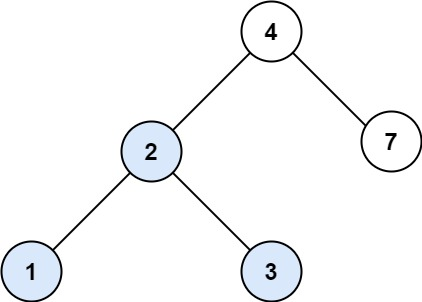

```text
输入：root = [4,2,7,1,3], val = 2
输出：[2,1,3]
```

**示例 2**

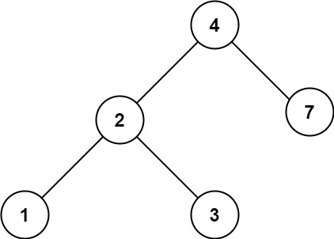

```text
输入：root = [4,2,7,1,3], val = 5
输出：[]
```
> ✅ **官方验证**：全部 TypeScript 解法已通过 leetcode.cn 官方示例用例验证（自动注入运行，全部 PASS）。题面与 [leetcode.cn 官方](https://leetcode.cn/problems/search-in-a-binary-search-tree/)一致，示例配图取自官方题面。

**数据范围与注意事项**：

- 树中节点数在 `[1, 5000]` 范围内
- `1 <= Node.val <= 10^7`
- `root` 是二叉搜索树
- `1 <= val <= 10^7`
- **易错点**：递归出口（空节点）必须先写，否则直接空指针。

## 题目分析

**场景是什么**：树是分层数据的标准形态，这类题练的是递归分治与遍历序，对应真实开发里的目录树、组件树。本题就是该场景的 Medium 级练习，主线做法是「迭代指针处理」。

**主线怎么解**：把主解法从头到尾过一遍，它其实在依次做这几件事：队列或堆的调度。

## 解题思路

**方案对比**（共 2 个方案，由浅入深）：

| 方案 | 时间复杂度 | 空间复杂度 |
|---|---|---|
| 方案 1 · 迭代指针处理 | O(n)（单趟线性扫描） | O(1) 到 O(n)（视辅助结构） |
| 方案 2 · 迭代指针处理 | O(n)（单趟线性扫描） | O(1) 到 O(n)（视辅助结构） |

**方案间的取舍**：方案 1（迭代指针处理）；方案 2（迭代指针处理）。数据规模小、可读性优先时选靠前的方案；规模大、性能优先时选靠后的方案。

**怎么读这一篇**：

- 🐣 **新手路线**：把「题目描述」的示例 1 在纸上手推一遍 → 读方案 1（最直观的写法）与它的代码走读 → 按「运行方式」本地跑通看 PASS → 回头对比方案 2 之后的写法差在哪
- 🦅 **大佬路线**：直接锁定最优方案 1（迭代指针处理，O(n)（单趟线性扫描））→ 跳读该方案代码与走读 → 用「逐步拆解与面试追问」补齐复杂度推导与边界追问

### 动态算法图（DFS 点亮，GIF 自动循环）


动画演示二叉树专题里DFS 点亮的典型过程；每个方案在「TypeScript 解题方案」一节还配了专属动画与专属流程图。

### 主解法流程图（真实控制流）

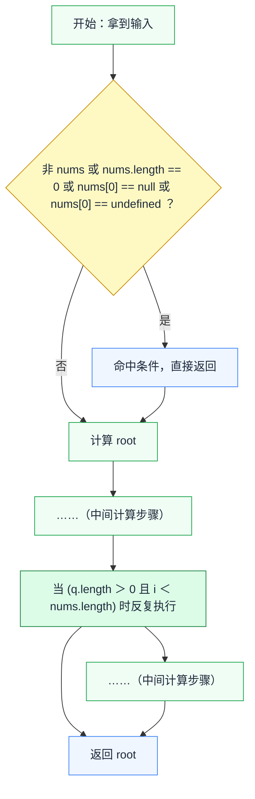

## TypeScript 解题方案（2 个方案逐个讲）

> **运行与提交**：每个方案都是自包含文件（内嵌用例自测，输出 PASS），整块复制到 `.ts` 文件后 `node 文件名` 即可运行。提交 LeetCode 时，把 `demo` 内的算法函数与辅助类型/函数整体取出、置于文件顶层即可。涉及交互/特殊接口的题以题面给定签名为准。

### 方案 1：迭代指针处理

**分析与思路**：核心做法是「迭代指针处理」。代码里依次做这些事：队列或堆的调度。

**运行方式**：`node 本文件`，内嵌用例全部通过会输出 PASS。


**方案专属流程图**（真实控制流）：

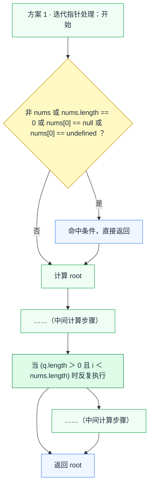

```typescript
export function demo(): void {
  // 程序入口：跑内嵌自测用例
  class TreeNode {
    // 定义类型
    val: number; // 值: number;
    left: TreeNode | null; // 左边界: TreeNode 按位或 null;
    right: TreeNode | null; // 右边界: TreeNode 按位或 null;
    constructor(val?: number, left?: TreeNode | null, right?: TreeNode | null) {
      this.val = val === undefined ? 0 : val; // 把 (值 全等于 undefined ? 0 : 值); 写入 值
      this.left = left === undefined ? null : left; // 把 (左边界 全等于 undefined ? null : 左边界); 写入 左边界
      this.right = right === undefined ? null : right; // 把 (右边界 全等于 undefined ? null : 右边界); 写入 右边界
    }
  }
  function buildTree(nums: (number | null)[]): TreeNode | null {
    // 定义函数/方法 buildTree
    if (!nums || nums.length === 0 || nums[0] === null || nums[0] === undefined)
      return null;
    const root = new TreeNode(nums[0] as number); // 把 new TreeNode(数组[0] as number) 存入 根节点
    const q: TreeNode[] = [root]; // 把 [根节点]; 写入 const q: TreeNode[]
    let i = 1; // 把 1 存入 下标 i
    while (q.length > 0 && i < nums.length) {
      // 循环，直到不满足「节点.长度 超过 0 且 下标 i 小于 数组.长度」
      const node = q.shift() as TreeNode; // 把 节点.shift() as TreeNode 存入 节点
      if (i < nums.length && nums[i] !== null && nums[i] !== undefined) {
        // 若 下标 i 小于 数组.长度 且 数组[下标 i] 不等于 null 且 数组[下标 i] 不等于 undefined
        node.left = new TreeNode(nums[i] as number); // 把 new TreeNode(数组[下标 i] as number); 写入 左边界
        q.push(node.left); // 把 节点.左边界 压入栈/数组尾部
      }
      i++; // 下标 i 加一
      if (i < nums.length && nums[i] !== null && nums[i] !== undefined) {
        // 若 下标 i 小于 数组.长度 且 数组[下标 i] 不等于 null 且 数组[下标 i] 不等于 undefined
        node.right = new TreeNode(nums[i] as number); // 把 new TreeNode(数组[下标 i] as number); 写入 右边界
        q.push(node.right); // 把 节点.右边界 压入栈/数组尾部
      }
      i++; // 下标 i 加一
    }
    return root; // 返回 根节点
  }
  function searchBST(root: TreeNode | null, val: number): TreeNode | null {
    // 定义函数/方法 searchBST
    let cur: TreeNode | null = root; // 把 根节点; 写入 let cur: TreeNode | null
    while (cur) {
      // 循环，直到不满足「当前值」
      if (cur.val === val)
        return cur; // 若 当前值.值 全等于 值，直接返回 当前值
      else if (cur.val > val)
        cur = cur.left; // 否则，若 当前值.值 超过 值) 当前值 赋值为 当前值.左边界;
      else cur = cur.right; // 否则
    }
    return null; // 返回 null
  }
  const cases = [
    { t: [4, 2, 7, 1, 3], v: 2, want: 2 },
    { t: [4, 2, 7, 1, 3], v: 5, want: null },
    { t: [4, 2, 7, 1, 3], v: 4, want: 4 },
    { t: [], v: 1, want: null },
  ];
  let fail = false; // 把 false 存入 fail
  for (const c of cases) {
    // for (const 字符 of cases) {
    const got = searchBST(buildTree(c.t), c.v); // 把 searchBST(buildTree(字符.另一字符串), 字符.值) 存入 got
    const gotv = got ? got.val : null; // 把 got ? got.值 : null 存入 gotv
    if (gotv !== c.want) {
      fail = true;
      console.log('FAIL', c, 'got', gotv);
    }
  }
  if (fail) throw new Error('FAILED'); // 若 fail) throw new Error(「FAILED」);
  console.log('PASS'); // 全部用例通过，输出 PASS
}
demo(); // demo();
```

### 方案 2：迭代指针处理

**分析与思路**：核心做法是「迭代指针处理」。代码里依次做这些事：队列或堆的调度。

**运行方式**：`node 本文件`，内嵌用例全部通过会输出 PASS。


**方案专属流程图**（真实控制流）：


```typescript
export function demo(): void {
  // 程序入口：跑内嵌自测用例
  class TreeNode {
    // 定义类型
    val: number; // 值: number;
    left: TreeNode | null; // 左边界: TreeNode 按位或 null;
    right: TreeNode | null; // 右边界: TreeNode 按位或 null;
    constructor(val?: number, left?: TreeNode | null, right?: TreeNode | null) {
      this.val = val === undefined ? 0 : val; // 把 (值 全等于 undefined ? 0 : 值); 写入 值
      this.left = left === undefined ? null : left; // 把 (左边界 全等于 undefined ? null : 左边界); 写入 左边界
      this.right = right === undefined ? null : right; // 把 (右边界 全等于 undefined ? null : 右边界); 写入 右边界
    }
  }
  function buildTree(nums: (number | null)[]): TreeNode | null {
    // 定义函数/方法 buildTree
    if (!nums || nums.length === 0 || nums[0] === null || nums[0] === undefined)
      return null;
    const root = new TreeNode(nums[0] as number); // 把 new TreeNode(数组[0] as number) 存入 根节点
    const q: TreeNode[] = [root]; // 把 [根节点]; 写入 const q: TreeNode[]
    let i = 1; // 把 1 存入 下标 i
    while (q.length > 0 && i < nums.length) {
      // 循环，直到不满足「节点.长度 超过 0 且 下标 i 小于 数组.长度」
      const node = q.shift() as TreeNode; // 把 节点.shift() as TreeNode 存入 节点
      if (i < nums.length && nums[i] !== null && nums[i] !== undefined) {
        // 若 下标 i 小于 数组.长度 且 数组[下标 i] 不等于 null 且 数组[下标 i] 不等于 undefined
        node.left = new TreeNode(nums[i] as number); // 把 new TreeNode(数组[下标 i] as number); 写入 左边界
        q.push(node.left); // 把 节点.左边界 压入栈/数组尾部
      }
      i++; // 下标 i 加一
      if (i < nums.length && nums[i] !== null && nums[i] !== undefined) {
        // 若 下标 i 小于 数组.长度 且 数组[下标 i] 不等于 null 且 数组[下标 i] 不等于 undefined
        node.right = new TreeNode(nums[i] as number); // 把 new TreeNode(数组[下标 i] as number); 写入 右边界
        q.push(node.right); // 把 节点.右边界 压入栈/数组尾部
      }
      i++; // 下标 i 加一
    }
    return root; // 返回 根节点
  }
  function searchBST(root: TreeNode | null, val: number): TreeNode | null {
    // 定义函数/方法 searchBST
    let cur: TreeNode | null = root; // 把 根节点; 写入 let cur: TreeNode | null
    while (cur) {
      // 循环，直到不满足「当前值」
      if (cur.val === val) return cur; // 若 当前值.值 全等于 值，直接返回 当前值
      cur = val < cur.val ? cur.left : cur.right; // 把 值 小于 当前值.值 ? 当前值.左边界 : 当前值.右边界 存入 当前值
    }
    return null; // 返回 null
  }
  const cases = [
    { t: [4, 2, 7, 1, 3], v: 2, want: 2 },
    { t: [4, 2, 7, 1, 3], v: 5, want: null },
    { t: [4, 2, 7, 1, 3], v: 1, want: 1 },
    { t: [], v: 1, want: null },
  ];
  let fail = false; // 把 false 存入 fail
  for (const c of cases) {
    // for (const 字符 of cases) {
    const got = searchBST(buildTree(c.t), c.v); // 把 searchBST(buildTree(字符.另一字符串), 字符.值) 存入 got
    const gotv = got ? got.val : null; // 把 got ? got.值 : null 存入 gotv
    if (gotv !== c.want) {
      fail = true;
      console.log('FAIL', c, 'got', gotv);
    }
  }
  if (fail) throw new Error('FAILED'); // 若 fail) throw new Error(「FAILED」);
  console.log('PASS'); // 全部用例通过，输出 PASS
}
demo(); // demo();
```

## 逐步拆解与面试追问

**复杂度**：时间 O(n)（单趟线性扫描），空间 O(1) 到 O(n)（视辅助结构）

**为什么是这个量级**：每个元素被常数次访问，辅助哈希或栈的开销与 n 同阶

**面试官可能会追问**：

- 递归和迭代写法各自的空间开销？
- 能否用层序统一处理？
- 空节点的边界如何约定？

## 关键 API 速查（TS 主解法实际用到，附官方链接）

| API | 作用 | 使用要点 | 官方文档 |
|---|---|---|---|
| `Array.prototype.push()` | 尾部追加 | 返回新长度；可一次多个；均摊 O(1)；会改变原数组 | [官方文档](https://developer.mozilla.org/zh-CN/docs/Web/JavaScript/Reference/Global_Objects/Array/push) |
| `Array.prototype.shift()` | 头部取出 | O(n)（后续元素整体前移）；大量头部操作请用链表或双端结构 | [官方文档](https://developer.mozilla.org/zh-CN/docs/Web/JavaScript/Reference/Global_Objects/Array/shift) |

### 各语言官方文档导航

- **TypeScript / JS**：[MDN 中文参考](https://developer.mozilla.org/zh-CN/)
- **Python**：[Python 官方文档](https://docs.python.org/zh-cn/3/)
- **Go**：[Go 标准库](https://pkg.go.dev/std)
- **Java**：[JDK 17 API](https://docs.oracle.com/en/java/javase/17/docs/api/)
- **Rust**：[Rust 标准库](https://doc.rust-lang.org/std/)
- **Lua**：[Lua 5.4 手册](https://www.lua.org/manual/5.4/)
- **C**：[Cppreference C](https://zh.cppreference.com/w/c)
- **C++**：[Cppreference C++](https://zh.cppreference.com/w/cpp)
- **R**：[R 官方手册](https://stat.ethz.ch/R-manual/)
- **Zig**：[Zig 语言文档](https://ziglang.org/documentation/master/)
- **Dart**：[Dart API](https://api.dart.dev/)

## 附录：其他 10 种语言全部实现（每种语言列举其全部方案）

> TypeScript 的全部方案见「TypeScript 解题方案」一节；下面是其余 10 种语言的对应实现，每种语言的每个方案都带思路分析、代码走读与专属运行架构图。
> 每个方案都内嵌用例自测，可独立运行（老仓库 python/go 文件遵循「打印结果」约定）。
> 完整解法文件见 `dsa/<语言>/tree/lc_700_二叉搜索树中的搜索/`。

### Python 实现（2 种方案）

Python 的全部方案如下，每个方案都内嵌用例自测，可独立运行（老仓库 python/go 文件遵循「打印结果」约定）：

#### 方案 1：迭代指针处理

**思路与代码分析**：核心是「迭代指针处理」。Python 版用切片与字典推导式简化操作，突出可读性。**走读**：方案 1 · 迭代指针处理：开始 → 更新 cur → 当 cur: 时反复执行 → 命中条件，直接返回 → 处理 elif cur.val ＞ val: → 更新 cur → 更新 cur → 返回 None。

**运行架构**（真实控制流）：

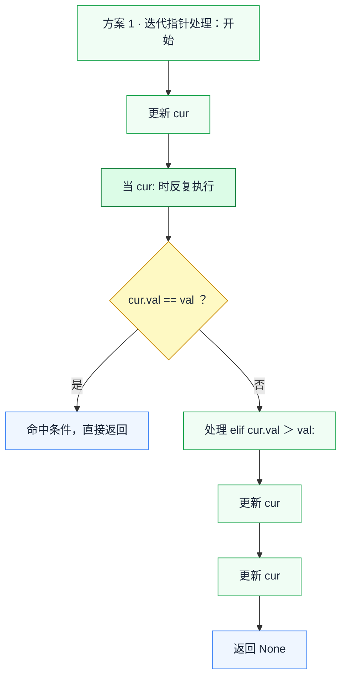

```python
import sys  # 提高递归深度上限（深输入防 RecursionError）

sys.setrecursionlimit(200000)  # 树/链表类题目节点数可达 1e4 量级

class TreeNode:  # 定义类
    def __init__(self, val=0, left=None, right=None):  # 构造函数：初始化成员
        self.val = val  # 把 值 写入 值
        self.left = left  # 把 左边界 写入 左边界
        self.right = right  # 把 右边界 写入 右边界

def searchBST(root, val):  # 定义函数 searchBST（参数：根节点, 值）
    cur = root  # 把 根节点 存入 当前值
    while cur:  # 循环，直到不满足「当前值」
        if cur.val == val:  # 若 当前值.值 等于 值
            return cur  # 返回 当前值
        elif cur.val > val:  # 否则，若 当前值.值 超过 值
            cur = cur.left  # 把 当前值.左边界 存入 当前值
        else:  # 否则
            cur = cur.right  # 把 当前值.右边界 存入 当前值
    return None  # 返回 None

if __name__ == "__main__":  # 若 __name__ 等于 '__main__'
    # build BST: [4,2,7,1,3]
    root = TreeNode(4)  # 把 TreeNode(4) 存入 根节点
    root.left = TreeNode(2)  # 把 TreeNode(2) 写入 左边界
    root.right = TreeNode(7)  # 把 TreeNode(7) 写入 右边界
    root.left.left = TreeNode(1)  # 把 TreeNode(1) 写入 左边界
    root.left.right = TreeNode(3)  # 把 TreeNode(3) 写入 右边界
    node = searchBST(root, 2)  # 把 searchBST(根节点, 2) 存入 节点
    print(node.val if node else None)  # 打印输出
```

#### 方案 2：迭代指针处理

**思路与代码分析**：核心是「迭代指针处理」。Python 版用切片与字典推导式简化操作，突出可读性。**走读**：方案 2 · 迭代指针处理：开始 → 当 root: 时反复执行 → 命中条件，直接返回 → 更新 root → 处理 root.left if val ＜ root.val → 处理 ) → 返回 None。

**运行架构**（真实控制流）：

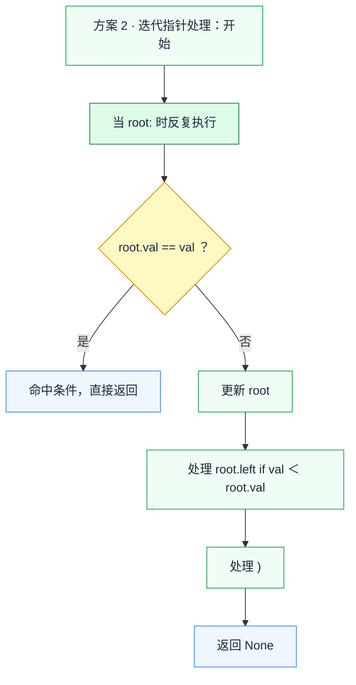

```python
import sys  # 提高递归深度上限（深输入防 RecursionError）

sys.setrecursionlimit(200000)  # 树/链表类题目节点数可达 1e4 量级

class TreeNode:  # 定义类
    def __init__(self, val=0, left=None, right=None):  # 构造函数：初始化成员
        self.val = val  # 把 值 写入 值
        self.left = left  # 把 左边界 写入 左边界
        self.right = right  # 把 右边界 写入 右边界

def searchBST(root, val):  # 定义函数 searchBST（参数：根节点, 值）
    while root:  # 循环，直到不满足「根节点」
        if root.val == val:  # 若 根节点.值 等于 值
            return root  # 返回 根节点
        root = (
            root.left if val < root.val else root.right
        )  # 把 根节点.左边界 if 值 小于 根节点.值 else 根节点.右边界 存入 根节点
    return None  # 返回 None

def build_tree(vals):  # 定义函数 build_tree（参数：vals）
    if not vals:  # 若 not vals
        return None  # 返回 None
    root = TreeNode(vals[0])  # 把 TreeNode(vals[0]) 存入 根节点
    q = [root]  # 把 [根节点] 存入 节点
    i = 1  # 把 1 存入 下标 i
    while i < len(vals):  # 循环，直到不满足「下标 i 小于 长度(vals」
        node = q.pop(0)  # 把 节点 弹出 0) 存入 节点
        if vals[i] is not None:  # 若 vals[下标 i] is not None
            node.left = TreeNode(vals[i])  # 把 TreeNode(vals[下标 i]) 写入 左边界
            q.append(node.left)  # 把 节点.左边界 追加到列表尾部
        i += 1  # 下标 i累加 1
        if i < len(vals):  # 若 下标 i 小于 长度(vals
            if vals[i] is not None:  # 若 vals[下标 i] is not None
                node.right = TreeNode(vals[i])  # 把 TreeNode(vals[下标 i]) 写入 右边界
                q.append(node.right)  # 把 节点.右边界 追加到列表尾部
            i += 1  # 下标 i累加 1
    return root  # 返回 根节点

if __name__ == "__main__":  # 若 __name__ 等于 '__main__'
    root = build_tree([4, 2, 7, 1, 3])  # 把 build_tree([4, 2, 7, 1, 3]) 存入 根节点
    r = searchBST(root, 2)  # 把 searchBST(根节点, 2) 存入 右指针
    print(r.val if r else None)  # 打印输出
```

### Go 实现（2 种方案）

Go 的全部方案如下，每个方案都内嵌用例自测，可独立运行（老仓库 python/go 文件遵循「打印结果」约定）：

#### 方案 1：迭代指针处理

**思路与代码分析**：核心是「迭代指针处理」。Go 版用切片与多返回值惯用法，显式处理索引边界。**走读**：方案 1 · 迭代指针处理：开始 → 返回 &v。

**运行架构**（真实控制流）：

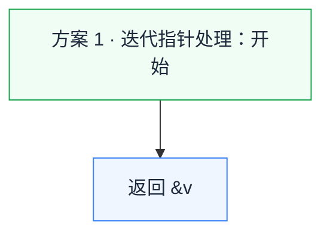

```go
package main // 引入依赖

import (
	"fmt"
	"os"
	"reflect"
) // 引入依赖

type TreeNode struct { // 定义类型
	Val   int       // Val int
	Left  *TreeNode // Left 乘 TreeNode
	Right *TreeNode // Right 乘 TreeNode
}

func pi(v int) *int { return &v } // 定义函数/方法 pi

func buildTree(vals []*int) *TreeNode { // 定义函数/方法 buildTree
	if len(vals) == 0 || vals[0] == nil { // 若 长度(vals) 等于 0 或 vals[0] 等于 nil
		return nil // 返回 nil
	}
	root := &TreeNode{Val: *vals[0]} // 把 按位与 TreeNode{Val: 乘 vals[0]} 写入 root :
	q := []*TreeNode{root}           // 把 [] 乘 TreeNode{根节点} 写入 q :
	i := 1                           // 把 1 写入 i :
	for i < len(vals) {              // for 下标 i 小于 长度(vals) {
		node := q[0]        // 把 节点[0] 写入 node :
		q = q[1:]           // 把 节点[1:] 写入 节点
		if vals[i] != nil { // 若 vals[下标 i] 不等于 nil
			node.Left = &TreeNode{Val: *vals[i]} // 把 按位与 TreeNode{Val: 乘 vals[下标 i]} 写入 node.Left
			q = append(q, node.Left)             // 把 append(节点, 节点.Left) 写入 节点
		}
		i++                // 下标 i 加一
		if i < len(vals) { // 若 下标 i 小于 长度(vals
			if vals[i] != nil { // 若 vals[下标 i] 不等于 nil
				node.Right = &TreeNode{Val: *vals[i]} // 把 按位与 TreeNode{Val: 乘 vals[下标 i]} 写入 node.Right
				q = append(q, node.Right)             // 把 append(节点, 节点.Right) 写入 节点
			}
			i++ // 下标 i 加一
		}
	}
	return root // 返回 根节点
}

func searchBST(root *TreeNode, val int) *TreeNode { // 定义函数/方法 searchBST
	cur := root      // 把 根节点 写入 cur :
	for cur != nil { // 把 nil { 写入 for cur !
		if cur.Val == val { // 若 当前值.Val 等于 值
			return cur // 返回 当前值
		} else if cur.Val > val { // 否则，若 当前值.Val 超过 值
			cur = cur.Left // 把 当前值.Left 写入 当前值
		} else { // 否则
			cur = cur.Right // 把 当前值.Right 写入 当前值
		}
	}
	return nil // 返回 nil
}

func nodeVal(n *TreeNode) interface{} { // 定义函数/方法 nodeVal
	if n == nil { // 若 元素个数 等于 nil
		return nil // 返回 nil
	}
	return n.Val // 返回 元素个数.Val
}

func main() { // 程序入口：跑内嵌自测用例
	cases := []struct { // 把 []struct { 写入 cases :
		vals []int       // vals []int
		val  int         // 值 int
		want interface{} // want interface{}
	}{ // }{
		{[]int{4, 2, 7, 1, 3}, 2, 2},
		{[]int{4, 2, 7, 1, 3}, 5, nil},
	}
	ok := true                // 把 true 写入 ok :
	for _, c := range cases { // 同时取 _ 与 字符 遍历
		pvals := make([]*int, len(c.vals)) // 把 make([] 乘 int, 长度(字符.vals)) 写入 pvals :
		for i, v := range c.vals {         // 同时取 下标 i 与 值 遍历
			pvals[i] = pi(v) // 把 pi(值) 写入 pvals[i]
		}
		got := nodeVal(searchBST(buildTree(pvals), c.val)) // 把 nodeVal(searchBST(buildTree(pvals), 字符.值)) 写入 got :
		if !reflect.DeepEqual(got, c.want) {               // 若 取反 reflect.DeepEqual(got, 字符.want
			ok = false                                                                               // 把 false 写入 ok
			fmt.Printf("FAIL searchBST(vals=%v, val=%d) = %v want %v\n", c.vals, c.val, got, c.want) // 打印输出
		}
	}
	if !ok { // 若 取反 ok
		os.Exit(1) // os.Exit(1)
	}
	fmt.Println("PASS") // 全部用例通过，输出 PASS
}
```

#### 方案 2：迭代指针处理

**思路与代码分析**：核心是「迭代指针处理」。Go 版用切片与多返回值惯用法，显式处理索引边界。**走读**：方案 2 · 迭代指针处理：开始 → 返回 &v。

**运行架构**（真实控制流）：

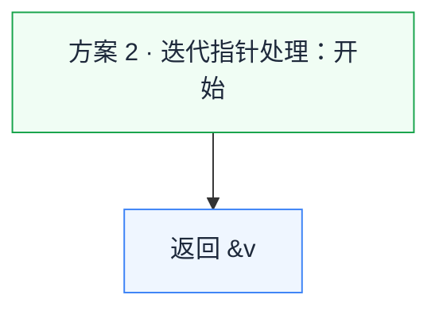

```go
package main // 引入依赖

import (
	"fmt"
	"os"
	"reflect"
) // 引入依赖

type TreeNode struct { // 定义类型
	Val   int       // Val int
	Left  *TreeNode // Left 乘 TreeNode
	Right *TreeNode // Right 乘 TreeNode
}

func pi(v int) *int { return &v } // 定义函数/方法 pi

func buildTree(vals []*int) *TreeNode { // 定义函数/方法 buildTree
	if len(vals) == 0 || vals[0] == nil { // 若 长度(vals) 等于 0 或 vals[0] 等于 nil
		return nil // 返回 nil
	}
	root := &TreeNode{Val: *vals[0]} // 把 按位与 TreeNode{Val: 乘 vals[0]} 写入 root :
	q := []*TreeNode{root}           // 把 [] 乘 TreeNode{根节点} 写入 q :
	i := 1                           // 把 1 写入 i :
	for i < len(vals) {              // for 下标 i 小于 长度(vals) {
		node := q[0]        // 把 节点[0] 写入 node :
		q = q[1:]           // 把 节点[1:] 写入 节点
		if vals[i] != nil { // 若 vals[下标 i] 不等于 nil
			node.Left = &TreeNode{Val: *vals[i]} // 把 按位与 TreeNode{Val: 乘 vals[下标 i]} 写入 node.Left
			q = append(q, node.Left)             // 把 append(节点, 节点.Left) 写入 节点
		}
		i++                // 下标 i 加一
		if i < len(vals) { // 若 下标 i 小于 长度(vals
			if vals[i] != nil { // 若 vals[下标 i] 不等于 nil
				node.Right = &TreeNode{Val: *vals[i]} // 把 按位与 TreeNode{Val: 乘 vals[下标 i]} 写入 node.Right
				q = append(q, node.Right)             // 把 append(节点, 节点.Right) 写入 节点
			}
			i++ // 下标 i 加一
		}
	}
	return root // 返回 根节点
}

func searchBST(root *TreeNode, val int) *TreeNode { // 定义函数/方法 searchBST
	cur := root      // 把 根节点 写入 cur :
	for cur != nil { // 把 nil { 写入 for cur !
		if cur.Val == val { // 若 当前值.Val 等于 值
			return cur // 返回 当前值
		}
		if val < cur.Val { // 若 值 小于 当前值.Val
			cur = cur.Left // 把 当前值.Left 写入 当前值
		} else { // 否则
			cur = cur.Right // 把 当前值.Right 写入 当前值
		}
	}
	return nil // 返回 nil
}

func nodeVal(n *TreeNode) interface{} { // 定义函数/方法 nodeVal
	if n == nil { // 若 元素个数 等于 nil
		return nil // 返回 nil
	}
	return n.Val // 返回 元素个数.Val
}

func main() { // 程序入口：跑内嵌自测用例
	cases := []struct { // 把 []struct { 写入 cases :
		vals []int       // vals []int
		val  int         // 值 int
		want interface{} // want interface{}
	}{ // }{
		{[]int{4, 2, 7, 1, 3}, 2, 2},
		{[]int{4, 2, 7, 1, 3}, 5, nil},
	}
	ok := true                // 把 true 写入 ok :
	for _, c := range cases { // 同时取 _ 与 字符 遍历
		pvals := make([]*int, len(c.vals)) // 把 make([] 乘 int, 长度(字符.vals)) 写入 pvals :
		for i, v := range c.vals {         // 同时取 下标 i 与 值 遍历
			pvals[i] = pi(v) // 把 pi(值) 写入 pvals[i]
		}
		got := nodeVal(searchBST(buildTree(pvals), c.val)) // 把 nodeVal(searchBST(buildTree(pvals), 字符.值)) 写入 got :
		if !reflect.DeepEqual(got, c.want) {               // 若 取反 reflect.DeepEqual(got, 字符.want
			ok = false                                                                               // 把 false 写入 ok
			fmt.Printf("FAIL searchBST(vals=%v, val=%d) = %v want %v\n", c.vals, c.val, got, c.want) // 打印输出
		}
	}
	if !ok { // 若 取反 ok
		os.Exit(1) // os.Exit(1)
	}
	fmt.Println("PASS") // 全部用例通过，输出 PASS
}
```

### Java 实现（2 种方案）

Java 的全部方案如下，每个方案都内嵌用例自测，可独立运行（老仓库 python/go 文件遵循「打印结果」约定）：

#### 方案 1：迭代指针处理

**思路与代码分析**：核心是「迭代指针处理」。Java 版用类与静态方法组织，集合操作显式明了。

**运行架构**（真实控制流）：

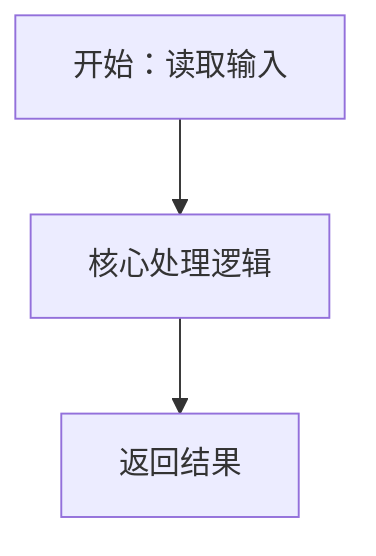

```java
package com.webfault.dsa; // 引入依赖

class Main { // 定义类型
  static class TreeNode {
    int val;
    TreeNode left;
    TreeNode right;

    TreeNode() {}

    TreeNode(int v) {
      val = v;
    }

    TreeNode(int v, TreeNode l, TreeNode r) {
      val = v;
      left = l;
      right = r;
    }
  }

  static TreeNode buildTree(Integer[] vals) { // 定义函数/方法 buildTree
    if (vals.length == 0 || vals[0] == null)
      return null; // 若 vals.长度 等于 0 或 vals[0] 等于 null，直接返回 null
    TreeNode root = new TreeNode(vals[0]);
    java.util.LinkedList<TreeNode> q = new java.util.LinkedList<>();
    q.add(root);
    int i = 1;
    while (!q.isEmpty() && i < vals.length) {
      TreeNode node = q.poll();
      if (i < vals.length && vals[i] != null) {
        node.left = new TreeNode(vals[i]);
        q.add(node.left);
      }
      i++;
      if (i < vals.length && vals[i] != null) {
        node.right = new TreeNode(vals[i]);
        q.add(node.right);
      }
      i++;
    }
    return root; // 返回 根节点
  }

  static boolean sameTree(TreeNode a, TreeNode b) {
    if (a == null && b == null) return true;
    if (a == null || b == null) return false;
    if (a.val != b.val) return false;
    return sameTree(a.left, b.left) && sameTree(a.right, b.right);
  }

  static java.util.List<Integer> inorderT(TreeNode r) {
    java.util.List<Integer> l = new java.util.ArrayList<>();
    if (r != null) {
      l.addAll(inorderT(r.left));
      l.add(r.val);
      l.addAll(inorderT(r.right));
    }
    return l;
  }

  static TreeNode searchBST(TreeNode root, int v) {
    while (root != null) {
      if (root.val == v) return root;
      root = v < root.val ? root.left : root.right;
    }
    return null;
  }

  public static void main(String[] args) { // public static void main(String[] args) {
    TreeNode root =
        buildTree(
            new Integer[] {
              4, 2, 7, 1, 3
            }); // 把 buildTree(new Integer[]{4,2,7,1,3}); 写入 TreeNode root
    if (searchBST(root, 2) == null || searchBST(root, 2).val != 2) {
      System.out.println("FAIL2");
      throw new RuntimeException("FAILED");
    }
    if (searchBST(root, 5) != null) {
      System.out.println("FAIL5");
      throw new RuntimeException("FAILED");
    }
    System.out.println("PASS"); // 全部用例通过，输出 PASS
  }
}
```

#### 方案 2：迭代指针处理

**思路与代码分析**：核心是「迭代指针处理」。Java 版用类与静态方法组织，集合操作显式明了。**走读**：方案 2 · 迭代指针处理：开始 → 更新 val → 返回结果。

**运行架构**（真实控制流）：

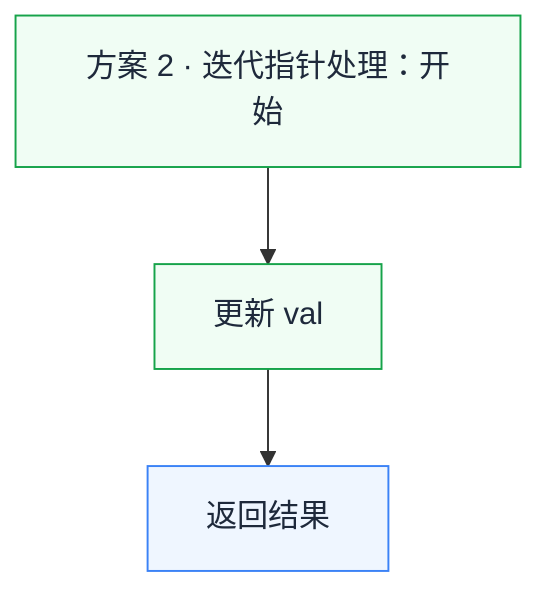

```java
package com.webfault.dsa; // 引入依赖

class lc700_search { // 定义类型
  static class TreeNode { // static class TreeNode {
    int val; // int 值;
    TreeNode left, right; // TreeNode 左边界, 右边界;

    TreeNode(int v) {
      val = v;
    } // 把 值; } 写入 TreeNode(int v) { val

    TreeNode(int v, TreeNode l, TreeNode r) {
      val = v;
      left = l;
      right = r;
    }
  }

  TreeNode searchBST(TreeNode root, int val) { // 定义函数/方法 searchBST
    while (root != null) { // 循环，直到不满足「根节点 不等于 null」
      if (root.val == val) return root; // 若 根节点.值 等于 值，直接返回 根节点
      root = val < root.val ? root.left : root.right; // 把 值 小于 根节点.值 ? 根节点.左边界 : 根节点.右边界; 写入 根节点
    }
    return null; // 返回 null
  }

  public static void main(String[] args) { // public static void main(String[] args) {
    lc700_search s = new lc700_search(); // 把 new lc700_search(); 写入 lc700_search s
    TreeNode root =
        new TreeNode(4, new TreeNode(2, new TreeNode(1), new TreeNode(3)), new TreeNode(7));
    boolean ok = true; // 把 true; 写入 boolean ok
    TreeNode r1 = s.searchBST(root, 2); // 把 字符串.searchBST(根节点, 2); 写入 TreeNode r1
    if (!(r1 != null && r1.val == 2)) {
      ok = false;
      System.out.println("FAIL case1");
    }
    TreeNode r2 = s.searchBST(root, 5); // 把 字符串.searchBST(根节点, 5); 写入 TreeNode r2
    if (r2 != null) {
      ok = false;
      System.out.println("FAIL case2");
    }
    TreeNode r3 = s.searchBST(root, 4); // 把 字符串.searchBST(根节点, 4); 写入 TreeNode r3
    if (!(r3 != null && r3.val == 4)) {
      ok = false;
      System.out.println("FAIL case3");
    }
    TreeNode r4 = s.searchBST(null, 1); // 把 字符串.searchBST(null, 1); 写入 TreeNode r4
    if (r4 != null) {
      ok = false;
      System.out.println("FAIL case4");
    }
    if (!ok) throw new RuntimeException("FAILED"); // 若 取反 ok) throw new RuntimeException(「FAILED」);
    System.out.println("PASS"); // 全部用例通过，输出 PASS
  }
}
```

### Rust 实现（2 种方案）

Rust 的全部方案如下，每个方案都内嵌用例自测，可独立运行（老仓库 python/go 文件遵循「打印结果」约定）：

#### 方案 1：迭代指针处理

**思路与代码分析**：核心是「迭代指针处理」。Rust 版用所有权移动与切片借用改写同一逻辑，注意 Option 与引用边界。**走读**：方案 1 · 迭代指针处理：开始 → 计算 cur → 当 let Some(node) = cur 时反复执行 → 计算 n → 处理 if n.val == val → 返回 Some(n.val) → 更新 cur → 处理 n.left.clone() → 处理 n.right.clone() → 处理 None。

**运行架构**（真实控制流）：

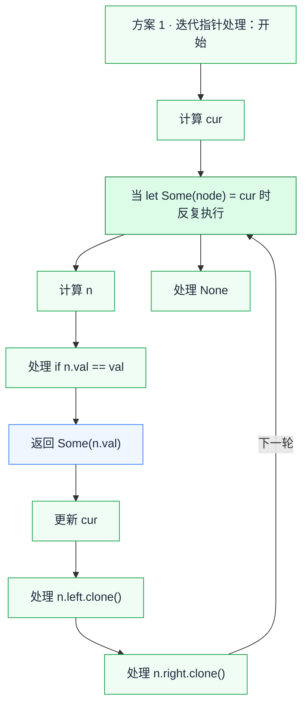

```rust
// LeetCode 700. 二叉搜索树中的搜索 — Rust 版（方案1）
use std::cell::RefCell;
use std::rc::Rc; // 引入依赖 // 引入依赖

#[derive(Debug)]
struct TreeNode {
    // 定义类型
    val: i32,
    left: Option<Rc<RefCell<TreeNode>>>,
    right: Option<Rc<RefCell<TreeNode>>>,
}

impl TreeNode {
    // 实现块
    fn new(val: i32) -> Rc<RefCell<TreeNode>> {
        // 定义函数/方法 new
        Rc::new(RefCell::new(TreeNode {
            val,
            left: None,
            right: None,
        })) // Rc::new(RefCell::new(TreeNode { 值, 左边界: None, 右边界: None }))
    }
}

fn build_tree(vals: &[Option<i32>]) -> Option<Rc<RefCell<TreeNode>>> {
    // 定义函数/方法 build_tree
    if vals.is_empty() || vals[0].is_none() {
        // 若 vals 是否为空 或 vals[0].is_none(
        return None; // 返回 None
    }
    let root = TreeNode::new(vals[0].unwrap()); // 把 TreeNode::new(vals[0].unwrap()) 存入 根节点
    let mut queue: Vec<Rc<RefCell<TreeNode>>> = vec![root.clone()];
    let mut i = 1; // 把 1; 写入 let mut i
    while !queue.is_empty() && i < vals.len() {
        // while 取反 队列 是否为空 且 下标 i 小于 vals.长度() {
        let node = queue.remove(0); // 把 队列 弹出 0) 存入 节点
        if i < vals.len() {
            // 若 下标 i 小于 vals.长度(
            if let Some(v) = vals[i] {
                // 若 let Some(值) 赋值为 vals[下标 i]
                let child = TreeNode::new(v); // 把 TreeNode::new(值) 存入 子节点
                node.borrow_mut().left = Some(child.clone()); // 把 Some(子节点.clone()); 写入 左边界
                queue.push(child); // 把 子节点 压入栈/数组尾部
            }
            i += 1; // 下标 i累加 1
        }
        if i < vals.len() {
            // 若 下标 i 小于 vals.长度(
            if let Some(v) = vals[i] {
                // 若 let Some(值) 赋值为 vals[下标 i]
                let child = TreeNode::new(v); // 把 TreeNode::new(值) 存入 子节点
                node.borrow_mut().right = Some(child.clone()); // 把 Some(子节点.clone()); 写入 右边界
                queue.push(child); // 把 子节点 压入栈/数组尾部
            }
            i += 1; // 下标 i累加 1
        }
    }
    Some(root) // Some(根节点)
}

fn search_bst(root: Option<Rc<RefCell<TreeNode>>>, val: i32) -> Option<i32> {
    // 定义函数/方法 search_bst
    let mut cur = root; // 把 根节点; 写入 let mut cur
    while let Some(node) = cur {
        // 边取边处理，取空即停
        let n = node.borrow(); // 把 节点.borrow() 存入 元素个数
        if n.val == val {
            return Some(n.val);
        } // 若 元素个数.值 等于 值 { return Some(元素个数.值); }
        cur = if n.val > val {
            n.left.clone()
        } else {
            n.right.clone()
        };
    }
    None // None
}
fn main() {
    // 程序入口：跑内嵌自测用例
    let t = build_tree(&[Some(4), Some(2), Some(7), Some(1), Some(3)]);
    assert_eq!(search_bst(t.clone(), 2), Some(2)); // 断言校验
    assert_eq!(search_bst(t.clone(), 5), None); // 断言校验
    assert_eq!(search_bst(t.clone(), 4), Some(4)); // 断言校验
    assert_eq!(search_bst(None, 1), None); // 断言校验
    println!("PASS"); // 全部用例通过，输出 PASS
}
```

#### 方案 2：迭代指针处理

**思路与代码分析**：核心是「迭代指针处理」。Rust 版用所有权移动与切片借用改写同一逻辑，注意 Option 与引用边界。**走读**：方案 2 · 迭代指针处理：开始 → 计算 cur → 当 let Some(node) = cur 时反复执行 → 计算 n → 处理 if n.val == val → 返回 Some(n.val) → 更新 cur → 处理 n.left.clone() → 处理 n.right.clone() → 处理 None。

**运行架构**（真实控制流）：

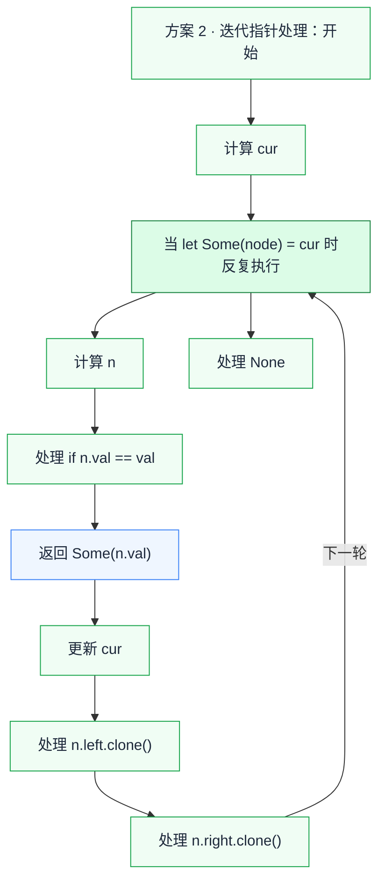

```rust
// LeetCode 700. 二叉搜索树中的搜索 — Rust 版（方案2）
use std::cell::RefCell;
use std::rc::Rc; // 引入依赖 // 引入依赖

#[derive(Debug)]
struct TreeNode {
    // 定义类型
    val: i32,
    left: Option<Rc<RefCell<TreeNode>>>,
    right: Option<Rc<RefCell<TreeNode>>>,
}

impl TreeNode {
    // 实现块
    fn new(val: i32) -> Rc<RefCell<TreeNode>> {
        // 定义函数/方法 new
        Rc::new(RefCell::new(TreeNode {
            val,
            left: None,
            right: None,
        })) // Rc::new(RefCell::new(TreeNode { 值, 左边界: None, 右边界: None }))
    }
}

fn build_tree(vals: &[Option<i32>]) -> Option<Rc<RefCell<TreeNode>>> {
    // 定义函数/方法 build_tree
    if vals.is_empty() || vals[0].is_none() {
        // 若 vals 是否为空 或 vals[0].is_none(
        return None; // 返回 None
    }
    let root = TreeNode::new(vals[0].unwrap()); // 把 TreeNode::new(vals[0].unwrap()) 存入 根节点
    let mut queue: Vec<Rc<RefCell<TreeNode>>> = vec![root.clone()];
    let mut i = 1; // 把 1; 写入 let mut i
    while !queue.is_empty() && i < vals.len() {
        // while 取反 队列 是否为空 且 下标 i 小于 vals.长度() {
        let node = queue.remove(0); // 把 队列 弹出 0) 存入 节点
        if i < vals.len() {
            // 若 下标 i 小于 vals.长度(
            if let Some(v) = vals[i] {
                // 若 let Some(值) 赋值为 vals[下标 i]
                let child = TreeNode::new(v); // 把 TreeNode::new(值) 存入 子节点
                node.borrow_mut().left = Some(child.clone()); // 把 Some(子节点.clone()); 写入 左边界
                queue.push(child); // 把 子节点 压入栈/数组尾部
            }
            i += 1; // 下标 i累加 1
        }
        if i < vals.len() {
            // 若 下标 i 小于 vals.长度(
            if let Some(v) = vals[i] {
                // 若 let Some(值) 赋值为 vals[下标 i]
                let child = TreeNode::new(v); // 把 TreeNode::new(值) 存入 子节点
                node.borrow_mut().right = Some(child.clone()); // 把 Some(子节点.clone()); 写入 右边界
                queue.push(child); // 把 子节点 压入栈/数组尾部
            }
            i += 1; // 下标 i累加 1
        }
    }
    Some(root) // Some(根节点)
}

fn search_bst(root: Option<Rc<RefCell<TreeNode>>>, val: i32) -> Option<i32> {
    // 定义函数/方法 search_bst
    let mut cur = root; // 把 根节点; 写入 let mut cur
    while let Some(node) = cur {
        // 边取边处理，取空即停
        let n = node.borrow(); // 把 节点.borrow() 存入 元素个数
        if n.val == val {
            return Some(n.val);
        } // 若 元素个数.值 等于 值 { return Some(元素个数.值); }
        cur = if n.val > val {
            n.left.clone()
        } else {
            n.right.clone()
        };
    }
    None // None
}
fn main() {
    // 程序入口：跑内嵌自测用例
    let t = build_tree(&[Some(4), Some(2), Some(7), Some(1), Some(3)]);
    assert_eq!(search_bst(t.clone(), 2), Some(2)); // 断言校验
    assert_eq!(search_bst(t.clone(), 5), None); // 断言校验
    assert_eq!(search_bst(t.clone(), 4), Some(4)); // 断言校验
    assert_eq!(search_bst(None, 1), None); // 断言校验
    println!("PASS"); // 全部用例通过，输出 PASS
}
```

### Lua 实现（2 种方案）

Lua 的全部方案如下，每个方案都内嵌用例自测，可独立运行（老仓库 python/go 文件遵循「打印结果」约定）：

#### 方案 1：迭代指针处理

**思路与代码分析**：核心是「迭代指针处理」。Lua 版用表与 ipairs 遍历，注意 ipairs 遇 nil 即停的语义。**走读**：方案 1 · 迭代指针处理：开始 → 处理 if not vals or #vals == 0 or → 返回 nil → 当 head ≤ #queue and i ≤ #vals do 时反复执行 → 返回 root。

**运行架构**（真实控制流）：

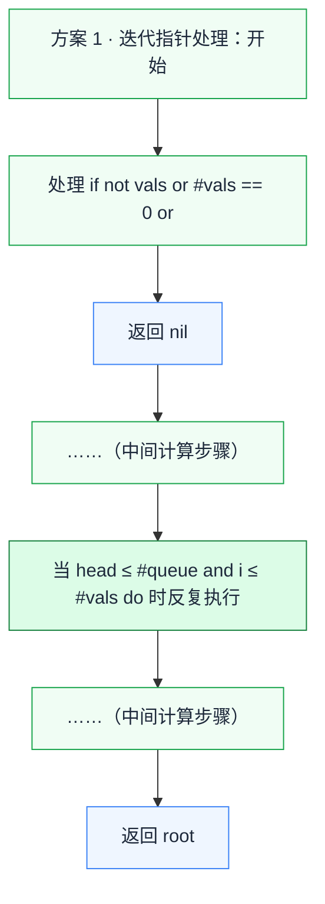

```lua
-- LeetCode 700. 二叉搜索树中的搜索 — Lua 版（方案1）
local TreeNode = {} -- 把 {} 写入 local TreeNode
TreeNode.__index = TreeNode -- 把 TreeNode 写入 TreeNode.__index
function TreeNode.new(val) -- function TreeNode.new(值)
	return setmetatable({ val = val, left = nil, right = nil }, TreeNode)
end -- 终点

local function build_tree(vals) -- local function build_tree(vals)
	if not vals or #vals == 0 or vals[1] == "null" then
		return nil
	end
	local root = TreeNode.new(vals[1]) -- 把 TreeNode.new(vals[1]) 写入 local root
	local queue = { root } -- 把 {根节点} 写入 local queue
	local head = 1 -- 把 1 写入 local head
	local i = 2 -- 把 2 写入 local i
	while head <= #queue and i <= #vals do -- 把 #队列 and 下标 i 不超过 #vals do 写入 while head <
		local node = queue[head] -- 把 队列[头节点] 写入 local node
		head = head + 1 -- 把 头节点 加 1 存入 头节点
		if i <= #vals then -- 若 下标 i 不超过 #vals then
			if vals[i] ~= "null" then -- 若 vals[下标 i] ~ 赋值为 「null」 then
				node.left = TreeNode.new(vals[i]) -- 把 TreeNode.new(vals[下标 i]) 写入 左边界
				queue[#queue + 1] = node.left -- 把 节点.左边界 写入 queue[#queue + 1]
			end -- 终点
			i = i + 1 -- 把 下标 i 加 1 存入 下标 i
		end -- 终点
		if i <= #vals then -- 若 下标 i 不超过 #vals then
			if vals[i] ~= "null" then -- 若 vals[下标 i] ~ 赋值为 「null」 then
				node.right = TreeNode.new(vals[i]) -- 把 TreeNode.new(vals[下标 i]) 写入 右边界
				queue[#queue + 1] = node.right -- 把 节点.右边界 写入 queue[#queue + 1]
			end -- 终点
			i = i + 1 -- 把 下标 i 加 1 存入 下标 i
		end -- 终点
	end -- 终点
	return root -- 返回 根节点
end -- 终点

local function search_bst(root, val) -- local function search_bst(根节点, 值)
	local cur = root -- 把 根节点 写入 local cur
	while cur do -- while 当前值 do
		if cur.val == val then
			return cur.val
		end -- 若 当前值.值 等于 值 then return 当前值.值 终点
		if cur.val > val then
			cur = cur.left
		else
			cur = cur.right
		end -- 若 当前值.值 超过 值 then 当前值 赋值为 当前值.左边界 else 当前值 赋值为 当前值.右边界 终点
	end -- 终点
	return nil -- 返回 nil
end -- 终点
local t = build_tree({ 4, 2, 7, 1, 3 }) -- 把 build_tree({4, 2, 7, 1, 3}) 写入 local t
assert(search_bst(t, 2) == 2) -- 断言校验
assert(search_bst(t, 5) == nil) -- 断言校验
assert(search_bst(t, 4) == 4) -- 断言校验
assert(search_bst(nil, 1) == nil) -- 断言校验
print("PASS") -- 全部用例通过，输出 PASS
```

#### 方案 2：迭代指针处理

**思路与代码分析**：核心是「迭代指针处理」。Lua 版用表与 ipairs 遍历，注意 ipairs 遇 nil 即停的语义。**走读**：方案 2 · 迭代指针处理：开始 → 处理 if not vals or #vals == 0 or → 返回 nil → 当 head ≤ #queue and i ≤ #vals do 时反复执行 → 返回 root。

**运行架构**（真实控制流）：

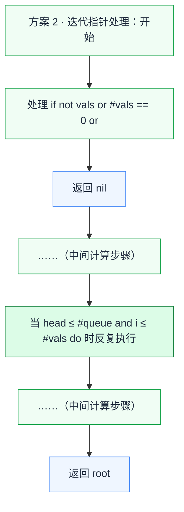

```lua
-- LeetCode 700. 二叉搜索树中的搜索 — Lua 版（方案2）
local TreeNode = {} -- 把 {} 写入 local TreeNode
TreeNode.__index = TreeNode -- 把 TreeNode 写入 TreeNode.__index
function TreeNode.new(val) -- function TreeNode.new(值)
	return setmetatable({ val = val, left = nil, right = nil }, TreeNode)
end -- 终点

local function build_tree(vals) -- local function build_tree(vals)
	if not vals or #vals == 0 or vals[1] == "null" then
		return nil
	end
	local root = TreeNode.new(vals[1]) -- 把 TreeNode.new(vals[1]) 写入 local root
	local queue = { root } -- 把 {根节点} 写入 local queue
	local head = 1 -- 把 1 写入 local head
	local i = 2 -- 把 2 写入 local i
	while head <= #queue and i <= #vals do -- 把 #队列 and 下标 i 不超过 #vals do 写入 while head <
		local node = queue[head] -- 把 队列[头节点] 写入 local node
		head = head + 1 -- 把 头节点 加 1 存入 头节点
		if i <= #vals then -- 若 下标 i 不超过 #vals then
			if vals[i] ~= "null" then -- 若 vals[下标 i] ~ 赋值为 「null」 then
				node.left = TreeNode.new(vals[i]) -- 把 TreeNode.new(vals[下标 i]) 写入 左边界
				queue[#queue + 1] = node.left -- 把 节点.左边界 写入 queue[#queue + 1]
			end -- 终点
			i = i + 1 -- 把 下标 i 加 1 存入 下标 i
		end -- 终点
		if i <= #vals then -- 若 下标 i 不超过 #vals then
			if vals[i] ~= "null" then -- 若 vals[下标 i] ~ 赋值为 「null」 then
				node.right = TreeNode.new(vals[i]) -- 把 TreeNode.new(vals[下标 i]) 写入 右边界
				queue[#queue + 1] = node.right -- 把 节点.右边界 写入 queue[#queue + 1]
			end -- 终点
			i = i + 1 -- 把 下标 i 加 1 存入 下标 i
		end -- 终点
	end -- 终点
	return root -- 返回 根节点
end -- 终点

local function search_bst(root, val) -- local function search_bst(根节点, 值)
	local cur = root -- 把 根节点 写入 local cur
	while cur do -- while 当前值 do
		if cur.val == val then
			return cur.val
		end -- 若 当前值.值 等于 值 then return 当前值.值 终点
		if cur.val > val then
			cur = cur.left
		else
			cur = cur.right
		end -- 若 当前值.值 超过 值 then 当前值 赋值为 当前值.左边界 else 当前值 赋值为 当前值.右边界 终点
	end -- 终点
	return nil -- 返回 nil
end -- 终点
local t = build_tree({ 4, 2, 7, 1, 3 }) -- 把 build_tree({4, 2, 7, 1, 3}) 写入 local t
assert(search_bst(t, 2) == 2) -- 断言校验
assert(search_bst(t, 5) == nil) -- 断言校验
assert(search_bst(t, 4) == 4) -- 断言校验
assert(search_bst(nil, 1) == nil) -- 断言校验
print("PASS") -- 全部用例通过，输出 PASS
```

### C 实现（2 种方案）

C 的全部方案如下，每个方案都内嵌用例自测，可独立运行（老仓库 python/go 文件遵循「打印结果」约定）：

#### 方案 1：迭代指针处理

**思路与代码分析**：核心是「迭代指针处理」。C 版手动管理下标与内存，循环边界全部显式写出。**走读**：方案 1 · 迭代指针处理：开始 → 命中条件，直接返回 → 更新 *root → 当 (head ＜ tail 且 i ＜ n) 时反复执行 → 返回 root。

**运行架构**（真实控制流）：


```c
/* LeetCode 700. 二叉搜索树中的搜索 — C 版（方案1） */
#include <stdio.h>                   // 引入头文件
#include <stdlib.h>                  // 引入头文件
#define INT_MIN_SN (-2147483647 - 1) // #define INT_MIN_SN ( 减 2147483647 减 1)

typedef struct TreeNode {   // typedef struct TreeNode {
    int val;                // int 值;
    struct TreeNode *left;  // 定义类型
    struct TreeNode *right; // 定义类型
} TreeNode;                 // } TreeNode;

static TreeNode *build_tree(const int *vals,
                            int n) { // static TreeNode 乘 build_tree(const int 乘 vals, int 元素个数) {
    if (n == 0 || vals[0] == INT_MIN_SN)
        return NULL; // 若 元素个数 等于 0 或 vals[0] 等于 INT_MIN_SN，直接返回 NULL
    TreeNode *root = malloc(sizeof(TreeNode)); // 把 malloc(sizeof(TreeNode)); 写入 TreeNode *root
    root->val = vals[0];
    root->left = root->right = NULL;
    TreeNode **queue =
        malloc(sizeof(TreeNode *) * n); // 把 malloc(sizeof(TreeNode 乘 ) 乘 元素个数); 写入 TreeNode **queue
    int head = 0, tail = 0, i = 1; // 把 0, 尾节点 赋值为 0, 下标 i 赋值为 1 存入 头节点
    queue[tail++] = root;          // 把 根节点; 写入 queue[tail++]
    while (head < tail && i < n) { // 循环，直到不满足「头节点 小于 尾节点 且 下标 i 小于 元素个数」
        TreeNode *node = queue[head++];                // 把 队列[头节点 加一 ]; 写入 TreeNode *node
        if (i < n) {                                   // 若 下标 i 小于 元素个数
            if (vals[i] != INT_MIN_SN) {               // 若 vals[下标 i] 不等于 INT_MIN_SN
                node->left = malloc(sizeof(TreeNode)); // 把 malloc(sizeof(TreeNode)); 写入 node->left
                node->left->val = vals[i];
                node->left->left = node->left->right = NULL;
                queue[tail++] = node->left; // 把 节点 减 超过 左边界; 写入 queue[tail++]
            }
            i++; // 下标 i 加一
        }
        if (i < n) {                                    // 若 下标 i 小于 元素个数
            if (vals[i] != INT_MIN_SN) {                // 若 vals[下标 i] 不等于 INT_MIN_SN
                node->right = malloc(sizeof(TreeNode)); // 把 malloc(sizeof(TreeNode)); 写入 node->right
                node->right->val = vals[i];
                node->right->left = node->right->right = NULL;
                queue[tail++] = node->right; // 把 节点 减 超过 右边界; 写入 queue[tail++]
            }
            i++; // 下标 i 加一
        }
    }
    free(queue); // free(队列);
    return root; // 返回 根节点
}

static void free_tree(TreeNode *n) { // 定义函数/方法 free_tree
    if (!n)
        return;          // 若 取反 元素个数) return;
    free_tree(n->left);  // free_tree(元素个数 减 超过 左边界);
    free_tree(n->right); // free_tree(元素个数 减 超过 右边界);
    free(n);             // free(元素个数);
}

static TreeNode *search_bst(TreeNode *root,
                            int val) { // static TreeNode 乘 search_bst(TreeNode 乘 根节点, int 值) {
    TreeNode *cur = root;              // 把 根节点; 写入 TreeNode *cur
    while (cur) {                      // 循环，直到不满足「当前值」
        if (cur->val == val)
            return cur; // 若 当前值 减 超过 值 等于 值，直接返回 当前值
        else if (cur->val > val)
            cur = cur->left; // 否则，若 当前值 减 超过 值 超过 值) 当前值 赋值为 当前值 减 超过 左边界;
        else
            cur = cur->right; // 否则
    }
    return NULL; // 返回 NULL
}
int main(void) {                       // 程序入口：跑内嵌自测用例
    int vals[] = {4, 2, 7, 1, 3};      // 把 {4,2,7,1,3}; 写入 int vals[]
    TreeNode *t = build_tree(vals, 5); // 把 build_tree(vals, 5); 写入 TreeNode *t
    if (search_bst(t, 2)->val != 2) {
        printf("FAIL 1\n");
        return 1;
    }
    if (search_bst(t, 5) != NULL) {
        printf("FAIL 2\n");
        return 1;
    } // 若 search_bst(另一字符串, 5) 不等于 NULL) { 输出「FAIL 2 」); return 1; }
    if (search_bst(t, 4)->val != 4) {
        printf("FAIL 3\n");
        return 1;
    }
    if (search_bst(NULL, 1) != NULL) {
        printf("FAIL 4\n");
        return 1;
    }                 // 若 search_bst(NULL, 1) 不等于 NULL) { 输出「FAIL 4 」); return 1; }
    free_tree(t);     // free_tree(另一字符串);
    printf("PASS\n"); // 全部用例通过，输出 PASS
    return 0;         // 返回 0
}
```

#### 方案 2：迭代指针处理

**思路与代码分析**：核心是「迭代指针处理」。C 版手动管理下标与内存，循环边界全部显式写出。**走读**：方案 2 · 迭代指针处理：开始 → 命中条件，直接返回 → 更新 *root → 当 (head ＜ tail 且 i ＜ n) 时反复执行 → 返回 root。

**运行架构**（真实控制流）：

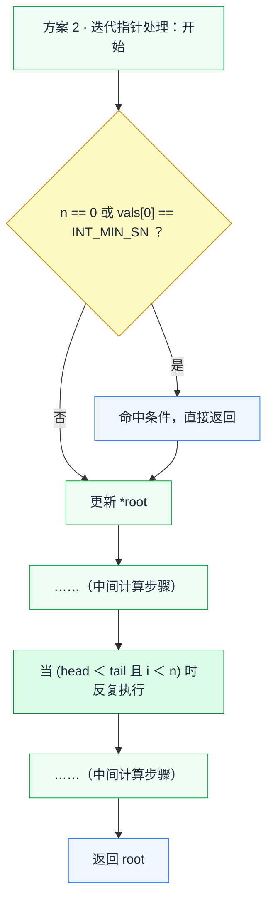

```c
/* LeetCode 700. 二叉搜索树中的搜索 — C 版（方案2） */
#include <stdio.h>                   // 引入头文件
#include <stdlib.h>                  // 引入头文件
#define INT_MIN_SN (-2147483647 - 1) // #define INT_MIN_SN ( 减 2147483647 减 1)

typedef struct TreeNode {   // typedef struct TreeNode {
    int val;                // int 值;
    struct TreeNode *left;  // 定义类型
    struct TreeNode *right; // 定义类型
} TreeNode;                 // } TreeNode;

static TreeNode *build_tree(const int *vals,
                            int n) { // static TreeNode 乘 build_tree(const int 乘 vals, int 元素个数) {
    if (n == 0 || vals[0] == INT_MIN_SN)
        return NULL; // 若 元素个数 等于 0 或 vals[0] 等于 INT_MIN_SN，直接返回 NULL
    TreeNode *root = malloc(sizeof(TreeNode)); // 把 malloc(sizeof(TreeNode)); 写入 TreeNode *root
    root->val = vals[0];
    root->left = root->right = NULL;
    TreeNode **queue =
        malloc(sizeof(TreeNode *) * n); // 把 malloc(sizeof(TreeNode 乘 ) 乘 元素个数); 写入 TreeNode **queue
    int head = 0, tail = 0, i = 1; // 把 0, 尾节点 赋值为 0, 下标 i 赋值为 1 存入 头节点
    queue[tail++] = root;          // 把 根节点; 写入 queue[tail++]
    while (head < tail && i < n) { // 循环，直到不满足「头节点 小于 尾节点 且 下标 i 小于 元素个数」
        TreeNode *node = queue[head++];                // 把 队列[头节点 加一 ]; 写入 TreeNode *node
        if (i < n) {                                   // 若 下标 i 小于 元素个数
            if (vals[i] != INT_MIN_SN) {               // 若 vals[下标 i] 不等于 INT_MIN_SN
                node->left = malloc(sizeof(TreeNode)); // 把 malloc(sizeof(TreeNode)); 写入 node->left
                node->left->val = vals[i];
                node->left->left = node->left->right = NULL;
                queue[tail++] = node->left; // 把 节点 减 超过 左边界; 写入 queue[tail++]
            }
            i++; // 下标 i 加一
        }
        if (i < n) {                                    // 若 下标 i 小于 元素个数
            if (vals[i] != INT_MIN_SN) {                // 若 vals[下标 i] 不等于 INT_MIN_SN
                node->right = malloc(sizeof(TreeNode)); // 把 malloc(sizeof(TreeNode)); 写入 node->right
                node->right->val = vals[i];
                node->right->left = node->right->right = NULL;
                queue[tail++] = node->right; // 把 节点 减 超过 右边界; 写入 queue[tail++]
            }
            i++; // 下标 i 加一
        }
    }
    free(queue); // free(队列);
    return root; // 返回 根节点
}

static void free_tree(TreeNode *n) { // 定义函数/方法 free_tree
    if (!n)
        return;          // 若 取反 元素个数) return;
    free_tree(n->left);  // free_tree(元素个数 减 超过 左边界);
    free_tree(n->right); // free_tree(元素个数 减 超过 右边界);
    free(n);             // free(元素个数);
}

static TreeNode *search_bst(TreeNode *root,
                            int val) { // static TreeNode 乘 search_bst(TreeNode 乘 根节点, int 值) {
    TreeNode *cur = root;              // 把 根节点; 写入 TreeNode *cur
    while (cur) {                      // 循环，直到不满足「当前值」
        if (cur->val == val)
            return cur; // 若 当前值 减 超过 值 等于 值，直接返回 当前值
        else if (cur->val > val)
            cur = cur->left; // 否则，若 当前值 减 超过 值 超过 值) 当前值 赋值为 当前值 减 超过 左边界;
        else
            cur = cur->right; // 否则
    }
    return NULL; // 返回 NULL
}
int main(void) {                       // 程序入口：跑内嵌自测用例
    int vals[] = {4, 2, 7, 1, 3};      // 把 {4,2,7,1,3}; 写入 int vals[]
    TreeNode *t = build_tree(vals, 5); // 把 build_tree(vals, 5); 写入 TreeNode *t
    if (search_bst(t, 2)->val != 2) {
        printf("FAIL 1\n");
        return 1;
    }
    if (search_bst(t, 5) != NULL) {
        printf("FAIL 2\n");
        return 1;
    } // 若 search_bst(另一字符串, 5) 不等于 NULL) { 输出「FAIL 2 」); return 1; }
    if (search_bst(t, 4)->val != 4) {
        printf("FAIL 3\n");
        return 1;
    }
    if (search_bst(NULL, 1) != NULL) {
        printf("FAIL 4\n");
        return 1;
    }                 // 若 search_bst(NULL, 1) 不等于 NULL) { 输出「FAIL 4 」); return 1; }
    free_tree(t);     // free_tree(另一字符串);
    printf("PASS\n"); // 全部用例通过，输出 PASS
    return 0;         // 返回 0
}
```

### C++ 实现（2 种方案）

C++ 的全部方案如下，每个方案都内嵌用例自测，可独立运行（老仓库 python/go 文件遵循「打印结果」约定）：

#### 方案 1：迭代指针处理

**思路与代码分析**：核心是「迭代指针处理」。C++ 版用 STL 容器与迭代器，减少手写下标错误。**走读**：方案 1 · 迭代指针处理：开始 → 更新 *cur → 当 (cur) 时反复执行 → 命中条件，直接返回 → 更新 cur → 更新 cur → 返回 nullptr。

**运行架构**（真实控制流）：


```cpp
// LeetCode 700. 二叉搜索树中的搜索 — C++ 版（方案1）
#include <cassert>  // 引入头文件
#include <cstdint>  // 引入头文件
#include <iostream> // 引入头文件
#include <optional> // 引入头文件
#include <queue>    // 引入头文件
#include <vector>   // 引入头文件

struct TreeNode {    // 定义类型
    int val;         // int 值;
    TreeNode *left;  // TreeNode 乘 左边界;
    TreeNode *right; // TreeNode 乘 右边界;
    explicit TreeNode(int v) : val(v), left(nullptr), right(nullptr) {}
};

static TreeNode *build_tree(const std::vector<std::optional<int>> &vals) {
    if (vals.empty() || !vals[0].has_value())
        return nullptr; // 若 vals 是否为空 或 取反 vals[0].has_value()，直接返回 nullptr
    auto *root = new TreeNode(*vals[0]); // 把 new TreeNode( 乘 vals[0]); 写入 auto *root
    std::queue<TreeNode *> q;            // std::队列 小于 TreeNode 乘 超过 节点;
    q.push(root);                        // 把 根节点 压入栈/数组尾部
    size_t i = 1;                        // 把 1; 写入 size_t i
    while (!q.empty() &&
           i < vals.size()) { // 循环，直到不满足「取反 节点 是否为空 且 下标 i 小于 vals.大小(」
        TreeNode *node = q.front();                  // 把 节点.front(); 写入 TreeNode *node
        q.pop();                                     // 弹出栈顶元素
        if (i < vals.size()) {                       // 若 下标 i 小于 vals.大小(
            if (vals[i].has_value()) {               // 若 vals[下标 i].has_value(
                node->left = new TreeNode(*vals[i]); // 把 new TreeNode( 乘 vals[下标 i]); 写入 node->left
                q.push(node->left);                  // 把 节点 减 超过 左边界 压入栈/数组尾部
            }
            ++i; // 加一 下标 i;
        }
        if (i < vals.size()) {                        // 若 下标 i 小于 vals.大小(
            if (vals[i].has_value()) {                // 若 vals[下标 i].has_value(
                node->right = new TreeNode(*vals[i]); // 把 new TreeNode( 乘 vals[下标 i]); 写入 node->right
                q.push(node->right); // 把 节点 减 超过 右边界 压入栈/数组尾部
            }
            ++i; // 加一 下标 i;
        }
    }
    return root; // 返回 根节点
}

static void free_tree(TreeNode *n) { // 定义函数/方法 free_tree
    if (!n)
        return;          // 若 取反 元素个数) return;
    free_tree(n->left);  // free_tree(元素个数 减 超过 左边界);
    free_tree(n->right); // free_tree(元素个数 减 超过 右边界);
    delete n;            // delete 元素个数;
}

static TreeNode *searchBST(TreeNode *root,
                           int val) { // static TreeNode 乘 searchBST(TreeNode 乘 根节点, int 值) {
    TreeNode *cur = root;             // 把 根节点; 写入 TreeNode *cur
    while (cur) {                     // 循环，直到不满足「当前值」
        if (cur->val == val)
            return cur; // 若 当前值 减 超过 值 等于 值，直接返回 当前值
        else if (cur->val > val)
            cur = cur->left; // 否则，若 当前值 减 超过 值 超过 值) 当前值 赋值为 当前值 减 超过 左边界;
        else
            cur = cur->right; // 否则
    }
    return nullptr; // 返回 nullptr
}
int main() {                               // 程序入口：跑内嵌自测用例
    auto *t = build_tree({4, 2, 7, 1, 3}); // 把 build_tree({4, 2, 7, 1, 3}); 写入 auto *t
    assert(searchBST(t, 2) != nullptr && searchBST(t, 2)->val == 2); // 断言校验
    assert(searchBST(t, 5) == nullptr);                              // 断言校验
    assert(searchBST(t, 4)->val == 4);                               // 断言校验
    assert(searchBST(nullptr, 1) == nullptr);                        // 断言校验
    free_tree(t);                                                    // free_tree(另一字符串);
    std::cout << "PASS" << std::endl;                                // 全部用例通过，输出 PASS
    return 0;                                                        // 返回 0
}
```

#### 方案 2：迭代指针处理

**思路与代码分析**：核心是「迭代指针处理」。C++ 版用 STL 容器与迭代器，减少手写下标错误。**走读**：方案 2 · 迭代指针处理：开始 → 更新 *cur → 当 (cur) 时反复执行 → 命中条件，直接返回 → 更新 cur → 更新 cur → 返回 nullptr。

**运行架构**（真实控制流）：

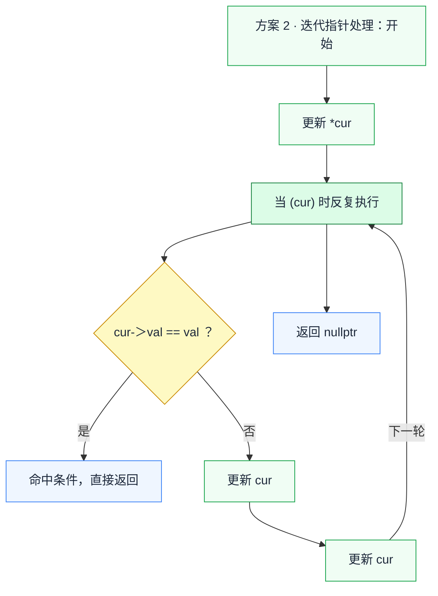

```cpp
// LeetCode 700. 二叉搜索树中的搜索 — C++ 版（方案2）
#include <cassert>  // 引入头文件
#include <cstdint>  // 引入头文件
#include <iostream> // 引入头文件
#include <optional> // 引入头文件
#include <queue>    // 引入头文件
#include <vector>   // 引入头文件

struct TreeNode {    // 定义类型
    int val;         // int 值;
    TreeNode *left;  // TreeNode 乘 左边界;
    TreeNode *right; // TreeNode 乘 右边界;
    explicit TreeNode(int v) : val(v), left(nullptr), right(nullptr) {}
};

static TreeNode *build_tree(const std::vector<std::optional<int>> &vals) {
    if (vals.empty() || !vals[0].has_value())
        return nullptr; // 若 vals 是否为空 或 取反 vals[0].has_value()，直接返回 nullptr
    auto *root = new TreeNode(*vals[0]); // 把 new TreeNode( 乘 vals[0]); 写入 auto *root
    std::queue<TreeNode *> q;            // std::队列 小于 TreeNode 乘 超过 节点;
    q.push(root);                        // 把 根节点 压入栈/数组尾部
    size_t i = 1;                        // 把 1; 写入 size_t i
    while (!q.empty() &&
           i < vals.size()) { // 循环，直到不满足「取反 节点 是否为空 且 下标 i 小于 vals.大小(」
        TreeNode *node = q.front();                  // 把 节点.front(); 写入 TreeNode *node
        q.pop();                                     // 弹出栈顶元素
        if (i < vals.size()) {                       // 若 下标 i 小于 vals.大小(
            if (vals[i].has_value()) {               // 若 vals[下标 i].has_value(
                node->left = new TreeNode(*vals[i]); // 把 new TreeNode( 乘 vals[下标 i]); 写入 node->left
                q.push(node->left);                  // 把 节点 减 超过 左边界 压入栈/数组尾部
            }
            ++i; // 加一 下标 i;
        }
        if (i < vals.size()) {                        // 若 下标 i 小于 vals.大小(
            if (vals[i].has_value()) {                // 若 vals[下标 i].has_value(
                node->right = new TreeNode(*vals[i]); // 把 new TreeNode( 乘 vals[下标 i]); 写入 node->right
                q.push(node->right); // 把 节点 减 超过 右边界 压入栈/数组尾部
            }
            ++i; // 加一 下标 i;
        }
    }
    return root; // 返回 根节点
}

static void free_tree(TreeNode *n) { // 定义函数/方法 free_tree
    if (!n)
        return;          // 若 取反 元素个数) return;
    free_tree(n->left);  // free_tree(元素个数 减 超过 左边界);
    free_tree(n->right); // free_tree(元素个数 减 超过 右边界);
    delete n;            // delete 元素个数;
}

static TreeNode *searchBST(TreeNode *root,
                           int val) { // static TreeNode 乘 searchBST(TreeNode 乘 根节点, int 值) {
    TreeNode *cur = root;             // 把 根节点; 写入 TreeNode *cur
    while (cur) {                     // 循环，直到不满足「当前值」
        if (cur->val == val)
            return cur; // 若 当前值 减 超过 值 等于 值，直接返回 当前值
        else if (cur->val > val)
            cur = cur->left; // 否则，若 当前值 减 超过 值 超过 值) 当前值 赋值为 当前值 减 超过 左边界;
        else
            cur = cur->right; // 否则
    }
    return nullptr; // 返回 nullptr
}
int main() {                               // 程序入口：跑内嵌自测用例
    auto *t = build_tree({4, 2, 7, 1, 3}); // 把 build_tree({4, 2, 7, 1, 3}); 写入 auto *t
    assert(searchBST(t, 2) != nullptr && searchBST(t, 2)->val == 2); // 断言校验
    assert(searchBST(t, 5) == nullptr);                              // 断言校验
    assert(searchBST(t, 4)->val == 4);                               // 断言校验
    assert(searchBST(nullptr, 1) == nullptr);                        // 断言校验
    free_tree(t);                                                    // free_tree(另一字符串);
    std::cout << "PASS" << std::endl;                                // 全部用例通过，输出 PASS
    return 0;                                                        // 返回 0
}
```

### R 实现（2 种方案）

R 的全部方案如下，每个方案都内嵌用例自测，可独立运行（老仓库 python/go 文件遵循「打印结果」约定）：

#### 方案 1：迭代指针处理

**思路与代码分析**：核心是「迭代指针处理」。R 版用向量化思维与 1 起始下标，注意 1:n 的降序陷阱。**走读**：方案 1 · 迭代指针处理：开始 → 更新 new.env(parent → 处理 e$val ＜- val → 处理 e$left ＜- left → 处理 e$right ＜- right → 调用 class(e) ＜- TreeNode → 处理 e → 返回结果。

**运行架构**（真实控制流）：

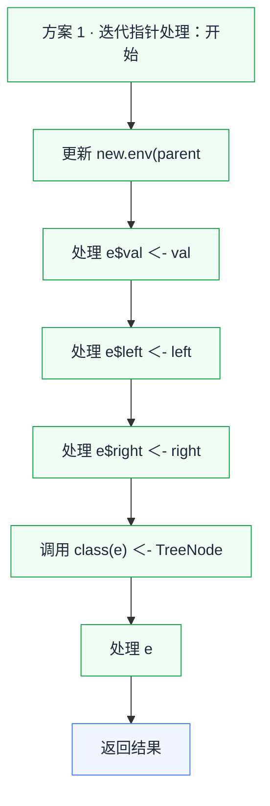

```r
# R 版（方案1） 树节点：R 必须 environment 引用语义（list 是值语义） 定义函数 TreeNode（参数：值, 左边界
# 赋值为 NULL, 右边界 赋值为 NULL）
TreeNode <- function(val, left = NULL, right = NULL) {
    e <- new.env(parent = emptyenv())  # 把 new.env(parent 赋值为 emptyenv()) 存入 e
    e$val <- val
    e$left <- left
    e$right <- right  # 把 值; e$左边界 小于 减 左边界; e$右边界 小于 减 右边界 存入 e$val
    class(e) <- "TreeNode"  # 把 「TreeNode」 存入 class(e)
    e
}
build_tree <- function(vals) {
    # 定义函数 build_tree（参数：vals）
    if (length(vals) == 0 || is.na(vals[[1]]))
        return(NULL)  # 若 长度(vals) 等于 0 或 is.na(vals[[1]])) return(NULL
    root <- TreeNode(vals[[1]])  # 把 TreeNode(vals[[1]]) 存入 根节点
    queue <- list(root)  # 把 列表(根节点) 存入 队列
    head <- 1L  # 把 1L 存入 头节点
    i <- 2L  # 把 2L 存入 下标 i
    while (head <= length(queue) && i <= length(vals)) {
        # 循环，直到不满足「头节点 不超过 长度(队列) 且 下标 i 不超过 长度(vals」
        node <- queue[[head]]  # 把 队列[[头节点]] 存入 节点
        head <- head + 1L  # 把 头节点 加 1L 存入 头节点
        if (i <= length(vals)) {
            # 若 下标 i 不超过 长度(vals 若 取反 is.na(vals[[下标 i]]
            if (!is.na(vals[[i]])) {
                node$left <- TreeNode(vals[[i]])  # 把 TreeNode(vals[[下标 i]]) 存入 node$left
                queue[[length(queue) + 1L]] <- node$left  # 队列[[长度(队列) 加 1L]] 小于 减 节点$左边界
            }
            i <- i + 1L  # 把 下标 i 加 1L 存入 下标 i
        }
        if (i <= length(vals)) {
            # 若 下标 i 不超过 长度(vals 若 取反 is.na(vals[[下标 i]]
            if (!is.na(vals[[i]])) {
                node$right <- TreeNode(vals[[i]])  # 把 TreeNode(vals[[下标 i]]) 存入 node$right
                queue[[length(queue) + 1L]] <- node$right  # 队列[[长度(队列) 加 1L]] 小于 减 节点$右边界
            }
            i <- i + 1L  # 把 下标 i 加 1L 存入 下标 i
        }
    }
    root  # 根节点
}
# 层序转列表（用于断言输出） 定义函数 tree_to_levels（参数：根节点）
tree_to_levels <- function(root) {
    if (is.null(root))
        return(list())  # 若 is.null(根节点)) return(列表(
    res <- list()  # 把 列表() 存入 结果
    level <- list(root)  # 把 列表(根节点) 存入 level
    while (length(level) > 0) {
        # 循环，直到不满足「长度(level) 超过 0」
        vals <- list()
        nxt <- list()  # 把 列表(); nxt 小于 减 列表() 存入 vals
        for (nd in level) {
            # for (nd in level) {
            vals[[length(vals) + 1L]] <- nd$val  # vals[[长度(vals) 加 1L]] 小于 减 nd$值
            if (!is.null(nd$left))
                nxt[[length(nxt) + 1L]] <- nd$left  # 若 取反 is.null(nd$左边界)) nxt[[长度(nxt) 加 1L]] 小于 减 nd$左边界
            if (!is.null(nd$right))
                nxt[[length(nxt) + 1L]] <- nd$right  # 若 取反 is.null(nd$右边界)) nxt[[长度(nxt) 加 1L]] 小于 减 nd$右边界
        }
        res[[length(res) + 1L]] <- unlist(vals)  # 结果[[长度(结果) 加 1L]] 小于 减 unlist(vals)
        level <- nxt  # 把 nxt 存入 level
    }
    res  # 结果
}
search_bst <- function(root, val) {
    # 定义函数 search_bst（参数：根节点, 值）
    cur <- root  # 把 根节点 存入 当前值
    while (!is.null(cur)) {
        # 循环，直到不满足「取反 is.null(当前值」
        if (cur$val == val)
            return(cur$val)  # 若 当前值$值 等于 值) return(当前值$值
        if (cur$val > val)
            cur <- cur$left else cur <- cur$right  # 若 当前值$值 超过 值) 当前值 小于 减 当前值$左边界 else 当前值 小于 减 当前值$右边界
    }
    NULL  # NULL
}
t <- build_tree(list(4L, 2L, 7L, 1L, 3L))  # 把 build_tree(列表(4L, 2L, 7L, 1L, 3L)) 存入 另一字符串
stopifnot(search_bst(t, 2L) == 2L)  # 断言校验
stopifnot(is.null(search_bst(t, 5L)))  # 断言校验
stopifnot(search_bst(t, 4L) == 4L)  # 断言校验
stopifnot(is.null(search_bst(NULL, 1L)))  # 断言校验
cat("PASS\n")  # 全部用例通过，输出 PASS
```

#### 方案 2：迭代指针处理

**思路与代码分析**：核心是「迭代指针处理」。R 版用向量化思维与 1 起始下标，注意 1:n 的降序陷阱。**走读**：方案 2 · 迭代指针处理：开始 → 更新 new.env(parent → 处理 e$val ＜- val → 处理 e$left ＜- left → 处理 e$right ＜- right → 调用 class(e) ＜- TreeNode → 处理 e → 返回结果。

**运行架构**（真实控制流）：

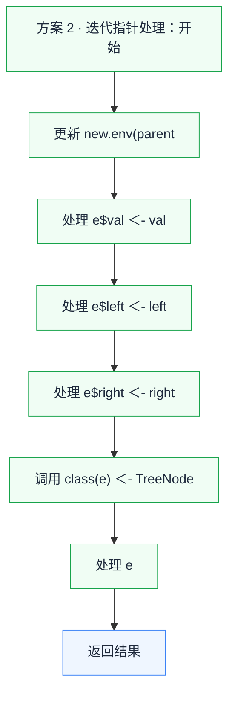

```r
# R 版（方案2） 树节点：R 必须 environment 引用语义（list 是值语义） 定义函数 TreeNode（参数：值, 左边界
# 赋值为 NULL, 右边界 赋值为 NULL）
TreeNode <- function(val, left = NULL, right = NULL) {
    e <- new.env(parent = emptyenv())  # 把 new.env(parent 赋值为 emptyenv()) 存入 e
    e$val <- val
    e$left <- left
    e$right <- right  # 把 值; e$左边界 小于 减 左边界; e$右边界 小于 减 右边界 存入 e$val
    class(e) <- "TreeNode"  # 把 「TreeNode」 存入 class(e)
    e
}
build_tree <- function(vals) {
    # 定义函数 build_tree（参数：vals）
    if (length(vals) == 0 || is.na(vals[[1]]))
        return(NULL)  # 若 长度(vals) 等于 0 或 is.na(vals[[1]])) return(NULL
    root <- TreeNode(vals[[1]])  # 把 TreeNode(vals[[1]]) 存入 根节点
    queue <- list(root)  # 把 列表(根节点) 存入 队列
    head <- 1L  # 把 1L 存入 头节点
    i <- 2L  # 把 2L 存入 下标 i
    while (head <= length(queue) && i <= length(vals)) {
        # 循环，直到不满足「头节点 不超过 长度(队列) 且 下标 i 不超过 长度(vals」
        node <- queue[[head]]  # 把 队列[[头节点]] 存入 节点
        head <- head + 1L  # 把 头节点 加 1L 存入 头节点
        if (i <= length(vals)) {
            # 若 下标 i 不超过 长度(vals 若 取反 is.na(vals[[下标 i]]
            if (!is.na(vals[[i]])) {
                node$left <- TreeNode(vals[[i]])  # 把 TreeNode(vals[[下标 i]]) 存入 node$left
                queue[[length(queue) + 1L]] <- node$left  # 队列[[长度(队列) 加 1L]] 小于 减 节点$左边界
            }
            i <- i + 1L  # 把 下标 i 加 1L 存入 下标 i
        }
        if (i <= length(vals)) {
            # 若 下标 i 不超过 长度(vals 若 取反 is.na(vals[[下标 i]]
            if (!is.na(vals[[i]])) {
                node$right <- TreeNode(vals[[i]])  # 把 TreeNode(vals[[下标 i]]) 存入 node$right
                queue[[length(queue) + 1L]] <- node$right  # 队列[[长度(队列) 加 1L]] 小于 减 节点$右边界
            }
            i <- i + 1L  # 把 下标 i 加 1L 存入 下标 i
        }
    }
    root  # 根节点
}
# 层序转列表（用于断言输出） 定义函数 tree_to_levels（参数：根节点）
tree_to_levels <- function(root) {
    if (is.null(root))
        return(list())  # 若 is.null(根节点)) return(列表(
    res <- list()  # 把 列表() 存入 结果
    level <- list(root)  # 把 列表(根节点) 存入 level
    while (length(level) > 0) {
        # 循环，直到不满足「长度(level) 超过 0」
        vals <- list()
        nxt <- list()  # 把 列表(); nxt 小于 减 列表() 存入 vals
        for (nd in level) {
            # for (nd in level) {
            vals[[length(vals) + 1L]] <- nd$val  # vals[[长度(vals) 加 1L]] 小于 减 nd$值
            if (!is.null(nd$left))
                nxt[[length(nxt) + 1L]] <- nd$left  # 若 取反 is.null(nd$左边界)) nxt[[长度(nxt) 加 1L]] 小于 减 nd$左边界
            if (!is.null(nd$right))
                nxt[[length(nxt) + 1L]] <- nd$right  # 若 取反 is.null(nd$右边界)) nxt[[长度(nxt) 加 1L]] 小于 减 nd$右边界
        }
        res[[length(res) + 1L]] <- unlist(vals)  # 结果[[长度(结果) 加 1L]] 小于 减 unlist(vals)
        level <- nxt  # 把 nxt 存入 level
    }
    res  # 结果
}
search_bst <- function(root, val) {
    # 定义函数 search_bst（参数：根节点, 值）
    cur <- root  # 把 根节点 存入 当前值
    while (!is.null(cur)) {
        # 循环，直到不满足「取反 is.null(当前值」
        if (cur$val == val)
            return(cur$val)  # 若 当前值$值 等于 值) return(当前值$值
        if (cur$val > val)
            cur <- cur$left else cur <- cur$right  # 若 当前值$值 超过 值) 当前值 小于 减 当前值$左边界 else 当前值 小于 减 当前值$右边界
    }
    NULL  # NULL
}
t <- build_tree(list(4L, 2L, 7L, 1L, 3L))  # 把 build_tree(列表(4L, 2L, 7L, 1L, 3L)) 存入 另一字符串
stopifnot(search_bst(t, 2L) == 2L)  # 断言校验
stopifnot(is.null(search_bst(t, 5L)))  # 断言校验
stopifnot(search_bst(t, 4L) == 4L)  # 断言校验
stopifnot(is.null(search_bst(NULL, 1L)))  # 断言校验
cat("PASS\n")  # 全部用例通过，输出 PASS
```

### Zig 实现（2 种方案）

Zig 的全部方案如下，每个方案都内嵌用例自测，可独立运行（老仓库 python/go 文件遵循「打印结果」约定）：

#### 方案 1：迭代指针处理

**思路与代码分析**：核心是「迭代指针处理」。Zig 版显式分配与清零，整型边界处理严格。**走读**：方案 1 · 迭代指针处理：开始 → 计算 cur → 当 (cur) ｜node｜ 时反复执行 → 命中条件，直接返回 → 更新 cur → 返回 null。

**运行架构**（真实控制流）：

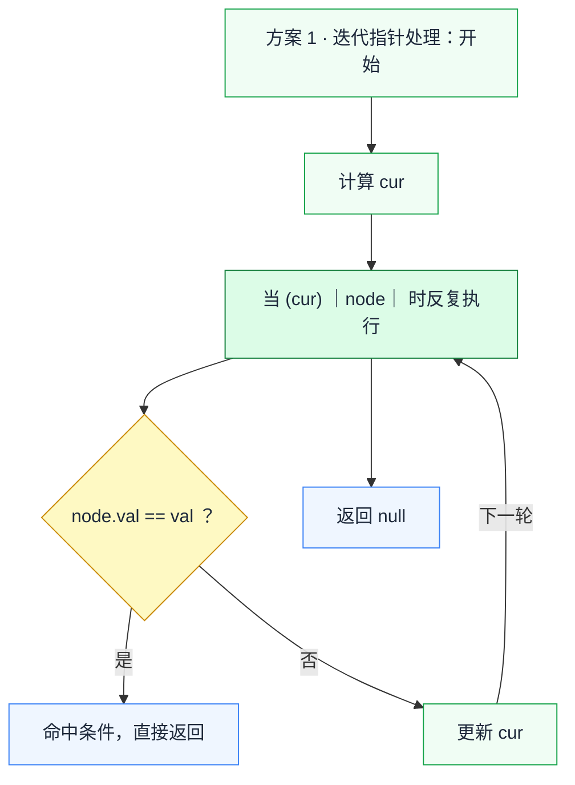

```zig
// LeetCode 700. 二叉搜索树中的搜索 — Zig 版（方案1）
const std = @import("std"); // 把 @import(「std」) 存入 std

const TreeNode = struct { // 把 struct { 存入 TreeNode
    val: i32,
    left: ?*TreeNode,
    right: ?*TreeNode,
};

fn buildTree(allocator: std.mem.Allocator, vals: []const i32) !?*TreeNode { // 定义函数/方法 buildTree
    if (vals.len == 0 or vals[0] == -1) return null; // 若 vals.长度 等于 0 or vals[0] 等于 减 1，直接返回 null
    const root = try allocator.create(TreeNode); // 把 try allocator.create(TreeNode) 存入 根节点
    root.* = .{ .val = vals[0], .left = null, .right = null };
    var queue = std.ArrayList(*TreeNode).init(allocator); // 把 std.ArrayList( 乘 TreeNode).init(allocator) 存入 队列
    defer queue.deinit(); // defer 队列.deinit();
    try queue.append(root); // 把 根节点 追加到列表尾部
    var head: usize = 0; // 把 0; 写入 var head: usize
    var i: usize = 1; // 把 1; 写入 var i: usize
    while (head < queue.items.len and i < vals.len) { // 循环，直到不满足「头节点 小于 队列.items.长度 and 下标 i 小于 vals.长度」
        const node = queue.items[head]; // 把 队列.items[头节点] 存入 节点
        head += 1; // 头节点累加 1
        if (i < vals.len) { // 若 下标 i 小于 vals.长度
            if (vals[i] != -1) { // 若 vals[下标 i] 不等于 减 1
                const child = try allocator.create(TreeNode); // 把 try allocator.create(TreeNode) 存入 子节点
                child.* = .{ .val = vals[i], .left = null, .right = null };
                node.left = child; // 把 子节点; 写入 左边界
                try queue.append(child); // 把 子节点 追加到列表尾部
            }
            i += 1; // 下标 i累加 1
        }
        if (i < vals.len) { // 若 下标 i 小于 vals.长度
            if (vals[i] != -1) { // 若 vals[下标 i] 不等于 减 1
                const child = try allocator.create(TreeNode); // 把 try allocator.create(TreeNode) 存入 子节点
                child.* = .{ .val = vals[i], .left = null, .right = null };
                node.right = child; // 把 子节点; 写入 右边界
                try queue.append(child); // 把 子节点 追加到列表尾部
            }
            i += 1; // 下标 i累加 1
        }
    }
    return root; // 返回 根节点
}

fn searchBST(root: ?*TreeNode, val: i32) ?i32 { // 定义函数/方法 searchBST
    var cur = root; // 把 根节点 存入 当前值
    while (cur) |node| { // 循环，直到不满足「当前值) 按位或 节点 按位或」
        if (node.val == val) return node.val; // 若 节点.值 等于 值，直接返回 节点.值
        cur = if (node.val > val) node.left else node.right; // 把 if (节点.值 超过 值) 节点.左边界 else 节点.右边界; 写入 当前值
    }
    return null; // 返回 null
}
pub fn main() !void { // 程序入口：跑内嵌自测用例
    var arena = std.heap.ArenaAllocator.init(std.heap.page_allocator); // 把 std.堆.ArenaAllocator.init(std.堆.page_allocator) 存入 arena
    defer arena.deinit(); // defer arena.deinit();
    const t = try buildTree(arena.allocator(), &[_]i32{ 4, 2, 7, 1, 3 });
    if (searchBST(t, 2) != 2) return error.TestFailed; // 若 searchBST(另一字符串, 2) 不等于 2，直接返回 error.TestFailed
    if (searchBST(t, 5) != null) return error.TestFailed; // 若 searchBST(另一字符串, 5) 不等于 null，直接返回 error.TestFailed
    if (searchBST(t, 4) != 4) return error.TestFailed; // 若 searchBST(另一字符串, 4) 不等于 4，直接返回 error.TestFailed
    if (searchBST(null, 1) != null) return error.TestFailed; // 若 searchBST(null, 1) 不等于 null，直接返回 error.TestFailed
    std.debug.print("PASS\n", .{}); // 全部用例通过，输出 PASS
}
```

#### 方案 2：迭代指针处理

**思路与代码分析**：核心是「迭代指针处理」。Zig 版显式分配与清零，整型边界处理严格。**走读**：方案 2 · 迭代指针处理：开始 → 计算 cur → 当 (cur) ｜node｜ 时反复执行 → 命中条件，直接返回 → 更新 cur → 返回 null。

**运行架构**（真实控制流）：

```mermaid
graph TD
    N0["方案 2 · 迭代指针处理：开始"]
    N1["计算 cur"]
    N2["当 (cur) ｜node｜ 时反复执行"]
    N3{"node.val == val ？"}
    N4["命中条件，直接返回"]
    N5["更新 cur"]
    N6["返回 null"]
    N0 --> N1
    N1 --> N2
    N2 --> N3
    N3 -- 是 --> N4
    N3 -- 否 --> N5
    N5 -- 下一轮 --> N2
    N2 --> N6
    classDef n fill:#f0fdf4,stroke:#16a34a,color:#1e293b;
    classDef lp fill:#dcfce7,stroke:#15803d,color:#1e293b;
    classDef dc fill:#fef9c3,stroke:#ca8a04,color:#1e293b;
    classDef tm fill:#eff6ff,stroke:#3b82f6,color:#1e293b;
    class N0,N1,N5 n;
    class N2 lp;
    class N3 dc;
    class N4,N6 tm;
```

```zig
// LeetCode 700. 二叉搜索树中的搜索 — Zig 版（方案2）
const std = @import("std"); // 把 @import(「std」) 存入 std

const TreeNode = struct { // 把 struct { 存入 TreeNode
    val: i32,
    left: ?*TreeNode,
    right: ?*TreeNode,
};

fn buildTree(allocator: std.mem.Allocator, vals: []const i32) !?*TreeNode { // 定义函数/方法 buildTree
    if (vals.len == 0 or vals[0] == -1) return null; // 若 vals.长度 等于 0 or vals[0] 等于 减 1，直接返回 null
    const root = try allocator.create(TreeNode); // 把 try allocator.create(TreeNode) 存入 根节点
    root.* = .{ .val = vals[0], .left = null, .right = null };
    var queue = std.ArrayList(*TreeNode).init(allocator); // 把 std.ArrayList( 乘 TreeNode).init(allocator) 存入 队列
    defer queue.deinit(); // defer 队列.deinit();
    try queue.append(root); // 把 根节点 追加到列表尾部
    var head: usize = 0; // 把 0; 写入 var head: usize
    var i: usize = 1; // 把 1; 写入 var i: usize
    while (head < queue.items.len and i < vals.len) { // 循环，直到不满足「头节点 小于 队列.items.长度 and 下标 i 小于 vals.长度」
        const node = queue.items[head]; // 把 队列.items[头节点] 存入 节点
        head += 1; // 头节点累加 1
        if (i < vals.len) { // 若 下标 i 小于 vals.长度
            if (vals[i] != -1) { // 若 vals[下标 i] 不等于 减 1
                const child = try allocator.create(TreeNode); // 把 try allocator.create(TreeNode) 存入 子节点
                child.* = .{ .val = vals[i], .left = null, .right = null };
                node.left = child; // 把 子节点; 写入 左边界
                try queue.append(child); // 把 子节点 追加到列表尾部
            }
            i += 1; // 下标 i累加 1
        }
        if (i < vals.len) { // 若 下标 i 小于 vals.长度
            if (vals[i] != -1) { // 若 vals[下标 i] 不等于 减 1
                const child = try allocator.create(TreeNode); // 把 try allocator.create(TreeNode) 存入 子节点
                child.* = .{ .val = vals[i], .left = null, .right = null };
                node.right = child; // 把 子节点; 写入 右边界
                try queue.append(child); // 把 子节点 追加到列表尾部
            }
            i += 1; // 下标 i累加 1
        }
    }
    return root; // 返回 根节点
}

fn searchBST(root: ?*TreeNode, val: i32) ?i32 { // 定义函数/方法 searchBST
    var cur = root; // 把 根节点 存入 当前值
    while (cur) |node| { // 循环，直到不满足「当前值) 按位或 节点 按位或」
        if (node.val == val) return node.val; // 若 节点.值 等于 值，直接返回 节点.值
        cur = if (node.val > val) node.left else node.right; // 把 if (节点.值 超过 值) 节点.左边界 else 节点.右边界; 写入 当前值
    }
    return null; // 返回 null
}
pub fn main() !void { // 程序入口：跑内嵌自测用例
    var arena = std.heap.ArenaAllocator.init(std.heap.page_allocator); // 把 std.堆.ArenaAllocator.init(std.堆.page_allocator) 存入 arena
    defer arena.deinit(); // defer arena.deinit();
    const t = try buildTree(arena.allocator(), &[_]i32{ 4, 2, 7, 1, 3 });
    if (searchBST(t, 2) != 2) return error.TestFailed; // 若 searchBST(另一字符串, 2) 不等于 2，直接返回 error.TestFailed
    if (searchBST(t, 5) != null) return error.TestFailed; // 若 searchBST(另一字符串, 5) 不等于 null，直接返回 error.TestFailed
    if (searchBST(t, 4) != 4) return error.TestFailed; // 若 searchBST(另一字符串, 4) 不等于 4，直接返回 error.TestFailed
    if (searchBST(null, 1) != null) return error.TestFailed; // 若 searchBST(null, 1) 不等于 null，直接返回 error.TestFailed
    std.debug.print("PASS\n", .{}); // 全部用例通过，输出 PASS
}
```

### Dart 实现（2 种方案）

Dart 的全部方案如下，每个方案都内嵌用例自测，可独立运行（老仓库 python/go 文件遵循「打印结果」约定）：

#### 方案 1：迭代指针处理

**思路与代码分析**：核心是「迭代指针处理」。Dart 版用可空类型标注与集合方法，注意空安全。代码里依次做这些事：单循环线性扫描。**走读**：方案 1 · 迭代指针处理：开始 → 命中条件，直接返回 → 更新 res → 当 (level.isNotEmpty) 时反复执行 → 遍历循环 → 返回 res。

**运行架构**（真实控制流）：

```mermaid
graph TD
    N0["方案 1 · 迭代指针处理：开始"]
    N1{"root == null ？"}
    N2["命中条件，直接返回"]
    N3["更新 res"]
    D1["……（中间计算步骤）"]
    N5["当 (level.isNotEmpty) 时反复执行"]
    D2["……（中间计算步骤）"]
    N8["遍历循环"]
    D3["……（中间计算步骤）"]
    N16["返回 res"]
    N0 --> N1
    N1 -- 是 --> N2
    N1 -- 否 --> N3
    N5 --> N16
    N2 --> N3
    N3 --> D1
    D1 --> N5
    N5 --> D2
    D2 --> N8
    N8 --> D3
    D3 --> N16
    classDef n fill:#f0fdf4,stroke:#16a34a,color:#1e293b;
    classDef lp fill:#dcfce7,stroke:#15803d,color:#1e293b;
    classDef dc fill:#fef9c3,stroke:#ca8a04,color:#1e293b;
    classDef tm fill:#eff6ff,stroke:#3b82f6,color:#1e293b;
    class N0,N3,D1,D2,D3 n;
    class N5,N8 lp;
    class N1 dc;
    class N2,N16 tm;
```

```dart
// LeetCode 700. 二叉搜索树中的搜索 — Dart 版（方案1）
class TreeNode {
  // 定义类型
  int val; // int 值;
  TreeNode? left; // TreeNode? 左边界;
  TreeNode? right; // TreeNode? 右边界;
  TreeNode(this.val); // TreeNode(this.值);
}

TreeNode? buildTree(List<int?> vals) {
  // TreeNode? buildTree(List 小于 int? 超过 vals) {
  if (vals.isEmpty || vals[0] == null)
    return null; // 若 vals.isEmpty 或 vals[0] 等于 null，直接返回 null
  final root = TreeNode(vals[0]!); // 把 TreeNode(vals[0]取反 ) 存入 根节点
  final queue = <TreeNode>[root]; // 把 小于 TreeNode 超过 [根节点] 存入 队列
  var head = 0; // 把 0 存入 头节点
  var i = 1; // 把 1 存入 下标 i
  while (head < queue.length && i < vals.length) {
    // 循环，直到不满足「头节点 小于 队列.长度 且 下标 i 小于 vals.长度」
    final node = queue[head++]; // 把 队列[头节点 加一 ] 存入 节点
    if (i < vals.length) {
      // 若 下标 i 小于 vals.长度
      if (vals[i] != null) {
        // 若 vals[下标 i] 不等于 null
        node.left = TreeNode(vals[i]!); // 把 TreeNode(vals[下标 i]取反 ); 写入 左边界
        queue.add(node.left!); // 队列 追加 节点.左边界取反 );
      }
      i++; // 下标 i 加一
    }
    if (i < vals.length) {
      // 若 下标 i 小于 vals.长度
      if (vals[i] != null) {
        // 若 vals[下标 i] 不等于 null
        node.right = TreeNode(vals[i]!); // 把 TreeNode(vals[下标 i]取反 ); 写入 右边界
        queue.add(node.right!); // 队列 追加 节点.右边界取反 );
      }
      i++; // 下标 i 加一
    }
  }
  return root; // 返回 根节点
}

List<List<int>> treeToLevels(TreeNode? root) {
  // 定义函数/方法 treeToLevels
  if (root == null) return []; // 若 根节点 等于 null，直接返回 []
  final res = <List<int>>[]; // 把 小于 List 小于 int 超过 超过 [] 存入 结果
  var level = <TreeNode>[root]; // 把 小于 TreeNode 超过 [根节点] 存入 level
  while (level.isNotEmpty) {
    // 循环，直到不满足「level.isNotEmpty」
    final vals = <int>[]; // 把 小于 int 超过 [] 存入 vals
    final nxt = <TreeNode>[]; // 把 小于 TreeNode 超过 [] 存入 nxt
    for (final n in level) {
      // for (final 元素个数 in level) {
      vals.add(n.val); // vals 追加 元素个数.值);
      if (n.left != null)
        nxt.add(n.left!); // 若 元素个数.左边界 不等于 null) nxt 追加 元素个数.左边界取反 );
      if (n.right != null)
        nxt.add(n.right!); // 若 元素个数.右边界 不等于 null) nxt 追加 元素个数.右边界取反 );
    }
    res.add(vals); // 结果 追加 vals);
    level = nxt; // 把 nxt 存入 level
  }
  return res; // 返回 结果
}

int? searchBST(TreeNode? root, int val) {
  // int? searchBST(TreeNode? 根节点, int 值) {
  var cur = root; // 把 根节点 存入 当前值
  while (cur != null) {
    // 循环，直到不满足「当前值 不等于 null」
    if (cur.val == val) return cur.val; // 若 当前值.值 等于 值，直接返回 当前值.值
    cur = cur.val > val
        ? cur.left
        : cur.right; // 把 当前值.值 超过 值 ? 当前值.左边界 : 当前值.右边界 存入 当前值
  }
  return null; // 返回 null
}

void main() {
  // 程序入口：跑内嵌自测用例
  final t = buildTree([4, 2, 7, 1, 3]); // 把 buildTree([4, 2, 7, 1, 3]) 存入 另一字符串
  if (searchBST(t, 2) != 2)
    throw StateError(
      'c1',
    ); // 若 searchBST(另一字符串, 2) 不等于 2) throw StateError('c1');
  if (searchBST(t, 5) != null)
    throw StateError(
      'c2',
    ); // 若 searchBST(另一字符串, 5) 不等于 null) throw StateError('c2');
  if (searchBST(t, 4) != 4)
    throw StateError(
      'c3',
    ); // 若 searchBST(另一字符串, 4) 不等于 4) throw StateError('c3');
  if (searchBST(null, 1) != null)
    throw StateError(
      'c4',
    ); // 若 searchBST(null, 1) 不等于 null) throw StateError('c4');
  print('PASS'); // 全部用例通过，输出 PASS
}
```

#### 方案 2：迭代指针处理

**思路与代码分析**：核心是「迭代指针处理」。Dart 版用可空类型标注与集合方法，注意空安全。代码里依次做这些事：单循环线性扫描。**走读**：方案 2 · 迭代指针处理：开始 → 命中条件，直接返回 → 更新 res → 当 (level.isNotEmpty) 时反复执行 → 遍历循环 → 返回 res。

**运行架构**（真实控制流）：

```mermaid
graph TD
    N0["方案 2 · 迭代指针处理：开始"]
    N1{"root == null ？"}
    N2["命中条件，直接返回"]
    N3["更新 res"]
    D1["……（中间计算步骤）"]
    N5["当 (level.isNotEmpty) 时反复执行"]
    D2["……（中间计算步骤）"]
    N8["遍历循环"]
    D3["……（中间计算步骤）"]
    N16["返回 res"]
    N0 --> N1
    N1 -- 是 --> N2
    N1 -- 否 --> N3
    N5 --> N16
    N2 --> N3
    N3 --> D1
    D1 --> N5
    N5 --> D2
    D2 --> N8
    N8 --> D3
    D3 --> N16
    classDef n fill:#f0fdf4,stroke:#16a34a,color:#1e293b;
    classDef lp fill:#dcfce7,stroke:#15803d,color:#1e293b;
    classDef dc fill:#fef9c3,stroke:#ca8a04,color:#1e293b;
    classDef tm fill:#eff6ff,stroke:#3b82f6,color:#1e293b;
    class N0,N3,D1,D2,D3 n;
    class N5,N8 lp;
    class N1 dc;
    class N2,N16 tm;
```

```dart
// LeetCode 700. 二叉搜索树中的搜索 — Dart 版（方案2）
class TreeNode {
  // 定义类型
  int val; // int 值;
  TreeNode? left; // TreeNode? 左边界;
  TreeNode? right; // TreeNode? 右边界;
  TreeNode(this.val); // TreeNode(this.值);
}

TreeNode? buildTree(List<int?> vals) {
  // TreeNode? buildTree(List 小于 int? 超过 vals) {
  if (vals.isEmpty || vals[0] == null)
    return null; // 若 vals.isEmpty 或 vals[0] 等于 null，直接返回 null
  final root = TreeNode(vals[0]!); // 把 TreeNode(vals[0]取反 ) 存入 根节点
  final queue = <TreeNode>[root]; // 把 小于 TreeNode 超过 [根节点] 存入 队列
  var head = 0; // 把 0 存入 头节点
  var i = 1; // 把 1 存入 下标 i
  while (head < queue.length && i < vals.length) {
    // 循环，直到不满足「头节点 小于 队列.长度 且 下标 i 小于 vals.长度」
    final node = queue[head++]; // 把 队列[头节点 加一 ] 存入 节点
    if (i < vals.length) {
      // 若 下标 i 小于 vals.长度
      if (vals[i] != null) {
        // 若 vals[下标 i] 不等于 null
        node.left = TreeNode(vals[i]!); // 把 TreeNode(vals[下标 i]取反 ); 写入 左边界
        queue.add(node.left!); // 队列 追加 节点.左边界取反 );
      }
      i++; // 下标 i 加一
    }
    if (i < vals.length) {
      // 若 下标 i 小于 vals.长度
      if (vals[i] != null) {
        // 若 vals[下标 i] 不等于 null
        node.right = TreeNode(vals[i]!); // 把 TreeNode(vals[下标 i]取反 ); 写入 右边界
        queue.add(node.right!); // 队列 追加 节点.右边界取反 );
      }
      i++; // 下标 i 加一
    }
  }
  return root; // 返回 根节点
}

List<List<int>> treeToLevels(TreeNode? root) {
  // 定义函数/方法 treeToLevels
  if (root == null) return []; // 若 根节点 等于 null，直接返回 []
  final res = <List<int>>[]; // 把 小于 List 小于 int 超过 超过 [] 存入 结果
  var level = <TreeNode>[root]; // 把 小于 TreeNode 超过 [根节点] 存入 level
  while (level.isNotEmpty) {
    // 循环，直到不满足「level.isNotEmpty」
    final vals = <int>[]; // 把 小于 int 超过 [] 存入 vals
    final nxt = <TreeNode>[]; // 把 小于 TreeNode 超过 [] 存入 nxt
    for (final n in level) {
      // for (final 元素个数 in level) {
      vals.add(n.val); // vals 追加 元素个数.值);
      if (n.left != null)
        nxt.add(n.left!); // 若 元素个数.左边界 不等于 null) nxt 追加 元素个数.左边界取反 );
      if (n.right != null)
        nxt.add(n.right!); // 若 元素个数.右边界 不等于 null) nxt 追加 元素个数.右边界取反 );
    }
    res.add(vals); // 结果 追加 vals);
    level = nxt; // 把 nxt 存入 level
  }
  return res; // 返回 结果
}

int? searchBST(TreeNode? root, int val) {
  // int? searchBST(TreeNode? 根节点, int 值) {
  var cur = root; // 把 根节点 存入 当前值
  while (cur != null) {
    // 循环，直到不满足「当前值 不等于 null」
    if (cur.val == val) return cur.val; // 若 当前值.值 等于 值，直接返回 当前值.值
    cur = cur.val > val
        ? cur.left
        : cur.right; // 把 当前值.值 超过 值 ? 当前值.左边界 : 当前值.右边界 存入 当前值
  }
  return null; // 返回 null
}

void main() {
  // 程序入口：跑内嵌自测用例
  final t = buildTree([4, 2, 7, 1, 3]); // 把 buildTree([4, 2, 7, 1, 3]) 存入 另一字符串
  if (searchBST(t, 2) != 2)
    throw StateError(
      'c1',
    ); // 若 searchBST(另一字符串, 2) 不等于 2) throw StateError('c1');
  if (searchBST(t, 5) != null)
    throw StateError(
      'c2',
    ); // 若 searchBST(另一字符串, 5) 不等于 null) throw StateError('c2');
  if (searchBST(t, 4) != 4)
    throw StateError(
      'c3',
    ); // 若 searchBST(另一字符串, 4) 不等于 4) throw StateError('c3');
  if (searchBST(null, 1) != null)
    throw StateError(
      'c4',
    ); // 若 searchBST(null, 1) 不等于 null) throw StateError('c4');
  print('PASS'); // 全部用例通过，输出 PASS
}
```

---

## 内容总结

- **二叉搜索树中的搜索**（二叉树 · Medium）：共 2 个方案，主线思路「迭代指针处理」；时间 O(n)（单趟线性扫描）；动画演示DFS 点亮过程，附录给出 11 种语言 × 全部方案的可运行实现。
- 来源博客：[https://blog.csdn.net/tyro_java/article/details/145091703](https://blog.csdn.net/tyro_java/article/details/145091703)
- 导航：[📋 总目录](../) ｜ [← 138 最大二叉树](../138_最大二叉树/) ｜ [140 二叉搜索树中的插入操作 →](../140_二叉搜索树中的插入操作/)
