# 140 · 二叉搜索树中的插入操作（第六阶段 · 二叉树 · Medium）

> **难度**：⭐⭐ Medium ｜ **专题**：二叉树
> **学习定位**：第六阶段 · 二叉树第 140 篇 ｜ **解法数**：2
> **内容总结**：**二叉搜索树中的插入操作**（二叉树 · Medium）：共 2 个方案，主线思路「迭代指针处理」；时间 O(n)（单趟线性扫描）；动画演示DFS 点亮过程，附录给出 11 种语言 × 全部方案的可运行实现。

---

## 题目描述

给定二叉搜索树（BST）的根节点 `root` 和要插入树中的值 `value` ，将值插入二叉搜索树。 返回插入后二叉搜索树的根节点。 输入数据 保证 ，新值和原始二叉搜索树中的任意节点值都不同。

注意，可能存在多种有效的插入方式，只要树在插入后仍保持为二叉搜索树即可。 你可以返回 任意有效的结果 。

- 主函数签名：`function assertEq(actual: any, expected: any, msg: string = ''): void`

**用例（来自原题）**：

**示例 1**

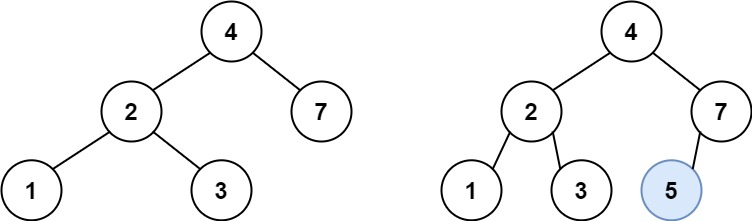

```text
输入：root = [4,2,7,1,3], val = 5
输出：[4,2,7,1,3,5]
```

解释：另一个满足题目要求可以通过的树是：

**示例 2**

```text
输入：root = [40,20,60,10,30,50,70], val = 25
输出：[40,20,60,10,30,50,70,null,null,25]
```

**示例 3**

```text
输入：root = [4,2,7,1,3,null,null,null,null,null,null], val = 5
输出：[4,2,7,1,3,5]
```
> ✅ **官方验证**：全部 TypeScript 解法已通过 leetcode.cn 官方示例用例验证（自动注入运行，全部 PASS）。题面与 [leetcode.cn 官方](https://leetcode.cn/problems/insert-into-a-binary-search-tree/)一致，示例配图取自官方题面。

**数据范围与注意事项**：

- `树中的节点数将在 `[0, 10^4]`的范围内。`
- `-10^8 <= Node.val <= 10^8`
- 所有值 `Node.val` 是 独一无二 的。
- `-10^8 <= val <= 10^8`
- 保证 `val` 在原始 BST 中不存在。
- **易错点**：递归出口（空节点）必须先写，否则直接空指针。

## 题目分析

**场景是什么**：树是分层数据的标准形态，这类题练的是递归分治与遍历序，对应真实开发里的目录树、组件树。本题就是该场景的 Medium 级练习，主线做法是「迭代指针处理」。

**主线怎么解**：把主解法从头到尾过一遍，它其实在依次做这几件事：队列或堆的调度。

## 解题思路

**方案对比**（共 2 个方案，由浅入深）：

| 方案 | 时间复杂度 | 空间复杂度 |
|---|---|---|
| 方案 1 · 迭代指针处理 | O(n)（单趟线性扫描） | O(1) 到 O(n)（视辅助结构） |
| 方案 2 · 迭代指针处理 | O(n)（单趟线性扫描） | O(1) 到 O(n)（视辅助结构） |

**方案间的取舍**：方案 1（迭代指针处理）；方案 2（迭代指针处理）。数据规模小、可读性优先时选靠前的方案；规模大、性能优先时选靠后的方案。

**怎么读这一篇**：

- 🐣 **新手路线**：把「题目描述」的示例 1 在纸上手推一遍 → 读方案 1（最直观的写法）与它的代码走读 → 按「运行方式」本地跑通看 PASS → 回头对比方案 2 之后的写法差在哪
- 🦅 **大佬路线**：直接锁定最优方案 1（迭代指针处理，O(n)（单趟线性扫描））→ 跳读该方案代码与走读 → 用「逐步拆解与面试追问」补齐复杂度推导与边界追问

### 动态算法图（DFS 点亮，GIF 自动循环）


动画演示二叉树专题里DFS 点亮的典型过程；每个方案在「TypeScript 解题方案」一节还配了专属动画与专属流程图。

### 主解法流程图（真实控制流）

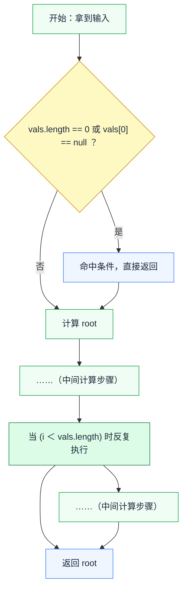

## TypeScript 解题方案（2 个方案逐个讲）

> **运行与提交**：每个方案都是自包含文件（内嵌用例自测，输出 PASS），整块复制到 `.ts` 文件后 `node 文件名` 即可运行。提交 LeetCode 时，把 `demo` 内的算法函数与辅助类型/函数整体取出、置于文件顶层即可。涉及交互/特殊接口的题以题面给定签名为准。

### 方案 1：迭代指针处理

**分析与思路**：核心做法是「迭代指针处理」。代码里依次做这些事：队列或堆的调度。

**运行方式**：`node 本文件`，内嵌用例全部通过会输出 PASS。


**方案专属流程图**（真实控制流）：


```typescript
class TreeNode {
  // 定义类型
  val: number;
  left: TreeNode | null;
  right: TreeNode | null; // 值: number; 左边界: TreeNode 按位或 null; 右边界: TreeNode 按位或 null;
  constructor(
    val: number,
    left: TreeNode | null = null,
    right: TreeNode | null = null,
  ) {
    this.val = val;
    this.left = left;
    this.right = right; // 把 值; this.左边界 赋值为 左边界; this.右边界 赋值为 右边界; 写入 值
  }
}
function buildTree(vals: (number | null)[]): TreeNode | null {
  // 定义函数/方法 buildTree
  if (vals.length === 0 || vals[0] === null) return null; // 若 vals.长度 全等于 0 或 vals[0] 全等于 null，直接返回 null
  const root = new TreeNode(vals[0] as number); // 把 new TreeNode(vals[0] as number) 存入 根节点
  const q: (TreeNode | null)[] = [root];
  let i = 1; // 把 [根节点]; let 下标 i 赋值为 1; 写入 const q: (TreeNode | null)[]
  while (i < vals.length) {
    // 循环，直到不满足「下标 i 小于 vals.长度」
    const node = q.shift() as TreeNode; // 把 节点.shift() as TreeNode 存入 节点
    if (i < vals.length && vals[i] !== null) {
      node.left = new TreeNode(vals[i] as number);
      q.push(node.left);
    }
    i++; // 下标 i 加一
    if (i < vals.length && vals[i] !== null) {
      node.right = new TreeNode(vals[i] as number);
      q.push(node.right);
    }
    i++; // 下标 i 加一
  }
  return root; // 返回 根节点
}

function assertEq(actual: any, expected: any, msg: string = ''): void {
  // 定义函数/方法 assertEq
  const a = JSON.stringify(actual);
  const e = JSON.stringify(expected);
  if (a !== e)
    throw new Error(
      'ASSERT FAILED ' + msg + ' :: actual=' + a + ' expected=' + e,
    );
}

function insertIntoBST(root: TreeNode | null, val: number): TreeNode {
  // 定义函数/方法 insertIntoBST
  if (root === null) return new TreeNode(val); // 若 根节点 全等于 null，直接返回 new TreeNode(值)
  let pos = root; // 把 根节点 存入 pos
  while (pos !== null) {
    // 循环，直到不满足「pos 不等于 null」
    if (val < pos.val) {
      // 若 值 小于 pos.值
      if (pos.left === null) {
        pos.left = new TreeNode(val);
        break;
      } // 若 pos.左边界 全等于 null) { pos.左边界 赋值为 new TreeNode(值); break; }
      else pos = pos.left; // 否则
    } else {
      // 否则
      if (pos.right === null) {
        pos.right = new TreeNode(val);
        break;
      } // 若 pos.右边界 全等于 null) { pos.右边界 赋值为 new TreeNode(值); break; }
      else pos = pos.right; // 否则
    }
  }
  return root; // 返回 根节点
}
function toList(root: TreeNode | null): number[] {
  // 定义函数/方法 toList
  const res: number[] = []; // 把 []; 写入 const res: number[]
  const stack: (TreeNode | null)[] = [root]; // 把 [根节点]; 写入 const stack: (TreeNode | null)[]
  while (stack.length) {
    // 循环，直到不满足「栈.长度」
    const node = stack.pop()!; // 把 栈 弹出 )取反 存入 节点
    if (node) {
      // 若 节点
      res.push(node.val); // 把 节点.值 压入栈/数组尾部
      if (node.right) stack.push(node.right); // 若 节点.右边界) 栈 追加 节点.右边界);
      if (node.left) stack.push(node.left); // 若 节点.左边界) 栈 追加 节点.左边界);
    }
  }
  return res; // 返回 结果
}
export function demo(): void {
  // 程序入口：跑内嵌自测用例
  const root = new TreeNode(
    4,
    new TreeNode(2, new TreeNode(1), new TreeNode(3)),
    new TreeNode(7),
  );
  assertEq(toList(insertIntoBST(root, 5)), [4, 2, 1, 3, 7, 5], 'insert'); // 断言校验
  const r2 = new TreeNode(
    4,
    new TreeNode(2, new TreeNode(1), new TreeNode(3)),
    new TreeNode(7),
  );
  assertEq(toList(insertIntoBST(r2, 5)), [4, 2, 1, 3, 7, 5], 'insert2'); // 断言校验
  console.log('PASS'); // 全部用例通过，输出 PASS
}
demo(); // demo();
```

### 方案 2：迭代指针处理

**分析与思路**：核心做法是「迭代指针处理」。代码里依次做这些事：队列或堆的调度。

**运行方式**：`node 本文件`，内嵌用例全部通过会输出 PASS。


**方案专属流程图**（真实控制流）：

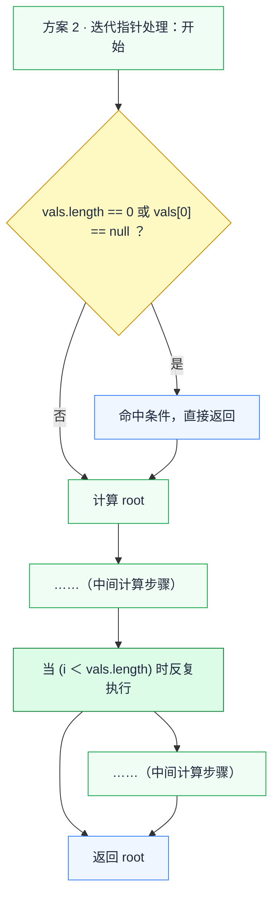

```typescript
class TreeNode {
  // 定义类型
  val: number;
  left: TreeNode | null;
  right: TreeNode | null; // 值: number; 左边界: TreeNode 按位或 null; 右边界: TreeNode 按位或 null;
  constructor(
    val: number,
    left: TreeNode | null = null,
    right: TreeNode | null = null,
  ) {
    this.val = val;
    this.left = left;
    this.right = right; // 把 值; this.左边界 赋值为 左边界; this.右边界 赋值为 右边界; 写入 值
  }
}
function buildTree(vals: (number | null)[]): TreeNode | null {
  // 定义函数/方法 buildTree
  if (vals.length === 0 || vals[0] === null) return null; // 若 vals.长度 全等于 0 或 vals[0] 全等于 null，直接返回 null
  const root = new TreeNode(vals[0] as number); // 把 new TreeNode(vals[0] as number) 存入 根节点
  const q: (TreeNode | null)[] = [root];
  let i = 1; // 把 [根节点]; let 下标 i 赋值为 1; 写入 const q: (TreeNode | null)[]
  while (i < vals.length) {
    // 循环，直到不满足「下标 i 小于 vals.长度」
    const node = q.shift() as TreeNode; // 把 节点.shift() as TreeNode 存入 节点
    if (i < vals.length && vals[i] !== null) {
      node.left = new TreeNode(vals[i] as number);
      q.push(node.left);
    }
    i++; // 下标 i 加一
    if (i < vals.length && vals[i] !== null) {
      node.right = new TreeNode(vals[i] as number);
      q.push(node.right);
    }
    i++; // 下标 i 加一
  }
  return root; // 返回 根节点
}
function inorder(root: TreeNode | null, out: number[] = []): number[] {
  // 定义函数/方法 inorder
  if (!root) return out; // 若 取反 根节点，直接返回 out
  inorder(root.left, out);
  out.push(root.val);
  inorder(root.right, out); // 把 根节点.值 压入栈/数组尾部
  return out; // 返回 out
}
function levelOrderBottom(root: TreeNode | null): number[][] {
  // 定义函数/方法 levelOrderBottom
  const res: number[][] = []; // 把 []; 写入 const res: number[][]
  if (!root) return res; // 若 取反 根节点，直接返回 结果
  let q: (TreeNode | null)[] = [root]; // 把 [根节点]; 写入 let q: (TreeNode | null)[]
  while (q.length) {
    // 循环，直到不满足「节点.长度」
    const level: number[] = [];
    const nxt: (TreeNode | null)[] = [];
    for (const node of q) {
      if (node) {
        level.push(node.val);
        if (node.left) nxt.push(node.left);
        if (node.right) nxt.push(node.right);
      }
    } // 把 节点.值 压入栈/数组尾部
    res.insert(0, level);
    q = nxt; // 把 nxt; 写入 res.insert(0, level); q
  }
  return res; // 返回 结果
}
function binaryTreePaths(root: TreeNode | null): string[] {
  // 定义函数/方法 binaryTreePaths
  const paths: string[] = []; // 把 []; 写入 const paths: string[]
  function dfs(node: TreeNode | null, path: string): void {
    // 定义函数/方法 dfs
    if (!node) return; // 若 取反 节点) return;
    path += String(node.val); // 当前路径累加 String(节点.值)
    if (!node.left && !node.right)
      paths.push(path); // 若 取反 节点.左边界 且 取反 节点.右边界) paths 追加 当前路径);
    else {
      path += '->';
      dfs(node.left, path);
      dfs(node.right, path);
    } // 否则
  }
  dfs(root, ''); // dfs(根节点, 「」);
  return paths; // 返回 paths
}
function averageOfLevels(root: TreeNode | null): number[] {
  // 定义函数/方法 averageOfLevels
  const result: number[] = []; // 把 []; 写入 const result: number[]
  let level: (TreeNode | null)[] = [root]; // 把 [根节点]; 写入 let level: (TreeNode | null)[]
  while (level.length) {
    // 循环，直到不满足「level.长度」
    let total = 0;
    const nxt: (TreeNode | null)[] = []; // 把 0; const nxt: (TreeNode 按位或 null)[] 赋值为 [] 存入 总和
    for (const node of level) {
      if (node) {
        total += node.val;
        if (node.left) nxt.push(node.left);
        if (node.right) nxt.push(node.right);
      }
    } // 把 节点.左边界 压入栈/数组尾部
    result.push(total / level.length); // 把 总和 除以 level.长度 压入栈/数组尾部
    level = nxt; // 把 nxt 存入 level
  }
  return result; // 返回 结果
}

function assertEq(actual: any, expected: any, msg: string = ''): void {
  // 定义函数/方法 assertEq
  const a = JSON.stringify(actual);
  const e = JSON.stringify(expected);
  if (a !== e)
    throw new Error(
      'ASSERT FAILED ' + msg + ' :: actual=' + a + ' expected=' + e,
    );
}

function insertIntoBST(root: TreeNode | null, val: number): TreeNode {
  // 定义函数/方法 insertIntoBST
  if (root === null) return new TreeNode(val); // 若 根节点 全等于 null，直接返回 new TreeNode(值)
  let pos = root; // 把 根节点 存入 pos
  while (pos !== null) {
    // 循环，直到不满足「pos 不等于 null」
    if (val < pos.val) {
      if (pos.left === null) {
        pos.left = new TreeNode(val);
        break;
      } else pos = pos.left;
    } else {
      if (pos.right === null) {
        pos.right = new TreeNode(val);
        break;
      } else pos = pos.right;
    } // 否则
  }
  return root; // 返回 根节点
}
function toList(root: TreeNode | null): number[] {
  // 定义函数/方法 toList
  const res: number[] = [];
  const st: (TreeNode | null)[] = [root];
  while (st.length) {
    const node = st.pop()!;
    if (node) {
      res.push(node.val);
      if (node.right) st.push(node.right);
      if (node.left) st.push(node.left);
    }
  }
  return res; // 返回 结果
}
export function demo(): void {
  // 程序入口：跑内嵌自测用例
  const root = new TreeNode(
    4,
    new TreeNode(2, new TreeNode(1), new TreeNode(3)),
    new TreeNode(7),
  );
  assertEq(toList(insertIntoBST(root, 5)), [4, 2, 1, 3, 7, 5], 'insert'); // 断言校验
  console.log('PASS'); // 全部用例通过，输出 PASS
}
demo(); // demo();
```

## 逐步拆解与面试追问

**复杂度**：时间 O(n)（单趟线性扫描），空间 O(1) 到 O(n)（视辅助结构）

**为什么是这个量级**：每个元素被常数次访问，辅助哈希或栈的开销与 n 同阶

**面试官可能会追问**：

- 递归和迭代写法各自的空间开销？
- 能否用层序统一处理？
- 空节点的边界如何约定？

## 关键 API 速查（TS 主解法实际用到，附官方链接）

| API | 作用 | 使用要点 | 官方文档 |
|---|---|---|---|
| `Array.prototype.push()` | 尾部追加 | 返回新长度；可一次多个；均摊 O(1)；会改变原数组 | [官方文档](https://developer.mozilla.org/zh-CN/docs/Web/JavaScript/Reference/Global_Objects/Array/push) |
| `Array.prototype.pop()` | 尾部弹出 | 返回被删元素（空数组返回 undefined）；O(1) | [官方文档](https://developer.mozilla.org/zh-CN/docs/Web/JavaScript/Reference/Global_Objects/Array/pop) |
| `Array.prototype.shift()` | 头部取出 | O(n)（后续元素整体前移）；大量头部操作请用链表或双端结构 | [官方文档](https://developer.mozilla.org/zh-CN/docs/Web/JavaScript/Reference/Global_Objects/Array/shift) |
| `JSON.stringify()` | 序列化为 JSON 字符串 | 常用于结构化比较（深度相等判定）；undefined/函数/循环引用会被丢弃或抛错 | [官方文档](https://developer.mozilla.org/zh-CN/docs/Web/JavaScript/Reference/Global_Objects/JSON/stringify) |

### 各语言官方文档导航

- **TypeScript / JS**：[MDN 中文参考](https://developer.mozilla.org/zh-CN/)
- **Python**：[Python 官方文档](https://docs.python.org/zh-cn/3/)
- **Go**：[Go 标准库](https://pkg.go.dev/std)
- **Java**：[JDK 17 API](https://docs.oracle.com/en/java/javase/17/docs/api/)
- **Rust**：[Rust 标准库](https://doc.rust-lang.org/std/)
- **Lua**：[Lua 5.4 手册](https://www.lua.org/manual/5.4/)
- **C**：[Cppreference C](https://zh.cppreference.com/w/c)
- **C++**：[Cppreference C++](https://zh.cppreference.com/w/cpp)
- **R**：[R 官方手册](https://stat.ethz.ch/R-manual/)
- **Zig**：[Zig 语言文档](https://ziglang.org/documentation/master/)
- **Dart**：[Dart API](https://api.dart.dev/)

## 附录：其他 10 种语言全部实现（每种语言列举其全部方案）

> TypeScript 的全部方案见「TypeScript 解题方案」一节；下面是其余 10 种语言的对应实现，每种语言的每个方案都带思路分析、代码走读与专属运行架构图。
> 每个方案都内嵌用例自测，可独立运行（老仓库 python/go 文件遵循「打印结果」约定）。
> 完整解法文件见 `dsa/<语言>/tree/lc_701_二叉搜索树中的插入操作/`。

### Python 实现（2 种方案）

Python 的全部方案如下，每个方案都内嵌用例自测，可独立运行（老仓库 python/go 文件遵循「打印结果」约定）：

#### 方案 1：迭代指针处理

**思路与代码分析**：核心是「迭代指针处理」。Python 版用切片与字典推导式简化操作，突出可读性。**走读**：方案 1 · 迭代指针处理：开始 → 命中条件，直接返回 → 更新 pos → 当 pos ≠ None: 时反复执行 → 若 val ＜ pos.val：处理 if pos.left == None: → 若 pos.left == None：更新 pos.left → 更新 pos.left → 跳出循环（break） → 更新 pos → 若 pos.right == None：更新 pos.right → 更新 pos.right → 跳出循环（break） → 更新 pos → 返回 root。

**运行架构**（真实控制流）：

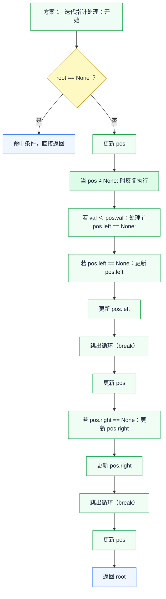

```python
import sys  # 提高递归深度上限（深输入防 RecursionError）

sys.setrecursionlimit(200000)  # 树/链表类题目节点数可达 1e4 量级

class TreeNode:  # 定义类
    def __init__(self, val=0, left=None, right=None):  # 构造函数：初始化成员
        self.val = val  # 把 值 写入 值
        self.left = left  # 把 左边界 写入 左边界
        self.right = right  # 把 右边界 写入 右边界

def insertIntoBST(root, val):  # 定义函数 insertIntoBST（参数：根节点, 值）
    if root == None:
        return TreeNode(val)  # 若 根节点 等于 None: return TreeNode(值
    pos = root  # 把 根节点 存入 pos
    while pos != None:  # 循环，直到不满足「pos 不等于 None」
        if val < pos.val:  # 若 值 小于 pos.值
            if pos.left == None:  # 若 pos.左边界 等于 None
                pos.left = TreeNode(val)  # 把 TreeNode(值) 写入 左边界
                break  # 跳出循环
            else:  # 否则
                pos = pos.left  # 把 pos.左边界 存入 pos
        else:  # 否则
            if pos.right == None:  # 若 pos.右边界 等于 None
                pos.right = TreeNode(val)  # 把 TreeNode(值) 写入 右边界
                break  # 跳出循环
            else:  # 否则
                pos = pos.right  # 把 pos.右边界 存入 pos
    return root  # 返回 根节点

def to_list(root):  # 定义函数 to_list（参数：根节点）
    res = []  # 把 [] 存入 结果
    stack = [root]  # 把 [根节点] 存入 栈
    while stack:  # 循环，直到不满足「栈」
        node = stack.pop()  # 把 栈 弹出 ) 存入 节点
        if node:  # 若 节点
            res.append(node.val)  # 把 节点.值 追加到列表尾部
            stack.append(node.right)  # 把 节点.右边界 追加到列表尾部
            stack.append(node.left)  # 把 节点.左边界 追加到列表尾部
    return res  # 返回 结果

if __name__ == "__main__":  # 若 __name__ 等于 '__main__'
    root = TreeNode(4, TreeNode(2, TreeNode(1), TreeNode(3)), TreeNode(7))
    print(to_list(insertIntoBST(root, 5)))  # 打印输出
```

#### 方案 2：迭代指针处理

**思路与代码分析**：核心是「迭代指针处理」。Python 版用切片与字典推导式简化操作，突出可读性。**走读**：方案 2 · 迭代指针处理：开始 → 命中条件，直接返回 → 若 val ＜ root.val：更新 root.left → 更新 root.left → 更新 root.right → 返回 root。

**运行架构**（真实控制流）：

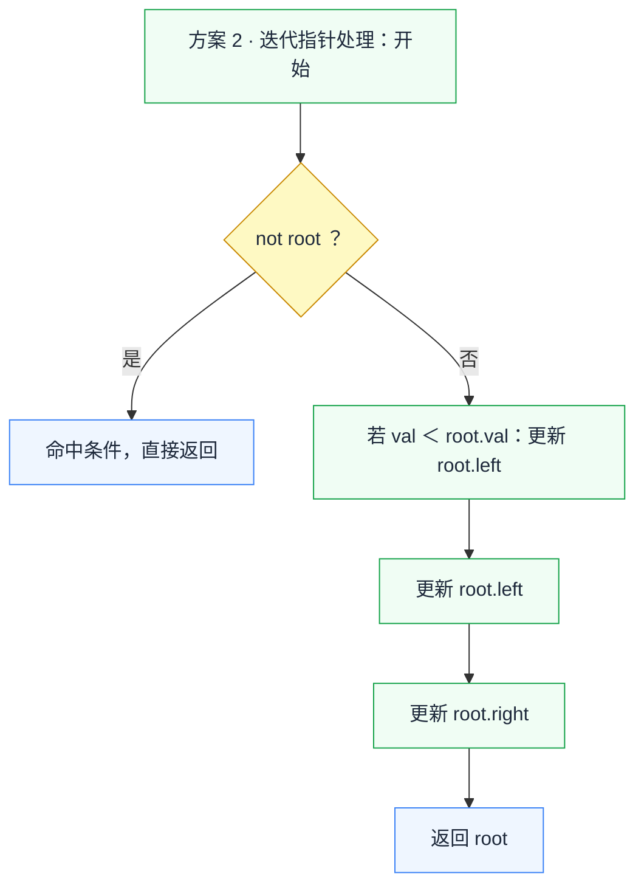

```python
import sys  # 提高递归深度上限（深输入防 RecursionError）

sys.setrecursionlimit(200000)  # 树/链表类题目节点数可达 1e4 量级

class TreeNode:  # 定义类
    def __init__(self, val=0, left=None, right=None):  # 构造函数：初始化成员
        self.val = val  # 把 值 写入 值
        self.left = left  # 把 左边界 写入 左边界
        self.right = right  # 把 右边界 写入 右边界

def insertIntoBST(root, val):  # 定义函数 insertIntoBST（参数：根节点, 值）
    if not root:
        return TreeNode(val)  # 若 not 根节点: return TreeNode(值
    if val < root.val:  # 若 值 小于 根节点.值
        root.left = insertIntoBST(root.left, val)  # 把 insertIntoBST(根节点.左边界, 值) 写入 左边界
    else:  # 否则
        root.right = insertIntoBST(root.right, val)  # 把 insertIntoBST(根节点.右边界, 值) 写入 右边界
    return root  # 返回 根节点

def to_list(root):  # 定义函数 to_list（参数：根节点）
    res = []  # 把 [] 存入 结果
    stack = [root]  # 把 [根节点] 存入 栈
    while stack:  # 循环，直到不满足「栈」
        node = stack.pop()  # 把 栈 弹出 ) 存入 节点
        if node:  # 若 节点
            res.append(node.val)  # 把 节点.值 追加到列表尾部
            stack.append(node.right)  # 把 节点.右边界 追加到列表尾部
            stack.append(node.left)  # 把 节点.左边界 追加到列表尾部
    return res  # 返回 结果

if __name__ == "__main__":  # 若 __name__ 等于 '__main__'
    root = TreeNode(4, TreeNode(2, TreeNode(1), TreeNode(3)), TreeNode(7))
    print(to_list(insertIntoBST(root, 5)))  # 打印输出
```

### Go 实现（2 种方案）

Go 的全部方案如下，每个方案都内嵌用例自测，可独立运行（老仓库 python/go 文件遵循「打印结果」约定）：

#### 方案 1：迭代指针处理

**思路与代码分析**：核心是「迭代指针处理」。Go 版用切片与多返回值惯用法，显式处理索引边界。**走读**：方案 1 · 迭代指针处理：开始 → 处理 if root == nil → 返回 &TreeNode → 更新 : → 遍历循环 → 处理 if val ＜ pos.Val → 处理 if pos.Left == nil → 更新 pos.Left → 跳出循环（break） → 更新 pos → 处理 if pos.Right == nil → 更新 pos.Right → 跳出循环（break） → 更新 pos → 返回 root。

**运行架构**（真实控制流）：

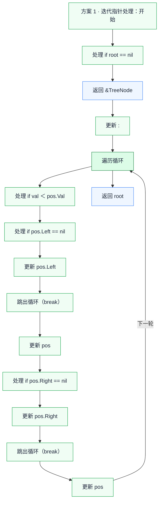

```go
package main // 引入依赖

import (
	"fmt"
	"os"
	"reflect"
) // 引入依赖

type TreeNode struct { // 定义类型
	Val   int       // Val int
	Left  *TreeNode // Left 乘 TreeNode
	Right *TreeNode // Right 乘 TreeNode
}

func insertIntoBST(root *TreeNode, val int) *TreeNode { // 定义函数/方法 insertIntoBST
	if root == nil { // 若 根节点 等于 nil
		return &TreeNode{Val: val} // 返回 按位与 TreeNode{Val: 值}
	}
	pos := root      // 把 根节点 写入 pos :
	for pos != nil { // 把 nil { 写入 for pos !
		if val < pos.Val { // 若 值 小于 pos.Val
			if pos.Left == nil { // 若 pos.Left 等于 nil
				pos.Left = &TreeNode{Val: val} // 把 按位与 TreeNode{Val: 值} 写入 pos.Left
				break                          // 跳出循环
			} else { // 否则
				pos = pos.Left // 把 pos.Left 写入 pos
			}
		} else { // 否则
			if pos.Right == nil { // 若 pos.Right 等于 nil
				pos.Right = &TreeNode{Val: val} // 把 按位与 TreeNode{Val: 值} 写入 pos.Right
				break                           // 跳出循环
			} else { // 否则
				pos = pos.Right // 把 pos.Right 写入 pos
			}
		}
	}
	return root // 返回 根节点
}

func toList(root *TreeNode) []int { // 定义函数/方法 toList
	res := []int{}             // 把 []int{} 写入 res :
	stack := []*TreeNode{root} // 把 [] 乘 TreeNode{根节点} 写入 stack :
	for len(stack) > 0 {       // for 长度(栈) 超过 0 {
		node := stack[len(stack)-1]  // 把 栈[长度(栈) 减 1] 写入 node :
		stack = stack[:len(stack)-1] // 把 栈[:长度(栈) 减 1] 写入 栈
		if node != nil {             // 若 节点 不等于 nil
			res = append(res, node.Val)       // 把 append(结果, 节点.Val) 写入 结果
			stack = append(stack, node.Right) // 把 append(栈, 节点.Right) 写入 栈
			stack = append(stack, node.Left)  // 把 append(栈, 节点.Left) 写入 栈
		}
	}
	return res // 返回 结果
}

func main() { // 程序入口：跑内嵌自测用例
	root1 := &TreeNode{4, &TreeNode{2, &TreeNode{1, nil, nil}, &TreeNode{3, nil, nil}}, &TreeNode{7, nil, nil}}
	got1 := toList(insertIntoBST(root1, 5)) // 把 toList(insertIntoBST(root1, 5)) 写入 got1 :
	want1 := []int{4, 2, 1, 3, 7, 5}        // 把 []int{4, 2, 1, 3, 7, 5} 写入 want1 :

	got2 := toList(insertIntoBST(nil, 5)) // 把 toList(insertIntoBST(nil, 5)) 写入 got2 :
	want2 := []int{5}                     // 把 []int{5} 写入 want2 :

	root3 := &TreeNode{40, &TreeNode{20, &TreeNode{10, nil, nil}, &TreeNode{30, nil, nil}}, &TreeNode{70, nil, nil}}
	got3 := toList(insertIntoBST(root3, 35)) // 把 toList(insertIntoBST(root3, 35)) 写入 got3 :
	want3 := []int{40, 20, 10, 30, 35, 70}   // 把 []int{40, 20, 10, 30, 35, 70} 写入 want3 :

	ok := true                           // 把 true 写入 ok :
	if !reflect.DeepEqual(got1, want1) { // 若 取反 reflect.DeepEqual(got1, want1
		ok = false                      // 把 false 写入 ok
		fmt.Println("FAIL case1", got1) // 打印输出
	}
	if !reflect.DeepEqual(got2, want2) { // 若 取反 reflect.DeepEqual(got2, want2
		ok = false                      // 把 false 写入 ok
		fmt.Println("FAIL case2", got2) // 打印输出
	}
	if !reflect.DeepEqual(got3, want3) { // 若 取反 reflect.DeepEqual(got3, want3
		ok = false                      // 把 false 写入 ok
		fmt.Println("FAIL case3", got3) // 打印输出
	}
	if !ok { // 若 取反 ok
		os.Exit(1) // os.Exit(1)
	}
	fmt.Println("PASS") // 全部用例通过，输出 PASS
}
```

#### 方案 2：迭代指针处理

**思路与代码分析**：核心是「迭代指针处理」。Go 版用切片与多返回值惯用法，显式处理索引边界。**走读**：方案 2 · 迭代指针处理：开始 → 处理 if root == nil → 返回 &TreeNode → 处理 if val ＜ root.Val → 更新 root.Left → 更新 root.Right → 返回 root。

**运行架构**（真实控制流）：

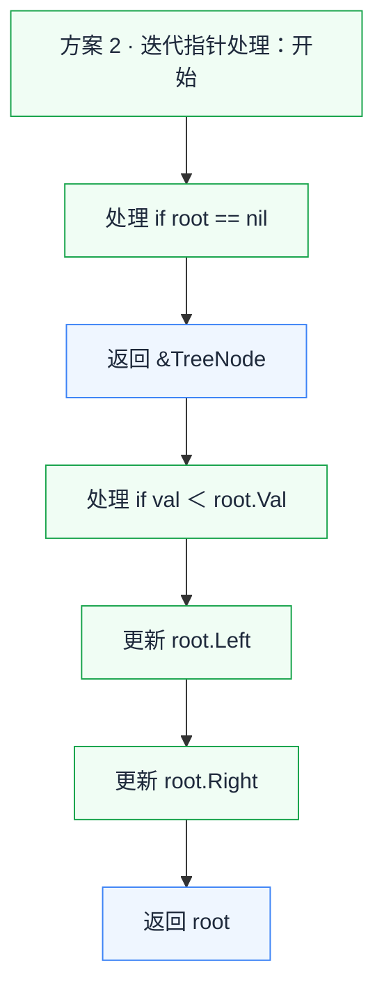

```go
package main // 引入依赖
import (
	"fmt"
	"os"
	"reflect"
) // 引入依赖
type TreeNode struct {
	Val   int
	Left  *TreeNode
	Right *TreeNode
}                        // 定义类型
const NULL = -1000000000 // 把 减 1000000000 存入 NULL
func buildTree(vals []int) *TreeNode { // 定义函数/方法 buildTree
	if len(vals) == 0 || vals[0] == NULL {
		return nil
	} // 若 长度(vals) 等于 0 或 vals[0] 等于 NULL { return nil }
	root := &TreeNode{Val: vals[0]} // 把 按位与 TreeNode{Val: vals[0]} 写入 root :
	q := []*TreeNode{root}
	i := 1                            // 把 [] 乘 TreeNode{根节点}; 下标 i : 赋值为 1 写入 q :
	for len(q) > 0 && i < len(vals) { // 定义函数/方法 len
		node := q[0]
		q = q[1:] // 把 节点[0]; 节点 赋值为 节点[1:] 写入 node :
		if i < len(vals) && vals[i] != NULL {
			node.Left = &TreeNode{Val: vals[i]}
			q = append(q, node.Left)
		}
		i++
		if i < len(vals) && vals[i] != NULL {
			node.Right = &TreeNode{Val: vals[i]}
			q = append(q, node.Right)
		}
		i++
	}
	return root // 返回 根节点
}
func levelList(root *TreeNode) [][]int { // 定义函数/方法 levelList
	if root == nil {
		return [][]int{}
	} // 若 根节点 等于 nil { return [][]int{} }
	res := [][]int{}
	q := []*TreeNode{root} // 把 [][]int{}; 节点 : 赋值为 [] 乘 TreeNode{根节点} 写入 res :
	for len(q) > 0 {       // for 长度(节点) 超过 0 {
		lvl := []int{}
		n := len(q)              // 把 []int{}; 元素个数 : 赋值为 长度(节点) 写入 lvl :
		for k := 0; k < n; k++ { // 让 下标 k 从 0 开始计数
			node := q[0]
			q = q[1:]                   // 把 节点[0]; 节点 赋值为 节点[1:] 写入 node :
			lvl = append(lvl, node.Val) // 把 append(lvl, 节点.Val) 写入 lvl
			if node.Left != nil {
				q = append(q, node.Left)
			} // 若 节点.Left 不等于 nil { 节点 赋值为 append(节点, 节点.Left) }
			if node.Right != nil {
				q = append(q, node.Right)
			} // 若 节点.Right 不等于 nil { 节点 赋值为 append(节点, 节点.Right) }
		}
		res = append(res, lvl) // 把 append(结果, lvl) 写入 结果
	}
	return res // 返回 结果
}
func sameTree(a, b *TreeNode) bool { // 定义函数/方法 sameTree
	if a == nil && b == nil {
		return true
	} // 若 数组 等于 nil 且 b 等于 nil { return true }
	if a == nil || b == nil {
		return false
	} // 若 数组 等于 nil 或 b 等于 nil { return false }
	if a.Val != b.Val {
		return false
	} // 若 数组.Val 不等于 b.Val { return false }
	return sameTree(a.Left, b.Left) && sameTree(a.Right, b.Right) // 定义函数/方法 sameTree
}
func inorderT(root *TreeNode) []int { // 定义函数/方法 inorderT
	if root == nil {
		return []int{}
	} // 若 根节点 等于 nil { return []int{} }
	return append(append(inorderT(root.Left), root.Val), inorderT(root.Right)...) // 定义函数/方法 append
}
func insertIntoBST(root *TreeNode, val int) *TreeNode { // 定义函数/方法 insertIntoBST
	if root == nil {
		return &TreeNode{Val: val}
	} // 若 根节点 等于 nil { return 按位与 TreeNode{Val: 值} }
	if val < root.Val {
		root.Left = insertIntoBST(root.Left, val)
	} else {
		root.Right = insertIntoBST(root.Right, val)
	}
	return root // 返回 根节点
}
func main() { // 程序入口：跑内嵌自测用例
	t := insertIntoBST(buildTree([]int{4, 2, 7, 1, 3}), 5) // 把 insertIntoBST(buildTree([]int{4,2,7,1,3}), 5) 写入 t :
	if got := inorderT(t); !reflect.DeepEqual(got, []int{1, 2, 3, 4, 5, 7}) {
		fmt.Println("FAIL", got)
		os.Exit(1)
	}
	fmt.Println("PASS") // 全部用例通过，输出 PASS
}
```

### Java 实现（2 种方案）

Java 的全部方案如下，每个方案都内嵌用例自测，可独立运行（老仓库 python/go 文件遵循「打印结果」约定）：

#### 方案 1：迭代指针处理

**思路与代码分析**：核心是「迭代指针处理」。Java 版用类与静态方法组织，集合操作显式明了。**走读**：方案 1 · 迭代指针处理：开始 → 更新 val → 返回结果。

**运行架构**（真实控制流）：

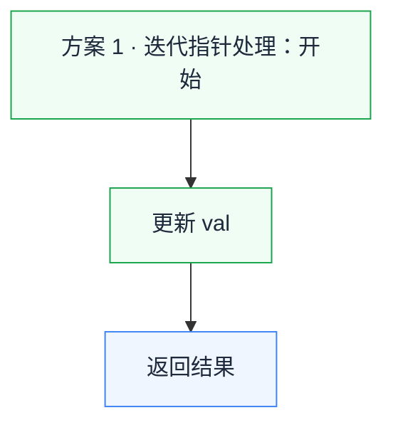

```java
package com.webfault.dsa; // 引入依赖

import java.util.*; // 引入依赖

class lc701_solution_1_1_____1___ { // 定义类型
  static class TreeNode { // static class TreeNode {
    int val; // int 值;
    TreeNode left, right; // TreeNode 左边界, 右边界;

    TreeNode(int v) {
      val = v;
    } // 把 值; } 写入 TreeNode(int v) { val
  }

  public TreeNode insertIntoBST(TreeNode root, int val) { // 定义函数/方法 insertIntoBST
    if (root == null) return new TreeNode(val); // 若 根节点 等于 null，直接返回 new TreeNode(值)
    TreeNode pos = root; // 把 根节点; 写入 TreeNode pos
    while (pos != null) { // 循环，直到不满足「pos 不等于 null」
      if (val < pos.val) { // 若 值 小于 pos.值
        if (pos.left == null) { // 若 pos.左边界 等于 null
          pos.left = new TreeNode(val); // 把 new TreeNode(值); 写入 左边界
          break; // 跳出循环
        } else { // 否则
          pos = pos.left; // 把 pos.左边界; 写入 pos
        }
      } else { // 否则
        if (pos.right == null) { // 若 pos.右边界 等于 null
          pos.right = new TreeNode(val); // 把 new TreeNode(值); 写入 右边界
          break; // 跳出循环
        } else { // 否则
          pos = pos.right; // 把 pos.右边界; 写入 pos
        }
      }
    }
    return root; // 返回 根节点
  }

  static TreeNode build(Integer[] vals) { // 定义函数/方法 build
    if (vals.length == 0 || vals[0] == null)
      return null; // 若 vals.长度 等于 0 或 vals[0] 等于 null，直接返回 null
    TreeNode root = new TreeNode(vals[0]); // 把 new TreeNode(vals[0]); 写入 TreeNode root
    Queue<TreeNode> q = new ArrayDeque<>(); // 把 new ArrayDeque 小于 超过 (); 写入 Queue<TreeNode> q
    q.offer(root); // 节点.offer(根节点);
    int i = 1; // 把 1 存入 下标 i
    while (!q.isEmpty() && i < vals.length) { // 循环，直到不满足「取反 节点.isEmpty() 且 下标 i 小于 vals.长度」
      TreeNode n = q.poll(); // 把 节点.poll(); 写入 TreeNode n
      if (i < vals.length && vals[i] != null) { // 若 下标 i 小于 vals.长度 且 vals[下标 i] 不等于 null
        n.left = new TreeNode(vals[i]); // 把 new TreeNode(vals[下标 i]); 写入 左边界
        q.offer(n.left); // 节点.offer(元素个数.左边界);
      }
      i++; // 下标 i 加一
      if (i < vals.length && vals[i] != null) { // 若 下标 i 小于 vals.长度 且 vals[下标 i] 不等于 null
        n.right = new TreeNode(vals[i]); // 把 new TreeNode(vals[下标 i]); 写入 右边界
        q.offer(n.right); // 节点.offer(元素个数.右边界);
      }
      i++; // 下标 i 加一
    }
    return root; // 返回 根节点
  }

  static List<Integer> toList(TreeNode root) { // 定义函数/方法 toList
    List<Integer> res = new ArrayList<>(); // 把 new ArrayList 小于 超过 (); 写入 List<Integer> res
    Deque<TreeNode> stack =
        new ArrayDeque<>(); // 把 new ArrayDeque 小于 超过 (); 写入 Deque<TreeNode> stack
    stack.push(root); // 把 根节点 压入栈/数组尾部
    while (!stack.isEmpty()) { // 循环，直到不满足「取反 栈.isEmpty(」
      TreeNode node = stack.pop(); // 弹出栈顶元素
      if (node != null) { // 若 节点 不等于 null
        res.add(node.val); // 结果 追加 节点.值);
        if (node.right != null) stack.push(node.right); // 若 节点.右边界 不等于 null) 栈 追加 节点.右边界);
        if (node.left != null) stack.push(node.left); // 若 节点.左边界 不等于 null) 栈 追加 节点.左边界);
      }
    }
    return res; // 返回 结果
  }

  public static void main(String[] args) { // public static void main(String[] args) {
    lc701_solution_1_1_____1___ s = new lc701_solution_1_1_____1___();
    Object[][] cases = { // 把 { 写入 Object[][] cases
      {new Integer[] {4, 2, 7, 1, 3}, 5, Arrays.asList(4, 2, 1, 3, 7, 5)},
      {null, 5, Arrays.asList(5)},
      {new Integer[] {8, 4, null, 2}, 6, Arrays.asList(8, 4, 2, 6)},
    };
    boolean ok = true; // 把 true; 写入 boolean ok
    for (Object[] c : cases) { // for (Object[] 字符 : cases) {
      TreeNode root = c[0] == null ? null : build((Integer[]) c[0]);
      List<Integer> got = toList(s.insertIntoBST(root, (Integer) c[1]));
      @SuppressWarnings("unchecked") // @SuppressWarnings(「unchecked」)
      List<Integer> want =
          (List<Integer>) c[2]; // 把 (List 小于 Integer 超过 ) 字符[2]; 写入 List<Integer> want
      if (!got.equals(want)) { // 若 取反 got.equals(want
        ok = false; // 把 false; 写入 ok
        System.out.println("FAIL insertIntoBST got=" + got + " want=" + want); // 打印输出
      }
    }
    if (!ok) throw new RuntimeException("FAILED"); // 若 取反 ok) throw new RuntimeException(「FAILED」);
    System.out.println("PASS"); // 全部用例通过，输出 PASS
  }
}
```

#### 方案 2：迭代指针处理

**思路与代码分析**：核心是「迭代指针处理」。Java 版用类与静态方法组织，集合操作显式明了。**走读**：方案 2 · 迭代指针处理：开始 → 更新 val → 返回结果。

**运行架构**（真实控制流）：


```java
package com.webfault.dsa; // 引入依赖

import java.util.*; // 引入依赖

class lc701_solution_2_2_____2___ { // 定义类型
  static class TreeNode { // static class TreeNode {
    int val; // int 值;
    TreeNode left, right; // TreeNode 左边界, 右边界;

    TreeNode(int v) {
      val = v;
    } // 把 值; } 写入 TreeNode(int v) { val
  }

  public TreeNode insertIntoBST(TreeNode root, int val) { // 定义函数/方法 insertIntoBST
    if (root == null) return new TreeNode(val); // 若 根节点 等于 null，直接返回 new TreeNode(值)
    if (val < root.val) { // 若 值 小于 根节点.值
      root.left = insertIntoBST(root.left, val); // 把 insertIntoBST(根节点.左边界, 值); 写入 左边界
    } else { // 否则
      root.right = insertIntoBST(root.right, val); // 把 insertIntoBST(根节点.右边界, 值); 写入 右边界
    }
    return root; // 返回 根节点
  }

  static TreeNode build(Integer[] vals) { // 定义函数/方法 build
    if (vals.length == 0 || vals[0] == null)
      return null; // 若 vals.长度 等于 0 或 vals[0] 等于 null，直接返回 null
    TreeNode root = new TreeNode(vals[0]); // 把 new TreeNode(vals[0]); 写入 TreeNode root
    Queue<TreeNode> q = new ArrayDeque<>(); // 把 new ArrayDeque 小于 超过 (); 写入 Queue<TreeNode> q
    q.offer(root); // 节点.offer(根节点);
    int i = 1; // 把 1 存入 下标 i
    while (!q.isEmpty() && i < vals.length) { // 循环，直到不满足「取反 节点.isEmpty() 且 下标 i 小于 vals.长度」
      TreeNode n = q.poll(); // 把 节点.poll(); 写入 TreeNode n
      if (i < vals.length && vals[i] != null) { // 若 下标 i 小于 vals.长度 且 vals[下标 i] 不等于 null
        n.left = new TreeNode(vals[i]); // 把 new TreeNode(vals[下标 i]); 写入 左边界
        q.offer(n.left); // 节点.offer(元素个数.左边界);
      }
      i++; // 下标 i 加一
      if (i < vals.length && vals[i] != null) { // 若 下标 i 小于 vals.长度 且 vals[下标 i] 不等于 null
        n.right = new TreeNode(vals[i]); // 把 new TreeNode(vals[下标 i]); 写入 右边界
        q.offer(n.right); // 节点.offer(元素个数.右边界);
      }
      i++; // 下标 i 加一
    }
    return root; // 返回 根节点
  }

  static List<Integer> toList(TreeNode root) { // 定义函数/方法 toList
    List<Integer> res = new ArrayList<>(); // 把 new ArrayList 小于 超过 (); 写入 List<Integer> res
    Deque<TreeNode> stack =
        new ArrayDeque<>(); // 把 new ArrayDeque 小于 超过 (); 写入 Deque<TreeNode> stack
    stack.push(root); // 把 根节点 压入栈/数组尾部
    while (!stack.isEmpty()) { // 循环，直到不满足「取反 栈.isEmpty(」
      TreeNode node = stack.pop(); // 弹出栈顶元素
      if (node != null) { // 若 节点 不等于 null
        res.add(node.val); // 结果 追加 节点.值);
        if (node.right != null) stack.push(node.right); // 若 节点.右边界 不等于 null) 栈 追加 节点.右边界);
        if (node.left != null) stack.push(node.left); // 若 节点.左边界 不等于 null) 栈 追加 节点.左边界);
      }
    }
    return res; // 返回 结果
  }

  public static void main(String[] args) { // public static void main(String[] args) {
    lc701_solution_2_2_____2___ s = new lc701_solution_2_2_____2___();
    Object[][] cases = { // 把 { 写入 Object[][] cases
      {new Integer[] {4, 2, 7, 1, 3}, 5, Arrays.asList(4, 2, 1, 3, 7, 5)},
      {null, 5, Arrays.asList(5)},
      {new Integer[] {8, 4, null, 2}, 6, Arrays.asList(8, 4, 2, 6)},
    };
    boolean ok = true; // 把 true; 写入 boolean ok
    for (Object[] c : cases) { // for (Object[] 字符 : cases) {
      TreeNode root = c[0] == null ? null : build((Integer[]) c[0]);
      List<Integer> got = toList(s.insertIntoBST(root, (Integer) c[1]));
      @SuppressWarnings("unchecked") // @SuppressWarnings(「unchecked」)
      List<Integer> want =
          (List<Integer>) c[2]; // 把 (List 小于 Integer 超过 ) 字符[2]; 写入 List<Integer> want
      if (!got.equals(want)) { // 若 取反 got.equals(want
        ok = false; // 把 false; 写入 ok
        System.out.println("FAIL insertIntoBST got=" + got + " want=" + want); // 打印输出
      }
    }
    if (!ok) throw new RuntimeException("FAILED"); // 若 取反 ok) throw new RuntimeException(「FAILED」);
    System.out.println("PASS"); // 全部用例通过，输出 PASS
  }
}
```

### Rust 实现（2 种方案）

Rust 的全部方案如下，每个方案都内嵌用例自测，可独立运行（老仓库 python/go 文件遵循「打印结果」约定）：

#### 方案 1：迭代指针处理

**思路与代码分析**：核心是「迭代指针处理」。Rust 版用所有权移动与切片借用改写同一逻辑，注意 Option 与引用边界。**走读**：方案 1 · 迭代指针处理：开始 → 处理 match root → 返回结果。

**运行架构**（真实控制流）：

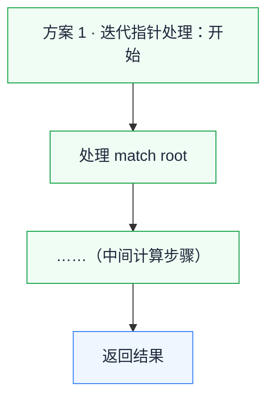

```rust
// LeetCode 701. 二叉搜索树中的插入操作 — Rust 版（方案1）
use std::cell::RefCell;
use std::rc::Rc; // 引入依赖 // 引入依赖

#[derive(Debug)]
struct TreeNode {
    // 定义类型
    val: i32,
    left: Option<Rc<RefCell<TreeNode>>>,
    right: Option<Rc<RefCell<TreeNode>>>,
}

impl TreeNode {
    // 实现块
    fn new(val: i32) -> Rc<RefCell<TreeNode>> {
        // 定义函数/方法 new
        Rc::new(RefCell::new(TreeNode {
            val,
            left: None,
            right: None,
        })) // Rc::new(RefCell::new(TreeNode { 值, 左边界: None, 右边界: None }))
    }
}

fn build_tree(vals: &[Option<i32>]) -> Option<Rc<RefCell<TreeNode>>> {
    // 定义函数/方法 build_tree
    if vals.is_empty() || vals[0].is_none() {
        // 若 vals 是否为空 或 vals[0].is_none(
        return None; // 返回 None
    }
    let root = TreeNode::new(vals[0].unwrap()); // 把 TreeNode::new(vals[0].unwrap()) 存入 根节点
    let mut queue: Vec<Rc<RefCell<TreeNode>>> = vec![root.clone()];
    let mut i = 1; // 把 1; 写入 let mut i
    while !queue.is_empty() && i < vals.len() {
        // while 取反 队列 是否为空 且 下标 i 小于 vals.长度() {
        let node = queue.remove(0); // 把 队列 弹出 0) 存入 节点
        if i < vals.len() {
            // 若 下标 i 小于 vals.长度(
            if let Some(v) = vals[i] {
                // 若 let Some(值) 赋值为 vals[下标 i]
                let child = TreeNode::new(v); // 把 TreeNode::new(值) 存入 子节点
                node.borrow_mut().left = Some(child.clone()); // 把 Some(子节点.clone()); 写入 左边界
                queue.push(child); // 把 子节点 压入栈/数组尾部
            }
            i += 1; // 下标 i累加 1
        }
        if i < vals.len() {
            // 若 下标 i 小于 vals.长度(
            if let Some(v) = vals[i] {
                // 若 let Some(值) 赋值为 vals[下标 i]
                let child = TreeNode::new(v); // 把 TreeNode::new(值) 存入 子节点
                node.borrow_mut().right = Some(child.clone()); // 把 Some(子节点.clone()); 写入 右边界
                queue.push(child); // 把 子节点 压入栈/数组尾部
            }
            i += 1; // 下标 i累加 1
        }
    }
    Some(root) // Some(根节点)
}
fn same_tree(p: Option<&Rc<RefCell<TreeNode>>>, q: Option<&Rc<RefCell<TreeNode>>>) -> bool {
    // 定义函数/方法 same_tree
    match (p, q) {
        // 按情况匹配处理
        (None, None) => true,
        (Some(a), Some(b)) => {
            let (a, b) = (a.borrow(), b.borrow());
            a.val == b.val
                && same_tree(a.left.as_ref(), b.left.as_ref())
                && same_tree(a.right.as_ref(), b.right.as_ref())
        }
        _ => false,
    }
}
fn levels_flat(root: Option<Rc<RefCell<TreeNode>>>) -> Vec<i32> {
    // 定义函数/方法 levels_flat
    let mut out = Vec::new(); // 把 Vec::new(); 写入 let mut out
    let mut q: Vec<Rc<RefCell<TreeNode>>> = root.into_iter().collect();
    while !q.is_empty() {
        // while 取反 节点 是否为空 {
        let mut nxt = Vec::new(); // 把 Vec::new(); 写入 let mut nxt
        for n in q {
            let b = n.borrow();
            out.push(b.val);
            if let Some(c) = b.left.clone() {
                nxt.push(c);
            }
            if let Some(c) = b.right.clone() {
                nxt.push(c);
            }
        } // 逐个取出 节点 的元素（元素个数）
        q = nxt; // 把 nxt; 写入 节点
    }
    out // out
}

fn insert_into_bst(root: Option<Rc<RefCell<TreeNode>>>, val: i32) -> Option<Rc<RefCell<TreeNode>>> {
    // 定义函数/方法 insert_into_bst
    match root {
        // 按情况匹配处理
        None => Some(TreeNode::new(val)),
        Some(node) => {
            let mut pos = node.clone(); // 把 节点.clone(); 写入 let mut pos
            loop {
                // loop {
                let (go_left, child) = {
                    // 把 { 写入 let (go_left, child)
                    let pb = pos.borrow(); // 把 pos.borrow() 存入 pb
                    if val < pb.val {
                        (true, pb.left.clone())
                    } else {
                        (false, pb.right.clone())
                    }
                };
                match child {
                    // 按情况匹配处理
                    Some(c) => pos = c,
                    None => {
                        let mut pm = pos.borrow_mut(); // 把 pos.borrow_mut(); 写入 let mut pm
                        if go_left {
                            pm.left = Some(TreeNode::new(val));
                        } else {
                            pm.right = Some(TreeNode::new(val));
                        }
                        break; // 跳出循环
                    }
                }
            }
            Some(node) // Some(节点)
        }
    }
}
fn main() {
    // 程序入口：跑内嵌自测用例
    let t = build_tree(&[Some(4), Some(2), Some(7), Some(1), Some(3)]);
    let got = levels_flat(insert_into_bst(t, 5)); // 把 levels_flat(insert_into_bst(另一字符串, 5)) 存入 got
    assert_eq!(got, vec![4, 2, 7, 1, 3, 5]); // 断言校验
    let got2 = insert_into_bst(None, 5); // 把 insert_into_bst(None, 5) 存入 got2
    assert_eq!(levels_flat(got2), vec![5]); // 断言校验
    println!("PASS"); // 全部用例通过，输出 PASS
}
```

#### 方案 2：迭代指针处理

**思路与代码分析**：核心是「迭代指针处理」。Rust 版用所有权移动与切片借用改写同一逻辑，注意 Option 与引用边界。**走读**：方案 2 · 迭代指针处理：开始 → 处理 match root → 返回结果。

**运行架构**（真实控制流）：


```rust
// LeetCode 701. 二叉搜索树中的插入操作 — Rust 版（方案2）
use std::cell::RefCell;
use std::rc::Rc; // 引入依赖 // 引入依赖

#[derive(Debug)]
struct TreeNode {
    // 定义类型
    val: i32,
    left: Option<Rc<RefCell<TreeNode>>>,
    right: Option<Rc<RefCell<TreeNode>>>,
}

impl TreeNode {
    // 实现块
    fn new(val: i32) -> Rc<RefCell<TreeNode>> {
        // 定义函数/方法 new
        Rc::new(RefCell::new(TreeNode {
            val,
            left: None,
            right: None,
        })) // Rc::new(RefCell::new(TreeNode { 值, 左边界: None, 右边界: None }))
    }
}

fn build_tree(vals: &[Option<i32>]) -> Option<Rc<RefCell<TreeNode>>> {
    // 定义函数/方法 build_tree
    if vals.is_empty() || vals[0].is_none() {
        // 若 vals 是否为空 或 vals[0].is_none(
        return None; // 返回 None
    }
    let root = TreeNode::new(vals[0].unwrap()); // 把 TreeNode::new(vals[0].unwrap()) 存入 根节点
    let mut queue: Vec<Rc<RefCell<TreeNode>>> = vec![root.clone()];
    let mut i = 1; // 把 1; 写入 let mut i
    while !queue.is_empty() && i < vals.len() {
        // while 取反 队列 是否为空 且 下标 i 小于 vals.长度() {
        let node = queue.remove(0); // 把 队列 弹出 0) 存入 节点
        if i < vals.len() {
            // 若 下标 i 小于 vals.长度(
            if let Some(v) = vals[i] {
                // 若 let Some(值) 赋值为 vals[下标 i]
                let child = TreeNode::new(v); // 把 TreeNode::new(值) 存入 子节点
                node.borrow_mut().left = Some(child.clone()); // 把 Some(子节点.clone()); 写入 左边界
                queue.push(child); // 把 子节点 压入栈/数组尾部
            }
            i += 1; // 下标 i累加 1
        }
        if i < vals.len() {
            // 若 下标 i 小于 vals.长度(
            if let Some(v) = vals[i] {
                // 若 let Some(值) 赋值为 vals[下标 i]
                let child = TreeNode::new(v); // 把 TreeNode::new(值) 存入 子节点
                node.borrow_mut().right = Some(child.clone()); // 把 Some(子节点.clone()); 写入 右边界
                queue.push(child); // 把 子节点 压入栈/数组尾部
            }
            i += 1; // 下标 i累加 1
        }
    }
    Some(root) // Some(根节点)
}
fn same_tree(p: Option<&Rc<RefCell<TreeNode>>>, q: Option<&Rc<RefCell<TreeNode>>>) -> bool {
    // 定义函数/方法 same_tree
    match (p, q) {
        // 按情况匹配处理
        (None, None) => true,
        (Some(a), Some(b)) => {
            let (a, b) = (a.borrow(), b.borrow());
            a.val == b.val
                && same_tree(a.left.as_ref(), b.left.as_ref())
                && same_tree(a.right.as_ref(), b.right.as_ref())
        }
        _ => false,
    }
}
fn levels_flat(root: Option<Rc<RefCell<TreeNode>>>) -> Vec<i32> {
    // 定义函数/方法 levels_flat
    let mut out = Vec::new(); // 把 Vec::new(); 写入 let mut out
    let mut q: Vec<Rc<RefCell<TreeNode>>> = root.into_iter().collect();
    while !q.is_empty() {
        // while 取反 节点 是否为空 {
        let mut nxt = Vec::new(); // 把 Vec::new(); 写入 let mut nxt
        for n in q {
            let b = n.borrow();
            out.push(b.val);
            if let Some(c) = b.left.clone() {
                nxt.push(c);
            }
            if let Some(c) = b.right.clone() {
                nxt.push(c);
            }
        } // 逐个取出 节点 的元素（元素个数）
        q = nxt; // 把 nxt; 写入 节点
    }
    out // out
}

fn insert_into_bst(root: Option<Rc<RefCell<TreeNode>>>, val: i32) -> Option<Rc<RefCell<TreeNode>>> {
    // 定义函数/方法 insert_into_bst
    match root {
        // 按情况匹配处理
        None => Some(TreeNode::new(val)),
        Some(node) => {
            let mut pos = node.clone(); // 把 节点.clone(); 写入 let mut pos
            loop {
                // loop {
                let (go_left, child) = {
                    // 把 { 写入 let (go_left, child)
                    let pb = pos.borrow(); // 把 pos.borrow() 存入 pb
                    if val < pb.val {
                        (true, pb.left.clone())
                    } else {
                        (false, pb.right.clone())
                    }
                };
                match child {
                    // 按情况匹配处理
                    Some(c) => pos = c,
                    None => {
                        let mut pm = pos.borrow_mut(); // 把 pos.borrow_mut(); 写入 let mut pm
                        if go_left {
                            pm.left = Some(TreeNode::new(val));
                        } else {
                            pm.right = Some(TreeNode::new(val));
                        }
                        break; // 跳出循环
                    }
                }
            }
            Some(node) // Some(节点)
        }
    }
}
fn main() {
    // 程序入口：跑内嵌自测用例
    let t = build_tree(&[Some(4), Some(2), Some(7), Some(1), Some(3)]);
    let got = levels_flat(insert_into_bst(t, 5)); // 把 levels_flat(insert_into_bst(另一字符串, 5)) 存入 got
    assert_eq!(got, vec![4, 2, 7, 1, 3, 5]); // 断言校验
    let got2 = insert_into_bst(None, 5); // 把 insert_into_bst(None, 5) 存入 got2
    assert_eq!(levels_flat(got2), vec![5]); // 断言校验
    println!("PASS"); // 全部用例通过，输出 PASS
}
```

### Lua 实现（2 种方案）

Lua 的全部方案如下，每个方案都内嵌用例自测，可独立运行（老仓库 python/go 文件遵循「打印结果」约定）：

#### 方案 1：迭代指针处理

**思路与代码分析**：核心是「迭代指针处理」。Lua 版用表与 ipairs 遍历，注意 ipairs 遇 nil 即停的语义。**走读**：方案 1 · 迭代指针处理：开始 → 处理 if not vals or #vals == 0 or → 返回 nil → 当 head ≤ #queue and i ≤ #vals do 时反复执行 → 返回 root。

**运行架构**（真实控制流）：

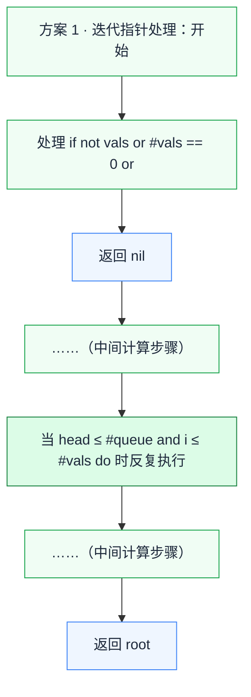

```lua
-- LeetCode 701. 二叉搜索树中的插入操作 — Lua 版（方案1）
local TreeNode = {} -- 把 {} 写入 local TreeNode
TreeNode.__index = TreeNode -- 把 TreeNode 写入 TreeNode.__index
function TreeNode.new(val) -- function TreeNode.new(值)
	return setmetatable({ val = val, left = nil, right = nil }, TreeNode)
end -- 终点

local function build_tree(vals) -- local function build_tree(vals)
	if not vals or #vals == 0 or vals[1] == "null" then
		return nil
	end
	local root = TreeNode.new(vals[1]) -- 把 TreeNode.new(vals[1]) 写入 local root
	local queue = { root } -- 把 {根节点} 写入 local queue
	local head = 1 -- 把 1 写入 local head
	local i = 2 -- 把 2 写入 local i
	while head <= #queue and i <= #vals do -- 把 #队列 and 下标 i 不超过 #vals do 写入 while head <
		local node = queue[head] -- 把 队列[头节点] 写入 local node
		head = head + 1 -- 把 头节点 加 1 存入 头节点
		if i <= #vals then -- 若 下标 i 不超过 #vals then
			if vals[i] ~= "null" then -- 若 vals[下标 i] ~ 赋值为 「null」 then
				node.left = TreeNode.new(vals[i]) -- 把 TreeNode.new(vals[下标 i]) 写入 左边界
				queue[#queue + 1] = node.left -- 把 节点.左边界 写入 queue[#queue + 1]
			end -- 终点
			i = i + 1 -- 把 下标 i 加 1 存入 下标 i
		end -- 终点
		if i <= #vals then -- 若 下标 i 不超过 #vals then
			if vals[i] ~= "null" then -- 若 vals[下标 i] ~ 赋值为 「null」 then
				node.right = TreeNode.new(vals[i]) -- 把 TreeNode.new(vals[下标 i]) 写入 右边界
				queue[#queue + 1] = node.right -- 把 节点.右边界 写入 queue[#queue + 1]
			end -- 终点
			i = i + 1 -- 把 下标 i 加 1 存入 下标 i
		end -- 终点
	end -- 终点
	return root -- 返回 根节点
end -- 终点
local function same_tree(p, q) -- local function same_tree(节点, 节点)
	if not p and not q then
		return true
	end -- 若 not 节点 and not 节点 then return true 终点
	if not p or not q or p.val ~= q.val then
		return false
	end -- 若 not 节点 or not 节点 or 节点.值 ~ 赋值为 节点.值 then return false 终点
	return same_tree(p.left, q.left) and same_tree(p.right, q.right) -- 返回 same_tree(节点.左边界, 节点.左边界) and same_tree(节点.右边界, 节点.右边界)
end -- 终点
local function levels_flat(root) -- local function levels_flat(根节点)
	if not root then
		return {}
	end -- 若 not 根节点 then return {} 终点
	local out, q = {}, { root } -- 把 {}, {根节点} 写入 local out, q
	while #q > 0 do -- while #节点 超过 0 do
		local n = #q -- 把 #节点 写入 local n
		for _ = 1, n do -- 让 _ 从 1 走到 元素个数（Lua 1 基）
			local node = table.remove(q, 1) -- 把 table 弹出 节点, 1) 写入 local node
			out[#out + 1] = node.val -- 把 节点.值 写入 out[#out + 1]
			if node.left then
				q[#q + 1] = node.left
			end -- 若 节点.左边界 then 节点[#节点 加 1] 赋值为 节点.左边界 终点
			if node.right then
				q[#q + 1] = node.right
			end -- 若 节点.右边界 then 节点[#节点 加 1] 赋值为 节点.右边界 终点
		end -- 终点
	end -- 终点
	return out -- 返回 out
end -- 终点
local function eq(a, b) -- local function eq(数组, b)
	if #a ~= #b then
		return false
	end -- 若 #数组 ~ 赋值为 #b then return false 终点
	for i = 1, #a do
		if a[i] ~= b[i] then
			return false
		end
	end
	return true -- 返回 true
end -- 终点

local function insert_into_bst(root, val) -- local function insert_into_bst(根节点, 值)
	if not root then
		return TreeNode.new(val)
	end -- 若 not 根节点 then return TreeNode.new(值) 终点
	local pos = root -- 把 根节点 写入 local pos
	while pos do -- while pos do
		if val < pos.val then -- 若 值 小于 pos.值 then
			if not pos.left then
				pos.left = TreeNode.new(val)
				break
			end -- 若 not pos.左边界 then pos.左边界 赋值为 TreeNode.new(值); break 终点
			pos = pos.left -- 把 pos.左边界 存入 pos
		else -- 否则
			if not pos.right then
				pos.right = TreeNode.new(val)
				break
			end -- 若 not pos.右边界 then pos.右边界 赋值为 TreeNode.new(值); break 终点
			pos = pos.right -- 把 pos.右边界 存入 pos
		end -- 终点
	end -- 终点
	return root -- 返回 根节点
end -- 终点
local t = build_tree({ 4, 2, 7, 1, 3 }) -- 把 build_tree({4, 2, 7, 1, 3}) 写入 local t
assert(eq(levels_flat(insert_into_bst(t, 5)), { 4, 2, 7, 1, 3, 5 })) -- 断言校验
assert(eq(levels_flat(insert_into_bst(nil, 5)), { 5 })) -- 断言校验
print("PASS") -- 全部用例通过，输出 PASS
```

#### 方案 2：迭代指针处理

**思路与代码分析**：核心是「迭代指针处理」。Lua 版用表与 ipairs 遍历，注意 ipairs 遇 nil 即停的语义。**走读**：方案 2 · 迭代指针处理：开始 → 处理 if not vals or #vals == 0 or → 返回 nil → 当 head ≤ #queue and i ≤ #vals do 时反复执行 → 返回 root。

**运行架构**（真实控制流）：

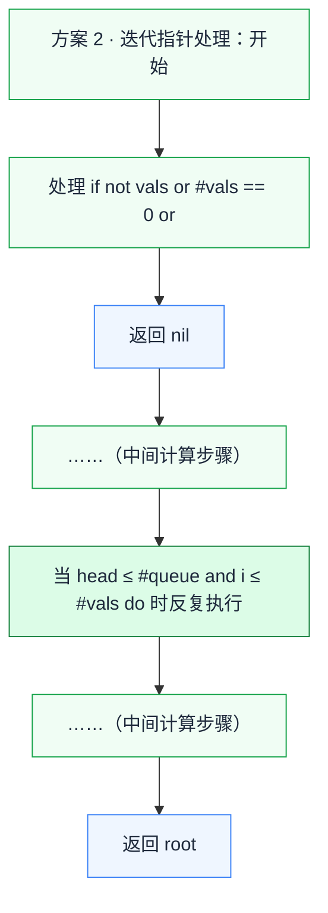

```lua
-- LeetCode 701. 二叉搜索树中的插入操作 — Lua 版（方案2）
local TreeNode = {} -- 把 {} 写入 local TreeNode
TreeNode.__index = TreeNode -- 把 TreeNode 写入 TreeNode.__index
function TreeNode.new(val) -- function TreeNode.new(值)
	return setmetatable({ val = val, left = nil, right = nil }, TreeNode)
end -- 终点

local function build_tree(vals) -- local function build_tree(vals)
	if not vals or #vals == 0 or vals[1] == "null" then
		return nil
	end
	local root = TreeNode.new(vals[1]) -- 把 TreeNode.new(vals[1]) 写入 local root
	local queue = { root } -- 把 {根节点} 写入 local queue
	local head = 1 -- 把 1 写入 local head
	local i = 2 -- 把 2 写入 local i
	while head <= #queue and i <= #vals do -- 把 #队列 and 下标 i 不超过 #vals do 写入 while head <
		local node = queue[head] -- 把 队列[头节点] 写入 local node
		head = head + 1 -- 把 头节点 加 1 存入 头节点
		if i <= #vals then -- 若 下标 i 不超过 #vals then
			if vals[i] ~= "null" then -- 若 vals[下标 i] ~ 赋值为 「null」 then
				node.left = TreeNode.new(vals[i]) -- 把 TreeNode.new(vals[下标 i]) 写入 左边界
				queue[#queue + 1] = node.left -- 把 节点.左边界 写入 queue[#queue + 1]
			end -- 终点
			i = i + 1 -- 把 下标 i 加 1 存入 下标 i
		end -- 终点
		if i <= #vals then -- 若 下标 i 不超过 #vals then
			if vals[i] ~= "null" then -- 若 vals[下标 i] ~ 赋值为 「null」 then
				node.right = TreeNode.new(vals[i]) -- 把 TreeNode.new(vals[下标 i]) 写入 右边界
				queue[#queue + 1] = node.right -- 把 节点.右边界 写入 queue[#queue + 1]
			end -- 终点
			i = i + 1 -- 把 下标 i 加 1 存入 下标 i
		end -- 终点
	end -- 终点
	return root -- 返回 根节点
end -- 终点
local function same_tree(p, q) -- local function same_tree(节点, 节点)
	if not p and not q then
		return true
	end -- 若 not 节点 and not 节点 then return true 终点
	if not p or not q or p.val ~= q.val then
		return false
	end -- 若 not 节点 or not 节点 or 节点.值 ~ 赋值为 节点.值 then return false 终点
	return same_tree(p.left, q.left) and same_tree(p.right, q.right) -- 返回 same_tree(节点.左边界, 节点.左边界) and same_tree(节点.右边界, 节点.右边界)
end -- 终点
local function levels_flat(root) -- local function levels_flat(根节点)
	if not root then
		return {}
	end -- 若 not 根节点 then return {} 终点
	local out, q = {}, { root } -- 把 {}, {根节点} 写入 local out, q
	while #q > 0 do -- while #节点 超过 0 do
		local n = #q -- 把 #节点 写入 local n
		for _ = 1, n do -- 让 _ 从 1 走到 元素个数（Lua 1 基）
			local node = table.remove(q, 1) -- 把 table 弹出 节点, 1) 写入 local node
			out[#out + 1] = node.val -- 把 节点.值 写入 out[#out + 1]
			if node.left then
				q[#q + 1] = node.left
			end -- 若 节点.左边界 then 节点[#节点 加 1] 赋值为 节点.左边界 终点
			if node.right then
				q[#q + 1] = node.right
			end -- 若 节点.右边界 then 节点[#节点 加 1] 赋值为 节点.右边界 终点
		end -- 终点
	end -- 终点
	return out -- 返回 out
end -- 终点
local function eq(a, b) -- local function eq(数组, b)
	if #a ~= #b then
		return false
	end -- 若 #数组 ~ 赋值为 #b then return false 终点
	for i = 1, #a do
		if a[i] ~= b[i] then
			return false
		end
	end
	return true -- 返回 true
end -- 终点

local function insert_into_bst(root, val) -- local function insert_into_bst(根节点, 值)
	if not root then
		return TreeNode.new(val)
	end -- 若 not 根节点 then return TreeNode.new(值) 终点
	local pos = root -- 把 根节点 写入 local pos
	while pos do -- while pos do
		if val < pos.val then -- 若 值 小于 pos.值 then
			if not pos.left then
				pos.left = TreeNode.new(val)
				break
			end -- 若 not pos.左边界 then pos.左边界 赋值为 TreeNode.new(值); break 终点
			pos = pos.left -- 把 pos.左边界 存入 pos
		else -- 否则
			if not pos.right then
				pos.right = TreeNode.new(val)
				break
			end -- 若 not pos.右边界 then pos.右边界 赋值为 TreeNode.new(值); break 终点
			pos = pos.right -- 把 pos.右边界 存入 pos
		end -- 终点
	end -- 终点
	return root -- 返回 根节点
end -- 终点
local t = build_tree({ 4, 2, 7, 1, 3 }) -- 把 build_tree({4, 2, 7, 1, 3}) 写入 local t
assert(eq(levels_flat(insert_into_bst(t, 5)), { 4, 2, 7, 1, 3, 5 })) -- 断言校验
assert(eq(levels_flat(insert_into_bst(nil, 5)), { 5 })) -- 断言校验
print("PASS") -- 全部用例通过，输出 PASS
```

### C 实现（2 种方案）

C 的全部方案如下，每个方案都内嵌用例自测，可独立运行（老仓库 python/go 文件遵循「打印结果」约定）：

#### 方案 1：迭代指针处理

**思路与代码分析**：核心是「迭代指针处理」。C 版手动管理下标与内存，循环边界全部显式写出。**走读**：方案 1 · 迭代指针处理：开始 → 命中条件，直接返回 → 处理 TreeNode *q[4096] → 更新 head → 更新 q[tail++] → 当 (head ＜ tail) 时反复执行 → 更新 *n → 更新 out[cnt++] → 若 n-＞left：更新 q[tail++] → 更新 q[tail++] → 处理 n-＞left → 若 n-＞right：更新 q[tail++] → 更新 q[tail++] → 处理 n-＞right → 返回 cnt。

**运行架构**（真实控制流）：


```c
/* LeetCode 701. 二叉搜索树中的插入操作 — C 版（方案1） */
#include <stdio.h>                   // 引入头文件
#include <stdlib.h>                  // 引入头文件
#define INT_MIN_SN (-2147483647 - 1) // #define INT_MIN_SN ( 减 2147483647 减 1)

typedef struct TreeNode {   // typedef struct TreeNode {
    int val;                // int 值;
    struct TreeNode *left;  // 定义类型
    struct TreeNode *right; // 定义类型
} TreeNode;                 // } TreeNode;

static TreeNode *build_tree(const int *vals,
                            int n) { // static TreeNode 乘 build_tree(const int 乘 vals, int 元素个数) {
    if (n == 0 || vals[0] == INT_MIN_SN)
        return NULL; // 若 元素个数 等于 0 或 vals[0] 等于 INT_MIN_SN，直接返回 NULL
    TreeNode *root = malloc(sizeof(TreeNode)); // 把 malloc(sizeof(TreeNode)); 写入 TreeNode *root
    root->val = vals[0];
    root->left = root->right = NULL;
    TreeNode **queue =
        malloc(sizeof(TreeNode *) * n); // 把 malloc(sizeof(TreeNode 乘 ) 乘 元素个数); 写入 TreeNode **queue
    int head = 0, tail = 0, i = 1; // 把 0, 尾节点 赋值为 0, 下标 i 赋值为 1 存入 头节点
    queue[tail++] = root;          // 把 根节点; 写入 queue[tail++]
    while (head < tail && i < n) { // 循环，直到不满足「头节点 小于 尾节点 且 下标 i 小于 元素个数」
        TreeNode *node = queue[head++];                // 把 队列[头节点 加一 ]; 写入 TreeNode *node
        if (i < n) {                                   // 若 下标 i 小于 元素个数
            if (vals[i] != INT_MIN_SN) {               // 若 vals[下标 i] 不等于 INT_MIN_SN
                node->left = malloc(sizeof(TreeNode)); // 把 malloc(sizeof(TreeNode)); 写入 node->left
                node->left->val = vals[i];
                node->left->left = node->left->right = NULL;
                queue[tail++] = node->left; // 把 节点 减 超过 左边界; 写入 queue[tail++]
            }
            i++; // 下标 i 加一
        }
        if (i < n) {                                    // 若 下标 i 小于 元素个数
            if (vals[i] != INT_MIN_SN) {                // 若 vals[下标 i] 不等于 INT_MIN_SN
                node->right = malloc(sizeof(TreeNode)); // 把 malloc(sizeof(TreeNode)); 写入 node->right
                node->right->val = vals[i];
                node->right->left = node->right->right = NULL;
                queue[tail++] = node->right; // 把 节点 减 超过 右边界; 写入 queue[tail++]
            }
            i++; // 下标 i 加一
        }
    }
    free(queue); // free(队列);
    return root; // 返回 根节点
}

static void free_tree(TreeNode *n) { // 定义函数/方法 free_tree
    if (!n)
        return;          // 若 取反 元素个数) return;
    free_tree(n->left);  // free_tree(元素个数 减 超过 左边界);
    free_tree(n->right); // free_tree(元素个数 减 超过 右边界);
    free(n);             // free(元素个数);
}
static int same_tree(const TreeNode *p, const TreeNode *q) { // 定义函数/方法 same_tree
    if (!p && !q)
        return 1; // 若 取反 节点 且 取反 节点，直接返回 1
    if (!p || !q || p->val != q->val)
        return 0; // 若 取反 节点 或 取反 节点 或 节点 减 超过 值 不等于 节点 减 超过 值，直接返回 0
    return same_tree(p->left, q->left) && same_tree(p->right, q->right);
}
static int levels_flat(TreeNode *root, int out[]) { // 定义函数/方法 levels_flat
    if (!root)
        return 0; // 若 取反 根节点，直接返回 0
    TreeNode *q[4096];
    int head = 0, tail = 0, cnt = 0; // 把 0, 尾节点 赋值为 0, 计数 赋值为 0; 写入 TreeNode *q[4096]; int head
    q[tail++] = root;                // 把 根节点; 写入 q[tail++]
    while (head < tail) {        // 循环，直到不满足「头节点 小于 尾节点」
        TreeNode *n = q[head++]; // 把 节点[头节点 加一 ]; 写入 TreeNode *n
        out[cnt++] = n->val;     // 把 元素个数 减 超过 值; 写入 out[cnt++]
        if (n->left)
            q[tail++] =
                n->left; // 若 元素个数 减 超过 左边界) 节点[尾节点 加一 ] 赋值为 元素个数 减 超过 左边界;
        if (n->right)
            q[tail++] =
                n->right; // 若 元素个数 减 超过 右边界) 节点[尾节点 加一 ] 赋值为 元素个数 减 超过 右边界;
    }
    return cnt; // 返回 计数
}
static int eqarr(const int *a, int n, const int *b, int m) { // 定义函数/方法 eqarr
    if (n != m)
        return 0; // 若 元素个数 不等于 映射表，直接返回 0
    for (int i = 0; i < n; i++)
        if (a[i] != b[i])
            return 0; // 让 下标 i 从 0 开始计数，下标 i 小于 元素个数 就继续
    return 1;         // 返回 1
}

static TreeNode *
insert_into_bst(TreeNode *root, int val) { // static TreeNode 乘 insert_into_bst(TreeNode 乘 根节点, int 值) {
    if (!root) {                           // 若 取反 根节点
        TreeNode *n = malloc(sizeof(TreeNode)); // 把 malloc(sizeof(TreeNode)); 写入 TreeNode *n
        n->val = val;
        n->left = n->right =
            NULL; // 把 值; 元素个数 减 超过 左边界 赋值为 元素个数 减 超过 右边界 赋值为 NULL; 写入 n->val
        return n; // 返回 元素个数
    }
    TreeNode *pos = root;     // 把 根节点; 写入 TreeNode *pos
    while (pos) {             // 循环，直到不满足「pos」
        if (val < pos->val) { // 若 值 小于 pos 减 超过 值
            if (!pos->left) {
                pos->left = malloc(sizeof(TreeNode));
                pos->left->val = val;
                pos->left->left = pos->left->right = NULL;
                break;
            }
            pos = pos->left; // 把 pos 减 超过 左边界; 写入 pos
        } else {             // 否则
            if (!pos->right) {
                pos->right = malloc(sizeof(TreeNode));
                pos->right->val = val;
                pos->right->left = pos->right->right = NULL;
                break;
            }
            pos = pos->right; // 把 pos 减 超过 右边界; 写入 pos
        }
    }
    return root; // 返回 根节点
}
int main(void) {                  // 程序入口：跑内嵌自测用例
    int v[] = {4, 2, 7, 1, 3};    // 把 {4,2,7,1,3}; 写入 int v[]
    int w[] = {4, 2, 7, 1, 3, 5}; // 把 {4,2,7,1,3,5}; 写入 int w[]
    int out[64];                  // int out[64];
    int n = levels_flat(insert_into_bst(build_tree(v, 5), 5), out);
    if (!eqarr(out, n, w, 6)) {
        printf("FAIL 1\n");
        return 1;
    } // 若 取反 eqarr(out, 元素个数, 权重, 6)) { 输出「FAIL 1 」); return 1; }
    int n2 =
        levels_flat(insert_into_bst(NULL, 5), out); // 把 levels_flat(insert_into_bst(NULL, 5), out) 存入 n2
    if (!eqarr(out, n2, w + 5, 1)) {
        printf("FAIL 2\n");
        return 1;
    }                 // 若 取反 eqarr(out, n2, 权重 加 5, 1)) { 输出「FAIL 2 」); return 1; }
    printf("PASS\n"); // 全部用例通过，输出 PASS
    return 0;         // 返回 0
}
```

#### 方案 2：迭代指针处理

**思路与代码分析**：核心是「迭代指针处理」。C 版手动管理下标与内存，循环边界全部显式写出。**走读**：方案 2 · 迭代指针处理：开始 → 命中条件，直接返回 → 处理 TreeNode *q[4096] → 更新 head → 更新 q[tail++] → 当 (head ＜ tail) 时反复执行 → 更新 *n → 更新 out[cnt++] → 若 n-＞left：更新 q[tail++] → 更新 q[tail++] → 处理 n-＞left → 若 n-＞right：更新 q[tail++] → 更新 q[tail++] → 处理 n-＞right → 返回 cnt。

**运行架构**（真实控制流）：

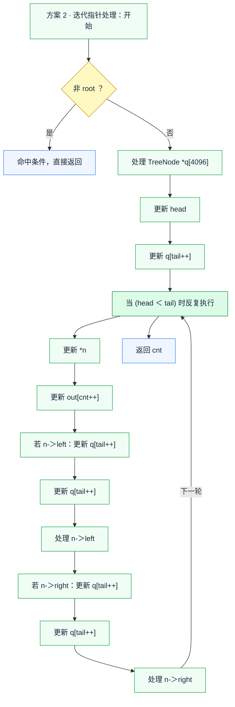

```c
/* LeetCode 701. 二叉搜索树中的插入操作 — C 版（方案2） */
#include <stdio.h>                   // 引入头文件
#include <stdlib.h>                  // 引入头文件
#define INT_MIN_SN (-2147483647 - 1) // #define INT_MIN_SN ( 减 2147483647 减 1)

typedef struct TreeNode {   // typedef struct TreeNode {
    int val;                // int 值;
    struct TreeNode *left;  // 定义类型
    struct TreeNode *right; // 定义类型
} TreeNode;                 // } TreeNode;

static TreeNode *build_tree(const int *vals,
                            int n) { // static TreeNode 乘 build_tree(const int 乘 vals, int 元素个数) {
    if (n == 0 || vals[0] == INT_MIN_SN)
        return NULL; // 若 元素个数 等于 0 或 vals[0] 等于 INT_MIN_SN，直接返回 NULL
    TreeNode *root = malloc(sizeof(TreeNode)); // 把 malloc(sizeof(TreeNode)); 写入 TreeNode *root
    root->val = vals[0];
    root->left = root->right = NULL;
    TreeNode **queue =
        malloc(sizeof(TreeNode *) * n); // 把 malloc(sizeof(TreeNode 乘 ) 乘 元素个数); 写入 TreeNode **queue
    int head = 0, tail = 0, i = 1; // 把 0, 尾节点 赋值为 0, 下标 i 赋值为 1 存入 头节点
    queue[tail++] = root;          // 把 根节点; 写入 queue[tail++]
    while (head < tail && i < n) { // 循环，直到不满足「头节点 小于 尾节点 且 下标 i 小于 元素个数」
        TreeNode *node = queue[head++];                // 把 队列[头节点 加一 ]; 写入 TreeNode *node
        if (i < n) {                                   // 若 下标 i 小于 元素个数
            if (vals[i] != INT_MIN_SN) {               // 若 vals[下标 i] 不等于 INT_MIN_SN
                node->left = malloc(sizeof(TreeNode)); // 把 malloc(sizeof(TreeNode)); 写入 node->left
                node->left->val = vals[i];
                node->left->left = node->left->right = NULL;
                queue[tail++] = node->left; // 把 节点 减 超过 左边界; 写入 queue[tail++]
            }
            i++; // 下标 i 加一
        }
        if (i < n) {                                    // 若 下标 i 小于 元素个数
            if (vals[i] != INT_MIN_SN) {                // 若 vals[下标 i] 不等于 INT_MIN_SN
                node->right = malloc(sizeof(TreeNode)); // 把 malloc(sizeof(TreeNode)); 写入 node->right
                node->right->val = vals[i];
                node->right->left = node->right->right = NULL;
                queue[tail++] = node->right; // 把 节点 减 超过 右边界; 写入 queue[tail++]
            }
            i++; // 下标 i 加一
        }
    }
    free(queue); // free(队列);
    return root; // 返回 根节点
}

static void free_tree(TreeNode *n) { // 定义函数/方法 free_tree
    if (!n)
        return;          // 若 取反 元素个数) return;
    free_tree(n->left);  // free_tree(元素个数 减 超过 左边界);
    free_tree(n->right); // free_tree(元素个数 减 超过 右边界);
    free(n);             // free(元素个数);
}
static int same_tree(const TreeNode *p, const TreeNode *q) { // 定义函数/方法 same_tree
    if (!p && !q)
        return 1; // 若 取反 节点 且 取反 节点，直接返回 1
    if (!p || !q || p->val != q->val)
        return 0; // 若 取反 节点 或 取反 节点 或 节点 减 超过 值 不等于 节点 减 超过 值，直接返回 0
    return same_tree(p->left, q->left) && same_tree(p->right, q->right);
}
static int levels_flat(TreeNode *root, int out[]) { // 定义函数/方法 levels_flat
    if (!root)
        return 0; // 若 取反 根节点，直接返回 0
    TreeNode *q[4096];
    int head = 0, tail = 0, cnt = 0; // 把 0, 尾节点 赋值为 0, 计数 赋值为 0; 写入 TreeNode *q[4096]; int head
    q[tail++] = root;                // 把 根节点; 写入 q[tail++]
    while (head < tail) {        // 循环，直到不满足「头节点 小于 尾节点」
        TreeNode *n = q[head++]; // 把 节点[头节点 加一 ]; 写入 TreeNode *n
        out[cnt++] = n->val;     // 把 元素个数 减 超过 值; 写入 out[cnt++]
        if (n->left)
            q[tail++] =
                n->left; // 若 元素个数 减 超过 左边界) 节点[尾节点 加一 ] 赋值为 元素个数 减 超过 左边界;
        if (n->right)
            q[tail++] =
                n->right; // 若 元素个数 减 超过 右边界) 节点[尾节点 加一 ] 赋值为 元素个数 减 超过 右边界;
    }
    return cnt; // 返回 计数
}
static int eqarr(const int *a, int n, const int *b, int m) { // 定义函数/方法 eqarr
    if (n != m)
        return 0; // 若 元素个数 不等于 映射表，直接返回 0
    for (int i = 0; i < n; i++)
        if (a[i] != b[i])
            return 0; // 让 下标 i 从 0 开始计数，下标 i 小于 元素个数 就继续
    return 1;         // 返回 1
}

static TreeNode *
insert_into_bst(TreeNode *root, int val) { // static TreeNode 乘 insert_into_bst(TreeNode 乘 根节点, int 值) {
    if (!root) {                           // 若 取反 根节点
        TreeNode *n = malloc(sizeof(TreeNode)); // 把 malloc(sizeof(TreeNode)); 写入 TreeNode *n
        n->val = val;
        n->left = n->right =
            NULL; // 把 值; 元素个数 减 超过 左边界 赋值为 元素个数 减 超过 右边界 赋值为 NULL; 写入 n->val
        return n; // 返回 元素个数
    }
    TreeNode *pos = root;     // 把 根节点; 写入 TreeNode *pos
    while (pos) {             // 循环，直到不满足「pos」
        if (val < pos->val) { // 若 值 小于 pos 减 超过 值
            if (!pos->left) {
                pos->left = malloc(sizeof(TreeNode));
                pos->left->val = val;
                pos->left->left = pos->left->right = NULL;
                break;
            }
            pos = pos->left; // 把 pos 减 超过 左边界; 写入 pos
        } else {             // 否则
            if (!pos->right) {
                pos->right = malloc(sizeof(TreeNode));
                pos->right->val = val;
                pos->right->left = pos->right->right = NULL;
                break;
            }
            pos = pos->right; // 把 pos 减 超过 右边界; 写入 pos
        }
    }
    return root; // 返回 根节点
}
int main(void) {                  // 程序入口：跑内嵌自测用例
    int v[] = {4, 2, 7, 1, 3};    // 把 {4,2,7,1,3}; 写入 int v[]
    int w[] = {4, 2, 7, 1, 3, 5}; // 把 {4,2,7,1,3,5}; 写入 int w[]
    int out[64];                  // int out[64];
    int n = levels_flat(insert_into_bst(build_tree(v, 5), 5), out);
    if (!eqarr(out, n, w, 6)) {
        printf("FAIL 1\n");
        return 1;
    } // 若 取反 eqarr(out, 元素个数, 权重, 6)) { 输出「FAIL 1 」); return 1; }
    int n2 =
        levels_flat(insert_into_bst(NULL, 5), out); // 把 levels_flat(insert_into_bst(NULL, 5), out) 存入 n2
    if (!eqarr(out, n2, w + 5, 1)) {
        printf("FAIL 2\n");
        return 1;
    }                 // 若 取反 eqarr(out, n2, 权重 加 5, 1)) { 输出「FAIL 2 」); return 1; }
    printf("PASS\n"); // 全部用例通过，输出 PASS
    return 0;         // 返回 0
}
```

### C++ 实现（2 种方案）

C++ 的全部方案如下，每个方案都内嵌用例自测，可独立运行（老仓库 python/go 文件遵循「打印结果」约定）：

#### 方案 1：迭代指针处理

**思路与代码分析**：核心是「迭代指针处理」。C++ 版用 STL 容器与迭代器，减少手写下标错误。代码里依次做这些事：栈的后进先出操作。**走读**：方案 1 · 迭代指针处理：开始 → 处理 std::vector＜int＞ out → 命中条件，直接返回 → 处理 std::queue＜TreeNode *＞ q → 向 q 追加记录 → 当 (非 q.empty()) 时反复执行 → 更新 *n → 从 q 弹出 → 调用 out.push_back(n-＞val) → 若 n-＞left：向 q 追加记录 → 向 q 追加记录 → 若 n-＞right：向 q 追加记录 → 向 q 追加记录 → 返回 out。

**运行架构**（真实控制流）：

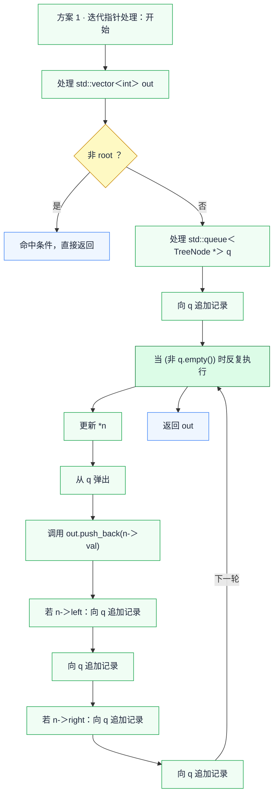

```cpp
// LeetCode 701. 二叉搜索树中的插入操作 — C++ 版（方案1）
#include <cassert>  // 引入头文件
#include <cstdint>  // 引入头文件
#include <iostream> // 引入头文件
#include <optional> // 引入头文件
#include <queue>    // 引入头文件
#include <vector>   // 引入头文件

struct TreeNode {    // 定义类型
    int val;         // int 值;
    TreeNode *left;  // TreeNode 乘 左边界;
    TreeNode *right; // TreeNode 乘 右边界;
    explicit TreeNode(int v) : val(v), left(nullptr), right(nullptr) {}
};

static TreeNode *build_tree(const std::vector<std::optional<int>> &vals) {
    if (vals.empty() || !vals[0].has_value())
        return nullptr; // 若 vals 是否为空 或 取反 vals[0].has_value()，直接返回 nullptr
    auto *root = new TreeNode(*vals[0]); // 把 new TreeNode( 乘 vals[0]); 写入 auto *root
    std::queue<TreeNode *> q;            // std::队列 小于 TreeNode 乘 超过 节点;
    q.push(root);                        // 把 根节点 压入栈/数组尾部
    size_t i = 1;                        // 把 1; 写入 size_t i
    while (!q.empty() &&
           i < vals.size()) { // 循环，直到不满足「取反 节点 是否为空 且 下标 i 小于 vals.大小(」
        TreeNode *node = q.front();                  // 把 节点.front(); 写入 TreeNode *node
        q.pop();                                     // 弹出栈顶元素
        if (i < vals.size()) {                       // 若 下标 i 小于 vals.大小(
            if (vals[i].has_value()) {               // 若 vals[下标 i].has_value(
                node->left = new TreeNode(*vals[i]); // 把 new TreeNode( 乘 vals[下标 i]); 写入 node->left
                q.push(node->left);                  // 把 节点 减 超过 左边界 压入栈/数组尾部
            }
            ++i; // 加一 下标 i;
        }
        if (i < vals.size()) {                        // 若 下标 i 小于 vals.大小(
            if (vals[i].has_value()) {                // 若 vals[下标 i].has_value(
                node->right = new TreeNode(*vals[i]); // 把 new TreeNode( 乘 vals[下标 i]); 写入 node->right
                q.push(node->right); // 把 节点 减 超过 右边界 压入栈/数组尾部
            }
            ++i; // 加一 下标 i;
        }
    }
    return root; // 返回 根节点
}

static void free_tree(TreeNode *n) { // 定义函数/方法 free_tree
    if (!n)
        return;          // 若 取反 元素个数) return;
    free_tree(n->left);  // free_tree(元素个数 减 超过 左边界);
    free_tree(n->right); // free_tree(元素个数 减 超过 右边界);
    delete n;            // delete 元素个数;
}
static bool sameTree(const TreeNode *p, const TreeNode *q) { // 定义函数/方法 sameTree
    if (!p && !q)
        return true; // 若 取反 节点 且 取反 节点，直接返回 true
    if (!p || !q || p->val != q->val)
        return false; // 若 取反 节点 或 取反 节点 或 节点 减 超过 值 不等于 节点 减 超过 值，直接返回 false
    return sameTree(p->left, q->left) && sameTree(p->right, q->right);
}
static std::vector<int>
levelsFlat(TreeNode *root) { // static std::vector 小于 int 超过 levelsFlat(TreeNode 乘 根节点) {
    std::vector<int> out;    // std::vector 小于 int 超过 out;
    if (!root)
        return out;           // 若 取反 根节点，直接返回 out
    std::queue<TreeNode *> q; // std::队列 小于 TreeNode 乘 超过 节点;
    q.push(root);             // 把 根节点 压入栈/数组尾部
    while (!q.empty()) {      // 循环，直到不满足「取反 节点.empty(」
        auto *n = q.front();
        q.pop();               // 弹出栈顶元素
        out.push_back(n->val); // out 追加 元素个数 减 超过 值);
        if (n->left)
            q.push(n->left); // 若 元素个数 减 超过 左边界) 节点 追加 元素个数 减 超过 左边界);
        if (n->right)
            q.push(n->right); // 若 元素个数 减 超过 右边界) 节点 追加 元素个数 减 超过 右边界);
    }
    return out; // 返回 out
}

static TreeNode *insertIntoBST(TreeNode *root,
                               int val) { // static TreeNode 乘 insertIntoBST(TreeNode 乘 根节点, int 值) {
    if (!root)
        return new TreeNode(val); // 若 取反 根节点，直接返回 new TreeNode(值)
    TreeNode *pos = root;         // 把 根节点; 写入 TreeNode *pos
    while (pos) {                 // 循环，直到不满足「pos」
        if (val < pos->val) {     // 若 值 小于 pos 减 超过 值
            if (!pos->left) {
                pos->left = new TreeNode(val);
                break;
            }
            pos = pos->left; // 把 pos 减 超过 左边界; 写入 pos
        } else {             // 否则
            if (!pos->right) {
                pos->right = new TreeNode(val);
                break;
            }
            pos = pos->right; // 把 pos 减 超过 右边界; 写入 pos
        }
    }
    return root; // 返回 根节点
}
int main() { // 程序入口：跑内嵌自测用例
    assert((levelsFlat(insertIntoBST(build_tree({4, 2, 7, 1, 3}), 5)) ==
            std::vector<int>{4, 2, 7, 1, 3, 5}));                           // 断言校验
    assert((levelsFlat(insertIntoBST(nullptr, 5)) == std::vector<int>{5})); // 断言校验
    std::cout << "PASS" << std::endl; // 全部用例通过，输出 PASS
    return 0;                         // 返回 0
}
```

#### 方案 2：迭代指针处理

**思路与代码分析**：核心是「迭代指针处理」。C++ 版用 STL 容器与迭代器，减少手写下标错误。代码里依次做这些事：栈的后进先出操作。**走读**：方案 2 · 迭代指针处理：开始 → 处理 std::vector＜int＞ out → 命中条件，直接返回 → 处理 std::queue＜TreeNode *＞ q → 向 q 追加记录 → 当 (非 q.empty()) 时反复执行 → 更新 *n → 从 q 弹出 → 调用 out.push_back(n-＞val) → 若 n-＞left：向 q 追加记录 → 向 q 追加记录 → 若 n-＞right：向 q 追加记录 → 向 q 追加记录 → 返回 out。

**运行架构**（真实控制流）：


```cpp
// LeetCode 701. 二叉搜索树中的插入操作 — C++ 版（方案2）
#include <cassert>  // 引入头文件
#include <cstdint>  // 引入头文件
#include <iostream> // 引入头文件
#include <optional> // 引入头文件
#include <queue>    // 引入头文件
#include <vector>   // 引入头文件

struct TreeNode {    // 定义类型
    int val;         // int 值;
    TreeNode *left;  // TreeNode 乘 左边界;
    TreeNode *right; // TreeNode 乘 右边界;
    explicit TreeNode(int v) : val(v), left(nullptr), right(nullptr) {}
};

static TreeNode *build_tree(const std::vector<std::optional<int>> &vals) {
    if (vals.empty() || !vals[0].has_value())
        return nullptr; // 若 vals 是否为空 或 取反 vals[0].has_value()，直接返回 nullptr
    auto *root = new TreeNode(*vals[0]); // 把 new TreeNode( 乘 vals[0]); 写入 auto *root
    std::queue<TreeNode *> q;            // std::队列 小于 TreeNode 乘 超过 节点;
    q.push(root);                        // 把 根节点 压入栈/数组尾部
    size_t i = 1;                        // 把 1; 写入 size_t i
    while (!q.empty() &&
           i < vals.size()) { // 循环，直到不满足「取反 节点 是否为空 且 下标 i 小于 vals.大小(」
        TreeNode *node = q.front();                  // 把 节点.front(); 写入 TreeNode *node
        q.pop();                                     // 弹出栈顶元素
        if (i < vals.size()) {                       // 若 下标 i 小于 vals.大小(
            if (vals[i].has_value()) {               // 若 vals[下标 i].has_value(
                node->left = new TreeNode(*vals[i]); // 把 new TreeNode( 乘 vals[下标 i]); 写入 node->left
                q.push(node->left);                  // 把 节点 减 超过 左边界 压入栈/数组尾部
            }
            ++i; // 加一 下标 i;
        }
        if (i < vals.size()) {                        // 若 下标 i 小于 vals.大小(
            if (vals[i].has_value()) {                // 若 vals[下标 i].has_value(
                node->right = new TreeNode(*vals[i]); // 把 new TreeNode( 乘 vals[下标 i]); 写入 node->right
                q.push(node->right); // 把 节点 减 超过 右边界 压入栈/数组尾部
            }
            ++i; // 加一 下标 i;
        }
    }
    return root; // 返回 根节点
}

static void free_tree(TreeNode *n) { // 定义函数/方法 free_tree
    if (!n)
        return;          // 若 取反 元素个数) return;
    free_tree(n->left);  // free_tree(元素个数 减 超过 左边界);
    free_tree(n->right); // free_tree(元素个数 减 超过 右边界);
    delete n;            // delete 元素个数;
}
static bool sameTree(const TreeNode *p, const TreeNode *q) { // 定义函数/方法 sameTree
    if (!p && !q)
        return true; // 若 取反 节点 且 取反 节点，直接返回 true
    if (!p || !q || p->val != q->val)
        return false; // 若 取反 节点 或 取反 节点 或 节点 减 超过 值 不等于 节点 减 超过 值，直接返回 false
    return sameTree(p->left, q->left) && sameTree(p->right, q->right);
}
static std::vector<int>
levelsFlat(TreeNode *root) { // static std::vector 小于 int 超过 levelsFlat(TreeNode 乘 根节点) {
    std::vector<int> out;    // std::vector 小于 int 超过 out;
    if (!root)
        return out;           // 若 取反 根节点，直接返回 out
    std::queue<TreeNode *> q; // std::队列 小于 TreeNode 乘 超过 节点;
    q.push(root);             // 把 根节点 压入栈/数组尾部
    while (!q.empty()) {      // 循环，直到不满足「取反 节点.empty(」
        auto *n = q.front();
        q.pop();               // 弹出栈顶元素
        out.push_back(n->val); // out 追加 元素个数 减 超过 值);
        if (n->left)
            q.push(n->left); // 若 元素个数 减 超过 左边界) 节点 追加 元素个数 减 超过 左边界);
        if (n->right)
            q.push(n->right); // 若 元素个数 减 超过 右边界) 节点 追加 元素个数 减 超过 右边界);
    }
    return out; // 返回 out
}

static TreeNode *insertIntoBST(TreeNode *root,
                               int val) { // static TreeNode 乘 insertIntoBST(TreeNode 乘 根节点, int 值) {
    if (!root)
        return new TreeNode(val); // 若 取反 根节点，直接返回 new TreeNode(值)
    TreeNode *pos = root;         // 把 根节点; 写入 TreeNode *pos
    while (pos) {                 // 循环，直到不满足「pos」
        if (val < pos->val) {     // 若 值 小于 pos 减 超过 值
            if (!pos->left) {
                pos->left = new TreeNode(val);
                break;
            }
            pos = pos->left; // 把 pos 减 超过 左边界; 写入 pos
        } else {             // 否则
            if (!pos->right) {
                pos->right = new TreeNode(val);
                break;
            }
            pos = pos->right; // 把 pos 减 超过 右边界; 写入 pos
        }
    }
    return root; // 返回 根节点
}
int main() { // 程序入口：跑内嵌自测用例
    assert((levelsFlat(insertIntoBST(build_tree({4, 2, 7, 1, 3}), 5)) ==
            std::vector<int>{4, 2, 7, 1, 3, 5}));                           // 断言校验
    assert((levelsFlat(insertIntoBST(nullptr, 5)) == std::vector<int>{5})); // 断言校验
    std::cout << "PASS" << std::endl; // 全部用例通过，输出 PASS
    return 0;                         // 返回 0
}
```

### R 实现（2 种方案）

R 的全部方案如下，每个方案都内嵌用例自测，可独立运行（老仓库 python/go 文件遵循「打印结果」约定）：

#### 方案 1：迭代指针处理

**思路与代码分析**：核心是「迭代指针处理」。R 版用向量化思维与 1 起始下标，注意 1:n 的降序陷阱。**走读**：方案 1 · 迭代指针处理：开始 → 更新 new.env(parent → 处理 e$val ＜- val → 处理 e$left ＜- left → 处理 e$right ＜- right → 调用 class(e) ＜- TreeNode → 处理 e → 返回结果。

**运行架构**（真实控制流）：

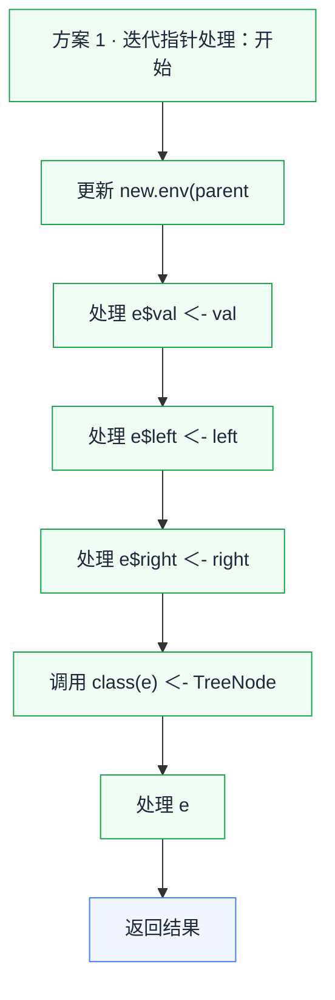

```r
# 二叉搜索树中的插入操作 — R 版（方案1） 树节点：R 必须 environment 引用语义（list 是值语义） 定义函数
# TreeNode（参数：值, 左边界 赋值为 NULL, 右边界 赋值为 NULL）
TreeNode <- function(val, left = NULL, right = NULL) {
    e <- new.env(parent = emptyenv())  # 把 new.env(parent 赋值为 emptyenv()) 存入 e
    e$val <- val
    e$left <- left
    e$right <- right  # 把 值; e$左边界 小于 减 左边界; e$右边界 小于 减 右边界 存入 e$val
    class(e) <- "TreeNode"  # 把 「TreeNode」 存入 class(e)
    e
}
build_tree <- function(vals) {
    # 定义函数 build_tree（参数：vals）
    if (length(vals) == 0 || is.na(vals[[1]]))
        return(NULL)  # 若 长度(vals) 等于 0 或 is.na(vals[[1]])) return(NULL
    root <- TreeNode(vals[[1]])  # 把 TreeNode(vals[[1]]) 存入 根节点
    queue <- list(root)  # 把 列表(根节点) 存入 队列
    head <- 1L  # 把 1L 存入 头节点
    i <- 2L  # 把 2L 存入 下标 i
    while (head <= length(queue) && i <= length(vals)) {
        # 循环，直到不满足「头节点 不超过 长度(队列) 且 下标 i 不超过 长度(vals」
        node <- queue[[head]]  # 把 队列[[头节点]] 存入 节点
        head <- head + 1L  # 把 头节点 加 1L 存入 头节点
        if (i <= length(vals)) {
            # 若 下标 i 不超过 长度(vals 若 取反 is.na(vals[[下标 i]]
            if (!is.na(vals[[i]])) {
                node$left <- TreeNode(vals[[i]])  # 把 TreeNode(vals[[下标 i]]) 存入 node$left
                queue[[length(queue) + 1L]] <- node$left  # 队列[[长度(队列) 加 1L]] 小于 减 节点$左边界
            }
            i <- i + 1L  # 把 下标 i 加 1L 存入 下标 i
        }
        if (i <= length(vals)) {
            # 若 下标 i 不超过 长度(vals 若 取反 is.na(vals[[下标 i]]
            if (!is.na(vals[[i]])) {
                node$right <- TreeNode(vals[[i]])  # 把 TreeNode(vals[[下标 i]]) 存入 node$right
                queue[[length(queue) + 1L]] <- node$right  # 队列[[长度(队列) 加 1L]] 小于 减 节点$右边界
            }
            i <- i + 1L  # 把 下标 i 加 1L 存入 下标 i
        }
    }
    root  # 根节点
}
# 层序转列表（用于断言输出） 定义函数 tree_to_levels（参数：根节点）
tree_to_levels <- function(root) {
    if (is.null(root))
        return(list())  # 若 is.null(根节点)) return(列表(
    res <- list()  # 把 列表() 存入 结果
    level <- list(root)  # 把 列表(根节点) 存入 level
    while (length(level) > 0) {
        # 循环，直到不满足「长度(level) 超过 0」
        vals <- list()
        nxt <- list()  # 把 列表(); nxt 小于 减 列表() 存入 vals
        for (nd in level) {
            # for (nd in level) {
            vals[[length(vals) + 1L]] <- nd$val  # vals[[长度(vals) 加 1L]] 小于 减 nd$值
            if (!is.null(nd$left))
                nxt[[length(nxt) + 1L]] <- nd$left  # 若 取反 is.null(nd$左边界)) nxt[[长度(nxt) 加 1L]] 小于 减 nd$左边界
            if (!is.null(nd$right))
                nxt[[length(nxt) + 1L]] <- nd$right  # 若 取反 is.null(nd$右边界)) nxt[[长度(nxt) 加 1L]] 小于 减 nd$右边界
        }
        res[[length(res) + 1L]] <- unlist(vals)  # 结果[[长度(结果) 加 1L]] 小于 减 unlist(vals)
        level <- nxt  # 把 nxt 存入 level
    }
    res  # 结果
}
same_tree <- function(p, q) {
    # 定义函数 same_tree（参数：节点, 节点）
    if (is.null(p) && is.null(q))
        return(TRUE)  # 若 is.null(节点) 且 is.null(节点)) return(TRUE
    if (is.null(p) || is.null(q) || p$val != q$val)
        return(FALSE)  # 若 is.null(节点) 或 is.null(节点) 或 节点$值 不等于 节点$值) return(FALSE
    same_tree(p$left, q$left) && same_tree(p$right, q$right)  # same_tree(节点$左边界, 节点$左边界) 且 same_tree(节点$右边界, 节点$右边界)
}
levels_flat <- function(root) unlist(tree_to_levels(root))  # 定义函数 levels_flat（参数：根节点）
insert_into_bst <- function(root, val) {
    # 定义函数 insert_into_bst（参数：根节点, 值）
    if (is.null(root))
        return(TreeNode(val))  # 若 is.null(根节点)) return(TreeNode(值
    pos <- root  # 把 根节点 存入 pos
    repeat {
        # repeat { 若 值 小于 pos$值
        if (val < pos$val) {
            if (is.null(pos$left))
                {
                  pos$left <- TreeNode(val)
                  break
                }  # 若 is.null(pos$左边界)) { pos$左边界 小于 减 TreeNode(值); break }
            pos <- pos$left  # 把 pos$左边界 存入 pos
        } else {
            # 否则
            if (is.null(pos$right))
                {
                  pos$right <- TreeNode(val)
                  break
                }  # 若 is.null(pos$右边界)) { pos$右边界 小于 减 TreeNode(值); break }
            pos <- pos$right  # 把 pos$右边界 存入 pos
        }
    }
    root  # 根节点
}
stopifnot(identical(levels_flat(insert_into_bst(build_tree(list(4L, 2L, 7L, 1L, 3L)), 5L)), c(4L, 2L, 7L, 1L, 3L,
    5L)))  # 断言校验
stopifnot(identical(levels_flat(insert_into_bst(NULL, 5L)), 5L))  # 断言校验
cat("PASS\n")  # 全部用例通过，输出 PASS
```

#### 方案 2：迭代指针处理

**思路与代码分析**：核心是「迭代指针处理」。R 版用向量化思维与 1 起始下标，注意 1:n 的降序陷阱。**走读**：方案 2 · 迭代指针处理：开始 → 更新 new.env(parent → 处理 e$val ＜- val → 处理 e$left ＜- left → 处理 e$right ＜- right → 调用 class(e) ＜- TreeNode → 处理 e → 返回结果。

**运行架构**（真实控制流）：

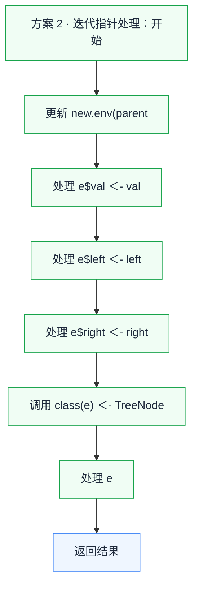

```r
# 二叉搜索树中的插入操作 — R 版（方案2） 树节点：R 必须 environment 引用语义（list 是值语义） 定义函数
# TreeNode（参数：值, 左边界 赋值为 NULL, 右边界 赋值为 NULL）
TreeNode <- function(val, left = NULL, right = NULL) {
    e <- new.env(parent = emptyenv())  # 把 new.env(parent 赋值为 emptyenv()) 存入 e
    e$val <- val
    e$left <- left
    e$right <- right  # 把 值; e$左边界 小于 减 左边界; e$右边界 小于 减 右边界 存入 e$val
    class(e) <- "TreeNode"  # 把 「TreeNode」 存入 class(e)
    e
}
build_tree <- function(vals) {
    # 定义函数 build_tree（参数：vals）
    if (length(vals) == 0 || is.na(vals[[1]]))
        return(NULL)  # 若 长度(vals) 等于 0 或 is.na(vals[[1]])) return(NULL
    root <- TreeNode(vals[[1]])  # 把 TreeNode(vals[[1]]) 存入 根节点
    queue <- list(root)  # 把 列表(根节点) 存入 队列
    head <- 1L  # 把 1L 存入 头节点
    i <- 2L  # 把 2L 存入 下标 i
    while (head <= length(queue) && i <= length(vals)) {
        # 循环，直到不满足「头节点 不超过 长度(队列) 且 下标 i 不超过 长度(vals」
        node <- queue[[head]]  # 把 队列[[头节点]] 存入 节点
        head <- head + 1L  # 把 头节点 加 1L 存入 头节点
        if (i <= length(vals)) {
            # 若 下标 i 不超过 长度(vals 若 取反 is.na(vals[[下标 i]]
            if (!is.na(vals[[i]])) {
                node$left <- TreeNode(vals[[i]])  # 把 TreeNode(vals[[下标 i]]) 存入 node$left
                queue[[length(queue) + 1L]] <- node$left  # 队列[[长度(队列) 加 1L]] 小于 减 节点$左边界
            }
            i <- i + 1L  # 把 下标 i 加 1L 存入 下标 i
        }
        if (i <= length(vals)) {
            # 若 下标 i 不超过 长度(vals 若 取反 is.na(vals[[下标 i]]
            if (!is.na(vals[[i]])) {
                node$right <- TreeNode(vals[[i]])  # 把 TreeNode(vals[[下标 i]]) 存入 node$right
                queue[[length(queue) + 1L]] <- node$right  # 队列[[长度(队列) 加 1L]] 小于 减 节点$右边界
            }
            i <- i + 1L  # 把 下标 i 加 1L 存入 下标 i
        }
    }
    root  # 根节点
}
# 层序转列表（用于断言输出） 定义函数 tree_to_levels（参数：根节点）
tree_to_levels <- function(root) {
    if (is.null(root))
        return(list())  # 若 is.null(根节点)) return(列表(
    res <- list()  # 把 列表() 存入 结果
    level <- list(root)  # 把 列表(根节点) 存入 level
    while (length(level) > 0) {
        # 循环，直到不满足「长度(level) 超过 0」
        vals <- list()
        nxt <- list()  # 把 列表(); nxt 小于 减 列表() 存入 vals
        for (nd in level) {
            # for (nd in level) {
            vals[[length(vals) + 1L]] <- nd$val  # vals[[长度(vals) 加 1L]] 小于 减 nd$值
            if (!is.null(nd$left))
                nxt[[length(nxt) + 1L]] <- nd$left  # 若 取反 is.null(nd$左边界)) nxt[[长度(nxt) 加 1L]] 小于 减 nd$左边界
            if (!is.null(nd$right))
                nxt[[length(nxt) + 1L]] <- nd$right  # 若 取反 is.null(nd$右边界)) nxt[[长度(nxt) 加 1L]] 小于 减 nd$右边界
        }
        res[[length(res) + 1L]] <- unlist(vals)  # 结果[[长度(结果) 加 1L]] 小于 减 unlist(vals)
        level <- nxt  # 把 nxt 存入 level
    }
    res  # 结果
}
same_tree <- function(p, q) {
    # 定义函数 same_tree（参数：节点, 节点）
    if (is.null(p) && is.null(q))
        return(TRUE)  # 若 is.null(节点) 且 is.null(节点)) return(TRUE
    if (is.null(p) || is.null(q) || p$val != q$val)
        return(FALSE)  # 若 is.null(节点) 或 is.null(节点) 或 节点$值 不等于 节点$值) return(FALSE
    same_tree(p$left, q$left) && same_tree(p$right, q$right)  # same_tree(节点$左边界, 节点$左边界) 且 same_tree(节点$右边界, 节点$右边界)
}
levels_flat <- function(root) unlist(tree_to_levels(root))  # 定义函数 levels_flat（参数：根节点）
insert_into_bst <- function(root, val) {
    # 定义函数 insert_into_bst（参数：根节点, 值）
    if (is.null(root))
        return(TreeNode(val))  # 若 is.null(根节点)) return(TreeNode(值
    pos <- root  # 把 根节点 存入 pos
    repeat {
        # repeat { 若 值 小于 pos$值
        if (val < pos$val) {
            if (is.null(pos$left))
                {
                  pos$left <- TreeNode(val)
                  break
                }  # 若 is.null(pos$左边界)) { pos$左边界 小于 减 TreeNode(值); break }
            pos <- pos$left  # 把 pos$左边界 存入 pos
        } else {
            # 否则
            if (is.null(pos$right))
                {
                  pos$right <- TreeNode(val)
                  break
                }  # 若 is.null(pos$右边界)) { pos$右边界 小于 减 TreeNode(值); break }
            pos <- pos$right  # 把 pos$右边界 存入 pos
        }
    }
    root  # 根节点
}
stopifnot(identical(levels_flat(insert_into_bst(build_tree(list(4L, 2L, 7L, 1L, 3L)), 5L)), c(4L, 2L, 7L, 1L, 3L,
    5L)))  # 断言校验
stopifnot(identical(levels_flat(insert_into_bst(NULL, 5L)), 5L))  # 断言校验
cat("PASS\n")  # 全部用例通过，输出 PASS
```

### Zig 实现（2 种方案）

Zig 的全部方案如下，每个方案都内嵌用例自测，可独立运行（老仓库 python/go 文件遵循「打印结果」约定）：

#### 方案 1：迭代指针处理

**思路与代码分析**：核心是「迭代指针处理」。Zig 版显式分配与清零，整型边界处理严格。代码里依次做这些事：队列或堆的调度。**走读**：方案 1 · 迭代指针处理：开始 → 计算 r → 计算 q → 处理 defer q.deinit() → 向 q 追加记录 → 计算 head → 当 (head ＜ q.items.len) 时反复执行 → 计算 node → 更新 + → 向 out 追加记录 → 若 node.left) ｜c｜ q.append(c：处理 catch unreachable → 若 node.right) ｜c｜ q.append(c：处理 catch unreachable → 返回结果。

**运行架构**（真实控制流）：

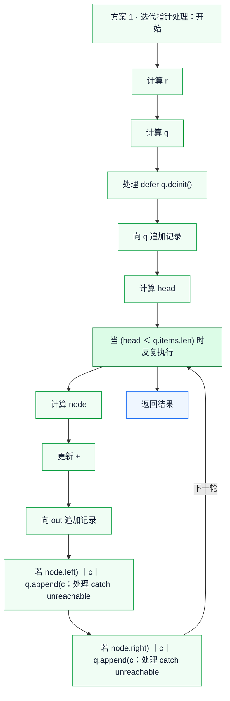

```zig
// LeetCode 701. 二叉搜索树中的插入操作 — Zig 版（方案1）
const std = @import("std"); // 把 @import(「std」) 存入 std

const TreeNode = struct { // 把 struct { 存入 TreeNode
    val: i32,
    left: ?*TreeNode,
    right: ?*TreeNode,
};

fn buildTree(allocator: std.mem.Allocator, vals: []const i32) !?*TreeNode { // 定义函数/方法 buildTree
    if (vals.len == 0 or vals[0] == -1) return null; // 若 vals.长度 等于 0 or vals[0] 等于 减 1，直接返回 null
    const root = try allocator.create(TreeNode); // 把 try allocator.create(TreeNode) 存入 根节点
    root.* = .{ .val = vals[0], .left = null, .right = null };
    var queue = std.ArrayList(*TreeNode).init(allocator); // 把 std.ArrayList( 乘 TreeNode).init(allocator) 存入 队列
    defer queue.deinit(); // defer 队列.deinit();
    try queue.append(root); // 把 根节点 追加到列表尾部
    var head: usize = 0; // 把 0; 写入 var head: usize
    var i: usize = 1; // 把 1; 写入 var i: usize
    while (head < queue.items.len and i < vals.len) { // 循环，直到不满足「头节点 小于 队列.items.长度 and 下标 i 小于 vals.长度」
        const node = queue.items[head]; // 把 队列.items[头节点] 存入 节点
        head += 1; // 头节点累加 1
        if (i < vals.len) { // 若 下标 i 小于 vals.长度
            if (vals[i] != -1) { // 若 vals[下标 i] 不等于 减 1
                const child = try allocator.create(TreeNode); // 把 try allocator.create(TreeNode) 存入 子节点
                child.* = .{ .val = vals[i], .left = null, .right = null };
                node.left = child; // 把 子节点; 写入 左边界
                try queue.append(child); // 把 子节点 追加到列表尾部
            }
            i += 1; // 下标 i累加 1
        }
        if (i < vals.len) { // 若 下标 i 小于 vals.长度
            if (vals[i] != -1) { // 若 vals[下标 i] 不等于 减 1
                const child = try allocator.create(TreeNode); // 把 try allocator.create(TreeNode) 存入 子节点
                child.* = .{ .val = vals[i], .left = null, .right = null };
                node.right = child; // 把 子节点; 写入 右边界
                try queue.append(child); // 把 子节点 追加到列表尾部
            }
            i += 1; // 下标 i累加 1
        }
    }
    return root; // 返回 根节点
}
fn sameTree(p: ?*const TreeNode, q: ?*const TreeNode) bool { // 定义函数/方法 sameTree
    if (p == null and q == null) return true; // 若 节点 等于 null and 节点 等于 null，直接返回 true
    if (p == null or q == null) return false; // 若 节点 等于 null or 节点 等于 null，直接返回 false
    const a = p.?; // 把 节点.? 存入 数组
    const b = q.?; // 把 节点.? 存入 b
    return a.val == b.val and sameTree(a.left, b.left) and sameTree(a.right, b.right);
}
fn levelsFlat(root: ?*TreeNode, out: *std.ArrayList(i32)) void { // 定义函数/方法 levelsFlat
    const r = root orelse return; // 把 根节点 orelse return 存入 右指针
    var q = std.ArrayList(*TreeNode).init(std.heap.page_allocator);
    defer q.deinit(); // defer 节点.deinit();
    q.append(r) catch unreachable; // 把 右指针 追加到列表尾部
    var head: usize = 0; // 把 0; 写入 var head: usize
    while (head < q.items.len) { // 循环，直到不满足「头节点 小于 节点.items.长度」
        const node = q.items[head]; // 把 节点.items[头节点] 存入 节点
        head += 1; // 头节点累加 1
        out.append(node.val) catch unreachable; // 把 节点.值 追加到列表尾部
        if (node.left) |c| q.append(c) catch unreachable; // 若 节点.左边界) 按位或 字符 按位或 节点 追加 字符) catch unreachable;
        if (node.right) |c| q.append(c) catch unreachable; // 若 节点.右边界) 按位或 字符 按位或 节点 追加 字符) catch unreachable;
    }
}

fn insertIntoBST(root: ?*TreeNode, val: i32, alloc: std.mem.Allocator) ?*TreeNode { // 定义函数/方法 insertIntoBST
    const r = root orelse { // 把 根节点 orelse { 存入 右指针
        const n = alloc.create(TreeNode) catch unreachable; // 把 alloc.create(TreeNode) catch unreachable 存入 元素个数
        n.* = .{ .val = val, .left = null, .right = null }; // 把 { .值 赋值为 值, .左边界 赋值为 null, .右边界 赋值为 null }; 写入 n.*
        return n; // 返回 元素个数
    };
    var pos: *TreeNode = r; // 把 右指针; 写入 var pos: *TreeNode
    while (true) { // 循环，直到不满足「true」
        if (val < pos.val) { // 若 值 小于 pos.值
            if (pos.left) |c| {
                pos = c;
            } else { // 若 pos.左边界) 按位或 字符 按位或 { pos 赋值为 字符; } else
                const n = alloc.create(TreeNode) catch unreachable; // 把 alloc.create(TreeNode) catch unreachable 存入 元素个数
                n.* = .{ .val = val, .left = null, .right = null }; // 把 { .值 赋值为 值, .左边界 赋值为 null, .右边界 赋值为 null }; 写入 n.*
                pos.left = n; // 把 元素个数; 写入 左边界
                break; // 跳出循环
            }
        } else { // 否则
            if (pos.right) |c| {
                pos = c;
            } else { // 若 pos.右边界) 按位或 字符 按位或 { pos 赋值为 字符; } else
                const n = alloc.create(TreeNode) catch unreachable; // 把 alloc.create(TreeNode) catch unreachable 存入 元素个数
                n.* = .{ .val = val, .left = null, .right = null }; // 把 { .值 赋值为 值, .左边界 赋值为 null, .右边界 赋值为 null }; 写入 n.*
                pos.right = n; // 把 元素个数; 写入 右边界
                break; // 跳出循环
            }
        }
    }
    return r; // 返回 右指针
}
pub fn main() !void { // 程序入口：跑内嵌自测用例
    var arena = std.heap.ArenaAllocator.init(std.heap.page_allocator); // 把 std.堆.ArenaAllocator.init(std.堆.page_allocator) 存入 arena
    defer arena.deinit(); // defer arena.deinit();
    const alloc = arena.allocator(); // 把 arena.allocator() 存入 alloc
    var out = std.ArrayList(i32).init(std.heap.page_allocator); // 把 std.ArrayList(i32).init(std.堆.page_allocator) 存入 out
    defer out.deinit(); // defer out.deinit();
    const t = try buildTree(alloc, &[_]i32{ 4, 2, 7, 1, 3 }); // 把 try buildTree(alloc, 按位与 [_]i32{ 4, 2, 7, 1, 3 }) 存入 另一字符串
    levelsFlat(insertIntoBST(t, 5, alloc), &out); // levelsFlat(insertIntoBST(另一字符串, 5, alloc), 按位与 out);
    const want = [_]i32{ 4, 2, 7, 1, 3, 5 }; // 把 [_]i32{ 4, 2, 7, 1, 3, 5 } 存入 want
    if (out.items.len != want.len) return error.TestFailed; // 若 out.items.长度 不等于 want.长度，直接返回 error.TestFailed
    for (want, 0..) |w, i| if (out.items[i] != w) return error.TestFailed;
    out.clearRetainingCapacity(); // out.clearRetainingCapacity();
    levelsFlat(insertIntoBST(null, 5, alloc), &out); // levelsFlat(insertIntoBST(null, 5, alloc), 按位与 out);
    if (out.items.len != 1 or out.items[0] != 5) return error.TestFailed;
    std.debug.print("PASS\n", .{}); // 全部用例通过，输出 PASS
}
```

#### 方案 2：迭代指针处理

**思路与代码分析**：核心是「迭代指针处理」。Zig 版显式分配与清零，整型边界处理严格。代码里依次做这些事：队列或堆的调度。**走读**：方案 2 · 迭代指针处理：开始 → 计算 r → 计算 q → 处理 defer q.deinit() → 向 q 追加记录 → 计算 head → 当 (head ＜ q.items.len) 时反复执行 → 计算 node → 更新 + → 向 out 追加记录 → 若 node.left) ｜c｜ q.append(c：处理 catch unreachable → 若 node.right) ｜c｜ q.append(c：处理 catch unreachable → 返回结果。

**运行架构**（真实控制流）：

```mermaid
graph TD
    N0["方案 2 · 迭代指针处理：开始"]
    N1["计算 r"]
    N2["计算 q"]
    N3["处理 defer q.deinit()"]
    N4["向 q 追加记录"]
    N5["计算 head"]
    N6["当 (head ＜ q.items.len) 时反复执行"]
    N7["计算 node"]
    N8["更新 +"]
    N9["向 out 追加记录"]
    N10["若 node.left) ｜c｜ q.append(c：处理 catch unreachable"]
    N11["若 node.right) ｜c｜ q.append(c：处理 catch unreachable"]
    N12["返回结果"]
    N0 --> N1
    N1 --> N2
    N2 --> N3
    N3 --> N4
    N4 --> N5
    N5 --> N6
    N6 --> N7
    N7 --> N8
    N8 --> N9
    N9 --> N10
    N10 --> N11
    N11 -- 下一轮 --> N6
    N6 --> N12
    classDef n fill:#f0fdf4,stroke:#16a34a,color:#1e293b;
    classDef lp fill:#dcfce7,stroke:#15803d,color:#1e293b;
    classDef dc fill:#fef9c3,stroke:#ca8a04,color:#1e293b;
    classDef tm fill:#eff6ff,stroke:#3b82f6,color:#1e293b;
    class N0,N1,N2,N3,N4,N5,N7,N8,N9,N10,N11 n;
    class N6 lp;
    class N12 tm;
```

```zig
// LeetCode 701. 二叉搜索树中的插入操作 — Zig 版（方案2）
const std = @import("std"); // 把 @import(「std」) 存入 std

const TreeNode = struct { // 把 struct { 存入 TreeNode
    val: i32,
    left: ?*TreeNode,
    right: ?*TreeNode,
};

fn buildTree(allocator: std.mem.Allocator, vals: []const i32) !?*TreeNode { // 定义函数/方法 buildTree
    if (vals.len == 0 or vals[0] == -1) return null; // 若 vals.长度 等于 0 or vals[0] 等于 减 1，直接返回 null
    const root = try allocator.create(TreeNode); // 把 try allocator.create(TreeNode) 存入 根节点
    root.* = .{ .val = vals[0], .left = null, .right = null };
    var queue = std.ArrayList(*TreeNode).init(allocator); // 把 std.ArrayList( 乘 TreeNode).init(allocator) 存入 队列
    defer queue.deinit(); // defer 队列.deinit();
    try queue.append(root); // 把 根节点 追加到列表尾部
    var head: usize = 0; // 把 0; 写入 var head: usize
    var i: usize = 1; // 把 1; 写入 var i: usize
    while (head < queue.items.len and i < vals.len) { // 循环，直到不满足「头节点 小于 队列.items.长度 and 下标 i 小于 vals.长度」
        const node = queue.items[head]; // 把 队列.items[头节点] 存入 节点
        head += 1; // 头节点累加 1
        if (i < vals.len) { // 若 下标 i 小于 vals.长度
            if (vals[i] != -1) { // 若 vals[下标 i] 不等于 减 1
                const child = try allocator.create(TreeNode); // 把 try allocator.create(TreeNode) 存入 子节点
                child.* = .{ .val = vals[i], .left = null, .right = null };
                node.left = child; // 把 子节点; 写入 左边界
                try queue.append(child); // 把 子节点 追加到列表尾部
            }
            i += 1; // 下标 i累加 1
        }
        if (i < vals.len) { // 若 下标 i 小于 vals.长度
            if (vals[i] != -1) { // 若 vals[下标 i] 不等于 减 1
                const child = try allocator.create(TreeNode); // 把 try allocator.create(TreeNode) 存入 子节点
                child.* = .{ .val = vals[i], .left = null, .right = null };
                node.right = child; // 把 子节点; 写入 右边界
                try queue.append(child); // 把 子节点 追加到列表尾部
            }
            i += 1; // 下标 i累加 1
        }
    }
    return root; // 返回 根节点
}
fn sameTree(p: ?*const TreeNode, q: ?*const TreeNode) bool { // 定义函数/方法 sameTree
    if (p == null and q == null) return true; // 若 节点 等于 null and 节点 等于 null，直接返回 true
    if (p == null or q == null) return false; // 若 节点 等于 null or 节点 等于 null，直接返回 false
    const a = p.?; // 把 节点.? 存入 数组
    const b = q.?; // 把 节点.? 存入 b
    return a.val == b.val and sameTree(a.left, b.left) and sameTree(a.right, b.right);
}
fn levelsFlat(root: ?*TreeNode, out: *std.ArrayList(i32)) void { // 定义函数/方法 levelsFlat
    const r = root orelse return; // 把 根节点 orelse return 存入 右指针
    var q = std.ArrayList(*TreeNode).init(std.heap.page_allocator);
    defer q.deinit(); // defer 节点.deinit();
    q.append(r) catch unreachable; // 把 右指针 追加到列表尾部
    var head: usize = 0; // 把 0; 写入 var head: usize
    while (head < q.items.len) { // 循环，直到不满足「头节点 小于 节点.items.长度」
        const node = q.items[head]; // 把 节点.items[头节点] 存入 节点
        head += 1; // 头节点累加 1
        out.append(node.val) catch unreachable; // 把 节点.值 追加到列表尾部
        if (node.left) |c| q.append(c) catch unreachable; // 若 节点.左边界) 按位或 字符 按位或 节点 追加 字符) catch unreachable;
        if (node.right) |c| q.append(c) catch unreachable; // 若 节点.右边界) 按位或 字符 按位或 节点 追加 字符) catch unreachable;
    }
}

fn insertIntoBST(root: ?*TreeNode, val: i32, alloc: std.mem.Allocator) ?*TreeNode { // 定义函数/方法 insertIntoBST
    const r = root orelse { // 把 根节点 orelse { 存入 右指针
        const n = alloc.create(TreeNode) catch unreachable; // 把 alloc.create(TreeNode) catch unreachable 存入 元素个数
        n.* = .{ .val = val, .left = null, .right = null }; // 把 { .值 赋值为 值, .左边界 赋值为 null, .右边界 赋值为 null }; 写入 n.*
        return n; // 返回 元素个数
    };
    var pos: *TreeNode = r; // 把 右指针; 写入 var pos: *TreeNode
    while (true) { // 循环，直到不满足「true」
        if (val < pos.val) { // 若 值 小于 pos.值
            if (pos.left) |c| {
                pos = c;
            } else { // 若 pos.左边界) 按位或 字符 按位或 { pos 赋值为 字符; } else
                const n = alloc.create(TreeNode) catch unreachable; // 把 alloc.create(TreeNode) catch unreachable 存入 元素个数
                n.* = .{ .val = val, .left = null, .right = null }; // 把 { .值 赋值为 值, .左边界 赋值为 null, .右边界 赋值为 null }; 写入 n.*
                pos.left = n; // 把 元素个数; 写入 左边界
                break; // 跳出循环
            }
        } else { // 否则
            if (pos.right) |c| {
                pos = c;
            } else { // 若 pos.右边界) 按位或 字符 按位或 { pos 赋值为 字符; } else
                const n = alloc.create(TreeNode) catch unreachable; // 把 alloc.create(TreeNode) catch unreachable 存入 元素个数
                n.* = .{ .val = val, .left = null, .right = null }; // 把 { .值 赋值为 值, .左边界 赋值为 null, .右边界 赋值为 null }; 写入 n.*
                pos.right = n; // 把 元素个数; 写入 右边界
                break; // 跳出循环
            }
        }
    }
    return r; // 返回 右指针
}
pub fn main() !void { // 程序入口：跑内嵌自测用例
    var arena = std.heap.ArenaAllocator.init(std.heap.page_allocator); // 把 std.堆.ArenaAllocator.init(std.堆.page_allocator) 存入 arena
    defer arena.deinit(); // defer arena.deinit();
    const alloc = arena.allocator(); // 把 arena.allocator() 存入 alloc
    var out = std.ArrayList(i32).init(std.heap.page_allocator); // 把 std.ArrayList(i32).init(std.堆.page_allocator) 存入 out
    defer out.deinit(); // defer out.deinit();
    const t = try buildTree(alloc, &[_]i32{ 4, 2, 7, 1, 3 }); // 把 try buildTree(alloc, 按位与 [_]i32{ 4, 2, 7, 1, 3 }) 存入 另一字符串
    levelsFlat(insertIntoBST(t, 5, alloc), &out); // levelsFlat(insertIntoBST(另一字符串, 5, alloc), 按位与 out);
    const want = [_]i32{ 4, 2, 7, 1, 3, 5 }; // 把 [_]i32{ 4, 2, 7, 1, 3, 5 } 存入 want
    if (out.items.len != want.len) return error.TestFailed; // 若 out.items.长度 不等于 want.长度，直接返回 error.TestFailed
    for (want, 0..) |w, i| if (out.items[i] != w) return error.TestFailed;
    out.clearRetainingCapacity(); // out.clearRetainingCapacity();
    levelsFlat(insertIntoBST(null, 5, alloc), &out); // levelsFlat(insertIntoBST(null, 5, alloc), 按位与 out);
    if (out.items.len != 1 or out.items[0] != 5) return error.TestFailed;
    std.debug.print("PASS\n", .{}); // 全部用例通过，输出 PASS
}
```

### Dart 实现（2 种方案）

Dart 的全部方案如下，每个方案都内嵌用例自测，可独立运行（老仓库 python/go 文件遵循「打印结果」约定）：

#### 方案 1：迭代指针处理

**思路与代码分析**：核心是「迭代指针处理」。Dart 版用可空类型标注与集合方法，注意空安全。**走读**：方案 1 · 迭代指针处理：开始 → 命中条件，直接返回 → 更新 out → 更新 q → 计算 head → 当 (head ＜ q.length) 时反复执行 → 更新 n → 调用 out.add(n.val) → 若 n.left ≠ null：调用 q.add(n.left非 ) → 调用 q.add(n.left非 ) → 若 n.right ≠ null：调用 q.add(n.right非 ) → 调用 q.add(n.right非 ) → 返回 out。

**运行架构**（真实控制流）：

```mermaid
graph TD
    N0["方案 1 · 迭代指针处理：开始"]
    N1{"root == null ？"}
    N2["命中条件，直接返回"]
    N3["更新 out"]
    N4["更新 q"]
    N5["计算 head"]
    N6["当 (head ＜ q.length) 时反复执行"]
    N7["更新 n"]
    N8["调用 out.add(n.val)"]
    N9["若 n.left ≠ null：调用 q.add(n.left非 )"]
    N10["调用 q.add(n.left非 )"]
    N11["若 n.right ≠ null：调用 q.add(n.right非 )"]
    N12["调用 q.add(n.right非 )"]
    N13["返回 out"]
    N0 --> N1
    N1 -- 是 --> N2
    N1 -- 否 --> N3
    N3 --> N4
    N4 --> N5
    N5 --> N6
    N6 --> N7
    N7 --> N8
    N8 --> N9
    N9 --> N10
    N10 --> N11
    N11 --> N12
    N12 -- 下一轮 --> N6
    N6 --> N13
    classDef n fill:#f0fdf4,stroke:#16a34a,color:#1e293b;
    classDef lp fill:#dcfce7,stroke:#15803d,color:#1e293b;
    classDef dc fill:#fef9c3,stroke:#ca8a04,color:#1e293b;
    classDef tm fill:#eff6ff,stroke:#3b82f6,color:#1e293b;
    class N0,N3,N4,N5,N7,N8,N9,N10,N11,N12 n;
    class N6 lp;
    class N1 dc;
    class N2,N13 tm;
```

```dart
// LeetCode 701. 二叉搜索树中的插入操作 — Dart 版（方案1）
class TreeNode {
  // 定义类型
  int val; // int 值;
  TreeNode? left; // TreeNode? 左边界;
  TreeNode? right; // TreeNode? 右边界;
  TreeNode(this.val); // TreeNode(this.值);
}

TreeNode? buildTree(List<int?> vals) {
  // TreeNode? buildTree(List 小于 int? 超过 vals) {
  if (vals.isEmpty || vals[0] == null)
    return null; // 若 vals.isEmpty 或 vals[0] 等于 null，直接返回 null
  final root = TreeNode(vals[0]!); // 把 TreeNode(vals[0]取反 ) 存入 根节点
  final queue = <TreeNode>[root]; // 把 小于 TreeNode 超过 [根节点] 存入 队列
  var head = 0; // 把 0 存入 头节点
  var i = 1; // 把 1 存入 下标 i
  while (head < queue.length && i < vals.length) {
    // 循环，直到不满足「头节点 小于 队列.长度 且 下标 i 小于 vals.长度」
    final node = queue[head++]; // 把 队列[头节点 加一 ] 存入 节点
    if (i < vals.length) {
      // 若 下标 i 小于 vals.长度
      if (vals[i] != null) {
        // 若 vals[下标 i] 不等于 null
        node.left = TreeNode(vals[i]!); // 把 TreeNode(vals[下标 i]取反 ); 写入 左边界
        queue.add(node.left!); // 队列 追加 节点.左边界取反 );
      }
      i++; // 下标 i 加一
    }
    if (i < vals.length) {
      // 若 下标 i 小于 vals.长度
      if (vals[i] != null) {
        // 若 vals[下标 i] 不等于 null
        node.right = TreeNode(vals[i]!); // 把 TreeNode(vals[下标 i]取反 ); 写入 右边界
        queue.add(node.right!); // 队列 追加 节点.右边界取反 );
      }
      i++; // 下标 i 加一
    }
  }
  return root; // 返回 根节点
}

List<List<int>> treeToLevels(TreeNode? root) {
  // 定义函数/方法 treeToLevels
  if (root == null) return []; // 若 根节点 等于 null，直接返回 []
  final res = <List<int>>[]; // 把 小于 List 小于 int 超过 超过 [] 存入 结果
  var level = <TreeNode>[root]; // 把 小于 TreeNode 超过 [根节点] 存入 level
  while (level.isNotEmpty) {
    // 循环，直到不满足「level.isNotEmpty」
    final vals = <int>[]; // 把 小于 int 超过 [] 存入 vals
    final nxt = <TreeNode>[]; // 把 小于 TreeNode 超过 [] 存入 nxt
    for (final n in level) {
      // for (final 元素个数 in level) {
      vals.add(n.val); // vals 追加 元素个数.值);
      if (n.left != null)
        nxt.add(n.left!); // 若 元素个数.左边界 不等于 null) nxt 追加 元素个数.左边界取反 );
      if (n.right != null)
        nxt.add(n.right!); // 若 元素个数.右边界 不等于 null) nxt 追加 元素个数.右边界取反 );
    }
    res.add(vals); // 结果 追加 vals);
    level = nxt; // 把 nxt 存入 level
  }
  return res; // 返回 结果
}

bool sameTree(TreeNode? p, TreeNode? q) {
  // 定义函数/方法 sameTree
  if (p == null && q == null)
    return true; // 若 节点 等于 null 且 节点 等于 null，直接返回 true
  if (p == null || q == null || p.val != q.val)
    return false; // 若 节点 等于 null 或 节点 等于 null 或 节点.值 不等于 节点.值，直接返回 false
  return sameTree(p.left, q.left) &&
      sameTree(
        p.right,
        q.right,
      ); // 返回 sameTree(节点.左边界, 节点.左边界) 且 sameTree(节点.右边界, 节点.右边界)
}

List<int> levelsFlat(TreeNode? root) {
  // 定义函数/方法 levelsFlat
  if (root == null) return []; // 若 根节点 等于 null，直接返回 []
  final out = <int>[]; // 把 小于 int 超过 [] 存入 out
  final q = <TreeNode>[root]; // 把 小于 TreeNode 超过 [根节点] 存入 节点
  var head = 0; // 把 0 存入 头节点
  while (head < q.length) {
    // 循环，直到不满足「头节点 小于 节点.长度」
    final n = q[head++]; // 把 节点[头节点 加一 ] 存入 元素个数
    out.add(n.val); // out 追加 元素个数.值);
    if (n.left != null)
      q.add(n.left!); // 若 元素个数.左边界 不等于 null) 节点 追加 元素个数.左边界取反 );
    if (n.right != null)
      q.add(n.right!); // 若 元素个数.右边界 不等于 null) 节点 追加 元素个数.右边界取反 );
  }
  return out; // 返回 out
}

TreeNode? insertIntoBST(TreeNode? root, int val) {
  // TreeNode? insertIntoBST(TreeNode? 根节点, int 值) {
  if (root == null) return TreeNode(val); // 若 根节点 等于 null，直接返回 TreeNode(值)
  var pos = root; // 把 根节点 存入 pos
  while (true) {
    // 循环，直到不满足「true」
    if (val < pos.val) {
      // 若 值 小于 pos.值
      if (pos.left == null) {
        // 若 pos.左边界 等于 null
        pos.left = TreeNode(val); // 把 TreeNode(值); 写入 左边界
        break; // 跳出循环
      }
      pos = pos.left!; // 把 pos.左边界取反 存入 pos
    } else {
      // 否则
      if (pos.right == null) {
        // 若 pos.右边界 等于 null
        pos.right = TreeNode(val); // 把 TreeNode(值); 写入 右边界
        break; // 跳出循环
      }
      pos = pos.right!; // 把 pos.右边界取反 存入 pos
    }
  }
  return root; // 返回 根节点
}

void main() {
  // 程序入口：跑内嵌自测用例
  if (levelsFlat(insertIntoBST(buildTree([4, 2, 7, 1, 3]), 5)).toString() !=
      '[4, 2, 7, 1, 3, 5]')
    throw StateError('c1');
  if (levelsFlat(insertIntoBST(null, 5)).toString() != '[5]')
    throw StateError('c2');
  print('PASS'); // 全部用例通过，输出 PASS
}
```

#### 方案 2：迭代指针处理

**思路与代码分析**：核心是「迭代指针处理」。Dart 版用可空类型标注与集合方法，注意空安全。**走读**：方案 2 · 迭代指针处理：开始 → 命中条件，直接返回 → 更新 out → 更新 q → 计算 head → 当 (head ＜ q.length) 时反复执行 → 更新 n → 调用 out.add(n.val) → 若 n.left ≠ null：调用 q.add(n.left非 ) → 调用 q.add(n.left非 ) → 若 n.right ≠ null：调用 q.add(n.right非 ) → 调用 q.add(n.right非 ) → 返回 out。

**运行架构**（真实控制流）：

```mermaid
graph TD
    N0["方案 2 · 迭代指针处理：开始"]
    N1{"root == null ？"}
    N2["命中条件，直接返回"]
    N3["更新 out"]
    N4["更新 q"]
    N5["计算 head"]
    N6["当 (head ＜ q.length) 时反复执行"]
    N7["更新 n"]
    N8["调用 out.add(n.val)"]
    N9["若 n.left ≠ null：调用 q.add(n.left非 )"]
    N10["调用 q.add(n.left非 )"]
    N11["若 n.right ≠ null：调用 q.add(n.right非 )"]
    N12["调用 q.add(n.right非 )"]
    N13["返回 out"]
    N0 --> N1
    N1 -- 是 --> N2
    N1 -- 否 --> N3
    N3 --> N4
    N4 --> N5
    N5 --> N6
    N6 --> N7
    N7 --> N8
    N8 --> N9
    N9 --> N10
    N10 --> N11
    N11 --> N12
    N12 -- 下一轮 --> N6
    N6 --> N13
    classDef n fill:#f0fdf4,stroke:#16a34a,color:#1e293b;
    classDef lp fill:#dcfce7,stroke:#15803d,color:#1e293b;
    classDef dc fill:#fef9c3,stroke:#ca8a04,color:#1e293b;
    classDef tm fill:#eff6ff,stroke:#3b82f6,color:#1e293b;
    class N0,N3,N4,N5,N7,N8,N9,N10,N11,N12 n;
    class N6 lp;
    class N1 dc;
    class N2,N13 tm;
```

```dart
// LeetCode 701. 二叉搜索树中的插入操作 — Dart 版（方案2）
class TreeNode {
  // 定义类型
  int val; // int 值;
  TreeNode? left; // TreeNode? 左边界;
  TreeNode? right; // TreeNode? 右边界;
  TreeNode(this.val); // TreeNode(this.值);
}

TreeNode? buildTree(List<int?> vals) {
  // TreeNode? buildTree(List 小于 int? 超过 vals) {
  if (vals.isEmpty || vals[0] == null)
    return null; // 若 vals.isEmpty 或 vals[0] 等于 null，直接返回 null
  final root = TreeNode(vals[0]!); // 把 TreeNode(vals[0]取反 ) 存入 根节点
  final queue = <TreeNode>[root]; // 把 小于 TreeNode 超过 [根节点] 存入 队列
  var head = 0; // 把 0 存入 头节点
  var i = 1; // 把 1 存入 下标 i
  while (head < queue.length && i < vals.length) {
    // 循环，直到不满足「头节点 小于 队列.长度 且 下标 i 小于 vals.长度」
    final node = queue[head++]; // 把 队列[头节点 加一 ] 存入 节点
    if (i < vals.length) {
      // 若 下标 i 小于 vals.长度
      if (vals[i] != null) {
        // 若 vals[下标 i] 不等于 null
        node.left = TreeNode(vals[i]!); // 把 TreeNode(vals[下标 i]取反 ); 写入 左边界
        queue.add(node.left!); // 队列 追加 节点.左边界取反 );
      }
      i++; // 下标 i 加一
    }
    if (i < vals.length) {
      // 若 下标 i 小于 vals.长度
      if (vals[i] != null) {
        // 若 vals[下标 i] 不等于 null
        node.right = TreeNode(vals[i]!); // 把 TreeNode(vals[下标 i]取反 ); 写入 右边界
        queue.add(node.right!); // 队列 追加 节点.右边界取反 );
      }
      i++; // 下标 i 加一
    }
  }
  return root; // 返回 根节点
}

List<List<int>> treeToLevels(TreeNode? root) {
  // 定义函数/方法 treeToLevels
  if (root == null) return []; // 若 根节点 等于 null，直接返回 []
  final res = <List<int>>[]; // 把 小于 List 小于 int 超过 超过 [] 存入 结果
  var level = <TreeNode>[root]; // 把 小于 TreeNode 超过 [根节点] 存入 level
  while (level.isNotEmpty) {
    // 循环，直到不满足「level.isNotEmpty」
    final vals = <int>[]; // 把 小于 int 超过 [] 存入 vals
    final nxt = <TreeNode>[]; // 把 小于 TreeNode 超过 [] 存入 nxt
    for (final n in level) {
      // for (final 元素个数 in level) {
      vals.add(n.val); // vals 追加 元素个数.值);
      if (n.left != null)
        nxt.add(n.left!); // 若 元素个数.左边界 不等于 null) nxt 追加 元素个数.左边界取反 );
      if (n.right != null)
        nxt.add(n.right!); // 若 元素个数.右边界 不等于 null) nxt 追加 元素个数.右边界取反 );
    }
    res.add(vals); // 结果 追加 vals);
    level = nxt; // 把 nxt 存入 level
  }
  return res; // 返回 结果
}

bool sameTree(TreeNode? p, TreeNode? q) {
  // 定义函数/方法 sameTree
  if (p == null && q == null)
    return true; // 若 节点 等于 null 且 节点 等于 null，直接返回 true
  if (p == null || q == null || p.val != q.val)
    return false; // 若 节点 等于 null 或 节点 等于 null 或 节点.值 不等于 节点.值，直接返回 false
  return sameTree(p.left, q.left) &&
      sameTree(
        p.right,
        q.right,
      ); // 返回 sameTree(节点.左边界, 节点.左边界) 且 sameTree(节点.右边界, 节点.右边界)
}

List<int> levelsFlat(TreeNode? root) {
  // 定义函数/方法 levelsFlat
  if (root == null) return []; // 若 根节点 等于 null，直接返回 []
  final out = <int>[]; // 把 小于 int 超过 [] 存入 out
  final q = <TreeNode>[root]; // 把 小于 TreeNode 超过 [根节点] 存入 节点
  var head = 0; // 把 0 存入 头节点
  while (head < q.length) {
    // 循环，直到不满足「头节点 小于 节点.长度」
    final n = q[head++]; // 把 节点[头节点 加一 ] 存入 元素个数
    out.add(n.val); // out 追加 元素个数.值);
    if (n.left != null)
      q.add(n.left!); // 若 元素个数.左边界 不等于 null) 节点 追加 元素个数.左边界取反 );
    if (n.right != null)
      q.add(n.right!); // 若 元素个数.右边界 不等于 null) 节点 追加 元素个数.右边界取反 );
  }
  return out; // 返回 out
}

TreeNode? insertIntoBST(TreeNode? root, int val) {
  // TreeNode? insertIntoBST(TreeNode? 根节点, int 值) {
  if (root == null) return TreeNode(val); // 若 根节点 等于 null，直接返回 TreeNode(值)
  var pos = root; // 把 根节点 存入 pos
  while (true) {
    // 循环，直到不满足「true」
    if (val < pos.val) {
      // 若 值 小于 pos.值
      if (pos.left == null) {
        // 若 pos.左边界 等于 null
        pos.left = TreeNode(val); // 把 TreeNode(值); 写入 左边界
        break; // 跳出循环
      }
      pos = pos.left!; // 把 pos.左边界取反 存入 pos
    } else {
      // 否则
      if (pos.right == null) {
        // 若 pos.右边界 等于 null
        pos.right = TreeNode(val); // 把 TreeNode(值); 写入 右边界
        break; // 跳出循环
      }
      pos = pos.right!; // 把 pos.右边界取反 存入 pos
    }
  }
  return root; // 返回 根节点
}

void main() {
  // 程序入口：跑内嵌自测用例
  if (levelsFlat(insertIntoBST(buildTree([4, 2, 7, 1, 3]), 5)).toString() !=
      '[4, 2, 7, 1, 3, 5]')
    throw StateError('c1');
  if (levelsFlat(insertIntoBST(null, 5)).toString() != '[5]')
    throw StateError('c2');
  print('PASS'); // 全部用例通过，输出 PASS
}
```

---

## 内容总结

- **二叉搜索树中的插入操作**（二叉树 · Medium）：共 2 个方案，主线思路「迭代指针处理」；时间 O(n)（单趟线性扫描）；动画演示DFS 点亮过程，附录给出 11 种语言 × 全部方案的可运行实现。
- 来源博客：[https://blog.csdn.net/tyro_java/article/details/145091772](https://blog.csdn.net/tyro_java/article/details/145091772)
- 导航：[📋 总目录](../) ｜ [← 139 二叉搜索树中的搜索](../139_二叉搜索树中的搜索/) ｜ [141 二叉树的中序遍历 →](../141_二叉树的中序遍历/)
