# 141 · 二叉树的中序遍历（第六阶段 · 二叉树 · Medium）

> **难度**：⭐⭐ Medium ｜ **专题**：二叉树
> **学习定位**：第六阶段 · 二叉树第 141 篇 ｜ **解法数**：9
> **内容总结**：**二叉树的中序遍历**（二叉树 · Medium）：共 9 个方案，主线思路「迭代指针处理」；时间 O(n)（单趟线性扫描）；动画演示DFS 点亮过程，附录给出 11 种语言 × 全部方案的可运行实现。

---

## 题目描述

给定一个二叉树的根节点 `root` ，返回 它的 中序 遍历 。

- 主函数签名：`function inorderTraversal(root: TreeNode | null): number[]`

**用例（来自原题）**：

**示例 1**

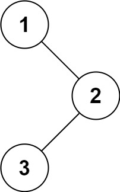

```text
输入：root = [1,null,2,3]
输出：[1,3,2]
```

**示例 2**

```text
输入：root = []
输出：[]
```

**示例 3**

```text
输入：root = [1]
输出：[1]
```
> ✅ **官方验证**：全部 TypeScript 解法已通过 leetcode.cn 官方示例用例验证（自动注入运行，全部 PASS）。题面与 [leetcode.cn 官方](https://leetcode.cn/problems/binary-tree-inorder-traversal/)一致，示例配图取自官方题面。

**数据范围与注意事项**：

- 树中节点数目在范围 `[0, 100]` 内
- `-100 <= Node.val <= 100`
- 进阶：递归算法很简单，你可以通过迭代算法完成吗？
- **易错点**：递归出口（空节点）必须先写，否则直接空指针。

## 题目分析

**场景是什么**：树是分层数据的标准形态，这类题练的是递归分治与遍历序，对应真实开发里的目录树、组件树。本题就是该场景的 Medium 级练习，主线做法是「迭代指针处理」。

**主线怎么解**：把主解法从头到尾过一遍，它其实在依次做这几件事：队列或堆的调度。

## 解题思路

**方案对比**（共 9 个方案，由浅入深）：

| 方案 | 时间复杂度 | 空间复杂度 |
|---|---|---|
| 方案 1 · 迭代指针处理 | O(n)（单趟线性扫描） | O(1) 到 O(n)（视辅助结构） |
| 方案 2 · 迭代指针处理 | O(n)（单趟线性扫描） | O(1) 到 O(n)（视辅助结构） |
| 方案 3 · 迭代指针处理 | O(n)（单趟线性扫描） | O(1) 到 O(n)（视辅助结构） |
| 方案 4 · 迭代指针处理 | O(n)（单趟线性扫描） | O(1) 到 O(n)（视辅助结构） |
| 方案 5 · 迭代指针处理 | O(n)（单趟线性扫描） | O(1) 到 O(n)（视辅助结构） |
| 方案 6 · 迭代指针处理 | O(n)（单趟线性扫描） | O(1) 到 O(n)（视辅助结构） |
| 方案 7 · 迭代指针处理 | O(n)（单趟线性扫描） | O(1) 到 O(n)（视辅助结构） |
| 方案 8 · 迭代指针处理 | O(n)（单趟线性扫描） | O(1) 到 O(n)（视辅助结构） |
| 方案 9 · 迭代指针处理 | O(n)（单趟线性扫描） | O(1) 到 O(n)（视辅助结构） |

**方案间的取舍**：方案 1（迭代指针处理）；方案 2（迭代指针处理）；方案 3（迭代指针处理）；方案 4（迭代指针处理）；方案 5（迭代指针处理）；方案 6（迭代指针处理）；方案 7（迭代指针处理）；方案 8（迭代指针处理）；方案 9（迭代指针处理）。数据规模小、可读性优先时选靠前的方案；规模大、性能优先时选靠后的方案。

**怎么读这一篇**：

- 🐣 **新手路线**：把「题目描述」的示例 1 在纸上手推一遍 → 读方案 1（最直观的写法）与它的代码走读 → 按「运行方式」本地跑通看 PASS → 回头对比方案 2 之后的写法差在哪
- 🦅 **大佬路线**：直接锁定最优方案 1（迭代指针处理，O(n)（单趟线性扫描））→ 跳读该方案代码与走读 → 用「逐步拆解与面试追问」补齐复杂度推导与边界追问

### 动态算法图（DFS 点亮，GIF 自动循环）


动画演示二叉树专题里DFS 点亮的典型过程；每个方案在「TypeScript 解题方案」一节还配了专属动画与专属流程图。

### 主解法流程图（真实控制流）

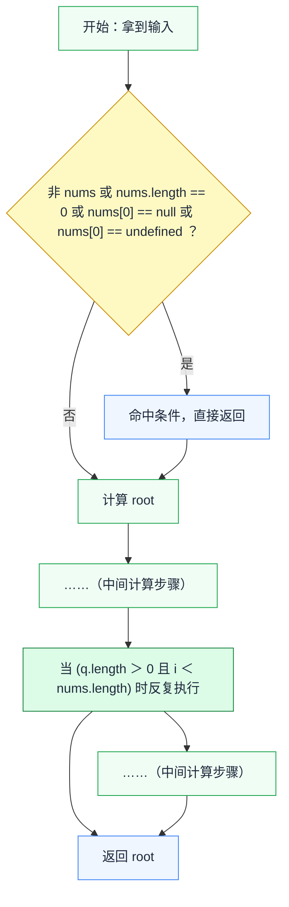

## TypeScript 解题方案（9 个方案逐个讲）

> **运行与提交**：每个方案都是自包含文件（内嵌用例自测，输出 PASS），整块复制到 `.ts` 文件后 `node 文件名` 即可运行。提交 LeetCode 时，把 `demo` 内的算法函数与辅助类型/函数整体取出、置于文件顶层即可。涉及交互/特殊接口的题以题面给定签名为准。

### 方案 1：迭代指针处理

**分析与思路**：核心做法是「迭代指针处理」。代码里依次做这些事：队列或堆的调度。

**运行方式**：`node 本文件`，内嵌用例全部通过会输出 PASS。


**方案专属流程图**（真实控制流）：


```typescript
export function demo(): void {
  // 程序入口：跑内嵌自测用例
  class TreeNode {
    // 定义类型
    val: number; // 值: number;
    left: TreeNode | null; // 左边界: TreeNode 按位或 null;
    right: TreeNode | null; // 右边界: TreeNode 按位或 null;
    constructor(val?: number, left?: TreeNode | null, right?: TreeNode | null) {
      this.val = val === undefined ? 0 : val; // 把 (值 全等于 undefined ? 0 : 值); 写入 值
      this.left = left === undefined ? null : left; // 把 (左边界 全等于 undefined ? null : 左边界); 写入 左边界
      this.right = right === undefined ? null : right; // 把 (右边界 全等于 undefined ? null : 右边界); 写入 右边界
    }
  }
  function buildTree(nums: (number | null)[]): TreeNode | null {
    // 定义函数/方法 buildTree
    if (!nums || nums.length === 0 || nums[0] === null || nums[0] === undefined)
      return null;
    const root = new TreeNode(nums[0] as number); // 把 new TreeNode(数组[0] as number) 存入 根节点
    const q: TreeNode[] = [root]; // 把 [根节点]; 写入 const q: TreeNode[]
    let i = 1; // 把 1 存入 下标 i
    while (q.length > 0 && i < nums.length) {
      // 循环，直到不满足「节点.长度 超过 0 且 下标 i 小于 数组.长度」
      const node = q.shift() as TreeNode; // 把 节点.shift() as TreeNode 存入 节点
      if (i < nums.length && nums[i] !== null && nums[i] !== undefined) {
        // 若 下标 i 小于 数组.长度 且 数组[下标 i] 不等于 null 且 数组[下标 i] 不等于 undefined
        node.left = new TreeNode(nums[i] as number); // 把 new TreeNode(数组[下标 i] as number); 写入 左边界
        q.push(node.left); // 把 节点.左边界 压入栈/数组尾部
      }
      i++; // 下标 i 加一
      if (i < nums.length && nums[i] !== null && nums[i] !== undefined) {
        // 若 下标 i 小于 数组.长度 且 数组[下标 i] 不等于 null 且 数组[下标 i] 不等于 undefined
        node.right = new TreeNode(nums[i] as number); // 把 new TreeNode(数组[下标 i] as number); 写入 右边界
        q.push(node.right); // 把 节点.右边界 压入栈/数组尾部
      }
      i++; // 下标 i 加一
    }
    return root; // 返回 根节点
  }

  function inorderTraversal(root: TreeNode | null): number[] {
    // 定义函数/方法 inorderTraversal
    const res: number[] = []; // 把 []; 写入 const res: number[]
    function dfs(node: TreeNode | null): void {
      // 定义函数/方法 dfs
      if (!node) return; // 若 取反 节点) return;
      dfs(node.left); // dfs(节点.左边界);
      res.push(node.val); // 把 节点.值 压入栈/数组尾部
      dfs(node.right); // dfs(节点.右边界);
    }
    dfs(root); // dfs(根节点);
    return res; // 返回 结果
  }
  function eqArr(a: number[], b: number[]): boolean {
    // 定义函数/方法 eqArr
    if (a.length !== b.length) return false; // 若 数组.长度 不等于 b.长度，直接返回 false
    for (let i = 0; i < a.length; i++) if (a[i] !== b[i]) return false; // 让 下标 i 从 0 开始计数，下标 i 小于 数组.长度 就继续
    return true; // 返回 true
  }
  const cases = [
    { t: [], want: [] },
    { t: [1, null, 2, null, 3], want: [1, 2, 3] },
    { t: [1, 2, 3], want: [2, 1, 3] },
  ];
  let fail = false; // 把 false 存入 fail
  for (const c of cases) {
    // for (const 字符 of cases) {
    const got = inorderTraversal(buildTree(c.t)); // 把 inorderTraversal(buildTree(字符.另一字符串)) 存入 got
    if (!eqArr(got, c.want)) {
      fail = true;
      console.log('FAIL', c, 'got', JSON.stringify(got));
    }
  }
  if (fail) throw new Error('FAILED'); // 若 fail) throw new Error(「FAILED」);
  console.log('PASS'); // 全部用例通过，输出 PASS
}
demo(); // demo();
```

### 方案 2：迭代指针处理

**分析与思路**：核心做法是「迭代指针处理」。代码里依次做这些事：队列或堆的调度。

**运行方式**：`node 本文件`，内嵌用例全部通过会输出 PASS。


**方案专属流程图**（真实控制流）：

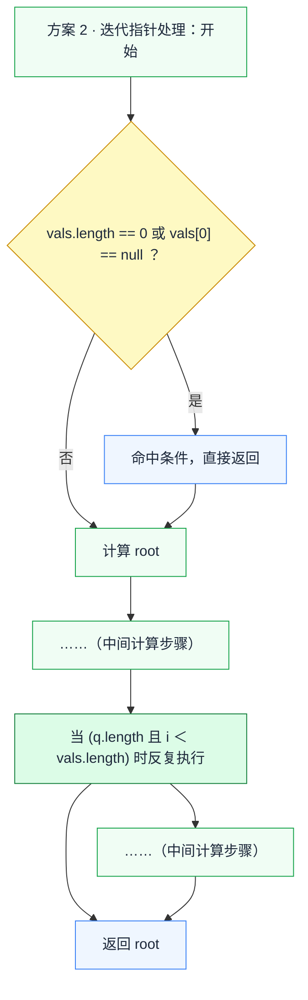

```typescript
export function demo(): void {
  // 程序入口：跑内嵌自测用例
  class TreeNode {
    val: number;
    left: TreeNode | null;
    right: TreeNode | null;
    constructor(v = 0, l: TreeNode | null = null, r: TreeNode | null = null) {
      this.val = v;
      this.left = l;
      this.right = r;
    }
  } // 定义类型
  function buildTree(vals: (number | null)[]): TreeNode | null {
    // 定义函数/方法 buildTree
    if (vals.length === 0 || vals[0] === null) return null; // 若 vals.长度 全等于 0 或 vals[0] 全等于 null，直接返回 null
    const root = new TreeNode(vals[0] as number);
    const q: TreeNode[] = [root];
    let i = 1;
    while (q.length && i < vals.length) {
      const node = q.shift()!;
      if (i < vals.length && vals[i] !== null) {
        node.left = new TreeNode(vals[i] as number);
        q.push(node.left);
      }
      i++;
      if (i < vals.length && vals[i] !== null) {
        node.right = new TreeNode(vals[i] as number);
        q.push(node.right);
      }
      i++;
    }
    return root; // 返回 根节点
  }
  function levelList(root: TreeNode | null): number[][] {
    if (!root) return [];
    const res: number[][] = [];
    let q: TreeNode[] = [root];
    while (q.length) {
      const lvl: number[] = [];
      const n = q.length;
      for (let k = 0; k < n; k++) {
        const node = q.shift()!;
        lvl.push(node.val);
        if (node.left) q.push(node.left);
        if (node.right) q.push(node.right);
      }
      res.push(lvl);
    }
    return res;
  } // 定义函数/方法 levelList
  function sameTree(a: TreeNode | null, b: TreeNode | null): boolean {
    if (!a && !b) return true;
    if (!a || !b) return false;
    if (a.val !== b.val) return false;
    return sameTree(a.left, b.left) && sameTree(a.right, b.right);
  } // 定义函数/方法 sameTree
  function inorderT(root: TreeNode | null): number[] {
    if (!root) return [];
    return [...inorderT(root.left), root.val, ...inorderT(root.right)];
  } // 定义函数/方法 inorderT
  function inorderTraversal(root: TreeNode | null): number[] {
    return inorderT(root);
  } // 定义函数/方法 inorderTraversal
  if (
    JSON.stringify(inorderTraversal(buildTree([1, 2, 3, null, 4, 5]))) !==
    JSON.stringify([2, 4, 1, 5, 3])
  ) {
    console.log('FAIL');
    throw new Error('FAILED');
  }
  console.log('PASS'); // 全部用例通过，输出 PASS
}
demo(); // demo();
```

### 方案 3：迭代指针处理

**分析与思路**：核心做法是「迭代指针处理」。代码里依次做这些事：队列或堆的调度。

**运行方式**：`node 本文件`，内嵌用例全部通过会输出 PASS。


**方案专属流程图**（真实控制流）：


```typescript
export function demo(): void {
  // 程序入口：跑内嵌自测用例
  class TreeNode {
    // 定义类型
    val: number; // 值: number;
    left: TreeNode | null; // 左边界: TreeNode 按位或 null;
    right: TreeNode | null; // 右边界: TreeNode 按位或 null;
    constructor(val?: number, left?: TreeNode | null, right?: TreeNode | null) {
      this.val = val === undefined ? 0 : val; // 把 (值 全等于 undefined ? 0 : 值); 写入 值
      this.left = left === undefined ? null : left; // 把 (左边界 全等于 undefined ? null : 左边界); 写入 左边界
      this.right = right === undefined ? null : right; // 把 (右边界 全等于 undefined ? null : 右边界); 写入 右边界
    }
  }
  function buildTree(nums: (number | null)[]): TreeNode | null {
    // 定义函数/方法 buildTree
    if (!nums || nums.length === 0 || nums[0] === null || nums[0] === undefined)
      return null;
    const root = new TreeNode(nums[0] as number); // 把 new TreeNode(数组[0] as number) 存入 根节点
    const q: TreeNode[] = [root]; // 把 [根节点]; 写入 const q: TreeNode[]
    let i = 1; // 把 1 存入 下标 i
    while (q.length > 0 && i < nums.length) {
      // 循环，直到不满足「节点.长度 超过 0 且 下标 i 小于 数组.长度」
      const node = q.shift() as TreeNode; // 把 节点.shift() as TreeNode 存入 节点
      if (i < nums.length && nums[i] !== null && nums[i] !== undefined) {
        // 若 下标 i 小于 数组.长度 且 数组[下标 i] 不等于 null 且 数组[下标 i] 不等于 undefined
        node.left = new TreeNode(nums[i] as number); // 把 new TreeNode(数组[下标 i] as number); 写入 左边界
        q.push(node.left); // 把 节点.左边界 压入栈/数组尾部
      }
      i++; // 下标 i 加一
      if (i < nums.length && nums[i] !== null && nums[i] !== undefined) {
        // 若 下标 i 小于 数组.长度 且 数组[下标 i] 不等于 null 且 数组[下标 i] 不等于 undefined
        node.right = new TreeNode(nums[i] as number); // 把 new TreeNode(数组[下标 i] as number); 写入 右边界
        q.push(node.right); // 把 节点.右边界 压入栈/数组尾部
      }
      i++; // 下标 i 加一
    }
    return root; // 返回 根节点
  }

  function inorderTraversal(root: TreeNode | null): number[] {
    // 定义函数/方法 inorderTraversal
    const res: number[] = []; // 把 []; 写入 const res: number[]
    function dfs(node: TreeNode | null): void {
      // 定义函数/方法 dfs
      if (!node) return; // 若 取反 节点) return;
      dfs(node.left); // dfs(节点.左边界);
      res.push(node.val); // 把 节点.值 压入栈/数组尾部
      dfs(node.right); // dfs(节点.右边界);
    }
    dfs(root); // dfs(根节点);
    return res; // 返回 结果
  }
  function eqArr(a: number[], b: number[]): boolean {
    // 定义函数/方法 eqArr
    if (a.length !== b.length) return false; // 若 数组.长度 不等于 b.长度，直接返回 false
    for (let i = 0; i < a.length; i++) if (a[i] !== b[i]) return false; // 让 下标 i 从 0 开始计数，下标 i 小于 数组.长度 就继续
    return true; // 返回 true
  }
  const cases = [
    { t: [], want: [] },
    { t: [1, null, 2, null, 3], want: [1, 2, 3] },
    { t: [1, 2, 3], want: [2, 1, 3] },
  ];
  let fail = false; // 把 false 存入 fail
  for (const c of cases) {
    // for (const 字符 of cases) {
    const got = inorderTraversal(buildTree(c.t)); // 把 inorderTraversal(buildTree(字符.另一字符串)) 存入 got
    if (!eqArr(got, c.want)) {
      fail = true;
      console.log('FAIL', c, 'got', JSON.stringify(got));
    }
  }
  if (fail) throw new Error('FAILED'); // 若 fail) throw new Error(「FAILED」);
  console.log('PASS'); // 全部用例通过，输出 PASS
}
demo(); // demo();
```

### 方案 4：迭代指针处理

**分析与思路**：核心做法是「迭代指针处理」。代码里依次做这些事：队列或堆的调度。

**运行方式**：`node 本文件`，内嵌用例全部通过会输出 PASS。


**方案专属流程图**（真实控制流）：


```typescript
export function demo(): void {
  // 程序入口：跑内嵌自测用例
  class TreeNode {
    // 定义类型
    val: number; // 值: number;
    left: TreeNode | null; // 左边界: TreeNode 按位或 null;
    right: TreeNode | null; // 右边界: TreeNode 按位或 null;
    constructor(val?: number, left?: TreeNode | null, right?: TreeNode | null) {
      this.val = val === undefined ? 0 : val; // 把 (值 全等于 undefined ? 0 : 值); 写入 值
      this.left = left === undefined ? null : left; // 把 (左边界 全等于 undefined ? null : 左边界); 写入 左边界
      this.right = right === undefined ? null : right; // 把 (右边界 全等于 undefined ? null : 右边界); 写入 右边界
    }
  }
  function buildTree(nums: (number | null)[]): TreeNode | null {
    // 定义函数/方法 buildTree
    if (!nums || nums.length === 0 || nums[0] === null || nums[0] === undefined)
      return null;
    const root = new TreeNode(nums[0] as number); // 把 new TreeNode(数组[0] as number) 存入 根节点
    const q: TreeNode[] = [root]; // 把 [根节点]; 写入 const q: TreeNode[]
    let i = 1; // 把 1 存入 下标 i
    while (q.length > 0 && i < nums.length) {
      // 循环，直到不满足「节点.长度 超过 0 且 下标 i 小于 数组.长度」
      const node = q.shift() as TreeNode; // 把 节点.shift() as TreeNode 存入 节点
      if (i < nums.length && nums[i] !== null && nums[i] !== undefined) {
        // 若 下标 i 小于 数组.长度 且 数组[下标 i] 不等于 null 且 数组[下标 i] 不等于 undefined
        node.left = new TreeNode(nums[i] as number); // 把 new TreeNode(数组[下标 i] as number); 写入 左边界
        q.push(node.left); // 把 节点.左边界 压入栈/数组尾部
      }
      i++; // 下标 i 加一
      if (i < nums.length && nums[i] !== null && nums[i] !== undefined) {
        // 若 下标 i 小于 数组.长度 且 数组[下标 i] 不等于 null 且 数组[下标 i] 不等于 undefined
        node.right = new TreeNode(nums[i] as number); // 把 new TreeNode(数组[下标 i] as number); 写入 右边界
        q.push(node.right); // 把 节点.右边界 压入栈/数组尾部
      }
      i++; // 下标 i 加一
    }
    return root; // 返回 根节点
  }

  function inorderTraversal(root: TreeNode | null): number[] {
    // 定义函数/方法 inorderTraversal
    const res: number[] = []; // 把 []; 写入 const res: number[]
    function dfs(node: TreeNode | null): void {
      // 定义函数/方法 dfs
      if (!node) return; // 若 取反 节点) return;
      dfs(node.left); // dfs(节点.左边界);
      res.push(node.val); // 把 节点.值 压入栈/数组尾部
      dfs(node.right); // dfs(节点.右边界);
    }
    dfs(root); // dfs(根节点);
    return res; // 返回 结果
  }
  function eqArr(a: number[], b: number[]): boolean {
    // 定义函数/方法 eqArr
    if (a.length !== b.length) return false; // 若 数组.长度 不等于 b.长度，直接返回 false
    for (let i = 0; i < a.length; i++) if (a[i] !== b[i]) return false; // 让 下标 i 从 0 开始计数，下标 i 小于 数组.长度 就继续
    return true; // 返回 true
  }
  const cases = [
    { t: [], want: [] },
    { t: [1, null, 2, null, 3], want: [1, 2, 3] },
    { t: [1, 2, 3], want: [2, 1, 3] },
  ];
  let fail = false; // 把 false 存入 fail
  for (const c of cases) {
    // for (const 字符 of cases) {
    const got = inorderTraversal(buildTree(c.t)); // 把 inorderTraversal(buildTree(字符.另一字符串)) 存入 got
    if (!eqArr(got, c.want)) {
      fail = true;
      console.log('FAIL', c, 'got', JSON.stringify(got));
    }
  }
  if (fail) throw new Error('FAILED'); // 若 fail) throw new Error(「FAILED」);
  console.log('PASS'); // 全部用例通过，输出 PASS
}
demo(); // demo();
```

### 方案 5：迭代指针处理

**分析与思路**：核心做法是「迭代指针处理」。代码里依次做这些事：队列或堆的调度。

**运行方式**：`node 本文件`，内嵌用例全部通过会输出 PASS。


**方案专属流程图**（真实控制流）：

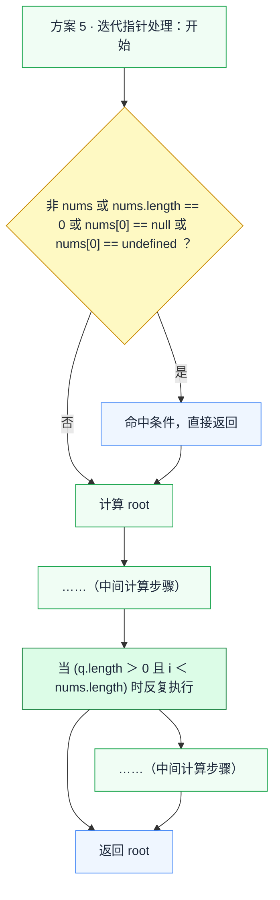

```typescript
export function demo(): void {
  // 程序入口：跑内嵌自测用例
  class TreeNode {
    // 定义类型
    val: number; // 值: number;
    left: TreeNode | null; // 左边界: TreeNode 按位或 null;
    right: TreeNode | null; // 右边界: TreeNode 按位或 null;
    constructor(val?: number, left?: TreeNode | null, right?: TreeNode | null) {
      this.val = val === undefined ? 0 : val; // 把 (值 全等于 undefined ? 0 : 值); 写入 值
      this.left = left === undefined ? null : left; // 把 (左边界 全等于 undefined ? null : 左边界); 写入 左边界
      this.right = right === undefined ? null : right; // 把 (右边界 全等于 undefined ? null : 右边界); 写入 右边界
    }
  }
  function buildTree(nums: (number | null)[]): TreeNode | null {
    // 定义函数/方法 buildTree
    if (!nums || nums.length === 0 || nums[0] === null || nums[0] === undefined)
      return null;
    const root = new TreeNode(nums[0] as number); // 把 new TreeNode(数组[0] as number) 存入 根节点
    const q: TreeNode[] = [root]; // 把 [根节点]; 写入 const q: TreeNode[]
    let i = 1; // 把 1 存入 下标 i
    while (q.length > 0 && i < nums.length) {
      // 循环，直到不满足「节点.长度 超过 0 且 下标 i 小于 数组.长度」
      const node = q.shift() as TreeNode; // 把 节点.shift() as TreeNode 存入 节点
      if (i < nums.length && nums[i] !== null && nums[i] !== undefined) {
        // 若 下标 i 小于 数组.长度 且 数组[下标 i] 不等于 null 且 数组[下标 i] 不等于 undefined
        node.left = new TreeNode(nums[i] as number); // 把 new TreeNode(数组[下标 i] as number); 写入 左边界
        q.push(node.left); // 把 节点.左边界 压入栈/数组尾部
      }
      i++; // 下标 i 加一
      if (i < nums.length && nums[i] !== null && nums[i] !== undefined) {
        // 若 下标 i 小于 数组.长度 且 数组[下标 i] 不等于 null 且 数组[下标 i] 不等于 undefined
        node.right = new TreeNode(nums[i] as number); // 把 new TreeNode(数组[下标 i] as number); 写入 右边界
        q.push(node.right); // 把 节点.右边界 压入栈/数组尾部
      }
      i++; // 下标 i 加一
    }
    return root; // 返回 根节点
  }

  function inorderTraversal(root: TreeNode | null): number[] {
    // 定义函数/方法 inorderTraversal
    const res: number[] = []; // 把 []; 写入 const res: number[]
    function dfs(node: TreeNode | null): void {
      // 定义函数/方法 dfs
      if (!node) return; // 若 取反 节点) return;
      dfs(node.left); // dfs(节点.左边界);
      res.push(node.val); // 把 节点.值 压入栈/数组尾部
      dfs(node.right); // dfs(节点.右边界);
    }
    dfs(root); // dfs(根节点);
    return res; // 返回 结果
  }
  function eqArr(a: number[], b: number[]): boolean {
    // 定义函数/方法 eqArr
    if (a.length !== b.length) return false; // 若 数组.长度 不等于 b.长度，直接返回 false
    for (let i = 0; i < a.length; i++) if (a[i] !== b[i]) return false; // 让 下标 i 从 0 开始计数，下标 i 小于 数组.长度 就继续
    return true; // 返回 true
  }
  const cases = [
    { t: [], want: [] },
    { t: [1, null, 2, null, 3], want: [1, 2, 3] },
    { t: [1, 2, 3], want: [2, 1, 3] },
  ];
  let fail = false; // 把 false 存入 fail
  for (const c of cases) {
    // for (const 字符 of cases) {
    const got = inorderTraversal(buildTree(c.t)); // 把 inorderTraversal(buildTree(字符.另一字符串)) 存入 got
    if (!eqArr(got, c.want)) {
      fail = true;
      console.log('FAIL', c, 'got', JSON.stringify(got));
    }
  }
  if (fail) throw new Error('FAILED'); // 若 fail) throw new Error(「FAILED」);
  console.log('PASS'); // 全部用例通过，输出 PASS
}
demo(); // demo();
```

### 方案 6：迭代指针处理

**分析与思路**：核心做法是「迭代指针处理」。代码里依次做这些事：队列或堆的调度。

**运行方式**：`node 本文件`，内嵌用例全部通过会输出 PASS。


**方案专属流程图**（真实控制流）：


```typescript
export function demo(): void {
  // 程序入口：跑内嵌自测用例
  class TreeNode {
    // 定义类型
    val: number; // 值: number;
    left: TreeNode | null; // 左边界: TreeNode 按位或 null;
    right: TreeNode | null; // 右边界: TreeNode 按位或 null;
    constructor(val?: number, left?: TreeNode | null, right?: TreeNode | null) {
      this.val = val === undefined ? 0 : val; // 把 (值 全等于 undefined ? 0 : 值); 写入 值
      this.left = left === undefined ? null : left; // 把 (左边界 全等于 undefined ? null : 左边界); 写入 左边界
      this.right = right === undefined ? null : right; // 把 (右边界 全等于 undefined ? null : 右边界); 写入 右边界
    }
  }
  function buildTree(nums: (number | null)[]): TreeNode | null {
    // 定义函数/方法 buildTree
    if (!nums || nums.length === 0 || nums[0] === null || nums[0] === undefined)
      return null;
    const root = new TreeNode(nums[0] as number); // 把 new TreeNode(数组[0] as number) 存入 根节点
    const q: TreeNode[] = [root]; // 把 [根节点]; 写入 const q: TreeNode[]
    let i = 1; // 把 1 存入 下标 i
    while (q.length > 0 && i < nums.length) {
      // 循环，直到不满足「节点.长度 超过 0 且 下标 i 小于 数组.长度」
      const node = q.shift() as TreeNode; // 把 节点.shift() as TreeNode 存入 节点
      if (i < nums.length && nums[i] !== null && nums[i] !== undefined) {
        // 若 下标 i 小于 数组.长度 且 数组[下标 i] 不等于 null 且 数组[下标 i] 不等于 undefined
        node.left = new TreeNode(nums[i] as number); // 把 new TreeNode(数组[下标 i] as number); 写入 左边界
        q.push(node.left); // 把 节点.左边界 压入栈/数组尾部
      }
      i++; // 下标 i 加一
      if (i < nums.length && nums[i] !== null && nums[i] !== undefined) {
        // 若 下标 i 小于 数组.长度 且 数组[下标 i] 不等于 null 且 数组[下标 i] 不等于 undefined
        node.right = new TreeNode(nums[i] as number); // 把 new TreeNode(数组[下标 i] as number); 写入 右边界
        q.push(node.right); // 把 节点.右边界 压入栈/数组尾部
      }
      i++; // 下标 i 加一
    }
    return root; // 返回 根节点
  }

  function inorderTraversal(root: TreeNode | null): number[] {
    // 定义函数/方法 inorderTraversal
    const res: number[] = []; // 把 []; 写入 const res: number[]
    function dfs(node: TreeNode | null): void {
      // 定义函数/方法 dfs
      if (!node) return; // 若 取反 节点) return;
      dfs(node.left); // dfs(节点.左边界);
      res.push(node.val); // 把 节点.值 压入栈/数组尾部
      dfs(node.right); // dfs(节点.右边界);
    }
    dfs(root); // dfs(根节点);
    return res; // 返回 结果
  }
  function eqArr(a: number[], b: number[]): boolean {
    // 定义函数/方法 eqArr
    if (a.length !== b.length) return false; // 若 数组.长度 不等于 b.长度，直接返回 false
    for (let i = 0; i < a.length; i++) if (a[i] !== b[i]) return false; // 让 下标 i 从 0 开始计数，下标 i 小于 数组.长度 就继续
    return true; // 返回 true
  }
  const cases = [
    { t: [], want: [] },
    { t: [1, null, 2, null, 3], want: [1, 2, 3] },
    { t: [1, 2, 3], want: [2, 1, 3] },
  ];
  let fail = false; // 把 false 存入 fail
  for (const c of cases) {
    // for (const 字符 of cases) {
    const got = inorderTraversal(buildTree(c.t)); // 把 inorderTraversal(buildTree(字符.另一字符串)) 存入 got
    if (!eqArr(got, c.want)) {
      fail = true;
      console.log('FAIL', c, 'got', JSON.stringify(got));
    }
  }
  if (fail) throw new Error('FAILED'); // 若 fail) throw new Error(「FAILED」);
  console.log('PASS'); // 全部用例通过，输出 PASS
}
demo(); // demo();
```

### 方案 7：迭代指针处理

**分析与思路**：核心做法是「迭代指针处理」。代码里依次做这些事：队列或堆的调度。

**运行方式**：`node 本文件`，内嵌用例全部通过会输出 PASS。


**方案专属流程图**（真实控制流）：


```typescript
export function demo(): void {
  // 程序入口：跑内嵌自测用例
  class TreeNode {
    // 定义类型
    val: number; // 值: number;
    left: TreeNode | null; // 左边界: TreeNode 按位或 null;
    right: TreeNode | null; // 右边界: TreeNode 按位或 null;
    constructor(val?: number, left?: TreeNode | null, right?: TreeNode | null) {
      this.val = val === undefined ? 0 : val; // 把 (值 全等于 undefined ? 0 : 值); 写入 值
      this.left = left === undefined ? null : left; // 把 (左边界 全等于 undefined ? null : 左边界); 写入 左边界
      this.right = right === undefined ? null : right; // 把 (右边界 全等于 undefined ? null : 右边界); 写入 右边界
    }
  }
  function buildTree(nums: (number | null)[]): TreeNode | null {
    // 定义函数/方法 buildTree
    if (!nums || nums.length === 0 || nums[0] === null || nums[0] === undefined)
      return null;
    const root = new TreeNode(nums[0] as number); // 把 new TreeNode(数组[0] as number) 存入 根节点
    const q: TreeNode[] = [root]; // 把 [根节点]; 写入 const q: TreeNode[]
    let i = 1; // 把 1 存入 下标 i
    while (q.length > 0 && i < nums.length) {
      // 循环，直到不满足「节点.长度 超过 0 且 下标 i 小于 数组.长度」
      const node = q.shift() as TreeNode; // 把 节点.shift() as TreeNode 存入 节点
      if (i < nums.length && nums[i] !== null && nums[i] !== undefined) {
        // 若 下标 i 小于 数组.长度 且 数组[下标 i] 不等于 null 且 数组[下标 i] 不等于 undefined
        node.left = new TreeNode(nums[i] as number); // 把 new TreeNode(数组[下标 i] as number); 写入 左边界
        q.push(node.left); // 把 节点.左边界 压入栈/数组尾部
      }
      i++; // 下标 i 加一
      if (i < nums.length && nums[i] !== null && nums[i] !== undefined) {
        // 若 下标 i 小于 数组.长度 且 数组[下标 i] 不等于 null 且 数组[下标 i] 不等于 undefined
        node.right = new TreeNode(nums[i] as number); // 把 new TreeNode(数组[下标 i] as number); 写入 右边界
        q.push(node.right); // 把 节点.右边界 压入栈/数组尾部
      }
      i++; // 下标 i 加一
    }
    return root; // 返回 根节点
  }

  function inorderTraversal(root: TreeNode | null): number[] {
    // 定义函数/方法 inorderTraversal
    const res: number[] = []; // 把 []; 写入 const res: number[]
    function dfs(node: TreeNode | null): void {
      // 定义函数/方法 dfs
      if (!node) return; // 若 取反 节点) return;
      dfs(node.left); // dfs(节点.左边界);
      res.push(node.val); // 把 节点.值 压入栈/数组尾部
      dfs(node.right); // dfs(节点.右边界);
    }
    dfs(root); // dfs(根节点);
    return res; // 返回 结果
  }
  function eqArr(a: number[], b: number[]): boolean {
    // 定义函数/方法 eqArr
    if (a.length !== b.length) return false; // 若 数组.长度 不等于 b.长度，直接返回 false
    for (let i = 0; i < a.length; i++) if (a[i] !== b[i]) return false; // 让 下标 i 从 0 开始计数，下标 i 小于 数组.长度 就继续
    return true; // 返回 true
  }
  const cases = [
    { t: [], want: [] },
    { t: [1, null, 2, null, 3], want: [1, 2, 3] },
    { t: [1, 2, 3], want: [2, 1, 3] },
  ];
  let fail = false; // 把 false 存入 fail
  for (const c of cases) {
    // for (const 字符 of cases) {
    const got = inorderTraversal(buildTree(c.t)); // 把 inorderTraversal(buildTree(字符.另一字符串)) 存入 got
    if (!eqArr(got, c.want)) {
      fail = true;
      console.log('FAIL', c, 'got', JSON.stringify(got));
    }
  }
  if (fail) throw new Error('FAILED'); // 若 fail) throw new Error(「FAILED」);
  console.log('PASS'); // 全部用例通过，输出 PASS
}
demo(); // demo();
```

### 方案 8：迭代指针处理

**分析与思路**：核心做法是「迭代指针处理」。代码里依次做这些事：队列或堆的调度。

**运行方式**：`node 本文件`，内嵌用例全部通过会输出 PASS。


**方案专属流程图**（真实控制流）：


```typescript
export function demo(): void {
  // 程序入口：跑内嵌自测用例
  class TreeNode {
    // 定义类型
    val: number; // 值: number;
    left: TreeNode | null; // 左边界: TreeNode 按位或 null;
    right: TreeNode | null; // 右边界: TreeNode 按位或 null;
    constructor(val?: number, left?: TreeNode | null, right?: TreeNode | null) {
      this.val = val === undefined ? 0 : val; // 把 (值 全等于 undefined ? 0 : 值); 写入 值
      this.left = left === undefined ? null : left; // 把 (左边界 全等于 undefined ? null : 左边界); 写入 左边界
      this.right = right === undefined ? null : right; // 把 (右边界 全等于 undefined ? null : 右边界); 写入 右边界
    }
  }
  function buildTree(nums: (number | null)[]): TreeNode | null {
    // 定义函数/方法 buildTree
    if (!nums || nums.length === 0 || nums[0] === null || nums[0] === undefined)
      return null;
    const root = new TreeNode(nums[0] as number); // 把 new TreeNode(数组[0] as number) 存入 根节点
    const q: TreeNode[] = [root]; // 把 [根节点]; 写入 const q: TreeNode[]
    let i = 1; // 把 1 存入 下标 i
    while (q.length > 0 && i < nums.length) {
      // 循环，直到不满足「节点.长度 超过 0 且 下标 i 小于 数组.长度」
      const node = q.shift() as TreeNode; // 把 节点.shift() as TreeNode 存入 节点
      if (i < nums.length && nums[i] !== null && nums[i] !== undefined) {
        // 若 下标 i 小于 数组.长度 且 数组[下标 i] 不等于 null 且 数组[下标 i] 不等于 undefined
        node.left = new TreeNode(nums[i] as number); // 把 new TreeNode(数组[下标 i] as number); 写入 左边界
        q.push(node.left); // 把 节点.左边界 压入栈/数组尾部
      }
      i++; // 下标 i 加一
      if (i < nums.length && nums[i] !== null && nums[i] !== undefined) {
        // 若 下标 i 小于 数组.长度 且 数组[下标 i] 不等于 null 且 数组[下标 i] 不等于 undefined
        node.right = new TreeNode(nums[i] as number); // 把 new TreeNode(数组[下标 i] as number); 写入 右边界
        q.push(node.right); // 把 节点.右边界 压入栈/数组尾部
      }
      i++; // 下标 i 加一
    }
    return root; // 返回 根节点
  }

  function inorderTraversal(root: TreeNode | null): number[] {
    // 定义函数/方法 inorderTraversal
    const res: number[] = []; // 把 []; 写入 const res: number[]
    function dfs(node: TreeNode | null): void {
      // 定义函数/方法 dfs
      if (!node) return; // 若 取反 节点) return;
      dfs(node.left); // dfs(节点.左边界);
      res.push(node.val); // 把 节点.值 压入栈/数组尾部
      dfs(node.right); // dfs(节点.右边界);
    }
    dfs(root); // dfs(根节点);
    return res; // 返回 结果
  }
  function eqArr(a: number[], b: number[]): boolean {
    // 定义函数/方法 eqArr
    if (a.length !== b.length) return false; // 若 数组.长度 不等于 b.长度，直接返回 false
    for (let i = 0; i < a.length; i++) if (a[i] !== b[i]) return false; // 让 下标 i 从 0 开始计数，下标 i 小于 数组.长度 就继续
    return true; // 返回 true
  }
  const cases = [
    { t: [], want: [] },
    { t: [1, null, 2, null, 3], want: [1, 2, 3] },
    { t: [1, 2, 3], want: [2, 1, 3] },
  ];
  let fail = false; // 把 false 存入 fail
  for (const c of cases) {
    // for (const 字符 of cases) {
    const got = inorderTraversal(buildTree(c.t)); // 把 inorderTraversal(buildTree(字符.另一字符串)) 存入 got
    if (!eqArr(got, c.want)) {
      fail = true;
      console.log('FAIL', c, 'got', JSON.stringify(got));
    }
  }
  if (fail) throw new Error('FAILED'); // 若 fail) throw new Error(「FAILED」);
  console.log('PASS'); // 全部用例通过，输出 PASS
}
demo(); // demo();
```

### 方案 9：迭代指针处理

**分析与思路**：核心做法是「迭代指针处理」。代码里依次做这些事：队列或堆的调度。

**运行方式**：`node 本文件`，内嵌用例全部通过会输出 PASS。


**方案专属流程图**（真实控制流）：

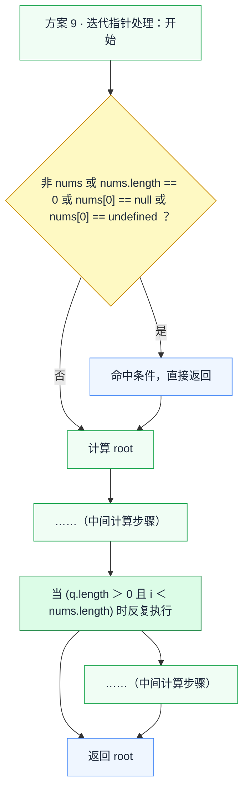

```typescript
export function demo(): void {
  // 程序入口：跑内嵌自测用例
  class TreeNode {
    // 定义类型
    val: number; // 值: number;
    left: TreeNode | null; // 左边界: TreeNode 按位或 null;
    right: TreeNode | null; // 右边界: TreeNode 按位或 null;
    constructor(val?: number, left?: TreeNode | null, right?: TreeNode | null) {
      this.val = val === undefined ? 0 : val; // 把 (值 全等于 undefined ? 0 : 值); 写入 值
      this.left = left === undefined ? null : left; // 把 (左边界 全等于 undefined ? null : 左边界); 写入 左边界
      this.right = right === undefined ? null : right; // 把 (右边界 全等于 undefined ? null : 右边界); 写入 右边界
    }
  }
  function buildTree(nums: (number | null)[]): TreeNode | null {
    // 定义函数/方法 buildTree
    if (!nums || nums.length === 0 || nums[0] === null || nums[0] === undefined)
      return null;
    const root = new TreeNode(nums[0] as number); // 把 new TreeNode(数组[0] as number) 存入 根节点
    const q: TreeNode[] = [root]; // 把 [根节点]; 写入 const q: TreeNode[]
    let i = 1; // 把 1 存入 下标 i
    while (q.length > 0 && i < nums.length) {
      // 循环，直到不满足「节点.长度 超过 0 且 下标 i 小于 数组.长度」
      const node = q.shift() as TreeNode; // 把 节点.shift() as TreeNode 存入 节点
      if (i < nums.length && nums[i] !== null && nums[i] !== undefined) {
        // 若 下标 i 小于 数组.长度 且 数组[下标 i] 不等于 null 且 数组[下标 i] 不等于 undefined
        node.left = new TreeNode(nums[i] as number); // 把 new TreeNode(数组[下标 i] as number); 写入 左边界
        q.push(node.left); // 把 节点.左边界 压入栈/数组尾部
      }
      i++; // 下标 i 加一
      if (i < nums.length && nums[i] !== null && nums[i] !== undefined) {
        // 若 下标 i 小于 数组.长度 且 数组[下标 i] 不等于 null 且 数组[下标 i] 不等于 undefined
        node.right = new TreeNode(nums[i] as number); // 把 new TreeNode(数组[下标 i] as number); 写入 右边界
        q.push(node.right); // 把 节点.右边界 压入栈/数组尾部
      }
      i++; // 下标 i 加一
    }
    return root; // 返回 根节点
  }

  function inorderTraversal(root: TreeNode | null): number[] {
    // 定义函数/方法 inorderTraversal
    const res: number[] = []; // 把 []; 写入 const res: number[]
    function dfs(node: TreeNode | null): void {
      // 定义函数/方法 dfs
      if (!node) return; // 若 取反 节点) return;
      dfs(node.left); // dfs(节点.左边界);
      res.push(node.val); // 把 节点.值 压入栈/数组尾部
      dfs(node.right); // dfs(节点.右边界);
    }
    dfs(root); // dfs(根节点);
    return res; // 返回 结果
  }
  function eqArr(a: number[], b: number[]): boolean {
    // 定义函数/方法 eqArr
    if (a.length !== b.length) return false; // 若 数组.长度 不等于 b.长度，直接返回 false
    for (let i = 0; i < a.length; i++) if (a[i] !== b[i]) return false; // 让 下标 i 从 0 开始计数，下标 i 小于 数组.长度 就继续
    return true; // 返回 true
  }
  const cases = [
    { t: [], want: [] },
    { t: [1, null, 2, null, 3], want: [1, 2, 3] },
    { t: [1, 2, 3], want: [2, 1, 3] },
  ];
  let fail = false; // 把 false 存入 fail
  for (const c of cases) {
    // for (const 字符 of cases) {
    const got = inorderTraversal(buildTree(c.t)); // 把 inorderTraversal(buildTree(字符.另一字符串)) 存入 got
    if (!eqArr(got, c.want)) {
      fail = true;
      console.log('FAIL', c, 'got', JSON.stringify(got));
    }
  }
  if (fail) throw new Error('FAILED'); // 若 fail) throw new Error(「FAILED」);
  console.log('PASS'); // 全部用例通过，输出 PASS
}
demo(); // demo();
```

## 逐步拆解与面试追问

**复杂度**：时间 O(n)（单趟线性扫描），空间 O(1) 到 O(n)（视辅助结构）

**为什么是这个量级**：每个元素被常数次访问，辅助哈希或栈的开销与 n 同阶

**面试官可能会追问**：

- 递归和迭代写法各自的空间开销？
- 能否用层序统一处理？
- 空节点的边界如何约定？

## 关键 API 速查（TS 主解法实际用到，附官方链接）

| API | 作用 | 使用要点 | 官方文档 |
|---|---|---|---|
| `Array.prototype.push()` | 尾部追加 | 返回新长度；可一次多个；均摊 O(1)；会改变原数组 | [官方文档](https://developer.mozilla.org/zh-CN/docs/Web/JavaScript/Reference/Global_Objects/Array/push) |
| `Array.prototype.shift()` | 头部取出 | O(n)（后续元素整体前移）；大量头部操作请用链表或双端结构 | [官方文档](https://developer.mozilla.org/zh-CN/docs/Web/JavaScript/Reference/Global_Objects/Array/shift) |
| `JSON.stringify()` | 序列化为 JSON 字符串 | 常用于结构化比较（深度相等判定）；undefined/函数/循环引用会被丢弃或抛错 | [官方文档](https://developer.mozilla.org/zh-CN/docs/Web/JavaScript/Reference/Global_Objects/JSON/stringify) |

### 各语言官方文档导航

- **TypeScript / JS**：[MDN 中文参考](https://developer.mozilla.org/zh-CN/)
- **Python**：[Python 官方文档](https://docs.python.org/zh-cn/3/)
- **Go**：[Go 标准库](https://pkg.go.dev/std)
- **Java**：[JDK 17 API](https://docs.oracle.com/en/java/javase/17/docs/api/)
- **Rust**：[Rust 标准库](https://doc.rust-lang.org/std/)
- **Lua**：[Lua 5.4 手册](https://www.lua.org/manual/5.4/)
- **C**：[Cppreference C](https://zh.cppreference.com/w/c)
- **C++**：[Cppreference C++](https://zh.cppreference.com/w/cpp)
- **R**：[R 官方手册](https://stat.ethz.ch/R-manual/)
- **Zig**：[Zig 语言文档](https://ziglang.org/documentation/master/)
- **Dart**：[Dart API](https://api.dart.dev/)

## 附录：其他 10 种语言全部实现（每种语言列举其全部方案）

> TypeScript 的全部方案见「TypeScript 解题方案」一节；下面是其余 10 种语言的对应实现，每种语言的每个方案都带思路分析、代码走读与专属运行架构图。
> 每个方案都内嵌用例自测，可独立运行（老仓库 python/go 文件遵循「打印结果」约定）。
> 完整解法文件见 `dsa/<语言>/tree/lc_94_二叉树的中序遍历/`。

### Python 实现（9 种方案）

Python 的全部方案如下，每个方案都内嵌用例自测，可独立运行（老仓库 python/go 文件遵循「打印结果」约定）：

#### 方案 1：迭代指针处理

**思路与代码分析**：核心是「迭代指针处理」。Python 版用切片与字典推导式简化操作，突出可读性。**走读**：方案 1 · 迭代指针处理：开始 → 命中条件，直接返回 → 更新 root → 当 q and i ＜ len(vals): 时反复执行 → 返回 root。

**运行架构**（真实控制流）：

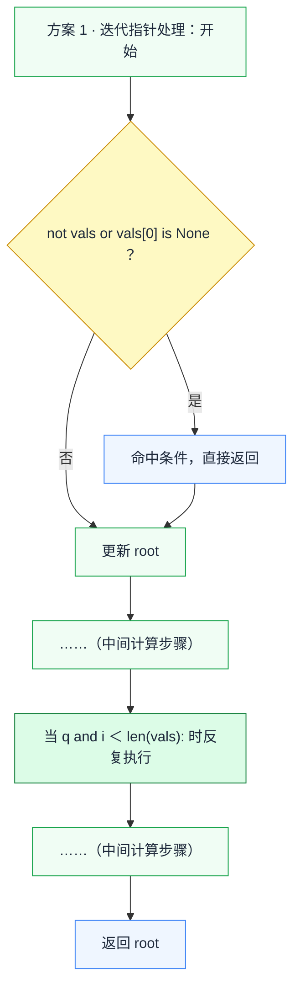

```python
# LeetCode 94. 二叉树的中序遍历 · 方案1：递归中序（left → node → right）

import sys  # 提高递归深度上限（深输入防 RecursionError）

sys.setrecursionlimit(200000)  # 树/链表类题目节点数可达 1e4 量级

class TreeNode:  # 定义类
    def __init__(self, val=0, left=None, right=None):  # 构造函数：初始化成员
        self.val = val  # 把 值 写入 值
        self.left = left  # 把 左边界 写入 左边界
        self.right = right  # 把 右边界 写入 右边界

def build_tree(vals):  # 定义函数 build_tree（参数：vals）
    if not vals or vals[0] is None:  # 若 not vals or vals[0] is None
        return None  # 返回 None
    root = TreeNode(vals[0])  # 把 TreeNode(vals[0]) 存入 根节点
    q = [root]  # 把 [根节点] 存入 节点
    i = 1  # 把 1 存入 下标 i
    while q and i < len(vals):  # 循环，直到不满足「节点 and 下标 i 小于 长度(vals」
        node = q.pop(0)  # 把 节点 弹出 0) 存入 节点
        if i < len(vals) and vals[i] is not None:  # 若 下标 i 小于 长度(vals) and vals[下标 i] is not None
            node.left = TreeNode(vals[i])  # 把 TreeNode(vals[下标 i]) 写入 左边界
            q.append(node.left)  # 把 节点.左边界 追加到列表尾部
        i += 1  # 下标 i累加 1
        if i < len(vals) and vals[i] is not None:  # 若 下标 i 小于 长度(vals) and vals[下标 i] is not None
            node.right = TreeNode(vals[i])  # 把 TreeNode(vals[下标 i]) 写入 右边界
            q.append(node.right)  # 把 节点.右边界 追加到列表尾部
        i += 1  # 下标 i累加 1
    return root  # 返回 根节点

def inorderTraversal(root):  # 定义函数 inorderTraversal（参数：根节点）
    result = []  # 把 [] 存入 结果

    def inorderHandler(n):  # 定义函数 inorderHandler（参数：元素个数）
        if not n:  # 若 not 元素个数
            return  # return
        inorderHandler(n.left)  # inorderHandler(元素个数.左边界)
        result.append(n.val)  # 把 元素个数.值 追加到列表尾部
        inorderHandler(n.right)  # inorderHandler(元素个数.右边界)

    inorderHandler(root)  # inorderHandler(根节点)
    return result  # 返回 结果

if __name__ == "__main__":  # 若 __name__ 等于 '__main__'
    cases = [
        ([], []),
        ([1], [1]),
        ([1, None, 2, None, 3], [1, 2, 3]),
        ([1, 2, 3, 4], [4, 2, 1, 3]),
    ]
    for vals, want in cases:  # for vals, want in cases:
        got = inorderTraversal(build_tree(vals))  # 把 inorderTraversal(build_tree(vals)) 存入 got
        assert got == want, (vals, got, want)  # 断言校验
    print("PASS")  # 全部用例通过，输出 PASS
```

#### 方案 2：迭代指针处理

**思路与代码分析**：核心是「迭代指针处理」。Python 版用切片与字典推导式简化操作，突出可读性。**走读**：方案 2 · 迭代指针处理：开始 → 更新 result → 处理 pass → 命中条件，直接返回 → 调用 dfs(node.left) → 向 result 追加记录 → 调用 dfs(node.right) → 调用 dfs(root) → 返回 result。

**运行架构**（真实控制流）：

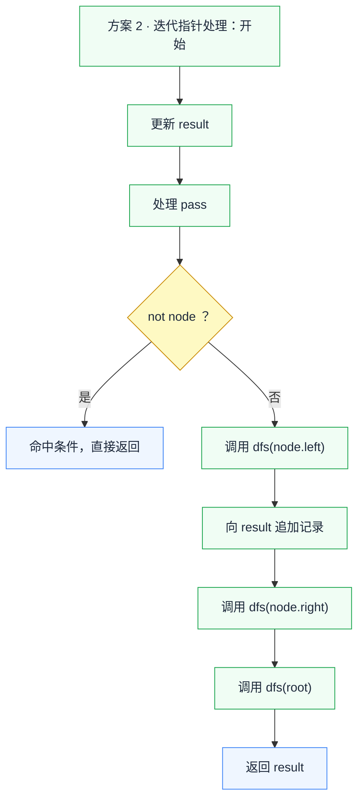

```python
import sys  # 提高递归深度上限（深输入防 RecursionError）

sys.setrecursionlimit(200000)  # 树/链表类题目节点数可达 1e4 量级

def inorderTraversal(root):  # 定义函数 inorderTraversal（参数：根节点）
    result = []  # 把 [] 存入 结果

    def dfs(node):  # 定义函数 dfs（参数：节点）
        pass  # pass
        if not node:
            return  # 若 not 节点: return
        dfs(node.left)  # dfs(节点.左边界)
        result.append(node.val)  # 把 节点.值 追加到列表尾部
        dfs(node.right)  # dfs(节点.右边界)

    dfs(root)  # dfs(根节点)
    return result  # 返回 结果

if __name__ == "__main__":  # 若 __name__ 等于 '__main__'
    print(inorderTraversal(None))  # 打印输出
```

#### 方案 3：迭代指针处理

**思路与代码分析**：核心是「迭代指针处理」。Python 版用切片与字典推导式简化操作，突出可读性。**走读**：方案 3 · 迭代指针处理：开始 → 更新 result → 更新 stk → 当 root or len(stk): 时反复执行 → 当 root: 时反复执行 → 向 stk 追加记录 → 更新 root → 从 stk 弹出 → 向 result 追加记录 → 更新 root → 返回 result。

**运行架构**（真实控制流）：

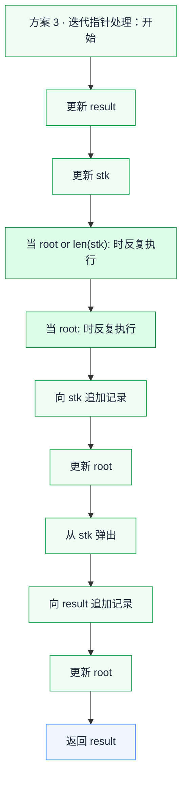

```python
import sys  # 提高递归深度上限（深输入防 RecursionError）

sys.setrecursionlimit(200000)  # 树/链表类题目节点数可达 1e4 量级

def inorderTraversal(root):  # 定义函数 inorderTraversal（参数：根节点）
    result = []  # 把 [] 存入 结果
    stk = []  # 把 [] 存入 栈
    while root or len(stk):  # 循环，直到不满足「根节点 or 长度(栈」
        while root:  # 循环，直到不满足「根节点」
            stk.append(root)  # 把 根节点 追加到列表尾部
            root = root.left  # 把 根节点.左边界 存入 根节点
        root = stk.pop()  # 把 栈 弹出 ) 存入 根节点
        result.append(root.val)  # 把 根节点.值 追加到列表尾部
        root = root.right  # 把 根节点.右边界 存入 根节点
    return result  # 返回 结果

if __name__ == "__main__":  # 若 __name__ 等于 '__main__'
    print(inorderTraversal(None))  # 打印输出
```

#### 方案 4：迭代指针处理

**思路与代码分析**：核心是「迭代指针处理」。Python 版用切片与字典推导式简化操作，突出可读性。**走读**：方案 4 · 迭代指针处理：开始 → 更新 stack → 更新 cur → 当 cur or stack: 时反复执行 → 若 cur：向 stack 追加记录 → 向 stack 追加记录 → 更新 cur → 从 stack 弹出 → 向 res 追加记录 → 更新 cur → 返回 res。

**运行架构**（真实控制流）：

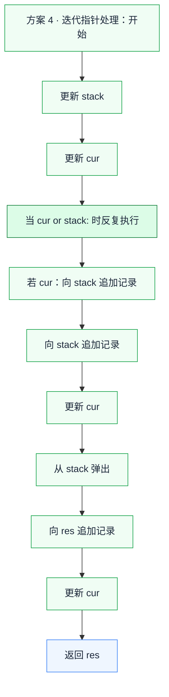

```python
import sys  # 提高递归深度上限（深输入防 RecursionError）

sys.setrecursionlimit(200000)  # 树/链表类题目节点数可达 1e4 量级

class TreeNode:  # 定义类
    def __init__(self, val=0, left=None, right=None):  # 构造函数：初始化成员
        self.val = val  # 把 值 写入 值
        self.left = left  # 把 左边界 写入 左边界
        self.right = right  # 把 右边界 写入 右边界

def inorderTraversal(root):  # 定义函数 inorderTraversal（参数：根节点）
    res, stack = [], []  # 把 [], [] 写入 res, stack
    cur = root  # 把 根节点 存入 当前值
    while cur or stack:  # 循环，直到不满足「当前值 or 栈」
        if cur:  # 若 当前值
            stack.append(cur)  # 把 当前值 追加到列表尾部
            cur = cur.left  # 把 当前值.左边界 存入 当前值
        else:  # 否则
            cur = stack.pop()  # 把 栈 弹出 ) 存入 当前值
            res.append(cur.val)  # 把 当前值.值 追加到列表尾部
            cur = cur.right  # 把 当前值.右边界 存入 当前值
    return res  # 返回 结果

def build_tree(vals):  # 定义函数 build_tree（参数：vals）
    if not vals:  # 若 not vals
        return None  # 返回 None
    root = TreeNode(vals[0])  # 把 TreeNode(vals[0]) 存入 根节点
    q = [root]  # 把 [根节点] 存入 节点
    i = 1  # 把 1 存入 下标 i
    while i < len(vals):  # 循环，直到不满足「下标 i 小于 长度(vals」
        node = q.pop(0)  # 把 节点 弹出 0) 存入 节点
        if vals[i] is not None:  # 若 vals[下标 i] is not None
            node.left = TreeNode(vals[i])  # 把 TreeNode(vals[下标 i]) 写入 左边界
            q.append(node.left)  # 把 节点.左边界 追加到列表尾部
        i += 1  # 下标 i累加 1
        if i < len(vals):  # 若 下标 i 小于 长度(vals
            if vals[i] is not None:  # 若 vals[下标 i] is not None
                node.right = TreeNode(vals[i])  # 把 TreeNode(vals[下标 i]) 写入 右边界
                q.append(node.right)  # 把 节点.右边界 追加到列表尾部
            i += 1  # 下标 i累加 1
    return root  # 返回 根节点

if __name__ == "__main__":  # 若 __name__ 等于 '__main__'
    root = build_tree([1, None, 2, None, 3])  # 把 build_tree([1, None, 2, None, 3]) 存入 根节点
    print(inorderTraversal(root))  # 打印输出
```

#### 方案 5：迭代指针处理

**思路与代码分析**：核心是「迭代指针处理」。Python 版用切片与字典推导式简化操作，突出可读性。**走读**：方案 5 · 迭代指针处理：开始 → 更新 res → 命中条件，直接返回 → 调用 dfs(node.left) → 向 res 追加记录 → 调用 dfs(node.right) → 调用 dfs(root) → 返回 res。

**运行架构**（真实控制流）：

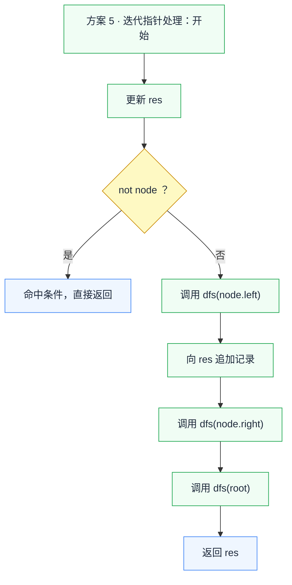

```python
import sys  # 提高递归深度上限（深输入防 RecursionError）

sys.setrecursionlimit(200000)  # 树/链表类题目节点数可达 1e4 量级

class TreeNode:  # 定义类
    def __init__(self, val=0, left=None, right=None):  # 构造函数：初始化成员
        self.val = val  # 把 值 写入 值
        self.left = left  # 把 左边界 写入 左边界
        self.right = right  # 把 右边界 写入 右边界

def inorderTraversal(root):  # 定义函数 inorderTraversal（参数：根节点）
    res = []  # 把 [] 存入 结果

    def dfs(node):  # 定义函数 dfs（参数：节点）
        if not node:  # 若 not 节点
            return  # return
        dfs(node.left)  # dfs(节点.左边界)
        res.append(node.val)  # 把 节点.值 追加到列表尾部
        dfs(node.right)  # dfs(节点.右边界)

    dfs(root)  # dfs(根节点)
    return res  # 返回 结果

def build_tree(vals):  # 定义函数 build_tree（参数：vals）
    if not vals:  # 若 not vals
        return None  # 返回 None
    root = TreeNode(vals[0])  # 把 TreeNode(vals[0]) 存入 根节点
    q = [root]  # 把 [根节点] 存入 节点
    i = 1  # 把 1 存入 下标 i
    while i < len(vals):  # 循环，直到不满足「下标 i 小于 长度(vals」
        node = q.pop(0)  # 把 节点 弹出 0) 存入 节点
        if vals[i] is not None:  # 若 vals[下标 i] is not None
            node.left = TreeNode(vals[i])  # 把 TreeNode(vals[下标 i]) 写入 左边界
            q.append(node.left)  # 把 节点.左边界 追加到列表尾部
        i += 1  # 下标 i累加 1
        if i < len(vals):  # 若 下标 i 小于 长度(vals
            if vals[i] is not None:  # 若 vals[下标 i] is not None
                node.right = TreeNode(vals[i])  # 把 TreeNode(vals[下标 i]) 写入 右边界
                q.append(node.right)  # 把 节点.右边界 追加到列表尾部
            i += 1  # 下标 i累加 1
    return root  # 返回 根节点

if __name__ == "__main__":  # 若 __name__ 等于 '__main__'
    root = build_tree([1, None, 2, None, 3])  # 把 build_tree([1, None, 2, None, 3]) 存入 根节点
    print(inorderTraversal(root))  # 打印输出
```

#### 方案 6：迭代指针处理

**思路与代码分析**：核心是「迭代指针处理」。Python 版用切片与字典推导式简化操作，突出可读性。**走读**：方案 6 · 迭代指针处理：开始 → 更新 res → 当 cur: 时反复执行 → 当 ( 时反复执行 → 返回 res。

**运行架构**（真实控制流）：

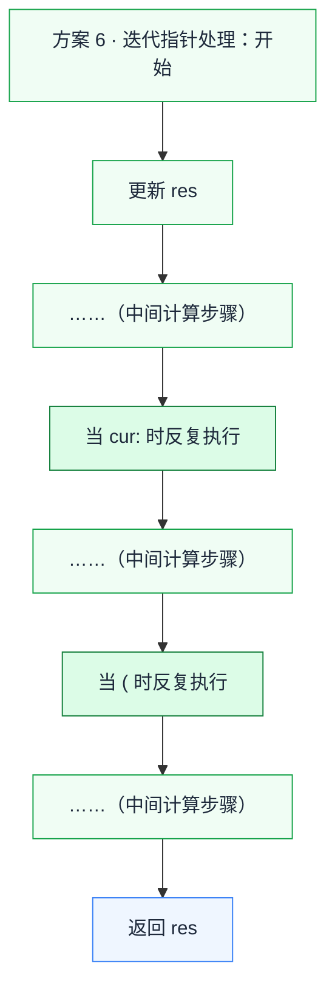

```python
import sys  # 提高递归深度上限（深输入防 RecursionError）

sys.setrecursionlimit(200000)  # 树/链表类题目节点数可达 1e4 量级

class TreeNode:  # 定义类
    def __init__(self, val=0, left=None, right=None):  # 构造函数：初始化成员
        self.val = val  # 把 值 写入 值
        self.left = left  # 把 左边界 写入 左边界
        self.right = right  # 把 右边界 写入 右边界

def inorderTraversal(root):  # 定义函数 inorderTraversal（参数：根节点）
    res = []  # 把 [] 存入 结果
    cur = root  # 把 根节点 存入 当前值
    while cur:  # 循环，直到不满足「当前值」
        if not cur.left:  # 若 not 当前值.左边界
            res.append(cur.val)  # 把 当前值.值 追加到列表尾部
            cur = cur.right  # 把 当前值.右边界 存入 当前值
        else:  # 否则
            pred = cur.left  # 把 当前值.左边界 存入 pred
            while (
                pred.right and pred.right is not cur
            ):  # 循环，直到不满足「pred.右边界 and pred.右边界 is not 当前值」
                pred = pred.right  # 把 pred.右边界 存入 pred
            if not pred.right:  # 若 not pred.右边界
                pred.right = cur  # 把 当前值 写入 右边界
                cur = cur.left  # 把 当前值.左边界 存入 当前值
            else:  # 否则
                pred.right = None  # 把 None 写入 右边界
                res.append(cur.val)  # 把 当前值.值 追加到列表尾部
                cur = cur.right  # 把 当前值.右边界 存入 当前值
    return res  # 返回 结果

def build_tree(vals):  # 定义函数 build_tree（参数：vals）
    if not vals:  # 若 not vals
        return None  # 返回 None
    root = TreeNode(vals[0])  # 把 TreeNode(vals[0]) 存入 根节点
    q = [root]  # 把 [根节点] 存入 节点
    i = 1  # 把 1 存入 下标 i
    while i < len(vals):  # 循环，直到不满足「下标 i 小于 长度(vals」
        node = q.pop(0)  # 把 节点 弹出 0) 存入 节点
        if vals[i] is not None:  # 若 vals[下标 i] is not None
            node.left = TreeNode(vals[i])  # 把 TreeNode(vals[下标 i]) 写入 左边界
            q.append(node.left)  # 把 节点.左边界 追加到列表尾部
        i += 1  # 下标 i累加 1
        if i < len(vals):  # 若 下标 i 小于 长度(vals
            if vals[i] is not None:  # 若 vals[下标 i] is not None
                node.right = TreeNode(vals[i])  # 把 TreeNode(vals[下标 i]) 写入 右边界
                q.append(node.right)  # 把 节点.右边界 追加到列表尾部
            i += 1  # 下标 i累加 1
    return root  # 返回 根节点

if __name__ == "__main__":  # 若 __name__ 等于 '__main__'
    root = build_tree([1, None, 2, None, 3])  # 把 build_tree([1, None, 2, None, 3]) 存入 根节点
    print(inorderTraversal(root))  # 打印输出
```

#### 方案 7：迭代指针处理

**思路与代码分析**：核心是「迭代指针处理」。Python 版用切片与字典推导式简化操作，突出可读性。**走读**：方案 7 · 迭代指针处理：开始 → 更新 res → 命中条件，直接返回 → 调用 dfs(node.left) → 向 res 追加记录 → 调用 dfs(node.right) → 调用 dfs(root) → 返回 res。

**运行架构**（真实控制流）：

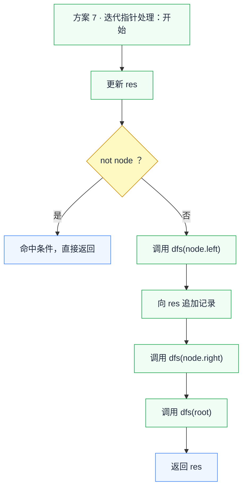

```python
import sys  # 提高递归深度上限（深输入防 RecursionError）

sys.setrecursionlimit(200000)  # 树/链表类题目节点数可达 1e4 量级

class TreeNode:  # 定义类
    def __init__(self, val=0, left=None, right=None):  # 构造函数：初始化成员
        self.val = val  # 把 值 写入 值
        self.left = left  # 把 左边界 写入 左边界
        self.right = right  # 把 右边界 写入 右边界

def inorderTraversal(root):  # 定义函数 inorderTraversal（参数：根节点）
    res = []  # 把 [] 存入 结果

    def dfs(node):  # 定义函数 dfs（参数：节点）
        if not node:  # 若 not 节点
            return  # return
        dfs(node.left)  # dfs(节点.左边界)
        res.append(node.val)  # 把 节点.值 追加到列表尾部
        dfs(node.right)  # dfs(节点.右边界)

    dfs(root)  # dfs(根节点)
    return res  # 返回 结果

def build_tree(vals):  # 定义函数 build_tree（参数：vals）
    if not vals:  # 若 not vals
        return None  # 返回 None
    root = TreeNode(vals[0])  # 把 TreeNode(vals[0]) 存入 根节点
    q = [root]  # 把 [根节点] 存入 节点
    i = 1  # 把 1 存入 下标 i
    while i < len(vals):  # 循环，直到不满足「下标 i 小于 长度(vals」
        node = q.pop(0)  # 把 节点 弹出 0) 存入 节点
        if vals[i] is not None:  # 若 vals[下标 i] is not None
            node.left = TreeNode(vals[i])  # 把 TreeNode(vals[下标 i]) 写入 左边界
            q.append(node.left)  # 把 节点.左边界 追加到列表尾部
        i += 1  # 下标 i累加 1
        if i < len(vals):  # 若 下标 i 小于 长度(vals
            if vals[i] is not None:  # 若 vals[下标 i] is not None
                node.right = TreeNode(vals[i])  # 把 TreeNode(vals[下标 i]) 写入 右边界
                q.append(node.right)  # 把 节点.右边界 追加到列表尾部
            i += 1  # 下标 i累加 1
    return root  # 返回 根节点

if __name__ == "__main__":  # 若 __name__ 等于 '__main__'
    root = build_tree([1, None, 2, None, 3])  # 把 build_tree([1, None, 2, None, 3]) 存入 根节点
    print(inorderTraversal(root))  # 打印输出
```

#### 方案 8：迭代指针处理

**思路与代码分析**：核心是「迭代指针处理」。Python 版用切片与字典推导式简化操作，突出可读性。**走读**：方案 8 · 迭代指针处理：开始 → 更新 stack → 更新 cur → 当 cur or stack: 时反复执行 → 当 cur: 时反复执行 → 向 stack 追加记录 → 更新 cur → 从 stack 弹出 → 向 res 追加记录 → 更新 cur → 返回 res。

**运行架构**（真实控制流）：

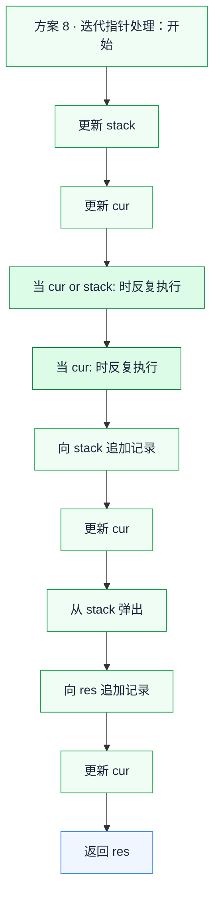

```python
import sys  # 提高递归深度上限（深输入防 RecursionError）

sys.setrecursionlimit(200000)  # 树/链表类题目节点数可达 1e4 量级

class TreeNode:  # 定义类
    def __init__(self, val=0, left=None, right=None):  # 构造函数：初始化成员
        self.val = val  # 把 值 写入 值
        self.left = left  # 把 左边界 写入 左边界
        self.right = right  # 把 右边界 写入 右边界

def inorderTraversal(root):  # 定义函数 inorderTraversal（参数：根节点）
    res, stack = [], []  # 把 [], [] 写入 res, stack
    cur = root  # 把 根节点 存入 当前值
    while cur or stack:  # 循环，直到不满足「当前值 or 栈」
        while cur:  # 循环，直到不满足「当前值」
            stack.append(cur)  # 把 当前值 追加到列表尾部
            cur = cur.left  # 把 当前值.左边界 存入 当前值
        cur = stack.pop()  # 把 栈 弹出 ) 存入 当前值
        res.append(cur.val)  # 把 当前值.值 追加到列表尾部
        cur = cur.right  # 把 当前值.右边界 存入 当前值
    return res  # 返回 结果

def build_tree(vals):  # 定义函数 build_tree（参数：vals）
    if not vals:  # 若 not vals
        return None  # 返回 None
    root = TreeNode(vals[0])  # 把 TreeNode(vals[0]) 存入 根节点
    q = [root]  # 把 [根节点] 存入 节点
    i = 1  # 把 1 存入 下标 i
    while i < len(vals):  # 循环，直到不满足「下标 i 小于 长度(vals」
        node = q.pop(0)  # 把 节点 弹出 0) 存入 节点
        if vals[i] is not None:  # 若 vals[下标 i] is not None
            node.left = TreeNode(vals[i])  # 把 TreeNode(vals[下标 i]) 写入 左边界
            q.append(node.left)  # 把 节点.左边界 追加到列表尾部
        i += 1  # 下标 i累加 1
        if i < len(vals):  # 若 下标 i 小于 长度(vals
            if vals[i] is not None:  # 若 vals[下标 i] is not None
                node.right = TreeNode(vals[i])  # 把 TreeNode(vals[下标 i]) 写入 右边界
                q.append(node.right)  # 把 节点.右边界 追加到列表尾部
            i += 1  # 下标 i累加 1
    return root  # 返回 根节点

if __name__ == "__main__":  # 若 __name__ 等于 '__main__'
    root = build_tree([1, None, 2, None, 3])  # 把 build_tree([1, None, 2, None, 3]) 存入 根节点
    print(inorderTraversal(root))  # 打印输出
```

#### 方案 9：迭代指针处理

**思路与代码分析**：核心是「迭代指针处理」。Python 版用切片与字典推导式简化操作，突出可读性。**走读**：方案 9 · 迭代指针处理：开始 → 命中条件，直接返回 → 返回 inorderTraversal(root.left) + [root.val] + inorderTraversal(root.right)。

**运行架构**（真实控制流）：

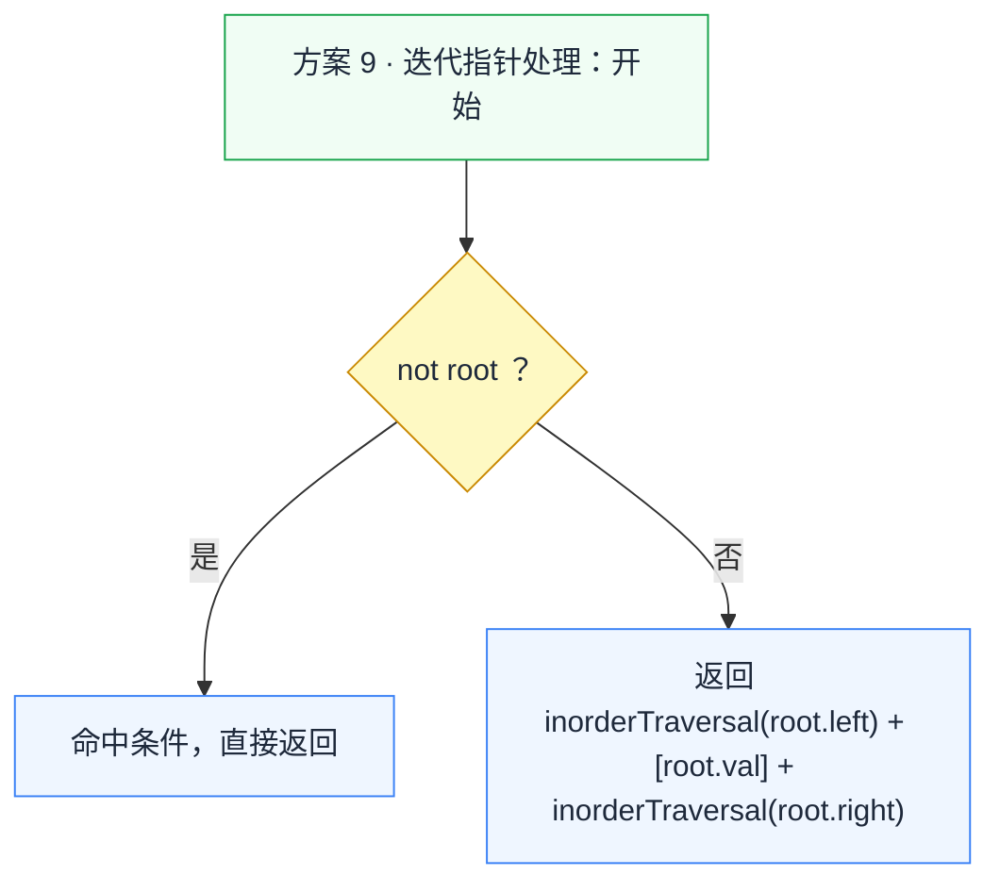

```python
import sys  # 提高递归深度上限（深输入防 RecursionError）

sys.setrecursionlimit(200000)  # 树/链表类题目节点数可达 1e4 量级

class TreeNode:  # 定义类
    def __init__(self, val=0, left=None, right=None):  # 构造函数：初始化成员
        self.val = val  # 把 值 写入 值
        self.left = left  # 把 左边界 写入 左边界
        self.right = right  # 把 右边界 写入 右边界

def inorderTraversal(root):  # 定义函数 inorderTraversal（参数：根节点）
    if not root:  # 若 not 根节点
        return []  # 返回 []
    return inorderTraversal(root.left) + [root.val] + inorderTraversal(root.right)

def build_tree(vals):  # 定义函数 build_tree（参数：vals）
    if not vals:  # 若 not vals
        return None  # 返回 None
    root = TreeNode(vals[0])  # 把 TreeNode(vals[0]) 存入 根节点
    q = [root]  # 把 [根节点] 存入 节点
    i = 1  # 把 1 存入 下标 i
    while i < len(vals):  # 循环，直到不满足「下标 i 小于 长度(vals」
        node = q.pop(0)  # 把 节点 弹出 0) 存入 节点
        if vals[i] is not None:  # 若 vals[下标 i] is not None
            node.left = TreeNode(vals[i])  # 把 TreeNode(vals[下标 i]) 写入 左边界
            q.append(node.left)  # 把 节点.左边界 追加到列表尾部
        i += 1  # 下标 i累加 1
        if i < len(vals):  # 若 下标 i 小于 长度(vals
            if vals[i] is not None:  # 若 vals[下标 i] is not None
                node.right = TreeNode(vals[i])  # 把 TreeNode(vals[下标 i]) 写入 右边界
                q.append(node.right)  # 把 节点.右边界 追加到列表尾部
            i += 1  # 下标 i累加 1
    return root  # 返回 根节点

if __name__ == "__main__":  # 若 __name__ 等于 '__main__'
    root = build_tree([1, None, 2, None, 3])  # 把 build_tree([1, None, 2, None, 3]) 存入 根节点
    print(inorderTraversal(root))  # 打印输出
```

### Go 实现（9 种方案）

Go 的全部方案如下，每个方案都内嵌用例自测，可独立运行（老仓库 python/go 文件遵循「打印结果」约定）：

#### 方案 1：迭代指针处理

**思路与代码分析**：核心是「迭代指针处理」。Go 版用切片与多返回值惯用法，显式处理索引边界。**走读**：方案 1 · 迭代指针处理：开始 → 更新 : → 计算 dfs → 更新 dfs → 处理 if node == nil → 返回  → 调用 dfs(node.Left) → 更新 res → 调用 dfs(node.Right) → 调用 dfs(root) → 返回 res。

**运行架构**（真实控制流）：

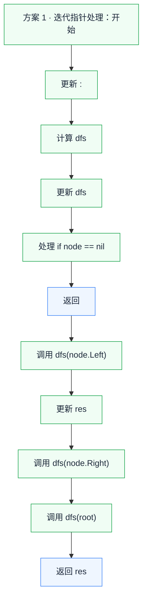

```go
package main // 引入依赖

import (
	"fmt"
	"os"
	"reflect"
) // 引入依赖

type TreeNode struct { // 定义类型
	Val   int       // Val int
	Left  *TreeNode // Left 乘 TreeNode
	Right *TreeNode // Right 乘 TreeNode
}

func inorderTraversal(root *TreeNode) []int { // 定义函数/方法 inorderTraversal
	res := []int{}               // 把 []int{} 写入 res :
	var dfs func(node *TreeNode) // var dfs func(节点 乘 TreeNode)
	dfs = func(node *TreeNode) { // 把 func(节点 乘 TreeNode) { 写入 dfs
		if node == nil { // 若 节点 等于 nil
			return // return
		}
		dfs(node.Left)              // dfs(节点.Left)
		res = append(res, node.Val) // 把 append(结果, 节点.Val) 写入 结果
		dfs(node.Right)             // dfs(节点.Right)
	}
	dfs(root)  // dfs(根节点)
	return res // 返回 结果
}

func buildTree(vals []int) *TreeNode { // 定义函数/方法 buildTree
	if len(vals) == 0 || vals[0] == -1 { // 若 长度(vals) 等于 0 或 vals[0] 等于 减 1
		return nil // 返回 nil
	}
	root := &TreeNode{Val: vals[0]} // 把 按位与 TreeNode{Val: vals[0]} 写入 root :
	q := []*TreeNode{root}          // 把 [] 乘 TreeNode{根节点} 写入 q :
	i := 1                          // 把 1 写入 i :
	for i < len(vals) {             // for 下标 i 小于 长度(vals) {
		node := q[0]                        // 把 节点[0] 写入 node :
		q = q[1:]                           // 把 节点[1:] 写入 节点
		if i < len(vals) && vals[i] != -1 { // 若 下标 i 小于 长度(vals) 且 vals[下标 i] 不等于 减 1
			node.Left = &TreeNode{Val: vals[i]} // 把 按位与 TreeNode{Val: vals[下标 i]} 写入 node.Left
			q = append(q, node.Left)            // 把 append(节点, 节点.Left) 写入 节点
		}
		i++                                 // 下标 i 加一
		if i < len(vals) && vals[i] != -1 { // 若 下标 i 小于 长度(vals) 且 vals[下标 i] 不等于 减 1
			node.Right = &TreeNode{Val: vals[i]} // 把 按位与 TreeNode{Val: vals[下标 i]} 写入 node.Right
			q = append(q, node.Right)            // 把 append(节点, 节点.Right) 写入 节点
		}
		i++ // 下标 i 加一
	}
	return root // 返回 根节点
}

func main() { // 程序入口：跑内嵌自测用例
	ok := true                                       // 把 true 写入 ok :
	if got := inorderTraversal(nil); len(got) != 0 { // 若 got : 赋值为 inorderTraversal(nil); 长度(got) 不等于 0
		ok = false                           // 把 false 写入 ok
		fmt.Printf("FAIL nil got=%v\n", got) // 打印输出
	}
	root := buildTree([]int{1, -1, 2, -1, 3}) // 把 buildTree([]int{1, 减 1, 2, 减 1, 3}) 写入 root :
	got := inorderTraversal(root)             // 把 inorderTraversal(根节点) 写入 got :
	want := []int{1, 2, 3}                    // 把 []int{1, 2, 3} 写入 want :
	if !reflect.DeepEqual(got, want) {        // 若 取反 reflect.DeepEqual(got, want
		ok = false                                     // 把 false 写入 ok
		fmt.Printf("FAIL got=%v want=%v\n", got, want) // 打印输出
	}
	if !ok { // 若 取反 ok
		os.Exit(1) // os.Exit(1)
	}
	fmt.Println("PASS") // 全部用例通过，输出 PASS
}
```

#### 方案 2：迭代指针处理

**思路与代码分析**：核心是「迭代指针处理」。Go 版用切片与多返回值惯用法，显式处理索引边界。**走读**：方案 2 · 迭代指针处理：开始 → 返回 inorderT(root)。

**运行架构**（真实控制流）：

```mermaid
graph TD
    N0["方案 2 · 迭代指针处理：开始"]
    N1["返回 inorderT(root)"]
    N0 --> N1
    classDef n fill:#f0fdf4,stroke:#16a34a,color:#1e293b;
    classDef lp fill:#dcfce7,stroke:#15803d,color:#1e293b;
    classDef dc fill:#fef9c3,stroke:#ca8a04,color:#1e293b;
    classDef tm fill:#eff6ff,stroke:#3b82f6,color:#1e293b;
    class N0 n;
    class N1 tm;
```

```go
package main // 引入依赖
import (
	"fmt"
	"os"
	"reflect"
) // 引入依赖
type TreeNode struct {
	Val   int
	Left  *TreeNode
	Right *TreeNode
}                        // 定义类型
const NULL = -1000000000 // 把 减 1000000000 存入 NULL
func buildTree(vals []int) *TreeNode { // 定义函数/方法 buildTree
	if len(vals) == 0 || vals[0] == NULL {
		return nil
	} // 若 长度(vals) 等于 0 或 vals[0] 等于 NULL { return nil }
	root := &TreeNode{Val: vals[0]} // 把 按位与 TreeNode{Val: vals[0]} 写入 root :
	q := []*TreeNode{root}
	i := 1                            // 把 [] 乘 TreeNode{根节点}; 下标 i : 赋值为 1 写入 q :
	for len(q) > 0 && i < len(vals) { // 定义函数/方法 len
		node := q[0]
		q = q[1:] // 把 节点[0]; 节点 赋值为 节点[1:] 写入 node :
		if i < len(vals) && vals[i] != NULL {
			node.Left = &TreeNode{Val: vals[i]}
			q = append(q, node.Left)
		}
		i++
		if i < len(vals) && vals[i] != NULL {
			node.Right = &TreeNode{Val: vals[i]}
			q = append(q, node.Right)
		}
		i++
	}
	return root // 返回 根节点
}
func levelList(root *TreeNode) [][]int { // 定义函数/方法 levelList
	if root == nil {
		return [][]int{}
	} // 若 根节点 等于 nil { return [][]int{} }
	res := [][]int{}
	q := []*TreeNode{root} // 把 [][]int{}; 节点 : 赋值为 [] 乘 TreeNode{根节点} 写入 res :
	for len(q) > 0 {       // for 长度(节点) 超过 0 {
		lvl := []int{}
		n := len(q)              // 把 []int{}; 元素个数 : 赋值为 长度(节点) 写入 lvl :
		for k := 0; k < n; k++ { // 让 下标 k 从 0 开始计数
			node := q[0]
			q = q[1:]                   // 把 节点[0]; 节点 赋值为 节点[1:] 写入 node :
			lvl = append(lvl, node.Val) // 把 append(lvl, 节点.Val) 写入 lvl
			if node.Left != nil {
				q = append(q, node.Left)
			} // 若 节点.Left 不等于 nil { 节点 赋值为 append(节点, 节点.Left) }
			if node.Right != nil {
				q = append(q, node.Right)
			} // 若 节点.Right 不等于 nil { 节点 赋值为 append(节点, 节点.Right) }
		}
		res = append(res, lvl) // 把 append(结果, lvl) 写入 结果
	}
	return res // 返回 结果
}
func sameTree(a, b *TreeNode) bool { // 定义函数/方法 sameTree
	if a == nil && b == nil {
		return true
	} // 若 数组 等于 nil 且 b 等于 nil { return true }
	if a == nil || b == nil {
		return false
	} // 若 数组 等于 nil 或 b 等于 nil { return false }
	if a.Val != b.Val {
		return false
	} // 若 数组.Val 不等于 b.Val { return false }
	return sameTree(a.Left, b.Left) && sameTree(a.Right, b.Right) // 定义函数/方法 sameTree
}
func inorderT(root *TreeNode) []int { // 定义函数/方法 inorderT
	if root == nil {
		return []int{}
	} // 若 根节点 等于 nil { return []int{} }
	return append(append(inorderT(root.Left), root.Val), inorderT(root.Right)...) // 定义函数/方法 append
}
func inorderTraversal(root *TreeNode) []int { return inorderT(root) } // 定义函数/方法 inorderTraversal
func main() { // 程序入口：跑内嵌自测用例
	if got := inorderTraversal(buildTree([]int{1, 2, 3, NULL, 4, 5})); !reflect.DeepEqual(got, []int{2, 4, 1, 5, 3}) {
		fmt.Println("FAIL", got)
		os.Exit(1)
	}
	fmt.Println("PASS") // 全部用例通过，输出 PASS
}
```

#### 方案 3：迭代指针处理

**思路与代码分析**：核心是「迭代指针处理」。Go 版用切片与多返回值惯用法，显式处理索引边界。**走读**：方案 3 · 迭代指针处理：开始 → 返回 inorderT(root)。

**运行架构**（真实控制流）：

```mermaid
graph TD
    N0["方案 3 · 迭代指针处理：开始"]
    N1["返回 inorderT(root)"]
    N0 --> N1
    classDef n fill:#f0fdf4,stroke:#16a34a,color:#1e293b;
    classDef lp fill:#dcfce7,stroke:#15803d,color:#1e293b;
    classDef dc fill:#fef9c3,stroke:#ca8a04,color:#1e293b;
    classDef tm fill:#eff6ff,stroke:#3b82f6,color:#1e293b;
    class N0 n;
    class N1 tm;
```

```go
package main // 引入依赖
import (
	"fmt"
	"os"
	"reflect"
) // 引入依赖
type TreeNode struct {
	Val   int
	Left  *TreeNode
	Right *TreeNode
}                        // 定义类型
const NULL = -1000000000 // 把 减 1000000000 存入 NULL
func buildTree(vals []int) *TreeNode { // 定义函数/方法 buildTree
	if len(vals) == 0 || vals[0] == NULL {
		return nil
	} // 若 长度(vals) 等于 0 或 vals[0] 等于 NULL { return nil }
	root := &TreeNode{Val: vals[0]} // 把 按位与 TreeNode{Val: vals[0]} 写入 root :
	q := []*TreeNode{root}
	i := 1                            // 把 [] 乘 TreeNode{根节点}; 下标 i : 赋值为 1 写入 q :
	for len(q) > 0 && i < len(vals) { // 定义函数/方法 len
		node := q[0]
		q = q[1:] // 把 节点[0]; 节点 赋值为 节点[1:] 写入 node :
		if i < len(vals) && vals[i] != NULL {
			node.Left = &TreeNode{Val: vals[i]}
			q = append(q, node.Left)
		}
		i++
		if i < len(vals) && vals[i] != NULL {
			node.Right = &TreeNode{Val: vals[i]}
			q = append(q, node.Right)
		}
		i++
	}
	return root // 返回 根节点
}
func levelList(root *TreeNode) [][]int { // 定义函数/方法 levelList
	if root == nil {
		return [][]int{}
	} // 若 根节点 等于 nil { return [][]int{} }
	res := [][]int{}
	q := []*TreeNode{root} // 把 [][]int{}; 节点 : 赋值为 [] 乘 TreeNode{根节点} 写入 res :
	for len(q) > 0 {       // for 长度(节点) 超过 0 {
		lvl := []int{}
		n := len(q)              // 把 []int{}; 元素个数 : 赋值为 长度(节点) 写入 lvl :
		for k := 0; k < n; k++ { // 让 下标 k 从 0 开始计数
			node := q[0]
			q = q[1:]                   // 把 节点[0]; 节点 赋值为 节点[1:] 写入 node :
			lvl = append(lvl, node.Val) // 把 append(lvl, 节点.Val) 写入 lvl
			if node.Left != nil {
				q = append(q, node.Left)
			} // 若 节点.Left 不等于 nil { 节点 赋值为 append(节点, 节点.Left) }
			if node.Right != nil {
				q = append(q, node.Right)
			} // 若 节点.Right 不等于 nil { 节点 赋值为 append(节点, 节点.Right) }
		}
		res = append(res, lvl) // 把 append(结果, lvl) 写入 结果
	}
	return res // 返回 结果
}
func sameTree(a, b *TreeNode) bool { // 定义函数/方法 sameTree
	if a == nil && b == nil {
		return true
	} // 若 数组 等于 nil 且 b 等于 nil { return true }
	if a == nil || b == nil {
		return false
	} // 若 数组 等于 nil 或 b 等于 nil { return false }
	if a.Val != b.Val {
		return false
	} // 若 数组.Val 不等于 b.Val { return false }
	return sameTree(a.Left, b.Left) && sameTree(a.Right, b.Right) // 定义函数/方法 sameTree
}
func inorderT(root *TreeNode) []int { // 定义函数/方法 inorderT
	if root == nil {
		return []int{}
	} // 若 根节点 等于 nil { return []int{} }
	return append(append(inorderT(root.Left), root.Val), inorderT(root.Right)...) // 定义函数/方法 append
}
func inorderTraversal(root *TreeNode) []int { return inorderT(root) } // 定义函数/方法 inorderTraversal
func main() { // 程序入口：跑内嵌自测用例
	if got := inorderTraversal(buildTree([]int{1, 2, 3, NULL, 4, 5})); !reflect.DeepEqual(got, []int{2, 4, 1, 5, 3}) {
		fmt.Println("FAIL", got)
		os.Exit(1)
	}
	fmt.Println("PASS") // 全部用例通过，输出 PASS
}
```

#### 方案 4：迭代指针处理

**思路与代码分析**：核心是「迭代指针处理」。Go 版用切片与多返回值惯用法，显式处理索引边界。**走读**：方案 4 · 迭代指针处理：开始 → 更新 : → 更新 : → 更新 : → 遍历循环 → 处理 if cur ≠ nil → 更新 stack → 更新 cur → 更新 cur → 更新 stack → 更新 res → 更新 cur → 返回 res。

**运行架构**（真实控制流）：

```mermaid
graph TD
    N0["方案 4 · 迭代指针处理：开始"]
    N1["更新 :"]
    N2["更新 :"]
    N3["更新 :"]
    N4["遍历循环"]
    N5["处理 if cur ≠ nil"]
    N6["更新 stack"]
    N7["更新 cur"]
    N8["更新 cur"]
    N9["更新 stack"]
    N10["更新 res"]
    N11["更新 cur"]
    N12["返回 res"]
    N0 --> N1
    N1 --> N2
    N2 --> N3
    N3 --> N4
    N4 --> N5
    N5 --> N6
    N6 --> N7
    N7 --> N8
    N8 --> N9
    N9 --> N10
    N10 --> N11
    N11 -- 下一轮 --> N4
    N4 --> N12
    classDef n fill:#f0fdf4,stroke:#16a34a,color:#1e293b;
    classDef lp fill:#dcfce7,stroke:#15803d,color:#1e293b;
    classDef dc fill:#fef9c3,stroke:#ca8a04,color:#1e293b;
    classDef tm fill:#eff6ff,stroke:#3b82f6,color:#1e293b;
    class N0,N1,N2,N3,N5,N6,N7,N8,N9,N10,N11 n;
    class N4 lp;
    class N12 tm;
```

```go
package main // 引入依赖

import (
	"fmt"
	"os"
	"reflect"
) // 引入依赖

type TreeNode struct { // 定义类型
	Val   int       // Val int
	Left  *TreeNode // Left 乘 TreeNode
	Right *TreeNode // Right 乘 TreeNode
}

func inorderTraversal(root *TreeNode) []int { // 定义函数/方法 inorderTraversal
	res := []int{}                     // 把 []int{} 写入 res :
	stack := []*TreeNode{}             // 把 [] 乘 TreeNode{} 写入 stack :
	cur := root                        // 把 根节点 写入 cur :
	for cur != nil || len(stack) > 0 { // 把 nil 或 长度(栈) 超过 0 { 写入 for cur !
		if cur != nil { // 若 当前值 不等于 nil
			stack = append(stack, cur) // 把 append(栈, 当前值) 写入 栈
			cur = cur.Left             // 把 当前值.Left 写入 当前值
		} else { // 否则
			cur = stack[len(stack)-1]    // 把 栈[长度(栈) 减 1] 写入 当前值
			stack = stack[:len(stack)-1] // 把 栈[:长度(栈) 减 1] 写入 栈
			res = append(res, cur.Val)   // 把 append(结果, 当前值.Val) 写入 结果
			cur = cur.Right              // 把 当前值.Right 写入 当前值
		}
	}
	return res // 返回 结果
}

func buildTree(vals []int) *TreeNode { // 定义函数/方法 buildTree
	if len(vals) == 0 || vals[0] == -1 { // 若 长度(vals) 等于 0 或 vals[0] 等于 减 1
		return nil // 返回 nil
	}
	root := &TreeNode{Val: vals[0]} // 把 按位与 TreeNode{Val: vals[0]} 写入 root :
	q := []*TreeNode{root}          // 把 [] 乘 TreeNode{根节点} 写入 q :
	i := 1                          // 把 1 写入 i :
	for i < len(vals) {             // for 下标 i 小于 长度(vals) {
		node := q[0]                        // 把 节点[0] 写入 node :
		q = q[1:]                           // 把 节点[1:] 写入 节点
		if i < len(vals) && vals[i] != -1 { // 若 下标 i 小于 长度(vals) 且 vals[下标 i] 不等于 减 1
			node.Left = &TreeNode{Val: vals[i]} // 把 按位与 TreeNode{Val: vals[下标 i]} 写入 node.Left
			q = append(q, node.Left)            // 把 append(节点, 节点.Left) 写入 节点
		}
		i++                                 // 下标 i 加一
		if i < len(vals) && vals[i] != -1 { // 若 下标 i 小于 长度(vals) 且 vals[下标 i] 不等于 减 1
			node.Right = &TreeNode{Val: vals[i]} // 把 按位与 TreeNode{Val: vals[下标 i]} 写入 node.Right
			q = append(q, node.Right)            // 把 append(节点, 节点.Right) 写入 节点
		}
		i++ // 下标 i 加一
	}
	return root // 返回 根节点
}

func main() { // 程序入口：跑内嵌自测用例
	ok := true                                       // 把 true 写入 ok :
	if got := inorderTraversal(nil); len(got) != 0 { // 若 got : 赋值为 inorderTraversal(nil); 长度(got) 不等于 0
		ok = false                           // 把 false 写入 ok
		fmt.Printf("FAIL nil got=%v\n", got) // 打印输出
	}
	root := buildTree([]int{1, -1, 2, -1, 3}) // 把 buildTree([]int{1, 减 1, 2, 减 1, 3}) 写入 root :
	got := inorderTraversal(root)             // 把 inorderTraversal(根节点) 写入 got :
	want := []int{1, 2, 3}                    // 把 []int{1, 2, 3} 写入 want :
	if !reflect.DeepEqual(got, want) {        // 若 取反 reflect.DeepEqual(got, want
		ok = false                                     // 把 false 写入 ok
		fmt.Printf("FAIL got=%v want=%v\n", got, want) // 打印输出
	}
	if !ok { // 若 取反 ok
		os.Exit(1) // os.Exit(1)
	}
	fmt.Println("PASS") // 全部用例通过，输出 PASS
}
```

#### 方案 5：迭代指针处理

**思路与代码分析**：核心是「迭代指针处理」。Go 版用切片与多返回值惯用法，显式处理索引边界。**走读**：方案 5 · 迭代指针处理：开始 → 更新 : → 计算 dfs → 更新 dfs → 处理 if node == nil → 返回  → 调用 dfs(node.Left) → 更新 res → 调用 dfs(node.Right) → 调用 dfs(root) → 返回 res。

**运行架构**（真实控制流）：

```mermaid
graph TD
    N0["方案 5 · 迭代指针处理：开始"]
    N1["更新 :"]
    N2["计算 dfs"]
    N3["更新 dfs"]
    N4["处理 if node == nil"]
    N5["返回 "]
    N6["调用 dfs(node.Left)"]
    N7["更新 res"]
    N8["调用 dfs(node.Right)"]
    N9["调用 dfs(root)"]
    N10["返回 res"]
    N0 --> N1
    N1 --> N2
    N2 --> N3
    N3 --> N4
    N4 --> N5
    N5 --> N6
    N6 --> N7
    N7 --> N8
    N8 --> N9
    N9 --> N10
    classDef n fill:#f0fdf4,stroke:#16a34a,color:#1e293b;
    classDef lp fill:#dcfce7,stroke:#15803d,color:#1e293b;
    classDef dc fill:#fef9c3,stroke:#ca8a04,color:#1e293b;
    classDef tm fill:#eff6ff,stroke:#3b82f6,color:#1e293b;
    class N0,N1,N2,N3,N4,N6,N7,N8,N9 n;
    class N5,N10 tm;
```

```go
package main // 引入依赖

import (
	"fmt"
	"os"
	"reflect"
) // 引入依赖

type TreeNode struct { // 定义类型
	Val   int       // Val int
	Left  *TreeNode // Left 乘 TreeNode
	Right *TreeNode // Right 乘 TreeNode
}

func inorderTraversal(root *TreeNode) []int { // 定义函数/方法 inorderTraversal
	res := []int{}               // 把 []int{} 写入 res :
	var dfs func(node *TreeNode) // var dfs func(节点 乘 TreeNode)
	dfs = func(node *TreeNode) { // 把 func(节点 乘 TreeNode) { 写入 dfs
		if node == nil { // 若 节点 等于 nil
			return // return
		}
		dfs(node.Left)              // dfs(节点.Left)
		res = append(res, node.Val) // 把 append(结果, 节点.Val) 写入 结果
		dfs(node.Right)             // dfs(节点.Right)
	}
	dfs(root)  // dfs(根节点)
	return res // 返回 结果
}

func buildTree(vals []int) *TreeNode { // 定义函数/方法 buildTree
	if len(vals) == 0 || vals[0] == -1 { // 若 长度(vals) 等于 0 或 vals[0] 等于 减 1
		return nil // 返回 nil
	}
	root := &TreeNode{Val: vals[0]} // 把 按位与 TreeNode{Val: vals[0]} 写入 root :
	q := []*TreeNode{root}          // 把 [] 乘 TreeNode{根节点} 写入 q :
	i := 1                          // 把 1 写入 i :
	for i < len(vals) {             // for 下标 i 小于 长度(vals) {
		node := q[0]                        // 把 节点[0] 写入 node :
		q = q[1:]                           // 把 节点[1:] 写入 节点
		if i < len(vals) && vals[i] != -1 { // 若 下标 i 小于 长度(vals) 且 vals[下标 i] 不等于 减 1
			node.Left = &TreeNode{Val: vals[i]} // 把 按位与 TreeNode{Val: vals[下标 i]} 写入 node.Left
			q = append(q, node.Left)            // 把 append(节点, 节点.Left) 写入 节点
		}
		i++                                 // 下标 i 加一
		if i < len(vals) && vals[i] != -1 { // 若 下标 i 小于 长度(vals) 且 vals[下标 i] 不等于 减 1
			node.Right = &TreeNode{Val: vals[i]} // 把 按位与 TreeNode{Val: vals[下标 i]} 写入 node.Right
			q = append(q, node.Right)            // 把 append(节点, 节点.Right) 写入 节点
		}
		i++ // 下标 i 加一
	}
	return root // 返回 根节点
}

func main() { // 程序入口：跑内嵌自测用例
	ok := true                                       // 把 true 写入 ok :
	if got := inorderTraversal(nil); len(got) != 0 { // 若 got : 赋值为 inorderTraversal(nil); 长度(got) 不等于 0
		ok = false                           // 把 false 写入 ok
		fmt.Printf("FAIL nil got=%v\n", got) // 打印输出
	}
	root := buildTree([]int{1, -1, 2, -1, 3}) // 把 buildTree([]int{1, 减 1, 2, 减 1, 3}) 写入 root :
	got := inorderTraversal(root)             // 把 inorderTraversal(根节点) 写入 got :
	want := []int{1, 2, 3}                    // 把 []int{1, 2, 3} 写入 want :
	if !reflect.DeepEqual(got, want) {        // 若 取反 reflect.DeepEqual(got, want
		ok = false                                     // 把 false 写入 ok
		fmt.Printf("FAIL got=%v want=%v\n", got, want) // 打印输出
	}
	if !ok { // 若 取反 ok
		os.Exit(1) // os.Exit(1)
	}
	fmt.Println("PASS") // 全部用例通过，输出 PASS
}
```

#### 方案 6：迭代指针处理

**思路与代码分析**：核心是「迭代指针处理」。Go 版用切片与多返回值惯用法，显式处理索引边界。**走读**：方案 6 · 迭代指针处理：开始 → 更新 : → 遍历循环 → 遍历循环 → 返回 res。

**运行架构**（真实控制流）：

```mermaid
graph TD
    N0["方案 6 · 迭代指针处理：开始"]
    N1["更新 :"]
    D1["……（中间计算步骤）"]
    N3["遍历循环"]
    D2["……（中间计算步骤）"]
    N8["遍历循环"]
    D3["……（中间计算步骤）"]
    N16["返回 res"]
    N0 --> N1
    N3 --> N16
    N1 --> D1
    D1 --> N3
    N3 --> D2
    D2 --> N8
    N8 --> D3
    D3 --> N16
    classDef n fill:#f0fdf4,stroke:#16a34a,color:#1e293b;
    classDef lp fill:#dcfce7,stroke:#15803d,color:#1e293b;
    classDef dc fill:#fef9c3,stroke:#ca8a04,color:#1e293b;
    classDef tm fill:#eff6ff,stroke:#3b82f6,color:#1e293b;
    class N0,N1,D1,D2,D3 n;
    class N3,N8 lp;
    class N16 tm;
```

```go
package main // 引入依赖

import (
	"fmt"
	"os"
) // 引入依赖

type TreeNode struct { // 定义类型
	Val   int       // Val int
	Left  *TreeNode // Left 乘 TreeNode
	Right *TreeNode // Right 乘 TreeNode
}

func buildTree(vals []interface{}) *TreeNode { // 定义函数/方法 buildTree
	if len(vals) == 0 || vals[0] == nil { // 若 长度(vals) 等于 0 或 vals[0] 等于 nil
		return nil // 返回 nil
	}
	root := &TreeNode{Val: vals[0].(int)} // 把 按位与 TreeNode{Val: vals[0].(int)} 写入 root :
	q := []*TreeNode{root}                // 把 [] 乘 TreeNode{根节点} 写入 q :
	i := 1                                // 把 1 写入 i :
	for i < len(vals) {                   // for 下标 i 小于 长度(vals) {
		node := q[0]        // 把 节点[0] 写入 node :
		q = q[1:]           // 把 节点[1:] 写入 节点
		if vals[i] != nil { // 若 vals[下标 i] 不等于 nil
			node.Left = &TreeNode{Val: vals[i].(int)} // 把 按位与 TreeNode{Val: vals[下标 i].(int)} 写入 node.Left
			q = append(q, node.Left)                  // 把 append(节点, 节点.Left) 写入 节点
		}
		i++                // 下标 i 加一
		if i < len(vals) { // 若 下标 i 小于 长度(vals
			if vals[i] != nil { // 若 vals[下标 i] 不等于 nil
				node.Right = &TreeNode{Val: vals[i].(int)} // 把 按位与 TreeNode{Val: vals[下标 i].(int)} 写入 node.Right
				q = append(q, node.Right)                  // 把 append(节点, 节点.Right) 写入 节点
			}
			i++ // 下标 i 加一
		}
	}
	return root // 返回 根节点
}

func inorderTraversal(root *TreeNode) []int { // 定义函数/方法 inorderTraversal
	res := []int{}   // 把 []int{} 写入 res :
	cur := root      // 把 根节点 写入 cur :
	for cur != nil { // 把 nil { 写入 for cur !
		if cur.Left == nil { // 若 当前值.Left 等于 nil
			res = append(res, cur.Val) // 把 append(结果, 当前值.Val) 写入 结果
			cur = cur.Right            // 把 当前值.Right 写入 当前值
		} else { // 否则
			pred := cur.Left                             // 把 当前值.Left 写入 pred :
			for pred.Right != nil && pred.Right != cur { // 把 nil 且 pred.Right 不等于 当前值 { 写入 for pred.Right !
				pred = pred.Right // 把 pred.Right 写入 pred
			}
			if pred.Right == nil { // 若 pred.Right 等于 nil
				pred.Right = cur // 把 当前值 写入 pred.Right
				cur = cur.Left   // 把 当前值.Left 写入 当前值
			} else { // 否则
				pred.Right = nil           // 把 nil 写入 pred.Right
				res = append(res, cur.Val) // 把 append(结果, 当前值.Val) 写入 结果
				cur = cur.Right            // 把 当前值.Right 写入 当前值
			}
		}
	}
	return res // 返回 结果
}

func main() { // 程序入口：跑内嵌自测用例
	got := inorderTraversal(buildTree([]interface{}{1, nil, 2, nil, 3}))
	want := []int{1, 2, 3}                   // 把 []int{1, 2, 3} 写入 want :
	if fmt.Sprint(got) != fmt.Sprint(want) { // 若 fmt.Sprint(got) 不等于 fmt.Sprint(want
		fmt.Printf("FAIL =%v want %v\n", got, want) // 打印输出
		os.Exit(1)                                  // os.Exit(1)
	}
	fmt.Println("PASS") // 全部用例通过，输出 PASS
}
```

#### 方案 7：迭代指针处理

**思路与代码分析**：核心是「迭代指针处理」。Go 版用切片与多返回值惯用法，显式处理索引边界。**走读**：方案 7 · 迭代指针处理：开始 → 返回 inorderT(root)。

**运行架构**（真实控制流）：

```mermaid
graph TD
    N0["方案 7 · 迭代指针处理：开始"]
    N1["返回 inorderT(root)"]
    N0 --> N1
    classDef n fill:#f0fdf4,stroke:#16a34a,color:#1e293b;
    classDef lp fill:#dcfce7,stroke:#15803d,color:#1e293b;
    classDef dc fill:#fef9c3,stroke:#ca8a04,color:#1e293b;
    classDef tm fill:#eff6ff,stroke:#3b82f6,color:#1e293b;
    class N0 n;
    class N1 tm;
```

```go
package main // 引入依赖
import (
	"fmt"
	"os"
	"reflect"
) // 引入依赖
type TreeNode struct {
	Val   int
	Left  *TreeNode
	Right *TreeNode
}                        // 定义类型
const NULL = -1000000000 // 把 减 1000000000 存入 NULL
func buildTree(vals []int) *TreeNode { // 定义函数/方法 buildTree
	if len(vals) == 0 || vals[0] == NULL {
		return nil
	} // 若 长度(vals) 等于 0 或 vals[0] 等于 NULL { return nil }
	root := &TreeNode{Val: vals[0]} // 把 按位与 TreeNode{Val: vals[0]} 写入 root :
	q := []*TreeNode{root}
	i := 1                            // 把 [] 乘 TreeNode{根节点}; 下标 i : 赋值为 1 写入 q :
	for len(q) > 0 && i < len(vals) { // 定义函数/方法 len
		node := q[0]
		q = q[1:] // 把 节点[0]; 节点 赋值为 节点[1:] 写入 node :
		if i < len(vals) && vals[i] != NULL {
			node.Left = &TreeNode{Val: vals[i]}
			q = append(q, node.Left)
		}
		i++
		if i < len(vals) && vals[i] != NULL {
			node.Right = &TreeNode{Val: vals[i]}
			q = append(q, node.Right)
		}
		i++
	}
	return root // 返回 根节点
}
func levelList(root *TreeNode) [][]int { // 定义函数/方法 levelList
	if root == nil {
		return [][]int{}
	} // 若 根节点 等于 nil { return [][]int{} }
	res := [][]int{}
	q := []*TreeNode{root} // 把 [][]int{}; 节点 : 赋值为 [] 乘 TreeNode{根节点} 写入 res :
	for len(q) > 0 {       // for 长度(节点) 超过 0 {
		lvl := []int{}
		n := len(q)              // 把 []int{}; 元素个数 : 赋值为 长度(节点) 写入 lvl :
		for k := 0; k < n; k++ { // 让 下标 k 从 0 开始计数
			node := q[0]
			q = q[1:]                   // 把 节点[0]; 节点 赋值为 节点[1:] 写入 node :
			lvl = append(lvl, node.Val) // 把 append(lvl, 节点.Val) 写入 lvl
			if node.Left != nil {
				q = append(q, node.Left)
			} // 若 节点.Left 不等于 nil { 节点 赋值为 append(节点, 节点.Left) }
			if node.Right != nil {
				q = append(q, node.Right)
			} // 若 节点.Right 不等于 nil { 节点 赋值为 append(节点, 节点.Right) }
		}
		res = append(res, lvl) // 把 append(结果, lvl) 写入 结果
	}
	return res // 返回 结果
}
func sameTree(a, b *TreeNode) bool { // 定义函数/方法 sameTree
	if a == nil && b == nil {
		return true
	} // 若 数组 等于 nil 且 b 等于 nil { return true }
	if a == nil || b == nil {
		return false
	} // 若 数组 等于 nil 或 b 等于 nil { return false }
	if a.Val != b.Val {
		return false
	} // 若 数组.Val 不等于 b.Val { return false }
	return sameTree(a.Left, b.Left) && sameTree(a.Right, b.Right) // 定义函数/方法 sameTree
}
func inorderT(root *TreeNode) []int { // 定义函数/方法 inorderT
	if root == nil {
		return []int{}
	} // 若 根节点 等于 nil { return []int{} }
	return append(append(inorderT(root.Left), root.Val), inorderT(root.Right)...) // 定义函数/方法 append
}
func inorderTraversal(root *TreeNode) []int { return inorderT(root) } // 定义函数/方法 inorderTraversal
func main() { // 程序入口：跑内嵌自测用例
	if got := inorderTraversal(buildTree([]int{1, 2, 3, NULL, 4, 5})); !reflect.DeepEqual(got, []int{2, 4, 1, 5, 3}) {
		fmt.Println("FAIL", got)
		os.Exit(1)
	}
	fmt.Println("PASS") // 全部用例通过，输出 PASS
}
```

#### 方案 8：迭代指针处理

**思路与代码分析**：核心是「迭代指针处理」。Go 版用切片与多返回值惯用法，显式处理索引边界。**走读**：方案 8 · 迭代指针处理：开始 → 更新 : → 更新 : → 更新 : → 遍历循环 → 遍历循环 → 更新 stack → 更新 cur → 更新 cur → 更新 stack → 更新 res → 更新 cur → 返回 res。

**运行架构**（真实控制流）：

```mermaid
graph TD
    N0["方案 8 · 迭代指针处理：开始"]
    N1["更新 :"]
    N2["更新 :"]
    N3["更新 :"]
    N4["遍历循环"]
    N5["遍历循环"]
    N6["更新 stack"]
    N7["更新 cur"]
    N8["更新 cur"]
    N9["更新 stack"]
    N10["更新 res"]
    N11["更新 cur"]
    N12["返回 res"]
    N0 --> N1
    N1 --> N2
    N2 --> N3
    N3 --> N4
    N4 --> N5
    N5 --> N6
    N6 --> N7
    N7 -- 下一轮 --> N5
    N5 --> N8
    N8 --> N9
    N9 --> N10
    N10 --> N11
    N11 -- 下一轮 --> N4
    N4 --> N12
    classDef n fill:#f0fdf4,stroke:#16a34a,color:#1e293b;
    classDef lp fill:#dcfce7,stroke:#15803d,color:#1e293b;
    classDef dc fill:#fef9c3,stroke:#ca8a04,color:#1e293b;
    classDef tm fill:#eff6ff,stroke:#3b82f6,color:#1e293b;
    class N0,N1,N2,N3,N6,N7,N8,N9,N10,N11 n;
    class N4,N5 lp;
    class N12 tm;
```

```go
package main // 引入依赖

import (
	"fmt"
	"os"
	"reflect"
) // 引入依赖

type TreeNode struct { // 定义类型
	Val   int       // Val int
	Left  *TreeNode // Left 乘 TreeNode
	Right *TreeNode // Right 乘 TreeNode
}

func inorderTraversal(root *TreeNode) []int { // 定义函数/方法 inorderTraversal
	res := []int{}                     // 把 []int{} 写入 res :
	stack := []*TreeNode{}             // 把 [] 乘 TreeNode{} 写入 stack :
	cur := root                        // 把 根节点 写入 cur :
	for cur != nil || len(stack) > 0 { // 把 nil 或 长度(栈) 超过 0 { 写入 for cur !
		for cur != nil { // 把 nil { 写入 for cur !
			stack = append(stack, cur) // 把 append(栈, 当前值) 写入 栈
			cur = cur.Left             // 把 当前值.Left 写入 当前值
		}
		cur = stack[len(stack)-1]    // 把 栈[长度(栈) 减 1] 写入 当前值
		stack = stack[:len(stack)-1] // 把 栈[:长度(栈) 减 1] 写入 栈
		res = append(res, cur.Val)   // 把 append(结果, 当前值.Val) 写入 结果
		cur = cur.Right              // 把 当前值.Right 写入 当前值
	}
	return res // 返回 结果
}

func buildTree(vals []int) *TreeNode { // 定义函数/方法 buildTree
	if len(vals) == 0 || vals[0] == -1 { // 若 长度(vals) 等于 0 或 vals[0] 等于 减 1
		return nil // 返回 nil
	}
	root := &TreeNode{Val: vals[0]} // 把 按位与 TreeNode{Val: vals[0]} 写入 root :
	q := []*TreeNode{root}          // 把 [] 乘 TreeNode{根节点} 写入 q :
	i := 1                          // 把 1 写入 i :
	for i < len(vals) {             // for 下标 i 小于 长度(vals) {
		node := q[0]                        // 把 节点[0] 写入 node :
		q = q[1:]                           // 把 节点[1:] 写入 节点
		if i < len(vals) && vals[i] != -1 { // 若 下标 i 小于 长度(vals) 且 vals[下标 i] 不等于 减 1
			node.Left = &TreeNode{Val: vals[i]} // 把 按位与 TreeNode{Val: vals[下标 i]} 写入 node.Left
			q = append(q, node.Left)            // 把 append(节点, 节点.Left) 写入 节点
		}
		i++                                 // 下标 i 加一
		if i < len(vals) && vals[i] != -1 { // 若 下标 i 小于 长度(vals) 且 vals[下标 i] 不等于 减 1
			node.Right = &TreeNode{Val: vals[i]} // 把 按位与 TreeNode{Val: vals[下标 i]} 写入 node.Right
			q = append(q, node.Right)            // 把 append(节点, 节点.Right) 写入 节点
		}
		i++ // 下标 i 加一
	}
	return root // 返回 根节点
}

func main() { // 程序入口：跑内嵌自测用例
	ok := true                                       // 把 true 写入 ok :
	if got := inorderTraversal(nil); len(got) != 0 { // 若 got : 赋值为 inorderTraversal(nil); 长度(got) 不等于 0
		ok = false                           // 把 false 写入 ok
		fmt.Printf("FAIL nil got=%v\n", got) // 打印输出
	}
	root := buildTree([]int{1, -1, 2, -1, 3}) // 把 buildTree([]int{1, 减 1, 2, 减 1, 3}) 写入 root :
	got := inorderTraversal(root)             // 把 inorderTraversal(根节点) 写入 got :
	want := []int{1, 2, 3}                    // 把 []int{1, 2, 3} 写入 want :
	if !reflect.DeepEqual(got, want) {        // 若 取反 reflect.DeepEqual(got, want
		ok = false                                     // 把 false 写入 ok
		fmt.Printf("FAIL got=%v want=%v\n", got, want) // 打印输出
	}
	if !ok { // 若 取反 ok
		os.Exit(1) // os.Exit(1)
	}
	fmt.Println("PASS") // 全部用例通过，输出 PASS
}
```

#### 方案 9：迭代指针处理

**思路与代码分析**：核心是「迭代指针处理」。Go 版用切片与多返回值惯用法，显式处理索引边界。**走读**：方案 9 · 迭代指针处理：开始 → 处理 if root == nil → 返回 []int → 返回 append(append(inorderTraversal(root.Left), root.Val), inorderTraversal(root.Right)...)。

**运行架构**（真实控制流）：

```mermaid
graph TD
    N0["方案 9 · 迭代指针处理：开始"]
    N1["处理 if root == nil"]
    N2["返回 []int"]
    N3["返回 append(append(inorderTraversal(root.Left), root.Val), inorderTraversal(root.Right)...)"]
    N0 --> N1
    N1 --> N2
    N2 --> N3
    classDef n fill:#f0fdf4,stroke:#16a34a,color:#1e293b;
    classDef lp fill:#dcfce7,stroke:#15803d,color:#1e293b;
    classDef dc fill:#fef9c3,stroke:#ca8a04,color:#1e293b;
    classDef tm fill:#eff6ff,stroke:#3b82f6,color:#1e293b;
    class N0,N1 n;
    class N2,N3 tm;
```

```go
package main // 引入依赖

import (
	"fmt"
	"os"
	"reflect"
) // 引入依赖

type TreeNode struct { // 定义类型
	Val   int       // Val int
	Left  *TreeNode // Left 乘 TreeNode
	Right *TreeNode // Right 乘 TreeNode
}

func inorderTraversal(root *TreeNode) []int { // 定义函数/方法 inorderTraversal
	if root == nil { // 若 根节点 等于 nil
		return []int{} // 返回 []int{}
	}
	return append(append(inorderTraversal(root.Left), root.Val), inorderTraversal(root.Right)...) // 定义函数/方法 append
}

func buildTree(vals []int) *TreeNode { // 定义函数/方法 buildTree
	if len(vals) == 0 || vals[0] == -1 { // 若 长度(vals) 等于 0 或 vals[0] 等于 减 1
		return nil // 返回 nil
	}
	root := &TreeNode{Val: vals[0]} // 把 按位与 TreeNode{Val: vals[0]} 写入 root :
	q := []*TreeNode{root}          // 把 [] 乘 TreeNode{根节点} 写入 q :
	i := 1                          // 把 1 写入 i :
	for i < len(vals) {             // for 下标 i 小于 长度(vals) {
		node := q[0]                        // 把 节点[0] 写入 node :
		q = q[1:]                           // 把 节点[1:] 写入 节点
		if i < len(vals) && vals[i] != -1 { // 若 下标 i 小于 长度(vals) 且 vals[下标 i] 不等于 减 1
			node.Left = &TreeNode{Val: vals[i]} // 把 按位与 TreeNode{Val: vals[下标 i]} 写入 node.Left
			q = append(q, node.Left)            // 把 append(节点, 节点.Left) 写入 节点
		}
		i++                                 // 下标 i 加一
		if i < len(vals) && vals[i] != -1 { // 若 下标 i 小于 长度(vals) 且 vals[下标 i] 不等于 减 1
			node.Right = &TreeNode{Val: vals[i]} // 把 按位与 TreeNode{Val: vals[下标 i]} 写入 node.Right
			q = append(q, node.Right)            // 把 append(节点, 节点.Right) 写入 节点
		}
		i++ // 下标 i 加一
	}
	return root // 返回 根节点
}

func main() { // 程序入口：跑内嵌自测用例
	ok := true                                       // 把 true 写入 ok :
	if got := inorderTraversal(nil); len(got) != 0 { // 若 got : 赋值为 inorderTraversal(nil); 长度(got) 不等于 0
		ok = false                           // 把 false 写入 ok
		fmt.Printf("FAIL nil got=%v\n", got) // 打印输出
	}
	root := buildTree([]int{1, -1, 2, -1, 3}) // 把 buildTree([]int{1, 减 1, 2, 减 1, 3}) 写入 root :
	got := inorderTraversal(root)             // 把 inorderTraversal(根节点) 写入 got :
	want := []int{1, 2, 3}                    // 把 []int{1, 2, 3} 写入 want :
	if !reflect.DeepEqual(got, want) {        // 若 取反 reflect.DeepEqual(got, want
		ok = false                                     // 把 false 写入 ok
		fmt.Printf("FAIL got=%v want=%v\n", got, want) // 打印输出
	}
	if !ok { // 若 取反 ok
		os.Exit(1) // os.Exit(1)
	}
	fmt.Println("PASS") // 全部用例通过，输出 PASS
}
```

### Java 实现（9 种方案）

Java 的全部方案如下，每个方案都内嵌用例自测，可独立运行（老仓库 python/go 文件遵循「打印结果」约定）：

#### 方案 1：迭代指针处理

**思路与代码分析**：核心是「迭代指针处理」。Java 版用类与静态方法组织，集合操作显式明了。**走读**：方案 1 · 迭代指针处理：开始 → 更新 result → 处理 new ArrayList＜Integer＞() → 调用 inorderHandler(root, result) → 返回 result。

**运行架构**（真实控制流）：

```mermaid
graph TD
    N0["方案 1 · 迭代指针处理：开始"]
    N1["更新 result"]
    N2["处理 new ArrayList＜Integer＞()"]
    N3["调用 inorderHandler(root, result)"]
    N4["返回 result"]
    N0 --> N1
    N1 --> N2
    N2 --> N3
    N3 --> N4
    classDef n fill:#f0fdf4,stroke:#16a34a,color:#1e293b;
    classDef lp fill:#dcfce7,stroke:#15803d,color:#1e293b;
    classDef dc fill:#fef9c3,stroke:#ca8a04,color:#1e293b;
    classDef tm fill:#eff6ff,stroke:#3b82f6,color:#1e293b;
    class N0,N1,N2,N3 n;
    class N4 tm;
```

```java
package com.webfault.dsa; // 引入依赖

import java.util.ArrayList; // 引入依赖
import java.util.List; // 引入依赖

/** LeetCode 94. 二叉树的中序遍历 方案1：递归中序（对齐博客 Ts/Python 版算法：left → node → right）。 */
class lc94_solution_1 { // 定义类型
  static class TreeNode { // static class TreeNode {
    int val; // int 值;
    TreeNode left; // TreeNode 左边界;
    TreeNode right; // TreeNode 右边界;

    TreeNode() { // TreeNode() {
    }

    TreeNode(int v) { // TreeNode(int 值) {
      this.val = v; // 把 值; 写入 值
    }
  }

  static List<Integer> inorderTraversal(TreeNode root) { // 定义函数/方法 inorderTraversal
    List<Integer> result =
        new ArrayList<Integer>(); // 把 new ArrayList 小于 Integer 超过 (); 写入 List<Integer> result
    inorderHandler(root, result); // inorderHandler(根节点, 结果);
    return result; // 返回 结果
  }

  static void inorderHandler(TreeNode root, List<Integer> result) { // 定义函数/方法 inorderHandler
    if (root == null) { // 若 根节点 等于 null
      return; // return;
    }
    inorderHandler(root.left, result); // inorderHandler(根节点.左边界, 结果);
    result.add(root.val); // 结果 追加 根节点.值);
    inorderHandler(root.right, result); // inorderHandler(根节点.右边界, 结果);
  }

  static TreeNode buildTree(Integer[] vals) { // 定义函数/方法 buildTree
    if (vals == null
        || vals.length == 0
        || vals[0] == null) { // 若 vals 等于 null 或 vals.长度 等于 0 或 vals[0] 等于 null
      return null; // 返回 null
    }
    TreeNode root = new TreeNode(vals[0]); // 把 new TreeNode(vals[0]); 写入 TreeNode root
    List<TreeNode> q =
        new ArrayList<TreeNode>(); // 把 new ArrayList 小于 TreeNode 超过 (); 写入 List<TreeNode> q
    q.add(root); // 节点 追加 根节点);
    int i = 1; // 把 1 存入 下标 i
    while (i < vals.length) { // 循环，直到不满足「下标 i 小于 vals.长度」
      TreeNode node = q.remove(0); // 把 节点 弹出 0); 写入 TreeNode node
      if (vals[i] != null) { // 若 vals[下标 i] 不等于 null
        node.left = new TreeNode(vals[i]); // 把 new TreeNode(vals[下标 i]); 写入 左边界
        q.add(node.left); // 节点 追加 节点.左边界);
      }
      i++; // 下标 i 加一
      if (i < vals.length) { // 若 下标 i 小于 vals.长度
        if (vals[i] != null) { // 若 vals[下标 i] 不等于 null
          node.right = new TreeNode(vals[i]); // 把 new TreeNode(vals[下标 i]); 写入 右边界
          q.add(node.right); // 节点 追加 节点.右边界);
        }
        i++; // 下标 i 加一
      }
    }
    return root; // 返回 根节点
  }

  public static void main(String[] args) { // public static void main(String[] args) {
    boolean ok = true; // 把 true; 写入 boolean ok
    if (!inorderTraversal(null).isEmpty()) { // 若 取反 inorderTraversal(null).isEmpty(
      ok = false; // 把 false; 写入 ok
      System.out.println("FAIL inorderTraversal(null) 非空"); // 打印输出
    }
    TreeNode t1 = buildTree(new Integer[] {1, null, 2, null, 3});
    if (!inorderTraversal(t1)
        .equals(List.of(1, 2, 3))) { // 若 取反 inorderTraversal(t1).equals(List.of(1, 2, 3
      ok = false; // 把 false; 写入 ok
      System.out.println(
          "FAIL inorderTraversal(1,null,2,null,3)="
              + inorderTraversal(t1)
              + " want [1, 2, 3]"); // 打印输出
    }
    TreeNode t2 =
        buildTree(
            new Integer[] {1, 2, 3, 4}); // 把 buildTree(new Integer[] {1, 2, 3, 4}); 写入 TreeNode t2
    if (!inorderTraversal(t2)
        .equals(List.of(4, 2, 1, 3))) { // 若 取反 inorderTraversal(t2).equals(List.of(4, 2, 1, 3
      ok = false; // 把 false; 写入 ok
      System.out.println(
          "FAIL inorderTraversal(1,2,3,4)=" + inorderTraversal(t2) + " want [4, 2, 1, 3]"); // 打印输出
    }
    TreeNode t3 = buildTree(new Integer[] {1}); // 把 buildTree(new Integer[] {1}); 写入 TreeNode t3
    if (!inorderTraversal(t3).equals(List.of(1))) { // 若 取反 inorderTraversal(t3).equals(List.of(1
      ok = false; // 把 false; 写入 ok
      System.out.println("FAIL inorderTraversal(1)=" + inorderTraversal(t3) + " want [1]"); // 打印输出
    }
    if (!ok) { // 若 取反 ok
      throw new RuntimeException("FAILED"); // throw new RuntimeException(「FAILED」);
    }
    System.out.println("PASS"); // 全部用例通过，输出 PASS
  }
}
```

#### 方案 2：迭代指针处理

**思路与代码分析**：核心是「迭代指针处理」。Java 版用类与静态方法组织，集合操作显式明了。**走读**：方案 2 · 迭代指针处理：开始 → 更新 result → 处理 new ArrayList＜Integer＞() → 调用 dfs(root, result) → 返回 result。

**运行架构**（真实控制流）：

```mermaid
graph TD
    N0["方案 2 · 迭代指针处理：开始"]
    N1["更新 result"]
    N2["处理 new ArrayList＜Integer＞()"]
    N3["调用 dfs(root, result)"]
    N4["返回 result"]
    N0 --> N1
    N1 --> N2
    N2 --> N3
    N3 --> N4
    classDef n fill:#f0fdf4,stroke:#16a34a,color:#1e293b;
    classDef lp fill:#dcfce7,stroke:#15803d,color:#1e293b;
    classDef dc fill:#fef9c3,stroke:#ca8a04,color:#1e293b;
    classDef tm fill:#eff6ff,stroke:#3b82f6,color:#1e293b;
    class N0,N1,N2,N3 n;
    class N4 tm;
```

```java
package com.webfault.dsa; // 引入依赖

import java.util.ArrayList; // 引入依赖
import java.util.List; // 引入依赖

// 忠实翻译 python solution_2：递归 dfs 中序遍历（python 中先有一句 pass，无副作用）
class Main { // 定义类型

  static class TreeNode { // static class TreeNode {
    int val; // int 值;
    TreeNode left; // TreeNode 左边界;
    TreeNode right; // TreeNode 右边界;

    TreeNode(int v) { // TreeNode(int 值) {
      this.val = v; // 把 值; 写入 值
    }
  }

  static List<Integer> inorderTraversal(TreeNode root) { // 定义函数/方法 inorderTraversal
    List<Integer> result =
        new ArrayList<Integer>(); // 把 new ArrayList 小于 Integer 超过 (); 写入 List<Integer> result
    dfs(root, result); // dfs(根节点, 结果);
    return result; // 返回 结果
  }

  static void dfs(TreeNode node, List<Integer> result) { // 定义函数/方法 dfs
    if (node == null) { // 若 节点 等于 null
      return; // return;
    }
    dfs(node.left, result); // dfs(节点.左边界, 结果);
    result.add(node.val); // 结果 追加 节点.值);
    dfs(node.right, result); // dfs(节点.右边界, 结果);
  }

  static TreeNode buildTree(Integer[] vals) { // 定义函数/方法 buildTree
    if (vals == null || vals.length == 0) { // 若 vals 等于 null 或 vals.长度 等于 0
      return null; // 返回 null
    }
    TreeNode root = new TreeNode(vals[0]); // 把 new TreeNode(vals[0]); 写入 TreeNode root
    List<TreeNode> q =
        new ArrayList<TreeNode>(); // 把 new ArrayList 小于 TreeNode 超过 (); 写入 List<TreeNode> q
    q.add(root); // 节点 追加 根节点);
    int i = 1; // 把 1 存入 下标 i
    while (i < vals.length) { // 循环，直到不满足「下标 i 小于 vals.长度」
      TreeNode node = q.remove(0); // 把 节点 弹出 0); 写入 TreeNode node
      if (vals[i] != null) { // 若 vals[下标 i] 不等于 null
        node.left = new TreeNode(vals[i]); // 把 new TreeNode(vals[下标 i]); 写入 左边界
        q.add(node.left); // 节点 追加 节点.左边界);
      }
      i++; // 下标 i 加一
      if (i < vals.length) { // 若 下标 i 小于 vals.长度
        if (vals[i] != null) { // 若 vals[下标 i] 不等于 null
          node.right = new TreeNode(vals[i]); // 把 new TreeNode(vals[下标 i]); 写入 右边界
          q.add(node.right); // 节点 追加 节点.右边界);
        }
        i++; // 下标 i 加一
      }
    }
    return root; // 返回 根节点
  }

  static boolean eq(List<Integer> a, int[] b) { // 定义函数/方法 eq
    if (a.size() != b.length) { // 若 数组.大小() 不等于 b.长度
      return false; // 返回 false
    }
    for (int i = 0; i < b.length; i++) { // 让 下标 i 从 0 开始计数，下标 i 小于 b.长度 就继续
      if (a.get(i).intValue() != b[i]) { // 若 数组 查找 下标 i).intValue() 不等于 b[下标 i]
        return false; // 返回 false
      }
    }
    return true; // 返回 true
  }

  public static void main(String[] args) { // public static void main(String[] args) {
    boolean ok = true; // 把 true; 写入 boolean ok
    Integer[][] inputs = { // 把 { 写入 Integer[][] inputs
      {1, null, 2, null, 3},
      {1, 2, 3, 4},
    };
    int[][] wants = { // 把 { 写入 int[][] wants
      {1, 2, 3},
      {4, 2, 1, 3},
    };
    for (int k = 0; k < inputs.length; k++) { // 让 下标 k 从 0 开始计数，下标 k 小于 inputs.长度 就继续
      List<Integer> got = inorderTraversal(buildTree(inputs[k]));
      if (!eq(got, wants[k])) { // 若 取反 eq(got, wants[下标 k]
        ok = false; // 把 false; 写入 ok
        System.out.println(
            "FAIL inorderTraversal("
                + java.util.Arrays.toString(inputs[k])
                + ")="
                + got // 打印输出
                + " want "
                + java.util.Arrays.toString(
                    wants[k])); // 加 「 want 」 加 java.util.Arrays.toString(wants[下标 k]));
      }
    }
    if (!eq(inorderTraversal(null), new int[] {})) { // 若 取反 eq(inorderTraversal(null), new int[] {}
      ok = false; // 把 false; 写入 ok
      System.out.println("FAIL inorderTraversal(null) 非空"); // 打印输出
    }
    if (!ok) { // 若 取反 ok
      throw new RuntimeException("FAILED"); // throw new RuntimeException(「FAILED」);
    }
    System.out.println("PASS"); // 全部用例通过，输出 PASS
  }
}
```

#### 方案 3：迭代指针处理

**思路与代码分析**：核心是「迭代指针处理」。Java 版用类与静态方法组织，集合操作显式明了。代码里依次做这些事：栈的后进先出操作。**走读**：方案 3 · 迭代指针处理：开始 → 更新 result → 处理 new ArrayList＜Integer＞() → 更新 stk → 处理 new ArrayDeque＜TreeNode＞() → 更新 cur → 当 (cur ≠ null 或 非 stk.isEmpty()) 时反复执行 → 当 (cur ≠ null) 时反复执行 → 向 stk 追加记录 → 更新 cur → 从 stk 弹出 → 调用 result.add(cur.val) → 更新 cur → 返回 result。

**运行架构**（真实控制流）：

```mermaid
graph TD
    N0["方案 3 · 迭代指针处理：开始"]
    N1["更新 result"]
    N2["处理 new ArrayList＜Integer＞()"]
    N3["更新 stk"]
    N4["处理 new ArrayDeque＜TreeNode＞()"]
    N5["更新 cur"]
    N6["当 (cur ≠ null 或 非 stk.isEmpty()) 时反复执行"]
    N7["当 (cur ≠ null) 时反复执行"]
    N8["向 stk 追加记录"]
    N9["更新 cur"]
    N10["从 stk 弹出"]
    N11["调用 result.add(cur.val)"]
    N12["更新 cur"]
    N13["返回 result"]
    N0 --> N1
    N1 --> N2
    N2 --> N3
    N3 --> N4
    N4 --> N5
    N5 --> N6
    N6 --> N7
    N7 --> N8
    N8 --> N9
    N9 -- 下一轮 --> N7
    N7 --> N10
    N10 --> N11
    N11 --> N12
    N12 -- 下一轮 --> N6
    N6 --> N13
    classDef n fill:#f0fdf4,stroke:#16a34a,color:#1e293b;
    classDef lp fill:#dcfce7,stroke:#15803d,color:#1e293b;
    classDef dc fill:#fef9c3,stroke:#ca8a04,color:#1e293b;
    classDef tm fill:#eff6ff,stroke:#3b82f6,color:#1e293b;
    class N0,N1,N2,N3,N4,N5,N8,N9,N10,N11,N12 n;
    class N6,N7 lp;
    class N13 tm;
```

```java
package com.webfault.dsa; // 引入依赖

import java.util.ArrayDeque; // 引入依赖
import java.util.ArrayList; // 引入依赖
import java.util.Deque; // 引入依赖
import java.util.List; // 引入依赖

// 忠实翻译 python solution_3：显式栈中序遍历
class Main { // 定义类型

  static class TreeNode { // static class TreeNode {
    int val; // int 值;
    TreeNode left; // TreeNode 左边界;
    TreeNode right; // TreeNode 右边界;

    TreeNode(int v) { // TreeNode(int 值) {
      this.val = v; // 把 值; 写入 值
    }
  }

  static List<Integer> inorderTraversal(TreeNode root) { // 定义函数/方法 inorderTraversal
    List<Integer> result =
        new ArrayList<Integer>(); // 把 new ArrayList 小于 Integer 超过 (); 写入 List<Integer> result
    Deque<TreeNode> stk =
        new ArrayDeque<TreeNode>(); // 把 new ArrayDeque 小于 TreeNode 超过 (); 写入 Deque<TreeNode> stk
    TreeNode cur = root; // 把 根节点; 写入 TreeNode cur
    while (cur != null || !stk.isEmpty()) { // 循环，直到不满足「当前值 不等于 null 或 取反 栈.isEmpty(」
      while (cur != null) { // 循环，直到不满足「当前值 不等于 null」
        stk.push(cur); // 把 当前值 压入栈/数组尾部
        cur = cur.left; // 把 当前值.左边界; 写入 当前值
      }
      cur = stk.pop(); // 弹出栈顶元素
      result.add(cur.val); // 结果 追加 当前值.值);
      cur = cur.right; // 把 当前值.右边界; 写入 当前值
    }
    return result; // 返回 结果
  }

  static TreeNode buildTree(Integer[] vals) { // 定义函数/方法 buildTree
    if (vals == null || vals.length == 0) { // 若 vals 等于 null 或 vals.长度 等于 0
      return null; // 返回 null
    }
    TreeNode root = new TreeNode(vals[0]); // 把 new TreeNode(vals[0]); 写入 TreeNode root
    List<TreeNode> q =
        new ArrayList<TreeNode>(); // 把 new ArrayList 小于 TreeNode 超过 (); 写入 List<TreeNode> q
    q.add(root); // 节点 追加 根节点);
    int i = 1; // 把 1 存入 下标 i
    while (i < vals.length) { // 循环，直到不满足「下标 i 小于 vals.长度」
      TreeNode node = q.remove(0); // 把 节点 弹出 0); 写入 TreeNode node
      if (vals[i] != null) { // 若 vals[下标 i] 不等于 null
        node.left = new TreeNode(vals[i]); // 把 new TreeNode(vals[下标 i]); 写入 左边界
        q.add(node.left); // 节点 追加 节点.左边界);
      }
      i++; // 下标 i 加一
      if (i < vals.length) { // 若 下标 i 小于 vals.长度
        if (vals[i] != null) { // 若 vals[下标 i] 不等于 null
          node.right = new TreeNode(vals[i]); // 把 new TreeNode(vals[下标 i]); 写入 右边界
          q.add(node.right); // 节点 追加 节点.右边界);
        }
        i++; // 下标 i 加一
      }
    }
    return root; // 返回 根节点
  }

  static boolean eq(List<Integer> a, int[] b) { // 定义函数/方法 eq
    if (a.size() != b.length) { // 若 数组.大小() 不等于 b.长度
      return false; // 返回 false
    }
    for (int i = 0; i < b.length; i++) { // 让 下标 i 从 0 开始计数，下标 i 小于 b.长度 就继续
      if (a.get(i).intValue() != b[i]) { // 若 数组 查找 下标 i).intValue() 不等于 b[下标 i]
        return false; // 返回 false
      }
    }
    return true; // 返回 true
  }

  public static void main(String[] args) { // public static void main(String[] args) {
    boolean ok = true; // 把 true; 写入 boolean ok
    Integer[][] inputs = { // 把 { 写入 Integer[][] inputs
      {1, null, 2, null, 3},
      {1, 2, 3, 4},
    };
    int[][] wants = { // 把 { 写入 int[][] wants
      {1, 2, 3},
      {4, 2, 1, 3},
    };
    for (int k = 0; k < inputs.length; k++) { // 让 下标 k 从 0 开始计数，下标 k 小于 inputs.长度 就继续
      List<Integer> got = inorderTraversal(buildTree(inputs[k]));
      if (!eq(got, wants[k])) { // 若 取反 eq(got, wants[下标 k]
        ok = false; // 把 false; 写入 ok
        System.out.println(
            "FAIL inorderTraversal("
                + java.util.Arrays.toString(inputs[k])
                + ")="
                + got // 打印输出
                + " want "
                + java.util.Arrays.toString(
                    wants[k])); // 加 「 want 」 加 java.util.Arrays.toString(wants[下标 k]));
      }
    }
    if (!eq(inorderTraversal(null), new int[] {})) { // 若 取反 eq(inorderTraversal(null), new int[] {}
      ok = false; // 把 false; 写入 ok
      System.out.println("FAIL inorderTraversal(null) 非空"); // 打印输出
    }
    if (!ok) { // 若 取反 ok
      throw new RuntimeException("FAILED"); // throw new RuntimeException(「FAILED」);
    }
    System.out.println("PASS"); // 全部用例通过，输出 PASS
  }
}
```

#### 方案 4：迭代指针处理

**思路与代码分析**：核心是「迭代指针处理」。Java 版用类与静态方法组织，集合操作显式明了。代码里依次做这些事：栈的后进先出操作。**走读**：方案 4 · 迭代指针处理：开始 → 更新 res → 处理 new ArrayList＜Integer＞() → 更新 stack → 处理 new ArrayDeque＜TreeNode＞() → 更新 cur → 当 (cur ≠ null 或 非 stack.isEmpty()) 时反复执行 → 若 cur ≠ null 则： → 向 stack 追加记录 → 更新 cur → 从 stack 弹出 → 调用 res.add(cur.val) → 更新 cur → 返回 res。

**运行架构**（真实控制流）：

```mermaid
graph TD
    N0["方案 4 · 迭代指针处理：开始"]
    N1["更新 res"]
    N2["处理 new ArrayList＜Integer＞()"]
    N3["更新 stack"]
    N4["处理 new ArrayDeque＜TreeNode＞()"]
    N5["更新 cur"]
    N6["当 (cur ≠ null 或 非 stack.isEmpty()) 时反复执行"]
    N7["若 cur ≠ null 则："]
    N8["向 stack 追加记录"]
    N9["更新 cur"]
    N10["从 stack 弹出"]
    N11["调用 res.add(cur.val)"]
    N12["更新 cur"]
    N13["返回 res"]
    N0 --> N1
    N1 --> N2
    N2 --> N3
    N3 --> N4
    N4 --> N5
    N5 --> N6
    N6 --> N7
    N7 --> N8
    N8 --> N9
    N9 --> N10
    N10 --> N11
    N11 --> N12
    N12 -- 下一轮 --> N6
    N6 --> N13
    classDef n fill:#f0fdf4,stroke:#16a34a,color:#1e293b;
    classDef lp fill:#dcfce7,stroke:#15803d,color:#1e293b;
    classDef dc fill:#fef9c3,stroke:#ca8a04,color:#1e293b;
    classDef tm fill:#eff6ff,stroke:#3b82f6,color:#1e293b;
    class N0,N1,N2,N3,N4,N5,N7,N8,N9,N10,N11,N12 n;
    class N6 lp;
    class N13 tm;
```

```java
package com.webfault.dsa; // 引入依赖

import java.util.ArrayDeque; // 引入依赖
import java.util.ArrayList; // 引入依赖
import java.util.Deque; // 引入依赖
import java.util.List; // 引入依赖

// 忠实翻译 python solution_4：res + stack 显式栈中序遍历
class Main { // 定义类型

  static class TreeNode { // static class TreeNode {
    int val; // int 值;
    TreeNode left; // TreeNode 左边界;
    TreeNode right; // TreeNode 右边界;

    TreeNode(int v) { // TreeNode(int 值) {
      this.val = v; // 把 值; 写入 值
    }
  }

  static List<Integer> inorderTraversal(TreeNode root) { // 定义函数/方法 inorderTraversal
    List<Integer> res =
        new ArrayList<Integer>(); // 把 new ArrayList 小于 Integer 超过 (); 写入 List<Integer> res
    Deque<TreeNode> stack =
        new ArrayDeque<TreeNode>(); // 把 new ArrayDeque 小于 TreeNode 超过 (); 写入 Deque<TreeNode> stack
    TreeNode cur = root; // 把 根节点; 写入 TreeNode cur
    while (cur != null || !stack.isEmpty()) { // 循环，直到不满足「当前值 不等于 null 或 取反 栈.isEmpty(」
      if (cur != null) { // 若 当前值 不等于 null
        stack.push(cur); // 把 当前值 压入栈/数组尾部
        cur = cur.left; // 把 当前值.左边界; 写入 当前值
      } else { // 否则
        cur = stack.pop(); // 弹出栈顶元素
        res.add(cur.val); // 结果 追加 当前值.值);
        cur = cur.right; // 把 当前值.右边界; 写入 当前值
      }
    }
    return res; // 返回 结果
  }

  static TreeNode buildTree(Integer[] vals) { // 定义函数/方法 buildTree
    if (vals == null || vals.length == 0) { // 若 vals 等于 null 或 vals.长度 等于 0
      return null; // 返回 null
    }
    TreeNode root = new TreeNode(vals[0]); // 把 new TreeNode(vals[0]); 写入 TreeNode root
    List<TreeNode> q =
        new ArrayList<TreeNode>(); // 把 new ArrayList 小于 TreeNode 超过 (); 写入 List<TreeNode> q
    q.add(root); // 节点 追加 根节点);
    int i = 1; // 把 1 存入 下标 i
    while (i < vals.length) { // 循环，直到不满足「下标 i 小于 vals.长度」
      TreeNode node = q.remove(0); // 把 节点 弹出 0); 写入 TreeNode node
      if (vals[i] != null) { // 若 vals[下标 i] 不等于 null
        node.left = new TreeNode(vals[i]); // 把 new TreeNode(vals[下标 i]); 写入 左边界
        q.add(node.left); // 节点 追加 节点.左边界);
      }
      i++; // 下标 i 加一
      if (i < vals.length) { // 若 下标 i 小于 vals.长度
        if (vals[i] != null) { // 若 vals[下标 i] 不等于 null
          node.right = new TreeNode(vals[i]); // 把 new TreeNode(vals[下标 i]); 写入 右边界
          q.add(node.right); // 节点 追加 节点.右边界);
        }
        i++; // 下标 i 加一
      }
    }
    return root; // 返回 根节点
  }

  static boolean eq(List<Integer> a, int[] b) { // 定义函数/方法 eq
    if (a.size() != b.length) { // 若 数组.大小() 不等于 b.长度
      return false; // 返回 false
    }
    for (int i = 0; i < b.length; i++) { // 让 下标 i 从 0 开始计数，下标 i 小于 b.长度 就继续
      if (a.get(i).intValue() != b[i]) { // 若 数组 查找 下标 i).intValue() 不等于 b[下标 i]
        return false; // 返回 false
      }
    }
    return true; // 返回 true
  }

  public static void main(String[] args) { // public static void main(String[] args) {
    boolean ok = true; // 把 true; 写入 boolean ok
    Integer[][] inputs = { // 把 { 写入 Integer[][] inputs
      {1, null, 2, null, 3},
      {1, 2, 3, 4},
    };
    int[][] wants = { // 把 { 写入 int[][] wants
      {1, 2, 3},
      {4, 2, 1, 3},
    };
    for (int k = 0; k < inputs.length; k++) { // 让 下标 k 从 0 开始计数，下标 k 小于 inputs.长度 就继续
      List<Integer> got = inorderTraversal(buildTree(inputs[k]));
      if (!eq(got, wants[k])) { // 若 取反 eq(got, wants[下标 k]
        ok = false; // 把 false; 写入 ok
        System.out.println(
            "FAIL inorderTraversal("
                + java.util.Arrays.toString(inputs[k])
                + ")="
                + got // 打印输出
                + " want "
                + java.util.Arrays.toString(
                    wants[k])); // 加 「 want 」 加 java.util.Arrays.toString(wants[下标 k]));
      }
    }
    if (!eq(inorderTraversal(null), new int[] {})) { // 若 取反 eq(inorderTraversal(null), new int[] {}
      ok = false; // 把 false; 写入 ok
      System.out.println("FAIL inorderTraversal(null) 非空"); // 打印输出
    }
    if (!ok) { // 若 取反 ok
      throw new RuntimeException("FAILED"); // throw new RuntimeException(「FAILED」);
    }
    System.out.println("PASS"); // 全部用例通过，输出 PASS
  }
}
```

#### 方案 5：迭代指针处理

**思路与代码分析**：核心是「迭代指针处理」。Java 版用类与静态方法组织，集合操作显式明了。**走读**：方案 5 · 迭代指针处理：开始 → 更新 res → 处理 new ArrayList＜Integer＞() → 调用 dfs(root, res) → 返回 res。

**运行架构**（真实控制流）：

```mermaid
graph TD
    N0["方案 5 · 迭代指针处理：开始"]
    N1["更新 res"]
    N2["处理 new ArrayList＜Integer＞()"]
    N3["调用 dfs(root, res)"]
    N4["返回 res"]
    N0 --> N1
    N1 --> N2
    N2 --> N3
    N3 --> N4
    classDef n fill:#f0fdf4,stroke:#16a34a,color:#1e293b;
    classDef lp fill:#dcfce7,stroke:#15803d,color:#1e293b;
    classDef dc fill:#fef9c3,stroke:#ca8a04,color:#1e293b;
    classDef tm fill:#eff6ff,stroke:#3b82f6,color:#1e293b;
    class N0,N1,N2,N3 n;
    class N4 tm;
```

```java
package com.webfault.dsa; // 引入依赖

import java.util.ArrayList; // 引入依赖
import java.util.List; // 引入依赖

// 忠实翻译 python solution_5：递归 dfs 中序遍历
class Main { // 定义类型

  static class TreeNode { // static class TreeNode {
    int val; // int 值;
    TreeNode left; // TreeNode 左边界;
    TreeNode right; // TreeNode 右边界;

    TreeNode(int v) { // TreeNode(int 值) {
      this.val = v; // 把 值; 写入 值
    }
  }

  static List<Integer> inorderTraversal(TreeNode root) { // 定义函数/方法 inorderTraversal
    List<Integer> res =
        new ArrayList<Integer>(); // 把 new ArrayList 小于 Integer 超过 (); 写入 List<Integer> res
    dfs(root, res); // dfs(根节点, 结果);
    return res; // 返回 结果
  }

  static void dfs(TreeNode node, List<Integer> res) { // 定义函数/方法 dfs
    if (node == null) { // 若 节点 等于 null
      return; // return;
    }
    dfs(node.left, res); // dfs(节点.左边界, 结果);
    res.add(node.val); // 结果 追加 节点.值);
    dfs(node.right, res); // dfs(节点.右边界, 结果);
  }

  static TreeNode buildTree(Integer[] vals) { // 定义函数/方法 buildTree
    if (vals == null || vals.length == 0) { // 若 vals 等于 null 或 vals.长度 等于 0
      return null; // 返回 null
    }
    TreeNode root = new TreeNode(vals[0]); // 把 new TreeNode(vals[0]); 写入 TreeNode root
    List<TreeNode> q =
        new ArrayList<TreeNode>(); // 把 new ArrayList 小于 TreeNode 超过 (); 写入 List<TreeNode> q
    q.add(root); // 节点 追加 根节点);
    int i = 1; // 把 1 存入 下标 i
    while (i < vals.length) { // 循环，直到不满足「下标 i 小于 vals.长度」
      TreeNode node = q.remove(0); // 把 节点 弹出 0); 写入 TreeNode node
      if (vals[i] != null) { // 若 vals[下标 i] 不等于 null
        node.left = new TreeNode(vals[i]); // 把 new TreeNode(vals[下标 i]); 写入 左边界
        q.add(node.left); // 节点 追加 节点.左边界);
      }
      i++; // 下标 i 加一
      if (i < vals.length) { // 若 下标 i 小于 vals.长度
        if (vals[i] != null) { // 若 vals[下标 i] 不等于 null
          node.right = new TreeNode(vals[i]); // 把 new TreeNode(vals[下标 i]); 写入 右边界
          q.add(node.right); // 节点 追加 节点.右边界);
        }
        i++; // 下标 i 加一
      }
    }
    return root; // 返回 根节点
  }

  static boolean eq(List<Integer> a, int[] b) { // 定义函数/方法 eq
    if (a.size() != b.length) { // 若 数组.大小() 不等于 b.长度
      return false; // 返回 false
    }
    for (int i = 0; i < b.length; i++) { // 让 下标 i 从 0 开始计数，下标 i 小于 b.长度 就继续
      if (a.get(i).intValue() != b[i]) { // 若 数组 查找 下标 i).intValue() 不等于 b[下标 i]
        return false; // 返回 false
      }
    }
    return true; // 返回 true
  }

  public static void main(String[] args) { // public static void main(String[] args) {
    boolean ok = true; // 把 true; 写入 boolean ok
    Integer[][] inputs = { // 把 { 写入 Integer[][] inputs
      {1, null, 2, null, 3},
      {1, 2, 3, 4},
    };
    int[][] wants = { // 把 { 写入 int[][] wants
      {1, 2, 3},
      {4, 2, 1, 3},
    };
    for (int k = 0; k < inputs.length; k++) { // 让 下标 k 从 0 开始计数，下标 k 小于 inputs.长度 就继续
      List<Integer> got = inorderTraversal(buildTree(inputs[k]));
      if (!eq(got, wants[k])) { // 若 取反 eq(got, wants[下标 k]
        ok = false; // 把 false; 写入 ok
        System.out.println(
            "FAIL inorderTraversal("
                + java.util.Arrays.toString(inputs[k])
                + ")="
                + got // 打印输出
                + " want "
                + java.util.Arrays.toString(
                    wants[k])); // 加 「 want 」 加 java.util.Arrays.toString(wants[下标 k]));
      }
    }
    if (!eq(inorderTraversal(null), new int[] {})) { // 若 取反 eq(inorderTraversal(null), new int[] {}
      ok = false; // 把 false; 写入 ok
      System.out.println("FAIL inorderTraversal(null) 非空"); // 打印输出
    }
    if (!ok) { // 若 取反 ok
      throw new RuntimeException("FAILED"); // throw new RuntimeException(「FAILED」);
    }
    System.out.println("PASS"); // 全部用例通过，输出 PASS
  }
}
```

#### 方案 6：迭代指针处理

**思路与代码分析**：核心是「迭代指针处理」。Java 版用类与静态方法组织，集合操作显式明了。**走读**：方案 6 · 迭代指针处理：开始 → 更新 res → 当 (cur ≠ null) 时反复执行 → 当 (pred.right ≠ null 时反复执行 → 返回 res。

**运行架构**（真实控制流）：

```mermaid
graph TD
    N0["方案 6 · 迭代指针处理：开始"]
    N1["更新 res"]
    D1["……（中间计算步骤）"]
    N4["当 (cur ≠ null) 时反复执行"]
    D2["……（中间计算步骤）"]
    N9["当 (pred.right ≠ null 时反复执行"]
    D3["……（中间计算步骤）"]
    N18["返回 res"]
    N0 --> N1
    N4 --> N18
    N1 --> D1
    D1 --> N4
    N4 --> D2
    D2 --> N9
    N9 --> D3
    D3 --> N18
    classDef n fill:#f0fdf4,stroke:#16a34a,color:#1e293b;
    classDef lp fill:#dcfce7,stroke:#15803d,color:#1e293b;
    classDef dc fill:#fef9c3,stroke:#ca8a04,color:#1e293b;
    classDef tm fill:#eff6ff,stroke:#3b82f6,color:#1e293b;
    class N0,N1,D1,D2,D3 n;
    class N4,N9 lp;
    class N18 tm;
```

```java
package com.webfault.dsa; // 引入依赖

import java.util.ArrayList; // 引入依赖
import java.util.List; // 引入依赖

// 忠实翻译 python solution_6：Morris 中序遍历（临时接右指针，用完即拆）
class Main { // 定义类型

  static class TreeNode { // static class TreeNode {
    int val; // int 值;
    TreeNode left; // TreeNode 左边界;
    TreeNode right; // TreeNode 右边界;

    TreeNode(int v) { // TreeNode(int 值) {
      this.val = v; // 把 值; 写入 值
    }
  }

  static List<Integer> inorderTraversal(TreeNode root) { // 定义函数/方法 inorderTraversal
    List<Integer> res =
        new ArrayList<Integer>(); // 把 new ArrayList 小于 Integer 超过 (); 写入 List<Integer> res
    TreeNode cur = root; // 把 根节点; 写入 TreeNode cur
    while (cur != null) { // 循环，直到不满足「当前值 不等于 null」
      if (cur.left == null) { // 若 当前值.左边界 等于 null
        res.add(cur.val); // 结果 追加 当前值.值);
        cur = cur.right; // 把 当前值.右边界; 写入 当前值
      } else { // 否则
        TreeNode pred = cur.left; // 把 当前值.左边界; 写入 TreeNode pred
        while (pred.right != null
            && pred.right != cur) { // 循环，直到不满足「pred.右边界 不等于 null 且 pred.右边界 不等于 当前值」
          pred = pred.right; // 把 pred.右边界; 写入 pred
        }
        if (pred.right == null) { // 若 pred.右边界 等于 null
          pred.right = cur; // 把 当前值; 写入 右边界
          cur = cur.left; // 把 当前值.左边界; 写入 当前值
        } else { // 否则
          pred.right = null; // 把 null; 写入 右边界
          res.add(cur.val); // 结果 追加 当前值.值);
          cur = cur.right; // 把 当前值.右边界; 写入 当前值
        }
      }
    }
    return res; // 返回 结果
  }

  static TreeNode buildTree(Integer[] vals) { // 定义函数/方法 buildTree
    if (vals == null || vals.length == 0) { // 若 vals 等于 null 或 vals.长度 等于 0
      return null; // 返回 null
    }
    TreeNode root = new TreeNode(vals[0]); // 把 new TreeNode(vals[0]); 写入 TreeNode root
    List<TreeNode> q =
        new ArrayList<TreeNode>(); // 把 new ArrayList 小于 TreeNode 超过 (); 写入 List<TreeNode> q
    q.add(root); // 节点 追加 根节点);
    int i = 1; // 把 1 存入 下标 i
    while (i < vals.length) { // 循环，直到不满足「下标 i 小于 vals.长度」
      TreeNode node = q.remove(0); // 把 节点 弹出 0); 写入 TreeNode node
      if (vals[i] != null) { // 若 vals[下标 i] 不等于 null
        node.left = new TreeNode(vals[i]); // 把 new TreeNode(vals[下标 i]); 写入 左边界
        q.add(node.left); // 节点 追加 节点.左边界);
      }
      i++; // 下标 i 加一
      if (i < vals.length) { // 若 下标 i 小于 vals.长度
        if (vals[i] != null) { // 若 vals[下标 i] 不等于 null
          node.right = new TreeNode(vals[i]); // 把 new TreeNode(vals[下标 i]); 写入 右边界
          q.add(node.right); // 节点 追加 节点.右边界);
        }
        i++; // 下标 i 加一
      }
    }
    return root; // 返回 根节点
  }

  static boolean eq(List<Integer> a, int[] b) { // 定义函数/方法 eq
    if (a.size() != b.length) { // 若 数组.大小() 不等于 b.长度
      return false; // 返回 false
    }
    for (int i = 0; i < b.length; i++) { // 让 下标 i 从 0 开始计数，下标 i 小于 b.长度 就继续
      if (a.get(i).intValue() != b[i]) { // 若 数组 查找 下标 i).intValue() 不等于 b[下标 i]
        return false; // 返回 false
      }
    }
    return true; // 返回 true
  }

  public static void main(String[] args) { // public static void main(String[] args) {
    boolean ok = true; // 把 true; 写入 boolean ok
    Integer[][] inputs = { // 把 { 写入 Integer[][] inputs
      {1, null, 2, null, 3},
      {1, 2, 3, 4},
    };
    int[][] wants = { // 把 { 写入 int[][] wants
      {1, 2, 3},
      {4, 2, 1, 3},
    };
    for (int k = 0; k < inputs.length; k++) { // 让 下标 k 从 0 开始计数，下标 k 小于 inputs.长度 就继续
      List<Integer> got = inorderTraversal(buildTree(inputs[k]));
      if (!eq(got, wants[k])) { // 若 取反 eq(got, wants[下标 k]
        ok = false; // 把 false; 写入 ok
        System.out.println(
            "FAIL inorderTraversal("
                + java.util.Arrays.toString(inputs[k])
                + ")="
                + got // 打印输出
                + " want "
                + java.util.Arrays.toString(
                    wants[k])); // 加 「 want 」 加 java.util.Arrays.toString(wants[下标 k]));
      }
    }
    if (!eq(inorderTraversal(null), new int[] {})) { // 若 取反 eq(inorderTraversal(null), new int[] {}
      ok = false; // 把 false; 写入 ok
      System.out.println("FAIL inorderTraversal(null) 非空"); // 打印输出
    }
    if (!ok) { // 若 取反 ok
      throw new RuntimeException("FAILED"); // throw new RuntimeException(「FAILED」);
    }
    System.out.println("PASS"); // 全部用例通过，输出 PASS
  }
}
```

#### 方案 7：迭代指针处理

**思路与代码分析**：核心是「迭代指针处理」。Java 版用类与静态方法组织，集合操作显式明了。**走读**：方案 7 · 迭代指针处理：开始 → 更新 res → 处理 new ArrayList＜Integer＞() → 调用 dfs(root, res) → 返回 res。

**运行架构**（真实控制流）：

```mermaid
graph TD
    N0["方案 7 · 迭代指针处理：开始"]
    N1["更新 res"]
    N2["处理 new ArrayList＜Integer＞()"]
    N3["调用 dfs(root, res)"]
    N4["返回 res"]
    N0 --> N1
    N1 --> N2
    N2 --> N3
    N3 --> N4
    classDef n fill:#f0fdf4,stroke:#16a34a,color:#1e293b;
    classDef lp fill:#dcfce7,stroke:#15803d,color:#1e293b;
    classDef dc fill:#fef9c3,stroke:#ca8a04,color:#1e293b;
    classDef tm fill:#eff6ff,stroke:#3b82f6,color:#1e293b;
    class N0,N1,N2,N3 n;
    class N4 tm;
```

```java
package com.webfault.dsa; // 引入依赖

import java.util.ArrayList; // 引入依赖
import java.util.List; // 引入依赖

// 忠实翻译 python solution_7：递归 dfs 中序遍历
class Main { // 定义类型

  static class TreeNode { // static class TreeNode {
    int val; // int 值;
    TreeNode left; // TreeNode 左边界;
    TreeNode right; // TreeNode 右边界;

    TreeNode(int v) { // TreeNode(int 值) {
      this.val = v; // 把 值; 写入 值
    }
  }

  static List<Integer> inorderTraversal(TreeNode root) { // 定义函数/方法 inorderTraversal
    List<Integer> res =
        new ArrayList<Integer>(); // 把 new ArrayList 小于 Integer 超过 (); 写入 List<Integer> res
    dfs(root, res); // dfs(根节点, 结果);
    return res; // 返回 结果
  }

  static void dfs(TreeNode node, List<Integer> res) { // 定义函数/方法 dfs
    if (node == null) { // 若 节点 等于 null
      return; // return;
    }
    dfs(node.left, res); // dfs(节点.左边界, 结果);
    res.add(node.val); // 结果 追加 节点.值);
    dfs(node.right, res); // dfs(节点.右边界, 结果);
  }

  static TreeNode buildTree(Integer[] vals) { // 定义函数/方法 buildTree
    if (vals == null || vals.length == 0) { // 若 vals 等于 null 或 vals.长度 等于 0
      return null; // 返回 null
    }
    TreeNode root = new TreeNode(vals[0]); // 把 new TreeNode(vals[0]); 写入 TreeNode root
    List<TreeNode> q =
        new ArrayList<TreeNode>(); // 把 new ArrayList 小于 TreeNode 超过 (); 写入 List<TreeNode> q
    q.add(root); // 节点 追加 根节点);
    int i = 1; // 把 1 存入 下标 i
    while (i < vals.length) { // 循环，直到不满足「下标 i 小于 vals.长度」
      TreeNode node = q.remove(0); // 把 节点 弹出 0); 写入 TreeNode node
      if (vals[i] != null) { // 若 vals[下标 i] 不等于 null
        node.left = new TreeNode(vals[i]); // 把 new TreeNode(vals[下标 i]); 写入 左边界
        q.add(node.left); // 节点 追加 节点.左边界);
      }
      i++; // 下标 i 加一
      if (i < vals.length) { // 若 下标 i 小于 vals.长度
        if (vals[i] != null) { // 若 vals[下标 i] 不等于 null
          node.right = new TreeNode(vals[i]); // 把 new TreeNode(vals[下标 i]); 写入 右边界
          q.add(node.right); // 节点 追加 节点.右边界);
        }
        i++; // 下标 i 加一
      }
    }
    return root; // 返回 根节点
  }

  static boolean eq(List<Integer> a, int[] b) { // 定义函数/方法 eq
    if (a.size() != b.length) { // 若 数组.大小() 不等于 b.长度
      return false; // 返回 false
    }
    for (int i = 0; i < b.length; i++) { // 让 下标 i 从 0 开始计数，下标 i 小于 b.长度 就继续
      if (a.get(i).intValue() != b[i]) { // 若 数组 查找 下标 i).intValue() 不等于 b[下标 i]
        return false; // 返回 false
      }
    }
    return true; // 返回 true
  }

  public static void main(String[] args) { // public static void main(String[] args) {
    boolean ok = true; // 把 true; 写入 boolean ok
    Integer[][] inputs = { // 把 { 写入 Integer[][] inputs
      {1, null, 2, null, 3},
      {1, 2, 3, 4},
    };
    int[][] wants = { // 把 { 写入 int[][] wants
      {1, 2, 3},
      {4, 2, 1, 3},
    };
    for (int k = 0; k < inputs.length; k++) { // 让 下标 k 从 0 开始计数，下标 k 小于 inputs.长度 就继续
      List<Integer> got = inorderTraversal(buildTree(inputs[k]));
      if (!eq(got, wants[k])) { // 若 取反 eq(got, wants[下标 k]
        ok = false; // 把 false; 写入 ok
        System.out.println(
            "FAIL inorderTraversal("
                + java.util.Arrays.toString(inputs[k])
                + ")="
                + got // 打印输出
                + " want "
                + java.util.Arrays.toString(
                    wants[k])); // 加 「 want 」 加 java.util.Arrays.toString(wants[下标 k]));
      }
    }
    if (!eq(inorderTraversal(null), new int[] {})) { // 若 取反 eq(inorderTraversal(null), new int[] {}
      ok = false; // 把 false; 写入 ok
      System.out.println("FAIL inorderTraversal(null) 非空"); // 打印输出
    }
    if (!ok) { // 若 取反 ok
      throw new RuntimeException("FAILED"); // throw new RuntimeException(「FAILED」);
    }
    System.out.println("PASS"); // 全部用例通过，输出 PASS
  }
}
```

#### 方案 8：迭代指针处理

**思路与代码分析**：核心是「迭代指针处理」。Java 版用类与静态方法组织，集合操作显式明了。代码里依次做这些事：栈的后进先出操作。**走读**：方案 8 · 迭代指针处理：开始 → 更新 res → 处理 new ArrayList＜Integer＞() → 更新 stack → 处理 new ArrayDeque＜TreeNode＞() → 更新 cur → 当 (cur ≠ null 或 非 stack.isEmpty()) 时反复执行 → 当 (cur ≠ null) 时反复执行 → 向 stack 追加记录 → 更新 cur → 从 stack 弹出 → 调用 res.add(cur.val) → 更新 cur → 返回 res。

**运行架构**（真实控制流）：

```mermaid
graph TD
    N0["方案 8 · 迭代指针处理：开始"]
    N1["更新 res"]
    N2["处理 new ArrayList＜Integer＞()"]
    N3["更新 stack"]
    N4["处理 new ArrayDeque＜TreeNode＞()"]
    N5["更新 cur"]
    N6["当 (cur ≠ null 或 非 stack.isEmpty()) 时反复执行"]
    N7["当 (cur ≠ null) 时反复执行"]
    N8["向 stack 追加记录"]
    N9["更新 cur"]
    N10["从 stack 弹出"]
    N11["调用 res.add(cur.val)"]
    N12["更新 cur"]
    N13["返回 res"]
    N0 --> N1
    N1 --> N2
    N2 --> N3
    N3 --> N4
    N4 --> N5
    N5 --> N6
    N6 --> N7
    N7 --> N8
    N8 --> N9
    N9 -- 下一轮 --> N7
    N7 --> N10
    N10 --> N11
    N11 --> N12
    N12 -- 下一轮 --> N6
    N6 --> N13
    classDef n fill:#f0fdf4,stroke:#16a34a,color:#1e293b;
    classDef lp fill:#dcfce7,stroke:#15803d,color:#1e293b;
    classDef dc fill:#fef9c3,stroke:#ca8a04,color:#1e293b;
    classDef tm fill:#eff6ff,stroke:#3b82f6,color:#1e293b;
    class N0,N1,N2,N3,N4,N5,N8,N9,N10,N11,N12 n;
    class N6,N7 lp;
    class N13 tm;
```

```java
package com.webfault.dsa; // 引入依赖

import java.util.ArrayDeque; // 引入依赖
import java.util.ArrayList; // 引入依赖
import java.util.Deque; // 引入依赖
import java.util.List; // 引入依赖

// 忠实翻译 python solution_8：res, stack = [], [] 显式栈中序遍历
class Main { // 定义类型

  static class TreeNode { // static class TreeNode {
    int val; // int 值;
    TreeNode left; // TreeNode 左边界;
    TreeNode right; // TreeNode 右边界;

    TreeNode(int v) { // TreeNode(int 值) {
      this.val = v; // 把 值; 写入 值
    }
  }

  static List<Integer> inorderTraversal(TreeNode root) { // 定义函数/方法 inorderTraversal
    List<Integer> res =
        new ArrayList<Integer>(); // 把 new ArrayList 小于 Integer 超过 (); 写入 List<Integer> res
    Deque<TreeNode> stack =
        new ArrayDeque<TreeNode>(); // 把 new ArrayDeque 小于 TreeNode 超过 (); 写入 Deque<TreeNode> stack
    TreeNode cur = root; // 把 根节点; 写入 TreeNode cur
    while (cur != null || !stack.isEmpty()) { // 循环，直到不满足「当前值 不等于 null 或 取反 栈.isEmpty(」
      while (cur != null) { // 循环，直到不满足「当前值 不等于 null」
        stack.push(cur); // 把 当前值 压入栈/数组尾部
        cur = cur.left; // 把 当前值.左边界; 写入 当前值
      }
      cur = stack.pop(); // 弹出栈顶元素
      res.add(cur.val); // 结果 追加 当前值.值);
      cur = cur.right; // 把 当前值.右边界; 写入 当前值
    }
    return res; // 返回 结果
  }

  static TreeNode buildTree(Integer[] vals) { // 定义函数/方法 buildTree
    if (vals == null || vals.length == 0) { // 若 vals 等于 null 或 vals.长度 等于 0
      return null; // 返回 null
    }
    TreeNode root = new TreeNode(vals[0]); // 把 new TreeNode(vals[0]); 写入 TreeNode root
    List<TreeNode> q =
        new ArrayList<TreeNode>(); // 把 new ArrayList 小于 TreeNode 超过 (); 写入 List<TreeNode> q
    q.add(root); // 节点 追加 根节点);
    int i = 1; // 把 1 存入 下标 i
    while (i < vals.length) { // 循环，直到不满足「下标 i 小于 vals.长度」
      TreeNode node = q.remove(0); // 把 节点 弹出 0); 写入 TreeNode node
      if (vals[i] != null) { // 若 vals[下标 i] 不等于 null
        node.left = new TreeNode(vals[i]); // 把 new TreeNode(vals[下标 i]); 写入 左边界
        q.add(node.left); // 节点 追加 节点.左边界);
      }
      i++; // 下标 i 加一
      if (i < vals.length) { // 若 下标 i 小于 vals.长度
        if (vals[i] != null) { // 若 vals[下标 i] 不等于 null
          node.right = new TreeNode(vals[i]); // 把 new TreeNode(vals[下标 i]); 写入 右边界
          q.add(node.right); // 节点 追加 节点.右边界);
        }
        i++; // 下标 i 加一
      }
    }
    return root; // 返回 根节点
  }

  static boolean eq(List<Integer> a, int[] b) { // 定义函数/方法 eq
    if (a.size() != b.length) { // 若 数组.大小() 不等于 b.长度
      return false; // 返回 false
    }
    for (int i = 0; i < b.length; i++) { // 让 下标 i 从 0 开始计数，下标 i 小于 b.长度 就继续
      if (a.get(i).intValue() != b[i]) { // 若 数组 查找 下标 i).intValue() 不等于 b[下标 i]
        return false; // 返回 false
      }
    }
    return true; // 返回 true
  }

  public static void main(String[] args) { // public static void main(String[] args) {
    boolean ok = true; // 把 true; 写入 boolean ok
    Integer[][] inputs = { // 把 { 写入 Integer[][] inputs
      {1, null, 2, null, 3},
      {1, 2, 3, 4},
    };
    int[][] wants = { // 把 { 写入 int[][] wants
      {1, 2, 3},
      {4, 2, 1, 3},
    };
    for (int k = 0; k < inputs.length; k++) { // 让 下标 k 从 0 开始计数，下标 k 小于 inputs.长度 就继续
      List<Integer> got = inorderTraversal(buildTree(inputs[k]));
      if (!eq(got, wants[k])) { // 若 取反 eq(got, wants[下标 k]
        ok = false; // 把 false; 写入 ok
        System.out.println(
            "FAIL inorderTraversal("
                + java.util.Arrays.toString(inputs[k])
                + ")="
                + got // 打印输出
                + " want "
                + java.util.Arrays.toString(
                    wants[k])); // 加 「 want 」 加 java.util.Arrays.toString(wants[下标 k]));
      }
    }
    if (!eq(inorderTraversal(null), new int[] {})) { // 若 取反 eq(inorderTraversal(null), new int[] {}
      ok = false; // 把 false; 写入 ok
      System.out.println("FAIL inorderTraversal(null) 非空"); // 打印输出
    }
    if (!ok) { // 若 取反 ok
      throw new RuntimeException("FAILED"); // throw new RuntimeException(「FAILED」);
    }
    System.out.println("PASS"); // 全部用例通过，输出 PASS
  }
}
```

#### 方案 9：迭代指针处理

**思路与代码分析**：核心是「迭代指针处理」。Java 版用类与静态方法组织，集合操作显式明了。**走读**：方案 9 · 迭代指针处理：开始 → 命中条件，直接返回 → 更新 res → 处理 new ArrayList＜Integer＞() → 调用 res.addAll(inorderTraversal( → 调用 res.add(root.val) → 调用 res.addAll(inorderTraversal( → 返回 res。

**运行架构**（真实控制流）：

```mermaid
graph TD
    N0["方案 9 · 迭代指针处理：开始"]
    N1{"root == null ？"}
    N2["命中条件，直接返回"]
    N3["更新 res"]
    N4["处理 new ArrayList＜Integer＞()"]
    N5["调用 res.addAll(inorderTraversal("]
    N6["调用 res.add(root.val)"]
    N7["调用 res.addAll(inorderTraversal("]
    N8["返回 res"]
    N0 --> N1
    N1 -- 是 --> N2
    N1 -- 否 --> N3
    N3 --> N4
    N4 --> N5
    N5 --> N6
    N6 --> N7
    N7 --> N8
    classDef n fill:#f0fdf4,stroke:#16a34a,color:#1e293b;
    classDef lp fill:#dcfce7,stroke:#15803d,color:#1e293b;
    classDef dc fill:#fef9c3,stroke:#ca8a04,color:#1e293b;
    classDef tm fill:#eff6ff,stroke:#3b82f6,color:#1e293b;
    class N0,N3,N4,N5,N6,N7 n;
    class N1 dc;
    class N2,N8 tm;
```

```java
package com.webfault.dsa; // 引入依赖

import java.util.ArrayList; // 引入依赖
import java.util.List; // 引入依赖

// 忠实翻译 python solution_9：递归拼接左结果 + [root.val] + 右结果
class Main { // 定义类型

  static class TreeNode { // static class TreeNode {
    int val; // int 值;
    TreeNode left; // TreeNode 左边界;
    TreeNode right; // TreeNode 右边界;

    TreeNode(int v) { // TreeNode(int 值) {
      this.val = v; // 把 值; 写入 值
    }
  }

  static List<Integer> inorderTraversal(TreeNode root) { // 定义函数/方法 inorderTraversal
    if (root == null) { // 若 根节点 等于 null
      return new ArrayList<Integer>(); // 返回 new ArrayList 小于 Integer 超过 ()
    }
    List<Integer> res =
        new ArrayList<Integer>(); // 把 new ArrayList 小于 Integer 超过 (); 写入 List<Integer> res
    res.addAll(inorderTraversal(root.left)); // 结果.addAll(inorderTraversal(根节点.左边界));
    res.add(root.val); // 结果 追加 根节点.值);
    res.addAll(inorderTraversal(root.right)); // 结果.addAll(inorderTraversal(根节点.右边界));
    return res; // 返回 结果
  }

  static TreeNode buildTree(Integer[] vals) { // 定义函数/方法 buildTree
    if (vals == null || vals.length == 0) { // 若 vals 等于 null 或 vals.长度 等于 0
      return null; // 返回 null
    }
    TreeNode root = new TreeNode(vals[0]); // 把 new TreeNode(vals[0]); 写入 TreeNode root
    List<TreeNode> q =
        new ArrayList<TreeNode>(); // 把 new ArrayList 小于 TreeNode 超过 (); 写入 List<TreeNode> q
    q.add(root); // 节点 追加 根节点);
    int i = 1; // 把 1 存入 下标 i
    while (i < vals.length) { // 循环，直到不满足「下标 i 小于 vals.长度」
      TreeNode node = q.remove(0); // 把 节点 弹出 0); 写入 TreeNode node
      if (vals[i] != null) { // 若 vals[下标 i] 不等于 null
        node.left = new TreeNode(vals[i]); // 把 new TreeNode(vals[下标 i]); 写入 左边界
        q.add(node.left); // 节点 追加 节点.左边界);
      }
      i++; // 下标 i 加一
      if (i < vals.length) { // 若 下标 i 小于 vals.长度
        if (vals[i] != null) { // 若 vals[下标 i] 不等于 null
          node.right = new TreeNode(vals[i]); // 把 new TreeNode(vals[下标 i]); 写入 右边界
          q.add(node.right); // 节点 追加 节点.右边界);
        }
        i++; // 下标 i 加一
      }
    }
    return root; // 返回 根节点
  }

  static boolean eq(List<Integer> a, int[] b) { // 定义函数/方法 eq
    if (a.size() != b.length) { // 若 数组.大小() 不等于 b.长度
      return false; // 返回 false
    }
    for (int i = 0; i < b.length; i++) { // 让 下标 i 从 0 开始计数，下标 i 小于 b.长度 就继续
      if (a.get(i).intValue() != b[i]) { // 若 数组 查找 下标 i).intValue() 不等于 b[下标 i]
        return false; // 返回 false
      }
    }
    return true; // 返回 true
  }

  public static void main(String[] args) { // public static void main(String[] args) {
    boolean ok = true; // 把 true; 写入 boolean ok
    Integer[][] inputs = { // 把 { 写入 Integer[][] inputs
      {1, null, 2, null, 3},
      {1, 2, 3, 4},
    };
    int[][] wants = { // 把 { 写入 int[][] wants
      {1, 2, 3},
      {4, 2, 1, 3},
    };
    for (int k = 0; k < inputs.length; k++) { // 让 下标 k 从 0 开始计数，下标 k 小于 inputs.长度 就继续
      List<Integer> got = inorderTraversal(buildTree(inputs[k]));
      if (!eq(got, wants[k])) { // 若 取反 eq(got, wants[下标 k]
        ok = false; // 把 false; 写入 ok
        System.out.println(
            "FAIL inorderTraversal("
                + java.util.Arrays.toString(inputs[k])
                + ")="
                + got // 打印输出
                + " want "
                + java.util.Arrays.toString(
                    wants[k])); // 加 「 want 」 加 java.util.Arrays.toString(wants[下标 k]));
      }
    }
    if (!eq(inorderTraversal(null), new int[] {})) { // 若 取反 eq(inorderTraversal(null), new int[] {}
      ok = false; // 把 false; 写入 ok
      System.out.println("FAIL inorderTraversal(null) 非空"); // 打印输出
    }
    if (!ok) { // 若 取反 ok
      throw new RuntimeException("FAILED"); // throw new RuntimeException(「FAILED」);
    }
    System.out.println("PASS"); // 全部用例通过，输出 PASS
  }
}
```

### Rust 实现（9 种方案）

Rust 的全部方案如下，每个方案都内嵌用例自测，可独立运行（老仓库 python/go 文件遵循「打印结果」约定）：

#### 方案 1：迭代指针处理

**思路与代码分析**：核心是「迭代指针处理」。Rust 版用所有权移动与切片借用改写同一逻辑，注意 Option 与引用边界。**走读**：方案 1 · 迭代指针处理：开始 → 计算 res → 计算 node → 更新 Some(x) → 更新 None → 计算 nb → 调用 dfs(nb.left.as_ref(), res) → 向 res 追加记录 → 调用 dfs(nb.right.as_ref(), res) → 调用 dfs(root.as_ref(), &mut res) → 处理 res → 返回结果。

**运行架构**（真实控制流）：

```mermaid
graph TD
    N0["方案 1 · 迭代指针处理：开始"]
    N1["计算 res"]
    N2["计算 node"]
    N3["更新 Some(x)"]
    N4["更新 None"]
    N5["计算 nb"]
    N6["调用 dfs(nb.left.as_ref(), res)"]
    N7["向 res 追加记录"]
    N8["调用 dfs(nb.right.as_ref(), res)"]
    N9["调用 dfs(root.as_ref(), &mut res)"]
    N10["处理 res"]
    N11["返回结果"]
    N0 --> N1
    N1 --> N2
    N2 --> N3
    N3 --> N4
    N4 --> N5
    N5 --> N6
    N6 --> N7
    N7 --> N8
    N8 --> N9
    N9 --> N10
    N10 --> N11
    classDef n fill:#f0fdf4,stroke:#16a34a,color:#1e293b;
    classDef lp fill:#dcfce7,stroke:#15803d,color:#1e293b;
    classDef dc fill:#fef9c3,stroke:#ca8a04,color:#1e293b;
    classDef tm fill:#eff6ff,stroke:#3b82f6,color:#1e293b;
    class N0,N1,N2,N3,N4,N5,N6,N7,N8,N9,N10 n;
    class N11 tm;
```

```rust
// LeetCode 94. 二叉树的中序遍历 — Rust 版（方案1）
use std::cell::RefCell;
use std::rc::Rc; // 引入依赖 // 引入依赖

#[derive(Debug)]
struct TreeNode {
    // 定义类型
    val: i32,
    left: Option<Rc<RefCell<TreeNode>>>,
    right: Option<Rc<RefCell<TreeNode>>>,
}

impl TreeNode {
    // 实现块
    fn new(val: i32) -> Rc<RefCell<TreeNode>> {
        // 定义函数/方法 new
        Rc::new(RefCell::new(TreeNode {
            val,
            left: None,
            right: None,
        })) // Rc::new(RefCell::new(TreeNode { 值, 左边界: None, 右边界: None }))
    }
}

fn build_tree(vals: &[Option<i32>]) -> Option<Rc<RefCell<TreeNode>>> {
    // 定义函数/方法 build_tree
    if vals.is_empty() || vals[0].is_none() {
        // 若 vals 是否为空 或 vals[0].is_none(
        return None; // 返回 None
    }
    let root = TreeNode::new(vals[0].unwrap()); // 把 TreeNode::new(vals[0].unwrap()) 存入 根节点
    let mut queue: Vec<Rc<RefCell<TreeNode>>> = vec![root.clone()];
    let mut i = 1; // 把 1; 写入 let mut i
    while !queue.is_empty() && i < vals.len() {
        // while 取反 队列 是否为空 且 下标 i 小于 vals.长度() {
        let node = queue.remove(0); // 把 队列 弹出 0) 存入 节点
        if i < vals.len() {
            // 若 下标 i 小于 vals.长度(
            if let Some(v) = vals[i] {
                // 若 let Some(值) 赋值为 vals[下标 i]
                let child = TreeNode::new(v); // 把 TreeNode::new(值) 存入 子节点
                node.borrow_mut().left = Some(child.clone()); // 把 Some(子节点.clone()); 写入 左边界
                queue.push(child); // 把 子节点 压入栈/数组尾部
            }
            i += 1; // 下标 i累加 1
        }
        if i < vals.len() {
            // 若 下标 i 小于 vals.长度(
            if let Some(v) = vals[i] {
                // 若 let Some(值) 赋值为 vals[下标 i]
                let child = TreeNode::new(v); // 把 TreeNode::new(值) 存入 子节点
                node.borrow_mut().right = Some(child.clone()); // 把 Some(子节点.clone()); 写入 右边界
                queue.push(child); // 把 子节点 压入栈/数组尾部
            }
            i += 1; // 下标 i累加 1
        }
    }
    Some(root) // Some(根节点)
}

fn inorder_traversal(root: Option<Rc<RefCell<TreeNode>>>) -> Vec<i32> {
    // 定义函数/方法 inorder_traversal
    let mut res = Vec::new(); // 把 Vec::new(); 写入 let mut res
    fn dfs(n: Option<&Rc<RefCell<TreeNode>>>, res: &mut Vec<i32>) {
        // 定义函数/方法 dfs
        let node = match n {
            Some(x) => x,
            None => return,
        };
        let nb = node.borrow(); // 把 节点.borrow() 存入 nb
        dfs(nb.left.as_ref(), res); // dfs(nb.左边界.as_ref(), 结果);
        res.push(nb.val); // 把 nb.值 压入栈/数组尾部
        dfs(nb.right.as_ref(), res); // dfs(nb.右边界.as_ref(), 结果);
    }
    dfs(root.as_ref(), &mut res); // dfs(根节点.as_ref(), 按位与 mut 结果);
    res // 结果
}
fn main() {
    // 程序入口：跑内嵌自测用例
    assert_eq!(inorder_traversal(None), Vec::<i32>::new()); // 断言校验
    assert_eq!(
        inorder_traversal(build_tree(&[Some(1), None, Some(2), None, Some(3)])),
        vec![1, 2, 3]
    ); // 断言校验
    assert_eq!(
        inorder_traversal(build_tree(&[Some(1), Some(2), Some(3)])),
        vec![2, 1, 3]
    ); // 断言校验
    println!("PASS"); // 全部用例通过，输出 PASS
}
```

#### 方案 2：迭代指针处理

**思路与代码分析**：核心是「迭代指针处理」。Rust 版用所有权移动与切片借用改写同一逻辑，注意 Option 与引用边界。**走读**：方案 2 · 迭代指针处理：开始 → 计算 res → 计算 node → 更新 Some(x) → 更新 None → 计算 nb → 调用 dfs(nb.left.as_ref(), res) → 向 res 追加记录 → 调用 dfs(nb.right.as_ref(), res) → 调用 dfs(root.as_ref(), &mut res) → 处理 res → 返回结果。

**运行架构**（真实控制流）：

```mermaid
graph TD
    N0["方案 2 · 迭代指针处理：开始"]
    N1["计算 res"]
    N2["计算 node"]
    N3["更新 Some(x)"]
    N4["更新 None"]
    N5["计算 nb"]
    N6["调用 dfs(nb.left.as_ref(), res)"]
    N7["向 res 追加记录"]
    N8["调用 dfs(nb.right.as_ref(), res)"]
    N9["调用 dfs(root.as_ref(), &mut res)"]
    N10["处理 res"]
    N11["返回结果"]
    N0 --> N1
    N1 --> N2
    N2 --> N3
    N3 --> N4
    N4 --> N5
    N5 --> N6
    N6 --> N7
    N7 --> N8
    N8 --> N9
    N9 --> N10
    N10 --> N11
    classDef n fill:#f0fdf4,stroke:#16a34a,color:#1e293b;
    classDef lp fill:#dcfce7,stroke:#15803d,color:#1e293b;
    classDef dc fill:#fef9c3,stroke:#ca8a04,color:#1e293b;
    classDef tm fill:#eff6ff,stroke:#3b82f6,color:#1e293b;
    class N0,N1,N2,N3,N4,N5,N6,N7,N8,N9,N10 n;
    class N11 tm;
```

```rust
// LeetCode 94. 二叉树的中序遍历 — Rust 版（方案2）
use std::cell::RefCell;
use std::rc::Rc; // 引入依赖 // 引入依赖

#[derive(Debug)]
struct TreeNode {
    // 定义类型
    val: i32,
    left: Option<Rc<RefCell<TreeNode>>>,
    right: Option<Rc<RefCell<TreeNode>>>,
}

impl TreeNode {
    // 实现块
    fn new(val: i32) -> Rc<RefCell<TreeNode>> {
        // 定义函数/方法 new
        Rc::new(RefCell::new(TreeNode {
            val,
            left: None,
            right: None,
        })) // Rc::new(RefCell::new(TreeNode { 值, 左边界: None, 右边界: None }))
    }
}

fn build_tree(vals: &[Option<i32>]) -> Option<Rc<RefCell<TreeNode>>> {
    // 定义函数/方法 build_tree
    if vals.is_empty() || vals[0].is_none() {
        // 若 vals 是否为空 或 vals[0].is_none(
        return None; // 返回 None
    }
    let root = TreeNode::new(vals[0].unwrap()); // 把 TreeNode::new(vals[0].unwrap()) 存入 根节点
    let mut queue: Vec<Rc<RefCell<TreeNode>>> = vec![root.clone()];
    let mut i = 1; // 把 1; 写入 let mut i
    while !queue.is_empty() && i < vals.len() {
        // while 取反 队列 是否为空 且 下标 i 小于 vals.长度() {
        let node = queue.remove(0); // 把 队列 弹出 0) 存入 节点
        if i < vals.len() {
            // 若 下标 i 小于 vals.长度(
            if let Some(v) = vals[i] {
                // 若 let Some(值) 赋值为 vals[下标 i]
                let child = TreeNode::new(v); // 把 TreeNode::new(值) 存入 子节点
                node.borrow_mut().left = Some(child.clone()); // 把 Some(子节点.clone()); 写入 左边界
                queue.push(child); // 把 子节点 压入栈/数组尾部
            }
            i += 1; // 下标 i累加 1
        }
        if i < vals.len() {
            // 若 下标 i 小于 vals.长度(
            if let Some(v) = vals[i] {
                // 若 let Some(值) 赋值为 vals[下标 i]
                let child = TreeNode::new(v); // 把 TreeNode::new(值) 存入 子节点
                node.borrow_mut().right = Some(child.clone()); // 把 Some(子节点.clone()); 写入 右边界
                queue.push(child); // 把 子节点 压入栈/数组尾部
            }
            i += 1; // 下标 i累加 1
        }
    }
    Some(root) // Some(根节点)
}

fn inorder_traversal(root: Option<Rc<RefCell<TreeNode>>>) -> Vec<i32> {
    // 定义函数/方法 inorder_traversal
    let mut res = Vec::new(); // 把 Vec::new(); 写入 let mut res
    fn dfs(n: Option<&Rc<RefCell<TreeNode>>>, res: &mut Vec<i32>) {
        // 定义函数/方法 dfs
        let node = match n {
            Some(x) => x,
            None => return,
        };
        let nb = node.borrow(); // 把 节点.borrow() 存入 nb
        dfs(nb.left.as_ref(), res); // dfs(nb.左边界.as_ref(), 结果);
        res.push(nb.val); // 把 nb.值 压入栈/数组尾部
        dfs(nb.right.as_ref(), res); // dfs(nb.右边界.as_ref(), 结果);
    }
    dfs(root.as_ref(), &mut res); // dfs(根节点.as_ref(), 按位与 mut 结果);
    res // 结果
}
fn main() {
    // 程序入口：跑内嵌自测用例
    assert_eq!(inorder_traversal(None), Vec::<i32>::new()); // 断言校验
    assert_eq!(
        inorder_traversal(build_tree(&[Some(1), None, Some(2), None, Some(3)])),
        vec![1, 2, 3]
    ); // 断言校验
    assert_eq!(
        inorder_traversal(build_tree(&[Some(1), Some(2), Some(3)])),
        vec![2, 1, 3]
    ); // 断言校验
    println!("PASS"); // 全部用例通过，输出 PASS
}
```

#### 方案 3：迭代指针处理

**思路与代码分析**：核心是「迭代指针处理」。Rust 版用所有权移动与切片借用改写同一逻辑，注意 Option 与引用边界。**走读**：方案 3 · 迭代指针处理：开始 → 计算 res → 计算 node → 更新 Some(x) → 更新 None → 计算 nb → 调用 dfs(nb.left.as_ref(), res) → 向 res 追加记录 → 调用 dfs(nb.right.as_ref(), res) → 调用 dfs(root.as_ref(), &mut res) → 处理 res → 返回结果。

**运行架构**（真实控制流）：

```mermaid
graph TD
    N0["方案 3 · 迭代指针处理：开始"]
    N1["计算 res"]
    N2["计算 node"]
    N3["更新 Some(x)"]
    N4["更新 None"]
    N5["计算 nb"]
    N6["调用 dfs(nb.left.as_ref(), res)"]
    N7["向 res 追加记录"]
    N8["调用 dfs(nb.right.as_ref(), res)"]
    N9["调用 dfs(root.as_ref(), &mut res)"]
    N10["处理 res"]
    N11["返回结果"]
    N0 --> N1
    N1 --> N2
    N2 --> N3
    N3 --> N4
    N4 --> N5
    N5 --> N6
    N6 --> N7
    N7 --> N8
    N8 --> N9
    N9 --> N10
    N10 --> N11
    classDef n fill:#f0fdf4,stroke:#16a34a,color:#1e293b;
    classDef lp fill:#dcfce7,stroke:#15803d,color:#1e293b;
    classDef dc fill:#fef9c3,stroke:#ca8a04,color:#1e293b;
    classDef tm fill:#eff6ff,stroke:#3b82f6,color:#1e293b;
    class N0,N1,N2,N3,N4,N5,N6,N7,N8,N9,N10 n;
    class N11 tm;
```

```rust
// LeetCode 94. 二叉树的中序遍历 — Rust 版（方案3）
use std::cell::RefCell;
use std::rc::Rc; // 引入依赖 // 引入依赖

#[derive(Debug)]
struct TreeNode {
    // 定义类型
    val: i32,
    left: Option<Rc<RefCell<TreeNode>>>,
    right: Option<Rc<RefCell<TreeNode>>>,
}

impl TreeNode {
    // 实现块
    fn new(val: i32) -> Rc<RefCell<TreeNode>> {
        // 定义函数/方法 new
        Rc::new(RefCell::new(TreeNode {
            val,
            left: None,
            right: None,
        })) // Rc::new(RefCell::new(TreeNode { 值, 左边界: None, 右边界: None }))
    }
}

fn build_tree(vals: &[Option<i32>]) -> Option<Rc<RefCell<TreeNode>>> {
    // 定义函数/方法 build_tree
    if vals.is_empty() || vals[0].is_none() {
        // 若 vals 是否为空 或 vals[0].is_none(
        return None; // 返回 None
    }
    let root = TreeNode::new(vals[0].unwrap()); // 把 TreeNode::new(vals[0].unwrap()) 存入 根节点
    let mut queue: Vec<Rc<RefCell<TreeNode>>> = vec![root.clone()];
    let mut i = 1; // 把 1; 写入 let mut i
    while !queue.is_empty() && i < vals.len() {
        // while 取反 队列 是否为空 且 下标 i 小于 vals.长度() {
        let node = queue.remove(0); // 把 队列 弹出 0) 存入 节点
        if i < vals.len() {
            // 若 下标 i 小于 vals.长度(
            if let Some(v) = vals[i] {
                // 若 let Some(值) 赋值为 vals[下标 i]
                let child = TreeNode::new(v); // 把 TreeNode::new(值) 存入 子节点
                node.borrow_mut().left = Some(child.clone()); // 把 Some(子节点.clone()); 写入 左边界
                queue.push(child); // 把 子节点 压入栈/数组尾部
            }
            i += 1; // 下标 i累加 1
        }
        if i < vals.len() {
            // 若 下标 i 小于 vals.长度(
            if let Some(v) = vals[i] {
                // 若 let Some(值) 赋值为 vals[下标 i]
                let child = TreeNode::new(v); // 把 TreeNode::new(值) 存入 子节点
                node.borrow_mut().right = Some(child.clone()); // 把 Some(子节点.clone()); 写入 右边界
                queue.push(child); // 把 子节点 压入栈/数组尾部
            }
            i += 1; // 下标 i累加 1
        }
    }
    Some(root) // Some(根节点)
}

fn inorder_traversal(root: Option<Rc<RefCell<TreeNode>>>) -> Vec<i32> {
    // 定义函数/方法 inorder_traversal
    let mut res = Vec::new(); // 把 Vec::new(); 写入 let mut res
    fn dfs(n: Option<&Rc<RefCell<TreeNode>>>, res: &mut Vec<i32>) {
        // 定义函数/方法 dfs
        let node = match n {
            Some(x) => x,
            None => return,
        };
        let nb = node.borrow(); // 把 节点.borrow() 存入 nb
        dfs(nb.left.as_ref(), res); // dfs(nb.左边界.as_ref(), 结果);
        res.push(nb.val); // 把 nb.值 压入栈/数组尾部
        dfs(nb.right.as_ref(), res); // dfs(nb.右边界.as_ref(), 结果);
    }
    dfs(root.as_ref(), &mut res); // dfs(根节点.as_ref(), 按位与 mut 结果);
    res // 结果
}
fn main() {
    // 程序入口：跑内嵌自测用例
    assert_eq!(inorder_traversal(None), Vec::<i32>::new()); // 断言校验
    assert_eq!(
        inorder_traversal(build_tree(&[Some(1), None, Some(2), None, Some(3)])),
        vec![1, 2, 3]
    ); // 断言校验
    assert_eq!(
        inorder_traversal(build_tree(&[Some(1), Some(2), Some(3)])),
        vec![2, 1, 3]
    ); // 断言校验
    println!("PASS"); // 全部用例通过，输出 PASS
}
```

#### 方案 4：迭代指针处理

**思路与代码分析**：核心是「迭代指针处理」。Rust 版用所有权移动与切片借用改写同一逻辑，注意 Option 与引用边界。**走读**：方案 4 · 迭代指针处理：开始 → 计算 res → 计算 node → 更新 Some(x) → 更新 None → 计算 nb → 调用 dfs(nb.left.as_ref(), res) → 向 res 追加记录 → 调用 dfs(nb.right.as_ref(), res) → 调用 dfs(root.as_ref(), &mut res) → 处理 res → 返回结果。

**运行架构**（真实控制流）：

```mermaid
graph TD
    N0["方案 4 · 迭代指针处理：开始"]
    N1["计算 res"]
    N2["计算 node"]
    N3["更新 Some(x)"]
    N4["更新 None"]
    N5["计算 nb"]
    N6["调用 dfs(nb.left.as_ref(), res)"]
    N7["向 res 追加记录"]
    N8["调用 dfs(nb.right.as_ref(), res)"]
    N9["调用 dfs(root.as_ref(), &mut res)"]
    N10["处理 res"]
    N11["返回结果"]
    N0 --> N1
    N1 --> N2
    N2 --> N3
    N3 --> N4
    N4 --> N5
    N5 --> N6
    N6 --> N7
    N7 --> N8
    N8 --> N9
    N9 --> N10
    N10 --> N11
    classDef n fill:#f0fdf4,stroke:#16a34a,color:#1e293b;
    classDef lp fill:#dcfce7,stroke:#15803d,color:#1e293b;
    classDef dc fill:#fef9c3,stroke:#ca8a04,color:#1e293b;
    classDef tm fill:#eff6ff,stroke:#3b82f6,color:#1e293b;
    class N0,N1,N2,N3,N4,N5,N6,N7,N8,N9,N10 n;
    class N11 tm;
```

```rust
// LeetCode 94. 二叉树的中序遍历 — Rust 版（方案4）
use std::cell::RefCell;
use std::rc::Rc; // 引入依赖 // 引入依赖

#[derive(Debug)]
struct TreeNode {
    // 定义类型
    val: i32,
    left: Option<Rc<RefCell<TreeNode>>>,
    right: Option<Rc<RefCell<TreeNode>>>,
}

impl TreeNode {
    // 实现块
    fn new(val: i32) -> Rc<RefCell<TreeNode>> {
        // 定义函数/方法 new
        Rc::new(RefCell::new(TreeNode {
            val,
            left: None,
            right: None,
        })) // Rc::new(RefCell::new(TreeNode { 值, 左边界: None, 右边界: None }))
    }
}

fn build_tree(vals: &[Option<i32>]) -> Option<Rc<RefCell<TreeNode>>> {
    // 定义函数/方法 build_tree
    if vals.is_empty() || vals[0].is_none() {
        // 若 vals 是否为空 或 vals[0].is_none(
        return None; // 返回 None
    }
    let root = TreeNode::new(vals[0].unwrap()); // 把 TreeNode::new(vals[0].unwrap()) 存入 根节点
    let mut queue: Vec<Rc<RefCell<TreeNode>>> = vec![root.clone()];
    let mut i = 1; // 把 1; 写入 let mut i
    while !queue.is_empty() && i < vals.len() {
        // while 取反 队列 是否为空 且 下标 i 小于 vals.长度() {
        let node = queue.remove(0); // 把 队列 弹出 0) 存入 节点
        if i < vals.len() {
            // 若 下标 i 小于 vals.长度(
            if let Some(v) = vals[i] {
                // 若 let Some(值) 赋值为 vals[下标 i]
                let child = TreeNode::new(v); // 把 TreeNode::new(值) 存入 子节点
                node.borrow_mut().left = Some(child.clone()); // 把 Some(子节点.clone()); 写入 左边界
                queue.push(child); // 把 子节点 压入栈/数组尾部
            }
            i += 1; // 下标 i累加 1
        }
        if i < vals.len() {
            // 若 下标 i 小于 vals.长度(
            if let Some(v) = vals[i] {
                // 若 let Some(值) 赋值为 vals[下标 i]
                let child = TreeNode::new(v); // 把 TreeNode::new(值) 存入 子节点
                node.borrow_mut().right = Some(child.clone()); // 把 Some(子节点.clone()); 写入 右边界
                queue.push(child); // 把 子节点 压入栈/数组尾部
            }
            i += 1; // 下标 i累加 1
        }
    }
    Some(root) // Some(根节点)
}

fn inorder_traversal(root: Option<Rc<RefCell<TreeNode>>>) -> Vec<i32> {
    // 定义函数/方法 inorder_traversal
    let mut res = Vec::new(); // 把 Vec::new(); 写入 let mut res
    fn dfs(n: Option<&Rc<RefCell<TreeNode>>>, res: &mut Vec<i32>) {
        // 定义函数/方法 dfs
        let node = match n {
            Some(x) => x,
            None => return,
        };
        let nb = node.borrow(); // 把 节点.borrow() 存入 nb
        dfs(nb.left.as_ref(), res); // dfs(nb.左边界.as_ref(), 结果);
        res.push(nb.val); // 把 nb.值 压入栈/数组尾部
        dfs(nb.right.as_ref(), res); // dfs(nb.右边界.as_ref(), 结果);
    }
    dfs(root.as_ref(), &mut res); // dfs(根节点.as_ref(), 按位与 mut 结果);
    res // 结果
}
fn main() {
    // 程序入口：跑内嵌自测用例
    assert_eq!(inorder_traversal(None), Vec::<i32>::new()); // 断言校验
    assert_eq!(
        inorder_traversal(build_tree(&[Some(1), None, Some(2), None, Some(3)])),
        vec![1, 2, 3]
    ); // 断言校验
    assert_eq!(
        inorder_traversal(build_tree(&[Some(1), Some(2), Some(3)])),
        vec![2, 1, 3]
    ); // 断言校验
    println!("PASS"); // 全部用例通过，输出 PASS
}
```

#### 方案 5：迭代指针处理

**思路与代码分析**：核心是「迭代指针处理」。Rust 版用所有权移动与切片借用改写同一逻辑，注意 Option 与引用边界。**走读**：方案 5 · 迭代指针处理：开始 → 计算 res → 计算 node → 更新 Some(x) → 更新 None → 计算 nb → 调用 dfs(nb.left.as_ref(), res) → 向 res 追加记录 → 调用 dfs(nb.right.as_ref(), res) → 调用 dfs(root.as_ref(), &mut res) → 处理 res → 返回结果。

**运行架构**（真实控制流）：

```mermaid
graph TD
    N0["方案 5 · 迭代指针处理：开始"]
    N1["计算 res"]
    N2["计算 node"]
    N3["更新 Some(x)"]
    N4["更新 None"]
    N5["计算 nb"]
    N6["调用 dfs(nb.left.as_ref(), res)"]
    N7["向 res 追加记录"]
    N8["调用 dfs(nb.right.as_ref(), res)"]
    N9["调用 dfs(root.as_ref(), &mut res)"]
    N10["处理 res"]
    N11["返回结果"]
    N0 --> N1
    N1 --> N2
    N2 --> N3
    N3 --> N4
    N4 --> N5
    N5 --> N6
    N6 --> N7
    N7 --> N8
    N8 --> N9
    N9 --> N10
    N10 --> N11
    classDef n fill:#f0fdf4,stroke:#16a34a,color:#1e293b;
    classDef lp fill:#dcfce7,stroke:#15803d,color:#1e293b;
    classDef dc fill:#fef9c3,stroke:#ca8a04,color:#1e293b;
    classDef tm fill:#eff6ff,stroke:#3b82f6,color:#1e293b;
    class N0,N1,N2,N3,N4,N5,N6,N7,N8,N9,N10 n;
    class N11 tm;
```

```rust
// LeetCode 94. 二叉树的中序遍历 — Rust 版（方案5）
use std::cell::RefCell;
use std::rc::Rc; // 引入依赖 // 引入依赖

#[derive(Debug)]
struct TreeNode {
    // 定义类型
    val: i32,
    left: Option<Rc<RefCell<TreeNode>>>,
    right: Option<Rc<RefCell<TreeNode>>>,
}

impl TreeNode {
    // 实现块
    fn new(val: i32) -> Rc<RefCell<TreeNode>> {
        // 定义函数/方法 new
        Rc::new(RefCell::new(TreeNode {
            val,
            left: None,
            right: None,
        })) // Rc::new(RefCell::new(TreeNode { 值, 左边界: None, 右边界: None }))
    }
}

fn build_tree(vals: &[Option<i32>]) -> Option<Rc<RefCell<TreeNode>>> {
    // 定义函数/方法 build_tree
    if vals.is_empty() || vals[0].is_none() {
        // 若 vals 是否为空 或 vals[0].is_none(
        return None; // 返回 None
    }
    let root = TreeNode::new(vals[0].unwrap()); // 把 TreeNode::new(vals[0].unwrap()) 存入 根节点
    let mut queue: Vec<Rc<RefCell<TreeNode>>> = vec![root.clone()];
    let mut i = 1; // 把 1; 写入 let mut i
    while !queue.is_empty() && i < vals.len() {
        // while 取反 队列 是否为空 且 下标 i 小于 vals.长度() {
        let node = queue.remove(0); // 把 队列 弹出 0) 存入 节点
        if i < vals.len() {
            // 若 下标 i 小于 vals.长度(
            if let Some(v) = vals[i] {
                // 若 let Some(值) 赋值为 vals[下标 i]
                let child = TreeNode::new(v); // 把 TreeNode::new(值) 存入 子节点
                node.borrow_mut().left = Some(child.clone()); // 把 Some(子节点.clone()); 写入 左边界
                queue.push(child); // 把 子节点 压入栈/数组尾部
            }
            i += 1; // 下标 i累加 1
        }
        if i < vals.len() {
            // 若 下标 i 小于 vals.长度(
            if let Some(v) = vals[i] {
                // 若 let Some(值) 赋值为 vals[下标 i]
                let child = TreeNode::new(v); // 把 TreeNode::new(值) 存入 子节点
                node.borrow_mut().right = Some(child.clone()); // 把 Some(子节点.clone()); 写入 右边界
                queue.push(child); // 把 子节点 压入栈/数组尾部
            }
            i += 1; // 下标 i累加 1
        }
    }
    Some(root) // Some(根节点)
}

fn inorder_traversal(root: Option<Rc<RefCell<TreeNode>>>) -> Vec<i32> {
    // 定义函数/方法 inorder_traversal
    let mut res = Vec::new(); // 把 Vec::new(); 写入 let mut res
    fn dfs(n: Option<&Rc<RefCell<TreeNode>>>, res: &mut Vec<i32>) {
        // 定义函数/方法 dfs
        let node = match n {
            Some(x) => x,
            None => return,
        };
        let nb = node.borrow(); // 把 节点.borrow() 存入 nb
        dfs(nb.left.as_ref(), res); // dfs(nb.左边界.as_ref(), 结果);
        res.push(nb.val); // 把 nb.值 压入栈/数组尾部
        dfs(nb.right.as_ref(), res); // dfs(nb.右边界.as_ref(), 结果);
    }
    dfs(root.as_ref(), &mut res); // dfs(根节点.as_ref(), 按位与 mut 结果);
    res // 结果
}
fn main() {
    // 程序入口：跑内嵌自测用例
    assert_eq!(inorder_traversal(None), Vec::<i32>::new()); // 断言校验
    assert_eq!(
        inorder_traversal(build_tree(&[Some(1), None, Some(2), None, Some(3)])),
        vec![1, 2, 3]
    ); // 断言校验
    assert_eq!(
        inorder_traversal(build_tree(&[Some(1), Some(2), Some(3)])),
        vec![2, 1, 3]
    ); // 断言校验
    println!("PASS"); // 全部用例通过，输出 PASS
}
```

#### 方案 6：迭代指针处理

**思路与代码分析**：核心是「迭代指针处理」。Rust 版用所有权移动与切片借用改写同一逻辑，注意 Option 与引用边界。**走读**：方案 6 · 迭代指针处理：开始 → 计算 res → 计算 node → 更新 Some(x) → 更新 None → 计算 nb → 调用 dfs(nb.left.as_ref(), res) → 向 res 追加记录 → 调用 dfs(nb.right.as_ref(), res) → 调用 dfs(root.as_ref(), &mut res) → 处理 res → 返回结果。

**运行架构**（真实控制流）：

```mermaid
graph TD
    N0["方案 6 · 迭代指针处理：开始"]
    N1["计算 res"]
    N2["计算 node"]
    N3["更新 Some(x)"]
    N4["更新 None"]
    N5["计算 nb"]
    N6["调用 dfs(nb.left.as_ref(), res)"]
    N7["向 res 追加记录"]
    N8["调用 dfs(nb.right.as_ref(), res)"]
    N9["调用 dfs(root.as_ref(), &mut res)"]
    N10["处理 res"]
    N11["返回结果"]
    N0 --> N1
    N1 --> N2
    N2 --> N3
    N3 --> N4
    N4 --> N5
    N5 --> N6
    N6 --> N7
    N7 --> N8
    N8 --> N9
    N9 --> N10
    N10 --> N11
    classDef n fill:#f0fdf4,stroke:#16a34a,color:#1e293b;
    classDef lp fill:#dcfce7,stroke:#15803d,color:#1e293b;
    classDef dc fill:#fef9c3,stroke:#ca8a04,color:#1e293b;
    classDef tm fill:#eff6ff,stroke:#3b82f6,color:#1e293b;
    class N0,N1,N2,N3,N4,N5,N6,N7,N8,N9,N10 n;
    class N11 tm;
```

```rust
// LeetCode 94. 二叉树的中序遍历 — Rust 版（方案6）
use std::cell::RefCell;
use std::rc::Rc; // 引入依赖 // 引入依赖

#[derive(Debug)]
struct TreeNode {
    // 定义类型
    val: i32,
    left: Option<Rc<RefCell<TreeNode>>>,
    right: Option<Rc<RefCell<TreeNode>>>,
}

impl TreeNode {
    // 实现块
    fn new(val: i32) -> Rc<RefCell<TreeNode>> {
        // 定义函数/方法 new
        Rc::new(RefCell::new(TreeNode {
            val,
            left: None,
            right: None,
        })) // Rc::new(RefCell::new(TreeNode { 值, 左边界: None, 右边界: None }))
    }
}

fn build_tree(vals: &[Option<i32>]) -> Option<Rc<RefCell<TreeNode>>> {
    // 定义函数/方法 build_tree
    if vals.is_empty() || vals[0].is_none() {
        // 若 vals 是否为空 或 vals[0].is_none(
        return None; // 返回 None
    }
    let root = TreeNode::new(vals[0].unwrap()); // 把 TreeNode::new(vals[0].unwrap()) 存入 根节点
    let mut queue: Vec<Rc<RefCell<TreeNode>>> = vec![root.clone()];
    let mut i = 1; // 把 1; 写入 let mut i
    while !queue.is_empty() && i < vals.len() {
        // while 取反 队列 是否为空 且 下标 i 小于 vals.长度() {
        let node = queue.remove(0); // 把 队列 弹出 0) 存入 节点
        if i < vals.len() {
            // 若 下标 i 小于 vals.长度(
            if let Some(v) = vals[i] {
                // 若 let Some(值) 赋值为 vals[下标 i]
                let child = TreeNode::new(v); // 把 TreeNode::new(值) 存入 子节点
                node.borrow_mut().left = Some(child.clone()); // 把 Some(子节点.clone()); 写入 左边界
                queue.push(child); // 把 子节点 压入栈/数组尾部
            }
            i += 1; // 下标 i累加 1
        }
        if i < vals.len() {
            // 若 下标 i 小于 vals.长度(
            if let Some(v) = vals[i] {
                // 若 let Some(值) 赋值为 vals[下标 i]
                let child = TreeNode::new(v); // 把 TreeNode::new(值) 存入 子节点
                node.borrow_mut().right = Some(child.clone()); // 把 Some(子节点.clone()); 写入 右边界
                queue.push(child); // 把 子节点 压入栈/数组尾部
            }
            i += 1; // 下标 i累加 1
        }
    }
    Some(root) // Some(根节点)
}

fn inorder_traversal(root: Option<Rc<RefCell<TreeNode>>>) -> Vec<i32> {
    // 定义函数/方法 inorder_traversal
    let mut res = Vec::new(); // 把 Vec::new(); 写入 let mut res
    fn dfs(n: Option<&Rc<RefCell<TreeNode>>>, res: &mut Vec<i32>) {
        // 定义函数/方法 dfs
        let node = match n {
            Some(x) => x,
            None => return,
        };
        let nb = node.borrow(); // 把 节点.borrow() 存入 nb
        dfs(nb.left.as_ref(), res); // dfs(nb.左边界.as_ref(), 结果);
        res.push(nb.val); // 把 nb.值 压入栈/数组尾部
        dfs(nb.right.as_ref(), res); // dfs(nb.右边界.as_ref(), 结果);
    }
    dfs(root.as_ref(), &mut res); // dfs(根节点.as_ref(), 按位与 mut 结果);
    res // 结果
}
fn main() {
    // 程序入口：跑内嵌自测用例
    assert_eq!(inorder_traversal(None), Vec::<i32>::new()); // 断言校验
    assert_eq!(
        inorder_traversal(build_tree(&[Some(1), None, Some(2), None, Some(3)])),
        vec![1, 2, 3]
    ); // 断言校验
    assert_eq!(
        inorder_traversal(build_tree(&[Some(1), Some(2), Some(3)])),
        vec![2, 1, 3]
    ); // 断言校验
    println!("PASS"); // 全部用例通过，输出 PASS
}
```

#### 方案 7：迭代指针处理

**思路与代码分析**：核心是「迭代指针处理」。Rust 版用所有权移动与切片借用改写同一逻辑，注意 Option 与引用边界。**走读**：方案 7 · 迭代指针处理：开始 → 计算 res → 计算 node → 更新 Some(x) → 更新 None → 计算 nb → 调用 dfs(nb.left.as_ref(), res) → 向 res 追加记录 → 调用 dfs(nb.right.as_ref(), res) → 调用 dfs(root.as_ref(), &mut res) → 处理 res → 返回结果。

**运行架构**（真实控制流）：

```mermaid
graph TD
    N0["方案 7 · 迭代指针处理：开始"]
    N1["计算 res"]
    N2["计算 node"]
    N3["更新 Some(x)"]
    N4["更新 None"]
    N5["计算 nb"]
    N6["调用 dfs(nb.left.as_ref(), res)"]
    N7["向 res 追加记录"]
    N8["调用 dfs(nb.right.as_ref(), res)"]
    N9["调用 dfs(root.as_ref(), &mut res)"]
    N10["处理 res"]
    N11["返回结果"]
    N0 --> N1
    N1 --> N2
    N2 --> N3
    N3 --> N4
    N4 --> N5
    N5 --> N6
    N6 --> N7
    N7 --> N8
    N8 --> N9
    N9 --> N10
    N10 --> N11
    classDef n fill:#f0fdf4,stroke:#16a34a,color:#1e293b;
    classDef lp fill:#dcfce7,stroke:#15803d,color:#1e293b;
    classDef dc fill:#fef9c3,stroke:#ca8a04,color:#1e293b;
    classDef tm fill:#eff6ff,stroke:#3b82f6,color:#1e293b;
    class N0,N1,N2,N3,N4,N5,N6,N7,N8,N9,N10 n;
    class N11 tm;
```

```rust
// LeetCode 94. 二叉树的中序遍历 — Rust 版（方案7）
use std::cell::RefCell;
use std::rc::Rc; // 引入依赖 // 引入依赖

#[derive(Debug)]
struct TreeNode {
    // 定义类型
    val: i32,
    left: Option<Rc<RefCell<TreeNode>>>,
    right: Option<Rc<RefCell<TreeNode>>>,
}

impl TreeNode {
    // 实现块
    fn new(val: i32) -> Rc<RefCell<TreeNode>> {
        // 定义函数/方法 new
        Rc::new(RefCell::new(TreeNode {
            val,
            left: None,
            right: None,
        })) // Rc::new(RefCell::new(TreeNode { 值, 左边界: None, 右边界: None }))
    }
}

fn build_tree(vals: &[Option<i32>]) -> Option<Rc<RefCell<TreeNode>>> {
    // 定义函数/方法 build_tree
    if vals.is_empty() || vals[0].is_none() {
        // 若 vals 是否为空 或 vals[0].is_none(
        return None; // 返回 None
    }
    let root = TreeNode::new(vals[0].unwrap()); // 把 TreeNode::new(vals[0].unwrap()) 存入 根节点
    let mut queue: Vec<Rc<RefCell<TreeNode>>> = vec![root.clone()];
    let mut i = 1; // 把 1; 写入 let mut i
    while !queue.is_empty() && i < vals.len() {
        // while 取反 队列 是否为空 且 下标 i 小于 vals.长度() {
        let node = queue.remove(0); // 把 队列 弹出 0) 存入 节点
        if i < vals.len() {
            // 若 下标 i 小于 vals.长度(
            if let Some(v) = vals[i] {
                // 若 let Some(值) 赋值为 vals[下标 i]
                let child = TreeNode::new(v); // 把 TreeNode::new(值) 存入 子节点
                node.borrow_mut().left = Some(child.clone()); // 把 Some(子节点.clone()); 写入 左边界
                queue.push(child); // 把 子节点 压入栈/数组尾部
            }
            i += 1; // 下标 i累加 1
        }
        if i < vals.len() {
            // 若 下标 i 小于 vals.长度(
            if let Some(v) = vals[i] {
                // 若 let Some(值) 赋值为 vals[下标 i]
                let child = TreeNode::new(v); // 把 TreeNode::new(值) 存入 子节点
                node.borrow_mut().right = Some(child.clone()); // 把 Some(子节点.clone()); 写入 右边界
                queue.push(child); // 把 子节点 压入栈/数组尾部
            }
            i += 1; // 下标 i累加 1
        }
    }
    Some(root) // Some(根节点)
}

fn inorder_traversal(root: Option<Rc<RefCell<TreeNode>>>) -> Vec<i32> {
    // 定义函数/方法 inorder_traversal
    let mut res = Vec::new(); // 把 Vec::new(); 写入 let mut res
    fn dfs(n: Option<&Rc<RefCell<TreeNode>>>, res: &mut Vec<i32>) {
        // 定义函数/方法 dfs
        let node = match n {
            Some(x) => x,
            None => return,
        };
        let nb = node.borrow(); // 把 节点.borrow() 存入 nb
        dfs(nb.left.as_ref(), res); // dfs(nb.左边界.as_ref(), 结果);
        res.push(nb.val); // 把 nb.值 压入栈/数组尾部
        dfs(nb.right.as_ref(), res); // dfs(nb.右边界.as_ref(), 结果);
    }
    dfs(root.as_ref(), &mut res); // dfs(根节点.as_ref(), 按位与 mut 结果);
    res // 结果
}
fn main() {
    // 程序入口：跑内嵌自测用例
    assert_eq!(inorder_traversal(None), Vec::<i32>::new()); // 断言校验
    assert_eq!(
        inorder_traversal(build_tree(&[Some(1), None, Some(2), None, Some(3)])),
        vec![1, 2, 3]
    ); // 断言校验
    assert_eq!(
        inorder_traversal(build_tree(&[Some(1), Some(2), Some(3)])),
        vec![2, 1, 3]
    ); // 断言校验
    println!("PASS"); // 全部用例通过，输出 PASS
}
```

#### 方案 8：迭代指针处理

**思路与代码分析**：核心是「迭代指针处理」。Rust 版用所有权移动与切片借用改写同一逻辑，注意 Option 与引用边界。**走读**：方案 8 · 迭代指针处理：开始 → 计算 res → 计算 node → 更新 Some(x) → 更新 None → 计算 nb → 调用 dfs(nb.left.as_ref(), res) → 向 res 追加记录 → 调用 dfs(nb.right.as_ref(), res) → 调用 dfs(root.as_ref(), &mut res) → 处理 res → 返回结果。

**运行架构**（真实控制流）：

```mermaid
graph TD
    N0["方案 8 · 迭代指针处理：开始"]
    N1["计算 res"]
    N2["计算 node"]
    N3["更新 Some(x)"]
    N4["更新 None"]
    N5["计算 nb"]
    N6["调用 dfs(nb.left.as_ref(), res)"]
    N7["向 res 追加记录"]
    N8["调用 dfs(nb.right.as_ref(), res)"]
    N9["调用 dfs(root.as_ref(), &mut res)"]
    N10["处理 res"]
    N11["返回结果"]
    N0 --> N1
    N1 --> N2
    N2 --> N3
    N3 --> N4
    N4 --> N5
    N5 --> N6
    N6 --> N7
    N7 --> N8
    N8 --> N9
    N9 --> N10
    N10 --> N11
    classDef n fill:#f0fdf4,stroke:#16a34a,color:#1e293b;
    classDef lp fill:#dcfce7,stroke:#15803d,color:#1e293b;
    classDef dc fill:#fef9c3,stroke:#ca8a04,color:#1e293b;
    classDef tm fill:#eff6ff,stroke:#3b82f6,color:#1e293b;
    class N0,N1,N2,N3,N4,N5,N6,N7,N8,N9,N10 n;
    class N11 tm;
```

```rust
// LeetCode 94. 二叉树的中序遍历 — Rust 版（方案8）
use std::cell::RefCell;
use std::rc::Rc; // 引入依赖 // 引入依赖

#[derive(Debug)]
struct TreeNode {
    // 定义类型
    val: i32,
    left: Option<Rc<RefCell<TreeNode>>>,
    right: Option<Rc<RefCell<TreeNode>>>,
}

impl TreeNode {
    // 实现块
    fn new(val: i32) -> Rc<RefCell<TreeNode>> {
        // 定义函数/方法 new
        Rc::new(RefCell::new(TreeNode {
            val,
            left: None,
            right: None,
        })) // Rc::new(RefCell::new(TreeNode { 值, 左边界: None, 右边界: None }))
    }
}

fn build_tree(vals: &[Option<i32>]) -> Option<Rc<RefCell<TreeNode>>> {
    // 定义函数/方法 build_tree
    if vals.is_empty() || vals[0].is_none() {
        // 若 vals 是否为空 或 vals[0].is_none(
        return None; // 返回 None
    }
    let root = TreeNode::new(vals[0].unwrap()); // 把 TreeNode::new(vals[0].unwrap()) 存入 根节点
    let mut queue: Vec<Rc<RefCell<TreeNode>>> = vec![root.clone()];
    let mut i = 1; // 把 1; 写入 let mut i
    while !queue.is_empty() && i < vals.len() {
        // while 取反 队列 是否为空 且 下标 i 小于 vals.长度() {
        let node = queue.remove(0); // 把 队列 弹出 0) 存入 节点
        if i < vals.len() {
            // 若 下标 i 小于 vals.长度(
            if let Some(v) = vals[i] {
                // 若 let Some(值) 赋值为 vals[下标 i]
                let child = TreeNode::new(v); // 把 TreeNode::new(值) 存入 子节点
                node.borrow_mut().left = Some(child.clone()); // 把 Some(子节点.clone()); 写入 左边界
                queue.push(child); // 把 子节点 压入栈/数组尾部
            }
            i += 1; // 下标 i累加 1
        }
        if i < vals.len() {
            // 若 下标 i 小于 vals.长度(
            if let Some(v) = vals[i] {
                // 若 let Some(值) 赋值为 vals[下标 i]
                let child = TreeNode::new(v); // 把 TreeNode::new(值) 存入 子节点
                node.borrow_mut().right = Some(child.clone()); // 把 Some(子节点.clone()); 写入 右边界
                queue.push(child); // 把 子节点 压入栈/数组尾部
            }
            i += 1; // 下标 i累加 1
        }
    }
    Some(root) // Some(根节点)
}

fn inorder_traversal(root: Option<Rc<RefCell<TreeNode>>>) -> Vec<i32> {
    // 定义函数/方法 inorder_traversal
    let mut res = Vec::new(); // 把 Vec::new(); 写入 let mut res
    fn dfs(n: Option<&Rc<RefCell<TreeNode>>>, res: &mut Vec<i32>) {
        // 定义函数/方法 dfs
        let node = match n {
            Some(x) => x,
            None => return,
        };
        let nb = node.borrow(); // 把 节点.borrow() 存入 nb
        dfs(nb.left.as_ref(), res); // dfs(nb.左边界.as_ref(), 结果);
        res.push(nb.val); // 把 nb.值 压入栈/数组尾部
        dfs(nb.right.as_ref(), res); // dfs(nb.右边界.as_ref(), 结果);
    }
    dfs(root.as_ref(), &mut res); // dfs(根节点.as_ref(), 按位与 mut 结果);
    res // 结果
}
fn main() {
    // 程序入口：跑内嵌自测用例
    assert_eq!(inorder_traversal(None), Vec::<i32>::new()); // 断言校验
    assert_eq!(
        inorder_traversal(build_tree(&[Some(1), None, Some(2), None, Some(3)])),
        vec![1, 2, 3]
    ); // 断言校验
    assert_eq!(
        inorder_traversal(build_tree(&[Some(1), Some(2), Some(3)])),
        vec![2, 1, 3]
    ); // 断言校验
    println!("PASS"); // 全部用例通过，输出 PASS
}
```

#### 方案 9：迭代指针处理

**思路与代码分析**：核心是「迭代指针处理」。Rust 版用所有权移动与切片借用改写同一逻辑，注意 Option 与引用边界。**走读**：方案 9 · 迭代指针处理：开始 → 计算 res → 计算 node → 更新 Some(x) → 更新 None → 计算 nb → 调用 dfs(nb.left.as_ref(), res) → 向 res 追加记录 → 调用 dfs(nb.right.as_ref(), res) → 调用 dfs(root.as_ref(), &mut res) → 处理 res → 返回结果。

**运行架构**（真实控制流）：

```mermaid
graph TD
    N0["方案 9 · 迭代指针处理：开始"]
    N1["计算 res"]
    N2["计算 node"]
    N3["更新 Some(x)"]
    N4["更新 None"]
    N5["计算 nb"]
    N6["调用 dfs(nb.left.as_ref(), res)"]
    N7["向 res 追加记录"]
    N8["调用 dfs(nb.right.as_ref(), res)"]
    N9["调用 dfs(root.as_ref(), &mut res)"]
    N10["处理 res"]
    N11["返回结果"]
    N0 --> N1
    N1 --> N2
    N2 --> N3
    N3 --> N4
    N4 --> N5
    N5 --> N6
    N6 --> N7
    N7 --> N8
    N8 --> N9
    N9 --> N10
    N10 --> N11
    classDef n fill:#f0fdf4,stroke:#16a34a,color:#1e293b;
    classDef lp fill:#dcfce7,stroke:#15803d,color:#1e293b;
    classDef dc fill:#fef9c3,stroke:#ca8a04,color:#1e293b;
    classDef tm fill:#eff6ff,stroke:#3b82f6,color:#1e293b;
    class N0,N1,N2,N3,N4,N5,N6,N7,N8,N9,N10 n;
    class N11 tm;
```

```rust
// LeetCode 94. 二叉树的中序遍历 — Rust 版（方案9）
use std::cell::RefCell;
use std::rc::Rc; // 引入依赖 // 引入依赖

#[derive(Debug)]
struct TreeNode {
    // 定义类型
    val: i32,
    left: Option<Rc<RefCell<TreeNode>>>,
    right: Option<Rc<RefCell<TreeNode>>>,
}

impl TreeNode {
    // 实现块
    fn new(val: i32) -> Rc<RefCell<TreeNode>> {
        // 定义函数/方法 new
        Rc::new(RefCell::new(TreeNode {
            val,
            left: None,
            right: None,
        })) // Rc::new(RefCell::new(TreeNode { 值, 左边界: None, 右边界: None }))
    }
}

fn build_tree(vals: &[Option<i32>]) -> Option<Rc<RefCell<TreeNode>>> {
    // 定义函数/方法 build_tree
    if vals.is_empty() || vals[0].is_none() {
        // 若 vals 是否为空 或 vals[0].is_none(
        return None; // 返回 None
    }
    let root = TreeNode::new(vals[0].unwrap()); // 把 TreeNode::new(vals[0].unwrap()) 存入 根节点
    let mut queue: Vec<Rc<RefCell<TreeNode>>> = vec![root.clone()];
    let mut i = 1; // 把 1; 写入 let mut i
    while !queue.is_empty() && i < vals.len() {
        // while 取反 队列 是否为空 且 下标 i 小于 vals.长度() {
        let node = queue.remove(0); // 把 队列 弹出 0) 存入 节点
        if i < vals.len() {
            // 若 下标 i 小于 vals.长度(
            if let Some(v) = vals[i] {
                // 若 let Some(值) 赋值为 vals[下标 i]
                let child = TreeNode::new(v); // 把 TreeNode::new(值) 存入 子节点
                node.borrow_mut().left = Some(child.clone()); // 把 Some(子节点.clone()); 写入 左边界
                queue.push(child); // 把 子节点 压入栈/数组尾部
            }
            i += 1; // 下标 i累加 1
        }
        if i < vals.len() {
            // 若 下标 i 小于 vals.长度(
            if let Some(v) = vals[i] {
                // 若 let Some(值) 赋值为 vals[下标 i]
                let child = TreeNode::new(v); // 把 TreeNode::new(值) 存入 子节点
                node.borrow_mut().right = Some(child.clone()); // 把 Some(子节点.clone()); 写入 右边界
                queue.push(child); // 把 子节点 压入栈/数组尾部
            }
            i += 1; // 下标 i累加 1
        }
    }
    Some(root) // Some(根节点)
}

fn inorder_traversal(root: Option<Rc<RefCell<TreeNode>>>) -> Vec<i32> {
    // 定义函数/方法 inorder_traversal
    let mut res = Vec::new(); // 把 Vec::new(); 写入 let mut res
    fn dfs(n: Option<&Rc<RefCell<TreeNode>>>, res: &mut Vec<i32>) {
        // 定义函数/方法 dfs
        let node = match n {
            Some(x) => x,
            None => return,
        };
        let nb = node.borrow(); // 把 节点.borrow() 存入 nb
        dfs(nb.left.as_ref(), res); // dfs(nb.左边界.as_ref(), 结果);
        res.push(nb.val); // 把 nb.值 压入栈/数组尾部
        dfs(nb.right.as_ref(), res); // dfs(nb.右边界.as_ref(), 结果);
    }
    dfs(root.as_ref(), &mut res); // dfs(根节点.as_ref(), 按位与 mut 结果);
    res // 结果
}
fn main() {
    // 程序入口：跑内嵌自测用例
    assert_eq!(inorder_traversal(None), Vec::<i32>::new()); // 断言校验
    assert_eq!(
        inorder_traversal(build_tree(&[Some(1), None, Some(2), None, Some(3)])),
        vec![1, 2, 3]
    ); // 断言校验
    assert_eq!(
        inorder_traversal(build_tree(&[Some(1), Some(2), Some(3)])),
        vec![2, 1, 3]
    ); // 断言校验
    println!("PASS"); // 全部用例通过，输出 PASS
}
```

### Lua 实现（9 种方案）

Lua 的全部方案如下，每个方案都内嵌用例自测，可独立运行（老仓库 python/go 文件遵循「打印结果」约定）：

#### 方案 1：迭代指针处理

**思路与代码分析**：核心是「迭代指针处理」。Lua 版用表与 ipairs 遍历，注意 ipairs 遇 nil 即停的语义。**走读**：方案 1 · 迭代指针处理：开始 → 处理 if not vals or #vals == 0 or → 返回 nil → 当 head ≤ #queue and i ≤ #vals do 时反复执行 → 返回 root。

**运行架构**（真实控制流）：

```mermaid
graph TD
    N0["方案 1 · 迭代指针处理：开始"]
    N1["处理 if not vals or #vals == 0 or"]
    N2["返回 nil"]
    D1["……（中间计算步骤）"]
    N7["当 head ≤ #queue and i ≤ #vals do 时反复执行"]
    D2["……（中间计算步骤）"]
    N20["返回 root"]
    N0 --> N1
    N1 --> N2
    N2 --> D1
    D1 --> N7
    N7 --> D2
    D2 --> N20
    classDef n fill:#f0fdf4,stroke:#16a34a,color:#1e293b;
    classDef lp fill:#dcfce7,stroke:#15803d,color:#1e293b;
    classDef dc fill:#fef9c3,stroke:#ca8a04,color:#1e293b;
    classDef tm fill:#eff6ff,stroke:#3b82f6,color:#1e293b;
    class N0,N1,D1,D2 n;
    class N7 lp;
    class N2,N20 tm;
```

```lua
-- LeetCode 94. 二叉树的中序遍历 — Lua 版（方案1）
local TreeNode = {} -- 把 {} 写入 local TreeNode
TreeNode.__index = TreeNode -- 把 TreeNode 写入 TreeNode.__index
function TreeNode.new(val) -- function TreeNode.new(值)
	return setmetatable({ val = val, left = nil, right = nil }, TreeNode)
end -- 终点

local function build_tree(vals) -- local function build_tree(vals)
	if not vals or #vals == 0 or vals[1] == "null" then
		return nil
	end
	local root = TreeNode.new(vals[1]) -- 把 TreeNode.new(vals[1]) 写入 local root
	local queue = { root } -- 把 {根节点} 写入 local queue
	local head = 1 -- 把 1 写入 local head
	local i = 2 -- 把 2 写入 local i
	while head <= #queue and i <= #vals do -- 把 #队列 and 下标 i 不超过 #vals do 写入 while head <
		local node = queue[head] -- 把 队列[头节点] 写入 local node
		head = head + 1 -- 把 头节点 加 1 存入 头节点
		if i <= #vals then -- 若 下标 i 不超过 #vals then
			if vals[i] ~= "null" then -- 若 vals[下标 i] ~ 赋值为 「null」 then
				node.left = TreeNode.new(vals[i]) -- 把 TreeNode.new(vals[下标 i]) 写入 左边界
				queue[#queue + 1] = node.left -- 把 节点.左边界 写入 queue[#queue + 1]
			end -- 终点
			i = i + 1 -- 把 下标 i 加 1 存入 下标 i
		end -- 终点
		if i <= #vals then -- 若 下标 i 不超过 #vals then
			if vals[i] ~= "null" then -- 若 vals[下标 i] ~ 赋值为 「null」 then
				node.right = TreeNode.new(vals[i]) -- 把 TreeNode.new(vals[下标 i]) 写入 右边界
				queue[#queue + 1] = node.right -- 把 节点.右边界 写入 queue[#queue + 1]
			end -- 终点
			i = i + 1 -- 把 下标 i 加 1 存入 下标 i
		end -- 终点
	end -- 终点
	return root -- 返回 根节点
end -- 终点

local function inorder_traversal(root) -- local function inorder_traversal(根节点)
	local res = {} -- 把 {} 写入 local res
	local function dfs(n) -- local function dfs(元素个数)
		if not n then
			return
		end -- 若 not 元素个数 then return 终点
		dfs(n.left) -- dfs(元素个数.左边界)
		res[#res + 1] = n.val -- 把 元素个数.值 写入 res[#res + 1]
		dfs(n.right) -- dfs(元素个数.右边界)
	end -- 终点
	dfs(root) -- dfs(根节点)
	return res -- 返回 结果
end -- 终点
local function eq(a, b) -- local function eq(数组, b)
	if #a ~= #b then
		return false
	end -- 若 #数组 ~ 赋值为 #b then return false 终点
	for i = 1, #a do
		if a[i] ~= b[i] then
			return false
		end
	end
	return true -- 返回 true
end -- 终点
assert(eq(inorder_traversal(nil), {})) -- 断言校验
assert(eq(inorder_traversal(build_tree({ 1, "null", 2, "null", 3 })), { 1, 2, 3 })) -- 断言校验
assert(eq(inorder_traversal(build_tree({ 1, 2, 3 })), { 2, 1, 3 })) -- 断言校验
print("PASS") -- 全部用例通过，输出 PASS
```

#### 方案 2：迭代指针处理

**思路与代码分析**：核心是「迭代指针处理」。Lua 版用表与 ipairs 遍历，注意 ipairs 遇 nil 即停的语义。**走读**：方案 2 · 迭代指针处理：开始 → 处理 if not vals or #vals == 0 or → 返回 nil → 当 head ≤ #queue and i ≤ #vals do 时反复执行 → 返回 root。

**运行架构**（真实控制流）：

```mermaid
graph TD
    N0["方案 2 · 迭代指针处理：开始"]
    N1["处理 if not vals or #vals == 0 or"]
    N2["返回 nil"]
    D1["……（中间计算步骤）"]
    N7["当 head ≤ #queue and i ≤ #vals do 时反复执行"]
    D2["……（中间计算步骤）"]
    N20["返回 root"]
    N0 --> N1
    N1 --> N2
    N2 --> D1
    D1 --> N7
    N7 --> D2
    D2 --> N20
    classDef n fill:#f0fdf4,stroke:#16a34a,color:#1e293b;
    classDef lp fill:#dcfce7,stroke:#15803d,color:#1e293b;
    classDef dc fill:#fef9c3,stroke:#ca8a04,color:#1e293b;
    classDef tm fill:#eff6ff,stroke:#3b82f6,color:#1e293b;
    class N0,N1,D1,D2 n;
    class N7 lp;
    class N2,N20 tm;
```

```lua
-- LeetCode 94. 二叉树的中序遍历 — Lua 版（方案2）
local TreeNode = {} -- 把 {} 写入 local TreeNode
TreeNode.__index = TreeNode -- 把 TreeNode 写入 TreeNode.__index
function TreeNode.new(val) -- function TreeNode.new(值)
	return setmetatable({ val = val, left = nil, right = nil }, TreeNode)
end -- 终点

local function build_tree(vals) -- local function build_tree(vals)
	if not vals or #vals == 0 or vals[1] == "null" then
		return nil
	end
	local root = TreeNode.new(vals[1]) -- 把 TreeNode.new(vals[1]) 写入 local root
	local queue = { root } -- 把 {根节点} 写入 local queue
	local head = 1 -- 把 1 写入 local head
	local i = 2 -- 把 2 写入 local i
	while head <= #queue and i <= #vals do -- 把 #队列 and 下标 i 不超过 #vals do 写入 while head <
		local node = queue[head] -- 把 队列[头节点] 写入 local node
		head = head + 1 -- 把 头节点 加 1 存入 头节点
		if i <= #vals then -- 若 下标 i 不超过 #vals then
			if vals[i] ~= "null" then -- 若 vals[下标 i] ~ 赋值为 「null」 then
				node.left = TreeNode.new(vals[i]) -- 把 TreeNode.new(vals[下标 i]) 写入 左边界
				queue[#queue + 1] = node.left -- 把 节点.左边界 写入 queue[#queue + 1]
			end -- 终点
			i = i + 1 -- 把 下标 i 加 1 存入 下标 i
		end -- 终点
		if i <= #vals then -- 若 下标 i 不超过 #vals then
			if vals[i] ~= "null" then -- 若 vals[下标 i] ~ 赋值为 「null」 then
				node.right = TreeNode.new(vals[i]) -- 把 TreeNode.new(vals[下标 i]) 写入 右边界
				queue[#queue + 1] = node.right -- 把 节点.右边界 写入 queue[#queue + 1]
			end -- 终点
			i = i + 1 -- 把 下标 i 加 1 存入 下标 i
		end -- 终点
	end -- 终点
	return root -- 返回 根节点
end -- 终点

local function inorder_traversal(root) -- local function inorder_traversal(根节点)
	local res = {} -- 把 {} 写入 local res
	local function dfs(n) -- local function dfs(元素个数)
		if not n then
			return
		end -- 若 not 元素个数 then return 终点
		dfs(n.left) -- dfs(元素个数.左边界)
		res[#res + 1] = n.val -- 把 元素个数.值 写入 res[#res + 1]
		dfs(n.right) -- dfs(元素个数.右边界)
	end -- 终点
	dfs(root) -- dfs(根节点)
	return res -- 返回 结果
end -- 终点
local function eq(a, b) -- local function eq(数组, b)
	if #a ~= #b then
		return false
	end -- 若 #数组 ~ 赋值为 #b then return false 终点
	for i = 1, #a do
		if a[i] ~= b[i] then
			return false
		end
	end
	return true -- 返回 true
end -- 终点
assert(eq(inorder_traversal(nil), {})) -- 断言校验
assert(eq(inorder_traversal(build_tree({ 1, "null", 2, "null", 3 })), { 1, 2, 3 })) -- 断言校验
assert(eq(inorder_traversal(build_tree({ 1, 2, 3 })), { 2, 1, 3 })) -- 断言校验
print("PASS") -- 全部用例通过，输出 PASS
```

#### 方案 3：迭代指针处理

**思路与代码分析**：核心是「迭代指针处理」。Lua 版用表与 ipairs 遍历，注意 ipairs 遇 nil 即停的语义。**走读**：方案 3 · 迭代指针处理：开始 → 处理 if not vals or #vals == 0 or → 返回 nil → 当 head ≤ #queue and i ≤ #vals do 时反复执行 → 返回 root。

**运行架构**（真实控制流）：

```mermaid
graph TD
    N0["方案 3 · 迭代指针处理：开始"]
    N1["处理 if not vals or #vals == 0 or"]
    N2["返回 nil"]
    D1["……（中间计算步骤）"]
    N7["当 head ≤ #queue and i ≤ #vals do 时反复执行"]
    D2["……（中间计算步骤）"]
    N20["返回 root"]
    N0 --> N1
    N1 --> N2
    N2 --> D1
    D1 --> N7
    N7 --> D2
    D2 --> N20
    classDef n fill:#f0fdf4,stroke:#16a34a,color:#1e293b;
    classDef lp fill:#dcfce7,stroke:#15803d,color:#1e293b;
    classDef dc fill:#fef9c3,stroke:#ca8a04,color:#1e293b;
    classDef tm fill:#eff6ff,stroke:#3b82f6,color:#1e293b;
    class N0,N1,D1,D2 n;
    class N7 lp;
    class N2,N20 tm;
```

```lua
-- LeetCode 94. 二叉树的中序遍历 — Lua 版（方案3）
local TreeNode = {} -- 把 {} 写入 local TreeNode
TreeNode.__index = TreeNode -- 把 TreeNode 写入 TreeNode.__index
function TreeNode.new(val) -- function TreeNode.new(值)
	return setmetatable({ val = val, left = nil, right = nil }, TreeNode)
end -- 终点

local function build_tree(vals) -- local function build_tree(vals)
	if not vals or #vals == 0 or vals[1] == "null" then
		return nil
	end
	local root = TreeNode.new(vals[1]) -- 把 TreeNode.new(vals[1]) 写入 local root
	local queue = { root } -- 把 {根节点} 写入 local queue
	local head = 1 -- 把 1 写入 local head
	local i = 2 -- 把 2 写入 local i
	while head <= #queue and i <= #vals do -- 把 #队列 and 下标 i 不超过 #vals do 写入 while head <
		local node = queue[head] -- 把 队列[头节点] 写入 local node
		head = head + 1 -- 把 头节点 加 1 存入 头节点
		if i <= #vals then -- 若 下标 i 不超过 #vals then
			if vals[i] ~= "null" then -- 若 vals[下标 i] ~ 赋值为 「null」 then
				node.left = TreeNode.new(vals[i]) -- 把 TreeNode.new(vals[下标 i]) 写入 左边界
				queue[#queue + 1] = node.left -- 把 节点.左边界 写入 queue[#queue + 1]
			end -- 终点
			i = i + 1 -- 把 下标 i 加 1 存入 下标 i
		end -- 终点
		if i <= #vals then -- 若 下标 i 不超过 #vals then
			if vals[i] ~= "null" then -- 若 vals[下标 i] ~ 赋值为 「null」 then
				node.right = TreeNode.new(vals[i]) -- 把 TreeNode.new(vals[下标 i]) 写入 右边界
				queue[#queue + 1] = node.right -- 把 节点.右边界 写入 queue[#queue + 1]
			end -- 终点
			i = i + 1 -- 把 下标 i 加 1 存入 下标 i
		end -- 终点
	end -- 终点
	return root -- 返回 根节点
end -- 终点

local function inorder_traversal(root) -- local function inorder_traversal(根节点)
	local res = {} -- 把 {} 写入 local res
	local function dfs(n) -- local function dfs(元素个数)
		if not n then
			return
		end -- 若 not 元素个数 then return 终点
		dfs(n.left) -- dfs(元素个数.左边界)
		res[#res + 1] = n.val -- 把 元素个数.值 写入 res[#res + 1]
		dfs(n.right) -- dfs(元素个数.右边界)
	end -- 终点
	dfs(root) -- dfs(根节点)
	return res -- 返回 结果
end -- 终点
local function eq(a, b) -- local function eq(数组, b)
	if #a ~= #b then
		return false
	end -- 若 #数组 ~ 赋值为 #b then return false 终点
	for i = 1, #a do
		if a[i] ~= b[i] then
			return false
		end
	end
	return true -- 返回 true
end -- 终点
assert(eq(inorder_traversal(nil), {})) -- 断言校验
assert(eq(inorder_traversal(build_tree({ 1, "null", 2, "null", 3 })), { 1, 2, 3 })) -- 断言校验
assert(eq(inorder_traversal(build_tree({ 1, 2, 3 })), { 2, 1, 3 })) -- 断言校验
print("PASS") -- 全部用例通过，输出 PASS
```

#### 方案 4：迭代指针处理

**思路与代码分析**：核心是「迭代指针处理」。Lua 版用表与 ipairs 遍历，注意 ipairs 遇 nil 即停的语义。**走读**：方案 4 · 迭代指针处理：开始 → 处理 if not vals or #vals == 0 or → 返回 nil → 当 head ≤ #queue and i ≤ #vals do 时反复执行 → 返回 root。

**运行架构**（真实控制流）：

```mermaid
graph TD
    N0["方案 4 · 迭代指针处理：开始"]
    N1["处理 if not vals or #vals == 0 or"]
    N2["返回 nil"]
    D1["……（中间计算步骤）"]
    N7["当 head ≤ #queue and i ≤ #vals do 时反复执行"]
    D2["……（中间计算步骤）"]
    N20["返回 root"]
    N0 --> N1
    N1 --> N2
    N2 --> D1
    D1 --> N7
    N7 --> D2
    D2 --> N20
    classDef n fill:#f0fdf4,stroke:#16a34a,color:#1e293b;
    classDef lp fill:#dcfce7,stroke:#15803d,color:#1e293b;
    classDef dc fill:#fef9c3,stroke:#ca8a04,color:#1e293b;
    classDef tm fill:#eff6ff,stroke:#3b82f6,color:#1e293b;
    class N0,N1,D1,D2 n;
    class N7 lp;
    class N2,N20 tm;
```

```lua
-- LeetCode 94. 二叉树的中序遍历 — Lua 版（方案4）
local TreeNode = {} -- 把 {} 写入 local TreeNode
TreeNode.__index = TreeNode -- 把 TreeNode 写入 TreeNode.__index
function TreeNode.new(val) -- function TreeNode.new(值)
	return setmetatable({ val = val, left = nil, right = nil }, TreeNode)
end -- 终点

local function build_tree(vals) -- local function build_tree(vals)
	if not vals or #vals == 0 or vals[1] == "null" then
		return nil
	end
	local root = TreeNode.new(vals[1]) -- 把 TreeNode.new(vals[1]) 写入 local root
	local queue = { root } -- 把 {根节点} 写入 local queue
	local head = 1 -- 把 1 写入 local head
	local i = 2 -- 把 2 写入 local i
	while head <= #queue and i <= #vals do -- 把 #队列 and 下标 i 不超过 #vals do 写入 while head <
		local node = queue[head] -- 把 队列[头节点] 写入 local node
		head = head + 1 -- 把 头节点 加 1 存入 头节点
		if i <= #vals then -- 若 下标 i 不超过 #vals then
			if vals[i] ~= "null" then -- 若 vals[下标 i] ~ 赋值为 「null」 then
				node.left = TreeNode.new(vals[i]) -- 把 TreeNode.new(vals[下标 i]) 写入 左边界
				queue[#queue + 1] = node.left -- 把 节点.左边界 写入 queue[#queue + 1]
			end -- 终点
			i = i + 1 -- 把 下标 i 加 1 存入 下标 i
		end -- 终点
		if i <= #vals then -- 若 下标 i 不超过 #vals then
			if vals[i] ~= "null" then -- 若 vals[下标 i] ~ 赋值为 「null」 then
				node.right = TreeNode.new(vals[i]) -- 把 TreeNode.new(vals[下标 i]) 写入 右边界
				queue[#queue + 1] = node.right -- 把 节点.右边界 写入 queue[#queue + 1]
			end -- 终点
			i = i + 1 -- 把 下标 i 加 1 存入 下标 i
		end -- 终点
	end -- 终点
	return root -- 返回 根节点
end -- 终点

local function inorder_traversal(root) -- local function inorder_traversal(根节点)
	local res = {} -- 把 {} 写入 local res
	local function dfs(n) -- local function dfs(元素个数)
		if not n then
			return
		end -- 若 not 元素个数 then return 终点
		dfs(n.left) -- dfs(元素个数.左边界)
		res[#res + 1] = n.val -- 把 元素个数.值 写入 res[#res + 1]
		dfs(n.right) -- dfs(元素个数.右边界)
	end -- 终点
	dfs(root) -- dfs(根节点)
	return res -- 返回 结果
end -- 终点
local function eq(a, b) -- local function eq(数组, b)
	if #a ~= #b then
		return false
	end -- 若 #数组 ~ 赋值为 #b then return false 终点
	for i = 1, #a do
		if a[i] ~= b[i] then
			return false
		end
	end
	return true -- 返回 true
end -- 终点
assert(eq(inorder_traversal(nil), {})) -- 断言校验
assert(eq(inorder_traversal(build_tree({ 1, "null", 2, "null", 3 })), { 1, 2, 3 })) -- 断言校验
assert(eq(inorder_traversal(build_tree({ 1, 2, 3 })), { 2, 1, 3 })) -- 断言校验
print("PASS") -- 全部用例通过，输出 PASS
```

#### 方案 5：迭代指针处理

**思路与代码分析**：核心是「迭代指针处理」。Lua 版用表与 ipairs 遍历，注意 ipairs 遇 nil 即停的语义。**走读**：方案 5 · 迭代指针处理：开始 → 处理 if not vals or #vals == 0 or → 返回 nil → 当 head ≤ #queue and i ≤ #vals do 时反复执行 → 返回 root。

**运行架构**（真实控制流）：

```mermaid
graph TD
    N0["方案 5 · 迭代指针处理：开始"]
    N1["处理 if not vals or #vals == 0 or"]
    N2["返回 nil"]
    D1["……（中间计算步骤）"]
    N7["当 head ≤ #queue and i ≤ #vals do 时反复执行"]
    D2["……（中间计算步骤）"]
    N20["返回 root"]
    N0 --> N1
    N1 --> N2
    N2 --> D1
    D1 --> N7
    N7 --> D2
    D2 --> N20
    classDef n fill:#f0fdf4,stroke:#16a34a,color:#1e293b;
    classDef lp fill:#dcfce7,stroke:#15803d,color:#1e293b;
    classDef dc fill:#fef9c3,stroke:#ca8a04,color:#1e293b;
    classDef tm fill:#eff6ff,stroke:#3b82f6,color:#1e293b;
    class N0,N1,D1,D2 n;
    class N7 lp;
    class N2,N20 tm;
```

```lua
-- LeetCode 94. 二叉树的中序遍历 — Lua 版（方案5）
local TreeNode = {} -- 把 {} 写入 local TreeNode
TreeNode.__index = TreeNode -- 把 TreeNode 写入 TreeNode.__index
function TreeNode.new(val) -- function TreeNode.new(值)
	return setmetatable({ val = val, left = nil, right = nil }, TreeNode)
end -- 终点

local function build_tree(vals) -- local function build_tree(vals)
	if not vals or #vals == 0 or vals[1] == "null" then
		return nil
	end
	local root = TreeNode.new(vals[1]) -- 把 TreeNode.new(vals[1]) 写入 local root
	local queue = { root } -- 把 {根节点} 写入 local queue
	local head = 1 -- 把 1 写入 local head
	local i = 2 -- 把 2 写入 local i
	while head <= #queue and i <= #vals do -- 把 #队列 and 下标 i 不超过 #vals do 写入 while head <
		local node = queue[head] -- 把 队列[头节点] 写入 local node
		head = head + 1 -- 把 头节点 加 1 存入 头节点
		if i <= #vals then -- 若 下标 i 不超过 #vals then
			if vals[i] ~= "null" then -- 若 vals[下标 i] ~ 赋值为 「null」 then
				node.left = TreeNode.new(vals[i]) -- 把 TreeNode.new(vals[下标 i]) 写入 左边界
				queue[#queue + 1] = node.left -- 把 节点.左边界 写入 queue[#queue + 1]
			end -- 终点
			i = i + 1 -- 把 下标 i 加 1 存入 下标 i
		end -- 终点
		if i <= #vals then -- 若 下标 i 不超过 #vals then
			if vals[i] ~= "null" then -- 若 vals[下标 i] ~ 赋值为 「null」 then
				node.right = TreeNode.new(vals[i]) -- 把 TreeNode.new(vals[下标 i]) 写入 右边界
				queue[#queue + 1] = node.right -- 把 节点.右边界 写入 queue[#queue + 1]
			end -- 终点
			i = i + 1 -- 把 下标 i 加 1 存入 下标 i
		end -- 终点
	end -- 终点
	return root -- 返回 根节点
end -- 终点

local function inorder_traversal(root) -- local function inorder_traversal(根节点)
	local res = {} -- 把 {} 写入 local res
	local function dfs(n) -- local function dfs(元素个数)
		if not n then
			return
		end -- 若 not 元素个数 then return 终点
		dfs(n.left) -- dfs(元素个数.左边界)
		res[#res + 1] = n.val -- 把 元素个数.值 写入 res[#res + 1]
		dfs(n.right) -- dfs(元素个数.右边界)
	end -- 终点
	dfs(root) -- dfs(根节点)
	return res -- 返回 结果
end -- 终点
local function eq(a, b) -- local function eq(数组, b)
	if #a ~= #b then
		return false
	end -- 若 #数组 ~ 赋值为 #b then return false 终点
	for i = 1, #a do
		if a[i] ~= b[i] then
			return false
		end
	end
	return true -- 返回 true
end -- 终点
assert(eq(inorder_traversal(nil), {})) -- 断言校验
assert(eq(inorder_traversal(build_tree({ 1, "null", 2, "null", 3 })), { 1, 2, 3 })) -- 断言校验
assert(eq(inorder_traversal(build_tree({ 1, 2, 3 })), { 2, 1, 3 })) -- 断言校验
print("PASS") -- 全部用例通过，输出 PASS
```

#### 方案 6：迭代指针处理

**思路与代码分析**：核心是「迭代指针处理」。Lua 版用表与 ipairs 遍历，注意 ipairs 遇 nil 即停的语义。**走读**：方案 6 · 迭代指针处理：开始 → 处理 if not vals or #vals == 0 or → 返回 nil → 当 head ≤ #queue and i ≤ #vals do 时反复执行 → 返回 root。

**运行架构**（真实控制流）：

```mermaid
graph TD
    N0["方案 6 · 迭代指针处理：开始"]
    N1["处理 if not vals or #vals == 0 or"]
    N2["返回 nil"]
    D1["……（中间计算步骤）"]
    N7["当 head ≤ #queue and i ≤ #vals do 时反复执行"]
    D2["……（中间计算步骤）"]
    N20["返回 root"]
    N0 --> N1
    N1 --> N2
    N2 --> D1
    D1 --> N7
    N7 --> D2
    D2 --> N20
    classDef n fill:#f0fdf4,stroke:#16a34a,color:#1e293b;
    classDef lp fill:#dcfce7,stroke:#15803d,color:#1e293b;
    classDef dc fill:#fef9c3,stroke:#ca8a04,color:#1e293b;
    classDef tm fill:#eff6ff,stroke:#3b82f6,color:#1e293b;
    class N0,N1,D1,D2 n;
    class N7 lp;
    class N2,N20 tm;
```

```lua
-- LeetCode 94. 二叉树的中序遍历 — Lua 版（方案6）
local TreeNode = {} -- 把 {} 写入 local TreeNode
TreeNode.__index = TreeNode -- 把 TreeNode 写入 TreeNode.__index
function TreeNode.new(val) -- function TreeNode.new(值)
	return setmetatable({ val = val, left = nil, right = nil }, TreeNode)
end -- 终点

local function build_tree(vals) -- local function build_tree(vals)
	if not vals or #vals == 0 or vals[1] == "null" then
		return nil
	end
	local root = TreeNode.new(vals[1]) -- 把 TreeNode.new(vals[1]) 写入 local root
	local queue = { root } -- 把 {根节点} 写入 local queue
	local head = 1 -- 把 1 写入 local head
	local i = 2 -- 把 2 写入 local i
	while head <= #queue and i <= #vals do -- 把 #队列 and 下标 i 不超过 #vals do 写入 while head <
		local node = queue[head] -- 把 队列[头节点] 写入 local node
		head = head + 1 -- 把 头节点 加 1 存入 头节点
		if i <= #vals then -- 若 下标 i 不超过 #vals then
			if vals[i] ~= "null" then -- 若 vals[下标 i] ~ 赋值为 「null」 then
				node.left = TreeNode.new(vals[i]) -- 把 TreeNode.new(vals[下标 i]) 写入 左边界
				queue[#queue + 1] = node.left -- 把 节点.左边界 写入 queue[#queue + 1]
			end -- 终点
			i = i + 1 -- 把 下标 i 加 1 存入 下标 i
		end -- 终点
		if i <= #vals then -- 若 下标 i 不超过 #vals then
			if vals[i] ~= "null" then -- 若 vals[下标 i] ~ 赋值为 「null」 then
				node.right = TreeNode.new(vals[i]) -- 把 TreeNode.new(vals[下标 i]) 写入 右边界
				queue[#queue + 1] = node.right -- 把 节点.右边界 写入 queue[#queue + 1]
			end -- 终点
			i = i + 1 -- 把 下标 i 加 1 存入 下标 i
		end -- 终点
	end -- 终点
	return root -- 返回 根节点
end -- 终点

local function inorder_traversal(root) -- local function inorder_traversal(根节点)
	local res = {} -- 把 {} 写入 local res
	local function dfs(n) -- local function dfs(元素个数)
		if not n then
			return
		end -- 若 not 元素个数 then return 终点
		dfs(n.left) -- dfs(元素个数.左边界)
		res[#res + 1] = n.val -- 把 元素个数.值 写入 res[#res + 1]
		dfs(n.right) -- dfs(元素个数.右边界)
	end -- 终点
	dfs(root) -- dfs(根节点)
	return res -- 返回 结果
end -- 终点
local function eq(a, b) -- local function eq(数组, b)
	if #a ~= #b then
		return false
	end -- 若 #数组 ~ 赋值为 #b then return false 终点
	for i = 1, #a do
		if a[i] ~= b[i] then
			return false
		end
	end
	return true -- 返回 true
end -- 终点
assert(eq(inorder_traversal(nil), {})) -- 断言校验
assert(eq(inorder_traversal(build_tree({ 1, "null", 2, "null", 3 })), { 1, 2, 3 })) -- 断言校验
assert(eq(inorder_traversal(build_tree({ 1, 2, 3 })), { 2, 1, 3 })) -- 断言校验
print("PASS") -- 全部用例通过，输出 PASS
```

#### 方案 7：迭代指针处理

**思路与代码分析**：核心是「迭代指针处理」。Lua 版用表与 ipairs 遍历，注意 ipairs 遇 nil 即停的语义。**走读**：方案 7 · 迭代指针处理：开始 → 处理 if not vals or #vals == 0 or → 返回 nil → 当 head ≤ #queue and i ≤ #vals do 时反复执行 → 返回 root。

**运行架构**（真实控制流）：

```mermaid
graph TD
    N0["方案 7 · 迭代指针处理：开始"]
    N1["处理 if not vals or #vals == 0 or"]
    N2["返回 nil"]
    D1["……（中间计算步骤）"]
    N7["当 head ≤ #queue and i ≤ #vals do 时反复执行"]
    D2["……（中间计算步骤）"]
    N20["返回 root"]
    N0 --> N1
    N1 --> N2
    N2 --> D1
    D1 --> N7
    N7 --> D2
    D2 --> N20
    classDef n fill:#f0fdf4,stroke:#16a34a,color:#1e293b;
    classDef lp fill:#dcfce7,stroke:#15803d,color:#1e293b;
    classDef dc fill:#fef9c3,stroke:#ca8a04,color:#1e293b;
    classDef tm fill:#eff6ff,stroke:#3b82f6,color:#1e293b;
    class N0,N1,D1,D2 n;
    class N7 lp;
    class N2,N20 tm;
```

```lua
-- LeetCode 94. 二叉树的中序遍历 — Lua 版（方案7）
local TreeNode = {} -- 把 {} 写入 local TreeNode
TreeNode.__index = TreeNode -- 把 TreeNode 写入 TreeNode.__index
function TreeNode.new(val) -- function TreeNode.new(值)
	return setmetatable({ val = val, left = nil, right = nil }, TreeNode)
end -- 终点

local function build_tree(vals) -- local function build_tree(vals)
	if not vals or #vals == 0 or vals[1] == "null" then
		return nil
	end
	local root = TreeNode.new(vals[1]) -- 把 TreeNode.new(vals[1]) 写入 local root
	local queue = { root } -- 把 {根节点} 写入 local queue
	local head = 1 -- 把 1 写入 local head
	local i = 2 -- 把 2 写入 local i
	while head <= #queue and i <= #vals do -- 把 #队列 and 下标 i 不超过 #vals do 写入 while head <
		local node = queue[head] -- 把 队列[头节点] 写入 local node
		head = head + 1 -- 把 头节点 加 1 存入 头节点
		if i <= #vals then -- 若 下标 i 不超过 #vals then
			if vals[i] ~= "null" then -- 若 vals[下标 i] ~ 赋值为 「null」 then
				node.left = TreeNode.new(vals[i]) -- 把 TreeNode.new(vals[下标 i]) 写入 左边界
				queue[#queue + 1] = node.left -- 把 节点.左边界 写入 queue[#queue + 1]
			end -- 终点
			i = i + 1 -- 把 下标 i 加 1 存入 下标 i
		end -- 终点
		if i <= #vals then -- 若 下标 i 不超过 #vals then
			if vals[i] ~= "null" then -- 若 vals[下标 i] ~ 赋值为 「null」 then
				node.right = TreeNode.new(vals[i]) -- 把 TreeNode.new(vals[下标 i]) 写入 右边界
				queue[#queue + 1] = node.right -- 把 节点.右边界 写入 queue[#queue + 1]
			end -- 终点
			i = i + 1 -- 把 下标 i 加 1 存入 下标 i
		end -- 终点
	end -- 终点
	return root -- 返回 根节点
end -- 终点

local function inorder_traversal(root) -- local function inorder_traversal(根节点)
	local res = {} -- 把 {} 写入 local res
	local function dfs(n) -- local function dfs(元素个数)
		if not n then
			return
		end -- 若 not 元素个数 then return 终点
		dfs(n.left) -- dfs(元素个数.左边界)
		res[#res + 1] = n.val -- 把 元素个数.值 写入 res[#res + 1]
		dfs(n.right) -- dfs(元素个数.右边界)
	end -- 终点
	dfs(root) -- dfs(根节点)
	return res -- 返回 结果
end -- 终点
local function eq(a, b) -- local function eq(数组, b)
	if #a ~= #b then
		return false
	end -- 若 #数组 ~ 赋值为 #b then return false 终点
	for i = 1, #a do
		if a[i] ~= b[i] then
			return false
		end
	end
	return true -- 返回 true
end -- 终点
assert(eq(inorder_traversal(nil), {})) -- 断言校验
assert(eq(inorder_traversal(build_tree({ 1, "null", 2, "null", 3 })), { 1, 2, 3 })) -- 断言校验
assert(eq(inorder_traversal(build_tree({ 1, 2, 3 })), { 2, 1, 3 })) -- 断言校验
print("PASS") -- 全部用例通过，输出 PASS
```

#### 方案 8：迭代指针处理

**思路与代码分析**：核心是「迭代指针处理」。Lua 版用表与 ipairs 遍历，注意 ipairs 遇 nil 即停的语义。**走读**：方案 8 · 迭代指针处理：开始 → 处理 if not vals or #vals == 0 or → 返回 nil → 当 head ≤ #queue and i ≤ #vals do 时反复执行 → 返回 root。

**运行架构**（真实控制流）：

```mermaid
graph TD
    N0["方案 8 · 迭代指针处理：开始"]
    N1["处理 if not vals or #vals == 0 or"]
    N2["返回 nil"]
    D1["……（中间计算步骤）"]
    N7["当 head ≤ #queue and i ≤ #vals do 时反复执行"]
    D2["……（中间计算步骤）"]
    N20["返回 root"]
    N0 --> N1
    N1 --> N2
    N2 --> D1
    D1 --> N7
    N7 --> D2
    D2 --> N20
    classDef n fill:#f0fdf4,stroke:#16a34a,color:#1e293b;
    classDef lp fill:#dcfce7,stroke:#15803d,color:#1e293b;
    classDef dc fill:#fef9c3,stroke:#ca8a04,color:#1e293b;
    classDef tm fill:#eff6ff,stroke:#3b82f6,color:#1e293b;
    class N0,N1,D1,D2 n;
    class N7 lp;
    class N2,N20 tm;
```

```lua
-- LeetCode 94. 二叉树的中序遍历 — Lua 版（方案8）
local TreeNode = {} -- 把 {} 写入 local TreeNode
TreeNode.__index = TreeNode -- 把 TreeNode 写入 TreeNode.__index
function TreeNode.new(val) -- function TreeNode.new(值)
	return setmetatable({ val = val, left = nil, right = nil }, TreeNode)
end -- 终点

local function build_tree(vals) -- local function build_tree(vals)
	if not vals or #vals == 0 or vals[1] == "null" then
		return nil
	end
	local root = TreeNode.new(vals[1]) -- 把 TreeNode.new(vals[1]) 写入 local root
	local queue = { root } -- 把 {根节点} 写入 local queue
	local head = 1 -- 把 1 写入 local head
	local i = 2 -- 把 2 写入 local i
	while head <= #queue and i <= #vals do -- 把 #队列 and 下标 i 不超过 #vals do 写入 while head <
		local node = queue[head] -- 把 队列[头节点] 写入 local node
		head = head + 1 -- 把 头节点 加 1 存入 头节点
		if i <= #vals then -- 若 下标 i 不超过 #vals then
			if vals[i] ~= "null" then -- 若 vals[下标 i] ~ 赋值为 「null」 then
				node.left = TreeNode.new(vals[i]) -- 把 TreeNode.new(vals[下标 i]) 写入 左边界
				queue[#queue + 1] = node.left -- 把 节点.左边界 写入 queue[#queue + 1]
			end -- 终点
			i = i + 1 -- 把 下标 i 加 1 存入 下标 i
		end -- 终点
		if i <= #vals then -- 若 下标 i 不超过 #vals then
			if vals[i] ~= "null" then -- 若 vals[下标 i] ~ 赋值为 「null」 then
				node.right = TreeNode.new(vals[i]) -- 把 TreeNode.new(vals[下标 i]) 写入 右边界
				queue[#queue + 1] = node.right -- 把 节点.右边界 写入 queue[#queue + 1]
			end -- 终点
			i = i + 1 -- 把 下标 i 加 1 存入 下标 i
		end -- 终点
	end -- 终点
	return root -- 返回 根节点
end -- 终点

local function inorder_traversal(root) -- local function inorder_traversal(根节点)
	local res = {} -- 把 {} 写入 local res
	local function dfs(n) -- local function dfs(元素个数)
		if not n then
			return
		end -- 若 not 元素个数 then return 终点
		dfs(n.left) -- dfs(元素个数.左边界)
		res[#res + 1] = n.val -- 把 元素个数.值 写入 res[#res + 1]
		dfs(n.right) -- dfs(元素个数.右边界)
	end -- 终点
	dfs(root) -- dfs(根节点)
	return res -- 返回 结果
end -- 终点
local function eq(a, b) -- local function eq(数组, b)
	if #a ~= #b then
		return false
	end -- 若 #数组 ~ 赋值为 #b then return false 终点
	for i = 1, #a do
		if a[i] ~= b[i] then
			return false
		end
	end
	return true -- 返回 true
end -- 终点
assert(eq(inorder_traversal(nil), {})) -- 断言校验
assert(eq(inorder_traversal(build_tree({ 1, "null", 2, "null", 3 })), { 1, 2, 3 })) -- 断言校验
assert(eq(inorder_traversal(build_tree({ 1, 2, 3 })), { 2, 1, 3 })) -- 断言校验
print("PASS") -- 全部用例通过，输出 PASS
```

#### 方案 9：迭代指针处理

**思路与代码分析**：核心是「迭代指针处理」。Lua 版用表与 ipairs 遍历，注意 ipairs 遇 nil 即停的语义。**走读**：方案 9 · 迭代指针处理：开始 → 处理 if not vals or #vals == 0 or → 返回 nil → 当 head ≤ #queue and i ≤ #vals do 时反复执行 → 返回 root。

**运行架构**（真实控制流）：

```mermaid
graph TD
    N0["方案 9 · 迭代指针处理：开始"]
    N1["处理 if not vals or #vals == 0 or"]
    N2["返回 nil"]
    D1["……（中间计算步骤）"]
    N7["当 head ≤ #queue and i ≤ #vals do 时反复执行"]
    D2["……（中间计算步骤）"]
    N20["返回 root"]
    N0 --> N1
    N1 --> N2
    N2 --> D1
    D1 --> N7
    N7 --> D2
    D2 --> N20
    classDef n fill:#f0fdf4,stroke:#16a34a,color:#1e293b;
    classDef lp fill:#dcfce7,stroke:#15803d,color:#1e293b;
    classDef dc fill:#fef9c3,stroke:#ca8a04,color:#1e293b;
    classDef tm fill:#eff6ff,stroke:#3b82f6,color:#1e293b;
    class N0,N1,D1,D2 n;
    class N7 lp;
    class N2,N20 tm;
```

```lua
-- LeetCode 94. 二叉树的中序遍历 — Lua 版（方案9）
local TreeNode = {} -- 把 {} 写入 local TreeNode
TreeNode.__index = TreeNode -- 把 TreeNode 写入 TreeNode.__index
function TreeNode.new(val) -- function TreeNode.new(值)
	return setmetatable({ val = val, left = nil, right = nil }, TreeNode)
end -- 终点

local function build_tree(vals) -- local function build_tree(vals)
	if not vals or #vals == 0 or vals[1] == "null" then
		return nil
	end
	local root = TreeNode.new(vals[1]) -- 把 TreeNode.new(vals[1]) 写入 local root
	local queue = { root } -- 把 {根节点} 写入 local queue
	local head = 1 -- 把 1 写入 local head
	local i = 2 -- 把 2 写入 local i
	while head <= #queue and i <= #vals do -- 把 #队列 and 下标 i 不超过 #vals do 写入 while head <
		local node = queue[head] -- 把 队列[头节点] 写入 local node
		head = head + 1 -- 把 头节点 加 1 存入 头节点
		if i <= #vals then -- 若 下标 i 不超过 #vals then
			if vals[i] ~= "null" then -- 若 vals[下标 i] ~ 赋值为 「null」 then
				node.left = TreeNode.new(vals[i]) -- 把 TreeNode.new(vals[下标 i]) 写入 左边界
				queue[#queue + 1] = node.left -- 把 节点.左边界 写入 queue[#queue + 1]
			end -- 终点
			i = i + 1 -- 把 下标 i 加 1 存入 下标 i
		end -- 终点
		if i <= #vals then -- 若 下标 i 不超过 #vals then
			if vals[i] ~= "null" then -- 若 vals[下标 i] ~ 赋值为 「null」 then
				node.right = TreeNode.new(vals[i]) -- 把 TreeNode.new(vals[下标 i]) 写入 右边界
				queue[#queue + 1] = node.right -- 把 节点.右边界 写入 queue[#queue + 1]
			end -- 终点
			i = i + 1 -- 把 下标 i 加 1 存入 下标 i
		end -- 终点
	end -- 终点
	return root -- 返回 根节点
end -- 终点

local function inorder_traversal(root) -- local function inorder_traversal(根节点)
	local res = {} -- 把 {} 写入 local res
	local function dfs(n) -- local function dfs(元素个数)
		if not n then
			return
		end -- 若 not 元素个数 then return 终点
		dfs(n.left) -- dfs(元素个数.左边界)
		res[#res + 1] = n.val -- 把 元素个数.值 写入 res[#res + 1]
		dfs(n.right) -- dfs(元素个数.右边界)
	end -- 终点
	dfs(root) -- dfs(根节点)
	return res -- 返回 结果
end -- 终点
local function eq(a, b) -- local function eq(数组, b)
	if #a ~= #b then
		return false
	end -- 若 #数组 ~ 赋值为 #b then return false 终点
	for i = 1, #a do
		if a[i] ~= b[i] then
			return false
		end
	end
	return true -- 返回 true
end -- 终点
assert(eq(inorder_traversal(nil), {})) -- 断言校验
assert(eq(inorder_traversal(build_tree({ 1, "null", 2, "null", 3 })), { 1, 2, 3 })) -- 断言校验
assert(eq(inorder_traversal(build_tree({ 1, 2, 3 })), { 2, 1, 3 })) -- 断言校验
print("PASS") -- 全部用例通过，输出 PASS
```

### C 实现（9 种方案）

C 的全部方案如下，每个方案都内嵌用例自测，可独立运行（老仓库 python/go 文件遵循「打印结果」约定）：

#### 方案 1：迭代指针处理

**思路与代码分析**：核心是「迭代指针处理」。C 版手动管理下标与内存，循环边界全部显式写出。**走读**：方案 1 · 迭代指针处理：开始 → 更新 cnt → 调用 dfs_in(root, out, &cnt) → 返回 cnt。

**运行架构**（真实控制流）：

```mermaid
graph TD
    N0["方案 1 · 迭代指针处理：开始"]
    N1["更新 cnt"]
    N2["调用 dfs_in(root, out, &cnt)"]
    N3["返回 cnt"]
    N0 --> N1
    N1 --> N2
    N2 --> N3
    classDef n fill:#f0fdf4,stroke:#16a34a,color:#1e293b;
    classDef lp fill:#dcfce7,stroke:#15803d,color:#1e293b;
    classDef dc fill:#fef9c3,stroke:#ca8a04,color:#1e293b;
    classDef tm fill:#eff6ff,stroke:#3b82f6,color:#1e293b;
    class N0,N1,N2 n;
    class N3 tm;
```

```c
/* LeetCode 94. 二叉树的中序遍历 — C 版（方案1） */
#include <stdio.h>                   // 引入头文件
#include <stdlib.h>                  // 引入头文件
#define INT_MIN_SN (-2147483647 - 1) // #define INT_MIN_SN ( 减 2147483647 减 1)

typedef struct TreeNode {   // typedef struct TreeNode {
    int val;                // int 值;
    struct TreeNode *left;  // 定义类型
    struct TreeNode *right; // 定义类型
} TreeNode;                 // } TreeNode;

static TreeNode *build_tree(const int *vals,
                            int n) { // static TreeNode 乘 build_tree(const int 乘 vals, int 元素个数) {
    if (n == 0 || vals[0] == INT_MIN_SN)
        return NULL; // 若 元素个数 等于 0 或 vals[0] 等于 INT_MIN_SN，直接返回 NULL
    TreeNode *root = malloc(sizeof(TreeNode)); // 把 malloc(sizeof(TreeNode)); 写入 TreeNode *root
    root->val = vals[0];
    root->left = root->right = NULL;
    TreeNode **queue =
        malloc(sizeof(TreeNode *) * n); // 把 malloc(sizeof(TreeNode 乘 ) 乘 元素个数); 写入 TreeNode **queue
    int head = 0, tail = 0, i = 1; // 把 0, 尾节点 赋值为 0, 下标 i 赋值为 1 存入 头节点
    queue[tail++] = root;          // 把 根节点; 写入 queue[tail++]
    while (head < tail && i < n) { // 循环，直到不满足「头节点 小于 尾节点 且 下标 i 小于 元素个数」
        TreeNode *node = queue[head++];                // 把 队列[头节点 加一 ]; 写入 TreeNode *node
        if (i < n) {                                   // 若 下标 i 小于 元素个数
            if (vals[i] != INT_MIN_SN) {               // 若 vals[下标 i] 不等于 INT_MIN_SN
                node->left = malloc(sizeof(TreeNode)); // 把 malloc(sizeof(TreeNode)); 写入 node->left
                node->left->val = vals[i];
                node->left->left = node->left->right = NULL;
                queue[tail++] = node->left; // 把 节点 减 超过 左边界; 写入 queue[tail++]
            }
            i++; // 下标 i 加一
        }
        if (i < n) {                                    // 若 下标 i 小于 元素个数
            if (vals[i] != INT_MIN_SN) {                // 若 vals[下标 i] 不等于 INT_MIN_SN
                node->right = malloc(sizeof(TreeNode)); // 把 malloc(sizeof(TreeNode)); 写入 node->right
                node->right->val = vals[i];
                node->right->left = node->right->right = NULL;
                queue[tail++] = node->right; // 把 节点 减 超过 右边界; 写入 queue[tail++]
            }
            i++; // 下标 i 加一
        }
    }
    free(queue); // free(队列);
    return root; // 返回 根节点
}

static void free_tree(TreeNode *n) { // 定义函数/方法 free_tree
    if (!n)
        return;          // 若 取反 元素个数) return;
    free_tree(n->left);  // free_tree(元素个数 减 超过 左边界);
    free_tree(n->right); // free_tree(元素个数 减 超过 右边界);
    free(n);             // free(元素个数);
}

static void dfs_in(TreeNode *n, int *out, int *cnt) { // 定义函数/方法 dfs_in
    if (!n)
        return;                 // 若 取反 元素个数) return;
    dfs_in(n->left, out, cnt);  // dfs_in(元素个数 减 超过 左边界, out, 计数);
    out[(*cnt)++] = n->val;     // 把 元素个数 减 超过 值; 写入 out[(*cnt)++]
    dfs_in(n->right, out, cnt); // dfs_in(元素个数 减 超过 右边界, out, 计数);
}
static int inorder_traversal(TreeNode *root, int out[]) { // 定义函数/方法 inorder_traversal
    int cnt = 0;                                          // 把 0 存入 计数
    dfs_in(root, out, &cnt);                              // dfs_in(根节点, out, 按位与 计数);
    return cnt;                                           // 返回 计数
}
static int eqarr(const int *a, int n, const int *b, int m) { // 定义函数/方法 eqarr
    if (n != m)
        return 0; // 若 元素个数 不等于 映射表，直接返回 0
    for (int i = 0; i < n; i++)
        if (a[i] != b[i])
            return 0; // 让 下标 i 从 0 开始计数，下标 i 小于 元素个数 就继续
    return 1;         // 返回 1
}
int main(void) {                                  // 程序入口：跑内嵌自测用例
    int out[64], n;                               // int out[64], 元素个数;
    int w2[] = {1, 2, 3}, w3[] = {2, 1, 3};       // 把 {1,2,3}, w3[] 赋值为 {2,1,3}; 写入 int w2[]
    int v2[] = {1, INT_MIN_SN, 2, INT_MIN_SN, 3}; // 把 {1,INT_MIN_SN,2,INT_MIN_SN,3}; 写入 int v2[]
    int v3[] = {1, 2, 3};                         // 把 {1,2,3}; 写入 int v3[]
    if (inorder_traversal(NULL, out) != 0) {
        printf("FAIL 0\n");
        return 1;
    }
    n = inorder_traversal(build_tree(v2, 5),
                          out); // 把 inorder_traversal(build_tree(v2, 5), out); 写入 元素个数
    if (!eqarr(out, n, w2, 3)) {
        printf("FAIL 1\n");
        return 1;
    } // 若 取反 eqarr(out, 元素个数, w2, 3)) { 输出「FAIL 1 」); return 1; }
    n = inorder_traversal(build_tree(v3, 3),
                          out); // 把 inorder_traversal(build_tree(v3, 3), out); 写入 元素个数
    if (!eqarr(out, n, w3, 3)) {
        printf("FAIL 2\n");
        return 1;
    }                 // 若 取反 eqarr(out, 元素个数, w3, 3)) { 输出「FAIL 2 」); return 1; }
    printf("PASS\n"); // 全部用例通过，输出 PASS
    return 0;         // 返回 0
}
```

#### 方案 2：迭代指针处理

**思路与代码分析**：核心是「迭代指针处理」。C 版手动管理下标与内存，循环边界全部显式写出。**走读**：方案 2 · 迭代指针处理：开始 → 更新 cnt → 调用 dfs_in(root, out, &cnt) → 返回 cnt。

**运行架构**（真实控制流）：

```mermaid
graph TD
    N0["方案 2 · 迭代指针处理：开始"]
    N1["更新 cnt"]
    N2["调用 dfs_in(root, out, &cnt)"]
    N3["返回 cnt"]
    N0 --> N1
    N1 --> N2
    N2 --> N3
    classDef n fill:#f0fdf4,stroke:#16a34a,color:#1e293b;
    classDef lp fill:#dcfce7,stroke:#15803d,color:#1e293b;
    classDef dc fill:#fef9c3,stroke:#ca8a04,color:#1e293b;
    classDef tm fill:#eff6ff,stroke:#3b82f6,color:#1e293b;
    class N0,N1,N2 n;
    class N3 tm;
```

```c
/* LeetCode 94. 二叉树的中序遍历 — C 版（方案2） */
#include <stdio.h>                   // 引入头文件
#include <stdlib.h>                  // 引入头文件
#define INT_MIN_SN (-2147483647 - 1) // #define INT_MIN_SN ( 减 2147483647 减 1)

typedef struct TreeNode {   // typedef struct TreeNode {
    int val;                // int 值;
    struct TreeNode *left;  // 定义类型
    struct TreeNode *right; // 定义类型
} TreeNode;                 // } TreeNode;

static TreeNode *build_tree(const int *vals,
                            int n) { // static TreeNode 乘 build_tree(const int 乘 vals, int 元素个数) {
    if (n == 0 || vals[0] == INT_MIN_SN)
        return NULL; // 若 元素个数 等于 0 或 vals[0] 等于 INT_MIN_SN，直接返回 NULL
    TreeNode *root = malloc(sizeof(TreeNode)); // 把 malloc(sizeof(TreeNode)); 写入 TreeNode *root
    root->val = vals[0];
    root->left = root->right = NULL;
    TreeNode **queue =
        malloc(sizeof(TreeNode *) * n); // 把 malloc(sizeof(TreeNode 乘 ) 乘 元素个数); 写入 TreeNode **queue
    int head = 0, tail = 0, i = 1; // 把 0, 尾节点 赋值为 0, 下标 i 赋值为 1 存入 头节点
    queue[tail++] = root;          // 把 根节点; 写入 queue[tail++]
    while (head < tail && i < n) { // 循环，直到不满足「头节点 小于 尾节点 且 下标 i 小于 元素个数」
        TreeNode *node = queue[head++];                // 把 队列[头节点 加一 ]; 写入 TreeNode *node
        if (i < n) {                                   // 若 下标 i 小于 元素个数
            if (vals[i] != INT_MIN_SN) {               // 若 vals[下标 i] 不等于 INT_MIN_SN
                node->left = malloc(sizeof(TreeNode)); // 把 malloc(sizeof(TreeNode)); 写入 node->left
                node->left->val = vals[i];
                node->left->left = node->left->right = NULL;
                queue[tail++] = node->left; // 把 节点 减 超过 左边界; 写入 queue[tail++]
            }
            i++; // 下标 i 加一
        }
        if (i < n) {                                    // 若 下标 i 小于 元素个数
            if (vals[i] != INT_MIN_SN) {                // 若 vals[下标 i] 不等于 INT_MIN_SN
                node->right = malloc(sizeof(TreeNode)); // 把 malloc(sizeof(TreeNode)); 写入 node->right
                node->right->val = vals[i];
                node->right->left = node->right->right = NULL;
                queue[tail++] = node->right; // 把 节点 减 超过 右边界; 写入 queue[tail++]
            }
            i++; // 下标 i 加一
        }
    }
    free(queue); // free(队列);
    return root; // 返回 根节点
}

static void free_tree(TreeNode *n) { // 定义函数/方法 free_tree
    if (!n)
        return;          // 若 取反 元素个数) return;
    free_tree(n->left);  // free_tree(元素个数 减 超过 左边界);
    free_tree(n->right); // free_tree(元素个数 减 超过 右边界);
    free(n);             // free(元素个数);
}

static void dfs_in(TreeNode *n, int *out, int *cnt) { // 定义函数/方法 dfs_in
    if (!n)
        return;                 // 若 取反 元素个数) return;
    dfs_in(n->left, out, cnt);  // dfs_in(元素个数 减 超过 左边界, out, 计数);
    out[(*cnt)++] = n->val;     // 把 元素个数 减 超过 值; 写入 out[(*cnt)++]
    dfs_in(n->right, out, cnt); // dfs_in(元素个数 减 超过 右边界, out, 计数);
}
static int inorder_traversal(TreeNode *root, int out[]) { // 定义函数/方法 inorder_traversal
    int cnt = 0;                                          // 把 0 存入 计数
    dfs_in(root, out, &cnt);                              // dfs_in(根节点, out, 按位与 计数);
    return cnt;                                           // 返回 计数
}
static int eqarr(const int *a, int n, const int *b, int m) { // 定义函数/方法 eqarr
    if (n != m)
        return 0; // 若 元素个数 不等于 映射表，直接返回 0
    for (int i = 0; i < n; i++)
        if (a[i] != b[i])
            return 0; // 让 下标 i 从 0 开始计数，下标 i 小于 元素个数 就继续
    return 1;         // 返回 1
}
int main(void) {                                  // 程序入口：跑内嵌自测用例
    int out[64], n;                               // int out[64], 元素个数;
    int w2[] = {1, 2, 3}, w3[] = {2, 1, 3};       // 把 {1,2,3}, w3[] 赋值为 {2,1,3}; 写入 int w2[]
    int v2[] = {1, INT_MIN_SN, 2, INT_MIN_SN, 3}; // 把 {1,INT_MIN_SN,2,INT_MIN_SN,3}; 写入 int v2[]
    int v3[] = {1, 2, 3};                         // 把 {1,2,3}; 写入 int v3[]
    if (inorder_traversal(NULL, out) != 0) {
        printf("FAIL 0\n");
        return 1;
    }
    n = inorder_traversal(build_tree(v2, 5),
                          out); // 把 inorder_traversal(build_tree(v2, 5), out); 写入 元素个数
    if (!eqarr(out, n, w2, 3)) {
        printf("FAIL 1\n");
        return 1;
    } // 若 取反 eqarr(out, 元素个数, w2, 3)) { 输出「FAIL 1 」); return 1; }
    n = inorder_traversal(build_tree(v3, 3),
                          out); // 把 inorder_traversal(build_tree(v3, 3), out); 写入 元素个数
    if (!eqarr(out, n, w3, 3)) {
        printf("FAIL 2\n");
        return 1;
    }                 // 若 取反 eqarr(out, 元素个数, w3, 3)) { 输出「FAIL 2 」); return 1; }
    printf("PASS\n"); // 全部用例通过，输出 PASS
    return 0;         // 返回 0
}
```

#### 方案 3：迭代指针处理

**思路与代码分析**：核心是「迭代指针处理」。C 版手动管理下标与内存，循环边界全部显式写出。**走读**：方案 3 · 迭代指针处理：开始 → 更新 cnt → 调用 dfs_in(root, out, &cnt) → 返回 cnt。

**运行架构**（真实控制流）：

```mermaid
graph TD
    N0["方案 3 · 迭代指针处理：开始"]
    N1["更新 cnt"]
    N2["调用 dfs_in(root, out, &cnt)"]
    N3["返回 cnt"]
    N0 --> N1
    N1 --> N2
    N2 --> N3
    classDef n fill:#f0fdf4,stroke:#16a34a,color:#1e293b;
    classDef lp fill:#dcfce7,stroke:#15803d,color:#1e293b;
    classDef dc fill:#fef9c3,stroke:#ca8a04,color:#1e293b;
    classDef tm fill:#eff6ff,stroke:#3b82f6,color:#1e293b;
    class N0,N1,N2 n;
    class N3 tm;
```

```c
/* LeetCode 94. 二叉树的中序遍历 — C 版（方案3） */
#include <stdio.h>                   // 引入头文件
#include <stdlib.h>                  // 引入头文件
#define INT_MIN_SN (-2147483647 - 1) // #define INT_MIN_SN ( 减 2147483647 减 1)

typedef struct TreeNode {   // typedef struct TreeNode {
    int val;                // int 值;
    struct TreeNode *left;  // 定义类型
    struct TreeNode *right; // 定义类型
} TreeNode;                 // } TreeNode;

static TreeNode *build_tree(const int *vals,
                            int n) { // static TreeNode 乘 build_tree(const int 乘 vals, int 元素个数) {
    if (n == 0 || vals[0] == INT_MIN_SN)
        return NULL; // 若 元素个数 等于 0 或 vals[0] 等于 INT_MIN_SN，直接返回 NULL
    TreeNode *root = malloc(sizeof(TreeNode)); // 把 malloc(sizeof(TreeNode)); 写入 TreeNode *root
    root->val = vals[0];
    root->left = root->right = NULL;
    TreeNode **queue =
        malloc(sizeof(TreeNode *) * n); // 把 malloc(sizeof(TreeNode 乘 ) 乘 元素个数); 写入 TreeNode **queue
    int head = 0, tail = 0, i = 1; // 把 0, 尾节点 赋值为 0, 下标 i 赋值为 1 存入 头节点
    queue[tail++] = root;          // 把 根节点; 写入 queue[tail++]
    while (head < tail && i < n) { // 循环，直到不满足「头节点 小于 尾节点 且 下标 i 小于 元素个数」
        TreeNode *node = queue[head++];                // 把 队列[头节点 加一 ]; 写入 TreeNode *node
        if (i < n) {                                   // 若 下标 i 小于 元素个数
            if (vals[i] != INT_MIN_SN) {               // 若 vals[下标 i] 不等于 INT_MIN_SN
                node->left = malloc(sizeof(TreeNode)); // 把 malloc(sizeof(TreeNode)); 写入 node->left
                node->left->val = vals[i];
                node->left->left = node->left->right = NULL;
                queue[tail++] = node->left; // 把 节点 减 超过 左边界; 写入 queue[tail++]
            }
            i++; // 下标 i 加一
        }
        if (i < n) {                                    // 若 下标 i 小于 元素个数
            if (vals[i] != INT_MIN_SN) {                // 若 vals[下标 i] 不等于 INT_MIN_SN
                node->right = malloc(sizeof(TreeNode)); // 把 malloc(sizeof(TreeNode)); 写入 node->right
                node->right->val = vals[i];
                node->right->left = node->right->right = NULL;
                queue[tail++] = node->right; // 把 节点 减 超过 右边界; 写入 queue[tail++]
            }
            i++; // 下标 i 加一
        }
    }
    free(queue); // free(队列);
    return root; // 返回 根节点
}

static void free_tree(TreeNode *n) { // 定义函数/方法 free_tree
    if (!n)
        return;          // 若 取反 元素个数) return;
    free_tree(n->left);  // free_tree(元素个数 减 超过 左边界);
    free_tree(n->right); // free_tree(元素个数 减 超过 右边界);
    free(n);             // free(元素个数);
}

static void dfs_in(TreeNode *n, int *out, int *cnt) { // 定义函数/方法 dfs_in
    if (!n)
        return;                 // 若 取反 元素个数) return;
    dfs_in(n->left, out, cnt);  // dfs_in(元素个数 减 超过 左边界, out, 计数);
    out[(*cnt)++] = n->val;     // 把 元素个数 减 超过 值; 写入 out[(*cnt)++]
    dfs_in(n->right, out, cnt); // dfs_in(元素个数 减 超过 右边界, out, 计数);
}
static int inorder_traversal(TreeNode *root, int out[]) { // 定义函数/方法 inorder_traversal
    int cnt = 0;                                          // 把 0 存入 计数
    dfs_in(root, out, &cnt);                              // dfs_in(根节点, out, 按位与 计数);
    return cnt;                                           // 返回 计数
}
static int eqarr(const int *a, int n, const int *b, int m) { // 定义函数/方法 eqarr
    if (n != m)
        return 0; // 若 元素个数 不等于 映射表，直接返回 0
    for (int i = 0; i < n; i++)
        if (a[i] != b[i])
            return 0; // 让 下标 i 从 0 开始计数，下标 i 小于 元素个数 就继续
    return 1;         // 返回 1
}
int main(void) {                                  // 程序入口：跑内嵌自测用例
    int out[64], n;                               // int out[64], 元素个数;
    int w2[] = {1, 2, 3}, w3[] = {2, 1, 3};       // 把 {1,2,3}, w3[] 赋值为 {2,1,3}; 写入 int w2[]
    int v2[] = {1, INT_MIN_SN, 2, INT_MIN_SN, 3}; // 把 {1,INT_MIN_SN,2,INT_MIN_SN,3}; 写入 int v2[]
    int v3[] = {1, 2, 3};                         // 把 {1,2,3}; 写入 int v3[]
    if (inorder_traversal(NULL, out) != 0) {
        printf("FAIL 0\n");
        return 1;
    }
    n = inorder_traversal(build_tree(v2, 5),
                          out); // 把 inorder_traversal(build_tree(v2, 5), out); 写入 元素个数
    if (!eqarr(out, n, w2, 3)) {
        printf("FAIL 1\n");
        return 1;
    } // 若 取反 eqarr(out, 元素个数, w2, 3)) { 输出「FAIL 1 」); return 1; }
    n = inorder_traversal(build_tree(v3, 3),
                          out); // 把 inorder_traversal(build_tree(v3, 3), out); 写入 元素个数
    if (!eqarr(out, n, w3, 3)) {
        printf("FAIL 2\n");
        return 1;
    }                 // 若 取反 eqarr(out, 元素个数, w3, 3)) { 输出「FAIL 2 」); return 1; }
    printf("PASS\n"); // 全部用例通过，输出 PASS
    return 0;         // 返回 0
}
```

#### 方案 4：迭代指针处理

**思路与代码分析**：核心是「迭代指针处理」。C 版手动管理下标与内存，循环边界全部显式写出。**走读**：方案 4 · 迭代指针处理：开始 → 更新 cnt → 调用 dfs_in(root, out, &cnt) → 返回 cnt。

**运行架构**（真实控制流）：

```mermaid
graph TD
    N0["方案 4 · 迭代指针处理：开始"]
    N1["更新 cnt"]
    N2["调用 dfs_in(root, out, &cnt)"]
    N3["返回 cnt"]
    N0 --> N1
    N1 --> N2
    N2 --> N3
    classDef n fill:#f0fdf4,stroke:#16a34a,color:#1e293b;
    classDef lp fill:#dcfce7,stroke:#15803d,color:#1e293b;
    classDef dc fill:#fef9c3,stroke:#ca8a04,color:#1e293b;
    classDef tm fill:#eff6ff,stroke:#3b82f6,color:#1e293b;
    class N0,N1,N2 n;
    class N3 tm;
```

```c
/* LeetCode 94. 二叉树的中序遍历 — C 版（方案4） */
#include <stdio.h>                   // 引入头文件
#include <stdlib.h>                  // 引入头文件
#define INT_MIN_SN (-2147483647 - 1) // #define INT_MIN_SN ( 减 2147483647 减 1)

typedef struct TreeNode {   // typedef struct TreeNode {
    int val;                // int 值;
    struct TreeNode *left;  // 定义类型
    struct TreeNode *right; // 定义类型
} TreeNode;                 // } TreeNode;

static TreeNode *build_tree(const int *vals,
                            int n) { // static TreeNode 乘 build_tree(const int 乘 vals, int 元素个数) {
    if (n == 0 || vals[0] == INT_MIN_SN)
        return NULL; // 若 元素个数 等于 0 或 vals[0] 等于 INT_MIN_SN，直接返回 NULL
    TreeNode *root = malloc(sizeof(TreeNode)); // 把 malloc(sizeof(TreeNode)); 写入 TreeNode *root
    root->val = vals[0];
    root->left = root->right = NULL;
    TreeNode **queue =
        malloc(sizeof(TreeNode *) * n); // 把 malloc(sizeof(TreeNode 乘 ) 乘 元素个数); 写入 TreeNode **queue
    int head = 0, tail = 0, i = 1; // 把 0, 尾节点 赋值为 0, 下标 i 赋值为 1 存入 头节点
    queue[tail++] = root;          // 把 根节点; 写入 queue[tail++]
    while (head < tail && i < n) { // 循环，直到不满足「头节点 小于 尾节点 且 下标 i 小于 元素个数」
        TreeNode *node = queue[head++];                // 把 队列[头节点 加一 ]; 写入 TreeNode *node
        if (i < n) {                                   // 若 下标 i 小于 元素个数
            if (vals[i] != INT_MIN_SN) {               // 若 vals[下标 i] 不等于 INT_MIN_SN
                node->left = malloc(sizeof(TreeNode)); // 把 malloc(sizeof(TreeNode)); 写入 node->left
                node->left->val = vals[i];
                node->left->left = node->left->right = NULL;
                queue[tail++] = node->left; // 把 节点 减 超过 左边界; 写入 queue[tail++]
            }
            i++; // 下标 i 加一
        }
        if (i < n) {                                    // 若 下标 i 小于 元素个数
            if (vals[i] != INT_MIN_SN) {                // 若 vals[下标 i] 不等于 INT_MIN_SN
                node->right = malloc(sizeof(TreeNode)); // 把 malloc(sizeof(TreeNode)); 写入 node->right
                node->right->val = vals[i];
                node->right->left = node->right->right = NULL;
                queue[tail++] = node->right; // 把 节点 减 超过 右边界; 写入 queue[tail++]
            }
            i++; // 下标 i 加一
        }
    }
    free(queue); // free(队列);
    return root; // 返回 根节点
}

static void free_tree(TreeNode *n) { // 定义函数/方法 free_tree
    if (!n)
        return;          // 若 取反 元素个数) return;
    free_tree(n->left);  // free_tree(元素个数 减 超过 左边界);
    free_tree(n->right); // free_tree(元素个数 减 超过 右边界);
    free(n);             // free(元素个数);
}

static void dfs_in(TreeNode *n, int *out, int *cnt) { // 定义函数/方法 dfs_in
    if (!n)
        return;                 // 若 取反 元素个数) return;
    dfs_in(n->left, out, cnt);  // dfs_in(元素个数 减 超过 左边界, out, 计数);
    out[(*cnt)++] = n->val;     // 把 元素个数 减 超过 值; 写入 out[(*cnt)++]
    dfs_in(n->right, out, cnt); // dfs_in(元素个数 减 超过 右边界, out, 计数);
}
static int inorder_traversal(TreeNode *root, int out[]) { // 定义函数/方法 inorder_traversal
    int cnt = 0;                                          // 把 0 存入 计数
    dfs_in(root, out, &cnt);                              // dfs_in(根节点, out, 按位与 计数);
    return cnt;                                           // 返回 计数
}
static int eqarr(const int *a, int n, const int *b, int m) { // 定义函数/方法 eqarr
    if (n != m)
        return 0; // 若 元素个数 不等于 映射表，直接返回 0
    for (int i = 0; i < n; i++)
        if (a[i] != b[i])
            return 0; // 让 下标 i 从 0 开始计数，下标 i 小于 元素个数 就继续
    return 1;         // 返回 1
}
int main(void) {                                  // 程序入口：跑内嵌自测用例
    int out[64], n;                               // int out[64], 元素个数;
    int w2[] = {1, 2, 3}, w3[] = {2, 1, 3};       // 把 {1,2,3}, w3[] 赋值为 {2,1,3}; 写入 int w2[]
    int v2[] = {1, INT_MIN_SN, 2, INT_MIN_SN, 3}; // 把 {1,INT_MIN_SN,2,INT_MIN_SN,3}; 写入 int v2[]
    int v3[] = {1, 2, 3};                         // 把 {1,2,3}; 写入 int v3[]
    if (inorder_traversal(NULL, out) != 0) {
        printf("FAIL 0\n");
        return 1;
    }
    n = inorder_traversal(build_tree(v2, 5),
                          out); // 把 inorder_traversal(build_tree(v2, 5), out); 写入 元素个数
    if (!eqarr(out, n, w2, 3)) {
        printf("FAIL 1\n");
        return 1;
    } // 若 取反 eqarr(out, 元素个数, w2, 3)) { 输出「FAIL 1 」); return 1; }
    n = inorder_traversal(build_tree(v3, 3),
                          out); // 把 inorder_traversal(build_tree(v3, 3), out); 写入 元素个数
    if (!eqarr(out, n, w3, 3)) {
        printf("FAIL 2\n");
        return 1;
    }                 // 若 取反 eqarr(out, 元素个数, w3, 3)) { 输出「FAIL 2 」); return 1; }
    printf("PASS\n"); // 全部用例通过，输出 PASS
    return 0;         // 返回 0
}
```

#### 方案 5：迭代指针处理

**思路与代码分析**：核心是「迭代指针处理」。C 版手动管理下标与内存，循环边界全部显式写出。**走读**：方案 5 · 迭代指针处理：开始 → 更新 cnt → 调用 dfs_in(root, out, &cnt) → 返回 cnt。

**运行架构**（真实控制流）：

```mermaid
graph TD
    N0["方案 5 · 迭代指针处理：开始"]
    N1["更新 cnt"]
    N2["调用 dfs_in(root, out, &cnt)"]
    N3["返回 cnt"]
    N0 --> N1
    N1 --> N2
    N2 --> N3
    classDef n fill:#f0fdf4,stroke:#16a34a,color:#1e293b;
    classDef lp fill:#dcfce7,stroke:#15803d,color:#1e293b;
    classDef dc fill:#fef9c3,stroke:#ca8a04,color:#1e293b;
    classDef tm fill:#eff6ff,stroke:#3b82f6,color:#1e293b;
    class N0,N1,N2 n;
    class N3 tm;
```

```c
/* LeetCode 94. 二叉树的中序遍历 — C 版（方案5） */
#include <stdio.h>                   // 引入头文件
#include <stdlib.h>                  // 引入头文件
#define INT_MIN_SN (-2147483647 - 1) // #define INT_MIN_SN ( 减 2147483647 减 1)

typedef struct TreeNode {   // typedef struct TreeNode {
    int val;                // int 值;
    struct TreeNode *left;  // 定义类型
    struct TreeNode *right; // 定义类型
} TreeNode;                 // } TreeNode;

static TreeNode *build_tree(const int *vals,
                            int n) { // static TreeNode 乘 build_tree(const int 乘 vals, int 元素个数) {
    if (n == 0 || vals[0] == INT_MIN_SN)
        return NULL; // 若 元素个数 等于 0 或 vals[0] 等于 INT_MIN_SN，直接返回 NULL
    TreeNode *root = malloc(sizeof(TreeNode)); // 把 malloc(sizeof(TreeNode)); 写入 TreeNode *root
    root->val = vals[0];
    root->left = root->right = NULL;
    TreeNode **queue =
        malloc(sizeof(TreeNode *) * n); // 把 malloc(sizeof(TreeNode 乘 ) 乘 元素个数); 写入 TreeNode **queue
    int head = 0, tail = 0, i = 1; // 把 0, 尾节点 赋值为 0, 下标 i 赋值为 1 存入 头节点
    queue[tail++] = root;          // 把 根节点; 写入 queue[tail++]
    while (head < tail && i < n) { // 循环，直到不满足「头节点 小于 尾节点 且 下标 i 小于 元素个数」
        TreeNode *node = queue[head++];                // 把 队列[头节点 加一 ]; 写入 TreeNode *node
        if (i < n) {                                   // 若 下标 i 小于 元素个数
            if (vals[i] != INT_MIN_SN) {               // 若 vals[下标 i] 不等于 INT_MIN_SN
                node->left = malloc(sizeof(TreeNode)); // 把 malloc(sizeof(TreeNode)); 写入 node->left
                node->left->val = vals[i];
                node->left->left = node->left->right = NULL;
                queue[tail++] = node->left; // 把 节点 减 超过 左边界; 写入 queue[tail++]
            }
            i++; // 下标 i 加一
        }
        if (i < n) {                                    // 若 下标 i 小于 元素个数
            if (vals[i] != INT_MIN_SN) {                // 若 vals[下标 i] 不等于 INT_MIN_SN
                node->right = malloc(sizeof(TreeNode)); // 把 malloc(sizeof(TreeNode)); 写入 node->right
                node->right->val = vals[i];
                node->right->left = node->right->right = NULL;
                queue[tail++] = node->right; // 把 节点 减 超过 右边界; 写入 queue[tail++]
            }
            i++; // 下标 i 加一
        }
    }
    free(queue); // free(队列);
    return root; // 返回 根节点
}

static void free_tree(TreeNode *n) { // 定义函数/方法 free_tree
    if (!n)
        return;          // 若 取反 元素个数) return;
    free_tree(n->left);  // free_tree(元素个数 减 超过 左边界);
    free_tree(n->right); // free_tree(元素个数 减 超过 右边界);
    free(n);             // free(元素个数);
}

static void dfs_in(TreeNode *n, int *out, int *cnt) { // 定义函数/方法 dfs_in
    if (!n)
        return;                 // 若 取反 元素个数) return;
    dfs_in(n->left, out, cnt);  // dfs_in(元素个数 减 超过 左边界, out, 计数);
    out[(*cnt)++] = n->val;     // 把 元素个数 减 超过 值; 写入 out[(*cnt)++]
    dfs_in(n->right, out, cnt); // dfs_in(元素个数 减 超过 右边界, out, 计数);
}
static int inorder_traversal(TreeNode *root, int out[]) { // 定义函数/方法 inorder_traversal
    int cnt = 0;                                          // 把 0 存入 计数
    dfs_in(root, out, &cnt);                              // dfs_in(根节点, out, 按位与 计数);
    return cnt;                                           // 返回 计数
}
static int eqarr(const int *a, int n, const int *b, int m) { // 定义函数/方法 eqarr
    if (n != m)
        return 0; // 若 元素个数 不等于 映射表，直接返回 0
    for (int i = 0; i < n; i++)
        if (a[i] != b[i])
            return 0; // 让 下标 i 从 0 开始计数，下标 i 小于 元素个数 就继续
    return 1;         // 返回 1
}
int main(void) {                                  // 程序入口：跑内嵌自测用例
    int out[64], n;                               // int out[64], 元素个数;
    int w2[] = {1, 2, 3}, w3[] = {2, 1, 3};       // 把 {1,2,3}, w3[] 赋值为 {2,1,3}; 写入 int w2[]
    int v2[] = {1, INT_MIN_SN, 2, INT_MIN_SN, 3}; // 把 {1,INT_MIN_SN,2,INT_MIN_SN,3}; 写入 int v2[]
    int v3[] = {1, 2, 3};                         // 把 {1,2,3}; 写入 int v3[]
    if (inorder_traversal(NULL, out) != 0) {
        printf("FAIL 0\n");
        return 1;
    }
    n = inorder_traversal(build_tree(v2, 5),
                          out); // 把 inorder_traversal(build_tree(v2, 5), out); 写入 元素个数
    if (!eqarr(out, n, w2, 3)) {
        printf("FAIL 1\n");
        return 1;
    } // 若 取反 eqarr(out, 元素个数, w2, 3)) { 输出「FAIL 1 」); return 1; }
    n = inorder_traversal(build_tree(v3, 3),
                          out); // 把 inorder_traversal(build_tree(v3, 3), out); 写入 元素个数
    if (!eqarr(out, n, w3, 3)) {
        printf("FAIL 2\n");
        return 1;
    }                 // 若 取反 eqarr(out, 元素个数, w3, 3)) { 输出「FAIL 2 」); return 1; }
    printf("PASS\n"); // 全部用例通过，输出 PASS
    return 0;         // 返回 0
}
```

#### 方案 6：迭代指针处理

**思路与代码分析**：核心是「迭代指针处理」。C 版手动管理下标与内存，循环边界全部显式写出。**走读**：方案 6 · 迭代指针处理：开始 → 更新 cnt → 调用 dfs_in(root, out, &cnt) → 返回 cnt。

**运行架构**（真实控制流）：

```mermaid
graph TD
    N0["方案 6 · 迭代指针处理：开始"]
    N1["更新 cnt"]
    N2["调用 dfs_in(root, out, &cnt)"]
    N3["返回 cnt"]
    N0 --> N1
    N1 --> N2
    N2 --> N3
    classDef n fill:#f0fdf4,stroke:#16a34a,color:#1e293b;
    classDef lp fill:#dcfce7,stroke:#15803d,color:#1e293b;
    classDef dc fill:#fef9c3,stroke:#ca8a04,color:#1e293b;
    classDef tm fill:#eff6ff,stroke:#3b82f6,color:#1e293b;
    class N0,N1,N2 n;
    class N3 tm;
```

```c
/* LeetCode 94. 二叉树的中序遍历 — C 版（方案6） */
#include <stdio.h>                   // 引入头文件
#include <stdlib.h>                  // 引入头文件
#define INT_MIN_SN (-2147483647 - 1) // #define INT_MIN_SN ( 减 2147483647 减 1)

typedef struct TreeNode {   // typedef struct TreeNode {
    int val;                // int 值;
    struct TreeNode *left;  // 定义类型
    struct TreeNode *right; // 定义类型
} TreeNode;                 // } TreeNode;

static TreeNode *build_tree(const int *vals,
                            int n) { // static TreeNode 乘 build_tree(const int 乘 vals, int 元素个数) {
    if (n == 0 || vals[0] == INT_MIN_SN)
        return NULL; // 若 元素个数 等于 0 或 vals[0] 等于 INT_MIN_SN，直接返回 NULL
    TreeNode *root = malloc(sizeof(TreeNode)); // 把 malloc(sizeof(TreeNode)); 写入 TreeNode *root
    root->val = vals[0];
    root->left = root->right = NULL;
    TreeNode **queue =
        malloc(sizeof(TreeNode *) * n); // 把 malloc(sizeof(TreeNode 乘 ) 乘 元素个数); 写入 TreeNode **queue
    int head = 0, tail = 0, i = 1; // 把 0, 尾节点 赋值为 0, 下标 i 赋值为 1 存入 头节点
    queue[tail++] = root;          // 把 根节点; 写入 queue[tail++]
    while (head < tail && i < n) { // 循环，直到不满足「头节点 小于 尾节点 且 下标 i 小于 元素个数」
        TreeNode *node = queue[head++];                // 把 队列[头节点 加一 ]; 写入 TreeNode *node
        if (i < n) {                                   // 若 下标 i 小于 元素个数
            if (vals[i] != INT_MIN_SN) {               // 若 vals[下标 i] 不等于 INT_MIN_SN
                node->left = malloc(sizeof(TreeNode)); // 把 malloc(sizeof(TreeNode)); 写入 node->left
                node->left->val = vals[i];
                node->left->left = node->left->right = NULL;
                queue[tail++] = node->left; // 把 节点 减 超过 左边界; 写入 queue[tail++]
            }
            i++; // 下标 i 加一
        }
        if (i < n) {                                    // 若 下标 i 小于 元素个数
            if (vals[i] != INT_MIN_SN) {                // 若 vals[下标 i] 不等于 INT_MIN_SN
                node->right = malloc(sizeof(TreeNode)); // 把 malloc(sizeof(TreeNode)); 写入 node->right
                node->right->val = vals[i];
                node->right->left = node->right->right = NULL;
                queue[tail++] = node->right; // 把 节点 减 超过 右边界; 写入 queue[tail++]
            }
            i++; // 下标 i 加一
        }
    }
    free(queue); // free(队列);
    return root; // 返回 根节点
}

static void free_tree(TreeNode *n) { // 定义函数/方法 free_tree
    if (!n)
        return;          // 若 取反 元素个数) return;
    free_tree(n->left);  // free_tree(元素个数 减 超过 左边界);
    free_tree(n->right); // free_tree(元素个数 减 超过 右边界);
    free(n);             // free(元素个数);
}

static void dfs_in(TreeNode *n, int *out, int *cnt) { // 定义函数/方法 dfs_in
    if (!n)
        return;                 // 若 取反 元素个数) return;
    dfs_in(n->left, out, cnt);  // dfs_in(元素个数 减 超过 左边界, out, 计数);
    out[(*cnt)++] = n->val;     // 把 元素个数 减 超过 值; 写入 out[(*cnt)++]
    dfs_in(n->right, out, cnt); // dfs_in(元素个数 减 超过 右边界, out, 计数);
}
static int inorder_traversal(TreeNode *root, int out[]) { // 定义函数/方法 inorder_traversal
    int cnt = 0;                                          // 把 0 存入 计数
    dfs_in(root, out, &cnt);                              // dfs_in(根节点, out, 按位与 计数);
    return cnt;                                           // 返回 计数
}
static int eqarr(const int *a, int n, const int *b, int m) { // 定义函数/方法 eqarr
    if (n != m)
        return 0; // 若 元素个数 不等于 映射表，直接返回 0
    for (int i = 0; i < n; i++)
        if (a[i] != b[i])
            return 0; // 让 下标 i 从 0 开始计数，下标 i 小于 元素个数 就继续
    return 1;         // 返回 1
}
int main(void) {                                  // 程序入口：跑内嵌自测用例
    int out[64], n;                               // int out[64], 元素个数;
    int w2[] = {1, 2, 3}, w3[] = {2, 1, 3};       // 把 {1,2,3}, w3[] 赋值为 {2,1,3}; 写入 int w2[]
    int v2[] = {1, INT_MIN_SN, 2, INT_MIN_SN, 3}; // 把 {1,INT_MIN_SN,2,INT_MIN_SN,3}; 写入 int v2[]
    int v3[] = {1, 2, 3};                         // 把 {1,2,3}; 写入 int v3[]
    if (inorder_traversal(NULL, out) != 0) {
        printf("FAIL 0\n");
        return 1;
    }
    n = inorder_traversal(build_tree(v2, 5),
                          out); // 把 inorder_traversal(build_tree(v2, 5), out); 写入 元素个数
    if (!eqarr(out, n, w2, 3)) {
        printf("FAIL 1\n");
        return 1;
    } // 若 取反 eqarr(out, 元素个数, w2, 3)) { 输出「FAIL 1 」); return 1; }
    n = inorder_traversal(build_tree(v3, 3),
                          out); // 把 inorder_traversal(build_tree(v3, 3), out); 写入 元素个数
    if (!eqarr(out, n, w3, 3)) {
        printf("FAIL 2\n");
        return 1;
    }                 // 若 取反 eqarr(out, 元素个数, w3, 3)) { 输出「FAIL 2 」); return 1; }
    printf("PASS\n"); // 全部用例通过，输出 PASS
    return 0;         // 返回 0
}
```

#### 方案 7：迭代指针处理

**思路与代码分析**：核心是「迭代指针处理」。C 版手动管理下标与内存，循环边界全部显式写出。**走读**：方案 7 · 迭代指针处理：开始 → 更新 cnt → 调用 dfs_in(root, out, &cnt) → 返回 cnt。

**运行架构**（真实控制流）：

```mermaid
graph TD
    N0["方案 7 · 迭代指针处理：开始"]
    N1["更新 cnt"]
    N2["调用 dfs_in(root, out, &cnt)"]
    N3["返回 cnt"]
    N0 --> N1
    N1 --> N2
    N2 --> N3
    classDef n fill:#f0fdf4,stroke:#16a34a,color:#1e293b;
    classDef lp fill:#dcfce7,stroke:#15803d,color:#1e293b;
    classDef dc fill:#fef9c3,stroke:#ca8a04,color:#1e293b;
    classDef tm fill:#eff6ff,stroke:#3b82f6,color:#1e293b;
    class N0,N1,N2 n;
    class N3 tm;
```

```c
/* LeetCode 94. 二叉树的中序遍历 — C 版（方案7） */
#include <stdio.h>                   // 引入头文件
#include <stdlib.h>                  // 引入头文件
#define INT_MIN_SN (-2147483647 - 1) // #define INT_MIN_SN ( 减 2147483647 减 1)

typedef struct TreeNode {   // typedef struct TreeNode {
    int val;                // int 值;
    struct TreeNode *left;  // 定义类型
    struct TreeNode *right; // 定义类型
} TreeNode;                 // } TreeNode;

static TreeNode *build_tree(const int *vals,
                            int n) { // static TreeNode 乘 build_tree(const int 乘 vals, int 元素个数) {
    if (n == 0 || vals[0] == INT_MIN_SN)
        return NULL; // 若 元素个数 等于 0 或 vals[0] 等于 INT_MIN_SN，直接返回 NULL
    TreeNode *root = malloc(sizeof(TreeNode)); // 把 malloc(sizeof(TreeNode)); 写入 TreeNode *root
    root->val = vals[0];
    root->left = root->right = NULL;
    TreeNode **queue =
        malloc(sizeof(TreeNode *) * n); // 把 malloc(sizeof(TreeNode 乘 ) 乘 元素个数); 写入 TreeNode **queue
    int head = 0, tail = 0, i = 1; // 把 0, 尾节点 赋值为 0, 下标 i 赋值为 1 存入 头节点
    queue[tail++] = root;          // 把 根节点; 写入 queue[tail++]
    while (head < tail && i < n) { // 循环，直到不满足「头节点 小于 尾节点 且 下标 i 小于 元素个数」
        TreeNode *node = queue[head++];                // 把 队列[头节点 加一 ]; 写入 TreeNode *node
        if (i < n) {                                   // 若 下标 i 小于 元素个数
            if (vals[i] != INT_MIN_SN) {               // 若 vals[下标 i] 不等于 INT_MIN_SN
                node->left = malloc(sizeof(TreeNode)); // 把 malloc(sizeof(TreeNode)); 写入 node->left
                node->left->val = vals[i];
                node->left->left = node->left->right = NULL;
                queue[tail++] = node->left; // 把 节点 减 超过 左边界; 写入 queue[tail++]
            }
            i++; // 下标 i 加一
        }
        if (i < n) {                                    // 若 下标 i 小于 元素个数
            if (vals[i] != INT_MIN_SN) {                // 若 vals[下标 i] 不等于 INT_MIN_SN
                node->right = malloc(sizeof(TreeNode)); // 把 malloc(sizeof(TreeNode)); 写入 node->right
                node->right->val = vals[i];
                node->right->left = node->right->right = NULL;
                queue[tail++] = node->right; // 把 节点 减 超过 右边界; 写入 queue[tail++]
            }
            i++; // 下标 i 加一
        }
    }
    free(queue); // free(队列);
    return root; // 返回 根节点
}

static void free_tree(TreeNode *n) { // 定义函数/方法 free_tree
    if (!n)
        return;          // 若 取反 元素个数) return;
    free_tree(n->left);  // free_tree(元素个数 减 超过 左边界);
    free_tree(n->right); // free_tree(元素个数 减 超过 右边界);
    free(n);             // free(元素个数);
}

static void dfs_in(TreeNode *n, int *out, int *cnt) { // 定义函数/方法 dfs_in
    if (!n)
        return;                 // 若 取反 元素个数) return;
    dfs_in(n->left, out, cnt);  // dfs_in(元素个数 减 超过 左边界, out, 计数);
    out[(*cnt)++] = n->val;     // 把 元素个数 减 超过 值; 写入 out[(*cnt)++]
    dfs_in(n->right, out, cnt); // dfs_in(元素个数 减 超过 右边界, out, 计数);
}
static int inorder_traversal(TreeNode *root, int out[]) { // 定义函数/方法 inorder_traversal
    int cnt = 0;                                          // 把 0 存入 计数
    dfs_in(root, out, &cnt);                              // dfs_in(根节点, out, 按位与 计数);
    return cnt;                                           // 返回 计数
}
static int eqarr(const int *a, int n, const int *b, int m) { // 定义函数/方法 eqarr
    if (n != m)
        return 0; // 若 元素个数 不等于 映射表，直接返回 0
    for (int i = 0; i < n; i++)
        if (a[i] != b[i])
            return 0; // 让 下标 i 从 0 开始计数，下标 i 小于 元素个数 就继续
    return 1;         // 返回 1
}
int main(void) {                                  // 程序入口：跑内嵌自测用例
    int out[64], n;                               // int out[64], 元素个数;
    int w2[] = {1, 2, 3}, w3[] = {2, 1, 3};       // 把 {1,2,3}, w3[] 赋值为 {2,1,3}; 写入 int w2[]
    int v2[] = {1, INT_MIN_SN, 2, INT_MIN_SN, 3}; // 把 {1,INT_MIN_SN,2,INT_MIN_SN,3}; 写入 int v2[]
    int v3[] = {1, 2, 3};                         // 把 {1,2,3}; 写入 int v3[]
    if (inorder_traversal(NULL, out) != 0) {
        printf("FAIL 0\n");
        return 1;
    }
    n = inorder_traversal(build_tree(v2, 5),
                          out); // 把 inorder_traversal(build_tree(v2, 5), out); 写入 元素个数
    if (!eqarr(out, n, w2, 3)) {
        printf("FAIL 1\n");
        return 1;
    } // 若 取反 eqarr(out, 元素个数, w2, 3)) { 输出「FAIL 1 」); return 1; }
    n = inorder_traversal(build_tree(v3, 3),
                          out); // 把 inorder_traversal(build_tree(v3, 3), out); 写入 元素个数
    if (!eqarr(out, n, w3, 3)) {
        printf("FAIL 2\n");
        return 1;
    }                 // 若 取反 eqarr(out, 元素个数, w3, 3)) { 输出「FAIL 2 」); return 1; }
    printf("PASS\n"); // 全部用例通过，输出 PASS
    return 0;         // 返回 0
}
```

#### 方案 8：迭代指针处理

**思路与代码分析**：核心是「迭代指针处理」。C 版手动管理下标与内存，循环边界全部显式写出。**走读**：方案 8 · 迭代指针处理：开始 → 更新 cnt → 调用 dfs_in(root, out, &cnt) → 返回 cnt。

**运行架构**（真实控制流）：

```mermaid
graph TD
    N0["方案 8 · 迭代指针处理：开始"]
    N1["更新 cnt"]
    N2["调用 dfs_in(root, out, &cnt)"]
    N3["返回 cnt"]
    N0 --> N1
    N1 --> N2
    N2 --> N3
    classDef n fill:#f0fdf4,stroke:#16a34a,color:#1e293b;
    classDef lp fill:#dcfce7,stroke:#15803d,color:#1e293b;
    classDef dc fill:#fef9c3,stroke:#ca8a04,color:#1e293b;
    classDef tm fill:#eff6ff,stroke:#3b82f6,color:#1e293b;
    class N0,N1,N2 n;
    class N3 tm;
```

```c
/* LeetCode 94. 二叉树的中序遍历 — C 版（方案8） */
#include <stdio.h>                   // 引入头文件
#include <stdlib.h>                  // 引入头文件
#define INT_MIN_SN (-2147483647 - 1) // #define INT_MIN_SN ( 减 2147483647 减 1)

typedef struct TreeNode {   // typedef struct TreeNode {
    int val;                // int 值;
    struct TreeNode *left;  // 定义类型
    struct TreeNode *right; // 定义类型
} TreeNode;                 // } TreeNode;

static TreeNode *build_tree(const int *vals,
                            int n) { // static TreeNode 乘 build_tree(const int 乘 vals, int 元素个数) {
    if (n == 0 || vals[0] == INT_MIN_SN)
        return NULL; // 若 元素个数 等于 0 或 vals[0] 等于 INT_MIN_SN，直接返回 NULL
    TreeNode *root = malloc(sizeof(TreeNode)); // 把 malloc(sizeof(TreeNode)); 写入 TreeNode *root
    root->val = vals[0];
    root->left = root->right = NULL;
    TreeNode **queue =
        malloc(sizeof(TreeNode *) * n); // 把 malloc(sizeof(TreeNode 乘 ) 乘 元素个数); 写入 TreeNode **queue
    int head = 0, tail = 0, i = 1; // 把 0, 尾节点 赋值为 0, 下标 i 赋值为 1 存入 头节点
    queue[tail++] = root;          // 把 根节点; 写入 queue[tail++]
    while (head < tail && i < n) { // 循环，直到不满足「头节点 小于 尾节点 且 下标 i 小于 元素个数」
        TreeNode *node = queue[head++];                // 把 队列[头节点 加一 ]; 写入 TreeNode *node
        if (i < n) {                                   // 若 下标 i 小于 元素个数
            if (vals[i] != INT_MIN_SN) {               // 若 vals[下标 i] 不等于 INT_MIN_SN
                node->left = malloc(sizeof(TreeNode)); // 把 malloc(sizeof(TreeNode)); 写入 node->left
                node->left->val = vals[i];
                node->left->left = node->left->right = NULL;
                queue[tail++] = node->left; // 把 节点 减 超过 左边界; 写入 queue[tail++]
            }
            i++; // 下标 i 加一
        }
        if (i < n) {                                    // 若 下标 i 小于 元素个数
            if (vals[i] != INT_MIN_SN) {                // 若 vals[下标 i] 不等于 INT_MIN_SN
                node->right = malloc(sizeof(TreeNode)); // 把 malloc(sizeof(TreeNode)); 写入 node->right
                node->right->val = vals[i];
                node->right->left = node->right->right = NULL;
                queue[tail++] = node->right; // 把 节点 减 超过 右边界; 写入 queue[tail++]
            }
            i++; // 下标 i 加一
        }
    }
    free(queue); // free(队列);
    return root; // 返回 根节点
}

static void free_tree(TreeNode *n) { // 定义函数/方法 free_tree
    if (!n)
        return;          // 若 取反 元素个数) return;
    free_tree(n->left);  // free_tree(元素个数 减 超过 左边界);
    free_tree(n->right); // free_tree(元素个数 减 超过 右边界);
    free(n);             // free(元素个数);
}

static void dfs_in(TreeNode *n, int *out, int *cnt) { // 定义函数/方法 dfs_in
    if (!n)
        return;                 // 若 取反 元素个数) return;
    dfs_in(n->left, out, cnt);  // dfs_in(元素个数 减 超过 左边界, out, 计数);
    out[(*cnt)++] = n->val;     // 把 元素个数 减 超过 值; 写入 out[(*cnt)++]
    dfs_in(n->right, out, cnt); // dfs_in(元素个数 减 超过 右边界, out, 计数);
}
static int inorder_traversal(TreeNode *root, int out[]) { // 定义函数/方法 inorder_traversal
    int cnt = 0;                                          // 把 0 存入 计数
    dfs_in(root, out, &cnt);                              // dfs_in(根节点, out, 按位与 计数);
    return cnt;                                           // 返回 计数
}
static int eqarr(const int *a, int n, const int *b, int m) { // 定义函数/方法 eqarr
    if (n != m)
        return 0; // 若 元素个数 不等于 映射表，直接返回 0
    for (int i = 0; i < n; i++)
        if (a[i] != b[i])
            return 0; // 让 下标 i 从 0 开始计数，下标 i 小于 元素个数 就继续
    return 1;         // 返回 1
}
int main(void) {                                  // 程序入口：跑内嵌自测用例
    int out[64], n;                               // int out[64], 元素个数;
    int w2[] = {1, 2, 3}, w3[] = {2, 1, 3};       // 把 {1,2,3}, w3[] 赋值为 {2,1,3}; 写入 int w2[]
    int v2[] = {1, INT_MIN_SN, 2, INT_MIN_SN, 3}; // 把 {1,INT_MIN_SN,2,INT_MIN_SN,3}; 写入 int v2[]
    int v3[] = {1, 2, 3};                         // 把 {1,2,3}; 写入 int v3[]
    if (inorder_traversal(NULL, out) != 0) {
        printf("FAIL 0\n");
        return 1;
    }
    n = inorder_traversal(build_tree(v2, 5),
                          out); // 把 inorder_traversal(build_tree(v2, 5), out); 写入 元素个数
    if (!eqarr(out, n, w2, 3)) {
        printf("FAIL 1\n");
        return 1;
    } // 若 取反 eqarr(out, 元素个数, w2, 3)) { 输出「FAIL 1 」); return 1; }
    n = inorder_traversal(build_tree(v3, 3),
                          out); // 把 inorder_traversal(build_tree(v3, 3), out); 写入 元素个数
    if (!eqarr(out, n, w3, 3)) {
        printf("FAIL 2\n");
        return 1;
    }                 // 若 取反 eqarr(out, 元素个数, w3, 3)) { 输出「FAIL 2 」); return 1; }
    printf("PASS\n"); // 全部用例通过，输出 PASS
    return 0;         // 返回 0
}
```

#### 方案 9：迭代指针处理

**思路与代码分析**：核心是「迭代指针处理」。C 版手动管理下标与内存，循环边界全部显式写出。**走读**：方案 9 · 迭代指针处理：开始 → 更新 cnt → 调用 dfs_in(root, out, &cnt) → 返回 cnt。

**运行架构**（真实控制流）：

```mermaid
graph TD
    N0["方案 9 · 迭代指针处理：开始"]
    N1["更新 cnt"]
    N2["调用 dfs_in(root, out, &cnt)"]
    N3["返回 cnt"]
    N0 --> N1
    N1 --> N2
    N2 --> N3
    classDef n fill:#f0fdf4,stroke:#16a34a,color:#1e293b;
    classDef lp fill:#dcfce7,stroke:#15803d,color:#1e293b;
    classDef dc fill:#fef9c3,stroke:#ca8a04,color:#1e293b;
    classDef tm fill:#eff6ff,stroke:#3b82f6,color:#1e293b;
    class N0,N1,N2 n;
    class N3 tm;
```

```c
/* LeetCode 94. 二叉树的中序遍历 — C 版（方案9） */
#include <stdio.h>                   // 引入头文件
#include <stdlib.h>                  // 引入头文件
#define INT_MIN_SN (-2147483647 - 1) // #define INT_MIN_SN ( 减 2147483647 减 1)

typedef struct TreeNode {   // typedef struct TreeNode {
    int val;                // int 值;
    struct TreeNode *left;  // 定义类型
    struct TreeNode *right; // 定义类型
} TreeNode;                 // } TreeNode;

static TreeNode *build_tree(const int *vals,
                            int n) { // static TreeNode 乘 build_tree(const int 乘 vals, int 元素个数) {
    if (n == 0 || vals[0] == INT_MIN_SN)
        return NULL; // 若 元素个数 等于 0 或 vals[0] 等于 INT_MIN_SN，直接返回 NULL
    TreeNode *root = malloc(sizeof(TreeNode)); // 把 malloc(sizeof(TreeNode)); 写入 TreeNode *root
    root->val = vals[0];
    root->left = root->right = NULL;
    TreeNode **queue =
        malloc(sizeof(TreeNode *) * n); // 把 malloc(sizeof(TreeNode 乘 ) 乘 元素个数); 写入 TreeNode **queue
    int head = 0, tail = 0, i = 1; // 把 0, 尾节点 赋值为 0, 下标 i 赋值为 1 存入 头节点
    queue[tail++] = root;          // 把 根节点; 写入 queue[tail++]
    while (head < tail && i < n) { // 循环，直到不满足「头节点 小于 尾节点 且 下标 i 小于 元素个数」
        TreeNode *node = queue[head++];                // 把 队列[头节点 加一 ]; 写入 TreeNode *node
        if (i < n) {                                   // 若 下标 i 小于 元素个数
            if (vals[i] != INT_MIN_SN) {               // 若 vals[下标 i] 不等于 INT_MIN_SN
                node->left = malloc(sizeof(TreeNode)); // 把 malloc(sizeof(TreeNode)); 写入 node->left
                node->left->val = vals[i];
                node->left->left = node->left->right = NULL;
                queue[tail++] = node->left; // 把 节点 减 超过 左边界; 写入 queue[tail++]
            }
            i++; // 下标 i 加一
        }
        if (i < n) {                                    // 若 下标 i 小于 元素个数
            if (vals[i] != INT_MIN_SN) {                // 若 vals[下标 i] 不等于 INT_MIN_SN
                node->right = malloc(sizeof(TreeNode)); // 把 malloc(sizeof(TreeNode)); 写入 node->right
                node->right->val = vals[i];
                node->right->left = node->right->right = NULL;
                queue[tail++] = node->right; // 把 节点 减 超过 右边界; 写入 queue[tail++]
            }
            i++; // 下标 i 加一
        }
    }
    free(queue); // free(队列);
    return root; // 返回 根节点
}

static void free_tree(TreeNode *n) { // 定义函数/方法 free_tree
    if (!n)
        return;          // 若 取反 元素个数) return;
    free_tree(n->left);  // free_tree(元素个数 减 超过 左边界);
    free_tree(n->right); // free_tree(元素个数 减 超过 右边界);
    free(n);             // free(元素个数);
}

static void dfs_in(TreeNode *n, int *out, int *cnt) { // 定义函数/方法 dfs_in
    if (!n)
        return;                 // 若 取反 元素个数) return;
    dfs_in(n->left, out, cnt);  // dfs_in(元素个数 减 超过 左边界, out, 计数);
    out[(*cnt)++] = n->val;     // 把 元素个数 减 超过 值; 写入 out[(*cnt)++]
    dfs_in(n->right, out, cnt); // dfs_in(元素个数 减 超过 右边界, out, 计数);
}
static int inorder_traversal(TreeNode *root, int out[]) { // 定义函数/方法 inorder_traversal
    int cnt = 0;                                          // 把 0 存入 计数
    dfs_in(root, out, &cnt);                              // dfs_in(根节点, out, 按位与 计数);
    return cnt;                                           // 返回 计数
}
static int eqarr(const int *a, int n, const int *b, int m) { // 定义函数/方法 eqarr
    if (n != m)
        return 0; // 若 元素个数 不等于 映射表，直接返回 0
    for (int i = 0; i < n; i++)
        if (a[i] != b[i])
            return 0; // 让 下标 i 从 0 开始计数，下标 i 小于 元素个数 就继续
    return 1;         // 返回 1
}
int main(void) {                                  // 程序入口：跑内嵌自测用例
    int out[64], n;                               // int out[64], 元素个数;
    int w2[] = {1, 2, 3}, w3[] = {2, 1, 3};       // 把 {1,2,3}, w3[] 赋值为 {2,1,3}; 写入 int w2[]
    int v2[] = {1, INT_MIN_SN, 2, INT_MIN_SN, 3}; // 把 {1,INT_MIN_SN,2,INT_MIN_SN,3}; 写入 int v2[]
    int v3[] = {1, 2, 3};                         // 把 {1,2,3}; 写入 int v3[]
    if (inorder_traversal(NULL, out) != 0) {
        printf("FAIL 0\n");
        return 1;
    }
    n = inorder_traversal(build_tree(v2, 5),
                          out); // 把 inorder_traversal(build_tree(v2, 5), out); 写入 元素个数
    if (!eqarr(out, n, w2, 3)) {
        printf("FAIL 1\n");
        return 1;
    } // 若 取反 eqarr(out, 元素个数, w2, 3)) { 输出「FAIL 1 」); return 1; }
    n = inorder_traversal(build_tree(v3, 3),
                          out); // 把 inorder_traversal(build_tree(v3, 3), out); 写入 元素个数
    if (!eqarr(out, n, w3, 3)) {
        printf("FAIL 2\n");
        return 1;
    }                 // 若 取反 eqarr(out, 元素个数, w3, 3)) { 输出「FAIL 2 」); return 1; }
    printf("PASS\n"); // 全部用例通过，输出 PASS
    return 0;         // 返回 0
}
```

### C++ 实现（9 种方案）

C++ 的全部方案如下，每个方案都内嵌用例自测，可独立运行（老仓库 python/go 文件遵循「打印结果」约定）：

#### 方案 1：迭代指针处理

**思路与代码分析**：核心是「迭代指针处理」。C++ 版用 STL 容器与迭代器，减少手写下标错误。**走读**：方案 1 · 迭代指针处理：开始 → 处理 std::vector＜int＞ res → 更新 dfs → 命中条件，直接返回 → 调用 dfs(n-＞left) → 调用 res.push_back(n-＞val) → 调用 dfs(n-＞right) → 调用 dfs(root) → 返回 res。

**运行架构**（真实控制流）：

```mermaid
graph TD
    N0["方案 1 · 迭代指针处理：开始"]
    N1["处理 std::vector＜int＞ res"]
    N2["更新 dfs"]
    N3{"非 n ？"}
    N4["命中条件，直接返回"]
    N5["调用 dfs(n-＞left)"]
    N6["调用 res.push_back(n-＞val)"]
    N7["调用 dfs(n-＞right)"]
    N8["调用 dfs(root)"]
    N9["返回 res"]
    N0 --> N1
    N1 --> N2
    N2 --> N3
    N3 -- 是 --> N4
    N3 -- 否 --> N5
    N5 --> N6
    N6 --> N7
    N7 --> N8
    N8 --> N9
    classDef n fill:#f0fdf4,stroke:#16a34a,color:#1e293b;
    classDef lp fill:#dcfce7,stroke:#15803d,color:#1e293b;
    classDef dc fill:#fef9c3,stroke:#ca8a04,color:#1e293b;
    classDef tm fill:#eff6ff,stroke:#3b82f6,color:#1e293b;
    class N0,N1,N2,N5,N6,N7,N8 n;
    class N3 dc;
    class N4,N9 tm;
```

```cpp
// LeetCode 94. 二叉树的中序遍历 — C++ 版（方案1）
#include <cassert>  // 引入头文件
#include <cstdint>  // 引入头文件
#include <iostream> // 引入头文件
#include <optional> // 引入头文件
#include <queue>    // 引入头文件
#include <vector>   // 引入头文件

struct TreeNode {    // 定义类型
    int val;         // int 值;
    TreeNode *left;  // TreeNode 乘 左边界;
    TreeNode *right; // TreeNode 乘 右边界;
    explicit TreeNode(int v) : val(v), left(nullptr), right(nullptr) {}
};

static TreeNode *build_tree(const std::vector<std::optional<int>> &vals) {
    if (vals.empty() || !vals[0].has_value())
        return nullptr; // 若 vals 是否为空 或 取反 vals[0].has_value()，直接返回 nullptr
    auto *root = new TreeNode(*vals[0]); // 把 new TreeNode( 乘 vals[0]); 写入 auto *root
    std::queue<TreeNode *> q;            // std::队列 小于 TreeNode 乘 超过 节点;
    q.push(root);                        // 把 根节点 压入栈/数组尾部
    size_t i = 1;                        // 把 1; 写入 size_t i
    while (!q.empty() &&
           i < vals.size()) { // 循环，直到不满足「取反 节点 是否为空 且 下标 i 小于 vals.大小(」
        TreeNode *node = q.front();                  // 把 节点.front(); 写入 TreeNode *node
        q.pop();                                     // 弹出栈顶元素
        if (i < vals.size()) {                       // 若 下标 i 小于 vals.大小(
            if (vals[i].has_value()) {               // 若 vals[下标 i].has_value(
                node->left = new TreeNode(*vals[i]); // 把 new TreeNode( 乘 vals[下标 i]); 写入 node->left
                q.push(node->left);                  // 把 节点 减 超过 左边界 压入栈/数组尾部
            }
            ++i; // 加一 下标 i;
        }
        if (i < vals.size()) {                        // 若 下标 i 小于 vals.大小(
            if (vals[i].has_value()) {                // 若 vals[下标 i].has_value(
                node->right = new TreeNode(*vals[i]); // 把 new TreeNode( 乘 vals[下标 i]); 写入 node->right
                q.push(node->right); // 把 节点 减 超过 右边界 压入栈/数组尾部
            }
            ++i; // 加一 下标 i;
        }
    }
    return root; // 返回 根节点
}

static void free_tree(TreeNode *n) { // 定义函数/方法 free_tree
    if (!n)
        return;          // 若 取反 元素个数) return;
    free_tree(n->left);  // free_tree(元素个数 减 超过 左边界);
    free_tree(n->right); // free_tree(元素个数 减 超过 右边界);
    delete n;            // delete 元素个数;
}

static std::vector<int> inorderTraversal(TreeNode *root) {
    std::vector<int> res; // std::vector 小于 int 超过 结果;
    std::function<void(TreeNode *)> dfs = [&](TreeNode *n) {
        if (!n)
            return;            // 若 取反 元素个数) return;
        dfs(n->left);          // dfs(元素个数 减 超过 左边界);
        res.push_back(n->val); // 结果 追加 元素个数 减 超过 值);
        dfs(n->right);         // dfs(元素个数 减 超过 右边界);
    };
    dfs(root);  // dfs(根节点);
    return res; // 返回 结果
}
int main() {                                   // 程序入口：跑内嵌自测用例
    assert(inorderTraversal(nullptr).empty()); // 断言校验
    assert((inorderTraversal(build_tree({1, std::nullopt, 2, std::nullopt, 3})) ==
            std::vector<int>{1, 2, 3}));                                            // 断言校验
    assert((inorderTraversal(build_tree({1, 2, 3})) == std::vector<int>{2, 1, 3})); // 断言校验
    std::cout << "PASS" << std::endl; // 全部用例通过，输出 PASS
    return 0;                         // 返回 0
}
```

#### 方案 2：迭代指针处理

**思路与代码分析**：核心是「迭代指针处理」。C++ 版用 STL 容器与迭代器，减少手写下标错误。**走读**：方案 2 · 迭代指针处理：开始 → 处理 std::vector＜int＞ res → 更新 dfs → 命中条件，直接返回 → 调用 dfs(n-＞left) → 调用 res.push_back(n-＞val) → 调用 dfs(n-＞right) → 调用 dfs(root) → 返回 res。

**运行架构**（真实控制流）：

```mermaid
graph TD
    N0["方案 2 · 迭代指针处理：开始"]
    N1["处理 std::vector＜int＞ res"]
    N2["更新 dfs"]
    N3{"非 n ？"}
    N4["命中条件，直接返回"]
    N5["调用 dfs(n-＞left)"]
    N6["调用 res.push_back(n-＞val)"]
    N7["调用 dfs(n-＞right)"]
    N8["调用 dfs(root)"]
    N9["返回 res"]
    N0 --> N1
    N1 --> N2
    N2 --> N3
    N3 -- 是 --> N4
    N3 -- 否 --> N5
    N5 --> N6
    N6 --> N7
    N7 --> N8
    N8 --> N9
    classDef n fill:#f0fdf4,stroke:#16a34a,color:#1e293b;
    classDef lp fill:#dcfce7,stroke:#15803d,color:#1e293b;
    classDef dc fill:#fef9c3,stroke:#ca8a04,color:#1e293b;
    classDef tm fill:#eff6ff,stroke:#3b82f6,color:#1e293b;
    class N0,N1,N2,N5,N6,N7,N8 n;
    class N3 dc;
    class N4,N9 tm;
```

```cpp
// LeetCode 94. 二叉树的中序遍历 — C++ 版（方案2）
#include <cassert>  // 引入头文件
#include <cstdint>  // 引入头文件
#include <iostream> // 引入头文件
#include <optional> // 引入头文件
#include <queue>    // 引入头文件
#include <vector>   // 引入头文件

struct TreeNode {    // 定义类型
    int val;         // int 值;
    TreeNode *left;  // TreeNode 乘 左边界;
    TreeNode *right; // TreeNode 乘 右边界;
    explicit TreeNode(int v) : val(v), left(nullptr), right(nullptr) {}
};

static TreeNode *build_tree(const std::vector<std::optional<int>> &vals) {
    if (vals.empty() || !vals[0].has_value())
        return nullptr; // 若 vals 是否为空 或 取反 vals[0].has_value()，直接返回 nullptr
    auto *root = new TreeNode(*vals[0]); // 把 new TreeNode( 乘 vals[0]); 写入 auto *root
    std::queue<TreeNode *> q;            // std::队列 小于 TreeNode 乘 超过 节点;
    q.push(root);                        // 把 根节点 压入栈/数组尾部
    size_t i = 1;                        // 把 1; 写入 size_t i
    while (!q.empty() &&
           i < vals.size()) { // 循环，直到不满足「取反 节点 是否为空 且 下标 i 小于 vals.大小(」
        TreeNode *node = q.front();                  // 把 节点.front(); 写入 TreeNode *node
        q.pop();                                     // 弹出栈顶元素
        if (i < vals.size()) {                       // 若 下标 i 小于 vals.大小(
            if (vals[i].has_value()) {               // 若 vals[下标 i].has_value(
                node->left = new TreeNode(*vals[i]); // 把 new TreeNode( 乘 vals[下标 i]); 写入 node->left
                q.push(node->left);                  // 把 节点 减 超过 左边界 压入栈/数组尾部
            }
            ++i; // 加一 下标 i;
        }
        if (i < vals.size()) {                        // 若 下标 i 小于 vals.大小(
            if (vals[i].has_value()) {                // 若 vals[下标 i].has_value(
                node->right = new TreeNode(*vals[i]); // 把 new TreeNode( 乘 vals[下标 i]); 写入 node->right
                q.push(node->right); // 把 节点 减 超过 右边界 压入栈/数组尾部
            }
            ++i; // 加一 下标 i;
        }
    }
    return root; // 返回 根节点
}

static void free_tree(TreeNode *n) { // 定义函数/方法 free_tree
    if (!n)
        return;          // 若 取反 元素个数) return;
    free_tree(n->left);  // free_tree(元素个数 减 超过 左边界);
    free_tree(n->right); // free_tree(元素个数 减 超过 右边界);
    delete n;            // delete 元素个数;
}

static std::vector<int> inorderTraversal(TreeNode *root) {
    std::vector<int> res; // std::vector 小于 int 超过 结果;
    std::function<void(TreeNode *)> dfs = [&](TreeNode *n) {
        if (!n)
            return;            // 若 取反 元素个数) return;
        dfs(n->left);          // dfs(元素个数 减 超过 左边界);
        res.push_back(n->val); // 结果 追加 元素个数 减 超过 值);
        dfs(n->right);         // dfs(元素个数 减 超过 右边界);
    };
    dfs(root);  // dfs(根节点);
    return res; // 返回 结果
}
int main() {                                   // 程序入口：跑内嵌自测用例
    assert(inorderTraversal(nullptr).empty()); // 断言校验
    assert((inorderTraversal(build_tree({1, std::nullopt, 2, std::nullopt, 3})) ==
            std::vector<int>{1, 2, 3}));                                            // 断言校验
    assert((inorderTraversal(build_tree({1, 2, 3})) == std::vector<int>{2, 1, 3})); // 断言校验
    std::cout << "PASS" << std::endl; // 全部用例通过，输出 PASS
    return 0;                         // 返回 0
}
```

#### 方案 3：迭代指针处理

**思路与代码分析**：核心是「迭代指针处理」。C++ 版用 STL 容器与迭代器，减少手写下标错误。**走读**：方案 3 · 迭代指针处理：开始 → 处理 std::vector＜int＞ res → 更新 dfs → 命中条件，直接返回 → 调用 dfs(n-＞left) → 调用 res.push_back(n-＞val) → 调用 dfs(n-＞right) → 调用 dfs(root) → 返回 res。

**运行架构**（真实控制流）：

```mermaid
graph TD
    N0["方案 3 · 迭代指针处理：开始"]
    N1["处理 std::vector＜int＞ res"]
    N2["更新 dfs"]
    N3{"非 n ？"}
    N4["命中条件，直接返回"]
    N5["调用 dfs(n-＞left)"]
    N6["调用 res.push_back(n-＞val)"]
    N7["调用 dfs(n-＞right)"]
    N8["调用 dfs(root)"]
    N9["返回 res"]
    N0 --> N1
    N1 --> N2
    N2 --> N3
    N3 -- 是 --> N4
    N3 -- 否 --> N5
    N5 --> N6
    N6 --> N7
    N7 --> N8
    N8 --> N9
    classDef n fill:#f0fdf4,stroke:#16a34a,color:#1e293b;
    classDef lp fill:#dcfce7,stroke:#15803d,color:#1e293b;
    classDef dc fill:#fef9c3,stroke:#ca8a04,color:#1e293b;
    classDef tm fill:#eff6ff,stroke:#3b82f6,color:#1e293b;
    class N0,N1,N2,N5,N6,N7,N8 n;
    class N3 dc;
    class N4,N9 tm;
```

```cpp
// LeetCode 94. 二叉树的中序遍历 — C++ 版（方案3）
#include <cassert>  // 引入头文件
#include <cstdint>  // 引入头文件
#include <iostream> // 引入头文件
#include <optional> // 引入头文件
#include <queue>    // 引入头文件
#include <vector>   // 引入头文件

struct TreeNode {    // 定义类型
    int val;         // int 值;
    TreeNode *left;  // TreeNode 乘 左边界;
    TreeNode *right; // TreeNode 乘 右边界;
    explicit TreeNode(int v) : val(v), left(nullptr), right(nullptr) {}
};

static TreeNode *build_tree(const std::vector<std::optional<int>> &vals) {
    if (vals.empty() || !vals[0].has_value())
        return nullptr; // 若 vals 是否为空 或 取反 vals[0].has_value()，直接返回 nullptr
    auto *root = new TreeNode(*vals[0]); // 把 new TreeNode( 乘 vals[0]); 写入 auto *root
    std::queue<TreeNode *> q;            // std::队列 小于 TreeNode 乘 超过 节点;
    q.push(root);                        // 把 根节点 压入栈/数组尾部
    size_t i = 1;                        // 把 1; 写入 size_t i
    while (!q.empty() &&
           i < vals.size()) { // 循环，直到不满足「取反 节点 是否为空 且 下标 i 小于 vals.大小(」
        TreeNode *node = q.front();                  // 把 节点.front(); 写入 TreeNode *node
        q.pop();                                     // 弹出栈顶元素
        if (i < vals.size()) {                       // 若 下标 i 小于 vals.大小(
            if (vals[i].has_value()) {               // 若 vals[下标 i].has_value(
                node->left = new TreeNode(*vals[i]); // 把 new TreeNode( 乘 vals[下标 i]); 写入 node->left
                q.push(node->left);                  // 把 节点 减 超过 左边界 压入栈/数组尾部
            }
            ++i; // 加一 下标 i;
        }
        if (i < vals.size()) {                        // 若 下标 i 小于 vals.大小(
            if (vals[i].has_value()) {                // 若 vals[下标 i].has_value(
                node->right = new TreeNode(*vals[i]); // 把 new TreeNode( 乘 vals[下标 i]); 写入 node->right
                q.push(node->right); // 把 节点 减 超过 右边界 压入栈/数组尾部
            }
            ++i; // 加一 下标 i;
        }
    }
    return root; // 返回 根节点
}

static void free_tree(TreeNode *n) { // 定义函数/方法 free_tree
    if (!n)
        return;          // 若 取反 元素个数) return;
    free_tree(n->left);  // free_tree(元素个数 减 超过 左边界);
    free_tree(n->right); // free_tree(元素个数 减 超过 右边界);
    delete n;            // delete 元素个数;
}

static std::vector<int> inorderTraversal(TreeNode *root) {
    std::vector<int> res; // std::vector 小于 int 超过 结果;
    std::function<void(TreeNode *)> dfs = [&](TreeNode *n) {
        if (!n)
            return;            // 若 取反 元素个数) return;
        dfs(n->left);          // dfs(元素个数 减 超过 左边界);
        res.push_back(n->val); // 结果 追加 元素个数 减 超过 值);
        dfs(n->right);         // dfs(元素个数 减 超过 右边界);
    };
    dfs(root);  // dfs(根节点);
    return res; // 返回 结果
}
int main() {                                   // 程序入口：跑内嵌自测用例
    assert(inorderTraversal(nullptr).empty()); // 断言校验
    assert((inorderTraversal(build_tree({1, std::nullopt, 2, std::nullopt, 3})) ==
            std::vector<int>{1, 2, 3}));                                            // 断言校验
    assert((inorderTraversal(build_tree({1, 2, 3})) == std::vector<int>{2, 1, 3})); // 断言校验
    std::cout << "PASS" << std::endl; // 全部用例通过，输出 PASS
    return 0;                         // 返回 0
}
```

#### 方案 4：迭代指针处理

**思路与代码分析**：核心是「迭代指针处理」。C++ 版用 STL 容器与迭代器，减少手写下标错误。**走读**：方案 4 · 迭代指针处理：开始 → 处理 std::vector＜int＞ res → 更新 dfs → 命中条件，直接返回 → 调用 dfs(n-＞left) → 调用 res.push_back(n-＞val) → 调用 dfs(n-＞right) → 调用 dfs(root) → 返回 res。

**运行架构**（真实控制流）：

```mermaid
graph TD
    N0["方案 4 · 迭代指针处理：开始"]
    N1["处理 std::vector＜int＞ res"]
    N2["更新 dfs"]
    N3{"非 n ？"}
    N4["命中条件，直接返回"]
    N5["调用 dfs(n-＞left)"]
    N6["调用 res.push_back(n-＞val)"]
    N7["调用 dfs(n-＞right)"]
    N8["调用 dfs(root)"]
    N9["返回 res"]
    N0 --> N1
    N1 --> N2
    N2 --> N3
    N3 -- 是 --> N4
    N3 -- 否 --> N5
    N5 --> N6
    N6 --> N7
    N7 --> N8
    N8 --> N9
    classDef n fill:#f0fdf4,stroke:#16a34a,color:#1e293b;
    classDef lp fill:#dcfce7,stroke:#15803d,color:#1e293b;
    classDef dc fill:#fef9c3,stroke:#ca8a04,color:#1e293b;
    classDef tm fill:#eff6ff,stroke:#3b82f6,color:#1e293b;
    class N0,N1,N2,N5,N6,N7,N8 n;
    class N3 dc;
    class N4,N9 tm;
```

```cpp
// LeetCode 94. 二叉树的中序遍历 — C++ 版（方案4）
#include <cassert>  // 引入头文件
#include <cstdint>  // 引入头文件
#include <iostream> // 引入头文件
#include <optional> // 引入头文件
#include <queue>    // 引入头文件
#include <vector>   // 引入头文件

struct TreeNode {    // 定义类型
    int val;         // int 值;
    TreeNode *left;  // TreeNode 乘 左边界;
    TreeNode *right; // TreeNode 乘 右边界;
    explicit TreeNode(int v) : val(v), left(nullptr), right(nullptr) {}
};

static TreeNode *build_tree(const std::vector<std::optional<int>> &vals) {
    if (vals.empty() || !vals[0].has_value())
        return nullptr; // 若 vals 是否为空 或 取反 vals[0].has_value()，直接返回 nullptr
    auto *root = new TreeNode(*vals[0]); // 把 new TreeNode( 乘 vals[0]); 写入 auto *root
    std::queue<TreeNode *> q;            // std::队列 小于 TreeNode 乘 超过 节点;
    q.push(root);                        // 把 根节点 压入栈/数组尾部
    size_t i = 1;                        // 把 1; 写入 size_t i
    while (!q.empty() &&
           i < vals.size()) { // 循环，直到不满足「取反 节点 是否为空 且 下标 i 小于 vals.大小(」
        TreeNode *node = q.front();                  // 把 节点.front(); 写入 TreeNode *node
        q.pop();                                     // 弹出栈顶元素
        if (i < vals.size()) {                       // 若 下标 i 小于 vals.大小(
            if (vals[i].has_value()) {               // 若 vals[下标 i].has_value(
                node->left = new TreeNode(*vals[i]); // 把 new TreeNode( 乘 vals[下标 i]); 写入 node->left
                q.push(node->left);                  // 把 节点 减 超过 左边界 压入栈/数组尾部
            }
            ++i; // 加一 下标 i;
        }
        if (i < vals.size()) {                        // 若 下标 i 小于 vals.大小(
            if (vals[i].has_value()) {                // 若 vals[下标 i].has_value(
                node->right = new TreeNode(*vals[i]); // 把 new TreeNode( 乘 vals[下标 i]); 写入 node->right
                q.push(node->right); // 把 节点 减 超过 右边界 压入栈/数组尾部
            }
            ++i; // 加一 下标 i;
        }
    }
    return root; // 返回 根节点
}

static void free_tree(TreeNode *n) { // 定义函数/方法 free_tree
    if (!n)
        return;          // 若 取反 元素个数) return;
    free_tree(n->left);  // free_tree(元素个数 减 超过 左边界);
    free_tree(n->right); // free_tree(元素个数 减 超过 右边界);
    delete n;            // delete 元素个数;
}

static std::vector<int> inorderTraversal(TreeNode *root) {
    std::vector<int> res; // std::vector 小于 int 超过 结果;
    std::function<void(TreeNode *)> dfs = [&](TreeNode *n) {
        if (!n)
            return;            // 若 取反 元素个数) return;
        dfs(n->left);          // dfs(元素个数 减 超过 左边界);
        res.push_back(n->val); // 结果 追加 元素个数 减 超过 值);
        dfs(n->right);         // dfs(元素个数 减 超过 右边界);
    };
    dfs(root);  // dfs(根节点);
    return res; // 返回 结果
}
int main() {                                   // 程序入口：跑内嵌自测用例
    assert(inorderTraversal(nullptr).empty()); // 断言校验
    assert((inorderTraversal(build_tree({1, std::nullopt, 2, std::nullopt, 3})) ==
            std::vector<int>{1, 2, 3}));                                            // 断言校验
    assert((inorderTraversal(build_tree({1, 2, 3})) == std::vector<int>{2, 1, 3})); // 断言校验
    std::cout << "PASS" << std::endl; // 全部用例通过，输出 PASS
    return 0;                         // 返回 0
}
```

#### 方案 5：迭代指针处理

**思路与代码分析**：核心是「迭代指针处理」。C++ 版用 STL 容器与迭代器，减少手写下标错误。**走读**：方案 5 · 迭代指针处理：开始 → 处理 std::vector＜int＞ res → 更新 dfs → 命中条件，直接返回 → 调用 dfs(n-＞left) → 调用 res.push_back(n-＞val) → 调用 dfs(n-＞right) → 调用 dfs(root) → 返回 res。

**运行架构**（真实控制流）：

```mermaid
graph TD
    N0["方案 5 · 迭代指针处理：开始"]
    N1["处理 std::vector＜int＞ res"]
    N2["更新 dfs"]
    N3{"非 n ？"}
    N4["命中条件，直接返回"]
    N5["调用 dfs(n-＞left)"]
    N6["调用 res.push_back(n-＞val)"]
    N7["调用 dfs(n-＞right)"]
    N8["调用 dfs(root)"]
    N9["返回 res"]
    N0 --> N1
    N1 --> N2
    N2 --> N3
    N3 -- 是 --> N4
    N3 -- 否 --> N5
    N5 --> N6
    N6 --> N7
    N7 --> N8
    N8 --> N9
    classDef n fill:#f0fdf4,stroke:#16a34a,color:#1e293b;
    classDef lp fill:#dcfce7,stroke:#15803d,color:#1e293b;
    classDef dc fill:#fef9c3,stroke:#ca8a04,color:#1e293b;
    classDef tm fill:#eff6ff,stroke:#3b82f6,color:#1e293b;
    class N0,N1,N2,N5,N6,N7,N8 n;
    class N3 dc;
    class N4,N9 tm;
```

```cpp
// LeetCode 94. 二叉树的中序遍历 — C++ 版（方案5）
#include <cassert>  // 引入头文件
#include <cstdint>  // 引入头文件
#include <iostream> // 引入头文件
#include <optional> // 引入头文件
#include <queue>    // 引入头文件
#include <vector>   // 引入头文件

struct TreeNode {    // 定义类型
    int val;         // int 值;
    TreeNode *left;  // TreeNode 乘 左边界;
    TreeNode *right; // TreeNode 乘 右边界;
    explicit TreeNode(int v) : val(v), left(nullptr), right(nullptr) {}
};

static TreeNode *build_tree(const std::vector<std::optional<int>> &vals) {
    if (vals.empty() || !vals[0].has_value())
        return nullptr; // 若 vals 是否为空 或 取反 vals[0].has_value()，直接返回 nullptr
    auto *root = new TreeNode(*vals[0]); // 把 new TreeNode( 乘 vals[0]); 写入 auto *root
    std::queue<TreeNode *> q;            // std::队列 小于 TreeNode 乘 超过 节点;
    q.push(root);                        // 把 根节点 压入栈/数组尾部
    size_t i = 1;                        // 把 1; 写入 size_t i
    while (!q.empty() &&
           i < vals.size()) { // 循环，直到不满足「取反 节点 是否为空 且 下标 i 小于 vals.大小(」
        TreeNode *node = q.front();                  // 把 节点.front(); 写入 TreeNode *node
        q.pop();                                     // 弹出栈顶元素
        if (i < vals.size()) {                       // 若 下标 i 小于 vals.大小(
            if (vals[i].has_value()) {               // 若 vals[下标 i].has_value(
                node->left = new TreeNode(*vals[i]); // 把 new TreeNode( 乘 vals[下标 i]); 写入 node->left
                q.push(node->left);                  // 把 节点 减 超过 左边界 压入栈/数组尾部
            }
            ++i; // 加一 下标 i;
        }
        if (i < vals.size()) {                        // 若 下标 i 小于 vals.大小(
            if (vals[i].has_value()) {                // 若 vals[下标 i].has_value(
                node->right = new TreeNode(*vals[i]); // 把 new TreeNode( 乘 vals[下标 i]); 写入 node->right
                q.push(node->right); // 把 节点 减 超过 右边界 压入栈/数组尾部
            }
            ++i; // 加一 下标 i;
        }
    }
    return root; // 返回 根节点
}

static void free_tree(TreeNode *n) { // 定义函数/方法 free_tree
    if (!n)
        return;          // 若 取反 元素个数) return;
    free_tree(n->left);  // free_tree(元素个数 减 超过 左边界);
    free_tree(n->right); // free_tree(元素个数 减 超过 右边界);
    delete n;            // delete 元素个数;
}

static std::vector<int> inorderTraversal(TreeNode *root) {
    std::vector<int> res; // std::vector 小于 int 超过 结果;
    std::function<void(TreeNode *)> dfs = [&](TreeNode *n) {
        if (!n)
            return;            // 若 取反 元素个数) return;
        dfs(n->left);          // dfs(元素个数 减 超过 左边界);
        res.push_back(n->val); // 结果 追加 元素个数 减 超过 值);
        dfs(n->right);         // dfs(元素个数 减 超过 右边界);
    };
    dfs(root);  // dfs(根节点);
    return res; // 返回 结果
}
int main() {                                   // 程序入口：跑内嵌自测用例
    assert(inorderTraversal(nullptr).empty()); // 断言校验
    assert((inorderTraversal(build_tree({1, std::nullopt, 2, std::nullopt, 3})) ==
            std::vector<int>{1, 2, 3}));                                            // 断言校验
    assert((inorderTraversal(build_tree({1, 2, 3})) == std::vector<int>{2, 1, 3})); // 断言校验
    std::cout << "PASS" << std::endl; // 全部用例通过，输出 PASS
    return 0;                         // 返回 0
}
```

#### 方案 6：迭代指针处理

**思路与代码分析**：核心是「迭代指针处理」。C++ 版用 STL 容器与迭代器，减少手写下标错误。**走读**：方案 6 · 迭代指针处理：开始 → 处理 std::vector＜int＞ res → 更新 dfs → 命中条件，直接返回 → 调用 dfs(n-＞left) → 调用 res.push_back(n-＞val) → 调用 dfs(n-＞right) → 调用 dfs(root) → 返回 res。

**运行架构**（真实控制流）：

```mermaid
graph TD
    N0["方案 6 · 迭代指针处理：开始"]
    N1["处理 std::vector＜int＞ res"]
    N2["更新 dfs"]
    N3{"非 n ？"}
    N4["命中条件，直接返回"]
    N5["调用 dfs(n-＞left)"]
    N6["调用 res.push_back(n-＞val)"]
    N7["调用 dfs(n-＞right)"]
    N8["调用 dfs(root)"]
    N9["返回 res"]
    N0 --> N1
    N1 --> N2
    N2 --> N3
    N3 -- 是 --> N4
    N3 -- 否 --> N5
    N5 --> N6
    N6 --> N7
    N7 --> N8
    N8 --> N9
    classDef n fill:#f0fdf4,stroke:#16a34a,color:#1e293b;
    classDef lp fill:#dcfce7,stroke:#15803d,color:#1e293b;
    classDef dc fill:#fef9c3,stroke:#ca8a04,color:#1e293b;
    classDef tm fill:#eff6ff,stroke:#3b82f6,color:#1e293b;
    class N0,N1,N2,N5,N6,N7,N8 n;
    class N3 dc;
    class N4,N9 tm;
```

```cpp
// LeetCode 94. 二叉树的中序遍历 — C++ 版（方案6）
#include <cassert>  // 引入头文件
#include <cstdint>  // 引入头文件
#include <iostream> // 引入头文件
#include <optional> // 引入头文件
#include <queue>    // 引入头文件
#include <vector>   // 引入头文件

struct TreeNode {    // 定义类型
    int val;         // int 值;
    TreeNode *left;  // TreeNode 乘 左边界;
    TreeNode *right; // TreeNode 乘 右边界;
    explicit TreeNode(int v) : val(v), left(nullptr), right(nullptr) {}
};

static TreeNode *build_tree(const std::vector<std::optional<int>> &vals) {
    if (vals.empty() || !vals[0].has_value())
        return nullptr; // 若 vals 是否为空 或 取反 vals[0].has_value()，直接返回 nullptr
    auto *root = new TreeNode(*vals[0]); // 把 new TreeNode( 乘 vals[0]); 写入 auto *root
    std::queue<TreeNode *> q;            // std::队列 小于 TreeNode 乘 超过 节点;
    q.push(root);                        // 把 根节点 压入栈/数组尾部
    size_t i = 1;                        // 把 1; 写入 size_t i
    while (!q.empty() &&
           i < vals.size()) { // 循环，直到不满足「取反 节点 是否为空 且 下标 i 小于 vals.大小(」
        TreeNode *node = q.front();                  // 把 节点.front(); 写入 TreeNode *node
        q.pop();                                     // 弹出栈顶元素
        if (i < vals.size()) {                       // 若 下标 i 小于 vals.大小(
            if (vals[i].has_value()) {               // 若 vals[下标 i].has_value(
                node->left = new TreeNode(*vals[i]); // 把 new TreeNode( 乘 vals[下标 i]); 写入 node->left
                q.push(node->left);                  // 把 节点 减 超过 左边界 压入栈/数组尾部
            }
            ++i; // 加一 下标 i;
        }
        if (i < vals.size()) {                        // 若 下标 i 小于 vals.大小(
            if (vals[i].has_value()) {                // 若 vals[下标 i].has_value(
                node->right = new TreeNode(*vals[i]); // 把 new TreeNode( 乘 vals[下标 i]); 写入 node->right
                q.push(node->right); // 把 节点 减 超过 右边界 压入栈/数组尾部
            }
            ++i; // 加一 下标 i;
        }
    }
    return root; // 返回 根节点
}

static void free_tree(TreeNode *n) { // 定义函数/方法 free_tree
    if (!n)
        return;          // 若 取反 元素个数) return;
    free_tree(n->left);  // free_tree(元素个数 减 超过 左边界);
    free_tree(n->right); // free_tree(元素个数 减 超过 右边界);
    delete n;            // delete 元素个数;
}

static std::vector<int> inorderTraversal(TreeNode *root) {
    std::vector<int> res; // std::vector 小于 int 超过 结果;
    std::function<void(TreeNode *)> dfs = [&](TreeNode *n) {
        if (!n)
            return;            // 若 取反 元素个数) return;
        dfs(n->left);          // dfs(元素个数 减 超过 左边界);
        res.push_back(n->val); // 结果 追加 元素个数 减 超过 值);
        dfs(n->right);         // dfs(元素个数 减 超过 右边界);
    };
    dfs(root);  // dfs(根节点);
    return res; // 返回 结果
}
int main() {                                   // 程序入口：跑内嵌自测用例
    assert(inorderTraversal(nullptr).empty()); // 断言校验
    assert((inorderTraversal(build_tree({1, std::nullopt, 2, std::nullopt, 3})) ==
            std::vector<int>{1, 2, 3}));                                            // 断言校验
    assert((inorderTraversal(build_tree({1, 2, 3})) == std::vector<int>{2, 1, 3})); // 断言校验
    std::cout << "PASS" << std::endl; // 全部用例通过，输出 PASS
    return 0;                         // 返回 0
}
```

#### 方案 7：迭代指针处理

**思路与代码分析**：核心是「迭代指针处理」。C++ 版用 STL 容器与迭代器，减少手写下标错误。**走读**：方案 7 · 迭代指针处理：开始 → 处理 std::vector＜int＞ res → 更新 dfs → 命中条件，直接返回 → 调用 dfs(n-＞left) → 调用 res.push_back(n-＞val) → 调用 dfs(n-＞right) → 调用 dfs(root) → 返回 res。

**运行架构**（真实控制流）：

```mermaid
graph TD
    N0["方案 7 · 迭代指针处理：开始"]
    N1["处理 std::vector＜int＞ res"]
    N2["更新 dfs"]
    N3{"非 n ？"}
    N4["命中条件，直接返回"]
    N5["调用 dfs(n-＞left)"]
    N6["调用 res.push_back(n-＞val)"]
    N7["调用 dfs(n-＞right)"]
    N8["调用 dfs(root)"]
    N9["返回 res"]
    N0 --> N1
    N1 --> N2
    N2 --> N3
    N3 -- 是 --> N4
    N3 -- 否 --> N5
    N5 --> N6
    N6 --> N7
    N7 --> N8
    N8 --> N9
    classDef n fill:#f0fdf4,stroke:#16a34a,color:#1e293b;
    classDef lp fill:#dcfce7,stroke:#15803d,color:#1e293b;
    classDef dc fill:#fef9c3,stroke:#ca8a04,color:#1e293b;
    classDef tm fill:#eff6ff,stroke:#3b82f6,color:#1e293b;
    class N0,N1,N2,N5,N6,N7,N8 n;
    class N3 dc;
    class N4,N9 tm;
```

```cpp
// LeetCode 94. 二叉树的中序遍历 — C++ 版（方案7）
#include <cassert>  // 引入头文件
#include <cstdint>  // 引入头文件
#include <iostream> // 引入头文件
#include <optional> // 引入头文件
#include <queue>    // 引入头文件
#include <vector>   // 引入头文件

struct TreeNode {    // 定义类型
    int val;         // int 值;
    TreeNode *left;  // TreeNode 乘 左边界;
    TreeNode *right; // TreeNode 乘 右边界;
    explicit TreeNode(int v) : val(v), left(nullptr), right(nullptr) {}
};

static TreeNode *build_tree(const std::vector<std::optional<int>> &vals) {
    if (vals.empty() || !vals[0].has_value())
        return nullptr; // 若 vals 是否为空 或 取反 vals[0].has_value()，直接返回 nullptr
    auto *root = new TreeNode(*vals[0]); // 把 new TreeNode( 乘 vals[0]); 写入 auto *root
    std::queue<TreeNode *> q;            // std::队列 小于 TreeNode 乘 超过 节点;
    q.push(root);                        // 把 根节点 压入栈/数组尾部
    size_t i = 1;                        // 把 1; 写入 size_t i
    while (!q.empty() &&
           i < vals.size()) { // 循环，直到不满足「取反 节点 是否为空 且 下标 i 小于 vals.大小(」
        TreeNode *node = q.front();                  // 把 节点.front(); 写入 TreeNode *node
        q.pop();                                     // 弹出栈顶元素
        if (i < vals.size()) {                       // 若 下标 i 小于 vals.大小(
            if (vals[i].has_value()) {               // 若 vals[下标 i].has_value(
                node->left = new TreeNode(*vals[i]); // 把 new TreeNode( 乘 vals[下标 i]); 写入 node->left
                q.push(node->left);                  // 把 节点 减 超过 左边界 压入栈/数组尾部
            }
            ++i; // 加一 下标 i;
        }
        if (i < vals.size()) {                        // 若 下标 i 小于 vals.大小(
            if (vals[i].has_value()) {                // 若 vals[下标 i].has_value(
                node->right = new TreeNode(*vals[i]); // 把 new TreeNode( 乘 vals[下标 i]); 写入 node->right
                q.push(node->right); // 把 节点 减 超过 右边界 压入栈/数组尾部
            }
            ++i; // 加一 下标 i;
        }
    }
    return root; // 返回 根节点
}

static void free_tree(TreeNode *n) { // 定义函数/方法 free_tree
    if (!n)
        return;          // 若 取反 元素个数) return;
    free_tree(n->left);  // free_tree(元素个数 减 超过 左边界);
    free_tree(n->right); // free_tree(元素个数 减 超过 右边界);
    delete n;            // delete 元素个数;
}

static std::vector<int> inorderTraversal(TreeNode *root) {
    std::vector<int> res; // std::vector 小于 int 超过 结果;
    std::function<void(TreeNode *)> dfs = [&](TreeNode *n) {
        if (!n)
            return;            // 若 取反 元素个数) return;
        dfs(n->left);          // dfs(元素个数 减 超过 左边界);
        res.push_back(n->val); // 结果 追加 元素个数 减 超过 值);
        dfs(n->right);         // dfs(元素个数 减 超过 右边界);
    };
    dfs(root);  // dfs(根节点);
    return res; // 返回 结果
}
int main() {                                   // 程序入口：跑内嵌自测用例
    assert(inorderTraversal(nullptr).empty()); // 断言校验
    assert((inorderTraversal(build_tree({1, std::nullopt, 2, std::nullopt, 3})) ==
            std::vector<int>{1, 2, 3}));                                            // 断言校验
    assert((inorderTraversal(build_tree({1, 2, 3})) == std::vector<int>{2, 1, 3})); // 断言校验
    std::cout << "PASS" << std::endl; // 全部用例通过，输出 PASS
    return 0;                         // 返回 0
}
```

#### 方案 8：迭代指针处理

**思路与代码分析**：核心是「迭代指针处理」。C++ 版用 STL 容器与迭代器，减少手写下标错误。**走读**：方案 8 · 迭代指针处理：开始 → 处理 std::vector＜int＞ res → 更新 dfs → 命中条件，直接返回 → 调用 dfs(n-＞left) → 调用 res.push_back(n-＞val) → 调用 dfs(n-＞right) → 调用 dfs(root) → 返回 res。

**运行架构**（真实控制流）：

```mermaid
graph TD
    N0["方案 8 · 迭代指针处理：开始"]
    N1["处理 std::vector＜int＞ res"]
    N2["更新 dfs"]
    N3{"非 n ？"}
    N4["命中条件，直接返回"]
    N5["调用 dfs(n-＞left)"]
    N6["调用 res.push_back(n-＞val)"]
    N7["调用 dfs(n-＞right)"]
    N8["调用 dfs(root)"]
    N9["返回 res"]
    N0 --> N1
    N1 --> N2
    N2 --> N3
    N3 -- 是 --> N4
    N3 -- 否 --> N5
    N5 --> N6
    N6 --> N7
    N7 --> N8
    N8 --> N9
    classDef n fill:#f0fdf4,stroke:#16a34a,color:#1e293b;
    classDef lp fill:#dcfce7,stroke:#15803d,color:#1e293b;
    classDef dc fill:#fef9c3,stroke:#ca8a04,color:#1e293b;
    classDef tm fill:#eff6ff,stroke:#3b82f6,color:#1e293b;
    class N0,N1,N2,N5,N6,N7,N8 n;
    class N3 dc;
    class N4,N9 tm;
```

```cpp
// LeetCode 94. 二叉树的中序遍历 — C++ 版（方案8）
#include <cassert>  // 引入头文件
#include <cstdint>  // 引入头文件
#include <iostream> // 引入头文件
#include <optional> // 引入头文件
#include <queue>    // 引入头文件
#include <vector>   // 引入头文件

struct TreeNode {    // 定义类型
    int val;         // int 值;
    TreeNode *left;  // TreeNode 乘 左边界;
    TreeNode *right; // TreeNode 乘 右边界;
    explicit TreeNode(int v) : val(v), left(nullptr), right(nullptr) {}
};

static TreeNode *build_tree(const std::vector<std::optional<int>> &vals) {
    if (vals.empty() || !vals[0].has_value())
        return nullptr; // 若 vals 是否为空 或 取反 vals[0].has_value()，直接返回 nullptr
    auto *root = new TreeNode(*vals[0]); // 把 new TreeNode( 乘 vals[0]); 写入 auto *root
    std::queue<TreeNode *> q;            // std::队列 小于 TreeNode 乘 超过 节点;
    q.push(root);                        // 把 根节点 压入栈/数组尾部
    size_t i = 1;                        // 把 1; 写入 size_t i
    while (!q.empty() &&
           i < vals.size()) { // 循环，直到不满足「取反 节点 是否为空 且 下标 i 小于 vals.大小(」
        TreeNode *node = q.front();                  // 把 节点.front(); 写入 TreeNode *node
        q.pop();                                     // 弹出栈顶元素
        if (i < vals.size()) {                       // 若 下标 i 小于 vals.大小(
            if (vals[i].has_value()) {               // 若 vals[下标 i].has_value(
                node->left = new TreeNode(*vals[i]); // 把 new TreeNode( 乘 vals[下标 i]); 写入 node->left
                q.push(node->left);                  // 把 节点 减 超过 左边界 压入栈/数组尾部
            }
            ++i; // 加一 下标 i;
        }
        if (i < vals.size()) {                        // 若 下标 i 小于 vals.大小(
            if (vals[i].has_value()) {                // 若 vals[下标 i].has_value(
                node->right = new TreeNode(*vals[i]); // 把 new TreeNode( 乘 vals[下标 i]); 写入 node->right
                q.push(node->right); // 把 节点 减 超过 右边界 压入栈/数组尾部
            }
            ++i; // 加一 下标 i;
        }
    }
    return root; // 返回 根节点
}

static void free_tree(TreeNode *n) { // 定义函数/方法 free_tree
    if (!n)
        return;          // 若 取反 元素个数) return;
    free_tree(n->left);  // free_tree(元素个数 减 超过 左边界);
    free_tree(n->right); // free_tree(元素个数 减 超过 右边界);
    delete n;            // delete 元素个数;
}

static std::vector<int> inorderTraversal(TreeNode *root) {
    std::vector<int> res; // std::vector 小于 int 超过 结果;
    std::function<void(TreeNode *)> dfs = [&](TreeNode *n) {
        if (!n)
            return;            // 若 取反 元素个数) return;
        dfs(n->left);          // dfs(元素个数 减 超过 左边界);
        res.push_back(n->val); // 结果 追加 元素个数 减 超过 值);
        dfs(n->right);         // dfs(元素个数 减 超过 右边界);
    };
    dfs(root);  // dfs(根节点);
    return res; // 返回 结果
}
int main() {                                   // 程序入口：跑内嵌自测用例
    assert(inorderTraversal(nullptr).empty()); // 断言校验
    assert((inorderTraversal(build_tree({1, std::nullopt, 2, std::nullopt, 3})) ==
            std::vector<int>{1, 2, 3}));                                            // 断言校验
    assert((inorderTraversal(build_tree({1, 2, 3})) == std::vector<int>{2, 1, 3})); // 断言校验
    std::cout << "PASS" << std::endl; // 全部用例通过，输出 PASS
    return 0;                         // 返回 0
}
```

#### 方案 9：迭代指针处理

**思路与代码分析**：核心是「迭代指针处理」。C++ 版用 STL 容器与迭代器，减少手写下标错误。**走读**：方案 9 · 迭代指针处理：开始 → 处理 std::vector＜int＞ res → 更新 dfs → 命中条件，直接返回 → 调用 dfs(n-＞left) → 调用 res.push_back(n-＞val) → 调用 dfs(n-＞right) → 调用 dfs(root) → 返回 res。

**运行架构**（真实控制流）：

```mermaid
graph TD
    N0["方案 9 · 迭代指针处理：开始"]
    N1["处理 std::vector＜int＞ res"]
    N2["更新 dfs"]
    N3{"非 n ？"}
    N4["命中条件，直接返回"]
    N5["调用 dfs(n-＞left)"]
    N6["调用 res.push_back(n-＞val)"]
    N7["调用 dfs(n-＞right)"]
    N8["调用 dfs(root)"]
    N9["返回 res"]
    N0 --> N1
    N1 --> N2
    N2 --> N3
    N3 -- 是 --> N4
    N3 -- 否 --> N5
    N5 --> N6
    N6 --> N7
    N7 --> N8
    N8 --> N9
    classDef n fill:#f0fdf4,stroke:#16a34a,color:#1e293b;
    classDef lp fill:#dcfce7,stroke:#15803d,color:#1e293b;
    classDef dc fill:#fef9c3,stroke:#ca8a04,color:#1e293b;
    classDef tm fill:#eff6ff,stroke:#3b82f6,color:#1e293b;
    class N0,N1,N2,N5,N6,N7,N8 n;
    class N3 dc;
    class N4,N9 tm;
```

```cpp
// LeetCode 94. 二叉树的中序遍历 — C++ 版（方案9）
#include <cassert>  // 引入头文件
#include <cstdint>  // 引入头文件
#include <iostream> // 引入头文件
#include <optional> // 引入头文件
#include <queue>    // 引入头文件
#include <vector>   // 引入头文件

struct TreeNode {    // 定义类型
    int val;         // int 值;
    TreeNode *left;  // TreeNode 乘 左边界;
    TreeNode *right; // TreeNode 乘 右边界;
    explicit TreeNode(int v) : val(v), left(nullptr), right(nullptr) {}
};

static TreeNode *build_tree(const std::vector<std::optional<int>> &vals) {
    if (vals.empty() || !vals[0].has_value())
        return nullptr; // 若 vals 是否为空 或 取反 vals[0].has_value()，直接返回 nullptr
    auto *root = new TreeNode(*vals[0]); // 把 new TreeNode( 乘 vals[0]); 写入 auto *root
    std::queue<TreeNode *> q;            // std::队列 小于 TreeNode 乘 超过 节点;
    q.push(root);                        // 把 根节点 压入栈/数组尾部
    size_t i = 1;                        // 把 1; 写入 size_t i
    while (!q.empty() &&
           i < vals.size()) { // 循环，直到不满足「取反 节点 是否为空 且 下标 i 小于 vals.大小(」
        TreeNode *node = q.front();                  // 把 节点.front(); 写入 TreeNode *node
        q.pop();                                     // 弹出栈顶元素
        if (i < vals.size()) {                       // 若 下标 i 小于 vals.大小(
            if (vals[i].has_value()) {               // 若 vals[下标 i].has_value(
                node->left = new TreeNode(*vals[i]); // 把 new TreeNode( 乘 vals[下标 i]); 写入 node->left
                q.push(node->left);                  // 把 节点 减 超过 左边界 压入栈/数组尾部
            }
            ++i; // 加一 下标 i;
        }
        if (i < vals.size()) {                        // 若 下标 i 小于 vals.大小(
            if (vals[i].has_value()) {                // 若 vals[下标 i].has_value(
                node->right = new TreeNode(*vals[i]); // 把 new TreeNode( 乘 vals[下标 i]); 写入 node->right
                q.push(node->right); // 把 节点 减 超过 右边界 压入栈/数组尾部
            }
            ++i; // 加一 下标 i;
        }
    }
    return root; // 返回 根节点
}

static void free_tree(TreeNode *n) { // 定义函数/方法 free_tree
    if (!n)
        return;          // 若 取反 元素个数) return;
    free_tree(n->left);  // free_tree(元素个数 减 超过 左边界);
    free_tree(n->right); // free_tree(元素个数 减 超过 右边界);
    delete n;            // delete 元素个数;
}

static std::vector<int> inorderTraversal(TreeNode *root) {
    std::vector<int> res; // std::vector 小于 int 超过 结果;
    std::function<void(TreeNode *)> dfs = [&](TreeNode *n) {
        if (!n)
            return;            // 若 取反 元素个数) return;
        dfs(n->left);          // dfs(元素个数 减 超过 左边界);
        res.push_back(n->val); // 结果 追加 元素个数 减 超过 值);
        dfs(n->right);         // dfs(元素个数 减 超过 右边界);
    };
    dfs(root);  // dfs(根节点);
    return res; // 返回 结果
}
int main() {                                   // 程序入口：跑内嵌自测用例
    assert(inorderTraversal(nullptr).empty()); // 断言校验
    assert((inorderTraversal(build_tree({1, std::nullopt, 2, std::nullopt, 3})) ==
            std::vector<int>{1, 2, 3}));                                            // 断言校验
    assert((inorderTraversal(build_tree({1, 2, 3})) == std::vector<int>{2, 1, 3})); // 断言校验
    std::cout << "PASS" << std::endl; // 全部用例通过，输出 PASS
    return 0;                         // 返回 0
}
```

### R 实现（9 种方案）

R 的全部方案如下，每个方案都内嵌用例自测，可独立运行（老仓库 python/go 文件遵循「打印结果」约定）：

#### 方案 1：迭代指针处理

**思路与代码分析**：核心是「迭代指针处理」。R 版用向量化思维与 1 起始下标，注意 1:n 的降序陷阱。**走读**：方案 1 · 迭代指针处理：开始 → 更新 new.env(parent → 处理 e$val ＜- val → 处理 e$left ＜- left → 处理 e$right ＜- right → 调用 class(e) ＜- TreeNode → 处理 e → 返回结果。

**运行架构**（真实控制流）：

```mermaid
graph TD
    N0["方案 1 · 迭代指针处理：开始"]
    N1["更新 new.env(parent"]
    N2["处理 e$val ＜- val"]
    N3["处理 e$left ＜- left"]
    N4["处理 e$right ＜- right"]
    N5["调用 class(e) ＜- TreeNode"]
    N6["处理 e"]
    N7["返回结果"]
    N0 --> N1
    N1 --> N2
    N2 --> N3
    N3 --> N4
    N4 --> N5
    N5 --> N6
    N6 --> N7
    classDef n fill:#f0fdf4,stroke:#16a34a,color:#1e293b;
    classDef lp fill:#dcfce7,stroke:#15803d,color:#1e293b;
    classDef dc fill:#fef9c3,stroke:#ca8a04,color:#1e293b;
    classDef tm fill:#eff6ff,stroke:#3b82f6,color:#1e293b;
    class N0,N1,N2,N3,N4,N5,N6 n;
    class N7 tm;
```

```r
# 版（方案1） 树节点：R 必须 environment 引用语义（list 是值语义） 定义函数 TreeNode（参数：值, 左边界 赋值为
# NULL, 右边界 赋值为 NULL）
TreeNode <- function(val, left = NULL, right = NULL) {
    e <- new.env(parent = emptyenv())  # 把 new.env(parent 赋值为 emptyenv()) 存入 e
    e$val <- val
    e$left <- left
    e$right <- right  # 把 值; e$左边界 小于 减 左边界; e$右边界 小于 减 右边界 存入 e$val
    class(e) <- "TreeNode"  # 把 「TreeNode」 存入 class(e)
    e
}
build_tree <- function(vals) {
    # 定义函数 build_tree（参数：vals）
    if (length(vals) == 0 || is.na(vals[[1]]))
        return(NULL)  # 若 长度(vals) 等于 0 或 is.na(vals[[1]])) return(NULL
    root <- TreeNode(vals[[1]])  # 把 TreeNode(vals[[1]]) 存入 根节点
    queue <- list(root)  # 把 列表(根节点) 存入 队列
    head <- 1L  # 把 1L 存入 头节点
    i <- 2L  # 把 2L 存入 下标 i
    while (head <= length(queue) && i <= length(vals)) {
        # 循环，直到不满足「头节点 不超过 长度(队列) 且 下标 i 不超过 长度(vals」
        node <- queue[[head]]  # 把 队列[[头节点]] 存入 节点
        head <- head + 1L  # 把 头节点 加 1L 存入 头节点
        if (i <= length(vals)) {
            # 若 下标 i 不超过 长度(vals 若 取反 is.na(vals[[下标 i]]
            if (!is.na(vals[[i]])) {
                node$left <- TreeNode(vals[[i]])  # 把 TreeNode(vals[[下标 i]]) 存入 node$left
                queue[[length(queue) + 1L]] <- node$left  # 队列[[长度(队列) 加 1L]] 小于 减 节点$左边界
            }
            i <- i + 1L  # 把 下标 i 加 1L 存入 下标 i
        }
        if (i <= length(vals)) {
            # 若 下标 i 不超过 长度(vals 若 取反 is.na(vals[[下标 i]]
            if (!is.na(vals[[i]])) {
                node$right <- TreeNode(vals[[i]])  # 把 TreeNode(vals[[下标 i]]) 存入 node$right
                queue[[length(queue) + 1L]] <- node$right  # 队列[[长度(队列) 加 1L]] 小于 减 节点$右边界
            }
            i <- i + 1L  # 把 下标 i 加 1L 存入 下标 i
        }
    }
    root  # 根节点
}
# 层序转列表（用于断言输出） 定义函数 tree_to_levels（参数：根节点）
tree_to_levels <- function(root) {
    if (is.null(root))
        return(list())  # 若 is.null(根节点)) return(列表(
    res <- list()  # 把 列表() 存入 结果
    level <- list(root)  # 把 列表(根节点) 存入 level
    while (length(level) > 0) {
        # 循环，直到不满足「长度(level) 超过 0」
        vals <- list()
        nxt <- list()  # 把 列表(); nxt 小于 减 列表() 存入 vals
        for (nd in level) {
            # for (nd in level) {
            vals[[length(vals) + 1L]] <- nd$val  # vals[[长度(vals) 加 1L]] 小于 减 nd$值
            if (!is.null(nd$left))
                nxt[[length(nxt) + 1L]] <- nd$left  # 若 取反 is.null(nd$左边界)) nxt[[长度(nxt) 加 1L]] 小于 减 nd$左边界
            if (!is.null(nd$right))
                nxt[[length(nxt) + 1L]] <- nd$right  # 若 取反 is.null(nd$右边界)) nxt[[长度(nxt) 加 1L]] 小于 减 nd$右边界
        }
        res[[length(res) + 1L]] <- unlist(vals)  # 结果[[长度(结果) 加 1L]] 小于 减 unlist(vals)
        level <- nxt  # 把 nxt 存入 level
    }
    res  # 结果
}
inorder_traversal <- function(root) {
    # 定义函数 inorder_traversal（参数：根节点）
    res <- integer(0)  # 把 integer(0) 存入 结果
    dfs <- function(n) {
        # 定义函数 dfs（参数：元素个数）
        if (is.null(n))
            return(invisible(NULL))  # 若 is.null(元素个数)) return(invisible(NULL
        dfs(n$left)  # dfs(元素个数$左边界)
        res[[length(res) + 1L]] <<- n$val  # 结果[[长度(结果) 加 1L]] 小于 小于 减 元素个数$值
        dfs(n$right)  # dfs(元素个数$右边界)
    }
    dfs(root)  # dfs(根节点)
    res  # 结果
}
stopifnot(identical(inorder_traversal(NULL), integer(0)))  # 断言校验
stopifnot(identical(inorder_traversal(build_tree(list(1L, NA, 2L, NA, 3L))), c(1L, 2L, 3L)))  # 断言校验
stopifnot(identical(inorder_traversal(build_tree(list(1L, 2L, 3L))), c(2L, 1L, 3L)))  # 断言校验
cat("PASS\n")  # 全部用例通过，输出 PASS
```

#### 方案 2：迭代指针处理

**思路与代码分析**：核心是「迭代指针处理」。R 版用向量化思维与 1 起始下标，注意 1:n 的降序陷阱。**走读**：方案 2 · 迭代指针处理：开始 → 更新 new.env(parent → 处理 e$val ＜- val → 处理 e$left ＜- left → 处理 e$right ＜- right → 调用 class(e) ＜- TreeNode → 处理 e → 返回结果。

**运行架构**（真实控制流）：

```mermaid
graph TD
    N0["方案 2 · 迭代指针处理：开始"]
    N1["更新 new.env(parent"]
    N2["处理 e$val ＜- val"]
    N3["处理 e$left ＜- left"]
    N4["处理 e$right ＜- right"]
    N5["调用 class(e) ＜- TreeNode"]
    N6["处理 e"]
    N7["返回结果"]
    N0 --> N1
    N1 --> N2
    N2 --> N3
    N3 --> N4
    N4 --> N5
    N5 --> N6
    N6 --> N7
    classDef n fill:#f0fdf4,stroke:#16a34a,color:#1e293b;
    classDef lp fill:#dcfce7,stroke:#15803d,color:#1e293b;
    classDef dc fill:#fef9c3,stroke:#ca8a04,color:#1e293b;
    classDef tm fill:#eff6ff,stroke:#3b82f6,color:#1e293b;
    class N0,N1,N2,N3,N4,N5,N6 n;
    class N7 tm;
```

```r
# 版（方案2） 树节点：R 必须 environment 引用语义（list 是值语义） 定义函数 TreeNode（参数：值, 左边界 赋值为
# NULL, 右边界 赋值为 NULL）
TreeNode <- function(val, left = NULL, right = NULL) {
    e <- new.env(parent = emptyenv())  # 把 new.env(parent 赋值为 emptyenv()) 存入 e
    e$val <- val
    e$left <- left
    e$right <- right  # 把 值; e$左边界 小于 减 左边界; e$右边界 小于 减 右边界 存入 e$val
    class(e) <- "TreeNode"  # 把 「TreeNode」 存入 class(e)
    e
}
build_tree <- function(vals) {
    # 定义函数 build_tree（参数：vals）
    if (length(vals) == 0 || is.na(vals[[1]]))
        return(NULL)  # 若 长度(vals) 等于 0 或 is.na(vals[[1]])) return(NULL
    root <- TreeNode(vals[[1]])  # 把 TreeNode(vals[[1]]) 存入 根节点
    queue <- list(root)  # 把 列表(根节点) 存入 队列
    head <- 1L  # 把 1L 存入 头节点
    i <- 2L  # 把 2L 存入 下标 i
    while (head <= length(queue) && i <= length(vals)) {
        # 循环，直到不满足「头节点 不超过 长度(队列) 且 下标 i 不超过 长度(vals」
        node <- queue[[head]]  # 把 队列[[头节点]] 存入 节点
        head <- head + 1L  # 把 头节点 加 1L 存入 头节点
        if (i <= length(vals)) {
            # 若 下标 i 不超过 长度(vals 若 取反 is.na(vals[[下标 i]]
            if (!is.na(vals[[i]])) {
                node$left <- TreeNode(vals[[i]])  # 把 TreeNode(vals[[下标 i]]) 存入 node$left
                queue[[length(queue) + 1L]] <- node$left  # 队列[[长度(队列) 加 1L]] 小于 减 节点$左边界
            }
            i <- i + 1L  # 把 下标 i 加 1L 存入 下标 i
        }
        if (i <= length(vals)) {
            # 若 下标 i 不超过 长度(vals 若 取反 is.na(vals[[下标 i]]
            if (!is.na(vals[[i]])) {
                node$right <- TreeNode(vals[[i]])  # 把 TreeNode(vals[[下标 i]]) 存入 node$right
                queue[[length(queue) + 1L]] <- node$right  # 队列[[长度(队列) 加 1L]] 小于 减 节点$右边界
            }
            i <- i + 1L  # 把 下标 i 加 1L 存入 下标 i
        }
    }
    root  # 根节点
}
# 层序转列表（用于断言输出） 定义函数 tree_to_levels（参数：根节点）
tree_to_levels <- function(root) {
    if (is.null(root))
        return(list())  # 若 is.null(根节点)) return(列表(
    res <- list()  # 把 列表() 存入 结果
    level <- list(root)  # 把 列表(根节点) 存入 level
    while (length(level) > 0) {
        # 循环，直到不满足「长度(level) 超过 0」
        vals <- list()
        nxt <- list()  # 把 列表(); nxt 小于 减 列表() 存入 vals
        for (nd in level) {
            # for (nd in level) {
            vals[[length(vals) + 1L]] <- nd$val  # vals[[长度(vals) 加 1L]] 小于 减 nd$值
            if (!is.null(nd$left))
                nxt[[length(nxt) + 1L]] <- nd$left  # 若 取反 is.null(nd$左边界)) nxt[[长度(nxt) 加 1L]] 小于 减 nd$左边界
            if (!is.null(nd$right))
                nxt[[length(nxt) + 1L]] <- nd$right  # 若 取反 is.null(nd$右边界)) nxt[[长度(nxt) 加 1L]] 小于 减 nd$右边界
        }
        res[[length(res) + 1L]] <- unlist(vals)  # 结果[[长度(结果) 加 1L]] 小于 减 unlist(vals)
        level <- nxt  # 把 nxt 存入 level
    }
    res  # 结果
}
inorder_traversal <- function(root) {
    # 定义函数 inorder_traversal（参数：根节点）
    res <- integer(0)  # 把 integer(0) 存入 结果
    dfs <- function(n) {
        # 定义函数 dfs（参数：元素个数）
        if (is.null(n))
            return(invisible(NULL))  # 若 is.null(元素个数)) return(invisible(NULL
        dfs(n$left)  # dfs(元素个数$左边界)
        res[[length(res) + 1L]] <<- n$val  # 结果[[长度(结果) 加 1L]] 小于 小于 减 元素个数$值
        dfs(n$right)  # dfs(元素个数$右边界)
    }
    dfs(root)  # dfs(根节点)
    res  # 结果
}
stopifnot(identical(inorder_traversal(NULL), integer(0)))  # 断言校验
stopifnot(identical(inorder_traversal(build_tree(list(1L, NA, 2L, NA, 3L))), c(1L, 2L, 3L)))  # 断言校验
stopifnot(identical(inorder_traversal(build_tree(list(1L, 2L, 3L))), c(2L, 1L, 3L)))  # 断言校验
cat("PASS\n")  # 全部用例通过，输出 PASS
```

#### 方案 3：迭代指针处理

**思路与代码分析**：核心是「迭代指针处理」。R 版用向量化思维与 1 起始下标，注意 1:n 的降序陷阱。**走读**：方案 3 · 迭代指针处理：开始 → 更新 new.env(parent → 处理 e$val ＜- val → 处理 e$left ＜- left → 处理 e$right ＜- right → 调用 class(e) ＜- TreeNode → 处理 e → 返回结果。

**运行架构**（真实控制流）：

```mermaid
graph TD
    N0["方案 3 · 迭代指针处理：开始"]
    N1["更新 new.env(parent"]
    N2["处理 e$val ＜- val"]
    N3["处理 e$left ＜- left"]
    N4["处理 e$right ＜- right"]
    N5["调用 class(e) ＜- TreeNode"]
    N6["处理 e"]
    N7["返回结果"]
    N0 --> N1
    N1 --> N2
    N2 --> N3
    N3 --> N4
    N4 --> N5
    N5 --> N6
    N6 --> N7
    classDef n fill:#f0fdf4,stroke:#16a34a,color:#1e293b;
    classDef lp fill:#dcfce7,stroke:#15803d,color:#1e293b;
    classDef dc fill:#fef9c3,stroke:#ca8a04,color:#1e293b;
    classDef tm fill:#eff6ff,stroke:#3b82f6,color:#1e293b;
    class N0,N1,N2,N3,N4,N5,N6 n;
    class N7 tm;
```

```r
# 版（方案3） 树节点：R 必须 environment 引用语义（list 是值语义） 定义函数 TreeNode（参数：值, 左边界 赋值为
# NULL, 右边界 赋值为 NULL）
TreeNode <- function(val, left = NULL, right = NULL) {
    e <- new.env(parent = emptyenv())  # 把 new.env(parent 赋值为 emptyenv()) 存入 e
    e$val <- val
    e$left <- left
    e$right <- right  # 把 值; e$左边界 小于 减 左边界; e$右边界 小于 减 右边界 存入 e$val
    class(e) <- "TreeNode"  # 把 「TreeNode」 存入 class(e)
    e
}
build_tree <- function(vals) {
    # 定义函数 build_tree（参数：vals）
    if (length(vals) == 0 || is.na(vals[[1]]))
        return(NULL)  # 若 长度(vals) 等于 0 或 is.na(vals[[1]])) return(NULL
    root <- TreeNode(vals[[1]])  # 把 TreeNode(vals[[1]]) 存入 根节点
    queue <- list(root)  # 把 列表(根节点) 存入 队列
    head <- 1L  # 把 1L 存入 头节点
    i <- 2L  # 把 2L 存入 下标 i
    while (head <= length(queue) && i <= length(vals)) {
        # 循环，直到不满足「头节点 不超过 长度(队列) 且 下标 i 不超过 长度(vals」
        node <- queue[[head]]  # 把 队列[[头节点]] 存入 节点
        head <- head + 1L  # 把 头节点 加 1L 存入 头节点
        if (i <= length(vals)) {
            # 若 下标 i 不超过 长度(vals 若 取反 is.na(vals[[下标 i]]
            if (!is.na(vals[[i]])) {
                node$left <- TreeNode(vals[[i]])  # 把 TreeNode(vals[[下标 i]]) 存入 node$left
                queue[[length(queue) + 1L]] <- node$left  # 队列[[长度(队列) 加 1L]] 小于 减 节点$左边界
            }
            i <- i + 1L  # 把 下标 i 加 1L 存入 下标 i
        }
        if (i <= length(vals)) {
            # 若 下标 i 不超过 长度(vals 若 取反 is.na(vals[[下标 i]]
            if (!is.na(vals[[i]])) {
                node$right <- TreeNode(vals[[i]])  # 把 TreeNode(vals[[下标 i]]) 存入 node$right
                queue[[length(queue) + 1L]] <- node$right  # 队列[[长度(队列) 加 1L]] 小于 减 节点$右边界
            }
            i <- i + 1L  # 把 下标 i 加 1L 存入 下标 i
        }
    }
    root  # 根节点
}
# 层序转列表（用于断言输出） 定义函数 tree_to_levels（参数：根节点）
tree_to_levels <- function(root) {
    if (is.null(root))
        return(list())  # 若 is.null(根节点)) return(列表(
    res <- list()  # 把 列表() 存入 结果
    level <- list(root)  # 把 列表(根节点) 存入 level
    while (length(level) > 0) {
        # 循环，直到不满足「长度(level) 超过 0」
        vals <- list()
        nxt <- list()  # 把 列表(); nxt 小于 减 列表() 存入 vals
        for (nd in level) {
            # for (nd in level) {
            vals[[length(vals) + 1L]] <- nd$val  # vals[[长度(vals) 加 1L]] 小于 减 nd$值
            if (!is.null(nd$left))
                nxt[[length(nxt) + 1L]] <- nd$left  # 若 取反 is.null(nd$左边界)) nxt[[长度(nxt) 加 1L]] 小于 减 nd$左边界
            if (!is.null(nd$right))
                nxt[[length(nxt) + 1L]] <- nd$right  # 若 取反 is.null(nd$右边界)) nxt[[长度(nxt) 加 1L]] 小于 减 nd$右边界
        }
        res[[length(res) + 1L]] <- unlist(vals)  # 结果[[长度(结果) 加 1L]] 小于 减 unlist(vals)
        level <- nxt  # 把 nxt 存入 level
    }
    res  # 结果
}
inorder_traversal <- function(root) {
    # 定义函数 inorder_traversal（参数：根节点）
    res <- integer(0)  # 把 integer(0) 存入 结果
    dfs <- function(n) {
        # 定义函数 dfs（参数：元素个数）
        if (is.null(n))
            return(invisible(NULL))  # 若 is.null(元素个数)) return(invisible(NULL
        dfs(n$left)  # dfs(元素个数$左边界)
        res[[length(res) + 1L]] <<- n$val  # 结果[[长度(结果) 加 1L]] 小于 小于 减 元素个数$值
        dfs(n$right)  # dfs(元素个数$右边界)
    }
    dfs(root)  # dfs(根节点)
    res  # 结果
}
stopifnot(identical(inorder_traversal(NULL), integer(0)))  # 断言校验
stopifnot(identical(inorder_traversal(build_tree(list(1L, NA, 2L, NA, 3L))), c(1L, 2L, 3L)))  # 断言校验
stopifnot(identical(inorder_traversal(build_tree(list(1L, 2L, 3L))), c(2L, 1L, 3L)))  # 断言校验
cat("PASS\n")  # 全部用例通过，输出 PASS
```

#### 方案 4：迭代指针处理

**思路与代码分析**：核心是「迭代指针处理」。R 版用向量化思维与 1 起始下标，注意 1:n 的降序陷阱。**走读**：方案 4 · 迭代指针处理：开始 → 更新 new.env(parent → 处理 e$val ＜- val → 处理 e$left ＜- left → 处理 e$right ＜- right → 调用 class(e) ＜- TreeNode → 处理 e → 返回结果。

**运行架构**（真实控制流）：

```mermaid
graph TD
    N0["方案 4 · 迭代指针处理：开始"]
    N1["更新 new.env(parent"]
    N2["处理 e$val ＜- val"]
    N3["处理 e$left ＜- left"]
    N4["处理 e$right ＜- right"]
    N5["调用 class(e) ＜- TreeNode"]
    N6["处理 e"]
    N7["返回结果"]
    N0 --> N1
    N1 --> N2
    N2 --> N3
    N3 --> N4
    N4 --> N5
    N5 --> N6
    N6 --> N7
    classDef n fill:#f0fdf4,stroke:#16a34a,color:#1e293b;
    classDef lp fill:#dcfce7,stroke:#15803d,color:#1e293b;
    classDef dc fill:#fef9c3,stroke:#ca8a04,color:#1e293b;
    classDef tm fill:#eff6ff,stroke:#3b82f6,color:#1e293b;
    class N0,N1,N2,N3,N4,N5,N6 n;
    class N7 tm;
```

```r
# 版（方案4） 树节点：R 必须 environment 引用语义（list 是值语义） 定义函数 TreeNode（参数：值, 左边界 赋值为
# NULL, 右边界 赋值为 NULL）
TreeNode <- function(val, left = NULL, right = NULL) {
    e <- new.env(parent = emptyenv())  # 把 new.env(parent 赋值为 emptyenv()) 存入 e
    e$val <- val
    e$left <- left
    e$right <- right  # 把 值; e$左边界 小于 减 左边界; e$右边界 小于 减 右边界 存入 e$val
    class(e) <- "TreeNode"  # 把 「TreeNode」 存入 class(e)
    e
}
build_tree <- function(vals) {
    # 定义函数 build_tree（参数：vals）
    if (length(vals) == 0 || is.na(vals[[1]]))
        return(NULL)  # 若 长度(vals) 等于 0 或 is.na(vals[[1]])) return(NULL
    root <- TreeNode(vals[[1]])  # 把 TreeNode(vals[[1]]) 存入 根节点
    queue <- list(root)  # 把 列表(根节点) 存入 队列
    head <- 1L  # 把 1L 存入 头节点
    i <- 2L  # 把 2L 存入 下标 i
    while (head <= length(queue) && i <= length(vals)) {
        # 循环，直到不满足「头节点 不超过 长度(队列) 且 下标 i 不超过 长度(vals」
        node <- queue[[head]]  # 把 队列[[头节点]] 存入 节点
        head <- head + 1L  # 把 头节点 加 1L 存入 头节点
        if (i <= length(vals)) {
            # 若 下标 i 不超过 长度(vals 若 取反 is.na(vals[[下标 i]]
            if (!is.na(vals[[i]])) {
                node$left <- TreeNode(vals[[i]])  # 把 TreeNode(vals[[下标 i]]) 存入 node$left
                queue[[length(queue) + 1L]] <- node$left  # 队列[[长度(队列) 加 1L]] 小于 减 节点$左边界
            }
            i <- i + 1L  # 把 下标 i 加 1L 存入 下标 i
        }
        if (i <= length(vals)) {
            # 若 下标 i 不超过 长度(vals 若 取反 is.na(vals[[下标 i]]
            if (!is.na(vals[[i]])) {
                node$right <- TreeNode(vals[[i]])  # 把 TreeNode(vals[[下标 i]]) 存入 node$right
                queue[[length(queue) + 1L]] <- node$right  # 队列[[长度(队列) 加 1L]] 小于 减 节点$右边界
            }
            i <- i + 1L  # 把 下标 i 加 1L 存入 下标 i
        }
    }
    root  # 根节点
}
# 层序转列表（用于断言输出） 定义函数 tree_to_levels（参数：根节点）
tree_to_levels <- function(root) {
    if (is.null(root))
        return(list())  # 若 is.null(根节点)) return(列表(
    res <- list()  # 把 列表() 存入 结果
    level <- list(root)  # 把 列表(根节点) 存入 level
    while (length(level) > 0) {
        # 循环，直到不满足「长度(level) 超过 0」
        vals <- list()
        nxt <- list()  # 把 列表(); nxt 小于 减 列表() 存入 vals
        for (nd in level) {
            # for (nd in level) {
            vals[[length(vals) + 1L]] <- nd$val  # vals[[长度(vals) 加 1L]] 小于 减 nd$值
            if (!is.null(nd$left))
                nxt[[length(nxt) + 1L]] <- nd$left  # 若 取反 is.null(nd$左边界)) nxt[[长度(nxt) 加 1L]] 小于 减 nd$左边界
            if (!is.null(nd$right))
                nxt[[length(nxt) + 1L]] <- nd$right  # 若 取反 is.null(nd$右边界)) nxt[[长度(nxt) 加 1L]] 小于 减 nd$右边界
        }
        res[[length(res) + 1L]] <- unlist(vals)  # 结果[[长度(结果) 加 1L]] 小于 减 unlist(vals)
        level <- nxt  # 把 nxt 存入 level
    }
    res  # 结果
}
inorder_traversal <- function(root) {
    # 定义函数 inorder_traversal（参数：根节点）
    res <- integer(0)  # 把 integer(0) 存入 结果
    dfs <- function(n) {
        # 定义函数 dfs（参数：元素个数）
        if (is.null(n))
            return(invisible(NULL))  # 若 is.null(元素个数)) return(invisible(NULL
        dfs(n$left)  # dfs(元素个数$左边界)
        res[[length(res) + 1L]] <<- n$val  # 结果[[长度(结果) 加 1L]] 小于 小于 减 元素个数$值
        dfs(n$right)  # dfs(元素个数$右边界)
    }
    dfs(root)  # dfs(根节点)
    res  # 结果
}
stopifnot(identical(inorder_traversal(NULL), integer(0)))  # 断言校验
stopifnot(identical(inorder_traversal(build_tree(list(1L, NA, 2L, NA, 3L))), c(1L, 2L, 3L)))  # 断言校验
stopifnot(identical(inorder_traversal(build_tree(list(1L, 2L, 3L))), c(2L, 1L, 3L)))  # 断言校验
cat("PASS\n")  # 全部用例通过，输出 PASS
```

#### 方案 5：迭代指针处理

**思路与代码分析**：核心是「迭代指针处理」。R 版用向量化思维与 1 起始下标，注意 1:n 的降序陷阱。**走读**：方案 5 · 迭代指针处理：开始 → 更新 new.env(parent → 处理 e$val ＜- val → 处理 e$left ＜- left → 处理 e$right ＜- right → 调用 class(e) ＜- TreeNode → 处理 e → 返回结果。

**运行架构**（真实控制流）：

```mermaid
graph TD
    N0["方案 5 · 迭代指针处理：开始"]
    N1["更新 new.env(parent"]
    N2["处理 e$val ＜- val"]
    N3["处理 e$left ＜- left"]
    N4["处理 e$right ＜- right"]
    N5["调用 class(e) ＜- TreeNode"]
    N6["处理 e"]
    N7["返回结果"]
    N0 --> N1
    N1 --> N2
    N2 --> N3
    N3 --> N4
    N4 --> N5
    N5 --> N6
    N6 --> N7
    classDef n fill:#f0fdf4,stroke:#16a34a,color:#1e293b;
    classDef lp fill:#dcfce7,stroke:#15803d,color:#1e293b;
    classDef dc fill:#fef9c3,stroke:#ca8a04,color:#1e293b;
    classDef tm fill:#eff6ff,stroke:#3b82f6,color:#1e293b;
    class N0,N1,N2,N3,N4,N5,N6 n;
    class N7 tm;
```

```r
# 版（方案5） 树节点：R 必须 environment 引用语义（list 是值语义） 定义函数 TreeNode（参数：值, 左边界 赋值为
# NULL, 右边界 赋值为 NULL）
TreeNode <- function(val, left = NULL, right = NULL) {
    e <- new.env(parent = emptyenv())  # 把 new.env(parent 赋值为 emptyenv()) 存入 e
    e$val <- val
    e$left <- left
    e$right <- right  # 把 值; e$左边界 小于 减 左边界; e$右边界 小于 减 右边界 存入 e$val
    class(e) <- "TreeNode"  # 把 「TreeNode」 存入 class(e)
    e
}
build_tree <- function(vals) {
    # 定义函数 build_tree（参数：vals）
    if (length(vals) == 0 || is.na(vals[[1]]))
        return(NULL)  # 若 长度(vals) 等于 0 或 is.na(vals[[1]])) return(NULL
    root <- TreeNode(vals[[1]])  # 把 TreeNode(vals[[1]]) 存入 根节点
    queue <- list(root)  # 把 列表(根节点) 存入 队列
    head <- 1L  # 把 1L 存入 头节点
    i <- 2L  # 把 2L 存入 下标 i
    while (head <= length(queue) && i <= length(vals)) {
        # 循环，直到不满足「头节点 不超过 长度(队列) 且 下标 i 不超过 长度(vals」
        node <- queue[[head]]  # 把 队列[[头节点]] 存入 节点
        head <- head + 1L  # 把 头节点 加 1L 存入 头节点
        if (i <= length(vals)) {
            # 若 下标 i 不超过 长度(vals 若 取反 is.na(vals[[下标 i]]
            if (!is.na(vals[[i]])) {
                node$left <- TreeNode(vals[[i]])  # 把 TreeNode(vals[[下标 i]]) 存入 node$left
                queue[[length(queue) + 1L]] <- node$left  # 队列[[长度(队列) 加 1L]] 小于 减 节点$左边界
            }
            i <- i + 1L  # 把 下标 i 加 1L 存入 下标 i
        }
        if (i <= length(vals)) {
            # 若 下标 i 不超过 长度(vals 若 取反 is.na(vals[[下标 i]]
            if (!is.na(vals[[i]])) {
                node$right <- TreeNode(vals[[i]])  # 把 TreeNode(vals[[下标 i]]) 存入 node$right
                queue[[length(queue) + 1L]] <- node$right  # 队列[[长度(队列) 加 1L]] 小于 减 节点$右边界
            }
            i <- i + 1L  # 把 下标 i 加 1L 存入 下标 i
        }
    }
    root  # 根节点
}
# 层序转列表（用于断言输出） 定义函数 tree_to_levels（参数：根节点）
tree_to_levels <- function(root) {
    if (is.null(root))
        return(list())  # 若 is.null(根节点)) return(列表(
    res <- list()  # 把 列表() 存入 结果
    level <- list(root)  # 把 列表(根节点) 存入 level
    while (length(level) > 0) {
        # 循环，直到不满足「长度(level) 超过 0」
        vals <- list()
        nxt <- list()  # 把 列表(); nxt 小于 减 列表() 存入 vals
        for (nd in level) {
            # for (nd in level) {
            vals[[length(vals) + 1L]] <- nd$val  # vals[[长度(vals) 加 1L]] 小于 减 nd$值
            if (!is.null(nd$left))
                nxt[[length(nxt) + 1L]] <- nd$left  # 若 取反 is.null(nd$左边界)) nxt[[长度(nxt) 加 1L]] 小于 减 nd$左边界
            if (!is.null(nd$right))
                nxt[[length(nxt) + 1L]] <- nd$right  # 若 取反 is.null(nd$右边界)) nxt[[长度(nxt) 加 1L]] 小于 减 nd$右边界
        }
        res[[length(res) + 1L]] <- unlist(vals)  # 结果[[长度(结果) 加 1L]] 小于 减 unlist(vals)
        level <- nxt  # 把 nxt 存入 level
    }
    res  # 结果
}
inorder_traversal <- function(root) {
    # 定义函数 inorder_traversal（参数：根节点）
    res <- integer(0)  # 把 integer(0) 存入 结果
    dfs <- function(n) {
        # 定义函数 dfs（参数：元素个数）
        if (is.null(n))
            return(invisible(NULL))  # 若 is.null(元素个数)) return(invisible(NULL
        dfs(n$left)  # dfs(元素个数$左边界)
        res[[length(res) + 1L]] <<- n$val  # 结果[[长度(结果) 加 1L]] 小于 小于 减 元素个数$值
        dfs(n$right)  # dfs(元素个数$右边界)
    }
    dfs(root)  # dfs(根节点)
    res  # 结果
}
stopifnot(identical(inorder_traversal(NULL), integer(0)))  # 断言校验
stopifnot(identical(inorder_traversal(build_tree(list(1L, NA, 2L, NA, 3L))), c(1L, 2L, 3L)))  # 断言校验
stopifnot(identical(inorder_traversal(build_tree(list(1L, 2L, 3L))), c(2L, 1L, 3L)))  # 断言校验
cat("PASS\n")  # 全部用例通过，输出 PASS
```

#### 方案 6：迭代指针处理

**思路与代码分析**：核心是「迭代指针处理」。R 版用向量化思维与 1 起始下标，注意 1:n 的降序陷阱。**走读**：方案 6 · 迭代指针处理：开始 → 更新 new.env(parent → 处理 e$val ＜- val → 处理 e$left ＜- left → 处理 e$right ＜- right → 调用 class(e) ＜- TreeNode → 处理 e → 返回结果。

**运行架构**（真实控制流）：

```mermaid
graph TD
    N0["方案 6 · 迭代指针处理：开始"]
    N1["更新 new.env(parent"]
    N2["处理 e$val ＜- val"]
    N3["处理 e$left ＜- left"]
    N4["处理 e$right ＜- right"]
    N5["调用 class(e) ＜- TreeNode"]
    N6["处理 e"]
    N7["返回结果"]
    N0 --> N1
    N1 --> N2
    N2 --> N3
    N3 --> N4
    N4 --> N5
    N5 --> N6
    N6 --> N7
    classDef n fill:#f0fdf4,stroke:#16a34a,color:#1e293b;
    classDef lp fill:#dcfce7,stroke:#15803d,color:#1e293b;
    classDef dc fill:#fef9c3,stroke:#ca8a04,color:#1e293b;
    classDef tm fill:#eff6ff,stroke:#3b82f6,color:#1e293b;
    class N0,N1,N2,N3,N4,N5,N6 n;
    class N7 tm;
```

```r
# 版（方案6） 树节点：R 必须 environment 引用语义（list 是值语义） 定义函数 TreeNode（参数：值, 左边界 赋值为
# NULL, 右边界 赋值为 NULL）
TreeNode <- function(val, left = NULL, right = NULL) {
    e <- new.env(parent = emptyenv())  # 把 new.env(parent 赋值为 emptyenv()) 存入 e
    e$val <- val
    e$left <- left
    e$right <- right  # 把 值; e$左边界 小于 减 左边界; e$右边界 小于 减 右边界 存入 e$val
    class(e) <- "TreeNode"  # 把 「TreeNode」 存入 class(e)
    e
}
build_tree <- function(vals) {
    # 定义函数 build_tree（参数：vals）
    if (length(vals) == 0 || is.na(vals[[1]]))
        return(NULL)  # 若 长度(vals) 等于 0 或 is.na(vals[[1]])) return(NULL
    root <- TreeNode(vals[[1]])  # 把 TreeNode(vals[[1]]) 存入 根节点
    queue <- list(root)  # 把 列表(根节点) 存入 队列
    head <- 1L  # 把 1L 存入 头节点
    i <- 2L  # 把 2L 存入 下标 i
    while (head <= length(queue) && i <= length(vals)) {
        # 循环，直到不满足「头节点 不超过 长度(队列) 且 下标 i 不超过 长度(vals」
        node <- queue[[head]]  # 把 队列[[头节点]] 存入 节点
        head <- head + 1L  # 把 头节点 加 1L 存入 头节点
        if (i <= length(vals)) {
            # 若 下标 i 不超过 长度(vals 若 取反 is.na(vals[[下标 i]]
            if (!is.na(vals[[i]])) {
                node$left <- TreeNode(vals[[i]])  # 把 TreeNode(vals[[下标 i]]) 存入 node$left
                queue[[length(queue) + 1L]] <- node$left  # 队列[[长度(队列) 加 1L]] 小于 减 节点$左边界
            }
            i <- i + 1L  # 把 下标 i 加 1L 存入 下标 i
        }
        if (i <= length(vals)) {
            # 若 下标 i 不超过 长度(vals 若 取反 is.na(vals[[下标 i]]
            if (!is.na(vals[[i]])) {
                node$right <- TreeNode(vals[[i]])  # 把 TreeNode(vals[[下标 i]]) 存入 node$right
                queue[[length(queue) + 1L]] <- node$right  # 队列[[长度(队列) 加 1L]] 小于 减 节点$右边界
            }
            i <- i + 1L  # 把 下标 i 加 1L 存入 下标 i
        }
    }
    root  # 根节点
}
# 层序转列表（用于断言输出） 定义函数 tree_to_levels（参数：根节点）
tree_to_levels <- function(root) {
    if (is.null(root))
        return(list())  # 若 is.null(根节点)) return(列表(
    res <- list()  # 把 列表() 存入 结果
    level <- list(root)  # 把 列表(根节点) 存入 level
    while (length(level) > 0) {
        # 循环，直到不满足「长度(level) 超过 0」
        vals <- list()
        nxt <- list()  # 把 列表(); nxt 小于 减 列表() 存入 vals
        for (nd in level) {
            # for (nd in level) {
            vals[[length(vals) + 1L]] <- nd$val  # vals[[长度(vals) 加 1L]] 小于 减 nd$值
            if (!is.null(nd$left))
                nxt[[length(nxt) + 1L]] <- nd$left  # 若 取反 is.null(nd$左边界)) nxt[[长度(nxt) 加 1L]] 小于 减 nd$左边界
            if (!is.null(nd$right))
                nxt[[length(nxt) + 1L]] <- nd$right  # 若 取反 is.null(nd$右边界)) nxt[[长度(nxt) 加 1L]] 小于 减 nd$右边界
        }
        res[[length(res) + 1L]] <- unlist(vals)  # 结果[[长度(结果) 加 1L]] 小于 减 unlist(vals)
        level <- nxt  # 把 nxt 存入 level
    }
    res  # 结果
}
inorder_traversal <- function(root) {
    # 定义函数 inorder_traversal（参数：根节点）
    res <- integer(0)  # 把 integer(0) 存入 结果
    dfs <- function(n) {
        # 定义函数 dfs（参数：元素个数）
        if (is.null(n))
            return(invisible(NULL))  # 若 is.null(元素个数)) return(invisible(NULL
        dfs(n$left)  # dfs(元素个数$左边界)
        res[[length(res) + 1L]] <<- n$val  # 结果[[长度(结果) 加 1L]] 小于 小于 减 元素个数$值
        dfs(n$right)  # dfs(元素个数$右边界)
    }
    dfs(root)  # dfs(根节点)
    res  # 结果
}
stopifnot(identical(inorder_traversal(NULL), integer(0)))  # 断言校验
stopifnot(identical(inorder_traversal(build_tree(list(1L, NA, 2L, NA, 3L))), c(1L, 2L, 3L)))  # 断言校验
stopifnot(identical(inorder_traversal(build_tree(list(1L, 2L, 3L))), c(2L, 1L, 3L)))  # 断言校验
cat("PASS\n")  # 全部用例通过，输出 PASS
```

#### 方案 7：迭代指针处理

**思路与代码分析**：核心是「迭代指针处理」。R 版用向量化思维与 1 起始下标，注意 1:n 的降序陷阱。**走读**：方案 7 · 迭代指针处理：开始 → 更新 new.env(parent → 处理 e$val ＜- val → 处理 e$left ＜- left → 处理 e$right ＜- right → 调用 class(e) ＜- TreeNode → 处理 e → 返回结果。

**运行架构**（真实控制流）：

```mermaid
graph TD
    N0["方案 7 · 迭代指针处理：开始"]
    N1["更新 new.env(parent"]
    N2["处理 e$val ＜- val"]
    N3["处理 e$left ＜- left"]
    N4["处理 e$right ＜- right"]
    N5["调用 class(e) ＜- TreeNode"]
    N6["处理 e"]
    N7["返回结果"]
    N0 --> N1
    N1 --> N2
    N2 --> N3
    N3 --> N4
    N4 --> N5
    N5 --> N6
    N6 --> N7
    classDef n fill:#f0fdf4,stroke:#16a34a,color:#1e293b;
    classDef lp fill:#dcfce7,stroke:#15803d,color:#1e293b;
    classDef dc fill:#fef9c3,stroke:#ca8a04,color:#1e293b;
    classDef tm fill:#eff6ff,stroke:#3b82f6,color:#1e293b;
    class N0,N1,N2,N3,N4,N5,N6 n;
    class N7 tm;
```

```r
# 版（方案7） 树节点：R 必须 environment 引用语义（list 是值语义） 定义函数 TreeNode（参数：值, 左边界 赋值为
# NULL, 右边界 赋值为 NULL）
TreeNode <- function(val, left = NULL, right = NULL) {
    e <- new.env(parent = emptyenv())  # 把 new.env(parent 赋值为 emptyenv()) 存入 e
    e$val <- val
    e$left <- left
    e$right <- right  # 把 值; e$左边界 小于 减 左边界; e$右边界 小于 减 右边界 存入 e$val
    class(e) <- "TreeNode"  # 把 「TreeNode」 存入 class(e)
    e
}
build_tree <- function(vals) {
    # 定义函数 build_tree（参数：vals）
    if (length(vals) == 0 || is.na(vals[[1]]))
        return(NULL)  # 若 长度(vals) 等于 0 或 is.na(vals[[1]])) return(NULL
    root <- TreeNode(vals[[1]])  # 把 TreeNode(vals[[1]]) 存入 根节点
    queue <- list(root)  # 把 列表(根节点) 存入 队列
    head <- 1L  # 把 1L 存入 头节点
    i <- 2L  # 把 2L 存入 下标 i
    while (head <= length(queue) && i <= length(vals)) {
        # 循环，直到不满足「头节点 不超过 长度(队列) 且 下标 i 不超过 长度(vals」
        node <- queue[[head]]  # 把 队列[[头节点]] 存入 节点
        head <- head + 1L  # 把 头节点 加 1L 存入 头节点
        if (i <= length(vals)) {
            # 若 下标 i 不超过 长度(vals 若 取反 is.na(vals[[下标 i]]
            if (!is.na(vals[[i]])) {
                node$left <- TreeNode(vals[[i]])  # 把 TreeNode(vals[[下标 i]]) 存入 node$left
                queue[[length(queue) + 1L]] <- node$left  # 队列[[长度(队列) 加 1L]] 小于 减 节点$左边界
            }
            i <- i + 1L  # 把 下标 i 加 1L 存入 下标 i
        }
        if (i <= length(vals)) {
            # 若 下标 i 不超过 长度(vals 若 取反 is.na(vals[[下标 i]]
            if (!is.na(vals[[i]])) {
                node$right <- TreeNode(vals[[i]])  # 把 TreeNode(vals[[下标 i]]) 存入 node$right
                queue[[length(queue) + 1L]] <- node$right  # 队列[[长度(队列) 加 1L]] 小于 减 节点$右边界
            }
            i <- i + 1L  # 把 下标 i 加 1L 存入 下标 i
        }
    }
    root  # 根节点
}
# 层序转列表（用于断言输出） 定义函数 tree_to_levels（参数：根节点）
tree_to_levels <- function(root) {
    if (is.null(root))
        return(list())  # 若 is.null(根节点)) return(列表(
    res <- list()  # 把 列表() 存入 结果
    level <- list(root)  # 把 列表(根节点) 存入 level
    while (length(level) > 0) {
        # 循环，直到不满足「长度(level) 超过 0」
        vals <- list()
        nxt <- list()  # 把 列表(); nxt 小于 减 列表() 存入 vals
        for (nd in level) {
            # for (nd in level) {
            vals[[length(vals) + 1L]] <- nd$val  # vals[[长度(vals) 加 1L]] 小于 减 nd$值
            if (!is.null(nd$left))
                nxt[[length(nxt) + 1L]] <- nd$left  # 若 取反 is.null(nd$左边界)) nxt[[长度(nxt) 加 1L]] 小于 减 nd$左边界
            if (!is.null(nd$right))
                nxt[[length(nxt) + 1L]] <- nd$right  # 若 取反 is.null(nd$右边界)) nxt[[长度(nxt) 加 1L]] 小于 减 nd$右边界
        }
        res[[length(res) + 1L]] <- unlist(vals)  # 结果[[长度(结果) 加 1L]] 小于 减 unlist(vals)
        level <- nxt  # 把 nxt 存入 level
    }
    res  # 结果
}
inorder_traversal <- function(root) {
    # 定义函数 inorder_traversal（参数：根节点）
    res <- integer(0)  # 把 integer(0) 存入 结果
    dfs <- function(n) {
        # 定义函数 dfs（参数：元素个数）
        if (is.null(n))
            return(invisible(NULL))  # 若 is.null(元素个数)) return(invisible(NULL
        dfs(n$left)  # dfs(元素个数$左边界)
        res[[length(res) + 1L]] <<- n$val  # 结果[[长度(结果) 加 1L]] 小于 小于 减 元素个数$值
        dfs(n$right)  # dfs(元素个数$右边界)
    }
    dfs(root)  # dfs(根节点)
    res  # 结果
}
stopifnot(identical(inorder_traversal(NULL), integer(0)))  # 断言校验
stopifnot(identical(inorder_traversal(build_tree(list(1L, NA, 2L, NA, 3L))), c(1L, 2L, 3L)))  # 断言校验
stopifnot(identical(inorder_traversal(build_tree(list(1L, 2L, 3L))), c(2L, 1L, 3L)))  # 断言校验
cat("PASS\n")  # 全部用例通过，输出 PASS
```

#### 方案 8：迭代指针处理

**思路与代码分析**：核心是「迭代指针处理」。R 版用向量化思维与 1 起始下标，注意 1:n 的降序陷阱。**走读**：方案 8 · 迭代指针处理：开始 → 更新 new.env(parent → 处理 e$val ＜- val → 处理 e$left ＜- left → 处理 e$right ＜- right → 调用 class(e) ＜- TreeNode → 处理 e → 返回结果。

**运行架构**（真实控制流）：

```mermaid
graph TD
    N0["方案 8 · 迭代指针处理：开始"]
    N1["更新 new.env(parent"]
    N2["处理 e$val ＜- val"]
    N3["处理 e$left ＜- left"]
    N4["处理 e$right ＜- right"]
    N5["调用 class(e) ＜- TreeNode"]
    N6["处理 e"]
    N7["返回结果"]
    N0 --> N1
    N1 --> N2
    N2 --> N3
    N3 --> N4
    N4 --> N5
    N5 --> N6
    N6 --> N7
    classDef n fill:#f0fdf4,stroke:#16a34a,color:#1e293b;
    classDef lp fill:#dcfce7,stroke:#15803d,color:#1e293b;
    classDef dc fill:#fef9c3,stroke:#ca8a04,color:#1e293b;
    classDef tm fill:#eff6ff,stroke:#3b82f6,color:#1e293b;
    class N0,N1,N2,N3,N4,N5,N6 n;
    class N7 tm;
```

```r
# 版（方案8） 树节点：R 必须 environment 引用语义（list 是值语义） 定义函数 TreeNode（参数：值, 左边界 赋值为
# NULL, 右边界 赋值为 NULL）
TreeNode <- function(val, left = NULL, right = NULL) {
    e <- new.env(parent = emptyenv())  # 把 new.env(parent 赋值为 emptyenv()) 存入 e
    e$val <- val
    e$left <- left
    e$right <- right  # 把 值; e$左边界 小于 减 左边界; e$右边界 小于 减 右边界 存入 e$val
    class(e) <- "TreeNode"  # 把 「TreeNode」 存入 class(e)
    e
}
build_tree <- function(vals) {
    # 定义函数 build_tree（参数：vals）
    if (length(vals) == 0 || is.na(vals[[1]]))
        return(NULL)  # 若 长度(vals) 等于 0 或 is.na(vals[[1]])) return(NULL
    root <- TreeNode(vals[[1]])  # 把 TreeNode(vals[[1]]) 存入 根节点
    queue <- list(root)  # 把 列表(根节点) 存入 队列
    head <- 1L  # 把 1L 存入 头节点
    i <- 2L  # 把 2L 存入 下标 i
    while (head <= length(queue) && i <= length(vals)) {
        # 循环，直到不满足「头节点 不超过 长度(队列) 且 下标 i 不超过 长度(vals」
        node <- queue[[head]]  # 把 队列[[头节点]] 存入 节点
        head <- head + 1L  # 把 头节点 加 1L 存入 头节点
        if (i <= length(vals)) {
            # 若 下标 i 不超过 长度(vals 若 取反 is.na(vals[[下标 i]]
            if (!is.na(vals[[i]])) {
                node$left <- TreeNode(vals[[i]])  # 把 TreeNode(vals[[下标 i]]) 存入 node$left
                queue[[length(queue) + 1L]] <- node$left  # 队列[[长度(队列) 加 1L]] 小于 减 节点$左边界
            }
            i <- i + 1L  # 把 下标 i 加 1L 存入 下标 i
        }
        if (i <= length(vals)) {
            # 若 下标 i 不超过 长度(vals 若 取反 is.na(vals[[下标 i]]
            if (!is.na(vals[[i]])) {
                node$right <- TreeNode(vals[[i]])  # 把 TreeNode(vals[[下标 i]]) 存入 node$right
                queue[[length(queue) + 1L]] <- node$right  # 队列[[长度(队列) 加 1L]] 小于 减 节点$右边界
            }
            i <- i + 1L  # 把 下标 i 加 1L 存入 下标 i
        }
    }
    root  # 根节点
}
# 层序转列表（用于断言输出） 定义函数 tree_to_levels（参数：根节点）
tree_to_levels <- function(root) {
    if (is.null(root))
        return(list())  # 若 is.null(根节点)) return(列表(
    res <- list()  # 把 列表() 存入 结果
    level <- list(root)  # 把 列表(根节点) 存入 level
    while (length(level) > 0) {
        # 循环，直到不满足「长度(level) 超过 0」
        vals <- list()
        nxt <- list()  # 把 列表(); nxt 小于 减 列表() 存入 vals
        for (nd in level) {
            # for (nd in level) {
            vals[[length(vals) + 1L]] <- nd$val  # vals[[长度(vals) 加 1L]] 小于 减 nd$值
            if (!is.null(nd$left))
                nxt[[length(nxt) + 1L]] <- nd$left  # 若 取反 is.null(nd$左边界)) nxt[[长度(nxt) 加 1L]] 小于 减 nd$左边界
            if (!is.null(nd$right))
                nxt[[length(nxt) + 1L]] <- nd$right  # 若 取反 is.null(nd$右边界)) nxt[[长度(nxt) 加 1L]] 小于 减 nd$右边界
        }
        res[[length(res) + 1L]] <- unlist(vals)  # 结果[[长度(结果) 加 1L]] 小于 减 unlist(vals)
        level <- nxt  # 把 nxt 存入 level
    }
    res  # 结果
}
inorder_traversal <- function(root) {
    # 定义函数 inorder_traversal（参数：根节点）
    res <- integer(0)  # 把 integer(0) 存入 结果
    dfs <- function(n) {
        # 定义函数 dfs（参数：元素个数）
        if (is.null(n))
            return(invisible(NULL))  # 若 is.null(元素个数)) return(invisible(NULL
        dfs(n$left)  # dfs(元素个数$左边界)
        res[[length(res) + 1L]] <<- n$val  # 结果[[长度(结果) 加 1L]] 小于 小于 减 元素个数$值
        dfs(n$right)  # dfs(元素个数$右边界)
    }
    dfs(root)  # dfs(根节点)
    res  # 结果
}
stopifnot(identical(inorder_traversal(NULL), integer(0)))  # 断言校验
stopifnot(identical(inorder_traversal(build_tree(list(1L, NA, 2L, NA, 3L))), c(1L, 2L, 3L)))  # 断言校验
stopifnot(identical(inorder_traversal(build_tree(list(1L, 2L, 3L))), c(2L, 1L, 3L)))  # 断言校验
cat("PASS\n")  # 全部用例通过，输出 PASS
```

#### 方案 9：迭代指针处理

**思路与代码分析**：核心是「迭代指针处理」。R 版用向量化思维与 1 起始下标，注意 1:n 的降序陷阱。**走读**：方案 9 · 迭代指针处理：开始 → 更新 new.env(parent → 处理 e$val ＜- val → 处理 e$left ＜- left → 处理 e$right ＜- right → 调用 class(e) ＜- TreeNode → 处理 e → 返回结果。

**运行架构**（真实控制流）：

```mermaid
graph TD
    N0["方案 9 · 迭代指针处理：开始"]
    N1["更新 new.env(parent"]
    N2["处理 e$val ＜- val"]
    N3["处理 e$left ＜- left"]
    N4["处理 e$right ＜- right"]
    N5["调用 class(e) ＜- TreeNode"]
    N6["处理 e"]
    N7["返回结果"]
    N0 --> N1
    N1 --> N2
    N2 --> N3
    N3 --> N4
    N4 --> N5
    N5 --> N6
    N6 --> N7
    classDef n fill:#f0fdf4,stroke:#16a34a,color:#1e293b;
    classDef lp fill:#dcfce7,stroke:#15803d,color:#1e293b;
    classDef dc fill:#fef9c3,stroke:#ca8a04,color:#1e293b;
    classDef tm fill:#eff6ff,stroke:#3b82f6,color:#1e293b;
    class N0,N1,N2,N3,N4,N5,N6 n;
    class N7 tm;
```

```r
# 版（方案9） 树节点：R 必须 environment 引用语义（list 是值语义） 定义函数 TreeNode（参数：值, 左边界 赋值为
# NULL, 右边界 赋值为 NULL）
TreeNode <- function(val, left = NULL, right = NULL) {
    e <- new.env(parent = emptyenv())  # 把 new.env(parent 赋值为 emptyenv()) 存入 e
    e$val <- val
    e$left <- left
    e$right <- right  # 把 值; e$左边界 小于 减 左边界; e$右边界 小于 减 右边界 存入 e$val
    class(e) <- "TreeNode"  # 把 「TreeNode」 存入 class(e)
    e
}
build_tree <- function(vals) {
    # 定义函数 build_tree（参数：vals）
    if (length(vals) == 0 || is.na(vals[[1]]))
        return(NULL)  # 若 长度(vals) 等于 0 或 is.na(vals[[1]])) return(NULL
    root <- TreeNode(vals[[1]])  # 把 TreeNode(vals[[1]]) 存入 根节点
    queue <- list(root)  # 把 列表(根节点) 存入 队列
    head <- 1L  # 把 1L 存入 头节点
    i <- 2L  # 把 2L 存入 下标 i
    while (head <= length(queue) && i <= length(vals)) {
        # 循环，直到不满足「头节点 不超过 长度(队列) 且 下标 i 不超过 长度(vals」
        node <- queue[[head]]  # 把 队列[[头节点]] 存入 节点
        head <- head + 1L  # 把 头节点 加 1L 存入 头节点
        if (i <= length(vals)) {
            # 若 下标 i 不超过 长度(vals 若 取反 is.na(vals[[下标 i]]
            if (!is.na(vals[[i]])) {
                node$left <- TreeNode(vals[[i]])  # 把 TreeNode(vals[[下标 i]]) 存入 node$left
                queue[[length(queue) + 1L]] <- node$left  # 队列[[长度(队列) 加 1L]] 小于 减 节点$左边界
            }
            i <- i + 1L  # 把 下标 i 加 1L 存入 下标 i
        }
        if (i <= length(vals)) {
            # 若 下标 i 不超过 长度(vals 若 取反 is.na(vals[[下标 i]]
            if (!is.na(vals[[i]])) {
                node$right <- TreeNode(vals[[i]])  # 把 TreeNode(vals[[下标 i]]) 存入 node$right
                queue[[length(queue) + 1L]] <- node$right  # 队列[[长度(队列) 加 1L]] 小于 减 节点$右边界
            }
            i <- i + 1L  # 把 下标 i 加 1L 存入 下标 i
        }
    }
    root  # 根节点
}
# 层序转列表（用于断言输出） 定义函数 tree_to_levels（参数：根节点）
tree_to_levels <- function(root) {
    if (is.null(root))
        return(list())  # 若 is.null(根节点)) return(列表(
    res <- list()  # 把 列表() 存入 结果
    level <- list(root)  # 把 列表(根节点) 存入 level
    while (length(level) > 0) {
        # 循环，直到不满足「长度(level) 超过 0」
        vals <- list()
        nxt <- list()  # 把 列表(); nxt 小于 减 列表() 存入 vals
        for (nd in level) {
            # for (nd in level) {
            vals[[length(vals) + 1L]] <- nd$val  # vals[[长度(vals) 加 1L]] 小于 减 nd$值
            if (!is.null(nd$left))
                nxt[[length(nxt) + 1L]] <- nd$left  # 若 取反 is.null(nd$左边界)) nxt[[长度(nxt) 加 1L]] 小于 减 nd$左边界
            if (!is.null(nd$right))
                nxt[[length(nxt) + 1L]] <- nd$right  # 若 取反 is.null(nd$右边界)) nxt[[长度(nxt) 加 1L]] 小于 减 nd$右边界
        }
        res[[length(res) + 1L]] <- unlist(vals)  # 结果[[长度(结果) 加 1L]] 小于 减 unlist(vals)
        level <- nxt  # 把 nxt 存入 level
    }
    res  # 结果
}
inorder_traversal <- function(root) {
    # 定义函数 inorder_traversal（参数：根节点）
    res <- integer(0)  # 把 integer(0) 存入 结果
    dfs <- function(n) {
        # 定义函数 dfs（参数：元素个数）
        if (is.null(n))
            return(invisible(NULL))  # 若 is.null(元素个数)) return(invisible(NULL
        dfs(n$left)  # dfs(元素个数$左边界)
        res[[length(res) + 1L]] <<- n$val  # 结果[[长度(结果) 加 1L]] 小于 小于 减 元素个数$值
        dfs(n$right)  # dfs(元素个数$右边界)
    }
    dfs(root)  # dfs(根节点)
    res  # 结果
}
stopifnot(identical(inorder_traversal(NULL), integer(0)))  # 断言校验
stopifnot(identical(inorder_traversal(build_tree(list(1L, NA, 2L, NA, 3L))), c(1L, 2L, 3L)))  # 断言校验
stopifnot(identical(inorder_traversal(build_tree(list(1L, 2L, 3L))), c(2L, 1L, 3L)))  # 断言校验
cat("PASS\n")  # 全部用例通过，输出 PASS
```

### Zig 实现（9 种方案）

Zig 的全部方案如下，每个方案都内嵌用例自测，可独立运行（老仓库 python/go 文件遵循「打印结果」约定）：

#### 方案 1：迭代指针处理

**思路与代码分析**：核心是「迭代指针处理」。Zig 版显式分配与清零，整型边界处理严格。代码里依次做这些事：单循环线性扫描。**走读**：方案 1 · 迭代指针处理：开始 → 命中条件，直接返回 → 遍历集合元素 → 返回 true。

**运行架构**（真实控制流）：

```mermaid
graph TD
    N0["方案 1 · 迭代指针处理：开始"]
    N1{"a.items.len ≠ b.len ？"}
    N2["命中条件，直接返回"]
    N3["遍历集合元素"]
    N4["返回 true"]
    N0 --> N1
    N1 -- 是 --> N2
    N1 -- 否 --> N3
    N3 --> N4
    classDef n fill:#f0fdf4,stroke:#16a34a,color:#1e293b;
    classDef lp fill:#dcfce7,stroke:#15803d,color:#1e293b;
    classDef dc fill:#fef9c3,stroke:#ca8a04,color:#1e293b;
    classDef tm fill:#eff6ff,stroke:#3b82f6,color:#1e293b;
    class N0 n;
    class N3 lp;
    class N1 dc;
    class N2,N4 tm;
```

```zig
// LeetCode 94. 二叉树的中序遍历 — Zig 版（方案1）
const std = @import("std"); // 把 @import(「std」) 存入 std

const TreeNode = struct { // 把 struct { 存入 TreeNode
    val: i32,
    left: ?*TreeNode,
    right: ?*TreeNode,
};

fn buildTree(allocator: std.mem.Allocator, vals: []const i32) !?*TreeNode { // 定义函数/方法 buildTree
    if (vals.len == 0 or vals[0] == -1) return null; // 若 vals.长度 等于 0 or vals[0] 等于 减 1，直接返回 null
    const root = try allocator.create(TreeNode); // 把 try allocator.create(TreeNode) 存入 根节点
    root.* = .{ .val = vals[0], .left = null, .right = null };
    var queue = std.ArrayList(*TreeNode).init(allocator); // 把 std.ArrayList( 乘 TreeNode).init(allocator) 存入 队列
    defer queue.deinit(); // defer 队列.deinit();
    try queue.append(root); // 把 根节点 追加到列表尾部
    var head: usize = 0; // 把 0; 写入 var head: usize
    var i: usize = 1; // 把 1; 写入 var i: usize
    while (head < queue.items.len and i < vals.len) { // 循环，直到不满足「头节点 小于 队列.items.长度 and 下标 i 小于 vals.长度」
        const node = queue.items[head]; // 把 队列.items[头节点] 存入 节点
        head += 1; // 头节点累加 1
        if (i < vals.len) { // 若 下标 i 小于 vals.长度
            if (vals[i] != -1) { // 若 vals[下标 i] 不等于 减 1
                const child = try allocator.create(TreeNode); // 把 try allocator.create(TreeNode) 存入 子节点
                child.* = .{ .val = vals[i], .left = null, .right = null };
                node.left = child; // 把 子节点; 写入 左边界
                try queue.append(child); // 把 子节点 追加到列表尾部
            }
            i += 1; // 下标 i累加 1
        }
        if (i < vals.len) { // 若 下标 i 小于 vals.长度
            if (vals[i] != -1) { // 若 vals[下标 i] 不等于 减 1
                const child = try allocator.create(TreeNode); // 把 try allocator.create(TreeNode) 存入 子节点
                child.* = .{ .val = vals[i], .left = null, .right = null };
                node.right = child; // 把 子节点; 写入 右边界
                try queue.append(child); // 把 子节点 追加到列表尾部
            }
            i += 1; // 下标 i累加 1
        }
    }
    return root; // 返回 根节点
}

fn inorderTraversal(root: ?*TreeNode, alloc: std.mem.Allocator) std.ArrayList(i32) { // 定义函数/方法 inorderTraversal
    var res = std.ArrayList(i32).init(alloc); // 把 std.ArrayList(i32).init(alloc) 存入 结果
    const D = struct { // 把 struct { 存入 D
        fn dfs(n: ?*TreeNode, out: *std.ArrayList(i32)) void { // 定义函数/方法 dfs
            const node = n orelse return; // 把 元素个数 orelse return 存入 节点
            dfs(node.left, out); // dfs(节点.左边界, out);
            out.append(node.val) catch unreachable; // 把 节点.值 追加到列表尾部
            dfs(node.right, out); // dfs(节点.右边界, out);
        }
    };
    D.dfs(root, &res); // D.dfs(根节点, 按位与 结果);
    return res; // 返回 结果
}
pub fn main() !void { // 程序入口：跑内嵌自测用例
    var arena = std.heap.ArenaAllocator.init(std.heap.page_allocator); // 把 std.堆.ArenaAllocator.init(std.堆.page_allocator) 存入 arena
    defer arena.deinit(); // defer arena.deinit();
    const alloc = arena.allocator(); // 把 arena.allocator() 存入 alloc
    const eq = struct { // 把 struct { 存入 eq
        fn check(a: std.ArrayList(i32), b: []const i32) bool { // 定义判定函数 check
            if (a.items.len != b.len) return false; // 若 数组.items.长度 不等于 b.长度，直接返回 false
            for (b, 0..) |v, i| if (a.items[i] != v) return false; // 把 值) return false; 写入 for (b, 0..) |v, i| if (a.items[i] !
            return true; // 返回 true
        }
    }.check; // }.check;
    if (inorderTraversal(null, alloc).items.len != 0) return error.TestFailed;
    if (!eq(inorderTraversal(try buildTree(alloc, &[_]i32{ 1, -1, 2, -1, 3 }), alloc), &[_]i32{ 1, 2, 3 })) return error.TestFailed;
    if (!eq(inorderTraversal(try buildTree(alloc, &[_]i32{ 1, 2, 3 }), alloc), &[_]i32{ 2, 1, 3 })) return error.TestFailed;
    std.debug.print("PASS\n", .{}); // 全部用例通过，输出 PASS
}
```

#### 方案 2：迭代指针处理

**思路与代码分析**：核心是「迭代指针处理」。Zig 版显式分配与清零，整型边界处理严格。代码里依次做这些事：单循环线性扫描。**走读**：方案 2 · 迭代指针处理：开始 → 命中条件，直接返回 → 遍历集合元素 → 返回 true。

**运行架构**（真实控制流）：

```mermaid
graph TD
    N0["方案 2 · 迭代指针处理：开始"]
    N1{"a.items.len ≠ b.len ？"}
    N2["命中条件，直接返回"]
    N3["遍历集合元素"]
    N4["返回 true"]
    N0 --> N1
    N1 -- 是 --> N2
    N1 -- 否 --> N3
    N3 --> N4
    classDef n fill:#f0fdf4,stroke:#16a34a,color:#1e293b;
    classDef lp fill:#dcfce7,stroke:#15803d,color:#1e293b;
    classDef dc fill:#fef9c3,stroke:#ca8a04,color:#1e293b;
    classDef tm fill:#eff6ff,stroke:#3b82f6,color:#1e293b;
    class N0 n;
    class N3 lp;
    class N1 dc;
    class N2,N4 tm;
```

```zig
// LeetCode 94. 二叉树的中序遍历 — Zig 版（方案2）
const std = @import("std"); // 把 @import(「std」) 存入 std

const TreeNode = struct { // 把 struct { 存入 TreeNode
    val: i32,
    left: ?*TreeNode,
    right: ?*TreeNode,
};

fn buildTree(allocator: std.mem.Allocator, vals: []const i32) !?*TreeNode { // 定义函数/方法 buildTree
    if (vals.len == 0 or vals[0] == -1) return null; // 若 vals.长度 等于 0 or vals[0] 等于 减 1，直接返回 null
    const root = try allocator.create(TreeNode); // 把 try allocator.create(TreeNode) 存入 根节点
    root.* = .{ .val = vals[0], .left = null, .right = null };
    var queue = std.ArrayList(*TreeNode).init(allocator); // 把 std.ArrayList( 乘 TreeNode).init(allocator) 存入 队列
    defer queue.deinit(); // defer 队列.deinit();
    try queue.append(root); // 把 根节点 追加到列表尾部
    var head: usize = 0; // 把 0; 写入 var head: usize
    var i: usize = 1; // 把 1; 写入 var i: usize
    while (head < queue.items.len and i < vals.len) { // 循环，直到不满足「头节点 小于 队列.items.长度 and 下标 i 小于 vals.长度」
        const node = queue.items[head]; // 把 队列.items[头节点] 存入 节点
        head += 1; // 头节点累加 1
        if (i < vals.len) { // 若 下标 i 小于 vals.长度
            if (vals[i] != -1) { // 若 vals[下标 i] 不等于 减 1
                const child = try allocator.create(TreeNode); // 把 try allocator.create(TreeNode) 存入 子节点
                child.* = .{ .val = vals[i], .left = null, .right = null };
                node.left = child; // 把 子节点; 写入 左边界
                try queue.append(child); // 把 子节点 追加到列表尾部
            }
            i += 1; // 下标 i累加 1
        }
        if (i < vals.len) { // 若 下标 i 小于 vals.长度
            if (vals[i] != -1) { // 若 vals[下标 i] 不等于 减 1
                const child = try allocator.create(TreeNode); // 把 try allocator.create(TreeNode) 存入 子节点
                child.* = .{ .val = vals[i], .left = null, .right = null };
                node.right = child; // 把 子节点; 写入 右边界
                try queue.append(child); // 把 子节点 追加到列表尾部
            }
            i += 1; // 下标 i累加 1
        }
    }
    return root; // 返回 根节点
}

fn inorderTraversal(root: ?*TreeNode, alloc: std.mem.Allocator) std.ArrayList(i32) { // 定义函数/方法 inorderTraversal
    var res = std.ArrayList(i32).init(alloc); // 把 std.ArrayList(i32).init(alloc) 存入 结果
    const D = struct { // 把 struct { 存入 D
        fn dfs(n: ?*TreeNode, out: *std.ArrayList(i32)) void { // 定义函数/方法 dfs
            const node = n orelse return; // 把 元素个数 orelse return 存入 节点
            dfs(node.left, out); // dfs(节点.左边界, out);
            out.append(node.val) catch unreachable; // 把 节点.值 追加到列表尾部
            dfs(node.right, out); // dfs(节点.右边界, out);
        }
    };
    D.dfs(root, &res); // D.dfs(根节点, 按位与 结果);
    return res; // 返回 结果
}
pub fn main() !void { // 程序入口：跑内嵌自测用例
    var arena = std.heap.ArenaAllocator.init(std.heap.page_allocator); // 把 std.堆.ArenaAllocator.init(std.堆.page_allocator) 存入 arena
    defer arena.deinit(); // defer arena.deinit();
    const alloc = arena.allocator(); // 把 arena.allocator() 存入 alloc
    const eq = struct { // 把 struct { 存入 eq
        fn check(a: std.ArrayList(i32), b: []const i32) bool { // 定义判定函数 check
            if (a.items.len != b.len) return false; // 若 数组.items.长度 不等于 b.长度，直接返回 false
            for (b, 0..) |v, i| if (a.items[i] != v) return false; // 把 值) return false; 写入 for (b, 0..) |v, i| if (a.items[i] !
            return true; // 返回 true
        }
    }.check; // }.check;
    if (inorderTraversal(null, alloc).items.len != 0) return error.TestFailed;
    if (!eq(inorderTraversal(try buildTree(alloc, &[_]i32{ 1, -1, 2, -1, 3 }), alloc), &[_]i32{ 1, 2, 3 })) return error.TestFailed;
    if (!eq(inorderTraversal(try buildTree(alloc, &[_]i32{ 1, 2, 3 }), alloc), &[_]i32{ 2, 1, 3 })) return error.TestFailed;
    std.debug.print("PASS\n", .{}); // 全部用例通过，输出 PASS
}
```

#### 方案 3：迭代指针处理

**思路与代码分析**：核心是「迭代指针处理」。Zig 版显式分配与清零，整型边界处理严格。代码里依次做这些事：单循环线性扫描。**走读**：方案 3 · 迭代指针处理：开始 → 命中条件，直接返回 → 遍历集合元素 → 返回 true。

**运行架构**（真实控制流）：

```mermaid
graph TD
    N0["方案 3 · 迭代指针处理：开始"]
    N1{"a.items.len ≠ b.len ？"}
    N2["命中条件，直接返回"]
    N3["遍历集合元素"]
    N4["返回 true"]
    N0 --> N1
    N1 -- 是 --> N2
    N1 -- 否 --> N3
    N3 --> N4
    classDef n fill:#f0fdf4,stroke:#16a34a,color:#1e293b;
    classDef lp fill:#dcfce7,stroke:#15803d,color:#1e293b;
    classDef dc fill:#fef9c3,stroke:#ca8a04,color:#1e293b;
    classDef tm fill:#eff6ff,stroke:#3b82f6,color:#1e293b;
    class N0 n;
    class N3 lp;
    class N1 dc;
    class N2,N4 tm;
```

```zig
// LeetCode 94. 二叉树的中序遍历 — Zig 版（方案3）
const std = @import("std"); // 把 @import(「std」) 存入 std

const TreeNode = struct { // 把 struct { 存入 TreeNode
    val: i32,
    left: ?*TreeNode,
    right: ?*TreeNode,
};

fn buildTree(allocator: std.mem.Allocator, vals: []const i32) !?*TreeNode { // 定义函数/方法 buildTree
    if (vals.len == 0 or vals[0] == -1) return null; // 若 vals.长度 等于 0 or vals[0] 等于 减 1，直接返回 null
    const root = try allocator.create(TreeNode); // 把 try allocator.create(TreeNode) 存入 根节点
    root.* = .{ .val = vals[0], .left = null, .right = null };
    var queue = std.ArrayList(*TreeNode).init(allocator); // 把 std.ArrayList( 乘 TreeNode).init(allocator) 存入 队列
    defer queue.deinit(); // defer 队列.deinit();
    try queue.append(root); // 把 根节点 追加到列表尾部
    var head: usize = 0; // 把 0; 写入 var head: usize
    var i: usize = 1; // 把 1; 写入 var i: usize
    while (head < queue.items.len and i < vals.len) { // 循环，直到不满足「头节点 小于 队列.items.长度 and 下标 i 小于 vals.长度」
        const node = queue.items[head]; // 把 队列.items[头节点] 存入 节点
        head += 1; // 头节点累加 1
        if (i < vals.len) { // 若 下标 i 小于 vals.长度
            if (vals[i] != -1) { // 若 vals[下标 i] 不等于 减 1
                const child = try allocator.create(TreeNode); // 把 try allocator.create(TreeNode) 存入 子节点
                child.* = .{ .val = vals[i], .left = null, .right = null };
                node.left = child; // 把 子节点; 写入 左边界
                try queue.append(child); // 把 子节点 追加到列表尾部
            }
            i += 1; // 下标 i累加 1
        }
        if (i < vals.len) { // 若 下标 i 小于 vals.长度
            if (vals[i] != -1) { // 若 vals[下标 i] 不等于 减 1
                const child = try allocator.create(TreeNode); // 把 try allocator.create(TreeNode) 存入 子节点
                child.* = .{ .val = vals[i], .left = null, .right = null };
                node.right = child; // 把 子节点; 写入 右边界
                try queue.append(child); // 把 子节点 追加到列表尾部
            }
            i += 1; // 下标 i累加 1
        }
    }
    return root; // 返回 根节点
}

fn inorderTraversal(root: ?*TreeNode, alloc: std.mem.Allocator) std.ArrayList(i32) { // 定义函数/方法 inorderTraversal
    var res = std.ArrayList(i32).init(alloc); // 把 std.ArrayList(i32).init(alloc) 存入 结果
    const D = struct { // 把 struct { 存入 D
        fn dfs(n: ?*TreeNode, out: *std.ArrayList(i32)) void { // 定义函数/方法 dfs
            const node = n orelse return; // 把 元素个数 orelse return 存入 节点
            dfs(node.left, out); // dfs(节点.左边界, out);
            out.append(node.val) catch unreachable; // 把 节点.值 追加到列表尾部
            dfs(node.right, out); // dfs(节点.右边界, out);
        }
    };
    D.dfs(root, &res); // D.dfs(根节点, 按位与 结果);
    return res; // 返回 结果
}
pub fn main() !void { // 程序入口：跑内嵌自测用例
    var arena = std.heap.ArenaAllocator.init(std.heap.page_allocator); // 把 std.堆.ArenaAllocator.init(std.堆.page_allocator) 存入 arena
    defer arena.deinit(); // defer arena.deinit();
    const alloc = arena.allocator(); // 把 arena.allocator() 存入 alloc
    const eq = struct { // 把 struct { 存入 eq
        fn check(a: std.ArrayList(i32), b: []const i32) bool { // 定义判定函数 check
            if (a.items.len != b.len) return false; // 若 数组.items.长度 不等于 b.长度，直接返回 false
            for (b, 0..) |v, i| if (a.items[i] != v) return false; // 把 值) return false; 写入 for (b, 0..) |v, i| if (a.items[i] !
            return true; // 返回 true
        }
    }.check; // }.check;
    if (inorderTraversal(null, alloc).items.len != 0) return error.TestFailed;
    if (!eq(inorderTraversal(try buildTree(alloc, &[_]i32{ 1, -1, 2, -1, 3 }), alloc), &[_]i32{ 1, 2, 3 })) return error.TestFailed;
    if (!eq(inorderTraversal(try buildTree(alloc, &[_]i32{ 1, 2, 3 }), alloc), &[_]i32{ 2, 1, 3 })) return error.TestFailed;
    std.debug.print("PASS\n", .{}); // 全部用例通过，输出 PASS
}
```

#### 方案 4：迭代指针处理

**思路与代码分析**：核心是「迭代指针处理」。Zig 版显式分配与清零，整型边界处理严格。代码里依次做这些事：单循环线性扫描。**走读**：方案 4 · 迭代指针处理：开始 → 命中条件，直接返回 → 遍历集合元素 → 返回 true。

**运行架构**（真实控制流）：

```mermaid
graph TD
    N0["方案 4 · 迭代指针处理：开始"]
    N1{"a.items.len ≠ b.len ？"}
    N2["命中条件，直接返回"]
    N3["遍历集合元素"]
    N4["返回 true"]
    N0 --> N1
    N1 -- 是 --> N2
    N1 -- 否 --> N3
    N3 --> N4
    classDef n fill:#f0fdf4,stroke:#16a34a,color:#1e293b;
    classDef lp fill:#dcfce7,stroke:#15803d,color:#1e293b;
    classDef dc fill:#fef9c3,stroke:#ca8a04,color:#1e293b;
    classDef tm fill:#eff6ff,stroke:#3b82f6,color:#1e293b;
    class N0 n;
    class N3 lp;
    class N1 dc;
    class N2,N4 tm;
```

```zig
// LeetCode 94. 二叉树的中序遍历 — Zig 版（方案4）
const std = @import("std"); // 把 @import(「std」) 存入 std

const TreeNode = struct { // 把 struct { 存入 TreeNode
    val: i32,
    left: ?*TreeNode,
    right: ?*TreeNode,
};

fn buildTree(allocator: std.mem.Allocator, vals: []const i32) !?*TreeNode { // 定义函数/方法 buildTree
    if (vals.len == 0 or vals[0] == -1) return null; // 若 vals.长度 等于 0 or vals[0] 等于 减 1，直接返回 null
    const root = try allocator.create(TreeNode); // 把 try allocator.create(TreeNode) 存入 根节点
    root.* = .{ .val = vals[0], .left = null, .right = null };
    var queue = std.ArrayList(*TreeNode).init(allocator); // 把 std.ArrayList( 乘 TreeNode).init(allocator) 存入 队列
    defer queue.deinit(); // defer 队列.deinit();
    try queue.append(root); // 把 根节点 追加到列表尾部
    var head: usize = 0; // 把 0; 写入 var head: usize
    var i: usize = 1; // 把 1; 写入 var i: usize
    while (head < queue.items.len and i < vals.len) { // 循环，直到不满足「头节点 小于 队列.items.长度 and 下标 i 小于 vals.长度」
        const node = queue.items[head]; // 把 队列.items[头节点] 存入 节点
        head += 1; // 头节点累加 1
        if (i < vals.len) { // 若 下标 i 小于 vals.长度
            if (vals[i] != -1) { // 若 vals[下标 i] 不等于 减 1
                const child = try allocator.create(TreeNode); // 把 try allocator.create(TreeNode) 存入 子节点
                child.* = .{ .val = vals[i], .left = null, .right = null };
                node.left = child; // 把 子节点; 写入 左边界
                try queue.append(child); // 把 子节点 追加到列表尾部
            }
            i += 1; // 下标 i累加 1
        }
        if (i < vals.len) { // 若 下标 i 小于 vals.长度
            if (vals[i] != -1) { // 若 vals[下标 i] 不等于 减 1
                const child = try allocator.create(TreeNode); // 把 try allocator.create(TreeNode) 存入 子节点
                child.* = .{ .val = vals[i], .left = null, .right = null };
                node.right = child; // 把 子节点; 写入 右边界
                try queue.append(child); // 把 子节点 追加到列表尾部
            }
            i += 1; // 下标 i累加 1
        }
    }
    return root; // 返回 根节点
}

fn inorderTraversal(root: ?*TreeNode, alloc: std.mem.Allocator) std.ArrayList(i32) { // 定义函数/方法 inorderTraversal
    var res = std.ArrayList(i32).init(alloc); // 把 std.ArrayList(i32).init(alloc) 存入 结果
    const D = struct { // 把 struct { 存入 D
        fn dfs(n: ?*TreeNode, out: *std.ArrayList(i32)) void { // 定义函数/方法 dfs
            const node = n orelse return; // 把 元素个数 orelse return 存入 节点
            dfs(node.left, out); // dfs(节点.左边界, out);
            out.append(node.val) catch unreachable; // 把 节点.值 追加到列表尾部
            dfs(node.right, out); // dfs(节点.右边界, out);
        }
    };
    D.dfs(root, &res); // D.dfs(根节点, 按位与 结果);
    return res; // 返回 结果
}
pub fn main() !void { // 程序入口：跑内嵌自测用例
    var arena = std.heap.ArenaAllocator.init(std.heap.page_allocator); // 把 std.堆.ArenaAllocator.init(std.堆.page_allocator) 存入 arena
    defer arena.deinit(); // defer arena.deinit();
    const alloc = arena.allocator(); // 把 arena.allocator() 存入 alloc
    const eq = struct { // 把 struct { 存入 eq
        fn check(a: std.ArrayList(i32), b: []const i32) bool { // 定义判定函数 check
            if (a.items.len != b.len) return false; // 若 数组.items.长度 不等于 b.长度，直接返回 false
            for (b, 0..) |v, i| if (a.items[i] != v) return false; // 把 值) return false; 写入 for (b, 0..) |v, i| if (a.items[i] !
            return true; // 返回 true
        }
    }.check; // }.check;
    if (inorderTraversal(null, alloc).items.len != 0) return error.TestFailed;
    if (!eq(inorderTraversal(try buildTree(alloc, &[_]i32{ 1, -1, 2, -1, 3 }), alloc), &[_]i32{ 1, 2, 3 })) return error.TestFailed;
    if (!eq(inorderTraversal(try buildTree(alloc, &[_]i32{ 1, 2, 3 }), alloc), &[_]i32{ 2, 1, 3 })) return error.TestFailed;
    std.debug.print("PASS\n", .{}); // 全部用例通过，输出 PASS
}
```

#### 方案 5：迭代指针处理

**思路与代码分析**：核心是「迭代指针处理」。Zig 版显式分配与清零，整型边界处理严格。代码里依次做这些事：单循环线性扫描。**走读**：方案 5 · 迭代指针处理：开始 → 命中条件，直接返回 → 遍历集合元素 → 返回 true。

**运行架构**（真实控制流）：

```mermaid
graph TD
    N0["方案 5 · 迭代指针处理：开始"]
    N1{"a.items.len ≠ b.len ？"}
    N2["命中条件，直接返回"]
    N3["遍历集合元素"]
    N4["返回 true"]
    N0 --> N1
    N1 -- 是 --> N2
    N1 -- 否 --> N3
    N3 --> N4
    classDef n fill:#f0fdf4,stroke:#16a34a,color:#1e293b;
    classDef lp fill:#dcfce7,stroke:#15803d,color:#1e293b;
    classDef dc fill:#fef9c3,stroke:#ca8a04,color:#1e293b;
    classDef tm fill:#eff6ff,stroke:#3b82f6,color:#1e293b;
    class N0 n;
    class N3 lp;
    class N1 dc;
    class N2,N4 tm;
```

```zig
// LeetCode 94. 二叉树的中序遍历 — Zig 版（方案5）
const std = @import("std"); // 把 @import(「std」) 存入 std

const TreeNode = struct { // 把 struct { 存入 TreeNode
    val: i32,
    left: ?*TreeNode,
    right: ?*TreeNode,
};

fn buildTree(allocator: std.mem.Allocator, vals: []const i32) !?*TreeNode { // 定义函数/方法 buildTree
    if (vals.len == 0 or vals[0] == -1) return null; // 若 vals.长度 等于 0 or vals[0] 等于 减 1，直接返回 null
    const root = try allocator.create(TreeNode); // 把 try allocator.create(TreeNode) 存入 根节点
    root.* = .{ .val = vals[0], .left = null, .right = null };
    var queue = std.ArrayList(*TreeNode).init(allocator); // 把 std.ArrayList( 乘 TreeNode).init(allocator) 存入 队列
    defer queue.deinit(); // defer 队列.deinit();
    try queue.append(root); // 把 根节点 追加到列表尾部
    var head: usize = 0; // 把 0; 写入 var head: usize
    var i: usize = 1; // 把 1; 写入 var i: usize
    while (head < queue.items.len and i < vals.len) { // 循环，直到不满足「头节点 小于 队列.items.长度 and 下标 i 小于 vals.长度」
        const node = queue.items[head]; // 把 队列.items[头节点] 存入 节点
        head += 1; // 头节点累加 1
        if (i < vals.len) { // 若 下标 i 小于 vals.长度
            if (vals[i] != -1) { // 若 vals[下标 i] 不等于 减 1
                const child = try allocator.create(TreeNode); // 把 try allocator.create(TreeNode) 存入 子节点
                child.* = .{ .val = vals[i], .left = null, .right = null };
                node.left = child; // 把 子节点; 写入 左边界
                try queue.append(child); // 把 子节点 追加到列表尾部
            }
            i += 1; // 下标 i累加 1
        }
        if (i < vals.len) { // 若 下标 i 小于 vals.长度
            if (vals[i] != -1) { // 若 vals[下标 i] 不等于 减 1
                const child = try allocator.create(TreeNode); // 把 try allocator.create(TreeNode) 存入 子节点
                child.* = .{ .val = vals[i], .left = null, .right = null };
                node.right = child; // 把 子节点; 写入 右边界
                try queue.append(child); // 把 子节点 追加到列表尾部
            }
            i += 1; // 下标 i累加 1
        }
    }
    return root; // 返回 根节点
}

fn inorderTraversal(root: ?*TreeNode, alloc: std.mem.Allocator) std.ArrayList(i32) { // 定义函数/方法 inorderTraversal
    var res = std.ArrayList(i32).init(alloc); // 把 std.ArrayList(i32).init(alloc) 存入 结果
    const D = struct { // 把 struct { 存入 D
        fn dfs(n: ?*TreeNode, out: *std.ArrayList(i32)) void { // 定义函数/方法 dfs
            const node = n orelse return; // 把 元素个数 orelse return 存入 节点
            dfs(node.left, out); // dfs(节点.左边界, out);
            out.append(node.val) catch unreachable; // 把 节点.值 追加到列表尾部
            dfs(node.right, out); // dfs(节点.右边界, out);
        }
    };
    D.dfs(root, &res); // D.dfs(根节点, 按位与 结果);
    return res; // 返回 结果
}
pub fn main() !void { // 程序入口：跑内嵌自测用例
    var arena = std.heap.ArenaAllocator.init(std.heap.page_allocator); // 把 std.堆.ArenaAllocator.init(std.堆.page_allocator) 存入 arena
    defer arena.deinit(); // defer arena.deinit();
    const alloc = arena.allocator(); // 把 arena.allocator() 存入 alloc
    const eq = struct { // 把 struct { 存入 eq
        fn check(a: std.ArrayList(i32), b: []const i32) bool { // 定义判定函数 check
            if (a.items.len != b.len) return false; // 若 数组.items.长度 不等于 b.长度，直接返回 false
            for (b, 0..) |v, i| if (a.items[i] != v) return false; // 把 值) return false; 写入 for (b, 0..) |v, i| if (a.items[i] !
            return true; // 返回 true
        }
    }.check; // }.check;
    if (inorderTraversal(null, alloc).items.len != 0) return error.TestFailed;
    if (!eq(inorderTraversal(try buildTree(alloc, &[_]i32{ 1, -1, 2, -1, 3 }), alloc), &[_]i32{ 1, 2, 3 })) return error.TestFailed;
    if (!eq(inorderTraversal(try buildTree(alloc, &[_]i32{ 1, 2, 3 }), alloc), &[_]i32{ 2, 1, 3 })) return error.TestFailed;
    std.debug.print("PASS\n", .{}); // 全部用例通过，输出 PASS
}
```

#### 方案 6：迭代指针处理

**思路与代码分析**：核心是「迭代指针处理」。Zig 版显式分配与清零，整型边界处理严格。代码里依次做这些事：单循环线性扫描。**走读**：方案 6 · 迭代指针处理：开始 → 命中条件，直接返回 → 遍历集合元素 → 返回 true。

**运行架构**（真实控制流）：

```mermaid
graph TD
    N0["方案 6 · 迭代指针处理：开始"]
    N1{"a.items.len ≠ b.len ？"}
    N2["命中条件，直接返回"]
    N3["遍历集合元素"]
    N4["返回 true"]
    N0 --> N1
    N1 -- 是 --> N2
    N1 -- 否 --> N3
    N3 --> N4
    classDef n fill:#f0fdf4,stroke:#16a34a,color:#1e293b;
    classDef lp fill:#dcfce7,stroke:#15803d,color:#1e293b;
    classDef dc fill:#fef9c3,stroke:#ca8a04,color:#1e293b;
    classDef tm fill:#eff6ff,stroke:#3b82f6,color:#1e293b;
    class N0 n;
    class N3 lp;
    class N1 dc;
    class N2,N4 tm;
```

```zig
// LeetCode 94. 二叉树的中序遍历 — Zig 版（方案6）
const std = @import("std"); // 把 @import(「std」) 存入 std

const TreeNode = struct { // 把 struct { 存入 TreeNode
    val: i32,
    left: ?*TreeNode,
    right: ?*TreeNode,
};

fn buildTree(allocator: std.mem.Allocator, vals: []const i32) !?*TreeNode { // 定义函数/方法 buildTree
    if (vals.len == 0 or vals[0] == -1) return null; // 若 vals.长度 等于 0 or vals[0] 等于 减 1，直接返回 null
    const root = try allocator.create(TreeNode); // 把 try allocator.create(TreeNode) 存入 根节点
    root.* = .{ .val = vals[0], .left = null, .right = null };
    var queue = std.ArrayList(*TreeNode).init(allocator); // 把 std.ArrayList( 乘 TreeNode).init(allocator) 存入 队列
    defer queue.deinit(); // defer 队列.deinit();
    try queue.append(root); // 把 根节点 追加到列表尾部
    var head: usize = 0; // 把 0; 写入 var head: usize
    var i: usize = 1; // 把 1; 写入 var i: usize
    while (head < queue.items.len and i < vals.len) { // 循环，直到不满足「头节点 小于 队列.items.长度 and 下标 i 小于 vals.长度」
        const node = queue.items[head]; // 把 队列.items[头节点] 存入 节点
        head += 1; // 头节点累加 1
        if (i < vals.len) { // 若 下标 i 小于 vals.长度
            if (vals[i] != -1) { // 若 vals[下标 i] 不等于 减 1
                const child = try allocator.create(TreeNode); // 把 try allocator.create(TreeNode) 存入 子节点
                child.* = .{ .val = vals[i], .left = null, .right = null };
                node.left = child; // 把 子节点; 写入 左边界
                try queue.append(child); // 把 子节点 追加到列表尾部
            }
            i += 1; // 下标 i累加 1
        }
        if (i < vals.len) { // 若 下标 i 小于 vals.长度
            if (vals[i] != -1) { // 若 vals[下标 i] 不等于 减 1
                const child = try allocator.create(TreeNode); // 把 try allocator.create(TreeNode) 存入 子节点
                child.* = .{ .val = vals[i], .left = null, .right = null };
                node.right = child; // 把 子节点; 写入 右边界
                try queue.append(child); // 把 子节点 追加到列表尾部
            }
            i += 1; // 下标 i累加 1
        }
    }
    return root; // 返回 根节点
}

fn inorderTraversal(root: ?*TreeNode, alloc: std.mem.Allocator) std.ArrayList(i32) { // 定义函数/方法 inorderTraversal
    var res = std.ArrayList(i32).init(alloc); // 把 std.ArrayList(i32).init(alloc) 存入 结果
    const D = struct { // 把 struct { 存入 D
        fn dfs(n: ?*TreeNode, out: *std.ArrayList(i32)) void { // 定义函数/方法 dfs
            const node = n orelse return; // 把 元素个数 orelse return 存入 节点
            dfs(node.left, out); // dfs(节点.左边界, out);
            out.append(node.val) catch unreachable; // 把 节点.值 追加到列表尾部
            dfs(node.right, out); // dfs(节点.右边界, out);
        }
    };
    D.dfs(root, &res); // D.dfs(根节点, 按位与 结果);
    return res; // 返回 结果
}
pub fn main() !void { // 程序入口：跑内嵌自测用例
    var arena = std.heap.ArenaAllocator.init(std.heap.page_allocator); // 把 std.堆.ArenaAllocator.init(std.堆.page_allocator) 存入 arena
    defer arena.deinit(); // defer arena.deinit();
    const alloc = arena.allocator(); // 把 arena.allocator() 存入 alloc
    const eq = struct { // 把 struct { 存入 eq
        fn check(a: std.ArrayList(i32), b: []const i32) bool { // 定义判定函数 check
            if (a.items.len != b.len) return false; // 若 数组.items.长度 不等于 b.长度，直接返回 false
            for (b, 0..) |v, i| if (a.items[i] != v) return false; // 把 值) return false; 写入 for (b, 0..) |v, i| if (a.items[i] !
            return true; // 返回 true
        }
    }.check; // }.check;
    if (inorderTraversal(null, alloc).items.len != 0) return error.TestFailed;
    if (!eq(inorderTraversal(try buildTree(alloc, &[_]i32{ 1, -1, 2, -1, 3 }), alloc), &[_]i32{ 1, 2, 3 })) return error.TestFailed;
    if (!eq(inorderTraversal(try buildTree(alloc, &[_]i32{ 1, 2, 3 }), alloc), &[_]i32{ 2, 1, 3 })) return error.TestFailed;
    std.debug.print("PASS\n", .{}); // 全部用例通过，输出 PASS
}
```

#### 方案 7：迭代指针处理

**思路与代码分析**：核心是「迭代指针处理」。Zig 版显式分配与清零，整型边界处理严格。代码里依次做这些事：单循环线性扫描。**走读**：方案 7 · 迭代指针处理：开始 → 命中条件，直接返回 → 遍历集合元素 → 返回 true。

**运行架构**（真实控制流）：

```mermaid
graph TD
    N0["方案 7 · 迭代指针处理：开始"]
    N1{"a.items.len ≠ b.len ？"}
    N2["命中条件，直接返回"]
    N3["遍历集合元素"]
    N4["返回 true"]
    N0 --> N1
    N1 -- 是 --> N2
    N1 -- 否 --> N3
    N3 --> N4
    classDef n fill:#f0fdf4,stroke:#16a34a,color:#1e293b;
    classDef lp fill:#dcfce7,stroke:#15803d,color:#1e293b;
    classDef dc fill:#fef9c3,stroke:#ca8a04,color:#1e293b;
    classDef tm fill:#eff6ff,stroke:#3b82f6,color:#1e293b;
    class N0 n;
    class N3 lp;
    class N1 dc;
    class N2,N4 tm;
```

```zig
// LeetCode 94. 二叉树的中序遍历 — Zig 版（方案7）
const std = @import("std"); // 把 @import(「std」) 存入 std

const TreeNode = struct { // 把 struct { 存入 TreeNode
    val: i32,
    left: ?*TreeNode,
    right: ?*TreeNode,
};

fn buildTree(allocator: std.mem.Allocator, vals: []const i32) !?*TreeNode { // 定义函数/方法 buildTree
    if (vals.len == 0 or vals[0] == -1) return null; // 若 vals.长度 等于 0 or vals[0] 等于 减 1，直接返回 null
    const root = try allocator.create(TreeNode); // 把 try allocator.create(TreeNode) 存入 根节点
    root.* = .{ .val = vals[0], .left = null, .right = null };
    var queue = std.ArrayList(*TreeNode).init(allocator); // 把 std.ArrayList( 乘 TreeNode).init(allocator) 存入 队列
    defer queue.deinit(); // defer 队列.deinit();
    try queue.append(root); // 把 根节点 追加到列表尾部
    var head: usize = 0; // 把 0; 写入 var head: usize
    var i: usize = 1; // 把 1; 写入 var i: usize
    while (head < queue.items.len and i < vals.len) { // 循环，直到不满足「头节点 小于 队列.items.长度 and 下标 i 小于 vals.长度」
        const node = queue.items[head]; // 把 队列.items[头节点] 存入 节点
        head += 1; // 头节点累加 1
        if (i < vals.len) { // 若 下标 i 小于 vals.长度
            if (vals[i] != -1) { // 若 vals[下标 i] 不等于 减 1
                const child = try allocator.create(TreeNode); // 把 try allocator.create(TreeNode) 存入 子节点
                child.* = .{ .val = vals[i], .left = null, .right = null };
                node.left = child; // 把 子节点; 写入 左边界
                try queue.append(child); // 把 子节点 追加到列表尾部
            }
            i += 1; // 下标 i累加 1
        }
        if (i < vals.len) { // 若 下标 i 小于 vals.长度
            if (vals[i] != -1) { // 若 vals[下标 i] 不等于 减 1
                const child = try allocator.create(TreeNode); // 把 try allocator.create(TreeNode) 存入 子节点
                child.* = .{ .val = vals[i], .left = null, .right = null };
                node.right = child; // 把 子节点; 写入 右边界
                try queue.append(child); // 把 子节点 追加到列表尾部
            }
            i += 1; // 下标 i累加 1
        }
    }
    return root; // 返回 根节点
}

fn inorderTraversal(root: ?*TreeNode, alloc: std.mem.Allocator) std.ArrayList(i32) { // 定义函数/方法 inorderTraversal
    var res = std.ArrayList(i32).init(alloc); // 把 std.ArrayList(i32).init(alloc) 存入 结果
    const D = struct { // 把 struct { 存入 D
        fn dfs(n: ?*TreeNode, out: *std.ArrayList(i32)) void { // 定义函数/方法 dfs
            const node = n orelse return; // 把 元素个数 orelse return 存入 节点
            dfs(node.left, out); // dfs(节点.左边界, out);
            out.append(node.val) catch unreachable; // 把 节点.值 追加到列表尾部
            dfs(node.right, out); // dfs(节点.右边界, out);
        }
    };
    D.dfs(root, &res); // D.dfs(根节点, 按位与 结果);
    return res; // 返回 结果
}
pub fn main() !void { // 程序入口：跑内嵌自测用例
    var arena = std.heap.ArenaAllocator.init(std.heap.page_allocator); // 把 std.堆.ArenaAllocator.init(std.堆.page_allocator) 存入 arena
    defer arena.deinit(); // defer arena.deinit();
    const alloc = arena.allocator(); // 把 arena.allocator() 存入 alloc
    const eq = struct { // 把 struct { 存入 eq
        fn check(a: std.ArrayList(i32), b: []const i32) bool { // 定义判定函数 check
            if (a.items.len != b.len) return false; // 若 数组.items.长度 不等于 b.长度，直接返回 false
            for (b, 0..) |v, i| if (a.items[i] != v) return false; // 把 值) return false; 写入 for (b, 0..) |v, i| if (a.items[i] !
            return true; // 返回 true
        }
    }.check; // }.check;
    if (inorderTraversal(null, alloc).items.len != 0) return error.TestFailed;
    if (!eq(inorderTraversal(try buildTree(alloc, &[_]i32{ 1, -1, 2, -1, 3 }), alloc), &[_]i32{ 1, 2, 3 })) return error.TestFailed;
    if (!eq(inorderTraversal(try buildTree(alloc, &[_]i32{ 1, 2, 3 }), alloc), &[_]i32{ 2, 1, 3 })) return error.TestFailed;
    std.debug.print("PASS\n", .{}); // 全部用例通过，输出 PASS
}
```

#### 方案 8：迭代指针处理

**思路与代码分析**：核心是「迭代指针处理」。Zig 版显式分配与清零，整型边界处理严格。代码里依次做这些事：单循环线性扫描。**走读**：方案 8 · 迭代指针处理：开始 → 命中条件，直接返回 → 遍历集合元素 → 返回 true。

**运行架构**（真实控制流）：

```mermaid
graph TD
    N0["方案 8 · 迭代指针处理：开始"]
    N1{"a.items.len ≠ b.len ？"}
    N2["命中条件，直接返回"]
    N3["遍历集合元素"]
    N4["返回 true"]
    N0 --> N1
    N1 -- 是 --> N2
    N1 -- 否 --> N3
    N3 --> N4
    classDef n fill:#f0fdf4,stroke:#16a34a,color:#1e293b;
    classDef lp fill:#dcfce7,stroke:#15803d,color:#1e293b;
    classDef dc fill:#fef9c3,stroke:#ca8a04,color:#1e293b;
    classDef tm fill:#eff6ff,stroke:#3b82f6,color:#1e293b;
    class N0 n;
    class N3 lp;
    class N1 dc;
    class N2,N4 tm;
```

```zig
// LeetCode 94. 二叉树的中序遍历 — Zig 版（方案8）
const std = @import("std"); // 把 @import(「std」) 存入 std

const TreeNode = struct { // 把 struct { 存入 TreeNode
    val: i32,
    left: ?*TreeNode,
    right: ?*TreeNode,
};

fn buildTree(allocator: std.mem.Allocator, vals: []const i32) !?*TreeNode { // 定义函数/方法 buildTree
    if (vals.len == 0 or vals[0] == -1) return null; // 若 vals.长度 等于 0 or vals[0] 等于 减 1，直接返回 null
    const root = try allocator.create(TreeNode); // 把 try allocator.create(TreeNode) 存入 根节点
    root.* = .{ .val = vals[0], .left = null, .right = null };
    var queue = std.ArrayList(*TreeNode).init(allocator); // 把 std.ArrayList( 乘 TreeNode).init(allocator) 存入 队列
    defer queue.deinit(); // defer 队列.deinit();
    try queue.append(root); // 把 根节点 追加到列表尾部
    var head: usize = 0; // 把 0; 写入 var head: usize
    var i: usize = 1; // 把 1; 写入 var i: usize
    while (head < queue.items.len and i < vals.len) { // 循环，直到不满足「头节点 小于 队列.items.长度 and 下标 i 小于 vals.长度」
        const node = queue.items[head]; // 把 队列.items[头节点] 存入 节点
        head += 1; // 头节点累加 1
        if (i < vals.len) { // 若 下标 i 小于 vals.长度
            if (vals[i] != -1) { // 若 vals[下标 i] 不等于 减 1
                const child = try allocator.create(TreeNode); // 把 try allocator.create(TreeNode) 存入 子节点
                child.* = .{ .val = vals[i], .left = null, .right = null };
                node.left = child; // 把 子节点; 写入 左边界
                try queue.append(child); // 把 子节点 追加到列表尾部
            }
            i += 1; // 下标 i累加 1
        }
        if (i < vals.len) { // 若 下标 i 小于 vals.长度
            if (vals[i] != -1) { // 若 vals[下标 i] 不等于 减 1
                const child = try allocator.create(TreeNode); // 把 try allocator.create(TreeNode) 存入 子节点
                child.* = .{ .val = vals[i], .left = null, .right = null };
                node.right = child; // 把 子节点; 写入 右边界
                try queue.append(child); // 把 子节点 追加到列表尾部
            }
            i += 1; // 下标 i累加 1
        }
    }
    return root; // 返回 根节点
}

fn inorderTraversal(root: ?*TreeNode, alloc: std.mem.Allocator) std.ArrayList(i32) { // 定义函数/方法 inorderTraversal
    var res = std.ArrayList(i32).init(alloc); // 把 std.ArrayList(i32).init(alloc) 存入 结果
    const D = struct { // 把 struct { 存入 D
        fn dfs(n: ?*TreeNode, out: *std.ArrayList(i32)) void { // 定义函数/方法 dfs
            const node = n orelse return; // 把 元素个数 orelse return 存入 节点
            dfs(node.left, out); // dfs(节点.左边界, out);
            out.append(node.val) catch unreachable; // 把 节点.值 追加到列表尾部
            dfs(node.right, out); // dfs(节点.右边界, out);
        }
    };
    D.dfs(root, &res); // D.dfs(根节点, 按位与 结果);
    return res; // 返回 结果
}
pub fn main() !void { // 程序入口：跑内嵌自测用例
    var arena = std.heap.ArenaAllocator.init(std.heap.page_allocator); // 把 std.堆.ArenaAllocator.init(std.堆.page_allocator) 存入 arena
    defer arena.deinit(); // defer arena.deinit();
    const alloc = arena.allocator(); // 把 arena.allocator() 存入 alloc
    const eq = struct { // 把 struct { 存入 eq
        fn check(a: std.ArrayList(i32), b: []const i32) bool { // 定义判定函数 check
            if (a.items.len != b.len) return false; // 若 数组.items.长度 不等于 b.长度，直接返回 false
            for (b, 0..) |v, i| if (a.items[i] != v) return false; // 把 值) return false; 写入 for (b, 0..) |v, i| if (a.items[i] !
            return true; // 返回 true
        }
    }.check; // }.check;
    if (inorderTraversal(null, alloc).items.len != 0) return error.TestFailed;
    if (!eq(inorderTraversal(try buildTree(alloc, &[_]i32{ 1, -1, 2, -1, 3 }), alloc), &[_]i32{ 1, 2, 3 })) return error.TestFailed;
    if (!eq(inorderTraversal(try buildTree(alloc, &[_]i32{ 1, 2, 3 }), alloc), &[_]i32{ 2, 1, 3 })) return error.TestFailed;
    std.debug.print("PASS\n", .{}); // 全部用例通过，输出 PASS
}
```

#### 方案 9：迭代指针处理

**思路与代码分析**：核心是「迭代指针处理」。Zig 版显式分配与清零，整型边界处理严格。代码里依次做这些事：单循环线性扫描。**走读**：方案 9 · 迭代指针处理：开始 → 命中条件，直接返回 → 遍历集合元素 → 返回 true。

**运行架构**（真实控制流）：

```mermaid
graph TD
    N0["方案 9 · 迭代指针处理：开始"]
    N1{"a.items.len ≠ b.len ？"}
    N2["命中条件，直接返回"]
    N3["遍历集合元素"]
    N4["返回 true"]
    N0 --> N1
    N1 -- 是 --> N2
    N1 -- 否 --> N3
    N3 --> N4
    classDef n fill:#f0fdf4,stroke:#16a34a,color:#1e293b;
    classDef lp fill:#dcfce7,stroke:#15803d,color:#1e293b;
    classDef dc fill:#fef9c3,stroke:#ca8a04,color:#1e293b;
    classDef tm fill:#eff6ff,stroke:#3b82f6,color:#1e293b;
    class N0 n;
    class N3 lp;
    class N1 dc;
    class N2,N4 tm;
```

```zig
// LeetCode 94. 二叉树的中序遍历 — Zig 版（方案9）
const std = @import("std"); // 把 @import(「std」) 存入 std

const TreeNode = struct { // 把 struct { 存入 TreeNode
    val: i32,
    left: ?*TreeNode,
    right: ?*TreeNode,
};

fn buildTree(allocator: std.mem.Allocator, vals: []const i32) !?*TreeNode { // 定义函数/方法 buildTree
    if (vals.len == 0 or vals[0] == -1) return null; // 若 vals.长度 等于 0 or vals[0] 等于 减 1，直接返回 null
    const root = try allocator.create(TreeNode); // 把 try allocator.create(TreeNode) 存入 根节点
    root.* = .{ .val = vals[0], .left = null, .right = null };
    var queue = std.ArrayList(*TreeNode).init(allocator); // 把 std.ArrayList( 乘 TreeNode).init(allocator) 存入 队列
    defer queue.deinit(); // defer 队列.deinit();
    try queue.append(root); // 把 根节点 追加到列表尾部
    var head: usize = 0; // 把 0; 写入 var head: usize
    var i: usize = 1; // 把 1; 写入 var i: usize
    while (head < queue.items.len and i < vals.len) { // 循环，直到不满足「头节点 小于 队列.items.长度 and 下标 i 小于 vals.长度」
        const node = queue.items[head]; // 把 队列.items[头节点] 存入 节点
        head += 1; // 头节点累加 1
        if (i < vals.len) { // 若 下标 i 小于 vals.长度
            if (vals[i] != -1) { // 若 vals[下标 i] 不等于 减 1
                const child = try allocator.create(TreeNode); // 把 try allocator.create(TreeNode) 存入 子节点
                child.* = .{ .val = vals[i], .left = null, .right = null };
                node.left = child; // 把 子节点; 写入 左边界
                try queue.append(child); // 把 子节点 追加到列表尾部
            }
            i += 1; // 下标 i累加 1
        }
        if (i < vals.len) { // 若 下标 i 小于 vals.长度
            if (vals[i] != -1) { // 若 vals[下标 i] 不等于 减 1
                const child = try allocator.create(TreeNode); // 把 try allocator.create(TreeNode) 存入 子节点
                child.* = .{ .val = vals[i], .left = null, .right = null };
                node.right = child; // 把 子节点; 写入 右边界
                try queue.append(child); // 把 子节点 追加到列表尾部
            }
            i += 1; // 下标 i累加 1
        }
    }
    return root; // 返回 根节点
}

fn inorderTraversal(root: ?*TreeNode, alloc: std.mem.Allocator) std.ArrayList(i32) { // 定义函数/方法 inorderTraversal
    var res = std.ArrayList(i32).init(alloc); // 把 std.ArrayList(i32).init(alloc) 存入 结果
    const D = struct { // 把 struct { 存入 D
        fn dfs(n: ?*TreeNode, out: *std.ArrayList(i32)) void { // 定义函数/方法 dfs
            const node = n orelse return; // 把 元素个数 orelse return 存入 节点
            dfs(node.left, out); // dfs(节点.左边界, out);
            out.append(node.val) catch unreachable; // 把 节点.值 追加到列表尾部
            dfs(node.right, out); // dfs(节点.右边界, out);
        }
    };
    D.dfs(root, &res); // D.dfs(根节点, 按位与 结果);
    return res; // 返回 结果
}
pub fn main() !void { // 程序入口：跑内嵌自测用例
    var arena = std.heap.ArenaAllocator.init(std.heap.page_allocator); // 把 std.堆.ArenaAllocator.init(std.堆.page_allocator) 存入 arena
    defer arena.deinit(); // defer arena.deinit();
    const alloc = arena.allocator(); // 把 arena.allocator() 存入 alloc
    const eq = struct { // 把 struct { 存入 eq
        fn check(a: std.ArrayList(i32), b: []const i32) bool { // 定义判定函数 check
            if (a.items.len != b.len) return false; // 若 数组.items.长度 不等于 b.长度，直接返回 false
            for (b, 0..) |v, i| if (a.items[i] != v) return false; // 把 值) return false; 写入 for (b, 0..) |v, i| if (a.items[i] !
            return true; // 返回 true
        }
    }.check; // }.check;
    if (inorderTraversal(null, alloc).items.len != 0) return error.TestFailed;
    if (!eq(inorderTraversal(try buildTree(alloc, &[_]i32{ 1, -1, 2, -1, 3 }), alloc), &[_]i32{ 1, 2, 3 })) return error.TestFailed;
    if (!eq(inorderTraversal(try buildTree(alloc, &[_]i32{ 1, 2, 3 }), alloc), &[_]i32{ 2, 1, 3 })) return error.TestFailed;
    std.debug.print("PASS\n", .{}); // 全部用例通过，输出 PASS
}
```

### Dart 实现（9 种方案）

Dart 的全部方案如下，每个方案都内嵌用例自测，可独立运行（老仓库 python/go 文件遵循「打印结果」约定）：

#### 方案 1：迭代指针处理

**思路与代码分析**：核心是「迭代指针处理」。Dart 版用可空类型标注与集合方法，注意空安全。**走读**：方案 1 · 迭代指针处理：开始 → 更新 res → 处理 void dfs(TreeNode? n) → 命中条件，直接返回 → 调用 dfs(n.left) → 调用 res.add(n.val) → 调用 dfs(n.right) → 调用 dfs(root) → 返回 res。

**运行架构**（真实控制流）：

```mermaid
graph TD
    N0["方案 1 · 迭代指针处理：开始"]
    N1["更新 res"]
    N2["处理 void dfs(TreeNode? n)"]
    N3{"n == null ？"}
    N4["命中条件，直接返回"]
    N5["调用 dfs(n.left)"]
    N6["调用 res.add(n.val)"]
    N7["调用 dfs(n.right)"]
    N8["调用 dfs(root)"]
    N9["返回 res"]
    N0 --> N1
    N1 --> N2
    N2 --> N3
    N3 -- 是 --> N4
    N3 -- 否 --> N5
    N5 --> N6
    N6 --> N7
    N7 --> N8
    N8 --> N9
    classDef n fill:#f0fdf4,stroke:#16a34a,color:#1e293b;
    classDef lp fill:#dcfce7,stroke:#15803d,color:#1e293b;
    classDef dc fill:#fef9c3,stroke:#ca8a04,color:#1e293b;
    classDef tm fill:#eff6ff,stroke:#3b82f6,color:#1e293b;
    class N0,N1,N2,N5,N6,N7,N8 n;
    class N3 dc;
    class N4,N9 tm;
```

```dart
// LeetCode 94. 二叉树的中序遍历 — Dart 版（方案1）
class TreeNode {
  // 定义类型
  int val; // int 值;
  TreeNode? left; // TreeNode? 左边界;
  TreeNode? right; // TreeNode? 右边界;
  TreeNode(this.val); // TreeNode(this.值);
}

TreeNode? buildTree(List<int?> vals) {
  // TreeNode? buildTree(List 小于 int? 超过 vals) {
  if (vals.isEmpty || vals[0] == null)
    return null; // 若 vals.isEmpty 或 vals[0] 等于 null，直接返回 null
  final root = TreeNode(vals[0]!); // 把 TreeNode(vals[0]取反 ) 存入 根节点
  final queue = <TreeNode>[root]; // 把 小于 TreeNode 超过 [根节点] 存入 队列
  var head = 0; // 把 0 存入 头节点
  var i = 1; // 把 1 存入 下标 i
  while (head < queue.length && i < vals.length) {
    // 循环，直到不满足「头节点 小于 队列.长度 且 下标 i 小于 vals.长度」
    final node = queue[head++]; // 把 队列[头节点 加一 ] 存入 节点
    if (i < vals.length) {
      // 若 下标 i 小于 vals.长度
      if (vals[i] != null) {
        // 若 vals[下标 i] 不等于 null
        node.left = TreeNode(vals[i]!); // 把 TreeNode(vals[下标 i]取反 ); 写入 左边界
        queue.add(node.left!); // 队列 追加 节点.左边界取反 );
      }
      i++; // 下标 i 加一
    }
    if (i < vals.length) {
      // 若 下标 i 小于 vals.长度
      if (vals[i] != null) {
        // 若 vals[下标 i] 不等于 null
        node.right = TreeNode(vals[i]!); // 把 TreeNode(vals[下标 i]取反 ); 写入 右边界
        queue.add(node.right!); // 队列 追加 节点.右边界取反 );
      }
      i++; // 下标 i 加一
    }
  }
  return root; // 返回 根节点
}

List<List<int>> treeToLevels(TreeNode? root) {
  // 定义函数/方法 treeToLevels
  if (root == null) return []; // 若 根节点 等于 null，直接返回 []
  final res = <List<int>>[]; // 把 小于 List 小于 int 超过 超过 [] 存入 结果
  var level = <TreeNode>[root]; // 把 小于 TreeNode 超过 [根节点] 存入 level
  while (level.isNotEmpty) {
    // 循环，直到不满足「level.isNotEmpty」
    final vals = <int>[]; // 把 小于 int 超过 [] 存入 vals
    final nxt = <TreeNode>[]; // 把 小于 TreeNode 超过 [] 存入 nxt
    for (final n in level) {
      // for (final 元素个数 in level) {
      vals.add(n.val); // vals 追加 元素个数.值);
      if (n.left != null)
        nxt.add(n.left!); // 若 元素个数.左边界 不等于 null) nxt 追加 元素个数.左边界取反 );
      if (n.right != null)
        nxt.add(n.right!); // 若 元素个数.右边界 不等于 null) nxt 追加 元素个数.右边界取反 );
    }
    res.add(vals); // 结果 追加 vals);
    level = nxt; // 把 nxt 存入 level
  }
  return res; // 返回 结果
}

List<int> inorderTraversal(TreeNode? root) {
  // 定义函数/方法 inorderTraversal
  final res = <int>[]; // 把 小于 int 超过 [] 存入 结果
  void dfs(TreeNode? n) {
    // 定义函数/方法 dfs
    if (n == null) return; // 若 元素个数 等于 null) return;
    dfs(n.left); // dfs(元素个数.左边界);
    res.add(n.val); // 结果 追加 元素个数.值);
    dfs(n.right); // dfs(元素个数.右边界);
  }

  dfs(root); // dfs(根节点);
  return res; // 返回 结果
}

void main() {
  // 程序入口：跑内嵌自测用例
  if (inorderTraversal(null).isNotEmpty)
    throw StateError(
      'c0',
    ); // 若 inorderTraversal(null).isNotEmpty) throw StateError('c0');
  if (inorderTraversal(buildTree([1, null, 2, null, 3])).toString() !=
      '[1, 2, 3]')
    throw StateError('c1');
  if (inorderTraversal(buildTree([1, 2, 3])).toString() != '[2, 1, 3]')
    throw StateError('c2');
  print('PASS'); // 全部用例通过，输出 PASS
}
```

#### 方案 2：迭代指针处理

**思路与代码分析**：核心是「迭代指针处理」。Dart 版用可空类型标注与集合方法，注意空安全。**走读**：方案 2 · 迭代指针处理：开始 → 更新 res → 处理 void dfs(TreeNode? n) → 命中条件，直接返回 → 调用 dfs(n.left) → 调用 res.add(n.val) → 调用 dfs(n.right) → 调用 dfs(root) → 返回 res。

**运行架构**（真实控制流）：

```mermaid
graph TD
    N0["方案 2 · 迭代指针处理：开始"]
    N1["更新 res"]
    N2["处理 void dfs(TreeNode? n)"]
    N3{"n == null ？"}
    N4["命中条件，直接返回"]
    N5["调用 dfs(n.left)"]
    N6["调用 res.add(n.val)"]
    N7["调用 dfs(n.right)"]
    N8["调用 dfs(root)"]
    N9["返回 res"]
    N0 --> N1
    N1 --> N2
    N2 --> N3
    N3 -- 是 --> N4
    N3 -- 否 --> N5
    N5 --> N6
    N6 --> N7
    N7 --> N8
    N8 --> N9
    classDef n fill:#f0fdf4,stroke:#16a34a,color:#1e293b;
    classDef lp fill:#dcfce7,stroke:#15803d,color:#1e293b;
    classDef dc fill:#fef9c3,stroke:#ca8a04,color:#1e293b;
    classDef tm fill:#eff6ff,stroke:#3b82f6,color:#1e293b;
    class N0,N1,N2,N5,N6,N7,N8 n;
    class N3 dc;
    class N4,N9 tm;
```

```dart
// LeetCode 94. 二叉树的中序遍历 — Dart 版（方案2）
class TreeNode {
  // 定义类型
  int val; // int 值;
  TreeNode? left; // TreeNode? 左边界;
  TreeNode? right; // TreeNode? 右边界;
  TreeNode(this.val); // TreeNode(this.值);
}

TreeNode? buildTree(List<int?> vals) {
  // TreeNode? buildTree(List 小于 int? 超过 vals) {
  if (vals.isEmpty || vals[0] == null)
    return null; // 若 vals.isEmpty 或 vals[0] 等于 null，直接返回 null
  final root = TreeNode(vals[0]!); // 把 TreeNode(vals[0]取反 ) 存入 根节点
  final queue = <TreeNode>[root]; // 把 小于 TreeNode 超过 [根节点] 存入 队列
  var head = 0; // 把 0 存入 头节点
  var i = 1; // 把 1 存入 下标 i
  while (head < queue.length && i < vals.length) {
    // 循环，直到不满足「头节点 小于 队列.长度 且 下标 i 小于 vals.长度」
    final node = queue[head++]; // 把 队列[头节点 加一 ] 存入 节点
    if (i < vals.length) {
      // 若 下标 i 小于 vals.长度
      if (vals[i] != null) {
        // 若 vals[下标 i] 不等于 null
        node.left = TreeNode(vals[i]!); // 把 TreeNode(vals[下标 i]取反 ); 写入 左边界
        queue.add(node.left!); // 队列 追加 节点.左边界取反 );
      }
      i++; // 下标 i 加一
    }
    if (i < vals.length) {
      // 若 下标 i 小于 vals.长度
      if (vals[i] != null) {
        // 若 vals[下标 i] 不等于 null
        node.right = TreeNode(vals[i]!); // 把 TreeNode(vals[下标 i]取反 ); 写入 右边界
        queue.add(node.right!); // 队列 追加 节点.右边界取反 );
      }
      i++; // 下标 i 加一
    }
  }
  return root; // 返回 根节点
}

List<List<int>> treeToLevels(TreeNode? root) {
  // 定义函数/方法 treeToLevels
  if (root == null) return []; // 若 根节点 等于 null，直接返回 []
  final res = <List<int>>[]; // 把 小于 List 小于 int 超过 超过 [] 存入 结果
  var level = <TreeNode>[root]; // 把 小于 TreeNode 超过 [根节点] 存入 level
  while (level.isNotEmpty) {
    // 循环，直到不满足「level.isNotEmpty」
    final vals = <int>[]; // 把 小于 int 超过 [] 存入 vals
    final nxt = <TreeNode>[]; // 把 小于 TreeNode 超过 [] 存入 nxt
    for (final n in level) {
      // for (final 元素个数 in level) {
      vals.add(n.val); // vals 追加 元素个数.值);
      if (n.left != null)
        nxt.add(n.left!); // 若 元素个数.左边界 不等于 null) nxt 追加 元素个数.左边界取反 );
      if (n.right != null)
        nxt.add(n.right!); // 若 元素个数.右边界 不等于 null) nxt 追加 元素个数.右边界取反 );
    }
    res.add(vals); // 结果 追加 vals);
    level = nxt; // 把 nxt 存入 level
  }
  return res; // 返回 结果
}

List<int> inorderTraversal(TreeNode? root) {
  // 定义函数/方法 inorderTraversal
  final res = <int>[]; // 把 小于 int 超过 [] 存入 结果
  void dfs(TreeNode? n) {
    // 定义函数/方法 dfs
    if (n == null) return; // 若 元素个数 等于 null) return;
    dfs(n.left); // dfs(元素个数.左边界);
    res.add(n.val); // 结果 追加 元素个数.值);
    dfs(n.right); // dfs(元素个数.右边界);
  }

  dfs(root); // dfs(根节点);
  return res; // 返回 结果
}

void main() {
  // 程序入口：跑内嵌自测用例
  if (inorderTraversal(null).isNotEmpty)
    throw StateError(
      'c0',
    ); // 若 inorderTraversal(null).isNotEmpty) throw StateError('c0');
  if (inorderTraversal(buildTree([1, null, 2, null, 3])).toString() !=
      '[1, 2, 3]')
    throw StateError('c1');
  if (inorderTraversal(buildTree([1, 2, 3])).toString() != '[2, 1, 3]')
    throw StateError('c2');
  print('PASS'); // 全部用例通过，输出 PASS
}
```

#### 方案 3：迭代指针处理

**思路与代码分析**：核心是「迭代指针处理」。Dart 版用可空类型标注与集合方法，注意空安全。**走读**：方案 3 · 迭代指针处理：开始 → 更新 res → 处理 void dfs(TreeNode? n) → 命中条件，直接返回 → 调用 dfs(n.left) → 调用 res.add(n.val) → 调用 dfs(n.right) → 调用 dfs(root) → 返回 res。

**运行架构**（真实控制流）：

```mermaid
graph TD
    N0["方案 3 · 迭代指针处理：开始"]
    N1["更新 res"]
    N2["处理 void dfs(TreeNode? n)"]
    N3{"n == null ？"}
    N4["命中条件，直接返回"]
    N5["调用 dfs(n.left)"]
    N6["调用 res.add(n.val)"]
    N7["调用 dfs(n.right)"]
    N8["调用 dfs(root)"]
    N9["返回 res"]
    N0 --> N1
    N1 --> N2
    N2 --> N3
    N3 -- 是 --> N4
    N3 -- 否 --> N5
    N5 --> N6
    N6 --> N7
    N7 --> N8
    N8 --> N9
    classDef n fill:#f0fdf4,stroke:#16a34a,color:#1e293b;
    classDef lp fill:#dcfce7,stroke:#15803d,color:#1e293b;
    classDef dc fill:#fef9c3,stroke:#ca8a04,color:#1e293b;
    classDef tm fill:#eff6ff,stroke:#3b82f6,color:#1e293b;
    class N0,N1,N2,N5,N6,N7,N8 n;
    class N3 dc;
    class N4,N9 tm;
```

```dart
// LeetCode 94. 二叉树的中序遍历 — Dart 版（方案3）
class TreeNode {
  // 定义类型
  int val; // int 值;
  TreeNode? left; // TreeNode? 左边界;
  TreeNode? right; // TreeNode? 右边界;
  TreeNode(this.val); // TreeNode(this.值);
}

TreeNode? buildTree(List<int?> vals) {
  // TreeNode? buildTree(List 小于 int? 超过 vals) {
  if (vals.isEmpty || vals[0] == null)
    return null; // 若 vals.isEmpty 或 vals[0] 等于 null，直接返回 null
  final root = TreeNode(vals[0]!); // 把 TreeNode(vals[0]取反 ) 存入 根节点
  final queue = <TreeNode>[root]; // 把 小于 TreeNode 超过 [根节点] 存入 队列
  var head = 0; // 把 0 存入 头节点
  var i = 1; // 把 1 存入 下标 i
  while (head < queue.length && i < vals.length) {
    // 循环，直到不满足「头节点 小于 队列.长度 且 下标 i 小于 vals.长度」
    final node = queue[head++]; // 把 队列[头节点 加一 ] 存入 节点
    if (i < vals.length) {
      // 若 下标 i 小于 vals.长度
      if (vals[i] != null) {
        // 若 vals[下标 i] 不等于 null
        node.left = TreeNode(vals[i]!); // 把 TreeNode(vals[下标 i]取反 ); 写入 左边界
        queue.add(node.left!); // 队列 追加 节点.左边界取反 );
      }
      i++; // 下标 i 加一
    }
    if (i < vals.length) {
      // 若 下标 i 小于 vals.长度
      if (vals[i] != null) {
        // 若 vals[下标 i] 不等于 null
        node.right = TreeNode(vals[i]!); // 把 TreeNode(vals[下标 i]取反 ); 写入 右边界
        queue.add(node.right!); // 队列 追加 节点.右边界取反 );
      }
      i++; // 下标 i 加一
    }
  }
  return root; // 返回 根节点
}

List<List<int>> treeToLevels(TreeNode? root) {
  // 定义函数/方法 treeToLevels
  if (root == null) return []; // 若 根节点 等于 null，直接返回 []
  final res = <List<int>>[]; // 把 小于 List 小于 int 超过 超过 [] 存入 结果
  var level = <TreeNode>[root]; // 把 小于 TreeNode 超过 [根节点] 存入 level
  while (level.isNotEmpty) {
    // 循环，直到不满足「level.isNotEmpty」
    final vals = <int>[]; // 把 小于 int 超过 [] 存入 vals
    final nxt = <TreeNode>[]; // 把 小于 TreeNode 超过 [] 存入 nxt
    for (final n in level) {
      // for (final 元素个数 in level) {
      vals.add(n.val); // vals 追加 元素个数.值);
      if (n.left != null)
        nxt.add(n.left!); // 若 元素个数.左边界 不等于 null) nxt 追加 元素个数.左边界取反 );
      if (n.right != null)
        nxt.add(n.right!); // 若 元素个数.右边界 不等于 null) nxt 追加 元素个数.右边界取反 );
    }
    res.add(vals); // 结果 追加 vals);
    level = nxt; // 把 nxt 存入 level
  }
  return res; // 返回 结果
}

List<int> inorderTraversal(TreeNode? root) {
  // 定义函数/方法 inorderTraversal
  final res = <int>[]; // 把 小于 int 超过 [] 存入 结果
  void dfs(TreeNode? n) {
    // 定义函数/方法 dfs
    if (n == null) return; // 若 元素个数 等于 null) return;
    dfs(n.left); // dfs(元素个数.左边界);
    res.add(n.val); // 结果 追加 元素个数.值);
    dfs(n.right); // dfs(元素个数.右边界);
  }

  dfs(root); // dfs(根节点);
  return res; // 返回 结果
}

void main() {
  // 程序入口：跑内嵌自测用例
  if (inorderTraversal(null).isNotEmpty)
    throw StateError(
      'c0',
    ); // 若 inorderTraversal(null).isNotEmpty) throw StateError('c0');
  if (inorderTraversal(buildTree([1, null, 2, null, 3])).toString() !=
      '[1, 2, 3]')
    throw StateError('c1');
  if (inorderTraversal(buildTree([1, 2, 3])).toString() != '[2, 1, 3]')
    throw StateError('c2');
  print('PASS'); // 全部用例通过，输出 PASS
}
```

#### 方案 4：迭代指针处理

**思路与代码分析**：核心是「迭代指针处理」。Dart 版用可空类型标注与集合方法，注意空安全。**走读**：方案 4 · 迭代指针处理：开始 → 更新 res → 处理 void dfs(TreeNode? n) → 命中条件，直接返回 → 调用 dfs(n.left) → 调用 res.add(n.val) → 调用 dfs(n.right) → 调用 dfs(root) → 返回 res。

**运行架构**（真实控制流）：

```mermaid
graph TD
    N0["方案 4 · 迭代指针处理：开始"]
    N1["更新 res"]
    N2["处理 void dfs(TreeNode? n)"]
    N3{"n == null ？"}
    N4["命中条件，直接返回"]
    N5["调用 dfs(n.left)"]
    N6["调用 res.add(n.val)"]
    N7["调用 dfs(n.right)"]
    N8["调用 dfs(root)"]
    N9["返回 res"]
    N0 --> N1
    N1 --> N2
    N2 --> N3
    N3 -- 是 --> N4
    N3 -- 否 --> N5
    N5 --> N6
    N6 --> N7
    N7 --> N8
    N8 --> N9
    classDef n fill:#f0fdf4,stroke:#16a34a,color:#1e293b;
    classDef lp fill:#dcfce7,stroke:#15803d,color:#1e293b;
    classDef dc fill:#fef9c3,stroke:#ca8a04,color:#1e293b;
    classDef tm fill:#eff6ff,stroke:#3b82f6,color:#1e293b;
    class N0,N1,N2,N5,N6,N7,N8 n;
    class N3 dc;
    class N4,N9 tm;
```

```dart
// LeetCode 94. 二叉树的中序遍历 — Dart 版（方案4）
class TreeNode {
  // 定义类型
  int val; // int 值;
  TreeNode? left; // TreeNode? 左边界;
  TreeNode? right; // TreeNode? 右边界;
  TreeNode(this.val); // TreeNode(this.值);
}

TreeNode? buildTree(List<int?> vals) {
  // TreeNode? buildTree(List 小于 int? 超过 vals) {
  if (vals.isEmpty || vals[0] == null)
    return null; // 若 vals.isEmpty 或 vals[0] 等于 null，直接返回 null
  final root = TreeNode(vals[0]!); // 把 TreeNode(vals[0]取反 ) 存入 根节点
  final queue = <TreeNode>[root]; // 把 小于 TreeNode 超过 [根节点] 存入 队列
  var head = 0; // 把 0 存入 头节点
  var i = 1; // 把 1 存入 下标 i
  while (head < queue.length && i < vals.length) {
    // 循环，直到不满足「头节点 小于 队列.长度 且 下标 i 小于 vals.长度」
    final node = queue[head++]; // 把 队列[头节点 加一 ] 存入 节点
    if (i < vals.length) {
      // 若 下标 i 小于 vals.长度
      if (vals[i] != null) {
        // 若 vals[下标 i] 不等于 null
        node.left = TreeNode(vals[i]!); // 把 TreeNode(vals[下标 i]取反 ); 写入 左边界
        queue.add(node.left!); // 队列 追加 节点.左边界取反 );
      }
      i++; // 下标 i 加一
    }
    if (i < vals.length) {
      // 若 下标 i 小于 vals.长度
      if (vals[i] != null) {
        // 若 vals[下标 i] 不等于 null
        node.right = TreeNode(vals[i]!); // 把 TreeNode(vals[下标 i]取反 ); 写入 右边界
        queue.add(node.right!); // 队列 追加 节点.右边界取反 );
      }
      i++; // 下标 i 加一
    }
  }
  return root; // 返回 根节点
}

List<List<int>> treeToLevels(TreeNode? root) {
  // 定义函数/方法 treeToLevels
  if (root == null) return []; // 若 根节点 等于 null，直接返回 []
  final res = <List<int>>[]; // 把 小于 List 小于 int 超过 超过 [] 存入 结果
  var level = <TreeNode>[root]; // 把 小于 TreeNode 超过 [根节点] 存入 level
  while (level.isNotEmpty) {
    // 循环，直到不满足「level.isNotEmpty」
    final vals = <int>[]; // 把 小于 int 超过 [] 存入 vals
    final nxt = <TreeNode>[]; // 把 小于 TreeNode 超过 [] 存入 nxt
    for (final n in level) {
      // for (final 元素个数 in level) {
      vals.add(n.val); // vals 追加 元素个数.值);
      if (n.left != null)
        nxt.add(n.left!); // 若 元素个数.左边界 不等于 null) nxt 追加 元素个数.左边界取反 );
      if (n.right != null)
        nxt.add(n.right!); // 若 元素个数.右边界 不等于 null) nxt 追加 元素个数.右边界取反 );
    }
    res.add(vals); // 结果 追加 vals);
    level = nxt; // 把 nxt 存入 level
  }
  return res; // 返回 结果
}

List<int> inorderTraversal(TreeNode? root) {
  // 定义函数/方法 inorderTraversal
  final res = <int>[]; // 把 小于 int 超过 [] 存入 结果
  void dfs(TreeNode? n) {
    // 定义函数/方法 dfs
    if (n == null) return; // 若 元素个数 等于 null) return;
    dfs(n.left); // dfs(元素个数.左边界);
    res.add(n.val); // 结果 追加 元素个数.值);
    dfs(n.right); // dfs(元素个数.右边界);
  }

  dfs(root); // dfs(根节点);
  return res; // 返回 结果
}

void main() {
  // 程序入口：跑内嵌自测用例
  if (inorderTraversal(null).isNotEmpty)
    throw StateError(
      'c0',
    ); // 若 inorderTraversal(null).isNotEmpty) throw StateError('c0');
  if (inorderTraversal(buildTree([1, null, 2, null, 3])).toString() !=
      '[1, 2, 3]')
    throw StateError('c1');
  if (inorderTraversal(buildTree([1, 2, 3])).toString() != '[2, 1, 3]')
    throw StateError('c2');
  print('PASS'); // 全部用例通过，输出 PASS
}
```

#### 方案 5：迭代指针处理

**思路与代码分析**：核心是「迭代指针处理」。Dart 版用可空类型标注与集合方法，注意空安全。**走读**：方案 5 · 迭代指针处理：开始 → 更新 res → 处理 void dfs(TreeNode? n) → 命中条件，直接返回 → 调用 dfs(n.left) → 调用 res.add(n.val) → 调用 dfs(n.right) → 调用 dfs(root) → 返回 res。

**运行架构**（真实控制流）：

```mermaid
graph TD
    N0["方案 5 · 迭代指针处理：开始"]
    N1["更新 res"]
    N2["处理 void dfs(TreeNode? n)"]
    N3{"n == null ？"}
    N4["命中条件，直接返回"]
    N5["调用 dfs(n.left)"]
    N6["调用 res.add(n.val)"]
    N7["调用 dfs(n.right)"]
    N8["调用 dfs(root)"]
    N9["返回 res"]
    N0 --> N1
    N1 --> N2
    N2 --> N3
    N3 -- 是 --> N4
    N3 -- 否 --> N5
    N5 --> N6
    N6 --> N7
    N7 --> N8
    N8 --> N9
    classDef n fill:#f0fdf4,stroke:#16a34a,color:#1e293b;
    classDef lp fill:#dcfce7,stroke:#15803d,color:#1e293b;
    classDef dc fill:#fef9c3,stroke:#ca8a04,color:#1e293b;
    classDef tm fill:#eff6ff,stroke:#3b82f6,color:#1e293b;
    class N0,N1,N2,N5,N6,N7,N8 n;
    class N3 dc;
    class N4,N9 tm;
```

```dart
// LeetCode 94. 二叉树的中序遍历 — Dart 版（方案5）
class TreeNode {
  // 定义类型
  int val; // int 值;
  TreeNode? left; // TreeNode? 左边界;
  TreeNode? right; // TreeNode? 右边界;
  TreeNode(this.val); // TreeNode(this.值);
}

TreeNode? buildTree(List<int?> vals) {
  // TreeNode? buildTree(List 小于 int? 超过 vals) {
  if (vals.isEmpty || vals[0] == null)
    return null; // 若 vals.isEmpty 或 vals[0] 等于 null，直接返回 null
  final root = TreeNode(vals[0]!); // 把 TreeNode(vals[0]取反 ) 存入 根节点
  final queue = <TreeNode>[root]; // 把 小于 TreeNode 超过 [根节点] 存入 队列
  var head = 0; // 把 0 存入 头节点
  var i = 1; // 把 1 存入 下标 i
  while (head < queue.length && i < vals.length) {
    // 循环，直到不满足「头节点 小于 队列.长度 且 下标 i 小于 vals.长度」
    final node = queue[head++]; // 把 队列[头节点 加一 ] 存入 节点
    if (i < vals.length) {
      // 若 下标 i 小于 vals.长度
      if (vals[i] != null) {
        // 若 vals[下标 i] 不等于 null
        node.left = TreeNode(vals[i]!); // 把 TreeNode(vals[下标 i]取反 ); 写入 左边界
        queue.add(node.left!); // 队列 追加 节点.左边界取反 );
      }
      i++; // 下标 i 加一
    }
    if (i < vals.length) {
      // 若 下标 i 小于 vals.长度
      if (vals[i] != null) {
        // 若 vals[下标 i] 不等于 null
        node.right = TreeNode(vals[i]!); // 把 TreeNode(vals[下标 i]取反 ); 写入 右边界
        queue.add(node.right!); // 队列 追加 节点.右边界取反 );
      }
      i++; // 下标 i 加一
    }
  }
  return root; // 返回 根节点
}

List<List<int>> treeToLevels(TreeNode? root) {
  // 定义函数/方法 treeToLevels
  if (root == null) return []; // 若 根节点 等于 null，直接返回 []
  final res = <List<int>>[]; // 把 小于 List 小于 int 超过 超过 [] 存入 结果
  var level = <TreeNode>[root]; // 把 小于 TreeNode 超过 [根节点] 存入 level
  while (level.isNotEmpty) {
    // 循环，直到不满足「level.isNotEmpty」
    final vals = <int>[]; // 把 小于 int 超过 [] 存入 vals
    final nxt = <TreeNode>[]; // 把 小于 TreeNode 超过 [] 存入 nxt
    for (final n in level) {
      // for (final 元素个数 in level) {
      vals.add(n.val); // vals 追加 元素个数.值);
      if (n.left != null)
        nxt.add(n.left!); // 若 元素个数.左边界 不等于 null) nxt 追加 元素个数.左边界取反 );
      if (n.right != null)
        nxt.add(n.right!); // 若 元素个数.右边界 不等于 null) nxt 追加 元素个数.右边界取反 );
    }
    res.add(vals); // 结果 追加 vals);
    level = nxt; // 把 nxt 存入 level
  }
  return res; // 返回 结果
}

List<int> inorderTraversal(TreeNode? root) {
  // 定义函数/方法 inorderTraversal
  final res = <int>[]; // 把 小于 int 超过 [] 存入 结果
  void dfs(TreeNode? n) {
    // 定义函数/方法 dfs
    if (n == null) return; // 若 元素个数 等于 null) return;
    dfs(n.left); // dfs(元素个数.左边界);
    res.add(n.val); // 结果 追加 元素个数.值);
    dfs(n.right); // dfs(元素个数.右边界);
  }

  dfs(root); // dfs(根节点);
  return res; // 返回 结果
}

void main() {
  // 程序入口：跑内嵌自测用例
  if (inorderTraversal(null).isNotEmpty)
    throw StateError(
      'c0',
    ); // 若 inorderTraversal(null).isNotEmpty) throw StateError('c0');
  if (inorderTraversal(buildTree([1, null, 2, null, 3])).toString() !=
      '[1, 2, 3]')
    throw StateError('c1');
  if (inorderTraversal(buildTree([1, 2, 3])).toString() != '[2, 1, 3]')
    throw StateError('c2');
  print('PASS'); // 全部用例通过，输出 PASS
}
```

#### 方案 6：迭代指针处理

**思路与代码分析**：核心是「迭代指针处理」。Dart 版用可空类型标注与集合方法，注意空安全。**走读**：方案 6 · 迭代指针处理：开始 → 更新 res → 处理 void dfs(TreeNode? n) → 命中条件，直接返回 → 调用 dfs(n.left) → 调用 res.add(n.val) → 调用 dfs(n.right) → 调用 dfs(root) → 返回 res。

**运行架构**（真实控制流）：

```mermaid
graph TD
    N0["方案 6 · 迭代指针处理：开始"]
    N1["更新 res"]
    N2["处理 void dfs(TreeNode? n)"]
    N3{"n == null ？"}
    N4["命中条件，直接返回"]
    N5["调用 dfs(n.left)"]
    N6["调用 res.add(n.val)"]
    N7["调用 dfs(n.right)"]
    N8["调用 dfs(root)"]
    N9["返回 res"]
    N0 --> N1
    N1 --> N2
    N2 --> N3
    N3 -- 是 --> N4
    N3 -- 否 --> N5
    N5 --> N6
    N6 --> N7
    N7 --> N8
    N8 --> N9
    classDef n fill:#f0fdf4,stroke:#16a34a,color:#1e293b;
    classDef lp fill:#dcfce7,stroke:#15803d,color:#1e293b;
    classDef dc fill:#fef9c3,stroke:#ca8a04,color:#1e293b;
    classDef tm fill:#eff6ff,stroke:#3b82f6,color:#1e293b;
    class N0,N1,N2,N5,N6,N7,N8 n;
    class N3 dc;
    class N4,N9 tm;
```

```dart
// LeetCode 94. 二叉树的中序遍历 — Dart 版（方案6）
class TreeNode {
  // 定义类型
  int val; // int 值;
  TreeNode? left; // TreeNode? 左边界;
  TreeNode? right; // TreeNode? 右边界;
  TreeNode(this.val); // TreeNode(this.值);
}

TreeNode? buildTree(List<int?> vals) {
  // TreeNode? buildTree(List 小于 int? 超过 vals) {
  if (vals.isEmpty || vals[0] == null)
    return null; // 若 vals.isEmpty 或 vals[0] 等于 null，直接返回 null
  final root = TreeNode(vals[0]!); // 把 TreeNode(vals[0]取反 ) 存入 根节点
  final queue = <TreeNode>[root]; // 把 小于 TreeNode 超过 [根节点] 存入 队列
  var head = 0; // 把 0 存入 头节点
  var i = 1; // 把 1 存入 下标 i
  while (head < queue.length && i < vals.length) {
    // 循环，直到不满足「头节点 小于 队列.长度 且 下标 i 小于 vals.长度」
    final node = queue[head++]; // 把 队列[头节点 加一 ] 存入 节点
    if (i < vals.length) {
      // 若 下标 i 小于 vals.长度
      if (vals[i] != null) {
        // 若 vals[下标 i] 不等于 null
        node.left = TreeNode(vals[i]!); // 把 TreeNode(vals[下标 i]取反 ); 写入 左边界
        queue.add(node.left!); // 队列 追加 节点.左边界取反 );
      }
      i++; // 下标 i 加一
    }
    if (i < vals.length) {
      // 若 下标 i 小于 vals.长度
      if (vals[i] != null) {
        // 若 vals[下标 i] 不等于 null
        node.right = TreeNode(vals[i]!); // 把 TreeNode(vals[下标 i]取反 ); 写入 右边界
        queue.add(node.right!); // 队列 追加 节点.右边界取反 );
      }
      i++; // 下标 i 加一
    }
  }
  return root; // 返回 根节点
}

List<List<int>> treeToLevels(TreeNode? root) {
  // 定义函数/方法 treeToLevels
  if (root == null) return []; // 若 根节点 等于 null，直接返回 []
  final res = <List<int>>[]; // 把 小于 List 小于 int 超过 超过 [] 存入 结果
  var level = <TreeNode>[root]; // 把 小于 TreeNode 超过 [根节点] 存入 level
  while (level.isNotEmpty) {
    // 循环，直到不满足「level.isNotEmpty」
    final vals = <int>[]; // 把 小于 int 超过 [] 存入 vals
    final nxt = <TreeNode>[]; // 把 小于 TreeNode 超过 [] 存入 nxt
    for (final n in level) {
      // for (final 元素个数 in level) {
      vals.add(n.val); // vals 追加 元素个数.值);
      if (n.left != null)
        nxt.add(n.left!); // 若 元素个数.左边界 不等于 null) nxt 追加 元素个数.左边界取反 );
      if (n.right != null)
        nxt.add(n.right!); // 若 元素个数.右边界 不等于 null) nxt 追加 元素个数.右边界取反 );
    }
    res.add(vals); // 结果 追加 vals);
    level = nxt; // 把 nxt 存入 level
  }
  return res; // 返回 结果
}

List<int> inorderTraversal(TreeNode? root) {
  // 定义函数/方法 inorderTraversal
  final res = <int>[]; // 把 小于 int 超过 [] 存入 结果
  void dfs(TreeNode? n) {
    // 定义函数/方法 dfs
    if (n == null) return; // 若 元素个数 等于 null) return;
    dfs(n.left); // dfs(元素个数.左边界);
    res.add(n.val); // 结果 追加 元素个数.值);
    dfs(n.right); // dfs(元素个数.右边界);
  }

  dfs(root); // dfs(根节点);
  return res; // 返回 结果
}

void main() {
  // 程序入口：跑内嵌自测用例
  if (inorderTraversal(null).isNotEmpty)
    throw StateError(
      'c0',
    ); // 若 inorderTraversal(null).isNotEmpty) throw StateError('c0');
  if (inorderTraversal(buildTree([1, null, 2, null, 3])).toString() !=
      '[1, 2, 3]')
    throw StateError('c1');
  if (inorderTraversal(buildTree([1, 2, 3])).toString() != '[2, 1, 3]')
    throw StateError('c2');
  print('PASS'); // 全部用例通过，输出 PASS
}
```

#### 方案 7：迭代指针处理

**思路与代码分析**：核心是「迭代指针处理」。Dart 版用可空类型标注与集合方法，注意空安全。**走读**：方案 7 · 迭代指针处理：开始 → 更新 res → 处理 void dfs(TreeNode? n) → 命中条件，直接返回 → 调用 dfs(n.left) → 调用 res.add(n.val) → 调用 dfs(n.right) → 调用 dfs(root) → 返回 res。

**运行架构**（真实控制流）：

```mermaid
graph TD
    N0["方案 7 · 迭代指针处理：开始"]
    N1["更新 res"]
    N2["处理 void dfs(TreeNode? n)"]
    N3{"n == null ？"}
    N4["命中条件，直接返回"]
    N5["调用 dfs(n.left)"]
    N6["调用 res.add(n.val)"]
    N7["调用 dfs(n.right)"]
    N8["调用 dfs(root)"]
    N9["返回 res"]
    N0 --> N1
    N1 --> N2
    N2 --> N3
    N3 -- 是 --> N4
    N3 -- 否 --> N5
    N5 --> N6
    N6 --> N7
    N7 --> N8
    N8 --> N9
    classDef n fill:#f0fdf4,stroke:#16a34a,color:#1e293b;
    classDef lp fill:#dcfce7,stroke:#15803d,color:#1e293b;
    classDef dc fill:#fef9c3,stroke:#ca8a04,color:#1e293b;
    classDef tm fill:#eff6ff,stroke:#3b82f6,color:#1e293b;
    class N0,N1,N2,N5,N6,N7,N8 n;
    class N3 dc;
    class N4,N9 tm;
```

```dart
// LeetCode 94. 二叉树的中序遍历 — Dart 版（方案7）
class TreeNode {
  // 定义类型
  int val; // int 值;
  TreeNode? left; // TreeNode? 左边界;
  TreeNode? right; // TreeNode? 右边界;
  TreeNode(this.val); // TreeNode(this.值);
}

TreeNode? buildTree(List<int?> vals) {
  // TreeNode? buildTree(List 小于 int? 超过 vals) {
  if (vals.isEmpty || vals[0] == null)
    return null; // 若 vals.isEmpty 或 vals[0] 等于 null，直接返回 null
  final root = TreeNode(vals[0]!); // 把 TreeNode(vals[0]取反 ) 存入 根节点
  final queue = <TreeNode>[root]; // 把 小于 TreeNode 超过 [根节点] 存入 队列
  var head = 0; // 把 0 存入 头节点
  var i = 1; // 把 1 存入 下标 i
  while (head < queue.length && i < vals.length) {
    // 循环，直到不满足「头节点 小于 队列.长度 且 下标 i 小于 vals.长度」
    final node = queue[head++]; // 把 队列[头节点 加一 ] 存入 节点
    if (i < vals.length) {
      // 若 下标 i 小于 vals.长度
      if (vals[i] != null) {
        // 若 vals[下标 i] 不等于 null
        node.left = TreeNode(vals[i]!); // 把 TreeNode(vals[下标 i]取反 ); 写入 左边界
        queue.add(node.left!); // 队列 追加 节点.左边界取反 );
      }
      i++; // 下标 i 加一
    }
    if (i < vals.length) {
      // 若 下标 i 小于 vals.长度
      if (vals[i] != null) {
        // 若 vals[下标 i] 不等于 null
        node.right = TreeNode(vals[i]!); // 把 TreeNode(vals[下标 i]取反 ); 写入 右边界
        queue.add(node.right!); // 队列 追加 节点.右边界取反 );
      }
      i++; // 下标 i 加一
    }
  }
  return root; // 返回 根节点
}

List<List<int>> treeToLevels(TreeNode? root) {
  // 定义函数/方法 treeToLevels
  if (root == null) return []; // 若 根节点 等于 null，直接返回 []
  final res = <List<int>>[]; // 把 小于 List 小于 int 超过 超过 [] 存入 结果
  var level = <TreeNode>[root]; // 把 小于 TreeNode 超过 [根节点] 存入 level
  while (level.isNotEmpty) {
    // 循环，直到不满足「level.isNotEmpty」
    final vals = <int>[]; // 把 小于 int 超过 [] 存入 vals
    final nxt = <TreeNode>[]; // 把 小于 TreeNode 超过 [] 存入 nxt
    for (final n in level) {
      // for (final 元素个数 in level) {
      vals.add(n.val); // vals 追加 元素个数.值);
      if (n.left != null)
        nxt.add(n.left!); // 若 元素个数.左边界 不等于 null) nxt 追加 元素个数.左边界取反 );
      if (n.right != null)
        nxt.add(n.right!); // 若 元素个数.右边界 不等于 null) nxt 追加 元素个数.右边界取反 );
    }
    res.add(vals); // 结果 追加 vals);
    level = nxt; // 把 nxt 存入 level
  }
  return res; // 返回 结果
}

List<int> inorderTraversal(TreeNode? root) {
  // 定义函数/方法 inorderTraversal
  final res = <int>[]; // 把 小于 int 超过 [] 存入 结果
  void dfs(TreeNode? n) {
    // 定义函数/方法 dfs
    if (n == null) return; // 若 元素个数 等于 null) return;
    dfs(n.left); // dfs(元素个数.左边界);
    res.add(n.val); // 结果 追加 元素个数.值);
    dfs(n.right); // dfs(元素个数.右边界);
  }

  dfs(root); // dfs(根节点);
  return res; // 返回 结果
}

void main() {
  // 程序入口：跑内嵌自测用例
  if (inorderTraversal(null).isNotEmpty)
    throw StateError(
      'c0',
    ); // 若 inorderTraversal(null).isNotEmpty) throw StateError('c0');
  if (inorderTraversal(buildTree([1, null, 2, null, 3])).toString() !=
      '[1, 2, 3]')
    throw StateError('c1');
  if (inorderTraversal(buildTree([1, 2, 3])).toString() != '[2, 1, 3]')
    throw StateError('c2');
  print('PASS'); // 全部用例通过，输出 PASS
}
```

#### 方案 8：迭代指针处理

**思路与代码分析**：核心是「迭代指针处理」。Dart 版用可空类型标注与集合方法，注意空安全。**走读**：方案 8 · 迭代指针处理：开始 → 更新 res → 处理 void dfs(TreeNode? n) → 命中条件，直接返回 → 调用 dfs(n.left) → 调用 res.add(n.val) → 调用 dfs(n.right) → 调用 dfs(root) → 返回 res。

**运行架构**（真实控制流）：

```mermaid
graph TD
    N0["方案 8 · 迭代指针处理：开始"]
    N1["更新 res"]
    N2["处理 void dfs(TreeNode? n)"]
    N3{"n == null ？"}
    N4["命中条件，直接返回"]
    N5["调用 dfs(n.left)"]
    N6["调用 res.add(n.val)"]
    N7["调用 dfs(n.right)"]
    N8["调用 dfs(root)"]
    N9["返回 res"]
    N0 --> N1
    N1 --> N2
    N2 --> N3
    N3 -- 是 --> N4
    N3 -- 否 --> N5
    N5 --> N6
    N6 --> N7
    N7 --> N8
    N8 --> N9
    classDef n fill:#f0fdf4,stroke:#16a34a,color:#1e293b;
    classDef lp fill:#dcfce7,stroke:#15803d,color:#1e293b;
    classDef dc fill:#fef9c3,stroke:#ca8a04,color:#1e293b;
    classDef tm fill:#eff6ff,stroke:#3b82f6,color:#1e293b;
    class N0,N1,N2,N5,N6,N7,N8 n;
    class N3 dc;
    class N4,N9 tm;
```

```dart
// LeetCode 94. 二叉树的中序遍历 — Dart 版（方案8）
class TreeNode {
  // 定义类型
  int val; // int 值;
  TreeNode? left; // TreeNode? 左边界;
  TreeNode? right; // TreeNode? 右边界;
  TreeNode(this.val); // TreeNode(this.值);
}

TreeNode? buildTree(List<int?> vals) {
  // TreeNode? buildTree(List 小于 int? 超过 vals) {
  if (vals.isEmpty || vals[0] == null)
    return null; // 若 vals.isEmpty 或 vals[0] 等于 null，直接返回 null
  final root = TreeNode(vals[0]!); // 把 TreeNode(vals[0]取反 ) 存入 根节点
  final queue = <TreeNode>[root]; // 把 小于 TreeNode 超过 [根节点] 存入 队列
  var head = 0; // 把 0 存入 头节点
  var i = 1; // 把 1 存入 下标 i
  while (head < queue.length && i < vals.length) {
    // 循环，直到不满足「头节点 小于 队列.长度 且 下标 i 小于 vals.长度」
    final node = queue[head++]; // 把 队列[头节点 加一 ] 存入 节点
    if (i < vals.length) {
      // 若 下标 i 小于 vals.长度
      if (vals[i] != null) {
        // 若 vals[下标 i] 不等于 null
        node.left = TreeNode(vals[i]!); // 把 TreeNode(vals[下标 i]取反 ); 写入 左边界
        queue.add(node.left!); // 队列 追加 节点.左边界取反 );
      }
      i++; // 下标 i 加一
    }
    if (i < vals.length) {
      // 若 下标 i 小于 vals.长度
      if (vals[i] != null) {
        // 若 vals[下标 i] 不等于 null
        node.right = TreeNode(vals[i]!); // 把 TreeNode(vals[下标 i]取反 ); 写入 右边界
        queue.add(node.right!); // 队列 追加 节点.右边界取反 );
      }
      i++; // 下标 i 加一
    }
  }
  return root; // 返回 根节点
}

List<List<int>> treeToLevels(TreeNode? root) {
  // 定义函数/方法 treeToLevels
  if (root == null) return []; // 若 根节点 等于 null，直接返回 []
  final res = <List<int>>[]; // 把 小于 List 小于 int 超过 超过 [] 存入 结果
  var level = <TreeNode>[root]; // 把 小于 TreeNode 超过 [根节点] 存入 level
  while (level.isNotEmpty) {
    // 循环，直到不满足「level.isNotEmpty」
    final vals = <int>[]; // 把 小于 int 超过 [] 存入 vals
    final nxt = <TreeNode>[]; // 把 小于 TreeNode 超过 [] 存入 nxt
    for (final n in level) {
      // for (final 元素个数 in level) {
      vals.add(n.val); // vals 追加 元素个数.值);
      if (n.left != null)
        nxt.add(n.left!); // 若 元素个数.左边界 不等于 null) nxt 追加 元素个数.左边界取反 );
      if (n.right != null)
        nxt.add(n.right!); // 若 元素个数.右边界 不等于 null) nxt 追加 元素个数.右边界取反 );
    }
    res.add(vals); // 结果 追加 vals);
    level = nxt; // 把 nxt 存入 level
  }
  return res; // 返回 结果
}

List<int> inorderTraversal(TreeNode? root) {
  // 定义函数/方法 inorderTraversal
  final res = <int>[]; // 把 小于 int 超过 [] 存入 结果
  void dfs(TreeNode? n) {
    // 定义函数/方法 dfs
    if (n == null) return; // 若 元素个数 等于 null) return;
    dfs(n.left); // dfs(元素个数.左边界);
    res.add(n.val); // 结果 追加 元素个数.值);
    dfs(n.right); // dfs(元素个数.右边界);
  }

  dfs(root); // dfs(根节点);
  return res; // 返回 结果
}

void main() {
  // 程序入口：跑内嵌自测用例
  if (inorderTraversal(null).isNotEmpty)
    throw StateError(
      'c0',
    ); // 若 inorderTraversal(null).isNotEmpty) throw StateError('c0');
  if (inorderTraversal(buildTree([1, null, 2, null, 3])).toString() !=
      '[1, 2, 3]')
    throw StateError('c1');
  if (inorderTraversal(buildTree([1, 2, 3])).toString() != '[2, 1, 3]')
    throw StateError('c2');
  print('PASS'); // 全部用例通过，输出 PASS
}
```

#### 方案 9：迭代指针处理

**思路与代码分析**：核心是「迭代指针处理」。Dart 版用可空类型标注与集合方法，注意空安全。**走读**：方案 9 · 迭代指针处理：开始 → 更新 res → 处理 void dfs(TreeNode? n) → 命中条件，直接返回 → 调用 dfs(n.left) → 调用 res.add(n.val) → 调用 dfs(n.right) → 调用 dfs(root) → 返回 res。

**运行架构**（真实控制流）：

```mermaid
graph TD
    N0["方案 9 · 迭代指针处理：开始"]
    N1["更新 res"]
    N2["处理 void dfs(TreeNode? n)"]
    N3{"n == null ？"}
    N4["命中条件，直接返回"]
    N5["调用 dfs(n.left)"]
    N6["调用 res.add(n.val)"]
    N7["调用 dfs(n.right)"]
    N8["调用 dfs(root)"]
    N9["返回 res"]
    N0 --> N1
    N1 --> N2
    N2 --> N3
    N3 -- 是 --> N4
    N3 -- 否 --> N5
    N5 --> N6
    N6 --> N7
    N7 --> N8
    N8 --> N9
    classDef n fill:#f0fdf4,stroke:#16a34a,color:#1e293b;
    classDef lp fill:#dcfce7,stroke:#15803d,color:#1e293b;
    classDef dc fill:#fef9c3,stroke:#ca8a04,color:#1e293b;
    classDef tm fill:#eff6ff,stroke:#3b82f6,color:#1e293b;
    class N0,N1,N2,N5,N6,N7,N8 n;
    class N3 dc;
    class N4,N9 tm;
```

```dart
// LeetCode 94. 二叉树的中序遍历 — Dart 版（方案9）
class TreeNode {
  // 定义类型
  int val; // int 值;
  TreeNode? left; // TreeNode? 左边界;
  TreeNode? right; // TreeNode? 右边界;
  TreeNode(this.val); // TreeNode(this.值);
}

TreeNode? buildTree(List<int?> vals) {
  // TreeNode? buildTree(List 小于 int? 超过 vals) {
  if (vals.isEmpty || vals[0] == null)
    return null; // 若 vals.isEmpty 或 vals[0] 等于 null，直接返回 null
  final root = TreeNode(vals[0]!); // 把 TreeNode(vals[0]取反 ) 存入 根节点
  final queue = <TreeNode>[root]; // 把 小于 TreeNode 超过 [根节点] 存入 队列
  var head = 0; // 把 0 存入 头节点
  var i = 1; // 把 1 存入 下标 i
  while (head < queue.length && i < vals.length) {
    // 循环，直到不满足「头节点 小于 队列.长度 且 下标 i 小于 vals.长度」
    final node = queue[head++]; // 把 队列[头节点 加一 ] 存入 节点
    if (i < vals.length) {
      // 若 下标 i 小于 vals.长度
      if (vals[i] != null) {
        // 若 vals[下标 i] 不等于 null
        node.left = TreeNode(vals[i]!); // 把 TreeNode(vals[下标 i]取反 ); 写入 左边界
        queue.add(node.left!); // 队列 追加 节点.左边界取反 );
      }
      i++; // 下标 i 加一
    }
    if (i < vals.length) {
      // 若 下标 i 小于 vals.长度
      if (vals[i] != null) {
        // 若 vals[下标 i] 不等于 null
        node.right = TreeNode(vals[i]!); // 把 TreeNode(vals[下标 i]取反 ); 写入 右边界
        queue.add(node.right!); // 队列 追加 节点.右边界取反 );
      }
      i++; // 下标 i 加一
    }
  }
  return root; // 返回 根节点
}

List<List<int>> treeToLevels(TreeNode? root) {
  // 定义函数/方法 treeToLevels
  if (root == null) return []; // 若 根节点 等于 null，直接返回 []
  final res = <List<int>>[]; // 把 小于 List 小于 int 超过 超过 [] 存入 结果
  var level = <TreeNode>[root]; // 把 小于 TreeNode 超过 [根节点] 存入 level
  while (level.isNotEmpty) {
    // 循环，直到不满足「level.isNotEmpty」
    final vals = <int>[]; // 把 小于 int 超过 [] 存入 vals
    final nxt = <TreeNode>[]; // 把 小于 TreeNode 超过 [] 存入 nxt
    for (final n in level) {
      // for (final 元素个数 in level) {
      vals.add(n.val); // vals 追加 元素个数.值);
      if (n.left != null)
        nxt.add(n.left!); // 若 元素个数.左边界 不等于 null) nxt 追加 元素个数.左边界取反 );
      if (n.right != null)
        nxt.add(n.right!); // 若 元素个数.右边界 不等于 null) nxt 追加 元素个数.右边界取反 );
    }
    res.add(vals); // 结果 追加 vals);
    level = nxt; // 把 nxt 存入 level
  }
  return res; // 返回 结果
}

List<int> inorderTraversal(TreeNode? root) {
  // 定义函数/方法 inorderTraversal
  final res = <int>[]; // 把 小于 int 超过 [] 存入 结果
  void dfs(TreeNode? n) {
    // 定义函数/方法 dfs
    if (n == null) return; // 若 元素个数 等于 null) return;
    dfs(n.left); // dfs(元素个数.左边界);
    res.add(n.val); // 结果 追加 元素个数.值);
    dfs(n.right); // dfs(元素个数.右边界);
  }

  dfs(root); // dfs(根节点);
  return res; // 返回 结果
}

void main() {
  // 程序入口：跑内嵌自测用例
  if (inorderTraversal(null).isNotEmpty)
    throw StateError(
      'c0',
    ); // 若 inorderTraversal(null).isNotEmpty) throw StateError('c0');
  if (inorderTraversal(buildTree([1, null, 2, null, 3])).toString() !=
      '[1, 2, 3]')
    throw StateError('c1');
  if (inorderTraversal(buildTree([1, 2, 3])).toString() != '[2, 1, 3]')
    throw StateError('c2');
  print('PASS'); // 全部用例通过，输出 PASS
}
```

---

## 内容总结

- **二叉树的中序遍历**（二叉树 · Medium）：共 9 个方案，主线思路「迭代指针处理」；时间 O(n)（单趟线性扫描）；动画演示DFS 点亮过程，附录给出 11 种语言 × 全部方案的可运行实现。
- 来源博客：[https://blog.csdn.net/tyro_java/article/details/130743564](https://blog.csdn.net/tyro_java/article/details/130743564)
- 导航：[📋 总目录](../) ｜ [← 140 二叉搜索树中的插入操作](../140_二叉搜索树中的插入操作/) ｜ [142 验证二叉搜索树 →](../142_验证二叉搜索树/)
