# 142 · 验证二叉搜索树（第六阶段 · 二叉树 · Medium）

> **难度**：⭐⭐ Medium ｜ **专题**：二叉树
> **学习定位**：第六阶段 · 二叉树第 142 篇 ｜ **解法数**：10
> **内容总结**：**验证二叉搜索树**（二叉树 · Medium）：共 10 个方案，主线思路「迭代指针处理」；时间 O(n)（单趟线性扫描）；动画演示DFS 点亮过程，附录给出 11 种语言 × 全部方案的可运行实现。

---

## 题目描述

给你一个二叉树的根节点 `root` ，判断其是否是一个有效的二叉搜索树。

有效 二叉搜索树定义如下：

 节点的左子树只包含 严格小于 当前节点的数。
 节点的右子树只包含 严格大于 当前节点的数。
 所有左子树和右子树自身必须也是二叉搜索树。

- 主函数签名：`function isValidBST(root: TreeNode | null): boolean`

**用例（来自原题）**：

**示例 1**

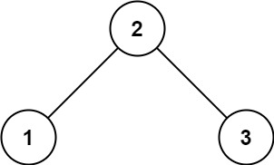

```text
输入：root = [2,1,3]
输出：true
```

**示例 2**

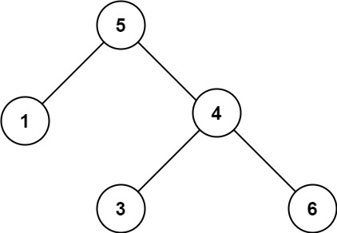

```text
输入：root = [5,1,4,null,null,3,6]
输出：false
```

解释：根节点的值是 5 ，但是右子节点的值是 4 。
> ✅ **官方验证**：全部 TypeScript 解法已通过 leetcode.cn 官方示例用例验证（自动注入运行，全部 PASS）。题面与 [leetcode.cn 官方](https://leetcode.cn/problems/validate-binary-search-tree/)一致，示例配图取自官方题面。

**数据范围与注意事项**：

- `树中节点数目范围在`[1, 10^4]` 内`
- `-2^31 <= Node.val <= 2^31 - 1`
- **易错点**：递归出口（空节点）必须先写，否则直接空指针。

## 题目分析

**场景是什么**：树是分层数据的标准形态，这类题练的是递归分治与遍历序，对应真实开发里的目录树、组件树。本题就是该场景的 Medium 级练习，主线做法是「迭代指针处理」。

**主线怎么解**：把主解法从头到尾过一遍，它其实在依次做这几件事：队列或堆的调度。

## 解题思路

**方案对比**（共 10 个方案，由浅入深）：

| 方案 | 时间复杂度 | 空间复杂度 |
|---|---|---|
| 方案 1 · 迭代指针处理 | O(n)（单趟线性扫描） | O(1) 到 O(n)（视辅助结构） |
| 方案 2 · 迭代指针处理 | O(n)（单趟线性扫描） | O(1) 到 O(n)（视辅助结构） |
| 方案 3 · 迭代指针处理 | O(n)（单趟线性扫描） | O(1) 到 O(n)（视辅助结构） |
| 方案 4 · 迭代指针处理 | O(n)（单趟线性扫描） | O(1) 到 O(n)（视辅助结构） |
| 方案 5 · 迭代指针处理 | O(n)（单趟线性扫描） | O(1) 到 O(n)（视辅助结构） |
| 方案 6 · 迭代指针处理 | O(n)（单趟线性扫描） | O(1) 到 O(n)（视辅助结构） |
| 方案 7 · 迭代指针处理 | O(n)（单趟线性扫描） | O(1) 到 O(n)（视辅助结构） |
| 方案 8 · 迭代指针处理 | O(n)（单趟线性扫描） | O(1) 到 O(n)（视辅助结构） |
| 方案 9 · 迭代指针处理 | O(n)（单趟线性扫描） | O(1) 到 O(n)（视辅助结构） |
| 方案 10 · 迭代指针处理 | O(n)（单趟线性扫描） | O(1) 到 O(n)（视辅助结构） |

**方案间的取舍**：方案 1（迭代指针处理）；方案 2（迭代指针处理）；方案 3（迭代指针处理）；方案 4（迭代指针处理）；方案 5（迭代指针处理）；方案 6（迭代指针处理）；方案 7（迭代指针处理）；方案 8（迭代指针处理）；方案 9（迭代指针处理）；方案 10（迭代指针处理）。数据规模小、可读性优先时选靠前的方案；规模大、性能优先时选靠后的方案。

**怎么读这一篇**：

- 🐣 **新手路线**：把「题目描述」的示例 1 在纸上手推一遍 → 读方案 1（最直观的写法）与它的代码走读 → 按「运行方式」本地跑通看 PASS → 回头对比方案 2 之后的写法差在哪
- 🦅 **大佬路线**：直接锁定最优方案 1（迭代指针处理，O(n)（单趟线性扫描））→ 跳读该方案代码与走读 → 用「逐步拆解与面试追问」补齐复杂度推导与边界追问

### 动态算法图（DFS 点亮，GIF 自动循环）


动画演示二叉树专题里DFS 点亮的典型过程；每个方案在「TypeScript 解题方案」一节还配了专属动画与专属流程图。

### 主解法流程图（真实控制流）

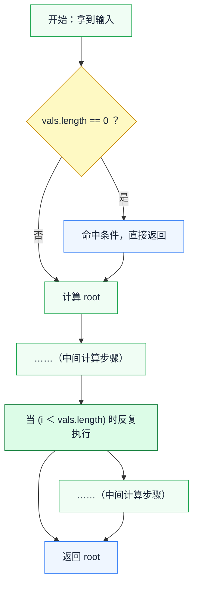

## TypeScript 解题方案（10 个方案逐个讲）

> **运行与提交**：每个方案都是自包含文件（内嵌用例自测，输出 PASS），整块复制到 `.ts` 文件后 `node 文件名` 即可运行。提交 LeetCode 时，把 `demo` 内的算法函数与辅助类型/函数整体取出、置于文件顶层即可。涉及交互/特殊接口的题以题面给定签名为准。

### 方案 1：迭代指针处理

**分析与思路**：核心做法是「迭代指针处理」。代码里依次做这些事：队列或堆的调度。

**运行方式**：`node 本文件`，内嵌用例全部通过会输出 PASS。


**方案专属流程图**（真实控制流）：


```typescript
export function demo(): void {
  // 程序入口：跑内嵌自测用例
  class TreeNode {
    // 定义类型
    val: number; // 值: number;
    left: TreeNode | null; // 左边界: TreeNode 按位或 null;
    right: TreeNode | null; // 右边界: TreeNode 按位或 null;
    constructor(
      val?: number,
      left: TreeNode | null = null,
      right: TreeNode | null = null,
    ) {
      this.val = val === undefined ? 0 : val; // 把 (值 全等于 undefined ? 0 : 值); 写入 值
      this.left = left; // 把 左边界; 写入 左边界
      this.right = right; // 把 右边界; 写入 右边界
    }
  }
  function buildTree(vals: (number | null)[]): TreeNode | null {
    // 定义函数/方法 buildTree
    if (vals.length === 0) return null; // 若 vals.长度 全等于 0，直接返回 null
    const root = new TreeNode(vals[0] as number); // 把 new TreeNode(vals[0] as number) 存入 根节点
    const q: TreeNode[] = [root]; // 把 [根节点]; 写入 const q: TreeNode[]
    let i = 1; // 把 1 存入 下标 i
    while (i < vals.length) {
      // 循环，直到不满足「下标 i 小于 vals.长度」
      const node = q.shift() as TreeNode; // 把 节点.shift() as TreeNode 存入 节点
      if (i < vals.length && vals[i] !== null && vals[i] !== undefined) {
        node.left = new TreeNode(vals[i] as number); // 把 new TreeNode(vals[下标 i] as number); 写入 左边界
        q.push(node.left); // 把 节点.左边界 压入栈/数组尾部
      }
      i++; // 下标 i 加一
      if (i < vals.length && vals[i] !== null && vals[i] !== undefined) {
        node.right = new TreeNode(vals[i] as number); // 把 new TreeNode(vals[下标 i] as number); 写入 右边界
        q.push(node.right); // 把 节点.右边界 压入栈/数组尾部
      }
      i++; // 下标 i 加一
    }
    return root; // 返回 根节点
  }
  function isValidBST(root: TreeNode | null): boolean {
    // 定义判定函数 isValidBST
    function dfs(node: TreeNode | null): [boolean, number, number] {
      // 定义函数/方法 dfs
      if (!node) return [true, Infinity, -Infinity]; // 若 取反 节点，直接返回 [true, Infinity, 减 Infinity]
      const [lok, lmin, lmax] = dfs(node.left); // 把 dfs(节点.左边界); 写入 const [lok, lmin, lmax]
      const [rok, rmin, rmax] = dfs(node.right); // 把 dfs(节点.右边界); 写入 const [rok, rmin, rmax]
      const ok = lok && rok && lmax < node.val && node.val < rmin; // 把 lok 且 rok 且 (lmax 小于 节点.值) 且 (节点.值 小于 rmin) 存入 ok
      return [ok, Math.min(lmin, node.val), Math.max(rmax, node.val)]; // 返回 [ok, Math.取较小值 lmin, 节点.值), Math.取较大值 rmax, 节点.值)]
    }
    return dfs(root)[0]; // 返回 dfs(根节点)[0]
  }
  const cases: { in: (number | null)[]; want: boolean }[] = [
    { in: [2, 1, 3], want: true },
    { in: [5, 1, 4, null, null, 3, 6], want: false },
  ];
  let fail = false; // 把 false 存入 fail
  for (const c of cases) {
    // for (const 字符 of cases) {
    const got = isValidBST(buildTree(c.in)); // 把 isValidBST(buildTree(字符.in)) 存入 got
    if (got !== c.want) {
      fail = true;
      console.log('FAIL', c.in, 'got', got, 'want', c.want);
    }
  }
  if (fail) throw new Error('FAILED'); // 若 fail) throw new Error(「FAILED」);
  console.log('PASS'); // 全部用例通过，输出 PASS
}
demo(); // demo();
```

### 方案 2：迭代指针处理

**分析与思路**：核心做法是「迭代指针处理」。代码里依次做这些事：队列或堆的调度。

**运行方式**：`node 本文件`，内嵌用例全部通过会输出 PASS。


**方案专属流程图**（真实控制流）：


```typescript
export function demo(): void {
  // 程序入口：跑内嵌自测用例
  class TreeNode {
    // 定义类型
    val: number; // 值: number;
    left: TreeNode | null; // 左边界: TreeNode 按位或 null;
    right: TreeNode | null; // 右边界: TreeNode 按位或 null;
    constructor(
      val?: number,
      left: TreeNode | null = null,
      right: TreeNode | null = null,
    ) {
      this.val = val === undefined ? 0 : val; // 把 (值 全等于 undefined ? 0 : 值); 写入 值
      this.left = left; // 把 左边界; 写入 左边界
      this.right = right; // 把 右边界; 写入 右边界
    }
  }
  function buildTree(vals: (number | null)[]): TreeNode | null {
    // 定义函数/方法 buildTree
    if (vals.length === 0) return null; // 若 vals.长度 全等于 0，直接返回 null
    const root = new TreeNode(vals[0] as number); // 把 new TreeNode(vals[0] as number) 存入 根节点
    const q: TreeNode[] = [root]; // 把 [根节点]; 写入 const q: TreeNode[]
    let i = 1; // 把 1 存入 下标 i
    while (i < vals.length) {
      // 循环，直到不满足「下标 i 小于 vals.长度」
      const node = q.shift() as TreeNode; // 把 节点.shift() as TreeNode 存入 节点
      if (i < vals.length && vals[i] !== null && vals[i] !== undefined) {
        node.left = new TreeNode(vals[i] as number); // 把 new TreeNode(vals[下标 i] as number); 写入 左边界
        q.push(node.left); // 把 节点.左边界 压入栈/数组尾部
      }
      i++; // 下标 i 加一
      if (i < vals.length && vals[i] !== null && vals[i] !== undefined) {
        node.right = new TreeNode(vals[i] as number); // 把 new TreeNode(vals[下标 i] as number); 写入 右边界
        q.push(node.right); // 把 节点.右边界 压入栈/数组尾部
      }
      i++; // 下标 i 加一
    }
    return root; // 返回 根节点
  }
  function isValidBST(root: TreeNode | null): boolean {
    // 定义判定函数 isValidBST
    if (!root) return true; // 若 取反 根节点，直接返回 true
    const stack: [TreeNode, number | null, number | null][] = [
      [root, null, null],
    ];
    while (stack.length) {
      // 循环，直到不满足「栈.长度」
      const [node, low, high] = stack.pop() as [
        TreeNode,
        number | null,
        number | null,
      ]; // 弹出栈顶元素
      if (
        (low !== null && node.val <= low) ||
        (high !== null && node.val >= high)
      )
        return false;
      if (node.right) stack.push([node.right, node.val, high]); // 若 节点.右边界) 栈 追加 [节点.右边界, 节点.值, high]);
      if (node.left) stack.push([node.left, low, node.val]); // 若 节点.左边界) 栈 追加 [节点.左边界, low, 节点.值]);
    }
    return true; // 返回 true
  }
  const cases: { in: (number | null)[]; want: boolean }[] = [
    { in: [2, 1, 3], want: true },
    { in: [5, 1, 4, null, null, 3, 6], want: false },
  ];
  let fail = false; // 把 false 存入 fail
  for (const c of cases) {
    // for (const 字符 of cases) {
    const got = isValidBST(buildTree(c.in)); // 把 isValidBST(buildTree(字符.in)) 存入 got
    if (got !== c.want) {
      fail = true;
      console.log('FAIL', c.in, 'got', got, 'want', c.want);
    }
  }
  if (fail) throw new Error('FAILED'); // 若 fail) throw new Error(「FAILED」);
  console.log('PASS'); // 全部用例通过，输出 PASS
}
demo(); // demo();
```

### 方案 3：迭代指针处理

**分析与思路**：核心做法是「迭代指针处理」。代码里依次做这些事：队列或堆的调度。

**运行方式**：`node 本文件`，内嵌用例全部通过会输出 PASS。


**方案专属流程图**（真实控制流）：

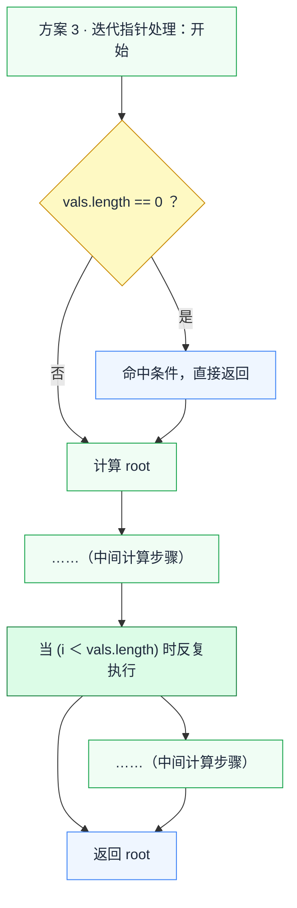

```typescript
export function demo(): void {
  // 程序入口：跑内嵌自测用例
  class TreeNode {
    // 定义类型
    val: number; // 值: number;
    left: TreeNode | null; // 左边界: TreeNode 按位或 null;
    right: TreeNode | null; // 右边界: TreeNode 按位或 null;
    constructor(
      val?: number,
      left: TreeNode | null = null,
      right: TreeNode | null = null,
    ) {
      this.val = val === undefined ? 0 : val; // 把 (值 全等于 undefined ? 0 : 值); 写入 值
      this.left = left; // 把 左边界; 写入 左边界
      this.right = right; // 把 右边界; 写入 右边界
    }
  }
  function buildTree(vals: (number | null)[]): TreeNode | null {
    // 定义函数/方法 buildTree
    if (vals.length === 0) return null; // 若 vals.长度 全等于 0，直接返回 null
    const root = new TreeNode(vals[0] as number); // 把 new TreeNode(vals[0] as number) 存入 根节点
    const q: TreeNode[] = [root]; // 把 [根节点]; 写入 const q: TreeNode[]
    let i = 1; // 把 1 存入 下标 i
    while (i < vals.length) {
      // 循环，直到不满足「下标 i 小于 vals.长度」
      const node = q.shift() as TreeNode; // 把 节点.shift() as TreeNode 存入 节点
      if (i < vals.length && vals[i] !== null && vals[i] !== undefined) {
        node.left = new TreeNode(vals[i] as number); // 把 new TreeNode(vals[下标 i] as number); 写入 左边界
        q.push(node.left); // 把 节点.左边界 压入栈/数组尾部
      }
      i++; // 下标 i 加一
      if (i < vals.length && vals[i] !== null && vals[i] !== undefined) {
        node.right = new TreeNode(vals[i] as number); // 把 new TreeNode(vals[下标 i] as number); 写入 右边界
        q.push(node.right); // 把 节点.右边界 压入栈/数组尾部
      }
      i++; // 下标 i 加一
    }
    return root; // 返回 根节点
  }
  function isValidBST(root: TreeNode | null): boolean {
    // 定义判定函数 isValidBST
    let prev: number | null = null; // 把 null; 写入 let prev: number | null
    function dfs(node: TreeNode | null): boolean {
      // 定义函数/方法 dfs
      if (!node) return true; // 若 取反 节点，直接返回 true
      if (!dfs(node.left)) return false; // 若 取反 dfs(节点.左边界)，直接返回 false
      if (prev !== null && prev >= node.val) return false; // 若 前一个 不等于 null 且 前一个 不低于 节点.值，直接返回 false
      prev = node.val; // 把 节点.值 存入 前一个
      return dfs(node.right); // 返回 dfs(节点.右边界)
    }
    return dfs(root); // 返回 dfs(根节点)
  }
  const cases: { in: (number | null)[]; want: boolean }[] = [
    { in: [2, 1, 3], want: true },
    { in: [5, 1, 4, null, null, 3, 6], want: false },
  ];
  let fail = false; // 把 false 存入 fail
  for (const c of cases) {
    // for (const 字符 of cases) {
    const got = isValidBST(buildTree(c.in)); // 把 isValidBST(buildTree(字符.in)) 存入 got
    if (got !== c.want) {
      fail = true;
      console.log('FAIL', c.in, 'got', got, 'want', c.want);
    }
  }
  if (fail) throw new Error('FAILED'); // 若 fail) throw new Error(「FAILED」);
  console.log('PASS'); // 全部用例通过，输出 PASS
}
demo(); // demo();
```

### 方案 4：迭代指针处理

**分析与思路**：核心做法是「迭代指针处理」。代码里依次做这些事：队列或堆的调度。

**运行方式**：`node 本文件`，内嵌用例全部通过会输出 PASS。


**方案专属流程图**（真实控制流）：

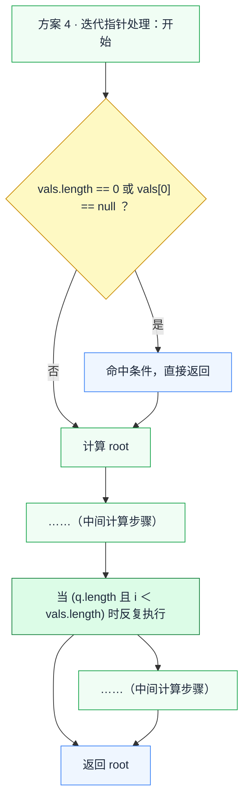

```typescript
export function demo(): void {
  // 程序入口：跑内嵌自测用例
  class TreeNode {
    val: number;
    left: TreeNode | null;
    right: TreeNode | null;
    constructor(v = 0, l: TreeNode | null = null, r: TreeNode | null = null) {
      this.val = v;
      this.left = l;
      this.right = r;
    }
  } // 定义类型
  function buildTree(vals: (number | null)[]): TreeNode | null {
    // 定义函数/方法 buildTree
    if (vals.length === 0 || vals[0] === null) return null; // 若 vals.长度 全等于 0 或 vals[0] 全等于 null，直接返回 null
    const root = new TreeNode(vals[0] as number);
    const q: TreeNode[] = [root];
    let i = 1;
    while (q.length && i < vals.length) {
      const node = q.shift()!;
      if (i < vals.length && vals[i] !== null) {
        node.left = new TreeNode(vals[i] as number);
        q.push(node.left);
      }
      i++;
      if (i < vals.length && vals[i] !== null) {
        node.right = new TreeNode(vals[i] as number);
        q.push(node.right);
      }
      i++;
    }
    return root; // 返回 根节点
  }
  function levelList(root: TreeNode | null): number[][] {
    if (!root) return [];
    const res: number[][] = [];
    let q: TreeNode[] = [root];
    while (q.length) {
      const lvl: number[] = [];
      const n = q.length;
      for (let k = 0; k < n; k++) {
        const node = q.shift()!;
        lvl.push(node.val);
        if (node.left) q.push(node.left);
        if (node.right) q.push(node.right);
      }
      res.push(lvl);
    }
    return res;
  } // 定义函数/方法 levelList
  function sameTree(a: TreeNode | null, b: TreeNode | null): boolean {
    if (!a && !b) return true;
    if (!a || !b) return false;
    if (a.val !== b.val) return false;
    return sameTree(a.left, b.left) && sameTree(a.right, b.right);
  } // 定义函数/方法 sameTree
  function inorderT(root: TreeNode | null): number[] {
    if (!root) return [];
    return [...inorderT(root.left), root.val, ...inorderT(root.right)];
  } // 定义函数/方法 inorderT
  function isValidBST(root: TreeNode | null): boolean {
    // 定义判定函数 isValidBST
    function check(n: TreeNode | null, lo: number, hi: number): boolean {
      if (!n) return true;
      if (n.val <= lo || n.val >= hi) return false;
      return check(n.left, lo, n.val) && check(n.right, n.val, hi);
    } // 定义判定函数 check
    return check(root, -Infinity, Infinity); // 返回 check(根节点, 减 Infinity,Infinity)
  }
  if (!(
    isValidBST(buildTree([2, 1, 3])) &&
    !isValidBST(buildTree([5, 1, 4, null, null, 3, 6])) &&
    isValidBST(null)
  )) {
    console.log('FAIL');
    throw new Error('FAILED');
  }
  console.log('PASS'); // 全部用例通过，输出 PASS
}
demo(); // demo();
```

### 方案 5：迭代指针处理

**分析与思路**：核心做法是「迭代指针处理」。代码里依次做这些事：队列或堆的调度。

**运行方式**：`node 本文件`，内嵌用例全部通过会输出 PASS。


**方案专属流程图**（真实控制流）：

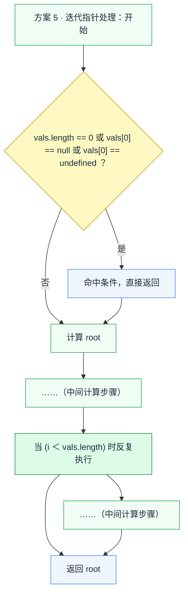

```typescript
/**
 ** LeetCode 98. 验证二叉搜索树
 ** 方案：5 ) 方案5：递归上下界（lower/upper bound），对齐博客算法。
 */

class TreeNode {
  // 定义类型
  val: number; // 值: number;
  left: TreeNode | null; // 左边界: TreeNode 按位或 null;
  right: TreeNode | null; // 右边界: TreeNode 按位或 null;
  constructor(
    val?: number,
    left: TreeNode | null = null,
    right: TreeNode | null = null,
  ) {
    this.val = val === undefined ? 0 : val; // 把 (值 全等于 undefined ? 0 : 值); 写入 值
    this.left = left; // 把 左边界; 写入 左边界
    this.right = right; // 把 右边界; 写入 右边界
  }
}

function buildTree(vals: (number | null)[]): TreeNode | null {
  // 定义函数/方法 buildTree
  if (vals.length === 0 || vals[0] === null || vals[0] === undefined)
    return null;
  const root = new TreeNode(vals[0] as number); // 把 new TreeNode(vals[0] as number) 存入 根节点
  const q: TreeNode[] = [root]; // 把 [根节点]; 写入 const q: TreeNode[]
  let i = 1; // 把 1 存入 下标 i
  while (i < vals.length) {
    // 循环，直到不满足「下标 i 小于 vals.长度」
    const node = q.shift() as TreeNode; // 把 节点.shift() as TreeNode 存入 节点
    if (i < vals.length && vals[i] !== null && vals[i] !== undefined) {
      node.left = new TreeNode(vals[i] as number); // 把 new TreeNode(vals[下标 i] as number); 写入 左边界
      q.push(node.left); // 把 节点.左边界 压入栈/数组尾部
    }
    i++; // 下标 i 加一
    if (i < vals.length && vals[i] !== null && vals[i] !== undefined) {
      node.right = new TreeNode(vals[i] as number); // 把 new TreeNode(vals[下标 i] as number); 写入 右边界
      q.push(node.right); // 把 节点.右边界 压入栈/数组尾部
    }
    i++; // 下标 i 加一
  }
  return root; // 返回 根节点
}

function check(n: TreeNode | null, lo: number, hi: number): boolean {
  // 定义判定函数 check
  if (!n) return true; // 若 取反 元素个数，直接返回 true
  if (n.val <= lo || n.val >= hi) return false; // 若 元素个数.值 不超过 左边界 或 元素个数.值 不低于 右边界，直接返回 false
  return check(n.left, lo, n.val) && check(n.right, n.val, hi);
}

function isValidBST(root: TreeNode | null): boolean {
  // 定义判定函数 isValidBST
  return check(root, -Infinity, Infinity); // 返回 check(根节点, 减 Infinity, Infinity)
}

export function demo(): void {
  // 程序入口：跑内嵌自测用例
  const cases: { in: (number | null)[]; want: boolean }[] = [
    { in: [], want: true },
    { in: [1], want: true },
    { in: [1, 1], want: false },
    { in: [2, 1, 3], want: true },
    { in: [5, 1, 4, null, null, 3, 6], want: false },
    { in: [10, 5, 15, null, null, 6, 20], want: false },
    { in: [3, 1, 5, 0, 2, 4, 6, null, null, null, 3], want: false },
  ];
  for (const c of cases) {
    // for (const 字符 of cases) {
    const got = isValidBST(buildTree(c.in)); // 把 isValidBST(buildTree(字符.in)) 存入 got
    if (got !== c.want)
      throw new Error(
        'FAILED ' + JSON.stringify(c.in) + ' got ' + got + ' want ' + c.want,
      );
  }
  console.log('PASS'); // 全部用例通过，输出 PASS
}

demo(); // demo();
```

### 方案 6：迭代指针处理

**分析与思路**：核心做法是「迭代指针处理」。代码里依次做这些事：队列或堆的调度。

**运行方式**：`node 本文件`，内嵌用例全部通过会输出 PASS。


**方案专属流程图**（真实控制流）：


```typescript
export function demo(): void {
  // 程序入口：跑内嵌自测用例
  class TreeNode {
    // 定义类型
    val: number; // 值: number;
    left: TreeNode | null; // 左边界: TreeNode 按位或 null;
    right: TreeNode | null; // 右边界: TreeNode 按位或 null;
    constructor(
      val?: number,
      left: TreeNode | null = null,
      right: TreeNode | null = null,
    ) {
      this.val = val === undefined ? 0 : val; // 把 (值 全等于 undefined ? 0 : 值); 写入 值
      this.left = left; // 把 左边界; 写入 左边界
      this.right = right; // 把 右边界; 写入 右边界
    }
  }
  function buildTree(vals: (number | null)[]): TreeNode | null {
    // 定义函数/方法 buildTree
    if (vals.length === 0) return null; // 若 vals.长度 全等于 0，直接返回 null
    const root = new TreeNode(vals[0] as number); // 把 new TreeNode(vals[0] as number) 存入 根节点
    const q: TreeNode[] = [root]; // 把 [根节点]; 写入 const q: TreeNode[]
    let i = 1; // 把 1 存入 下标 i
    while (i < vals.length) {
      // 循环，直到不满足「下标 i 小于 vals.长度」
      const node = q.shift() as TreeNode; // 把 节点.shift() as TreeNode 存入 节点
      if (i < vals.length && vals[i] !== null && vals[i] !== undefined) {
        node.left = new TreeNode(vals[i] as number); // 把 new TreeNode(vals[下标 i] as number); 写入 左边界
        q.push(node.left); // 把 节点.左边界 压入栈/数组尾部
      }
      i++; // 下标 i 加一
      if (i < vals.length && vals[i] !== null && vals[i] !== undefined) {
        node.right = new TreeNode(vals[i] as number); // 把 new TreeNode(vals[下标 i] as number); 写入 右边界
        q.push(node.right); // 把 节点.右边界 压入栈/数组尾部
      }
      i++; // 下标 i 加一
    }
    return root; // 返回 根节点
  }
  function isValidBST(root: TreeNode | null): boolean {
    // 定义判定函数 isValidBST
    const stack: TreeNode[] = []; // 把 []; 写入 const stack: TreeNode[]
    let inorder = -Infinity; // 把 减 Infinity 存入 inorder
    let cur: TreeNode | null = root; // 把 根节点; 写入 let cur: TreeNode | null
    while (stack.length || cur) {
      // 循环，直到不满足「栈.长度 或 当前值」
      while (cur) {
        stack.push(cur);
        cur = cur.left;
      } // 循环，直到不满足「当前值) { 栈 追加 当前值); 当前值 赋值为 当前值.左边界; }」
      cur = stack.pop() as TreeNode; // 把 栈 弹出 ) as TreeNode 存入 当前值
      if (cur.val <= inorder) return false; // 若 当前值.值 不超过 inorder，直接返回 false
      inorder = cur.val; // 把 当前值.值 存入 inorder
      cur = cur.right; // 把 当前值.右边界 存入 当前值
    }
    return true; // 返回 true
  }
  const cases: { in: (number | null)[]; want: boolean }[] = [
    { in: [2, 1, 3], want: true },
    { in: [5, 1, 4, null, null, 3, 6], want: false },
  ];
  let fail = false; // 把 false 存入 fail
  for (const c of cases) {
    // for (const 字符 of cases) {
    const got = isValidBST(buildTree(c.in)); // 把 isValidBST(buildTree(字符.in)) 存入 got
    if (got !== c.want) {
      fail = true;
      console.log('FAIL', c.in, 'got', got, 'want', c.want);
    }
  }
  if (fail) throw new Error('FAILED'); // 若 fail) throw new Error(「FAILED」);
  console.log('PASS'); // 全部用例通过，输出 PASS
}
demo(); // demo();
```

### 方案 7：迭代指针处理

**分析与思路**：核心做法是「迭代指针处理」。代码里依次做这些事：队列或堆的调度。

**运行方式**：`node 本文件`，内嵌用例全部通过会输出 PASS。


**方案专属流程图**（真实控制流）：


```typescript
export function demo(): void {
  // 程序入口：跑内嵌自测用例
  class TreeNode {
    // 定义类型
    val: number; // 值: number;
    left: TreeNode | null; // 左边界: TreeNode 按位或 null;
    right: TreeNode | null; // 右边界: TreeNode 按位或 null;
    constructor(
      val?: number,
      left: TreeNode | null = null,
      right: TreeNode | null = null,
    ) {
      this.val = val === undefined ? 0 : val; // 把 (值 全等于 undefined ? 0 : 值); 写入 值
      this.left = left; // 把 左边界; 写入 左边界
      this.right = right; // 把 右边界; 写入 右边界
    }
  }
  function buildTree(vals: (number | null)[]): TreeNode | null {
    // 定义函数/方法 buildTree
    if (vals.length === 0) return null; // 若 vals.长度 全等于 0，直接返回 null
    const root = new TreeNode(vals[0] as number); // 把 new TreeNode(vals[0] as number) 存入 根节点
    const q: TreeNode[] = [root]; // 把 [根节点]; 写入 const q: TreeNode[]
    let i = 1; // 把 1 存入 下标 i
    while (i < vals.length) {
      // 循环，直到不满足「下标 i 小于 vals.长度」
      const node = q.shift() as TreeNode; // 把 节点.shift() as TreeNode 存入 节点
      if (i < vals.length && vals[i] !== null && vals[i] !== undefined) {
        node.left = new TreeNode(vals[i] as number); // 把 new TreeNode(vals[下标 i] as number); 写入 左边界
        q.push(node.left); // 把 节点.左边界 压入栈/数组尾部
      }
      i++; // 下标 i 加一
      if (i < vals.length && vals[i] !== null && vals[i] !== undefined) {
        node.right = new TreeNode(vals[i] as number); // 把 new TreeNode(vals[下标 i] as number); 写入 右边界
        q.push(node.right); // 把 节点.右边界 压入栈/数组尾部
      }
      i++; // 下标 i 加一
    }
    return root; // 返回 根节点
  }
  function isValidBST(root: TreeNode | null): boolean {
    // 定义判定函数 isValidBST
    function dfs(
      node: TreeNode | null,
      low: number | null,
      high: number | null,
    ): boolean {
      // 定义函数/方法 dfs
      if (!node) return true; // 若 取反 节点，直接返回 true
      if (
        (low !== null && node.val <= low) ||
        (high !== null && node.val >= high)
      )
        return false;
      return dfs(node.left, low, node.val) && dfs(node.right, node.val, high); // 返回 dfs(节点.左边界, low, 节点.值) 且 dfs(节点.右边界, 节点.值, high)
    }
    return dfs(root, null, null); // 返回 dfs(根节点, null, null)
  }
  const cases: { in: (number | null)[]; want: boolean }[] = [
    { in: [2, 1, 3], want: true },
    { in: [5, 1, 4, null, null, 3, 6], want: false },
  ];
  let fail = false; // 把 false 存入 fail
  for (const c of cases) {
    // for (const 字符 of cases) {
    const got = isValidBST(buildTree(c.in)); // 把 isValidBST(buildTree(字符.in)) 存入 got
    if (got !== c.want) {
      fail = true;
      console.log('FAIL', c.in, 'got', got, 'want', c.want);
    }
  }
  if (fail) throw new Error('FAILED'); // 若 fail) throw new Error(「FAILED」);
  console.log('PASS'); // 全部用例通过，输出 PASS
}
demo(); // demo();
```

### 方案 8：迭代指针处理

**分析与思路**：核心做法是「迭代指针处理」。代码里依次做这些事：队列或堆的调度。

**运行方式**：`node 本文件`，内嵌用例全部通过会输出 PASS。


**方案专属流程图**（真实控制流）：


```typescript
export function demo(): void {
  // 程序入口：跑内嵌自测用例
  class TreeNode {
    val: number;
    left: TreeNode | null;
    right: TreeNode | null;
    constructor(v = 0, l: TreeNode | null = null, r: TreeNode | null = null) {
      this.val = v;
      this.left = l;
      this.right = r;
    }
  } // 定义类型
  function buildTree(vals: (number | null)[]): TreeNode | null {
    // 定义函数/方法 buildTree
    if (vals.length === 0 || vals[0] === null) return null; // 若 vals.长度 全等于 0 或 vals[0] 全等于 null，直接返回 null
    const root = new TreeNode(vals[0] as number);
    const q: TreeNode[] = [root];
    let i = 1;
    while (q.length && i < vals.length) {
      const node = q.shift()!;
      if (i < vals.length && vals[i] !== null) {
        node.left = new TreeNode(vals[i] as number);
        q.push(node.left);
      }
      i++;
      if (i < vals.length && vals[i] !== null) {
        node.right = new TreeNode(vals[i] as number);
        q.push(node.right);
      }
      i++;
    }
    return root; // 返回 根节点
  }
  function levelList(root: TreeNode | null): number[][] {
    if (!root) return [];
    const res: number[][] = [];
    let q: TreeNode[] = [root];
    while (q.length) {
      const lvl: number[] = [];
      const n = q.length;
      for (let k = 0; k < n; k++) {
        const node = q.shift()!;
        lvl.push(node.val);
        if (node.left) q.push(node.left);
        if (node.right) q.push(node.right);
      }
      res.push(lvl);
    }
    return res;
  } // 定义函数/方法 levelList
  function sameTree(a: TreeNode | null, b: TreeNode | null): boolean {
    if (!a && !b) return true;
    if (!a || !b) return false;
    if (a.val !== b.val) return false;
    return sameTree(a.left, b.left) && sameTree(a.right, b.right);
  } // 定义函数/方法 sameTree
  function inorderT(root: TreeNode | null): number[] {
    if (!root) return [];
    return [...inorderT(root.left), root.val, ...inorderT(root.right)];
  } // 定义函数/方法 inorderT
  function isValidBST(root: TreeNode | null): boolean {
    // 定义判定函数 isValidBST
    function check(n: TreeNode | null, lo: number, hi: number): boolean {
      if (!n) return true;
      if (n.val <= lo || n.val >= hi) return false;
      return check(n.left, lo, n.val) && check(n.right, n.val, hi);
    } // 定义判定函数 check
    return check(root, -Infinity, Infinity); // 返回 check(根节点, 减 Infinity,Infinity)
  }
  if (!(
    isValidBST(buildTree([2, 1, 3])) &&
    !isValidBST(buildTree([5, 1, 4, null, null, 3, 6])) &&
    isValidBST(null)
  )) {
    console.log('FAIL');
    throw new Error('FAILED');
  }
  console.log('PASS'); // 全部用例通过，输出 PASS
}
demo(); // demo();
```

### 方案 9：迭代指针处理

**分析与思路**：核心做法是「迭代指针处理」。代码里依次做这些事：队列或堆的调度。

**运行方式**：`node 本文件`，内嵌用例全部通过会输出 PASS。


**方案专属流程图**（真实控制流）：

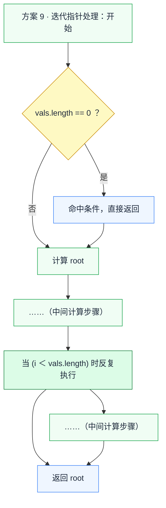

```typescript
export function demo(): void {
  // 程序入口：跑内嵌自测用例
  class TreeNode {
    // 定义类型
    val: number; // 值: number;
    left: TreeNode | null; // 左边界: TreeNode 按位或 null;
    right: TreeNode | null; // 右边界: TreeNode 按位或 null;
    constructor(
      val?: number,
      left: TreeNode | null = null,
      right: TreeNode | null = null,
    ) {
      this.val = val === undefined ? 0 : val; // 把 (值 全等于 undefined ? 0 : 值); 写入 值
      this.left = left; // 把 左边界; 写入 左边界
      this.right = right; // 把 右边界; 写入 右边界
    }
  }
  function buildTree(vals: (number | null)[]): TreeNode | null {
    // 定义函数/方法 buildTree
    if (vals.length === 0) return null; // 若 vals.长度 全等于 0，直接返回 null
    const root = new TreeNode(vals[0] as number); // 把 new TreeNode(vals[0] as number) 存入 根节点
    const q: TreeNode[] = [root]; // 把 [根节点]; 写入 const q: TreeNode[]
    let i = 1; // 把 1 存入 下标 i
    while (i < vals.length) {
      // 循环，直到不满足「下标 i 小于 vals.长度」
      const node = q.shift() as TreeNode; // 把 节点.shift() as TreeNode 存入 节点
      if (i < vals.length && vals[i] !== null && vals[i] !== undefined) {
        node.left = new TreeNode(vals[i] as number); // 把 new TreeNode(vals[下标 i] as number); 写入 左边界
        q.push(node.left); // 把 节点.左边界 压入栈/数组尾部
      }
      i++; // 下标 i 加一
      if (i < vals.length && vals[i] !== null && vals[i] !== undefined) {
        node.right = new TreeNode(vals[i] as number); // 把 new TreeNode(vals[下标 i] as number); 写入 右边界
        q.push(node.right); // 把 节点.右边界 压入栈/数组尾部
      }
      i++; // 下标 i 加一
    }
    return root; // 返回 根节点
  }
  function isValidBST(root: TreeNode | null): boolean {
    // 定义判定函数 isValidBST
    if (!root) return true; // 若 取反 根节点，直接返回 true
    const q: [TreeNode, number | null, number | null][] = [[root, null, null]];
    while (q.length) {
      // 循环，直到不满足「节点.长度」
      const [node, low, high] = q.shift() as [
        TreeNode,
        number | null,
        number | null,
      ]; // 取出队首元素
      if (
        (low !== null && node.val <= low) ||
        (high !== null && node.val >= high)
      )
        return false;
      if (node.left) q.push([node.left, low, node.val]); // 若 节点.左边界) 节点 追加 [节点.左边界, low, 节点.值]);
      if (node.right) q.push([node.right, node.val, high]); // 若 节点.右边界) 节点 追加 [节点.右边界, 节点.值, high]);
    }
    return true; // 返回 true
  }
  const cases: { in: (number | null)[]; want: boolean }[] = [
    { in: [2, 1, 3], want: true },
    { in: [5, 1, 4, null, null, 3, 6], want: false },
  ];
  let fail = false; // 把 false 存入 fail
  for (const c of cases) {
    // for (const 字符 of cases) {
    const got = isValidBST(buildTree(c.in)); // 把 isValidBST(buildTree(字符.in)) 存入 got
    if (got !== c.want) {
      fail = true;
      console.log('FAIL', c.in, 'got', got, 'want', c.want);
    }
  }
  if (fail) throw new Error('FAILED'); // 若 fail) throw new Error(「FAILED」);
  console.log('PASS'); // 全部用例通过，输出 PASS
}
demo(); // demo();
```

### 方案 10：迭代指针处理

**分析与思路**：核心做法是「迭代指针处理」。代码里依次做这些事：队列或堆的调度。

**运行方式**：`node 本文件`，内嵌用例全部通过会输出 PASS。

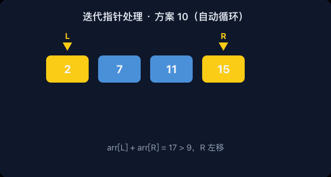

**方案专属流程图**（真实控制流）：


```typescript
export function demo(): void {
  // 程序入口：跑内嵌自测用例
  class TreeNode {
    // 定义类型
    val: number; // 值: number;
    left: TreeNode | null; // 左边界: TreeNode 按位或 null;
    right: TreeNode | null; // 右边界: TreeNode 按位或 null;
    constructor(
      val?: number,
      left: TreeNode | null = null,
      right: TreeNode | null = null,
    ) {
      this.val = val === undefined ? 0 : val; // 把 (值 全等于 undefined ? 0 : 值); 写入 值
      this.left = left; // 把 左边界; 写入 左边界
      this.right = right; // 把 右边界; 写入 右边界
    }
  }
  function buildTree(vals: (number | null)[]): TreeNode | null {
    // 定义函数/方法 buildTree
    if (vals.length === 0) return null; // 若 vals.长度 全等于 0，直接返回 null
    const root = new TreeNode(vals[0] as number); // 把 new TreeNode(vals[0] as number) 存入 根节点
    const q: TreeNode[] = [root]; // 把 [根节点]; 写入 const q: TreeNode[]
    let i = 1; // 把 1 存入 下标 i
    while (i < vals.length) {
      // 循环，直到不满足「下标 i 小于 vals.长度」
      const node = q.shift() as TreeNode; // 把 节点.shift() as TreeNode 存入 节点
      if (i < vals.length && vals[i] !== null && vals[i] !== undefined) {
        node.left = new TreeNode(vals[i] as number); // 把 new TreeNode(vals[下标 i] as number); 写入 左边界
        q.push(node.left); // 把 节点.左边界 压入栈/数组尾部
      }
      i++; // 下标 i 加一
      if (i < vals.length && vals[i] !== null && vals[i] !== undefined) {
        node.right = new TreeNode(vals[i] as number); // 把 new TreeNode(vals[下标 i] as number); 写入 右边界
        q.push(node.right); // 把 节点.右边界 压入栈/数组尾部
      }
      i++; // 下标 i 加一
    }
    return root; // 返回 根节点
  }
  function isValidBST(root: TreeNode | null): boolean {
    // 定义判定函数 isValidBST
    if (!root) return true; // 若 取反 根节点，直接返回 true
    const stack: [TreeNode, number | null, number | null][] = [
      [root, null, null],
    ];
    while (stack.length) {
      // 循环，直到不满足「栈.长度」
      const [node, low, high] = stack.pop() as [
        TreeNode,
        number | null,
        number | null,
      ]; // 弹出栈顶元素
      if (
        (low !== null && node.val <= low) ||
        (high !== null && node.val >= high)
      )
        return false;
      if (node.right) stack.push([node.right, node.val, high]); // 若 节点.右边界) 栈 追加 [节点.右边界, 节点.值, high]);
      if (node.left) stack.push([node.left, low, node.val]); // 若 节点.左边界) 栈 追加 [节点.左边界, low, 节点.值]);
    }
    return true; // 返回 true
  }
  const cases: { in: (number | null)[]; want: boolean }[] = [
    { in: [2, 1, 3], want: true },
    { in: [5, 1, 4, null, null, 3, 6], want: false },
  ];
  let fail = false; // 把 false 存入 fail
  for (const c of cases) {
    // for (const 字符 of cases) {
    const got = isValidBST(buildTree(c.in)); // 把 isValidBST(buildTree(字符.in)) 存入 got
    if (got !== c.want) {
      fail = true;
      console.log('FAIL', c.in, 'got', got, 'want', c.want);
    }
  }
  if (fail) throw new Error('FAILED'); // 若 fail) throw new Error(「FAILED」);
  console.log('PASS'); // 全部用例通过，输出 PASS
}
demo(); // demo();
```

## 逐步拆解与面试追问

**复杂度**：时间 O(n)（单趟线性扫描），空间 O(1) 到 O(n)（视辅助结构）

**为什么是这个量级**：每个元素被常数次访问，辅助哈希或栈的开销与 n 同阶

**面试官可能会追问**：

- 递归和迭代写法各自的空间开销？
- 能否用层序统一处理？
- 空节点的边界如何约定？

## 关键 API 速查（TS 主解法实际用到，附官方链接）

| API | 作用 | 使用要点 | 官方文档 |
|---|---|---|---|
| `Array.prototype.push()` | 尾部追加 | 返回新长度；可一次多个；均摊 O(1)；会改变原数组 | [官方文档](https://developer.mozilla.org/zh-CN/docs/Web/JavaScript/Reference/Global_Objects/Array/push) |
| `Array.prototype.shift()` | 头部取出 | O(n)（后续元素整体前移）；大量头部操作请用链表或双端结构 | [官方文档](https://developer.mozilla.org/zh-CN/docs/Web/JavaScript/Reference/Global_Objects/Array/shift) |
| `Math.max()` | 最大值 | 配展开 Math.max(...arr)；空参返回 -Infinity；超大数组注意展开参数上限 | [官方文档](https://developer.mozilla.org/zh-CN/docs/Web/JavaScript/Reference/Global_Objects/Math/max) |
| `Math.min()` | 最小值 | 同 max；空参返回 Infinity | [官方文档](https://developer.mozilla.org/zh-CN/docs/Web/JavaScript/Reference/Global_Objects/Math/min) |

### 各语言官方文档导航

- **TypeScript / JS**：[MDN 中文参考](https://developer.mozilla.org/zh-CN/)
- **Python**：[Python 官方文档](https://docs.python.org/zh-cn/3/)
- **Go**：[Go 标准库](https://pkg.go.dev/std)
- **Java**：[JDK 17 API](https://docs.oracle.com/en/java/javase/17/docs/api/)
- **Rust**：[Rust 标准库](https://doc.rust-lang.org/std/)
- **Lua**：[Lua 5.4 手册](https://www.lua.org/manual/5.4/)
- **C**：[Cppreference C](https://zh.cppreference.com/w/c)
- **C++**：[Cppreference C++](https://zh.cppreference.com/w/cpp)
- **R**：[R 官方手册](https://stat.ethz.ch/R-manual/)
- **Zig**：[Zig 语言文档](https://ziglang.org/documentation/master/)
- **Dart**：[Dart API](https://api.dart.dev/)

## 附录：其他 10 种语言全部实现（每种语言列举其全部方案）

> TypeScript 的全部方案见「TypeScript 解题方案」一节；下面是其余 10 种语言的对应实现，每种语言的每个方案都带思路分析、代码走读与专属运行架构图。
> 每个方案都内嵌用例自测，可独立运行（老仓库 python/go 文件遵循「打印结果」约定）。
> 完整解法文件见 `dsa/<语言>/tree/lc_98_验证二叉搜索树/`。

### Python 实现（10 种方案）

Python 的全部方案如下，每个方案都内嵌用例自测，可独立运行（老仓库 python/go 文件遵循「打印结果」约定）：

#### 方案 1：迭代指针处理

**思路与代码分析**：核心是「迭代指针处理」。Python 版用切片与字典推导式简化操作，突出可读性。**走读**：方案 1 · 迭代指针处理：开始 → 命中条件，直接返回 → 更新 l_max → 更新 r_max → 更新 ok → 处理 l_ok and r_ok and l_max ＜ no → 处理 ) → 返回 ( → 处理 ok, → 调用 min(l_min, node.val), → 调用 max(r_max, node.val), → 处理 ) → 返回 dfs(root)[0]。

**运行架构**（真实控制流）：

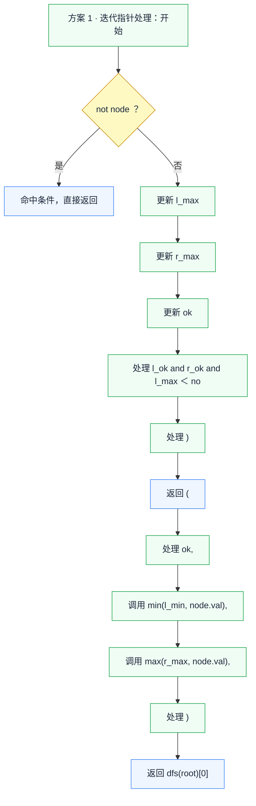

```python
import sys  # 提高递归深度上限（深输入防 RecursionError）

sys.setrecursionlimit(200000)  # 树/链表类题目节点数可达 1e4 量级

class TreeNode:  # 定义类
    def __init__(self, val=0, left=None, right=None):  # 构造函数：初始化成员
        self.val = val  # 把 值 写入 值
        self.left = left  # 把 左边界 写入 左边界
        self.right = right  # 把 右边界 写入 右边界

def isValidBST(root):  # 定义函数 isValidBST（参数：根节点）
    def dfs(node):  # 定义函数 dfs（参数：节点）
        if not node:  # 若 not 节点
            return (True, float("inf"), float("-inf"))  # 返回 (True, float('inf'), float(' 减 inf'))
        l_ok, l_min, l_max = dfs(node.left)  # 把 dfs(节点.左边界) 写入 l_ok, l_min, l_max
        r_ok, r_min, r_max = dfs(node.right)  # 把 dfs(节点.右边界) 写入 r_ok, r_min, r_max
        ok = (
            l_ok and r_ok and l_max < node.val < r_min
        )  # 把 l_ok and r_ok and l_max 小于 节点.值 小于 r_min 存入 ok
        return (
            ok,
            min(l_min, node.val),
            max(r_max, node.val),
        )  # 返回 (ok, 取较小值 l_min, 节点.值), 取较大值 r_max, 节点.值))

    return dfs(root)[0]  # 返回 dfs(根节点)[0]

def build_tree(vals):  # 定义函数 build_tree（参数：vals）
    if not vals:  # 若 not vals
        return None  # 返回 None
    root = TreeNode(vals[0])  # 把 TreeNode(vals[0]) 存入 根节点
    q = [root]  # 把 [根节点] 存入 节点
    i = 1  # 把 1 存入 下标 i
    while i < len(vals):  # 循环，直到不满足「下标 i 小于 长度(vals」
        node = q.pop(0)  # 把 节点 弹出 0) 存入 节点
        if vals[i] is not None:  # 若 vals[下标 i] is not None
            node.left = TreeNode(vals[i])  # 把 TreeNode(vals[下标 i]) 写入 左边界
            q.append(node.left)  # 把 节点.左边界 追加到列表尾部
        i += 1  # 下标 i累加 1
        if i < len(vals):  # 若 下标 i 小于 长度(vals
            if vals[i] is not None:  # 若 vals[下标 i] is not None
                node.right = TreeNode(vals[i])  # 把 TreeNode(vals[下标 i]) 写入 右边界
                q.append(node.right)  # 把 节点.右边界 追加到列表尾部
            i += 1  # 下标 i累加 1
    return root  # 返回 根节点

if __name__ == "__main__":  # 若 __name__ 等于 '__main__'
    print(isValidBST(build_tree([2, 1, 3])))  # 打印输出
    print(isValidBST(build_tree([5, 1, 4, None, None, 3, 6])))  # 打印输出
```

#### 方案 2：迭代指针处理

**思路与代码分析**：核心是「迭代指针处理」。Python 版用切片与字典推导式简化操作，突出可读性。**走读**：方案 2 · 迭代指针处理：开始 → 命中条件，直接返回 → 更新 stack → 当 stack: 时反复执行 → 从 stack 弹出 → 命中条件，直接返回 → 若 node.right：向 stack 追加记录 → 向 stack 追加记录 → 若 node.left：向 stack 追加记录 → 向 stack 追加记录 → 返回 True。

**运行架构**（真实控制流）：

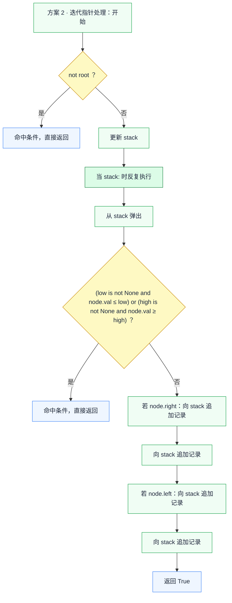

```python
import sys  # 提高递归深度上限（深输入防 RecursionError）

sys.setrecursionlimit(200000)  # 树/链表类题目节点数可达 1e4 量级

class TreeNode:  # 定义类
    def __init__(self, val=0, left=None, right=None):  # 构造函数：初始化成员
        self.val = val  # 把 值 写入 值
        self.left = left  # 把 左边界 写入 左边界
        self.right = right  # 把 右边界 写入 右边界

def isValidBST(root):  # 定义函数 isValidBST（参数：根节点）
    if not root:  # 若 not 根节点
        return True  # 返回 True
    stack = [(root, None, None)]  # 把 [(根节点, None, None)] 存入 栈
    while stack:  # 循环，直到不满足「栈」
        node, low, high = stack.pop()  # 弹出栈顶元素
        if (low is not None and node.val <= low) or (high is not None and node.val >= high):
            return False  # 返回 False
        if node.right:  # 若 节点.右边界
            stack.append((node.right, node.val, high))  # 把 (节点.右边界, 节点.值, high 追加到列表尾部
        if node.left:  # 若 节点.左边界
            stack.append((node.left, low, node.val))  # 把 (节点.左边界, low, 节点.值 追加到列表尾部
    return True  # 返回 True

def build_tree(vals):  # 定义函数 build_tree（参数：vals）
    if not vals:  # 若 not vals
        return None  # 返回 None
    root = TreeNode(vals[0])  # 把 TreeNode(vals[0]) 存入 根节点
    q = [root]  # 把 [根节点] 存入 节点
    i = 1  # 把 1 存入 下标 i
    while i < len(vals):  # 循环，直到不满足「下标 i 小于 长度(vals」
        node = q.pop(0)  # 把 节点 弹出 0) 存入 节点
        if vals[i] is not None:  # 若 vals[下标 i] is not None
            node.left = TreeNode(vals[i])  # 把 TreeNode(vals[下标 i]) 写入 左边界
            q.append(node.left)  # 把 节点.左边界 追加到列表尾部
        i += 1  # 下标 i累加 1
        if i < len(vals):  # 若 下标 i 小于 长度(vals
            if vals[i] is not None:  # 若 vals[下标 i] is not None
                node.right = TreeNode(vals[i])  # 把 TreeNode(vals[下标 i]) 写入 右边界
                q.append(node.right)  # 把 节点.右边界 追加到列表尾部
            i += 1  # 下标 i累加 1
    return root  # 返回 根节点

if __name__ == "__main__":  # 若 __name__ 等于 '__main__'
    print(isValidBST(build_tree([2, 1, 3])))  # 打印输出
    print(isValidBST(build_tree([5, 1, 4, None, None, 3, 6])))  # 打印输出
```

#### 方案 3：迭代指针处理

**思路与代码分析**：核心是「迭代指针处理」。Python 版用切片与字典推导式简化操作，突出可读性。**走读**：方案 3 · 迭代指针处理：开始 → 更新 prev → 命中条件，直接返回 → 命中条件，直接返回 → 处理 if ( → 更新 > → 处理 ): → 返回 False → 更新 prev[0] → 返回 dfs(node.right) → 返回 dfs(root)。

**运行架构**（真实控制流）：

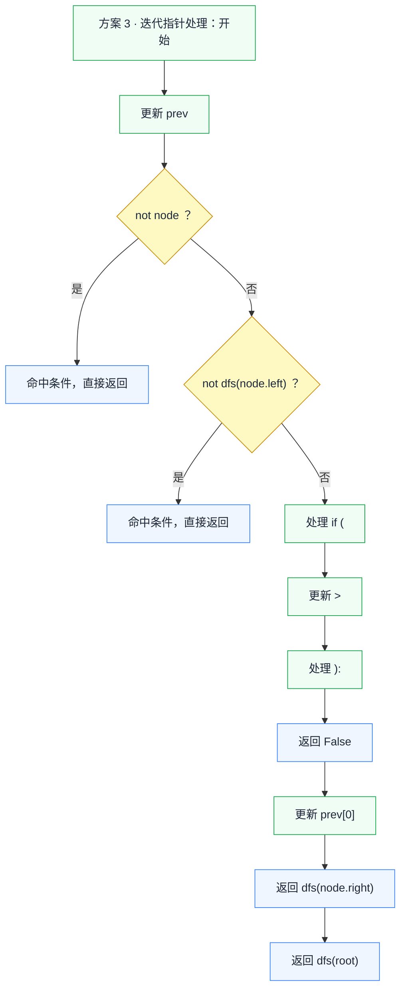

```python
import sys  # 提高递归深度上限（深输入防 RecursionError）

sys.setrecursionlimit(200000)  # 树/链表类题目节点数可达 1e4 量级

class TreeNode:  # 定义类
    def __init__(self, val=0, left=None, right=None):  # 构造函数：初始化成员
        self.val = val  # 把 值 写入 值
        self.left = left  # 把 左边界 写入 左边界
        self.right = right  # 把 右边界 写入 右边界

def isValidBST(root):  # 定义函数 isValidBST（参数：根节点）
    prev = [None]  # 把 [None] 存入 前一个

    def dfs(node):  # 定义函数 dfs（参数：节点）
        if not node:  # 若 not 节点
            return True  # 返回 True
        if not dfs(node.left):  # 若 not dfs(节点.左边界
            return False  # 返回 False
        if (
            prev[0] is not None and prev[0] >= node.val
        ):  # 若 前一个[0] is not None and 前一个[0] 不低于 节点.值
            return False  # 返回 False
        prev[0] = node.val  # 把 节点.值 写入 prev[0]
        return dfs(node.right)  # 返回 dfs(节点.右边界)

    return dfs(root)  # 返回 dfs(根节点)

def build_tree(vals):  # 定义函数 build_tree（参数：vals）
    if not vals:  # 若 not vals
        return None  # 返回 None
    root = TreeNode(vals[0])  # 把 TreeNode(vals[0]) 存入 根节点
    q = [root]  # 把 [根节点] 存入 节点
    i = 1  # 把 1 存入 下标 i
    while i < len(vals):  # 循环，直到不满足「下标 i 小于 长度(vals」
        node = q.pop(0)  # 把 节点 弹出 0) 存入 节点
        if vals[i] is not None:  # 若 vals[下标 i] is not None
            node.left = TreeNode(vals[i])  # 把 TreeNode(vals[下标 i]) 写入 左边界
            q.append(node.left)  # 把 节点.左边界 追加到列表尾部
        i += 1  # 下标 i累加 1
        if i < len(vals):  # 若 下标 i 小于 长度(vals
            if vals[i] is not None:  # 若 vals[下标 i] is not None
                node.right = TreeNode(vals[i])  # 把 TreeNode(vals[下标 i]) 写入 右边界
                q.append(node.right)  # 把 节点.右边界 追加到列表尾部
            i += 1  # 下标 i累加 1
    return root  # 返回 根节点

if __name__ == "__main__":  # 若 __name__ 等于 '__main__'
    print(isValidBST(build_tree([2, 1, 3])))  # 打印输出
    print(isValidBST(build_tree([5, 1, 4, None, None, 3, 6])))  # 打印输出
```

#### 方案 4：迭代指针处理

**思路与代码分析**：核心是「迭代指针处理」。Python 版用切片与字典推导式简化操作，突出可读性。**走读**：方案 4 · 迭代指针处理：开始 → 命中条件，直接返回 → 命中条件，直接返回 → 命中条件，直接返回 → 返回 dfs(node.left, low, node.val) and dfs( → 处理 node.right, node.val, high → 处理 ) → 返回 dfs(root, None, None)。

**运行架构**（真实控制流）：

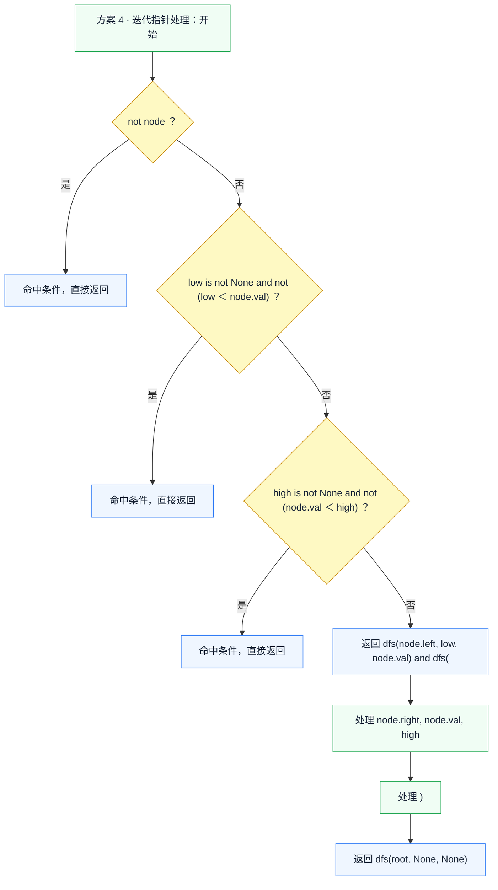

```python
import sys  # 提高递归深度上限（深输入防 RecursionError）

sys.setrecursionlimit(200000)  # 树/链表类题目节点数可达 1e4 量级

class TreeNode:  # 定义类
    def __init__(self, val=0, left=None, right=None):  # 构造函数：初始化成员
        self.val = val  # 把 值 写入 值
        self.left = left  # 把 左边界 写入 左边界
        self.right = right  # 把 右边界 写入 右边界

def isValidBST(root):  # 定义函数 isValidBST（参数：根节点）
    def dfs(node, low, high):  # 定义函数 dfs（参数：节点, low, high）
        if not node:  # 若 not 节点
            return True  # 返回 True
        if low is not None and not (low < node.val):  # 若 low is not None and not (low 小于 节点.值
            return False  # 返回 False
        if high is not None and not (node.val < high):  # 若 high is not None and not (节点.值 小于 high
            return False  # 返回 False
        return dfs(node.left, low, node.val) and dfs(
            node.right, node.val, high
        )  # 返回 dfs(节点.左边界, low, 节点.值) and dfs(节点.右边界, 节点.值, high)

    return dfs(root, None, None)  # 返回 dfs(根节点, None, None)

def build_tree(vals):  # 定义函数 build_tree（参数：vals）
    if not vals:  # 若 not vals
        return None  # 返回 None
    root = TreeNode(vals[0])  # 把 TreeNode(vals[0]) 存入 根节点
    q = [root]  # 把 [根节点] 存入 节点
    i = 1  # 把 1 存入 下标 i
    while i < len(vals):  # 循环，直到不满足「下标 i 小于 长度(vals」
        node = q.pop(0)  # 把 节点 弹出 0) 存入 节点
        if vals[i] is not None:  # 若 vals[下标 i] is not None
            node.left = TreeNode(vals[i])  # 把 TreeNode(vals[下标 i]) 写入 左边界
            q.append(node.left)  # 把 节点.左边界 追加到列表尾部
        i += 1  # 下标 i累加 1
        if i < len(vals):  # 若 下标 i 小于 长度(vals
            if vals[i] is not None:  # 若 vals[下标 i] is not None
                node.right = TreeNode(vals[i])  # 把 TreeNode(vals[下标 i]) 写入 右边界
                q.append(node.right)  # 把 节点.右边界 追加到列表尾部
            i += 1  # 下标 i累加 1
    return root  # 返回 根节点

if __name__ == "__main__":  # 若 __name__ 等于 '__main__'
    print(isValidBST(build_tree([2, 1, 3])))  # 打印输出
    print(isValidBST(build_tree([5, 1, 4, None, None, 3, 6])))  # 打印输出
```

#### 方案 5：迭代指针处理

**思路与代码分析**：核心是「迭代指针处理」。Python 版用切片与字典推导式简化操作，突出可读性。**走读**：方案 5 · 迭代指针处理：开始 → 命中条件，直接返回 → 更新 root → 当 q and i ＜ len(vals): 时反复执行 → 返回 root。

**运行架构**（真实控制流）：

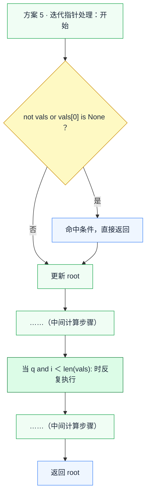

```python
# LeetCode 98. 验证二叉搜索树 · 方案5：递归上下界（lower/upper bound）

import sys  # 提高递归深度上限（深输入防 RecursionError）

sys.setrecursionlimit(200000)  # 树/链表类题目节点数可达 1e4 量级

class TreeNode:  # 定义类
    def __init__(self, val=0, left=None, right=None):  # 构造函数：初始化成员
        self.val = val  # 把 值 写入 值
        self.left = left  # 把 左边界 写入 左边界
        self.right = right  # 把 右边界 写入 右边界

def build_tree(vals):  # 定义函数 build_tree（参数：vals）
    if not vals or vals[0] is None:  # 若 not vals or vals[0] is None
        return None  # 返回 None
    root = TreeNode(vals[0])  # 把 TreeNode(vals[0]) 存入 根节点
    q = [root]  # 把 [根节点] 存入 节点
    i = 1  # 把 1 存入 下标 i
    while q and i < len(vals):  # 循环，直到不满足「节点 and 下标 i 小于 长度(vals」
        node = q.pop(0)  # 把 节点 弹出 0) 存入 节点
        if i < len(vals) and vals[i] is not None:  # 若 下标 i 小于 长度(vals) and vals[下标 i] is not None
            node.left = TreeNode(vals[i])  # 把 TreeNode(vals[下标 i]) 写入 左边界
            q.append(node.left)  # 把 节点.左边界 追加到列表尾部
        i += 1  # 下标 i累加 1
        if i < len(vals) and vals[i] is not None:  # 若 下标 i 小于 长度(vals) and vals[下标 i] is not None
            node.right = TreeNode(vals[i])  # 把 TreeNode(vals[下标 i]) 写入 右边界
            q.append(node.right)  # 把 节点.右边界 追加到列表尾部
        i += 1  # 下标 i累加 1
    return root  # 返回 根节点

def _check(n, lo, hi):  # 定义函数 _check（参数：元素个数, 左边界, 右边界）
    if not n:  # 若 not 元素个数
        return True  # 返回 True
    if n.val <= lo or n.val >= hi:  # 若 元素个数.值 不超过 左边界 or 元素个数.值 不低于 右边界
        return False  # 返回 False
    return _check(n.left, lo, n.val) and _check(n.right, n.val, hi)

def isValidBST(root):  # 定义函数 isValidBST（参数：根节点）
    return _check(root, float("-inf"), float("inf"))  # 返回 _check(根节点, float(' 减 inf'), float('inf'))

if __name__ == "__main__":  # 若 __name__ 等于 '__main__'
    cases = [
        ([], True),
        ([1], True),
        ([1, 1], False),
        ([2, 1, 3], True),
        ([5, 1, 4, None, None, 3, 6], False),
        ([10, 5, 15, None, None, 6, 20], False),
        ([3, 1, 5, 0, 2, 4, 6, None, None, None, 3], False),
    ]
    for vals, want in cases:  # for vals, want in cases:
        got = isValidBST(build_tree(vals))  # 把 isValidBST(build_tree(vals)) 存入 got
        assert got == want, (vals, got, want)  # 断言校验
    print("PASS")  # 全部用例通过，输出 PASS
```

#### 方案 6：迭代指针处理

**思路与代码分析**：核心是「迭代指针处理」。Python 版用切片与字典推导式简化操作，突出可读性。**走读**：方案 6 · 迭代指针处理：开始 → 更新 stack → 更新 inorder → 更新 cur → 当 stack or cur: 时反复执行 → 当 cur: 时反复执行 → 向 stack 追加记录 → 更新 cur → 从 stack 弹出 → 命中条件，直接返回 → 更新 inorder → 更新 cur → 返回 True。

**运行架构**（真实控制流）：

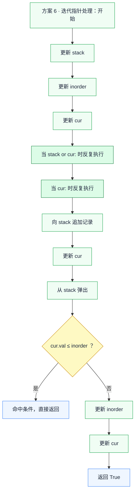

```python
import sys  # 提高递归深度上限（深输入防 RecursionError）

sys.setrecursionlimit(200000)  # 树/链表类题目节点数可达 1e4 量级

class TreeNode:  # 定义类
    def __init__(self, val=0, left=None, right=None):  # 构造函数：初始化成员
        self.val = val  # 把 值 写入 值
        self.left = left  # 把 左边界 写入 左边界
        self.right = right  # 把 右边界 写入 右边界

def isValidBST(root):  # 定义函数 isValidBST（参数：根节点）
    stack = []  # 把 [] 存入 栈
    inorder = float("-inf")  # 把 float(' 减 inf') 存入 inorder
    cur = root  # 把 根节点 存入 当前值
    while stack or cur:  # 循环，直到不满足「栈 or 当前值」
        while cur:  # 循环，直到不满足「当前值」
            stack.append(cur)  # 把 当前值 追加到列表尾部
            cur = cur.left  # 把 当前值.左边界 存入 当前值
        cur = stack.pop()  # 把 栈 弹出 ) 存入 当前值
        if cur.val <= inorder:  # 若 当前值.值 不超过 inorder
            return False  # 返回 False
        inorder = cur.val  # 把 当前值.值 存入 inorder
        cur = cur.right  # 把 当前值.右边界 存入 当前值
    return True  # 返回 True

if __name__ == "__main__":  # 若 __name__ 等于 '__main__'
    # 合法 BST: 2 / \ 1 3
    t1 = TreeNode(2, TreeNode(1), TreeNode(3))  # 把 TreeNode(2, TreeNode(1), TreeNode(3)) 存入 t1
    # 非法 BST: 5 / \ 1 4 / \ 3 6
    bad = TreeNode(5, TreeNode(1), TreeNode(4, TreeNode(3), TreeNode(6)))
    print(isValidBST(t1))  # 打印输出
    print(isValidBST(bad))  # 打印输出
```

#### 方案 7：迭代指针处理

**思路与代码分析**：核心是「迭代指针处理」。Python 版用切片与字典推导式简化操作，突出可读性。**走读**：方案 7 · 迭代指针处理：开始 → 命中条件，直接返回 → 命中条件，直接返回 → 返回 dfs(node.left, low, node.val) and dfs( → 处理 node.right, node.val, high → 处理 ) → 返回 dfs(root, None, None)。

**运行架构**（真实控制流）：

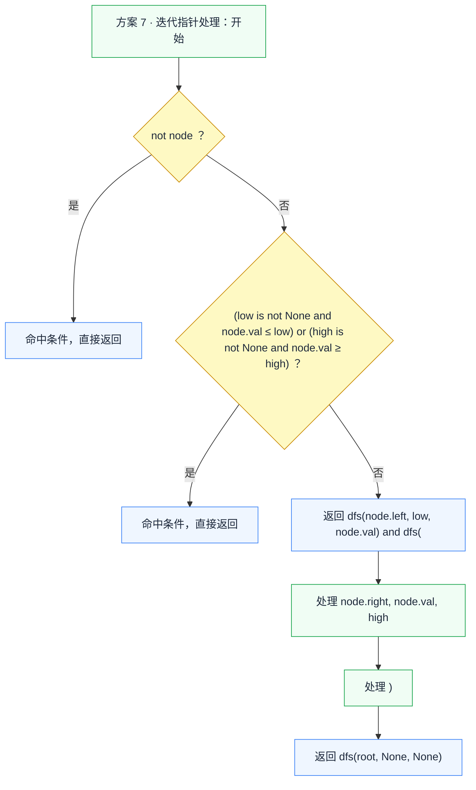

```python
import sys  # 提高递归深度上限（深输入防 RecursionError）

sys.setrecursionlimit(200000)  # 树/链表类题目节点数可达 1e4 量级

class TreeNode:  # 定义类
    def __init__(self, val=0, left=None, right=None):  # 构造函数：初始化成员
        self.val = val  # 把 值 写入 值
        self.left = left  # 把 左边界 写入 左边界
        self.right = right  # 把 右边界 写入 右边界

def isValidBST(root):  # 定义函数 isValidBST（参数：根节点）
    def dfs(node, low, high):  # 定义函数 dfs（参数：节点, low, high）
        if not node:  # 若 not 节点
            return True  # 返回 True
        if (low is not None and node.val <= low) or (high is not None and node.val >= high):
            return False  # 返回 False
        return dfs(node.left, low, node.val) and dfs(
            node.right, node.val, high
        )  # 返回 dfs(节点.左边界, low, 节点.值) and dfs(节点.右边界, 节点.值, high)

    return dfs(root, None, None)  # 返回 dfs(根节点, None, None)

def build_tree(vals):  # 定义函数 build_tree（参数：vals）
    if not vals:  # 若 not vals
        return None  # 返回 None
    root = TreeNode(vals[0])  # 把 TreeNode(vals[0]) 存入 根节点
    q = [root]  # 把 [根节点] 存入 节点
    i = 1  # 把 1 存入 下标 i
    while i < len(vals):  # 循环，直到不满足「下标 i 小于 长度(vals」
        node = q.pop(0)  # 把 节点 弹出 0) 存入 节点
        if vals[i] is not None:  # 若 vals[下标 i] is not None
            node.left = TreeNode(vals[i])  # 把 TreeNode(vals[下标 i]) 写入 左边界
            q.append(node.left)  # 把 节点.左边界 追加到列表尾部
        i += 1  # 下标 i累加 1
        if i < len(vals):  # 若 下标 i 小于 长度(vals
            if vals[i] is not None:  # 若 vals[下标 i] is not None
                node.right = TreeNode(vals[i])  # 把 TreeNode(vals[下标 i]) 写入 右边界
                q.append(node.right)  # 把 节点.右边界 追加到列表尾部
            i += 1  # 下标 i累加 1
    return root  # 返回 根节点

if __name__ == "__main__":  # 若 __name__ 等于 '__main__'
    print(isValidBST(build_tree([2, 1, 3])))  # 打印输出
    print(isValidBST(build_tree([5, 1, 4, None, None, 3, 6])))  # 打印输出
```

#### 方案 8：迭代指针处理

**思路与代码分析**：核心是「迭代指针处理」。Python 版用切片与字典推导式简化操作，突出可读性。**走读**：方案 8 · 迭代指针处理：开始 → 更新 res → 命中条件，直接返回 → 调用 dfs(node.left) → 向 res 追加记录 → 调用 dfs(node.right) → 调用 dfs(root) → 返回 all(res[i] ＜ res[i + 1] for i in range(len(res) - 1))。

**运行架构**（真实控制流）：

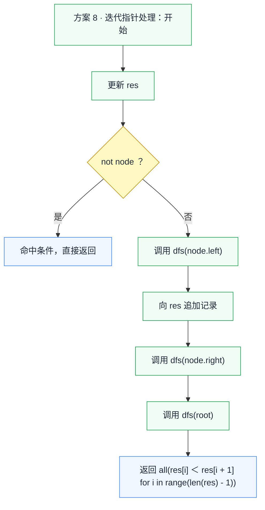

```python
import sys  # 提高递归深度上限（深输入防 RecursionError）

sys.setrecursionlimit(200000)  # 树/链表类题目节点数可达 1e4 量级

class TreeNode:  # 定义类
    def __init__(self, val=0, left=None, right=None):  # 构造函数：初始化成员
        self.val = val  # 把 值 写入 值
        self.left = left  # 把 左边界 写入 左边界
        self.right = right  # 把 右边界 写入 右边界

def isValidBST(root):  # 定义函数 isValidBST（参数：根节点）
    res = []  # 把 [] 存入 结果

    def dfs(node):  # 定义函数 dfs（参数：节点）
        if not node:  # 若 not 节点
            return  # return
        dfs(node.left)  # dfs(节点.左边界)
        res.append(node.val)  # 把 节点.值 追加到列表尾部
        dfs(node.right)  # dfs(节点.右边界)

    dfs(root)  # dfs(根节点)
    return all(res[i] < res[i + 1] for i in range(len(res) - 1))

def build_tree(vals):  # 定义函数 build_tree（参数：vals）
    if not vals:  # 若 not vals
        return None  # 返回 None
    root = TreeNode(vals[0])  # 把 TreeNode(vals[0]) 存入 根节点
    q = [root]  # 把 [根节点] 存入 节点
    i = 1  # 把 1 存入 下标 i
    while i < len(vals):  # 循环，直到不满足「下标 i 小于 长度(vals」
        node = q.pop(0)  # 把 节点 弹出 0) 存入 节点
        if vals[i] is not None:  # 若 vals[下标 i] is not None
            node.left = TreeNode(vals[i])  # 把 TreeNode(vals[下标 i]) 写入 左边界
            q.append(node.left)  # 把 节点.左边界 追加到列表尾部
        i += 1  # 下标 i累加 1
        if i < len(vals):  # 若 下标 i 小于 长度(vals
            if vals[i] is not None:  # 若 vals[下标 i] is not None
                node.right = TreeNode(vals[i])  # 把 TreeNode(vals[下标 i]) 写入 右边界
                q.append(node.right)  # 把 节点.右边界 追加到列表尾部
            i += 1  # 下标 i累加 1
    return root  # 返回 根节点

if __name__ == "__main__":  # 若 __name__ 等于 '__main__'
    print(isValidBST(build_tree([2, 1, 3])))  # 打印输出
    print(isValidBST(build_tree([5, 1, 4, None, None, 3, 6])))  # 打印输出
```

#### 方案 9：迭代指针处理

**思路与代码分析**：核心是「迭代指针处理」。Python 版用切片与字典推导式简化操作，突出可读性。代码里依次做这些事：队列或堆的调度。**走读**：方案 9 · 迭代指针处理：开始 → 命中条件，直接返回 → 更新 q → 当 q: 时反复执行 → 更新 high → 命中条件，直接返回 → 若 node.left：向 q 追加记录 → 向 q 追加记录 → 若 node.right：向 q 追加记录 → 向 q 追加记录 → 返回 True。

**运行架构**（真实控制流）：

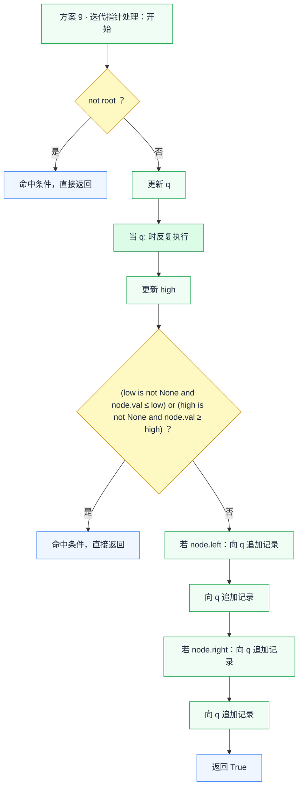

```python
import sys  # 提高递归深度上限（深输入防 RecursionError）

sys.setrecursionlimit(200000)  # 树/链表类题目节点数可达 1e4 量级
from collections import deque  # from collections import deque

class TreeNode:  # 定义类
    def __init__(self, val=0, left=None, right=None):  # 构造函数：初始化成员
        self.val = val  # 把 值 写入 值
        self.left = left  # 把 左边界 写入 左边界
        self.right = right  # 把 右边界 写入 右边界

def isValidBST(root):  # 定义函数 isValidBST（参数：根节点）
    if not root:  # 若 not 根节点
        return True  # 返回 True
    q = deque([(root, None, None)])  # 把 deque([(根节点, None, None)]) 存入 节点
    while q:  # 循环，直到不满足「节点」
        node, low, high = q.popleft()  # 把 节点.popleft() 写入 node, low, high
        if (low is not None and node.val <= low) or (high is not None and node.val >= high):
            return False  # 返回 False
        if node.left:  # 若 节点.左边界
            q.append((node.left, low, node.val))  # 把 (节点.左边界, low, 节点.值 追加到列表尾部
        if node.right:  # 若 节点.右边界
            q.append((node.right, node.val, high))  # 把 (节点.右边界, 节点.值, high 追加到列表尾部
    return True  # 返回 True

def build_tree(vals):  # 定义函数 build_tree（参数：vals）
    if not vals:  # 若 not vals
        return None  # 返回 None
    root = TreeNode(vals[0])  # 把 TreeNode(vals[0]) 存入 根节点
    q = [root]  # 把 [根节点] 存入 节点
    i = 1  # 把 1 存入 下标 i
    while i < len(vals):  # 循环，直到不满足「下标 i 小于 长度(vals」
        node = q.pop(0)  # 把 节点 弹出 0) 存入 节点
        if vals[i] is not None:  # 若 vals[下标 i] is not None
            node.left = TreeNode(vals[i])  # 把 TreeNode(vals[下标 i]) 写入 左边界
            q.append(node.left)  # 把 节点.左边界 追加到列表尾部
        i += 1  # 下标 i累加 1
        if i < len(vals):  # 若 下标 i 小于 长度(vals
            if vals[i] is not None:  # 若 vals[下标 i] is not None
                node.right = TreeNode(vals[i])  # 把 TreeNode(vals[下标 i]) 写入 右边界
                q.append(node.right)  # 把 节点.右边界 追加到列表尾部
            i += 1  # 下标 i累加 1
    return root  # 返回 根节点

if __name__ == "__main__":  # 若 __name__ 等于 '__main__'
    print(isValidBST(build_tree([2, 1, 3])))  # 打印输出
    print(isValidBST(build_tree([5, 1, 4, None, None, 3, 6])))  # 打印输出
```

#### 方案 10：迭代指针处理

**思路与代码分析**：核心是「迭代指针处理」。Python 版用切片与字典推导式简化操作，突出可读性。**走读**：方案 10 · 迭代指针处理：开始 → 命中条件，直接返回 → 更新 stack → 当 stack: 时反复执行 → 从 stack 弹出 → 命中条件，直接返回 → 若 node.right：向 stack 追加记录 → 向 stack 追加记录 → 若 node.left：向 stack 追加记录 → 向 stack 追加记录 → 返回 True。

**运行架构**（真实控制流）：

```mermaid
graph TD
    N0["方案 10 · 迭代指针处理：开始"]
    N1{"not root ？"}
    N2["命中条件，直接返回"]
    N3["更新 stack"]
    N4["当 stack: 时反复执行"]
    N5["从 stack 弹出"]
    N6{"(low is not None and node.val ≤ low) or (high is not None and node.val ≥ high) ？"}
    N7["命中条件，直接返回"]
    N8["若 node.right：向 stack 追加记录"]
    N9["向 stack 追加记录"]
    N10["若 node.left：向 stack 追加记录"]
    N11["向 stack 追加记录"]
    N12["返回 True"]
    N0 --> N1
    N1 -- 是 --> N2
    N1 -- 否 --> N3
    N3 --> N4
    N4 --> N5
    N5 --> N6
    N6 -- 是 --> N7
    N6 -- 否 --> N8
    N8 --> N9
    N9 --> N10
    N10 --> N11
    N11 --> N12
    classDef n fill:#f0fdf4,stroke:#16a34a,color:#1e293b;
    classDef lp fill:#dcfce7,stroke:#15803d,color:#1e293b;
    classDef dc fill:#fef9c3,stroke:#ca8a04,color:#1e293b;
    classDef tm fill:#eff6ff,stroke:#3b82f6,color:#1e293b;
    class N0,N3,N5,N8,N9,N10,N11 n;
    class N4 lp;
    class N1,N6 dc;
    class N2,N7,N12 tm;
```

```python
import sys  # 提高递归深度上限（深输入防 RecursionError）

sys.setrecursionlimit(200000)  # 树/链表类题目节点数可达 1e4 量级

class TreeNode:  # 定义类
    def __init__(self, val=0, left=None, right=None):  # 构造函数：初始化成员
        self.val = val  # 把 值 写入 值
        self.left = left  # 把 左边界 写入 左边界
        self.right = right  # 把 右边界 写入 右边界

def isValidBST(root):  # 定义函数 isValidBST（参数：根节点）
    if not root:  # 若 not 根节点
        return True  # 返回 True
    stack = [(root, None, None)]  # 把 [(根节点, None, None)] 存入 栈
    while stack:  # 循环，直到不满足「栈」
        node, low, high = stack.pop()  # 弹出栈顶元素
        if (low is not None and node.val <= low) or (high is not None and node.val >= high):
            return False  # 返回 False
        if node.right:  # 若 节点.右边界
            stack.append((node.right, node.val, high))  # 把 (节点.右边界, 节点.值, high 追加到列表尾部
        if node.left:  # 若 节点.左边界
            stack.append((node.left, low, node.val))  # 把 (节点.左边界, low, 节点.值 追加到列表尾部
    return True  # 返回 True

def build_tree(vals):  # 定义函数 build_tree（参数：vals）
    if not vals:  # 若 not vals
        return None  # 返回 None
    root = TreeNode(vals[0])  # 把 TreeNode(vals[0]) 存入 根节点
    q = [root]  # 把 [根节点] 存入 节点
    i = 1  # 把 1 存入 下标 i
    while i < len(vals):  # 循环，直到不满足「下标 i 小于 长度(vals」
        node = q.pop(0)  # 把 节点 弹出 0) 存入 节点
        if vals[i] is not None:  # 若 vals[下标 i] is not None
            node.left = TreeNode(vals[i])  # 把 TreeNode(vals[下标 i]) 写入 左边界
            q.append(node.left)  # 把 节点.左边界 追加到列表尾部
        i += 1  # 下标 i累加 1
        if i < len(vals):  # 若 下标 i 小于 长度(vals
            if vals[i] is not None:  # 若 vals[下标 i] is not None
                node.right = TreeNode(vals[i])  # 把 TreeNode(vals[下标 i]) 写入 右边界
                q.append(node.right)  # 把 节点.右边界 追加到列表尾部
            i += 1  # 下标 i累加 1
    return root  # 返回 根节点

if __name__ == "__main__":  # 若 __name__ 等于 '__main__'
    print(isValidBST(build_tree([2, 1, 3])))  # 打印输出
    print(isValidBST(build_tree([5, 1, 4, None, None, 3, 6])))  # 打印输出
```

### Go 实现（10 种方案）

Go 的全部方案如下，每个方案都内嵌用例自测，可独立运行（老仓库 python/go 文件遵循「打印结果」约定）：

#### 方案 1：迭代指针处理

**思路与代码分析**：核心是「迭代指针处理」。Go 版用切片与多返回值惯用法，显式处理索引边界。**走读**：方案 1 · 迭代指针处理：开始 → 计算 dfs → 更新 dfs → 处理 if n == nil → 返回 true, math.MaxInt64, math.MinInt64 → 更新 : → 更新 : → 更新 : → 返回 ok, min(lmin, n.Val), max(rmax, n.Val) → 更新 : → 返回 r。

**运行架构**（真实控制流）：

```mermaid
graph TD
    N0["方案 1 · 迭代指针处理：开始"]
    N1["计算 dfs"]
    N2["更新 dfs"]
    N3["处理 if n == nil"]
    N4["返回 true, math.MaxInt64, math.MinInt64"]
    N5["更新 :"]
    N6["更新 :"]
    N7["更新 :"]
    N8["返回 ok, min(lmin, n.Val), max(rmax, n.Val)"]
    N9["更新 :"]
    N10["返回 r"]
    N0 --> N1
    N1 --> N2
    N2 --> N3
    N3 --> N4
    N4 --> N5
    N5 --> N6
    N6 --> N7
    N7 --> N8
    N8 --> N9
    N9 --> N10
    classDef n fill:#f0fdf4,stroke:#16a34a,color:#1e293b;
    classDef lp fill:#dcfce7,stroke:#15803d,color:#1e293b;
    classDef dc fill:#fef9c3,stroke:#ca8a04,color:#1e293b;
    classDef tm fill:#eff6ff,stroke:#3b82f6,color:#1e293b;
    class N0,N1,N2,N3,N5,N6,N7,N9 n;
    class N4,N8,N10 tm;
```

```go
package main // 引入依赖

import (
	"fmt"
	"math" // 引入依赖
	"os"
)

type TreeNode struct { // 定义类型
	Val   int       // Val int
	Left  *TreeNode // Left 乘 TreeNode
	Right *TreeNode // Right 乘 TreeNode
}

func buildTree(vals []interface{}) *TreeNode { // 定义函数/方法 buildTree
	if len(vals) == 0 || vals[0] == nil { // 若 长度(vals) 等于 0 或 vals[0] 等于 nil
		return nil // 返回 nil
	}
	root := &TreeNode{Val: vals[0].(int)} // 把 按位与 TreeNode{Val: vals[0].(int)} 写入 root :
	q := []*TreeNode{root}                // 把 [] 乘 TreeNode{根节点} 写入 q :
	i := 1                                // 把 1 写入 i :
	for i < len(vals) {                   // for 下标 i 小于 长度(vals) {
		node := q[0]        // 把 节点[0] 写入 node :
		q = q[1:]           // 把 节点[1:] 写入 节点
		if vals[i] != nil { // 若 vals[下标 i] 不等于 nil
			node.Left = &TreeNode{Val: vals[i].(int)} // 把 按位与 TreeNode{Val: vals[下标 i].(int)} 写入 node.Left
			q = append(q, node.Left)                  // 把 append(节点, 节点.Left) 写入 节点
		}
		i++                // 下标 i 加一
		if i < len(vals) { // 若 下标 i 小于 长度(vals
			if vals[i] != nil { // 若 vals[下标 i] 不等于 nil
				node.Right = &TreeNode{Val: vals[i].(int)} // 把 按位与 TreeNode{Val: vals[下标 i].(int)} 写入 node.Right
				q = append(q, node.Right)                  // 把 append(节点, 节点.Right) 写入 节点
			}
			i++ // 下标 i 加一
		}
	}
	return root // 返回 根节点
}

func isValidBST(root *TreeNode) bool { // 定义判定函数 isValidBST
	var dfs func(n *TreeNode) (bool, int, int) // var dfs func(元素个数 乘 TreeNode) (bool, int, int)
	dfs = func(n *TreeNode) (bool, int, int) { // 把 func(元素个数 乘 TreeNode) (bool, int, int) { 写入 dfs
		if n == nil { // 若 元素个数 等于 nil
			return true, math.MaxInt64, math.MinInt64 // 返回 true, math.MaxInt64, math.MinInt64
		}
		lok, lmin, lmax := dfs(n.Left)                   // 把 dfs(元素个数.Left) 写入 lok, lmin, lmax :
		rok, rmin, rmax := dfs(n.Right)                  // 把 dfs(元素个数.Right) 写入 rok, rmin, rmax :
		ok := lok && rok && lmax < n.Val && n.Val < rmin // 把 lok 且 rok 且 lmax 小于 元素个数.Val 且 元素个数.Val 小于 rmin 写入 ok :
		return ok, min(lmin, n.Val), max(rmax, n.Val)    // 返回 ok, 取较小值 lmin, 元素个数.Val), 取较大值 rmax, 元素个数.Val)
	}
	r, _, _ := dfs(root) // 把 dfs(根节点) 写入 r, _, _ :
	return r             // 返回 右指针
}

func main() { // 程序入口：跑内嵌自测用例
	cases := []struct { // 把 []struct { 写入 cases :
		vals []interface{} // vals []interface{}
		want bool          // want bool
	}{ // }{
		{[]interface{}{2, 1, 3}, true},
		{[]interface{}{5, 1, 4, nil, nil, 3, 6}, false},
	}
	ok := true                // 把 true 写入 ok :
	for _, c := range cases { // 同时取 _ 与 字符 遍历
		if g := isValidBST(buildTree(c.vals)); g != c.want { // 若 g : 赋值为 isValidBST(buildTree(字符.vals)); g 不等于 字符.want
			ok = false                                            // 把 false 写入 ok
			fmt.Printf("FAIL %v=%v want %v\n", c.vals, g, c.want) // 打印输出
		}
	}
	if !ok { // 若 取反 ok
		os.Exit(1) // os.Exit(1)
	}
	fmt.Println("PASS") // 全部用例通过，输出 PASS
}
```

#### 方案 2：迭代指针处理

**思路与代码分析**：核心是「迭代指针处理」。Go 版用切片与多返回值惯用法，显式处理索引边界。**走读**：方案 2 · 迭代指针处理：开始 → 处理 if root == nil → 返回 true → 遍历循环 → 命中条件，直接返回 → 返回 true。

**运行架构**（真实控制流）：

```mermaid
graph TD
    N0["方案 2 · 迭代指针处理：开始"]
    N1["处理 if root == nil"]
    N2["返回 true"]
    D1["……（中间计算步骤）"]
    N8["遍历循环"]
    D2["……（中间计算步骤）"]
    N11{"t.low ≠ nil 且 t.node.Val ≤ *t.low) 或 (t.high ≠ nil 且 t.node.Val ≥ *t.high ？"}
    N12["命中条件，直接返回"]
    D3["……（中间计算步骤）"]
    N17["返回 true"]
    N0 --> N1
    N1 --> N2
    N11 -- 是 --> N12
    N8 --> N17
    N2 --> D1
    D1 --> N8
    N8 --> D2
    D2 --> N11
    N12 --> D3
    D3 --> N17
    classDef n fill:#f0fdf4,stroke:#16a34a,color:#1e293b;
    classDef lp fill:#dcfce7,stroke:#15803d,color:#1e293b;
    classDef dc fill:#fef9c3,stroke:#ca8a04,color:#1e293b;
    classDef tm fill:#eff6ff,stroke:#3b82f6,color:#1e293b;
    class N0,N1,D1,D2,D3 n;
    class N8 lp;
    class N11 dc;
    class N2,N12,N17 tm;
```

```go
package main // 引入依赖

import (
	"fmt"
	"os"
) // 引入依赖

type TreeNode struct { // 定义类型
	Val   int       // Val int
	Left  *TreeNode // Left 乘 TreeNode
	Right *TreeNode // Right 乘 TreeNode
}

func isValidBST(root *TreeNode) bool { // 定义判定函数 isValidBST
	if root == nil { // 若 根节点 等于 nil
		return true // 返回 true
	}
	type tup struct { // 定义类型
		node *TreeNode // 节点 乘 TreeNode
		low  *int      // low 乘 int
		high *int      // high 乘 int
	}
	stack := []tup{{root, nil, nil}} // 把 []tup{{根节点, nil, nil}} 写入 stack :
	for len(stack) > 0 {             // for 长度(栈) 超过 0 {
		t := stack[len(stack)-1]     // 把 栈[长度(栈) 减 1] 写入 t :
		stack = stack[:len(stack)-1] // 把 栈[:长度(栈) 减 1] 写入 栈
		if (t.low != nil && t.node.Val <= *t.low) || (t.high != nil && t.node.Val >= *t.high) {
			return false // 返回 false
		}
		if t.node.Right != nil { // 若 另一字符串.节点.Right 不等于 nil
			stack = append(stack, tup{t.node.Right, &t.node.Val, t.high})
		}
		if t.node.Left != nil { // 若 另一字符串.节点.Left 不等于 nil
			stack = append(stack, tup{t.node.Left, t.low, &t.node.Val})
		}
	}
	return true // 返回 true
}

func buildTree(vals []int) *TreeNode { // 定义函数/方法 buildTree
	if len(vals) == 0 || vals[0] == -1 { // 若 长度(vals) 等于 0 或 vals[0] 等于 减 1
		return nil // 返回 nil
	}
	root := &TreeNode{Val: vals[0]} // 把 按位与 TreeNode{Val: vals[0]} 写入 root :
	q := []*TreeNode{root}          // 把 [] 乘 TreeNode{根节点} 写入 q :
	i := 1                          // 把 1 写入 i :
	for i < len(vals) {             // for 下标 i 小于 长度(vals) {
		node := q[0]                        // 把 节点[0] 写入 node :
		q = q[1:]                           // 把 节点[1:] 写入 节点
		if i < len(vals) && vals[i] != -1 { // 若 下标 i 小于 长度(vals) 且 vals[下标 i] 不等于 减 1
			node.Left = &TreeNode{Val: vals[i]} // 把 按位与 TreeNode{Val: vals[下标 i]} 写入 node.Left
			q = append(q, node.Left)            // 把 append(节点, 节点.Left) 写入 节点
		}
		i++                                 // 下标 i 加一
		if i < len(vals) && vals[i] != -1 { // 若 下标 i 小于 长度(vals) 且 vals[下标 i] 不等于 减 1
			node.Right = &TreeNode{Val: vals[i]} // 把 按位与 TreeNode{Val: vals[下标 i]} 写入 node.Right
			q = append(q, node.Right)            // 把 append(节点, 节点.Right) 写入 节点
		}
		i++ // 下标 i 加一
	}
	return root // 返回 根节点
}

func main() { // 程序入口：跑内嵌自测用例
	ok := true                                  // 把 true 写入 ok :
	if !isValidBST(buildTree([]int{2, 1, 3})) { // 若 取反 isValidBST(buildTree([]int{2, 1, 3}
		ok = false                    // 把 false 写入 ok
		fmt.Println("FAIL valid BST") // 打印输出
	}
	if isValidBST(buildTree([]int{5, 1, 4, -1, -1, 3, 6})) { // 定义判定函数 isValidBST
		ok = false                                        // 把 false 写入 ok
		fmt.Println("FAIL invalid BST detected as valid") // 打印输出
	}
	if !ok { // 若 取反 ok
		os.Exit(1) // os.Exit(1)
	}
	fmt.Println("PASS") // 全部用例通过，输出 PASS
}
```

#### 方案 3：迭代指针处理

**思路与代码分析**：核心是「迭代指针处理」。Go 版用切片与多返回值惯用法，显式处理索引边界。**走读**：方案 3 · 迭代指针处理：开始 → 计算 prev → 计算 dfs → 更新 dfs → 处理 if n == nil → 返回 true → 处理 if 非 dfs(n.Left) → 返回 false → 处理 if prev ≠ nil 且 *prev ≥ n → 返回 false → 更新 : → 更新 prev → 返回 dfs(n.Right) → 返回 dfs(root)。

**运行架构**（真实控制流）：

```mermaid
graph TD
    N0["方案 3 · 迭代指针处理：开始"]
    N1["计算 prev"]
    N2["计算 dfs"]
    N3["更新 dfs"]
    N4["处理 if n == nil"]
    N5["返回 true"]
    N6["处理 if 非 dfs(n.Left)"]
    N7["返回 false"]
    N8["处理 if prev ≠ nil 且 *prev ≥ n"]
    N9["返回 false"]
    N10["更新 :"]
    N11["更新 prev"]
    N12["返回 dfs(n.Right)"]
    N13["返回 dfs(root)"]
    N0 --> N1
    N1 --> N2
    N2 --> N3
    N3 --> N4
    N4 --> N5
    N5 --> N6
    N6 --> N7
    N7 --> N8
    N8 --> N9
    N9 --> N10
    N10 --> N11
    N11 --> N12
    N12 --> N13
    classDef n fill:#f0fdf4,stroke:#16a34a,color:#1e293b;
    classDef lp fill:#dcfce7,stroke:#15803d,color:#1e293b;
    classDef dc fill:#fef9c3,stroke:#ca8a04,color:#1e293b;
    classDef tm fill:#eff6ff,stroke:#3b82f6,color:#1e293b;
    class N0,N1,N2,N3,N4,N6,N8,N10,N11 n;
    class N5,N7,N9,N12,N13 tm;
```

```go
package main // 引入依赖

import (
	"fmt"
	"os"
) // 引入依赖

type TreeNode struct { // 定义类型
	Val   int       // Val int
	Left  *TreeNode // Left 乘 TreeNode
	Right *TreeNode // Right 乘 TreeNode
}

func isValidBST(root *TreeNode) bool { // 定义判定函数 isValidBST
	var prev *int                  // var 前一个 乘 int
	var dfs func(n *TreeNode) bool // var dfs func(元素个数 乘 TreeNode) bool
	dfs = func(n *TreeNode) bool { // 把 func(元素个数 乘 TreeNode) bool { 写入 dfs
		if n == nil { // 若 元素个数 等于 nil
			return true // 返回 true
		}
		if !dfs(n.Left) { // 若 取反 dfs(元素个数.Left
			return false // 返回 false
		}
		if prev != nil && *prev >= n.Val { // 若 前一个 不等于 nil 且 乘 前一个 不低于 元素个数.Val
			return false // 返回 false
		}
		v := n.Val          // 把 元素个数.Val 写入 v :
		prev = &v           // 把 按位与 值 写入 前一个
		return dfs(n.Right) // 定义函数/方法 dfs
	}
	return dfs(root) // 定义函数/方法 dfs
}

func buildTree(vals []int) *TreeNode { // 定义函数/方法 buildTree
	if len(vals) == 0 || vals[0] == -1 { // 若 长度(vals) 等于 0 或 vals[0] 等于 减 1
		return nil // 返回 nil
	}
	root := &TreeNode{Val: vals[0]} // 把 按位与 TreeNode{Val: vals[0]} 写入 root :
	q := []*TreeNode{root}          // 把 [] 乘 TreeNode{根节点} 写入 q :
	i := 1                          // 把 1 写入 i :
	for i < len(vals) {             // for 下标 i 小于 长度(vals) {
		node := q[0]                        // 把 节点[0] 写入 node :
		q = q[1:]                           // 把 节点[1:] 写入 节点
		if i < len(vals) && vals[i] != -1 { // 若 下标 i 小于 长度(vals) 且 vals[下标 i] 不等于 减 1
			node.Left = &TreeNode{Val: vals[i]} // 把 按位与 TreeNode{Val: vals[下标 i]} 写入 node.Left
			q = append(q, node.Left)            // 把 append(节点, 节点.Left) 写入 节点
		}
		i++                                 // 下标 i 加一
		if i < len(vals) && vals[i] != -1 { // 若 下标 i 小于 长度(vals) 且 vals[下标 i] 不等于 减 1
			node.Right = &TreeNode{Val: vals[i]} // 把 按位与 TreeNode{Val: vals[下标 i]} 写入 node.Right
			q = append(q, node.Right)            // 把 append(节点, 节点.Right) 写入 节点
		}
		i++ // 下标 i 加一
	}
	return root // 返回 根节点
}

func main() { // 程序入口：跑内嵌自测用例
	ok := true                                  // 把 true 写入 ok :
	if !isValidBST(buildTree([]int{2, 1, 3})) { // 若 取反 isValidBST(buildTree([]int{2, 1, 3}
		ok = false                    // 把 false 写入 ok
		fmt.Println("FAIL valid BST") // 打印输出
	}
	if isValidBST(buildTree([]int{5, 1, 4, -1, -1, 3, 6})) { // 定义判定函数 isValidBST
		ok = false                                        // 把 false 写入 ok
		fmt.Println("FAIL invalid BST detected as valid") // 打印输出
	}
	if !ok { // 若 取反 ok
		os.Exit(1) // os.Exit(1)
	}
	fmt.Println("PASS") // 全部用例通过，输出 PASS
}
```

#### 方案 4：迭代指针处理

**思路与代码分析**：核心是「迭代指针处理」。Go 版用切片与多返回值惯用法，显式处理索引边界。**走读**：方案 4 · 迭代指针处理：开始 → 计算 dfs → 更新 dfs → 处理 if n == nil → 返回 true → 处理 if low ≠ nil 且 非 (n.Val ＞ * → 返回 false → 处理 if high ≠ nil 且 非 (n.Val ＜ → 返回 false → 返回 dfs(n.Left, low, &n.Val) 且 dfs(n.Right, &n.Val, high) → 返回 dfs(root, nil, nil)。

**运行架构**（真实控制流）：

```mermaid
graph TD
    N0["方案 4 · 迭代指针处理：开始"]
    N1["计算 dfs"]
    N2["更新 dfs"]
    N3["处理 if n == nil"]
    N4["返回 true"]
    N5["处理 if low ≠ nil 且 非 (n.Val ＞ *"]
    N6["返回 false"]
    N7["处理 if high ≠ nil 且 非 (n.Val ＜"]
    N8["返回 false"]
    N9["返回 dfs(n.Left, low, &n.Val) 且 dfs(n.Right, &n.Val, high)"]
    N10["返回 dfs(root, nil, nil)"]
    N0 --> N1
    N1 --> N2
    N2 --> N3
    N3 --> N4
    N4 --> N5
    N5 --> N6
    N6 --> N7
    N7 --> N8
    N8 --> N9
    N9 --> N10
    classDef n fill:#f0fdf4,stroke:#16a34a,color:#1e293b;
    classDef lp fill:#dcfce7,stroke:#15803d,color:#1e293b;
    classDef dc fill:#fef9c3,stroke:#ca8a04,color:#1e293b;
    classDef tm fill:#eff6ff,stroke:#3b82f6,color:#1e293b;
    class N0,N1,N2,N3,N5,N7 n;
    class N4,N6,N8,N9,N10 tm;
```

```go
package main // 引入依赖

import (
	"fmt"
	"os"
) // 引入依赖

type TreeNode struct { // 定义类型
	Val   int       // Val int
	Left  *TreeNode // Left 乘 TreeNode
	Right *TreeNode // Right 乘 TreeNode
}

func isValidBST(root *TreeNode) bool { // 定义判定函数 isValidBST
	var dfs func(n *TreeNode, low, high *int) bool // var dfs func(元素个数 乘 TreeNode, low, high 乘 int) bool
	dfs = func(n *TreeNode, low, high *int) bool { // 把 func(元素个数 乘 TreeNode, low, high 乘 int) bool { 写入 dfs
		if n == nil { // 若 元素个数 等于 nil
			return true // 返回 true
		}
		if low != nil && !(n.Val > *low) { // 若 low 不等于 nil 且 取反 (元素个数.Val 超过 乘 low
			return false // 返回 false
		}
		if high != nil && !(n.Val < *high) { // 若 high 不等于 nil 且 取反 (元素个数.Val 小于 乘 high
			return false // 返回 false
		}
		return dfs(n.Left, low, &n.Val) && dfs(n.Right, &n.Val, high) // 定义函数/方法 dfs
	}
	return dfs(root, nil, nil) // 定义函数/方法 dfs
}

func buildTree(vals []int) *TreeNode { // 定义函数/方法 buildTree
	if len(vals) == 0 || vals[0] == -1 { // 若 长度(vals) 等于 0 或 vals[0] 等于 减 1
		return nil // 返回 nil
	}
	root := &TreeNode{Val: vals[0]} // 把 按位与 TreeNode{Val: vals[0]} 写入 root :
	q := []*TreeNode{root}          // 把 [] 乘 TreeNode{根节点} 写入 q :
	i := 1                          // 把 1 写入 i :
	for i < len(vals) {             // for 下标 i 小于 长度(vals) {
		node := q[0]                        // 把 节点[0] 写入 node :
		q = q[1:]                           // 把 节点[1:] 写入 节点
		if i < len(vals) && vals[i] != -1 { // 若 下标 i 小于 长度(vals) 且 vals[下标 i] 不等于 减 1
			node.Left = &TreeNode{Val: vals[i]} // 把 按位与 TreeNode{Val: vals[下标 i]} 写入 node.Left
			q = append(q, node.Left)            // 把 append(节点, 节点.Left) 写入 节点
		}
		i++                                 // 下标 i 加一
		if i < len(vals) && vals[i] != -1 { // 若 下标 i 小于 长度(vals) 且 vals[下标 i] 不等于 减 1
			node.Right = &TreeNode{Val: vals[i]} // 把 按位与 TreeNode{Val: vals[下标 i]} 写入 node.Right
			q = append(q, node.Right)            // 把 append(节点, 节点.Right) 写入 节点
		}
		i++ // 下标 i 加一
	}
	return root // 返回 根节点
}

func main() { // 程序入口：跑内嵌自测用例
	ok := true                                  // 把 true 写入 ok :
	if !isValidBST(buildTree([]int{2, 1, 3})) { // 若 取反 isValidBST(buildTree([]int{2, 1, 3}
		ok = false                    // 把 false 写入 ok
		fmt.Println("FAIL valid BST") // 打印输出
	}
	if isValidBST(buildTree([]int{5, 1, 4, -1, -1, 3, 6})) { // 定义判定函数 isValidBST
		ok = false                                        // 把 false 写入 ok
		fmt.Println("FAIL invalid BST detected as valid") // 打印输出
	}
	if !ok { // 若 取反 ok
		os.Exit(1) // os.Exit(1)
	}
	fmt.Println("PASS") // 全部用例通过，输出 PASS
}
```

#### 方案 5：迭代指针处理

**思路与代码分析**：核心是「迭代指针处理」。Go 版用切片与多返回值惯用法，显式处理索引边界。**走读**：方案 5 · 迭代指针处理：开始 → 计算 check → 更新 check → 处理 if n == nil → 返回 true → 处理 if n.Val ≤ lo 或 n.Val ≥ h → 返回 false → 返回 check(n.Left, lo, n.Val) 且 check(n.Right, n.Val, hi) → 返回 check(root, math.MinInt64, math.MaxInt64)。

**运行架构**（真实控制流）：

```mermaid
graph TD
    N0["方案 5 · 迭代指针处理：开始"]
    N1["计算 check"]
    N2["更新 check"]
    N3["处理 if n == nil"]
    N4["返回 true"]
    N5["处理 if n.Val ≤ lo 或 n.Val ≥ h"]
    N6["返回 false"]
    N7["返回 check(n.Left, lo, n.Val) 且 check(n.Right, n.Val, hi)"]
    N8["返回 check(root, math.MinInt64, math.MaxInt64)"]
    N0 --> N1
    N1 --> N2
    N2 --> N3
    N3 --> N4
    N4 --> N5
    N5 --> N6
    N6 --> N7
    N7 --> N8
    classDef n fill:#f0fdf4,stroke:#16a34a,color:#1e293b;
    classDef lp fill:#dcfce7,stroke:#15803d,color:#1e293b;
    classDef dc fill:#fef9c3,stroke:#ca8a04,color:#1e293b;
    classDef tm fill:#eff6ff,stroke:#3b82f6,color:#1e293b;
    class N0,N1,N2,N3,N5 n;
    class N4,N6,N7,N8 tm;
```

```go
package main // 引入依赖
import (
	"fmt"
	"math" // 引入依赖
	"os"
)

type TreeNode struct {
	Val   int
	Left  *TreeNode
	Right *TreeNode
}                        // 定义类型
const NULL = -1000000000 // 把 减 1000000000 存入 NULL
func buildTree(vals []int) *TreeNode { // 定义函数/方法 buildTree
	if len(vals) == 0 || vals[0] == NULL {
		return nil
	} // 若 长度(vals) 等于 0 或 vals[0] 等于 NULL { return nil }
	root := &TreeNode{Val: vals[0]} // 把 按位与 TreeNode{Val: vals[0]} 写入 root :
	q := []*TreeNode{root}
	i := 1                            // 把 [] 乘 TreeNode{根节点}; 下标 i : 赋值为 1 写入 q :
	for len(q) > 0 && i < len(vals) { // 定义函数/方法 len
		node := q[0]
		q = q[1:] // 把 节点[0]; 节点 赋值为 节点[1:] 写入 node :
		if i < len(vals) && vals[i] != NULL {
			node.Left = &TreeNode{Val: vals[i]}
			q = append(q, node.Left)
		}
		i++
		if i < len(vals) && vals[i] != NULL {
			node.Right = &TreeNode{Val: vals[i]}
			q = append(q, node.Right)
		}
		i++
	}
	return root // 返回 根节点
}
func levelList(root *TreeNode) [][]int { // 定义函数/方法 levelList
	if root == nil {
		return [][]int{}
	} // 若 根节点 等于 nil { return [][]int{} }
	res := [][]int{}
	q := []*TreeNode{root} // 把 [][]int{}; 节点 : 赋值为 [] 乘 TreeNode{根节点} 写入 res :
	for len(q) > 0 {       // for 长度(节点) 超过 0 {
		lvl := []int{}
		n := len(q)              // 把 []int{}; 元素个数 : 赋值为 长度(节点) 写入 lvl :
		for k := 0; k < n; k++ { // 让 下标 k 从 0 开始计数
			node := q[0]
			q = q[1:]                   // 把 节点[0]; 节点 赋值为 节点[1:] 写入 node :
			lvl = append(lvl, node.Val) // 把 append(lvl, 节点.Val) 写入 lvl
			if node.Left != nil {
				q = append(q, node.Left)
			} // 若 节点.Left 不等于 nil { 节点 赋值为 append(节点, 节点.Left) }
			if node.Right != nil {
				q = append(q, node.Right)
			} // 若 节点.Right 不等于 nil { 节点 赋值为 append(节点, 节点.Right) }
		}
		res = append(res, lvl) // 把 append(结果, lvl) 写入 结果
	}
	return res // 返回 结果
}
func sameTree(a, b *TreeNode) bool { // 定义函数/方法 sameTree
	if a == nil && b == nil {
		return true
	} // 若 数组 等于 nil 且 b 等于 nil { return true }
	if a == nil || b == nil {
		return false
	} // 若 数组 等于 nil 或 b 等于 nil { return false }
	if a.Val != b.Val {
		return false
	} // 若 数组.Val 不等于 b.Val { return false }
	return sameTree(a.Left, b.Left) && sameTree(a.Right, b.Right) // 定义函数/方法 sameTree
}
func inorderT(root *TreeNode) []int { // 定义函数/方法 inorderT
	if root == nil {
		return []int{}
	} // 若 根节点 等于 nil { return []int{} }
	return append(append(inorderT(root.Left), root.Val), inorderT(root.Right)...) // 定义函数/方法 append
}
func isValidBST(root *TreeNode) bool { // 定义判定函数 isValidBST
	var check func(*TreeNode, int, int) bool     // var check func( 乘 TreeNode, int, int) bool
	check = func(n *TreeNode, lo, hi int) bool { // 把 func(元素个数 乘 TreeNode, 左边界, 右边界 int) bool { 写入 check
		if n == nil {
			return true
		} // 若 元素个数 等于 nil { return true }
		if n.Val <= lo || n.Val >= hi {
			return false
		} // 若 元素个数.Val 不超过 左边界 或 元素个数.Val 不低于 右边界 { return false }
		return check(n.Left, lo, n.Val) && check(n.Right, n.Val, hi) // 定义判定函数 check
	}
	return check(root, math.MinInt64, math.MaxInt64) // 定义判定函数 check
}
func main() { // 程序入口：跑内嵌自测用例
	ok := true // 把 true 写入 ok :
	if !isValidBST(buildTree([]int{2, 1, 3})) {
		ok = false
		fmt.Println("FAIL valid")
	}
	if isValidBST(buildTree([]int{5, 1, 4, NULL, NULL, 3, 6})) {
		ok = false
		fmt.Println("FAIL invalid")
	}
	if !isValidBST(nil) {
		ok = false
	} // 若 取反 isValidBST(nil) { ok 赋值为 false }
	if !ok {
		os.Exit(1)
	} // 若 取反 ok { os.Exit(1) }
	fmt.Println("PASS") // 全部用例通过，输出 PASS
}
```

#### 方案 6：迭代指针处理

**思路与代码分析**：核心是「迭代指针处理」。Go 版用切片与多返回值惯用法，显式处理索引边界。**走读**：方案 6 · 迭代指针处理：开始 → 更新 : → 计算 inorder → 更新 : → 遍历循环 → 遍历循环 → 更新 stack → 更新 cur → 更新 cur → 更新 stack → 处理 if inorder ≠ nil 且 cur.Val → 返回 false → 更新 : → 更新 inorder → 更新 cur → 返回 true。

**运行架构**（真实控制流）：

```mermaid
graph TD
    N0["方案 6 · 迭代指针处理：开始"]
    N1["更新 :"]
    N2["计算 inorder"]
    N3["更新 :"]
    N4["遍历循环"]
    N5["遍历循环"]
    N6["更新 stack"]
    N7["更新 cur"]
    N8["更新 cur"]
    N9["更新 stack"]
    N10["处理 if inorder ≠ nil 且 cur.Val"]
    N11["返回 false"]
    N12["更新 :"]
    N13["更新 inorder"]
    N14["更新 cur"]
    N15["返回 true"]
    N0 --> N1
    N1 --> N2
    N2 --> N3
    N3 --> N4
    N4 --> N5
    N5 --> N6
    N6 --> N7
    N7 -- 下一轮 --> N5
    N5 --> N8
    N8 --> N9
    N9 --> N10
    N10 --> N11
    N11 --> N12
    N12 --> N13
    N13 --> N14
    N14 -- 下一轮 --> N4
    N4 --> N15
    classDef n fill:#f0fdf4,stroke:#16a34a,color:#1e293b;
    classDef lp fill:#dcfce7,stroke:#15803d,color:#1e293b;
    classDef dc fill:#fef9c3,stroke:#ca8a04,color:#1e293b;
    classDef tm fill:#eff6ff,stroke:#3b82f6,color:#1e293b;
    class N0,N1,N2,N3,N6,N7,N8,N9,N10,N12,N13,N14 n;
    class N4,N5 lp;
    class N11,N15 tm;
```

```go
package main // 引入依赖

import (
	"fmt"
	"os"
) // 引入依赖

type TreeNode struct { // 定义类型
	Val   int       // Val int
	Left  *TreeNode // Left 乘 TreeNode
	Right *TreeNode // Right 乘 TreeNode
}

func isValidBST(root *TreeNode) bool { // 定义判定函数 isValidBST
	stack := []*TreeNode{}             // 把 [] 乘 TreeNode{} 写入 stack :
	var inorder *int                   // var inorder 乘 int
	cur := root                        // 把 根节点 写入 cur :
	for len(stack) > 0 || cur != nil { // 把 nil { 写入 for len(stack) > 0 || cur !
		for cur != nil { // 把 nil { 写入 for cur !
			stack = append(stack, cur) // 把 append(栈, 当前值) 写入 栈
			cur = cur.Left             // 把 当前值.Left 写入 当前值
		}
		cur = stack[len(stack)-1]                  // 把 栈[长度(栈) 减 1] 写入 当前值
		stack = stack[:len(stack)-1]               // 把 栈[:长度(栈) 减 1] 写入 栈
		if inorder != nil && cur.Val <= *inorder { // 若 inorder 不等于 nil 且 当前值.Val 不超过 乘 inorder
			return false // 返回 false
		}
		v := cur.Val    // 把 当前值.Val 写入 v :
		inorder = &v    // 把 按位与 值 写入 inorder
		cur = cur.Right // 把 当前值.Right 写入 当前值
	}
	return true // 返回 true
}

func buildTree(vals []int) *TreeNode { // 定义函数/方法 buildTree
	if len(vals) == 0 || vals[0] == -1 { // 若 长度(vals) 等于 0 或 vals[0] 等于 减 1
		return nil // 返回 nil
	}
	root := &TreeNode{Val: vals[0]} // 把 按位与 TreeNode{Val: vals[0]} 写入 root :
	q := []*TreeNode{root}          // 把 [] 乘 TreeNode{根节点} 写入 q :
	i := 1                          // 把 1 写入 i :
	for i < len(vals) {             // for 下标 i 小于 长度(vals) {
		node := q[0]                        // 把 节点[0] 写入 node :
		q = q[1:]                           // 把 节点[1:] 写入 节点
		if i < len(vals) && vals[i] != -1 { // 若 下标 i 小于 长度(vals) 且 vals[下标 i] 不等于 减 1
			node.Left = &TreeNode{Val: vals[i]} // 把 按位与 TreeNode{Val: vals[下标 i]} 写入 node.Left
			q = append(q, node.Left)            // 把 append(节点, 节点.Left) 写入 节点
		}
		i++                                 // 下标 i 加一
		if i < len(vals) && vals[i] != -1 { // 若 下标 i 小于 长度(vals) 且 vals[下标 i] 不等于 减 1
			node.Right = &TreeNode{Val: vals[i]} // 把 按位与 TreeNode{Val: vals[下标 i]} 写入 node.Right
			q = append(q, node.Right)            // 把 append(节点, 节点.Right) 写入 节点
		}
		i++ // 下标 i 加一
	}
	return root // 返回 根节点
}

func main() { // 程序入口：跑内嵌自测用例
	ok := true                                  // 把 true 写入 ok :
	if !isValidBST(buildTree([]int{2, 1, 3})) { // 若 取反 isValidBST(buildTree([]int{2, 1, 3}
		ok = false                    // 把 false 写入 ok
		fmt.Println("FAIL valid BST") // 打印输出
	}
	if isValidBST(buildTree([]int{5, 1, 4, -1, -1, 3, 6})) { // 定义判定函数 isValidBST
		ok = false                                        // 把 false 写入 ok
		fmt.Println("FAIL invalid BST detected as valid") // 打印输出
	}
	if !ok { // 若 取反 ok
		os.Exit(1) // os.Exit(1)
	}
	fmt.Println("PASS") // 全部用例通过，输出 PASS
}
```

#### 方案 7：迭代指针处理

**思路与代码分析**：核心是「迭代指针处理」。Go 版用切片与多返回值惯用法，显式处理索引边界。**走读**：方案 7 · 迭代指针处理：开始 → 计算 dfs → 更新 dfs → 处理 if n == nil → 返回 true → 命中条件，直接返回 → 返回 dfs(n.Left, low, &n.Val) 且 dfs(n.Right, &n.Val, high) → 返回 dfs(root, nil, nil)。

**运行架构**（真实控制流）：

```mermaid
graph TD
    N0["方案 7 · 迭代指针处理：开始"]
    N1["计算 dfs"]
    N2["更新 dfs"]
    N3["处理 if n == nil"]
    N4["返回 true"]
    N5{"low ≠ nil 且 n.Val ≤ *low) 或 (high ≠ nil 且 n.Val ≥ *high ？"}
    N6["命中条件，直接返回"]
    N7["返回 dfs(n.Left, low, &n.Val) 且 dfs(n.Right, &n.Val, high)"]
    N8["返回 dfs(root, nil, nil)"]
    N0 --> N1
    N1 --> N2
    N2 --> N3
    N3 --> N4
    N4 --> N5
    N5 -- 是 --> N6
    N5 -- 否 --> N7
    N7 --> N8
    classDef n fill:#f0fdf4,stroke:#16a34a,color:#1e293b;
    classDef lp fill:#dcfce7,stroke:#15803d,color:#1e293b;
    classDef dc fill:#fef9c3,stroke:#ca8a04,color:#1e293b;
    classDef tm fill:#eff6ff,stroke:#3b82f6,color:#1e293b;
    class N0,N1,N2,N3 n;
    class N5 dc;
    class N4,N6,N7,N8 tm;
```

```go
package main // 引入依赖

import (
	"fmt"
	"os"
) // 引入依赖

type TreeNode struct { // 定义类型
	Val   int       // Val int
	Left  *TreeNode // Left 乘 TreeNode
	Right *TreeNode // Right 乘 TreeNode
}

func isValidBST(root *TreeNode) bool { // 定义判定函数 isValidBST
	var dfs func(n *TreeNode, low, high *int) bool // var dfs func(元素个数 乘 TreeNode, low, high 乘 int) bool
	dfs = func(n *TreeNode, low, high *int) bool { // 把 func(元素个数 乘 TreeNode, low, high 乘 int) bool { 写入 dfs
		if n == nil { // 若 元素个数 等于 nil
			return true // 返回 true
		}
		if (low != nil && n.Val <= *low) || (high != nil && n.Val >= *high) {
			return false // 返回 false
		}
		return dfs(n.Left, low, &n.Val) && dfs(n.Right, &n.Val, high) // 定义函数/方法 dfs
	}
	return dfs(root, nil, nil) // 定义函数/方法 dfs
}

func buildTree(vals []int) *TreeNode { // 定义函数/方法 buildTree
	if len(vals) == 0 || vals[0] == -1 { // 若 长度(vals) 等于 0 或 vals[0] 等于 减 1
		return nil // 返回 nil
	}
	root := &TreeNode{Val: vals[0]} // 把 按位与 TreeNode{Val: vals[0]} 写入 root :
	q := []*TreeNode{root}          // 把 [] 乘 TreeNode{根节点} 写入 q :
	i := 1                          // 把 1 写入 i :
	for i < len(vals) {             // for 下标 i 小于 长度(vals) {
		node := q[0]                        // 把 节点[0] 写入 node :
		q = q[1:]                           // 把 节点[1:] 写入 节点
		if i < len(vals) && vals[i] != -1 { // 若 下标 i 小于 长度(vals) 且 vals[下标 i] 不等于 减 1
			node.Left = &TreeNode{Val: vals[i]} // 把 按位与 TreeNode{Val: vals[下标 i]} 写入 node.Left
			q = append(q, node.Left)            // 把 append(节点, 节点.Left) 写入 节点
		}
		i++                                 // 下标 i 加一
		if i < len(vals) && vals[i] != -1 { // 若 下标 i 小于 长度(vals) 且 vals[下标 i] 不等于 减 1
			node.Right = &TreeNode{Val: vals[i]} // 把 按位与 TreeNode{Val: vals[下标 i]} 写入 node.Right
			q = append(q, node.Right)            // 把 append(节点, 节点.Right) 写入 节点
		}
		i++ // 下标 i 加一
	}
	return root // 返回 根节点
}

func main() { // 程序入口：跑内嵌自测用例
	ok := true                                  // 把 true 写入 ok :
	if !isValidBST(buildTree([]int{2, 1, 3})) { // 若 取反 isValidBST(buildTree([]int{2, 1, 3}
		ok = false                    // 把 false 写入 ok
		fmt.Println("FAIL valid BST") // 打印输出
	}
	if isValidBST(buildTree([]int{5, 1, 4, -1, -1, 3, 6})) { // 定义判定函数 isValidBST
		ok = false                                        // 把 false 写入 ok
		fmt.Println("FAIL invalid BST detected as valid") // 打印输出
	}
	if !ok { // 若 取反 ok
		os.Exit(1) // os.Exit(1)
	}
	fmt.Println("PASS") // 全部用例通过，输出 PASS
}
```

#### 方案 8：迭代指针处理

**思路与代码分析**：核心是「迭代指针处理」。Go 版用切片与多返回值惯用法，显式处理索引边界。**走读**：方案 8 · 迭代指针处理：开始 → 更新 : → 计算 dfs → 更新 dfs → 处理 if n == nil → 返回  → 调用 dfs(n.Left) → 更新 res → 调用 dfs(n.Right) → 调用 dfs(root) → 遍历循环 → 处理 if res[i] ≥ res[i+1] → 返回 false → 返回 true。

**运行架构**（真实控制流）：

```mermaid
graph TD
    N0["方案 8 · 迭代指针处理：开始"]
    N1["更新 :"]
    N2["计算 dfs"]
    N3["更新 dfs"]
    N4["处理 if n == nil"]
    N5["返回 "]
    N6["调用 dfs(n.Left)"]
    N7["更新 res"]
    N8["调用 dfs(n.Right)"]
    N9["调用 dfs(root)"]
    N10["遍历循环"]
    N11["处理 if res[i] ≥ res[i+1]"]
    N12["返回 false"]
    N13["返回 true"]
    N0 --> N1
    N1 --> N2
    N2 --> N3
    N3 --> N4
    N4 --> N5
    N5 --> N6
    N6 --> N7
    N7 --> N8
    N8 --> N9
    N9 --> N10
    N10 --> N11
    N11 --> N12
    N10 --> N13
    classDef n fill:#f0fdf4,stroke:#16a34a,color:#1e293b;
    classDef lp fill:#dcfce7,stroke:#15803d,color:#1e293b;
    classDef dc fill:#fef9c3,stroke:#ca8a04,color:#1e293b;
    classDef tm fill:#eff6ff,stroke:#3b82f6,color:#1e293b;
    class N0,N1,N2,N3,N4,N6,N7,N8,N9,N11 n;
    class N10 lp;
    class N5,N12,N13 tm;
```

```go
package main // 引入依赖

import (
	"fmt"
	"os"
) // 引入依赖

type TreeNode struct { // 定义类型
	Val   int       // Val int
	Left  *TreeNode // Left 乘 TreeNode
	Right *TreeNode // Right 乘 TreeNode
}

func isValidBST(root *TreeNode) bool { // 定义判定函数 isValidBST
	res := []int{}            // 把 []int{} 写入 res :
	var dfs func(n *TreeNode) // var dfs func(元素个数 乘 TreeNode)
	dfs = func(n *TreeNode) { // 把 func(元素个数 乘 TreeNode) { 写入 dfs
		if n == nil { // 若 元素个数 等于 nil
			return // return
		}
		dfs(n.Left)              // dfs(元素个数.Left)
		res = append(res, n.Val) // 把 append(结果, 元素个数.Val) 写入 结果
		dfs(n.Right)             // dfs(元素个数.Right)
	}
	dfs(root)                         // dfs(根节点)
	for i := 0; i < len(res)-1; i++ { // 让 下标 i 从 0 开始计数
		if res[i] >= res[i+1] { // 若 结果[下标 i] 不低于 结果[下标 i 加 1]
			return false // 返回 false
		}
	}
	return true // 返回 true
}

func buildTree(vals []int) *TreeNode { // 定义函数/方法 buildTree
	if len(vals) == 0 || vals[0] == -1 { // 若 长度(vals) 等于 0 或 vals[0] 等于 减 1
		return nil // 返回 nil
	}
	root := &TreeNode{Val: vals[0]} // 把 按位与 TreeNode{Val: vals[0]} 写入 root :
	q := []*TreeNode{root}          // 把 [] 乘 TreeNode{根节点} 写入 q :
	i := 1                          // 把 1 写入 i :
	for i < len(vals) {             // for 下标 i 小于 长度(vals) {
		node := q[0]                        // 把 节点[0] 写入 node :
		q = q[1:]                           // 把 节点[1:] 写入 节点
		if i < len(vals) && vals[i] != -1 { // 若 下标 i 小于 长度(vals) 且 vals[下标 i] 不等于 减 1
			node.Left = &TreeNode{Val: vals[i]} // 把 按位与 TreeNode{Val: vals[下标 i]} 写入 node.Left
			q = append(q, node.Left)            // 把 append(节点, 节点.Left) 写入 节点
		}
		i++                                 // 下标 i 加一
		if i < len(vals) && vals[i] != -1 { // 若 下标 i 小于 长度(vals) 且 vals[下标 i] 不等于 减 1
			node.Right = &TreeNode{Val: vals[i]} // 把 按位与 TreeNode{Val: vals[下标 i]} 写入 node.Right
			q = append(q, node.Right)            // 把 append(节点, 节点.Right) 写入 节点
		}
		i++ // 下标 i 加一
	}
	return root // 返回 根节点
}

func main() { // 程序入口：跑内嵌自测用例
	ok := true                                  // 把 true 写入 ok :
	if !isValidBST(buildTree([]int{2, 1, 3})) { // 若 取反 isValidBST(buildTree([]int{2, 1, 3}
		ok = false                    // 把 false 写入 ok
		fmt.Println("FAIL valid BST") // 打印输出
	}
	if isValidBST(buildTree([]int{5, 1, 4, -1, -1, 3, 6})) { // 定义判定函数 isValidBST
		ok = false                                        // 把 false 写入 ok
		fmt.Println("FAIL invalid BST detected as valid") // 打印输出
	}
	if !ok { // 若 取反 ok
		os.Exit(1) // os.Exit(1)
	}
	fmt.Println("PASS") // 全部用例通过，输出 PASS
}
```

#### 方案 9：迭代指针处理

**思路与代码分析**：核心是「迭代指针处理」。Go 版用切片与多返回值惯用法，显式处理索引边界。**走读**：方案 9 · 迭代指针处理：开始 → 处理 if root == nil → 返回 true → 遍历循环 → 命中条件，直接返回 → 返回 true。

**运行架构**（真实控制流）：

```mermaid
graph TD
    N0["方案 9 · 迭代指针处理：开始"]
    N1["处理 if root == nil"]
    N2["返回 true"]
    D1["……（中间计算步骤）"]
    N8["遍历循环"]
    D2["……（中间计算步骤）"]
    N11{"t.low ≠ nil 且 t.node.Val ≤ *t.low) 或 (t.high ≠ nil 且 t.node.Val ≥ *t.high ？"}
    N12["命中条件，直接返回"]
    D3["……（中间计算步骤）"]
    N17["返回 true"]
    N0 --> N1
    N1 --> N2
    N11 -- 是 --> N12
    N8 --> N17
    N2 --> D1
    D1 --> N8
    N8 --> D2
    D2 --> N11
    N12 --> D3
    D3 --> N17
    classDef n fill:#f0fdf4,stroke:#16a34a,color:#1e293b;
    classDef lp fill:#dcfce7,stroke:#15803d,color:#1e293b;
    classDef dc fill:#fef9c3,stroke:#ca8a04,color:#1e293b;
    classDef tm fill:#eff6ff,stroke:#3b82f6,color:#1e293b;
    class N0,N1,D1,D2,D3 n;
    class N8 lp;
    class N11 dc;
    class N2,N12,N17 tm;
```

```go
package main // 引入依赖

import (
	"fmt"
	"os"
) // 引入依赖

type TreeNode struct { // 定义类型
	Val   int       // Val int
	Left  *TreeNode // Left 乘 TreeNode
	Right *TreeNode // Right 乘 TreeNode
}

func isValidBST(root *TreeNode) bool { // 定义判定函数 isValidBST
	if root == nil { // 若 根节点 等于 nil
		return true // 返回 true
	}
	type tup struct { // 定义类型
		node *TreeNode // 节点 乘 TreeNode
		low  *int      // low 乘 int
		high *int      // high 乘 int
	}
	q := []tup{{root, nil, nil}} // 把 []tup{{根节点, nil, nil}} 写入 q :
	for len(q) > 0 {             // for 长度(节点) 超过 0 {
		t := q[0] // 把 节点[0] 写入 t :
		q = q[1:] // 把 节点[1:] 写入 节点
		if (t.low != nil && t.node.Val <= *t.low) || (t.high != nil && t.node.Val >= *t.high) {
			return false // 返回 false
		}
		if t.node.Left != nil { // 若 另一字符串.节点.Left 不等于 nil
			q = append(q, tup{t.node.Left, t.low, &t.node.Val})
		}
		if t.node.Right != nil { // 若 另一字符串.节点.Right 不等于 nil
			q = append(q, tup{t.node.Right, &t.node.Val, t.high})
		}
	}
	return true // 返回 true
}

func buildTree(vals []int) *TreeNode { // 定义函数/方法 buildTree
	if len(vals) == 0 || vals[0] == -1 { // 若 长度(vals) 等于 0 或 vals[0] 等于 减 1
		return nil // 返回 nil
	}
	root := &TreeNode{Val: vals[0]} // 把 按位与 TreeNode{Val: vals[0]} 写入 root :
	q := []*TreeNode{root}          // 把 [] 乘 TreeNode{根节点} 写入 q :
	i := 1                          // 把 1 写入 i :
	for i < len(vals) {             // for 下标 i 小于 长度(vals) {
		node := q[0]                        // 把 节点[0] 写入 node :
		q = q[1:]                           // 把 节点[1:] 写入 节点
		if i < len(vals) && vals[i] != -1 { // 若 下标 i 小于 长度(vals) 且 vals[下标 i] 不等于 减 1
			node.Left = &TreeNode{Val: vals[i]} // 把 按位与 TreeNode{Val: vals[下标 i]} 写入 node.Left
			q = append(q, node.Left)            // 把 append(节点, 节点.Left) 写入 节点
		}
		i++                                 // 下标 i 加一
		if i < len(vals) && vals[i] != -1 { // 若 下标 i 小于 长度(vals) 且 vals[下标 i] 不等于 减 1
			node.Right = &TreeNode{Val: vals[i]} // 把 按位与 TreeNode{Val: vals[下标 i]} 写入 node.Right
			q = append(q, node.Right)            // 把 append(节点, 节点.Right) 写入 节点
		}
		i++ // 下标 i 加一
	}
	return root // 返回 根节点
}

func main() { // 程序入口：跑内嵌自测用例
	ok := true                                  // 把 true 写入 ok :
	if !isValidBST(buildTree([]int{2, 1, 3})) { // 若 取反 isValidBST(buildTree([]int{2, 1, 3}
		ok = false                    // 把 false 写入 ok
		fmt.Println("FAIL valid BST") // 打印输出
	}
	if isValidBST(buildTree([]int{5, 1, 4, -1, -1, 3, 6})) { // 定义判定函数 isValidBST
		ok = false                                        // 把 false 写入 ok
		fmt.Println("FAIL invalid BST detected as valid") // 打印输出
	}
	if !ok { // 若 取反 ok
		os.Exit(1) // os.Exit(1)
	}
	fmt.Println("PASS") // 全部用例通过，输出 PASS
}
```

#### 方案 10：迭代指针处理

**思路与代码分析**：核心是「迭代指针处理」。Go 版用切片与多返回值惯用法，显式处理索引边界。**走读**：方案 10 · 迭代指针处理：开始 → 计算 check → 更新 check → 处理 if n == nil → 返回 true → 处理 if n.Val ≤ lo 或 n.Val ≥ h → 返回 false → 返回 check(n.Left, lo, n.Val) 且 check(n.Right, n.Val, hi) → 返回 check(root, math.MinInt64, math.MaxInt64)。

**运行架构**（真实控制流）：

```mermaid
graph TD
    N0["方案 10 · 迭代指针处理：开始"]
    N1["计算 check"]
    N2["更新 check"]
    N3["处理 if n == nil"]
    N4["返回 true"]
    N5["处理 if n.Val ≤ lo 或 n.Val ≥ h"]
    N6["返回 false"]
    N7["返回 check(n.Left, lo, n.Val) 且 check(n.Right, n.Val, hi)"]
    N8["返回 check(root, math.MinInt64, math.MaxInt64)"]
    N0 --> N1
    N1 --> N2
    N2 --> N3
    N3 --> N4
    N4 --> N5
    N5 --> N6
    N6 --> N7
    N7 --> N8
    classDef n fill:#f0fdf4,stroke:#16a34a,color:#1e293b;
    classDef lp fill:#dcfce7,stroke:#15803d,color:#1e293b;
    classDef dc fill:#fef9c3,stroke:#ca8a04,color:#1e293b;
    classDef tm fill:#eff6ff,stroke:#3b82f6,color:#1e293b;
    class N0,N1,N2,N3,N5 n;
    class N4,N6,N7,N8 tm;
```

```go
package main // 引入依赖
import (
	"fmt"
	"math" // 引入依赖
	"os"
)

type TreeNode struct {
	Val   int
	Left  *TreeNode
	Right *TreeNode
}                        // 定义类型
const NULL = -1000000000 // 把 减 1000000000 存入 NULL
func buildTree(vals []int) *TreeNode { // 定义函数/方法 buildTree
	if len(vals) == 0 || vals[0] == NULL {
		return nil
	} // 若 长度(vals) 等于 0 或 vals[0] 等于 NULL { return nil }
	root := &TreeNode{Val: vals[0]} // 把 按位与 TreeNode{Val: vals[0]} 写入 root :
	q := []*TreeNode{root}
	i := 1                            // 把 [] 乘 TreeNode{根节点}; 下标 i : 赋值为 1 写入 q :
	for len(q) > 0 && i < len(vals) { // 定义函数/方法 len
		node := q[0]
		q = q[1:] // 把 节点[0]; 节点 赋值为 节点[1:] 写入 node :
		if i < len(vals) && vals[i] != NULL {
			node.Left = &TreeNode{Val: vals[i]}
			q = append(q, node.Left)
		}
		i++
		if i < len(vals) && vals[i] != NULL {
			node.Right = &TreeNode{Val: vals[i]}
			q = append(q, node.Right)
		}
		i++
	}
	return root // 返回 根节点
}
func levelList(root *TreeNode) [][]int { // 定义函数/方法 levelList
	if root == nil {
		return [][]int{}
	} // 若 根节点 等于 nil { return [][]int{} }
	res := [][]int{}
	q := []*TreeNode{root} // 把 [][]int{}; 节点 : 赋值为 [] 乘 TreeNode{根节点} 写入 res :
	for len(q) > 0 {       // for 长度(节点) 超过 0 {
		lvl := []int{}
		n := len(q)              // 把 []int{}; 元素个数 : 赋值为 长度(节点) 写入 lvl :
		for k := 0; k < n; k++ { // 让 下标 k 从 0 开始计数
			node := q[0]
			q = q[1:]                   // 把 节点[0]; 节点 赋值为 节点[1:] 写入 node :
			lvl = append(lvl, node.Val) // 把 append(lvl, 节点.Val) 写入 lvl
			if node.Left != nil {
				q = append(q, node.Left)
			} // 若 节点.Left 不等于 nil { 节点 赋值为 append(节点, 节点.Left) }
			if node.Right != nil {
				q = append(q, node.Right)
			} // 若 节点.Right 不等于 nil { 节点 赋值为 append(节点, 节点.Right) }
		}
		res = append(res, lvl) // 把 append(结果, lvl) 写入 结果
	}
	return res // 返回 结果
}
func sameTree(a, b *TreeNode) bool { // 定义函数/方法 sameTree
	if a == nil && b == nil {
		return true
	} // 若 数组 等于 nil 且 b 等于 nil { return true }
	if a == nil || b == nil {
		return false
	} // 若 数组 等于 nil 或 b 等于 nil { return false }
	if a.Val != b.Val {
		return false
	} // 若 数组.Val 不等于 b.Val { return false }
	return sameTree(a.Left, b.Left) && sameTree(a.Right, b.Right) // 定义函数/方法 sameTree
}
func inorderT(root *TreeNode) []int { // 定义函数/方法 inorderT
	if root == nil {
		return []int{}
	} // 若 根节点 等于 nil { return []int{} }
	return append(append(inorderT(root.Left), root.Val), inorderT(root.Right)...) // 定义函数/方法 append
}
func isValidBST(root *TreeNode) bool { // 定义判定函数 isValidBST
	var check func(*TreeNode, int, int) bool     // var check func( 乘 TreeNode, int, int) bool
	check = func(n *TreeNode, lo, hi int) bool { // 把 func(元素个数 乘 TreeNode, 左边界, 右边界 int) bool { 写入 check
		if n == nil {
			return true
		} // 若 元素个数 等于 nil { return true }
		if n.Val <= lo || n.Val >= hi {
			return false
		} // 若 元素个数.Val 不超过 左边界 或 元素个数.Val 不低于 右边界 { return false }
		return check(n.Left, lo, n.Val) && check(n.Right, n.Val, hi) // 定义判定函数 check
	}
	return check(root, math.MinInt64, math.MaxInt64) // 定义判定函数 check
}
func main() { // 程序入口：跑内嵌自测用例
	ok := true // 把 true 写入 ok :
	if !isValidBST(buildTree([]int{2, 1, 3})) {
		ok = false
		fmt.Println("FAIL valid")
	}
	if isValidBST(buildTree([]int{5, 1, 4, NULL, NULL, 3, 6})) {
		ok = false
		fmt.Println("FAIL invalid")
	}
	if !isValidBST(nil) {
		ok = false
	} // 若 取反 isValidBST(nil) { ok 赋值为 false }
	if !ok {
		os.Exit(1)
	} // 若 取反 ok { os.Exit(1) }
	fmt.Println("PASS") // 全部用例通过，输出 PASS
}
```

### Java 实现（10 种方案）

Java 的全部方案如下，每个方案都内嵌用例自测，可独立运行（老仓库 python/go 文件遵循「打印结果」约定）：

#### 方案 1：迭代指针处理

**思路与代码分析**：核心是「迭代指针处理」。Java 版用类与静态方法组织，集合操作显式明了。**走读**：方案 1 · 迭代指针处理：开始 → 返回 (Boolean) dfs(root)[0]。

**运行架构**（真实控制流）：

```mermaid
graph TD
    N0["方案 1 · 迭代指针处理：开始"]
    N1["返回 (Boolean) dfs(root)[0]"]
    N0 --> N1
    classDef n fill:#f0fdf4,stroke:#16a34a,color:#1e293b;
    classDef lp fill:#dcfce7,stroke:#15803d,color:#1e293b;
    classDef dc fill:#fef9c3,stroke:#ca8a04,color:#1e293b;
    classDef tm fill:#eff6ff,stroke:#3b82f6,color:#1e293b;
    class N0 n;
    class N1 tm;
```

```java
package com.webfault.dsa; // 引入依赖

class Main { // 定义类型
  static class TreeNode { // static class TreeNode {
    int val; // int 值;
    TreeNode left, right; // TreeNode 左边界, 右边界;

    TreeNode(int v) {
      val = v;
    } // 把 值; } 写入 TreeNode(int v) { val
  }

  static TreeNode buildTree(Integer[] vals) { // 定义函数/方法 buildTree
    if (vals.length == 0 || vals[0] == null)
      return null; // 若 vals.长度 等于 0 或 vals[0] 等于 null，直接返回 null
    TreeNode root = new TreeNode(vals[0]); // 把 new TreeNode(vals[0]); 写入 TreeNode root
    java.util.LinkedList<TreeNode> q = new java.util.LinkedList<>();
    q.add(root); // 节点 追加 根节点);
    int i = 1; // 把 1 存入 下标 i
    while (!q.isEmpty() && i < vals.length) { // 循环，直到不满足「取反 节点.isEmpty() 且 下标 i 小于 vals.长度」
      TreeNode node = q.poll(); // 把 节点.poll(); 写入 TreeNode node
      if (i < vals.length && vals[i] != null) {
        node.left = new TreeNode(vals[i]);
        q.add(node.left);
      }
      i++; // 下标 i 加一
      if (i < vals.length && vals[i] != null) {
        node.right = new TreeNode(vals[i]);
        q.add(node.right);
      }
      i++; // 下标 i 加一
    }
    return root; // 返回 根节点
  }

  // 方案1：自底向上递归，返回 (是否合法, 子树最小值, 子树最大值)
  static boolean isValidBST(TreeNode root) { // 定义判定函数 isValidBST
    return (Boolean) dfs(root)[0]; // 返回 (Boolean) dfs(根节点)[0]
  }

  static Object[] dfs(TreeNode node) { // 定义函数/方法 dfs
    if (node == null) return new Object[] {true, Integer.MAX_VALUE, Integer.MIN_VALUE};
    Object[] l = dfs(node.left); // 把 dfs(节点.左边界); 写入 Object[] l
    Object[] r = dfs(node.right); // 把 dfs(节点.右边界); 写入 Object[] r
    boolean lOk = (Boolean) l[0],
        rOk = (Boolean) r[0]; // 把 (Boolean) 左指针[0], rOk 赋值为 (Boolean) 右指针[0]; 写入 boolean lOk
    int lMin = (Integer) l[1],
        lMax = (Integer) l[2]; // 把 (Integer) 左指针[1], lMax 赋值为 (Integer) 左指针[2] 存入 lMin
    int rMin = (Integer) r[1],
        rMax = (Integer) r[2]; // 把 (Integer) 右指针[1], rMax 赋值为 (Integer) 右指针[2] 存入 rMin
    boolean ok =
        lOk
            && rOk
            && lMax < node.val
            && node.val < rMin; // 把 lOk 且 rOk 且 lMax 小于 节点.值 且 节点.值 小于 rMin; 写入 boolean ok
    int min = Math.min(lMin, node.val); // 把 Math.取较小值 lMin, 节点.值) 存入 min
    int max = Math.max(rMax, node.val); // 把 Math.取较大值 rMax, 节点.值) 存入 max
    return new Object[] {ok, min, max}; // 返回 new Object[]{ok, min, max}
  }

  public static void main(String[] args) { // public static void main(String[] args) {
    Integer[][] ins = { // 把 { 写入 Integer[][] ins
      {2, 1, 3},
      {5, 1, 4, null, null, 3, 6},
      {},
      {1},
      {1, 1},
      {10, 5, 15, null, null, 6, 20},
      {3, 1, 5, 0, 2, 4, 6, null, null, null, 3},
    };
    boolean[] wants = {true, false, true, true, false, false, false};
    boolean ok = true; // 把 true; 写入 boolean ok
    for (int k = 0; k < ins.length; k++) { // 让 下标 k 从 0 开始计数，下标 k 小于 ins.长度 就继续
      boolean got =
          isValidBST(buildTree(ins[k])); // 把 isValidBST(buildTree(ins[下标 k])); 写入 boolean got
      if (got != wants[k]) { // 若 got 不等于 wants[下标 k]
        ok = false; // 把 false; 写入 ok
        System.out.println(
            "FAIL isValidBST("
                + java.util.Arrays.toString(ins[k])
                + ")="
                + got
                + " want "
                + wants[k]); // 打印输出
      }
    }
    if (!ok) throw new RuntimeException("FAILED"); // 若 取反 ok) throw new RuntimeException(「FAILED」);
    System.out.println("PASS"); // 全部用例通过，输出 PASS
  }
}
```

#### 方案 2：迭代指针处理

**思路与代码分析**：核心是「迭代指针处理」。Java 版用类与静态方法组织，集合操作显式明了。代码里依次做这些事：栈的后进先出操作。**走读**：方案 2 · 迭代指针处理：开始 → 命中条件，直接返回 → 更新 stack → 当 (非 stack.isEmpty()) 时反复执行 → 命中条件，直接返回 → 命中条件，直接返回 → 返回 true。

**运行架构**（真实控制流）：

```mermaid
graph TD
    N0["方案 2 · 迭代指针处理：开始"]
    N1{"root == null ？"}
    N2["命中条件，直接返回"]
    N3["更新 stack"]
    D1["……（中间计算步骤）"]
    N5["当 (非 stack.isEmpty()) 时反复执行"]
    D2["……（中间计算步骤）"]
    N10{"low ≠ null 且 node.val ≤ low ？"}
    N11["命中条件，直接返回"]
    N12{"high ≠ null 且 node.val ≥ high ？"}
    N13["命中条件，直接返回"]
    D3["……（中间计算步骤）"]
    N22["返回 true"]
    N0 --> N1
    N1 -- 是 --> N2
    N1 -- 否 --> N3
    N10 -- 是 --> N11
    N10 -- 否 --> N12
    N12 -- 是 --> N13
    N5 --> N22
    N2 --> N3
    N3 --> D1
    D1 --> N5
    N5 --> D2
    D2 --> N10
    N11 --> N12
    N13 --> D3
    D3 --> N22
    classDef n fill:#f0fdf4,stroke:#16a34a,color:#1e293b;
    classDef lp fill:#dcfce7,stroke:#15803d,color:#1e293b;
    classDef dc fill:#fef9c3,stroke:#ca8a04,color:#1e293b;
    classDef tm fill:#eff6ff,stroke:#3b82f6,color:#1e293b;
    class N0,N3,D1,D2,D3 n;
    class N5 lp;
    class N1,N10,N12 dc;
    class N2,N11,N13,N22 tm;
```

```java
package com.webfault.dsa; // 引入依赖

class Main { // 定义类型
  static class TreeNode { // static class TreeNode {
    int val; // int 值;
    TreeNode left, right; // TreeNode 左边界, 右边界;

    TreeNode(int v) {
      val = v;
    } // 把 值; } 写入 TreeNode(int v) { val
  }

  static TreeNode buildTree(Integer[] vals) { // 定义函数/方法 buildTree
    if (vals.length == 0 || vals[0] == null)
      return null; // 若 vals.长度 等于 0 或 vals[0] 等于 null，直接返回 null
    TreeNode root = new TreeNode(vals[0]); // 把 new TreeNode(vals[0]); 写入 TreeNode root
    java.util.LinkedList<TreeNode> q = new java.util.LinkedList<>();
    q.add(root); // 节点 追加 根节点);
    int i = 1; // 把 1 存入 下标 i
    while (!q.isEmpty() && i < vals.length) { // 循环，直到不满足「取反 节点.isEmpty() 且 下标 i 小于 vals.长度」
      TreeNode node = q.poll(); // 把 节点.poll(); 写入 TreeNode node
      if (i < vals.length && vals[i] != null) {
        node.left = new TreeNode(vals[i]);
        q.add(node.left);
      }
      i++; // 下标 i 加一
      if (i < vals.length && vals[i] != null) {
        node.right = new TreeNode(vals[i]);
        q.add(node.right);
      }
      i++; // 下标 i 加一
    }
    return root; // 返回 根节点
  }

  // 方案2：栈迭代，携带 (low, high) 开区间边界
  static boolean isValidBST(TreeNode root) { // 定义判定函数 isValidBST
    if (root == null) return true; // 若 根节点 等于 null，直接返回 true
    java.util.Deque<Object[]> stack = new java.util.ArrayDeque<>();
    stack.push(new Object[] {root, null, null}); // 把 new Object[]{根节点, null, null} 压入栈/数组尾部
    while (!stack.isEmpty()) { // 循环，直到不满足「取反 栈.isEmpty(」
      Object[] t = stack.pop(); // 弹出栈顶元素
      TreeNode node = (TreeNode) t[0]; // 把 (TreeNode) 另一字符串[0]; 写入 TreeNode node
      Integer low = (Integer) t[1]; // 把 (Integer) 另一字符串[1] 存入 low
      Integer high = (Integer) t[2]; // 把 (Integer) 另一字符串[2] 存入 high
      if (low != null && node.val <= low) return false; // 若 low 不等于 null 且 节点.值 不超过 low，直接返回 false
      if (high != null && node.val >= high)
        return false; // 若 high 不等于 null 且 节点.值 不低于 high，直接返回 false
      if (node.right != null)
        stack.push(
            new Object[] {
              node.right, node.val, high
            }); // 若 节点.右边界 不等于 null) 栈 追加 new Object[]{节点.右边界, 节点.值, high});
      if (node.left != null)
        stack.push(
            new Object[] {
              node.left, low, node.val
            }); // 若 节点.左边界 不等于 null) 栈 追加 new Object[]{节点.左边界, low, 节点.值});
    }
    return true; // 返回 true
  }

  public static void main(String[] args) { // public static void main(String[] args) {
    Integer[][] ins = { // 把 { 写入 Integer[][] ins
      {2, 1, 3},
      {5, 1, 4, null, null, 3, 6},
      {},
      {1},
      {1, 1},
      {10, 5, 15, null, null, 6, 20},
      {3, 1, 5, 0, 2, 4, 6, null, null, null, 3},
    };
    boolean[] wants = {true, false, true, true, false, false, false};
    boolean ok = true; // 把 true; 写入 boolean ok
    for (int k = 0; k < ins.length; k++) { // 让 下标 k 从 0 开始计数，下标 k 小于 ins.长度 就继续
      boolean got =
          isValidBST(buildTree(ins[k])); // 把 isValidBST(buildTree(ins[下标 k])); 写入 boolean got
      if (got != wants[k]) { // 若 got 不等于 wants[下标 k]
        ok = false; // 把 false; 写入 ok
        System.out.println(
            "FAIL isValidBST("
                + java.util.Arrays.toString(ins[k])
                + ")="
                + got
                + " want "
                + wants[k]); // 打印输出
      }
    }
    if (!ok) throw new RuntimeException("FAILED"); // 若 取反 ok) throw new RuntimeException(「FAILED」);
    System.out.println("PASS"); // 全部用例通过，输出 PASS
  }
}
```

#### 方案 3：迭代指针处理

**思路与代码分析**：核心是「迭代指针处理」。Java 版用类与静态方法组织，集合操作显式明了。**走读**：方案 3 · 迭代指针处理：开始 → 更新 prev → 更新 first → 返回 dfs(root)。

**运行架构**（真实控制流）：

```mermaid
graph TD
    N0["方案 3 · 迭代指针处理：开始"]
    N1["更新 prev"]
    N2["更新 first"]
    N3["返回 dfs(root)"]
    N0 --> N1
    N1 --> N2
    N2 --> N3
    classDef n fill:#f0fdf4,stroke:#16a34a,color:#1e293b;
    classDef lp fill:#dcfce7,stroke:#15803d,color:#1e293b;
    classDef dc fill:#fef9c3,stroke:#ca8a04,color:#1e293b;
    classDef tm fill:#eff6ff,stroke:#3b82f6,color:#1e293b;
    class N0,N1,N2 n;
    class N3 tm;
```

```java
package com.webfault.dsa; // 引入依赖

class Main { // 定义类型
  static class TreeNode { // static class TreeNode {
    int val; // int 值;
    TreeNode left, right; // TreeNode 左边界, 右边界;

    TreeNode(int v) {
      val = v;
    } // 把 值; } 写入 TreeNode(int v) { val
  }

  static TreeNode buildTree(Integer[] vals) { // 定义函数/方法 buildTree
    if (vals.length == 0 || vals[0] == null)
      return null; // 若 vals.长度 等于 0 或 vals[0] 等于 null，直接返回 null
    TreeNode root = new TreeNode(vals[0]); // 把 new TreeNode(vals[0]); 写入 TreeNode root
    java.util.LinkedList<TreeNode> q = new java.util.LinkedList<>();
    q.add(root); // 节点 追加 根节点);
    int i = 1; // 把 1 存入 下标 i
    while (!q.isEmpty() && i < vals.length) { // 循环，直到不满足「取反 节点.isEmpty() 且 下标 i 小于 vals.长度」
      TreeNode node = q.poll(); // 把 节点.poll(); 写入 TreeNode node
      if (i < vals.length && vals[i] != null) {
        node.left = new TreeNode(vals[i]);
        q.add(node.left);
      }
      i++; // 下标 i 加一
      if (i < vals.length && vals[i] != null) {
        node.right = new TreeNode(vals[i]);
        q.add(node.right);
      }
      i++; // 下标 i 加一
    }
    return root; // 返回 根节点
  }

  // 方案3：中序遍历递归，检查前一个值是否小于当前值
  static long prev = Long.MIN_VALUE; // 把 Long.MIN_VALUE; 写入 static long prev
  static boolean first = true; // 把 true; 写入 static boolean first

  static boolean isValidBST(TreeNode root) { // 定义判定函数 isValidBST
    prev = Long.MIN_VALUE; // 把 Long.MIN_VALUE; 写入 前一个
    first = true; // 把 true; 写入 first
    return dfs(root); // 返回 dfs(根节点)
  }

  static boolean dfs(TreeNode node) { // 定义函数/方法 dfs
    if (node == null) return true; // 若 节点 等于 null，直接返回 true
    if (!dfs(node.left)) return false; // 若 取反 dfs(节点.左边界)，直接返回 false
    if (!first && prev >= node.val) return false; // 若 取反 first 且 前一个 不低于 节点.值，直接返回 false
    prev = node.val; // 把 节点.值; 写入 前一个
    first = false; // 把 false; 写入 first
    return dfs(node.right); // 返回 dfs(节点.右边界)
  }

  public static void main(String[] args) { // public static void main(String[] args) {
    Integer[][] ins = { // 把 { 写入 Integer[][] ins
      {2, 1, 3},
      {5, 1, 4, null, null, 3, 6},
      {},
      {1},
      {1, 1},
      {10, 5, 15, null, null, 6, 20},
      {3, 1, 5, 0, 2, 4, 6, null, null, null, 3},
    };
    boolean[] wants = {true, false, true, true, false, false, false};
    boolean ok = true; // 把 true; 写入 boolean ok
    for (int k = 0; k < ins.length; k++) { // 让 下标 k 从 0 开始计数，下标 k 小于 ins.长度 就继续
      boolean got =
          isValidBST(buildTree(ins[k])); // 把 isValidBST(buildTree(ins[下标 k])); 写入 boolean got
      if (got != wants[k]) { // 若 got 不等于 wants[下标 k]
        ok = false; // 把 false; 写入 ok
        System.out.println(
            "FAIL isValidBST("
                + java.util.Arrays.toString(ins[k])
                + ")="
                + got
                + " want "
                + wants[k]); // 打印输出
      }
    }
    if (!ok) throw new RuntimeException("FAILED"); // 若 取反 ok) throw new RuntimeException(「FAILED」);
    System.out.println("PASS"); // 全部用例通过，输出 PASS
  }
}
```

#### 方案 4：迭代指针处理

**思路与代码分析**：核心是「迭代指针处理」。Java 版用类与静态方法组织，集合操作显式明了。**走读**：方案 4 · 迭代指针处理：开始 → 返回 dfs(root, null, null)。

**运行架构**（真实控制流）：

```mermaid
graph TD
    N0["方案 4 · 迭代指针处理：开始"]
    N1["返回 dfs(root, null, null)"]
    N0 --> N1
    classDef n fill:#f0fdf4,stroke:#16a34a,color:#1e293b;
    classDef lp fill:#dcfce7,stroke:#15803d,color:#1e293b;
    classDef dc fill:#fef9c3,stroke:#ca8a04,color:#1e293b;
    classDef tm fill:#eff6ff,stroke:#3b82f6,color:#1e293b;
    class N0 n;
    class N1 tm;
```

```java
package com.webfault.dsa; // 引入依赖

class Main { // 定义类型
  static class TreeNode { // static class TreeNode {
    int val; // int 值;
    TreeNode left, right; // TreeNode 左边界, 右边界;

    TreeNode(int v) {
      val = v;
    } // 把 值; } 写入 TreeNode(int v) { val
  }

  static TreeNode buildTree(Integer[] vals) { // 定义函数/方法 buildTree
    if (vals.length == 0 || vals[0] == null)
      return null; // 若 vals.长度 等于 0 或 vals[0] 等于 null，直接返回 null
    TreeNode root = new TreeNode(vals[0]); // 把 new TreeNode(vals[0]); 写入 TreeNode root
    java.util.LinkedList<TreeNode> q = new java.util.LinkedList<>();
    q.add(root); // 节点 追加 根节点);
    int i = 1; // 把 1 存入 下标 i
    while (!q.isEmpty() && i < vals.length) { // 循环，直到不满足「取反 节点.isEmpty() 且 下标 i 小于 vals.长度」
      TreeNode node = q.poll(); // 把 节点.poll(); 写入 TreeNode node
      if (i < vals.length && vals[i] != null) {
        node.left = new TreeNode(vals[i]);
        q.add(node.left);
      }
      i++; // 下标 i 加一
      if (i < vals.length && vals[i] != null) {
        node.right = new TreeNode(vals[i]);
        q.add(node.right);
      }
      i++; // 下标 i 加一
    }
    return root; // 返回 根节点
  }

  // 方案4：递归携带 (low, high) 边界，null 表示无限制
  static boolean isValidBST(TreeNode root) { // 定义判定函数 isValidBST
    return dfs(root, null, null); // 返回 dfs(根节点, null, null)
  }

  static boolean dfs(TreeNode node, Integer low, Integer high) { // 定义函数/方法 dfs
    if (node == null) return true; // 若 节点 等于 null，直接返回 true
    if (low != null && !(low < node.val))
      return false; // 若 low 不等于 null 且 取反 (low 小于 节点.值)，直接返回 false
    if (high != null && !(node.val < high))
      return false; // 若 high 不等于 null 且 取反 (节点.值 小于 high)，直接返回 false
    return dfs(node.left, low, node.val)
        && dfs(node.right, node.val, high); // 返回 dfs(节点.左边界, low, 节点.值) 且 dfs(节点.右边界, 节点.值, high)
  }

  public static void main(String[] args) { // public static void main(String[] args) {
    Integer[][] ins = { // 把 { 写入 Integer[][] ins
      {2, 1, 3},
      {5, 1, 4, null, null, 3, 6},
      {},
      {1},
      {1, 1},
      {10, 5, 15, null, null, 6, 20},
      {3, 1, 5, 0, 2, 4, 6, null, null, null, 3},
    };
    boolean[] wants = {true, false, true, true, false, false, false};
    boolean ok = true; // 把 true; 写入 boolean ok
    for (int k = 0; k < ins.length; k++) { // 让 下标 k 从 0 开始计数，下标 k 小于 ins.长度 就继续
      boolean got =
          isValidBST(buildTree(ins[k])); // 把 isValidBST(buildTree(ins[下标 k])); 写入 boolean got
      if (got != wants[k]) { // 若 got 不等于 wants[下标 k]
        ok = false; // 把 false; 写入 ok
        System.out.println(
            "FAIL isValidBST("
                + java.util.Arrays.toString(ins[k])
                + ")="
                + got
                + " want "
                + wants[k]); // 打印输出
      }
    }
    if (!ok) throw new RuntimeException("FAILED"); // 若 取反 ok) throw new RuntimeException(「FAILED」);
    System.out.println("PASS"); // 全部用例通过，输出 PASS
  }
}
```

#### 方案 5：迭代指针处理

**思路与代码分析**：核心是「迭代指针处理」。Java 版用类与静态方法组织，集合操作显式明了。**走读**：方案 5 · 迭代指针处理：开始 → 返回 check( → 处理 root, Long.MIN_VALUE, Long.M。

**运行架构**（真实控制流）：

```mermaid
graph TD
    N0["方案 5 · 迭代指针处理：开始"]
    N1["返回 check("]
    N2["处理 root, Long.MIN_VALUE, Long.M"]
    N0 --> N1
    N1 --> N2
    classDef n fill:#f0fdf4,stroke:#16a34a,color:#1e293b;
    classDef lp fill:#dcfce7,stroke:#15803d,color:#1e293b;
    classDef dc fill:#fef9c3,stroke:#ca8a04,color:#1e293b;
    classDef tm fill:#eff6ff,stroke:#3b82f6,color:#1e293b;
    class N0,N2 n;
    class N1 tm;
```

```java
package com.webfault.dsa; // 引入依赖

import java.util.Arrays; // 引入依赖

/** LeetCode 98. 验证二叉搜索树 方案5：递归上下界（lower/upper bound）——按博客算法实现， 每棵子树的所有值必须落在 (lo, hi) 开区间内。 */
class lc98_solution_5 { // 定义类型
  static class TreeNode { // static class TreeNode {
    int val; // int 值;
    TreeNode left, right; // TreeNode 左边界, 右边界;

    TreeNode(int v) {
      this.val = v;
    } // 把 值; } 写入 值
  }

  static TreeNode buildTree(Integer[] vals) { // 定义函数/方法 buildTree
    if (vals == null || vals.length == 0 || vals[0] == null)
      return null; // 若 vals 等于 null 或 vals.长度 等于 0 或 vals[0] 等于 null，直接返回 null
    TreeNode root = new TreeNode(vals[0]); // 把 new TreeNode(vals[0]); 写入 TreeNode root
    java.util.LinkedList<TreeNode> q = new java.util.LinkedList<>();
    q.add(root); // 节点 追加 根节点);
    int i = 1; // 把 1 存入 下标 i
    while (!q.isEmpty() && i < vals.length) { // 循环，直到不满足「取反 节点.isEmpty() 且 下标 i 小于 vals.长度」
      TreeNode node = q.poll(); // 把 节点.poll(); 写入 TreeNode node
      if (i < vals.length && vals[i] != null) {
        node.left = new TreeNode(vals[i]);
        q.add(node.left);
      }
      i++; // 下标 i 加一
      if (i < vals.length && vals[i] != null) {
        node.right = new TreeNode(vals[i]);
        q.add(node.right);
      }
      i++; // 下标 i 加一
    }
    return root; // 返回 根节点
  }

  static boolean isValidBST(TreeNode root) { // 定义判定函数 isValidBST
    return check(
        root, Long.MIN_VALUE, Long.MAX_VALUE); // 返回 check(根节点, Long.MIN_VALUE, Long.MAX_VALUE)
  }

  private static boolean check(TreeNode n, long lo, long hi) {
    if (n == null) return true; // 若 元素个数 等于 null，直接返回 true
    if ((long) n.val <= lo || (long) n.val >= hi)
      return false; // 若 (long) 元素个数.值 不超过 左边界 或 (long) 元素个数.值 不低于 右边界，直接返回 false
    return check(n.left, lo, n.val) && check(n.right, n.val, hi);
  }

  public static void main(String[] args) { // public static void main(String[] args) {
    Integer[][] ins = { // 把 { 写入 Integer[][] ins
      {},
      {1},
      {1, 1},
      {2, 1, 3},
      {5, 1, 4, null, null, 3, 6}, // 反例：4 的左子 3 < 5
      {10, 5, 15, null, null, 6, 20}, // 反例：6 < 10
      {3, 1, 5, 0, 2, 4, 6, null, null, null, 3}, // 反例：4 的左子 3 == 上界
    };
    boolean[] wants = {true, true, false, true, false, false, false};
    boolean ok = true; // 把 true; 写入 boolean ok
    for (int k = 0; k < ins.length; k++) { // 让 下标 k 从 0 开始计数，下标 k 小于 ins.长度 就继续
      boolean got =
          isValidBST(buildTree(ins[k])); // 把 isValidBST(buildTree(ins[下标 k])); 写入 boolean got
      if (got != wants[k]) { // 若 got 不等于 wants[下标 k]
        ok = false; // 把 false; 写入 ok
        System.out.println(
            "FAIL isValidBST("
                + Arrays.toString(ins[k])
                + ")="
                + got
                + " want "
                + wants[k]); // 打印输出
      }
    }
    if (!ok) throw new RuntimeException("FAILED"); // 若 取反 ok) throw new RuntimeException(「FAILED」);
    System.out.println("PASS"); // 全部用例通过，输出 PASS
  }
}
```

#### 方案 6：迭代指针处理

**思路与代码分析**：核心是「迭代指针处理」。Java 版用类与静态方法组织，集合操作显式明了。代码里依次做这些事：栈的后进先出操作。**走读**：方案 6 · 迭代指针处理：开始 → 更新 stack → 更新 inorder → 更新 cur → 当 (非 stack.isEmpty() 或 cur ≠ null) 时反复执行 → 当 (cur ≠ null) 时反复执行 → 向 stack 追加记录 → 更新 cur → 从 stack 弹出 → 命中条件，直接返回 → 更新 inorder → 更新 cur → 返回 true。

**运行架构**（真实控制流）：

```mermaid
graph TD
    N0["方案 6 · 迭代指针处理：开始"]
    N1["更新 stack"]
    N2["更新 inorder"]
    N3["更新 cur"]
    N4["当 (非 stack.isEmpty() 或 cur ≠ null) 时反复执行"]
    N5["当 (cur ≠ null) 时反复执行"]
    N6["向 stack 追加记录"]
    N7["更新 cur"]
    N8["从 stack 弹出"]
    N9{"cur.val ≤ inorder ？"}
    N10["命中条件，直接返回"]
    N11["更新 inorder"]
    N12["更新 cur"]
    N13["返回 true"]
    N0 --> N1
    N1 --> N2
    N2 --> N3
    N3 --> N4
    N4 --> N5
    N5 --> N6
    N6 --> N7
    N7 -- 下一轮 --> N5
    N5 --> N8
    N8 --> N9
    N9 -- 是 --> N10
    N9 -- 否 --> N11
    N11 --> N12
    N12 -- 下一轮 --> N4
    N4 --> N13
    classDef n fill:#f0fdf4,stroke:#16a34a,color:#1e293b;
    classDef lp fill:#dcfce7,stroke:#15803d,color:#1e293b;
    classDef dc fill:#fef9c3,stroke:#ca8a04,color:#1e293b;
    classDef tm fill:#eff6ff,stroke:#3b82f6,color:#1e293b;
    class N0,N1,N2,N3,N6,N7,N8,N11,N12 n;
    class N4,N5 lp;
    class N9 dc;
    class N10,N13 tm;
```

```java
package com.webfault.dsa; // 引入依赖

class Main { // 定义类型
  static class TreeNode { // static class TreeNode {
    int val; // int 值;
    TreeNode left, right; // TreeNode 左边界, 右边界;

    TreeNode(int v) {
      val = v;
    } // 把 值; } 写入 TreeNode(int v) { val
  }

  static TreeNode buildTree(Integer[] vals) { // 定义函数/方法 buildTree
    if (vals.length == 0 || vals[0] == null)
      return null; // 若 vals.长度 等于 0 或 vals[0] 等于 null，直接返回 null
    TreeNode root = new TreeNode(vals[0]); // 把 new TreeNode(vals[0]); 写入 TreeNode root
    java.util.LinkedList<TreeNode> q = new java.util.LinkedList<>();
    q.add(root); // 节点 追加 根节点);
    int i = 1; // 把 1 存入 下标 i
    while (!q.isEmpty() && i < vals.length) { // 循环，直到不满足「取反 节点.isEmpty() 且 下标 i 小于 vals.长度」
      TreeNode node = q.poll(); // 把 节点.poll(); 写入 TreeNode node
      if (i < vals.length && vals[i] != null) {
        node.left = new TreeNode(vals[i]);
        q.add(node.left);
      }
      i++; // 下标 i 加一
      if (i < vals.length && vals[i] != null) {
        node.right = new TreeNode(vals[i]);
        q.add(node.right);
      }
      i++; // 下标 i 加一
    }
    return root; // 返回 根节点
  }

  // 方案2：中序遍历迭代，检查是否严格递增
  static boolean isValidBST(TreeNode root) { // 定义判定函数 isValidBST
    java.util.Deque<TreeNode> stack = new java.util.ArrayDeque<>();
    double inorder = Double.NEGATIVE_INFINITY; // 把 Double.NEGATIVE_INFINITY 存入 inorder
    TreeNode cur = root; // 把 根节点; 写入 TreeNode cur
    while (!stack.isEmpty() || cur != null) { // 循环，直到不满足「取反 栈.isEmpty() 或 当前值 不等于 null」
      while (cur != null) { // 循环，直到不满足「当前值 不等于 null」
        stack.push(cur); // 把 当前值 压入栈/数组尾部
        cur = cur.left; // 把 当前值.左边界; 写入 当前值
      }
      cur = stack.pop(); // 弹出栈顶元素
      if (cur.val <= inorder) return false; // 若 当前值.值 不超过 inorder，直接返回 false
      inorder = cur.val; // 把 当前值.值; 写入 inorder
      cur = cur.right; // 把 当前值.右边界; 写入 当前值
    }
    return true; // 返回 true
  }

  public static void main(String[] args) { // public static void main(String[] args) {
    Integer[][] ins = { // 把 { 写入 Integer[][] ins
      {2, 1, 3},
      {5, 1, 4, null, null, 3, 6},
      {},
      {1},
      {1, 1},
      {10, 5, 15, null, null, 6, 20},
      {3, 1, 5, 0, 2, 4, 6, null, null, null, 3},
    };
    boolean[] wants = {true, false, true, true, false, false, false};
    boolean ok = true; // 把 true; 写入 boolean ok
    for (int k = 0; k < ins.length; k++) { // 让 下标 k 从 0 开始计数，下标 k 小于 ins.长度 就继续
      boolean got =
          isValidBST(buildTree(ins[k])); // 把 isValidBST(buildTree(ins[下标 k])); 写入 boolean got
      if (got != wants[k]) { // 若 got 不等于 wants[下标 k]
        ok = false; // 把 false; 写入 ok
        System.out.println(
            "FAIL isValidBST("
                + java.util.Arrays.toString(ins[k])
                + ")="
                + got
                + " want "
                + wants[k]); // 打印输出
      }
    }
    if (!ok) throw new RuntimeException("FAILED"); // 若 取反 ok) throw new RuntimeException(「FAILED」);
    System.out.println("PASS"); // 全部用例通过，输出 PASS
  }
}
```

#### 方案 7：迭代指针处理

**思路与代码分析**：核心是「迭代指针处理」。Java 版用类与静态方法组织，集合操作显式明了。**走读**：方案 7 · 迭代指针处理：开始 → 返回 dfs(root, null, null)。

**运行架构**（真实控制流）：

```mermaid
graph TD
    N0["方案 7 · 迭代指针处理：开始"]
    N1["返回 dfs(root, null, null)"]
    N0 --> N1
    classDef n fill:#f0fdf4,stroke:#16a34a,color:#1e293b;
    classDef lp fill:#dcfce7,stroke:#15803d,color:#1e293b;
    classDef dc fill:#fef9c3,stroke:#ca8a04,color:#1e293b;
    classDef tm fill:#eff6ff,stroke:#3b82f6,color:#1e293b;
    class N0 n;
    class N1 tm;
```

```java
package com.webfault.dsa; // 引入依赖

class Main { // 定义类型
  static class TreeNode { // static class TreeNode {
    int val; // int 值;
    TreeNode left, right; // TreeNode 左边界, 右边界;

    TreeNode(int v) {
      val = v;
    } // 把 值; } 写入 TreeNode(int v) { val
  }

  static TreeNode buildTree(Integer[] vals) { // 定义函数/方法 buildTree
    if (vals.length == 0 || vals[0] == null)
      return null; // 若 vals.长度 等于 0 或 vals[0] 等于 null，直接返回 null
    TreeNode root = new TreeNode(vals[0]); // 把 new TreeNode(vals[0]); 写入 TreeNode root
    java.util.LinkedList<TreeNode> q = new java.util.LinkedList<>();
    q.add(root); // 节点 追加 根节点);
    int i = 1; // 把 1 存入 下标 i
    while (!q.isEmpty() && i < vals.length) { // 循环，直到不满足「取反 节点.isEmpty() 且 下标 i 小于 vals.长度」
      TreeNode node = q.poll(); // 把 节点.poll(); 写入 TreeNode node
      if (i < vals.length && vals[i] != null) {
        node.left = new TreeNode(vals[i]);
        q.add(node.left);
      }
      i++; // 下标 i 加一
      if (i < vals.length && vals[i] != null) {
        node.right = new TreeNode(vals[i]);
        q.add(node.right);
      }
      i++; // 下标 i 加一
    }
    return root; // 返回 根节点
  }

  // 方案1：递归携带 (low, high) 边界
  static boolean isValidBST(TreeNode root) { // 定义判定函数 isValidBST
    return dfs(root, null, null); // 返回 dfs(根节点, null, null)
  }

  static boolean dfs(TreeNode node, Integer low, Integer high) { // 定义函数/方法 dfs
    if (node == null) return true; // 若 节点 等于 null，直接返回 true
    if (low != null && node.val <= low) return false; // 若 low 不等于 null 且 节点.值 不超过 low，直接返回 false
    if (high != null && node.val >= high)
      return false; // 若 high 不等于 null 且 节点.值 不低于 high，直接返回 false
    return dfs(node.left, low, node.val)
        && dfs(node.right, node.val, high); // 返回 dfs(节点.左边界, low, 节点.值) 且 dfs(节点.右边界, 节点.值, high)
  }

  public static void main(String[] args) { // public static void main(String[] args) {
    Integer[][] ins = { // 把 { 写入 Integer[][] ins
      {2, 1, 3},
      {5, 1, 4, null, null, 3, 6},
      {},
      {1},
      {1, 1},
      {10, 5, 15, null, null, 6, 20},
      {3, 1, 5, 0, 2, 4, 6, null, null, null, 3},
    };
    boolean[] wants = {true, false, true, true, false, false, false};
    boolean ok = true; // 把 true; 写入 boolean ok
    for (int k = 0; k < ins.length; k++) { // 让 下标 k 从 0 开始计数，下标 k 小于 ins.长度 就继续
      boolean got =
          isValidBST(buildTree(ins[k])); // 把 isValidBST(buildTree(ins[下标 k])); 写入 boolean got
      if (got != wants[k]) { // 若 got 不等于 wants[下标 k]
        ok = false; // 把 false; 写入 ok
        System.out.println(
            "FAIL isValidBST("
                + java.util.Arrays.toString(ins[k])
                + ")="
                + got
                + " want "
                + wants[k]); // 打印输出
      }
    }
    if (!ok) throw new RuntimeException("FAILED"); // 若 取反 ok) throw new RuntimeException(「FAILED」);
    System.out.println("PASS"); // 全部用例通过，输出 PASS
  }
}
```

#### 方案 8：迭代指针处理

**思路与代码分析**：核心是「迭代指针处理」。Java 版用类与静态方法组织，集合操作显式明了。代码里依次做这些事：单循环线性扫描。**走读**：方案 8 · 迭代指针处理：开始 → 更新 res → 调用 dfs(root, res) → 遍历循环 → 命中条件，直接返回 → 返回 true。

**运行架构**（真实控制流）：

```mermaid
graph TD
    N0["方案 8 · 迭代指针处理：开始"]
    N1["更新 res"]
    N2["调用 dfs(root, res)"]
    N3["遍历循环"]
    N4{"res.get(i) ≥ res.get(i + 1) ？"}
    N5["命中条件，直接返回"]
    N6["返回 true"]
    N0 --> N1
    N1 --> N2
    N2 --> N3
    N3 --> N4
    N4 -- 是 --> N5
    N4 -- 下一轮 --> N3
    N3 --> N6
    classDef n fill:#f0fdf4,stroke:#16a34a,color:#1e293b;
    classDef lp fill:#dcfce7,stroke:#15803d,color:#1e293b;
    classDef dc fill:#fef9c3,stroke:#ca8a04,color:#1e293b;
    classDef tm fill:#eff6ff,stroke:#3b82f6,color:#1e293b;
    class N0,N1,N2 n;
    class N3 lp;
    class N4 dc;
    class N5,N6 tm;
```

```java
package com.webfault.dsa; // 引入依赖

class Main { // 定义类型
  static class TreeNode { // static class TreeNode {
    int val; // int 值;
    TreeNode left, right; // TreeNode 左边界, 右边界;

    TreeNode(int v) {
      val = v;
    } // 把 值; } 写入 TreeNode(int v) { val
  }

  static TreeNode buildTree(Integer[] vals) { // 定义函数/方法 buildTree
    if (vals.length == 0 || vals[0] == null)
      return null; // 若 vals.长度 等于 0 或 vals[0] 等于 null，直接返回 null
    TreeNode root = new TreeNode(vals[0]); // 把 new TreeNode(vals[0]); 写入 TreeNode root
    java.util.LinkedList<TreeNode> q = new java.util.LinkedList<>();
    q.add(root); // 节点 追加 根节点);
    int i = 1; // 把 1 存入 下标 i
    while (!q.isEmpty() && i < vals.length) { // 循环，直到不满足「取反 节点.isEmpty() 且 下标 i 小于 vals.长度」
      TreeNode node = q.poll(); // 把 节点.poll(); 写入 TreeNode node
      if (i < vals.length && vals[i] != null) {
        node.left = new TreeNode(vals[i]);
        q.add(node.left);
      }
      i++; // 下标 i 加一
      if (i < vals.length && vals[i] != null) {
        node.right = new TreeNode(vals[i]);
        q.add(node.right);
      }
      i++; // 下标 i 加一
    }
    return root; // 返回 根节点
  }

  // 方案2：中序遍历收集结果，再检查是否严格递增
  static boolean isValidBST(TreeNode root) { // 定义判定函数 isValidBST
    java.util.List<Integer> res = new java.util.ArrayList<>();
    dfs(root, res); // dfs(根节点, 结果);
    for (int i = 0; i + 1 < res.size(); i++) { // 让 下标 i 从 0 开始计数，下标 i 加 1 小于 结果.大小() 就继续
      if (res.get(i) >= res.get(i + 1))
        return false; // 若 结果 查找 下标 i) 不低于 结果 查找 下标 i 加 1)，直接返回 false
    }
    return true; // 返回 true
  }

  static void dfs(TreeNode node, java.util.List<Integer> res) { // 定义函数/方法 dfs
    if (node == null) return; // 若 节点 等于 null) return;
    dfs(node.left, res); // dfs(节点.左边界, 结果);
    res.add(node.val); // 结果 追加 节点.值);
    dfs(node.right, res); // dfs(节点.右边界, 结果);
  }

  public static void main(String[] args) { // public static void main(String[] args) {
    Integer[][] ins = { // 把 { 写入 Integer[][] ins
      {2, 1, 3},
      {5, 1, 4, null, null, 3, 6},
      {},
      {1},
      {1, 1},
      {10, 5, 15, null, null, 6, 20},
      {3, 1, 5, 0, 2, 4, 6, null, null, null, 3},
    };
    boolean[] wants = {true, false, true, true, false, false, false};
    boolean ok = true; // 把 true; 写入 boolean ok
    for (int k = 0; k < ins.length; k++) { // 让 下标 k 从 0 开始计数，下标 k 小于 ins.长度 就继续
      boolean got =
          isValidBST(buildTree(ins[k])); // 把 isValidBST(buildTree(ins[下标 k])); 写入 boolean got
      if (got != wants[k]) { // 若 got 不等于 wants[下标 k]
        ok = false; // 把 false; 写入 ok
        System.out.println(
            "FAIL isValidBST("
                + java.util.Arrays.toString(ins[k])
                + ")="
                + got
                + " want "
                + wants[k]); // 打印输出
      }
    }
    if (!ok) throw new RuntimeException("FAILED"); // 若 取反 ok) throw new RuntimeException(「FAILED」);
    System.out.println("PASS"); // 全部用例通过，输出 PASS
  }
}
```

#### 方案 9：迭代指针处理

**思路与代码分析**：核心是「迭代指针处理」。Java 版用类与静态方法组织，集合操作显式明了。**走读**：方案 9 · 迭代指针处理：开始 → 命中条件，直接返回 → 更新 q → 当 (非 q.isEmpty()) 时反复执行 → 命中条件，直接返回 → 命中条件，直接返回 → 返回 true。

**运行架构**（真实控制流）：

```mermaid
graph TD
    N0["方案 9 · 迭代指针处理：开始"]
    N1{"root == null ？"}
    N2["命中条件，直接返回"]
    N3["更新 q"]
    D1["……（中间计算步骤）"]
    N5["当 (非 q.isEmpty()) 时反复执行"]
    D2["……（中间计算步骤）"]
    N10{"low ≠ null 且 node.val ≤ low ？"}
    N11["命中条件，直接返回"]
    N12{"high ≠ null 且 node.val ≥ high ？"}
    N13["命中条件，直接返回"]
    D3["……（中间计算步骤）"]
    N16["返回 true"]
    N0 --> N1
    N1 -- 是 --> N2
    N1 -- 否 --> N3
    N10 -- 是 --> N11
    N10 -- 否 --> N12
    N12 -- 是 --> N13
    N5 --> N16
    N2 --> N3
    N3 --> D1
    D1 --> N5
    N5 --> D2
    D2 --> N10
    N11 --> N12
    N13 --> D3
    D3 --> N16
    classDef n fill:#f0fdf4,stroke:#16a34a,color:#1e293b;
    classDef lp fill:#dcfce7,stroke:#15803d,color:#1e293b;
    classDef dc fill:#fef9c3,stroke:#ca8a04,color:#1e293b;
    classDef tm fill:#eff6ff,stroke:#3b82f6,color:#1e293b;
    class N0,N3,D1,D2,D3 n;
    class N5 lp;
    class N1,N10,N12 dc;
    class N2,N11,N13,N16 tm;
```

```java
package com.webfault.dsa; // 引入依赖

class Main { // 定义类型
  static class TreeNode { // static class TreeNode {
    int val; // int 值;
    TreeNode left, right; // TreeNode 左边界, 右边界;

    TreeNode(int v) {
      val = v;
    } // 把 值; } 写入 TreeNode(int v) { val
  }

  static TreeNode buildTree(Integer[] vals) { // 定义函数/方法 buildTree
    if (vals.length == 0 || vals[0] == null)
      return null; // 若 vals.长度 等于 0 或 vals[0] 等于 null，直接返回 null
    TreeNode root = new TreeNode(vals[0]); // 把 new TreeNode(vals[0]); 写入 TreeNode root
    java.util.LinkedList<TreeNode> q = new java.util.LinkedList<>();
    q.add(root); // 节点 追加 根节点);
    int i = 1; // 把 1 存入 下标 i
    while (!q.isEmpty() && i < vals.length) { // 循环，直到不满足「取反 节点.isEmpty() 且 下标 i 小于 vals.长度」
      TreeNode node = q.poll(); // 把 节点.poll(); 写入 TreeNode node
      if (i < vals.length && vals[i] != null) {
        node.left = new TreeNode(vals[i]);
        q.add(node.left);
      }
      i++; // 下标 i 加一
      if (i < vals.length && vals[i] != null) {
        node.right = new TreeNode(vals[i]);
        q.add(node.right);
      }
      i++; // 下标 i 加一
    }
    return root; // 返回 根节点
  }

  // 方案1：BFS 队列携带 (low, high) 边界
  static boolean isValidBST(TreeNode root) { // 定义判定函数 isValidBST
    if (root == null) return true; // 若 根节点 等于 null，直接返回 true
    java.util.Queue<Object[]> q = new java.util.LinkedList<>();
    q.offer(new Object[] {root, null, null}); // 节点.offer(new Object[]{根节点, null, null});
    while (!q.isEmpty()) { // 循环，直到不满足「取反 节点.isEmpty(」
      Object[] cur = q.poll(); // 把 节点.poll(); 写入 Object[] cur
      TreeNode node = (TreeNode) cur[0]; // 把 (TreeNode) 当前值[0]; 写入 TreeNode node
      Integer low = (Integer) cur[1]; // 把 (Integer) 当前值[1] 存入 low
      Integer high = (Integer) cur[2]; // 把 (Integer) 当前值[2] 存入 high
      if (low != null && node.val <= low) return false; // 若 low 不等于 null 且 节点.值 不超过 low，直接返回 false
      if (high != null && node.val >= high)
        return false; // 若 high 不等于 null 且 节点.值 不低于 high，直接返回 false
      if (node.left != null) q.offer(new Object[] {node.left, low, node.val});
      if (node.right != null) q.offer(new Object[] {node.right, node.val, high});
    }
    return true; // 返回 true
  }

  public static void main(String[] args) { // public static void main(String[] args) {
    Integer[][] ins = { // 把 { 写入 Integer[][] ins
      {2, 1, 3},
      {5, 1, 4, null, null, 3, 6},
      {},
      {1},
      {1, 1},
      {10, 5, 15, null, null, 6, 20},
      {3, 1, 5, 0, 2, 4, 6, null, null, null, 3},
    };
    boolean[] wants = {true, false, true, true, false, false, false};
    boolean ok = true; // 把 true; 写入 boolean ok
    for (int k = 0; k < ins.length; k++) { // 让 下标 k 从 0 开始计数，下标 k 小于 ins.长度 就继续
      boolean got =
          isValidBST(buildTree(ins[k])); // 把 isValidBST(buildTree(ins[下标 k])); 写入 boolean got
      if (got != wants[k]) { // 若 got 不等于 wants[下标 k]
        ok = false; // 把 false; 写入 ok
        System.out.println(
            "FAIL isValidBST("
                + java.util.Arrays.toString(ins[k])
                + ")="
                + got
                + " want "
                + wants[k]); // 打印输出
      }
    }
    if (!ok) throw new RuntimeException("FAILED"); // 若 取反 ok) throw new RuntimeException(「FAILED」);
    System.out.println("PASS"); // 全部用例通过，输出 PASS
  }
}
```

#### 方案 10：迭代指针处理

**思路与代码分析**：核心是「迭代指针处理」。Java 版用类与静态方法组织，集合操作显式明了。代码里依次做这些事：栈的后进先出操作。**走读**：方案 10 · 迭代指针处理：开始 → 命中条件，直接返回 → 更新 stack → 当 (非 stack.isEmpty()) 时反复执行 → 命中条件，直接返回 → 命中条件，直接返回 → 返回 true。

**运行架构**（真实控制流）：

```mermaid
graph TD
    N0["方案 10 · 迭代指针处理：开始"]
    N1{"root == null ？"}
    N2["命中条件，直接返回"]
    N3["更新 stack"]
    D1["……（中间计算步骤）"]
    N5["当 (非 stack.isEmpty()) 时反复执行"]
    D2["……（中间计算步骤）"]
    N10{"low ≠ null 且 node.val ≤ low ？"}
    N11["命中条件，直接返回"]
    N12{"high ≠ null 且 node.val ≥ high ？"}
    N13["命中条件，直接返回"]
    D3["……（中间计算步骤）"]
    N22["返回 true"]
    N0 --> N1
    N1 -- 是 --> N2
    N1 -- 否 --> N3
    N10 -- 是 --> N11
    N10 -- 否 --> N12
    N12 -- 是 --> N13
    N5 --> N22
    N2 --> N3
    N3 --> D1
    D1 --> N5
    N5 --> D2
    D2 --> N10
    N11 --> N12
    N13 --> D3
    D3 --> N22
    classDef n fill:#f0fdf4,stroke:#16a34a,color:#1e293b;
    classDef lp fill:#dcfce7,stroke:#15803d,color:#1e293b;
    classDef dc fill:#fef9c3,stroke:#ca8a04,color:#1e293b;
    classDef tm fill:#eff6ff,stroke:#3b82f6,color:#1e293b;
    class N0,N3,D1,D2,D3 n;
    class N5 lp;
    class N1,N10,N12 dc;
    class N2,N11,N13,N22 tm;
```

```java
package com.webfault.dsa; // 引入依赖

class Main { // 定义类型
  static class TreeNode { // static class TreeNode {
    int val; // int 值;
    TreeNode left, right; // TreeNode 左边界, 右边界;

    TreeNode(int v) {
      val = v;
    } // 把 值; } 写入 TreeNode(int v) { val
  }

  static TreeNode buildTree(Integer[] vals) { // 定义函数/方法 buildTree
    if (vals.length == 0 || vals[0] == null)
      return null; // 若 vals.长度 等于 0 或 vals[0] 等于 null，直接返回 null
    TreeNode root = new TreeNode(vals[0]); // 把 new TreeNode(vals[0]); 写入 TreeNode root
    java.util.LinkedList<TreeNode> q = new java.util.LinkedList<>();
    q.add(root); // 节点 追加 根节点);
    int i = 1; // 把 1 存入 下标 i
    while (!q.isEmpty() && i < vals.length) { // 循环，直到不满足「取反 节点.isEmpty() 且 下标 i 小于 vals.长度」
      TreeNode node = q.poll(); // 把 节点.poll(); 写入 TreeNode node
      if (i < vals.length && vals[i] != null) {
        node.left = new TreeNode(vals[i]);
        q.add(node.left);
      }
      i++; // 下标 i 加一
      if (i < vals.length && vals[i] != null) {
        node.right = new TreeNode(vals[i]);
        q.add(node.right);
      }
      i++; // 下标 i 加一
    }
    return root; // 返回 根节点
  }

  // 方案2：栈迭代携带 (low, high) 边界
  static boolean isValidBST(TreeNode root) { // 定义判定函数 isValidBST
    if (root == null) return true; // 若 根节点 等于 null，直接返回 true
    java.util.Deque<Object[]> stack = new java.util.ArrayDeque<>();
    stack.push(new Object[] {root, null, null}); // 把 new Object[]{根节点, null, null} 压入栈/数组尾部
    while (!stack.isEmpty()) { // 循环，直到不满足「取反 栈.isEmpty(」
      Object[] t = stack.pop(); // 弹出栈顶元素
      TreeNode node = (TreeNode) t[0]; // 把 (TreeNode) 另一字符串[0]; 写入 TreeNode node
      Integer low = (Integer) t[1]; // 把 (Integer) 另一字符串[1] 存入 low
      Integer high = (Integer) t[2]; // 把 (Integer) 另一字符串[2] 存入 high
      if (low != null && node.val <= low) return false; // 若 low 不等于 null 且 节点.值 不超过 low，直接返回 false
      if (high != null && node.val >= high)
        return false; // 若 high 不等于 null 且 节点.值 不低于 high，直接返回 false
      if (node.right != null)
        stack.push(
            new Object[] {
              node.right, node.val, high
            }); // 若 节点.右边界 不等于 null) 栈 追加 new Object[]{节点.右边界, 节点.值, high});
      if (node.left != null)
        stack.push(
            new Object[] {
              node.left, low, node.val
            }); // 若 节点.左边界 不等于 null) 栈 追加 new Object[]{节点.左边界, low, 节点.值});
    }
    return true; // 返回 true
  }

  public static void main(String[] args) { // public static void main(String[] args) {
    Integer[][] ins = { // 把 { 写入 Integer[][] ins
      {2, 1, 3},
      {5, 1, 4, null, null, 3, 6},
      {},
      {1},
      {1, 1},
      {10, 5, 15, null, null, 6, 20},
      {3, 1, 5, 0, 2, 4, 6, null, null, null, 3},
    };
    boolean[] wants = {true, false, true, true, false, false, false};
    boolean ok = true; // 把 true; 写入 boolean ok
    for (int k = 0; k < ins.length; k++) { // 让 下标 k 从 0 开始计数，下标 k 小于 ins.长度 就继续
      boolean got =
          isValidBST(buildTree(ins[k])); // 把 isValidBST(buildTree(ins[下标 k])); 写入 boolean got
      if (got != wants[k]) { // 若 got 不等于 wants[下标 k]
        ok = false; // 把 false; 写入 ok
        System.out.println(
            "FAIL isValidBST("
                + java.util.Arrays.toString(ins[k])
                + ")="
                + got
                + " want "
                + wants[k]); // 打印输出
      }
    }
    if (!ok) throw new RuntimeException("FAILED"); // 若 取反 ok) throw new RuntimeException(「FAILED」);
    System.out.println("PASS"); // 全部用例通过，输出 PASS
  }
}
```

### Rust 实现（10 种方案）

Rust 的全部方案如下，每个方案都内嵌用例自测，可独立运行（老仓库 python/go 文件遵循「打印结果」约定）：

#### 方案 1：迭代指针处理

**思路与代码分析**：核心是「迭代指针处理」。Rust 版用所有权移动与切片借用改写同一逻辑，注意 Option 与引用边界。代码里依次做这些事：栈的后进先出操作。**走读**：方案 1 · 迭代指针处理：开始 → 计算 root → 当 let Some((node, low, high)) = stack.pop() 时反复执行 → 返回 false → 返回 false。

**运行架构**（真实控制流）：

```mermaid
graph TD
    N0["方案 1 · 迭代指针处理：开始"]
    N1["计算 root"]
    D1["……（中间计算步骤）"]
    N6["当 let Some((node, low, high)) = stack.pop() 时反复执行"]
    D2["……（中间计算步骤）"]
    N11["返回 false"]
    D3["……（中间计算步骤）"]
    N14["返回 false"]
    Dend["……（中间计算步骤）"]
    N0 --> N1
    N1 --> D1
    D1 --> N6
    N6 --> D2
    D2 --> N11
    N11 --> D3
    D3 --> N14
    N14 --> Dend
    classDef n fill:#f0fdf4,stroke:#16a34a,color:#1e293b;
    classDef lp fill:#dcfce7,stroke:#15803d,color:#1e293b;
    classDef dc fill:#fef9c3,stroke:#ca8a04,color:#1e293b;
    classDef tm fill:#eff6ff,stroke:#3b82f6,color:#1e293b;
    class N0,N1,D1,D2,D3,Dend n;
    class N6 lp;
    class N11,N14 tm;
```

```rust
// LeetCode 98. 验证二叉搜索树 — Rust 版（方案1）
use std::cell::RefCell;
use std::rc::Rc; // 引入依赖 // 引入依赖

#[derive(Debug)]
struct TreeNode {
    // 定义类型
    val: i32,
    left: Option<Rc<RefCell<TreeNode>>>,
    right: Option<Rc<RefCell<TreeNode>>>,
}

impl TreeNode {
    // 实现块
    fn new(val: i32) -> Rc<RefCell<TreeNode>> {
        // 定义函数/方法 new
        Rc::new(RefCell::new(TreeNode {
            val,
            left: None,
            right: None,
        })) // Rc::new(RefCell::new(TreeNode { 值, 左边界: None, 右边界: None }))
    }
}

fn build_tree(vals: &[Option<i32>]) -> Option<Rc<RefCell<TreeNode>>> {
    // 定义函数/方法 build_tree
    if vals.is_empty() || vals[0].is_none() {
        // 若 vals 是否为空 或 vals[0].is_none(
        return None; // 返回 None
    }
    let root = TreeNode::new(vals[0].unwrap()); // 把 TreeNode::new(vals[0].unwrap()) 存入 根节点
    let mut queue: Vec<Rc<RefCell<TreeNode>>> = vec![root.clone()];
    let mut i = 1; // 把 1; 写入 let mut i
    while !queue.is_empty() && i < vals.len() {
        // while 取反 队列 是否为空 且 下标 i 小于 vals.长度() {
        let node = queue.remove(0); // 把 队列 弹出 0) 存入 节点
        if i < vals.len() {
            // 若 下标 i 小于 vals.长度(
            if let Some(v) = vals[i] {
                // 若 let Some(值) 赋值为 vals[下标 i]
                let child = TreeNode::new(v); // 把 TreeNode::new(值) 存入 子节点
                node.borrow_mut().left = Some(child.clone()); // 把 Some(子节点.clone()); 写入 左边界
                queue.push(child); // 把 子节点 压入栈/数组尾部
            }
            i += 1; // 下标 i累加 1
        }
        if i < vals.len() {
            // 若 下标 i 小于 vals.长度(
            if let Some(v) = vals[i] {
                // 若 let Some(值) 赋值为 vals[下标 i]
                let child = TreeNode::new(v); // 把 TreeNode::new(值) 存入 子节点
                node.borrow_mut().right = Some(child.clone()); // 把 Some(子节点.clone()); 写入 右边界
                queue.push(child); // 把 子节点 压入栈/数组尾部
            }
            i += 1; // 下标 i累加 1
        }
    }
    Some(root) // Some(根节点)
}

fn is_valid_bst(root: Option<Rc<RefCell<TreeNode>>>) -> bool {
    // 定义判定函数 is_valid_bst
    let root = match root {
        Some(x) => x,
        None => return true,
    };
    let mut stack: Vec<(Rc<RefCell<TreeNode>>, Option<i64>, Option<i64>)> =
        vec![(root, None, None)];
    while let Some((node, low, high)) = stack.pop() {
        // 边取边处理，取空即停
        let nb = node.borrow(); // 把 节点.borrow() 存入 nb
        let v = nb.val as i64; // 把 nb.值 as i64 存入 值
        if let Some(l) = low {
            // 若 let Some(左指针) 赋值为 low
            if v <= l {
                return false;
            } // 若 值 不超过 左指针 { return false; }
        }
        if let Some(h) = high {
            // 若 let Some(h) 赋值为 high
            if v >= h {
                return false;
            } // 若 值 不低于 h { return false; }
        }
        if let Some(r) = nb.right.clone() {
            stack.push((r, Some(v), high));
        }
        if let Some(l) = nb.left.clone() {
            stack.push((l, low, Some(v)));
        }
    }
    true // true
}
fn main() {
    // 程序入口：跑内嵌自测用例
    assert!(is_valid_bst(build_tree(&[Some(2), Some(1), Some(3)]))); // 断言校验
    assert!(!is_valid_bst(build_tree(&[
        Some(5),
        Some(1),
        Some(4),
        None,
        None,
        Some(3),
        Some(6)
    ]))); // 断言校验
    assert!(is_valid_bst(None)); // 断言校验
    println!("PASS"); // 全部用例通过，输出 PASS
}
```

#### 方案 2：迭代指针处理

**思路与代码分析**：核心是「迭代指针处理」。Rust 版用所有权移动与切片借用改写同一逻辑，注意 Option 与引用边界。代码里依次做这些事：栈的后进先出操作。**走读**：方案 2 · 迭代指针处理：开始 → 计算 root → 当 let Some((node, low, high)) = stack.pop() 时反复执行 → 返回 false → 返回 false。

**运行架构**（真实控制流）：

```mermaid
graph TD
    N0["方案 2 · 迭代指针处理：开始"]
    N1["计算 root"]
    D1["……（中间计算步骤）"]
    N6["当 let Some((node, low, high)) = stack.pop() 时反复执行"]
    D2["……（中间计算步骤）"]
    N11["返回 false"]
    D3["……（中间计算步骤）"]
    N14["返回 false"]
    Dend["……（中间计算步骤）"]
    N0 --> N1
    N1 --> D1
    D1 --> N6
    N6 --> D2
    D2 --> N11
    N11 --> D3
    D3 --> N14
    N14 --> Dend
    classDef n fill:#f0fdf4,stroke:#16a34a,color:#1e293b;
    classDef lp fill:#dcfce7,stroke:#15803d,color:#1e293b;
    classDef dc fill:#fef9c3,stroke:#ca8a04,color:#1e293b;
    classDef tm fill:#eff6ff,stroke:#3b82f6,color:#1e293b;
    class N0,N1,D1,D2,D3,Dend n;
    class N6 lp;
    class N11,N14 tm;
```

```rust
// LeetCode 98. 验证二叉搜索树 — Rust 版（方案2）
use std::cell::RefCell;
use std::rc::Rc; // 引入依赖 // 引入依赖

#[derive(Debug)]
struct TreeNode {
    // 定义类型
    val: i32,
    left: Option<Rc<RefCell<TreeNode>>>,
    right: Option<Rc<RefCell<TreeNode>>>,
}

impl TreeNode {
    // 实现块
    fn new(val: i32) -> Rc<RefCell<TreeNode>> {
        // 定义函数/方法 new
        Rc::new(RefCell::new(TreeNode {
            val,
            left: None,
            right: None,
        })) // Rc::new(RefCell::new(TreeNode { 值, 左边界: None, 右边界: None }))
    }
}

fn build_tree(vals: &[Option<i32>]) -> Option<Rc<RefCell<TreeNode>>> {
    // 定义函数/方法 build_tree
    if vals.is_empty() || vals[0].is_none() {
        // 若 vals 是否为空 或 vals[0].is_none(
        return None; // 返回 None
    }
    let root = TreeNode::new(vals[0].unwrap()); // 把 TreeNode::new(vals[0].unwrap()) 存入 根节点
    let mut queue: Vec<Rc<RefCell<TreeNode>>> = vec![root.clone()];
    let mut i = 1; // 把 1; 写入 let mut i
    while !queue.is_empty() && i < vals.len() {
        // while 取反 队列 是否为空 且 下标 i 小于 vals.长度() {
        let node = queue.remove(0); // 把 队列 弹出 0) 存入 节点
        if i < vals.len() {
            // 若 下标 i 小于 vals.长度(
            if let Some(v) = vals[i] {
                // 若 let Some(值) 赋值为 vals[下标 i]
                let child = TreeNode::new(v); // 把 TreeNode::new(值) 存入 子节点
                node.borrow_mut().left = Some(child.clone()); // 把 Some(子节点.clone()); 写入 左边界
                queue.push(child); // 把 子节点 压入栈/数组尾部
            }
            i += 1; // 下标 i累加 1
        }
        if i < vals.len() {
            // 若 下标 i 小于 vals.长度(
            if let Some(v) = vals[i] {
                // 若 let Some(值) 赋值为 vals[下标 i]
                let child = TreeNode::new(v); // 把 TreeNode::new(值) 存入 子节点
                node.borrow_mut().right = Some(child.clone()); // 把 Some(子节点.clone()); 写入 右边界
                queue.push(child); // 把 子节点 压入栈/数组尾部
            }
            i += 1; // 下标 i累加 1
        }
    }
    Some(root) // Some(根节点)
}

fn is_valid_bst(root: Option<Rc<RefCell<TreeNode>>>) -> bool {
    // 定义判定函数 is_valid_bst
    let root = match root {
        Some(x) => x,
        None => return true,
    };
    let mut stack: Vec<(Rc<RefCell<TreeNode>>, Option<i64>, Option<i64>)> =
        vec![(root, None, None)];
    while let Some((node, low, high)) = stack.pop() {
        // 边取边处理，取空即停
        let nb = node.borrow(); // 把 节点.borrow() 存入 nb
        let v = nb.val as i64; // 把 nb.值 as i64 存入 值
        if let Some(l) = low {
            // 若 let Some(左指针) 赋值为 low
            if v <= l {
                return false;
            } // 若 值 不超过 左指针 { return false; }
        }
        if let Some(h) = high {
            // 若 let Some(h) 赋值为 high
            if v >= h {
                return false;
            } // 若 值 不低于 h { return false; }
        }
        if let Some(r) = nb.right.clone() {
            stack.push((r, Some(v), high));
        }
        if let Some(l) = nb.left.clone() {
            stack.push((l, low, Some(v)));
        }
    }
    true // true
}
fn main() {
    // 程序入口：跑内嵌自测用例
    assert!(is_valid_bst(build_tree(&[Some(2), Some(1), Some(3)]))); // 断言校验
    assert!(!is_valid_bst(build_tree(&[
        Some(5),
        Some(1),
        Some(4),
        None,
        None,
        Some(3),
        Some(6)
    ]))); // 断言校验
    assert!(is_valid_bst(None)); // 断言校验
    println!("PASS"); // 全部用例通过，输出 PASS
}
```

#### 方案 3：迭代指针处理

**思路与代码分析**：核心是「迭代指针处理」。Rust 版用所有权移动与切片借用改写同一逻辑，注意 Option 与引用边界。代码里依次做这些事：栈的后进先出操作。**走读**：方案 3 · 迭代指针处理：开始 → 计算 root → 当 let Some((node, low, high)) = stack.pop() 时反复执行 → 返回 false → 返回 false。

**运行架构**（真实控制流）：

```mermaid
graph TD
    N0["方案 3 · 迭代指针处理：开始"]
    N1["计算 root"]
    D1["……（中间计算步骤）"]
    N6["当 let Some((node, low, high)) = stack.pop() 时反复执行"]
    D2["……（中间计算步骤）"]
    N11["返回 false"]
    D3["……（中间计算步骤）"]
    N14["返回 false"]
    Dend["……（中间计算步骤）"]
    N0 --> N1
    N1 --> D1
    D1 --> N6
    N6 --> D2
    D2 --> N11
    N11 --> D3
    D3 --> N14
    N14 --> Dend
    classDef n fill:#f0fdf4,stroke:#16a34a,color:#1e293b;
    classDef lp fill:#dcfce7,stroke:#15803d,color:#1e293b;
    classDef dc fill:#fef9c3,stroke:#ca8a04,color:#1e293b;
    classDef tm fill:#eff6ff,stroke:#3b82f6,color:#1e293b;
    class N0,N1,D1,D2,D3,Dend n;
    class N6 lp;
    class N11,N14 tm;
```

```rust
// LeetCode 98. 验证二叉搜索树 — Rust 版（方案3）
use std::cell::RefCell;
use std::rc::Rc; // 引入依赖 // 引入依赖

#[derive(Debug)]
struct TreeNode {
    // 定义类型
    val: i32,
    left: Option<Rc<RefCell<TreeNode>>>,
    right: Option<Rc<RefCell<TreeNode>>>,
}

impl TreeNode {
    // 实现块
    fn new(val: i32) -> Rc<RefCell<TreeNode>> {
        // 定义函数/方法 new
        Rc::new(RefCell::new(TreeNode {
            val,
            left: None,
            right: None,
        })) // Rc::new(RefCell::new(TreeNode { 值, 左边界: None, 右边界: None }))
    }
}

fn build_tree(vals: &[Option<i32>]) -> Option<Rc<RefCell<TreeNode>>> {
    // 定义函数/方法 build_tree
    if vals.is_empty() || vals[0].is_none() {
        // 若 vals 是否为空 或 vals[0].is_none(
        return None; // 返回 None
    }
    let root = TreeNode::new(vals[0].unwrap()); // 把 TreeNode::new(vals[0].unwrap()) 存入 根节点
    let mut queue: Vec<Rc<RefCell<TreeNode>>> = vec![root.clone()];
    let mut i = 1; // 把 1; 写入 let mut i
    while !queue.is_empty() && i < vals.len() {
        // while 取反 队列 是否为空 且 下标 i 小于 vals.长度() {
        let node = queue.remove(0); // 把 队列 弹出 0) 存入 节点
        if i < vals.len() {
            // 若 下标 i 小于 vals.长度(
            if let Some(v) = vals[i] {
                // 若 let Some(值) 赋值为 vals[下标 i]
                let child = TreeNode::new(v); // 把 TreeNode::new(值) 存入 子节点
                node.borrow_mut().left = Some(child.clone()); // 把 Some(子节点.clone()); 写入 左边界
                queue.push(child); // 把 子节点 压入栈/数组尾部
            }
            i += 1; // 下标 i累加 1
        }
        if i < vals.len() {
            // 若 下标 i 小于 vals.长度(
            if let Some(v) = vals[i] {
                // 若 let Some(值) 赋值为 vals[下标 i]
                let child = TreeNode::new(v); // 把 TreeNode::new(值) 存入 子节点
                node.borrow_mut().right = Some(child.clone()); // 把 Some(子节点.clone()); 写入 右边界
                queue.push(child); // 把 子节点 压入栈/数组尾部
            }
            i += 1; // 下标 i累加 1
        }
    }
    Some(root) // Some(根节点)
}

fn is_valid_bst(root: Option<Rc<RefCell<TreeNode>>>) -> bool {
    // 定义判定函数 is_valid_bst
    let root = match root {
        Some(x) => x,
        None => return true,
    };
    let mut stack: Vec<(Rc<RefCell<TreeNode>>, Option<i64>, Option<i64>)> =
        vec![(root, None, None)];
    while let Some((node, low, high)) = stack.pop() {
        // 边取边处理，取空即停
        let nb = node.borrow(); // 把 节点.borrow() 存入 nb
        let v = nb.val as i64; // 把 nb.值 as i64 存入 值
        if let Some(l) = low {
            // 若 let Some(左指针) 赋值为 low
            if v <= l {
                return false;
            } // 若 值 不超过 左指针 { return false; }
        }
        if let Some(h) = high {
            // 若 let Some(h) 赋值为 high
            if v >= h {
                return false;
            } // 若 值 不低于 h { return false; }
        }
        if let Some(r) = nb.right.clone() {
            stack.push((r, Some(v), high));
        }
        if let Some(l) = nb.left.clone() {
            stack.push((l, low, Some(v)));
        }
    }
    true // true
}
fn main() {
    // 程序入口：跑内嵌自测用例
    assert!(is_valid_bst(build_tree(&[Some(2), Some(1), Some(3)]))); // 断言校验
    assert!(!is_valid_bst(build_tree(&[
        Some(5),
        Some(1),
        Some(4),
        None,
        None,
        Some(3),
        Some(6)
    ]))); // 断言校验
    assert!(is_valid_bst(None)); // 断言校验
    println!("PASS"); // 全部用例通过，输出 PASS
}
```

#### 方案 4：迭代指针处理

**思路与代码分析**：核心是「迭代指针处理」。Rust 版用所有权移动与切片借用改写同一逻辑，注意 Option 与引用边界。代码里依次做这些事：栈的后进先出操作。**走读**：方案 4 · 迭代指针处理：开始 → 计算 root → 当 let Some((node, low, high)) = stack.pop() 时反复执行 → 返回 false → 返回 false。

**运行架构**（真实控制流）：

```mermaid
graph TD
    N0["方案 4 · 迭代指针处理：开始"]
    N1["计算 root"]
    D1["……（中间计算步骤）"]
    N6["当 let Some((node, low, high)) = stack.pop() 时反复执行"]
    D2["……（中间计算步骤）"]
    N11["返回 false"]
    D3["……（中间计算步骤）"]
    N14["返回 false"]
    Dend["……（中间计算步骤）"]
    N0 --> N1
    N1 --> D1
    D1 --> N6
    N6 --> D2
    D2 --> N11
    N11 --> D3
    D3 --> N14
    N14 --> Dend
    classDef n fill:#f0fdf4,stroke:#16a34a,color:#1e293b;
    classDef lp fill:#dcfce7,stroke:#15803d,color:#1e293b;
    classDef dc fill:#fef9c3,stroke:#ca8a04,color:#1e293b;
    classDef tm fill:#eff6ff,stroke:#3b82f6,color:#1e293b;
    class N0,N1,D1,D2,D3,Dend n;
    class N6 lp;
    class N11,N14 tm;
```

```rust
// LeetCode 98. 验证二叉搜索树 — Rust 版（方案4）
use std::cell::RefCell;
use std::rc::Rc; // 引入依赖 // 引入依赖

#[derive(Debug)]
struct TreeNode {
    // 定义类型
    val: i32,
    left: Option<Rc<RefCell<TreeNode>>>,
    right: Option<Rc<RefCell<TreeNode>>>,
}

impl TreeNode {
    // 实现块
    fn new(val: i32) -> Rc<RefCell<TreeNode>> {
        // 定义函数/方法 new
        Rc::new(RefCell::new(TreeNode {
            val,
            left: None,
            right: None,
        })) // Rc::new(RefCell::new(TreeNode { 值, 左边界: None, 右边界: None }))
    }
}

fn build_tree(vals: &[Option<i32>]) -> Option<Rc<RefCell<TreeNode>>> {
    // 定义函数/方法 build_tree
    if vals.is_empty() || vals[0].is_none() {
        // 若 vals 是否为空 或 vals[0].is_none(
        return None; // 返回 None
    }
    let root = TreeNode::new(vals[0].unwrap()); // 把 TreeNode::new(vals[0].unwrap()) 存入 根节点
    let mut queue: Vec<Rc<RefCell<TreeNode>>> = vec![root.clone()];
    let mut i = 1; // 把 1; 写入 let mut i
    while !queue.is_empty() && i < vals.len() {
        // while 取反 队列 是否为空 且 下标 i 小于 vals.长度() {
        let node = queue.remove(0); // 把 队列 弹出 0) 存入 节点
        if i < vals.len() {
            // 若 下标 i 小于 vals.长度(
            if let Some(v) = vals[i] {
                // 若 let Some(值) 赋值为 vals[下标 i]
                let child = TreeNode::new(v); // 把 TreeNode::new(值) 存入 子节点
                node.borrow_mut().left = Some(child.clone()); // 把 Some(子节点.clone()); 写入 左边界
                queue.push(child); // 把 子节点 压入栈/数组尾部
            }
            i += 1; // 下标 i累加 1
        }
        if i < vals.len() {
            // 若 下标 i 小于 vals.长度(
            if let Some(v) = vals[i] {
                // 若 let Some(值) 赋值为 vals[下标 i]
                let child = TreeNode::new(v); // 把 TreeNode::new(值) 存入 子节点
                node.borrow_mut().right = Some(child.clone()); // 把 Some(子节点.clone()); 写入 右边界
                queue.push(child); // 把 子节点 压入栈/数组尾部
            }
            i += 1; // 下标 i累加 1
        }
    }
    Some(root) // Some(根节点)
}

fn is_valid_bst(root: Option<Rc<RefCell<TreeNode>>>) -> bool {
    // 定义判定函数 is_valid_bst
    let root = match root {
        Some(x) => x,
        None => return true,
    };
    let mut stack: Vec<(Rc<RefCell<TreeNode>>, Option<i64>, Option<i64>)> =
        vec![(root, None, None)];
    while let Some((node, low, high)) = stack.pop() {
        // 边取边处理，取空即停
        let nb = node.borrow(); // 把 节点.borrow() 存入 nb
        let v = nb.val as i64; // 把 nb.值 as i64 存入 值
        if let Some(l) = low {
            // 若 let Some(左指针) 赋值为 low
            if v <= l {
                return false;
            } // 若 值 不超过 左指针 { return false; }
        }
        if let Some(h) = high {
            // 若 let Some(h) 赋值为 high
            if v >= h {
                return false;
            } // 若 值 不低于 h { return false; }
        }
        if let Some(r) = nb.right.clone() {
            stack.push((r, Some(v), high));
        }
        if let Some(l) = nb.left.clone() {
            stack.push((l, low, Some(v)));
        }
    }
    true // true
}
fn main() {
    // 程序入口：跑内嵌自测用例
    assert!(is_valid_bst(build_tree(&[Some(2), Some(1), Some(3)]))); // 断言校验
    assert!(!is_valid_bst(build_tree(&[
        Some(5),
        Some(1),
        Some(4),
        None,
        None,
        Some(3),
        Some(6)
    ]))); // 断言校验
    assert!(is_valid_bst(None)); // 断言校验
    println!("PASS"); // 全部用例通过，输出 PASS
}
```

#### 方案 5：迭代指针处理

**思路与代码分析**：核心是「迭代指针处理」。Rust 版用所有权移动与切片借用改写同一逻辑，注意 Option 与引用边界。代码里依次做这些事：栈的后进先出操作。**走读**：方案 5 · 迭代指针处理：开始 → 计算 root → 当 let Some((node, low, high)) = stack.pop() 时反复执行 → 返回 false → 返回 false。

**运行架构**（真实控制流）：

```mermaid
graph TD
    N0["方案 5 · 迭代指针处理：开始"]
    N1["计算 root"]
    D1["……（中间计算步骤）"]
    N6["当 let Some((node, low, high)) = stack.pop() 时反复执行"]
    D2["……（中间计算步骤）"]
    N11["返回 false"]
    D3["……（中间计算步骤）"]
    N14["返回 false"]
    Dend["……（中间计算步骤）"]
    N0 --> N1
    N1 --> D1
    D1 --> N6
    N6 --> D2
    D2 --> N11
    N11 --> D3
    D3 --> N14
    N14 --> Dend
    classDef n fill:#f0fdf4,stroke:#16a34a,color:#1e293b;
    classDef lp fill:#dcfce7,stroke:#15803d,color:#1e293b;
    classDef dc fill:#fef9c3,stroke:#ca8a04,color:#1e293b;
    classDef tm fill:#eff6ff,stroke:#3b82f6,color:#1e293b;
    class N0,N1,D1,D2,D3,Dend n;
    class N6 lp;
    class N11,N14 tm;
```

```rust
// LeetCode 98. 验证二叉搜索树 — Rust 版（方案5）
use std::cell::RefCell;
use std::rc::Rc; // 引入依赖 // 引入依赖

#[derive(Debug)]
struct TreeNode {
    // 定义类型
    val: i32,
    left: Option<Rc<RefCell<TreeNode>>>,
    right: Option<Rc<RefCell<TreeNode>>>,
}

impl TreeNode {
    // 实现块
    fn new(val: i32) -> Rc<RefCell<TreeNode>> {
        // 定义函数/方法 new
        Rc::new(RefCell::new(TreeNode {
            val,
            left: None,
            right: None,
        })) // Rc::new(RefCell::new(TreeNode { 值, 左边界: None, 右边界: None }))
    }
}

fn build_tree(vals: &[Option<i32>]) -> Option<Rc<RefCell<TreeNode>>> {
    // 定义函数/方法 build_tree
    if vals.is_empty() || vals[0].is_none() {
        // 若 vals 是否为空 或 vals[0].is_none(
        return None; // 返回 None
    }
    let root = TreeNode::new(vals[0].unwrap()); // 把 TreeNode::new(vals[0].unwrap()) 存入 根节点
    let mut queue: Vec<Rc<RefCell<TreeNode>>> = vec![root.clone()];
    let mut i = 1; // 把 1; 写入 let mut i
    while !queue.is_empty() && i < vals.len() {
        // while 取反 队列 是否为空 且 下标 i 小于 vals.长度() {
        let node = queue.remove(0); // 把 队列 弹出 0) 存入 节点
        if i < vals.len() {
            // 若 下标 i 小于 vals.长度(
            if let Some(v) = vals[i] {
                // 若 let Some(值) 赋值为 vals[下标 i]
                let child = TreeNode::new(v); // 把 TreeNode::new(值) 存入 子节点
                node.borrow_mut().left = Some(child.clone()); // 把 Some(子节点.clone()); 写入 左边界
                queue.push(child); // 把 子节点 压入栈/数组尾部
            }
            i += 1; // 下标 i累加 1
        }
        if i < vals.len() {
            // 若 下标 i 小于 vals.长度(
            if let Some(v) = vals[i] {
                // 若 let Some(值) 赋值为 vals[下标 i]
                let child = TreeNode::new(v); // 把 TreeNode::new(值) 存入 子节点
                node.borrow_mut().right = Some(child.clone()); // 把 Some(子节点.clone()); 写入 右边界
                queue.push(child); // 把 子节点 压入栈/数组尾部
            }
            i += 1; // 下标 i累加 1
        }
    }
    Some(root) // Some(根节点)
}

fn is_valid_bst(root: Option<Rc<RefCell<TreeNode>>>) -> bool {
    // 定义判定函数 is_valid_bst
    let root = match root {
        Some(x) => x,
        None => return true,
    };
    let mut stack: Vec<(Rc<RefCell<TreeNode>>, Option<i64>, Option<i64>)> =
        vec![(root, None, None)];
    while let Some((node, low, high)) = stack.pop() {
        // 边取边处理，取空即停
        let nb = node.borrow(); // 把 节点.borrow() 存入 nb
        let v = nb.val as i64; // 把 nb.值 as i64 存入 值
        if let Some(l) = low {
            // 若 let Some(左指针) 赋值为 low
            if v <= l {
                return false;
            } // 若 值 不超过 左指针 { return false; }
        }
        if let Some(h) = high {
            // 若 let Some(h) 赋值为 high
            if v >= h {
                return false;
            } // 若 值 不低于 h { return false; }
        }
        if let Some(r) = nb.right.clone() {
            stack.push((r, Some(v), high));
        }
        if let Some(l) = nb.left.clone() {
            stack.push((l, low, Some(v)));
        }
    }
    true // true
}
fn main() {
    // 程序入口：跑内嵌自测用例
    assert!(is_valid_bst(build_tree(&[Some(2), Some(1), Some(3)]))); // 断言校验
    assert!(!is_valid_bst(build_tree(&[
        Some(5),
        Some(1),
        Some(4),
        None,
        None,
        Some(3),
        Some(6)
    ]))); // 断言校验
    assert!(is_valid_bst(None)); // 断言校验
    println!("PASS"); // 全部用例通过，输出 PASS
}
```

#### 方案 6：迭代指针处理

**思路与代码分析**：核心是「迭代指针处理」。Rust 版用所有权移动与切片借用改写同一逻辑，注意 Option 与引用边界。代码里依次做这些事：栈的后进先出操作。**走读**：方案 6 · 迭代指针处理：开始 → 计算 root → 当 let Some((node, low, high)) = stack.pop() 时反复执行 → 返回 false → 返回 false。

**运行架构**（真实控制流）：

```mermaid
graph TD
    N0["方案 6 · 迭代指针处理：开始"]
    N1["计算 root"]
    D1["……（中间计算步骤）"]
    N6["当 let Some((node, low, high)) = stack.pop() 时反复执行"]
    D2["……（中间计算步骤）"]
    N11["返回 false"]
    D3["……（中间计算步骤）"]
    N14["返回 false"]
    Dend["……（中间计算步骤）"]
    N0 --> N1
    N1 --> D1
    D1 --> N6
    N6 --> D2
    D2 --> N11
    N11 --> D3
    D3 --> N14
    N14 --> Dend
    classDef n fill:#f0fdf4,stroke:#16a34a,color:#1e293b;
    classDef lp fill:#dcfce7,stroke:#15803d,color:#1e293b;
    classDef dc fill:#fef9c3,stroke:#ca8a04,color:#1e293b;
    classDef tm fill:#eff6ff,stroke:#3b82f6,color:#1e293b;
    class N0,N1,D1,D2,D3,Dend n;
    class N6 lp;
    class N11,N14 tm;
```

```rust
// LeetCode 98. 验证二叉搜索树 — Rust 版（方案6）
use std::cell::RefCell;
use std::rc::Rc; // 引入依赖 // 引入依赖

#[derive(Debug)]
struct TreeNode {
    // 定义类型
    val: i32,
    left: Option<Rc<RefCell<TreeNode>>>,
    right: Option<Rc<RefCell<TreeNode>>>,
}

impl TreeNode {
    // 实现块
    fn new(val: i32) -> Rc<RefCell<TreeNode>> {
        // 定义函数/方法 new
        Rc::new(RefCell::new(TreeNode {
            val,
            left: None,
            right: None,
        })) // Rc::new(RefCell::new(TreeNode { 值, 左边界: None, 右边界: None }))
    }
}

fn build_tree(vals: &[Option<i32>]) -> Option<Rc<RefCell<TreeNode>>> {
    // 定义函数/方法 build_tree
    if vals.is_empty() || vals[0].is_none() {
        // 若 vals 是否为空 或 vals[0].is_none(
        return None; // 返回 None
    }
    let root = TreeNode::new(vals[0].unwrap()); // 把 TreeNode::new(vals[0].unwrap()) 存入 根节点
    let mut queue: Vec<Rc<RefCell<TreeNode>>> = vec![root.clone()];
    let mut i = 1; // 把 1; 写入 let mut i
    while !queue.is_empty() && i < vals.len() {
        // while 取反 队列 是否为空 且 下标 i 小于 vals.长度() {
        let node = queue.remove(0); // 把 队列 弹出 0) 存入 节点
        if i < vals.len() {
            // 若 下标 i 小于 vals.长度(
            if let Some(v) = vals[i] {
                // 若 let Some(值) 赋值为 vals[下标 i]
                let child = TreeNode::new(v); // 把 TreeNode::new(值) 存入 子节点
                node.borrow_mut().left = Some(child.clone()); // 把 Some(子节点.clone()); 写入 左边界
                queue.push(child); // 把 子节点 压入栈/数组尾部
            }
            i += 1; // 下标 i累加 1
        }
        if i < vals.len() {
            // 若 下标 i 小于 vals.长度(
            if let Some(v) = vals[i] {
                // 若 let Some(值) 赋值为 vals[下标 i]
                let child = TreeNode::new(v); // 把 TreeNode::new(值) 存入 子节点
                node.borrow_mut().right = Some(child.clone()); // 把 Some(子节点.clone()); 写入 右边界
                queue.push(child); // 把 子节点 压入栈/数组尾部
            }
            i += 1; // 下标 i累加 1
        }
    }
    Some(root) // Some(根节点)
}

fn is_valid_bst(root: Option<Rc<RefCell<TreeNode>>>) -> bool {
    // 定义判定函数 is_valid_bst
    let root = match root {
        Some(x) => x,
        None => return true,
    };
    let mut stack: Vec<(Rc<RefCell<TreeNode>>, Option<i64>, Option<i64>)> =
        vec![(root, None, None)];
    while let Some((node, low, high)) = stack.pop() {
        // 边取边处理，取空即停
        let nb = node.borrow(); // 把 节点.borrow() 存入 nb
        let v = nb.val as i64; // 把 nb.值 as i64 存入 值
        if let Some(l) = low {
            // 若 let Some(左指针) 赋值为 low
            if v <= l {
                return false;
            } // 若 值 不超过 左指针 { return false; }
        }
        if let Some(h) = high {
            // 若 let Some(h) 赋值为 high
            if v >= h {
                return false;
            } // 若 值 不低于 h { return false; }
        }
        if let Some(r) = nb.right.clone() {
            stack.push((r, Some(v), high));
        }
        if let Some(l) = nb.left.clone() {
            stack.push((l, low, Some(v)));
        }
    }
    true // true
}
fn main() {
    // 程序入口：跑内嵌自测用例
    assert!(is_valid_bst(build_tree(&[Some(2), Some(1), Some(3)]))); // 断言校验
    assert!(!is_valid_bst(build_tree(&[
        Some(5),
        Some(1),
        Some(4),
        None,
        None,
        Some(3),
        Some(6)
    ]))); // 断言校验
    assert!(is_valid_bst(None)); // 断言校验
    println!("PASS"); // 全部用例通过，输出 PASS
}
```

#### 方案 7：迭代指针处理

**思路与代码分析**：核心是「迭代指针处理」。Rust 版用所有权移动与切片借用改写同一逻辑，注意 Option 与引用边界。代码里依次做这些事：栈的后进先出操作。**走读**：方案 7 · 迭代指针处理：开始 → 计算 root → 当 let Some((node, low, high)) = stack.pop() 时反复执行 → 返回 false → 返回 false。

**运行架构**（真实控制流）：

```mermaid
graph TD
    N0["方案 7 · 迭代指针处理：开始"]
    N1["计算 root"]
    D1["……（中间计算步骤）"]
    N6["当 let Some((node, low, high)) = stack.pop() 时反复执行"]
    D2["……（中间计算步骤）"]
    N11["返回 false"]
    D3["……（中间计算步骤）"]
    N14["返回 false"]
    Dend["……（中间计算步骤）"]
    N0 --> N1
    N1 --> D1
    D1 --> N6
    N6 --> D2
    D2 --> N11
    N11 --> D3
    D3 --> N14
    N14 --> Dend
    classDef n fill:#f0fdf4,stroke:#16a34a,color:#1e293b;
    classDef lp fill:#dcfce7,stroke:#15803d,color:#1e293b;
    classDef dc fill:#fef9c3,stroke:#ca8a04,color:#1e293b;
    classDef tm fill:#eff6ff,stroke:#3b82f6,color:#1e293b;
    class N0,N1,D1,D2,D3,Dend n;
    class N6 lp;
    class N11,N14 tm;
```

```rust
// LeetCode 98. 验证二叉搜索树 — Rust 版（方案7）
use std::cell::RefCell;
use std::rc::Rc; // 引入依赖 // 引入依赖

#[derive(Debug)]
struct TreeNode {
    // 定义类型
    val: i32,
    left: Option<Rc<RefCell<TreeNode>>>,
    right: Option<Rc<RefCell<TreeNode>>>,
}

impl TreeNode {
    // 实现块
    fn new(val: i32) -> Rc<RefCell<TreeNode>> {
        // 定义函数/方法 new
        Rc::new(RefCell::new(TreeNode {
            val,
            left: None,
            right: None,
        })) // Rc::new(RefCell::new(TreeNode { 值, 左边界: None, 右边界: None }))
    }
}

fn build_tree(vals: &[Option<i32>]) -> Option<Rc<RefCell<TreeNode>>> {
    // 定义函数/方法 build_tree
    if vals.is_empty() || vals[0].is_none() {
        // 若 vals 是否为空 或 vals[0].is_none(
        return None; // 返回 None
    }
    let root = TreeNode::new(vals[0].unwrap()); // 把 TreeNode::new(vals[0].unwrap()) 存入 根节点
    let mut queue: Vec<Rc<RefCell<TreeNode>>> = vec![root.clone()];
    let mut i = 1; // 把 1; 写入 let mut i
    while !queue.is_empty() && i < vals.len() {
        // while 取反 队列 是否为空 且 下标 i 小于 vals.长度() {
        let node = queue.remove(0); // 把 队列 弹出 0) 存入 节点
        if i < vals.len() {
            // 若 下标 i 小于 vals.长度(
            if let Some(v) = vals[i] {
                // 若 let Some(值) 赋值为 vals[下标 i]
                let child = TreeNode::new(v); // 把 TreeNode::new(值) 存入 子节点
                node.borrow_mut().left = Some(child.clone()); // 把 Some(子节点.clone()); 写入 左边界
                queue.push(child); // 把 子节点 压入栈/数组尾部
            }
            i += 1; // 下标 i累加 1
        }
        if i < vals.len() {
            // 若 下标 i 小于 vals.长度(
            if let Some(v) = vals[i] {
                // 若 let Some(值) 赋值为 vals[下标 i]
                let child = TreeNode::new(v); // 把 TreeNode::new(值) 存入 子节点
                node.borrow_mut().right = Some(child.clone()); // 把 Some(子节点.clone()); 写入 右边界
                queue.push(child); // 把 子节点 压入栈/数组尾部
            }
            i += 1; // 下标 i累加 1
        }
    }
    Some(root) // Some(根节点)
}

fn is_valid_bst(root: Option<Rc<RefCell<TreeNode>>>) -> bool {
    // 定义判定函数 is_valid_bst
    let root = match root {
        Some(x) => x,
        None => return true,
    };
    let mut stack: Vec<(Rc<RefCell<TreeNode>>, Option<i64>, Option<i64>)> =
        vec![(root, None, None)];
    while let Some((node, low, high)) = stack.pop() {
        // 边取边处理，取空即停
        let nb = node.borrow(); // 把 节点.borrow() 存入 nb
        let v = nb.val as i64; // 把 nb.值 as i64 存入 值
        if let Some(l) = low {
            // 若 let Some(左指针) 赋值为 low
            if v <= l {
                return false;
            } // 若 值 不超过 左指针 { return false; }
        }
        if let Some(h) = high {
            // 若 let Some(h) 赋值为 high
            if v >= h {
                return false;
            } // 若 值 不低于 h { return false; }
        }
        if let Some(r) = nb.right.clone() {
            stack.push((r, Some(v), high));
        }
        if let Some(l) = nb.left.clone() {
            stack.push((l, low, Some(v)));
        }
    }
    true // true
}
fn main() {
    // 程序入口：跑内嵌自测用例
    assert!(is_valid_bst(build_tree(&[Some(2), Some(1), Some(3)]))); // 断言校验
    assert!(!is_valid_bst(build_tree(&[
        Some(5),
        Some(1),
        Some(4),
        None,
        None,
        Some(3),
        Some(6)
    ]))); // 断言校验
    assert!(is_valid_bst(None)); // 断言校验
    println!("PASS"); // 全部用例通过，输出 PASS
}
```

#### 方案 8：迭代指针处理

**思路与代码分析**：核心是「迭代指针处理」。Rust 版用所有权移动与切片借用改写同一逻辑，注意 Option 与引用边界。代码里依次做这些事：栈的后进先出操作。**走读**：方案 8 · 迭代指针处理：开始 → 计算 root → 当 let Some((node, low, high)) = stack.pop() 时反复执行 → 返回 false → 返回 false。

**运行架构**（真实控制流）：

```mermaid
graph TD
    N0["方案 8 · 迭代指针处理：开始"]
    N1["计算 root"]
    D1["……（中间计算步骤）"]
    N6["当 let Some((node, low, high)) = stack.pop() 时反复执行"]
    D2["……（中间计算步骤）"]
    N11["返回 false"]
    D3["……（中间计算步骤）"]
    N14["返回 false"]
    Dend["……（中间计算步骤）"]
    N0 --> N1
    N1 --> D1
    D1 --> N6
    N6 --> D2
    D2 --> N11
    N11 --> D3
    D3 --> N14
    N14 --> Dend
    classDef n fill:#f0fdf4,stroke:#16a34a,color:#1e293b;
    classDef lp fill:#dcfce7,stroke:#15803d,color:#1e293b;
    classDef dc fill:#fef9c3,stroke:#ca8a04,color:#1e293b;
    classDef tm fill:#eff6ff,stroke:#3b82f6,color:#1e293b;
    class N0,N1,D1,D2,D3,Dend n;
    class N6 lp;
    class N11,N14 tm;
```

```rust
// LeetCode 98. 验证二叉搜索树 — Rust 版（方案8）
use std::cell::RefCell;
use std::rc::Rc; // 引入依赖 // 引入依赖

#[derive(Debug)]
struct TreeNode {
    // 定义类型
    val: i32,
    left: Option<Rc<RefCell<TreeNode>>>,
    right: Option<Rc<RefCell<TreeNode>>>,
}

impl TreeNode {
    // 实现块
    fn new(val: i32) -> Rc<RefCell<TreeNode>> {
        // 定义函数/方法 new
        Rc::new(RefCell::new(TreeNode {
            val,
            left: None,
            right: None,
        })) // Rc::new(RefCell::new(TreeNode { 值, 左边界: None, 右边界: None }))
    }
}

fn build_tree(vals: &[Option<i32>]) -> Option<Rc<RefCell<TreeNode>>> {
    // 定义函数/方法 build_tree
    if vals.is_empty() || vals[0].is_none() {
        // 若 vals 是否为空 或 vals[0].is_none(
        return None; // 返回 None
    }
    let root = TreeNode::new(vals[0].unwrap()); // 把 TreeNode::new(vals[0].unwrap()) 存入 根节点
    let mut queue: Vec<Rc<RefCell<TreeNode>>> = vec![root.clone()];
    let mut i = 1; // 把 1; 写入 let mut i
    while !queue.is_empty() && i < vals.len() {
        // while 取反 队列 是否为空 且 下标 i 小于 vals.长度() {
        let node = queue.remove(0); // 把 队列 弹出 0) 存入 节点
        if i < vals.len() {
            // 若 下标 i 小于 vals.长度(
            if let Some(v) = vals[i] {
                // 若 let Some(值) 赋值为 vals[下标 i]
                let child = TreeNode::new(v); // 把 TreeNode::new(值) 存入 子节点
                node.borrow_mut().left = Some(child.clone()); // 把 Some(子节点.clone()); 写入 左边界
                queue.push(child); // 把 子节点 压入栈/数组尾部
            }
            i += 1; // 下标 i累加 1
        }
        if i < vals.len() {
            // 若 下标 i 小于 vals.长度(
            if let Some(v) = vals[i] {
                // 若 let Some(值) 赋值为 vals[下标 i]
                let child = TreeNode::new(v); // 把 TreeNode::new(值) 存入 子节点
                node.borrow_mut().right = Some(child.clone()); // 把 Some(子节点.clone()); 写入 右边界
                queue.push(child); // 把 子节点 压入栈/数组尾部
            }
            i += 1; // 下标 i累加 1
        }
    }
    Some(root) // Some(根节点)
}

fn is_valid_bst(root: Option<Rc<RefCell<TreeNode>>>) -> bool {
    // 定义判定函数 is_valid_bst
    let root = match root {
        Some(x) => x,
        None => return true,
    };
    let mut stack: Vec<(Rc<RefCell<TreeNode>>, Option<i64>, Option<i64>)> =
        vec![(root, None, None)];
    while let Some((node, low, high)) = stack.pop() {
        // 边取边处理，取空即停
        let nb = node.borrow(); // 把 节点.borrow() 存入 nb
        let v = nb.val as i64; // 把 nb.值 as i64 存入 值
        if let Some(l) = low {
            // 若 let Some(左指针) 赋值为 low
            if v <= l {
                return false;
            } // 若 值 不超过 左指针 { return false; }
        }
        if let Some(h) = high {
            // 若 let Some(h) 赋值为 high
            if v >= h {
                return false;
            } // 若 值 不低于 h { return false; }
        }
        if let Some(r) = nb.right.clone() {
            stack.push((r, Some(v), high));
        }
        if let Some(l) = nb.left.clone() {
            stack.push((l, low, Some(v)));
        }
    }
    true // true
}
fn main() {
    // 程序入口：跑内嵌自测用例
    assert!(is_valid_bst(build_tree(&[Some(2), Some(1), Some(3)]))); // 断言校验
    assert!(!is_valid_bst(build_tree(&[
        Some(5),
        Some(1),
        Some(4),
        None,
        None,
        Some(3),
        Some(6)
    ]))); // 断言校验
    assert!(is_valid_bst(None)); // 断言校验
    println!("PASS"); // 全部用例通过，输出 PASS
}
```

#### 方案 9：迭代指针处理

**思路与代码分析**：核心是「迭代指针处理」。Rust 版用所有权移动与切片借用改写同一逻辑，注意 Option 与引用边界。代码里依次做这些事：栈的后进先出操作。**走读**：方案 9 · 迭代指针处理：开始 → 计算 root → 当 let Some((node, low, high)) = stack.pop() 时反复执行 → 返回 false → 返回 false。

**运行架构**（真实控制流）：

```mermaid
graph TD
    N0["方案 9 · 迭代指针处理：开始"]
    N1["计算 root"]
    D1["……（中间计算步骤）"]
    N6["当 let Some((node, low, high)) = stack.pop() 时反复执行"]
    D2["……（中间计算步骤）"]
    N11["返回 false"]
    D3["……（中间计算步骤）"]
    N14["返回 false"]
    Dend["……（中间计算步骤）"]
    N0 --> N1
    N1 --> D1
    D1 --> N6
    N6 --> D2
    D2 --> N11
    N11 --> D3
    D3 --> N14
    N14 --> Dend
    classDef n fill:#f0fdf4,stroke:#16a34a,color:#1e293b;
    classDef lp fill:#dcfce7,stroke:#15803d,color:#1e293b;
    classDef dc fill:#fef9c3,stroke:#ca8a04,color:#1e293b;
    classDef tm fill:#eff6ff,stroke:#3b82f6,color:#1e293b;
    class N0,N1,D1,D2,D3,Dend n;
    class N6 lp;
    class N11,N14 tm;
```

```rust
// LeetCode 98. 验证二叉搜索树 — Rust 版（方案9）
use std::cell::RefCell;
use std::rc::Rc; // 引入依赖 // 引入依赖

#[derive(Debug)]
struct TreeNode {
    // 定义类型
    val: i32,
    left: Option<Rc<RefCell<TreeNode>>>,
    right: Option<Rc<RefCell<TreeNode>>>,
}

impl TreeNode {
    // 实现块
    fn new(val: i32) -> Rc<RefCell<TreeNode>> {
        // 定义函数/方法 new
        Rc::new(RefCell::new(TreeNode {
            val,
            left: None,
            right: None,
        })) // Rc::new(RefCell::new(TreeNode { 值, 左边界: None, 右边界: None }))
    }
}

fn build_tree(vals: &[Option<i32>]) -> Option<Rc<RefCell<TreeNode>>> {
    // 定义函数/方法 build_tree
    if vals.is_empty() || vals[0].is_none() {
        // 若 vals 是否为空 或 vals[0].is_none(
        return None; // 返回 None
    }
    let root = TreeNode::new(vals[0].unwrap()); // 把 TreeNode::new(vals[0].unwrap()) 存入 根节点
    let mut queue: Vec<Rc<RefCell<TreeNode>>> = vec![root.clone()];
    let mut i = 1; // 把 1; 写入 let mut i
    while !queue.is_empty() && i < vals.len() {
        // while 取反 队列 是否为空 且 下标 i 小于 vals.长度() {
        let node = queue.remove(0); // 把 队列 弹出 0) 存入 节点
        if i < vals.len() {
            // 若 下标 i 小于 vals.长度(
            if let Some(v) = vals[i] {
                // 若 let Some(值) 赋值为 vals[下标 i]
                let child = TreeNode::new(v); // 把 TreeNode::new(值) 存入 子节点
                node.borrow_mut().left = Some(child.clone()); // 把 Some(子节点.clone()); 写入 左边界
                queue.push(child); // 把 子节点 压入栈/数组尾部
            }
            i += 1; // 下标 i累加 1
        }
        if i < vals.len() {
            // 若 下标 i 小于 vals.长度(
            if let Some(v) = vals[i] {
                // 若 let Some(值) 赋值为 vals[下标 i]
                let child = TreeNode::new(v); // 把 TreeNode::new(值) 存入 子节点
                node.borrow_mut().right = Some(child.clone()); // 把 Some(子节点.clone()); 写入 右边界
                queue.push(child); // 把 子节点 压入栈/数组尾部
            }
            i += 1; // 下标 i累加 1
        }
    }
    Some(root) // Some(根节点)
}

fn is_valid_bst(root: Option<Rc<RefCell<TreeNode>>>) -> bool {
    // 定义判定函数 is_valid_bst
    let root = match root {
        Some(x) => x,
        None => return true,
    };
    let mut stack: Vec<(Rc<RefCell<TreeNode>>, Option<i64>, Option<i64>)> =
        vec![(root, None, None)];
    while let Some((node, low, high)) = stack.pop() {
        // 边取边处理，取空即停
        let nb = node.borrow(); // 把 节点.borrow() 存入 nb
        let v = nb.val as i64; // 把 nb.值 as i64 存入 值
        if let Some(l) = low {
            // 若 let Some(左指针) 赋值为 low
            if v <= l {
                return false;
            } // 若 值 不超过 左指针 { return false; }
        }
        if let Some(h) = high {
            // 若 let Some(h) 赋值为 high
            if v >= h {
                return false;
            } // 若 值 不低于 h { return false; }
        }
        if let Some(r) = nb.right.clone() {
            stack.push((r, Some(v), high));
        }
        if let Some(l) = nb.left.clone() {
            stack.push((l, low, Some(v)));
        }
    }
    true // true
}
fn main() {
    // 程序入口：跑内嵌自测用例
    assert!(is_valid_bst(build_tree(&[Some(2), Some(1), Some(3)]))); // 断言校验
    assert!(!is_valid_bst(build_tree(&[
        Some(5),
        Some(1),
        Some(4),
        None,
        None,
        Some(3),
        Some(6)
    ]))); // 断言校验
    assert!(is_valid_bst(None)); // 断言校验
    println!("PASS"); // 全部用例通过，输出 PASS
}
```

#### 方案 10：迭代指针处理

**思路与代码分析**：核心是「迭代指针处理」。Rust 版用所有权移动与切片借用改写同一逻辑，注意 Option 与引用边界。代码里依次做这些事：栈的后进先出操作。**走读**：方案 10 · 迭代指针处理：开始 → 计算 root → 当 let Some((node, low, high)) = stack.pop() 时反复执行 → 返回 false → 返回 false。

**运行架构**（真实控制流）：

```mermaid
graph TD
    N0["方案 10 · 迭代指针处理：开始"]
    N1["计算 root"]
    D1["……（中间计算步骤）"]
    N6["当 let Some((node, low, high)) = stack.pop() 时反复执行"]
    D2["……（中间计算步骤）"]
    N11["返回 false"]
    D3["……（中间计算步骤）"]
    N14["返回 false"]
    Dend["……（中间计算步骤）"]
    N0 --> N1
    N1 --> D1
    D1 --> N6
    N6 --> D2
    D2 --> N11
    N11 --> D3
    D3 --> N14
    N14 --> Dend
    classDef n fill:#f0fdf4,stroke:#16a34a,color:#1e293b;
    classDef lp fill:#dcfce7,stroke:#15803d,color:#1e293b;
    classDef dc fill:#fef9c3,stroke:#ca8a04,color:#1e293b;
    classDef tm fill:#eff6ff,stroke:#3b82f6,color:#1e293b;
    class N0,N1,D1,D2,D3,Dend n;
    class N6 lp;
    class N11,N14 tm;
```

```rust
// LeetCode 98. 验证二叉搜索树 — Rust 版（方案10）
use std::cell::RefCell;
use std::rc::Rc; // 引入依赖 // 引入依赖

#[derive(Debug)]
struct TreeNode {
    // 定义类型
    val: i32,
    left: Option<Rc<RefCell<TreeNode>>>,
    right: Option<Rc<RefCell<TreeNode>>>,
}

impl TreeNode {
    // 实现块
    fn new(val: i32) -> Rc<RefCell<TreeNode>> {
        // 定义函数/方法 new
        Rc::new(RefCell::new(TreeNode {
            val,
            left: None,
            right: None,
        })) // Rc::new(RefCell::new(TreeNode { 值, 左边界: None, 右边界: None }))
    }
}

fn build_tree(vals: &[Option<i32>]) -> Option<Rc<RefCell<TreeNode>>> {
    // 定义函数/方法 build_tree
    if vals.is_empty() || vals[0].is_none() {
        // 若 vals 是否为空 或 vals[0].is_none(
        return None; // 返回 None
    }
    let root = TreeNode::new(vals[0].unwrap()); // 把 TreeNode::new(vals[0].unwrap()) 存入 根节点
    let mut queue: Vec<Rc<RefCell<TreeNode>>> = vec![root.clone()];
    let mut i = 1; // 把 1; 写入 let mut i
    while !queue.is_empty() && i < vals.len() {
        // while 取反 队列 是否为空 且 下标 i 小于 vals.长度() {
        let node = queue.remove(0); // 把 队列 弹出 0) 存入 节点
        if i < vals.len() {
            // 若 下标 i 小于 vals.长度(
            if let Some(v) = vals[i] {
                // 若 let Some(值) 赋值为 vals[下标 i]
                let child = TreeNode::new(v); // 把 TreeNode::new(值) 存入 子节点
                node.borrow_mut().left = Some(child.clone()); // 把 Some(子节点.clone()); 写入 左边界
                queue.push(child); // 把 子节点 压入栈/数组尾部
            }
            i += 1; // 下标 i累加 1
        }
        if i < vals.len() {
            // 若 下标 i 小于 vals.长度(
            if let Some(v) = vals[i] {
                // 若 let Some(值) 赋值为 vals[下标 i]
                let child = TreeNode::new(v); // 把 TreeNode::new(值) 存入 子节点
                node.borrow_mut().right = Some(child.clone()); // 把 Some(子节点.clone()); 写入 右边界
                queue.push(child); // 把 子节点 压入栈/数组尾部
            }
            i += 1; // 下标 i累加 1
        }
    }
    Some(root) // Some(根节点)
}

fn is_valid_bst(root: Option<Rc<RefCell<TreeNode>>>) -> bool {
    // 定义判定函数 is_valid_bst
    let root = match root {
        Some(x) => x,
        None => return true,
    };
    let mut stack: Vec<(Rc<RefCell<TreeNode>>, Option<i64>, Option<i64>)> =
        vec![(root, None, None)];
    while let Some((node, low, high)) = stack.pop() {
        // 边取边处理，取空即停
        let nb = node.borrow(); // 把 节点.borrow() 存入 nb
        let v = nb.val as i64; // 把 nb.值 as i64 存入 值
        if let Some(l) = low {
            // 若 let Some(左指针) 赋值为 low
            if v <= l {
                return false;
            } // 若 值 不超过 左指针 { return false; }
        }
        if let Some(h) = high {
            // 若 let Some(h) 赋值为 high
            if v >= h {
                return false;
            } // 若 值 不低于 h { return false; }
        }
        if let Some(r) = nb.right.clone() {
            stack.push((r, Some(v), high));
        }
        if let Some(l) = nb.left.clone() {
            stack.push((l, low, Some(v)));
        }
    }
    true // true
}
fn main() {
    // 程序入口：跑内嵌自测用例
    assert!(is_valid_bst(build_tree(&[Some(2), Some(1), Some(3)]))); // 断言校验
    assert!(!is_valid_bst(build_tree(&[
        Some(5),
        Some(1),
        Some(4),
        None,
        None,
        Some(3),
        Some(6)
    ]))); // 断言校验
    assert!(is_valid_bst(None)); // 断言校验
    println!("PASS"); // 全部用例通过，输出 PASS
}
```

### Lua 实现（10 种方案）

Lua 的全部方案如下，每个方案都内嵌用例自测，可独立运行（老仓库 python/go 文件遵循「打印结果」约定）：

#### 方案 1：迭代指针处理

**思路与代码分析**：核心是「迭代指针处理」。Lua 版用表与 ipairs 遍历，注意 ipairs 遇 nil 即停的语义。**走读**：方案 1 · 迭代指针处理：开始 → 处理 if not vals or #vals == 0 or → 返回 nil → 当 head ≤ #queue and i ≤ #vals do 时反复执行 → 返回 root。

**运行架构**（真实控制流）：

```mermaid
graph TD
    N0["方案 1 · 迭代指针处理：开始"]
    N1["处理 if not vals or #vals == 0 or"]
    N2["返回 nil"]
    D1["……（中间计算步骤）"]
    N7["当 head ≤ #queue and i ≤ #vals do 时反复执行"]
    D2["……（中间计算步骤）"]
    N20["返回 root"]
    N0 --> N1
    N1 --> N2
    N2 --> D1
    D1 --> N7
    N7 --> D2
    D2 --> N20
    classDef n fill:#f0fdf4,stroke:#16a34a,color:#1e293b;
    classDef lp fill:#dcfce7,stroke:#15803d,color:#1e293b;
    classDef dc fill:#fef9c3,stroke:#ca8a04,color:#1e293b;
    classDef tm fill:#eff6ff,stroke:#3b82f6,color:#1e293b;
    class N0,N1,D1,D2 n;
    class N7 lp;
    class N2,N20 tm;
```

```lua
-- LeetCode 98. 验证二叉搜索树 — Lua 版（方案1）
local TreeNode = {} -- 把 {} 写入 local TreeNode
TreeNode.__index = TreeNode -- 把 TreeNode 写入 TreeNode.__index
function TreeNode.new(val) -- function TreeNode.new(值)
	return setmetatable({ val = val, left = nil, right = nil }, TreeNode)
end -- 终点

local function build_tree(vals) -- local function build_tree(vals)
	if not vals or #vals == 0 or vals[1] == "null" then
		return nil
	end
	local root = TreeNode.new(vals[1]) -- 把 TreeNode.new(vals[1]) 写入 local root
	local queue = { root } -- 把 {根节点} 写入 local queue
	local head = 1 -- 把 1 写入 local head
	local i = 2 -- 把 2 写入 local i
	while head <= #queue and i <= #vals do -- 把 #队列 and 下标 i 不超过 #vals do 写入 while head <
		local node = queue[head] -- 把 队列[头节点] 写入 local node
		head = head + 1 -- 把 头节点 加 1 存入 头节点
		if i <= #vals then -- 若 下标 i 不超过 #vals then
			if vals[i] ~= "null" then -- 若 vals[下标 i] ~ 赋值为 「null」 then
				node.left = TreeNode.new(vals[i]) -- 把 TreeNode.new(vals[下标 i]) 写入 左边界
				queue[#queue + 1] = node.left -- 把 节点.左边界 写入 queue[#queue + 1]
			end -- 终点
			i = i + 1 -- 把 下标 i 加 1 存入 下标 i
		end -- 终点
		if i <= #vals then -- 若 下标 i 不超过 #vals then
			if vals[i] ~= "null" then -- 若 vals[下标 i] ~ 赋值为 「null」 then
				node.right = TreeNode.new(vals[i]) -- 把 TreeNode.new(vals[下标 i]) 写入 右边界
				queue[#queue + 1] = node.right -- 把 节点.右边界 写入 queue[#queue + 1]
			end -- 终点
			i = i + 1 -- 把 下标 i 加 1 存入 下标 i
		end -- 终点
	end -- 终点
	return root -- 返回 根节点
end -- 终点

local function is_valid_bst(root) -- local function is_valid_bst(根节点)
	if not root then
		return true
	end -- 若 not 根节点 then return true 终点
	local stack = { { root, nil, nil } } -- 把 {{根节点, nil, nil}} 写入 local stack
	while #stack > 0 do -- while #栈 超过 0 do
		local node, low, high = table.unpack(table.remove(stack)) -- 把 table.unpack(table 弹出 栈)) 写入 local node, low, high
		if low and node.val <= low then
			return false
		end -- 若 low and 节点.值 不超过 low then return false 终点
		if high and node.val >= high then
			return false
		end -- 若 high and 节点.值 不低于 high then return false 终点
		if node.right then
			stack[#stack + 1] = { node.right, node.val, high }
		end -- 若 节点.右边界 then 栈[#栈 加 1] 赋值为 {节点.右边界, 节点.值, high} 终点
		if node.left then
			stack[#stack + 1] = { node.left, low, node.val }
		end -- 若 节点.左边界 then 栈[#栈 加 1] 赋值为 {节点.左边界, low, 节点.值} 终点
	end -- 终点
	return true -- 返回 true
end -- 终点
assert(is_valid_bst(build_tree({ 2, 1, 3 })) == true) -- 断言校验
assert(is_valid_bst(build_tree({ 5, 1, 4, "null", "null", 3, 6 })) == false) -- 断言校验
assert(is_valid_bst(nil) == true) -- 断言校验
print("PASS") -- 全部用例通过，输出 PASS
```

#### 方案 2：迭代指针处理

**思路与代码分析**：核心是「迭代指针处理」。Lua 版用表与 ipairs 遍历，注意 ipairs 遇 nil 即停的语义。**走读**：方案 2 · 迭代指针处理：开始 → 处理 if not vals or #vals == 0 or → 返回 nil → 当 head ≤ #queue and i ≤ #vals do 时反复执行 → 返回 root。

**运行架构**（真实控制流）：

```mermaid
graph TD
    N0["方案 2 · 迭代指针处理：开始"]
    N1["处理 if not vals or #vals == 0 or"]
    N2["返回 nil"]
    D1["……（中间计算步骤）"]
    N7["当 head ≤ #queue and i ≤ #vals do 时反复执行"]
    D2["……（中间计算步骤）"]
    N20["返回 root"]
    N0 --> N1
    N1 --> N2
    N2 --> D1
    D1 --> N7
    N7 --> D2
    D2 --> N20
    classDef n fill:#f0fdf4,stroke:#16a34a,color:#1e293b;
    classDef lp fill:#dcfce7,stroke:#15803d,color:#1e293b;
    classDef dc fill:#fef9c3,stroke:#ca8a04,color:#1e293b;
    classDef tm fill:#eff6ff,stroke:#3b82f6,color:#1e293b;
    class N0,N1,D1,D2 n;
    class N7 lp;
    class N2,N20 tm;
```

```lua
-- LeetCode 98. 验证二叉搜索树 — Lua 版（方案2）
local TreeNode = {} -- 把 {} 写入 local TreeNode
TreeNode.__index = TreeNode -- 把 TreeNode 写入 TreeNode.__index
function TreeNode.new(val) -- function TreeNode.new(值)
	return setmetatable({ val = val, left = nil, right = nil }, TreeNode)
end -- 终点

local function build_tree(vals) -- local function build_tree(vals)
	if not vals or #vals == 0 or vals[1] == "null" then
		return nil
	end
	local root = TreeNode.new(vals[1]) -- 把 TreeNode.new(vals[1]) 写入 local root
	local queue = { root } -- 把 {根节点} 写入 local queue
	local head = 1 -- 把 1 写入 local head
	local i = 2 -- 把 2 写入 local i
	while head <= #queue and i <= #vals do -- 把 #队列 and 下标 i 不超过 #vals do 写入 while head <
		local node = queue[head] -- 把 队列[头节点] 写入 local node
		head = head + 1 -- 把 头节点 加 1 存入 头节点
		if i <= #vals then -- 若 下标 i 不超过 #vals then
			if vals[i] ~= "null" then -- 若 vals[下标 i] ~ 赋值为 「null」 then
				node.left = TreeNode.new(vals[i]) -- 把 TreeNode.new(vals[下标 i]) 写入 左边界
				queue[#queue + 1] = node.left -- 把 节点.左边界 写入 queue[#queue + 1]
			end -- 终点
			i = i + 1 -- 把 下标 i 加 1 存入 下标 i
		end -- 终点
		if i <= #vals then -- 若 下标 i 不超过 #vals then
			if vals[i] ~= "null" then -- 若 vals[下标 i] ~ 赋值为 「null」 then
				node.right = TreeNode.new(vals[i]) -- 把 TreeNode.new(vals[下标 i]) 写入 右边界
				queue[#queue + 1] = node.right -- 把 节点.右边界 写入 queue[#queue + 1]
			end -- 终点
			i = i + 1 -- 把 下标 i 加 1 存入 下标 i
		end -- 终点
	end -- 终点
	return root -- 返回 根节点
end -- 终点

local function is_valid_bst(root) -- local function is_valid_bst(根节点)
	if not root then
		return true
	end -- 若 not 根节点 then return true 终点
	local stack = { { root, nil, nil } } -- 把 {{根节点, nil, nil}} 写入 local stack
	while #stack > 0 do -- while #栈 超过 0 do
		local node, low, high = table.unpack(table.remove(stack)) -- 把 table.unpack(table 弹出 栈)) 写入 local node, low, high
		if low and node.val <= low then
			return false
		end -- 若 low and 节点.值 不超过 low then return false 终点
		if high and node.val >= high then
			return false
		end -- 若 high and 节点.值 不低于 high then return false 终点
		if node.right then
			stack[#stack + 1] = { node.right, node.val, high }
		end -- 若 节点.右边界 then 栈[#栈 加 1] 赋值为 {节点.右边界, 节点.值, high} 终点
		if node.left then
			stack[#stack + 1] = { node.left, low, node.val }
		end -- 若 节点.左边界 then 栈[#栈 加 1] 赋值为 {节点.左边界, low, 节点.值} 终点
	end -- 终点
	return true -- 返回 true
end -- 终点
assert(is_valid_bst(build_tree({ 2, 1, 3 })) == true) -- 断言校验
assert(is_valid_bst(build_tree({ 5, 1, 4, "null", "null", 3, 6 })) == false) -- 断言校验
assert(is_valid_bst(nil) == true) -- 断言校验
print("PASS") -- 全部用例通过，输出 PASS
```

#### 方案 3：迭代指针处理

**思路与代码分析**：核心是「迭代指针处理」。Lua 版用表与 ipairs 遍历，注意 ipairs 遇 nil 即停的语义。**走读**：方案 3 · 迭代指针处理：开始 → 处理 if not vals or #vals == 0 or → 返回 nil → 当 head ≤ #queue and i ≤ #vals do 时反复执行 → 返回 root。

**运行架构**（真实控制流）：

```mermaid
graph TD
    N0["方案 3 · 迭代指针处理：开始"]
    N1["处理 if not vals or #vals == 0 or"]
    N2["返回 nil"]
    D1["……（中间计算步骤）"]
    N7["当 head ≤ #queue and i ≤ #vals do 时反复执行"]
    D2["……（中间计算步骤）"]
    N20["返回 root"]
    N0 --> N1
    N1 --> N2
    N2 --> D1
    D1 --> N7
    N7 --> D2
    D2 --> N20
    classDef n fill:#f0fdf4,stroke:#16a34a,color:#1e293b;
    classDef lp fill:#dcfce7,stroke:#15803d,color:#1e293b;
    classDef dc fill:#fef9c3,stroke:#ca8a04,color:#1e293b;
    classDef tm fill:#eff6ff,stroke:#3b82f6,color:#1e293b;
    class N0,N1,D1,D2 n;
    class N7 lp;
    class N2,N20 tm;
```

```lua
-- LeetCode 98. 验证二叉搜索树 — Lua 版（方案3）
local TreeNode = {} -- 把 {} 写入 local TreeNode
TreeNode.__index = TreeNode -- 把 TreeNode 写入 TreeNode.__index
function TreeNode.new(val) -- function TreeNode.new(值)
	return setmetatable({ val = val, left = nil, right = nil }, TreeNode)
end -- 终点

local function build_tree(vals) -- local function build_tree(vals)
	if not vals or #vals == 0 or vals[1] == "null" then
		return nil
	end
	local root = TreeNode.new(vals[1]) -- 把 TreeNode.new(vals[1]) 写入 local root
	local queue = { root } -- 把 {根节点} 写入 local queue
	local head = 1 -- 把 1 写入 local head
	local i = 2 -- 把 2 写入 local i
	while head <= #queue and i <= #vals do -- 把 #队列 and 下标 i 不超过 #vals do 写入 while head <
		local node = queue[head] -- 把 队列[头节点] 写入 local node
		head = head + 1 -- 把 头节点 加 1 存入 头节点
		if i <= #vals then -- 若 下标 i 不超过 #vals then
			if vals[i] ~= "null" then -- 若 vals[下标 i] ~ 赋值为 「null」 then
				node.left = TreeNode.new(vals[i]) -- 把 TreeNode.new(vals[下标 i]) 写入 左边界
				queue[#queue + 1] = node.left -- 把 节点.左边界 写入 queue[#queue + 1]
			end -- 终点
			i = i + 1 -- 把 下标 i 加 1 存入 下标 i
		end -- 终点
		if i <= #vals then -- 若 下标 i 不超过 #vals then
			if vals[i] ~= "null" then -- 若 vals[下标 i] ~ 赋值为 「null」 then
				node.right = TreeNode.new(vals[i]) -- 把 TreeNode.new(vals[下标 i]) 写入 右边界
				queue[#queue + 1] = node.right -- 把 节点.右边界 写入 queue[#queue + 1]
			end -- 终点
			i = i + 1 -- 把 下标 i 加 1 存入 下标 i
		end -- 终点
	end -- 终点
	return root -- 返回 根节点
end -- 终点

local function is_valid_bst(root) -- local function is_valid_bst(根节点)
	if not root then
		return true
	end -- 若 not 根节点 then return true 终点
	local stack = { { root, nil, nil } } -- 把 {{根节点, nil, nil}} 写入 local stack
	while #stack > 0 do -- while #栈 超过 0 do
		local node, low, high = table.unpack(table.remove(stack)) -- 把 table.unpack(table 弹出 栈)) 写入 local node, low, high
		if low and node.val <= low then
			return false
		end -- 若 low and 节点.值 不超过 low then return false 终点
		if high and node.val >= high then
			return false
		end -- 若 high and 节点.值 不低于 high then return false 终点
		if node.right then
			stack[#stack + 1] = { node.right, node.val, high }
		end -- 若 节点.右边界 then 栈[#栈 加 1] 赋值为 {节点.右边界, 节点.值, high} 终点
		if node.left then
			stack[#stack + 1] = { node.left, low, node.val }
		end -- 若 节点.左边界 then 栈[#栈 加 1] 赋值为 {节点.左边界, low, 节点.值} 终点
	end -- 终点
	return true -- 返回 true
end -- 终点
assert(is_valid_bst(build_tree({ 2, 1, 3 })) == true) -- 断言校验
assert(is_valid_bst(build_tree({ 5, 1, 4, "null", "null", 3, 6 })) == false) -- 断言校验
assert(is_valid_bst(nil) == true) -- 断言校验
print("PASS") -- 全部用例通过，输出 PASS
```

#### 方案 4：迭代指针处理

**思路与代码分析**：核心是「迭代指针处理」。Lua 版用表与 ipairs 遍历，注意 ipairs 遇 nil 即停的语义。**走读**：方案 4 · 迭代指针处理：开始 → 处理 if not vals or #vals == 0 or → 返回 nil → 当 head ≤ #queue and i ≤ #vals do 时反复执行 → 返回 root。

**运行架构**（真实控制流）：

```mermaid
graph TD
    N0["方案 4 · 迭代指针处理：开始"]
    N1["处理 if not vals or #vals == 0 or"]
    N2["返回 nil"]
    D1["……（中间计算步骤）"]
    N7["当 head ≤ #queue and i ≤ #vals do 时反复执行"]
    D2["……（中间计算步骤）"]
    N20["返回 root"]
    N0 --> N1
    N1 --> N2
    N2 --> D1
    D1 --> N7
    N7 --> D2
    D2 --> N20
    classDef n fill:#f0fdf4,stroke:#16a34a,color:#1e293b;
    classDef lp fill:#dcfce7,stroke:#15803d,color:#1e293b;
    classDef dc fill:#fef9c3,stroke:#ca8a04,color:#1e293b;
    classDef tm fill:#eff6ff,stroke:#3b82f6,color:#1e293b;
    class N0,N1,D1,D2 n;
    class N7 lp;
    class N2,N20 tm;
```

```lua
-- LeetCode 98. 验证二叉搜索树 — Lua 版（方案4）
local TreeNode = {} -- 把 {} 写入 local TreeNode
TreeNode.__index = TreeNode -- 把 TreeNode 写入 TreeNode.__index
function TreeNode.new(val) -- function TreeNode.new(值)
	return setmetatable({ val = val, left = nil, right = nil }, TreeNode)
end -- 终点

local function build_tree(vals) -- local function build_tree(vals)
	if not vals or #vals == 0 or vals[1] == "null" then
		return nil
	end
	local root = TreeNode.new(vals[1]) -- 把 TreeNode.new(vals[1]) 写入 local root
	local queue = { root } -- 把 {根节点} 写入 local queue
	local head = 1 -- 把 1 写入 local head
	local i = 2 -- 把 2 写入 local i
	while head <= #queue and i <= #vals do -- 把 #队列 and 下标 i 不超过 #vals do 写入 while head <
		local node = queue[head] -- 把 队列[头节点] 写入 local node
		head = head + 1 -- 把 头节点 加 1 存入 头节点
		if i <= #vals then -- 若 下标 i 不超过 #vals then
			if vals[i] ~= "null" then -- 若 vals[下标 i] ~ 赋值为 「null」 then
				node.left = TreeNode.new(vals[i]) -- 把 TreeNode.new(vals[下标 i]) 写入 左边界
				queue[#queue + 1] = node.left -- 把 节点.左边界 写入 queue[#queue + 1]
			end -- 终点
			i = i + 1 -- 把 下标 i 加 1 存入 下标 i
		end -- 终点
		if i <= #vals then -- 若 下标 i 不超过 #vals then
			if vals[i] ~= "null" then -- 若 vals[下标 i] ~ 赋值为 「null」 then
				node.right = TreeNode.new(vals[i]) -- 把 TreeNode.new(vals[下标 i]) 写入 右边界
				queue[#queue + 1] = node.right -- 把 节点.右边界 写入 queue[#queue + 1]
			end -- 终点
			i = i + 1 -- 把 下标 i 加 1 存入 下标 i
		end -- 终点
	end -- 终点
	return root -- 返回 根节点
end -- 终点

local function is_valid_bst(root) -- local function is_valid_bst(根节点)
	if not root then
		return true
	end -- 若 not 根节点 then return true 终点
	local stack = { { root, nil, nil } } -- 把 {{根节点, nil, nil}} 写入 local stack
	while #stack > 0 do -- while #栈 超过 0 do
		local node, low, high = table.unpack(table.remove(stack)) -- 把 table.unpack(table 弹出 栈)) 写入 local node, low, high
		if low and node.val <= low then
			return false
		end -- 若 low and 节点.值 不超过 low then return false 终点
		if high and node.val >= high then
			return false
		end -- 若 high and 节点.值 不低于 high then return false 终点
		if node.right then
			stack[#stack + 1] = { node.right, node.val, high }
		end -- 若 节点.右边界 then 栈[#栈 加 1] 赋值为 {节点.右边界, 节点.值, high} 终点
		if node.left then
			stack[#stack + 1] = { node.left, low, node.val }
		end -- 若 节点.左边界 then 栈[#栈 加 1] 赋值为 {节点.左边界, low, 节点.值} 终点
	end -- 终点
	return true -- 返回 true
end -- 终点
assert(is_valid_bst(build_tree({ 2, 1, 3 })) == true) -- 断言校验
assert(is_valid_bst(build_tree({ 5, 1, 4, "null", "null", 3, 6 })) == false) -- 断言校验
assert(is_valid_bst(nil) == true) -- 断言校验
print("PASS") -- 全部用例通过，输出 PASS
```

#### 方案 5：迭代指针处理

**思路与代码分析**：核心是「迭代指针处理」。Lua 版用表与 ipairs 遍历，注意 ipairs 遇 nil 即停的语义。**走读**：方案 5 · 迭代指针处理：开始 → 处理 if not vals or #vals == 0 or → 返回 nil → 当 head ≤ #queue and i ≤ #vals do 时反复执行 → 返回 root。

**运行架构**（真实控制流）：

```mermaid
graph TD
    N0["方案 5 · 迭代指针处理：开始"]
    N1["处理 if not vals or #vals == 0 or"]
    N2["返回 nil"]
    D1["……（中间计算步骤）"]
    N7["当 head ≤ #queue and i ≤ #vals do 时反复执行"]
    D2["……（中间计算步骤）"]
    N20["返回 root"]
    N0 --> N1
    N1 --> N2
    N2 --> D1
    D1 --> N7
    N7 --> D2
    D2 --> N20
    classDef n fill:#f0fdf4,stroke:#16a34a,color:#1e293b;
    classDef lp fill:#dcfce7,stroke:#15803d,color:#1e293b;
    classDef dc fill:#fef9c3,stroke:#ca8a04,color:#1e293b;
    classDef tm fill:#eff6ff,stroke:#3b82f6,color:#1e293b;
    class N0,N1,D1,D2 n;
    class N7 lp;
    class N2,N20 tm;
```

```lua
-- LeetCode 98. 验证二叉搜索树 — Lua 版（方案5）
local TreeNode = {} -- 把 {} 写入 local TreeNode
TreeNode.__index = TreeNode -- 把 TreeNode 写入 TreeNode.__index
function TreeNode.new(val) -- function TreeNode.new(值)
	return setmetatable({ val = val, left = nil, right = nil }, TreeNode)
end -- 终点

local function build_tree(vals) -- local function build_tree(vals)
	if not vals or #vals == 0 or vals[1] == "null" then
		return nil
	end
	local root = TreeNode.new(vals[1]) -- 把 TreeNode.new(vals[1]) 写入 local root
	local queue = { root } -- 把 {根节点} 写入 local queue
	local head = 1 -- 把 1 写入 local head
	local i = 2 -- 把 2 写入 local i
	while head <= #queue and i <= #vals do -- 把 #队列 and 下标 i 不超过 #vals do 写入 while head <
		local node = queue[head] -- 把 队列[头节点] 写入 local node
		head = head + 1 -- 把 头节点 加 1 存入 头节点
		if i <= #vals then -- 若 下标 i 不超过 #vals then
			if vals[i] ~= "null" then -- 若 vals[下标 i] ~ 赋值为 「null」 then
				node.left = TreeNode.new(vals[i]) -- 把 TreeNode.new(vals[下标 i]) 写入 左边界
				queue[#queue + 1] = node.left -- 把 节点.左边界 写入 queue[#queue + 1]
			end -- 终点
			i = i + 1 -- 把 下标 i 加 1 存入 下标 i
		end -- 终点
		if i <= #vals then -- 若 下标 i 不超过 #vals then
			if vals[i] ~= "null" then -- 若 vals[下标 i] ~ 赋值为 「null」 then
				node.right = TreeNode.new(vals[i]) -- 把 TreeNode.new(vals[下标 i]) 写入 右边界
				queue[#queue + 1] = node.right -- 把 节点.右边界 写入 queue[#queue + 1]
			end -- 终点
			i = i + 1 -- 把 下标 i 加 1 存入 下标 i
		end -- 终点
	end -- 终点
	return root -- 返回 根节点
end -- 终点

local function is_valid_bst(root) -- local function is_valid_bst(根节点)
	if not root then
		return true
	end -- 若 not 根节点 then return true 终点
	local stack = { { root, nil, nil } } -- 把 {{根节点, nil, nil}} 写入 local stack
	while #stack > 0 do -- while #栈 超过 0 do
		local node, low, high = table.unpack(table.remove(stack)) -- 把 table.unpack(table 弹出 栈)) 写入 local node, low, high
		if low and node.val <= low then
			return false
		end -- 若 low and 节点.值 不超过 low then return false 终点
		if high and node.val >= high then
			return false
		end -- 若 high and 节点.值 不低于 high then return false 终点
		if node.right then
			stack[#stack + 1] = { node.right, node.val, high }
		end -- 若 节点.右边界 then 栈[#栈 加 1] 赋值为 {节点.右边界, 节点.值, high} 终点
		if node.left then
			stack[#stack + 1] = { node.left, low, node.val }
		end -- 若 节点.左边界 then 栈[#栈 加 1] 赋值为 {节点.左边界, low, 节点.值} 终点
	end -- 终点
	return true -- 返回 true
end -- 终点
assert(is_valid_bst(build_tree({ 2, 1, 3 })) == true) -- 断言校验
assert(is_valid_bst(build_tree({ 5, 1, 4, "null", "null", 3, 6 })) == false) -- 断言校验
assert(is_valid_bst(nil) == true) -- 断言校验
print("PASS") -- 全部用例通过，输出 PASS
```

#### 方案 6：迭代指针处理

**思路与代码分析**：核心是「迭代指针处理」。Lua 版用表与 ipairs 遍历，注意 ipairs 遇 nil 即停的语义。**走读**：方案 6 · 迭代指针处理：开始 → 处理 if not vals or #vals == 0 or → 返回 nil → 当 head ≤ #queue and i ≤ #vals do 时反复执行 → 返回 root。

**运行架构**（真实控制流）：

```mermaid
graph TD
    N0["方案 6 · 迭代指针处理：开始"]
    N1["处理 if not vals or #vals == 0 or"]
    N2["返回 nil"]
    D1["……（中间计算步骤）"]
    N7["当 head ≤ #queue and i ≤ #vals do 时反复执行"]
    D2["……（中间计算步骤）"]
    N20["返回 root"]
    N0 --> N1
    N1 --> N2
    N2 --> D1
    D1 --> N7
    N7 --> D2
    D2 --> N20
    classDef n fill:#f0fdf4,stroke:#16a34a,color:#1e293b;
    classDef lp fill:#dcfce7,stroke:#15803d,color:#1e293b;
    classDef dc fill:#fef9c3,stroke:#ca8a04,color:#1e293b;
    classDef tm fill:#eff6ff,stroke:#3b82f6,color:#1e293b;
    class N0,N1,D1,D2 n;
    class N7 lp;
    class N2,N20 tm;
```

```lua
-- LeetCode 98. 验证二叉搜索树 — Lua 版（方案6）
local TreeNode = {} -- 把 {} 写入 local TreeNode
TreeNode.__index = TreeNode -- 把 TreeNode 写入 TreeNode.__index
function TreeNode.new(val) -- function TreeNode.new(值)
	return setmetatable({ val = val, left = nil, right = nil }, TreeNode)
end -- 终点

local function build_tree(vals) -- local function build_tree(vals)
	if not vals or #vals == 0 or vals[1] == "null" then
		return nil
	end
	local root = TreeNode.new(vals[1]) -- 把 TreeNode.new(vals[1]) 写入 local root
	local queue = { root } -- 把 {根节点} 写入 local queue
	local head = 1 -- 把 1 写入 local head
	local i = 2 -- 把 2 写入 local i
	while head <= #queue and i <= #vals do -- 把 #队列 and 下标 i 不超过 #vals do 写入 while head <
		local node = queue[head] -- 把 队列[头节点] 写入 local node
		head = head + 1 -- 把 头节点 加 1 存入 头节点
		if i <= #vals then -- 若 下标 i 不超过 #vals then
			if vals[i] ~= "null" then -- 若 vals[下标 i] ~ 赋值为 「null」 then
				node.left = TreeNode.new(vals[i]) -- 把 TreeNode.new(vals[下标 i]) 写入 左边界
				queue[#queue + 1] = node.left -- 把 节点.左边界 写入 queue[#queue + 1]
			end -- 终点
			i = i + 1 -- 把 下标 i 加 1 存入 下标 i
		end -- 终点
		if i <= #vals then -- 若 下标 i 不超过 #vals then
			if vals[i] ~= "null" then -- 若 vals[下标 i] ~ 赋值为 「null」 then
				node.right = TreeNode.new(vals[i]) -- 把 TreeNode.new(vals[下标 i]) 写入 右边界
				queue[#queue + 1] = node.right -- 把 节点.右边界 写入 queue[#queue + 1]
			end -- 终点
			i = i + 1 -- 把 下标 i 加 1 存入 下标 i
		end -- 终点
	end -- 终点
	return root -- 返回 根节点
end -- 终点

local function is_valid_bst(root) -- local function is_valid_bst(根节点)
	if not root then
		return true
	end -- 若 not 根节点 then return true 终点
	local stack = { { root, nil, nil } } -- 把 {{根节点, nil, nil}} 写入 local stack
	while #stack > 0 do -- while #栈 超过 0 do
		local node, low, high = table.unpack(table.remove(stack)) -- 把 table.unpack(table 弹出 栈)) 写入 local node, low, high
		if low and node.val <= low then
			return false
		end -- 若 low and 节点.值 不超过 low then return false 终点
		if high and node.val >= high then
			return false
		end -- 若 high and 节点.值 不低于 high then return false 终点
		if node.right then
			stack[#stack + 1] = { node.right, node.val, high }
		end -- 若 节点.右边界 then 栈[#栈 加 1] 赋值为 {节点.右边界, 节点.值, high} 终点
		if node.left then
			stack[#stack + 1] = { node.left, low, node.val }
		end -- 若 节点.左边界 then 栈[#栈 加 1] 赋值为 {节点.左边界, low, 节点.值} 终点
	end -- 终点
	return true -- 返回 true
end -- 终点
assert(is_valid_bst(build_tree({ 2, 1, 3 })) == true) -- 断言校验
assert(is_valid_bst(build_tree({ 5, 1, 4, "null", "null", 3, 6 })) == false) -- 断言校验
assert(is_valid_bst(nil) == true) -- 断言校验
print("PASS") -- 全部用例通过，输出 PASS
```

#### 方案 7：迭代指针处理

**思路与代码分析**：核心是「迭代指针处理」。Lua 版用表与 ipairs 遍历，注意 ipairs 遇 nil 即停的语义。**走读**：方案 7 · 迭代指针处理：开始 → 处理 if not vals or #vals == 0 or → 返回 nil → 当 head ≤ #queue and i ≤ #vals do 时反复执行 → 返回 root。

**运行架构**（真实控制流）：

```mermaid
graph TD
    N0["方案 7 · 迭代指针处理：开始"]
    N1["处理 if not vals or #vals == 0 or"]
    N2["返回 nil"]
    D1["……（中间计算步骤）"]
    N7["当 head ≤ #queue and i ≤ #vals do 时反复执行"]
    D2["……（中间计算步骤）"]
    N20["返回 root"]
    N0 --> N1
    N1 --> N2
    N2 --> D1
    D1 --> N7
    N7 --> D2
    D2 --> N20
    classDef n fill:#f0fdf4,stroke:#16a34a,color:#1e293b;
    classDef lp fill:#dcfce7,stroke:#15803d,color:#1e293b;
    classDef dc fill:#fef9c3,stroke:#ca8a04,color:#1e293b;
    classDef tm fill:#eff6ff,stroke:#3b82f6,color:#1e293b;
    class N0,N1,D1,D2 n;
    class N7 lp;
    class N2,N20 tm;
```

```lua
-- LeetCode 98. 验证二叉搜索树 — Lua 版（方案7）
local TreeNode = {} -- 把 {} 写入 local TreeNode
TreeNode.__index = TreeNode -- 把 TreeNode 写入 TreeNode.__index
function TreeNode.new(val) -- function TreeNode.new(值)
	return setmetatable({ val = val, left = nil, right = nil }, TreeNode)
end -- 终点

local function build_tree(vals) -- local function build_tree(vals)
	if not vals or #vals == 0 or vals[1] == "null" then
		return nil
	end
	local root = TreeNode.new(vals[1]) -- 把 TreeNode.new(vals[1]) 写入 local root
	local queue = { root } -- 把 {根节点} 写入 local queue
	local head = 1 -- 把 1 写入 local head
	local i = 2 -- 把 2 写入 local i
	while head <= #queue and i <= #vals do -- 把 #队列 and 下标 i 不超过 #vals do 写入 while head <
		local node = queue[head] -- 把 队列[头节点] 写入 local node
		head = head + 1 -- 把 头节点 加 1 存入 头节点
		if i <= #vals then -- 若 下标 i 不超过 #vals then
			if vals[i] ~= "null" then -- 若 vals[下标 i] ~ 赋值为 「null」 then
				node.left = TreeNode.new(vals[i]) -- 把 TreeNode.new(vals[下标 i]) 写入 左边界
				queue[#queue + 1] = node.left -- 把 节点.左边界 写入 queue[#queue + 1]
			end -- 终点
			i = i + 1 -- 把 下标 i 加 1 存入 下标 i
		end -- 终点
		if i <= #vals then -- 若 下标 i 不超过 #vals then
			if vals[i] ~= "null" then -- 若 vals[下标 i] ~ 赋值为 「null」 then
				node.right = TreeNode.new(vals[i]) -- 把 TreeNode.new(vals[下标 i]) 写入 右边界
				queue[#queue + 1] = node.right -- 把 节点.右边界 写入 queue[#queue + 1]
			end -- 终点
			i = i + 1 -- 把 下标 i 加 1 存入 下标 i
		end -- 终点
	end -- 终点
	return root -- 返回 根节点
end -- 终点

local function is_valid_bst(root) -- local function is_valid_bst(根节点)
	if not root then
		return true
	end -- 若 not 根节点 then return true 终点
	local stack = { { root, nil, nil } } -- 把 {{根节点, nil, nil}} 写入 local stack
	while #stack > 0 do -- while #栈 超过 0 do
		local node, low, high = table.unpack(table.remove(stack)) -- 把 table.unpack(table 弹出 栈)) 写入 local node, low, high
		if low and node.val <= low then
			return false
		end -- 若 low and 节点.值 不超过 low then return false 终点
		if high and node.val >= high then
			return false
		end -- 若 high and 节点.值 不低于 high then return false 终点
		if node.right then
			stack[#stack + 1] = { node.right, node.val, high }
		end -- 若 节点.右边界 then 栈[#栈 加 1] 赋值为 {节点.右边界, 节点.值, high} 终点
		if node.left then
			stack[#stack + 1] = { node.left, low, node.val }
		end -- 若 节点.左边界 then 栈[#栈 加 1] 赋值为 {节点.左边界, low, 节点.值} 终点
	end -- 终点
	return true -- 返回 true
end -- 终点
assert(is_valid_bst(build_tree({ 2, 1, 3 })) == true) -- 断言校验
assert(is_valid_bst(build_tree({ 5, 1, 4, "null", "null", 3, 6 })) == false) -- 断言校验
assert(is_valid_bst(nil) == true) -- 断言校验
print("PASS") -- 全部用例通过，输出 PASS
```

#### 方案 8：迭代指针处理

**思路与代码分析**：核心是「迭代指针处理」。Lua 版用表与 ipairs 遍历，注意 ipairs 遇 nil 即停的语义。**走读**：方案 8 · 迭代指针处理：开始 → 处理 if not vals or #vals == 0 or → 返回 nil → 当 head ≤ #queue and i ≤ #vals do 时反复执行 → 返回 root。

**运行架构**（真实控制流）：

```mermaid
graph TD
    N0["方案 8 · 迭代指针处理：开始"]
    N1["处理 if not vals or #vals == 0 or"]
    N2["返回 nil"]
    D1["……（中间计算步骤）"]
    N7["当 head ≤ #queue and i ≤ #vals do 时反复执行"]
    D2["……（中间计算步骤）"]
    N20["返回 root"]
    N0 --> N1
    N1 --> N2
    N2 --> D1
    D1 --> N7
    N7 --> D2
    D2 --> N20
    classDef n fill:#f0fdf4,stroke:#16a34a,color:#1e293b;
    classDef lp fill:#dcfce7,stroke:#15803d,color:#1e293b;
    classDef dc fill:#fef9c3,stroke:#ca8a04,color:#1e293b;
    classDef tm fill:#eff6ff,stroke:#3b82f6,color:#1e293b;
    class N0,N1,D1,D2 n;
    class N7 lp;
    class N2,N20 tm;
```

```lua
-- LeetCode 98. 验证二叉搜索树 — Lua 版（方案8）
local TreeNode = {} -- 把 {} 写入 local TreeNode
TreeNode.__index = TreeNode -- 把 TreeNode 写入 TreeNode.__index
function TreeNode.new(val) -- function TreeNode.new(值)
	return setmetatable({ val = val, left = nil, right = nil }, TreeNode)
end -- 终点

local function build_tree(vals) -- local function build_tree(vals)
	if not vals or #vals == 0 or vals[1] == "null" then
		return nil
	end
	local root = TreeNode.new(vals[1]) -- 把 TreeNode.new(vals[1]) 写入 local root
	local queue = { root } -- 把 {根节点} 写入 local queue
	local head = 1 -- 把 1 写入 local head
	local i = 2 -- 把 2 写入 local i
	while head <= #queue and i <= #vals do -- 把 #队列 and 下标 i 不超过 #vals do 写入 while head <
		local node = queue[head] -- 把 队列[头节点] 写入 local node
		head = head + 1 -- 把 头节点 加 1 存入 头节点
		if i <= #vals then -- 若 下标 i 不超过 #vals then
			if vals[i] ~= "null" then -- 若 vals[下标 i] ~ 赋值为 「null」 then
				node.left = TreeNode.new(vals[i]) -- 把 TreeNode.new(vals[下标 i]) 写入 左边界
				queue[#queue + 1] = node.left -- 把 节点.左边界 写入 queue[#queue + 1]
			end -- 终点
			i = i + 1 -- 把 下标 i 加 1 存入 下标 i
		end -- 终点
		if i <= #vals then -- 若 下标 i 不超过 #vals then
			if vals[i] ~= "null" then -- 若 vals[下标 i] ~ 赋值为 「null」 then
				node.right = TreeNode.new(vals[i]) -- 把 TreeNode.new(vals[下标 i]) 写入 右边界
				queue[#queue + 1] = node.right -- 把 节点.右边界 写入 queue[#queue + 1]
			end -- 终点
			i = i + 1 -- 把 下标 i 加 1 存入 下标 i
		end -- 终点
	end -- 终点
	return root -- 返回 根节点
end -- 终点

local function is_valid_bst(root) -- local function is_valid_bst(根节点)
	if not root then
		return true
	end -- 若 not 根节点 then return true 终点
	local stack = { { root, nil, nil } } -- 把 {{根节点, nil, nil}} 写入 local stack
	while #stack > 0 do -- while #栈 超过 0 do
		local node, low, high = table.unpack(table.remove(stack)) -- 把 table.unpack(table 弹出 栈)) 写入 local node, low, high
		if low and node.val <= low then
			return false
		end -- 若 low and 节点.值 不超过 low then return false 终点
		if high and node.val >= high then
			return false
		end -- 若 high and 节点.值 不低于 high then return false 终点
		if node.right then
			stack[#stack + 1] = { node.right, node.val, high }
		end -- 若 节点.右边界 then 栈[#栈 加 1] 赋值为 {节点.右边界, 节点.值, high} 终点
		if node.left then
			stack[#stack + 1] = { node.left, low, node.val }
		end -- 若 节点.左边界 then 栈[#栈 加 1] 赋值为 {节点.左边界, low, 节点.值} 终点
	end -- 终点
	return true -- 返回 true
end -- 终点
assert(is_valid_bst(build_tree({ 2, 1, 3 })) == true) -- 断言校验
assert(is_valid_bst(build_tree({ 5, 1, 4, "null", "null", 3, 6 })) == false) -- 断言校验
assert(is_valid_bst(nil) == true) -- 断言校验
print("PASS") -- 全部用例通过，输出 PASS
```

#### 方案 9：迭代指针处理

**思路与代码分析**：核心是「迭代指针处理」。Lua 版用表与 ipairs 遍历，注意 ipairs 遇 nil 即停的语义。**走读**：方案 9 · 迭代指针处理：开始 → 处理 if not vals or #vals == 0 or → 返回 nil → 当 head ≤ #queue and i ≤ #vals do 时反复执行 → 返回 root。

**运行架构**（真实控制流）：

```mermaid
graph TD
    N0["方案 9 · 迭代指针处理：开始"]
    N1["处理 if not vals or #vals == 0 or"]
    N2["返回 nil"]
    D1["……（中间计算步骤）"]
    N7["当 head ≤ #queue and i ≤ #vals do 时反复执行"]
    D2["……（中间计算步骤）"]
    N20["返回 root"]
    N0 --> N1
    N1 --> N2
    N2 --> D1
    D1 --> N7
    N7 --> D2
    D2 --> N20
    classDef n fill:#f0fdf4,stroke:#16a34a,color:#1e293b;
    classDef lp fill:#dcfce7,stroke:#15803d,color:#1e293b;
    classDef dc fill:#fef9c3,stroke:#ca8a04,color:#1e293b;
    classDef tm fill:#eff6ff,stroke:#3b82f6,color:#1e293b;
    class N0,N1,D1,D2 n;
    class N7 lp;
    class N2,N20 tm;
```

```lua
-- LeetCode 98. 验证二叉搜索树 — Lua 版（方案9）
local TreeNode = {} -- 把 {} 写入 local TreeNode
TreeNode.__index = TreeNode -- 把 TreeNode 写入 TreeNode.__index
function TreeNode.new(val) -- function TreeNode.new(值)
	return setmetatable({ val = val, left = nil, right = nil }, TreeNode)
end -- 终点

local function build_tree(vals) -- local function build_tree(vals)
	if not vals or #vals == 0 or vals[1] == "null" then
		return nil
	end
	local root = TreeNode.new(vals[1]) -- 把 TreeNode.new(vals[1]) 写入 local root
	local queue = { root } -- 把 {根节点} 写入 local queue
	local head = 1 -- 把 1 写入 local head
	local i = 2 -- 把 2 写入 local i
	while head <= #queue and i <= #vals do -- 把 #队列 and 下标 i 不超过 #vals do 写入 while head <
		local node = queue[head] -- 把 队列[头节点] 写入 local node
		head = head + 1 -- 把 头节点 加 1 存入 头节点
		if i <= #vals then -- 若 下标 i 不超过 #vals then
			if vals[i] ~= "null" then -- 若 vals[下标 i] ~ 赋值为 「null」 then
				node.left = TreeNode.new(vals[i]) -- 把 TreeNode.new(vals[下标 i]) 写入 左边界
				queue[#queue + 1] = node.left -- 把 节点.左边界 写入 queue[#queue + 1]
			end -- 终点
			i = i + 1 -- 把 下标 i 加 1 存入 下标 i
		end -- 终点
		if i <= #vals then -- 若 下标 i 不超过 #vals then
			if vals[i] ~= "null" then -- 若 vals[下标 i] ~ 赋值为 「null」 then
				node.right = TreeNode.new(vals[i]) -- 把 TreeNode.new(vals[下标 i]) 写入 右边界
				queue[#queue + 1] = node.right -- 把 节点.右边界 写入 queue[#queue + 1]
			end -- 终点
			i = i + 1 -- 把 下标 i 加 1 存入 下标 i
		end -- 终点
	end -- 终点
	return root -- 返回 根节点
end -- 终点

local function is_valid_bst(root) -- local function is_valid_bst(根节点)
	if not root then
		return true
	end -- 若 not 根节点 then return true 终点
	local stack = { { root, nil, nil } } -- 把 {{根节点, nil, nil}} 写入 local stack
	while #stack > 0 do -- while #栈 超过 0 do
		local node, low, high = table.unpack(table.remove(stack)) -- 把 table.unpack(table 弹出 栈)) 写入 local node, low, high
		if low and node.val <= low then
			return false
		end -- 若 low and 节点.值 不超过 low then return false 终点
		if high and node.val >= high then
			return false
		end -- 若 high and 节点.值 不低于 high then return false 终点
		if node.right then
			stack[#stack + 1] = { node.right, node.val, high }
		end -- 若 节点.右边界 then 栈[#栈 加 1] 赋值为 {节点.右边界, 节点.值, high} 终点
		if node.left then
			stack[#stack + 1] = { node.left, low, node.val }
		end -- 若 节点.左边界 then 栈[#栈 加 1] 赋值为 {节点.左边界, low, 节点.值} 终点
	end -- 终点
	return true -- 返回 true
end -- 终点
assert(is_valid_bst(build_tree({ 2, 1, 3 })) == true) -- 断言校验
assert(is_valid_bst(build_tree({ 5, 1, 4, "null", "null", 3, 6 })) == false) -- 断言校验
assert(is_valid_bst(nil) == true) -- 断言校验
print("PASS") -- 全部用例通过，输出 PASS
```

#### 方案 10：迭代指针处理

**思路与代码分析**：核心是「迭代指针处理」。Lua 版用表与 ipairs 遍历，注意 ipairs 遇 nil 即停的语义。**走读**：方案 10 · 迭代指针处理：开始 → 处理 if not vals or #vals == 0 or → 返回 nil → 当 head ≤ #queue and i ≤ #vals do 时反复执行 → 返回 root。

**运行架构**（真实控制流）：

```mermaid
graph TD
    N0["方案 10 · 迭代指针处理：开始"]
    N1["处理 if not vals or #vals == 0 or"]
    N2["返回 nil"]
    D1["……（中间计算步骤）"]
    N7["当 head ≤ #queue and i ≤ #vals do 时反复执行"]
    D2["……（中间计算步骤）"]
    N20["返回 root"]
    N0 --> N1
    N1 --> N2
    N2 --> D1
    D1 --> N7
    N7 --> D2
    D2 --> N20
    classDef n fill:#f0fdf4,stroke:#16a34a,color:#1e293b;
    classDef lp fill:#dcfce7,stroke:#15803d,color:#1e293b;
    classDef dc fill:#fef9c3,stroke:#ca8a04,color:#1e293b;
    classDef tm fill:#eff6ff,stroke:#3b82f6,color:#1e293b;
    class N0,N1,D1,D2 n;
    class N7 lp;
    class N2,N20 tm;
```

```lua
-- LeetCode 98. 验证二叉搜索树 — Lua 版（方案10）
local TreeNode = {} -- 把 {} 写入 local TreeNode
TreeNode.__index = TreeNode -- 把 TreeNode 写入 TreeNode.__index
function TreeNode.new(val) -- function TreeNode.new(值)
	return setmetatable({ val = val, left = nil, right = nil }, TreeNode)
end -- 终点

local function build_tree(vals) -- local function build_tree(vals)
	if not vals or #vals == 0 or vals[1] == "null" then
		return nil
	end
	local root = TreeNode.new(vals[1]) -- 把 TreeNode.new(vals[1]) 写入 local root
	local queue = { root } -- 把 {根节点} 写入 local queue
	local head = 1 -- 把 1 写入 local head
	local i = 2 -- 把 2 写入 local i
	while head <= #queue and i <= #vals do -- 把 #队列 and 下标 i 不超过 #vals do 写入 while head <
		local node = queue[head] -- 把 队列[头节点] 写入 local node
		head = head + 1 -- 把 头节点 加 1 存入 头节点
		if i <= #vals then -- 若 下标 i 不超过 #vals then
			if vals[i] ~= "null" then -- 若 vals[下标 i] ~ 赋值为 「null」 then
				node.left = TreeNode.new(vals[i]) -- 把 TreeNode.new(vals[下标 i]) 写入 左边界
				queue[#queue + 1] = node.left -- 把 节点.左边界 写入 queue[#queue + 1]
			end -- 终点
			i = i + 1 -- 把 下标 i 加 1 存入 下标 i
		end -- 终点
		if i <= #vals then -- 若 下标 i 不超过 #vals then
			if vals[i] ~= "null" then -- 若 vals[下标 i] ~ 赋值为 「null」 then
				node.right = TreeNode.new(vals[i]) -- 把 TreeNode.new(vals[下标 i]) 写入 右边界
				queue[#queue + 1] = node.right -- 把 节点.右边界 写入 queue[#queue + 1]
			end -- 终点
			i = i + 1 -- 把 下标 i 加 1 存入 下标 i
		end -- 终点
	end -- 终点
	return root -- 返回 根节点
end -- 终点

local function is_valid_bst(root) -- local function is_valid_bst(根节点)
	if not root then
		return true
	end -- 若 not 根节点 then return true 终点
	local stack = { { root, nil, nil } } -- 把 {{根节点, nil, nil}} 写入 local stack
	while #stack > 0 do -- while #栈 超过 0 do
		local node, low, high = table.unpack(table.remove(stack)) -- 把 table.unpack(table 弹出 栈)) 写入 local node, low, high
		if low and node.val <= low then
			return false
		end -- 若 low and 节点.值 不超过 low then return false 终点
		if high and node.val >= high then
			return false
		end -- 若 high and 节点.值 不低于 high then return false 终点
		if node.right then
			stack[#stack + 1] = { node.right, node.val, high }
		end -- 若 节点.右边界 then 栈[#栈 加 1] 赋值为 {节点.右边界, 节点.值, high} 终点
		if node.left then
			stack[#stack + 1] = { node.left, low, node.val }
		end -- 若 节点.左边界 then 栈[#栈 加 1] 赋值为 {节点.左边界, low, 节点.值} 终点
	end -- 终点
	return true -- 返回 true
end -- 终点
assert(is_valid_bst(build_tree({ 2, 1, 3 })) == true) -- 断言校验
assert(is_valid_bst(build_tree({ 5, 1, 4, "null", "null", 3, 6 })) == false) -- 断言校验
assert(is_valid_bst(nil) == true) -- 断言校验
print("PASS") -- 全部用例通过，输出 PASS
```

### C 实现（10 种方案）

C 的全部方案如下，每个方案都内嵌用例自测，可独立运行（老仓库 python/go 文件遵循「打印结果」约定）：

#### 方案 1：迭代指针处理

**思路与代码分析**：核心是「迭代指针处理」。C 版手动管理下标与内存，循环边界全部显式写出。**走读**：方案 1 · 迭代指针处理：开始 → 命中条件，直接返回 → 处理 BN stack[256] → 当 (top ＞ 0) 时反复执行 → 命中条件，直接返回 → 命中条件，直接返回 → 返回 1。

**运行架构**（真实控制流）：

```mermaid
graph TD
    N0["方案 1 · 迭代指针处理：开始"]
    N1{"非 root ？"}
    N2["命中条件，直接返回"]
    N3["处理 BN stack[256]"]
    D1["……（中间计算步骤）"]
    N6["当 (top ＞ 0) 时反复执行"]
    D2["……（中间计算步骤）"]
    N9{"b.has_l 且 v ≤ b.low ？"}
    N10["命中条件，直接返回"]
    N11{"b.has_h 且 v ≥ b.high ？"}
    N12["命中条件，直接返回"]
    D3["……（中间计算步骤）"]
    N17["返回 1"]
    N0 --> N1
    N1 -- 是 --> N2
    N1 -- 否 --> N3
    N9 -- 是 --> N10
    N9 -- 否 --> N11
    N11 -- 是 --> N12
    N6 --> N17
    N2 --> N3
    N3 --> D1
    D1 --> N6
    N6 --> D2
    D2 --> N9
    N10 --> N11
    N12 --> D3
    D3 --> N17
    classDef n fill:#f0fdf4,stroke:#16a34a,color:#1e293b;
    classDef lp fill:#dcfce7,stroke:#15803d,color:#1e293b;
    classDef dc fill:#fef9c3,stroke:#ca8a04,color:#1e293b;
    classDef tm fill:#eff6ff,stroke:#3b82f6,color:#1e293b;
    class N0,N3,D1,D2,D3 n;
    class N6 lp;
    class N1,N9,N11 dc;
    class N2,N10,N12,N17 tm;
```

```c
/* LeetCode 98. 验证二叉搜索树 — C 版（方案1） */
#include <stdio.h>                   // 引入头文件
#include <stdlib.h>                  // 引入头文件
#define INT_MIN_SN (-2147483647 - 1) // #define INT_MIN_SN ( 减 2147483647 减 1)

typedef struct TreeNode {   // typedef struct TreeNode {
    int val;                // int 值;
    struct TreeNode *left;  // 定义类型
    struct TreeNode *right; // 定义类型
} TreeNode;                 // } TreeNode;

static TreeNode *build_tree(const int *vals,
                            int n) { // static TreeNode 乘 build_tree(const int 乘 vals, int 元素个数) {
    if (n == 0 || vals[0] == INT_MIN_SN)
        return NULL; // 若 元素个数 等于 0 或 vals[0] 等于 INT_MIN_SN，直接返回 NULL
    TreeNode *root = malloc(sizeof(TreeNode)); // 把 malloc(sizeof(TreeNode)); 写入 TreeNode *root
    root->val = vals[0];
    root->left = root->right = NULL;
    TreeNode **queue =
        malloc(sizeof(TreeNode *) * n); // 把 malloc(sizeof(TreeNode 乘 ) 乘 元素个数); 写入 TreeNode **queue
    int head = 0, tail = 0, i = 1; // 把 0, 尾节点 赋值为 0, 下标 i 赋值为 1 存入 头节点
    queue[tail++] = root;          // 把 根节点; 写入 queue[tail++]
    while (head < tail && i < n) { // 循环，直到不满足「头节点 小于 尾节点 且 下标 i 小于 元素个数」
        TreeNode *node = queue[head++];                // 把 队列[头节点 加一 ]; 写入 TreeNode *node
        if (i < n) {                                   // 若 下标 i 小于 元素个数
            if (vals[i] != INT_MIN_SN) {               // 若 vals[下标 i] 不等于 INT_MIN_SN
                node->left = malloc(sizeof(TreeNode)); // 把 malloc(sizeof(TreeNode)); 写入 node->left
                node->left->val = vals[i];
                node->left->left = node->left->right = NULL;
                queue[tail++] = node->left; // 把 节点 减 超过 左边界; 写入 queue[tail++]
            }
            i++; // 下标 i 加一
        }
        if (i < n) {                                    // 若 下标 i 小于 元素个数
            if (vals[i] != INT_MIN_SN) {                // 若 vals[下标 i] 不等于 INT_MIN_SN
                node->right = malloc(sizeof(TreeNode)); // 把 malloc(sizeof(TreeNode)); 写入 node->right
                node->right->val = vals[i];
                node->right->left = node->right->right = NULL;
                queue[tail++] = node->right; // 把 节点 减 超过 右边界; 写入 queue[tail++]
            }
            i++; // 下标 i 加一
        }
    }
    free(queue); // free(队列);
    return root; // 返回 根节点
}

static void free_tree(TreeNode *n) { // 定义函数/方法 free_tree
    if (!n)
        return;          // 若 取反 元素个数) return;
    free_tree(n->left);  // free_tree(元素个数 减 超过 左边界);
    free_tree(n->right); // free_tree(元素个数 减 超过 右边界);
    free(n);             // free(元素个数);
}

typedef struct {
    TreeNode *n;
    int has_l, has_h;
    long low, high;
} BN;
static int is_valid_bst(TreeNode *root) { // 定义判定函数 is_valid_bst
    if (!root)
        return 1;                          // 若 取反 根节点，直接返回 1
    BN stack[256];                         // BN 栈[256];
    int top = 0;                           // 把 0 存入 top
    stack[top++] = (BN){root, 0, 0, 0, 0}; // 把 (BN){根节点, 0, 0, 0, 0}; 写入 stack[top++]
    while (top > 0) {                      // 循环，直到不满足「top 超过 0」
        BN b = stack[--top];               // 把 栈[ 减一 top]; 写入 BN b
        long v = b.n->val;                 // 把 b.元素个数 减 超过 值; 写入 long v
        if (b.has_l && v <= b.low)
            return 0; // 若 b.has_l 且 值 不超过 b.low，直接返回 0
        if (b.has_h && v >= b.high)
            return 0; // 若 b.has_h 且 值 不低于 b.high，直接返回 0
        if (b.n->right)
            stack[top++] = (BN){b.n->right, 1, b.has_h, v, b.high};
        if (b.n->left)
            stack[top++] = (BN){b.n->left, b.has_l, 1, b.low, v};
    }
    return 1; // 返回 1
}
int main(void) {                                        // 程序入口：跑内嵌自测用例
    int v1[] = {2, 1, 3};                               // 把 {2,1,3}; 写入 int v1[]
    int v2[] = {5, 1, 4, INT_MIN_SN, INT_MIN_SN, 3, 6}; // 把 {5,1,4,INT_MIN_SN,INT_MIN_SN,3,6}; 写入 int v2[]
    if (!is_valid_bst(build_tree(v1, 3))) {
        printf("FAIL 1\n");
        return 1;
    }
    if (is_valid_bst(build_tree(v2, 7))) {
        printf("FAIL 2\n");
        return 1;
    }
    if (!is_valid_bst(NULL)) {
        printf("FAIL 3\n");
        return 1;
    }                 // 若 取反 is_valid_bst(NULL)) { 输出「FAIL 3 」); return 1; }
    printf("PASS\n"); // 全部用例通过，输出 PASS
    return 0;         // 返回 0
}
```

#### 方案 2：迭代指针处理

**思路与代码分析**：核心是「迭代指针处理」。C 版手动管理下标与内存，循环边界全部显式写出。**走读**：方案 2 · 迭代指针处理：开始 → 命中条件，直接返回 → 处理 BN stack[256] → 当 (top ＞ 0) 时反复执行 → 命中条件，直接返回 → 命中条件，直接返回 → 返回 1。

**运行架构**（真实控制流）：

```mermaid
graph TD
    N0["方案 2 · 迭代指针处理：开始"]
    N1{"非 root ？"}
    N2["命中条件，直接返回"]
    N3["处理 BN stack[256]"]
    D1["……（中间计算步骤）"]
    N6["当 (top ＞ 0) 时反复执行"]
    D2["……（中间计算步骤）"]
    N9{"b.has_l 且 v ≤ b.low ？"}
    N10["命中条件，直接返回"]
    N11{"b.has_h 且 v ≥ b.high ？"}
    N12["命中条件，直接返回"]
    D3["……（中间计算步骤）"]
    N17["返回 1"]
    N0 --> N1
    N1 -- 是 --> N2
    N1 -- 否 --> N3
    N9 -- 是 --> N10
    N9 -- 否 --> N11
    N11 -- 是 --> N12
    N6 --> N17
    N2 --> N3
    N3 --> D1
    D1 --> N6
    N6 --> D2
    D2 --> N9
    N10 --> N11
    N12 --> D3
    D3 --> N17
    classDef n fill:#f0fdf4,stroke:#16a34a,color:#1e293b;
    classDef lp fill:#dcfce7,stroke:#15803d,color:#1e293b;
    classDef dc fill:#fef9c3,stroke:#ca8a04,color:#1e293b;
    classDef tm fill:#eff6ff,stroke:#3b82f6,color:#1e293b;
    class N0,N3,D1,D2,D3 n;
    class N6 lp;
    class N1,N9,N11 dc;
    class N2,N10,N12,N17 tm;
```

```c
/* LeetCode 98. 验证二叉搜索树 — C 版（方案2） */
#include <stdio.h>                   // 引入头文件
#include <stdlib.h>                  // 引入头文件
#define INT_MIN_SN (-2147483647 - 1) // #define INT_MIN_SN ( 减 2147483647 减 1)

typedef struct TreeNode {   // typedef struct TreeNode {
    int val;                // int 值;
    struct TreeNode *left;  // 定义类型
    struct TreeNode *right; // 定义类型
} TreeNode;                 // } TreeNode;

static TreeNode *build_tree(const int *vals,
                            int n) { // static TreeNode 乘 build_tree(const int 乘 vals, int 元素个数) {
    if (n == 0 || vals[0] == INT_MIN_SN)
        return NULL; // 若 元素个数 等于 0 或 vals[0] 等于 INT_MIN_SN，直接返回 NULL
    TreeNode *root = malloc(sizeof(TreeNode)); // 把 malloc(sizeof(TreeNode)); 写入 TreeNode *root
    root->val = vals[0];
    root->left = root->right = NULL;
    TreeNode **queue =
        malloc(sizeof(TreeNode *) * n); // 把 malloc(sizeof(TreeNode 乘 ) 乘 元素个数); 写入 TreeNode **queue
    int head = 0, tail = 0, i = 1; // 把 0, 尾节点 赋值为 0, 下标 i 赋值为 1 存入 头节点
    queue[tail++] = root;          // 把 根节点; 写入 queue[tail++]
    while (head < tail && i < n) { // 循环，直到不满足「头节点 小于 尾节点 且 下标 i 小于 元素个数」
        TreeNode *node = queue[head++];                // 把 队列[头节点 加一 ]; 写入 TreeNode *node
        if (i < n) {                                   // 若 下标 i 小于 元素个数
            if (vals[i] != INT_MIN_SN) {               // 若 vals[下标 i] 不等于 INT_MIN_SN
                node->left = malloc(sizeof(TreeNode)); // 把 malloc(sizeof(TreeNode)); 写入 node->left
                node->left->val = vals[i];
                node->left->left = node->left->right = NULL;
                queue[tail++] = node->left; // 把 节点 减 超过 左边界; 写入 queue[tail++]
            }
            i++; // 下标 i 加一
        }
        if (i < n) {                                    // 若 下标 i 小于 元素个数
            if (vals[i] != INT_MIN_SN) {                // 若 vals[下标 i] 不等于 INT_MIN_SN
                node->right = malloc(sizeof(TreeNode)); // 把 malloc(sizeof(TreeNode)); 写入 node->right
                node->right->val = vals[i];
                node->right->left = node->right->right = NULL;
                queue[tail++] = node->right; // 把 节点 减 超过 右边界; 写入 queue[tail++]
            }
            i++; // 下标 i 加一
        }
    }
    free(queue); // free(队列);
    return root; // 返回 根节点
}

static void free_tree(TreeNode *n) { // 定义函数/方法 free_tree
    if (!n)
        return;          // 若 取反 元素个数) return;
    free_tree(n->left);  // free_tree(元素个数 减 超过 左边界);
    free_tree(n->right); // free_tree(元素个数 减 超过 右边界);
    free(n);             // free(元素个数);
}

typedef struct {
    TreeNode *n;
    int has_l, has_h;
    long low, high;
} BN;
static int is_valid_bst(TreeNode *root) { // 定义判定函数 is_valid_bst
    if (!root)
        return 1;                          // 若 取反 根节点，直接返回 1
    BN stack[256];                         // BN 栈[256];
    int top = 0;                           // 把 0 存入 top
    stack[top++] = (BN){root, 0, 0, 0, 0}; // 把 (BN){根节点, 0, 0, 0, 0}; 写入 stack[top++]
    while (top > 0) {                      // 循环，直到不满足「top 超过 0」
        BN b = stack[--top];               // 把 栈[ 减一 top]; 写入 BN b
        long v = b.n->val;                 // 把 b.元素个数 减 超过 值; 写入 long v
        if (b.has_l && v <= b.low)
            return 0; // 若 b.has_l 且 值 不超过 b.low，直接返回 0
        if (b.has_h && v >= b.high)
            return 0; // 若 b.has_h 且 值 不低于 b.high，直接返回 0
        if (b.n->right)
            stack[top++] = (BN){b.n->right, 1, b.has_h, v, b.high};
        if (b.n->left)
            stack[top++] = (BN){b.n->left, b.has_l, 1, b.low, v};
    }
    return 1; // 返回 1
}
int main(void) {                                        // 程序入口：跑内嵌自测用例
    int v1[] = {2, 1, 3};                               // 把 {2,1,3}; 写入 int v1[]
    int v2[] = {5, 1, 4, INT_MIN_SN, INT_MIN_SN, 3, 6}; // 把 {5,1,4,INT_MIN_SN,INT_MIN_SN,3,6}; 写入 int v2[]
    if (!is_valid_bst(build_tree(v1, 3))) {
        printf("FAIL 1\n");
        return 1;
    }
    if (is_valid_bst(build_tree(v2, 7))) {
        printf("FAIL 2\n");
        return 1;
    }
    if (!is_valid_bst(NULL)) {
        printf("FAIL 3\n");
        return 1;
    }                 // 若 取反 is_valid_bst(NULL)) { 输出「FAIL 3 」); return 1; }
    printf("PASS\n"); // 全部用例通过，输出 PASS
    return 0;         // 返回 0
}
```

#### 方案 3：迭代指针处理

**思路与代码分析**：核心是「迭代指针处理」。C 版手动管理下标与内存，循环边界全部显式写出。**走读**：方案 3 · 迭代指针处理：开始 → 命中条件，直接返回 → 处理 BN stack[256] → 当 (top ＞ 0) 时反复执行 → 命中条件，直接返回 → 命中条件，直接返回 → 返回 1。

**运行架构**（真实控制流）：

```mermaid
graph TD
    N0["方案 3 · 迭代指针处理：开始"]
    N1{"非 root ？"}
    N2["命中条件，直接返回"]
    N3["处理 BN stack[256]"]
    D1["……（中间计算步骤）"]
    N6["当 (top ＞ 0) 时反复执行"]
    D2["……（中间计算步骤）"]
    N9{"b.has_l 且 v ≤ b.low ？"}
    N10["命中条件，直接返回"]
    N11{"b.has_h 且 v ≥ b.high ？"}
    N12["命中条件，直接返回"]
    D3["……（中间计算步骤）"]
    N17["返回 1"]
    N0 --> N1
    N1 -- 是 --> N2
    N1 -- 否 --> N3
    N9 -- 是 --> N10
    N9 -- 否 --> N11
    N11 -- 是 --> N12
    N6 --> N17
    N2 --> N3
    N3 --> D1
    D1 --> N6
    N6 --> D2
    D2 --> N9
    N10 --> N11
    N12 --> D3
    D3 --> N17
    classDef n fill:#f0fdf4,stroke:#16a34a,color:#1e293b;
    classDef lp fill:#dcfce7,stroke:#15803d,color:#1e293b;
    classDef dc fill:#fef9c3,stroke:#ca8a04,color:#1e293b;
    classDef tm fill:#eff6ff,stroke:#3b82f6,color:#1e293b;
    class N0,N3,D1,D2,D3 n;
    class N6 lp;
    class N1,N9,N11 dc;
    class N2,N10,N12,N17 tm;
```

```c
/* LeetCode 98. 验证二叉搜索树 — C 版（方案3） */
#include <stdio.h>                   // 引入头文件
#include <stdlib.h>                  // 引入头文件
#define INT_MIN_SN (-2147483647 - 1) // #define INT_MIN_SN ( 减 2147483647 减 1)

typedef struct TreeNode {   // typedef struct TreeNode {
    int val;                // int 值;
    struct TreeNode *left;  // 定义类型
    struct TreeNode *right; // 定义类型
} TreeNode;                 // } TreeNode;

static TreeNode *build_tree(const int *vals,
                            int n) { // static TreeNode 乘 build_tree(const int 乘 vals, int 元素个数) {
    if (n == 0 || vals[0] == INT_MIN_SN)
        return NULL; // 若 元素个数 等于 0 或 vals[0] 等于 INT_MIN_SN，直接返回 NULL
    TreeNode *root = malloc(sizeof(TreeNode)); // 把 malloc(sizeof(TreeNode)); 写入 TreeNode *root
    root->val = vals[0];
    root->left = root->right = NULL;
    TreeNode **queue =
        malloc(sizeof(TreeNode *) * n); // 把 malloc(sizeof(TreeNode 乘 ) 乘 元素个数); 写入 TreeNode **queue
    int head = 0, tail = 0, i = 1; // 把 0, 尾节点 赋值为 0, 下标 i 赋值为 1 存入 头节点
    queue[tail++] = root;          // 把 根节点; 写入 queue[tail++]
    while (head < tail && i < n) { // 循环，直到不满足「头节点 小于 尾节点 且 下标 i 小于 元素个数」
        TreeNode *node = queue[head++];                // 把 队列[头节点 加一 ]; 写入 TreeNode *node
        if (i < n) {                                   // 若 下标 i 小于 元素个数
            if (vals[i] != INT_MIN_SN) {               // 若 vals[下标 i] 不等于 INT_MIN_SN
                node->left = malloc(sizeof(TreeNode)); // 把 malloc(sizeof(TreeNode)); 写入 node->left
                node->left->val = vals[i];
                node->left->left = node->left->right = NULL;
                queue[tail++] = node->left; // 把 节点 减 超过 左边界; 写入 queue[tail++]
            }
            i++; // 下标 i 加一
        }
        if (i < n) {                                    // 若 下标 i 小于 元素个数
            if (vals[i] != INT_MIN_SN) {                // 若 vals[下标 i] 不等于 INT_MIN_SN
                node->right = malloc(sizeof(TreeNode)); // 把 malloc(sizeof(TreeNode)); 写入 node->right
                node->right->val = vals[i];
                node->right->left = node->right->right = NULL;
                queue[tail++] = node->right; // 把 节点 减 超过 右边界; 写入 queue[tail++]
            }
            i++; // 下标 i 加一
        }
    }
    free(queue); // free(队列);
    return root; // 返回 根节点
}

static void free_tree(TreeNode *n) { // 定义函数/方法 free_tree
    if (!n)
        return;          // 若 取反 元素个数) return;
    free_tree(n->left);  // free_tree(元素个数 减 超过 左边界);
    free_tree(n->right); // free_tree(元素个数 减 超过 右边界);
    free(n);             // free(元素个数);
}

typedef struct {
    TreeNode *n;
    int has_l, has_h;
    long low, high;
} BN;
static int is_valid_bst(TreeNode *root) { // 定义判定函数 is_valid_bst
    if (!root)
        return 1;                          // 若 取反 根节点，直接返回 1
    BN stack[256];                         // BN 栈[256];
    int top = 0;                           // 把 0 存入 top
    stack[top++] = (BN){root, 0, 0, 0, 0}; // 把 (BN){根节点, 0, 0, 0, 0}; 写入 stack[top++]
    while (top > 0) {                      // 循环，直到不满足「top 超过 0」
        BN b = stack[--top];               // 把 栈[ 减一 top]; 写入 BN b
        long v = b.n->val;                 // 把 b.元素个数 减 超过 值; 写入 long v
        if (b.has_l && v <= b.low)
            return 0; // 若 b.has_l 且 值 不超过 b.low，直接返回 0
        if (b.has_h && v >= b.high)
            return 0; // 若 b.has_h 且 值 不低于 b.high，直接返回 0
        if (b.n->right)
            stack[top++] = (BN){b.n->right, 1, b.has_h, v, b.high};
        if (b.n->left)
            stack[top++] = (BN){b.n->left, b.has_l, 1, b.low, v};
    }
    return 1; // 返回 1
}
int main(void) {                                        // 程序入口：跑内嵌自测用例
    int v1[] = {2, 1, 3};                               // 把 {2,1,3}; 写入 int v1[]
    int v2[] = {5, 1, 4, INT_MIN_SN, INT_MIN_SN, 3, 6}; // 把 {5,1,4,INT_MIN_SN,INT_MIN_SN,3,6}; 写入 int v2[]
    if (!is_valid_bst(build_tree(v1, 3))) {
        printf("FAIL 1\n");
        return 1;
    }
    if (is_valid_bst(build_tree(v2, 7))) {
        printf("FAIL 2\n");
        return 1;
    }
    if (!is_valid_bst(NULL)) {
        printf("FAIL 3\n");
        return 1;
    }                 // 若 取反 is_valid_bst(NULL)) { 输出「FAIL 3 」); return 1; }
    printf("PASS\n"); // 全部用例通过，输出 PASS
    return 0;         // 返回 0
}
```

#### 方案 4：迭代指针处理

**思路与代码分析**：核心是「迭代指针处理」。C 版手动管理下标与内存，循环边界全部显式写出。**走读**：方案 4 · 迭代指针处理：开始 → 命中条件，直接返回 → 处理 BN stack[256] → 当 (top ＞ 0) 时反复执行 → 命中条件，直接返回 → 命中条件，直接返回 → 返回 1。

**运行架构**（真实控制流）：

```mermaid
graph TD
    N0["方案 4 · 迭代指针处理：开始"]
    N1{"非 root ？"}
    N2["命中条件，直接返回"]
    N3["处理 BN stack[256]"]
    D1["……（中间计算步骤）"]
    N6["当 (top ＞ 0) 时反复执行"]
    D2["……（中间计算步骤）"]
    N9{"b.has_l 且 v ≤ b.low ？"}
    N10["命中条件，直接返回"]
    N11{"b.has_h 且 v ≥ b.high ？"}
    N12["命中条件，直接返回"]
    D3["……（中间计算步骤）"]
    N17["返回 1"]
    N0 --> N1
    N1 -- 是 --> N2
    N1 -- 否 --> N3
    N9 -- 是 --> N10
    N9 -- 否 --> N11
    N11 -- 是 --> N12
    N6 --> N17
    N2 --> N3
    N3 --> D1
    D1 --> N6
    N6 --> D2
    D2 --> N9
    N10 --> N11
    N12 --> D3
    D3 --> N17
    classDef n fill:#f0fdf4,stroke:#16a34a,color:#1e293b;
    classDef lp fill:#dcfce7,stroke:#15803d,color:#1e293b;
    classDef dc fill:#fef9c3,stroke:#ca8a04,color:#1e293b;
    classDef tm fill:#eff6ff,stroke:#3b82f6,color:#1e293b;
    class N0,N3,D1,D2,D3 n;
    class N6 lp;
    class N1,N9,N11 dc;
    class N2,N10,N12,N17 tm;
```

```c
/* LeetCode 98. 验证二叉搜索树 — C 版（方案4） */
#include <stdio.h>                   // 引入头文件
#include <stdlib.h>                  // 引入头文件
#define INT_MIN_SN (-2147483647 - 1) // #define INT_MIN_SN ( 减 2147483647 减 1)

typedef struct TreeNode {   // typedef struct TreeNode {
    int val;                // int 值;
    struct TreeNode *left;  // 定义类型
    struct TreeNode *right; // 定义类型
} TreeNode;                 // } TreeNode;

static TreeNode *build_tree(const int *vals,
                            int n) { // static TreeNode 乘 build_tree(const int 乘 vals, int 元素个数) {
    if (n == 0 || vals[0] == INT_MIN_SN)
        return NULL; // 若 元素个数 等于 0 或 vals[0] 等于 INT_MIN_SN，直接返回 NULL
    TreeNode *root = malloc(sizeof(TreeNode)); // 把 malloc(sizeof(TreeNode)); 写入 TreeNode *root
    root->val = vals[0];
    root->left = root->right = NULL;
    TreeNode **queue =
        malloc(sizeof(TreeNode *) * n); // 把 malloc(sizeof(TreeNode 乘 ) 乘 元素个数); 写入 TreeNode **queue
    int head = 0, tail = 0, i = 1; // 把 0, 尾节点 赋值为 0, 下标 i 赋值为 1 存入 头节点
    queue[tail++] = root;          // 把 根节点; 写入 queue[tail++]
    while (head < tail && i < n) { // 循环，直到不满足「头节点 小于 尾节点 且 下标 i 小于 元素个数」
        TreeNode *node = queue[head++];                // 把 队列[头节点 加一 ]; 写入 TreeNode *node
        if (i < n) {                                   // 若 下标 i 小于 元素个数
            if (vals[i] != INT_MIN_SN) {               // 若 vals[下标 i] 不等于 INT_MIN_SN
                node->left = malloc(sizeof(TreeNode)); // 把 malloc(sizeof(TreeNode)); 写入 node->left
                node->left->val = vals[i];
                node->left->left = node->left->right = NULL;
                queue[tail++] = node->left; // 把 节点 减 超过 左边界; 写入 queue[tail++]
            }
            i++; // 下标 i 加一
        }
        if (i < n) {                                    // 若 下标 i 小于 元素个数
            if (vals[i] != INT_MIN_SN) {                // 若 vals[下标 i] 不等于 INT_MIN_SN
                node->right = malloc(sizeof(TreeNode)); // 把 malloc(sizeof(TreeNode)); 写入 node->right
                node->right->val = vals[i];
                node->right->left = node->right->right = NULL;
                queue[tail++] = node->right; // 把 节点 减 超过 右边界; 写入 queue[tail++]
            }
            i++; // 下标 i 加一
        }
    }
    free(queue); // free(队列);
    return root; // 返回 根节点
}

static void free_tree(TreeNode *n) { // 定义函数/方法 free_tree
    if (!n)
        return;          // 若 取反 元素个数) return;
    free_tree(n->left);  // free_tree(元素个数 减 超过 左边界);
    free_tree(n->right); // free_tree(元素个数 减 超过 右边界);
    free(n);             // free(元素个数);
}

typedef struct {
    TreeNode *n;
    int has_l, has_h;
    long low, high;
} BN;
static int is_valid_bst(TreeNode *root) { // 定义判定函数 is_valid_bst
    if (!root)
        return 1;                          // 若 取反 根节点，直接返回 1
    BN stack[256];                         // BN 栈[256];
    int top = 0;                           // 把 0 存入 top
    stack[top++] = (BN){root, 0, 0, 0, 0}; // 把 (BN){根节点, 0, 0, 0, 0}; 写入 stack[top++]
    while (top > 0) {                      // 循环，直到不满足「top 超过 0」
        BN b = stack[--top];               // 把 栈[ 减一 top]; 写入 BN b
        long v = b.n->val;                 // 把 b.元素个数 减 超过 值; 写入 long v
        if (b.has_l && v <= b.low)
            return 0; // 若 b.has_l 且 值 不超过 b.low，直接返回 0
        if (b.has_h && v >= b.high)
            return 0; // 若 b.has_h 且 值 不低于 b.high，直接返回 0
        if (b.n->right)
            stack[top++] = (BN){b.n->right, 1, b.has_h, v, b.high};
        if (b.n->left)
            stack[top++] = (BN){b.n->left, b.has_l, 1, b.low, v};
    }
    return 1; // 返回 1
}
int main(void) {                                        // 程序入口：跑内嵌自测用例
    int v1[] = {2, 1, 3};                               // 把 {2,1,3}; 写入 int v1[]
    int v2[] = {5, 1, 4, INT_MIN_SN, INT_MIN_SN, 3, 6}; // 把 {5,1,4,INT_MIN_SN,INT_MIN_SN,3,6}; 写入 int v2[]
    if (!is_valid_bst(build_tree(v1, 3))) {
        printf("FAIL 1\n");
        return 1;
    }
    if (is_valid_bst(build_tree(v2, 7))) {
        printf("FAIL 2\n");
        return 1;
    }
    if (!is_valid_bst(NULL)) {
        printf("FAIL 3\n");
        return 1;
    }                 // 若 取反 is_valid_bst(NULL)) { 输出「FAIL 3 」); return 1; }
    printf("PASS\n"); // 全部用例通过，输出 PASS
    return 0;         // 返回 0
}
```

#### 方案 5：迭代指针处理

**思路与代码分析**：核心是「迭代指针处理」。C 版手动管理下标与内存，循环边界全部显式写出。**走读**：方案 5 · 迭代指针处理：开始 → 命中条件，直接返回 → 处理 BN stack[256] → 当 (top ＞ 0) 时反复执行 → 命中条件，直接返回 → 命中条件，直接返回 → 返回 1。

**运行架构**（真实控制流）：

```mermaid
graph TD
    N0["方案 5 · 迭代指针处理：开始"]
    N1{"非 root ？"}
    N2["命中条件，直接返回"]
    N3["处理 BN stack[256]"]
    D1["……（中间计算步骤）"]
    N6["当 (top ＞ 0) 时反复执行"]
    D2["……（中间计算步骤）"]
    N9{"b.has_l 且 v ≤ b.low ？"}
    N10["命中条件，直接返回"]
    N11{"b.has_h 且 v ≥ b.high ？"}
    N12["命中条件，直接返回"]
    D3["……（中间计算步骤）"]
    N17["返回 1"]
    N0 --> N1
    N1 -- 是 --> N2
    N1 -- 否 --> N3
    N9 -- 是 --> N10
    N9 -- 否 --> N11
    N11 -- 是 --> N12
    N6 --> N17
    N2 --> N3
    N3 --> D1
    D1 --> N6
    N6 --> D2
    D2 --> N9
    N10 --> N11
    N12 --> D3
    D3 --> N17
    classDef n fill:#f0fdf4,stroke:#16a34a,color:#1e293b;
    classDef lp fill:#dcfce7,stroke:#15803d,color:#1e293b;
    classDef dc fill:#fef9c3,stroke:#ca8a04,color:#1e293b;
    classDef tm fill:#eff6ff,stroke:#3b82f6,color:#1e293b;
    class N0,N3,D1,D2,D3 n;
    class N6 lp;
    class N1,N9,N11 dc;
    class N2,N10,N12,N17 tm;
```

```c
/* LeetCode 98. 验证二叉搜索树 — C 版（方案5） */
#include <stdio.h>                   // 引入头文件
#include <stdlib.h>                  // 引入头文件
#define INT_MIN_SN (-2147483647 - 1) // #define INT_MIN_SN ( 减 2147483647 减 1)

typedef struct TreeNode {   // typedef struct TreeNode {
    int val;                // int 值;
    struct TreeNode *left;  // 定义类型
    struct TreeNode *right; // 定义类型
} TreeNode;                 // } TreeNode;

static TreeNode *build_tree(const int *vals,
                            int n) { // static TreeNode 乘 build_tree(const int 乘 vals, int 元素个数) {
    if (n == 0 || vals[0] == INT_MIN_SN)
        return NULL; // 若 元素个数 等于 0 或 vals[0] 等于 INT_MIN_SN，直接返回 NULL
    TreeNode *root = malloc(sizeof(TreeNode)); // 把 malloc(sizeof(TreeNode)); 写入 TreeNode *root
    root->val = vals[0];
    root->left = root->right = NULL;
    TreeNode **queue =
        malloc(sizeof(TreeNode *) * n); // 把 malloc(sizeof(TreeNode 乘 ) 乘 元素个数); 写入 TreeNode **queue
    int head = 0, tail = 0, i = 1; // 把 0, 尾节点 赋值为 0, 下标 i 赋值为 1 存入 头节点
    queue[tail++] = root;          // 把 根节点; 写入 queue[tail++]
    while (head < tail && i < n) { // 循环，直到不满足「头节点 小于 尾节点 且 下标 i 小于 元素个数」
        TreeNode *node = queue[head++];                // 把 队列[头节点 加一 ]; 写入 TreeNode *node
        if (i < n) {                                   // 若 下标 i 小于 元素个数
            if (vals[i] != INT_MIN_SN) {               // 若 vals[下标 i] 不等于 INT_MIN_SN
                node->left = malloc(sizeof(TreeNode)); // 把 malloc(sizeof(TreeNode)); 写入 node->left
                node->left->val = vals[i];
                node->left->left = node->left->right = NULL;
                queue[tail++] = node->left; // 把 节点 减 超过 左边界; 写入 queue[tail++]
            }
            i++; // 下标 i 加一
        }
        if (i < n) {                                    // 若 下标 i 小于 元素个数
            if (vals[i] != INT_MIN_SN) {                // 若 vals[下标 i] 不等于 INT_MIN_SN
                node->right = malloc(sizeof(TreeNode)); // 把 malloc(sizeof(TreeNode)); 写入 node->right
                node->right->val = vals[i];
                node->right->left = node->right->right = NULL;
                queue[tail++] = node->right; // 把 节点 减 超过 右边界; 写入 queue[tail++]
            }
            i++; // 下标 i 加一
        }
    }
    free(queue); // free(队列);
    return root; // 返回 根节点
}

static void free_tree(TreeNode *n) { // 定义函数/方法 free_tree
    if (!n)
        return;          // 若 取反 元素个数) return;
    free_tree(n->left);  // free_tree(元素个数 减 超过 左边界);
    free_tree(n->right); // free_tree(元素个数 减 超过 右边界);
    free(n);             // free(元素个数);
}

typedef struct {
    TreeNode *n;
    int has_l, has_h;
    long low, high;
} BN;
static int is_valid_bst(TreeNode *root) { // 定义判定函数 is_valid_bst
    if (!root)
        return 1;                          // 若 取反 根节点，直接返回 1
    BN stack[256];                         // BN 栈[256];
    int top = 0;                           // 把 0 存入 top
    stack[top++] = (BN){root, 0, 0, 0, 0}; // 把 (BN){根节点, 0, 0, 0, 0}; 写入 stack[top++]
    while (top > 0) {                      // 循环，直到不满足「top 超过 0」
        BN b = stack[--top];               // 把 栈[ 减一 top]; 写入 BN b
        long v = b.n->val;                 // 把 b.元素个数 减 超过 值; 写入 long v
        if (b.has_l && v <= b.low)
            return 0; // 若 b.has_l 且 值 不超过 b.low，直接返回 0
        if (b.has_h && v >= b.high)
            return 0; // 若 b.has_h 且 值 不低于 b.high，直接返回 0
        if (b.n->right)
            stack[top++] = (BN){b.n->right, 1, b.has_h, v, b.high};
        if (b.n->left)
            stack[top++] = (BN){b.n->left, b.has_l, 1, b.low, v};
    }
    return 1; // 返回 1
}
int main(void) {                                        // 程序入口：跑内嵌自测用例
    int v1[] = {2, 1, 3};                               // 把 {2,1,3}; 写入 int v1[]
    int v2[] = {5, 1, 4, INT_MIN_SN, INT_MIN_SN, 3, 6}; // 把 {5,1,4,INT_MIN_SN,INT_MIN_SN,3,6}; 写入 int v2[]
    if (!is_valid_bst(build_tree(v1, 3))) {
        printf("FAIL 1\n");
        return 1;
    }
    if (is_valid_bst(build_tree(v2, 7))) {
        printf("FAIL 2\n");
        return 1;
    }
    if (!is_valid_bst(NULL)) {
        printf("FAIL 3\n");
        return 1;
    }                 // 若 取反 is_valid_bst(NULL)) { 输出「FAIL 3 」); return 1; }
    printf("PASS\n"); // 全部用例通过，输出 PASS
    return 0;         // 返回 0
}
```

#### 方案 6：迭代指针处理

**思路与代码分析**：核心是「迭代指针处理」。C 版手动管理下标与内存，循环边界全部显式写出。**走读**：方案 6 · 迭代指针处理：开始 → 命中条件，直接返回 → 处理 BN stack[256] → 当 (top ＞ 0) 时反复执行 → 命中条件，直接返回 → 命中条件，直接返回 → 返回 1。

**运行架构**（真实控制流）：

```mermaid
graph TD
    N0["方案 6 · 迭代指针处理：开始"]
    N1{"非 root ？"}
    N2["命中条件，直接返回"]
    N3["处理 BN stack[256]"]
    D1["……（中间计算步骤）"]
    N6["当 (top ＞ 0) 时反复执行"]
    D2["……（中间计算步骤）"]
    N9{"b.has_l 且 v ≤ b.low ？"}
    N10["命中条件，直接返回"]
    N11{"b.has_h 且 v ≥ b.high ？"}
    N12["命中条件，直接返回"]
    D3["……（中间计算步骤）"]
    N17["返回 1"]
    N0 --> N1
    N1 -- 是 --> N2
    N1 -- 否 --> N3
    N9 -- 是 --> N10
    N9 -- 否 --> N11
    N11 -- 是 --> N12
    N6 --> N17
    N2 --> N3
    N3 --> D1
    D1 --> N6
    N6 --> D2
    D2 --> N9
    N10 --> N11
    N12 --> D3
    D3 --> N17
    classDef n fill:#f0fdf4,stroke:#16a34a,color:#1e293b;
    classDef lp fill:#dcfce7,stroke:#15803d,color:#1e293b;
    classDef dc fill:#fef9c3,stroke:#ca8a04,color:#1e293b;
    classDef tm fill:#eff6ff,stroke:#3b82f6,color:#1e293b;
    class N0,N3,D1,D2,D3 n;
    class N6 lp;
    class N1,N9,N11 dc;
    class N2,N10,N12,N17 tm;
```

```c
/* LeetCode 98. 验证二叉搜索树 — C 版（方案6） */
#include <stdio.h>                   // 引入头文件
#include <stdlib.h>                  // 引入头文件
#define INT_MIN_SN (-2147483647 - 1) // #define INT_MIN_SN ( 减 2147483647 减 1)

typedef struct TreeNode {   // typedef struct TreeNode {
    int val;                // int 值;
    struct TreeNode *left;  // 定义类型
    struct TreeNode *right; // 定义类型
} TreeNode;                 // } TreeNode;

static TreeNode *build_tree(const int *vals,
                            int n) { // static TreeNode 乘 build_tree(const int 乘 vals, int 元素个数) {
    if (n == 0 || vals[0] == INT_MIN_SN)
        return NULL; // 若 元素个数 等于 0 或 vals[0] 等于 INT_MIN_SN，直接返回 NULL
    TreeNode *root = malloc(sizeof(TreeNode)); // 把 malloc(sizeof(TreeNode)); 写入 TreeNode *root
    root->val = vals[0];
    root->left = root->right = NULL;
    TreeNode **queue =
        malloc(sizeof(TreeNode *) * n); // 把 malloc(sizeof(TreeNode 乘 ) 乘 元素个数); 写入 TreeNode **queue
    int head = 0, tail = 0, i = 1; // 把 0, 尾节点 赋值为 0, 下标 i 赋值为 1 存入 头节点
    queue[tail++] = root;          // 把 根节点; 写入 queue[tail++]
    while (head < tail && i < n) { // 循环，直到不满足「头节点 小于 尾节点 且 下标 i 小于 元素个数」
        TreeNode *node = queue[head++];                // 把 队列[头节点 加一 ]; 写入 TreeNode *node
        if (i < n) {                                   // 若 下标 i 小于 元素个数
            if (vals[i] != INT_MIN_SN) {               // 若 vals[下标 i] 不等于 INT_MIN_SN
                node->left = malloc(sizeof(TreeNode)); // 把 malloc(sizeof(TreeNode)); 写入 node->left
                node->left->val = vals[i];
                node->left->left = node->left->right = NULL;
                queue[tail++] = node->left; // 把 节点 减 超过 左边界; 写入 queue[tail++]
            }
            i++; // 下标 i 加一
        }
        if (i < n) {                                    // 若 下标 i 小于 元素个数
            if (vals[i] != INT_MIN_SN) {                // 若 vals[下标 i] 不等于 INT_MIN_SN
                node->right = malloc(sizeof(TreeNode)); // 把 malloc(sizeof(TreeNode)); 写入 node->right
                node->right->val = vals[i];
                node->right->left = node->right->right = NULL;
                queue[tail++] = node->right; // 把 节点 减 超过 右边界; 写入 queue[tail++]
            }
            i++; // 下标 i 加一
        }
    }
    free(queue); // free(队列);
    return root; // 返回 根节点
}

static void free_tree(TreeNode *n) { // 定义函数/方法 free_tree
    if (!n)
        return;          // 若 取反 元素个数) return;
    free_tree(n->left);  // free_tree(元素个数 减 超过 左边界);
    free_tree(n->right); // free_tree(元素个数 减 超过 右边界);
    free(n);             // free(元素个数);
}

typedef struct {
    TreeNode *n;
    int has_l, has_h;
    long low, high;
} BN;
static int is_valid_bst(TreeNode *root) { // 定义判定函数 is_valid_bst
    if (!root)
        return 1;                          // 若 取反 根节点，直接返回 1
    BN stack[256];                         // BN 栈[256];
    int top = 0;                           // 把 0 存入 top
    stack[top++] = (BN){root, 0, 0, 0, 0}; // 把 (BN){根节点, 0, 0, 0, 0}; 写入 stack[top++]
    while (top > 0) {                      // 循环，直到不满足「top 超过 0」
        BN b = stack[--top];               // 把 栈[ 减一 top]; 写入 BN b
        long v = b.n->val;                 // 把 b.元素个数 减 超过 值; 写入 long v
        if (b.has_l && v <= b.low)
            return 0; // 若 b.has_l 且 值 不超过 b.low，直接返回 0
        if (b.has_h && v >= b.high)
            return 0; // 若 b.has_h 且 值 不低于 b.high，直接返回 0
        if (b.n->right)
            stack[top++] = (BN){b.n->right, 1, b.has_h, v, b.high};
        if (b.n->left)
            stack[top++] = (BN){b.n->left, b.has_l, 1, b.low, v};
    }
    return 1; // 返回 1
}
int main(void) {                                        // 程序入口：跑内嵌自测用例
    int v1[] = {2, 1, 3};                               // 把 {2,1,3}; 写入 int v1[]
    int v2[] = {5, 1, 4, INT_MIN_SN, INT_MIN_SN, 3, 6}; // 把 {5,1,4,INT_MIN_SN,INT_MIN_SN,3,6}; 写入 int v2[]
    if (!is_valid_bst(build_tree(v1, 3))) {
        printf("FAIL 1\n");
        return 1;
    }
    if (is_valid_bst(build_tree(v2, 7))) {
        printf("FAIL 2\n");
        return 1;
    }
    if (!is_valid_bst(NULL)) {
        printf("FAIL 3\n");
        return 1;
    }                 // 若 取反 is_valid_bst(NULL)) { 输出「FAIL 3 」); return 1; }
    printf("PASS\n"); // 全部用例通过，输出 PASS
    return 0;         // 返回 0
}
```

#### 方案 7：迭代指针处理

**思路与代码分析**：核心是「迭代指针处理」。C 版手动管理下标与内存，循环边界全部显式写出。**走读**：方案 7 · 迭代指针处理：开始 → 命中条件，直接返回 → 处理 BN stack[256] → 当 (top ＞ 0) 时反复执行 → 命中条件，直接返回 → 命中条件，直接返回 → 返回 1。

**运行架构**（真实控制流）：

```mermaid
graph TD
    N0["方案 7 · 迭代指针处理：开始"]
    N1{"非 root ？"}
    N2["命中条件，直接返回"]
    N3["处理 BN stack[256]"]
    D1["……（中间计算步骤）"]
    N6["当 (top ＞ 0) 时反复执行"]
    D2["……（中间计算步骤）"]
    N9{"b.has_l 且 v ≤ b.low ？"}
    N10["命中条件，直接返回"]
    N11{"b.has_h 且 v ≥ b.high ？"}
    N12["命中条件，直接返回"]
    D3["……（中间计算步骤）"]
    N17["返回 1"]
    N0 --> N1
    N1 -- 是 --> N2
    N1 -- 否 --> N3
    N9 -- 是 --> N10
    N9 -- 否 --> N11
    N11 -- 是 --> N12
    N6 --> N17
    N2 --> N3
    N3 --> D1
    D1 --> N6
    N6 --> D2
    D2 --> N9
    N10 --> N11
    N12 --> D3
    D3 --> N17
    classDef n fill:#f0fdf4,stroke:#16a34a,color:#1e293b;
    classDef lp fill:#dcfce7,stroke:#15803d,color:#1e293b;
    classDef dc fill:#fef9c3,stroke:#ca8a04,color:#1e293b;
    classDef tm fill:#eff6ff,stroke:#3b82f6,color:#1e293b;
    class N0,N3,D1,D2,D3 n;
    class N6 lp;
    class N1,N9,N11 dc;
    class N2,N10,N12,N17 tm;
```

```c
/* LeetCode 98. 验证二叉搜索树 — C 版（方案7） */
#include <stdio.h>                   // 引入头文件
#include <stdlib.h>                  // 引入头文件
#define INT_MIN_SN (-2147483647 - 1) // #define INT_MIN_SN ( 减 2147483647 减 1)

typedef struct TreeNode {   // typedef struct TreeNode {
    int val;                // int 值;
    struct TreeNode *left;  // 定义类型
    struct TreeNode *right; // 定义类型
} TreeNode;                 // } TreeNode;

static TreeNode *build_tree(const int *vals,
                            int n) { // static TreeNode 乘 build_tree(const int 乘 vals, int 元素个数) {
    if (n == 0 || vals[0] == INT_MIN_SN)
        return NULL; // 若 元素个数 等于 0 或 vals[0] 等于 INT_MIN_SN，直接返回 NULL
    TreeNode *root = malloc(sizeof(TreeNode)); // 把 malloc(sizeof(TreeNode)); 写入 TreeNode *root
    root->val = vals[0];
    root->left = root->right = NULL;
    TreeNode **queue =
        malloc(sizeof(TreeNode *) * n); // 把 malloc(sizeof(TreeNode 乘 ) 乘 元素个数); 写入 TreeNode **queue
    int head = 0, tail = 0, i = 1; // 把 0, 尾节点 赋值为 0, 下标 i 赋值为 1 存入 头节点
    queue[tail++] = root;          // 把 根节点; 写入 queue[tail++]
    while (head < tail && i < n) { // 循环，直到不满足「头节点 小于 尾节点 且 下标 i 小于 元素个数」
        TreeNode *node = queue[head++];                // 把 队列[头节点 加一 ]; 写入 TreeNode *node
        if (i < n) {                                   // 若 下标 i 小于 元素个数
            if (vals[i] != INT_MIN_SN) {               // 若 vals[下标 i] 不等于 INT_MIN_SN
                node->left = malloc(sizeof(TreeNode)); // 把 malloc(sizeof(TreeNode)); 写入 node->left
                node->left->val = vals[i];
                node->left->left = node->left->right = NULL;
                queue[tail++] = node->left; // 把 节点 减 超过 左边界; 写入 queue[tail++]
            }
            i++; // 下标 i 加一
        }
        if (i < n) {                                    // 若 下标 i 小于 元素个数
            if (vals[i] != INT_MIN_SN) {                // 若 vals[下标 i] 不等于 INT_MIN_SN
                node->right = malloc(sizeof(TreeNode)); // 把 malloc(sizeof(TreeNode)); 写入 node->right
                node->right->val = vals[i];
                node->right->left = node->right->right = NULL;
                queue[tail++] = node->right; // 把 节点 减 超过 右边界; 写入 queue[tail++]
            }
            i++; // 下标 i 加一
        }
    }
    free(queue); // free(队列);
    return root; // 返回 根节点
}

static void free_tree(TreeNode *n) { // 定义函数/方法 free_tree
    if (!n)
        return;          // 若 取反 元素个数) return;
    free_tree(n->left);  // free_tree(元素个数 减 超过 左边界);
    free_tree(n->right); // free_tree(元素个数 减 超过 右边界);
    free(n);             // free(元素个数);
}

typedef struct {
    TreeNode *n;
    int has_l, has_h;
    long low, high;
} BN;
static int is_valid_bst(TreeNode *root) { // 定义判定函数 is_valid_bst
    if (!root)
        return 1;                          // 若 取反 根节点，直接返回 1
    BN stack[256];                         // BN 栈[256];
    int top = 0;                           // 把 0 存入 top
    stack[top++] = (BN){root, 0, 0, 0, 0}; // 把 (BN){根节点, 0, 0, 0, 0}; 写入 stack[top++]
    while (top > 0) {                      // 循环，直到不满足「top 超过 0」
        BN b = stack[--top];               // 把 栈[ 减一 top]; 写入 BN b
        long v = b.n->val;                 // 把 b.元素个数 减 超过 值; 写入 long v
        if (b.has_l && v <= b.low)
            return 0; // 若 b.has_l 且 值 不超过 b.low，直接返回 0
        if (b.has_h && v >= b.high)
            return 0; // 若 b.has_h 且 值 不低于 b.high，直接返回 0
        if (b.n->right)
            stack[top++] = (BN){b.n->right, 1, b.has_h, v, b.high};
        if (b.n->left)
            stack[top++] = (BN){b.n->left, b.has_l, 1, b.low, v};
    }
    return 1; // 返回 1
}
int main(void) {                                        // 程序入口：跑内嵌自测用例
    int v1[] = {2, 1, 3};                               // 把 {2,1,3}; 写入 int v1[]
    int v2[] = {5, 1, 4, INT_MIN_SN, INT_MIN_SN, 3, 6}; // 把 {5,1,4,INT_MIN_SN,INT_MIN_SN,3,6}; 写入 int v2[]
    if (!is_valid_bst(build_tree(v1, 3))) {
        printf("FAIL 1\n");
        return 1;
    }
    if (is_valid_bst(build_tree(v2, 7))) {
        printf("FAIL 2\n");
        return 1;
    }
    if (!is_valid_bst(NULL)) {
        printf("FAIL 3\n");
        return 1;
    }                 // 若 取反 is_valid_bst(NULL)) { 输出「FAIL 3 」); return 1; }
    printf("PASS\n"); // 全部用例通过，输出 PASS
    return 0;         // 返回 0
}
```

#### 方案 8：迭代指针处理

**思路与代码分析**：核心是「迭代指针处理」。C 版手动管理下标与内存，循环边界全部显式写出。**走读**：方案 8 · 迭代指针处理：开始 → 命中条件，直接返回 → 处理 BN stack[256] → 当 (top ＞ 0) 时反复执行 → 命中条件，直接返回 → 命中条件，直接返回 → 返回 1。

**运行架构**（真实控制流）：

```mermaid
graph TD
    N0["方案 8 · 迭代指针处理：开始"]
    N1{"非 root ？"}
    N2["命中条件，直接返回"]
    N3["处理 BN stack[256]"]
    D1["……（中间计算步骤）"]
    N6["当 (top ＞ 0) 时反复执行"]
    D2["……（中间计算步骤）"]
    N9{"b.has_l 且 v ≤ b.low ？"}
    N10["命中条件，直接返回"]
    N11{"b.has_h 且 v ≥ b.high ？"}
    N12["命中条件，直接返回"]
    D3["……（中间计算步骤）"]
    N17["返回 1"]
    N0 --> N1
    N1 -- 是 --> N2
    N1 -- 否 --> N3
    N9 -- 是 --> N10
    N9 -- 否 --> N11
    N11 -- 是 --> N12
    N6 --> N17
    N2 --> N3
    N3 --> D1
    D1 --> N6
    N6 --> D2
    D2 --> N9
    N10 --> N11
    N12 --> D3
    D3 --> N17
    classDef n fill:#f0fdf4,stroke:#16a34a,color:#1e293b;
    classDef lp fill:#dcfce7,stroke:#15803d,color:#1e293b;
    classDef dc fill:#fef9c3,stroke:#ca8a04,color:#1e293b;
    classDef tm fill:#eff6ff,stroke:#3b82f6,color:#1e293b;
    class N0,N3,D1,D2,D3 n;
    class N6 lp;
    class N1,N9,N11 dc;
    class N2,N10,N12,N17 tm;
```

```c
/* LeetCode 98. 验证二叉搜索树 — C 版（方案8） */
#include <stdio.h>                   // 引入头文件
#include <stdlib.h>                  // 引入头文件
#define INT_MIN_SN (-2147483647 - 1) // #define INT_MIN_SN ( 减 2147483647 减 1)

typedef struct TreeNode {   // typedef struct TreeNode {
    int val;                // int 值;
    struct TreeNode *left;  // 定义类型
    struct TreeNode *right; // 定义类型
} TreeNode;                 // } TreeNode;

static TreeNode *build_tree(const int *vals,
                            int n) { // static TreeNode 乘 build_tree(const int 乘 vals, int 元素个数) {
    if (n == 0 || vals[0] == INT_MIN_SN)
        return NULL; // 若 元素个数 等于 0 或 vals[0] 等于 INT_MIN_SN，直接返回 NULL
    TreeNode *root = malloc(sizeof(TreeNode)); // 把 malloc(sizeof(TreeNode)); 写入 TreeNode *root
    root->val = vals[0];
    root->left = root->right = NULL;
    TreeNode **queue =
        malloc(sizeof(TreeNode *) * n); // 把 malloc(sizeof(TreeNode 乘 ) 乘 元素个数); 写入 TreeNode **queue
    int head = 0, tail = 0, i = 1; // 把 0, 尾节点 赋值为 0, 下标 i 赋值为 1 存入 头节点
    queue[tail++] = root;          // 把 根节点; 写入 queue[tail++]
    while (head < tail && i < n) { // 循环，直到不满足「头节点 小于 尾节点 且 下标 i 小于 元素个数」
        TreeNode *node = queue[head++];                // 把 队列[头节点 加一 ]; 写入 TreeNode *node
        if (i < n) {                                   // 若 下标 i 小于 元素个数
            if (vals[i] != INT_MIN_SN) {               // 若 vals[下标 i] 不等于 INT_MIN_SN
                node->left = malloc(sizeof(TreeNode)); // 把 malloc(sizeof(TreeNode)); 写入 node->left
                node->left->val = vals[i];
                node->left->left = node->left->right = NULL;
                queue[tail++] = node->left; // 把 节点 减 超过 左边界; 写入 queue[tail++]
            }
            i++; // 下标 i 加一
        }
        if (i < n) {                                    // 若 下标 i 小于 元素个数
            if (vals[i] != INT_MIN_SN) {                // 若 vals[下标 i] 不等于 INT_MIN_SN
                node->right = malloc(sizeof(TreeNode)); // 把 malloc(sizeof(TreeNode)); 写入 node->right
                node->right->val = vals[i];
                node->right->left = node->right->right = NULL;
                queue[tail++] = node->right; // 把 节点 减 超过 右边界; 写入 queue[tail++]
            }
            i++; // 下标 i 加一
        }
    }
    free(queue); // free(队列);
    return root; // 返回 根节点
}

static void free_tree(TreeNode *n) { // 定义函数/方法 free_tree
    if (!n)
        return;          // 若 取反 元素个数) return;
    free_tree(n->left);  // free_tree(元素个数 减 超过 左边界);
    free_tree(n->right); // free_tree(元素个数 减 超过 右边界);
    free(n);             // free(元素个数);
}

typedef struct {
    TreeNode *n;
    int has_l, has_h;
    long low, high;
} BN;
static int is_valid_bst(TreeNode *root) { // 定义判定函数 is_valid_bst
    if (!root)
        return 1;                          // 若 取反 根节点，直接返回 1
    BN stack[256];                         // BN 栈[256];
    int top = 0;                           // 把 0 存入 top
    stack[top++] = (BN){root, 0, 0, 0, 0}; // 把 (BN){根节点, 0, 0, 0, 0}; 写入 stack[top++]
    while (top > 0) {                      // 循环，直到不满足「top 超过 0」
        BN b = stack[--top];               // 把 栈[ 减一 top]; 写入 BN b
        long v = b.n->val;                 // 把 b.元素个数 减 超过 值; 写入 long v
        if (b.has_l && v <= b.low)
            return 0; // 若 b.has_l 且 值 不超过 b.low，直接返回 0
        if (b.has_h && v >= b.high)
            return 0; // 若 b.has_h 且 值 不低于 b.high，直接返回 0
        if (b.n->right)
            stack[top++] = (BN){b.n->right, 1, b.has_h, v, b.high};
        if (b.n->left)
            stack[top++] = (BN){b.n->left, b.has_l, 1, b.low, v};
    }
    return 1; // 返回 1
}
int main(void) {                                        // 程序入口：跑内嵌自测用例
    int v1[] = {2, 1, 3};                               // 把 {2,1,3}; 写入 int v1[]
    int v2[] = {5, 1, 4, INT_MIN_SN, INT_MIN_SN, 3, 6}; // 把 {5,1,4,INT_MIN_SN,INT_MIN_SN,3,6}; 写入 int v2[]
    if (!is_valid_bst(build_tree(v1, 3))) {
        printf("FAIL 1\n");
        return 1;
    }
    if (is_valid_bst(build_tree(v2, 7))) {
        printf("FAIL 2\n");
        return 1;
    }
    if (!is_valid_bst(NULL)) {
        printf("FAIL 3\n");
        return 1;
    }                 // 若 取反 is_valid_bst(NULL)) { 输出「FAIL 3 」); return 1; }
    printf("PASS\n"); // 全部用例通过，输出 PASS
    return 0;         // 返回 0
}
```

#### 方案 9：迭代指针处理

**思路与代码分析**：核心是「迭代指针处理」。C 版手动管理下标与内存，循环边界全部显式写出。**走读**：方案 9 · 迭代指针处理：开始 → 命中条件，直接返回 → 处理 BN stack[256] → 当 (top ＞ 0) 时反复执行 → 命中条件，直接返回 → 命中条件，直接返回 → 返回 1。

**运行架构**（真实控制流）：

```mermaid
graph TD
    N0["方案 9 · 迭代指针处理：开始"]
    N1{"非 root ？"}
    N2["命中条件，直接返回"]
    N3["处理 BN stack[256]"]
    D1["……（中间计算步骤）"]
    N6["当 (top ＞ 0) 时反复执行"]
    D2["……（中间计算步骤）"]
    N9{"b.has_l 且 v ≤ b.low ？"}
    N10["命中条件，直接返回"]
    N11{"b.has_h 且 v ≥ b.high ？"}
    N12["命中条件，直接返回"]
    D3["……（中间计算步骤）"]
    N17["返回 1"]
    N0 --> N1
    N1 -- 是 --> N2
    N1 -- 否 --> N3
    N9 -- 是 --> N10
    N9 -- 否 --> N11
    N11 -- 是 --> N12
    N6 --> N17
    N2 --> N3
    N3 --> D1
    D1 --> N6
    N6 --> D2
    D2 --> N9
    N10 --> N11
    N12 --> D3
    D3 --> N17
    classDef n fill:#f0fdf4,stroke:#16a34a,color:#1e293b;
    classDef lp fill:#dcfce7,stroke:#15803d,color:#1e293b;
    classDef dc fill:#fef9c3,stroke:#ca8a04,color:#1e293b;
    classDef tm fill:#eff6ff,stroke:#3b82f6,color:#1e293b;
    class N0,N3,D1,D2,D3 n;
    class N6 lp;
    class N1,N9,N11 dc;
    class N2,N10,N12,N17 tm;
```

```c
/* LeetCode 98. 验证二叉搜索树 — C 版（方案9） */
#include <stdio.h>                   // 引入头文件
#include <stdlib.h>                  // 引入头文件
#define INT_MIN_SN (-2147483647 - 1) // #define INT_MIN_SN ( 减 2147483647 减 1)

typedef struct TreeNode {   // typedef struct TreeNode {
    int val;                // int 值;
    struct TreeNode *left;  // 定义类型
    struct TreeNode *right; // 定义类型
} TreeNode;                 // } TreeNode;

static TreeNode *build_tree(const int *vals,
                            int n) { // static TreeNode 乘 build_tree(const int 乘 vals, int 元素个数) {
    if (n == 0 || vals[0] == INT_MIN_SN)
        return NULL; // 若 元素个数 等于 0 或 vals[0] 等于 INT_MIN_SN，直接返回 NULL
    TreeNode *root = malloc(sizeof(TreeNode)); // 把 malloc(sizeof(TreeNode)); 写入 TreeNode *root
    root->val = vals[0];
    root->left = root->right = NULL;
    TreeNode **queue =
        malloc(sizeof(TreeNode *) * n); // 把 malloc(sizeof(TreeNode 乘 ) 乘 元素个数); 写入 TreeNode **queue
    int head = 0, tail = 0, i = 1; // 把 0, 尾节点 赋值为 0, 下标 i 赋值为 1 存入 头节点
    queue[tail++] = root;          // 把 根节点; 写入 queue[tail++]
    while (head < tail && i < n) { // 循环，直到不满足「头节点 小于 尾节点 且 下标 i 小于 元素个数」
        TreeNode *node = queue[head++];                // 把 队列[头节点 加一 ]; 写入 TreeNode *node
        if (i < n) {                                   // 若 下标 i 小于 元素个数
            if (vals[i] != INT_MIN_SN) {               // 若 vals[下标 i] 不等于 INT_MIN_SN
                node->left = malloc(sizeof(TreeNode)); // 把 malloc(sizeof(TreeNode)); 写入 node->left
                node->left->val = vals[i];
                node->left->left = node->left->right = NULL;
                queue[tail++] = node->left; // 把 节点 减 超过 左边界; 写入 queue[tail++]
            }
            i++; // 下标 i 加一
        }
        if (i < n) {                                    // 若 下标 i 小于 元素个数
            if (vals[i] != INT_MIN_SN) {                // 若 vals[下标 i] 不等于 INT_MIN_SN
                node->right = malloc(sizeof(TreeNode)); // 把 malloc(sizeof(TreeNode)); 写入 node->right
                node->right->val = vals[i];
                node->right->left = node->right->right = NULL;
                queue[tail++] = node->right; // 把 节点 减 超过 右边界; 写入 queue[tail++]
            }
            i++; // 下标 i 加一
        }
    }
    free(queue); // free(队列);
    return root; // 返回 根节点
}

static void free_tree(TreeNode *n) { // 定义函数/方法 free_tree
    if (!n)
        return;          // 若 取反 元素个数) return;
    free_tree(n->left);  // free_tree(元素个数 减 超过 左边界);
    free_tree(n->right); // free_tree(元素个数 减 超过 右边界);
    free(n);             // free(元素个数);
}

typedef struct {
    TreeNode *n;
    int has_l, has_h;
    long low, high;
} BN;
static int is_valid_bst(TreeNode *root) { // 定义判定函数 is_valid_bst
    if (!root)
        return 1;                          // 若 取反 根节点，直接返回 1
    BN stack[256];                         // BN 栈[256];
    int top = 0;                           // 把 0 存入 top
    stack[top++] = (BN){root, 0, 0, 0, 0}; // 把 (BN){根节点, 0, 0, 0, 0}; 写入 stack[top++]
    while (top > 0) {                      // 循环，直到不满足「top 超过 0」
        BN b = stack[--top];               // 把 栈[ 减一 top]; 写入 BN b
        long v = b.n->val;                 // 把 b.元素个数 减 超过 值; 写入 long v
        if (b.has_l && v <= b.low)
            return 0; // 若 b.has_l 且 值 不超过 b.low，直接返回 0
        if (b.has_h && v >= b.high)
            return 0; // 若 b.has_h 且 值 不低于 b.high，直接返回 0
        if (b.n->right)
            stack[top++] = (BN){b.n->right, 1, b.has_h, v, b.high};
        if (b.n->left)
            stack[top++] = (BN){b.n->left, b.has_l, 1, b.low, v};
    }
    return 1; // 返回 1
}
int main(void) {                                        // 程序入口：跑内嵌自测用例
    int v1[] = {2, 1, 3};                               // 把 {2,1,3}; 写入 int v1[]
    int v2[] = {5, 1, 4, INT_MIN_SN, INT_MIN_SN, 3, 6}; // 把 {5,1,4,INT_MIN_SN,INT_MIN_SN,3,6}; 写入 int v2[]
    if (!is_valid_bst(build_tree(v1, 3))) {
        printf("FAIL 1\n");
        return 1;
    }
    if (is_valid_bst(build_tree(v2, 7))) {
        printf("FAIL 2\n");
        return 1;
    }
    if (!is_valid_bst(NULL)) {
        printf("FAIL 3\n");
        return 1;
    }                 // 若 取反 is_valid_bst(NULL)) { 输出「FAIL 3 」); return 1; }
    printf("PASS\n"); // 全部用例通过，输出 PASS
    return 0;         // 返回 0
}
```

#### 方案 10：迭代指针处理

**思路与代码分析**：核心是「迭代指针处理」。C 版手动管理下标与内存，循环边界全部显式写出。**走读**：方案 10 · 迭代指针处理：开始 → 命中条件，直接返回 → 处理 BN stack[256] → 当 (top ＞ 0) 时反复执行 → 命中条件，直接返回 → 命中条件，直接返回 → 返回 1。

**运行架构**（真实控制流）：

```mermaid
graph TD
    N0["方案 10 · 迭代指针处理：开始"]
    N1{"非 root ？"}
    N2["命中条件，直接返回"]
    N3["处理 BN stack[256]"]
    D1["……（中间计算步骤）"]
    N6["当 (top ＞ 0) 时反复执行"]
    D2["……（中间计算步骤）"]
    N9{"b.has_l 且 v ≤ b.low ？"}
    N10["命中条件，直接返回"]
    N11{"b.has_h 且 v ≥ b.high ？"}
    N12["命中条件，直接返回"]
    D3["……（中间计算步骤）"]
    N17["返回 1"]
    N0 --> N1
    N1 -- 是 --> N2
    N1 -- 否 --> N3
    N9 -- 是 --> N10
    N9 -- 否 --> N11
    N11 -- 是 --> N12
    N6 --> N17
    N2 --> N3
    N3 --> D1
    D1 --> N6
    N6 --> D2
    D2 --> N9
    N10 --> N11
    N12 --> D3
    D3 --> N17
    classDef n fill:#f0fdf4,stroke:#16a34a,color:#1e293b;
    classDef lp fill:#dcfce7,stroke:#15803d,color:#1e293b;
    classDef dc fill:#fef9c3,stroke:#ca8a04,color:#1e293b;
    classDef tm fill:#eff6ff,stroke:#3b82f6,color:#1e293b;
    class N0,N3,D1,D2,D3 n;
    class N6 lp;
    class N1,N9,N11 dc;
    class N2,N10,N12,N17 tm;
```

```c
/* LeetCode 98. 验证二叉搜索树 — C 版（方案10） */
#include <stdio.h>                   // 引入头文件
#include <stdlib.h>                  // 引入头文件
#define INT_MIN_SN (-2147483647 - 1) // #define INT_MIN_SN ( 减 2147483647 减 1)

typedef struct TreeNode {   // typedef struct TreeNode {
    int val;                // int 值;
    struct TreeNode *left;  // 定义类型
    struct TreeNode *right; // 定义类型
} TreeNode;                 // } TreeNode;

static TreeNode *build_tree(const int *vals,
                            int n) { // static TreeNode 乘 build_tree(const int 乘 vals, int 元素个数) {
    if (n == 0 || vals[0] == INT_MIN_SN)
        return NULL; // 若 元素个数 等于 0 或 vals[0] 等于 INT_MIN_SN，直接返回 NULL
    TreeNode *root = malloc(sizeof(TreeNode)); // 把 malloc(sizeof(TreeNode)); 写入 TreeNode *root
    root->val = vals[0];
    root->left = root->right = NULL;
    TreeNode **queue =
        malloc(sizeof(TreeNode *) * n); // 把 malloc(sizeof(TreeNode 乘 ) 乘 元素个数); 写入 TreeNode **queue
    int head = 0, tail = 0, i = 1; // 把 0, 尾节点 赋值为 0, 下标 i 赋值为 1 存入 头节点
    queue[tail++] = root;          // 把 根节点; 写入 queue[tail++]
    while (head < tail && i < n) { // 循环，直到不满足「头节点 小于 尾节点 且 下标 i 小于 元素个数」
        TreeNode *node = queue[head++];                // 把 队列[头节点 加一 ]; 写入 TreeNode *node
        if (i < n) {                                   // 若 下标 i 小于 元素个数
            if (vals[i] != INT_MIN_SN) {               // 若 vals[下标 i] 不等于 INT_MIN_SN
                node->left = malloc(sizeof(TreeNode)); // 把 malloc(sizeof(TreeNode)); 写入 node->left
                node->left->val = vals[i];
                node->left->left = node->left->right = NULL;
                queue[tail++] = node->left; // 把 节点 减 超过 左边界; 写入 queue[tail++]
            }
            i++; // 下标 i 加一
        }
        if (i < n) {                                    // 若 下标 i 小于 元素个数
            if (vals[i] != INT_MIN_SN) {                // 若 vals[下标 i] 不等于 INT_MIN_SN
                node->right = malloc(sizeof(TreeNode)); // 把 malloc(sizeof(TreeNode)); 写入 node->right
                node->right->val = vals[i];
                node->right->left = node->right->right = NULL;
                queue[tail++] = node->right; // 把 节点 减 超过 右边界; 写入 queue[tail++]
            }
            i++; // 下标 i 加一
        }
    }
    free(queue); // free(队列);
    return root; // 返回 根节点
}

static void free_tree(TreeNode *n) { // 定义函数/方法 free_tree
    if (!n)
        return;          // 若 取反 元素个数) return;
    free_tree(n->left);  // free_tree(元素个数 减 超过 左边界);
    free_tree(n->right); // free_tree(元素个数 减 超过 右边界);
    free(n);             // free(元素个数);
}

typedef struct {
    TreeNode *n;
    int has_l, has_h;
    long low, high;
} BN;
static int is_valid_bst(TreeNode *root) { // 定义判定函数 is_valid_bst
    if (!root)
        return 1;                          // 若 取反 根节点，直接返回 1
    BN stack[256];                         // BN 栈[256];
    int top = 0;                           // 把 0 存入 top
    stack[top++] = (BN){root, 0, 0, 0, 0}; // 把 (BN){根节点, 0, 0, 0, 0}; 写入 stack[top++]
    while (top > 0) {                      // 循环，直到不满足「top 超过 0」
        BN b = stack[--top];               // 把 栈[ 减一 top]; 写入 BN b
        long v = b.n->val;                 // 把 b.元素个数 减 超过 值; 写入 long v
        if (b.has_l && v <= b.low)
            return 0; // 若 b.has_l 且 值 不超过 b.low，直接返回 0
        if (b.has_h && v >= b.high)
            return 0; // 若 b.has_h 且 值 不低于 b.high，直接返回 0
        if (b.n->right)
            stack[top++] = (BN){b.n->right, 1, b.has_h, v, b.high};
        if (b.n->left)
            stack[top++] = (BN){b.n->left, b.has_l, 1, b.low, v};
    }
    return 1; // 返回 1
}
int main(void) {                                        // 程序入口：跑内嵌自测用例
    int v1[] = {2, 1, 3};                               // 把 {2,1,3}; 写入 int v1[]
    int v2[] = {5, 1, 4, INT_MIN_SN, INT_MIN_SN, 3, 6}; // 把 {5,1,4,INT_MIN_SN,INT_MIN_SN,3,6}; 写入 int v2[]
    if (!is_valid_bst(build_tree(v1, 3))) {
        printf("FAIL 1\n");
        return 1;
    }
    if (is_valid_bst(build_tree(v2, 7))) {
        printf("FAIL 2\n");
        return 1;
    }
    if (!is_valid_bst(NULL)) {
        printf("FAIL 3\n");
        return 1;
    }                 // 若 取反 is_valid_bst(NULL)) { 输出「FAIL 3 」); return 1; }
    printf("PASS\n"); // 全部用例通过，输出 PASS
    return 0;         // 返回 0
}
```

### C++ 实现（10 种方案）

C++ 的全部方案如下，每个方案都内嵌用例自测，可独立运行（老仓库 python/go 文件遵循「打印结果」约定）：

#### 方案 1：迭代指针处理

**思路与代码分析**：核心是「迭代指针处理」。C++ 版用 STL 容器与迭代器，减少手写下标错误。**走读**：方案 1 · 迭代指针处理：开始 → 命中条件，直接返回 → 处理 struct BN → 当 (非 stack.empty()) 时反复执行 → 命中条件，直接返回 → 命中条件，直接返回 → 返回 true。

**运行架构**（真实控制流）：

```mermaid
graph TD
    N0["方案 1 · 迭代指针处理：开始"]
    N1{"非 root ？"}
    N2["命中条件，直接返回"]
    N3["处理 struct BN"]
    D1["……（中间计算步骤）"]
    N8["当 (非 stack.empty()) 时反复执行"]
    D2["……（中间计算步骤）"]
    N12{"low.has_value() 且 v ≤ *low ？"}
    N13["命中条件，直接返回"]
    N14{"high.has_value() 且 v ≥ *high ？"}
    N15["命中条件，直接返回"]
    D3["……（中间计算步骤）"]
    N22["返回 true"]
    N0 --> N1
    N1 -- 是 --> N2
    N1 -- 否 --> N3
    N12 -- 是 --> N13
    N12 -- 否 --> N14
    N14 -- 是 --> N15
    N8 --> N22
    N2 --> N3
    N3 --> D1
    D1 --> N8
    N8 --> D2
    D2 --> N12
    N13 --> N14
    N15 --> D3
    D3 --> N22
    classDef n fill:#f0fdf4,stroke:#16a34a,color:#1e293b;
    classDef lp fill:#dcfce7,stroke:#15803d,color:#1e293b;
    classDef dc fill:#fef9c3,stroke:#ca8a04,color:#1e293b;
    classDef tm fill:#eff6ff,stroke:#3b82f6,color:#1e293b;
    class N0,N3,D1,D2,D3 n;
    class N8 lp;
    class N1,N12,N14 dc;
    class N2,N13,N15,N22 tm;
```

```cpp
// LeetCode 98. 验证二叉搜索树 — C++ 版（方案1）
#include <cassert>  // 引入头文件
#include <cstdint>  // 引入头文件
#include <iostream> // 引入头文件
#include <optional> // 引入头文件
#include <queue>    // 引入头文件
#include <vector>   // 引入头文件

struct TreeNode {    // 定义类型
    int val;         // int 值;
    TreeNode *left;  // TreeNode 乘 左边界;
    TreeNode *right; // TreeNode 乘 右边界;
    explicit TreeNode(int v) : val(v), left(nullptr), right(nullptr) {}
};

static TreeNode *build_tree(const std::vector<std::optional<int>> &vals) {
    if (vals.empty() || !vals[0].has_value())
        return nullptr; // 若 vals 是否为空 或 取反 vals[0].has_value()，直接返回 nullptr
    auto *root = new TreeNode(*vals[0]); // 把 new TreeNode( 乘 vals[0]); 写入 auto *root
    std::queue<TreeNode *> q;            // std::队列 小于 TreeNode 乘 超过 节点;
    q.push(root);                        // 把 根节点 压入栈/数组尾部
    size_t i = 1;                        // 把 1; 写入 size_t i
    while (!q.empty() &&
           i < vals.size()) { // 循环，直到不满足「取反 节点 是否为空 且 下标 i 小于 vals.大小(」
        TreeNode *node = q.front();                  // 把 节点.front(); 写入 TreeNode *node
        q.pop();                                     // 弹出栈顶元素
        if (i < vals.size()) {                       // 若 下标 i 小于 vals.大小(
            if (vals[i].has_value()) {               // 若 vals[下标 i].has_value(
                node->left = new TreeNode(*vals[i]); // 把 new TreeNode( 乘 vals[下标 i]); 写入 node->left
                q.push(node->left);                  // 把 节点 减 超过 左边界 压入栈/数组尾部
            }
            ++i; // 加一 下标 i;
        }
        if (i < vals.size()) {                        // 若 下标 i 小于 vals.大小(
            if (vals[i].has_value()) {                // 若 vals[下标 i].has_value(
                node->right = new TreeNode(*vals[i]); // 把 new TreeNode( 乘 vals[下标 i]); 写入 node->right
                q.push(node->right); // 把 节点 减 超过 右边界 压入栈/数组尾部
            }
            ++i; // 加一 下标 i;
        }
    }
    return root; // 返回 根节点
}

static void free_tree(TreeNode *n) { // 定义函数/方法 free_tree
    if (!n)
        return;          // 若 取反 元素个数) return;
    free_tree(n->left);  // free_tree(元素个数 减 超过 左边界);
    free_tree(n->right); // free_tree(元素个数 减 超过 右边界);
    delete n;            // delete 元素个数;
}

static bool isValidBST(TreeNode *root) { // 定义判定函数 isValidBST
    if (!root)
        return true; // 若 取反 根节点，直接返回 true
    struct BN {
        TreeNode *n;
        std::optional<long> low, high;
    }; // 定义类型
    std::vector<BN> stack{
        {root, std::nullopt,
         std::nullopt}};     // std::vector 小于 BN 超过 栈{{根节点, std::nullopt, std::nullopt}};
    while (!stack.empty()) { // 循环，直到不满足「取反 栈.empty(」
        auto [n, low, high] = stack.back(); // 把 栈.back(); 写入 auto [n, low, high]
        stack.pop_back();                   // 弹出栈顶元素
        long v = n->val;                    // 把 元素个数 减 超过 值; 写入 long v
        if (low.has_value() && v <= *low)
            return false; // 若 low.has_value() 且 值 不超过 乘 low，直接返回 false
        if (high.has_value() && v >= *high)
            return false; // 若 high.has_value() 且 值 不低于 乘 high，直接返回 false
        if (n->right)
            stack.push_back(
                {n->right, v,
                 high}); // 若 元素个数 减 超过 右边界) 栈 追加 {元素个数 减 超过 右边界, 值, high});
        if (n->left)
            stack.push_back({n->left, low,
                             v}); // 若 元素个数 减 超过 左边界) 栈 追加 {元素个数 减 超过 左边界, low, 值});
    }
    return true; // 返回 true
}
int main() {                                   // 程序入口：跑内嵌自测用例
    assert(isValidBST(build_tree({2, 1, 3}))); // 断言校验
    assert(!isValidBST(build_tree({5, 1, 4, std::nullopt, std::nullopt, 3, 6}))); // 断言校验
    assert(isValidBST(nullptr));                                                  // 断言校验
    std::cout << "PASS" << std::endl; // 全部用例通过，输出 PASS
    return 0;                         // 返回 0
}
```

#### 方案 2：迭代指针处理

**思路与代码分析**：核心是「迭代指针处理」。C++ 版用 STL 容器与迭代器，减少手写下标错误。**走读**：方案 2 · 迭代指针处理：开始 → 命中条件，直接返回 → 处理 struct BN → 当 (非 stack.empty()) 时反复执行 → 命中条件，直接返回 → 命中条件，直接返回 → 返回 true。

**运行架构**（真实控制流）：

```mermaid
graph TD
    N0["方案 2 · 迭代指针处理：开始"]
    N1{"非 root ？"}
    N2["命中条件，直接返回"]
    N3["处理 struct BN"]
    D1["……（中间计算步骤）"]
    N8["当 (非 stack.empty()) 时反复执行"]
    D2["……（中间计算步骤）"]
    N12{"low.has_value() 且 v ≤ *low ？"}
    N13["命中条件，直接返回"]
    N14{"high.has_value() 且 v ≥ *high ？"}
    N15["命中条件，直接返回"]
    D3["……（中间计算步骤）"]
    N22["返回 true"]
    N0 --> N1
    N1 -- 是 --> N2
    N1 -- 否 --> N3
    N12 -- 是 --> N13
    N12 -- 否 --> N14
    N14 -- 是 --> N15
    N8 --> N22
    N2 --> N3
    N3 --> D1
    D1 --> N8
    N8 --> D2
    D2 --> N12
    N13 --> N14
    N15 --> D3
    D3 --> N22
    classDef n fill:#f0fdf4,stroke:#16a34a,color:#1e293b;
    classDef lp fill:#dcfce7,stroke:#15803d,color:#1e293b;
    classDef dc fill:#fef9c3,stroke:#ca8a04,color:#1e293b;
    classDef tm fill:#eff6ff,stroke:#3b82f6,color:#1e293b;
    class N0,N3,D1,D2,D3 n;
    class N8 lp;
    class N1,N12,N14 dc;
    class N2,N13,N15,N22 tm;
```

```cpp
// LeetCode 98. 验证二叉搜索树 — C++ 版（方案2）
#include <cassert>  // 引入头文件
#include <cstdint>  // 引入头文件
#include <iostream> // 引入头文件
#include <optional> // 引入头文件
#include <queue>    // 引入头文件
#include <vector>   // 引入头文件

struct TreeNode {    // 定义类型
    int val;         // int 值;
    TreeNode *left;  // TreeNode 乘 左边界;
    TreeNode *right; // TreeNode 乘 右边界;
    explicit TreeNode(int v) : val(v), left(nullptr), right(nullptr) {}
};

static TreeNode *build_tree(const std::vector<std::optional<int>> &vals) {
    if (vals.empty() || !vals[0].has_value())
        return nullptr; // 若 vals 是否为空 或 取反 vals[0].has_value()，直接返回 nullptr
    auto *root = new TreeNode(*vals[0]); // 把 new TreeNode( 乘 vals[0]); 写入 auto *root
    std::queue<TreeNode *> q;            // std::队列 小于 TreeNode 乘 超过 节点;
    q.push(root);                        // 把 根节点 压入栈/数组尾部
    size_t i = 1;                        // 把 1; 写入 size_t i
    while (!q.empty() &&
           i < vals.size()) { // 循环，直到不满足「取反 节点 是否为空 且 下标 i 小于 vals.大小(」
        TreeNode *node = q.front();                  // 把 节点.front(); 写入 TreeNode *node
        q.pop();                                     // 弹出栈顶元素
        if (i < vals.size()) {                       // 若 下标 i 小于 vals.大小(
            if (vals[i].has_value()) {               // 若 vals[下标 i].has_value(
                node->left = new TreeNode(*vals[i]); // 把 new TreeNode( 乘 vals[下标 i]); 写入 node->left
                q.push(node->left);                  // 把 节点 减 超过 左边界 压入栈/数组尾部
            }
            ++i; // 加一 下标 i;
        }
        if (i < vals.size()) {                        // 若 下标 i 小于 vals.大小(
            if (vals[i].has_value()) {                // 若 vals[下标 i].has_value(
                node->right = new TreeNode(*vals[i]); // 把 new TreeNode( 乘 vals[下标 i]); 写入 node->right
                q.push(node->right); // 把 节点 减 超过 右边界 压入栈/数组尾部
            }
            ++i; // 加一 下标 i;
        }
    }
    return root; // 返回 根节点
}

static void free_tree(TreeNode *n) { // 定义函数/方法 free_tree
    if (!n)
        return;          // 若 取反 元素个数) return;
    free_tree(n->left);  // free_tree(元素个数 减 超过 左边界);
    free_tree(n->right); // free_tree(元素个数 减 超过 右边界);
    delete n;            // delete 元素个数;
}

static bool isValidBST(TreeNode *root) { // 定义判定函数 isValidBST
    if (!root)
        return true; // 若 取反 根节点，直接返回 true
    struct BN {
        TreeNode *n;
        std::optional<long> low, high;
    }; // 定义类型
    std::vector<BN> stack{
        {root, std::nullopt,
         std::nullopt}};     // std::vector 小于 BN 超过 栈{{根节点, std::nullopt, std::nullopt}};
    while (!stack.empty()) { // 循环，直到不满足「取反 栈.empty(」
        auto [n, low, high] = stack.back(); // 把 栈.back(); 写入 auto [n, low, high]
        stack.pop_back();                   // 弹出栈顶元素
        long v = n->val;                    // 把 元素个数 减 超过 值; 写入 long v
        if (low.has_value() && v <= *low)
            return false; // 若 low.has_value() 且 值 不超过 乘 low，直接返回 false
        if (high.has_value() && v >= *high)
            return false; // 若 high.has_value() 且 值 不低于 乘 high，直接返回 false
        if (n->right)
            stack.push_back(
                {n->right, v,
                 high}); // 若 元素个数 减 超过 右边界) 栈 追加 {元素个数 减 超过 右边界, 值, high});
        if (n->left)
            stack.push_back({n->left, low,
                             v}); // 若 元素个数 减 超过 左边界) 栈 追加 {元素个数 减 超过 左边界, low, 值});
    }
    return true; // 返回 true
}
int main() {                                   // 程序入口：跑内嵌自测用例
    assert(isValidBST(build_tree({2, 1, 3}))); // 断言校验
    assert(!isValidBST(build_tree({5, 1, 4, std::nullopt, std::nullopt, 3, 6}))); // 断言校验
    assert(isValidBST(nullptr));                                                  // 断言校验
    std::cout << "PASS" << std::endl; // 全部用例通过，输出 PASS
    return 0;                         // 返回 0
}
```

#### 方案 3：迭代指针处理

**思路与代码分析**：核心是「迭代指针处理」。C++ 版用 STL 容器与迭代器，减少手写下标错误。**走读**：方案 3 · 迭代指针处理：开始 → 命中条件，直接返回 → 处理 struct BN → 当 (非 stack.empty()) 时反复执行 → 命中条件，直接返回 → 命中条件，直接返回 → 返回 true。

**运行架构**（真实控制流）：

```mermaid
graph TD
    N0["方案 3 · 迭代指针处理：开始"]
    N1{"非 root ？"}
    N2["命中条件，直接返回"]
    N3["处理 struct BN"]
    D1["……（中间计算步骤）"]
    N8["当 (非 stack.empty()) 时反复执行"]
    D2["……（中间计算步骤）"]
    N12{"low.has_value() 且 v ≤ *low ？"}
    N13["命中条件，直接返回"]
    N14{"high.has_value() 且 v ≥ *high ？"}
    N15["命中条件，直接返回"]
    D3["……（中间计算步骤）"]
    N22["返回 true"]
    N0 --> N1
    N1 -- 是 --> N2
    N1 -- 否 --> N3
    N12 -- 是 --> N13
    N12 -- 否 --> N14
    N14 -- 是 --> N15
    N8 --> N22
    N2 --> N3
    N3 --> D1
    D1 --> N8
    N8 --> D2
    D2 --> N12
    N13 --> N14
    N15 --> D3
    D3 --> N22
    classDef n fill:#f0fdf4,stroke:#16a34a,color:#1e293b;
    classDef lp fill:#dcfce7,stroke:#15803d,color:#1e293b;
    classDef dc fill:#fef9c3,stroke:#ca8a04,color:#1e293b;
    classDef tm fill:#eff6ff,stroke:#3b82f6,color:#1e293b;
    class N0,N3,D1,D2,D3 n;
    class N8 lp;
    class N1,N12,N14 dc;
    class N2,N13,N15,N22 tm;
```

```cpp
// LeetCode 98. 验证二叉搜索树 — C++ 版（方案3）
#include <cassert>  // 引入头文件
#include <cstdint>  // 引入头文件
#include <iostream> // 引入头文件
#include <optional> // 引入头文件
#include <queue>    // 引入头文件
#include <vector>   // 引入头文件

struct TreeNode {    // 定义类型
    int val;         // int 值;
    TreeNode *left;  // TreeNode 乘 左边界;
    TreeNode *right; // TreeNode 乘 右边界;
    explicit TreeNode(int v) : val(v), left(nullptr), right(nullptr) {}
};

static TreeNode *build_tree(const std::vector<std::optional<int>> &vals) {
    if (vals.empty() || !vals[0].has_value())
        return nullptr; // 若 vals 是否为空 或 取反 vals[0].has_value()，直接返回 nullptr
    auto *root = new TreeNode(*vals[0]); // 把 new TreeNode( 乘 vals[0]); 写入 auto *root
    std::queue<TreeNode *> q;            // std::队列 小于 TreeNode 乘 超过 节点;
    q.push(root);                        // 把 根节点 压入栈/数组尾部
    size_t i = 1;                        // 把 1; 写入 size_t i
    while (!q.empty() &&
           i < vals.size()) { // 循环，直到不满足「取反 节点 是否为空 且 下标 i 小于 vals.大小(」
        TreeNode *node = q.front();                  // 把 节点.front(); 写入 TreeNode *node
        q.pop();                                     // 弹出栈顶元素
        if (i < vals.size()) {                       // 若 下标 i 小于 vals.大小(
            if (vals[i].has_value()) {               // 若 vals[下标 i].has_value(
                node->left = new TreeNode(*vals[i]); // 把 new TreeNode( 乘 vals[下标 i]); 写入 node->left
                q.push(node->left);                  // 把 节点 减 超过 左边界 压入栈/数组尾部
            }
            ++i; // 加一 下标 i;
        }
        if (i < vals.size()) {                        // 若 下标 i 小于 vals.大小(
            if (vals[i].has_value()) {                // 若 vals[下标 i].has_value(
                node->right = new TreeNode(*vals[i]); // 把 new TreeNode( 乘 vals[下标 i]); 写入 node->right
                q.push(node->right); // 把 节点 减 超过 右边界 压入栈/数组尾部
            }
            ++i; // 加一 下标 i;
        }
    }
    return root; // 返回 根节点
}

static void free_tree(TreeNode *n) { // 定义函数/方法 free_tree
    if (!n)
        return;          // 若 取反 元素个数) return;
    free_tree(n->left);  // free_tree(元素个数 减 超过 左边界);
    free_tree(n->right); // free_tree(元素个数 减 超过 右边界);
    delete n;            // delete 元素个数;
}

static bool isValidBST(TreeNode *root) { // 定义判定函数 isValidBST
    if (!root)
        return true; // 若 取反 根节点，直接返回 true
    struct BN {
        TreeNode *n;
        std::optional<long> low, high;
    }; // 定义类型
    std::vector<BN> stack{
        {root, std::nullopt,
         std::nullopt}};     // std::vector 小于 BN 超过 栈{{根节点, std::nullopt, std::nullopt}};
    while (!stack.empty()) { // 循环，直到不满足「取反 栈.empty(」
        auto [n, low, high] = stack.back(); // 把 栈.back(); 写入 auto [n, low, high]
        stack.pop_back();                   // 弹出栈顶元素
        long v = n->val;                    // 把 元素个数 减 超过 值; 写入 long v
        if (low.has_value() && v <= *low)
            return false; // 若 low.has_value() 且 值 不超过 乘 low，直接返回 false
        if (high.has_value() && v >= *high)
            return false; // 若 high.has_value() 且 值 不低于 乘 high，直接返回 false
        if (n->right)
            stack.push_back(
                {n->right, v,
                 high}); // 若 元素个数 减 超过 右边界) 栈 追加 {元素个数 减 超过 右边界, 值, high});
        if (n->left)
            stack.push_back({n->left, low,
                             v}); // 若 元素个数 减 超过 左边界) 栈 追加 {元素个数 减 超过 左边界, low, 值});
    }
    return true; // 返回 true
}
int main() {                                   // 程序入口：跑内嵌自测用例
    assert(isValidBST(build_tree({2, 1, 3}))); // 断言校验
    assert(!isValidBST(build_tree({5, 1, 4, std::nullopt, std::nullopt, 3, 6}))); // 断言校验
    assert(isValidBST(nullptr));                                                  // 断言校验
    std::cout << "PASS" << std::endl; // 全部用例通过，输出 PASS
    return 0;                         // 返回 0
}
```

#### 方案 4：迭代指针处理

**思路与代码分析**：核心是「迭代指针处理」。C++ 版用 STL 容器与迭代器，减少手写下标错误。**走读**：方案 4 · 迭代指针处理：开始 → 命中条件，直接返回 → 处理 struct BN → 当 (非 stack.empty()) 时反复执行 → 命中条件，直接返回 → 命中条件，直接返回 → 返回 true。

**运行架构**（真实控制流）：

```mermaid
graph TD
    N0["方案 4 · 迭代指针处理：开始"]
    N1{"非 root ？"}
    N2["命中条件，直接返回"]
    N3["处理 struct BN"]
    D1["……（中间计算步骤）"]
    N8["当 (非 stack.empty()) 时反复执行"]
    D2["……（中间计算步骤）"]
    N12{"low.has_value() 且 v ≤ *low ？"}
    N13["命中条件，直接返回"]
    N14{"high.has_value() 且 v ≥ *high ？"}
    N15["命中条件，直接返回"]
    D3["……（中间计算步骤）"]
    N22["返回 true"]
    N0 --> N1
    N1 -- 是 --> N2
    N1 -- 否 --> N3
    N12 -- 是 --> N13
    N12 -- 否 --> N14
    N14 -- 是 --> N15
    N8 --> N22
    N2 --> N3
    N3 --> D1
    D1 --> N8
    N8 --> D2
    D2 --> N12
    N13 --> N14
    N15 --> D3
    D3 --> N22
    classDef n fill:#f0fdf4,stroke:#16a34a,color:#1e293b;
    classDef lp fill:#dcfce7,stroke:#15803d,color:#1e293b;
    classDef dc fill:#fef9c3,stroke:#ca8a04,color:#1e293b;
    classDef tm fill:#eff6ff,stroke:#3b82f6,color:#1e293b;
    class N0,N3,D1,D2,D3 n;
    class N8 lp;
    class N1,N12,N14 dc;
    class N2,N13,N15,N22 tm;
```

```cpp
// LeetCode 98. 验证二叉搜索树 — C++ 版（方案4）
#include <cassert>  // 引入头文件
#include <cstdint>  // 引入头文件
#include <iostream> // 引入头文件
#include <optional> // 引入头文件
#include <queue>    // 引入头文件
#include <vector>   // 引入头文件

struct TreeNode {    // 定义类型
    int val;         // int 值;
    TreeNode *left;  // TreeNode 乘 左边界;
    TreeNode *right; // TreeNode 乘 右边界;
    explicit TreeNode(int v) : val(v), left(nullptr), right(nullptr) {}
};

static TreeNode *build_tree(const std::vector<std::optional<int>> &vals) {
    if (vals.empty() || !vals[0].has_value())
        return nullptr; // 若 vals 是否为空 或 取反 vals[0].has_value()，直接返回 nullptr
    auto *root = new TreeNode(*vals[0]); // 把 new TreeNode( 乘 vals[0]); 写入 auto *root
    std::queue<TreeNode *> q;            // std::队列 小于 TreeNode 乘 超过 节点;
    q.push(root);                        // 把 根节点 压入栈/数组尾部
    size_t i = 1;                        // 把 1; 写入 size_t i
    while (!q.empty() &&
           i < vals.size()) { // 循环，直到不满足「取反 节点 是否为空 且 下标 i 小于 vals.大小(」
        TreeNode *node = q.front();                  // 把 节点.front(); 写入 TreeNode *node
        q.pop();                                     // 弹出栈顶元素
        if (i < vals.size()) {                       // 若 下标 i 小于 vals.大小(
            if (vals[i].has_value()) {               // 若 vals[下标 i].has_value(
                node->left = new TreeNode(*vals[i]); // 把 new TreeNode( 乘 vals[下标 i]); 写入 node->left
                q.push(node->left);                  // 把 节点 减 超过 左边界 压入栈/数组尾部
            }
            ++i; // 加一 下标 i;
        }
        if (i < vals.size()) {                        // 若 下标 i 小于 vals.大小(
            if (vals[i].has_value()) {                // 若 vals[下标 i].has_value(
                node->right = new TreeNode(*vals[i]); // 把 new TreeNode( 乘 vals[下标 i]); 写入 node->right
                q.push(node->right); // 把 节点 减 超过 右边界 压入栈/数组尾部
            }
            ++i; // 加一 下标 i;
        }
    }
    return root; // 返回 根节点
}

static void free_tree(TreeNode *n) { // 定义函数/方法 free_tree
    if (!n)
        return;          // 若 取反 元素个数) return;
    free_tree(n->left);  // free_tree(元素个数 减 超过 左边界);
    free_tree(n->right); // free_tree(元素个数 减 超过 右边界);
    delete n;            // delete 元素个数;
}

static bool isValidBST(TreeNode *root) { // 定义判定函数 isValidBST
    if (!root)
        return true; // 若 取反 根节点，直接返回 true
    struct BN {
        TreeNode *n;
        std::optional<long> low, high;
    }; // 定义类型
    std::vector<BN> stack{
        {root, std::nullopt,
         std::nullopt}};     // std::vector 小于 BN 超过 栈{{根节点, std::nullopt, std::nullopt}};
    while (!stack.empty()) { // 循环，直到不满足「取反 栈.empty(」
        auto [n, low, high] = stack.back(); // 把 栈.back(); 写入 auto [n, low, high]
        stack.pop_back();                   // 弹出栈顶元素
        long v = n->val;                    // 把 元素个数 减 超过 值; 写入 long v
        if (low.has_value() && v <= *low)
            return false; // 若 low.has_value() 且 值 不超过 乘 low，直接返回 false
        if (high.has_value() && v >= *high)
            return false; // 若 high.has_value() 且 值 不低于 乘 high，直接返回 false
        if (n->right)
            stack.push_back(
                {n->right, v,
                 high}); // 若 元素个数 减 超过 右边界) 栈 追加 {元素个数 减 超过 右边界, 值, high});
        if (n->left)
            stack.push_back({n->left, low,
                             v}); // 若 元素个数 减 超过 左边界) 栈 追加 {元素个数 减 超过 左边界, low, 值});
    }
    return true; // 返回 true
}
int main() {                                   // 程序入口：跑内嵌自测用例
    assert(isValidBST(build_tree({2, 1, 3}))); // 断言校验
    assert(!isValidBST(build_tree({5, 1, 4, std::nullopt, std::nullopt, 3, 6}))); // 断言校验
    assert(isValidBST(nullptr));                                                  // 断言校验
    std::cout << "PASS" << std::endl; // 全部用例通过，输出 PASS
    return 0;                         // 返回 0
}
```

#### 方案 5：迭代指针处理

**思路与代码分析**：核心是「迭代指针处理」。C++ 版用 STL 容器与迭代器，减少手写下标错误。**走读**：方案 5 · 迭代指针处理：开始 → 命中条件，直接返回 → 处理 struct BN → 当 (非 stack.empty()) 时反复执行 → 命中条件，直接返回 → 命中条件，直接返回 → 返回 true。

**运行架构**（真实控制流）：

```mermaid
graph TD
    N0["方案 5 · 迭代指针处理：开始"]
    N1{"非 root ？"}
    N2["命中条件，直接返回"]
    N3["处理 struct BN"]
    D1["……（中间计算步骤）"]
    N8["当 (非 stack.empty()) 时反复执行"]
    D2["……（中间计算步骤）"]
    N12{"low.has_value() 且 v ≤ *low ？"}
    N13["命中条件，直接返回"]
    N14{"high.has_value() 且 v ≥ *high ？"}
    N15["命中条件，直接返回"]
    D3["……（中间计算步骤）"]
    N22["返回 true"]
    N0 --> N1
    N1 -- 是 --> N2
    N1 -- 否 --> N3
    N12 -- 是 --> N13
    N12 -- 否 --> N14
    N14 -- 是 --> N15
    N8 --> N22
    N2 --> N3
    N3 --> D1
    D1 --> N8
    N8 --> D2
    D2 --> N12
    N13 --> N14
    N15 --> D3
    D3 --> N22
    classDef n fill:#f0fdf4,stroke:#16a34a,color:#1e293b;
    classDef lp fill:#dcfce7,stroke:#15803d,color:#1e293b;
    classDef dc fill:#fef9c3,stroke:#ca8a04,color:#1e293b;
    classDef tm fill:#eff6ff,stroke:#3b82f6,color:#1e293b;
    class N0,N3,D1,D2,D3 n;
    class N8 lp;
    class N1,N12,N14 dc;
    class N2,N13,N15,N22 tm;
```

```cpp
// LeetCode 98. 验证二叉搜索树 — C++ 版（方案5）
#include <cassert>  // 引入头文件
#include <cstdint>  // 引入头文件
#include <iostream> // 引入头文件
#include <optional> // 引入头文件
#include <queue>    // 引入头文件
#include <vector>   // 引入头文件

struct TreeNode {    // 定义类型
    int val;         // int 值;
    TreeNode *left;  // TreeNode 乘 左边界;
    TreeNode *right; // TreeNode 乘 右边界;
    explicit TreeNode(int v) : val(v), left(nullptr), right(nullptr) {}
};

static TreeNode *build_tree(const std::vector<std::optional<int>> &vals) {
    if (vals.empty() || !vals[0].has_value())
        return nullptr; // 若 vals 是否为空 或 取反 vals[0].has_value()，直接返回 nullptr
    auto *root = new TreeNode(*vals[0]); // 把 new TreeNode( 乘 vals[0]); 写入 auto *root
    std::queue<TreeNode *> q;            // std::队列 小于 TreeNode 乘 超过 节点;
    q.push(root);                        // 把 根节点 压入栈/数组尾部
    size_t i = 1;                        // 把 1; 写入 size_t i
    while (!q.empty() &&
           i < vals.size()) { // 循环，直到不满足「取反 节点 是否为空 且 下标 i 小于 vals.大小(」
        TreeNode *node = q.front();                  // 把 节点.front(); 写入 TreeNode *node
        q.pop();                                     // 弹出栈顶元素
        if (i < vals.size()) {                       // 若 下标 i 小于 vals.大小(
            if (vals[i].has_value()) {               // 若 vals[下标 i].has_value(
                node->left = new TreeNode(*vals[i]); // 把 new TreeNode( 乘 vals[下标 i]); 写入 node->left
                q.push(node->left);                  // 把 节点 减 超过 左边界 压入栈/数组尾部
            }
            ++i; // 加一 下标 i;
        }
        if (i < vals.size()) {                        // 若 下标 i 小于 vals.大小(
            if (vals[i].has_value()) {                // 若 vals[下标 i].has_value(
                node->right = new TreeNode(*vals[i]); // 把 new TreeNode( 乘 vals[下标 i]); 写入 node->right
                q.push(node->right); // 把 节点 减 超过 右边界 压入栈/数组尾部
            }
            ++i; // 加一 下标 i;
        }
    }
    return root; // 返回 根节点
}

static void free_tree(TreeNode *n) { // 定义函数/方法 free_tree
    if (!n)
        return;          // 若 取反 元素个数) return;
    free_tree(n->left);  // free_tree(元素个数 减 超过 左边界);
    free_tree(n->right); // free_tree(元素个数 减 超过 右边界);
    delete n;            // delete 元素个数;
}

static bool isValidBST(TreeNode *root) { // 定义判定函数 isValidBST
    if (!root)
        return true; // 若 取反 根节点，直接返回 true
    struct BN {
        TreeNode *n;
        std::optional<long> low, high;
    }; // 定义类型
    std::vector<BN> stack{
        {root, std::nullopt,
         std::nullopt}};     // std::vector 小于 BN 超过 栈{{根节点, std::nullopt, std::nullopt}};
    while (!stack.empty()) { // 循环，直到不满足「取反 栈.empty(」
        auto [n, low, high] = stack.back(); // 把 栈.back(); 写入 auto [n, low, high]
        stack.pop_back();                   // 弹出栈顶元素
        long v = n->val;                    // 把 元素个数 减 超过 值; 写入 long v
        if (low.has_value() && v <= *low)
            return false; // 若 low.has_value() 且 值 不超过 乘 low，直接返回 false
        if (high.has_value() && v >= *high)
            return false; // 若 high.has_value() 且 值 不低于 乘 high，直接返回 false
        if (n->right)
            stack.push_back(
                {n->right, v,
                 high}); // 若 元素个数 减 超过 右边界) 栈 追加 {元素个数 减 超过 右边界, 值, high});
        if (n->left)
            stack.push_back({n->left, low,
                             v}); // 若 元素个数 减 超过 左边界) 栈 追加 {元素个数 减 超过 左边界, low, 值});
    }
    return true; // 返回 true
}
int main() {                                   // 程序入口：跑内嵌自测用例
    assert(isValidBST(build_tree({2, 1, 3}))); // 断言校验
    assert(!isValidBST(build_tree({5, 1, 4, std::nullopt, std::nullopt, 3, 6}))); // 断言校验
    assert(isValidBST(nullptr));                                                  // 断言校验
    std::cout << "PASS" << std::endl; // 全部用例通过，输出 PASS
    return 0;                         // 返回 0
}
```

#### 方案 6：迭代指针处理

**思路与代码分析**：核心是「迭代指针处理」。C++ 版用 STL 容器与迭代器，减少手写下标错误。**走读**：方案 6 · 迭代指针处理：开始 → 命中条件，直接返回 → 处理 struct BN → 当 (非 stack.empty()) 时反复执行 → 命中条件，直接返回 → 命中条件，直接返回 → 返回 true。

**运行架构**（真实控制流）：

```mermaid
graph TD
    N0["方案 6 · 迭代指针处理：开始"]
    N1{"非 root ？"}
    N2["命中条件，直接返回"]
    N3["处理 struct BN"]
    D1["……（中间计算步骤）"]
    N8["当 (非 stack.empty()) 时反复执行"]
    D2["……（中间计算步骤）"]
    N12{"low.has_value() 且 v ≤ *low ？"}
    N13["命中条件，直接返回"]
    N14{"high.has_value() 且 v ≥ *high ？"}
    N15["命中条件，直接返回"]
    D3["……（中间计算步骤）"]
    N22["返回 true"]
    N0 --> N1
    N1 -- 是 --> N2
    N1 -- 否 --> N3
    N12 -- 是 --> N13
    N12 -- 否 --> N14
    N14 -- 是 --> N15
    N8 --> N22
    N2 --> N3
    N3 --> D1
    D1 --> N8
    N8 --> D2
    D2 --> N12
    N13 --> N14
    N15 --> D3
    D3 --> N22
    classDef n fill:#f0fdf4,stroke:#16a34a,color:#1e293b;
    classDef lp fill:#dcfce7,stroke:#15803d,color:#1e293b;
    classDef dc fill:#fef9c3,stroke:#ca8a04,color:#1e293b;
    classDef tm fill:#eff6ff,stroke:#3b82f6,color:#1e293b;
    class N0,N3,D1,D2,D3 n;
    class N8 lp;
    class N1,N12,N14 dc;
    class N2,N13,N15,N22 tm;
```

```cpp
// LeetCode 98. 验证二叉搜索树 — C++ 版（方案6）
#include <cassert>  // 引入头文件
#include <cstdint>  // 引入头文件
#include <iostream> // 引入头文件
#include <optional> // 引入头文件
#include <queue>    // 引入头文件
#include <vector>   // 引入头文件

struct TreeNode {    // 定义类型
    int val;         // int 值;
    TreeNode *left;  // TreeNode 乘 左边界;
    TreeNode *right; // TreeNode 乘 右边界;
    explicit TreeNode(int v) : val(v), left(nullptr), right(nullptr) {}
};

static TreeNode *build_tree(const std::vector<std::optional<int>> &vals) {
    if (vals.empty() || !vals[0].has_value())
        return nullptr; // 若 vals 是否为空 或 取反 vals[0].has_value()，直接返回 nullptr
    auto *root = new TreeNode(*vals[0]); // 把 new TreeNode( 乘 vals[0]); 写入 auto *root
    std::queue<TreeNode *> q;            // std::队列 小于 TreeNode 乘 超过 节点;
    q.push(root);                        // 把 根节点 压入栈/数组尾部
    size_t i = 1;                        // 把 1; 写入 size_t i
    while (!q.empty() &&
           i < vals.size()) { // 循环，直到不满足「取反 节点 是否为空 且 下标 i 小于 vals.大小(」
        TreeNode *node = q.front();                  // 把 节点.front(); 写入 TreeNode *node
        q.pop();                                     // 弹出栈顶元素
        if (i < vals.size()) {                       // 若 下标 i 小于 vals.大小(
            if (vals[i].has_value()) {               // 若 vals[下标 i].has_value(
                node->left = new TreeNode(*vals[i]); // 把 new TreeNode( 乘 vals[下标 i]); 写入 node->left
                q.push(node->left);                  // 把 节点 减 超过 左边界 压入栈/数组尾部
            }
            ++i; // 加一 下标 i;
        }
        if (i < vals.size()) {                        // 若 下标 i 小于 vals.大小(
            if (vals[i].has_value()) {                // 若 vals[下标 i].has_value(
                node->right = new TreeNode(*vals[i]); // 把 new TreeNode( 乘 vals[下标 i]); 写入 node->right
                q.push(node->right); // 把 节点 减 超过 右边界 压入栈/数组尾部
            }
            ++i; // 加一 下标 i;
        }
    }
    return root; // 返回 根节点
}

static void free_tree(TreeNode *n) { // 定义函数/方法 free_tree
    if (!n)
        return;          // 若 取反 元素个数) return;
    free_tree(n->left);  // free_tree(元素个数 减 超过 左边界);
    free_tree(n->right); // free_tree(元素个数 减 超过 右边界);
    delete n;            // delete 元素个数;
}

static bool isValidBST(TreeNode *root) { // 定义判定函数 isValidBST
    if (!root)
        return true; // 若 取反 根节点，直接返回 true
    struct BN {
        TreeNode *n;
        std::optional<long> low, high;
    }; // 定义类型
    std::vector<BN> stack{
        {root, std::nullopt,
         std::nullopt}};     // std::vector 小于 BN 超过 栈{{根节点, std::nullopt, std::nullopt}};
    while (!stack.empty()) { // 循环，直到不满足「取反 栈.empty(」
        auto [n, low, high] = stack.back(); // 把 栈.back(); 写入 auto [n, low, high]
        stack.pop_back();                   // 弹出栈顶元素
        long v = n->val;                    // 把 元素个数 减 超过 值; 写入 long v
        if (low.has_value() && v <= *low)
            return false; // 若 low.has_value() 且 值 不超过 乘 low，直接返回 false
        if (high.has_value() && v >= *high)
            return false; // 若 high.has_value() 且 值 不低于 乘 high，直接返回 false
        if (n->right)
            stack.push_back(
                {n->right, v,
                 high}); // 若 元素个数 减 超过 右边界) 栈 追加 {元素个数 减 超过 右边界, 值, high});
        if (n->left)
            stack.push_back({n->left, low,
                             v}); // 若 元素个数 减 超过 左边界) 栈 追加 {元素个数 减 超过 左边界, low, 值});
    }
    return true; // 返回 true
}
int main() {                                   // 程序入口：跑内嵌自测用例
    assert(isValidBST(build_tree({2, 1, 3}))); // 断言校验
    assert(!isValidBST(build_tree({5, 1, 4, std::nullopt, std::nullopt, 3, 6}))); // 断言校验
    assert(isValidBST(nullptr));                                                  // 断言校验
    std::cout << "PASS" << std::endl; // 全部用例通过，输出 PASS
    return 0;                         // 返回 0
}
```

#### 方案 7：迭代指针处理

**思路与代码分析**：核心是「迭代指针处理」。C++ 版用 STL 容器与迭代器，减少手写下标错误。**走读**：方案 7 · 迭代指针处理：开始 → 命中条件，直接返回 → 处理 struct BN → 当 (非 stack.empty()) 时反复执行 → 命中条件，直接返回 → 命中条件，直接返回 → 返回 true。

**运行架构**（真实控制流）：

```mermaid
graph TD
    N0["方案 7 · 迭代指针处理：开始"]
    N1{"非 root ？"}
    N2["命中条件，直接返回"]
    N3["处理 struct BN"]
    D1["……（中间计算步骤）"]
    N8["当 (非 stack.empty()) 时反复执行"]
    D2["……（中间计算步骤）"]
    N12{"low.has_value() 且 v ≤ *low ？"}
    N13["命中条件，直接返回"]
    N14{"high.has_value() 且 v ≥ *high ？"}
    N15["命中条件，直接返回"]
    D3["……（中间计算步骤）"]
    N22["返回 true"]
    N0 --> N1
    N1 -- 是 --> N2
    N1 -- 否 --> N3
    N12 -- 是 --> N13
    N12 -- 否 --> N14
    N14 -- 是 --> N15
    N8 --> N22
    N2 --> N3
    N3 --> D1
    D1 --> N8
    N8 --> D2
    D2 --> N12
    N13 --> N14
    N15 --> D3
    D3 --> N22
    classDef n fill:#f0fdf4,stroke:#16a34a,color:#1e293b;
    classDef lp fill:#dcfce7,stroke:#15803d,color:#1e293b;
    classDef dc fill:#fef9c3,stroke:#ca8a04,color:#1e293b;
    classDef tm fill:#eff6ff,stroke:#3b82f6,color:#1e293b;
    class N0,N3,D1,D2,D3 n;
    class N8 lp;
    class N1,N12,N14 dc;
    class N2,N13,N15,N22 tm;
```

```cpp
// LeetCode 98. 验证二叉搜索树 — C++ 版（方案7）
#include <cassert>  // 引入头文件
#include <cstdint>  // 引入头文件
#include <iostream> // 引入头文件
#include <optional> // 引入头文件
#include <queue>    // 引入头文件
#include <vector>   // 引入头文件

struct TreeNode {    // 定义类型
    int val;         // int 值;
    TreeNode *left;  // TreeNode 乘 左边界;
    TreeNode *right; // TreeNode 乘 右边界;
    explicit TreeNode(int v) : val(v), left(nullptr), right(nullptr) {}
};

static TreeNode *build_tree(const std::vector<std::optional<int>> &vals) {
    if (vals.empty() || !vals[0].has_value())
        return nullptr; // 若 vals 是否为空 或 取反 vals[0].has_value()，直接返回 nullptr
    auto *root = new TreeNode(*vals[0]); // 把 new TreeNode( 乘 vals[0]); 写入 auto *root
    std::queue<TreeNode *> q;            // std::队列 小于 TreeNode 乘 超过 节点;
    q.push(root);                        // 把 根节点 压入栈/数组尾部
    size_t i = 1;                        // 把 1; 写入 size_t i
    while (!q.empty() &&
           i < vals.size()) { // 循环，直到不满足「取反 节点 是否为空 且 下标 i 小于 vals.大小(」
        TreeNode *node = q.front();                  // 把 节点.front(); 写入 TreeNode *node
        q.pop();                                     // 弹出栈顶元素
        if (i < vals.size()) {                       // 若 下标 i 小于 vals.大小(
            if (vals[i].has_value()) {               // 若 vals[下标 i].has_value(
                node->left = new TreeNode(*vals[i]); // 把 new TreeNode( 乘 vals[下标 i]); 写入 node->left
                q.push(node->left);                  // 把 节点 减 超过 左边界 压入栈/数组尾部
            }
            ++i; // 加一 下标 i;
        }
        if (i < vals.size()) {                        // 若 下标 i 小于 vals.大小(
            if (vals[i].has_value()) {                // 若 vals[下标 i].has_value(
                node->right = new TreeNode(*vals[i]); // 把 new TreeNode( 乘 vals[下标 i]); 写入 node->right
                q.push(node->right); // 把 节点 减 超过 右边界 压入栈/数组尾部
            }
            ++i; // 加一 下标 i;
        }
    }
    return root; // 返回 根节点
}

static void free_tree(TreeNode *n) { // 定义函数/方法 free_tree
    if (!n)
        return;          // 若 取反 元素个数) return;
    free_tree(n->left);  // free_tree(元素个数 减 超过 左边界);
    free_tree(n->right); // free_tree(元素个数 减 超过 右边界);
    delete n;            // delete 元素个数;
}

static bool isValidBST(TreeNode *root) { // 定义判定函数 isValidBST
    if (!root)
        return true; // 若 取反 根节点，直接返回 true
    struct BN {
        TreeNode *n;
        std::optional<long> low, high;
    }; // 定义类型
    std::vector<BN> stack{
        {root, std::nullopt,
         std::nullopt}};     // std::vector 小于 BN 超过 栈{{根节点, std::nullopt, std::nullopt}};
    while (!stack.empty()) { // 循环，直到不满足「取反 栈.empty(」
        auto [n, low, high] = stack.back(); // 把 栈.back(); 写入 auto [n, low, high]
        stack.pop_back();                   // 弹出栈顶元素
        long v = n->val;                    // 把 元素个数 减 超过 值; 写入 long v
        if (low.has_value() && v <= *low)
            return false; // 若 low.has_value() 且 值 不超过 乘 low，直接返回 false
        if (high.has_value() && v >= *high)
            return false; // 若 high.has_value() 且 值 不低于 乘 high，直接返回 false
        if (n->right)
            stack.push_back(
                {n->right, v,
                 high}); // 若 元素个数 减 超过 右边界) 栈 追加 {元素个数 减 超过 右边界, 值, high});
        if (n->left)
            stack.push_back({n->left, low,
                             v}); // 若 元素个数 减 超过 左边界) 栈 追加 {元素个数 减 超过 左边界, low, 值});
    }
    return true; // 返回 true
}
int main() {                                   // 程序入口：跑内嵌自测用例
    assert(isValidBST(build_tree({2, 1, 3}))); // 断言校验
    assert(!isValidBST(build_tree({5, 1, 4, std::nullopt, std::nullopt, 3, 6}))); // 断言校验
    assert(isValidBST(nullptr));                                                  // 断言校验
    std::cout << "PASS" << std::endl; // 全部用例通过，输出 PASS
    return 0;                         // 返回 0
}
```

#### 方案 8：迭代指针处理

**思路与代码分析**：核心是「迭代指针处理」。C++ 版用 STL 容器与迭代器，减少手写下标错误。**走读**：方案 8 · 迭代指针处理：开始 → 命中条件，直接返回 → 处理 struct BN → 当 (非 stack.empty()) 时反复执行 → 命中条件，直接返回 → 命中条件，直接返回 → 返回 true。

**运行架构**（真实控制流）：

```mermaid
graph TD
    N0["方案 8 · 迭代指针处理：开始"]
    N1{"非 root ？"}
    N2["命中条件，直接返回"]
    N3["处理 struct BN"]
    D1["……（中间计算步骤）"]
    N8["当 (非 stack.empty()) 时反复执行"]
    D2["……（中间计算步骤）"]
    N12{"low.has_value() 且 v ≤ *low ？"}
    N13["命中条件，直接返回"]
    N14{"high.has_value() 且 v ≥ *high ？"}
    N15["命中条件，直接返回"]
    D3["……（中间计算步骤）"]
    N22["返回 true"]
    N0 --> N1
    N1 -- 是 --> N2
    N1 -- 否 --> N3
    N12 -- 是 --> N13
    N12 -- 否 --> N14
    N14 -- 是 --> N15
    N8 --> N22
    N2 --> N3
    N3 --> D1
    D1 --> N8
    N8 --> D2
    D2 --> N12
    N13 --> N14
    N15 --> D3
    D3 --> N22
    classDef n fill:#f0fdf4,stroke:#16a34a,color:#1e293b;
    classDef lp fill:#dcfce7,stroke:#15803d,color:#1e293b;
    classDef dc fill:#fef9c3,stroke:#ca8a04,color:#1e293b;
    classDef tm fill:#eff6ff,stroke:#3b82f6,color:#1e293b;
    class N0,N3,D1,D2,D3 n;
    class N8 lp;
    class N1,N12,N14 dc;
    class N2,N13,N15,N22 tm;
```

```cpp
// LeetCode 98. 验证二叉搜索树 — C++ 版（方案8）
#include <cassert>  // 引入头文件
#include <cstdint>  // 引入头文件
#include <iostream> // 引入头文件
#include <optional> // 引入头文件
#include <queue>    // 引入头文件
#include <vector>   // 引入头文件

struct TreeNode {    // 定义类型
    int val;         // int 值;
    TreeNode *left;  // TreeNode 乘 左边界;
    TreeNode *right; // TreeNode 乘 右边界;
    explicit TreeNode(int v) : val(v), left(nullptr), right(nullptr) {}
};

static TreeNode *build_tree(const std::vector<std::optional<int>> &vals) {
    if (vals.empty() || !vals[0].has_value())
        return nullptr; // 若 vals 是否为空 或 取反 vals[0].has_value()，直接返回 nullptr
    auto *root = new TreeNode(*vals[0]); // 把 new TreeNode( 乘 vals[0]); 写入 auto *root
    std::queue<TreeNode *> q;            // std::队列 小于 TreeNode 乘 超过 节点;
    q.push(root);                        // 把 根节点 压入栈/数组尾部
    size_t i = 1;                        // 把 1; 写入 size_t i
    while (!q.empty() &&
           i < vals.size()) { // 循环，直到不满足「取反 节点 是否为空 且 下标 i 小于 vals.大小(」
        TreeNode *node = q.front();                  // 把 节点.front(); 写入 TreeNode *node
        q.pop();                                     // 弹出栈顶元素
        if (i < vals.size()) {                       // 若 下标 i 小于 vals.大小(
            if (vals[i].has_value()) {               // 若 vals[下标 i].has_value(
                node->left = new TreeNode(*vals[i]); // 把 new TreeNode( 乘 vals[下标 i]); 写入 node->left
                q.push(node->left);                  // 把 节点 减 超过 左边界 压入栈/数组尾部
            }
            ++i; // 加一 下标 i;
        }
        if (i < vals.size()) {                        // 若 下标 i 小于 vals.大小(
            if (vals[i].has_value()) {                // 若 vals[下标 i].has_value(
                node->right = new TreeNode(*vals[i]); // 把 new TreeNode( 乘 vals[下标 i]); 写入 node->right
                q.push(node->right); // 把 节点 减 超过 右边界 压入栈/数组尾部
            }
            ++i; // 加一 下标 i;
        }
    }
    return root; // 返回 根节点
}

static void free_tree(TreeNode *n) { // 定义函数/方法 free_tree
    if (!n)
        return;          // 若 取反 元素个数) return;
    free_tree(n->left);  // free_tree(元素个数 减 超过 左边界);
    free_tree(n->right); // free_tree(元素个数 减 超过 右边界);
    delete n;            // delete 元素个数;
}

static bool isValidBST(TreeNode *root) { // 定义判定函数 isValidBST
    if (!root)
        return true; // 若 取反 根节点，直接返回 true
    struct BN {
        TreeNode *n;
        std::optional<long> low, high;
    }; // 定义类型
    std::vector<BN> stack{
        {root, std::nullopt,
         std::nullopt}};     // std::vector 小于 BN 超过 栈{{根节点, std::nullopt, std::nullopt}};
    while (!stack.empty()) { // 循环，直到不满足「取反 栈.empty(」
        auto [n, low, high] = stack.back(); // 把 栈.back(); 写入 auto [n, low, high]
        stack.pop_back();                   // 弹出栈顶元素
        long v = n->val;                    // 把 元素个数 减 超过 值; 写入 long v
        if (low.has_value() && v <= *low)
            return false; // 若 low.has_value() 且 值 不超过 乘 low，直接返回 false
        if (high.has_value() && v >= *high)
            return false; // 若 high.has_value() 且 值 不低于 乘 high，直接返回 false
        if (n->right)
            stack.push_back(
                {n->right, v,
                 high}); // 若 元素个数 减 超过 右边界) 栈 追加 {元素个数 减 超过 右边界, 值, high});
        if (n->left)
            stack.push_back({n->left, low,
                             v}); // 若 元素个数 减 超过 左边界) 栈 追加 {元素个数 减 超过 左边界, low, 值});
    }
    return true; // 返回 true
}
int main() {                                   // 程序入口：跑内嵌自测用例
    assert(isValidBST(build_tree({2, 1, 3}))); // 断言校验
    assert(!isValidBST(build_tree({5, 1, 4, std::nullopt, std::nullopt, 3, 6}))); // 断言校验
    assert(isValidBST(nullptr));                                                  // 断言校验
    std::cout << "PASS" << std::endl; // 全部用例通过，输出 PASS
    return 0;                         // 返回 0
}
```

#### 方案 9：迭代指针处理

**思路与代码分析**：核心是「迭代指针处理」。C++ 版用 STL 容器与迭代器，减少手写下标错误。**走读**：方案 9 · 迭代指针处理：开始 → 命中条件，直接返回 → 处理 struct BN → 当 (非 stack.empty()) 时反复执行 → 命中条件，直接返回 → 命中条件，直接返回 → 返回 true。

**运行架构**（真实控制流）：

```mermaid
graph TD
    N0["方案 9 · 迭代指针处理：开始"]
    N1{"非 root ？"}
    N2["命中条件，直接返回"]
    N3["处理 struct BN"]
    D1["……（中间计算步骤）"]
    N8["当 (非 stack.empty()) 时反复执行"]
    D2["……（中间计算步骤）"]
    N12{"low.has_value() 且 v ≤ *low ？"}
    N13["命中条件，直接返回"]
    N14{"high.has_value() 且 v ≥ *high ？"}
    N15["命中条件，直接返回"]
    D3["……（中间计算步骤）"]
    N22["返回 true"]
    N0 --> N1
    N1 -- 是 --> N2
    N1 -- 否 --> N3
    N12 -- 是 --> N13
    N12 -- 否 --> N14
    N14 -- 是 --> N15
    N8 --> N22
    N2 --> N3
    N3 --> D1
    D1 --> N8
    N8 --> D2
    D2 --> N12
    N13 --> N14
    N15 --> D3
    D3 --> N22
    classDef n fill:#f0fdf4,stroke:#16a34a,color:#1e293b;
    classDef lp fill:#dcfce7,stroke:#15803d,color:#1e293b;
    classDef dc fill:#fef9c3,stroke:#ca8a04,color:#1e293b;
    classDef tm fill:#eff6ff,stroke:#3b82f6,color:#1e293b;
    class N0,N3,D1,D2,D3 n;
    class N8 lp;
    class N1,N12,N14 dc;
    class N2,N13,N15,N22 tm;
```

```cpp
// LeetCode 98. 验证二叉搜索树 — C++ 版（方案9）
#include <cassert>  // 引入头文件
#include <cstdint>  // 引入头文件
#include <iostream> // 引入头文件
#include <optional> // 引入头文件
#include <queue>    // 引入头文件
#include <vector>   // 引入头文件

struct TreeNode {    // 定义类型
    int val;         // int 值;
    TreeNode *left;  // TreeNode 乘 左边界;
    TreeNode *right; // TreeNode 乘 右边界;
    explicit TreeNode(int v) : val(v), left(nullptr), right(nullptr) {}
};

static TreeNode *build_tree(const std::vector<std::optional<int>> &vals) {
    if (vals.empty() || !vals[0].has_value())
        return nullptr; // 若 vals 是否为空 或 取反 vals[0].has_value()，直接返回 nullptr
    auto *root = new TreeNode(*vals[0]); // 把 new TreeNode( 乘 vals[0]); 写入 auto *root
    std::queue<TreeNode *> q;            // std::队列 小于 TreeNode 乘 超过 节点;
    q.push(root);                        // 把 根节点 压入栈/数组尾部
    size_t i = 1;                        // 把 1; 写入 size_t i
    while (!q.empty() &&
           i < vals.size()) { // 循环，直到不满足「取反 节点 是否为空 且 下标 i 小于 vals.大小(」
        TreeNode *node = q.front();                  // 把 节点.front(); 写入 TreeNode *node
        q.pop();                                     // 弹出栈顶元素
        if (i < vals.size()) {                       // 若 下标 i 小于 vals.大小(
            if (vals[i].has_value()) {               // 若 vals[下标 i].has_value(
                node->left = new TreeNode(*vals[i]); // 把 new TreeNode( 乘 vals[下标 i]); 写入 node->left
                q.push(node->left);                  // 把 节点 减 超过 左边界 压入栈/数组尾部
            }
            ++i; // 加一 下标 i;
        }
        if (i < vals.size()) {                        // 若 下标 i 小于 vals.大小(
            if (vals[i].has_value()) {                // 若 vals[下标 i].has_value(
                node->right = new TreeNode(*vals[i]); // 把 new TreeNode( 乘 vals[下标 i]); 写入 node->right
                q.push(node->right); // 把 节点 减 超过 右边界 压入栈/数组尾部
            }
            ++i; // 加一 下标 i;
        }
    }
    return root; // 返回 根节点
}

static void free_tree(TreeNode *n) { // 定义函数/方法 free_tree
    if (!n)
        return;          // 若 取反 元素个数) return;
    free_tree(n->left);  // free_tree(元素个数 减 超过 左边界);
    free_tree(n->right); // free_tree(元素个数 减 超过 右边界);
    delete n;            // delete 元素个数;
}

static bool isValidBST(TreeNode *root) { // 定义判定函数 isValidBST
    if (!root)
        return true; // 若 取反 根节点，直接返回 true
    struct BN {
        TreeNode *n;
        std::optional<long> low, high;
    }; // 定义类型
    std::vector<BN> stack{
        {root, std::nullopt,
         std::nullopt}};     // std::vector 小于 BN 超过 栈{{根节点, std::nullopt, std::nullopt}};
    while (!stack.empty()) { // 循环，直到不满足「取反 栈.empty(」
        auto [n, low, high] = stack.back(); // 把 栈.back(); 写入 auto [n, low, high]
        stack.pop_back();                   // 弹出栈顶元素
        long v = n->val;                    // 把 元素个数 减 超过 值; 写入 long v
        if (low.has_value() && v <= *low)
            return false; // 若 low.has_value() 且 值 不超过 乘 low，直接返回 false
        if (high.has_value() && v >= *high)
            return false; // 若 high.has_value() 且 值 不低于 乘 high，直接返回 false
        if (n->right)
            stack.push_back(
                {n->right, v,
                 high}); // 若 元素个数 减 超过 右边界) 栈 追加 {元素个数 减 超过 右边界, 值, high});
        if (n->left)
            stack.push_back({n->left, low,
                             v}); // 若 元素个数 减 超过 左边界) 栈 追加 {元素个数 减 超过 左边界, low, 值});
    }
    return true; // 返回 true
}
int main() {                                   // 程序入口：跑内嵌自测用例
    assert(isValidBST(build_tree({2, 1, 3}))); // 断言校验
    assert(!isValidBST(build_tree({5, 1, 4, std::nullopt, std::nullopt, 3, 6}))); // 断言校验
    assert(isValidBST(nullptr));                                                  // 断言校验
    std::cout << "PASS" << std::endl; // 全部用例通过，输出 PASS
    return 0;                         // 返回 0
}
```

#### 方案 10：迭代指针处理

**思路与代码分析**：核心是「迭代指针处理」。C++ 版用 STL 容器与迭代器，减少手写下标错误。**走读**：方案 10 · 迭代指针处理：开始 → 命中条件，直接返回 → 处理 struct BN → 当 (非 stack.empty()) 时反复执行 → 命中条件，直接返回 → 命中条件，直接返回 → 返回 true。

**运行架构**（真实控制流）：

```mermaid
graph TD
    N0["方案 10 · 迭代指针处理：开始"]
    N1{"非 root ？"}
    N2["命中条件，直接返回"]
    N3["处理 struct BN"]
    D1["……（中间计算步骤）"]
    N8["当 (非 stack.empty()) 时反复执行"]
    D2["……（中间计算步骤）"]
    N12{"low.has_value() 且 v ≤ *low ？"}
    N13["命中条件，直接返回"]
    N14{"high.has_value() 且 v ≥ *high ？"}
    N15["命中条件，直接返回"]
    D3["……（中间计算步骤）"]
    N22["返回 true"]
    N0 --> N1
    N1 -- 是 --> N2
    N1 -- 否 --> N3
    N12 -- 是 --> N13
    N12 -- 否 --> N14
    N14 -- 是 --> N15
    N8 --> N22
    N2 --> N3
    N3 --> D1
    D1 --> N8
    N8 --> D2
    D2 --> N12
    N13 --> N14
    N15 --> D3
    D3 --> N22
    classDef n fill:#f0fdf4,stroke:#16a34a,color:#1e293b;
    classDef lp fill:#dcfce7,stroke:#15803d,color:#1e293b;
    classDef dc fill:#fef9c3,stroke:#ca8a04,color:#1e293b;
    classDef tm fill:#eff6ff,stroke:#3b82f6,color:#1e293b;
    class N0,N3,D1,D2,D3 n;
    class N8 lp;
    class N1,N12,N14 dc;
    class N2,N13,N15,N22 tm;
```

```cpp
// LeetCode 98. 验证二叉搜索树 — C++ 版（方案10）
#include <cassert>  // 引入头文件
#include <cstdint>  // 引入头文件
#include <iostream> // 引入头文件
#include <optional> // 引入头文件
#include <queue>    // 引入头文件
#include <vector>   // 引入头文件

struct TreeNode {    // 定义类型
    int val;         // int 值;
    TreeNode *left;  // TreeNode 乘 左边界;
    TreeNode *right; // TreeNode 乘 右边界;
    explicit TreeNode(int v) : val(v), left(nullptr), right(nullptr) {}
};

static TreeNode *build_tree(const std::vector<std::optional<int>> &vals) {
    if (vals.empty() || !vals[0].has_value())
        return nullptr; // 若 vals 是否为空 或 取反 vals[0].has_value()，直接返回 nullptr
    auto *root = new TreeNode(*vals[0]); // 把 new TreeNode( 乘 vals[0]); 写入 auto *root
    std::queue<TreeNode *> q;            // std::队列 小于 TreeNode 乘 超过 节点;
    q.push(root);                        // 把 根节点 压入栈/数组尾部
    size_t i = 1;                        // 把 1; 写入 size_t i
    while (!q.empty() &&
           i < vals.size()) { // 循环，直到不满足「取反 节点 是否为空 且 下标 i 小于 vals.大小(」
        TreeNode *node = q.front();                  // 把 节点.front(); 写入 TreeNode *node
        q.pop();                                     // 弹出栈顶元素
        if (i < vals.size()) {                       // 若 下标 i 小于 vals.大小(
            if (vals[i].has_value()) {               // 若 vals[下标 i].has_value(
                node->left = new TreeNode(*vals[i]); // 把 new TreeNode( 乘 vals[下标 i]); 写入 node->left
                q.push(node->left);                  // 把 节点 减 超过 左边界 压入栈/数组尾部
            }
            ++i; // 加一 下标 i;
        }
        if (i < vals.size()) {                        // 若 下标 i 小于 vals.大小(
            if (vals[i].has_value()) {                // 若 vals[下标 i].has_value(
                node->right = new TreeNode(*vals[i]); // 把 new TreeNode( 乘 vals[下标 i]); 写入 node->right
                q.push(node->right); // 把 节点 减 超过 右边界 压入栈/数组尾部
            }
            ++i; // 加一 下标 i;
        }
    }
    return root; // 返回 根节点
}

static void free_tree(TreeNode *n) { // 定义函数/方法 free_tree
    if (!n)
        return;          // 若 取反 元素个数) return;
    free_tree(n->left);  // free_tree(元素个数 减 超过 左边界);
    free_tree(n->right); // free_tree(元素个数 减 超过 右边界);
    delete n;            // delete 元素个数;
}

static bool isValidBST(TreeNode *root) { // 定义判定函数 isValidBST
    if (!root)
        return true; // 若 取反 根节点，直接返回 true
    struct BN {
        TreeNode *n;
        std::optional<long> low, high;
    }; // 定义类型
    std::vector<BN> stack{
        {root, std::nullopt,
         std::nullopt}};     // std::vector 小于 BN 超过 栈{{根节点, std::nullopt, std::nullopt}};
    while (!stack.empty()) { // 循环，直到不满足「取反 栈.empty(」
        auto [n, low, high] = stack.back(); // 把 栈.back(); 写入 auto [n, low, high]
        stack.pop_back();                   // 弹出栈顶元素
        long v = n->val;                    // 把 元素个数 减 超过 值; 写入 long v
        if (low.has_value() && v <= *low)
            return false; // 若 low.has_value() 且 值 不超过 乘 low，直接返回 false
        if (high.has_value() && v >= *high)
            return false; // 若 high.has_value() 且 值 不低于 乘 high，直接返回 false
        if (n->right)
            stack.push_back(
                {n->right, v,
                 high}); // 若 元素个数 减 超过 右边界) 栈 追加 {元素个数 减 超过 右边界, 值, high});
        if (n->left)
            stack.push_back({n->left, low,
                             v}); // 若 元素个数 减 超过 左边界) 栈 追加 {元素个数 减 超过 左边界, low, 值});
    }
    return true; // 返回 true
}
int main() {                                   // 程序入口：跑内嵌自测用例
    assert(isValidBST(build_tree({2, 1, 3}))); // 断言校验
    assert(!isValidBST(build_tree({5, 1, 4, std::nullopt, std::nullopt, 3, 6}))); // 断言校验
    assert(isValidBST(nullptr));                                                  // 断言校验
    std::cout << "PASS" << std::endl; // 全部用例通过，输出 PASS
    return 0;                         // 返回 0
}
```

### R 实现（10 种方案）

R 的全部方案如下，每个方案都内嵌用例自测，可独立运行（老仓库 python/go 文件遵循「打印结果」约定）：

#### 方案 1：迭代指针处理

**思路与代码分析**：核心是「迭代指针处理」。R 版用向量化思维与 1 起始下标，注意 1:n 的降序陷阱。**走读**：方案 1 · 迭代指针处理：开始 → 更新 new.env(parent → 处理 e$val ＜- val → 处理 e$left ＜- left → 处理 e$right ＜- right → 调用 class(e) ＜- TreeNode → 处理 e → 返回结果。

**运行架构**（真实控制流）：

```mermaid
graph TD
    N0["方案 1 · 迭代指针处理：开始"]
    N1["更新 new.env(parent"]
    N2["处理 e$val ＜- val"]
    N3["处理 e$left ＜- left"]
    N4["处理 e$right ＜- right"]
    N5["调用 class(e) ＜- TreeNode"]
    N6["处理 e"]
    N7["返回结果"]
    N0 --> N1
    N1 --> N2
    N2 --> N3
    N3 --> N4
    N4 --> N5
    N5 --> N6
    N6 --> N7
    classDef n fill:#f0fdf4,stroke:#16a34a,color:#1e293b;
    classDef lp fill:#dcfce7,stroke:#15803d,color:#1e293b;
    classDef dc fill:#fef9c3,stroke:#ca8a04,color:#1e293b;
    classDef tm fill:#eff6ff,stroke:#3b82f6,color:#1e293b;
    class N0,N1,N2,N3,N4,N5,N6 n;
    class N7 tm;
```

```r
# 版（方案1） 树节点：R 必须 environment 引用语义（list 是值语义） 定义函数 TreeNode（参数：值, 左边界 赋值为
# NULL, 右边界 赋值为 NULL）
TreeNode <- function(val, left = NULL, right = NULL) {
    e <- new.env(parent = emptyenv())  # 把 new.env(parent 赋值为 emptyenv()) 存入 e
    e$val <- val
    e$left <- left
    e$right <- right  # 把 值; e$左边界 小于 减 左边界; e$右边界 小于 减 右边界 存入 e$val
    class(e) <- "TreeNode"  # 把 「TreeNode」 存入 class(e)
    e
}
build_tree <- function(vals) {
    # 定义函数 build_tree（参数：vals）
    if (length(vals) == 0 || is.na(vals[[1]]))
        return(NULL)  # 若 长度(vals) 等于 0 或 is.na(vals[[1]])) return(NULL
    root <- TreeNode(vals[[1]])  # 把 TreeNode(vals[[1]]) 存入 根节点
    queue <- list(root)  # 把 列表(根节点) 存入 队列
    head <- 1L  # 把 1L 存入 头节点
    i <- 2L  # 把 2L 存入 下标 i
    while (head <= length(queue) && i <= length(vals)) {
        # 循环，直到不满足「头节点 不超过 长度(队列) 且 下标 i 不超过 长度(vals」
        node <- queue[[head]]  # 把 队列[[头节点]] 存入 节点
        head <- head + 1L  # 把 头节点 加 1L 存入 头节点
        if (i <= length(vals)) {
            # 若 下标 i 不超过 长度(vals 若 取反 is.na(vals[[下标 i]]
            if (!is.na(vals[[i]])) {
                node$left <- TreeNode(vals[[i]])  # 把 TreeNode(vals[[下标 i]]) 存入 node$left
                queue[[length(queue) + 1L]] <- node$left  # 队列[[长度(队列) 加 1L]] 小于 减 节点$左边界
            }
            i <- i + 1L  # 把 下标 i 加 1L 存入 下标 i
        }
        if (i <= length(vals)) {
            # 若 下标 i 不超过 长度(vals 若 取反 is.na(vals[[下标 i]]
            if (!is.na(vals[[i]])) {
                node$right <- TreeNode(vals[[i]])  # 把 TreeNode(vals[[下标 i]]) 存入 node$right
                queue[[length(queue) + 1L]] <- node$right  # 队列[[长度(队列) 加 1L]] 小于 减 节点$右边界
            }
            i <- i + 1L  # 把 下标 i 加 1L 存入 下标 i
        }
    }
    root  # 根节点
}
# 层序转列表（用于断言输出） 定义函数 tree_to_levels（参数：根节点）
tree_to_levels <- function(root) {
    if (is.null(root))
        return(list())  # 若 is.null(根节点)) return(列表(
    res <- list()  # 把 列表() 存入 结果
    level <- list(root)  # 把 列表(根节点) 存入 level
    while (length(level) > 0) {
        # 循环，直到不满足「长度(level) 超过 0」
        vals <- list()
        nxt <- list()  # 把 列表(); nxt 小于 减 列表() 存入 vals
        for (nd in level) {
            # for (nd in level) {
            vals[[length(vals) + 1L]] <- nd$val  # vals[[长度(vals) 加 1L]] 小于 减 nd$值
            if (!is.null(nd$left))
                nxt[[length(nxt) + 1L]] <- nd$left  # 若 取反 is.null(nd$左边界)) nxt[[长度(nxt) 加 1L]] 小于 减 nd$左边界
            if (!is.null(nd$right))
                nxt[[length(nxt) + 1L]] <- nd$right  # 若 取反 is.null(nd$右边界)) nxt[[长度(nxt) 加 1L]] 小于 减 nd$右边界
        }
        res[[length(res) + 1L]] <- unlist(vals)  # 结果[[长度(结果) 加 1L]] 小于 减 unlist(vals)
        level <- nxt  # 把 nxt 存入 level
    }
    res  # 结果
}
is_valid_bst <- function(root) {
    # 定义函数 is_valid_bst（参数：根节点）
    if (is.null(root))
        return(TRUE)  # 若 is.null(根节点)) return(TRUE
    stack <- list(list(root, NULL, NULL))  # 把 列表(列表(根节点, NULL, NULL)) 存入 栈
    while (length(stack) > 0) {
        # 循环，直到不满足「长度(栈) 超过 0」
        b <- stack[[length(stack)]]  # 把 栈[[长度(栈)]] 存入 b
        stack[[length(stack)]] <- NULL  # 把 NULL 存入 stack[[length(stack)]]
        node <- b[[1]]
        low <- b[[2]]
        high <- b[[3]]  # 把 b[[1]]; low 小于 减 b[[2]]; high 小于 减 b[[3]] 存入 节点
        v <- node$val  # 把 节点$值 存入 值
        if (!is.null(low) && v <= low)
            return(FALSE)  # 若 取反 is.null(low) 且 值 不超过 low) return(FALSE
        if (!is.null(high) && v >= high)
            return(FALSE)  # 若 取反 is.null(high) 且 值 不低于 high) return(FALSE
        if (!is.null(node$right))
            stack[[length(stack) + 1L]] <- list(node$right, v, high)
        if (!is.null(node$left))
            stack[[length(stack) + 1L]] <- list(node$left, low, v)  # 若 取反 is.null(节点$左边界)) 栈[[长度(栈) 加 1L]] 小于 减 列表(节点$左边界, low, 值
    }
    TRUE  # TRUE
}
stopifnot(is_valid_bst(build_tree(list(2L, 1L, 3L))))  # 断言校验
stopifnot(!is_valid_bst(build_tree(list(5L, 1L, 4L, NA, NA, 3L, 6L))))  # 断言校验
stopifnot(is_valid_bst(NULL))  # 断言校验
cat("PASS\n")  # 全部用例通过，输出 PASS
```

#### 方案 2：迭代指针处理

**思路与代码分析**：核心是「迭代指针处理」。R 版用向量化思维与 1 起始下标，注意 1:n 的降序陷阱。**走读**：方案 2 · 迭代指针处理：开始 → 更新 new.env(parent → 处理 e$val ＜- val → 处理 e$left ＜- left → 处理 e$right ＜- right → 调用 class(e) ＜- TreeNode → 处理 e → 返回结果。

**运行架构**（真实控制流）：

```mermaid
graph TD
    N0["方案 2 · 迭代指针处理：开始"]
    N1["更新 new.env(parent"]
    N2["处理 e$val ＜- val"]
    N3["处理 e$left ＜- left"]
    N4["处理 e$right ＜- right"]
    N5["调用 class(e) ＜- TreeNode"]
    N6["处理 e"]
    N7["返回结果"]
    N0 --> N1
    N1 --> N2
    N2 --> N3
    N3 --> N4
    N4 --> N5
    N5 --> N6
    N6 --> N7
    classDef n fill:#f0fdf4,stroke:#16a34a,color:#1e293b;
    classDef lp fill:#dcfce7,stroke:#15803d,color:#1e293b;
    classDef dc fill:#fef9c3,stroke:#ca8a04,color:#1e293b;
    classDef tm fill:#eff6ff,stroke:#3b82f6,color:#1e293b;
    class N0,N1,N2,N3,N4,N5,N6 n;
    class N7 tm;
```

```r
# 版（方案2） 树节点：R 必须 environment 引用语义（list 是值语义） 定义函数 TreeNode（参数：值, 左边界 赋值为
# NULL, 右边界 赋值为 NULL）
TreeNode <- function(val, left = NULL, right = NULL) {
    e <- new.env(parent = emptyenv())  # 把 new.env(parent 赋值为 emptyenv()) 存入 e
    e$val <- val
    e$left <- left
    e$right <- right  # 把 值; e$左边界 小于 减 左边界; e$右边界 小于 减 右边界 存入 e$val
    class(e) <- "TreeNode"  # 把 「TreeNode」 存入 class(e)
    e
}
build_tree <- function(vals) {
    # 定义函数 build_tree（参数：vals）
    if (length(vals) == 0 || is.na(vals[[1]]))
        return(NULL)  # 若 长度(vals) 等于 0 或 is.na(vals[[1]])) return(NULL
    root <- TreeNode(vals[[1]])  # 把 TreeNode(vals[[1]]) 存入 根节点
    queue <- list(root)  # 把 列表(根节点) 存入 队列
    head <- 1L  # 把 1L 存入 头节点
    i <- 2L  # 把 2L 存入 下标 i
    while (head <= length(queue) && i <= length(vals)) {
        # 循环，直到不满足「头节点 不超过 长度(队列) 且 下标 i 不超过 长度(vals」
        node <- queue[[head]]  # 把 队列[[头节点]] 存入 节点
        head <- head + 1L  # 把 头节点 加 1L 存入 头节点
        if (i <= length(vals)) {
            # 若 下标 i 不超过 长度(vals 若 取反 is.na(vals[[下标 i]]
            if (!is.na(vals[[i]])) {
                node$left <- TreeNode(vals[[i]])  # 把 TreeNode(vals[[下标 i]]) 存入 node$left
                queue[[length(queue) + 1L]] <- node$left  # 队列[[长度(队列) 加 1L]] 小于 减 节点$左边界
            }
            i <- i + 1L  # 把 下标 i 加 1L 存入 下标 i
        }
        if (i <= length(vals)) {
            # 若 下标 i 不超过 长度(vals 若 取反 is.na(vals[[下标 i]]
            if (!is.na(vals[[i]])) {
                node$right <- TreeNode(vals[[i]])  # 把 TreeNode(vals[[下标 i]]) 存入 node$right
                queue[[length(queue) + 1L]] <- node$right  # 队列[[长度(队列) 加 1L]] 小于 减 节点$右边界
            }
            i <- i + 1L  # 把 下标 i 加 1L 存入 下标 i
        }
    }
    root  # 根节点
}
# 层序转列表（用于断言输出） 定义函数 tree_to_levels（参数：根节点）
tree_to_levels <- function(root) {
    if (is.null(root))
        return(list())  # 若 is.null(根节点)) return(列表(
    res <- list()  # 把 列表() 存入 结果
    level <- list(root)  # 把 列表(根节点) 存入 level
    while (length(level) > 0) {
        # 循环，直到不满足「长度(level) 超过 0」
        vals <- list()
        nxt <- list()  # 把 列表(); nxt 小于 减 列表() 存入 vals
        for (nd in level) {
            # for (nd in level) {
            vals[[length(vals) + 1L]] <- nd$val  # vals[[长度(vals) 加 1L]] 小于 减 nd$值
            if (!is.null(nd$left))
                nxt[[length(nxt) + 1L]] <- nd$left  # 若 取反 is.null(nd$左边界)) nxt[[长度(nxt) 加 1L]] 小于 减 nd$左边界
            if (!is.null(nd$right))
                nxt[[length(nxt) + 1L]] <- nd$right  # 若 取反 is.null(nd$右边界)) nxt[[长度(nxt) 加 1L]] 小于 减 nd$右边界
        }
        res[[length(res) + 1L]] <- unlist(vals)  # 结果[[长度(结果) 加 1L]] 小于 减 unlist(vals)
        level <- nxt  # 把 nxt 存入 level
    }
    res  # 结果
}
is_valid_bst <- function(root) {
    # 定义函数 is_valid_bst（参数：根节点）
    if (is.null(root))
        return(TRUE)  # 若 is.null(根节点)) return(TRUE
    stack <- list(list(root, NULL, NULL))  # 把 列表(列表(根节点, NULL, NULL)) 存入 栈
    while (length(stack) > 0) {
        # 循环，直到不满足「长度(栈) 超过 0」
        b <- stack[[length(stack)]]  # 把 栈[[长度(栈)]] 存入 b
        stack[[length(stack)]] <- NULL  # 把 NULL 存入 stack[[length(stack)]]
        node <- b[[1]]
        low <- b[[2]]
        high <- b[[3]]  # 把 b[[1]]; low 小于 减 b[[2]]; high 小于 减 b[[3]] 存入 节点
        v <- node$val  # 把 节点$值 存入 值
        if (!is.null(low) && v <= low)
            return(FALSE)  # 若 取反 is.null(low) 且 值 不超过 low) return(FALSE
        if (!is.null(high) && v >= high)
            return(FALSE)  # 若 取反 is.null(high) 且 值 不低于 high) return(FALSE
        if (!is.null(node$right))
            stack[[length(stack) + 1L]] <- list(node$right, v, high)
        if (!is.null(node$left))
            stack[[length(stack) + 1L]] <- list(node$left, low, v)  # 若 取反 is.null(节点$左边界)) 栈[[长度(栈) 加 1L]] 小于 减 列表(节点$左边界, low, 值
    }
    TRUE  # TRUE
}
stopifnot(is_valid_bst(build_tree(list(2L, 1L, 3L))))  # 断言校验
stopifnot(!is_valid_bst(build_tree(list(5L, 1L, 4L, NA, NA, 3L, 6L))))  # 断言校验
stopifnot(is_valid_bst(NULL))  # 断言校验
cat("PASS\n")  # 全部用例通过，输出 PASS
```

#### 方案 3：迭代指针处理

**思路与代码分析**：核心是「迭代指针处理」。R 版用向量化思维与 1 起始下标，注意 1:n 的降序陷阱。**走读**：方案 3 · 迭代指针处理：开始 → 更新 new.env(parent → 处理 e$val ＜- val → 处理 e$left ＜- left → 处理 e$right ＜- right → 调用 class(e) ＜- TreeNode → 处理 e → 返回结果。

**运行架构**（真实控制流）：

```mermaid
graph TD
    N0["方案 3 · 迭代指针处理：开始"]
    N1["更新 new.env(parent"]
    N2["处理 e$val ＜- val"]
    N3["处理 e$left ＜- left"]
    N4["处理 e$right ＜- right"]
    N5["调用 class(e) ＜- TreeNode"]
    N6["处理 e"]
    N7["返回结果"]
    N0 --> N1
    N1 --> N2
    N2 --> N3
    N3 --> N4
    N4 --> N5
    N5 --> N6
    N6 --> N7
    classDef n fill:#f0fdf4,stroke:#16a34a,color:#1e293b;
    classDef lp fill:#dcfce7,stroke:#15803d,color:#1e293b;
    classDef dc fill:#fef9c3,stroke:#ca8a04,color:#1e293b;
    classDef tm fill:#eff6ff,stroke:#3b82f6,color:#1e293b;
    class N0,N1,N2,N3,N4,N5,N6 n;
    class N7 tm;
```

```r
# 版（方案3） 树节点：R 必须 environment 引用语义（list 是值语义） 定义函数 TreeNode（参数：值, 左边界 赋值为
# NULL, 右边界 赋值为 NULL）
TreeNode <- function(val, left = NULL, right = NULL) {
    e <- new.env(parent = emptyenv())  # 把 new.env(parent 赋值为 emptyenv()) 存入 e
    e$val <- val
    e$left <- left
    e$right <- right  # 把 值; e$左边界 小于 减 左边界; e$右边界 小于 减 右边界 存入 e$val
    class(e) <- "TreeNode"  # 把 「TreeNode」 存入 class(e)
    e
}
build_tree <- function(vals) {
    # 定义函数 build_tree（参数：vals）
    if (length(vals) == 0 || is.na(vals[[1]]))
        return(NULL)  # 若 长度(vals) 等于 0 或 is.na(vals[[1]])) return(NULL
    root <- TreeNode(vals[[1]])  # 把 TreeNode(vals[[1]]) 存入 根节点
    queue <- list(root)  # 把 列表(根节点) 存入 队列
    head <- 1L  # 把 1L 存入 头节点
    i <- 2L  # 把 2L 存入 下标 i
    while (head <= length(queue) && i <= length(vals)) {
        # 循环，直到不满足「头节点 不超过 长度(队列) 且 下标 i 不超过 长度(vals」
        node <- queue[[head]]  # 把 队列[[头节点]] 存入 节点
        head <- head + 1L  # 把 头节点 加 1L 存入 头节点
        if (i <= length(vals)) {
            # 若 下标 i 不超过 长度(vals 若 取反 is.na(vals[[下标 i]]
            if (!is.na(vals[[i]])) {
                node$left <- TreeNode(vals[[i]])  # 把 TreeNode(vals[[下标 i]]) 存入 node$left
                queue[[length(queue) + 1L]] <- node$left  # 队列[[长度(队列) 加 1L]] 小于 减 节点$左边界
            }
            i <- i + 1L  # 把 下标 i 加 1L 存入 下标 i
        }
        if (i <= length(vals)) {
            # 若 下标 i 不超过 长度(vals 若 取反 is.na(vals[[下标 i]]
            if (!is.na(vals[[i]])) {
                node$right <- TreeNode(vals[[i]])  # 把 TreeNode(vals[[下标 i]]) 存入 node$right
                queue[[length(queue) + 1L]] <- node$right  # 队列[[长度(队列) 加 1L]] 小于 减 节点$右边界
            }
            i <- i + 1L  # 把 下标 i 加 1L 存入 下标 i
        }
    }
    root  # 根节点
}
# 层序转列表（用于断言输出） 定义函数 tree_to_levels（参数：根节点）
tree_to_levels <- function(root) {
    if (is.null(root))
        return(list())  # 若 is.null(根节点)) return(列表(
    res <- list()  # 把 列表() 存入 结果
    level <- list(root)  # 把 列表(根节点) 存入 level
    while (length(level) > 0) {
        # 循环，直到不满足「长度(level) 超过 0」
        vals <- list()
        nxt <- list()  # 把 列表(); nxt 小于 减 列表() 存入 vals
        for (nd in level) {
            # for (nd in level) {
            vals[[length(vals) + 1L]] <- nd$val  # vals[[长度(vals) 加 1L]] 小于 减 nd$值
            if (!is.null(nd$left))
                nxt[[length(nxt) + 1L]] <- nd$left  # 若 取反 is.null(nd$左边界)) nxt[[长度(nxt) 加 1L]] 小于 减 nd$左边界
            if (!is.null(nd$right))
                nxt[[length(nxt) + 1L]] <- nd$right  # 若 取反 is.null(nd$右边界)) nxt[[长度(nxt) 加 1L]] 小于 减 nd$右边界
        }
        res[[length(res) + 1L]] <- unlist(vals)  # 结果[[长度(结果) 加 1L]] 小于 减 unlist(vals)
        level <- nxt  # 把 nxt 存入 level
    }
    res  # 结果
}
is_valid_bst <- function(root) {
    # 定义函数 is_valid_bst（参数：根节点）
    if (is.null(root))
        return(TRUE)  # 若 is.null(根节点)) return(TRUE
    stack <- list(list(root, NULL, NULL))  # 把 列表(列表(根节点, NULL, NULL)) 存入 栈
    while (length(stack) > 0) {
        # 循环，直到不满足「长度(栈) 超过 0」
        b <- stack[[length(stack)]]  # 把 栈[[长度(栈)]] 存入 b
        stack[[length(stack)]] <- NULL  # 把 NULL 存入 stack[[length(stack)]]
        node <- b[[1]]
        low <- b[[2]]
        high <- b[[3]]  # 把 b[[1]]; low 小于 减 b[[2]]; high 小于 减 b[[3]] 存入 节点
        v <- node$val  # 把 节点$值 存入 值
        if (!is.null(low) && v <= low)
            return(FALSE)  # 若 取反 is.null(low) 且 值 不超过 low) return(FALSE
        if (!is.null(high) && v >= high)
            return(FALSE)  # 若 取反 is.null(high) 且 值 不低于 high) return(FALSE
        if (!is.null(node$right))
            stack[[length(stack) + 1L]] <- list(node$right, v, high)
        if (!is.null(node$left))
            stack[[length(stack) + 1L]] <- list(node$left, low, v)  # 若 取反 is.null(节点$左边界)) 栈[[长度(栈) 加 1L]] 小于 减 列表(节点$左边界, low, 值
    }
    TRUE  # TRUE
}
stopifnot(is_valid_bst(build_tree(list(2L, 1L, 3L))))  # 断言校验
stopifnot(!is_valid_bst(build_tree(list(5L, 1L, 4L, NA, NA, 3L, 6L))))  # 断言校验
stopifnot(is_valid_bst(NULL))  # 断言校验
cat("PASS\n")  # 全部用例通过，输出 PASS
```

#### 方案 4：迭代指针处理

**思路与代码分析**：核心是「迭代指针处理」。R 版用向量化思维与 1 起始下标，注意 1:n 的降序陷阱。**走读**：方案 4 · 迭代指针处理：开始 → 更新 new.env(parent → 处理 e$val ＜- val → 处理 e$left ＜- left → 处理 e$right ＜- right → 调用 class(e) ＜- TreeNode → 处理 e → 返回结果。

**运行架构**（真实控制流）：

```mermaid
graph TD
    N0["方案 4 · 迭代指针处理：开始"]
    N1["更新 new.env(parent"]
    N2["处理 e$val ＜- val"]
    N3["处理 e$left ＜- left"]
    N4["处理 e$right ＜- right"]
    N5["调用 class(e) ＜- TreeNode"]
    N6["处理 e"]
    N7["返回结果"]
    N0 --> N1
    N1 --> N2
    N2 --> N3
    N3 --> N4
    N4 --> N5
    N5 --> N6
    N6 --> N7
    classDef n fill:#f0fdf4,stroke:#16a34a,color:#1e293b;
    classDef lp fill:#dcfce7,stroke:#15803d,color:#1e293b;
    classDef dc fill:#fef9c3,stroke:#ca8a04,color:#1e293b;
    classDef tm fill:#eff6ff,stroke:#3b82f6,color:#1e293b;
    class N0,N1,N2,N3,N4,N5,N6 n;
    class N7 tm;
```

```r
# 版（方案4） 树节点：R 必须 environment 引用语义（list 是值语义） 定义函数 TreeNode（参数：值, 左边界 赋值为
# NULL, 右边界 赋值为 NULL）
TreeNode <- function(val, left = NULL, right = NULL) {
    e <- new.env(parent = emptyenv())  # 把 new.env(parent 赋值为 emptyenv()) 存入 e
    e$val <- val
    e$left <- left
    e$right <- right  # 把 值; e$左边界 小于 减 左边界; e$右边界 小于 减 右边界 存入 e$val
    class(e) <- "TreeNode"  # 把 「TreeNode」 存入 class(e)
    e
}
build_tree <- function(vals) {
    # 定义函数 build_tree（参数：vals）
    if (length(vals) == 0 || is.na(vals[[1]]))
        return(NULL)  # 若 长度(vals) 等于 0 或 is.na(vals[[1]])) return(NULL
    root <- TreeNode(vals[[1]])  # 把 TreeNode(vals[[1]]) 存入 根节点
    queue <- list(root)  # 把 列表(根节点) 存入 队列
    head <- 1L  # 把 1L 存入 头节点
    i <- 2L  # 把 2L 存入 下标 i
    while (head <= length(queue) && i <= length(vals)) {
        # 循环，直到不满足「头节点 不超过 长度(队列) 且 下标 i 不超过 长度(vals」
        node <- queue[[head]]  # 把 队列[[头节点]] 存入 节点
        head <- head + 1L  # 把 头节点 加 1L 存入 头节点
        if (i <= length(vals)) {
            # 若 下标 i 不超过 长度(vals 若 取反 is.na(vals[[下标 i]]
            if (!is.na(vals[[i]])) {
                node$left <- TreeNode(vals[[i]])  # 把 TreeNode(vals[[下标 i]]) 存入 node$left
                queue[[length(queue) + 1L]] <- node$left  # 队列[[长度(队列) 加 1L]] 小于 减 节点$左边界
            }
            i <- i + 1L  # 把 下标 i 加 1L 存入 下标 i
        }
        if (i <= length(vals)) {
            # 若 下标 i 不超过 长度(vals 若 取反 is.na(vals[[下标 i]]
            if (!is.na(vals[[i]])) {
                node$right <- TreeNode(vals[[i]])  # 把 TreeNode(vals[[下标 i]]) 存入 node$right
                queue[[length(queue) + 1L]] <- node$right  # 队列[[长度(队列) 加 1L]] 小于 减 节点$右边界
            }
            i <- i + 1L  # 把 下标 i 加 1L 存入 下标 i
        }
    }
    root  # 根节点
}
# 层序转列表（用于断言输出） 定义函数 tree_to_levels（参数：根节点）
tree_to_levels <- function(root) {
    if (is.null(root))
        return(list())  # 若 is.null(根节点)) return(列表(
    res <- list()  # 把 列表() 存入 结果
    level <- list(root)  # 把 列表(根节点) 存入 level
    while (length(level) > 0) {
        # 循环，直到不满足「长度(level) 超过 0」
        vals <- list()
        nxt <- list()  # 把 列表(); nxt 小于 减 列表() 存入 vals
        for (nd in level) {
            # for (nd in level) {
            vals[[length(vals) + 1L]] <- nd$val  # vals[[长度(vals) 加 1L]] 小于 减 nd$值
            if (!is.null(nd$left))
                nxt[[length(nxt) + 1L]] <- nd$left  # 若 取反 is.null(nd$左边界)) nxt[[长度(nxt) 加 1L]] 小于 减 nd$左边界
            if (!is.null(nd$right))
                nxt[[length(nxt) + 1L]] <- nd$right  # 若 取反 is.null(nd$右边界)) nxt[[长度(nxt) 加 1L]] 小于 减 nd$右边界
        }
        res[[length(res) + 1L]] <- unlist(vals)  # 结果[[长度(结果) 加 1L]] 小于 减 unlist(vals)
        level <- nxt  # 把 nxt 存入 level
    }
    res  # 结果
}
is_valid_bst <- function(root) {
    # 定义函数 is_valid_bst（参数：根节点）
    if (is.null(root))
        return(TRUE)  # 若 is.null(根节点)) return(TRUE
    stack <- list(list(root, NULL, NULL))  # 把 列表(列表(根节点, NULL, NULL)) 存入 栈
    while (length(stack) > 0) {
        # 循环，直到不满足「长度(栈) 超过 0」
        b <- stack[[length(stack)]]  # 把 栈[[长度(栈)]] 存入 b
        stack[[length(stack)]] <- NULL  # 把 NULL 存入 stack[[length(stack)]]
        node <- b[[1]]
        low <- b[[2]]
        high <- b[[3]]  # 把 b[[1]]; low 小于 减 b[[2]]; high 小于 减 b[[3]] 存入 节点
        v <- node$val  # 把 节点$值 存入 值
        if (!is.null(low) && v <= low)
            return(FALSE)  # 若 取反 is.null(low) 且 值 不超过 low) return(FALSE
        if (!is.null(high) && v >= high)
            return(FALSE)  # 若 取反 is.null(high) 且 值 不低于 high) return(FALSE
        if (!is.null(node$right))
            stack[[length(stack) + 1L]] <- list(node$right, v, high)
        if (!is.null(node$left))
            stack[[length(stack) + 1L]] <- list(node$left, low, v)  # 若 取反 is.null(节点$左边界)) 栈[[长度(栈) 加 1L]] 小于 减 列表(节点$左边界, low, 值
    }
    TRUE  # TRUE
}
stopifnot(is_valid_bst(build_tree(list(2L, 1L, 3L))))  # 断言校验
stopifnot(!is_valid_bst(build_tree(list(5L, 1L, 4L, NA, NA, 3L, 6L))))  # 断言校验
stopifnot(is_valid_bst(NULL))  # 断言校验
cat("PASS\n")  # 全部用例通过，输出 PASS
```

#### 方案 5：迭代指针处理

**思路与代码分析**：核心是「迭代指针处理」。R 版用向量化思维与 1 起始下标，注意 1:n 的降序陷阱。**走读**：方案 5 · 迭代指针处理：开始 → 更新 new.env(parent → 处理 e$val ＜- val → 处理 e$left ＜- left → 处理 e$right ＜- right → 调用 class(e) ＜- TreeNode → 处理 e → 返回结果。

**运行架构**（真实控制流）：

```mermaid
graph TD
    N0["方案 5 · 迭代指针处理：开始"]
    N1["更新 new.env(parent"]
    N2["处理 e$val ＜- val"]
    N3["处理 e$left ＜- left"]
    N4["处理 e$right ＜- right"]
    N5["调用 class(e) ＜- TreeNode"]
    N6["处理 e"]
    N7["返回结果"]
    N0 --> N1
    N1 --> N2
    N2 --> N3
    N3 --> N4
    N4 --> N5
    N5 --> N6
    N6 --> N7
    classDef n fill:#f0fdf4,stroke:#16a34a,color:#1e293b;
    classDef lp fill:#dcfce7,stroke:#15803d,color:#1e293b;
    classDef dc fill:#fef9c3,stroke:#ca8a04,color:#1e293b;
    classDef tm fill:#eff6ff,stroke:#3b82f6,color:#1e293b;
    class N0,N1,N2,N3,N4,N5,N6 n;
    class N7 tm;
```

```r
# 版（方案5） 树节点：R 必须 environment 引用语义（list 是值语义） 定义函数 TreeNode（参数：值, 左边界 赋值为
# NULL, 右边界 赋值为 NULL）
TreeNode <- function(val, left = NULL, right = NULL) {
    e <- new.env(parent = emptyenv())  # 把 new.env(parent 赋值为 emptyenv()) 存入 e
    e$val <- val
    e$left <- left
    e$right <- right  # 把 值; e$左边界 小于 减 左边界; e$右边界 小于 减 右边界 存入 e$val
    class(e) <- "TreeNode"  # 把 「TreeNode」 存入 class(e)
    e
}
build_tree <- function(vals) {
    # 定义函数 build_tree（参数：vals）
    if (length(vals) == 0 || is.na(vals[[1]]))
        return(NULL)  # 若 长度(vals) 等于 0 或 is.na(vals[[1]])) return(NULL
    root <- TreeNode(vals[[1]])  # 把 TreeNode(vals[[1]]) 存入 根节点
    queue <- list(root)  # 把 列表(根节点) 存入 队列
    head <- 1L  # 把 1L 存入 头节点
    i <- 2L  # 把 2L 存入 下标 i
    while (head <= length(queue) && i <= length(vals)) {
        # 循环，直到不满足「头节点 不超过 长度(队列) 且 下标 i 不超过 长度(vals」
        node <- queue[[head]]  # 把 队列[[头节点]] 存入 节点
        head <- head + 1L  # 把 头节点 加 1L 存入 头节点
        if (i <= length(vals)) {
            # 若 下标 i 不超过 长度(vals 若 取反 is.na(vals[[下标 i]]
            if (!is.na(vals[[i]])) {
                node$left <- TreeNode(vals[[i]])  # 把 TreeNode(vals[[下标 i]]) 存入 node$left
                queue[[length(queue) + 1L]] <- node$left  # 队列[[长度(队列) 加 1L]] 小于 减 节点$左边界
            }
            i <- i + 1L  # 把 下标 i 加 1L 存入 下标 i
        }
        if (i <= length(vals)) {
            # 若 下标 i 不超过 长度(vals 若 取反 is.na(vals[[下标 i]]
            if (!is.na(vals[[i]])) {
                node$right <- TreeNode(vals[[i]])  # 把 TreeNode(vals[[下标 i]]) 存入 node$right
                queue[[length(queue) + 1L]] <- node$right  # 队列[[长度(队列) 加 1L]] 小于 减 节点$右边界
            }
            i <- i + 1L  # 把 下标 i 加 1L 存入 下标 i
        }
    }
    root  # 根节点
}
# 层序转列表（用于断言输出） 定义函数 tree_to_levels（参数：根节点）
tree_to_levels <- function(root) {
    if (is.null(root))
        return(list())  # 若 is.null(根节点)) return(列表(
    res <- list()  # 把 列表() 存入 结果
    level <- list(root)  # 把 列表(根节点) 存入 level
    while (length(level) > 0) {
        # 循环，直到不满足「长度(level) 超过 0」
        vals <- list()
        nxt <- list()  # 把 列表(); nxt 小于 减 列表() 存入 vals
        for (nd in level) {
            # for (nd in level) {
            vals[[length(vals) + 1L]] <- nd$val  # vals[[长度(vals) 加 1L]] 小于 减 nd$值
            if (!is.null(nd$left))
                nxt[[length(nxt) + 1L]] <- nd$left  # 若 取反 is.null(nd$左边界)) nxt[[长度(nxt) 加 1L]] 小于 减 nd$左边界
            if (!is.null(nd$right))
                nxt[[length(nxt) + 1L]] <- nd$right  # 若 取反 is.null(nd$右边界)) nxt[[长度(nxt) 加 1L]] 小于 减 nd$右边界
        }
        res[[length(res) + 1L]] <- unlist(vals)  # 结果[[长度(结果) 加 1L]] 小于 减 unlist(vals)
        level <- nxt  # 把 nxt 存入 level
    }
    res  # 结果
}
is_valid_bst <- function(root) {
    # 定义函数 is_valid_bst（参数：根节点）
    if (is.null(root))
        return(TRUE)  # 若 is.null(根节点)) return(TRUE
    stack <- list(list(root, NULL, NULL))  # 把 列表(列表(根节点, NULL, NULL)) 存入 栈
    while (length(stack) > 0) {
        # 循环，直到不满足「长度(栈) 超过 0」
        b <- stack[[length(stack)]]  # 把 栈[[长度(栈)]] 存入 b
        stack[[length(stack)]] <- NULL  # 把 NULL 存入 stack[[length(stack)]]
        node <- b[[1]]
        low <- b[[2]]
        high <- b[[3]]  # 把 b[[1]]; low 小于 减 b[[2]]; high 小于 减 b[[3]] 存入 节点
        v <- node$val  # 把 节点$值 存入 值
        if (!is.null(low) && v <= low)
            return(FALSE)  # 若 取反 is.null(low) 且 值 不超过 low) return(FALSE
        if (!is.null(high) && v >= high)
            return(FALSE)  # 若 取反 is.null(high) 且 值 不低于 high) return(FALSE
        if (!is.null(node$right))
            stack[[length(stack) + 1L]] <- list(node$right, v, high)
        if (!is.null(node$left))
            stack[[length(stack) + 1L]] <- list(node$left, low, v)  # 若 取反 is.null(节点$左边界)) 栈[[长度(栈) 加 1L]] 小于 减 列表(节点$左边界, low, 值
    }
    TRUE  # TRUE
}
stopifnot(is_valid_bst(build_tree(list(2L, 1L, 3L))))  # 断言校验
stopifnot(!is_valid_bst(build_tree(list(5L, 1L, 4L, NA, NA, 3L, 6L))))  # 断言校验
stopifnot(is_valid_bst(NULL))  # 断言校验
cat("PASS\n")  # 全部用例通过，输出 PASS
```

#### 方案 6：迭代指针处理

**思路与代码分析**：核心是「迭代指针处理」。R 版用向量化思维与 1 起始下标，注意 1:n 的降序陷阱。**走读**：方案 6 · 迭代指针处理：开始 → 更新 new.env(parent → 处理 e$val ＜- val → 处理 e$left ＜- left → 处理 e$right ＜- right → 调用 class(e) ＜- TreeNode → 处理 e → 返回结果。

**运行架构**（真实控制流）：

```mermaid
graph TD
    N0["方案 6 · 迭代指针处理：开始"]
    N1["更新 new.env(parent"]
    N2["处理 e$val ＜- val"]
    N3["处理 e$left ＜- left"]
    N4["处理 e$right ＜- right"]
    N5["调用 class(e) ＜- TreeNode"]
    N6["处理 e"]
    N7["返回结果"]
    N0 --> N1
    N1 --> N2
    N2 --> N3
    N3 --> N4
    N4 --> N5
    N5 --> N6
    N6 --> N7
    classDef n fill:#f0fdf4,stroke:#16a34a,color:#1e293b;
    classDef lp fill:#dcfce7,stroke:#15803d,color:#1e293b;
    classDef dc fill:#fef9c3,stroke:#ca8a04,color:#1e293b;
    classDef tm fill:#eff6ff,stroke:#3b82f6,color:#1e293b;
    class N0,N1,N2,N3,N4,N5,N6 n;
    class N7 tm;
```

```r
# 版（方案6） 树节点：R 必须 environment 引用语义（list 是值语义） 定义函数 TreeNode（参数：值, 左边界 赋值为
# NULL, 右边界 赋值为 NULL）
TreeNode <- function(val, left = NULL, right = NULL) {
    e <- new.env(parent = emptyenv())  # 把 new.env(parent 赋值为 emptyenv()) 存入 e
    e$val <- val
    e$left <- left
    e$right <- right  # 把 值; e$左边界 小于 减 左边界; e$右边界 小于 减 右边界 存入 e$val
    class(e) <- "TreeNode"  # 把 「TreeNode」 存入 class(e)
    e
}
build_tree <- function(vals) {
    # 定义函数 build_tree（参数：vals）
    if (length(vals) == 0 || is.na(vals[[1]]))
        return(NULL)  # 若 长度(vals) 等于 0 或 is.na(vals[[1]])) return(NULL
    root <- TreeNode(vals[[1]])  # 把 TreeNode(vals[[1]]) 存入 根节点
    queue <- list(root)  # 把 列表(根节点) 存入 队列
    head <- 1L  # 把 1L 存入 头节点
    i <- 2L  # 把 2L 存入 下标 i
    while (head <= length(queue) && i <= length(vals)) {
        # 循环，直到不满足「头节点 不超过 长度(队列) 且 下标 i 不超过 长度(vals」
        node <- queue[[head]]  # 把 队列[[头节点]] 存入 节点
        head <- head + 1L  # 把 头节点 加 1L 存入 头节点
        if (i <= length(vals)) {
            # 若 下标 i 不超过 长度(vals 若 取反 is.na(vals[[下标 i]]
            if (!is.na(vals[[i]])) {
                node$left <- TreeNode(vals[[i]])  # 把 TreeNode(vals[[下标 i]]) 存入 node$left
                queue[[length(queue) + 1L]] <- node$left  # 队列[[长度(队列) 加 1L]] 小于 减 节点$左边界
            }
            i <- i + 1L  # 把 下标 i 加 1L 存入 下标 i
        }
        if (i <= length(vals)) {
            # 若 下标 i 不超过 长度(vals 若 取反 is.na(vals[[下标 i]]
            if (!is.na(vals[[i]])) {
                node$right <- TreeNode(vals[[i]])  # 把 TreeNode(vals[[下标 i]]) 存入 node$right
                queue[[length(queue) + 1L]] <- node$right  # 队列[[长度(队列) 加 1L]] 小于 减 节点$右边界
            }
            i <- i + 1L  # 把 下标 i 加 1L 存入 下标 i
        }
    }
    root  # 根节点
}
# 层序转列表（用于断言输出） 定义函数 tree_to_levels（参数：根节点）
tree_to_levels <- function(root) {
    if (is.null(root))
        return(list())  # 若 is.null(根节点)) return(列表(
    res <- list()  # 把 列表() 存入 结果
    level <- list(root)  # 把 列表(根节点) 存入 level
    while (length(level) > 0) {
        # 循环，直到不满足「长度(level) 超过 0」
        vals <- list()
        nxt <- list()  # 把 列表(); nxt 小于 减 列表() 存入 vals
        for (nd in level) {
            # for (nd in level) {
            vals[[length(vals) + 1L]] <- nd$val  # vals[[长度(vals) 加 1L]] 小于 减 nd$值
            if (!is.null(nd$left))
                nxt[[length(nxt) + 1L]] <- nd$left  # 若 取反 is.null(nd$左边界)) nxt[[长度(nxt) 加 1L]] 小于 减 nd$左边界
            if (!is.null(nd$right))
                nxt[[length(nxt) + 1L]] <- nd$right  # 若 取反 is.null(nd$右边界)) nxt[[长度(nxt) 加 1L]] 小于 减 nd$右边界
        }
        res[[length(res) + 1L]] <- unlist(vals)  # 结果[[长度(结果) 加 1L]] 小于 减 unlist(vals)
        level <- nxt  # 把 nxt 存入 level
    }
    res  # 结果
}
is_valid_bst <- function(root) {
    # 定义函数 is_valid_bst（参数：根节点）
    if (is.null(root))
        return(TRUE)  # 若 is.null(根节点)) return(TRUE
    stack <- list(list(root, NULL, NULL))  # 把 列表(列表(根节点, NULL, NULL)) 存入 栈
    while (length(stack) > 0) {
        # 循环，直到不满足「长度(栈) 超过 0」
        b <- stack[[length(stack)]]  # 把 栈[[长度(栈)]] 存入 b
        stack[[length(stack)]] <- NULL  # 把 NULL 存入 stack[[length(stack)]]
        node <- b[[1]]
        low <- b[[2]]
        high <- b[[3]]  # 把 b[[1]]; low 小于 减 b[[2]]; high 小于 减 b[[3]] 存入 节点
        v <- node$val  # 把 节点$值 存入 值
        if (!is.null(low) && v <= low)
            return(FALSE)  # 若 取反 is.null(low) 且 值 不超过 low) return(FALSE
        if (!is.null(high) && v >= high)
            return(FALSE)  # 若 取反 is.null(high) 且 值 不低于 high) return(FALSE
        if (!is.null(node$right))
            stack[[length(stack) + 1L]] <- list(node$right, v, high)
        if (!is.null(node$left))
            stack[[length(stack) + 1L]] <- list(node$left, low, v)  # 若 取反 is.null(节点$左边界)) 栈[[长度(栈) 加 1L]] 小于 减 列表(节点$左边界, low, 值
    }
    TRUE  # TRUE
}
stopifnot(is_valid_bst(build_tree(list(2L, 1L, 3L))))  # 断言校验
stopifnot(!is_valid_bst(build_tree(list(5L, 1L, 4L, NA, NA, 3L, 6L))))  # 断言校验
stopifnot(is_valid_bst(NULL))  # 断言校验
cat("PASS\n")  # 全部用例通过，输出 PASS
```

#### 方案 7：迭代指针处理

**思路与代码分析**：核心是「迭代指针处理」。R 版用向量化思维与 1 起始下标，注意 1:n 的降序陷阱。**走读**：方案 7 · 迭代指针处理：开始 → 更新 new.env(parent → 处理 e$val ＜- val → 处理 e$left ＜- left → 处理 e$right ＜- right → 调用 class(e) ＜- TreeNode → 处理 e → 返回结果。

**运行架构**（真实控制流）：

```mermaid
graph TD
    N0["方案 7 · 迭代指针处理：开始"]
    N1["更新 new.env(parent"]
    N2["处理 e$val ＜- val"]
    N3["处理 e$left ＜- left"]
    N4["处理 e$right ＜- right"]
    N5["调用 class(e) ＜- TreeNode"]
    N6["处理 e"]
    N7["返回结果"]
    N0 --> N1
    N1 --> N2
    N2 --> N3
    N3 --> N4
    N4 --> N5
    N5 --> N6
    N6 --> N7
    classDef n fill:#f0fdf4,stroke:#16a34a,color:#1e293b;
    classDef lp fill:#dcfce7,stroke:#15803d,color:#1e293b;
    classDef dc fill:#fef9c3,stroke:#ca8a04,color:#1e293b;
    classDef tm fill:#eff6ff,stroke:#3b82f6,color:#1e293b;
    class N0,N1,N2,N3,N4,N5,N6 n;
    class N7 tm;
```

```r
# 版（方案7） 树节点：R 必须 environment 引用语义（list 是值语义） 定义函数 TreeNode（参数：值, 左边界 赋值为
# NULL, 右边界 赋值为 NULL）
TreeNode <- function(val, left = NULL, right = NULL) {
    e <- new.env(parent = emptyenv())  # 把 new.env(parent 赋值为 emptyenv()) 存入 e
    e$val <- val
    e$left <- left
    e$right <- right  # 把 值; e$左边界 小于 减 左边界; e$右边界 小于 减 右边界 存入 e$val
    class(e) <- "TreeNode"  # 把 「TreeNode」 存入 class(e)
    e
}
build_tree <- function(vals) {
    # 定义函数 build_tree（参数：vals）
    if (length(vals) == 0 || is.na(vals[[1]]))
        return(NULL)  # 若 长度(vals) 等于 0 或 is.na(vals[[1]])) return(NULL
    root <- TreeNode(vals[[1]])  # 把 TreeNode(vals[[1]]) 存入 根节点
    queue <- list(root)  # 把 列表(根节点) 存入 队列
    head <- 1L  # 把 1L 存入 头节点
    i <- 2L  # 把 2L 存入 下标 i
    while (head <= length(queue) && i <= length(vals)) {
        # 循环，直到不满足「头节点 不超过 长度(队列) 且 下标 i 不超过 长度(vals」
        node <- queue[[head]]  # 把 队列[[头节点]] 存入 节点
        head <- head + 1L  # 把 头节点 加 1L 存入 头节点
        if (i <= length(vals)) {
            # 若 下标 i 不超过 长度(vals 若 取反 is.na(vals[[下标 i]]
            if (!is.na(vals[[i]])) {
                node$left <- TreeNode(vals[[i]])  # 把 TreeNode(vals[[下标 i]]) 存入 node$left
                queue[[length(queue) + 1L]] <- node$left  # 队列[[长度(队列) 加 1L]] 小于 减 节点$左边界
            }
            i <- i + 1L  # 把 下标 i 加 1L 存入 下标 i
        }
        if (i <= length(vals)) {
            # 若 下标 i 不超过 长度(vals 若 取反 is.na(vals[[下标 i]]
            if (!is.na(vals[[i]])) {
                node$right <- TreeNode(vals[[i]])  # 把 TreeNode(vals[[下标 i]]) 存入 node$right
                queue[[length(queue) + 1L]] <- node$right  # 队列[[长度(队列) 加 1L]] 小于 减 节点$右边界
            }
            i <- i + 1L  # 把 下标 i 加 1L 存入 下标 i
        }
    }
    root  # 根节点
}
# 层序转列表（用于断言输出） 定义函数 tree_to_levels（参数：根节点）
tree_to_levels <- function(root) {
    if (is.null(root))
        return(list())  # 若 is.null(根节点)) return(列表(
    res <- list()  # 把 列表() 存入 结果
    level <- list(root)  # 把 列表(根节点) 存入 level
    while (length(level) > 0) {
        # 循环，直到不满足「长度(level) 超过 0」
        vals <- list()
        nxt <- list()  # 把 列表(); nxt 小于 减 列表() 存入 vals
        for (nd in level) {
            # for (nd in level) {
            vals[[length(vals) + 1L]] <- nd$val  # vals[[长度(vals) 加 1L]] 小于 减 nd$值
            if (!is.null(nd$left))
                nxt[[length(nxt) + 1L]] <- nd$left  # 若 取反 is.null(nd$左边界)) nxt[[长度(nxt) 加 1L]] 小于 减 nd$左边界
            if (!is.null(nd$right))
                nxt[[length(nxt) + 1L]] <- nd$right  # 若 取反 is.null(nd$右边界)) nxt[[长度(nxt) 加 1L]] 小于 减 nd$右边界
        }
        res[[length(res) + 1L]] <- unlist(vals)  # 结果[[长度(结果) 加 1L]] 小于 减 unlist(vals)
        level <- nxt  # 把 nxt 存入 level
    }
    res  # 结果
}
is_valid_bst <- function(root) {
    # 定义函数 is_valid_bst（参数：根节点）
    if (is.null(root))
        return(TRUE)  # 若 is.null(根节点)) return(TRUE
    stack <- list(list(root, NULL, NULL))  # 把 列表(列表(根节点, NULL, NULL)) 存入 栈
    while (length(stack) > 0) {
        # 循环，直到不满足「长度(栈) 超过 0」
        b <- stack[[length(stack)]]  # 把 栈[[长度(栈)]] 存入 b
        stack[[length(stack)]] <- NULL  # 把 NULL 存入 stack[[length(stack)]]
        node <- b[[1]]
        low <- b[[2]]
        high <- b[[3]]  # 把 b[[1]]; low 小于 减 b[[2]]; high 小于 减 b[[3]] 存入 节点
        v <- node$val  # 把 节点$值 存入 值
        if (!is.null(low) && v <= low)
            return(FALSE)  # 若 取反 is.null(low) 且 值 不超过 low) return(FALSE
        if (!is.null(high) && v >= high)
            return(FALSE)  # 若 取反 is.null(high) 且 值 不低于 high) return(FALSE
        if (!is.null(node$right))
            stack[[length(stack) + 1L]] <- list(node$right, v, high)
        if (!is.null(node$left))
            stack[[length(stack) + 1L]] <- list(node$left, low, v)  # 若 取反 is.null(节点$左边界)) 栈[[长度(栈) 加 1L]] 小于 减 列表(节点$左边界, low, 值
    }
    TRUE  # TRUE
}
stopifnot(is_valid_bst(build_tree(list(2L, 1L, 3L))))  # 断言校验
stopifnot(!is_valid_bst(build_tree(list(5L, 1L, 4L, NA, NA, 3L, 6L))))  # 断言校验
stopifnot(is_valid_bst(NULL))  # 断言校验
cat("PASS\n")  # 全部用例通过，输出 PASS
```

#### 方案 8：迭代指针处理

**思路与代码分析**：核心是「迭代指针处理」。R 版用向量化思维与 1 起始下标，注意 1:n 的降序陷阱。**走读**：方案 8 · 迭代指针处理：开始 → 更新 new.env(parent → 处理 e$val ＜- val → 处理 e$left ＜- left → 处理 e$right ＜- right → 调用 class(e) ＜- TreeNode → 处理 e → 返回结果。

**运行架构**（真实控制流）：

```mermaid
graph TD
    N0["方案 8 · 迭代指针处理：开始"]
    N1["更新 new.env(parent"]
    N2["处理 e$val ＜- val"]
    N3["处理 e$left ＜- left"]
    N4["处理 e$right ＜- right"]
    N5["调用 class(e) ＜- TreeNode"]
    N6["处理 e"]
    N7["返回结果"]
    N0 --> N1
    N1 --> N2
    N2 --> N3
    N3 --> N4
    N4 --> N5
    N5 --> N6
    N6 --> N7
    classDef n fill:#f0fdf4,stroke:#16a34a,color:#1e293b;
    classDef lp fill:#dcfce7,stroke:#15803d,color:#1e293b;
    classDef dc fill:#fef9c3,stroke:#ca8a04,color:#1e293b;
    classDef tm fill:#eff6ff,stroke:#3b82f6,color:#1e293b;
    class N0,N1,N2,N3,N4,N5,N6 n;
    class N7 tm;
```

```r
# 版（方案8） 树节点：R 必须 environment 引用语义（list 是值语义） 定义函数 TreeNode（参数：值, 左边界 赋值为
# NULL, 右边界 赋值为 NULL）
TreeNode <- function(val, left = NULL, right = NULL) {
    e <- new.env(parent = emptyenv())  # 把 new.env(parent 赋值为 emptyenv()) 存入 e
    e$val <- val
    e$left <- left
    e$right <- right  # 把 值; e$左边界 小于 减 左边界; e$右边界 小于 减 右边界 存入 e$val
    class(e) <- "TreeNode"  # 把 「TreeNode」 存入 class(e)
    e
}
build_tree <- function(vals) {
    # 定义函数 build_tree（参数：vals）
    if (length(vals) == 0 || is.na(vals[[1]]))
        return(NULL)  # 若 长度(vals) 等于 0 或 is.na(vals[[1]])) return(NULL
    root <- TreeNode(vals[[1]])  # 把 TreeNode(vals[[1]]) 存入 根节点
    queue <- list(root)  # 把 列表(根节点) 存入 队列
    head <- 1L  # 把 1L 存入 头节点
    i <- 2L  # 把 2L 存入 下标 i
    while (head <= length(queue) && i <= length(vals)) {
        # 循环，直到不满足「头节点 不超过 长度(队列) 且 下标 i 不超过 长度(vals」
        node <- queue[[head]]  # 把 队列[[头节点]] 存入 节点
        head <- head + 1L  # 把 头节点 加 1L 存入 头节点
        if (i <= length(vals)) {
            # 若 下标 i 不超过 长度(vals 若 取反 is.na(vals[[下标 i]]
            if (!is.na(vals[[i]])) {
                node$left <- TreeNode(vals[[i]])  # 把 TreeNode(vals[[下标 i]]) 存入 node$left
                queue[[length(queue) + 1L]] <- node$left  # 队列[[长度(队列) 加 1L]] 小于 减 节点$左边界
            }
            i <- i + 1L  # 把 下标 i 加 1L 存入 下标 i
        }
        if (i <= length(vals)) {
            # 若 下标 i 不超过 长度(vals 若 取反 is.na(vals[[下标 i]]
            if (!is.na(vals[[i]])) {
                node$right <- TreeNode(vals[[i]])  # 把 TreeNode(vals[[下标 i]]) 存入 node$right
                queue[[length(queue) + 1L]] <- node$right  # 队列[[长度(队列) 加 1L]] 小于 减 节点$右边界
            }
            i <- i + 1L  # 把 下标 i 加 1L 存入 下标 i
        }
    }
    root  # 根节点
}
# 层序转列表（用于断言输出） 定义函数 tree_to_levels（参数：根节点）
tree_to_levels <- function(root) {
    if (is.null(root))
        return(list())  # 若 is.null(根节点)) return(列表(
    res <- list()  # 把 列表() 存入 结果
    level <- list(root)  # 把 列表(根节点) 存入 level
    while (length(level) > 0) {
        # 循环，直到不满足「长度(level) 超过 0」
        vals <- list()
        nxt <- list()  # 把 列表(); nxt 小于 减 列表() 存入 vals
        for (nd in level) {
            # for (nd in level) {
            vals[[length(vals) + 1L]] <- nd$val  # vals[[长度(vals) 加 1L]] 小于 减 nd$值
            if (!is.null(nd$left))
                nxt[[length(nxt) + 1L]] <- nd$left  # 若 取反 is.null(nd$左边界)) nxt[[长度(nxt) 加 1L]] 小于 减 nd$左边界
            if (!is.null(nd$right))
                nxt[[length(nxt) + 1L]] <- nd$right  # 若 取反 is.null(nd$右边界)) nxt[[长度(nxt) 加 1L]] 小于 减 nd$右边界
        }
        res[[length(res) + 1L]] <- unlist(vals)  # 结果[[长度(结果) 加 1L]] 小于 减 unlist(vals)
        level <- nxt  # 把 nxt 存入 level
    }
    res  # 结果
}
is_valid_bst <- function(root) {
    # 定义函数 is_valid_bst（参数：根节点）
    if (is.null(root))
        return(TRUE)  # 若 is.null(根节点)) return(TRUE
    stack <- list(list(root, NULL, NULL))  # 把 列表(列表(根节点, NULL, NULL)) 存入 栈
    while (length(stack) > 0) {
        # 循环，直到不满足「长度(栈) 超过 0」
        b <- stack[[length(stack)]]  # 把 栈[[长度(栈)]] 存入 b
        stack[[length(stack)]] <- NULL  # 把 NULL 存入 stack[[length(stack)]]
        node <- b[[1]]
        low <- b[[2]]
        high <- b[[3]]  # 把 b[[1]]; low 小于 减 b[[2]]; high 小于 减 b[[3]] 存入 节点
        v <- node$val  # 把 节点$值 存入 值
        if (!is.null(low) && v <= low)
            return(FALSE)  # 若 取反 is.null(low) 且 值 不超过 low) return(FALSE
        if (!is.null(high) && v >= high)
            return(FALSE)  # 若 取反 is.null(high) 且 值 不低于 high) return(FALSE
        if (!is.null(node$right))
            stack[[length(stack) + 1L]] <- list(node$right, v, high)
        if (!is.null(node$left))
            stack[[length(stack) + 1L]] <- list(node$left, low, v)  # 若 取反 is.null(节点$左边界)) 栈[[长度(栈) 加 1L]] 小于 减 列表(节点$左边界, low, 值
    }
    TRUE  # TRUE
}
stopifnot(is_valid_bst(build_tree(list(2L, 1L, 3L))))  # 断言校验
stopifnot(!is_valid_bst(build_tree(list(5L, 1L, 4L, NA, NA, 3L, 6L))))  # 断言校验
stopifnot(is_valid_bst(NULL))  # 断言校验
cat("PASS\n")  # 全部用例通过，输出 PASS
```

#### 方案 9：迭代指针处理

**思路与代码分析**：核心是「迭代指针处理」。R 版用向量化思维与 1 起始下标，注意 1:n 的降序陷阱。**走读**：方案 9 · 迭代指针处理：开始 → 更新 new.env(parent → 处理 e$val ＜- val → 处理 e$left ＜- left → 处理 e$right ＜- right → 调用 class(e) ＜- TreeNode → 处理 e → 返回结果。

**运行架构**（真实控制流）：

```mermaid
graph TD
    N0["方案 9 · 迭代指针处理：开始"]
    N1["更新 new.env(parent"]
    N2["处理 e$val ＜- val"]
    N3["处理 e$left ＜- left"]
    N4["处理 e$right ＜- right"]
    N5["调用 class(e) ＜- TreeNode"]
    N6["处理 e"]
    N7["返回结果"]
    N0 --> N1
    N1 --> N2
    N2 --> N3
    N3 --> N4
    N4 --> N5
    N5 --> N6
    N6 --> N7
    classDef n fill:#f0fdf4,stroke:#16a34a,color:#1e293b;
    classDef lp fill:#dcfce7,stroke:#15803d,color:#1e293b;
    classDef dc fill:#fef9c3,stroke:#ca8a04,color:#1e293b;
    classDef tm fill:#eff6ff,stroke:#3b82f6,color:#1e293b;
    class N0,N1,N2,N3,N4,N5,N6 n;
    class N7 tm;
```

```r
# 版（方案9） 树节点：R 必须 environment 引用语义（list 是值语义） 定义函数 TreeNode（参数：值, 左边界 赋值为
# NULL, 右边界 赋值为 NULL）
TreeNode <- function(val, left = NULL, right = NULL) {
    e <- new.env(parent = emptyenv())  # 把 new.env(parent 赋值为 emptyenv()) 存入 e
    e$val <- val
    e$left <- left
    e$right <- right  # 把 值; e$左边界 小于 减 左边界; e$右边界 小于 减 右边界 存入 e$val
    class(e) <- "TreeNode"  # 把 「TreeNode」 存入 class(e)
    e
}
build_tree <- function(vals) {
    # 定义函数 build_tree（参数：vals）
    if (length(vals) == 0 || is.na(vals[[1]]))
        return(NULL)  # 若 长度(vals) 等于 0 或 is.na(vals[[1]])) return(NULL
    root <- TreeNode(vals[[1]])  # 把 TreeNode(vals[[1]]) 存入 根节点
    queue <- list(root)  # 把 列表(根节点) 存入 队列
    head <- 1L  # 把 1L 存入 头节点
    i <- 2L  # 把 2L 存入 下标 i
    while (head <= length(queue) && i <= length(vals)) {
        # 循环，直到不满足「头节点 不超过 长度(队列) 且 下标 i 不超过 长度(vals」
        node <- queue[[head]]  # 把 队列[[头节点]] 存入 节点
        head <- head + 1L  # 把 头节点 加 1L 存入 头节点
        if (i <= length(vals)) {
            # 若 下标 i 不超过 长度(vals 若 取反 is.na(vals[[下标 i]]
            if (!is.na(vals[[i]])) {
                node$left <- TreeNode(vals[[i]])  # 把 TreeNode(vals[[下标 i]]) 存入 node$left
                queue[[length(queue) + 1L]] <- node$left  # 队列[[长度(队列) 加 1L]] 小于 减 节点$左边界
            }
            i <- i + 1L  # 把 下标 i 加 1L 存入 下标 i
        }
        if (i <= length(vals)) {
            # 若 下标 i 不超过 长度(vals 若 取反 is.na(vals[[下标 i]]
            if (!is.na(vals[[i]])) {
                node$right <- TreeNode(vals[[i]])  # 把 TreeNode(vals[[下标 i]]) 存入 node$right
                queue[[length(queue) + 1L]] <- node$right  # 队列[[长度(队列) 加 1L]] 小于 减 节点$右边界
            }
            i <- i + 1L  # 把 下标 i 加 1L 存入 下标 i
        }
    }
    root  # 根节点
}
# 层序转列表（用于断言输出） 定义函数 tree_to_levels（参数：根节点）
tree_to_levels <- function(root) {
    if (is.null(root))
        return(list())  # 若 is.null(根节点)) return(列表(
    res <- list()  # 把 列表() 存入 结果
    level <- list(root)  # 把 列表(根节点) 存入 level
    while (length(level) > 0) {
        # 循环，直到不满足「长度(level) 超过 0」
        vals <- list()
        nxt <- list()  # 把 列表(); nxt 小于 减 列表() 存入 vals
        for (nd in level) {
            # for (nd in level) {
            vals[[length(vals) + 1L]] <- nd$val  # vals[[长度(vals) 加 1L]] 小于 减 nd$值
            if (!is.null(nd$left))
                nxt[[length(nxt) + 1L]] <- nd$left  # 若 取反 is.null(nd$左边界)) nxt[[长度(nxt) 加 1L]] 小于 减 nd$左边界
            if (!is.null(nd$right))
                nxt[[length(nxt) + 1L]] <- nd$right  # 若 取反 is.null(nd$右边界)) nxt[[长度(nxt) 加 1L]] 小于 减 nd$右边界
        }
        res[[length(res) + 1L]] <- unlist(vals)  # 结果[[长度(结果) 加 1L]] 小于 减 unlist(vals)
        level <- nxt  # 把 nxt 存入 level
    }
    res  # 结果
}
is_valid_bst <- function(root) {
    # 定义函数 is_valid_bst（参数：根节点）
    if (is.null(root))
        return(TRUE)  # 若 is.null(根节点)) return(TRUE
    stack <- list(list(root, NULL, NULL))  # 把 列表(列表(根节点, NULL, NULL)) 存入 栈
    while (length(stack) > 0) {
        # 循环，直到不满足「长度(栈) 超过 0」
        b <- stack[[length(stack)]]  # 把 栈[[长度(栈)]] 存入 b
        stack[[length(stack)]] <- NULL  # 把 NULL 存入 stack[[length(stack)]]
        node <- b[[1]]
        low <- b[[2]]
        high <- b[[3]]  # 把 b[[1]]; low 小于 减 b[[2]]; high 小于 减 b[[3]] 存入 节点
        v <- node$val  # 把 节点$值 存入 值
        if (!is.null(low) && v <= low)
            return(FALSE)  # 若 取反 is.null(low) 且 值 不超过 low) return(FALSE
        if (!is.null(high) && v >= high)
            return(FALSE)  # 若 取反 is.null(high) 且 值 不低于 high) return(FALSE
        if (!is.null(node$right))
            stack[[length(stack) + 1L]] <- list(node$right, v, high)
        if (!is.null(node$left))
            stack[[length(stack) + 1L]] <- list(node$left, low, v)  # 若 取反 is.null(节点$左边界)) 栈[[长度(栈) 加 1L]] 小于 减 列表(节点$左边界, low, 值
    }
    TRUE  # TRUE
}
stopifnot(is_valid_bst(build_tree(list(2L, 1L, 3L))))  # 断言校验
stopifnot(!is_valid_bst(build_tree(list(5L, 1L, 4L, NA, NA, 3L, 6L))))  # 断言校验
stopifnot(is_valid_bst(NULL))  # 断言校验
cat("PASS\n")  # 全部用例通过，输出 PASS
```

#### 方案 10：迭代指针处理

**思路与代码分析**：核心是「迭代指针处理」。R 版用向量化思维与 1 起始下标，注意 1:n 的降序陷阱。**走读**：方案 10 · 迭代指针处理：开始 → 更新 new.env(parent → 处理 e$val ＜- val → 处理 e$left ＜- left → 处理 e$right ＜- right → 调用 class(e) ＜- TreeNode → 处理 e → 返回结果。

**运行架构**（真实控制流）：

```mermaid
graph TD
    N0["方案 10 · 迭代指针处理：开始"]
    N1["更新 new.env(parent"]
    N2["处理 e$val ＜- val"]
    N3["处理 e$left ＜- left"]
    N4["处理 e$right ＜- right"]
    N5["调用 class(e) ＜- TreeNode"]
    N6["处理 e"]
    N7["返回结果"]
    N0 --> N1
    N1 --> N2
    N2 --> N3
    N3 --> N4
    N4 --> N5
    N5 --> N6
    N6 --> N7
    classDef n fill:#f0fdf4,stroke:#16a34a,color:#1e293b;
    classDef lp fill:#dcfce7,stroke:#15803d,color:#1e293b;
    classDef dc fill:#fef9c3,stroke:#ca8a04,color:#1e293b;
    classDef tm fill:#eff6ff,stroke:#3b82f6,color:#1e293b;
    class N0,N1,N2,N3,N4,N5,N6 n;
    class N7 tm;
```

```r
# 版（方案10） 树节点：R 必须 environment 引用语义（list 是值语义） 定义函数 TreeNode（参数：值, 左边界
# 赋值为 NULL, 右边界 赋值为 NULL）
TreeNode <- function(val, left = NULL, right = NULL) {
    e <- new.env(parent = emptyenv())  # 把 new.env(parent 赋值为 emptyenv()) 存入 e
    e$val <- val
    e$left <- left
    e$right <- right  # 把 值; e$左边界 小于 减 左边界; e$右边界 小于 减 右边界 存入 e$val
    class(e) <- "TreeNode"  # 把 「TreeNode」 存入 class(e)
    e
}
build_tree <- function(vals) {
    # 定义函数 build_tree（参数：vals）
    if (length(vals) == 0 || is.na(vals[[1]]))
        return(NULL)  # 若 长度(vals) 等于 0 或 is.na(vals[[1]])) return(NULL
    root <- TreeNode(vals[[1]])  # 把 TreeNode(vals[[1]]) 存入 根节点
    queue <- list(root)  # 把 列表(根节点) 存入 队列
    head <- 1L  # 把 1L 存入 头节点
    i <- 2L  # 把 2L 存入 下标 i
    while (head <= length(queue) && i <= length(vals)) {
        # 循环，直到不满足「头节点 不超过 长度(队列) 且 下标 i 不超过 长度(vals」
        node <- queue[[head]]  # 把 队列[[头节点]] 存入 节点
        head <- head + 1L  # 把 头节点 加 1L 存入 头节点
        if (i <= length(vals)) {
            # 若 下标 i 不超过 长度(vals 若 取反 is.na(vals[[下标 i]]
            if (!is.na(vals[[i]])) {
                node$left <- TreeNode(vals[[i]])  # 把 TreeNode(vals[[下标 i]]) 存入 node$left
                queue[[length(queue) + 1L]] <- node$left  # 队列[[长度(队列) 加 1L]] 小于 减 节点$左边界
            }
            i <- i + 1L  # 把 下标 i 加 1L 存入 下标 i
        }
        if (i <= length(vals)) {
            # 若 下标 i 不超过 长度(vals 若 取反 is.na(vals[[下标 i]]
            if (!is.na(vals[[i]])) {
                node$right <- TreeNode(vals[[i]])  # 把 TreeNode(vals[[下标 i]]) 存入 node$right
                queue[[length(queue) + 1L]] <- node$right  # 队列[[长度(队列) 加 1L]] 小于 减 节点$右边界
            }
            i <- i + 1L  # 把 下标 i 加 1L 存入 下标 i
        }
    }
    root  # 根节点
}
# 层序转列表（用于断言输出） 定义函数 tree_to_levels（参数：根节点）
tree_to_levels <- function(root) {
    if (is.null(root))
        return(list())  # 若 is.null(根节点)) return(列表(
    res <- list()  # 把 列表() 存入 结果
    level <- list(root)  # 把 列表(根节点) 存入 level
    while (length(level) > 0) {
        # 循环，直到不满足「长度(level) 超过 0」
        vals <- list()
        nxt <- list()  # 把 列表(); nxt 小于 减 列表() 存入 vals
        for (nd in level) {
            # for (nd in level) {
            vals[[length(vals) + 1L]] <- nd$val  # vals[[长度(vals) 加 1L]] 小于 减 nd$值
            if (!is.null(nd$left))
                nxt[[length(nxt) + 1L]] <- nd$left  # 若 取反 is.null(nd$左边界)) nxt[[长度(nxt) 加 1L]] 小于 减 nd$左边界
            if (!is.null(nd$right))
                nxt[[length(nxt) + 1L]] <- nd$right  # 若 取反 is.null(nd$右边界)) nxt[[长度(nxt) 加 1L]] 小于 减 nd$右边界
        }
        res[[length(res) + 1L]] <- unlist(vals)  # 结果[[长度(结果) 加 1L]] 小于 减 unlist(vals)
        level <- nxt  # 把 nxt 存入 level
    }
    res  # 结果
}
is_valid_bst <- function(root) {
    # 定义函数 is_valid_bst（参数：根节点）
    if (is.null(root))
        return(TRUE)  # 若 is.null(根节点)) return(TRUE
    stack <- list(list(root, NULL, NULL))  # 把 列表(列表(根节点, NULL, NULL)) 存入 栈
    while (length(stack) > 0) {
        # 循环，直到不满足「长度(栈) 超过 0」
        b <- stack[[length(stack)]]  # 把 栈[[长度(栈)]] 存入 b
        stack[[length(stack)]] <- NULL  # 把 NULL 存入 stack[[length(stack)]]
        node <- b[[1]]
        low <- b[[2]]
        high <- b[[3]]  # 把 b[[1]]; low 小于 减 b[[2]]; high 小于 减 b[[3]] 存入 节点
        v <- node$val  # 把 节点$值 存入 值
        if (!is.null(low) && v <= low)
            return(FALSE)  # 若 取反 is.null(low) 且 值 不超过 low) return(FALSE
        if (!is.null(high) && v >= high)
            return(FALSE)  # 若 取反 is.null(high) 且 值 不低于 high) return(FALSE
        if (!is.null(node$right))
            stack[[length(stack) + 1L]] <- list(node$right, v, high)
        if (!is.null(node$left))
            stack[[length(stack) + 1L]] <- list(node$left, low, v)  # 若 取反 is.null(节点$左边界)) 栈[[长度(栈) 加 1L]] 小于 减 列表(节点$左边界, low, 值
    }
    TRUE  # TRUE
}
stopifnot(is_valid_bst(build_tree(list(2L, 1L, 3L))))  # 断言校验
stopifnot(!is_valid_bst(build_tree(list(5L, 1L, 4L, NA, NA, 3L, 6L))))  # 断言校验
stopifnot(is_valid_bst(NULL))  # 断言校验
cat("PASS\n")  # 全部用例通过，输出 PASS
```

### Zig 实现（10 种方案）

Zig 的全部方案如下，每个方案都内嵌用例自测，可独立运行（老仓库 python/go 文件遵循「打印结果」约定）：

#### 方案 1：迭代指针处理

**思路与代码分析**：核心是「迭代指针处理」。Zig 版显式分配与清零，整型边界处理严格。代码里依次做这些事：队列或堆的调度。**走读**：方案 1 · 迭代指针处理：开始 → 计算 r → 计算 stack → 处理 defer stack.deinit() → 向 stack 追加记录 → 当 (stack.items.len ＞ 0) 时反复执行 → 从 stack 弹出 → 计算 v → 命中条件，直接返回 → 命中条件，直接返回 → 若 b.n.right：向 stack 追加记录 → 若 b.n.left：向 stack 追加记录 → 返回 true。

**运行架构**（真实控制流）：

```mermaid
graph TD
    N0["方案 1 · 迭代指针处理：开始"]
    N1["计算 r"]
    N2["计算 stack"]
    N3["处理 defer stack.deinit()"]
    N4["向 stack 追加记录"]
    N5["当 (stack.items.len ＞ 0) 时反复执行"]
    N6["从 stack 弹出"]
    N7["计算 v"]
    N8{"b.low) ｜l｜ if (v ≤ l ？"}
    N9["命中条件，直接返回"]
    N10{"b.high) ｜h｜ if (v ≥ h ？"}
    N11["命中条件，直接返回"]
    N12["若 b.n.right：向 stack 追加记录"]
    N13["若 b.n.left：向 stack 追加记录"]
    N14["返回 true"]
    N0 --> N1
    N1 --> N2
    N2 --> N3
    N3 --> N4
    N4 --> N5
    N5 --> N6
    N6 --> N7
    N7 --> N8
    N8 -- 是 --> N9
    N8 -- 否 --> N10
    N10 -- 是 --> N11
    N10 -- 否 --> N12
    N12 --> N13
    N13 -- 下一轮 --> N5
    N5 --> N14
    classDef n fill:#f0fdf4,stroke:#16a34a,color:#1e293b;
    classDef lp fill:#dcfce7,stroke:#15803d,color:#1e293b;
    classDef dc fill:#fef9c3,stroke:#ca8a04,color:#1e293b;
    classDef tm fill:#eff6ff,stroke:#3b82f6,color:#1e293b;
    class N0,N1,N2,N3,N4,N6,N7,N12,N13 n;
    class N5 lp;
    class N8,N10 dc;
    class N9,N11,N14 tm;
```

```zig
// LeetCode 98. 验证二叉搜索树 — Zig 版（方案1）
const std = @import("std"); // 把 @import(「std」) 存入 std

const TreeNode = struct { // 把 struct { 存入 TreeNode
    val: i32,
    left: ?*TreeNode,
    right: ?*TreeNode,
};

fn buildTree(allocator: std.mem.Allocator, vals: []const i32) !?*TreeNode { // 定义函数/方法 buildTree
    if (vals.len == 0 or vals[0] == -1) return null; // 若 vals.长度 等于 0 or vals[0] 等于 减 1，直接返回 null
    const root = try allocator.create(TreeNode); // 把 try allocator.create(TreeNode) 存入 根节点
    root.* = .{ .val = vals[0], .left = null, .right = null };
    var queue = std.ArrayList(*TreeNode).init(allocator); // 把 std.ArrayList( 乘 TreeNode).init(allocator) 存入 队列
    defer queue.deinit(); // defer 队列.deinit();
    try queue.append(root); // 把 根节点 追加到列表尾部
    var head: usize = 0; // 把 0; 写入 var head: usize
    var i: usize = 1; // 把 1; 写入 var i: usize
    while (head < queue.items.len and i < vals.len) { // 循环，直到不满足「头节点 小于 队列.items.长度 and 下标 i 小于 vals.长度」
        const node = queue.items[head]; // 把 队列.items[头节点] 存入 节点
        head += 1; // 头节点累加 1
        if (i < vals.len) { // 若 下标 i 小于 vals.长度
            if (vals[i] != -1) { // 若 vals[下标 i] 不等于 减 1
                const child = try allocator.create(TreeNode); // 把 try allocator.create(TreeNode) 存入 子节点
                child.* = .{ .val = vals[i], .left = null, .right = null };
                node.left = child; // 把 子节点; 写入 左边界
                try queue.append(child); // 把 子节点 追加到列表尾部
            }
            i += 1; // 下标 i累加 1
        }
        if (i < vals.len) { // 若 下标 i 小于 vals.长度
            if (vals[i] != -1) { // 若 vals[下标 i] 不等于 减 1
                const child = try allocator.create(TreeNode); // 把 try allocator.create(TreeNode) 存入 子节点
                child.* = .{ .val = vals[i], .left = null, .right = null };
                node.right = child; // 把 子节点; 写入 右边界
                try queue.append(child); // 把 子节点 追加到列表尾部
            }
            i += 1; // 下标 i累加 1
        }
    }
    return root; // 返回 根节点
}

const BN = struct { n: *TreeNode, low: ?i64, high: ?i64 }; // 把 struct { 元素个数: 乘 TreeNode, low: ?i64, high: ?i64 } 存入 BN
fn isValidBST(root: ?*TreeNode) bool { // 定义判定函数 isValidBST
    const r = root orelse return true; // 把 根节点 orelse return true 存入 右指针
    var stack = std.ArrayList(BN).init(std.heap.page_allocator); // 把 std.ArrayList(BN).init(std.堆.page_allocator) 存入 栈
    defer stack.deinit(); // defer 栈.deinit();
    stack.append(.{ .n = r, .low = null, .high = null }) catch unreachable; // 把 { .元素个数 赋值为 右指针, .low 赋值为 null, .high 赋值为 null } 追加到列表尾部
    while (stack.items.len > 0) { // 循环，直到不满足「栈.items.长度 超过 0」
        const b = stack.pop().?; // 把 栈 弹出 ).? 存入 b
        const v: i64 = b.n.val; // 把 b.元素个数.值; 写入 const v: i64
        if (b.low) |l| if (v <= l) return false; // 若 b.low) 按位或 左指针 按位或 if (值 不超过 左指针，直接返回 false
        if (b.high) |h| if (v >= h) return false; // 若 b.high) 按位或 h 按位或 if (值 不低于 h，直接返回 false
        if (b.n.right) |c| stack.append(.{ .n = c, .low = v, .high = b.high }) catch unreachable;
        if (b.n.left) |c| stack.append(.{ .n = c, .low = b.low, .high = v }) catch unreachable;
    }
    return true; // 返回 true
}
pub fn main() !void { // 程序入口：跑内嵌自测用例
    var arena = std.heap.ArenaAllocator.init(std.heap.page_allocator); // 把 std.堆.ArenaAllocator.init(std.堆.page_allocator) 存入 arena
    defer arena.deinit(); // defer arena.deinit();
    const alloc = arena.allocator(); // 把 arena.allocator() 存入 alloc
    if (!isValidBST(try buildTree(alloc, &[_]i32{ 2, 1, 3 }))) return error.TestFailed;
    if (isValidBST(try buildTree(alloc, &[_]i32{ 5, 1, 4, -1, -1, 3, 6 }))) return error.TestFailed;
    if (!isValidBST(null)) return error.TestFailed; // 若 取反 isValidBST(null)，直接返回 error.TestFailed
    std.debug.print("PASS\n", .{}); // 全部用例通过，输出 PASS
}
```

#### 方案 2：迭代指针处理

**思路与代码分析**：核心是「迭代指针处理」。Zig 版显式分配与清零，整型边界处理严格。代码里依次做这些事：队列或堆的调度。**走读**：方案 2 · 迭代指针处理：开始 → 计算 r → 计算 stack → 处理 defer stack.deinit() → 向 stack 追加记录 → 当 (stack.items.len ＞ 0) 时反复执行 → 从 stack 弹出 → 计算 v → 命中条件，直接返回 → 命中条件，直接返回 → 若 b.n.right：向 stack 追加记录 → 若 b.n.left：向 stack 追加记录 → 返回 true。

**运行架构**（真实控制流）：

```mermaid
graph TD
    N0["方案 2 · 迭代指针处理：开始"]
    N1["计算 r"]
    N2["计算 stack"]
    N3["处理 defer stack.deinit()"]
    N4["向 stack 追加记录"]
    N5["当 (stack.items.len ＞ 0) 时反复执行"]
    N6["从 stack 弹出"]
    N7["计算 v"]
    N8{"b.low) ｜l｜ if (v ≤ l ？"}
    N9["命中条件，直接返回"]
    N10{"b.high) ｜h｜ if (v ≥ h ？"}
    N11["命中条件，直接返回"]
    N12["若 b.n.right：向 stack 追加记录"]
    N13["若 b.n.left：向 stack 追加记录"]
    N14["返回 true"]
    N0 --> N1
    N1 --> N2
    N2 --> N3
    N3 --> N4
    N4 --> N5
    N5 --> N6
    N6 --> N7
    N7 --> N8
    N8 -- 是 --> N9
    N8 -- 否 --> N10
    N10 -- 是 --> N11
    N10 -- 否 --> N12
    N12 --> N13
    N13 -- 下一轮 --> N5
    N5 --> N14
    classDef n fill:#f0fdf4,stroke:#16a34a,color:#1e293b;
    classDef lp fill:#dcfce7,stroke:#15803d,color:#1e293b;
    classDef dc fill:#fef9c3,stroke:#ca8a04,color:#1e293b;
    classDef tm fill:#eff6ff,stroke:#3b82f6,color:#1e293b;
    class N0,N1,N2,N3,N4,N6,N7,N12,N13 n;
    class N5 lp;
    class N8,N10 dc;
    class N9,N11,N14 tm;
```

```zig
// LeetCode 98. 验证二叉搜索树 — Zig 版（方案2）
const std = @import("std"); // 把 @import(「std」) 存入 std

const TreeNode = struct { // 把 struct { 存入 TreeNode
    val: i32,
    left: ?*TreeNode,
    right: ?*TreeNode,
};

fn buildTree(allocator: std.mem.Allocator, vals: []const i32) !?*TreeNode { // 定义函数/方法 buildTree
    if (vals.len == 0 or vals[0] == -1) return null; // 若 vals.长度 等于 0 or vals[0] 等于 减 1，直接返回 null
    const root = try allocator.create(TreeNode); // 把 try allocator.create(TreeNode) 存入 根节点
    root.* = .{ .val = vals[0], .left = null, .right = null };
    var queue = std.ArrayList(*TreeNode).init(allocator); // 把 std.ArrayList( 乘 TreeNode).init(allocator) 存入 队列
    defer queue.deinit(); // defer 队列.deinit();
    try queue.append(root); // 把 根节点 追加到列表尾部
    var head: usize = 0; // 把 0; 写入 var head: usize
    var i: usize = 1; // 把 1; 写入 var i: usize
    while (head < queue.items.len and i < vals.len) { // 循环，直到不满足「头节点 小于 队列.items.长度 and 下标 i 小于 vals.长度」
        const node = queue.items[head]; // 把 队列.items[头节点] 存入 节点
        head += 1; // 头节点累加 1
        if (i < vals.len) { // 若 下标 i 小于 vals.长度
            if (vals[i] != -1) { // 若 vals[下标 i] 不等于 减 1
                const child = try allocator.create(TreeNode); // 把 try allocator.create(TreeNode) 存入 子节点
                child.* = .{ .val = vals[i], .left = null, .right = null };
                node.left = child; // 把 子节点; 写入 左边界
                try queue.append(child); // 把 子节点 追加到列表尾部
            }
            i += 1; // 下标 i累加 1
        }
        if (i < vals.len) { // 若 下标 i 小于 vals.长度
            if (vals[i] != -1) { // 若 vals[下标 i] 不等于 减 1
                const child = try allocator.create(TreeNode); // 把 try allocator.create(TreeNode) 存入 子节点
                child.* = .{ .val = vals[i], .left = null, .right = null };
                node.right = child; // 把 子节点; 写入 右边界
                try queue.append(child); // 把 子节点 追加到列表尾部
            }
            i += 1; // 下标 i累加 1
        }
    }
    return root; // 返回 根节点
}

const BN = struct { n: *TreeNode, low: ?i64, high: ?i64 }; // 把 struct { 元素个数: 乘 TreeNode, low: ?i64, high: ?i64 } 存入 BN
fn isValidBST(root: ?*TreeNode) bool { // 定义判定函数 isValidBST
    const r = root orelse return true; // 把 根节点 orelse return true 存入 右指针
    var stack = std.ArrayList(BN).init(std.heap.page_allocator); // 把 std.ArrayList(BN).init(std.堆.page_allocator) 存入 栈
    defer stack.deinit(); // defer 栈.deinit();
    stack.append(.{ .n = r, .low = null, .high = null }) catch unreachable; // 把 { .元素个数 赋值为 右指针, .low 赋值为 null, .high 赋值为 null } 追加到列表尾部
    while (stack.items.len > 0) { // 循环，直到不满足「栈.items.长度 超过 0」
        const b = stack.pop().?; // 把 栈 弹出 ).? 存入 b
        const v: i64 = b.n.val; // 把 b.元素个数.值; 写入 const v: i64
        if (b.low) |l| if (v <= l) return false; // 若 b.low) 按位或 左指针 按位或 if (值 不超过 左指针，直接返回 false
        if (b.high) |h| if (v >= h) return false; // 若 b.high) 按位或 h 按位或 if (值 不低于 h，直接返回 false
        if (b.n.right) |c| stack.append(.{ .n = c, .low = v, .high = b.high }) catch unreachable;
        if (b.n.left) |c| stack.append(.{ .n = c, .low = b.low, .high = v }) catch unreachable;
    }
    return true; // 返回 true
}
pub fn main() !void { // 程序入口：跑内嵌自测用例
    var arena = std.heap.ArenaAllocator.init(std.heap.page_allocator); // 把 std.堆.ArenaAllocator.init(std.堆.page_allocator) 存入 arena
    defer arena.deinit(); // defer arena.deinit();
    const alloc = arena.allocator(); // 把 arena.allocator() 存入 alloc
    if (!isValidBST(try buildTree(alloc, &[_]i32{ 2, 1, 3 }))) return error.TestFailed;
    if (isValidBST(try buildTree(alloc, &[_]i32{ 5, 1, 4, -1, -1, 3, 6 }))) return error.TestFailed;
    if (!isValidBST(null)) return error.TestFailed; // 若 取反 isValidBST(null)，直接返回 error.TestFailed
    std.debug.print("PASS\n", .{}); // 全部用例通过，输出 PASS
}
```

#### 方案 3：迭代指针处理

**思路与代码分析**：核心是「迭代指针处理」。Zig 版显式分配与清零，整型边界处理严格。代码里依次做这些事：队列或堆的调度。**走读**：方案 3 · 迭代指针处理：开始 → 计算 r → 计算 stack → 处理 defer stack.deinit() → 向 stack 追加记录 → 当 (stack.items.len ＞ 0) 时反复执行 → 从 stack 弹出 → 计算 v → 命中条件，直接返回 → 命中条件，直接返回 → 若 b.n.right：向 stack 追加记录 → 若 b.n.left：向 stack 追加记录 → 返回 true。

**运行架构**（真实控制流）：

```mermaid
graph TD
    N0["方案 3 · 迭代指针处理：开始"]
    N1["计算 r"]
    N2["计算 stack"]
    N3["处理 defer stack.deinit()"]
    N4["向 stack 追加记录"]
    N5["当 (stack.items.len ＞ 0) 时反复执行"]
    N6["从 stack 弹出"]
    N7["计算 v"]
    N8{"b.low) ｜l｜ if (v ≤ l ？"}
    N9["命中条件，直接返回"]
    N10{"b.high) ｜h｜ if (v ≥ h ？"}
    N11["命中条件，直接返回"]
    N12["若 b.n.right：向 stack 追加记录"]
    N13["若 b.n.left：向 stack 追加记录"]
    N14["返回 true"]
    N0 --> N1
    N1 --> N2
    N2 --> N3
    N3 --> N4
    N4 --> N5
    N5 --> N6
    N6 --> N7
    N7 --> N8
    N8 -- 是 --> N9
    N8 -- 否 --> N10
    N10 -- 是 --> N11
    N10 -- 否 --> N12
    N12 --> N13
    N13 -- 下一轮 --> N5
    N5 --> N14
    classDef n fill:#f0fdf4,stroke:#16a34a,color:#1e293b;
    classDef lp fill:#dcfce7,stroke:#15803d,color:#1e293b;
    classDef dc fill:#fef9c3,stroke:#ca8a04,color:#1e293b;
    classDef tm fill:#eff6ff,stroke:#3b82f6,color:#1e293b;
    class N0,N1,N2,N3,N4,N6,N7,N12,N13 n;
    class N5 lp;
    class N8,N10 dc;
    class N9,N11,N14 tm;
```

```zig
// LeetCode 98. 验证二叉搜索树 — Zig 版（方案3）
const std = @import("std"); // 把 @import(「std」) 存入 std

const TreeNode = struct { // 把 struct { 存入 TreeNode
    val: i32,
    left: ?*TreeNode,
    right: ?*TreeNode,
};

fn buildTree(allocator: std.mem.Allocator, vals: []const i32) !?*TreeNode { // 定义函数/方法 buildTree
    if (vals.len == 0 or vals[0] == -1) return null; // 若 vals.长度 等于 0 or vals[0] 等于 减 1，直接返回 null
    const root = try allocator.create(TreeNode); // 把 try allocator.create(TreeNode) 存入 根节点
    root.* = .{ .val = vals[0], .left = null, .right = null };
    var queue = std.ArrayList(*TreeNode).init(allocator); // 把 std.ArrayList( 乘 TreeNode).init(allocator) 存入 队列
    defer queue.deinit(); // defer 队列.deinit();
    try queue.append(root); // 把 根节点 追加到列表尾部
    var head: usize = 0; // 把 0; 写入 var head: usize
    var i: usize = 1; // 把 1; 写入 var i: usize
    while (head < queue.items.len and i < vals.len) { // 循环，直到不满足「头节点 小于 队列.items.长度 and 下标 i 小于 vals.长度」
        const node = queue.items[head]; // 把 队列.items[头节点] 存入 节点
        head += 1; // 头节点累加 1
        if (i < vals.len) { // 若 下标 i 小于 vals.长度
            if (vals[i] != -1) { // 若 vals[下标 i] 不等于 减 1
                const child = try allocator.create(TreeNode); // 把 try allocator.create(TreeNode) 存入 子节点
                child.* = .{ .val = vals[i], .left = null, .right = null };
                node.left = child; // 把 子节点; 写入 左边界
                try queue.append(child); // 把 子节点 追加到列表尾部
            }
            i += 1; // 下标 i累加 1
        }
        if (i < vals.len) { // 若 下标 i 小于 vals.长度
            if (vals[i] != -1) { // 若 vals[下标 i] 不等于 减 1
                const child = try allocator.create(TreeNode); // 把 try allocator.create(TreeNode) 存入 子节点
                child.* = .{ .val = vals[i], .left = null, .right = null };
                node.right = child; // 把 子节点; 写入 右边界
                try queue.append(child); // 把 子节点 追加到列表尾部
            }
            i += 1; // 下标 i累加 1
        }
    }
    return root; // 返回 根节点
}

const BN = struct { n: *TreeNode, low: ?i64, high: ?i64 }; // 把 struct { 元素个数: 乘 TreeNode, low: ?i64, high: ?i64 } 存入 BN
fn isValidBST(root: ?*TreeNode) bool { // 定义判定函数 isValidBST
    const r = root orelse return true; // 把 根节点 orelse return true 存入 右指针
    var stack = std.ArrayList(BN).init(std.heap.page_allocator); // 把 std.ArrayList(BN).init(std.堆.page_allocator) 存入 栈
    defer stack.deinit(); // defer 栈.deinit();
    stack.append(.{ .n = r, .low = null, .high = null }) catch unreachable; // 把 { .元素个数 赋值为 右指针, .low 赋值为 null, .high 赋值为 null } 追加到列表尾部
    while (stack.items.len > 0) { // 循环，直到不满足「栈.items.长度 超过 0」
        const b = stack.pop().?; // 把 栈 弹出 ).? 存入 b
        const v: i64 = b.n.val; // 把 b.元素个数.值; 写入 const v: i64
        if (b.low) |l| if (v <= l) return false; // 若 b.low) 按位或 左指针 按位或 if (值 不超过 左指针，直接返回 false
        if (b.high) |h| if (v >= h) return false; // 若 b.high) 按位或 h 按位或 if (值 不低于 h，直接返回 false
        if (b.n.right) |c| stack.append(.{ .n = c, .low = v, .high = b.high }) catch unreachable;
        if (b.n.left) |c| stack.append(.{ .n = c, .low = b.low, .high = v }) catch unreachable;
    }
    return true; // 返回 true
}
pub fn main() !void { // 程序入口：跑内嵌自测用例
    var arena = std.heap.ArenaAllocator.init(std.heap.page_allocator); // 把 std.堆.ArenaAllocator.init(std.堆.page_allocator) 存入 arena
    defer arena.deinit(); // defer arena.deinit();
    const alloc = arena.allocator(); // 把 arena.allocator() 存入 alloc
    if (!isValidBST(try buildTree(alloc, &[_]i32{ 2, 1, 3 }))) return error.TestFailed;
    if (isValidBST(try buildTree(alloc, &[_]i32{ 5, 1, 4, -1, -1, 3, 6 }))) return error.TestFailed;
    if (!isValidBST(null)) return error.TestFailed; // 若 取反 isValidBST(null)，直接返回 error.TestFailed
    std.debug.print("PASS\n", .{}); // 全部用例通过，输出 PASS
}
```

#### 方案 4：迭代指针处理

**思路与代码分析**：核心是「迭代指针处理」。Zig 版显式分配与清零，整型边界处理严格。代码里依次做这些事：队列或堆的调度。**走读**：方案 4 · 迭代指针处理：开始 → 计算 r → 计算 stack → 处理 defer stack.deinit() → 向 stack 追加记录 → 当 (stack.items.len ＞ 0) 时反复执行 → 从 stack 弹出 → 计算 v → 命中条件，直接返回 → 命中条件，直接返回 → 若 b.n.right：向 stack 追加记录 → 若 b.n.left：向 stack 追加记录 → 返回 true。

**运行架构**（真实控制流）：

```mermaid
graph TD
    N0["方案 4 · 迭代指针处理：开始"]
    N1["计算 r"]
    N2["计算 stack"]
    N3["处理 defer stack.deinit()"]
    N4["向 stack 追加记录"]
    N5["当 (stack.items.len ＞ 0) 时反复执行"]
    N6["从 stack 弹出"]
    N7["计算 v"]
    N8{"b.low) ｜l｜ if (v ≤ l ？"}
    N9["命中条件，直接返回"]
    N10{"b.high) ｜h｜ if (v ≥ h ？"}
    N11["命中条件，直接返回"]
    N12["若 b.n.right：向 stack 追加记录"]
    N13["若 b.n.left：向 stack 追加记录"]
    N14["返回 true"]
    N0 --> N1
    N1 --> N2
    N2 --> N3
    N3 --> N4
    N4 --> N5
    N5 --> N6
    N6 --> N7
    N7 --> N8
    N8 -- 是 --> N9
    N8 -- 否 --> N10
    N10 -- 是 --> N11
    N10 -- 否 --> N12
    N12 --> N13
    N13 -- 下一轮 --> N5
    N5 --> N14
    classDef n fill:#f0fdf4,stroke:#16a34a,color:#1e293b;
    classDef lp fill:#dcfce7,stroke:#15803d,color:#1e293b;
    classDef dc fill:#fef9c3,stroke:#ca8a04,color:#1e293b;
    classDef tm fill:#eff6ff,stroke:#3b82f6,color:#1e293b;
    class N0,N1,N2,N3,N4,N6,N7,N12,N13 n;
    class N5 lp;
    class N8,N10 dc;
    class N9,N11,N14 tm;
```

```zig
// LeetCode 98. 验证二叉搜索树 — Zig 版（方案4）
const std = @import("std"); // 把 @import(「std」) 存入 std

const TreeNode = struct { // 把 struct { 存入 TreeNode
    val: i32,
    left: ?*TreeNode,
    right: ?*TreeNode,
};

fn buildTree(allocator: std.mem.Allocator, vals: []const i32) !?*TreeNode { // 定义函数/方法 buildTree
    if (vals.len == 0 or vals[0] == -1) return null; // 若 vals.长度 等于 0 or vals[0] 等于 减 1，直接返回 null
    const root = try allocator.create(TreeNode); // 把 try allocator.create(TreeNode) 存入 根节点
    root.* = .{ .val = vals[0], .left = null, .right = null };
    var queue = std.ArrayList(*TreeNode).init(allocator); // 把 std.ArrayList( 乘 TreeNode).init(allocator) 存入 队列
    defer queue.deinit(); // defer 队列.deinit();
    try queue.append(root); // 把 根节点 追加到列表尾部
    var head: usize = 0; // 把 0; 写入 var head: usize
    var i: usize = 1; // 把 1; 写入 var i: usize
    while (head < queue.items.len and i < vals.len) { // 循环，直到不满足「头节点 小于 队列.items.长度 and 下标 i 小于 vals.长度」
        const node = queue.items[head]; // 把 队列.items[头节点] 存入 节点
        head += 1; // 头节点累加 1
        if (i < vals.len) { // 若 下标 i 小于 vals.长度
            if (vals[i] != -1) { // 若 vals[下标 i] 不等于 减 1
                const child = try allocator.create(TreeNode); // 把 try allocator.create(TreeNode) 存入 子节点
                child.* = .{ .val = vals[i], .left = null, .right = null };
                node.left = child; // 把 子节点; 写入 左边界
                try queue.append(child); // 把 子节点 追加到列表尾部
            }
            i += 1; // 下标 i累加 1
        }
        if (i < vals.len) { // 若 下标 i 小于 vals.长度
            if (vals[i] != -1) { // 若 vals[下标 i] 不等于 减 1
                const child = try allocator.create(TreeNode); // 把 try allocator.create(TreeNode) 存入 子节点
                child.* = .{ .val = vals[i], .left = null, .right = null };
                node.right = child; // 把 子节点; 写入 右边界
                try queue.append(child); // 把 子节点 追加到列表尾部
            }
            i += 1; // 下标 i累加 1
        }
    }
    return root; // 返回 根节点
}

const BN = struct { n: *TreeNode, low: ?i64, high: ?i64 }; // 把 struct { 元素个数: 乘 TreeNode, low: ?i64, high: ?i64 } 存入 BN
fn isValidBST(root: ?*TreeNode) bool { // 定义判定函数 isValidBST
    const r = root orelse return true; // 把 根节点 orelse return true 存入 右指针
    var stack = std.ArrayList(BN).init(std.heap.page_allocator); // 把 std.ArrayList(BN).init(std.堆.page_allocator) 存入 栈
    defer stack.deinit(); // defer 栈.deinit();
    stack.append(.{ .n = r, .low = null, .high = null }) catch unreachable; // 把 { .元素个数 赋值为 右指针, .low 赋值为 null, .high 赋值为 null } 追加到列表尾部
    while (stack.items.len > 0) { // 循环，直到不满足「栈.items.长度 超过 0」
        const b = stack.pop().?; // 把 栈 弹出 ).? 存入 b
        const v: i64 = b.n.val; // 把 b.元素个数.值; 写入 const v: i64
        if (b.low) |l| if (v <= l) return false; // 若 b.low) 按位或 左指针 按位或 if (值 不超过 左指针，直接返回 false
        if (b.high) |h| if (v >= h) return false; // 若 b.high) 按位或 h 按位或 if (值 不低于 h，直接返回 false
        if (b.n.right) |c| stack.append(.{ .n = c, .low = v, .high = b.high }) catch unreachable;
        if (b.n.left) |c| stack.append(.{ .n = c, .low = b.low, .high = v }) catch unreachable;
    }
    return true; // 返回 true
}
pub fn main() !void { // 程序入口：跑内嵌自测用例
    var arena = std.heap.ArenaAllocator.init(std.heap.page_allocator); // 把 std.堆.ArenaAllocator.init(std.堆.page_allocator) 存入 arena
    defer arena.deinit(); // defer arena.deinit();
    const alloc = arena.allocator(); // 把 arena.allocator() 存入 alloc
    if (!isValidBST(try buildTree(alloc, &[_]i32{ 2, 1, 3 }))) return error.TestFailed;
    if (isValidBST(try buildTree(alloc, &[_]i32{ 5, 1, 4, -1, -1, 3, 6 }))) return error.TestFailed;
    if (!isValidBST(null)) return error.TestFailed; // 若 取反 isValidBST(null)，直接返回 error.TestFailed
    std.debug.print("PASS\n", .{}); // 全部用例通过，输出 PASS
}
```

#### 方案 5：迭代指针处理

**思路与代码分析**：核心是「迭代指针处理」。Zig 版显式分配与清零，整型边界处理严格。代码里依次做这些事：队列或堆的调度。**走读**：方案 5 · 迭代指针处理：开始 → 计算 r → 计算 stack → 处理 defer stack.deinit() → 向 stack 追加记录 → 当 (stack.items.len ＞ 0) 时反复执行 → 从 stack 弹出 → 计算 v → 命中条件，直接返回 → 命中条件，直接返回 → 若 b.n.right：向 stack 追加记录 → 若 b.n.left：向 stack 追加记录 → 返回 true。

**运行架构**（真实控制流）：

```mermaid
graph TD
    N0["方案 5 · 迭代指针处理：开始"]
    N1["计算 r"]
    N2["计算 stack"]
    N3["处理 defer stack.deinit()"]
    N4["向 stack 追加记录"]
    N5["当 (stack.items.len ＞ 0) 时反复执行"]
    N6["从 stack 弹出"]
    N7["计算 v"]
    N8{"b.low) ｜l｜ if (v ≤ l ？"}
    N9["命中条件，直接返回"]
    N10{"b.high) ｜h｜ if (v ≥ h ？"}
    N11["命中条件，直接返回"]
    N12["若 b.n.right：向 stack 追加记录"]
    N13["若 b.n.left：向 stack 追加记录"]
    N14["返回 true"]
    N0 --> N1
    N1 --> N2
    N2 --> N3
    N3 --> N4
    N4 --> N5
    N5 --> N6
    N6 --> N7
    N7 --> N8
    N8 -- 是 --> N9
    N8 -- 否 --> N10
    N10 -- 是 --> N11
    N10 -- 否 --> N12
    N12 --> N13
    N13 -- 下一轮 --> N5
    N5 --> N14
    classDef n fill:#f0fdf4,stroke:#16a34a,color:#1e293b;
    classDef lp fill:#dcfce7,stroke:#15803d,color:#1e293b;
    classDef dc fill:#fef9c3,stroke:#ca8a04,color:#1e293b;
    classDef tm fill:#eff6ff,stroke:#3b82f6,color:#1e293b;
    class N0,N1,N2,N3,N4,N6,N7,N12,N13 n;
    class N5 lp;
    class N8,N10 dc;
    class N9,N11,N14 tm;
```

```zig
// LeetCode 98. 验证二叉搜索树 — Zig 版（方案5）
const std = @import("std"); // 把 @import(「std」) 存入 std

const TreeNode = struct { // 把 struct { 存入 TreeNode
    val: i32,
    left: ?*TreeNode,
    right: ?*TreeNode,
};

fn buildTree(allocator: std.mem.Allocator, vals: []const i32) !?*TreeNode { // 定义函数/方法 buildTree
    if (vals.len == 0 or vals[0] == -1) return null; // 若 vals.长度 等于 0 or vals[0] 等于 减 1，直接返回 null
    const root = try allocator.create(TreeNode); // 把 try allocator.create(TreeNode) 存入 根节点
    root.* = .{ .val = vals[0], .left = null, .right = null };
    var queue = std.ArrayList(*TreeNode).init(allocator); // 把 std.ArrayList( 乘 TreeNode).init(allocator) 存入 队列
    defer queue.deinit(); // defer 队列.deinit();
    try queue.append(root); // 把 根节点 追加到列表尾部
    var head: usize = 0; // 把 0; 写入 var head: usize
    var i: usize = 1; // 把 1; 写入 var i: usize
    while (head < queue.items.len and i < vals.len) { // 循环，直到不满足「头节点 小于 队列.items.长度 and 下标 i 小于 vals.长度」
        const node = queue.items[head]; // 把 队列.items[头节点] 存入 节点
        head += 1; // 头节点累加 1
        if (i < vals.len) { // 若 下标 i 小于 vals.长度
            if (vals[i] != -1) { // 若 vals[下标 i] 不等于 减 1
                const child = try allocator.create(TreeNode); // 把 try allocator.create(TreeNode) 存入 子节点
                child.* = .{ .val = vals[i], .left = null, .right = null };
                node.left = child; // 把 子节点; 写入 左边界
                try queue.append(child); // 把 子节点 追加到列表尾部
            }
            i += 1; // 下标 i累加 1
        }
        if (i < vals.len) { // 若 下标 i 小于 vals.长度
            if (vals[i] != -1) { // 若 vals[下标 i] 不等于 减 1
                const child = try allocator.create(TreeNode); // 把 try allocator.create(TreeNode) 存入 子节点
                child.* = .{ .val = vals[i], .left = null, .right = null };
                node.right = child; // 把 子节点; 写入 右边界
                try queue.append(child); // 把 子节点 追加到列表尾部
            }
            i += 1; // 下标 i累加 1
        }
    }
    return root; // 返回 根节点
}

const BN = struct { n: *TreeNode, low: ?i64, high: ?i64 }; // 把 struct { 元素个数: 乘 TreeNode, low: ?i64, high: ?i64 } 存入 BN
fn isValidBST(root: ?*TreeNode) bool { // 定义判定函数 isValidBST
    const r = root orelse return true; // 把 根节点 orelse return true 存入 右指针
    var stack = std.ArrayList(BN).init(std.heap.page_allocator); // 把 std.ArrayList(BN).init(std.堆.page_allocator) 存入 栈
    defer stack.deinit(); // defer 栈.deinit();
    stack.append(.{ .n = r, .low = null, .high = null }) catch unreachable; // 把 { .元素个数 赋值为 右指针, .low 赋值为 null, .high 赋值为 null } 追加到列表尾部
    while (stack.items.len > 0) { // 循环，直到不满足「栈.items.长度 超过 0」
        const b = stack.pop().?; // 把 栈 弹出 ).? 存入 b
        const v: i64 = b.n.val; // 把 b.元素个数.值; 写入 const v: i64
        if (b.low) |l| if (v <= l) return false; // 若 b.low) 按位或 左指针 按位或 if (值 不超过 左指针，直接返回 false
        if (b.high) |h| if (v >= h) return false; // 若 b.high) 按位或 h 按位或 if (值 不低于 h，直接返回 false
        if (b.n.right) |c| stack.append(.{ .n = c, .low = v, .high = b.high }) catch unreachable;
        if (b.n.left) |c| stack.append(.{ .n = c, .low = b.low, .high = v }) catch unreachable;
    }
    return true; // 返回 true
}
pub fn main() !void { // 程序入口：跑内嵌自测用例
    var arena = std.heap.ArenaAllocator.init(std.heap.page_allocator); // 把 std.堆.ArenaAllocator.init(std.堆.page_allocator) 存入 arena
    defer arena.deinit(); // defer arena.deinit();
    const alloc = arena.allocator(); // 把 arena.allocator() 存入 alloc
    if (!isValidBST(try buildTree(alloc, &[_]i32{ 2, 1, 3 }))) return error.TestFailed;
    if (isValidBST(try buildTree(alloc, &[_]i32{ 5, 1, 4, -1, -1, 3, 6 }))) return error.TestFailed;
    if (!isValidBST(null)) return error.TestFailed; // 若 取反 isValidBST(null)，直接返回 error.TestFailed
    std.debug.print("PASS\n", .{}); // 全部用例通过，输出 PASS
}
```

#### 方案 6：迭代指针处理

**思路与代码分析**：核心是「迭代指针处理」。Zig 版显式分配与清零，整型边界处理严格。代码里依次做这些事：队列或堆的调度。**走读**：方案 6 · 迭代指针处理：开始 → 计算 r → 计算 stack → 处理 defer stack.deinit() → 向 stack 追加记录 → 当 (stack.items.len ＞ 0) 时反复执行 → 从 stack 弹出 → 计算 v → 命中条件，直接返回 → 命中条件，直接返回 → 若 b.n.right：向 stack 追加记录 → 若 b.n.left：向 stack 追加记录 → 返回 true。

**运行架构**（真实控制流）：

```mermaid
graph TD
    N0["方案 6 · 迭代指针处理：开始"]
    N1["计算 r"]
    N2["计算 stack"]
    N3["处理 defer stack.deinit()"]
    N4["向 stack 追加记录"]
    N5["当 (stack.items.len ＞ 0) 时反复执行"]
    N6["从 stack 弹出"]
    N7["计算 v"]
    N8{"b.low) ｜l｜ if (v ≤ l ？"}
    N9["命中条件，直接返回"]
    N10{"b.high) ｜h｜ if (v ≥ h ？"}
    N11["命中条件，直接返回"]
    N12["若 b.n.right：向 stack 追加记录"]
    N13["若 b.n.left：向 stack 追加记录"]
    N14["返回 true"]
    N0 --> N1
    N1 --> N2
    N2 --> N3
    N3 --> N4
    N4 --> N5
    N5 --> N6
    N6 --> N7
    N7 --> N8
    N8 -- 是 --> N9
    N8 -- 否 --> N10
    N10 -- 是 --> N11
    N10 -- 否 --> N12
    N12 --> N13
    N13 -- 下一轮 --> N5
    N5 --> N14
    classDef n fill:#f0fdf4,stroke:#16a34a,color:#1e293b;
    classDef lp fill:#dcfce7,stroke:#15803d,color:#1e293b;
    classDef dc fill:#fef9c3,stroke:#ca8a04,color:#1e293b;
    classDef tm fill:#eff6ff,stroke:#3b82f6,color:#1e293b;
    class N0,N1,N2,N3,N4,N6,N7,N12,N13 n;
    class N5 lp;
    class N8,N10 dc;
    class N9,N11,N14 tm;
```

```zig
// LeetCode 98. 验证二叉搜索树 — Zig 版（方案6）
const std = @import("std"); // 把 @import(「std」) 存入 std

const TreeNode = struct { // 把 struct { 存入 TreeNode
    val: i32,
    left: ?*TreeNode,
    right: ?*TreeNode,
};

fn buildTree(allocator: std.mem.Allocator, vals: []const i32) !?*TreeNode { // 定义函数/方法 buildTree
    if (vals.len == 0 or vals[0] == -1) return null; // 若 vals.长度 等于 0 or vals[0] 等于 减 1，直接返回 null
    const root = try allocator.create(TreeNode); // 把 try allocator.create(TreeNode) 存入 根节点
    root.* = .{ .val = vals[0], .left = null, .right = null };
    var queue = std.ArrayList(*TreeNode).init(allocator); // 把 std.ArrayList( 乘 TreeNode).init(allocator) 存入 队列
    defer queue.deinit(); // defer 队列.deinit();
    try queue.append(root); // 把 根节点 追加到列表尾部
    var head: usize = 0; // 把 0; 写入 var head: usize
    var i: usize = 1; // 把 1; 写入 var i: usize
    while (head < queue.items.len and i < vals.len) { // 循环，直到不满足「头节点 小于 队列.items.长度 and 下标 i 小于 vals.长度」
        const node = queue.items[head]; // 把 队列.items[头节点] 存入 节点
        head += 1; // 头节点累加 1
        if (i < vals.len) { // 若 下标 i 小于 vals.长度
            if (vals[i] != -1) { // 若 vals[下标 i] 不等于 减 1
                const child = try allocator.create(TreeNode); // 把 try allocator.create(TreeNode) 存入 子节点
                child.* = .{ .val = vals[i], .left = null, .right = null };
                node.left = child; // 把 子节点; 写入 左边界
                try queue.append(child); // 把 子节点 追加到列表尾部
            }
            i += 1; // 下标 i累加 1
        }
        if (i < vals.len) { // 若 下标 i 小于 vals.长度
            if (vals[i] != -1) { // 若 vals[下标 i] 不等于 减 1
                const child = try allocator.create(TreeNode); // 把 try allocator.create(TreeNode) 存入 子节点
                child.* = .{ .val = vals[i], .left = null, .right = null };
                node.right = child; // 把 子节点; 写入 右边界
                try queue.append(child); // 把 子节点 追加到列表尾部
            }
            i += 1; // 下标 i累加 1
        }
    }
    return root; // 返回 根节点
}

const BN = struct { n: *TreeNode, low: ?i64, high: ?i64 }; // 把 struct { 元素个数: 乘 TreeNode, low: ?i64, high: ?i64 } 存入 BN
fn isValidBST(root: ?*TreeNode) bool { // 定义判定函数 isValidBST
    const r = root orelse return true; // 把 根节点 orelse return true 存入 右指针
    var stack = std.ArrayList(BN).init(std.heap.page_allocator); // 把 std.ArrayList(BN).init(std.堆.page_allocator) 存入 栈
    defer stack.deinit(); // defer 栈.deinit();
    stack.append(.{ .n = r, .low = null, .high = null }) catch unreachable; // 把 { .元素个数 赋值为 右指针, .low 赋值为 null, .high 赋值为 null } 追加到列表尾部
    while (stack.items.len > 0) { // 循环，直到不满足「栈.items.长度 超过 0」
        const b = stack.pop().?; // 把 栈 弹出 ).? 存入 b
        const v: i64 = b.n.val; // 把 b.元素个数.值; 写入 const v: i64
        if (b.low) |l| if (v <= l) return false; // 若 b.low) 按位或 左指针 按位或 if (值 不超过 左指针，直接返回 false
        if (b.high) |h| if (v >= h) return false; // 若 b.high) 按位或 h 按位或 if (值 不低于 h，直接返回 false
        if (b.n.right) |c| stack.append(.{ .n = c, .low = v, .high = b.high }) catch unreachable;
        if (b.n.left) |c| stack.append(.{ .n = c, .low = b.low, .high = v }) catch unreachable;
    }
    return true; // 返回 true
}
pub fn main() !void { // 程序入口：跑内嵌自测用例
    var arena = std.heap.ArenaAllocator.init(std.heap.page_allocator); // 把 std.堆.ArenaAllocator.init(std.堆.page_allocator) 存入 arena
    defer arena.deinit(); // defer arena.deinit();
    const alloc = arena.allocator(); // 把 arena.allocator() 存入 alloc
    if (!isValidBST(try buildTree(alloc, &[_]i32{ 2, 1, 3 }))) return error.TestFailed;
    if (isValidBST(try buildTree(alloc, &[_]i32{ 5, 1, 4, -1, -1, 3, 6 }))) return error.TestFailed;
    if (!isValidBST(null)) return error.TestFailed; // 若 取反 isValidBST(null)，直接返回 error.TestFailed
    std.debug.print("PASS\n", .{}); // 全部用例通过，输出 PASS
}
```

#### 方案 7：迭代指针处理

**思路与代码分析**：核心是「迭代指针处理」。Zig 版显式分配与清零，整型边界处理严格。代码里依次做这些事：队列或堆的调度。**走读**：方案 7 · 迭代指针处理：开始 → 计算 r → 计算 stack → 处理 defer stack.deinit() → 向 stack 追加记录 → 当 (stack.items.len ＞ 0) 时反复执行 → 从 stack 弹出 → 计算 v → 命中条件，直接返回 → 命中条件，直接返回 → 若 b.n.right：向 stack 追加记录 → 若 b.n.left：向 stack 追加记录 → 返回 true。

**运行架构**（真实控制流）：

```mermaid
graph TD
    N0["方案 7 · 迭代指针处理：开始"]
    N1["计算 r"]
    N2["计算 stack"]
    N3["处理 defer stack.deinit()"]
    N4["向 stack 追加记录"]
    N5["当 (stack.items.len ＞ 0) 时反复执行"]
    N6["从 stack 弹出"]
    N7["计算 v"]
    N8{"b.low) ｜l｜ if (v ≤ l ？"}
    N9["命中条件，直接返回"]
    N10{"b.high) ｜h｜ if (v ≥ h ？"}
    N11["命中条件，直接返回"]
    N12["若 b.n.right：向 stack 追加记录"]
    N13["若 b.n.left：向 stack 追加记录"]
    N14["返回 true"]
    N0 --> N1
    N1 --> N2
    N2 --> N3
    N3 --> N4
    N4 --> N5
    N5 --> N6
    N6 --> N7
    N7 --> N8
    N8 -- 是 --> N9
    N8 -- 否 --> N10
    N10 -- 是 --> N11
    N10 -- 否 --> N12
    N12 --> N13
    N13 -- 下一轮 --> N5
    N5 --> N14
    classDef n fill:#f0fdf4,stroke:#16a34a,color:#1e293b;
    classDef lp fill:#dcfce7,stroke:#15803d,color:#1e293b;
    classDef dc fill:#fef9c3,stroke:#ca8a04,color:#1e293b;
    classDef tm fill:#eff6ff,stroke:#3b82f6,color:#1e293b;
    class N0,N1,N2,N3,N4,N6,N7,N12,N13 n;
    class N5 lp;
    class N8,N10 dc;
    class N9,N11,N14 tm;
```

```zig
// LeetCode 98. 验证二叉搜索树 — Zig 版（方案7）
const std = @import("std"); // 把 @import(「std」) 存入 std

const TreeNode = struct { // 把 struct { 存入 TreeNode
    val: i32,
    left: ?*TreeNode,
    right: ?*TreeNode,
};

fn buildTree(allocator: std.mem.Allocator, vals: []const i32) !?*TreeNode { // 定义函数/方法 buildTree
    if (vals.len == 0 or vals[0] == -1) return null; // 若 vals.长度 等于 0 or vals[0] 等于 减 1，直接返回 null
    const root = try allocator.create(TreeNode); // 把 try allocator.create(TreeNode) 存入 根节点
    root.* = .{ .val = vals[0], .left = null, .right = null };
    var queue = std.ArrayList(*TreeNode).init(allocator); // 把 std.ArrayList( 乘 TreeNode).init(allocator) 存入 队列
    defer queue.deinit(); // defer 队列.deinit();
    try queue.append(root); // 把 根节点 追加到列表尾部
    var head: usize = 0; // 把 0; 写入 var head: usize
    var i: usize = 1; // 把 1; 写入 var i: usize
    while (head < queue.items.len and i < vals.len) { // 循环，直到不满足「头节点 小于 队列.items.长度 and 下标 i 小于 vals.长度」
        const node = queue.items[head]; // 把 队列.items[头节点] 存入 节点
        head += 1; // 头节点累加 1
        if (i < vals.len) { // 若 下标 i 小于 vals.长度
            if (vals[i] != -1) { // 若 vals[下标 i] 不等于 减 1
                const child = try allocator.create(TreeNode); // 把 try allocator.create(TreeNode) 存入 子节点
                child.* = .{ .val = vals[i], .left = null, .right = null };
                node.left = child; // 把 子节点; 写入 左边界
                try queue.append(child); // 把 子节点 追加到列表尾部
            }
            i += 1; // 下标 i累加 1
        }
        if (i < vals.len) { // 若 下标 i 小于 vals.长度
            if (vals[i] != -1) { // 若 vals[下标 i] 不等于 减 1
                const child = try allocator.create(TreeNode); // 把 try allocator.create(TreeNode) 存入 子节点
                child.* = .{ .val = vals[i], .left = null, .right = null };
                node.right = child; // 把 子节点; 写入 右边界
                try queue.append(child); // 把 子节点 追加到列表尾部
            }
            i += 1; // 下标 i累加 1
        }
    }
    return root; // 返回 根节点
}

const BN = struct { n: *TreeNode, low: ?i64, high: ?i64 }; // 把 struct { 元素个数: 乘 TreeNode, low: ?i64, high: ?i64 } 存入 BN
fn isValidBST(root: ?*TreeNode) bool { // 定义判定函数 isValidBST
    const r = root orelse return true; // 把 根节点 orelse return true 存入 右指针
    var stack = std.ArrayList(BN).init(std.heap.page_allocator); // 把 std.ArrayList(BN).init(std.堆.page_allocator) 存入 栈
    defer stack.deinit(); // defer 栈.deinit();
    stack.append(.{ .n = r, .low = null, .high = null }) catch unreachable; // 把 { .元素个数 赋值为 右指针, .low 赋值为 null, .high 赋值为 null } 追加到列表尾部
    while (stack.items.len > 0) { // 循环，直到不满足「栈.items.长度 超过 0」
        const b = stack.pop().?; // 把 栈 弹出 ).? 存入 b
        const v: i64 = b.n.val; // 把 b.元素个数.值; 写入 const v: i64
        if (b.low) |l| if (v <= l) return false; // 若 b.low) 按位或 左指针 按位或 if (值 不超过 左指针，直接返回 false
        if (b.high) |h| if (v >= h) return false; // 若 b.high) 按位或 h 按位或 if (值 不低于 h，直接返回 false
        if (b.n.right) |c| stack.append(.{ .n = c, .low = v, .high = b.high }) catch unreachable;
        if (b.n.left) |c| stack.append(.{ .n = c, .low = b.low, .high = v }) catch unreachable;
    }
    return true; // 返回 true
}
pub fn main() !void { // 程序入口：跑内嵌自测用例
    var arena = std.heap.ArenaAllocator.init(std.heap.page_allocator); // 把 std.堆.ArenaAllocator.init(std.堆.page_allocator) 存入 arena
    defer arena.deinit(); // defer arena.deinit();
    const alloc = arena.allocator(); // 把 arena.allocator() 存入 alloc
    if (!isValidBST(try buildTree(alloc, &[_]i32{ 2, 1, 3 }))) return error.TestFailed;
    if (isValidBST(try buildTree(alloc, &[_]i32{ 5, 1, 4, -1, -1, 3, 6 }))) return error.TestFailed;
    if (!isValidBST(null)) return error.TestFailed; // 若 取反 isValidBST(null)，直接返回 error.TestFailed
    std.debug.print("PASS\n", .{}); // 全部用例通过，输出 PASS
}
```

#### 方案 8：迭代指针处理

**思路与代码分析**：核心是「迭代指针处理」。Zig 版显式分配与清零，整型边界处理严格。代码里依次做这些事：队列或堆的调度。**走读**：方案 8 · 迭代指针处理：开始 → 计算 r → 计算 stack → 处理 defer stack.deinit() → 向 stack 追加记录 → 当 (stack.items.len ＞ 0) 时反复执行 → 从 stack 弹出 → 计算 v → 命中条件，直接返回 → 命中条件，直接返回 → 若 b.n.right：向 stack 追加记录 → 若 b.n.left：向 stack 追加记录 → 返回 true。

**运行架构**（真实控制流）：

```mermaid
graph TD
    N0["方案 8 · 迭代指针处理：开始"]
    N1["计算 r"]
    N2["计算 stack"]
    N3["处理 defer stack.deinit()"]
    N4["向 stack 追加记录"]
    N5["当 (stack.items.len ＞ 0) 时反复执行"]
    N6["从 stack 弹出"]
    N7["计算 v"]
    N8{"b.low) ｜l｜ if (v ≤ l ？"}
    N9["命中条件，直接返回"]
    N10{"b.high) ｜h｜ if (v ≥ h ？"}
    N11["命中条件，直接返回"]
    N12["若 b.n.right：向 stack 追加记录"]
    N13["若 b.n.left：向 stack 追加记录"]
    N14["返回 true"]
    N0 --> N1
    N1 --> N2
    N2 --> N3
    N3 --> N4
    N4 --> N5
    N5 --> N6
    N6 --> N7
    N7 --> N8
    N8 -- 是 --> N9
    N8 -- 否 --> N10
    N10 -- 是 --> N11
    N10 -- 否 --> N12
    N12 --> N13
    N13 -- 下一轮 --> N5
    N5 --> N14
    classDef n fill:#f0fdf4,stroke:#16a34a,color:#1e293b;
    classDef lp fill:#dcfce7,stroke:#15803d,color:#1e293b;
    classDef dc fill:#fef9c3,stroke:#ca8a04,color:#1e293b;
    classDef tm fill:#eff6ff,stroke:#3b82f6,color:#1e293b;
    class N0,N1,N2,N3,N4,N6,N7,N12,N13 n;
    class N5 lp;
    class N8,N10 dc;
    class N9,N11,N14 tm;
```

```zig
// LeetCode 98. 验证二叉搜索树 — Zig 版（方案8）
const std = @import("std"); // 把 @import(「std」) 存入 std

const TreeNode = struct { // 把 struct { 存入 TreeNode
    val: i32,
    left: ?*TreeNode,
    right: ?*TreeNode,
};

fn buildTree(allocator: std.mem.Allocator, vals: []const i32) !?*TreeNode { // 定义函数/方法 buildTree
    if (vals.len == 0 or vals[0] == -1) return null; // 若 vals.长度 等于 0 or vals[0] 等于 减 1，直接返回 null
    const root = try allocator.create(TreeNode); // 把 try allocator.create(TreeNode) 存入 根节点
    root.* = .{ .val = vals[0], .left = null, .right = null };
    var queue = std.ArrayList(*TreeNode).init(allocator); // 把 std.ArrayList( 乘 TreeNode).init(allocator) 存入 队列
    defer queue.deinit(); // defer 队列.deinit();
    try queue.append(root); // 把 根节点 追加到列表尾部
    var head: usize = 0; // 把 0; 写入 var head: usize
    var i: usize = 1; // 把 1; 写入 var i: usize
    while (head < queue.items.len and i < vals.len) { // 循环，直到不满足「头节点 小于 队列.items.长度 and 下标 i 小于 vals.长度」
        const node = queue.items[head]; // 把 队列.items[头节点] 存入 节点
        head += 1; // 头节点累加 1
        if (i < vals.len) { // 若 下标 i 小于 vals.长度
            if (vals[i] != -1) { // 若 vals[下标 i] 不等于 减 1
                const child = try allocator.create(TreeNode); // 把 try allocator.create(TreeNode) 存入 子节点
                child.* = .{ .val = vals[i], .left = null, .right = null };
                node.left = child; // 把 子节点; 写入 左边界
                try queue.append(child); // 把 子节点 追加到列表尾部
            }
            i += 1; // 下标 i累加 1
        }
        if (i < vals.len) { // 若 下标 i 小于 vals.长度
            if (vals[i] != -1) { // 若 vals[下标 i] 不等于 减 1
                const child = try allocator.create(TreeNode); // 把 try allocator.create(TreeNode) 存入 子节点
                child.* = .{ .val = vals[i], .left = null, .right = null };
                node.right = child; // 把 子节点; 写入 右边界
                try queue.append(child); // 把 子节点 追加到列表尾部
            }
            i += 1; // 下标 i累加 1
        }
    }
    return root; // 返回 根节点
}

const BN = struct { n: *TreeNode, low: ?i64, high: ?i64 }; // 把 struct { 元素个数: 乘 TreeNode, low: ?i64, high: ?i64 } 存入 BN
fn isValidBST(root: ?*TreeNode) bool { // 定义判定函数 isValidBST
    const r = root orelse return true; // 把 根节点 orelse return true 存入 右指针
    var stack = std.ArrayList(BN).init(std.heap.page_allocator); // 把 std.ArrayList(BN).init(std.堆.page_allocator) 存入 栈
    defer stack.deinit(); // defer 栈.deinit();
    stack.append(.{ .n = r, .low = null, .high = null }) catch unreachable; // 把 { .元素个数 赋值为 右指针, .low 赋值为 null, .high 赋值为 null } 追加到列表尾部
    while (stack.items.len > 0) { // 循环，直到不满足「栈.items.长度 超过 0」
        const b = stack.pop().?; // 把 栈 弹出 ).? 存入 b
        const v: i64 = b.n.val; // 把 b.元素个数.值; 写入 const v: i64
        if (b.low) |l| if (v <= l) return false; // 若 b.low) 按位或 左指针 按位或 if (值 不超过 左指针，直接返回 false
        if (b.high) |h| if (v >= h) return false; // 若 b.high) 按位或 h 按位或 if (值 不低于 h，直接返回 false
        if (b.n.right) |c| stack.append(.{ .n = c, .low = v, .high = b.high }) catch unreachable;
        if (b.n.left) |c| stack.append(.{ .n = c, .low = b.low, .high = v }) catch unreachable;
    }
    return true; // 返回 true
}
pub fn main() !void { // 程序入口：跑内嵌自测用例
    var arena = std.heap.ArenaAllocator.init(std.heap.page_allocator); // 把 std.堆.ArenaAllocator.init(std.堆.page_allocator) 存入 arena
    defer arena.deinit(); // defer arena.deinit();
    const alloc = arena.allocator(); // 把 arena.allocator() 存入 alloc
    if (!isValidBST(try buildTree(alloc, &[_]i32{ 2, 1, 3 }))) return error.TestFailed;
    if (isValidBST(try buildTree(alloc, &[_]i32{ 5, 1, 4, -1, -1, 3, 6 }))) return error.TestFailed;
    if (!isValidBST(null)) return error.TestFailed; // 若 取反 isValidBST(null)，直接返回 error.TestFailed
    std.debug.print("PASS\n", .{}); // 全部用例通过，输出 PASS
}
```

#### 方案 9：迭代指针处理

**思路与代码分析**：核心是「迭代指针处理」。Zig 版显式分配与清零，整型边界处理严格。代码里依次做这些事：队列或堆的调度。**走读**：方案 9 · 迭代指针处理：开始 → 计算 r → 计算 stack → 处理 defer stack.deinit() → 向 stack 追加记录 → 当 (stack.items.len ＞ 0) 时反复执行 → 从 stack 弹出 → 计算 v → 命中条件，直接返回 → 命中条件，直接返回 → 若 b.n.right：向 stack 追加记录 → 若 b.n.left：向 stack 追加记录 → 返回 true。

**运行架构**（真实控制流）：

```mermaid
graph TD
    N0["方案 9 · 迭代指针处理：开始"]
    N1["计算 r"]
    N2["计算 stack"]
    N3["处理 defer stack.deinit()"]
    N4["向 stack 追加记录"]
    N5["当 (stack.items.len ＞ 0) 时反复执行"]
    N6["从 stack 弹出"]
    N7["计算 v"]
    N8{"b.low) ｜l｜ if (v ≤ l ？"}
    N9["命中条件，直接返回"]
    N10{"b.high) ｜h｜ if (v ≥ h ？"}
    N11["命中条件，直接返回"]
    N12["若 b.n.right：向 stack 追加记录"]
    N13["若 b.n.left：向 stack 追加记录"]
    N14["返回 true"]
    N0 --> N1
    N1 --> N2
    N2 --> N3
    N3 --> N4
    N4 --> N5
    N5 --> N6
    N6 --> N7
    N7 --> N8
    N8 -- 是 --> N9
    N8 -- 否 --> N10
    N10 -- 是 --> N11
    N10 -- 否 --> N12
    N12 --> N13
    N13 -- 下一轮 --> N5
    N5 --> N14
    classDef n fill:#f0fdf4,stroke:#16a34a,color:#1e293b;
    classDef lp fill:#dcfce7,stroke:#15803d,color:#1e293b;
    classDef dc fill:#fef9c3,stroke:#ca8a04,color:#1e293b;
    classDef tm fill:#eff6ff,stroke:#3b82f6,color:#1e293b;
    class N0,N1,N2,N3,N4,N6,N7,N12,N13 n;
    class N5 lp;
    class N8,N10 dc;
    class N9,N11,N14 tm;
```

```zig
// LeetCode 98. 验证二叉搜索树 — Zig 版（方案9）
const std = @import("std"); // 把 @import(「std」) 存入 std

const TreeNode = struct { // 把 struct { 存入 TreeNode
    val: i32,
    left: ?*TreeNode,
    right: ?*TreeNode,
};

fn buildTree(allocator: std.mem.Allocator, vals: []const i32) !?*TreeNode { // 定义函数/方法 buildTree
    if (vals.len == 0 or vals[0] == -1) return null; // 若 vals.长度 等于 0 or vals[0] 等于 减 1，直接返回 null
    const root = try allocator.create(TreeNode); // 把 try allocator.create(TreeNode) 存入 根节点
    root.* = .{ .val = vals[0], .left = null, .right = null };
    var queue = std.ArrayList(*TreeNode).init(allocator); // 把 std.ArrayList( 乘 TreeNode).init(allocator) 存入 队列
    defer queue.deinit(); // defer 队列.deinit();
    try queue.append(root); // 把 根节点 追加到列表尾部
    var head: usize = 0; // 把 0; 写入 var head: usize
    var i: usize = 1; // 把 1; 写入 var i: usize
    while (head < queue.items.len and i < vals.len) { // 循环，直到不满足「头节点 小于 队列.items.长度 and 下标 i 小于 vals.长度」
        const node = queue.items[head]; // 把 队列.items[头节点] 存入 节点
        head += 1; // 头节点累加 1
        if (i < vals.len) { // 若 下标 i 小于 vals.长度
            if (vals[i] != -1) { // 若 vals[下标 i] 不等于 减 1
                const child = try allocator.create(TreeNode); // 把 try allocator.create(TreeNode) 存入 子节点
                child.* = .{ .val = vals[i], .left = null, .right = null };
                node.left = child; // 把 子节点; 写入 左边界
                try queue.append(child); // 把 子节点 追加到列表尾部
            }
            i += 1; // 下标 i累加 1
        }
        if (i < vals.len) { // 若 下标 i 小于 vals.长度
            if (vals[i] != -1) { // 若 vals[下标 i] 不等于 减 1
                const child = try allocator.create(TreeNode); // 把 try allocator.create(TreeNode) 存入 子节点
                child.* = .{ .val = vals[i], .left = null, .right = null };
                node.right = child; // 把 子节点; 写入 右边界
                try queue.append(child); // 把 子节点 追加到列表尾部
            }
            i += 1; // 下标 i累加 1
        }
    }
    return root; // 返回 根节点
}

const BN = struct { n: *TreeNode, low: ?i64, high: ?i64 }; // 把 struct { 元素个数: 乘 TreeNode, low: ?i64, high: ?i64 } 存入 BN
fn isValidBST(root: ?*TreeNode) bool { // 定义判定函数 isValidBST
    const r = root orelse return true; // 把 根节点 orelse return true 存入 右指针
    var stack = std.ArrayList(BN).init(std.heap.page_allocator); // 把 std.ArrayList(BN).init(std.堆.page_allocator) 存入 栈
    defer stack.deinit(); // defer 栈.deinit();
    stack.append(.{ .n = r, .low = null, .high = null }) catch unreachable; // 把 { .元素个数 赋值为 右指针, .low 赋值为 null, .high 赋值为 null } 追加到列表尾部
    while (stack.items.len > 0) { // 循环，直到不满足「栈.items.长度 超过 0」
        const b = stack.pop().?; // 把 栈 弹出 ).? 存入 b
        const v: i64 = b.n.val; // 把 b.元素个数.值; 写入 const v: i64
        if (b.low) |l| if (v <= l) return false; // 若 b.low) 按位或 左指针 按位或 if (值 不超过 左指针，直接返回 false
        if (b.high) |h| if (v >= h) return false; // 若 b.high) 按位或 h 按位或 if (值 不低于 h，直接返回 false
        if (b.n.right) |c| stack.append(.{ .n = c, .low = v, .high = b.high }) catch unreachable;
        if (b.n.left) |c| stack.append(.{ .n = c, .low = b.low, .high = v }) catch unreachable;
    }
    return true; // 返回 true
}
pub fn main() !void { // 程序入口：跑内嵌自测用例
    var arena = std.heap.ArenaAllocator.init(std.heap.page_allocator); // 把 std.堆.ArenaAllocator.init(std.堆.page_allocator) 存入 arena
    defer arena.deinit(); // defer arena.deinit();
    const alloc = arena.allocator(); // 把 arena.allocator() 存入 alloc
    if (!isValidBST(try buildTree(alloc, &[_]i32{ 2, 1, 3 }))) return error.TestFailed;
    if (isValidBST(try buildTree(alloc, &[_]i32{ 5, 1, 4, -1, -1, 3, 6 }))) return error.TestFailed;
    if (!isValidBST(null)) return error.TestFailed; // 若 取反 isValidBST(null)，直接返回 error.TestFailed
    std.debug.print("PASS\n", .{}); // 全部用例通过，输出 PASS
}
```

#### 方案 10：迭代指针处理

**思路与代码分析**：核心是「迭代指针处理」。Zig 版显式分配与清零，整型边界处理严格。代码里依次做这些事：队列或堆的调度。**走读**：方案 10 · 迭代指针处理：开始 → 计算 r → 计算 stack → 处理 defer stack.deinit() → 向 stack 追加记录 → 当 (stack.items.len ＞ 0) 时反复执行 → 从 stack 弹出 → 计算 v → 命中条件，直接返回 → 命中条件，直接返回 → 若 b.n.right：向 stack 追加记录 → 若 b.n.left：向 stack 追加记录 → 返回 true。

**运行架构**（真实控制流）：

```mermaid
graph TD
    N0["方案 10 · 迭代指针处理：开始"]
    N1["计算 r"]
    N2["计算 stack"]
    N3["处理 defer stack.deinit()"]
    N4["向 stack 追加记录"]
    N5["当 (stack.items.len ＞ 0) 时反复执行"]
    N6["从 stack 弹出"]
    N7["计算 v"]
    N8{"b.low) ｜l｜ if (v ≤ l ？"}
    N9["命中条件，直接返回"]
    N10{"b.high) ｜h｜ if (v ≥ h ？"}
    N11["命中条件，直接返回"]
    N12["若 b.n.right：向 stack 追加记录"]
    N13["若 b.n.left：向 stack 追加记录"]
    N14["返回 true"]
    N0 --> N1
    N1 --> N2
    N2 --> N3
    N3 --> N4
    N4 --> N5
    N5 --> N6
    N6 --> N7
    N7 --> N8
    N8 -- 是 --> N9
    N8 -- 否 --> N10
    N10 -- 是 --> N11
    N10 -- 否 --> N12
    N12 --> N13
    N13 -- 下一轮 --> N5
    N5 --> N14
    classDef n fill:#f0fdf4,stroke:#16a34a,color:#1e293b;
    classDef lp fill:#dcfce7,stroke:#15803d,color:#1e293b;
    classDef dc fill:#fef9c3,stroke:#ca8a04,color:#1e293b;
    classDef tm fill:#eff6ff,stroke:#3b82f6,color:#1e293b;
    class N0,N1,N2,N3,N4,N6,N7,N12,N13 n;
    class N5 lp;
    class N8,N10 dc;
    class N9,N11,N14 tm;
```

```zig
// LeetCode 98. 验证二叉搜索树 — Zig 版（方案10）
const std = @import("std"); // 把 @import(「std」) 存入 std

const TreeNode = struct { // 把 struct { 存入 TreeNode
    val: i32,
    left: ?*TreeNode,
    right: ?*TreeNode,
};

fn buildTree(allocator: std.mem.Allocator, vals: []const i32) !?*TreeNode { // 定义函数/方法 buildTree
    if (vals.len == 0 or vals[0] == -1) return null; // 若 vals.长度 等于 0 or vals[0] 等于 减 1，直接返回 null
    const root = try allocator.create(TreeNode); // 把 try allocator.create(TreeNode) 存入 根节点
    root.* = .{ .val = vals[0], .left = null, .right = null };
    var queue = std.ArrayList(*TreeNode).init(allocator); // 把 std.ArrayList( 乘 TreeNode).init(allocator) 存入 队列
    defer queue.deinit(); // defer 队列.deinit();
    try queue.append(root); // 把 根节点 追加到列表尾部
    var head: usize = 0; // 把 0; 写入 var head: usize
    var i: usize = 1; // 把 1; 写入 var i: usize
    while (head < queue.items.len and i < vals.len) { // 循环，直到不满足「头节点 小于 队列.items.长度 and 下标 i 小于 vals.长度」
        const node = queue.items[head]; // 把 队列.items[头节点] 存入 节点
        head += 1; // 头节点累加 1
        if (i < vals.len) { // 若 下标 i 小于 vals.长度
            if (vals[i] != -1) { // 若 vals[下标 i] 不等于 减 1
                const child = try allocator.create(TreeNode); // 把 try allocator.create(TreeNode) 存入 子节点
                child.* = .{ .val = vals[i], .left = null, .right = null };
                node.left = child; // 把 子节点; 写入 左边界
                try queue.append(child); // 把 子节点 追加到列表尾部
            }
            i += 1; // 下标 i累加 1
        }
        if (i < vals.len) { // 若 下标 i 小于 vals.长度
            if (vals[i] != -1) { // 若 vals[下标 i] 不等于 减 1
                const child = try allocator.create(TreeNode); // 把 try allocator.create(TreeNode) 存入 子节点
                child.* = .{ .val = vals[i], .left = null, .right = null };
                node.right = child; // 把 子节点; 写入 右边界
                try queue.append(child); // 把 子节点 追加到列表尾部
            }
            i += 1; // 下标 i累加 1
        }
    }
    return root; // 返回 根节点
}

const BN = struct { n: *TreeNode, low: ?i64, high: ?i64 }; // 把 struct { 元素个数: 乘 TreeNode, low: ?i64, high: ?i64 } 存入 BN
fn isValidBST(root: ?*TreeNode) bool { // 定义判定函数 isValidBST
    const r = root orelse return true; // 把 根节点 orelse return true 存入 右指针
    var stack = std.ArrayList(BN).init(std.heap.page_allocator); // 把 std.ArrayList(BN).init(std.堆.page_allocator) 存入 栈
    defer stack.deinit(); // defer 栈.deinit();
    stack.append(.{ .n = r, .low = null, .high = null }) catch unreachable; // 把 { .元素个数 赋值为 右指针, .low 赋值为 null, .high 赋值为 null } 追加到列表尾部
    while (stack.items.len > 0) { // 循环，直到不满足「栈.items.长度 超过 0」
        const b = stack.pop().?; // 把 栈 弹出 ).? 存入 b
        const v: i64 = b.n.val; // 把 b.元素个数.值; 写入 const v: i64
        if (b.low) |l| if (v <= l) return false; // 若 b.low) 按位或 左指针 按位或 if (值 不超过 左指针，直接返回 false
        if (b.high) |h| if (v >= h) return false; // 若 b.high) 按位或 h 按位或 if (值 不低于 h，直接返回 false
        if (b.n.right) |c| stack.append(.{ .n = c, .low = v, .high = b.high }) catch unreachable;
        if (b.n.left) |c| stack.append(.{ .n = c, .low = b.low, .high = v }) catch unreachable;
    }
    return true; // 返回 true
}
pub fn main() !void { // 程序入口：跑内嵌自测用例
    var arena = std.heap.ArenaAllocator.init(std.heap.page_allocator); // 把 std.堆.ArenaAllocator.init(std.堆.page_allocator) 存入 arena
    defer arena.deinit(); // defer arena.deinit();
    const alloc = arena.allocator(); // 把 arena.allocator() 存入 alloc
    if (!isValidBST(try buildTree(alloc, &[_]i32{ 2, 1, 3 }))) return error.TestFailed;
    if (isValidBST(try buildTree(alloc, &[_]i32{ 5, 1, 4, -1, -1, 3, 6 }))) return error.TestFailed;
    if (!isValidBST(null)) return error.TestFailed; // 若 取反 isValidBST(null)，直接返回 error.TestFailed
    std.debug.print("PASS\n", .{}); // 全部用例通过，输出 PASS
}
```

### Dart 实现（10 种方案）

Dart 的全部方案如下，每个方案都内嵌用例自测，可独立运行（老仓库 python/go 文件遵循「打印结果」约定）：

#### 方案 1：迭代指针处理

**思路与代码分析**：核心是「迭代指针处理」。Dart 版用可空类型标注与集合方法，注意空安全。**走读**：方案 1 · 迭代指针处理：开始 → 命中条件，直接返回 → 更新 stack → 当 (stack.isNotEmpty) 时反复执行 → 命中条件，直接返回 → 命中条件，直接返回 → 返回 true。

**运行架构**（真实控制流）：

```mermaid
graph TD
    N0["方案 1 · 迭代指针处理：开始"]
    N1{"root == null ？"}
    N2["命中条件，直接返回"]
    N3["更新 stack"]
    D1["……（中间计算步骤）"]
    N6["当 (stack.isNotEmpty) 时反复执行"]
    D2["……（中间计算步骤）"]
    N9{"b.low ≠ null 且 v ≤ b.low非 ？"}
    N10["命中条件，直接返回"]
    N11{"b.high ≠ null 且 v ≥ b.high非 ？"}
    N12["命中条件，直接返回"]
    D3["……（中间计算步骤）"]
    N21["返回 true"]
    N0 --> N1
    N1 -- 是 --> N2
    N1 -- 否 --> N3
    N9 -- 是 --> N10
    N9 -- 否 --> N11
    N11 -- 是 --> N12
    N6 --> N21
    N2 --> N3
    N3 --> D1
    D1 --> N6
    N6 --> D2
    D2 --> N9
    N10 --> N11
    N12 --> D3
    D3 --> N21
    classDef n fill:#f0fdf4,stroke:#16a34a,color:#1e293b;
    classDef lp fill:#dcfce7,stroke:#15803d,color:#1e293b;
    classDef dc fill:#fef9c3,stroke:#ca8a04,color:#1e293b;
    classDef tm fill:#eff6ff,stroke:#3b82f6,color:#1e293b;
    class N0,N3,D1,D2,D3 n;
    class N6 lp;
    class N1,N9,N11 dc;
    class N2,N10,N12,N21 tm;
```

```dart
// LeetCode 98. 验证二叉搜索树 — Dart 版（方案1）
class TreeNode {
  // 定义类型
  int val; // int 值;
  TreeNode? left; // TreeNode? 左边界;
  TreeNode? right; // TreeNode? 右边界;
  TreeNode(this.val); // TreeNode(this.值);
}

TreeNode? buildTree(List<int?> vals) {
  // TreeNode? buildTree(List 小于 int? 超过 vals) {
  if (vals.isEmpty || vals[0] == null)
    return null; // 若 vals.isEmpty 或 vals[0] 等于 null，直接返回 null
  final root = TreeNode(vals[0]!); // 把 TreeNode(vals[0]取反 ) 存入 根节点
  final queue = <TreeNode>[root]; // 把 小于 TreeNode 超过 [根节点] 存入 队列
  var head = 0; // 把 0 存入 头节点
  var i = 1; // 把 1 存入 下标 i
  while (head < queue.length && i < vals.length) {
    // 循环，直到不满足「头节点 小于 队列.长度 且 下标 i 小于 vals.长度」
    final node = queue[head++]; // 把 队列[头节点 加一 ] 存入 节点
    if (i < vals.length) {
      // 若 下标 i 小于 vals.长度
      if (vals[i] != null) {
        // 若 vals[下标 i] 不等于 null
        node.left = TreeNode(vals[i]!); // 把 TreeNode(vals[下标 i]取反 ); 写入 左边界
        queue.add(node.left!); // 队列 追加 节点.左边界取反 );
      }
      i++; // 下标 i 加一
    }
    if (i < vals.length) {
      // 若 下标 i 小于 vals.长度
      if (vals[i] != null) {
        // 若 vals[下标 i] 不等于 null
        node.right = TreeNode(vals[i]!); // 把 TreeNode(vals[下标 i]取反 ); 写入 右边界
        queue.add(node.right!); // 队列 追加 节点.右边界取反 );
      }
      i++; // 下标 i 加一
    }
  }
  return root; // 返回 根节点
}

List<List<int>> treeToLevels(TreeNode? root) {
  // 定义函数/方法 treeToLevels
  if (root == null) return []; // 若 根节点 等于 null，直接返回 []
  final res = <List<int>>[]; // 把 小于 List 小于 int 超过 超过 [] 存入 结果
  var level = <TreeNode>[root]; // 把 小于 TreeNode 超过 [根节点] 存入 level
  while (level.isNotEmpty) {
    // 循环，直到不满足「level.isNotEmpty」
    final vals = <int>[]; // 把 小于 int 超过 [] 存入 vals
    final nxt = <TreeNode>[]; // 把 小于 TreeNode 超过 [] 存入 nxt
    for (final n in level) {
      // for (final 元素个数 in level) {
      vals.add(n.val); // vals 追加 元素个数.值);
      if (n.left != null)
        nxt.add(n.left!); // 若 元素个数.左边界 不等于 null) nxt 追加 元素个数.左边界取反 );
      if (n.right != null)
        nxt.add(n.right!); // 若 元素个数.右边界 不等于 null) nxt 追加 元素个数.右边界取反 );
    }
    res.add(vals); // 结果 追加 vals);
    level = nxt; // 把 nxt 存入 level
  }
  return res; // 返回 结果
}

class _BN {
  // 定义类型
  final TreeNode n; // final TreeNode 元素个数;
  final int? low, high; // final int? low, high;
  _BN(this.n, this.low, this.high); // _BN(this.元素个数, this.low, this.high);
}

bool isValidBST(TreeNode? root) {
  // 定义判定函数 isValidBST
  if (root == null) return true; // 若 根节点 等于 null，直接返回 true
  final stack = <_BN>[
    _BN(root, null, null),
  ]; // 把 小于 _BN 超过 [_BN(根节点, null, null)] 存入 栈
  while (stack.isNotEmpty) {
    // 循环，直到不满足「栈.isNotEmpty」
    final b = stack.removeLast(); // 把 栈.removeLast() 存入 b
    final v = b.n.val; // 把 b.元素个数.值 存入 值
    if (b.low != null && v <= b.low!)
      return false; // 若 b.low 不等于 null 且 值 不超过 b.low取反，直接返回 false
    if (b.high != null && v >= b.high!)
      return false; // 若 b.high 不等于 null 且 值 不低于 b.high取反，直接返回 false
    if (b.n.right != null)
      stack.add(
        _BN(b.n.right!, v, b.high),
      ); // 若 b.元素个数.右边界 不等于 null) 栈 追加 _BN(b.元素个数.右边界取反 , 值, b.high));
    if (b.n.left != null)
      stack.add(
        _BN(b.n.left!, b.low, v),
      ); // 若 b.元素个数.左边界 不等于 null) 栈 追加 _BN(b.元素个数.左边界取反 , b.low, 值));
  }
  return true; // 返回 true
}

void main() {
  // 程序入口：跑内嵌自测用例
  if (!isValidBST(buildTree([2, 1, 3]))) throw StateError('c1');
  if (isValidBST(buildTree([5, 1, 4, null, null, 3, 6])))
    throw StateError('c2');
  if (!isValidBST(null))
    throw StateError('c3'); // 若 取反 isValidBST(null)) throw StateError('c3');
  print('PASS'); // 全部用例通过，输出 PASS
}
```

#### 方案 2：迭代指针处理

**思路与代码分析**：核心是「迭代指针处理」。Dart 版用可空类型标注与集合方法，注意空安全。**走读**：方案 2 · 迭代指针处理：开始 → 命中条件，直接返回 → 更新 stack → 当 (stack.isNotEmpty) 时反复执行 → 命中条件，直接返回 → 命中条件，直接返回 → 返回 true。

**运行架构**（真实控制流）：

```mermaid
graph TD
    N0["方案 2 · 迭代指针处理：开始"]
    N1{"root == null ？"}
    N2["命中条件，直接返回"]
    N3["更新 stack"]
    D1["……（中间计算步骤）"]
    N6["当 (stack.isNotEmpty) 时反复执行"]
    D2["……（中间计算步骤）"]
    N9{"b.low ≠ null 且 v ≤ b.low非 ？"}
    N10["命中条件，直接返回"]
    N11{"b.high ≠ null 且 v ≥ b.high非 ？"}
    N12["命中条件，直接返回"]
    D3["……（中间计算步骤）"]
    N21["返回 true"]
    N0 --> N1
    N1 -- 是 --> N2
    N1 -- 否 --> N3
    N9 -- 是 --> N10
    N9 -- 否 --> N11
    N11 -- 是 --> N12
    N6 --> N21
    N2 --> N3
    N3 --> D1
    D1 --> N6
    N6 --> D2
    D2 --> N9
    N10 --> N11
    N12 --> D3
    D3 --> N21
    classDef n fill:#f0fdf4,stroke:#16a34a,color:#1e293b;
    classDef lp fill:#dcfce7,stroke:#15803d,color:#1e293b;
    classDef dc fill:#fef9c3,stroke:#ca8a04,color:#1e293b;
    classDef tm fill:#eff6ff,stroke:#3b82f6,color:#1e293b;
    class N0,N3,D1,D2,D3 n;
    class N6 lp;
    class N1,N9,N11 dc;
    class N2,N10,N12,N21 tm;
```

```dart
// LeetCode 98. 验证二叉搜索树 — Dart 版（方案2）
class TreeNode {
  // 定义类型
  int val; // int 值;
  TreeNode? left; // TreeNode? 左边界;
  TreeNode? right; // TreeNode? 右边界;
  TreeNode(this.val); // TreeNode(this.值);
}

TreeNode? buildTree(List<int?> vals) {
  // TreeNode? buildTree(List 小于 int? 超过 vals) {
  if (vals.isEmpty || vals[0] == null)
    return null; // 若 vals.isEmpty 或 vals[0] 等于 null，直接返回 null
  final root = TreeNode(vals[0]!); // 把 TreeNode(vals[0]取反 ) 存入 根节点
  final queue = <TreeNode>[root]; // 把 小于 TreeNode 超过 [根节点] 存入 队列
  var head = 0; // 把 0 存入 头节点
  var i = 1; // 把 1 存入 下标 i
  while (head < queue.length && i < vals.length) {
    // 循环，直到不满足「头节点 小于 队列.长度 且 下标 i 小于 vals.长度」
    final node = queue[head++]; // 把 队列[头节点 加一 ] 存入 节点
    if (i < vals.length) {
      // 若 下标 i 小于 vals.长度
      if (vals[i] != null) {
        // 若 vals[下标 i] 不等于 null
        node.left = TreeNode(vals[i]!); // 把 TreeNode(vals[下标 i]取反 ); 写入 左边界
        queue.add(node.left!); // 队列 追加 节点.左边界取反 );
      }
      i++; // 下标 i 加一
    }
    if (i < vals.length) {
      // 若 下标 i 小于 vals.长度
      if (vals[i] != null) {
        // 若 vals[下标 i] 不等于 null
        node.right = TreeNode(vals[i]!); // 把 TreeNode(vals[下标 i]取反 ); 写入 右边界
        queue.add(node.right!); // 队列 追加 节点.右边界取反 );
      }
      i++; // 下标 i 加一
    }
  }
  return root; // 返回 根节点
}

List<List<int>> treeToLevels(TreeNode? root) {
  // 定义函数/方法 treeToLevels
  if (root == null) return []; // 若 根节点 等于 null，直接返回 []
  final res = <List<int>>[]; // 把 小于 List 小于 int 超过 超过 [] 存入 结果
  var level = <TreeNode>[root]; // 把 小于 TreeNode 超过 [根节点] 存入 level
  while (level.isNotEmpty) {
    // 循环，直到不满足「level.isNotEmpty」
    final vals = <int>[]; // 把 小于 int 超过 [] 存入 vals
    final nxt = <TreeNode>[]; // 把 小于 TreeNode 超过 [] 存入 nxt
    for (final n in level) {
      // for (final 元素个数 in level) {
      vals.add(n.val); // vals 追加 元素个数.值);
      if (n.left != null)
        nxt.add(n.left!); // 若 元素个数.左边界 不等于 null) nxt 追加 元素个数.左边界取反 );
      if (n.right != null)
        nxt.add(n.right!); // 若 元素个数.右边界 不等于 null) nxt 追加 元素个数.右边界取反 );
    }
    res.add(vals); // 结果 追加 vals);
    level = nxt; // 把 nxt 存入 level
  }
  return res; // 返回 结果
}

class _BN {
  // 定义类型
  final TreeNode n; // final TreeNode 元素个数;
  final int? low, high; // final int? low, high;
  _BN(this.n, this.low, this.high); // _BN(this.元素个数, this.low, this.high);
}

bool isValidBST(TreeNode? root) {
  // 定义判定函数 isValidBST
  if (root == null) return true; // 若 根节点 等于 null，直接返回 true
  final stack = <_BN>[
    _BN(root, null, null),
  ]; // 把 小于 _BN 超过 [_BN(根节点, null, null)] 存入 栈
  while (stack.isNotEmpty) {
    // 循环，直到不满足「栈.isNotEmpty」
    final b = stack.removeLast(); // 把 栈.removeLast() 存入 b
    final v = b.n.val; // 把 b.元素个数.值 存入 值
    if (b.low != null && v <= b.low!)
      return false; // 若 b.low 不等于 null 且 值 不超过 b.low取反，直接返回 false
    if (b.high != null && v >= b.high!)
      return false; // 若 b.high 不等于 null 且 值 不低于 b.high取反，直接返回 false
    if (b.n.right != null)
      stack.add(
        _BN(b.n.right!, v, b.high),
      ); // 若 b.元素个数.右边界 不等于 null) 栈 追加 _BN(b.元素个数.右边界取反 , 值, b.high));
    if (b.n.left != null)
      stack.add(
        _BN(b.n.left!, b.low, v),
      ); // 若 b.元素个数.左边界 不等于 null) 栈 追加 _BN(b.元素个数.左边界取反 , b.low, 值));
  }
  return true; // 返回 true
}

void main() {
  // 程序入口：跑内嵌自测用例
  if (!isValidBST(buildTree([2, 1, 3]))) throw StateError('c1');
  if (isValidBST(buildTree([5, 1, 4, null, null, 3, 6])))
    throw StateError('c2');
  if (!isValidBST(null))
    throw StateError('c3'); // 若 取反 isValidBST(null)) throw StateError('c3');
  print('PASS'); // 全部用例通过，输出 PASS
}
```

#### 方案 3：迭代指针处理

**思路与代码分析**：核心是「迭代指针处理」。Dart 版用可空类型标注与集合方法，注意空安全。**走读**：方案 3 · 迭代指针处理：开始 → 命中条件，直接返回 → 更新 stack → 当 (stack.isNotEmpty) 时反复执行 → 命中条件，直接返回 → 命中条件，直接返回 → 返回 true。

**运行架构**（真实控制流）：

```mermaid
graph TD
    N0["方案 3 · 迭代指针处理：开始"]
    N1{"root == null ？"}
    N2["命中条件，直接返回"]
    N3["更新 stack"]
    D1["……（中间计算步骤）"]
    N6["当 (stack.isNotEmpty) 时反复执行"]
    D2["……（中间计算步骤）"]
    N9{"b.low ≠ null 且 v ≤ b.low非 ？"}
    N10["命中条件，直接返回"]
    N11{"b.high ≠ null 且 v ≥ b.high非 ？"}
    N12["命中条件，直接返回"]
    D3["……（中间计算步骤）"]
    N21["返回 true"]
    N0 --> N1
    N1 -- 是 --> N2
    N1 -- 否 --> N3
    N9 -- 是 --> N10
    N9 -- 否 --> N11
    N11 -- 是 --> N12
    N6 --> N21
    N2 --> N3
    N3 --> D1
    D1 --> N6
    N6 --> D2
    D2 --> N9
    N10 --> N11
    N12 --> D3
    D3 --> N21
    classDef n fill:#f0fdf4,stroke:#16a34a,color:#1e293b;
    classDef lp fill:#dcfce7,stroke:#15803d,color:#1e293b;
    classDef dc fill:#fef9c3,stroke:#ca8a04,color:#1e293b;
    classDef tm fill:#eff6ff,stroke:#3b82f6,color:#1e293b;
    class N0,N3,D1,D2,D3 n;
    class N6 lp;
    class N1,N9,N11 dc;
    class N2,N10,N12,N21 tm;
```

```dart
// LeetCode 98. 验证二叉搜索树 — Dart 版（方案3）
class TreeNode {
  // 定义类型
  int val; // int 值;
  TreeNode? left; // TreeNode? 左边界;
  TreeNode? right; // TreeNode? 右边界;
  TreeNode(this.val); // TreeNode(this.值);
}

TreeNode? buildTree(List<int?> vals) {
  // TreeNode? buildTree(List 小于 int? 超过 vals) {
  if (vals.isEmpty || vals[0] == null)
    return null; // 若 vals.isEmpty 或 vals[0] 等于 null，直接返回 null
  final root = TreeNode(vals[0]!); // 把 TreeNode(vals[0]取反 ) 存入 根节点
  final queue = <TreeNode>[root]; // 把 小于 TreeNode 超过 [根节点] 存入 队列
  var head = 0; // 把 0 存入 头节点
  var i = 1; // 把 1 存入 下标 i
  while (head < queue.length && i < vals.length) {
    // 循环，直到不满足「头节点 小于 队列.长度 且 下标 i 小于 vals.长度」
    final node = queue[head++]; // 把 队列[头节点 加一 ] 存入 节点
    if (i < vals.length) {
      // 若 下标 i 小于 vals.长度
      if (vals[i] != null) {
        // 若 vals[下标 i] 不等于 null
        node.left = TreeNode(vals[i]!); // 把 TreeNode(vals[下标 i]取反 ); 写入 左边界
        queue.add(node.left!); // 队列 追加 节点.左边界取反 );
      }
      i++; // 下标 i 加一
    }
    if (i < vals.length) {
      // 若 下标 i 小于 vals.长度
      if (vals[i] != null) {
        // 若 vals[下标 i] 不等于 null
        node.right = TreeNode(vals[i]!); // 把 TreeNode(vals[下标 i]取反 ); 写入 右边界
        queue.add(node.right!); // 队列 追加 节点.右边界取反 );
      }
      i++; // 下标 i 加一
    }
  }
  return root; // 返回 根节点
}

List<List<int>> treeToLevels(TreeNode? root) {
  // 定义函数/方法 treeToLevels
  if (root == null) return []; // 若 根节点 等于 null，直接返回 []
  final res = <List<int>>[]; // 把 小于 List 小于 int 超过 超过 [] 存入 结果
  var level = <TreeNode>[root]; // 把 小于 TreeNode 超过 [根节点] 存入 level
  while (level.isNotEmpty) {
    // 循环，直到不满足「level.isNotEmpty」
    final vals = <int>[]; // 把 小于 int 超过 [] 存入 vals
    final nxt = <TreeNode>[]; // 把 小于 TreeNode 超过 [] 存入 nxt
    for (final n in level) {
      // for (final 元素个数 in level) {
      vals.add(n.val); // vals 追加 元素个数.值);
      if (n.left != null)
        nxt.add(n.left!); // 若 元素个数.左边界 不等于 null) nxt 追加 元素个数.左边界取反 );
      if (n.right != null)
        nxt.add(n.right!); // 若 元素个数.右边界 不等于 null) nxt 追加 元素个数.右边界取反 );
    }
    res.add(vals); // 结果 追加 vals);
    level = nxt; // 把 nxt 存入 level
  }
  return res; // 返回 结果
}

class _BN {
  // 定义类型
  final TreeNode n; // final TreeNode 元素个数;
  final int? low, high; // final int? low, high;
  _BN(this.n, this.low, this.high); // _BN(this.元素个数, this.low, this.high);
}

bool isValidBST(TreeNode? root) {
  // 定义判定函数 isValidBST
  if (root == null) return true; // 若 根节点 等于 null，直接返回 true
  final stack = <_BN>[
    _BN(root, null, null),
  ]; // 把 小于 _BN 超过 [_BN(根节点, null, null)] 存入 栈
  while (stack.isNotEmpty) {
    // 循环，直到不满足「栈.isNotEmpty」
    final b = stack.removeLast(); // 把 栈.removeLast() 存入 b
    final v = b.n.val; // 把 b.元素个数.值 存入 值
    if (b.low != null && v <= b.low!)
      return false; // 若 b.low 不等于 null 且 值 不超过 b.low取反，直接返回 false
    if (b.high != null && v >= b.high!)
      return false; // 若 b.high 不等于 null 且 值 不低于 b.high取反，直接返回 false
    if (b.n.right != null)
      stack.add(
        _BN(b.n.right!, v, b.high),
      ); // 若 b.元素个数.右边界 不等于 null) 栈 追加 _BN(b.元素个数.右边界取反 , 值, b.high));
    if (b.n.left != null)
      stack.add(
        _BN(b.n.left!, b.low, v),
      ); // 若 b.元素个数.左边界 不等于 null) 栈 追加 _BN(b.元素个数.左边界取反 , b.low, 值));
  }
  return true; // 返回 true
}

void main() {
  // 程序入口：跑内嵌自测用例
  if (!isValidBST(buildTree([2, 1, 3]))) throw StateError('c1');
  if (isValidBST(buildTree([5, 1, 4, null, null, 3, 6])))
    throw StateError('c2');
  if (!isValidBST(null))
    throw StateError('c3'); // 若 取反 isValidBST(null)) throw StateError('c3');
  print('PASS'); // 全部用例通过，输出 PASS
}
```

#### 方案 4：迭代指针处理

**思路与代码分析**：核心是「迭代指针处理」。Dart 版用可空类型标注与集合方法，注意空安全。**走读**：方案 4 · 迭代指针处理：开始 → 命中条件，直接返回 → 更新 stack → 当 (stack.isNotEmpty) 时反复执行 → 命中条件，直接返回 → 命中条件，直接返回 → 返回 true。

**运行架构**（真实控制流）：

```mermaid
graph TD
    N0["方案 4 · 迭代指针处理：开始"]
    N1{"root == null ？"}
    N2["命中条件，直接返回"]
    N3["更新 stack"]
    D1["……（中间计算步骤）"]
    N6["当 (stack.isNotEmpty) 时反复执行"]
    D2["……（中间计算步骤）"]
    N9{"b.low ≠ null 且 v ≤ b.low非 ？"}
    N10["命中条件，直接返回"]
    N11{"b.high ≠ null 且 v ≥ b.high非 ？"}
    N12["命中条件，直接返回"]
    D3["……（中间计算步骤）"]
    N21["返回 true"]
    N0 --> N1
    N1 -- 是 --> N2
    N1 -- 否 --> N3
    N9 -- 是 --> N10
    N9 -- 否 --> N11
    N11 -- 是 --> N12
    N6 --> N21
    N2 --> N3
    N3 --> D1
    D1 --> N6
    N6 --> D2
    D2 --> N9
    N10 --> N11
    N12 --> D3
    D3 --> N21
    classDef n fill:#f0fdf4,stroke:#16a34a,color:#1e293b;
    classDef lp fill:#dcfce7,stroke:#15803d,color:#1e293b;
    classDef dc fill:#fef9c3,stroke:#ca8a04,color:#1e293b;
    classDef tm fill:#eff6ff,stroke:#3b82f6,color:#1e293b;
    class N0,N3,D1,D2,D3 n;
    class N6 lp;
    class N1,N9,N11 dc;
    class N2,N10,N12,N21 tm;
```

```dart
// LeetCode 98. 验证二叉搜索树 — Dart 版（方案4）
class TreeNode {
  // 定义类型
  int val; // int 值;
  TreeNode? left; // TreeNode? 左边界;
  TreeNode? right; // TreeNode? 右边界;
  TreeNode(this.val); // TreeNode(this.值);
}

TreeNode? buildTree(List<int?> vals) {
  // TreeNode? buildTree(List 小于 int? 超过 vals) {
  if (vals.isEmpty || vals[0] == null)
    return null; // 若 vals.isEmpty 或 vals[0] 等于 null，直接返回 null
  final root = TreeNode(vals[0]!); // 把 TreeNode(vals[0]取反 ) 存入 根节点
  final queue = <TreeNode>[root]; // 把 小于 TreeNode 超过 [根节点] 存入 队列
  var head = 0; // 把 0 存入 头节点
  var i = 1; // 把 1 存入 下标 i
  while (head < queue.length && i < vals.length) {
    // 循环，直到不满足「头节点 小于 队列.长度 且 下标 i 小于 vals.长度」
    final node = queue[head++]; // 把 队列[头节点 加一 ] 存入 节点
    if (i < vals.length) {
      // 若 下标 i 小于 vals.长度
      if (vals[i] != null) {
        // 若 vals[下标 i] 不等于 null
        node.left = TreeNode(vals[i]!); // 把 TreeNode(vals[下标 i]取反 ); 写入 左边界
        queue.add(node.left!); // 队列 追加 节点.左边界取反 );
      }
      i++; // 下标 i 加一
    }
    if (i < vals.length) {
      // 若 下标 i 小于 vals.长度
      if (vals[i] != null) {
        // 若 vals[下标 i] 不等于 null
        node.right = TreeNode(vals[i]!); // 把 TreeNode(vals[下标 i]取反 ); 写入 右边界
        queue.add(node.right!); // 队列 追加 节点.右边界取反 );
      }
      i++; // 下标 i 加一
    }
  }
  return root; // 返回 根节点
}

List<List<int>> treeToLevels(TreeNode? root) {
  // 定义函数/方法 treeToLevels
  if (root == null) return []; // 若 根节点 等于 null，直接返回 []
  final res = <List<int>>[]; // 把 小于 List 小于 int 超过 超过 [] 存入 结果
  var level = <TreeNode>[root]; // 把 小于 TreeNode 超过 [根节点] 存入 level
  while (level.isNotEmpty) {
    // 循环，直到不满足「level.isNotEmpty」
    final vals = <int>[]; // 把 小于 int 超过 [] 存入 vals
    final nxt = <TreeNode>[]; // 把 小于 TreeNode 超过 [] 存入 nxt
    for (final n in level) {
      // for (final 元素个数 in level) {
      vals.add(n.val); // vals 追加 元素个数.值);
      if (n.left != null)
        nxt.add(n.left!); // 若 元素个数.左边界 不等于 null) nxt 追加 元素个数.左边界取反 );
      if (n.right != null)
        nxt.add(n.right!); // 若 元素个数.右边界 不等于 null) nxt 追加 元素个数.右边界取反 );
    }
    res.add(vals); // 结果 追加 vals);
    level = nxt; // 把 nxt 存入 level
  }
  return res; // 返回 结果
}

class _BN {
  // 定义类型
  final TreeNode n; // final TreeNode 元素个数;
  final int? low, high; // final int? low, high;
  _BN(this.n, this.low, this.high); // _BN(this.元素个数, this.low, this.high);
}

bool isValidBST(TreeNode? root) {
  // 定义判定函数 isValidBST
  if (root == null) return true; // 若 根节点 等于 null，直接返回 true
  final stack = <_BN>[
    _BN(root, null, null),
  ]; // 把 小于 _BN 超过 [_BN(根节点, null, null)] 存入 栈
  while (stack.isNotEmpty) {
    // 循环，直到不满足「栈.isNotEmpty」
    final b = stack.removeLast(); // 把 栈.removeLast() 存入 b
    final v = b.n.val; // 把 b.元素个数.值 存入 值
    if (b.low != null && v <= b.low!)
      return false; // 若 b.low 不等于 null 且 值 不超过 b.low取反，直接返回 false
    if (b.high != null && v >= b.high!)
      return false; // 若 b.high 不等于 null 且 值 不低于 b.high取反，直接返回 false
    if (b.n.right != null)
      stack.add(
        _BN(b.n.right!, v, b.high),
      ); // 若 b.元素个数.右边界 不等于 null) 栈 追加 _BN(b.元素个数.右边界取反 , 值, b.high));
    if (b.n.left != null)
      stack.add(
        _BN(b.n.left!, b.low, v),
      ); // 若 b.元素个数.左边界 不等于 null) 栈 追加 _BN(b.元素个数.左边界取反 , b.low, 值));
  }
  return true; // 返回 true
}

void main() {
  // 程序入口：跑内嵌自测用例
  if (!isValidBST(buildTree([2, 1, 3]))) throw StateError('c1');
  if (isValidBST(buildTree([5, 1, 4, null, null, 3, 6])))
    throw StateError('c2');
  if (!isValidBST(null))
    throw StateError('c3'); // 若 取反 isValidBST(null)) throw StateError('c3');
  print('PASS'); // 全部用例通过，输出 PASS
}
```

#### 方案 5：迭代指针处理

**思路与代码分析**：核心是「迭代指针处理」。Dart 版用可空类型标注与集合方法，注意空安全。**走读**：方案 5 · 迭代指针处理：开始 → 命中条件，直接返回 → 更新 stack → 当 (stack.isNotEmpty) 时反复执行 → 命中条件，直接返回 → 命中条件，直接返回 → 返回 true。

**运行架构**（真实控制流）：

```mermaid
graph TD
    N0["方案 5 · 迭代指针处理：开始"]
    N1{"root == null ？"}
    N2["命中条件，直接返回"]
    N3["更新 stack"]
    D1["……（中间计算步骤）"]
    N6["当 (stack.isNotEmpty) 时反复执行"]
    D2["……（中间计算步骤）"]
    N9{"b.low ≠ null 且 v ≤ b.low非 ？"}
    N10["命中条件，直接返回"]
    N11{"b.high ≠ null 且 v ≥ b.high非 ？"}
    N12["命中条件，直接返回"]
    D3["……（中间计算步骤）"]
    N21["返回 true"]
    N0 --> N1
    N1 -- 是 --> N2
    N1 -- 否 --> N3
    N9 -- 是 --> N10
    N9 -- 否 --> N11
    N11 -- 是 --> N12
    N6 --> N21
    N2 --> N3
    N3 --> D1
    D1 --> N6
    N6 --> D2
    D2 --> N9
    N10 --> N11
    N12 --> D3
    D3 --> N21
    classDef n fill:#f0fdf4,stroke:#16a34a,color:#1e293b;
    classDef lp fill:#dcfce7,stroke:#15803d,color:#1e293b;
    classDef dc fill:#fef9c3,stroke:#ca8a04,color:#1e293b;
    classDef tm fill:#eff6ff,stroke:#3b82f6,color:#1e293b;
    class N0,N3,D1,D2,D3 n;
    class N6 lp;
    class N1,N9,N11 dc;
    class N2,N10,N12,N21 tm;
```

```dart
// LeetCode 98. 验证二叉搜索树 — Dart 版（方案5）
class TreeNode {
  // 定义类型
  int val; // int 值;
  TreeNode? left; // TreeNode? 左边界;
  TreeNode? right; // TreeNode? 右边界;
  TreeNode(this.val); // TreeNode(this.值);
}

TreeNode? buildTree(List<int?> vals) {
  // TreeNode? buildTree(List 小于 int? 超过 vals) {
  if (vals.isEmpty || vals[0] == null)
    return null; // 若 vals.isEmpty 或 vals[0] 等于 null，直接返回 null
  final root = TreeNode(vals[0]!); // 把 TreeNode(vals[0]取反 ) 存入 根节点
  final queue = <TreeNode>[root]; // 把 小于 TreeNode 超过 [根节点] 存入 队列
  var head = 0; // 把 0 存入 头节点
  var i = 1; // 把 1 存入 下标 i
  while (head < queue.length && i < vals.length) {
    // 循环，直到不满足「头节点 小于 队列.长度 且 下标 i 小于 vals.长度」
    final node = queue[head++]; // 把 队列[头节点 加一 ] 存入 节点
    if (i < vals.length) {
      // 若 下标 i 小于 vals.长度
      if (vals[i] != null) {
        // 若 vals[下标 i] 不等于 null
        node.left = TreeNode(vals[i]!); // 把 TreeNode(vals[下标 i]取反 ); 写入 左边界
        queue.add(node.left!); // 队列 追加 节点.左边界取反 );
      }
      i++; // 下标 i 加一
    }
    if (i < vals.length) {
      // 若 下标 i 小于 vals.长度
      if (vals[i] != null) {
        // 若 vals[下标 i] 不等于 null
        node.right = TreeNode(vals[i]!); // 把 TreeNode(vals[下标 i]取反 ); 写入 右边界
        queue.add(node.right!); // 队列 追加 节点.右边界取反 );
      }
      i++; // 下标 i 加一
    }
  }
  return root; // 返回 根节点
}

List<List<int>> treeToLevels(TreeNode? root) {
  // 定义函数/方法 treeToLevels
  if (root == null) return []; // 若 根节点 等于 null，直接返回 []
  final res = <List<int>>[]; // 把 小于 List 小于 int 超过 超过 [] 存入 结果
  var level = <TreeNode>[root]; // 把 小于 TreeNode 超过 [根节点] 存入 level
  while (level.isNotEmpty) {
    // 循环，直到不满足「level.isNotEmpty」
    final vals = <int>[]; // 把 小于 int 超过 [] 存入 vals
    final nxt = <TreeNode>[]; // 把 小于 TreeNode 超过 [] 存入 nxt
    for (final n in level) {
      // for (final 元素个数 in level) {
      vals.add(n.val); // vals 追加 元素个数.值);
      if (n.left != null)
        nxt.add(n.left!); // 若 元素个数.左边界 不等于 null) nxt 追加 元素个数.左边界取反 );
      if (n.right != null)
        nxt.add(n.right!); // 若 元素个数.右边界 不等于 null) nxt 追加 元素个数.右边界取反 );
    }
    res.add(vals); // 结果 追加 vals);
    level = nxt; // 把 nxt 存入 level
  }
  return res; // 返回 结果
}

class _BN {
  // 定义类型
  final TreeNode n; // final TreeNode 元素个数;
  final int? low, high; // final int? low, high;
  _BN(this.n, this.low, this.high); // _BN(this.元素个数, this.low, this.high);
}

bool isValidBST(TreeNode? root) {
  // 定义判定函数 isValidBST
  if (root == null) return true; // 若 根节点 等于 null，直接返回 true
  final stack = <_BN>[
    _BN(root, null, null),
  ]; // 把 小于 _BN 超过 [_BN(根节点, null, null)] 存入 栈
  while (stack.isNotEmpty) {
    // 循环，直到不满足「栈.isNotEmpty」
    final b = stack.removeLast(); // 把 栈.removeLast() 存入 b
    final v = b.n.val; // 把 b.元素个数.值 存入 值
    if (b.low != null && v <= b.low!)
      return false; // 若 b.low 不等于 null 且 值 不超过 b.low取反，直接返回 false
    if (b.high != null && v >= b.high!)
      return false; // 若 b.high 不等于 null 且 值 不低于 b.high取反，直接返回 false
    if (b.n.right != null)
      stack.add(
        _BN(b.n.right!, v, b.high),
      ); // 若 b.元素个数.右边界 不等于 null) 栈 追加 _BN(b.元素个数.右边界取反 , 值, b.high));
    if (b.n.left != null)
      stack.add(
        _BN(b.n.left!, b.low, v),
      ); // 若 b.元素个数.左边界 不等于 null) 栈 追加 _BN(b.元素个数.左边界取反 , b.low, 值));
  }
  return true; // 返回 true
}

void main() {
  // 程序入口：跑内嵌自测用例
  if (!isValidBST(buildTree([2, 1, 3]))) throw StateError('c1');
  if (isValidBST(buildTree([5, 1, 4, null, null, 3, 6])))
    throw StateError('c2');
  if (!isValidBST(null))
    throw StateError('c3'); // 若 取反 isValidBST(null)) throw StateError('c3');
  print('PASS'); // 全部用例通过，输出 PASS
}
```

#### 方案 6：迭代指针处理

**思路与代码分析**：核心是「迭代指针处理」。Dart 版用可空类型标注与集合方法，注意空安全。**走读**：方案 6 · 迭代指针处理：开始 → 命中条件，直接返回 → 更新 stack → 当 (stack.isNotEmpty) 时反复执行 → 命中条件，直接返回 → 命中条件，直接返回 → 返回 true。

**运行架构**（真实控制流）：

```mermaid
graph TD
    N0["方案 6 · 迭代指针处理：开始"]
    N1{"root == null ？"}
    N2["命中条件，直接返回"]
    N3["更新 stack"]
    D1["……（中间计算步骤）"]
    N6["当 (stack.isNotEmpty) 时反复执行"]
    D2["……（中间计算步骤）"]
    N9{"b.low ≠ null 且 v ≤ b.low非 ？"}
    N10["命中条件，直接返回"]
    N11{"b.high ≠ null 且 v ≥ b.high非 ？"}
    N12["命中条件，直接返回"]
    D3["……（中间计算步骤）"]
    N21["返回 true"]
    N0 --> N1
    N1 -- 是 --> N2
    N1 -- 否 --> N3
    N9 -- 是 --> N10
    N9 -- 否 --> N11
    N11 -- 是 --> N12
    N6 --> N21
    N2 --> N3
    N3 --> D1
    D1 --> N6
    N6 --> D2
    D2 --> N9
    N10 --> N11
    N12 --> D3
    D3 --> N21
    classDef n fill:#f0fdf4,stroke:#16a34a,color:#1e293b;
    classDef lp fill:#dcfce7,stroke:#15803d,color:#1e293b;
    classDef dc fill:#fef9c3,stroke:#ca8a04,color:#1e293b;
    classDef tm fill:#eff6ff,stroke:#3b82f6,color:#1e293b;
    class N0,N3,D1,D2,D3 n;
    class N6 lp;
    class N1,N9,N11 dc;
    class N2,N10,N12,N21 tm;
```

```dart
// LeetCode 98. 验证二叉搜索树 — Dart 版（方案6）
class TreeNode {
  // 定义类型
  int val; // int 值;
  TreeNode? left; // TreeNode? 左边界;
  TreeNode? right; // TreeNode? 右边界;
  TreeNode(this.val); // TreeNode(this.值);
}

TreeNode? buildTree(List<int?> vals) {
  // TreeNode? buildTree(List 小于 int? 超过 vals) {
  if (vals.isEmpty || vals[0] == null)
    return null; // 若 vals.isEmpty 或 vals[0] 等于 null，直接返回 null
  final root = TreeNode(vals[0]!); // 把 TreeNode(vals[0]取反 ) 存入 根节点
  final queue = <TreeNode>[root]; // 把 小于 TreeNode 超过 [根节点] 存入 队列
  var head = 0; // 把 0 存入 头节点
  var i = 1; // 把 1 存入 下标 i
  while (head < queue.length && i < vals.length) {
    // 循环，直到不满足「头节点 小于 队列.长度 且 下标 i 小于 vals.长度」
    final node = queue[head++]; // 把 队列[头节点 加一 ] 存入 节点
    if (i < vals.length) {
      // 若 下标 i 小于 vals.长度
      if (vals[i] != null) {
        // 若 vals[下标 i] 不等于 null
        node.left = TreeNode(vals[i]!); // 把 TreeNode(vals[下标 i]取反 ); 写入 左边界
        queue.add(node.left!); // 队列 追加 节点.左边界取反 );
      }
      i++; // 下标 i 加一
    }
    if (i < vals.length) {
      // 若 下标 i 小于 vals.长度
      if (vals[i] != null) {
        // 若 vals[下标 i] 不等于 null
        node.right = TreeNode(vals[i]!); // 把 TreeNode(vals[下标 i]取反 ); 写入 右边界
        queue.add(node.right!); // 队列 追加 节点.右边界取反 );
      }
      i++; // 下标 i 加一
    }
  }
  return root; // 返回 根节点
}

List<List<int>> treeToLevels(TreeNode? root) {
  // 定义函数/方法 treeToLevels
  if (root == null) return []; // 若 根节点 等于 null，直接返回 []
  final res = <List<int>>[]; // 把 小于 List 小于 int 超过 超过 [] 存入 结果
  var level = <TreeNode>[root]; // 把 小于 TreeNode 超过 [根节点] 存入 level
  while (level.isNotEmpty) {
    // 循环，直到不满足「level.isNotEmpty」
    final vals = <int>[]; // 把 小于 int 超过 [] 存入 vals
    final nxt = <TreeNode>[]; // 把 小于 TreeNode 超过 [] 存入 nxt
    for (final n in level) {
      // for (final 元素个数 in level) {
      vals.add(n.val); // vals 追加 元素个数.值);
      if (n.left != null)
        nxt.add(n.left!); // 若 元素个数.左边界 不等于 null) nxt 追加 元素个数.左边界取反 );
      if (n.right != null)
        nxt.add(n.right!); // 若 元素个数.右边界 不等于 null) nxt 追加 元素个数.右边界取反 );
    }
    res.add(vals); // 结果 追加 vals);
    level = nxt; // 把 nxt 存入 level
  }
  return res; // 返回 结果
}

class _BN {
  // 定义类型
  final TreeNode n; // final TreeNode 元素个数;
  final int? low, high; // final int? low, high;
  _BN(this.n, this.low, this.high); // _BN(this.元素个数, this.low, this.high);
}

bool isValidBST(TreeNode? root) {
  // 定义判定函数 isValidBST
  if (root == null) return true; // 若 根节点 等于 null，直接返回 true
  final stack = <_BN>[
    _BN(root, null, null),
  ]; // 把 小于 _BN 超过 [_BN(根节点, null, null)] 存入 栈
  while (stack.isNotEmpty) {
    // 循环，直到不满足「栈.isNotEmpty」
    final b = stack.removeLast(); // 把 栈.removeLast() 存入 b
    final v = b.n.val; // 把 b.元素个数.值 存入 值
    if (b.low != null && v <= b.low!)
      return false; // 若 b.low 不等于 null 且 值 不超过 b.low取反，直接返回 false
    if (b.high != null && v >= b.high!)
      return false; // 若 b.high 不等于 null 且 值 不低于 b.high取反，直接返回 false
    if (b.n.right != null)
      stack.add(
        _BN(b.n.right!, v, b.high),
      ); // 若 b.元素个数.右边界 不等于 null) 栈 追加 _BN(b.元素个数.右边界取反 , 值, b.high));
    if (b.n.left != null)
      stack.add(
        _BN(b.n.left!, b.low, v),
      ); // 若 b.元素个数.左边界 不等于 null) 栈 追加 _BN(b.元素个数.左边界取反 , b.low, 值));
  }
  return true; // 返回 true
}

void main() {
  // 程序入口：跑内嵌自测用例
  if (!isValidBST(buildTree([2, 1, 3]))) throw StateError('c1');
  if (isValidBST(buildTree([5, 1, 4, null, null, 3, 6])))
    throw StateError('c2');
  if (!isValidBST(null))
    throw StateError('c3'); // 若 取反 isValidBST(null)) throw StateError('c3');
  print('PASS'); // 全部用例通过，输出 PASS
}
```

#### 方案 7：迭代指针处理

**思路与代码分析**：核心是「迭代指针处理」。Dart 版用可空类型标注与集合方法，注意空安全。**走读**：方案 7 · 迭代指针处理：开始 → 命中条件，直接返回 → 更新 stack → 当 (stack.isNotEmpty) 时反复执行 → 命中条件，直接返回 → 命中条件，直接返回 → 返回 true。

**运行架构**（真实控制流）：

```mermaid
graph TD
    N0["方案 7 · 迭代指针处理：开始"]
    N1{"root == null ？"}
    N2["命中条件，直接返回"]
    N3["更新 stack"]
    D1["……（中间计算步骤）"]
    N6["当 (stack.isNotEmpty) 时反复执行"]
    D2["……（中间计算步骤）"]
    N9{"b.low ≠ null 且 v ≤ b.low非 ？"}
    N10["命中条件，直接返回"]
    N11{"b.high ≠ null 且 v ≥ b.high非 ？"}
    N12["命中条件，直接返回"]
    D3["……（中间计算步骤）"]
    N21["返回 true"]
    N0 --> N1
    N1 -- 是 --> N2
    N1 -- 否 --> N3
    N9 -- 是 --> N10
    N9 -- 否 --> N11
    N11 -- 是 --> N12
    N6 --> N21
    N2 --> N3
    N3 --> D1
    D1 --> N6
    N6 --> D2
    D2 --> N9
    N10 --> N11
    N12 --> D3
    D3 --> N21
    classDef n fill:#f0fdf4,stroke:#16a34a,color:#1e293b;
    classDef lp fill:#dcfce7,stroke:#15803d,color:#1e293b;
    classDef dc fill:#fef9c3,stroke:#ca8a04,color:#1e293b;
    classDef tm fill:#eff6ff,stroke:#3b82f6,color:#1e293b;
    class N0,N3,D1,D2,D3 n;
    class N6 lp;
    class N1,N9,N11 dc;
    class N2,N10,N12,N21 tm;
```

```dart
// LeetCode 98. 验证二叉搜索树 — Dart 版（方案7）
class TreeNode {
  // 定义类型
  int val; // int 值;
  TreeNode? left; // TreeNode? 左边界;
  TreeNode? right; // TreeNode? 右边界;
  TreeNode(this.val); // TreeNode(this.值);
}

TreeNode? buildTree(List<int?> vals) {
  // TreeNode? buildTree(List 小于 int? 超过 vals) {
  if (vals.isEmpty || vals[0] == null)
    return null; // 若 vals.isEmpty 或 vals[0] 等于 null，直接返回 null
  final root = TreeNode(vals[0]!); // 把 TreeNode(vals[0]取反 ) 存入 根节点
  final queue = <TreeNode>[root]; // 把 小于 TreeNode 超过 [根节点] 存入 队列
  var head = 0; // 把 0 存入 头节点
  var i = 1; // 把 1 存入 下标 i
  while (head < queue.length && i < vals.length) {
    // 循环，直到不满足「头节点 小于 队列.长度 且 下标 i 小于 vals.长度」
    final node = queue[head++]; // 把 队列[头节点 加一 ] 存入 节点
    if (i < vals.length) {
      // 若 下标 i 小于 vals.长度
      if (vals[i] != null) {
        // 若 vals[下标 i] 不等于 null
        node.left = TreeNode(vals[i]!); // 把 TreeNode(vals[下标 i]取反 ); 写入 左边界
        queue.add(node.left!); // 队列 追加 节点.左边界取反 );
      }
      i++; // 下标 i 加一
    }
    if (i < vals.length) {
      // 若 下标 i 小于 vals.长度
      if (vals[i] != null) {
        // 若 vals[下标 i] 不等于 null
        node.right = TreeNode(vals[i]!); // 把 TreeNode(vals[下标 i]取反 ); 写入 右边界
        queue.add(node.right!); // 队列 追加 节点.右边界取反 );
      }
      i++; // 下标 i 加一
    }
  }
  return root; // 返回 根节点
}

List<List<int>> treeToLevels(TreeNode? root) {
  // 定义函数/方法 treeToLevels
  if (root == null) return []; // 若 根节点 等于 null，直接返回 []
  final res = <List<int>>[]; // 把 小于 List 小于 int 超过 超过 [] 存入 结果
  var level = <TreeNode>[root]; // 把 小于 TreeNode 超过 [根节点] 存入 level
  while (level.isNotEmpty) {
    // 循环，直到不满足「level.isNotEmpty」
    final vals = <int>[]; // 把 小于 int 超过 [] 存入 vals
    final nxt = <TreeNode>[]; // 把 小于 TreeNode 超过 [] 存入 nxt
    for (final n in level) {
      // for (final 元素个数 in level) {
      vals.add(n.val); // vals 追加 元素个数.值);
      if (n.left != null)
        nxt.add(n.left!); // 若 元素个数.左边界 不等于 null) nxt 追加 元素个数.左边界取反 );
      if (n.right != null)
        nxt.add(n.right!); // 若 元素个数.右边界 不等于 null) nxt 追加 元素个数.右边界取反 );
    }
    res.add(vals); // 结果 追加 vals);
    level = nxt; // 把 nxt 存入 level
  }
  return res; // 返回 结果
}

class _BN {
  // 定义类型
  final TreeNode n; // final TreeNode 元素个数;
  final int? low, high; // final int? low, high;
  _BN(this.n, this.low, this.high); // _BN(this.元素个数, this.low, this.high);
}

bool isValidBST(TreeNode? root) {
  // 定义判定函数 isValidBST
  if (root == null) return true; // 若 根节点 等于 null，直接返回 true
  final stack = <_BN>[
    _BN(root, null, null),
  ]; // 把 小于 _BN 超过 [_BN(根节点, null, null)] 存入 栈
  while (stack.isNotEmpty) {
    // 循环，直到不满足「栈.isNotEmpty」
    final b = stack.removeLast(); // 把 栈.removeLast() 存入 b
    final v = b.n.val; // 把 b.元素个数.值 存入 值
    if (b.low != null && v <= b.low!)
      return false; // 若 b.low 不等于 null 且 值 不超过 b.low取反，直接返回 false
    if (b.high != null && v >= b.high!)
      return false; // 若 b.high 不等于 null 且 值 不低于 b.high取反，直接返回 false
    if (b.n.right != null)
      stack.add(
        _BN(b.n.right!, v, b.high),
      ); // 若 b.元素个数.右边界 不等于 null) 栈 追加 _BN(b.元素个数.右边界取反 , 值, b.high));
    if (b.n.left != null)
      stack.add(
        _BN(b.n.left!, b.low, v),
      ); // 若 b.元素个数.左边界 不等于 null) 栈 追加 _BN(b.元素个数.左边界取反 , b.low, 值));
  }
  return true; // 返回 true
}

void main() {
  // 程序入口：跑内嵌自测用例
  if (!isValidBST(buildTree([2, 1, 3]))) throw StateError('c1');
  if (isValidBST(buildTree([5, 1, 4, null, null, 3, 6])))
    throw StateError('c2');
  if (!isValidBST(null))
    throw StateError('c3'); // 若 取反 isValidBST(null)) throw StateError('c3');
  print('PASS'); // 全部用例通过，输出 PASS
}
```

#### 方案 8：迭代指针处理

**思路与代码分析**：核心是「迭代指针处理」。Dart 版用可空类型标注与集合方法，注意空安全。**走读**：方案 8 · 迭代指针处理：开始 → 命中条件，直接返回 → 更新 stack → 当 (stack.isNotEmpty) 时反复执行 → 命中条件，直接返回 → 命中条件，直接返回 → 返回 true。

**运行架构**（真实控制流）：

```mermaid
graph TD
    N0["方案 8 · 迭代指针处理：开始"]
    N1{"root == null ？"}
    N2["命中条件，直接返回"]
    N3["更新 stack"]
    D1["……（中间计算步骤）"]
    N6["当 (stack.isNotEmpty) 时反复执行"]
    D2["……（中间计算步骤）"]
    N9{"b.low ≠ null 且 v ≤ b.low非 ？"}
    N10["命中条件，直接返回"]
    N11{"b.high ≠ null 且 v ≥ b.high非 ？"}
    N12["命中条件，直接返回"]
    D3["……（中间计算步骤）"]
    N21["返回 true"]
    N0 --> N1
    N1 -- 是 --> N2
    N1 -- 否 --> N3
    N9 -- 是 --> N10
    N9 -- 否 --> N11
    N11 -- 是 --> N12
    N6 --> N21
    N2 --> N3
    N3 --> D1
    D1 --> N6
    N6 --> D2
    D2 --> N9
    N10 --> N11
    N12 --> D3
    D3 --> N21
    classDef n fill:#f0fdf4,stroke:#16a34a,color:#1e293b;
    classDef lp fill:#dcfce7,stroke:#15803d,color:#1e293b;
    classDef dc fill:#fef9c3,stroke:#ca8a04,color:#1e293b;
    classDef tm fill:#eff6ff,stroke:#3b82f6,color:#1e293b;
    class N0,N3,D1,D2,D3 n;
    class N6 lp;
    class N1,N9,N11 dc;
    class N2,N10,N12,N21 tm;
```

```dart
// LeetCode 98. 验证二叉搜索树 — Dart 版（方案8）
class TreeNode {
  // 定义类型
  int val; // int 值;
  TreeNode? left; // TreeNode? 左边界;
  TreeNode? right; // TreeNode? 右边界;
  TreeNode(this.val); // TreeNode(this.值);
}

TreeNode? buildTree(List<int?> vals) {
  // TreeNode? buildTree(List 小于 int? 超过 vals) {
  if (vals.isEmpty || vals[0] == null)
    return null; // 若 vals.isEmpty 或 vals[0] 等于 null，直接返回 null
  final root = TreeNode(vals[0]!); // 把 TreeNode(vals[0]取反 ) 存入 根节点
  final queue = <TreeNode>[root]; // 把 小于 TreeNode 超过 [根节点] 存入 队列
  var head = 0; // 把 0 存入 头节点
  var i = 1; // 把 1 存入 下标 i
  while (head < queue.length && i < vals.length) {
    // 循环，直到不满足「头节点 小于 队列.长度 且 下标 i 小于 vals.长度」
    final node = queue[head++]; // 把 队列[头节点 加一 ] 存入 节点
    if (i < vals.length) {
      // 若 下标 i 小于 vals.长度
      if (vals[i] != null) {
        // 若 vals[下标 i] 不等于 null
        node.left = TreeNode(vals[i]!); // 把 TreeNode(vals[下标 i]取反 ); 写入 左边界
        queue.add(node.left!); // 队列 追加 节点.左边界取反 );
      }
      i++; // 下标 i 加一
    }
    if (i < vals.length) {
      // 若 下标 i 小于 vals.长度
      if (vals[i] != null) {
        // 若 vals[下标 i] 不等于 null
        node.right = TreeNode(vals[i]!); // 把 TreeNode(vals[下标 i]取反 ); 写入 右边界
        queue.add(node.right!); // 队列 追加 节点.右边界取反 );
      }
      i++; // 下标 i 加一
    }
  }
  return root; // 返回 根节点
}

List<List<int>> treeToLevels(TreeNode? root) {
  // 定义函数/方法 treeToLevels
  if (root == null) return []; // 若 根节点 等于 null，直接返回 []
  final res = <List<int>>[]; // 把 小于 List 小于 int 超过 超过 [] 存入 结果
  var level = <TreeNode>[root]; // 把 小于 TreeNode 超过 [根节点] 存入 level
  while (level.isNotEmpty) {
    // 循环，直到不满足「level.isNotEmpty」
    final vals = <int>[]; // 把 小于 int 超过 [] 存入 vals
    final nxt = <TreeNode>[]; // 把 小于 TreeNode 超过 [] 存入 nxt
    for (final n in level) {
      // for (final 元素个数 in level) {
      vals.add(n.val); // vals 追加 元素个数.值);
      if (n.left != null)
        nxt.add(n.left!); // 若 元素个数.左边界 不等于 null) nxt 追加 元素个数.左边界取反 );
      if (n.right != null)
        nxt.add(n.right!); // 若 元素个数.右边界 不等于 null) nxt 追加 元素个数.右边界取反 );
    }
    res.add(vals); // 结果 追加 vals);
    level = nxt; // 把 nxt 存入 level
  }
  return res; // 返回 结果
}

class _BN {
  // 定义类型
  final TreeNode n; // final TreeNode 元素个数;
  final int? low, high; // final int? low, high;
  _BN(this.n, this.low, this.high); // _BN(this.元素个数, this.low, this.high);
}

bool isValidBST(TreeNode? root) {
  // 定义判定函数 isValidBST
  if (root == null) return true; // 若 根节点 等于 null，直接返回 true
  final stack = <_BN>[
    _BN(root, null, null),
  ]; // 把 小于 _BN 超过 [_BN(根节点, null, null)] 存入 栈
  while (stack.isNotEmpty) {
    // 循环，直到不满足「栈.isNotEmpty」
    final b = stack.removeLast(); // 把 栈.removeLast() 存入 b
    final v = b.n.val; // 把 b.元素个数.值 存入 值
    if (b.low != null && v <= b.low!)
      return false; // 若 b.low 不等于 null 且 值 不超过 b.low取反，直接返回 false
    if (b.high != null && v >= b.high!)
      return false; // 若 b.high 不等于 null 且 值 不低于 b.high取反，直接返回 false
    if (b.n.right != null)
      stack.add(
        _BN(b.n.right!, v, b.high),
      ); // 若 b.元素个数.右边界 不等于 null) 栈 追加 _BN(b.元素个数.右边界取反 , 值, b.high));
    if (b.n.left != null)
      stack.add(
        _BN(b.n.left!, b.low, v),
      ); // 若 b.元素个数.左边界 不等于 null) 栈 追加 _BN(b.元素个数.左边界取反 , b.low, 值));
  }
  return true; // 返回 true
}

void main() {
  // 程序入口：跑内嵌自测用例
  if (!isValidBST(buildTree([2, 1, 3]))) throw StateError('c1');
  if (isValidBST(buildTree([5, 1, 4, null, null, 3, 6])))
    throw StateError('c2');
  if (!isValidBST(null))
    throw StateError('c3'); // 若 取反 isValidBST(null)) throw StateError('c3');
  print('PASS'); // 全部用例通过，输出 PASS
}
```

#### 方案 9：迭代指针处理

**思路与代码分析**：核心是「迭代指针处理」。Dart 版用可空类型标注与集合方法，注意空安全。**走读**：方案 9 · 迭代指针处理：开始 → 命中条件，直接返回 → 更新 stack → 当 (stack.isNotEmpty) 时反复执行 → 命中条件，直接返回 → 命中条件，直接返回 → 返回 true。

**运行架构**（真实控制流）：

```mermaid
graph TD
    N0["方案 9 · 迭代指针处理：开始"]
    N1{"root == null ？"}
    N2["命中条件，直接返回"]
    N3["更新 stack"]
    D1["……（中间计算步骤）"]
    N6["当 (stack.isNotEmpty) 时反复执行"]
    D2["……（中间计算步骤）"]
    N9{"b.low ≠ null 且 v ≤ b.low非 ？"}
    N10["命中条件，直接返回"]
    N11{"b.high ≠ null 且 v ≥ b.high非 ？"}
    N12["命中条件，直接返回"]
    D3["……（中间计算步骤）"]
    N21["返回 true"]
    N0 --> N1
    N1 -- 是 --> N2
    N1 -- 否 --> N3
    N9 -- 是 --> N10
    N9 -- 否 --> N11
    N11 -- 是 --> N12
    N6 --> N21
    N2 --> N3
    N3 --> D1
    D1 --> N6
    N6 --> D2
    D2 --> N9
    N10 --> N11
    N12 --> D3
    D3 --> N21
    classDef n fill:#f0fdf4,stroke:#16a34a,color:#1e293b;
    classDef lp fill:#dcfce7,stroke:#15803d,color:#1e293b;
    classDef dc fill:#fef9c3,stroke:#ca8a04,color:#1e293b;
    classDef tm fill:#eff6ff,stroke:#3b82f6,color:#1e293b;
    class N0,N3,D1,D2,D3 n;
    class N6 lp;
    class N1,N9,N11 dc;
    class N2,N10,N12,N21 tm;
```

```dart
// LeetCode 98. 验证二叉搜索树 — Dart 版（方案9）
class TreeNode {
  // 定义类型
  int val; // int 值;
  TreeNode? left; // TreeNode? 左边界;
  TreeNode? right; // TreeNode? 右边界;
  TreeNode(this.val); // TreeNode(this.值);
}

TreeNode? buildTree(List<int?> vals) {
  // TreeNode? buildTree(List 小于 int? 超过 vals) {
  if (vals.isEmpty || vals[0] == null)
    return null; // 若 vals.isEmpty 或 vals[0] 等于 null，直接返回 null
  final root = TreeNode(vals[0]!); // 把 TreeNode(vals[0]取反 ) 存入 根节点
  final queue = <TreeNode>[root]; // 把 小于 TreeNode 超过 [根节点] 存入 队列
  var head = 0; // 把 0 存入 头节点
  var i = 1; // 把 1 存入 下标 i
  while (head < queue.length && i < vals.length) {
    // 循环，直到不满足「头节点 小于 队列.长度 且 下标 i 小于 vals.长度」
    final node = queue[head++]; // 把 队列[头节点 加一 ] 存入 节点
    if (i < vals.length) {
      // 若 下标 i 小于 vals.长度
      if (vals[i] != null) {
        // 若 vals[下标 i] 不等于 null
        node.left = TreeNode(vals[i]!); // 把 TreeNode(vals[下标 i]取反 ); 写入 左边界
        queue.add(node.left!); // 队列 追加 节点.左边界取反 );
      }
      i++; // 下标 i 加一
    }
    if (i < vals.length) {
      // 若 下标 i 小于 vals.长度
      if (vals[i] != null) {
        // 若 vals[下标 i] 不等于 null
        node.right = TreeNode(vals[i]!); // 把 TreeNode(vals[下标 i]取反 ); 写入 右边界
        queue.add(node.right!); // 队列 追加 节点.右边界取反 );
      }
      i++; // 下标 i 加一
    }
  }
  return root; // 返回 根节点
}

List<List<int>> treeToLevels(TreeNode? root) {
  // 定义函数/方法 treeToLevels
  if (root == null) return []; // 若 根节点 等于 null，直接返回 []
  final res = <List<int>>[]; // 把 小于 List 小于 int 超过 超过 [] 存入 结果
  var level = <TreeNode>[root]; // 把 小于 TreeNode 超过 [根节点] 存入 level
  while (level.isNotEmpty) {
    // 循环，直到不满足「level.isNotEmpty」
    final vals = <int>[]; // 把 小于 int 超过 [] 存入 vals
    final nxt = <TreeNode>[]; // 把 小于 TreeNode 超过 [] 存入 nxt
    for (final n in level) {
      // for (final 元素个数 in level) {
      vals.add(n.val); // vals 追加 元素个数.值);
      if (n.left != null)
        nxt.add(n.left!); // 若 元素个数.左边界 不等于 null) nxt 追加 元素个数.左边界取反 );
      if (n.right != null)
        nxt.add(n.right!); // 若 元素个数.右边界 不等于 null) nxt 追加 元素个数.右边界取反 );
    }
    res.add(vals); // 结果 追加 vals);
    level = nxt; // 把 nxt 存入 level
  }
  return res; // 返回 结果
}

class _BN {
  // 定义类型
  final TreeNode n; // final TreeNode 元素个数;
  final int? low, high; // final int? low, high;
  _BN(this.n, this.low, this.high); // _BN(this.元素个数, this.low, this.high);
}

bool isValidBST(TreeNode? root) {
  // 定义判定函数 isValidBST
  if (root == null) return true; // 若 根节点 等于 null，直接返回 true
  final stack = <_BN>[
    _BN(root, null, null),
  ]; // 把 小于 _BN 超过 [_BN(根节点, null, null)] 存入 栈
  while (stack.isNotEmpty) {
    // 循环，直到不满足「栈.isNotEmpty」
    final b = stack.removeLast(); // 把 栈.removeLast() 存入 b
    final v = b.n.val; // 把 b.元素个数.值 存入 值
    if (b.low != null && v <= b.low!)
      return false; // 若 b.low 不等于 null 且 值 不超过 b.low取反，直接返回 false
    if (b.high != null && v >= b.high!)
      return false; // 若 b.high 不等于 null 且 值 不低于 b.high取反，直接返回 false
    if (b.n.right != null)
      stack.add(
        _BN(b.n.right!, v, b.high),
      ); // 若 b.元素个数.右边界 不等于 null) 栈 追加 _BN(b.元素个数.右边界取反 , 值, b.high));
    if (b.n.left != null)
      stack.add(
        _BN(b.n.left!, b.low, v),
      ); // 若 b.元素个数.左边界 不等于 null) 栈 追加 _BN(b.元素个数.左边界取反 , b.low, 值));
  }
  return true; // 返回 true
}

void main() {
  // 程序入口：跑内嵌自测用例
  if (!isValidBST(buildTree([2, 1, 3]))) throw StateError('c1');
  if (isValidBST(buildTree([5, 1, 4, null, null, 3, 6])))
    throw StateError('c2');
  if (!isValidBST(null))
    throw StateError('c3'); // 若 取反 isValidBST(null)) throw StateError('c3');
  print('PASS'); // 全部用例通过，输出 PASS
}
```

#### 方案 10：迭代指针处理

**思路与代码分析**：核心是「迭代指针处理」。Dart 版用可空类型标注与集合方法，注意空安全。**走读**：方案 10 · 迭代指针处理：开始 → 命中条件，直接返回 → 更新 stack → 当 (stack.isNotEmpty) 时反复执行 → 命中条件，直接返回 → 命中条件，直接返回 → 返回 true。

**运行架构**（真实控制流）：

```mermaid
graph TD
    N0["方案 10 · 迭代指针处理：开始"]
    N1{"root == null ？"}
    N2["命中条件，直接返回"]
    N3["更新 stack"]
    D1["……（中间计算步骤）"]
    N6["当 (stack.isNotEmpty) 时反复执行"]
    D2["……（中间计算步骤）"]
    N9{"b.low ≠ null 且 v ≤ b.low非 ？"}
    N10["命中条件，直接返回"]
    N11{"b.high ≠ null 且 v ≥ b.high非 ？"}
    N12["命中条件，直接返回"]
    D3["……（中间计算步骤）"]
    N21["返回 true"]
    N0 --> N1
    N1 -- 是 --> N2
    N1 -- 否 --> N3
    N9 -- 是 --> N10
    N9 -- 否 --> N11
    N11 -- 是 --> N12
    N6 --> N21
    N2 --> N3
    N3 --> D1
    D1 --> N6
    N6 --> D2
    D2 --> N9
    N10 --> N11
    N12 --> D3
    D3 --> N21
    classDef n fill:#f0fdf4,stroke:#16a34a,color:#1e293b;
    classDef lp fill:#dcfce7,stroke:#15803d,color:#1e293b;
    classDef dc fill:#fef9c3,stroke:#ca8a04,color:#1e293b;
    classDef tm fill:#eff6ff,stroke:#3b82f6,color:#1e293b;
    class N0,N3,D1,D2,D3 n;
    class N6 lp;
    class N1,N9,N11 dc;
    class N2,N10,N12,N21 tm;
```

```dart
// LeetCode 98. 验证二叉搜索树 — Dart 版（方案10）
class TreeNode {
  // 定义类型
  int val; // int 值;
  TreeNode? left; // TreeNode? 左边界;
  TreeNode? right; // TreeNode? 右边界;
  TreeNode(this.val); // TreeNode(this.值);
}

TreeNode? buildTree(List<int?> vals) {
  // TreeNode? buildTree(List 小于 int? 超过 vals) {
  if (vals.isEmpty || vals[0] == null)
    return null; // 若 vals.isEmpty 或 vals[0] 等于 null，直接返回 null
  final root = TreeNode(vals[0]!); // 把 TreeNode(vals[0]取反 ) 存入 根节点
  final queue = <TreeNode>[root]; // 把 小于 TreeNode 超过 [根节点] 存入 队列
  var head = 0; // 把 0 存入 头节点
  var i = 1; // 把 1 存入 下标 i
  while (head < queue.length && i < vals.length) {
    // 循环，直到不满足「头节点 小于 队列.长度 且 下标 i 小于 vals.长度」
    final node = queue[head++]; // 把 队列[头节点 加一 ] 存入 节点
    if (i < vals.length) {
      // 若 下标 i 小于 vals.长度
      if (vals[i] != null) {
        // 若 vals[下标 i] 不等于 null
        node.left = TreeNode(vals[i]!); // 把 TreeNode(vals[下标 i]取反 ); 写入 左边界
        queue.add(node.left!); // 队列 追加 节点.左边界取反 );
      }
      i++; // 下标 i 加一
    }
    if (i < vals.length) {
      // 若 下标 i 小于 vals.长度
      if (vals[i] != null) {
        // 若 vals[下标 i] 不等于 null
        node.right = TreeNode(vals[i]!); // 把 TreeNode(vals[下标 i]取反 ); 写入 右边界
        queue.add(node.right!); // 队列 追加 节点.右边界取反 );
      }
      i++; // 下标 i 加一
    }
  }
  return root; // 返回 根节点
}

List<List<int>> treeToLevels(TreeNode? root) {
  // 定义函数/方法 treeToLevels
  if (root == null) return []; // 若 根节点 等于 null，直接返回 []
  final res = <List<int>>[]; // 把 小于 List 小于 int 超过 超过 [] 存入 结果
  var level = <TreeNode>[root]; // 把 小于 TreeNode 超过 [根节点] 存入 level
  while (level.isNotEmpty) {
    // 循环，直到不满足「level.isNotEmpty」
    final vals = <int>[]; // 把 小于 int 超过 [] 存入 vals
    final nxt = <TreeNode>[]; // 把 小于 TreeNode 超过 [] 存入 nxt
    for (final n in level) {
      // for (final 元素个数 in level) {
      vals.add(n.val); // vals 追加 元素个数.值);
      if (n.left != null)
        nxt.add(n.left!); // 若 元素个数.左边界 不等于 null) nxt 追加 元素个数.左边界取反 );
      if (n.right != null)
        nxt.add(n.right!); // 若 元素个数.右边界 不等于 null) nxt 追加 元素个数.右边界取反 );
    }
    res.add(vals); // 结果 追加 vals);
    level = nxt; // 把 nxt 存入 level
  }
  return res; // 返回 结果
}

class _BN {
  // 定义类型
  final TreeNode n; // final TreeNode 元素个数;
  final int? low, high; // final int? low, high;
  _BN(this.n, this.low, this.high); // _BN(this.元素个数, this.low, this.high);
}

bool isValidBST(TreeNode? root) {
  // 定义判定函数 isValidBST
  if (root == null) return true; // 若 根节点 等于 null，直接返回 true
  final stack = <_BN>[
    _BN(root, null, null),
  ]; // 把 小于 _BN 超过 [_BN(根节点, null, null)] 存入 栈
  while (stack.isNotEmpty) {
    // 循环，直到不满足「栈.isNotEmpty」
    final b = stack.removeLast(); // 把 栈.removeLast() 存入 b
    final v = b.n.val; // 把 b.元素个数.值 存入 值
    if (b.low != null && v <= b.low!)
      return false; // 若 b.low 不等于 null 且 值 不超过 b.low取反，直接返回 false
    if (b.high != null && v >= b.high!)
      return false; // 若 b.high 不等于 null 且 值 不低于 b.high取反，直接返回 false
    if (b.n.right != null)
      stack.add(
        _BN(b.n.right!, v, b.high),
      ); // 若 b.元素个数.右边界 不等于 null) 栈 追加 _BN(b.元素个数.右边界取反 , 值, b.high));
    if (b.n.left != null)
      stack.add(
        _BN(b.n.left!, b.low, v),
      ); // 若 b.元素个数.左边界 不等于 null) 栈 追加 _BN(b.元素个数.左边界取反 , b.low, 值));
  }
  return true; // 返回 true
}

void main() {
  // 程序入口：跑内嵌自测用例
  if (!isValidBST(buildTree([2, 1, 3]))) throw StateError('c1');
  if (isValidBST(buildTree([5, 1, 4, null, null, 3, 6])))
    throw StateError('c2');
  if (!isValidBST(null))
    throw StateError('c3'); // 若 取反 isValidBST(null)) throw StateError('c3');
  print('PASS'); // 全部用例通过，输出 PASS
}
```

---

## 内容总结

- **验证二叉搜索树**（二叉树 · Medium）：共 10 个方案，主线思路「迭代指针处理」；时间 O(n)（单趟线性扫描）；动画演示DFS 点亮过程，附录给出 11 种语言 × 全部方案的可运行实现。
- 来源博客：[https://blog.csdn.net/tyro_java/article/details/131631290](https://blog.csdn.net/tyro_java/article/details/131631290)
- 导航：[📋 总目录](../) ｜ [← 141 二叉树的中序遍历](../141_二叉树的中序遍历/) ｜ [143 实现 trie (前缀树) →](../143_实现_trie_%28前缀树%29/)
