# 143 · 实现 trie (前缀树)（第七阶段 · 堆与优先队列 · Medium）

> **难度**：⭐⭐ Medium ｜ **专题**：堆
> **学习定位**：第七阶段 · 堆与优先队列第 143 篇 ｜ **解法数**：2
> **内容总结**：**实现 trie (前缀树)**（堆 · Medium）：共 2 个方案，主线思路「迭代指针处理」；时间 O(n)（单趟线性扫描）；动画演示堆上浮过程，附录给出 11 种语言 × 全部方案的可运行实现。

---

## 题目描述

Trie（发音类似 「try」）或者说 前缀树 是一种树形数据结构，用于高效地存储和检索字符串数据集中的键。这一数据结构有相当多的应用情景，例如自动补全和拼写检查。

请你实现 Trie 类：

 `Trie()` 初始化前缀树对象。
 `void insert(String word)` 向前缀树中插入字符串 `word` 。
 `boolean search(String word)` 如果字符串 `word` 在前缀树中，返回 `true`（即，在检索之前已经插入）；否则，返回 `false` 。
 `boolean startsWith(String prefix)` 如果之前已经插入的字符串 `word` 的前缀之一为 `prefix` ，返回 `true` ；否则，返回 `false` 。

示例：

输入
[「Trie」, 「insert」, 「search」, 「search」, 「startsWith」, 「insert」, 「search」]
[[], [「apple」], [「apple」], [「app」], [「app」], [「app」], [「app」]]
输出
[null, null, true, false, true, null, true]

解释
Trie trie = new Trie();
trie.insert(「apple」);
trie.search(「apple」); // 返回 True
trie.search(「app」); // 返回 False
trie.startsWith(「app」); // 返回 True
trie.insert(「app」);
trie.search(「app」); // 返回 True

提示：

 `1 
 `word` 和 `prefix` 仅由小写英文字母组成
 `insert`、`search` 和 `startsWith` 调用次数 总计 不超过 `3  10^4` 次

- 主函数签名：`function treeToLevel(root: any): any[]`

**用例演示**（摘自主解法内嵌自测，输入到输出一目了然）：

```typescript
  const cases = [
    { in: ['search', 'apple'], want: true },
    { in: ['search', 'app'], want: false },
    { in: ['startsWith', 'app'], want: true },
    { in: ['search', 'appl'], want: false },
  ];
```

> 题面与 [leetcode.cn 官方](https://leetcode.cn/problems/implement-trie-prefix-tree/)一致，示例配图取自官方题面。

**数据范围与注意事项**：

- `1 <= word.length, prefix.length <= 2000`
- `word` 和 `prefix` 仅由小写英文字母组成
- ``insert`、`search` 和 `startsWith` 调用次数 总计 不超过 `3  10^4` 次`
- **易错点**：堆只保证堆顶最优，遍历堆数组并不是有序输出。

## 题目分析

**场景是什么**：堆只要堆顶最优就能 O(1) 取到，对应真实开发里的优先级调度、Top-K 榜单。本题就是该场景的 Medium 级练习，主线做法是「迭代指针处理」。

**主线怎么解**：把主解法从头到尾过一遍，它其实在依次做这几件事：队列或堆的调度。

## 解题思路

**方案对比**（共 2 个方案，由浅入深）：

| 方案 | 时间复杂度 | 空间复杂度 |
|---|---|---|
| 方案 1 · 迭代指针处理 | O(n)（单趟线性扫描） | O(1) 到 O(n)（视辅助结构） |
| 方案 2 · 直接实现 | O(n) 量级 | O(n) |

**由浅入深的路径**：迭代指针处理 → 直接实现；每往右一步，都在补上一步的短板。

**方案间的取舍**：方案 1（迭代指针处理）；方案 2（直接实现）。数据规模小、可读性优先时选靠前的方案；规模大、性能优先时选靠后的方案。

**怎么读这一篇**：

- 🐣 **新手路线**：把「题目描述」的示例 1 在纸上手推一遍 → 读方案 1（最直观的写法）与它的代码走读 → 按「运行方式」本地跑通看 PASS → 回头对比方案 2 之后的写法差在哪
- 🦅 **大佬路线**：直接锁定最优方案 1（迭代指针处理，O(n)（单趟线性扫描））→ 跳读该方案代码与走读 → 用「逐步拆解与面试追问」补齐复杂度推导与边界追问

### 动态算法图（堆上浮，GIF 自动循环）


动画演示堆专题里堆上浮的典型过程；每个方案在「TypeScript 解题方案」一节还配了专属动画与专属流程图。

### 主解法流程图（真实控制流）

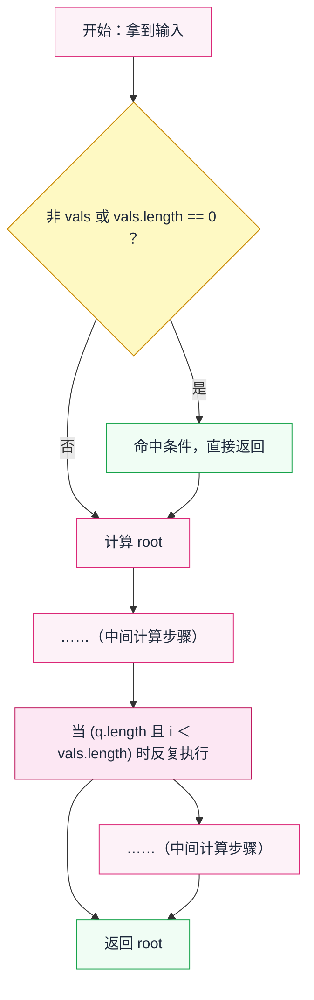

## TypeScript 解题方案（2 个方案逐个讲）

> **运行与提交**：每个方案都是自包含文件（内嵌用例自测，输出 PASS），整块复制到 `.ts` 文件后 `node 文件名` 即可运行。提交 LeetCode 时，把 `demo` 内的算法函数与辅助类型/函数整体取出、置于文件顶层即可。涉及交互/特殊接口的题以题面给定签名为准。

### 方案 1：迭代指针处理

**分析与思路**：核心做法是「迭代指针处理」。代码里依次做这些事：队列或堆的调度。

**运行方式**：`node 本文件`，内嵌用例全部通过会输出 PASS。


**方案专属流程图**（真实控制流）：

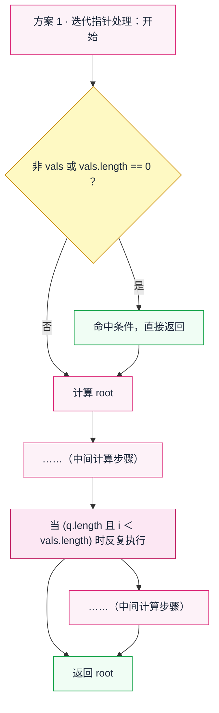

```typescript
class TreeNode {
  // 定义类型
  val: any;
  left: any;
  right: any; // 值: any; 左边界: any; 右边界: any;
  constructor(val?: any, left?: any, right?: any) {
    // constructor(值?: any, 左边界?: any, 右边界?: any) {
    this.val = val === undefined ? 0 : val; // 把 (值 全等于 undefined ? 0 : 值); 写入 值
    this.left = left === undefined ? null : left; // 把 (左边界 全等于 undefined ? null : 左边界); 写入 左边界
    this.right = right === undefined ? null : right; // 把 (右边界 全等于 undefined ? null : 右边界); 写入 右边界
  }
}
function buildTree(vals: any): any {
  // 定义函数/方法 buildTree
  if (!vals || vals.length === 0) return null; // 若 取反 vals 或 vals.长度 全等于 0，直接返回 null
  const root = new TreeNode(vals[0]);
  const q: any[] = [root];
  let i = 1;
  while (q.length && i < vals.length) {
    // 循环，直到不满足「节点.长度 且 下标 i 小于 vals.长度」
    const node = q.shift(); // 把 节点.shift() 存入 节点
    if (vals[i] !== null && vals[i] !== undefined) {
      node.left = new TreeNode(vals[i]);
      q.push(node.left);
    }
    i++; // 下标 i 加一
    if (i < vals.length && vals[i] !== null && vals[i] !== undefined) {
      node.right = new TreeNode(vals[i]);
      q.push(node.right);
    }
    i++; // 下标 i 加一
  }
  return root; // 返回 根节点
}
function treeToLevel(root: any): any[] {
  // 定义函数/方法 treeToLevel
  if (!root) return []; // 若 取反 根节点，直接返回 []
  const out: any[] = [];
  const q: any[] = [root]; // 把 []; const 节点: any[] 赋值为 [根节点]; 写入 const out: any[]
  while (q.length) {
    // 循环，直到不满足「节点.长度」
    const n = q.shift(); // 把 节点.shift() 存入 元素个数
    if (n === null || n === undefined) {
      out.push(null);
      continue;
    }
    out.push(n.val);
    q.push(n.left);
    q.push(n.right); // 把 元素个数.值 压入栈/数组尾部
  }
  while (out.length && out[out.length - 1] === null) out.pop(); // 循环，直到不满足「out.长度 且 out[out.长度 减 1] 全等于 null) out 弹出 );」
  return out; // 返回 out
}
class ListNode {
  // 定义类型
  val: any;
  next: any; // 值: any; 下一个: any;
  constructor(val?: any, next?: any) {
    this.val = val === undefined ? 0 : val;
    this.next = next === undefined ? null : next;
  }
}
function buildList(vals: any): any {
  // 定义函数/方法 buildList
  const dummy = new ListNode(0);
  let cur = dummy; // 把 new ListNode(0); let 当前值 赋值为 哨兵节点 存入 哨兵节点
  for (const v of vals) {
    cur.next = new ListNode(v);
    cur = cur.next;
  } // 把 new ListNode(值); 当前值 赋值为 当前值.下一个; } 写入 下一个
  return dummy.next; // 返回 哨兵节点.下一个
}
function listToArray(head: any): any[] {
  // 定义函数/方法 listToArray
  const out: any[] = [];
  let p = head; // 把 []; let 节点 赋值为 头节点; 写入 const out: any[]
  while (p) {
    out.push(p.val);
    p = p.next;
  } // 循环，直到不满足「节点) { out 追加 节点.值); 节点 赋值为 节点.下一个; }」
  return out; // 返回 out
}
// python-runtime shims
function pyLen(a: any): number {
  // 定义函数/方法 pyLen
  if (a === null || a === undefined) return 0; // 若 数组 全等于 null 或 数组 全等于 undefined，直接返回 0
  if (
    typeof a === 'string' ||
    Array.isArray(a) ||
    a instanceof Set ||
    a instanceof Map
  )
    return a.length ?? a.size;
  if (typeof a === 'object') return Object.keys(a).length; // 若 typeof 数组 全等于 'object'，直接返回 Object.keys(数组).长度
  return 0; // 返回 0
}
function pySlice(a: any, i: any, j: any, step?: any): any {
  // 定义函数/方法 pySlice
  if (typeof a === 'string') {
    const r = [...a].slice(i ?? 0, j ?? a.length);
    return step ? r.reverse().join('') : r.join('');
  }
  const arr = Array.isArray(a) ? a : [...a]; // 把 Array.isArray(数组) ? 数组 : 复制的 数组 存入 数组
  return arr.slice(i ?? 0, j ?? arr.length); // 返回 数组 截取 下标 i ?? 0, 下标 j ?? 数组.长度)
}
function pyRange(a: any, b?: any, step?: any): any[] {
  // 定义函数/方法 pyRange
  let s = 0,
    e = a,
    st = 1; // 把 0, e 赋值为 数组, st 赋值为 1 存入 字符串
  if (b !== undefined) {
    s = a;
    e = b;
  } // 若 b 不等于 undefined) { 字符串 赋值为 数组; e 赋值为 b; }
  if (step !== undefined) st = step; // 若 步数 不等于 undefined) st 赋值为 步数;
  const out: any[] = []; // 把 []; 写入 const out: any[]
  if (st > 0) for (let i = s; i < e; i += st) out.push(i);
  else for (let i = s; i > e; i += st) out.push(i); // 否则
  return out; // 返回 out
}
function pyIn(x: any, coll: any): boolean {
  // 定义函数/方法 pyIn
  if (coll === null || coll === undefined) return false; // 若 coll 全等于 null 或 coll 全等于 undefined，直接返回 false
  if (Array.isArray(coll)) return coll.includes(x); // 若 Array.isArray(coll)，直接返回 coll 是否包含 x)
  if (coll instanceof Set || coll instanceof Map) return coll.has(x); // 若 coll instanceof Set 或 coll instanceof Map，直接返回 coll.has(x)
  if (typeof coll === 'object') return x in coll; // 若 typeof coll 全等于 'object'，直接返回 x in coll
  if (typeof coll === 'string') return coll.indexOf(x) >= 0; // 若 typeof coll 全等于 'string'，直接返回 coll 查找 x) 不低于 0
  return false; // 返回 false
}
function pySorted(a: any): any[] {
  // 定义函数/方法 pySorted
  const arr = typeof a === 'string' ? [...a] : [...a]; // 把 (typeof 数组 全等于 'string') ? 复制的 数组 : 复制的 数组 存入 数组
  return arr.sort((x: any, y: any) => (x < y ? -1 : x > y ? 1 : 0));
}
function pyMin(a: any, b?: any): any {
  if (b !== undefined) return Math.min(a, b);
  if (Array.isArray(a) || a instanceof Set) return Math.min(...a);
  return Math.min(a);
} // 定义函数/方法 pyMin
function pyMax(a: any, b?: any): any {
  if (b !== undefined) return Math.max(a, b);
  if (Array.isArray(a) || a instanceof Set) return Math.max(...a);
  return Math.max(a);
} // 定义函数/方法 pyMax
function pySum(a: any): number {
  let s = 0;
  for (const v of a) s += v;
  return s;
} // 定义函数/方法 pySum
function pyAbs(x: any): number {
  return Math.abs(x);
} // 定义函数/方法 pyAbs
function pyEnumerate(a: any): any[] {
  const out: any[] = [];
  let i = 0;
  for (const v of a) {
    out.push([i, v]);
    i++;
  }
  return out;
} // 定义函数/方法 pyEnumerate
function pyZip(a: any, b: any): any[] {
  const n = Math.min(a.length, b.length);
  const out: any[] = [];
  for (let i = 0; i < n; i++) out.push([a[i], b[i]]);
  return out;
} // 定义函数/方法 pyZip
function pyDictGet(d: any, k: any, def?: any): any {
  return k in d ? d[k] : def === undefined ? null : def;
} // 定义函数/方法 pyDictGet
function pyPrint(...args: any[]): void {
  console.log(
    args
      .map((a) => (typeof a === 'object' && a !== null ? JSON.stringify(a) : a))
      .join(' '),
  );
} // 定义函数/方法 pyPrint
// collections / heapq
function heapPush(h: any[], x: any): void {
  h.push(x);
  let i = h.length - 1;
  while (i > 0) {
    const p = (i - 1) >> 1;
    if (h[p] <= h[i]) break;
    [h[p], h[i]] = [h[i], h[p]];
    i = p;
  }
} // 定义函数/方法 heapPush
function heapPop(h: any[]): any {
  const top = h[0];
  const last = h.pop();
  if (h.length) {
    h[0] = last;
    let i = 0;
    const n = h.length;
    while (true) {
      let l = 2 * i + 1,
        r = 2 * i + 2,
        s = i;
      if (l < n && h[l] < h[s]) s = l;
      if (r < n && h[r] < h[s]) s = r;
      if (s === i) break;
      [h[s], h[i]] = [h[i], h[s]];
      i = s;
    }
  }
  return top;
} // 定义函数/方法 heapPop
class Deque {
  private a: any[] = [];
  push(x: any) {
    this.a.push(x);
  }
  pushLeft(x: any) {
    this.a.unshift(x);
  }
  pop() {
    return this.a.pop();
  }
  popLeft() {
    return this.a.shift();
  }
  get length() {
    return this.a.length;
  }
  toArray() {
    return this.a.slice();
  }
} // 定义类型
function Counter(iter: any): any {
  const m: any = {};
  for (const v of iter) m[v] = (m[v] || 0) + 1;
  return m;
} // 定义函数/方法 Counter
function gcd(a: any, b: any): any {
  while (b) {
    [a, b] = [b, a % b];
  }
  return a;
} // 定义函数/方法 gcd
function pyInf(): number {
  return Infinity;
} // 定义函数/方法 pyInf

function norm(x: any): any {
  // 定义函数/方法 norm
  if (x === null || x === undefined) return null; // 若 x 全等于 null 或 x 全等于 undefined，直接返回 null
  if (typeof x === 'object') {
    // 若 typeof x 全等于 'object'
    if (x instanceof Deque) return x.toArray(); // 若 x instanceof Deque，直接返回 x.toArray()
    if (Array.isArray(x)) return x.map(norm); // 若 Array.isArray(x)，直接返回 x.映射表(norm)
    if (
      typeof x.val === 'number' &&
      (typeof x.left !== 'undefined' || typeof x.right !== 'undefined')
    )
      return treeToLevel(x);
    if (typeof x.next !== 'undefined' && typeof x.val === 'number')
      return listToArray(x);
    if (x instanceof Set) return [...x].sort(); // 若 x instanceof Set，直接返回 复制的 x 排序 )
    if (x instanceof Map) return Object.fromEntries(x); // 若 x instanceof Map，直接返回 Object.fromEntries(x)
    const o: any = {};
    for (const k of Object.keys(x)) o[k] = norm(x[k]);
    return o;
  }
  return x; // 返回 x
}
function eq(a: any, b: any): boolean {
  // 定义函数/方法 eq
  const x = norm(a),
    y = norm(b); // 把 norm(数组), y 赋值为 norm(b) 存入 x
  if (x === y) return true; // 若 x 全等于 y，直接返回 true
  if (x === null || y === null) return x === y; // 若 x 全等于 null 或 y 全等于 null，直接返回 x 全等于 y
  if (Array.isArray(x) && Array.isArray(y)) {
    // 若 Array.isArray(x) 且 Array.isArray(y
    if (x.length !== y.length) return false; // 若 x.长度 不等于 y.长度，直接返回 false
    for (let i = 0; i < x.length; i++) if (!eq(x[i], y[i])) return false; // 让 下标 i 从 0 开始计数，下标 i 小于 x.长度 就继续
    return true; // 返回 true
  }
  if (typeof x === 'object' && typeof y === 'object') {
    // 若 typeof x 全等于 'object' 且 typeof y 全等于 'object'
    const kx = Object.keys(x),
      ky = Object.keys(y); // 把 Object.keys(x), ky 赋值为 Object.keys(y) 存入 kx
    if (kx.length !== ky.length) return false; // 若 kx.长度 不等于 ky.长度，直接返回 false
    for (const k of kx) if (!eq(x[k], y[k])) return false;
    return true; // 返回 true
  }
  return x === y; // 返回 x 全等于 y
}

class TrieNode {
  // 定义类型
  children: any;
  isEnd: boolean; // children: any; isEnd: boolean;
  constructor() {
    this.children = {};
    this.isEnd = false;
  }
}
class Trie {
  // 定义类型
  root: any; // 根节点: any;
  constructor() {
    this.root = new TrieNode();
  } // 把 new TrieNode(); } 写入 根节点
  insert(word) {
    // insert(单词) {
    let node = this.root; // 把 this.根节点 存入 节点
    for (const ch of word) {
      if (!node.children[ch]) node.children[ch] = new TrieNode();
      node = node.children[ch];
    }
    node.isEnd = true; // 把 true; 写入 node.isEnd
  }
  search(word) {
    // search(单词) {
    let node = this.root; // 把 this.根节点 存入 节点
    for (const ch of word) {
      if (!node.children[ch]) return false;
      node = node.children[ch];
    }
    return node.isEnd; // 返回 节点.isEnd
  }
  startsWith(prefix) {
    // startsWith(prefix) {
    let node = this.root; // 把 this.根节点 存入 节点
    for (const ch of prefix) {
      if (!node.children[ch]) return false;
      node = node.children[ch];
    }
    return true; // 返回 true
  }
}
export function demo(): void {
  // 程序入口：跑内嵌自测用例
  const t = new Trie(); // 把 new Trie() 存入 另一字符串
  t.insert('apple'); // 另一字符串 插入 「apple」);
  const cases = [
    { in: ['search', 'apple'], want: true },
    { in: ['search', 'app'], want: false },
    { in: ['startsWith', 'app'], want: true },
    { in: ['search', 'appl'], want: false },
  ];
  let fail = false; // 把 false 存入 fail
  for (const c of cases) {
    // for (const 字符 of cases) {
    const got = t[c.in[0]](c.in[1]); // 把 另一字符串[字符.in[0]](字符.in[1]) 存入 got
    if (got !== c.want) {
      fail = true;
      console.log('FAIL', c, '=>', got);
    }
  }
  if (fail) throw new Error('FAILED'); // 若 fail) throw new Error(「FAILED」);
  console.log('PASS'); // 全部用例通过，输出 PASS
}
demo(); // demo();
```

### 方案 2：直接实现

**分析与思路**：核心做法是「直接实现」。

**运行方式**：`node 本文件`，内嵌用例全部通过会输出 PASS。


**方案专属流程图**（真实控制流）：

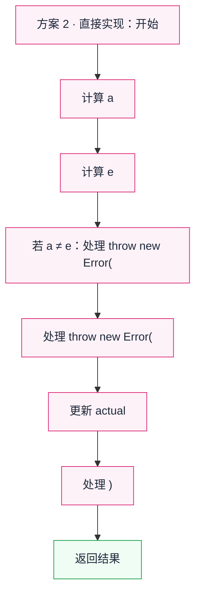

```typescript
function assertEq(actual: any, expected: any, msg: string = ''): void {
  // 定义函数/方法 assertEq
  const a = JSON.stringify(actual); // 把 JSON.stringify(actual) 存入 数组
  const e = JSON.stringify(expected); // 把 JSON.stringify(expected) 存入 e
  if (a !== e)
    throw new Error(
      'ASSERT FAILED ' + msg + ' :: actual=' + a + ' expected=' + e,
    );
}

class Trie {
  // 定义类型
  root: Record<string, any>; // 根节点: Record 小于 string, any 超过 ;
  constructor() {
    this.root = {};
  } // 把 {}; } 写入 根节点
  insert(word: string): void {
    // insert(单词: string): void {
    let node = this.root; // 把 this.根节点 存入 节点
    for (const ch of word) {
      // for (const 字符 of 单词) {
      if (!(ch in node)) node[ch] = {}; // 若 取反 (字符 in 节点)) 节点[字符] 赋值为 {};
      node = node[ch]; // 把 节点[字符] 存入 节点
    }
    node['end'] = true; // 把 true; 写入 node['end']
  }
  search(word: string): boolean {
    // search(单词: string): boolean {
    const node = this.startsWith(word); // 把 this.startsWith(单词) 存入 节点
    return node !== false && 'end' in node && node['end'] === true; // 返回 节点 不等于 false 且 '终点' in 节点 且 节点['终点'] 全等于 true
  }
  startsWith(prefix: string): any {
    // startsWith(prefix: string): any {
    let node = this.root; // 把 this.根节点 存入 节点
    for (const ch of prefix) {
      // for (const 字符 of prefix) {
      if (!(ch in node)) return false; // 若 取反 (字符 in 节点)，直接返回 false
      node = node[ch]; // 把 节点[字符] 存入 节点
    }
    return node; // 返回 节点
  }
}
export function demo(): void {
  // 程序入口：跑内嵌自测用例
  const trie = new Trie(); // 把 new Trie() 存入 trie
  trie.insert('apple'); // trie 插入 「apple」);
  assertEq(trie.search('apple'), true, 'search apple'); // 断言校验
  assertEq(trie.search('app'), false, 'search app'); // 断言校验
  assertEq(
    trie.startsWith('app'),
    { l: { e: { end: true } } },
    'startsWith app',
  ); // 断言校验
  trie.insert('app'); // trie 插入 「app」);
  assertEq(trie.search('app'), true, 'search app after insert'); // 断言校验
  console.log('PASS'); // 全部用例通过，输出 PASS
}
demo(); // demo();
```

## 逐步拆解与面试追问

**复杂度**：时间 O(n)（单趟线性扫描），空间 O(1) 到 O(n)（视辅助结构）

**为什么是这个量级**：每个元素被常数次访问，辅助哈希或栈的开销与 n 同阶

**面试官可能会追问**：

- 什么时候用堆而不是排序？
- 堆里存值还是存下标？
- Top-K 用小顶还是大顶堆？

## 关键 API 速查（TS 主解法实际用到，附官方链接）

| API | 作用 | 使用要点 | 官方文档 |
|---|---|---|---|
| `Array.prototype.sort()` | 原地排序 | 默认按字符串 Unicode 序（10 会排在 2 前），数字必须传 (a,b)=>a-b；V8 用 TimSort，稳定，O(n log n)；返回原数组引用 | [官方文档](https://developer.mozilla.org/zh-CN/docs/Web/JavaScript/Reference/Global_Objects/Array/sort) |
| `Array.prototype.map()` | 逐元素映射为新数组 | 回调 (v,i,arr)；返回等长新数组，不改变原数组；稀疏位跳过；链式调用注意中间数组开销 | [官方文档](https://developer.mozilla.org/zh-CN/docs/Web/JavaScript/Reference/Global_Objects/Array/map) |
| `Array.prototype.push()` | 尾部追加 | 返回新长度；可一次多个；均摊 O(1)；会改变原数组 | [官方文档](https://developer.mozilla.org/zh-CN/docs/Web/JavaScript/Reference/Global_Objects/Array/push) |
| `Array.prototype.pop()` | 尾部弹出 | 返回被删元素（空数组返回 undefined）；O(1) | [官方文档](https://developer.mozilla.org/zh-CN/docs/Web/JavaScript/Reference/Global_Objects/Array/pop) |
| `Array.prototype.shift()` | 头部取出 | O(n)（后续元素整体前移）；大量头部操作请用链表或双端结构 | [官方文档](https://developer.mozilla.org/zh-CN/docs/Web/JavaScript/Reference/Global_Objects/Array/shift) |
| `Array.prototype.unshift()` | 头部插入 | O(n)；与 shift 组合可当双端队列 | [官方文档](https://developer.mozilla.org/zh-CN/docs/Web/JavaScript/Reference/Global_Objects/Array/unshift) |
| `Array/String includes()` | 是否包含 | 数组用 SameValueZero（NaN 可判）；字符串按子串；第二个参数为起始下标 | [官方文档](https://developer.mozilla.org/zh-CN/docs/Web/JavaScript/Reference/Global_Objects/Array/includes) |
| `Array/String indexOf()` | 首次出现的下标 | 找不到返回 -1；无法判 NaN（用 includes）；字符串可传起始位 | [官方文档](https://developer.mozilla.org/zh-CN/docs/Web/JavaScript/Reference/Global_Objects/Array/indexOf) |
| `Array/String slice()` | 切片（不改原数组） | slice(start,end) 含头不含尾；负数从尾计；常用于复制数组（slice()） | [官方文档](https://developer.mozilla.org/zh-CN/docs/Web/JavaScript/Reference/Global_Objects/Array/slice) |
| `Array.prototype.join()` | 数组拼接为字符串 | undefined/null 转空串；嵌套数组会展平一层；join('') 用于字符数组还原 | [官方文档](https://developer.mozilla.org/zh-CN/docs/Web/JavaScript/Reference/Global_Objects/Array/join) |
| `Object.keys()` | 对象键名数组 | 仅自身可枚举字符串键（不含 symbol）；配 length 可当计数器 | [官方文档](https://developer.mozilla.org/zh-CN/docs/Web/JavaScript/Reference/Global_Objects/Object/keys) |
| `Object.fromEntries()` | 键值对数组转对象 | 参数为 [k,v] 可迭代；map 出来的键值对可直接转对象 | [官方文档](https://developer.mozilla.org/zh-CN/docs/Web/JavaScript/Reference/Global_Objects/Object/fromEntries) |
| `JSON.stringify()` | 序列化为 JSON 字符串 | 常用于结构化比较（深度相等判定）；undefined/函数/循环引用会被丢弃或抛错 | [官方文档](https://developer.mozilla.org/zh-CN/docs/Web/JavaScript/Reference/Global_Objects/JSON/stringify) |
| `Math.max()` | 最大值 | 配展开 Math.max(...arr)；空参返回 -Infinity；超大数组注意展开参数上限 | [官方文档](https://developer.mozilla.org/zh-CN/docs/Web/JavaScript/Reference/Global_Objects/Math/max) |
| `Math.min()` | 最小值 | 同 max；空参返回 Infinity | [官方文档](https://developer.mozilla.org/zh-CN/docs/Web/JavaScript/Reference/Global_Objects/Math/min) |
| `Math.abs()` | 绝对值 | 入参会被隐式转数字；-0 返回 +0 | [官方文档](https://developer.mozilla.org/zh-CN/docs/Web/JavaScript/Reference/Global_Objects/Math/abs) |

### 各语言官方文档导航

- **TypeScript / JS**：[MDN 中文参考](https://developer.mozilla.org/zh-CN/)
- **Python**：[Python 官方文档](https://docs.python.org/zh-cn/3/)
- **Go**：[Go 标准库](https://pkg.go.dev/std)
- **Java**：[JDK 17 API](https://docs.oracle.com/en/java/javase/17/docs/api/)
- **Rust**：[Rust 标准库](https://doc.rust-lang.org/std/)
- **Lua**：[Lua 5.4 手册](https://www.lua.org/manual/5.4/)
- **C**：[Cppreference C](https://zh.cppreference.com/w/c)
- **C++**：[Cppreference C++](https://zh.cppreference.com/w/cpp)
- **R**：[R 官方手册](https://stat.ethz.ch/R-manual/)
- **Zig**：[Zig 语言文档](https://ziglang.org/documentation/master/)
- **Dart**：[Dart API](https://api.dart.dev/)

## 附录：其他 10 种语言全部实现（每种语言列举其全部方案）

> TypeScript 的全部方案见「TypeScript 解题方案」一节；下面是其余 10 种语言的对应实现，每种语言的每个方案都带思路分析、代码走读与专属运行架构图。
> 每个方案都内嵌用例自测，可独立运行（老仓库 python/go 文件遵循「打印结果」约定）。
> 完整解法文件见 `dsa/<语言>/heap/lc_208_实现_trie_(前缀树)/`。

### Python 实现（2 种方案）

Python 的全部方案如下，每个方案都内嵌用例自测，可独立运行（老仓库 python/go 文件遵循「打印结果」约定）：

#### 方案 1：迭代指针处理

**思路与代码分析**：核心是「迭代指针处理」。Python 版用切片与字典推导式简化操作，突出可读性。

**运行架构**（真实控制流）：

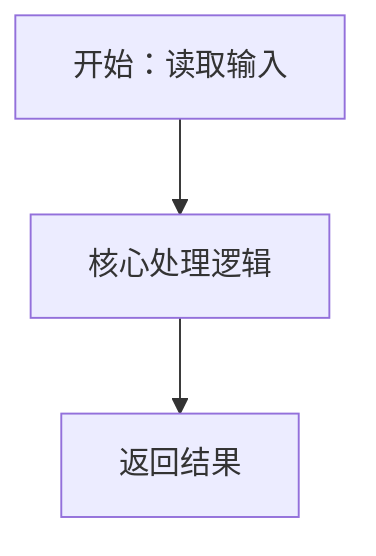

```python
import sys  # 提高递归深度上限（深输入防 RecursionError）

sys.setrecursionlimit(200000)  # 树/链表类题目节点数可达 1e4 量级

class TrieNode:  # 定义类
    def __init__(self):  # 构造函数：初始化成员
        self.children = {}  # 把 {} 写入 self.children
        self.is_end = False  # 把 False 写入 self.is_end

class Trie:  # 定义类
    def __init__(self):  # 构造函数：初始化成员
        self.root = TrieNode()  # 把 TrieNode() 写入 根节点

    def insert(self, word):  # 定义函数 insert（参数：self, 单词）
        node = self.root  # 把 self.根节点 存入 节点
        for ch in word:  # 逐个取出 单词 的元素（字符）
            if ch not in node.children:  # 若 字符 not in 节点.children
                node.children[ch] = TrieNode()  # 把 TrieNode() 写入 node.children[ch]
            node = node.children[ch]  # 把 节点.children[字符] 存入 节点
        node.is_end = True  # 把 True 写入 node.is_end

    def search(self, word):  # 定义函数 search（参数：self, 单词）
        node = self._search_prefix(word)  # 把 self._search_prefix(单词) 存入 节点
        return node is not None and node.is_end  # 返回 节点 is not None and 节点.is_end

    def startsWith(self, prefix):  # 定义函数 startsWith（参数：self, prefix）
        return self._search_prefix(prefix) is not None  # 返回 self._search_prefix(prefix) is not None

    def _search_prefix(self, prefix):  # 定义函数 _search_prefix（参数：self, prefix）
        node = self.root  # 把 self.根节点 存入 节点
        for ch in prefix:  # 逐个取出 prefix 的元素（字符）
            if ch not in node.children:  # 若 字符 not in 节点.children
                return None  # 返回 None
            node = node.children[ch]  # 把 节点.children[字符] 存入 节点
        return node  # 返回 节点

if __name__ == "__main__":  # 若 __name__ 等于 '__main__'
    trie = Trie()  # 把 Trie() 存入 trie
    trie.insert("apple")  # trie 插入 「apple」)
    print(trie.search("apple"))  # True
    print(trie.search("app"))  # False
    print(trie.startsWith("app"))  # True
    trie.insert("app")  # trie 插入 「app」)
    print(trie.search("app"))  # True
```

#### 方案 2：直接实现

**思路与代码分析**：核心是「直接实现」。Python 版用切片与字典推导式简化操作，突出可读性。

**运行架构**：与方案 1 的控制流相同（同算法在该语言的等价实现），图见上。

```python
import sys  # 提高递归深度上限（深输入防 RecursionError）

sys.setrecursionlimit(200000)  # 树/链表类题目节点数可达 1e4 量级

class Trie:  # 定义类
    def __init__(self):  # 构造函数：初始化成员
        self.root = {}  # 把 {} 写入 根节点

    def insert(self, word):  # 定义函数 insert（参数：self, 单词）
        node = self.root  # 把 self.根节点 存入 节点
        for ch in word:  # 逐个取出 单词 的元素（字符）
            if ch not in node:  # 若 字符 not in 节点
                node[ch] = {}  # 把 {} 写入 node[ch]
            node = node[ch]  # 把 节点[字符] 存入 节点
        node["end"] = True  # 把 True 写入 node['end']

    def search(self, word):  # 定义函数 search（参数：self, 单词）
        node = self.startsWith(word)  # 把 self.startsWith(单词) 存入 节点
        return (
            node is not False and "end" in node and node["end"] is True
        )  # 返回 节点 is not False and '终点' in 节点 and 节点['终点'] is True

    def startsWith(self, prefix):  # 定义函数 startsWith（参数：self, prefix）
        node = self.root  # 把 self.根节点 存入 节点
        for ch in prefix:  # 逐个取出 prefix 的元素（字符）
            if ch not in node:  # 若 字符 not in 节点
                return False  # 返回 False
            node = node[ch]  # 把 节点[字符] 存入 节点
        return node  # 返回 节点

if __name__ == "__main__":  # 若 __name__ 等于 '__main__'
    trie = Trie()  # 把 Trie() 存入 trie
    trie.insert("apple")  # trie 插入 「apple」)
    print(trie.search("apple"))  # True
    print(trie.search("app"))  # False
    print(trie.startsWith("app"))  # True
    trie.insert("app")  # trie 插入 「app」)
    print(trie.search("app"))  # True
```

### Go 实现（2 种方案）

Go 的全部方案如下，每个方案都内嵌用例自测，可独立运行（老仓库 python/go 文件遵循「打印结果」约定）：

#### 方案 1：迭代指针处理

**思路与代码分析**：核心是「迭代指针处理」。Go 版用切片与多返回值惯用法，显式处理索引边界。代码里依次做这些事：哈希结构做计数或查重。**走读**：方案 1 · 迭代指针处理：开始 → 返回 &Trie。

**运行架构**（真实控制流）：

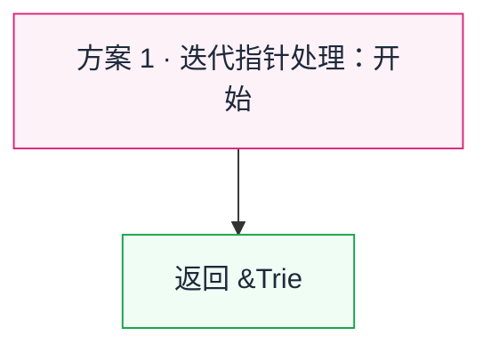

```go
package main // 引入依赖

import (
	"fmt"
	"os"
) // 引入依赖

type TrieNode struct { // 定义类型
	children map[rune]*TrieNode // children 映射表[rune] 乘 TrieNode
	isEnd    bool               // isEnd bool
}

type Trie struct { // 定义类型
	root *TrieNode // 根节点 乘 TrieNode
}

func NewTrie() *Trie { // 定义函数/方法 NewTrie
	return &Trie{root: &TrieNode{children: map[rune]*TrieNode{}}}
}

func (t *Trie) insert(word string) { // 定义函数/方法 insert
	node := t.root            // 把 另一字符串.根节点 写入 node :
	for _, ch := range word { // 同时取 _ 与 字符 遍历
		if _, ok := node.children[ch]; !ok { // 若 _, ok : 赋值为 节点.children[字符]; 取反 ok
			node.children[ch] = &TrieNode{children: map[rune]*TrieNode{}}
		}
		node = node.children[ch] // 把 节点.children[字符] 写入 节点
	}
	node.isEnd = true // 把 true 写入 node.isEnd
}

func (t *Trie) searchPrefix(prefix string) *TrieNode { // 定义函数/方法 searchPrefix
	node := t.root              // 把 另一字符串.根节点 写入 node :
	for _, ch := range prefix { // 同时取 _ 与 字符 遍历
		n, ok := node.children[ch] // 把 节点.children[字符] 写入 n, ok :
		if !ok {                   // 若 取反 ok
			return nil // 返回 nil
		}
		node = n // 把 元素个数 写入 节点
	}
	return node // 返回 节点
}

func (t *Trie) search(word string) bool { // 定义函数/方法 search
	node := t.searchPrefix(word)     // 把 另一字符串.searchPrefix(单词) 写入 node :
	return node != nil && node.isEnd // 返回 节点 不等于 nil 且 节点.isEnd
}

func (t *Trie) startsWith(prefix string) bool { // 定义函数/方法 startsWith
	return t.searchPrefix(prefix) != nil // 返回 另一字符串.searchPrefix(prefix) 不等于 nil
}

func main() { // 程序入口：跑内嵌自测用例
	ok := true                 // 把 true 写入 ok :
	trie := NewTrie()          // 把 NewTrie() 写入 trie :
	trie.insert("apple")       // trie 插入 「apple」)
	if !trie.search("apple") { // 若 取反 trie.search(「apple」
		ok = false                       // 把 false 写入 ok
		fmt.Println("FAIL search apple") // 打印输出
	}
	if trie.search("app") { // 若 trie.search(「app」
		ok = false                     // 把 false 写入 ok
		fmt.Println("FAIL search app") // 打印输出
	}
	if !trie.startsWith("app") { // 若 取反 trie.startsWith(「app」
		ok = false                         // 把 false 写入 ok
		fmt.Println("FAIL startsWith app") // 打印输出
	}
	trie.insert("app")       // trie 插入 「app」)
	if !trie.search("app") { // 若 取反 trie.search(「app」
		ok = false                      // 把 false 写入 ok
		fmt.Println("FAIL search app2") // 打印输出
	}
	if !ok { // 若 取反 ok
		os.Exit(1) // os.Exit(1)
	}
	fmt.Println("PASS") // 全部用例通过，输出 PASS
}
```

#### 方案 2：直接实现

**思路与代码分析**：核心是「直接实现」。Go 版用切片与多返回值惯用法，显式处理索引边界。代码里依次做这些事：哈希结构做计数或查重。**走读**：方案 2 · 直接实现：开始 → 返回 &Trie。

**运行架构**（真实控制流）：

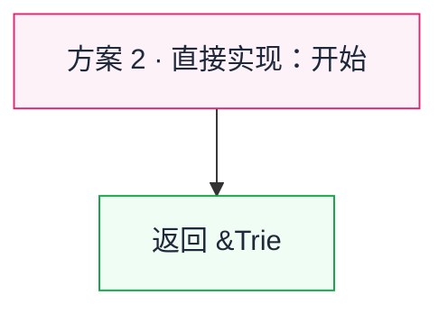

```go
package main // 引入依赖

import (
	"fmt"
	"os"
) // 引入依赖

type TrieNode struct { // 定义类型
	children map[rune]*TrieNode // children 映射表[rune] 乘 TrieNode
	isEnd    bool               // isEnd bool
}

type Trie struct { // 定义类型
	root *TrieNode // 根节点 乘 TrieNode
}

func NewTrie() *Trie { // 定义函数/方法 NewTrie
	return &Trie{root: &TrieNode{children: map[rune]*TrieNode{}}}
}

func (t *Trie) insert(word string) { // 定义函数/方法 insert
	node := t.root            // 把 另一字符串.根节点 写入 node :
	for _, ch := range word { // 同时取 _ 与 字符 遍历
		key := ch                             // 把 字符 写入 key :
		if _, ok := node.children[key]; !ok { // 若 _, ok : 赋值为 节点.children[key]; 取反 ok
			node.children[key] = &TrieNode{children: map[rune]*TrieNode{}}
		}
		node = node.children[key] // 把 节点.children[key] 写入 节点
	}
	node.isEnd = true // 把 true 写入 node.isEnd
}

func (t *Trie) searchPrefix(prefix string) *TrieNode { // 定义函数/方法 searchPrefix
	node := t.root              // 把 另一字符串.根节点 写入 node :
	for _, ch := range prefix { // 同时取 _ 与 字符 遍历
		n, ok := node.children[ch] // 把 节点.children[字符] 写入 n, ok :
		if !ok {                   // 若 取反 ok
			return nil // 返回 nil
		}
		node = n // 把 元素个数 写入 节点
	}
	return node // 返回 节点
}

func (t *Trie) search(word string) bool { // 定义函数/方法 search
	node := t.searchPrefix(word)     // 把 另一字符串.searchPrefix(单词) 写入 node :
	return node != nil && node.isEnd // 返回 节点 不等于 nil 且 节点.isEnd
}

func (t *Trie) startsWith(prefix string) bool { // 定义函数/方法 startsWith
	return t.searchPrefix(prefix) != nil // 返回 另一字符串.searchPrefix(prefix) 不等于 nil
}

func main() { // 程序入口：跑内嵌自测用例
	ok := true                 // 把 true 写入 ok :
	trie := NewTrie()          // 把 NewTrie() 写入 trie :
	trie.insert("apple")       // trie 插入 「apple」)
	if !trie.search("apple") { // 若 取反 trie.search(「apple」
		ok = false                       // 把 false 写入 ok
		fmt.Println("FAIL search apple") // 打印输出
	}
	if trie.search("app") { // 若 trie.search(「app」
		ok = false                     // 把 false 写入 ok
		fmt.Println("FAIL search app") // 打印输出
	}
	if !trie.startsWith("app") { // 若 取反 trie.startsWith(「app」
		ok = false                         // 把 false 写入 ok
		fmt.Println("FAIL startsWith app") // 打印输出
	}
	trie.insert("app")       // trie 插入 「app」)
	if !trie.search("app") { // 若 取反 trie.search(「app」
		ok = false                      // 把 false 写入 ok
		fmt.Println("FAIL search app2") // 打印输出
	}
	if !ok { // 若 取反 ok
		os.Exit(1) // os.Exit(1)
	}
	fmt.Println("PASS") // 全部用例通过，输出 PASS
}
```

### Java 实现（2 种方案）

Java 的全部方案如下，每个方案都内嵌用例自测，可独立运行（老仓库 python/go 文件遵循「打印结果」约定）：

#### 方案 1：迭代指针处理

**思路与代码分析**：核心是「迭代指针处理」。Java 版用类与静态方法组织，集合操作显式明了。**走读**：方案 1 · 迭代指针处理：开始 → 更新 node → 返回 node ≠ null 且 node.isEnd。

**运行架构**（真实控制流）：

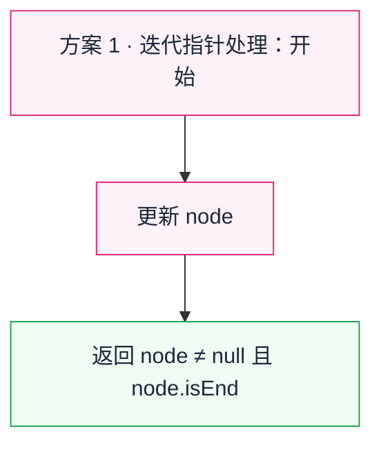

```java
package com.webfault.dsa; // 引入依赖

import java.util.*; // 引入依赖

class lc208_solution111 { // 定义类型
  static class TrieNode { // static class TrieNode {
    Map<Character, TrieNode> children =
        new HashMap<>(); // 把 new HashMap 小于 超过 (); 写入 Map<Character, TrieNode> children
    boolean isEnd = false; // 把 false; 写入 boolean isEnd
  }

  static class Trie { // static class Trie {
    TrieNode root = new TrieNode(); // 把 new TrieNode(); 写入 TrieNode root

    void insert(String word) { // 定义函数/方法 insert
      TrieNode node = root; // 把 根节点; 写入 TrieNode node
      for (char ch : word.toCharArray()) { // for (char 字符 : 单词.toCharArray()) {
        node.children.putIfAbsent(
            ch, new TrieNode()); // 节点.children.putIfAbsent(字符, new TrieNode());
        node = node.children.get(ch); // 把 节点.children 查找 字符); 写入 节点
      }
      node.isEnd = true; // 把 true; 写入 node.isEnd
    }

    boolean search(String word) { // 定义函数/方法 search
      TrieNode node = searchPrefix(word); // 把 searchPrefix(单词); 写入 TrieNode node
      return node != null && node.isEnd; // 返回 节点 不等于 null 且 节点.isEnd
    }

    boolean startsWith(String prefix) { // 定义函数/方法 startsWith
      return searchPrefix(prefix) != null; // 返回 searchPrefix(prefix) 不等于 null
    }

    TrieNode searchPrefix(String prefix) { // 定义函数/方法 searchPrefix
      TrieNode node = root; // 把 根节点; 写入 TrieNode node
      for (char ch : prefix.toCharArray()) { // for (char 字符 : prefix.toCharArray()) {
        if (!node.children.containsKey(ch))
          return null; // 若 取反 节点.children.containsKey(字符)，直接返回 null
        node = node.children.get(ch); // 把 节点.children 查找 字符); 写入 节点
      }
      return node; // 返回 节点
    }
  }

  public static void main(String[] args) { // public static void main(String[] args) {
    Trie trie = new Trie(); // 把 new Trie(); 写入 Trie trie
    trie.insert("apple"); // trie 插入 「apple」);
    if (!trie.search("apple")) throw new RuntimeException("FAILED search apple");
    if (trie.search("app"))
      throw new RuntimeException(
          "FAILED search app"); // 若 trie.search(「app」)) throw new RuntimeException(「app」);
    if (!trie.startsWith("app")) throw new RuntimeException("FAILED startsWith app");
    trie.insert("app"); // trie 插入 「app」);
    if (!trie.search("app"))
      throw new RuntimeException(
          "FAILED search app2"); // 若 取反 trie.search(「app」)) throw new RuntimeException(「app」);
    System.out.println("PASS"); // 全部用例通过，输出 PASS
  }
}
```

#### 方案 2：直接实现

**思路与代码分析**：核心是「直接实现」。Java 版用类与静态方法组织，集合操作显式明了。**走读**：方案 2 · 直接实现：开始 → 更新 node → 调用 startsWithNode(word) → 返回 node ≠ null 且 node.containsKey(end) 且 Boolean.TRUE.equals(node.get(end))。

**运行架构**（真实控制流）：

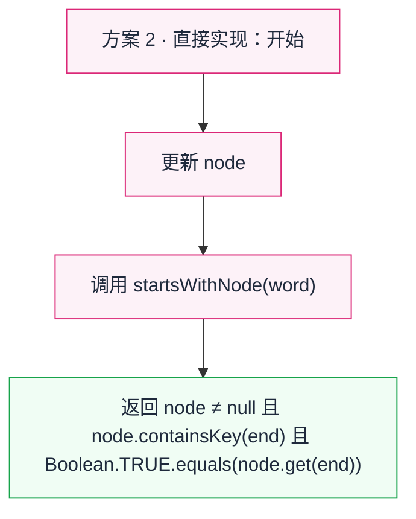

```java
package com.webfault.dsa; // 引入依赖

import java.util.*; // 引入依赖

class lc208_solution222 { // 定义类型
  static class Trie { // static class Trie {
    Map<String, Object> root =
        new HashMap<>(); // 把 new HashMap 小于 超过 (); 写入 Map<String, Object> root

    void insert(String word) { // 定义函数/方法 insert
      Map<String, Object> node = root; // 把 根节点; 写入 Map<String, Object> node
      for (char ch : word.toCharArray()) { // for (char 字符 : 单词.toCharArray()) {
        String s = String.valueOf(ch); // 把 String.valueOf(字符) 存入 字符串
        if (!node.containsKey(s)) node.put(s, new HashMap<String, Object>());
        node = (Map<String, Object>) node.get(s); // 把 (Map 小于 String, Object 超过 ) 节点 查找 字符串); 写入 节点
      }
      node.put("end", true); // 节点.put(「终点」, true);
    }

    boolean search(String word) { // 定义函数/方法 search
      Map<String, Object> node =
          startsWithNode(word); // 把 startsWithNode(单词); 写入 Map<String, Object> node
      return node != null && node.containsKey("end") && Boolean.TRUE.equals(node.get("end"));
    }

    boolean startsWith(String prefix) { // 定义函数/方法 startsWith
      return startsWithNode(prefix) != null; // 返回 startsWithNode(prefix) 不等于 null
    }

    Map<String, Object> startsWithNode(
        String prefix) { // Map 小于 String, Object 超过 startsWithNode(String prefix) {
      Map<String, Object> node = root; // 把 根节点; 写入 Map<String, Object> node
      for (char ch : prefix.toCharArray()) { // for (char 字符 : prefix.toCharArray()) {
        String s = String.valueOf(ch); // 把 String.valueOf(字符) 存入 字符串
        if (!node.containsKey(s)) return null; // 若 取反 节点.containsKey(字符串)，直接返回 null
        node = (Map<String, Object>) node.get(s); // 把 (Map 小于 String, Object 超过 ) 节点 查找 字符串); 写入 节点
      }
      return node; // 返回 节点
    }
  }

  public static void main(String[] args) { // public static void main(String[] args) {
    Trie trie = new Trie(); // 把 new Trie(); 写入 Trie trie
    trie.insert("apple"); // trie 插入 「apple」);
    if (!trie.search("apple")) throw new RuntimeException("FAILED search apple");
    if (trie.search("app"))
      throw new RuntimeException(
          "FAILED search app"); // 若 trie.search(「app」)) throw new RuntimeException(「app」);
    if (!trie.startsWith("app")) throw new RuntimeException("FAILED startsWith app");
    trie.insert("app"); // trie 插入 「app」);
    if (!trie.search("app"))
      throw new RuntimeException(
          "FAILED search app2"); // 若 取反 trie.search(「app」)) throw new RuntimeException(「app」);
    System.out.println("PASS"); // 全部用例通过，输出 PASS
  }
}
```

### Rust 实现（2 种方案）

Rust 的全部方案如下，每个方案都内嵌用例自测，可独立运行（老仓库 python/go 文件遵循「打印结果」约定）：

#### 方案 1：迭代指针处理

**思路与代码分析**：核心是「迭代指针处理」。Rust 版用所有权移动与切片借用改写同一逻辑，注意 Option 与引用边界。代码里依次做这些事：哈希结构做计数或查重。**走读**：方案 1 · 迭代指针处理：开始 → 处理 TrieNode → 处理 children: HashMap::new(), → 处理 is_end: false, → 返回结果。

**运行架构**（真实控制流）：

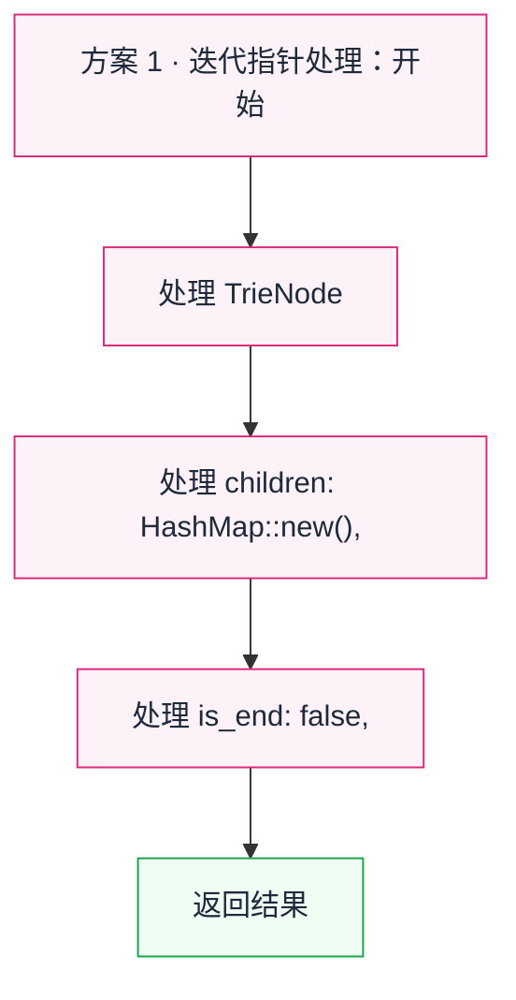

```rust
// LeetCode 208. 实现 Trie (前缀树) — Rust 版（方案1）
use std::collections::HashMap; // 引入依赖
struct TrieNode {
    children: HashMap<char, Box<TrieNode>>,
    is_end: bool,
} // 定义类型
impl TrieNode {
    fn new() -> Self {
        TrieNode {
            children: HashMap::new(),
            is_end: false,
        }
    }
} // 定义函数/方法 new
struct Trie {
    root: TrieNode,
} // 定义类型
impl Trie {
    // 实现块
    fn new() -> Self {
        Trie {
            root: TrieNode::new(),
        }
    } // 定义函数/方法 new
    fn insert(&mut self, word: &str) {
        // 定义函数/方法 insert
        let mut node = &mut self.root; // 把 按位与 mut self.根节点; 写入 let mut node
        for ch in word.chars() {
            // 逐个取出 单词 的元素（字符）
            node = node
                .children
                .entry(ch)
                .or_insert_with(|| Box::new(TrieNode::new()))
                .as_mut();
        }
        node.is_end = true; // 把 true; 写入 node.is_end
    }
    fn search(&self, word: &str) -> bool {
        // 定义函数/方法 search
        let mut node = &self.root; // 把 按位与 self.根节点; 写入 let mut node
        for ch in word.chars() {
            // 逐个取出 单词 的元素（字符）
            match node.children.get(&ch) {
                Some(n) => node = n,
                None => return false,
            } // 按情况匹配处理
        }
        node.is_end // 节点.is_end
    }
    fn starts_with(&self, prefix: &str) -> bool {
        // 定义函数/方法 starts_with
        let mut node = &self.root; // 把 按位与 self.根节点; 写入 let mut node
        for ch in prefix.chars() {
            // 逐个取出 prefix 的元素（字符）
            match node.children.get(&ch) {
                Some(n) => node = n,
                None => return false,
            } // 按情况匹配处理
        }
        true // true
    }
}
fn main() {
    // 程序入口：跑内嵌自测用例
    let mut t = Trie::new(); // 把 Trie::new(); 写入 let mut t
    t.insert("apple"); // 另一字符串 插入 「apple」);
    assert!(t.search("apple")); // 断言校验
    assert!(!t.search("app")); // 断言校验
    assert!(t.starts_with("app")); // 断言校验
    assert!(!t.search("appl")); // 断言校验
    println!("PASS"); // 全部用例通过，输出 PASS
}
```

#### 方案 2：直接实现

**思路与代码分析**：核心是「直接实现」。Rust 版用所有权移动与切片借用改写同一逻辑，注意 Option 与引用边界。代码里依次做这些事：哈希结构做计数或查重。**走读**：方案 2 · 直接实现：开始 → 处理 TrieNode → 处理 children: HashMap::new(), → 处理 is_end: false, → 返回结果。

**运行架构**（真实控制流）：

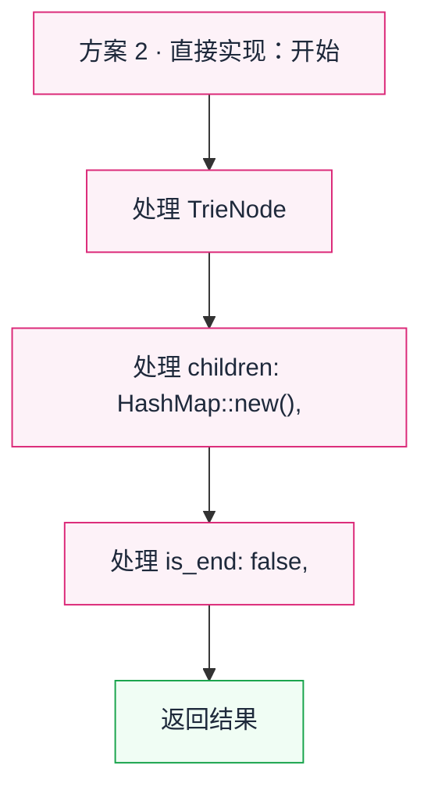

```rust
// LeetCode 208. 实现 Trie (前缀树) — Rust 版（方案2）
use std::collections::HashMap; // 引入依赖
struct TrieNode {
    children: HashMap<char, Box<TrieNode>>,
    is_end: bool,
} // 定义类型
impl TrieNode {
    fn new() -> Self {
        TrieNode {
            children: HashMap::new(),
            is_end: false,
        }
    }
} // 定义函数/方法 new
struct Trie {
    root: TrieNode,
} // 定义类型
impl Trie {
    // 实现块
    fn new() -> Self {
        Trie {
            root: TrieNode::new(),
        }
    } // 定义函数/方法 new
    fn insert(&mut self, word: &str) {
        // 定义函数/方法 insert
        let mut node = &mut self.root; // 把 按位与 mut self.根节点; 写入 let mut node
        for ch in word.chars() {
            // 逐个取出 单词 的元素（字符）
            node = node
                .children
                .entry(ch)
                .or_insert_with(|| Box::new(TrieNode::new()))
                .as_mut();
        }
        node.is_end = true; // 把 true; 写入 node.is_end
    }
    fn search(&self, word: &str) -> bool {
        // 定义函数/方法 search
        let mut node = &self.root; // 把 按位与 self.根节点; 写入 let mut node
        for ch in word.chars() {
            // 逐个取出 单词 的元素（字符）
            match node.children.get(&ch) {
                Some(n) => node = n,
                None => return false,
            } // 按情况匹配处理
        }
        node.is_end // 节点.is_end
    }
    fn starts_with(&self, prefix: &str) -> bool {
        // 定义函数/方法 starts_with
        let mut node = &self.root; // 把 按位与 self.根节点; 写入 let mut node
        for ch in prefix.chars() {
            // 逐个取出 prefix 的元素（字符）
            match node.children.get(&ch) {
                Some(n) => node = n,
                None => return false,
            } // 按情况匹配处理
        }
        true // true
    }
}
fn main() {
    // 程序入口：跑内嵌自测用例
    let mut t = Trie::new(); // 把 Trie::new(); 写入 let mut t
    t.insert("apple"); // 另一字符串 插入 「apple」);
    assert!(t.search("apple")); // 断言校验
    assert!(!t.search("app")); // 断言校验
    assert!(t.starts_with("app")); // 断言校验
    assert!(!t.search("appl")); // 断言校验
    println!("PASS"); // 全部用例通过，输出 PASS
}
```

### Lua 实现（2 种方案）

Lua 的全部方案如下，每个方案都内嵌用例自测，可独立运行（老仓库 python/go 文件遵循「打印结果」约定）：

#### 方案 1：迭代指针处理

**思路与代码分析**：核心是「迭代指针处理」。Lua 版用表与 ipairs 遍历，注意 ipairs 遇 nil 即停的语义。

**运行架构**（真实控制流）：


```lua
-- LeetCode 208. 实现 Trie (前缀树) — Lua 版（方案1）
local TrieNode = {} -- 把 {} 写入 local TrieNode
TrieNode.__index = TrieNode -- 把 TrieNode 写入 TrieNode.__index
function TrieNode.new()
	return setmetatable({ children = {}, is_end = false }, TrieNode)
end
local Trie = {} -- 把 {} 写入 local Trie
Trie.__index = Trie -- 把 Trie 写入 Trie.__index
function Trie.new()
	return setmetatable({ root = TrieNode.new() }, Trie)
end
function Trie:insert(word) -- function Trie:insert(单词)
	local node = self.root -- 把 self.根节点 写入 local node
	for i = 1, #word do -- 把 1, #单词 do 写入 for i
		local ch = word:sub(i, i) -- 把 单词:sub(下标 i, 下标 i) 写入 local ch
		if not node.children[ch] then
			node.children[ch] = TrieNode.new()
		end
		node = node.children[ch] -- 把 节点.children[字符] 存入 节点
	end -- 终点
	node.is_end = true -- 把 true 写入 node.is_end
end -- 终点
function Trie:search(word) -- function Trie:search(单词)
	local node = self.root -- 把 self.根节点 写入 local node
	for i = 1, #word do -- 把 1, #单词 do 写入 for i
		local ch = word:sub(i, i) -- 把 单词:sub(下标 i, 下标 i) 写入 local ch
		if not node.children[ch] then
			return false
		end -- 若 not 节点.children[字符] then return false 终点
		node = node.children[ch] -- 把 节点.children[字符] 存入 节点
	end -- 终点
	return node.is_end -- 返回 节点.is_end
end -- 终点
function Trie:startsWith(prefix) -- function Trie:startsWith(prefix)
	local node = self.root -- 把 self.根节点 写入 local node
	for i = 1, #prefix do -- 把 1, #prefix do 写入 for i
		local ch = prefix:sub(i, i) -- 把 prefix:sub(下标 i, 下标 i) 写入 local ch
		if not node.children[ch] then
			return false
		end -- 若 not 节点.children[字符] then return false 终点
		node = node.children[ch] -- 把 节点.children[字符] 存入 节点
	end -- 终点
	return true -- 返回 true
end -- 终点
local t = Trie.new() -- 把 Trie.new() 写入 local t
t:insert("apple") -- 另一字符串:insert(「apple」)
assert(t:search("apple") == true) -- 断言校验
assert(t:search("app") == false) -- 断言校验
assert(t:startsWith("app") == true) -- 断言校验
assert(t:search("appl") == false) -- 断言校验
print("PASS") -- 全部用例通过，输出 PASS
```

#### 方案 2：直接实现

**思路与代码分析**：核心是「直接实现」。Lua 版用表与 ipairs 遍历，注意 ipairs 遇 nil 即停的语义。

**运行架构**：与方案 1 的控制流相同（同算法在该语言的等价实现），图见上。

```lua
-- LeetCode 208. 实现 Trie (前缀树) — Lua 版（方案2）
local TrieNode = {} -- 把 {} 写入 local TrieNode
TrieNode.__index = TrieNode -- 把 TrieNode 写入 TrieNode.__index
function TrieNode.new()
	return setmetatable({ children = {}, is_end = false }, TrieNode)
end
local Trie = {} -- 把 {} 写入 local Trie
Trie.__index = Trie -- 把 Trie 写入 Trie.__index
function Trie.new()
	return setmetatable({ root = TrieNode.new() }, Trie)
end
function Trie:insert(word) -- function Trie:insert(单词)
	local node = self.root -- 把 self.根节点 写入 local node
	for i = 1, #word do -- 把 1, #单词 do 写入 for i
		local ch = word:sub(i, i) -- 把 单词:sub(下标 i, 下标 i) 写入 local ch
		if not node.children[ch] then
			node.children[ch] = TrieNode.new()
		end
		node = node.children[ch] -- 把 节点.children[字符] 存入 节点
	end -- 终点
	node.is_end = true -- 把 true 写入 node.is_end
end -- 终点
function Trie:search(word) -- function Trie:search(单词)
	local node = self.root -- 把 self.根节点 写入 local node
	for i = 1, #word do -- 把 1, #单词 do 写入 for i
		local ch = word:sub(i, i) -- 把 单词:sub(下标 i, 下标 i) 写入 local ch
		if not node.children[ch] then
			return false
		end -- 若 not 节点.children[字符] then return false 终点
		node = node.children[ch] -- 把 节点.children[字符] 存入 节点
	end -- 终点
	return node.is_end -- 返回 节点.is_end
end -- 终点
function Trie:startsWith(prefix) -- function Trie:startsWith(prefix)
	local node = self.root -- 把 self.根节点 写入 local node
	for i = 1, #prefix do -- 把 1, #prefix do 写入 for i
		local ch = prefix:sub(i, i) -- 把 prefix:sub(下标 i, 下标 i) 写入 local ch
		if not node.children[ch] then
			return false
		end -- 若 not 节点.children[字符] then return false 终点
		node = node.children[ch] -- 把 节点.children[字符] 存入 节点
	end -- 终点
	return true -- 返回 true
end -- 终点
local t = Trie.new() -- 把 Trie.new() 写入 local t
t:insert("apple") -- 另一字符串:insert(「apple」)
assert(t:search("apple") == true) -- 断言校验
assert(t:search("app") == false) -- 断言校验
assert(t:startsWith("app") == true) -- 断言校验
assert(t:search("appl") == false) -- 断言校验
print("PASS") -- 全部用例通过，输出 PASS
```

### C 实现（2 种方案）

C 的全部方案如下，每个方案都内嵌用例自测，可独立运行（老仓库 python/go 文件遵循「打印结果」约定）：

#### 方案 1：迭代指针处理

**思路与代码分析**：核心是「迭代指针处理」。C 版手动管理下标与内存，循环边界全部显式写出。**走读**：方案 1 · 迭代指针处理：开始 → 返回 calloc(1, sizeof(TrieNode))。

**运行架构**（真实控制流）：

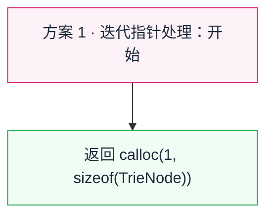

```c
/* LeetCode 208. 实现 Trie (前缀树) — C 版（方案1） */
#include <stdio.h>  // 引入头文件
#include <stdlib.h> // 引入头文件
#include <string.h> // 引入头文件
typedef struct TrieNode {
    struct TrieNode *children[26];
    int is_end;
} TrieNode;
static TrieNode *tn_new() { return calloc(1, sizeof(TrieNode)); }
static void tn_free(TrieNode *n) { // 定义函数/方法 tn_free
    if (!n)
        return; // 若 取反 元素个数) return;
    for (int i = 0; i < 26; i++)
        tn_free(n->children[i]); // 让 下标 i 从 0 开始计数，下标 i 小于 26 就继续
    free(n);                     // free(元素个数);
}
static void trie_insert(TrieNode *root, const char *word) { // 定义函数/方法 trie_insert
    TrieNode *node = root;                                  // 把 根节点; 写入 TrieNode *node
    for (const char *p = word; *p; p++) { // 把 单词; 乘 节点; 节点 加一 ) { 写入 for (const char *p
        int idx = *p - 'a';               // 把 乘 节点 减 '数组' 存入 idx
        if (!node->children[idx])
            node->children[idx] = tn_new();
        node = node->children[idx]; // 把 节点 减 超过 children[idx]; 写入 节点
    }
    node->is_end = 1; // 把 1; 写入 node->is_end
}
static TrieNode *trie_walk(TrieNode *root, const char *s) {
    TrieNode *node = root;             // 把 根节点; 写入 TrieNode *node
    for (const char *p = s; *p; p++) { // 把 字符串; 乘 节点; 节点 加一 ) { 写入 for (const char *p
        int idx = *p - 'a';            // 把 乘 节点 减 '数组' 存入 idx
        if (idx < 0 || idx >= 26)
            return NULL; // 若 idx 小于 0 或 idx 不低于 26，直接返回 NULL
        if (!node->children[idx])
            return NULL;            // 若 取反 节点 减 超过 children[idx]，直接返回 NULL
        node = node->children[idx]; // 把 节点 减 超过 children[idx]; 写入 节点
    }
    return node; // 返回 节点
}
static int trie_search(TrieNode *root, const char *word) { // 定义函数/方法 trie_search
    TrieNode *n = trie_walk(root, word); // 把 trie_walk(根节点, 单词); 写入 TrieNode *n
    return n && n->is_end;               // 返回 元素个数 且 元素个数 减 超过 is_end
}
static int trie_starts(TrieNode *root, const char *prefix) { return trie_walk(root, prefix) != NULL; }
int main(void) {             // 程序入口：跑内嵌自测用例
    TrieNode *t = tn_new();  // 把 tn_new(); 写入 TrieNode *t
    trie_insert(t, "apple"); // trie_insert(另一字符串, 「apple」);
    if (!trie_search(t, "apple")) {
        printf("FAIL 1\n");
        return 1;
    } // 若 取反 trie_search(另一字符串, 「apple」)) { 输出「apple」); return 1; }
    if (trie_search(t, "app")) {
        printf("FAIL 2\n");
        return 1;
    } // 若 trie_search(另一字符串, 「app」)) { 输出「app」); return 1; }
    if (!trie_starts(t, "app")) {
        printf("FAIL 3\n");
        return 1;
    } // 若 取反 trie_starts(另一字符串, 「app」)) { 输出「app」); return 1; }
    if (trie_search(t, "appl")) {
        printf("FAIL 4\n");
        return 1;
    }                 // 若 trie_search(另一字符串, 「appl」)) { 输出「appl」); return 1; }
    tn_free(t);       // tn_free(另一字符串);
    printf("PASS\n"); // 全部用例通过，输出 PASS
    return 0;         // 返回 0
}
```

#### 方案 2：直接实现

**思路与代码分析**：核心是「直接实现」。C 版手动管理下标与内存，循环边界全部显式写出。**走读**：方案 2 · 直接实现：开始 → 返回 calloc(1, sizeof(TrieNode))。

**运行架构**（真实控制流）：

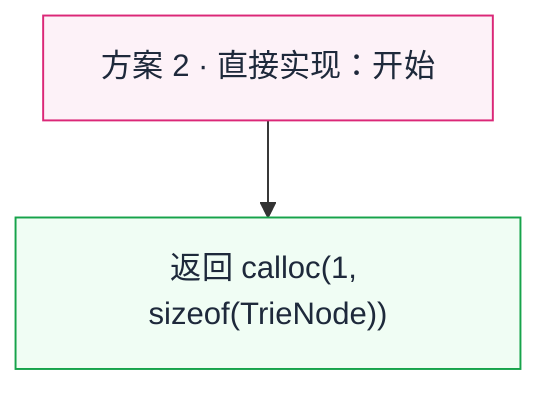

```c
/* LeetCode 208. 实现 Trie (前缀树) — C 版（方案2） */
#include <stdio.h>  // 引入头文件
#include <stdlib.h> // 引入头文件
#include <string.h> // 引入头文件
typedef struct TrieNode {
    struct TrieNode *children[26];
    int is_end;
} TrieNode;
static TrieNode *tn_new() { return calloc(1, sizeof(TrieNode)); }
static void tn_free(TrieNode *n) { // 定义函数/方法 tn_free
    if (!n)
        return; // 若 取反 元素个数) return;
    for (int i = 0; i < 26; i++)
        tn_free(n->children[i]); // 让 下标 i 从 0 开始计数，下标 i 小于 26 就继续
    free(n);                     // free(元素个数);
}
static void trie_insert(TrieNode *root, const char *word) { // 定义函数/方法 trie_insert
    TrieNode *node = root;                                  // 把 根节点; 写入 TrieNode *node
    for (const char *p = word; *p; p++) { // 把 单词; 乘 节点; 节点 加一 ) { 写入 for (const char *p
        int idx = *p - 'a';               // 把 乘 节点 减 '数组' 存入 idx
        if (!node->children[idx])
            node->children[idx] = tn_new();
        node = node->children[idx]; // 把 节点 减 超过 children[idx]; 写入 节点
    }
    node->is_end = 1; // 把 1; 写入 node->is_end
}
static TrieNode *trie_walk(TrieNode *root, const char *s) {
    TrieNode *node = root;             // 把 根节点; 写入 TrieNode *node
    for (const char *p = s; *p; p++) { // 把 字符串; 乘 节点; 节点 加一 ) { 写入 for (const char *p
        int idx = *p - 'a';            // 把 乘 节点 减 '数组' 存入 idx
        if (idx < 0 || idx >= 26)
            return NULL; // 若 idx 小于 0 或 idx 不低于 26，直接返回 NULL
        if (!node->children[idx])
            return NULL;            // 若 取反 节点 减 超过 children[idx]，直接返回 NULL
        node = node->children[idx]; // 把 节点 减 超过 children[idx]; 写入 节点
    }
    return node; // 返回 节点
}
static int trie_search(TrieNode *root, const char *word) { // 定义函数/方法 trie_search
    TrieNode *n = trie_walk(root, word); // 把 trie_walk(根节点, 单词); 写入 TrieNode *n
    return n && n->is_end;               // 返回 元素个数 且 元素个数 减 超过 is_end
}
static int trie_starts(TrieNode *root, const char *prefix) { return trie_walk(root, prefix) != NULL; }
int main(void) {             // 程序入口：跑内嵌自测用例
    TrieNode *t = tn_new();  // 把 tn_new(); 写入 TrieNode *t
    trie_insert(t, "apple"); // trie_insert(另一字符串, 「apple」);
    if (!trie_search(t, "apple")) {
        printf("FAIL 1\n");
        return 1;
    } // 若 取反 trie_search(另一字符串, 「apple」)) { 输出「apple」); return 1; }
    if (trie_search(t, "app")) {
        printf("FAIL 2\n");
        return 1;
    } // 若 trie_search(另一字符串, 「app」)) { 输出「app」); return 1; }
    if (!trie_starts(t, "app")) {
        printf("FAIL 3\n");
        return 1;
    } // 若 取反 trie_starts(另一字符串, 「app」)) { 输出「app」); return 1; }
    if (trie_search(t, "appl")) {
        printf("FAIL 4\n");
        return 1;
    }                 // 若 trie_search(另一字符串, 「appl」)) { 输出「appl」); return 1; }
    tn_free(t);       // tn_free(另一字符串);
    printf("PASS\n"); // 全部用例通过，输出 PASS
    return 0;         // 返回 0
}
```

### C++ 实现（2 种方案）

C++ 的全部方案如下，每个方案都内嵌用例自测，可独立运行（老仓库 python/go 文件遵循「打印结果」约定）：

#### 方案 1：迭代指针处理

**思路与代码分析**：核心是「迭代指针处理」。C++ 版用 STL 容器与迭代器，减少手写下标错误。代码里依次做这些事：单循环线性扫描。**走读**：方案 1 · 迭代指针处理：开始 → 更新 *node → 遍历循环 → 更新 &child → 若 非 child：更新 child → 更新 child → 更新 node → 更新 node->isEnd → 返回结果。

**运行架构**（真实控制流）：

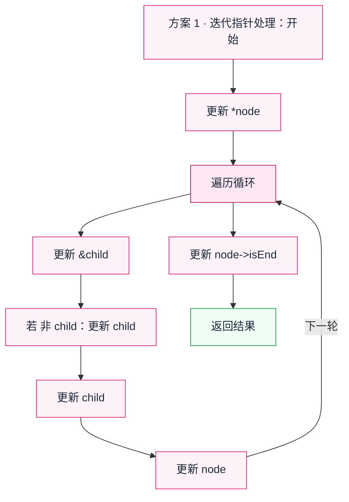

```cpp
// LeetCode 208. 实现 Trie (前缀树) — C++ 版（方案1）
#include <cassert>       // 引入头文件
#include <iostream>      // 引入头文件
#include <memory>        // 引入头文件
#include <unordered_map> // 引入头文件
struct TrieNode {        // 定义类型
    std::unordered_map<char, std::unique_ptr<TrieNode>> children;
    bool isEnd = false; // 把 false 存入 isEnd
};
struct Trie { // 定义类型
    std::unique_ptr<TrieNode> root = std::make_unique<TrieNode>();
    void insert(const std::string &word) {    // 定义函数/方法 insert
        TrieNode *node = root.get();          // 把 根节点 查找 ); 写入 TrieNode *node
        for (char ch : word) {                // for (char 字符 : 单词) {
            auto &child = node->children[ch]; // 把 节点 减 超过 children[字符]; 写入 auto &child
            if (!child)
                child = std::make_unique<TrieNode>(); // 若 取反 子节点) 子节点 赋值为 std::make_unique 小于
                                                      // TrieNode 超过 ();
            node = child.get(); // 把 子节点 查找 ); 写入 节点
        }
        node->isEnd = true; // 把 true; 写入 node->isEnd
    }
    bool search(const std::string &word) const { // bool search(const std::string 按位与 单词) const {
        const TrieNode *node = root.get();       // 把 根节点 查找 ); 写入 const TrieNode *node
        for (char ch : word) {                   // for (char 字符 : 单词) {
            auto it = node->children.find(ch);   // 把 节点 减 超过 children 查找 字符) 存入 it
            if (it == node->children.end())
                return false;        // 若 it 等于 节点 减 超过 children.终点()，直接返回 false
            node = it->second.get(); // 把 it 减 超过 second 查找 ); 写入 节点
        }
        return node->isEnd; // 返回 节点 减 超过 isEnd
    }
    bool
    startsWith(const std::string &prefix) const { // bool startsWith(const std::string 按位与 prefix) const {
        const TrieNode *node = root.get();        // 把 根节点 查找 ); 写入 const TrieNode *node
        for (char ch : prefix) {                  // for (char 字符 : prefix) {
            auto it = node->children.find(ch);    // 把 节点 减 超过 children 查找 字符) 存入 it
            if (it == node->children.end())
                return false;        // 若 it 等于 节点 减 超过 children.终点()，直接返回 false
            node = it->second.get(); // 把 it 减 超过 second 查找 ); 写入 节点
        }
        return true; // 返回 true
    }
};
int main() {                          // 程序入口：跑内嵌自测用例
    Trie t;                           // Trie 另一字符串;
    t.insert("apple");                // 另一字符串 插入 「apple」);
    assert(t.search("apple"));        // 断言校验
    assert(!t.search("app"));         // 断言校验
    assert(t.startsWith("app"));      // 断言校验
    assert(!t.search("appl"));        // 断言校验
    std::cout << "PASS" << std::endl; // 全部用例通过，输出 PASS
    return 0;                         // 返回 0
}
```

#### 方案 2：直接实现

**思路与代码分析**：核心是「直接实现」。C++ 版用 STL 容器与迭代器，减少手写下标错误。代码里依次做这些事：单循环线性扫描。**走读**：方案 2 · 直接实现：开始 → 更新 *node → 遍历循环 → 更新 &child → 若 非 child：更新 child → 更新 child → 更新 node → 更新 node->isEnd → 返回结果。

**运行架构**（真实控制流）：

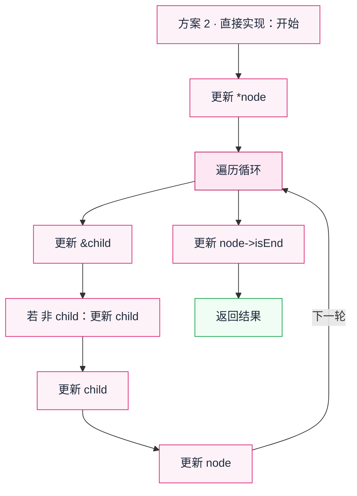

```cpp
// LeetCode 208. 实现 Trie (前缀树) — C++ 版（方案2）
#include <cassert>       // 引入头文件
#include <iostream>      // 引入头文件
#include <memory>        // 引入头文件
#include <unordered_map> // 引入头文件
struct TrieNode {        // 定义类型
    std::unordered_map<char, std::unique_ptr<TrieNode>> children;
    bool isEnd = false; // 把 false 存入 isEnd
};
struct Trie { // 定义类型
    std::unique_ptr<TrieNode> root = std::make_unique<TrieNode>();
    void insert(const std::string &word) {    // 定义函数/方法 insert
        TrieNode *node = root.get();          // 把 根节点 查找 ); 写入 TrieNode *node
        for (char ch : word) {                // for (char 字符 : 单词) {
            auto &child = node->children[ch]; // 把 节点 减 超过 children[字符]; 写入 auto &child
            if (!child)
                child = std::make_unique<TrieNode>(); // 若 取反 子节点) 子节点 赋值为 std::make_unique 小于
                                                      // TrieNode 超过 ();
            node = child.get(); // 把 子节点 查找 ); 写入 节点
        }
        node->isEnd = true; // 把 true; 写入 node->isEnd
    }
    bool search(const std::string &word) const { // bool search(const std::string 按位与 单词) const {
        const TrieNode *node = root.get();       // 把 根节点 查找 ); 写入 const TrieNode *node
        for (char ch : word) {                   // for (char 字符 : 单词) {
            auto it = node->children.find(ch);   // 把 节点 减 超过 children 查找 字符) 存入 it
            if (it == node->children.end())
                return false;        // 若 it 等于 节点 减 超过 children.终点()，直接返回 false
            node = it->second.get(); // 把 it 减 超过 second 查找 ); 写入 节点
        }
        return node->isEnd; // 返回 节点 减 超过 isEnd
    }
    bool
    startsWith(const std::string &prefix) const { // bool startsWith(const std::string 按位与 prefix) const {
        const TrieNode *node = root.get();        // 把 根节点 查找 ); 写入 const TrieNode *node
        for (char ch : prefix) {                  // for (char 字符 : prefix) {
            auto it = node->children.find(ch);    // 把 节点 减 超过 children 查找 字符) 存入 it
            if (it == node->children.end())
                return false;        // 若 it 等于 节点 减 超过 children.终点()，直接返回 false
            node = it->second.get(); // 把 it 减 超过 second 查找 ); 写入 节点
        }
        return true; // 返回 true
    }
};
int main() {                          // 程序入口：跑内嵌自测用例
    Trie t;                           // Trie 另一字符串;
    t.insert("apple");                // 另一字符串 插入 「apple」);
    assert(t.search("apple"));        // 断言校验
    assert(!t.search("app"));         // 断言校验
    assert(t.startsWith("app"));      // 断言校验
    assert(!t.search("appl"));        // 断言校验
    std::cout << "PASS" << std::endl; // 全部用例通过，输出 PASS
    return 0;                         // 返回 0
}
```

### R 实现（2 种方案）

R 的全部方案如下，每个方案都内嵌用例自测，可独立运行（老仓库 python/go 文件遵循「打印结果」约定）：

#### 方案 1：迭代指针处理

**思路与代码分析**：核心是「迭代指针处理」。R 版用向量化思维与 1 起始下标，注意 1:n 的降序陷阱。**走读**：方案 1 · 迭代指针处理：开始 → 更新 new.env(parent → 更新 new.env(parent → 处理 e$is_end ＜- FALSE → 处理 e → 返回结果。

**运行架构**（真实控制流）：

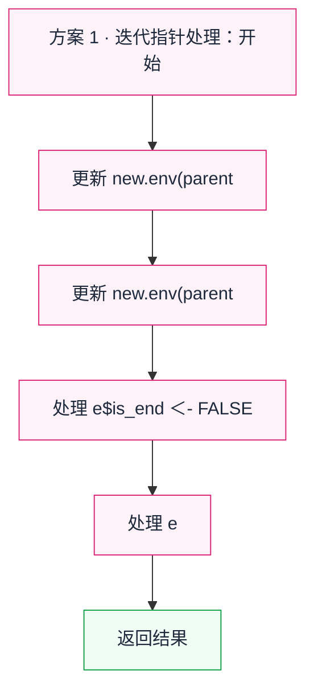

```r
# R 版（方案1） 定义函数 TrieNode（参数：无）
TrieNode <- function() {
    e <- new.env(parent = emptyenv())  # 把 new.env(parent 赋值为 emptyenv()) 存入 e
    e$children <- new.env(parent = emptyenv())  # 把 new.env(parent 赋值为 emptyenv()) 存入 e$children
    e$is_end <- FALSE  # 把 FALSE 存入 e$is_end
    e
}
Trie <- function() {
    e <- new.env(parent = emptyenv())
    e$root <- TrieNode()
    e
}  # 定义函数 Trie（参数：无）
trie_insert <- function(t, word) {
    # 定义函数 trie_insert（参数：另一字符串, 单词）
    node <- t$root  # 把 另一字符串$根节点 存入 节点
    chars <- strsplit(word, "")[[1]]  # 把 strsplit(单词, 「」)[[1]] 存入 chars
    for (ch in chars) {
        # for (字符 in chars) {
        if (is.null(node$children[[ch]]))
            node$children[[ch]] <- TrieNode()
        node <- node$children[[ch]]  # 把 节点$children[[字符]] 存入 节点
    }
    node$is_end <- TRUE  # 把 TRUE 存入 node$is_end
}
trie_walk <- function(t, s) {
    # 定义函数 trie_walk（参数：另一字符串, 字符串）
    node <- t$root  # 把 另一字符串$根节点 存入 节点
    chars <- strsplit(s, "")[[1]]  # 把 strsplit(字符串, 「」)[[1]] 存入 chars
    for (ch in chars) {
        # for (字符 in chars) {
        if (is.null(node$children[[ch]]))
            return(NULL)  # 若 is.null(节点$children[[字符]])) return(NULL
        node <- node$children[[ch]]  # 把 节点$children[[字符]] 存入 节点
    }
    node  # 节点
}
trie_search <- function(t, word) {
    n <- trie_walk(t, word)
    !is.null(n) && n$is_end
}  # 定义函数 trie_search（参数：另一字符串, 单词）
trie_starts <- function(t, prefix) !is.null(trie_walk(t, prefix))  # 定义函数 trie_starts（参数：另一字符串, prefix）
t <- Trie()  # 把 Trie() 存入 另一字符串
trie_insert(t, "apple")  # trie_insert(另一字符串, 「apple」)
stopifnot(trie_search(t, "apple"), !trie_search(t, "app"), trie_starts(t, "app"), !trie_search(t, "appl"))  # 断言校验
cat("PASS\n")  # 全部用例通过，输出 PASS
```

#### 方案 2：直接实现

**思路与代码分析**：核心是「直接实现」。R 版用向量化思维与 1 起始下标，注意 1:n 的降序陷阱。**走读**：方案 2 · 直接实现：开始 → 更新 new.env(parent → 更新 new.env(parent → 处理 e$is_end ＜- FALSE → 处理 e → 返回结果。

**运行架构**（真实控制流）：

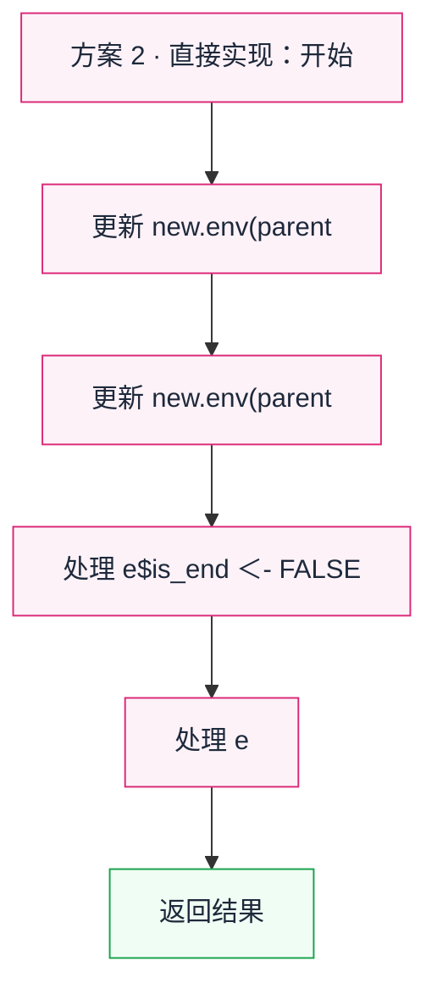

```r
# R 版（方案2） 定义函数 TrieNode（参数：无）
TrieNode <- function() {
    e <- new.env(parent = emptyenv())  # 把 new.env(parent 赋值为 emptyenv()) 存入 e
    e$children <- new.env(parent = emptyenv())  # 把 new.env(parent 赋值为 emptyenv()) 存入 e$children
    e$is_end <- FALSE  # 把 FALSE 存入 e$is_end
    e
}
Trie <- function() {
    e <- new.env(parent = emptyenv())
    e$root <- TrieNode()
    e
}  # 定义函数 Trie（参数：无）
trie_insert <- function(t, word) {
    # 定义函数 trie_insert（参数：另一字符串, 单词）
    node <- t$root  # 把 另一字符串$根节点 存入 节点
    chars <- strsplit(word, "")[[1]]  # 把 strsplit(单词, 「」)[[1]] 存入 chars
    for (ch in chars) {
        # for (字符 in chars) {
        if (is.null(node$children[[ch]]))
            node$children[[ch]] <- TrieNode()
        node <- node$children[[ch]]  # 把 节点$children[[字符]] 存入 节点
    }
    node$is_end <- TRUE  # 把 TRUE 存入 node$is_end
}
trie_walk <- function(t, s) {
    # 定义函数 trie_walk（参数：另一字符串, 字符串）
    node <- t$root  # 把 另一字符串$根节点 存入 节点
    chars <- strsplit(s, "")[[1]]  # 把 strsplit(字符串, 「」)[[1]] 存入 chars
    for (ch in chars) {
        # for (字符 in chars) {
        if (is.null(node$children[[ch]]))
            return(NULL)  # 若 is.null(节点$children[[字符]])) return(NULL
        node <- node$children[[ch]]  # 把 节点$children[[字符]] 存入 节点
    }
    node  # 节点
}
trie_search <- function(t, word) {
    n <- trie_walk(t, word)
    !is.null(n) && n$is_end
}  # 定义函数 trie_search（参数：另一字符串, 单词）
trie_starts <- function(t, prefix) !is.null(trie_walk(t, prefix))  # 定义函数 trie_starts（参数：另一字符串, prefix）
t <- Trie()  # 把 Trie() 存入 另一字符串
trie_insert(t, "apple")  # trie_insert(另一字符串, 「apple」)
stopifnot(trie_search(t, "apple"), !trie_search(t, "app"), trie_starts(t, "app"), !trie_search(t, "appl"))  # 断言校验
cat("PASS\n")  # 全部用例通过，输出 PASS
```

### Zig 实现（2 种方案）

Zig 的全部方案如下，每个方案都内嵌用例自测，可独立运行（老仓库 python/go 文件遵循「打印结果」约定）：

#### 方案 1：迭代指针处理

**思路与代码分析**：核心是「迭代指针处理」。Zig 版显式分配与清零，整型边界处理严格。**走读**：方案 1 · 迭代指针处理：开始 → 计算 n → 更新 n.* → 返回 n。

**运行架构**（真实控制流）：

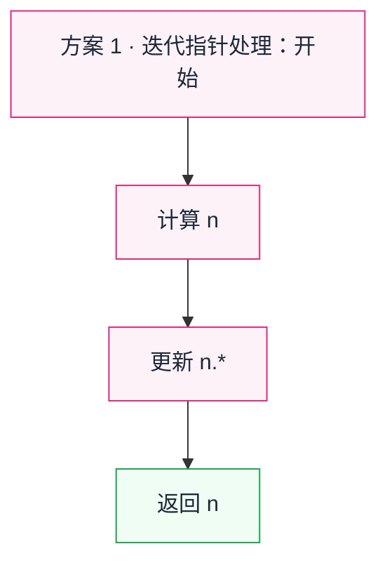

```zig
// LeetCode 208. 实现 Trie (前缀树) — Zig 版（方案1）
const std = @import("std"); // 把 @import(「std」) 存入 std
const TrieNode = struct { children: [26]?*TrieNode, is_end: bool };
fn tnNew(alloc: std.mem.Allocator) *TrieNode { // 定义函数/方法 tnNew
    const n = alloc.create(TrieNode) catch unreachable; // 把 alloc.create(TrieNode) catch unreachable 存入 元素个数
    n.* = .{ .children = [_]?*TrieNode{null} ** 26, .is_end = false };
    return n; // 返回 元素个数
}
const Trie = struct { // 把 struct { 存入 Trie
    root: *TrieNode,
    fn init(alloc: std.mem.Allocator) Trie {
        return .{ .root = tnNew(alloc) };
    } // 定义函数/方法 init
    fn insert(self: *Trie, word: []const u8, alloc: std.mem.Allocator) void { // 定义函数/方法 insert
        var node = self.root; // 把 self.根节点 存入 节点
        for (word) |ch| { // 逐个取出 单词 的元素（字符）
            const idx = ch - 'a'; // 把 字符 减 '数组' 存入 idx
            if (node.children[idx] == null) node.children[idx] = tnNew(alloc);
            node = node.children[idx].?; // 把 节点.children[idx].?; 写入 节点
        }
        node.is_end = true; // 把 true; 写入 node.is_end
    }
    fn walk(self: *Trie, s: []const u8) ?*TrieNode { // 定义函数/方法 walk
        var node = self.root; // 把 self.根节点 存入 节点
        for (s) |ch| { // 逐个取出 字符串 的元素（字符）
            if (ch < 'a' or ch > 'z') return null; // 若 字符 小于 '数组' or 字符 超过 'z'，直接返回 null
            const idx = ch - 'a'; // 把 字符 减 '数组' 存入 idx
            if (node.children[idx] == null) return null; // 若 节点.children[idx] 等于 null，直接返回 null
            node = node.children[idx].?; // 把 节点.children[idx].?; 写入 节点
        }
        return node; // 返回 节点
    }
    fn search(self: *Trie, word: []const u8) bool { // 定义函数/方法 search
        const n = self.walk(word) orelse return false; // 把 self.walk(单词) orelse return false 存入 元素个数
        return n.is_end; // 返回 元素个数.is_end
    }
    fn startsWith(self: *Trie, prefix: []const u8) bool { // 定义函数/方法 startsWith
        return self.walk(prefix) != null; // 返回 self.walk(prefix) 不等于 null
    }
};
pub fn main() !void { // 程序入口：跑内嵌自测用例
    var arena = std.heap.ArenaAllocator.init(std.heap.page_allocator); // 把 std.堆.ArenaAllocator.init(std.堆.page_allocator) 存入 arena
    defer arena.deinit(); // defer arena.deinit();
    const alloc = arena.allocator(); // 把 arena.allocator() 存入 alloc
    var t = Trie.init(alloc); // 把 Trie.init(alloc) 存入 另一字符串
    t.insert("apple", alloc); // 另一字符串 插入 「apple」, alloc);
    if (!t.search("apple")) return error.TestFailed; // 若 取反 另一字符串.search(「apple」)，直接返回 error.TestFailed
    if (t.search("app")) return error.TestFailed; // 若 另一字符串.search(「app」)，直接返回 error.TestFailed
    if (!t.startsWith("app")) return error.TestFailed; // 若 取反 另一字符串.startsWith(「app」)，直接返回 error.TestFailed
    if (t.search("appl")) return error.TestFailed; // 若 另一字符串.search(「appl」)，直接返回 error.TestFailed
    std.debug.print("PASS\n", .{}); // 全部用例通过，输出 PASS
}
```

#### 方案 2：直接实现

**思路与代码分析**：核心是「直接实现」。Zig 版显式分配与清零，整型边界处理严格。**走读**：方案 2 · 直接实现：开始 → 计算 n → 更新 n.* → 返回 n。

**运行架构**（真实控制流）：

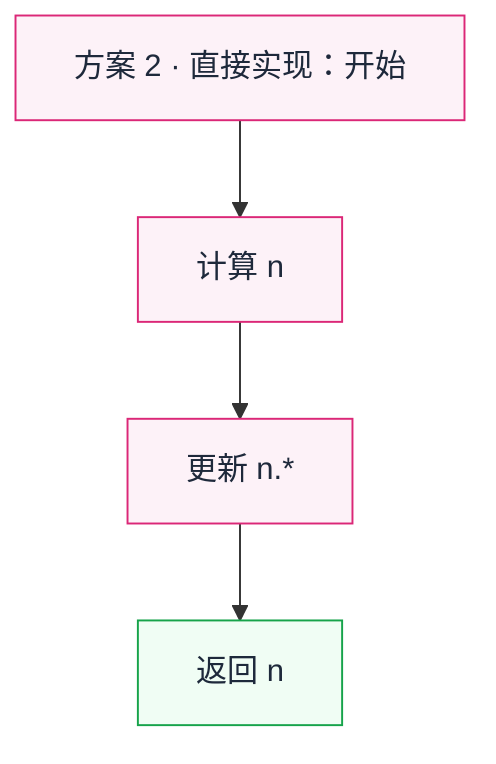

```zig
// LeetCode 208. 实现 Trie (前缀树) — Zig 版（方案2）
const std = @import("std"); // 把 @import(「std」) 存入 std
const TrieNode = struct { children: [26]?*TrieNode, is_end: bool };
fn tnNew(alloc: std.mem.Allocator) *TrieNode { // 定义函数/方法 tnNew
    const n = alloc.create(TrieNode) catch unreachable; // 把 alloc.create(TrieNode) catch unreachable 存入 元素个数
    n.* = .{ .children = [_]?*TrieNode{null} ** 26, .is_end = false };
    return n; // 返回 元素个数
}
const Trie = struct { // 把 struct { 存入 Trie
    root: *TrieNode,
    fn init(alloc: std.mem.Allocator) Trie {
        return .{ .root = tnNew(alloc) };
    } // 定义函数/方法 init
    fn insert(self: *Trie, word: []const u8, alloc: std.mem.Allocator) void { // 定义函数/方法 insert
        var node = self.root; // 把 self.根节点 存入 节点
        for (word) |ch| { // 逐个取出 单词 的元素（字符）
            const idx = ch - 'a'; // 把 字符 减 '数组' 存入 idx
            if (node.children[idx] == null) node.children[idx] = tnNew(alloc);
            node = node.children[idx].?; // 把 节点.children[idx].?; 写入 节点
        }
        node.is_end = true; // 把 true; 写入 node.is_end
    }
    fn walk(self: *Trie, s: []const u8) ?*TrieNode { // 定义函数/方法 walk
        var node = self.root; // 把 self.根节点 存入 节点
        for (s) |ch| { // 逐个取出 字符串 的元素（字符）
            if (ch < 'a' or ch > 'z') return null; // 若 字符 小于 '数组' or 字符 超过 'z'，直接返回 null
            const idx = ch - 'a'; // 把 字符 减 '数组' 存入 idx
            if (node.children[idx] == null) return null; // 若 节点.children[idx] 等于 null，直接返回 null
            node = node.children[idx].?; // 把 节点.children[idx].?; 写入 节点
        }
        return node; // 返回 节点
    }
    fn search(self: *Trie, word: []const u8) bool { // 定义函数/方法 search
        const n = self.walk(word) orelse return false; // 把 self.walk(单词) orelse return false 存入 元素个数
        return n.is_end; // 返回 元素个数.is_end
    }
    fn startsWith(self: *Trie, prefix: []const u8) bool { // 定义函数/方法 startsWith
        return self.walk(prefix) != null; // 返回 self.walk(prefix) 不等于 null
    }
};
pub fn main() !void { // 程序入口：跑内嵌自测用例
    var arena = std.heap.ArenaAllocator.init(std.heap.page_allocator); // 把 std.堆.ArenaAllocator.init(std.堆.page_allocator) 存入 arena
    defer arena.deinit(); // defer arena.deinit();
    const alloc = arena.allocator(); // 把 arena.allocator() 存入 alloc
    var t = Trie.init(alloc); // 把 Trie.init(alloc) 存入 另一字符串
    t.insert("apple", alloc); // 另一字符串 插入 「apple」, alloc);
    if (!t.search("apple")) return error.TestFailed; // 若 取反 另一字符串.search(「apple」)，直接返回 error.TestFailed
    if (t.search("app")) return error.TestFailed; // 若 另一字符串.search(「app」)，直接返回 error.TestFailed
    if (!t.startsWith("app")) return error.TestFailed; // 若 取反 另一字符串.startsWith(「app」)，直接返回 error.TestFailed
    if (t.search("appl")) return error.TestFailed; // 若 另一字符串.search(「appl」)，直接返回 error.TestFailed
    std.debug.print("PASS\n", .{}); // 全部用例通过，输出 PASS
}
```

### Dart 实现（2 种方案）

Dart 的全部方案如下，每个方案都内嵌用例自测，可独立运行（老仓库 python/go 文件遵循「打印结果」约定）：

#### 方案 1：迭代指针处理

**思路与代码分析**：核心是「迭代指针处理」。Dart 版用可空类型标注与集合方法，注意空安全。代码里依次做这些事：单循环线性扫描。**走读**：方案 1 · 迭代指针处理：开始 → 计算 node → 遍历循环 → 更新 ?? → 更新 node → 更新 node.isEnd → 返回结果。

**运行架构**（真实控制流）：

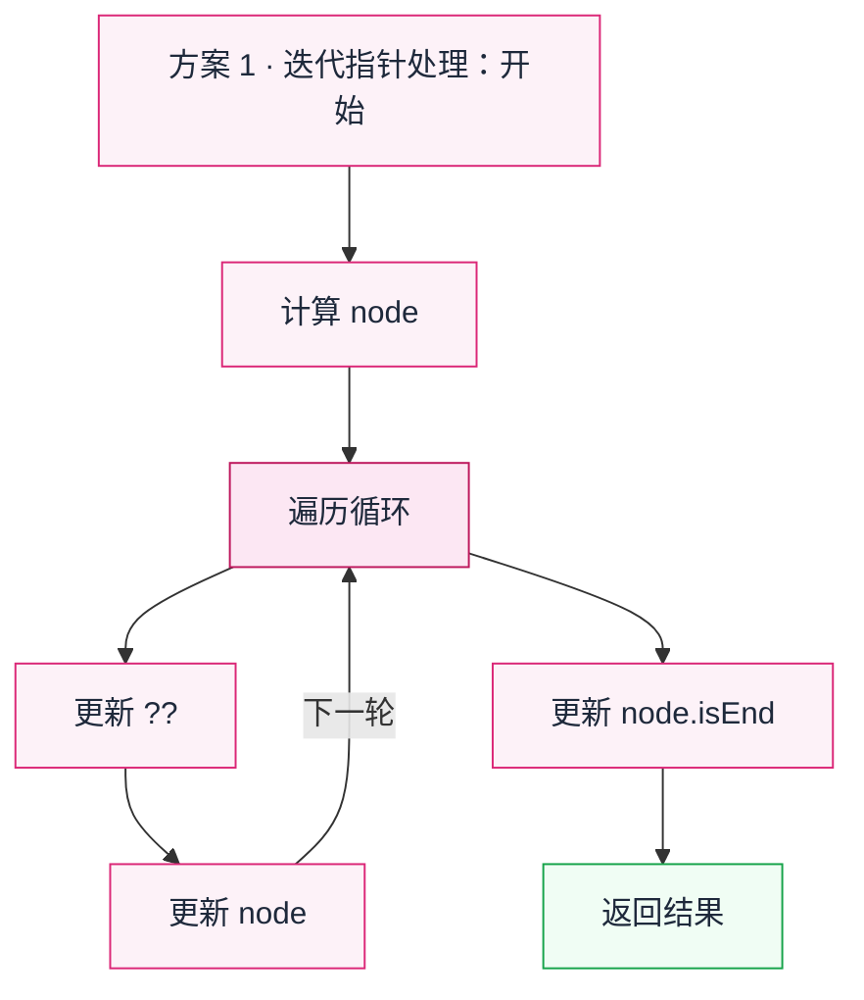

```dart
// LeetCode 208. 实现 Trie (前缀树) — Dart 版（方案1）
class TrieNode {
  // 定义类型
  final Map<String, TrieNode> children =
      {}; // 把 {}; 写入 final Map<String, TrieNode> children
  bool isEnd = false; // 把 false 存入 isEnd
}

class Trie {
  // 定义类型
  final TrieNode root = TrieNode(); // 把 TrieNode(); 写入 final TrieNode root
  void insert(String word) {
    // 定义函数/方法 insert
    var node = root; // 把 根节点 存入 节点
    for (final ch in word.split('')) {
      // for (final 字符 in 单词.split('')) {
      node.children[ch] ??= TrieNode(); // 把 TrieNode(); 写入 node.children[ch] ??
      node = node.children[ch]!; // 把 节点.children[字符]取反 存入 节点
    }
    node.isEnd = true; // 把 true; 写入 node.isEnd
  }

  TrieNode? _walk(String s) {
    // TrieNode? _walk(String 字符串) {
    var node = root; // 把 根节点 存入 节点
    for (final ch in s.split('')) {
      // for (final 字符 in 字符串.split('')) {
      final next = node.children[ch]; // 把 节点.children[字符] 存入 下一个
      if (next == null) return null; // 若 下一个 等于 null，直接返回 null
      node = next; // 把 下一个 存入 节点
    }
    return node; // 返回 节点
  }

  bool search(String word) {
    // 定义函数/方法 search
    final n = _walk(word); // 把 _walk(单词) 存入 元素个数
    return n != null && n.isEnd; // 返回 元素个数 不等于 null 且 元素个数.isEnd
  }

  bool startsWith(String prefix) => _walk(prefix) != null;
}

void main() {
  // 程序入口：跑内嵌自测用例
  final t = Trie(); // 把 Trie() 存入 另一字符串
  t.insert('apple'); // 另一字符串 插入 'apple');
  if (!t.search('apple'))
    throw StateError(
      'c1',
    ); // 若 取反 另一字符串.search('apple')) throw StateError('c1');
  if (t.search('app'))
    throw StateError('c2'); // 若 另一字符串.search('app')) throw StateError('c2');
  if (!t.startsWith('app'))
    throw StateError(
      'c3',
    ); // 若 取反 另一字符串.startsWith('app')) throw StateError('c3');
  if (t.search('appl'))
    throw StateError('c4'); // 若 另一字符串.search('appl')) throw StateError('c4');
  print('PASS'); // 全部用例通过，输出 PASS
}
```

#### 方案 2：直接实现

**思路与代码分析**：核心是「直接实现」。Dart 版用可空类型标注与集合方法，注意空安全。代码里依次做这些事：单循环线性扫描。**走读**：方案 2 · 直接实现：开始 → 计算 node → 遍历循环 → 更新 ?? → 更新 node → 更新 node.isEnd → 返回结果。

**运行架构**（真实控制流）：

```mermaid
graph TD
    N0["方案 2 · 直接实现：开始"]
    N1["计算 node"]
    N2["遍历循环"]
    N3["更新 ??"]
    N4["更新 node"]
    N5["更新 node.isEnd"]
    N6["返回结果"]
    N0 --> N1
    N1 --> N2
    N2 --> N3
    N3 --> N4
    N4 -- 下一轮 --> N2
    N2 --> N5
    N5 --> N6
    classDef n fill:#fdf2f8,stroke:#db2777,color:#1e293b;
    classDef lp fill:#fce7f3,stroke:#be185d,color:#1e293b;
    classDef dc fill:#fef9c3,stroke:#ca8a04,color:#1e293b;
    classDef tm fill:#f0fdf4,stroke:#16a34a,color:#1e293b;
    class N0,N1,N3,N4,N5 n;
    class N2 lp;
    class N6 tm;
```

```dart
// LeetCode 208. 实现 Trie (前缀树) — Dart 版（方案2）
class TrieNode {
  // 定义类型
  final Map<String, TrieNode> children =
      {}; // 把 {}; 写入 final Map<String, TrieNode> children
  bool isEnd = false; // 把 false 存入 isEnd
}

class Trie {
  // 定义类型
  final TrieNode root = TrieNode(); // 把 TrieNode(); 写入 final TrieNode root
  void insert(String word) {
    // 定义函数/方法 insert
    var node = root; // 把 根节点 存入 节点
    for (final ch in word.split('')) {
      // for (final 字符 in 单词.split('')) {
      node.children[ch] ??= TrieNode(); // 把 TrieNode(); 写入 node.children[ch] ??
      node = node.children[ch]!; // 把 节点.children[字符]取反 存入 节点
    }
    node.isEnd = true; // 把 true; 写入 node.isEnd
  }

  TrieNode? _walk(String s) {
    // TrieNode? _walk(String 字符串) {
    var node = root; // 把 根节点 存入 节点
    for (final ch in s.split('')) {
      // for (final 字符 in 字符串.split('')) {
      final next = node.children[ch]; // 把 节点.children[字符] 存入 下一个
      if (next == null) return null; // 若 下一个 等于 null，直接返回 null
      node = next; // 把 下一个 存入 节点
    }
    return node; // 返回 节点
  }

  bool search(String word) {
    // 定义函数/方法 search
    final n = _walk(word); // 把 _walk(单词) 存入 元素个数
    return n != null && n.isEnd; // 返回 元素个数 不等于 null 且 元素个数.isEnd
  }

  bool startsWith(String prefix) => _walk(prefix) != null;
}

void main() {
  // 程序入口：跑内嵌自测用例
  final t = Trie(); // 把 Trie() 存入 另一字符串
  t.insert('apple'); // 另一字符串 插入 'apple');
  if (!t.search('apple'))
    throw StateError(
      'c1',
    ); // 若 取反 另一字符串.search('apple')) throw StateError('c1');
  if (t.search('app'))
    throw StateError('c2'); // 若 另一字符串.search('app')) throw StateError('c2');
  if (!t.startsWith('app'))
    throw StateError(
      'c3',
    ); // 若 取反 另一字符串.startsWith('app')) throw StateError('c3');
  if (t.search('appl'))
    throw StateError('c4'); // 若 另一字符串.search('appl')) throw StateError('c4');
  print('PASS'); // 全部用例通过，输出 PASS
}
```

---

## 内容总结

- **实现 trie (前缀树)**（堆 · Medium）：共 2 个方案，主线思路「迭代指针处理」；时间 O(n)（单趟线性扫描）；动画演示堆上浮过程，附录给出 11 种语言 × 全部方案的可运行实现。
- 来源博客：[https://blog.csdn.net/tyro_java/article/details/145248170](https://blog.csdn.net/tyro_java/article/details/145248170)
- 导航：[📋 总目录](../) ｜ [← 142 验证二叉搜索树](../142_验证二叉搜索树/) ｜ [144 数组中的第k个最大元素 →](../144_数组中的第k个最大元素/)
