# 144 · 数组中的第k个最大元素（第七阶段 · 堆与优先队列 · Medium）

> **难度**：⭐⭐ Medium ｜ **专题**：堆
> **学习定位**：第七阶段 · 堆与优先队列第 144 篇 ｜ **解法数**：12
> **内容总结**：**数组中的第k个最大元素**（堆 · Medium）：共 12 个方案，主线思路「排序预处理」；时间 O(n) 量级；动画演示堆上浮过程，附录给出 11 种语言 × 全部方案的可运行实现。

---

## 题目描述

给定整数数组 `nums` 和整数 `k`，请返回数组中第 `k` 个最大的元素。

请注意，你需要找的是数组排序后的第 `k` 个最大的元素，而不是第 `k` 个不同的元素。

你必须设计并实现时间复杂度为 `O(n)` 的算法解决此问题。

- 主函数签名：`function findKthLargest(nums: number[], k: number): number`

**用例（来自原题）**：

**示例 1**

```text
输入: [3,2,1,5,6,4], k = 2
输出: 5
```
> ✅ **官方验证**：全部 TypeScript 解法已通过 leetcode.cn 官方示例用例验证（自动注入运行，全部 PASS）。题面与 [leetcode.cn 官方](https://leetcode.cn/problems/kth-largest-element-in-an-array/)一致，示例配图取自官方题面。

**数据范围与注意事项**：

- `1 <= k <= nums.length <= 10^5`
- `-10^4 <= nums[i] <= 10^4`
- **易错点**：堆只保证堆顶最优，遍历堆数组并不是有序输出。

## 题目分析

**场景是什么**：堆只要堆顶最优就能 O(1) 取到，对应真实开发里的优先级调度、Top-K 榜单。本题就是该场景的 Medium 级练习，主线做法是「排序预处理」。

**主线怎么解**：把主解法从头到尾过一遍，它其实在依次做这几件事：先排序再处理。

## 解题思路

**方案对比**（共 12 个方案，由浅入深）：

| 方案 | 时间复杂度 | 空间复杂度 |
|---|---|---|
| 方案 1 · 排序预处理 | O(n) 量级 | O(n) |
| 方案 2 · 单趟扫描 | O(n)（单趟线性扫描） | O(1) 到 O(n)（视辅助结构） |
| 方案 3 · 双重循环枚举 | O(n²)（两层嵌套扫描） | O(1) 到 O(n) |
| 方案 4 · 迭代指针处理 | O(n²)（两层嵌套扫描） | O(1) 到 O(n) |
| 方案 5 · 排序预处理 | O(n) 量级 | O(n) |
| 方案 6 · 单趟扫描 | O(n)（单趟线性扫描） | O(1) 到 O(n)（视辅助结构） |
| 方案 7 · 单趟扫描 | O(n)（单趟线性扫描） | O(1) 到 O(n)（视辅助结构） |
| 方案 8 · 迭代指针处理 | O(n²)（两层嵌套扫描） | O(1) 到 O(n) |
| 方案 9 · 排序预处理 | O(n) 量级 | O(n) |
| 方案 10 · 双重循环枚举 | O(n²)（两层嵌套扫描） | O(1) 到 O(n) |
| 方案 11 · 双重循环枚举 | O(n²)（两层嵌套扫描） | O(1) 到 O(n) |
| 方案 12 · 排序预处理 | O(n) 量级 | O(n) |

**由浅入深的路径**：排序预处理 → 单趟扫描 → 双重循环枚举 → 迭代指针处理；每往右一步，都在补上一步的短板。

**方案间的取舍**：方案 1（排序预处理）；方案 2（单趟扫描）；方案 3（双重循环枚举）；方案 4（迭代指针处理）；方案 5（排序预处理）；方案 6（单趟扫描）；方案 7（单趟扫描）；方案 8（迭代指针处理）；方案 9（排序预处理）；方案 10（双重循环枚举）；方案 11（双重循环枚举）；方案 12（排序预处理）。数据规模小、可读性优先时选靠前的方案；规模大、性能优先时选靠后的方案。

**怎么读这一篇**：

- 🐣 **新手路线**：把「题目描述」的示例 1 在纸上手推一遍 → 读方案 1（最直观的写法）与它的代码走读 → 按「运行方式」本地跑通看 PASS → 回头对比方案 2 之后的写法差在哪
- 🦅 **大佬路线**：直接锁定最优方案 1（排序预处理，O(n) 量级）→ 跳读该方案代码与走读 → 用「逐步拆解与面试追问」补齐复杂度推导与边界追问

### 动态算法图（堆上浮，GIF 自动循环）


动画演示堆专题里堆上浮的典型过程；每个方案在「TypeScript 解题方案」一节还配了专属动画与专属流程图。

### 主解法流程图（真实控制流）

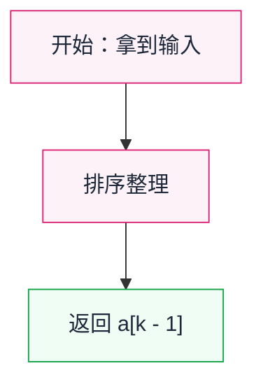

## TypeScript 解题方案（12 个方案逐个讲）

> **运行与提交**：每个方案都是自包含文件（内嵌用例自测，输出 PASS），整块复制到 `.ts` 文件后 `node 文件名` 即可运行。提交 LeetCode 时，把 `demo` 内的算法函数与辅助类型/函数整体取出、置于文件顶层即可。涉及交互/特殊接口的题以题面给定签名为准。

### 方案 1：排序预处理

**分析与思路**：核心做法是「排序预处理」。代码里依次做这些事：先排序再处理。

**运行方式**：`node 本文件`，内嵌用例全部通过会输出 PASS。


**方案专属流程图**（真实控制流）：

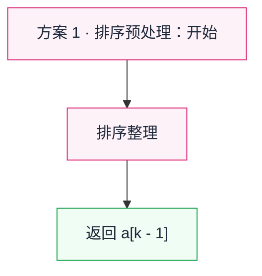

```typescript
// Faithful translation of python reference. Self-check via demo().
function findKthLargest(nums: number[], k: number): number {
  // 定义函数/方法 findKthLargest
  const a = nums.slice().sort((x, y) => y - x);
  return a[k - 1]; // 返回 数组[下标 k 减 1]
}
export function demo(): void {
  // 程序入口：跑内嵌自测用例
  const cases = [
    [[3, 2, 1, 5, 6, 4], 2],
    [[3, 2, 3, 1, 2, 4, 5, 5, 6], 4],
  ];
  const want = [5, 4]; // 把 [5, 4] 存入 want
  for (let i = 0; i < cases.length; i++) {
    // 让 下标 i 从 0 开始计数，下标 i 小于 cases.长度 就继续
    const got = findKthLargest(cases[i][0].slice(), cases[i][1]); // 把 findKthLargest(cases[下标 i][0] 截取 ), cases[下标 i][1]) 存入 got
    if (got !== want[i])
      throw new Error('FAIL case ' + i + ' got ' + got + ' want ' + want[i]);
  }
  console.log('PASS'); // 全部用例通过，输出 PASS
}
demo(); // demo();
```

### 方案 2：单趟扫描

**分析与思路**：核心做法是「单趟扫描」。代码里依次做这些事：单循环线性扫描。

**运行方式**：`node 本文件`，内嵌用例全部通过会输出 PASS。


**方案专属流程图**（真实控制流）：

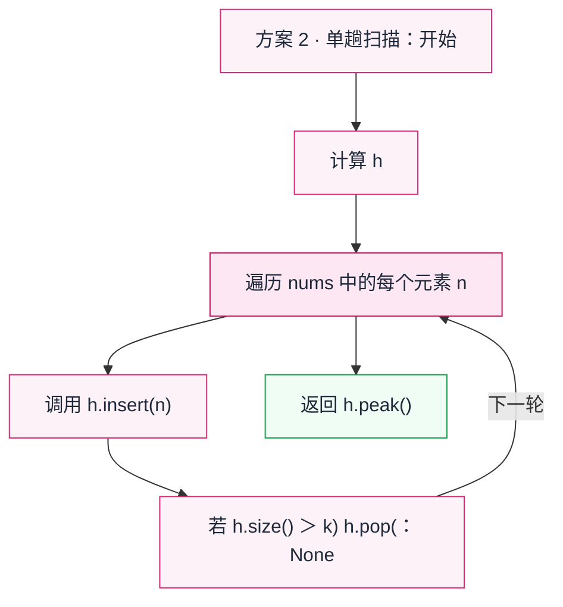

```typescript
// Faithful translation of python reference. Self-check via demo().
class MinHeap {
  // 定义类型
  heap: number[] = []; // 把 []; 写入 heap: number[]
  size(): number {
    return this.heap.length;
  } // 大小(): number { return this.堆.长度; }
  peak(): number {
    return this.heap[0];
  } // peak(): number { return this.堆[0]; }
  insert(val: number): void {
    // insert(值: number): void {
    this.heap.push(val); // 把 值 压入栈/数组尾部
    let i = this.heap.length - 1; // 把 this.堆.长度 减 1 存入 下标 i
    while (i > 0) {
      // 循环，直到不满足「下标 i 超过 0」
      const p = (i - 1) >> 1; // 把 (下标 i 减 1) 超过 超过 1 存入 节点
      if (this.heap[p] <= this.heap[i]) break; // 若 this.堆[节点] 不超过 this.堆[下标 i]) break;
      const t = this.heap[p];
      this.heap[p] = this.heap[i];
      this.heap[i] = t;
      i = p; // 把 节点 存入 下标 i
    }
  }
  pop(): number {
    // pop(): number {
    const top = this.heap[0]; // 把 this.堆[0] 存入 top
    const last = this.heap.pop()!; // 把 this.堆 弹出 )取反 存入 last
    if (this.heap.length > 0) {
      // 若 this.堆.长度 超过 0
      this.heap[0] = last; // 把 last; 写入 this.heap[0]
      let i = 0; // 把 0 存入 下标 i
      const n = this.heap.length; // 把 this.堆.长度 存入 元素个数
      while (true) {
        // 循环，直到不满足「true」
        let l = 2 * i + 1,
          r = 2 * i + 2,
          sm = i; // 把 2 乘 下标 i 加 1, 右指针 赋值为 2 乘 下标 i 加 2, sm 赋值为 下标 i 存入 左指针
        if (l < n && this.heap[l] < this.heap[sm]) sm = l; // 若 左指针 小于 元素个数 且 this.堆[左指针] 小于 this.堆[sm]) sm 赋值为 左指针;
        if (r < n && this.heap[r] < this.heap[sm]) sm = r; // 若 右指针 小于 元素个数 且 this.堆[右指针] 小于 this.堆[sm]) sm 赋值为 右指针;
        if (sm === i) break; // 若 sm 全等于 下标 i) break;
        const t = this.heap[sm];
        this.heap[sm] = this.heap[i];
        this.heap[i] = t;
        i = sm; // 把 sm 存入 下标 i
      }
    }
    return top; // 返回 top
  }
}

function findKthLargest(nums: number[], k: number): number {
  // 定义函数/方法 findKthLargest
  const h = new MinHeap(); // 把 new MinHeap() 存入 h
  for (const n of nums) {
    // for (const 元素个数 of 数组) {
    h.insert(n); // h 插入 元素个数);
    if (h.size() > k) h.pop(); // 若 h.大小() 超过 下标 k) h 弹出 );
  }
  return h.peak(); // 返回 h.peak()
}
export function demo(): void {
  // 程序入口：跑内嵌自测用例
  const cases = [
    [[3, 2, 1, 5, 6, 4], 2],
    [[3, 2, 3, 1, 2, 4, 5, 5, 6], 4],
  ];
  const want = [5, 4]; // 把 [5, 4] 存入 want
  for (let i = 0; i < cases.length; i++) {
    // 让 下标 i 从 0 开始计数，下标 i 小于 cases.长度 就继续
    const got = findKthLargest(cases[i][0].slice(), cases[i][1]); // 把 findKthLargest(cases[下标 i][0] 截取 ), cases[下标 i][1]) 存入 got
    if (got !== want[i])
      throw new Error('FAIL case ' + i + ' got ' + got + ' want ' + want[i]);
  }
  console.log('PASS'); // 全部用例通过，输出 PASS
}
demo(); // demo();
```

### 方案 3：双重循环枚举

**分析与思路**：核心做法是「双重循环枚举」。代码里依次做这些事：双重循环遍历。

**运行方式**：`node 本文件`，内嵌用例全部通过会输出 PASS。


**方案专属流程图**（真实控制流）：

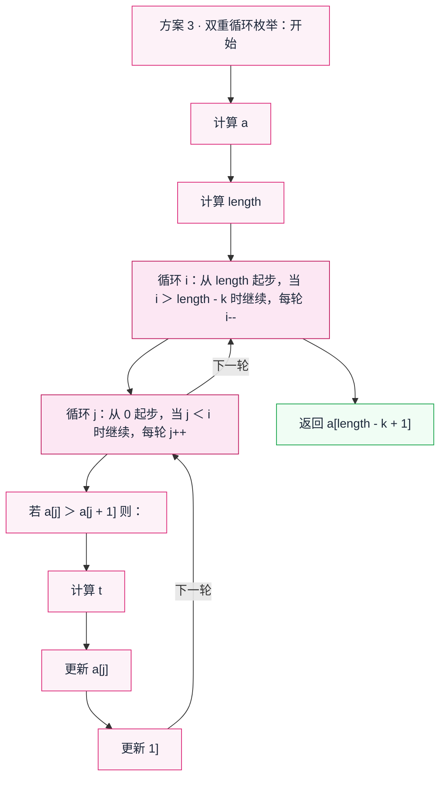

```typescript
// Faithful translation of python reference. Self-check via demo().
function findKthLargest(nums: number[], k: number): number {
  // 定义函数/方法 findKthLargest
  const a = nums.slice(); // 把 数组 截取 ) 存入 数组
  const length = a.length - 1; // 把 数组.长度 减 1 存入 长度
  for (let i = length; i > length - k; i--) {
    // 让 下标 i 从 长度 开始计数，下标 i 超过 长度 减 下标 k 就继续
    for (let j = 0; j < i; j++) {
      // 让 下标 j 从 0 开始计数，下标 j 小于 下标 i 就继续
      if (a[j] > a[j + 1]) {
        const t = a[j];
        a[j] = a[j + 1];
        a[j + 1] = t;
      }
    }
  }
  return a[length - k + 1]; // 返回 数组[长度 减 下标 k 加 1]
}
export function demo(): void {
  // 程序入口：跑内嵌自测用例
  const cases = [
    [[3, 2, 1, 5, 6, 4], 2],
    [[3, 2, 3, 1, 2, 4, 5, 5, 6], 4],
  ];
  const want = [5, 4]; // 把 [5, 4] 存入 want
  for (let i = 0; i < cases.length; i++) {
    // 让 下标 i 从 0 开始计数，下标 i 小于 cases.长度 就继续
    const got = findKthLargest(cases[i][0].slice(), cases[i][1]); // 把 findKthLargest(cases[下标 i][0] 截取 ), cases[下标 i][1]) 存入 got
    if (got !== want[i])
      throw new Error('FAIL case ' + i + ' got ' + got + ' want ' + want[i]);
  }
  console.log('PASS'); // 全部用例通过，输出 PASS
}
demo(); // demo();
```

### 方案 4：迭代指针处理

**分析与思路**：核心做法是「迭代指针处理」。

**运行方式**：`node 本文件`，内嵌用例全部通过会输出 PASS。


**方案专属流程图**（真实控制流）：

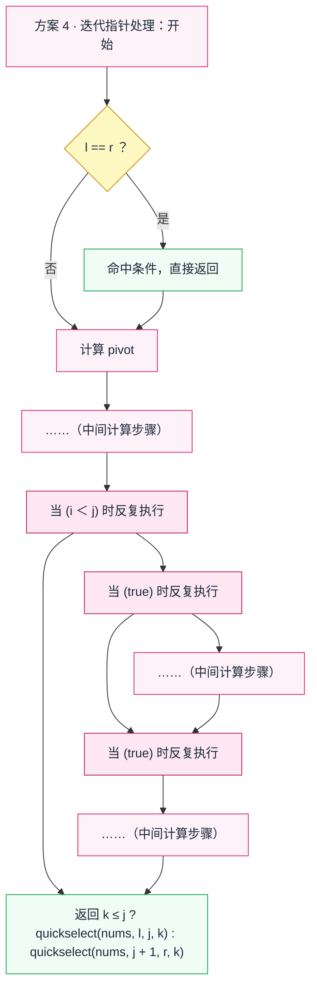

```typescript
// Faithful translation of python reference. Self-check via demo().
function quickselect(nums: number[], l: number, r: number, k: number): number {
  // 定义函数/方法 quickselect
  if (l === r) return nums[k]; // 若 左指针 全等于 右指针，直接返回 数组[下标 k]
  const pivot = nums[l]; // 把 数组[左指针] 存入 pivot
  let i = l - 1,
    j = r + 1; // 把 左指针 减 1, 下标 j 赋值为 右指针 加 1 存入 下标 i
  while (i < j) {
    // 循环，直到不满足「下标 i 小于 下标 j」
    while (true) {
      i++;
      if (nums[i] <= pivot) continue;
      break;
    }
    while (true) {
      j--;
      if (nums[j] >= pivot) continue;
      break;
    }
    if (i < j) {
      const t = nums[i];
      nums[i] = nums[j];
      nums[j] = t;
    }
  }
  return k <= j ? quickselect(nums, l, j, k) : quickselect(nums, j + 1, r, k);
}
function findKthLargest(nums: number[], k: number): number {
  // 定义函数/方法 findKthLargest
  const n = nums.length; // 把 数组.长度 存入 元素个数
  return quickselect(nums.slice(), 0, n - 1, n - k); // 返回 quickselect(数组 截取 ), 0, 元素个数 减 1, 元素个数 减 下标 k)
}
export function demo(): void {
  // 程序入口：跑内嵌自测用例
  const cases = [
    [[1], 1],
    [[2, 1, 3], 1],
    [[2, 1, 1, 3], 1],
  ];
  const want = [1, 3, 3]; // 把 [1, 3, 3] 存入 want
  for (let i = 0; i < cases.length; i++) {
    // 让 下标 i 从 0 开始计数，下标 i 小于 cases.长度 就继续
    const got = findKthLargest(cases[i][0].slice(), cases[i][1]); // 把 findKthLargest(cases[下标 i][0] 截取 ), cases[下标 i][1]) 存入 got
    if (got !== want[i])
      throw new Error('FAIL case ' + i + ' got ' + got + ' want ' + want[i]);
  }
  console.log('PASS'); // 全部用例通过，输出 PASS
}
demo(); // demo();
```

### 方案 5：排序预处理

**分析与思路**：核心做法是「排序预处理」。代码里依次做这些事：先排序再处理。

**运行方式**：`node 本文件`，内嵌用例全部通过会输出 PASS。


**方案专属流程图**（真实控制流）：


```typescript
// Faithful translation of python reference. Self-check via demo().
function findKthLargest(nums: number[], k: number): number {
  // 定义函数/方法 findKthLargest
  const a = nums.slice().sort((x, y) => y - x);
  return a.slice(0, k)[k - 1]; // 返回 数组 截取 0, 下标 k)[下标 k 减 1]
}
export function demo(): void {
  // 程序入口：跑内嵌自测用例
  const cases = [
    [[3, 2, 1, 5, 6, 4], 2],
    [[3, 2, 3, 1, 2, 4, 5, 5, 6], 4],
  ];
  const want = [5, 4]; // 把 [5, 4] 存入 want
  for (let i = 0; i < cases.length; i++) {
    // 让 下标 i 从 0 开始计数，下标 i 小于 cases.长度 就继续
    const got = findKthLargest(cases[i][0].slice(), cases[i][1]); // 把 findKthLargest(cases[下标 i][0] 截取 ), cases[下标 i][1]) 存入 got
    if (got !== want[i])
      throw new Error('FAIL case ' + i + ' got ' + got + ' want ' + want[i]);
  }
  console.log('PASS'); // 全部用例通过，输出 PASS
}
demo(); // demo();
```

### 方案 6：单趟扫描

**分析与思路**：核心做法是「单趟扫描」。代码里依次做这些事：单循环线性扫描。

**运行方式**：`node 本文件`，内嵌用例全部通过会输出 PASS。


**方案专属流程图**（真实控制流）：


```typescript
// Faithful translation of python reference. Self-check via demo().
class MinHeap {
  // 定义类型
  heap: number[] = []; // 把 []; 写入 heap: number[]
  size(): number {
    return this.heap.length;
  } // 大小(): number { return this.堆.长度; }
  peak(): number {
    return this.heap[0];
  } // peak(): number { return this.堆[0]; }
  insert(val: number): void {
    // insert(值: number): void {
    this.heap.push(val); // 把 值 压入栈/数组尾部
    let i = this.heap.length - 1; // 把 this.堆.长度 减 1 存入 下标 i
    while (i > 0) {
      // 循环，直到不满足「下标 i 超过 0」
      const p = (i - 1) >> 1; // 把 (下标 i 减 1) 超过 超过 1 存入 节点
      if (this.heap[p] <= this.heap[i]) break; // 若 this.堆[节点] 不超过 this.堆[下标 i]) break;
      const t = this.heap[p];
      this.heap[p] = this.heap[i];
      this.heap[i] = t;
      i = p; // 把 节点 存入 下标 i
    }
  }
  pop(): number {
    // pop(): number {
    const top = this.heap[0]; // 把 this.堆[0] 存入 top
    const last = this.heap.pop()!; // 把 this.堆 弹出 )取反 存入 last
    if (this.heap.length > 0) {
      // 若 this.堆.长度 超过 0
      this.heap[0] = last; // 把 last; 写入 this.heap[0]
      let i = 0; // 把 0 存入 下标 i
      const n = this.heap.length; // 把 this.堆.长度 存入 元素个数
      while (true) {
        // 循环，直到不满足「true」
        let l = 2 * i + 1,
          r = 2 * i + 2,
          sm = i; // 把 2 乘 下标 i 加 1, 右指针 赋值为 2 乘 下标 i 加 2, sm 赋值为 下标 i 存入 左指针
        if (l < n && this.heap[l] < this.heap[sm]) sm = l; // 若 左指针 小于 元素个数 且 this.堆[左指针] 小于 this.堆[sm]) sm 赋值为 左指针;
        if (r < n && this.heap[r] < this.heap[sm]) sm = r; // 若 右指针 小于 元素个数 且 this.堆[右指针] 小于 this.堆[sm]) sm 赋值为 右指针;
        if (sm === i) break; // 若 sm 全等于 下标 i) break;
        const t = this.heap[sm];
        this.heap[sm] = this.heap[i];
        this.heap[i] = t;
        i = sm; // 把 sm 存入 下标 i
      }
    }
    return top; // 返回 top
  }
}

function find_kth_largest(nums: number[], k: number): number {
  // 定义函数/方法 find_kth_largest
  const h = new MinHeap(); // 把 new MinHeap() 存入 h
  for (const n of nums) {
    // for (const 元素个数 of 数组) {
    h.insert(n); // h 插入 元素个数);
    if (h.size() > k) h.pop(); // 若 h.大小() 超过 下标 k) h 弹出 );
  }
  return h.peak(); // 返回 h.peak()
}
export function demo(): void {
  // 程序入口：跑内嵌自测用例
  const cases = [
    [[3, 2, 1, 5, 6, 4], 2],
    [[3, 2, 3, 1, 2, 4, 5, 5, 6], 4],
  ];
  const want = [5, 4]; // 把 [5, 4] 存入 want
  for (let i = 0; i < cases.length; i++) {
    // 让 下标 i 从 0 开始计数，下标 i 小于 cases.长度 就继续
    const got = find_kth_largest(cases[i][0].slice(), cases[i][1]);
    if (got !== want[i])
      throw new Error('FAIL case ' + i + ' got ' + got + ' want ' + want[i]);
  }
  console.log('PASS'); // 全部用例通过，输出 PASS
}
demo(); // demo();
```

### 方案 7：单趟扫描

**分析与思路**：核心做法是「单趟扫描」。代码里依次做这些事：单循环线性扫描。

**运行方式**：`node 本文件`，内嵌用例全部通过会输出 PASS。


**方案专属流程图**（真实控制流）：

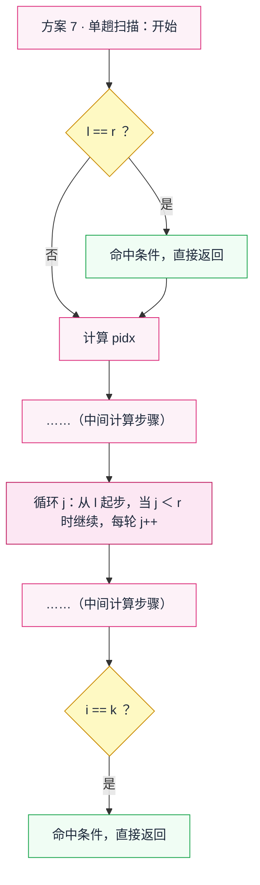

```typescript
// Faithful translation of python reference. Self-check via demo().
function _quickselect(nums: number[], l: number, r: number, k: number): number {
  // 定义函数/方法 _quickselect
  if (l === r) return nums[l]; // 若 左指针 全等于 右指针，直接返回 数组[左指针]
  const pidx = l + Math.floor(Math.random() * (r - l + 1)); // 把 左指针 加 向下取整(Math.random() 乘 (右指针 减 左指针 加 1)) 存入 pidx
  const t = nums[r];
  nums[r] = nums[pidx];
  nums[pidx] = t; // 把 数组[右指针]; 数组[右指针] 赋值为 数组[pidx]; 数组[pidx] 赋值为 另一字符串 存入 另一字符串
  const pivot = nums[r]; // 把 数组[右指针] 存入 pivot
  let i = l; // 把 左指针 存入 下标 i
  for (let j = l; j < r; j++) {
    // 让 下标 j 从 左指针 开始计数，下标 j 小于 右指针 就继续
    if (nums[j] <= pivot) {
      const x = nums[i];
      nums[i] = nums[j];
      nums[j] = x;
      i++;
    }
  }
  const y = nums[i];
  nums[i] = nums[r];
  nums[r] = y; // 把 数组[下标 i]; 数组[下标 i] 赋值为 数组[右指针]; 数组[右指针] 赋值为 y 存入 y
  if (i === k)
    return nums[i]; // 若 下标 i 全等于 下标 k，直接返回 数组[下标 i]
  else if (i > k) return _quickselect(nums, l, i - 1, k);
  else return _quickselect(nums, i + 1, r, k); // 否则
}
function find_kth_largest(nums: number[], k: number): number {
  // 定义函数/方法 find_kth_largest
  const a = nums.slice(); // 把 数组 截取 ) 存入 数组
  return _quickselect(a, 0, a.length - 1, a.length - k); // 返回 _quickselect(数组, 0, 数组.长度 减 1, 数组.长度 减 下标 k)
}
export function demo(): void {
  // 程序入口：跑内嵌自测用例
  const cases = [
    [[3, 2, 1, 5, 6, 4], 2],
    [[3, 2, 3, 1, 2, 4, 5, 5, 6], 4],
  ];
  const want = [5, 4]; // 把 [5, 4] 存入 want
  for (let i = 0; i < cases.length; i++) {
    // 让 下标 i 从 0 开始计数，下标 i 小于 cases.长度 就继续
    const got = find_kth_largest(cases[i][0].slice(), cases[i][1]);
    if (got !== want[i])
      throw new Error('FAIL case ' + i + ' got ' + got + ' want ' + want[i]);
  }
  console.log('PASS'); // 全部用例通过，输出 PASS
}
demo(); // demo();
```

### 方案 8：迭代指针处理

**分析与思路**：核心做法是「迭代指针处理」。

**运行方式**：`node 本文件`，内嵌用例全部通过会输出 PASS。


**方案专属流程图**（真实控制流）：

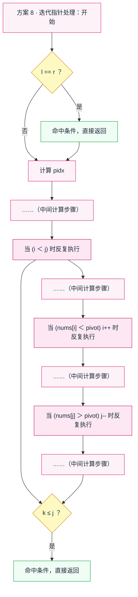

```typescript
// Faithful translation of python reference. Self-check via demo().
function _quickselect(nums: number[], l: number, r: number, k: number): number {
  // 定义函数/方法 _quickselect
  if (l === r) return nums[l]; // 若 左指针 全等于 右指针，直接返回 数组[左指针]
  const pidx = l + Math.floor(Math.random() * (r - l + 1)); // 把 左指针 加 向下取整(Math.random() 乘 (右指针 减 左指针 加 1)) 存入 pidx
  const t0 = nums[l];
  nums[l] = nums[pidx];
  nums[pidx] = t0; // 把 数组[左指针]; 数组[左指针] 赋值为 数组[pidx]; 数组[pidx] 赋值为 t0 存入 t0
  const pivot = nums[l]; // 把 数组[左指针] 存入 pivot
  let i = l - 1,
    j = r + 1; // 把 左指针 减 1, 下标 j 赋值为 右指针 加 1 存入 下标 i
  while (i < j) {
    // 循环，直到不满足「下标 i 小于 下标 j」
    i++;
    while (nums[i] < pivot) i++; // 下标 i 加一 ; while (数组[下标 i] 小于 pivot) 下标 i 加一 ;
    j--;
    while (nums[j] > pivot) j--; // 下标 j 减一 ; while (数组[下标 j] 超过 pivot) 下标 j 减一 ;
    if (i < j) {
      const t = nums[i];
      nums[i] = nums[j];
      nums[j] = t;
    }
  }
  if (k <= j)
    return _quickselect(nums, l, j, k); // 若 下标 k 不超过 下标 j，直接返回 _quickselect(数组, 左指针, 下标 j, 下标 k)
  else return _quickselect(nums, j + 1, r, k); // 否则
}
function find_kth_largest(nums: number[], k: number): number {
  // 定义函数/方法 find_kth_largest
  const a = nums.slice(); // 把 数组 截取 ) 存入 数组
  return _quickselect(a, 0, a.length - 1, a.length - k); // 返回 _quickselect(数组, 0, 数组.长度 减 1, 数组.长度 减 下标 k)
}
export function demo(): void {
  // 程序入口：跑内嵌自测用例
  const cases = [
    [[3, 2, 1, 5, 6, 4], 2],
    [[3, 2, 3, 1, 2, 4, 5, 5, 6], 4],
  ];
  const want = [5, 4]; // 把 [5, 4] 存入 want
  for (let i = 0; i < cases.length; i++) {
    // 让 下标 i 从 0 开始计数，下标 i 小于 cases.长度 就继续
    const got = find_kth_largest(cases[i][0].slice(), cases[i][1]);
    if (got !== want[i])
      throw new Error('FAIL case ' + i + ' got ' + got + ' want ' + want[i]);
  }
  console.log('PASS'); // 全部用例通过，输出 PASS
}
demo(); // demo();
```

### 方案 9：排序预处理

**分析与思路**：核心做法是「排序预处理」。代码里依次做这些事：先排序再处理。

**运行方式**：`node 本文件`，内嵌用例全部通过会输出 PASS。


**方案专属流程图**（真实控制流）：

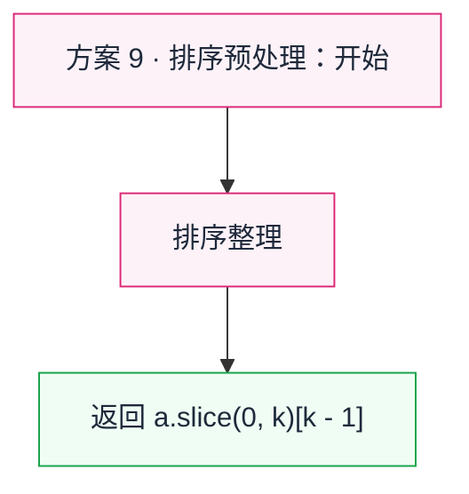

```typescript
// Faithful translation of python reference. Self-check via demo().
function find_kth_largest(nums: number[], k: number): number {
  // 定义函数/方法 find_kth_largest
  const a = nums.slice().sort((x, y) => y - x);
  return a.slice(0, k)[k - 1]; // 返回 数组 截取 0, 下标 k)[下标 k 减 1]
}
export function demo(): void {
  // 程序入口：跑内嵌自测用例
  const cases = [
    [[3, 2, 1, 5, 6, 4], 2],
    [[3, 2, 3, 1, 2, 4, 5, 5, 6], 4],
  ];
  const want = [5, 4]; // 把 [5, 4] 存入 want
  for (let i = 0; i < cases.length; i++) {
    // 让 下标 i 从 0 开始计数，下标 i 小于 cases.长度 就继续
    const got = find_kth_largest(cases[i][0].slice(), cases[i][1]);
    if (got !== want[i])
      throw new Error('FAIL case ' + i + ' got ' + got + ' want ' + want[i]);
  }
  console.log('PASS'); // 全部用例通过，输出 PASS
}
demo(); // demo();
```

### 方案 10：双重循环枚举

**分析与思路**：核心做法是「双重循环枚举」。代码里依次做这些事：双重循环遍历。

**运行方式**：`node 本文件`，内嵌用例全部通过会输出 PASS。


**方案专属流程图**（真实控制流）：

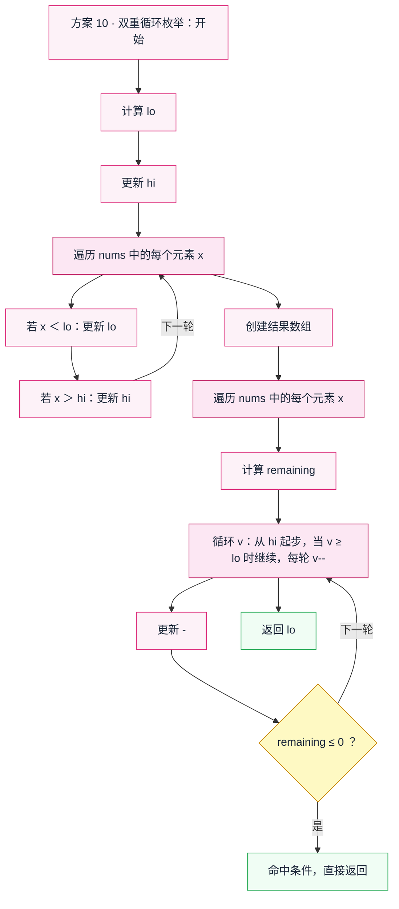

```typescript
// Faithful translation of python reference. Self-check via demo().
function find_kth_largest(nums: number[], k: number): number {
  // 定义函数/方法 find_kth_largest
  let lo = nums[0],
    hi = nums[0]; // 把 数组[0], 右边界 赋值为 数组[0] 存入 左边界
  for (const x of nums) {
    if (x < lo) lo = x;
    if (x > hi) hi = x;
  }
  const count = new Array(hi - lo + 1).fill(0); // 把 new Array(右边界 减 左边界 加 1).fill(0) 存入 计数
  for (const x of nums) count[x - lo]++; // for (const x of 数组) 计数[x 减 左边界] 加一 ;
  let remaining = k; // 把 下标 k 存入 remaining
  for (let v = hi; v >= lo; v--) {
    // 让 值 从 右边界 开始计数，值 不低于 左边界 就继续
    remaining -= count[v - lo]; // remaining累减 计数[值 减 左边界]
    if (remaining <= 0) return v; // 若 remaining 不超过 0，直接返回 值
  }
  return lo; // 返回 左边界
}
export function demo(): void {
  // 程序入口：跑内嵌自测用例
  const cases = [
    [[3, 2, 1, 5, 6, 4], 2],
    [[3, 2, 3, 1, 2, 4, 5, 5, 6], 4],
  ];
  const want = [5, 4]; // 把 [5, 4] 存入 want
  for (let i = 0; i < cases.length; i++) {
    // 让 下标 i 从 0 开始计数，下标 i 小于 cases.长度 就继续
    const got = find_kth_largest(cases[i][0].slice(), cases[i][1]);
    if (got !== want[i])
      throw new Error('FAIL case ' + i + ' got ' + got + ' want ' + want[i]);
  }
  console.log('PASS'); // 全部用例通过，输出 PASS
}
demo(); // demo();
```

### 方案 11：双重循环枚举

**分析与思路**：核心做法是「双重循环枚举」。代码里依次做这些事：双重循环遍历。

**运行方式**：`node 本文件`，内嵌用例全部通过会输出 PASS。


**方案专属流程图**（真实控制流）：

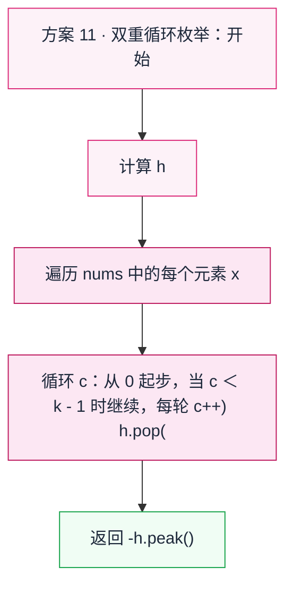

```typescript
// Faithful translation of python reference. Self-check via demo().
class MinHeap {
  // 定义类型
  heap: number[] = []; // 把 []; 写入 heap: number[]
  size(): number {
    return this.heap.length;
  } // 大小(): number { return this.堆.长度; }
  peak(): number {
    return this.heap[0];
  } // peak(): number { return this.堆[0]; }
  insert(val: number): void {
    // insert(值: number): void {
    this.heap.push(val); // 把 值 压入栈/数组尾部
    let i = this.heap.length - 1; // 把 this.堆.长度 减 1 存入 下标 i
    while (i > 0) {
      // 循环，直到不满足「下标 i 超过 0」
      const p = (i - 1) >> 1; // 把 (下标 i 减 1) 超过 超过 1 存入 节点
      if (this.heap[p] <= this.heap[i]) break; // 若 this.堆[节点] 不超过 this.堆[下标 i]) break;
      const t = this.heap[p];
      this.heap[p] = this.heap[i];
      this.heap[i] = t;
      i = p; // 把 节点 存入 下标 i
    }
  }
  pop(): number {
    // pop(): number {
    const top = this.heap[0]; // 把 this.堆[0] 存入 top
    const last = this.heap.pop()!; // 把 this.堆 弹出 )取反 存入 last
    if (this.heap.length > 0) {
      // 若 this.堆.长度 超过 0
      this.heap[0] = last; // 把 last; 写入 this.heap[0]
      let i = 0; // 把 0 存入 下标 i
      const n = this.heap.length; // 把 this.堆.长度 存入 元素个数
      while (true) {
        // 循环，直到不满足「true」
        let l = 2 * i + 1,
          r = 2 * i + 2,
          sm = i; // 把 2 乘 下标 i 加 1, 右指针 赋值为 2 乘 下标 i 加 2, sm 赋值为 下标 i 存入 左指针
        if (l < n && this.heap[l] < this.heap[sm]) sm = l; // 若 左指针 小于 元素个数 且 this.堆[左指针] 小于 this.堆[sm]) sm 赋值为 左指针;
        if (r < n && this.heap[r] < this.heap[sm]) sm = r; // 若 右指针 小于 元素个数 且 this.堆[右指针] 小于 this.堆[sm]) sm 赋值为 右指针;
        if (sm === i) break; // 若 sm 全等于 下标 i) break;
        const t = this.heap[sm];
        this.heap[sm] = this.heap[i];
        this.heap[i] = t;
        i = sm; // 把 sm 存入 下标 i
      }
    }
    return top; // 返回 top
  }
}

function find_kth_largest(nums: number[], k: number): number {
  // 定义函数/方法 find_kth_largest
  const h = new MinHeap(); // 把 new MinHeap() 存入 h
  for (const x of nums) h.insert(-x); // for (const x of 数组) h 插入 减 x);
  for (let c = 0; c < k - 1; c++) h.pop(); // 让 字符 从 0 开始计数，字符 小于 下标 k 减 1 就继续
  return -h.peak(); // 返回 减 h.peak()
}
export function demo(): void {
  // 程序入口：跑内嵌自测用例
  const cases = [
    [[3, 2, 1, 5, 6, 4], 2],
    [[3, 2, 3, 1, 2, 4, 5, 5, 6], 4],
  ];
  const want = [5, 4]; // 把 [5, 4] 存入 want
  for (let i = 0; i < cases.length; i++) {
    // 让 下标 i 从 0 开始计数，下标 i 小于 cases.长度 就继续
    const got = find_kth_largest(cases[i][0].slice(), cases[i][1]);
    if (got !== want[i])
      throw new Error('FAIL case ' + i + ' got ' + got + ' want ' + want[i]);
  }
  console.log('PASS'); // 全部用例通过，输出 PASS
}
demo(); // demo();
```

### 方案 12：排序预处理

**分析与思路**：核心做法是「排序预处理」。代码里依次做这些事：先排序再处理。

**运行方式**：`node 本文件`，内嵌用例全部通过会输出 PASS。

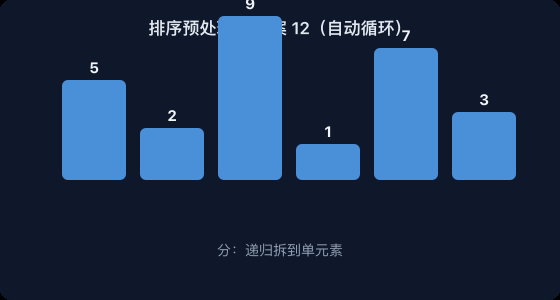

**方案专属流程图**（真实控制流）：

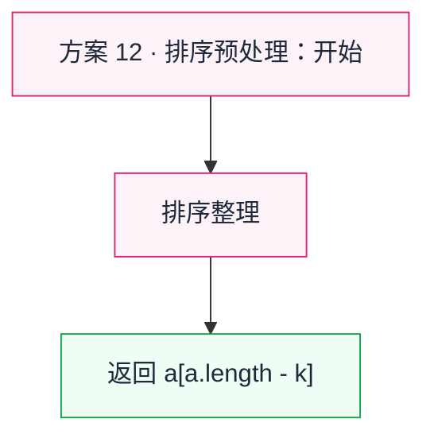

```typescript
// Faithful translation of python reference. Self-check via demo().
function find_kth_largest(nums: number[], k: number): number {
  // 定义函数/方法 find_kth_largest
  const a = nums.slice().sort((x, y) => x - y);
  return a[a.length - k]; // 返回 数组[数组.长度 减 下标 k]
}
export function demo(): void {
  // 程序入口：跑内嵌自测用例
  const cases = [
    [[3, 2, 1, 5, 6, 4], 2],
    [[3, 2, 3, 1, 2, 4, 5, 5, 6], 4],
  ];
  const want = [5, 4]; // 把 [5, 4] 存入 want
  for (let i = 0; i < cases.length; i++) {
    // 让 下标 i 从 0 开始计数，下标 i 小于 cases.长度 就继续
    const got = find_kth_largest(cases[i][0].slice(), cases[i][1]);
    if (got !== want[i])
      throw new Error('FAIL case ' + i + ' got ' + got + ' want ' + want[i]);
  }
  console.log('PASS'); // 全部用例通过，输出 PASS
}
demo(); // demo();
```

## 逐步拆解与面试追问

**复杂度**：时间 O(n) 量级，空间 O(n)

**为什么是这个量级**：整体只对数据做有限趟处理

**面试官可能会追问**：

- 什么时候用堆而不是排序？
- 堆里存值还是存下标？
- Top-K 用小顶还是大顶堆？

## 关键 API 速查（TS 主解法实际用到，附官方链接）

| API | 作用 | 使用要点 | 官方文档 |
|---|---|---|---|
| `Array.prototype.sort()` | 原地排序 | 默认按字符串 Unicode 序（10 会排在 2 前），数字必须传 (a,b)=>a-b；V8 用 TimSort，稳定，O(n log n)；返回原数组引用 | [官方文档](https://developer.mozilla.org/zh-CN/docs/Web/JavaScript/Reference/Global_Objects/Array/sort) |
| `Array/String slice()` | 切片（不改原数组） | slice(start,end) 含头不含尾；负数从尾计；常用于复制数组（slice()） | [官方文档](https://developer.mozilla.org/zh-CN/docs/Web/JavaScript/Reference/Global_Objects/Array/slice) |

### 各语言官方文档导航

- **TypeScript / JS**：[MDN 中文参考](https://developer.mozilla.org/zh-CN/)
- **Python**：[Python 官方文档](https://docs.python.org/zh-cn/3/)
- **Go**：[Go 标准库](https://pkg.go.dev/std)
- **Java**：[JDK 17 API](https://docs.oracle.com/en/java/javase/17/docs/api/)
- **Rust**：[Rust 标准库](https://doc.rust-lang.org/std/)
- **Lua**：[Lua 5.4 手册](https://www.lua.org/manual/5.4/)
- **C**：[Cppreference C](https://zh.cppreference.com/w/c)
- **C++**：[Cppreference C++](https://zh.cppreference.com/w/cpp)
- **R**：[R 官方手册](https://stat.ethz.ch/R-manual/)
- **Zig**：[Zig 语言文档](https://ziglang.org/documentation/master/)
- **Dart**：[Dart API](https://api.dart.dev/)

## 附录：其他 10 种语言全部实现（每种语言列举其全部方案）

> TypeScript 的全部方案见「TypeScript 解题方案」一节；下面是其余 10 种语言的对应实现，每种语言的每个方案都带思路分析、代码走读与专属运行架构图。
> 每个方案都内嵌用例自测，可独立运行（老仓库 python/go 文件遵循「打印结果」约定）。
> 完整解法文件见 `dsa/<语言>/heap/lc_215_数组中的第k个最大元素/`。

### Python 实现（12 种方案）

Python 的全部方案如下，每个方案都内嵌用例自测，可独立运行（老仓库 python/go 文件遵循「打印结果」约定）：

#### 方案 1：排序预处理

**思路与代码分析**：核心是「排序预处理」。Python 版用切片与字典推导式简化操作，突出可读性。代码里依次做这些事：先排序再处理。**走读**：方案 1 · 排序预处理：开始 → 返回 sorted(nums, reverse=True)[k - 1]。

**运行架构**（真实控制流）：

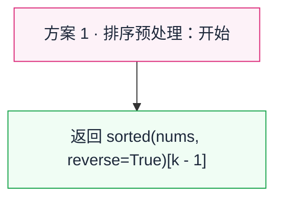

```python
import sys  # 提高递归深度上限（深输入防 RecursionError）

sys.setrecursionlimit(200000)  # 树/链表类题目节点数可达 1e4 量级

def findKthLargest(nums, k):  # 定义函数 findKthLargest（参数：数组, 下标 k）
    return sorted(nums, reverse=True)[k - 1]  # 返回 sorted(数组, reverse 赋值为 True)[下标 k 减 1]

if __name__ == "__main__":  # 若 __name__ 等于 '__main__'
    print(findKthLargest([1, 2, 3], 1))  # 打印输出
```

#### 方案 2：单趟扫描

**思路与代码分析**：核心是「单趟扫描」。Python 版用切片与字典推导式简化操作，突出可读性。**走读**：方案 2 · 单趟扫描：开始 → 更新 h → 遍历 nums: 中的每个元素 n → 调用 h.insert(n) → 若 h.size() ＞ k：从 h 弹出 → 从 h 弹出 → 返回 h.peak()。

**运行架构**（真实控制流）：

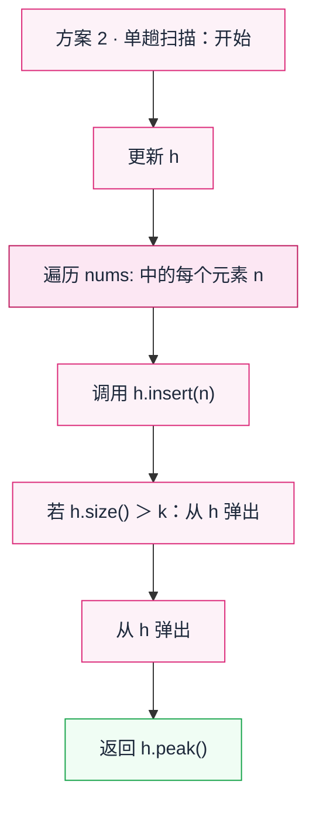

```python
import sys  # 提高递归深度上限（深输入防 RecursionError）

sys.setrecursionlimit(200000)  # 树/链表类题目节点数可达 1e4 量级
import heapq  # 引入依赖

class MinHeap:  # 定义类
    def __init__(self):  # 构造函数：初始化成员
        self.heap = []  # 把 [] 写入 堆

    def size(self):  # 定义函数 size（参数：self）
        return len(self.heap)  # 返回 长度(self.堆)

    def peak(self):  # 定义函数 peak（参数：self）
        return self.heap[0]  # 返回 self.堆[0]

    def insert(self, val):  # 定义函数 insert（参数：self, 值）
        heapq.heappush(self.heap, val)  # heapq.heappush(self.堆, 值)

    def pop(self):  # 定义函数 pop（参数：self）
        return heapq.heappop(self.heap)  # 返回 heapq.heappop(self.堆)

def findKthLargest(nums, k):  # 定义函数 findKthLargest（参数：数组, 下标 k）
    h = MinHeap()  # 把 MinHeap() 存入 h
    for n in nums:  # 逐个取出 数组 的元素（元素个数）
        h.insert(n)  # h 插入 元素个数)
        if h.size() > k:  # 若 h.大小() 超过 下标 k
            h.pop()  # 弹出栈顶元素
    return h.peak()  # 返回 h.peak()

if __name__ == "__main__":  # 若 __name__ 等于 '__main__'
    print(findKthLargest([3, 2, 1, 5, 6, 4], 2))  # 打印输出
    print(findKthLargest([3, 2, 3, 1, 2, 4, 5, 5, 6], 4))  # 打印输出
```

#### 方案 3：双重循环枚举

**思路与代码分析**：核心是「双重循环枚举」。Python 版用切片与字典推导式简化操作，突出可读性。**走读**：方案 3 · 双重循环枚举：开始 → 更新 nums → 更新 length → 循环 i：从 length 到 -1 前，步长 length - k → 循环 j：从 0 到 i 前 → 若 nums[j] ＞ nums[j + 1]：更新 1] → 更新 1] → 处理 nums[j + 1], → 处理 nums[j], → 处理 ) → 返回 nums[length - k + 1]。

**运行架构**（真实控制流）：

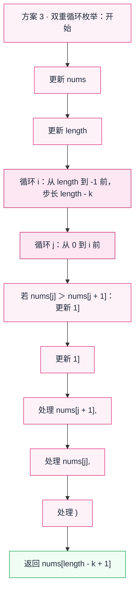

```python
import sys  # 提高递归深度上限（深输入防 RecursionError）

sys.setrecursionlimit(200000)  # 树/链表类题目节点数可达 1e4 量级

def findKthLargest(nums, k):  # 定义函数 findKthLargest（参数：数组, 下标 k）
    nums = nums[:]  # 把 复制 数组 存入 数组
    length = len(nums) - 1  # 把 长度(数组) 减 1 存入 长度
    for i in range(length, length - k, -1):  # 让 下标 i 从 长度 到 长度 减 下标 k 到 减 1 遍历
        for j in range(i):  # 让 下标 j 从 下标 i 遍历
            if nums[j] > nums[j + 1]:  # 若 数组[下标 j] 超过 数组[下标 j 加 1]
                nums[j], nums[j + 1] = (
                    nums[j + 1],
                    nums[j],
                )  # 把 数组[下标 j 加 1], 数组[下标 j] 写入 nums[j], nums[j + 1]
    return nums[length - k + 1]  # 返回 数组[长度 减 下标 k 加 1]

if __name__ == "__main__":  # 若 __name__ 等于 '__main__'
    print(findKthLargest([1, 2, 3], 1))  # 打印输出
```

#### 方案 4：迭代指针处理

**思路与代码分析**：核心是「迭代指针处理」。Python 版用切片与字典推导式简化操作，突出可读性。**走读**：方案 4 · 迭代指针处理：开始 → 命中条件，直接返回 → 更新 pivot → 当 i ＜ j: 时反复执行 → 当 True: 时反复执行 → 当 True: 时反复执行 → 返回 quickselect(nums, l, j, k) if k ≤ j else quickselect(nums, j + 1, r, k)。

**运行架构**（真实控制流）：

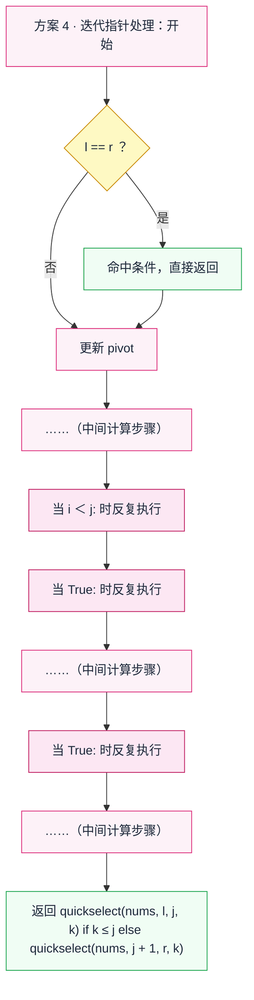

```python
import sys  # 提高递归深度上限（深输入防 RecursionError）

sys.setrecursionlimit(200000)  # 树/链表类题目节点数可达 1e4 量级

def quickselect(nums, l, r, k):  # 定义函数 quickselect（参数：数组, 左指针, 右指针, 下标 k）
    if l == r:  # 若 左指针 等于 右指针
        return nums[k]  # 返回 数组[下标 k]
    pivot = nums[l]  # 把 数组[左指针] 存入 pivot
    i, j = l - 1, r + 1  # 把 左指针 减 1, 右指针 加 1 写入 i, j
    while i < j:  # 循环，直到不满足「下标 i 小于 下标 j」
        while True:  # 循环，直到不满足「True」
            i += 1  # 下标 i累加 1
            if nums[i] <= pivot:  # 若 数组[下标 i] 不超过 pivot
                continue  # 跳过本轮，进入下一次
            break  # 跳出循环
        while True:  # 循环，直到不满足「True」
            j -= 1  # 下标 j累减 1
            if nums[j] >= pivot:  # 若 数组[下标 j] 不低于 pivot
                continue  # 跳过本轮，进入下一次
            break  # 跳出循环
        if i < j:  # 若 下标 i 小于 下标 j
            nums[i], nums[j] = nums[j], nums[i]  # 把 数组[下标 j], 数组[下标 i] 写入 nums[i], nums[j]
    return quickselect(nums, l, j, k) if k <= j else quickselect(nums, j + 1, r, k)

def findKthLargest(nums, k):  # 定义函数 findKthLargest（参数：数组, 下标 k）
    n = len(nums)  # 把 长度(数组) 存入 元素个数
    return quickselect(nums, 0, n - 1, n - k)  # 返回 quickselect(数组, 0, 元素个数 减 1, 元素个数 减 下标 k)

if __name__ == "__main__":  # 若 __name__ 等于 '__main__'
    print(quickselect([1, 2, 3], None, None, 1))  # 打印输出
```

#### 方案 5：排序预处理

**思路与代码分析**：核心是「排序预处理」。Python 版用切片与字典推导式简化操作，突出可读性。代码里依次做这些事：队列或堆的调度。**走读**：方案 5 · 排序预处理：开始 → 返回 heapq.nlargest(k, nums)[-1]。

**运行架构**（真实控制流）：

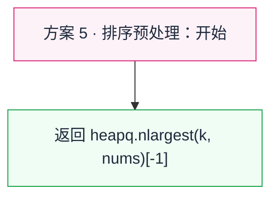

```python
import sys  # 提高递归深度上限（深输入防 RecursionError）

sys.setrecursionlimit(200000)  # 树/链表类题目节点数可达 1e4 量级
import heapq  # 引入依赖

def findKthLargest(nums, k):  # 定义函数 findKthLargest（参数：数组, 下标 k）
    return heapq.nlargest(k, nums)[-1]  # 返回 heapq.nlargest(下标 k, 数组)[ 减 1]

if __name__ == "__main__":  # 若 __name__ 等于 '__main__'
    print(findKthLargest([1, 2, 3], 1))  # 打印输出
```

#### 方案 6：单趟扫描

**思路与代码分析**：核心是「单趟扫描」。Python 版用切片与字典推导式简化操作，突出可读性。代码里依次做这些事：队列或堆的调度。**走读**：方案 6 · 单趟扫描：开始 → 更新 heap → 遍历 nums: 中的每个元素 x → 调用 heapq.heappush(heap, x) → 若 len(heap) ＞ k：调用 heapq.heappop(heap) → 调用 heapq.heappop(heap) → 返回 heap[0]。

**运行架构**（真实控制流）：

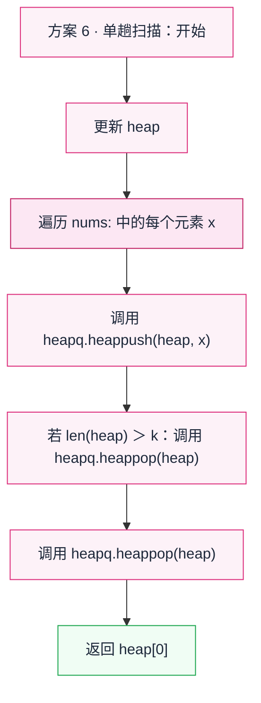

```python
# 数组中的第 K 个最大元素 - 方案: 大小为 k 的小顶堆
import sys  # 提高递归深度上限（深输入防 RecursionError）

sys.setrecursionlimit(200000)  # 树/链表类题目节点数可达 1e4 量级
import heapq  # 引入依赖

def find_kth_largest(nums, k):  # 定义函数 find_kth_largest（参数：数组, 下标 k）
    heap = []  # 把 [] 存入 堆
    for x in nums:  # 逐个取出 数组 的元素（x）
        heapq.heappush(heap, x)  # heapq.heappush(堆, x)
        if len(heap) > k:  # 若 长度(堆) 超过 下标 k
            heapq.heappop(heap)  # heapq.heappop(堆)
    return heap[0]  # 返回 堆[0]

if __name__ == "__main__":  # 若 __name__ 等于 '__main__'
    print(find_kth_largest([3, 2, 1, 5, 6, 4], 2))  # 5
```

#### 方案 7：单趟扫描

**思路与代码分析**：核心是「单趟扫描」。Python 版用切片与字典推导式简化操作，突出可读性。**走读**：方案 7 · 单趟扫描：开始 → 更新 a → 返回 _quickselect( → 处理 a, 0, len(a) - 1, len(a) - k → 处理 )。

**运行架构**（真实控制流）：

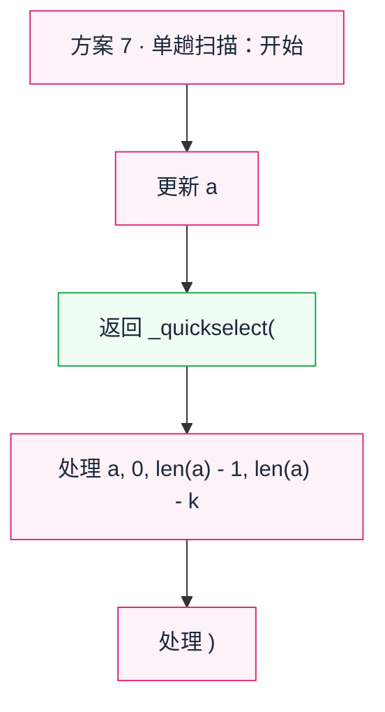

```python
# 数组中的第 K 个最大元素 - 方案: 快速选择 (Lomuto 分区)
import sys  # 提高递归深度上限（深输入防 RecursionError）

sys.setrecursionlimit(200000)  # 树/链表类题目节点数可达 1e4 量级
import random  # 引入依赖

def find_kth_largest(nums, k):  # 定义函数 find_kth_largest（参数：数组, 下标 k）
    a = list(nums)  # 把 列表(数组) 存入 数组
    return _quickselect(
        a, 0, len(a) - 1, len(a) - k
    )  # 返回 _quickselect(数组, 0, 长度(数组) 减 1, 长度(数组) 减 下标 k)

def _quickselect(nums, l, r, k):  # 定义函数 _quickselect（参数：数组, 左指针, 右指针, 下标 k）
    if l == r:  # 若 左指针 等于 右指针
        return nums[l]  # 返回 数组[左指针]
    pidx = random.randint(l, r)  # 把 random.randint(左指针, 右指针) 存入 pidx
    nums[r], nums[pidx] = nums[pidx], nums[r]  # 把 数组[pidx], 数组[右指针] 写入 nums[r], nums[pidx]
    pivot = nums[r]  # 把 数组[右指针] 存入 pivot
    i = l  # 把 左指针 存入 下标 i
    for j in range(l, r):  # 让 下标 j 从 左指针 到 右指针 遍历
        if nums[j] <= pivot:  # 若 数组[下标 j] 不超过 pivot
            nums[i], nums[j] = nums[j], nums[i]  # 把 数组[下标 j], 数组[下标 i] 写入 nums[i], nums[j]
            i += 1  # 下标 i累加 1
    nums[i], nums[r] = nums[r], nums[i]  # 把 数组[右指针], 数组[下标 i] 写入 nums[i], nums[r]
    if i == k:  # 若 下标 i 等于 下标 k
        return nums[i]  # 返回 数组[下标 i]
    elif i > k:  # 否则，若 下标 i 超过 下标 k
        return _quickselect(nums, l, i - 1, k)  # 返回 _quickselect(数组, 左指针, 下标 i 减 1, 下标 k)
    else:  # 否则
        return _quickselect(nums, i + 1, r, k)  # 返回 _quickselect(数组, 下标 i 加 1, 右指针, 下标 k)

if __name__ == "__main__":  # 若 __name__ 等于 '__main__'
    print(find_kth_largest([3, 2, 1, 5, 6, 4], 2))  # 5
```

#### 方案 8：迭代指针处理

**思路与代码分析**：核心是「迭代指针处理」。Python 版用切片与字典推导式简化操作，突出可读性。**走读**：方案 8 · 迭代指针处理：开始 → 更新 a → 返回 _quickselect( → 处理 a, 0, len(a) - 1, len(a) - k → 处理 )。

**运行架构**（真实控制流）：

```mermaid
graph TD
    N0["方案 8 · 迭代指针处理：开始"]
    N1["更新 a"]
    N2["返回 _quickselect("]
    N3["处理 a, 0, len(a) - 1, len(a) - k"]
    N4["处理 )"]
    N0 --> N1
    N1 --> N2
    N2 --> N3
    N3 --> N4
    classDef n fill:#fdf2f8,stroke:#db2777,color:#1e293b;
    classDef lp fill:#fce7f3,stroke:#be185d,color:#1e293b;
    classDef dc fill:#fef9c3,stroke:#ca8a04,color:#1e293b;
    classDef tm fill:#f0fdf4,stroke:#16a34a,color:#1e293b;
    class N0,N1,N3,N4 n;
    class N2 tm;
```

```python
# 数组中的第 K 个最大元素 - 方案: 快速选择 (Hoare 分区, 随机 pivot)
import sys  # 提高递归深度上限（深输入防 RecursionError）

sys.setrecursionlimit(200000)  # 树/链表类题目节点数可达 1e4 量级
import random  # 引入依赖

def find_kth_largest(nums, k):  # 定义函数 find_kth_largest（参数：数组, 下标 k）
    a = list(nums)  # 把 列表(数组) 存入 数组
    return _quickselect(
        a, 0, len(a) - 1, len(a) - k
    )  # 返回 _quickselect(数组, 0, 长度(数组) 减 1, 长度(数组) 减 下标 k)

def _quickselect(nums, l, r, k):  # 定义函数 _quickselect（参数：数组, 左指针, 右指针, 下标 k）
    if l == r:  # 若 左指针 等于 右指针
        return nums[l]  # 返回 数组[左指针]
    pidx = random.randint(l, r)  # 把 random.randint(左指针, 右指针) 存入 pidx
    nums[l], nums[pidx] = nums[pidx], nums[l]  # 把 数组[pidx], 数组[左指针] 写入 nums[l], nums[pidx]
    pivot = nums[l]  # 把 数组[左指针] 存入 pivot
    i = l - 1  # 把 左指针 减 1 存入 下标 i
    j = r + 1  # 把 右指针 加 1 存入 下标 j
    while i < j:  # 循环，直到不满足「下标 i 小于 下标 j」
        i += 1  # 下标 i累加 1
        while nums[i] < pivot:  # 循环，直到不满足「数组[下标 i] 小于 pivot」
            i += 1  # 下标 i累加 1
        j -= 1  # 下标 j累减 1
        while nums[j] > pivot:  # 循环，直到不满足「数组[下标 j] 超过 pivot」
            j -= 1  # 下标 j累减 1
        if i < j:  # 若 下标 i 小于 下标 j
            nums[i], nums[j] = nums[j], nums[i]  # 把 数组[下标 j], 数组[下标 i] 写入 nums[i], nums[j]
    if k <= j:  # 若 下标 k 不超过 下标 j
        return _quickselect(nums, l, j, k)  # 返回 _quickselect(数组, 左指针, 下标 j, 下标 k)
    else:  # 否则
        return _quickselect(nums, j + 1, r, k)  # 返回 _quickselect(数组, 下标 j 加 1, 右指针, 下标 k)

if __name__ == "__main__":  # 若 __name__ 等于 '__main__'
    print(find_kth_largest([3, 2, 1, 5, 6, 4], 2))  # 5
```

#### 方案 9：排序预处理

**思路与代码分析**：核心是「排序预处理」。Python 版用切片与字典推导式简化操作，突出可读性。代码里依次做这些事：队列或堆的调度。**走读**：方案 9 · 排序预处理：开始 → 返回 heapq.nlargest(k, nums)[-1]。

**运行架构**（真实控制流）：

```mermaid
graph TD
    N0["方案 9 · 排序预处理：开始"]
    N1["返回 heapq.nlargest(k, nums)[-1]"]
    N0 --> N1
    classDef n fill:#fdf2f8,stroke:#db2777,color:#1e293b;
    classDef lp fill:#fce7f3,stroke:#be185d,color:#1e293b;
    classDef dc fill:#fef9c3,stroke:#ca8a04,color:#1e293b;
    classDef tm fill:#f0fdf4,stroke:#16a34a,color:#1e293b;
    class N0 n;
    class N1 tm;
```

```python
# 数组中的第 K 个最大元素 - 方案: heapq.nlargest
import sys  # 提高递归深度上限（深输入防 RecursionError）

sys.setrecursionlimit(200000)  # 树/链表类题目节点数可达 1e4 量级
import heapq  # 引入依赖

def find_kth_largest(nums, k):  # 定义函数 find_kth_largest（参数：数组, 下标 k）
    return heapq.nlargest(k, nums)[-1]  # 返回 heapq.nlargest(下标 k, 数组)[ 减 1]

if __name__ == "__main__":  # 若 __name__ 等于 '__main__'
    print(find_kth_largest([3, 2, 1, 5, 6, 4], 2))  # 5
```

#### 方案 10：双重循环枚举

**思路与代码分析**：核心是「双重循环枚举」。Python 版用切片与字典推导式简化操作，突出可读性。**走读**：方案 10 · 双重循环枚举：开始 → 更新 lo → 更新 hi → 更新 count → 遍历 nums: 中的每个元素 x → 更新 + → 更新 remaining → 循环 v：从 hi 到 -1 前，步长 lo - 1 → 更新 - → 命中条件，直接返回 → 返回 lo。

**运行架构**（真实控制流）：

```mermaid
graph TD
    N0["方案 10 · 双重循环枚举：开始"]
    N1["更新 lo"]
    N2["更新 hi"]
    N3["更新 count"]
    N4["遍历 nums: 中的每个元素 x"]
    N5["更新 +"]
    N6["更新 remaining"]
    N7["循环 v：从 hi 到 -1 前，步长 lo - 1"]
    N8["更新 -"]
    N9{"remaining ≤ 0 ？"}
    N10["命中条件，直接返回"]
    N11["返回 lo"]
    N0 --> N1
    N1 --> N2
    N2 --> N3
    N3 --> N4
    N4 --> N5
    N5 --> N6
    N6 --> N7
    N7 --> N8
    N8 --> N9
    N9 -- 是 --> N10
    N9 -- 否 --> N11
    classDef n fill:#fdf2f8,stroke:#db2777,color:#1e293b;
    classDef lp fill:#fce7f3,stroke:#be185d,color:#1e293b;
    classDef dc fill:#fef9c3,stroke:#ca8a04,color:#1e293b;
    classDef tm fill:#f0fdf4,stroke:#16a34a,color:#1e293b;
    class N0,N1,N2,N3,N5,N6,N8 n;
    class N4,N7 lp;
    class N9 dc;
    class N10,N11 tm;
```

```python
# 数组中的第 K 个最大元素 - 方案: 计数排序 (按值域)

import sys  # 提高递归深度上限（深输入防 RecursionError）

sys.setrecursionlimit(200000)  # 树/链表类题目节点数可达 1e4 量级

def find_kth_largest(nums, k):  # 定义函数 find_kth_largest（参数：数组, 下标 k）
    lo = min(nums)  # 把 取较小值 数组) 存入 左边界
    hi = max(nums)  # 把 取较大值 数组) 存入 右边界
    count = [0] * (hi - lo + 1)  # 把 [0] 乘 (右边界 减 左边界 加 1) 存入 计数
    for x in nums:  # 逐个取出 数组 的元素（x）
        count[x - lo] += 1  # 把 1 写入 count[x - lo] +
    remaining = k  # 把 下标 k 存入 remaining
    for v in range(hi, lo - 1, -1):  # 让 值 从 右边界 到 左边界 减 1 到 减 1 遍历
        remaining -= count[v - lo]  # remaining累减 计数[值 减 左边界]
        if remaining <= 0:  # 若 remaining 不超过 0
            return v  # 返回 值
    return lo  # 返回 左边界

if __name__ == "__main__":  # 若 __name__ 等于 '__main__'
    print(find_kth_largest([3, 2, 1, 5, 6, 4], 2))  # 5
```

#### 方案 11：双重循环枚举

**思路与代码分析**：核心是「双重循环枚举」。Python 版用切片与字典推导式简化操作，突出可读性。代码里依次做这些事：队列或堆的调度。**走读**：方案 11 · 双重循环枚举：开始 → 更新 heap → 调用 heapq.heapify(heap) → 循环 _：从 0 到 k - 1 前 → 调用 heapq.heappop(heap) → 返回 -heap[0]。

**运行架构**（真实控制流）：

```mermaid
graph TD
    N0["方案 11 · 双重循环枚举：开始"]
    N1["更新 heap"]
    N2["调用 heapq.heapify(heap)"]
    N3["循环 _：从 0 到 k - 1 前"]
    N4["调用 heapq.heappop(heap)"]
    N5["返回 -heap[0]"]
    N0 --> N1
    N1 --> N2
    N2 --> N3
    N3 --> N4
    N4 --> N5
    classDef n fill:#fdf2f8,stroke:#db2777,color:#1e293b;
    classDef lp fill:#fce7f3,stroke:#be185d,color:#1e293b;
    classDef dc fill:#fef9c3,stroke:#ca8a04,color:#1e293b;
    classDef tm fill:#f0fdf4,stroke:#16a34a,color:#1e293b;
    class N0,N1,N2,N4 n;
    class N3 lp;
    class N5 tm;
```

```python
# 数组中的第 K 个最大元素 - 方案: 大顶堆 (值取负)
import sys  # 提高递归深度上限（深输入防 RecursionError）

sys.setrecursionlimit(200000)  # 树/链表类题目节点数可达 1e4 量级
import heapq  # 引入依赖

def find_kth_largest(nums, k):  # 定义函数 find_kth_largest（参数：数组, 下标 k）
    heap = [-x for x in nums]  # 把 [ 减 x for x in 数组] 存入 堆
    heapq.heapify(heap)  # heapq.heapify(堆)
    for _ in range(k - 1):  # 让 _ 从 下标 k 减 1 遍历
        heapq.heappop(heap)  # heapq.heappop(堆)
    return -heap[0]  # 返回 减 堆[0]

if __name__ == "__main__":  # 若 __name__ 等于 '__main__'
    print(find_kth_largest([3, 2, 1, 5, 6, 4], 2))  # 5
```

#### 方案 12：排序预处理

**思路与代码分析**：核心是「排序预处理」。Python 版用切片与字典推导式简化操作，突出可读性。代码里依次做这些事：先排序再处理。**走读**：方案 12 · 排序预处理：开始 → 返回 sorted(nums)[len(nums) - k]。

**运行架构**（真实控制流）：

```mermaid
graph TD
    N0["方案 12 · 排序预处理：开始"]
    N1["返回 sorted(nums)[len(nums) - k]"]
    N0 --> N1
    classDef n fill:#fdf2f8,stroke:#db2777,color:#1e293b;
    classDef lp fill:#fce7f3,stroke:#be185d,color:#1e293b;
    classDef dc fill:#fef9c3,stroke:#ca8a04,color:#1e293b;
    classDef tm fill:#f0fdf4,stroke:#16a34a,color:#1e293b;
    class N0 n;
    class N1 tm;
```

```python
# 数组中的第 K 个最大元素 - 方案: 排序后取第 k 个

import sys  # 提高递归深度上限（深输入防 RecursionError）

sys.setrecursionlimit(200000)  # 树/链表类题目节点数可达 1e4 量级

def find_kth_largest(nums, k):  # 定义函数 find_kth_largest（参数：数组, 下标 k）
    return sorted(nums)[len(nums) - k]  # 返回 sorted(数组)[长度(数组) 减 下标 k]

if __name__ == "__main__":  # 若 __name__ 等于 '__main__'
    print(find_kth_largest([3, 2, 1, 5, 6, 4], 2))  # 5
```

### Go 实现（12 种方案）

Go 的全部方案如下，每个方案都内嵌用例自测，可独立运行（老仓库 python/go 文件遵循「打印结果」约定）：

#### 方案 1：排序预处理

**思路与代码分析**：核心是「排序预处理」。Go 版用切片与多返回值惯用法，显式处理索引边界。**走读**：方案 1 · 排序预处理：开始 → 更新 : → 调用 copy(s, nums) → 调用 sort.Slice(s, func(i, j int) → 返回 s[k-1]。

**运行架构**（真实控制流）：

```mermaid
graph TD
    N0["方案 1 · 排序预处理：开始"]
    N1["更新 :"]
    N2["调用 copy(s, nums)"]
    N3["调用 sort.Slice(s, func(i, j int)"]
    N4["返回 s[k-1]"]
    N0 --> N1
    N1 --> N2
    N2 --> N3
    N3 --> N4
    classDef n fill:#fdf2f8,stroke:#db2777,color:#1e293b;
    classDef lp fill:#fce7f3,stroke:#be185d,color:#1e293b;
    classDef dc fill:#fef9c3,stroke:#ca8a04,color:#1e293b;
    classDef tm fill:#f0fdf4,stroke:#16a34a,color:#1e293b;
    class N0,N1,N2,N3 n;
    class N4 tm;
```

```go
package main // 引入依赖

import (
	"fmt"
	"os"
	"sort"
) // 引入依赖

func findKthLargest(nums []int, k int) int { // 定义函数/方法 findKthLargest
	s := make([]int, len(nums)) // 把 make([]int, 长度(数组)) 写入 s :
	copy(s, nums)               // copy(字符串, 数组)
	sort.Slice(s, func(i, j int) bool { return s[i] > s[j] })
	return s[k-1] // 返回 字符串[下标 k 减 1]
}

func main() { // 程序入口：跑内嵌自测用例
	cases := []struct {
		nums []int
		k    int
		want int
	}{ // 把 []struct{ 数组 []int; 下标 k int; want int }{ 写入 cases :
		{[]int{1, 2, 3}, 1, 3},
		{[]int{3, 2, 1, 5, 6, 4}, 2, 5},
	}
	ok := true                // 把 true 写入 ok :
	for _, c := range cases { // 同时取 _ 与 字符 遍历
		if got := findKthLargest(c.nums, c.k); got != c.want { // 若 got : 赋值为 findKthLargest(字符.数组, 字符.下标 k); got 不等于 字符.want
			ok = false                                                                      // 把 false 写入 ok
			fmt.Printf("FAIL findKthLargest(%v,%d)=%d want %d\n", c.nums, c.k, got, c.want) // 打印输出
		}
	}
	if !ok { // 若 取反 ok
		os.Exit(1) // os.Exit(1)
	}
	fmt.Println("PASS") // 全部用例通过，输出 PASS
}
```

#### 方案 2：单趟扫描

**思路与代码分析**：核心是「单趟扫描」。Go 版用切片与多返回值惯用法，显式处理索引边界。**走读**：方案 2 · 单趟扫描：开始 → 更新 : → 调用 copy(s, nums) → 调用 sort.Slice(s, func(i, j int) → 返回 s[k-1]。

**运行架构**（真实控制流）：

```mermaid
graph TD
    N0["方案 2 · 单趟扫描：开始"]
    N1["更新 :"]
    N2["调用 copy(s, nums)"]
    N3["调用 sort.Slice(s, func(i, j int)"]
    N4["返回 s[k-1]"]
    N0 --> N1
    N1 --> N2
    N2 --> N3
    N3 --> N4
    classDef n fill:#fdf2f8,stroke:#db2777,color:#1e293b;
    classDef lp fill:#fce7f3,stroke:#be185d,color:#1e293b;
    classDef dc fill:#fef9c3,stroke:#ca8a04,color:#1e293b;
    classDef tm fill:#f0fdf4,stroke:#16a34a,color:#1e293b;
    class N0,N1,N2,N3 n;
    class N4 tm;
```

```go
package main // 引入依赖

import (
	"fmt"
	"os"
	"sort"
) // 引入依赖

func findKthLargest(nums []int, k int) int { // 定义函数/方法 findKthLargest
	s := make([]int, len(nums)) // 把 make([]int, 长度(数组)) 写入 s :
	copy(s, nums)               // copy(字符串, 数组)
	sort.Slice(s, func(i, j int) bool { return s[i] > s[j] })
	return s[k-1] // 返回 字符串[下标 k 减 1]
}

func main() { // 程序入口：跑内嵌自测用例
	cases := []struct {
		nums []int
		k    int
		want int
	}{ // 把 []struct{ 数组 []int; 下标 k int; want int }{ 写入 cases :
		{[]int{1, 2, 3}, 1, 3},
		{[]int{3, 2, 1, 5, 6, 4}, 2, 5},
		{[]int{3, 2, 3, 1, 2, 4, 5, 5, 6}, 4, 4},
	}
	ok := true                // 把 true 写入 ok :
	for _, c := range cases { // 同时取 _ 与 字符 遍历
		if got := findKthLargest(c.nums, c.k); got != c.want { // 若 got : 赋值为 findKthLargest(字符.数组, 字符.下标 k); got 不等于 字符.want
			ok = false                                                                      // 把 false 写入 ok
			fmt.Printf("FAIL findKthLargest(%v,%d)=%d want %d\n", c.nums, c.k, got, c.want) // 打印输出
		}
	}
	if !ok { // 若 取反 ok
		os.Exit(1) // os.Exit(1)
	}
	fmt.Println("PASS") // 全部用例通过，输出 PASS
}
```

#### 方案 3：双重循环枚举

**思路与代码分析**：核心是「双重循环枚举」。Go 版用切片与多返回值惯用法，显式处理索引边界。**走读**：方案 3 · 双重循环枚举：开始 → 更新 : → 调用 copy(s, nums) → 调用 sort.Slice(s, func(i, j int) → 返回 s[k-1]。

**运行架构**（真实控制流）：

```mermaid
graph TD
    N0["方案 3 · 双重循环枚举：开始"]
    N1["更新 :"]
    N2["调用 copy(s, nums)"]
    N3["调用 sort.Slice(s, func(i, j int)"]
    N4["返回 s[k-1]"]
    N0 --> N1
    N1 --> N2
    N2 --> N3
    N3 --> N4
    classDef n fill:#fdf2f8,stroke:#db2777,color:#1e293b;
    classDef lp fill:#fce7f3,stroke:#be185d,color:#1e293b;
    classDef dc fill:#fef9c3,stroke:#ca8a04,color:#1e293b;
    classDef tm fill:#f0fdf4,stroke:#16a34a,color:#1e293b;
    class N0,N1,N2,N3 n;
    class N4 tm;
```

```go
package main // 引入依赖

import (
	"fmt"
	"os"
	"sort"
) // 引入依赖

func findKthLargest(nums []int, k int) int { // 定义函数/方法 findKthLargest
	s := make([]int, len(nums)) // 把 make([]int, 长度(数组)) 写入 s :
	copy(s, nums)               // copy(字符串, 数组)
	sort.Slice(s, func(i, j int) bool { return s[i] > s[j] })
	return s[k-1] // 返回 字符串[下标 k 减 1]
}

func main() { // 程序入口：跑内嵌自测用例
	cases := []struct {
		nums []int
		k    int
		want int
	}{ // 把 []struct{ 数组 []int; 下标 k int; want int }{ 写入 cases :
		{[]int{1, 2, 3}, 1, 3},
		{[]int{3, 2, 1, 5, 6, 4}, 2, 5},
	}
	ok := true                // 把 true 写入 ok :
	for _, c := range cases { // 同时取 _ 与 字符 遍历
		if got := findKthLargest(c.nums, c.k); got != c.want { // 若 got : 赋值为 findKthLargest(字符.数组, 字符.下标 k); got 不等于 字符.want
			ok = false                                                                      // 把 false 写入 ok
			fmt.Printf("FAIL findKthLargest(%v,%d)=%d want %d\n", c.nums, c.k, got, c.want) // 打印输出
		}
	}
	if !ok { // 若 取反 ok
		os.Exit(1) // os.Exit(1)
	}
	fmt.Println("PASS") // 全部用例通过，输出 PASS
}
```

#### 方案 4：迭代指针处理

**思路与代码分析**：核心是「迭代指针处理」。Go 版用切片与多返回值惯用法，显式处理索引边界。**走读**：方案 4 · 迭代指针处理：开始 → 更新 : → 调用 copy(s, nums) → 调用 sort.Slice(s, func(i, j int) → 返回 s[k-1]。

**运行架构**（真实控制流）：

```mermaid
graph TD
    N0["方案 4 · 迭代指针处理：开始"]
    N1["更新 :"]
    N2["调用 copy(s, nums)"]
    N3["调用 sort.Slice(s, func(i, j int)"]
    N4["返回 s[k-1]"]
    N0 --> N1
    N1 --> N2
    N2 --> N3
    N3 --> N4
    classDef n fill:#fdf2f8,stroke:#db2777,color:#1e293b;
    classDef lp fill:#fce7f3,stroke:#be185d,color:#1e293b;
    classDef dc fill:#fef9c3,stroke:#ca8a04,color:#1e293b;
    classDef tm fill:#f0fdf4,stroke:#16a34a,color:#1e293b;
    class N0,N1,N2,N3 n;
    class N4 tm;
```

```go
package main // 引入依赖

import (
	"fmt"
	"os"
	"sort"
) // 引入依赖

func findKthLargest(nums []int, k int) int { // 定义函数/方法 findKthLargest
	s := make([]int, len(nums)) // 把 make([]int, 长度(数组)) 写入 s :
	copy(s, nums)               // copy(字符串, 数组)
	sort.Slice(s, func(i, j int) bool { return s[i] > s[j] })
	return s[k-1] // 返回 字符串[下标 k 减 1]
}

func main() { // 程序入口：跑内嵌自测用例
	cases := []struct {
		nums []int
		k    int
		want int
	}{ // 把 []struct{ 数组 []int; 下标 k int; want int }{ 写入 cases :
		{[]int{1, 2, 3}, 1, 3},
		{[]int{3, 2, 1, 5, 6, 4}, 2, 5},
	}
	ok := true                // 把 true 写入 ok :
	for _, c := range cases { // 同时取 _ 与 字符 遍历
		if got := findKthLargest(c.nums, c.k); got != c.want { // 若 got : 赋值为 findKthLargest(字符.数组, 字符.下标 k); got 不等于 字符.want
			ok = false                                                                      // 把 false 写入 ok
			fmt.Printf("FAIL findKthLargest(%v,%d)=%d want %d\n", c.nums, c.k, got, c.want) // 打印输出
		}
	}
	if !ok { // 若 取反 ok
		os.Exit(1) // os.Exit(1)
	}
	fmt.Println("PASS") // 全部用例通过，输出 PASS
}
```

#### 方案 5：排序预处理

**思路与代码分析**：核心是「排序预处理」。Go 版用切片与多返回值惯用法，显式处理索引边界。**走读**：方案 5 · 排序预处理：开始 → 更新 : → 调用 copy(s, nums) → 调用 sort.Slice(s, func(i, j int) → 返回 s[k-1]。

**运行架构**（真实控制流）：

```mermaid
graph TD
    N0["方案 5 · 排序预处理：开始"]
    N1["更新 :"]
    N2["调用 copy(s, nums)"]
    N3["调用 sort.Slice(s, func(i, j int)"]
    N4["返回 s[k-1]"]
    N0 --> N1
    N1 --> N2
    N2 --> N3
    N3 --> N4
    classDef n fill:#fdf2f8,stroke:#db2777,color:#1e293b;
    classDef lp fill:#fce7f3,stroke:#be185d,color:#1e293b;
    classDef dc fill:#fef9c3,stroke:#ca8a04,color:#1e293b;
    classDef tm fill:#f0fdf4,stroke:#16a34a,color:#1e293b;
    class N0,N1,N2,N3 n;
    class N4 tm;
```

```go
package main // 引入依赖

import (
	"fmt"
	"os"
	"sort"
) // 引入依赖

func findKthLargest(nums []int, k int) int { // 定义函数/方法 findKthLargest
	s := make([]int, len(nums)) // 把 make([]int, 长度(数组)) 写入 s :
	copy(s, nums)               // copy(字符串, 数组)
	sort.Slice(s, func(i, j int) bool { return s[i] > s[j] })
	return s[k-1] // 返回 字符串[下标 k 减 1]
}

func main() { // 程序入口：跑内嵌自测用例
	cases := []struct {
		nums []int
		k    int
		want int
	}{ // 把 []struct{ 数组 []int; 下标 k int; want int }{ 写入 cases :
		{[]int{1, 2, 3}, 1, 3},
		{[]int{3, 2, 1, 5, 6, 4}, 2, 5},
	}
	ok := true                // 把 true 写入 ok :
	for _, c := range cases { // 同时取 _ 与 字符 遍历
		if got := findKthLargest(c.nums, c.k); got != c.want { // 若 got : 赋值为 findKthLargest(字符.数组, 字符.下标 k); got 不等于 字符.want
			ok = false                                                                      // 把 false 写入 ok
			fmt.Printf("FAIL findKthLargest(%v,%d)=%d want %d\n", c.nums, c.k, got, c.want) // 打印输出
		}
	}
	if !ok { // 若 取反 ok
		os.Exit(1) // os.Exit(1)
	}
	fmt.Println("PASS") // 全部用例通过，输出 PASS
}
```

#### 方案 6：单趟扫描

**思路与代码分析**：核心是「单趟扫描」。Go 版用切片与多返回值惯用法，显式处理索引边界。**走读**：方案 6 · 单趟扫描：开始 → 更新 : → 调用 copy(s, nums) → 调用 sort.Slice(s, func(i, j int) → 返回 s[k-1]。

**运行架构**（真实控制流）：

```mermaid
graph TD
    N0["方案 6 · 单趟扫描：开始"]
    N1["更新 :"]
    N2["调用 copy(s, nums)"]
    N3["调用 sort.Slice(s, func(i, j int)"]
    N4["返回 s[k-1]"]
    N0 --> N1
    N1 --> N2
    N2 --> N3
    N3 --> N4
    classDef n fill:#fdf2f8,stroke:#db2777,color:#1e293b;
    classDef lp fill:#fce7f3,stroke:#be185d,color:#1e293b;
    classDef dc fill:#fef9c3,stroke:#ca8a04,color:#1e293b;
    classDef tm fill:#f0fdf4,stroke:#16a34a,color:#1e293b;
    class N0,N1,N2,N3 n;
    class N4 tm;
```

```go
package main // 引入依赖

import (
	"fmt"
	"os"
	"sort"
) // 引入依赖

func findKthLargest(nums []int, k int) int { // 定义函数/方法 findKthLargest
	s := make([]int, len(nums)) // 把 make([]int, 长度(数组)) 写入 s :
	copy(s, nums)               // copy(字符串, 数组)
	sort.Slice(s, func(i, j int) bool { return s[i] > s[j] })
	return s[k-1] // 返回 字符串[下标 k 减 1]
}

func main() { // 程序入口：跑内嵌自测用例
	cases := []struct {
		nums []int
		k    int
		want int
	}{ // 把 []struct{ 数组 []int; 下标 k int; want int }{ 写入 cases :
		{[]int{1, 2, 3}, 1, 3},
		{[]int{3, 2, 1, 5, 6, 4}, 2, 5},
	}
	ok := true                // 把 true 写入 ok :
	for _, c := range cases { // 同时取 _ 与 字符 遍历
		if got := findKthLargest(c.nums, c.k); got != c.want { // 若 got : 赋值为 findKthLargest(字符.数组, 字符.下标 k); got 不等于 字符.want
			ok = false                                                                      // 把 false 写入 ok
			fmt.Printf("FAIL findKthLargest(%v,%d)=%d want %d\n", c.nums, c.k, got, c.want) // 打印输出
		}
	}
	if !ok { // 若 取反 ok
		os.Exit(1) // os.Exit(1)
	}
	fmt.Println("PASS") // 全部用例通过，输出 PASS
}
```

#### 方案 7：单趟扫描

**思路与代码分析**：核心是「单趟扫描」。Go 版用切片与多返回值惯用法，显式处理索引边界。**走读**：方案 7 · 单趟扫描：开始 → 更新 : → 调用 copy(s, nums) → 调用 sort.Slice(s, func(i, j int) → 返回 s[k-1]。

**运行架构**（真实控制流）：

```mermaid
graph TD
    N0["方案 7 · 单趟扫描：开始"]
    N1["更新 :"]
    N2["调用 copy(s, nums)"]
    N3["调用 sort.Slice(s, func(i, j int)"]
    N4["返回 s[k-1]"]
    N0 --> N1
    N1 --> N2
    N2 --> N3
    N3 --> N4
    classDef n fill:#fdf2f8,stroke:#db2777,color:#1e293b;
    classDef lp fill:#fce7f3,stroke:#be185d,color:#1e293b;
    classDef dc fill:#fef9c3,stroke:#ca8a04,color:#1e293b;
    classDef tm fill:#f0fdf4,stroke:#16a34a,color:#1e293b;
    class N0,N1,N2,N3 n;
    class N4 tm;
```

```go
package main // 引入依赖

import (
	"fmt"
	"os"
	"sort"
) // 引入依赖

func findKthLargest(nums []int, k int) int { // 定义函数/方法 findKthLargest
	s := make([]int, len(nums)) // 把 make([]int, 长度(数组)) 写入 s :
	copy(s, nums)               // copy(字符串, 数组)
	sort.Slice(s, func(i, j int) bool { return s[i] > s[j] })
	return s[k-1] // 返回 字符串[下标 k 减 1]
}

func main() { // 程序入口：跑内嵌自测用例
	cases := []struct {
		nums []int
		k    int
		want int
	}{ // 把 []struct{ 数组 []int; 下标 k int; want int }{ 写入 cases :
		{[]int{1, 2, 3}, 1, 3},
		{[]int{3, 2, 1, 5, 6, 4}, 2, 5},
	}
	ok := true                // 把 true 写入 ok :
	for _, c := range cases { // 同时取 _ 与 字符 遍历
		if got := findKthLargest(c.nums, c.k); got != c.want { // 若 got : 赋值为 findKthLargest(字符.数组, 字符.下标 k); got 不等于 字符.want
			ok = false                                                                      // 把 false 写入 ok
			fmt.Printf("FAIL findKthLargest(%v,%d)=%d want %d\n", c.nums, c.k, got, c.want) // 打印输出
		}
	}
	if !ok { // 若 取反 ok
		os.Exit(1) // os.Exit(1)
	}
	fmt.Println("PASS") // 全部用例通过，输出 PASS
}
```

#### 方案 8：迭代指针处理

**思路与代码分析**：核心是「迭代指针处理」。Go 版用切片与多返回值惯用法，显式处理索引边界。**走读**：方案 8 · 迭代指针处理：开始 → 更新 : → 调用 copy(s, nums) → 调用 sort.Slice(s, func(i, j int) → 返回 s[k-1]。

**运行架构**（真实控制流）：

```mermaid
graph TD
    N0["方案 8 · 迭代指针处理：开始"]
    N1["更新 :"]
    N2["调用 copy(s, nums)"]
    N3["调用 sort.Slice(s, func(i, j int)"]
    N4["返回 s[k-1]"]
    N0 --> N1
    N1 --> N2
    N2 --> N3
    N3 --> N4
    classDef n fill:#fdf2f8,stroke:#db2777,color:#1e293b;
    classDef lp fill:#fce7f3,stroke:#be185d,color:#1e293b;
    classDef dc fill:#fef9c3,stroke:#ca8a04,color:#1e293b;
    classDef tm fill:#f0fdf4,stroke:#16a34a,color:#1e293b;
    class N0,N1,N2,N3 n;
    class N4 tm;
```

```go
package main // 引入依赖

import (
	"fmt"
	"os"
	"sort"
) // 引入依赖

func findKthLargest(nums []int, k int) int { // 定义函数/方法 findKthLargest
	s := make([]int, len(nums)) // 把 make([]int, 长度(数组)) 写入 s :
	copy(s, nums)               // copy(字符串, 数组)
	sort.Slice(s, func(i, j int) bool { return s[i] > s[j] })
	return s[k-1] // 返回 字符串[下标 k 减 1]
}

func main() { // 程序入口：跑内嵌自测用例
	cases := []struct {
		nums []int
		k    int
		want int
	}{ // 把 []struct{ 数组 []int; 下标 k int; want int }{ 写入 cases :
		{[]int{1, 2, 3}, 1, 3},
		{[]int{3, 2, 1, 5, 6, 4}, 2, 5},
	}
	ok := true                // 把 true 写入 ok :
	for _, c := range cases { // 同时取 _ 与 字符 遍历
		if got := findKthLargest(c.nums, c.k); got != c.want { // 若 got : 赋值为 findKthLargest(字符.数组, 字符.下标 k); got 不等于 字符.want
			ok = false                                                                      // 把 false 写入 ok
			fmt.Printf("FAIL findKthLargest(%v,%d)=%d want %d\n", c.nums, c.k, got, c.want) // 打印输出
		}
	}
	if !ok { // 若 取反 ok
		os.Exit(1) // os.Exit(1)
	}
	fmt.Println("PASS") // 全部用例通过，输出 PASS
}
```

#### 方案 9：排序预处理

**思路与代码分析**：核心是「排序预处理」。Go 版用切片与多返回值惯用法，显式处理索引边界。**走读**：方案 9 · 排序预处理：开始 → 更新 : → 调用 copy(s, nums) → 调用 sort.Slice(s, func(i, j int) → 返回 s[k-1]。

**运行架构**（真实控制流）：

```mermaid
graph TD
    N0["方案 9 · 排序预处理：开始"]
    N1["更新 :"]
    N2["调用 copy(s, nums)"]
    N3["调用 sort.Slice(s, func(i, j int)"]
    N4["返回 s[k-1]"]
    N0 --> N1
    N1 --> N2
    N2 --> N3
    N3 --> N4
    classDef n fill:#fdf2f8,stroke:#db2777,color:#1e293b;
    classDef lp fill:#fce7f3,stroke:#be185d,color:#1e293b;
    classDef dc fill:#fef9c3,stroke:#ca8a04,color:#1e293b;
    classDef tm fill:#f0fdf4,stroke:#16a34a,color:#1e293b;
    class N0,N1,N2,N3 n;
    class N4 tm;
```

```go
package main // 引入依赖

import (
	"fmt"
	"os"
	"sort"
) // 引入依赖

func findKthLargest(nums []int, k int) int { // 定义函数/方法 findKthLargest
	s := make([]int, len(nums)) // 把 make([]int, 长度(数组)) 写入 s :
	copy(s, nums)               // copy(字符串, 数组)
	sort.Slice(s, func(i, j int) bool { return s[i] > s[j] })
	return s[k-1] // 返回 字符串[下标 k 减 1]
}

func main() { // 程序入口：跑内嵌自测用例
	cases := []struct {
		nums []int
		k    int
		want int
	}{ // 把 []struct{ 数组 []int; 下标 k int; want int }{ 写入 cases :
		{[]int{1, 2, 3}, 1, 3},
		{[]int{3, 2, 1, 5, 6, 4}, 2, 5},
	}
	ok := true                // 把 true 写入 ok :
	for _, c := range cases { // 同时取 _ 与 字符 遍历
		if got := findKthLargest(c.nums, c.k); got != c.want { // 若 got : 赋值为 findKthLargest(字符.数组, 字符.下标 k); got 不等于 字符.want
			ok = false                                                                      // 把 false 写入 ok
			fmt.Printf("FAIL findKthLargest(%v,%d)=%d want %d\n", c.nums, c.k, got, c.want) // 打印输出
		}
	}
	if !ok { // 若 取反 ok
		os.Exit(1) // os.Exit(1)
	}
	fmt.Println("PASS") // 全部用例通过，输出 PASS
}
```

#### 方案 10：双重循环枚举

**思路与代码分析**：核心是「双重循环枚举」。Go 版用切片与多返回值惯用法，显式处理索引边界。**走读**：方案 10 · 双重循环枚举：开始 → 更新 : → 调用 copy(s, nums) → 调用 sort.Slice(s, func(i, j int) → 返回 s[k-1]。

**运行架构**（真实控制流）：

```mermaid
graph TD
    N0["方案 10 · 双重循环枚举：开始"]
    N1["更新 :"]
    N2["调用 copy(s, nums)"]
    N3["调用 sort.Slice(s, func(i, j int)"]
    N4["返回 s[k-1]"]
    N0 --> N1
    N1 --> N2
    N2 --> N3
    N3 --> N4
    classDef n fill:#fdf2f8,stroke:#db2777,color:#1e293b;
    classDef lp fill:#fce7f3,stroke:#be185d,color:#1e293b;
    classDef dc fill:#fef9c3,stroke:#ca8a04,color:#1e293b;
    classDef tm fill:#f0fdf4,stroke:#16a34a,color:#1e293b;
    class N0,N1,N2,N3 n;
    class N4 tm;
```

```go
package main // 引入依赖

import (
	"fmt"
	"os"
	"sort"
) // 引入依赖

func findKthLargest(nums []int, k int) int { // 定义函数/方法 findKthLargest
	s := make([]int, len(nums)) // 把 make([]int, 长度(数组)) 写入 s :
	copy(s, nums)               // copy(字符串, 数组)
	sort.Slice(s, func(i, j int) bool { return s[i] > s[j] })
	return s[k-1] // 返回 字符串[下标 k 减 1]
}

func main() { // 程序入口：跑内嵌自测用例
	cases := []struct {
		nums []int
		k    int
		want int
	}{ // 把 []struct{ 数组 []int; 下标 k int; want int }{ 写入 cases :
		{[]int{1, 2, 3}, 1, 3},
		{[]int{3, 2, 1, 5, 6, 4}, 2, 5},
	}
	ok := true                // 把 true 写入 ok :
	for _, c := range cases { // 同时取 _ 与 字符 遍历
		if got := findKthLargest(c.nums, c.k); got != c.want { // 若 got : 赋值为 findKthLargest(字符.数组, 字符.下标 k); got 不等于 字符.want
			ok = false                                                                      // 把 false 写入 ok
			fmt.Printf("FAIL findKthLargest(%v,%d)=%d want %d\n", c.nums, c.k, got, c.want) // 打印输出
		}
	}
	if !ok { // 若 取反 ok
		os.Exit(1) // os.Exit(1)
	}
	fmt.Println("PASS") // 全部用例通过，输出 PASS
}
```

#### 方案 11：双重循环枚举

**思路与代码分析**：核心是「双重循环枚举」。Go 版用切片与多返回值惯用法，显式处理索引边界。**走读**：方案 11 · 双重循环枚举：开始 → 更新 : → 调用 copy(s, nums) → 调用 sort.Slice(s, func(i, j int) → 返回 s[k-1]。

**运行架构**（真实控制流）：

```mermaid
graph TD
    N0["方案 11 · 双重循环枚举：开始"]
    N1["更新 :"]
    N2["调用 copy(s, nums)"]
    N3["调用 sort.Slice(s, func(i, j int)"]
    N4["返回 s[k-1]"]
    N0 --> N1
    N1 --> N2
    N2 --> N3
    N3 --> N4
    classDef n fill:#fdf2f8,stroke:#db2777,color:#1e293b;
    classDef lp fill:#fce7f3,stroke:#be185d,color:#1e293b;
    classDef dc fill:#fef9c3,stroke:#ca8a04,color:#1e293b;
    classDef tm fill:#f0fdf4,stroke:#16a34a,color:#1e293b;
    class N0,N1,N2,N3 n;
    class N4 tm;
```

```go
package main // 引入依赖

import (
	"fmt"
	"os"
	"sort"
) // 引入依赖

func findKthLargest(nums []int, k int) int { // 定义函数/方法 findKthLargest
	s := make([]int, len(nums)) // 把 make([]int, 长度(数组)) 写入 s :
	copy(s, nums)               // copy(字符串, 数组)
	sort.Slice(s, func(i, j int) bool { return s[i] > s[j] })
	return s[k-1] // 返回 字符串[下标 k 减 1]
}

func main() { // 程序入口：跑内嵌自测用例
	cases := []struct {
		nums []int
		k    int
		want int
	}{ // 把 []struct{ 数组 []int; 下标 k int; want int }{ 写入 cases :
		{[]int{1, 2, 3}, 1, 3},
		{[]int{3, 2, 1, 5, 6, 4}, 2, 5},
	}
	ok := true                // 把 true 写入 ok :
	for _, c := range cases { // 同时取 _ 与 字符 遍历
		if got := findKthLargest(c.nums, c.k); got != c.want { // 若 got : 赋值为 findKthLargest(字符.数组, 字符.下标 k); got 不等于 字符.want
			ok = false                                                                      // 把 false 写入 ok
			fmt.Printf("FAIL findKthLargest(%v,%d)=%d want %d\n", c.nums, c.k, got, c.want) // 打印输出
		}
	}
	if !ok { // 若 取反 ok
		os.Exit(1) // os.Exit(1)
	}
	fmt.Println("PASS") // 全部用例通过，输出 PASS
}
```

#### 方案 12：排序预处理

**思路与代码分析**：核心是「排序预处理」。Go 版用切片与多返回值惯用法，显式处理索引边界。**走读**：方案 12 · 排序预处理：开始 → 更新 : → 调用 copy(s, nums) → 调用 sort.Slice(s, func(i, j int) → 返回 s[k-1]。

**运行架构**（真实控制流）：

```mermaid
graph TD
    N0["方案 12 · 排序预处理：开始"]
    N1["更新 :"]
    N2["调用 copy(s, nums)"]
    N3["调用 sort.Slice(s, func(i, j int)"]
    N4["返回 s[k-1]"]
    N0 --> N1
    N1 --> N2
    N2 --> N3
    N3 --> N4
    classDef n fill:#fdf2f8,stroke:#db2777,color:#1e293b;
    classDef lp fill:#fce7f3,stroke:#be185d,color:#1e293b;
    classDef dc fill:#fef9c3,stroke:#ca8a04,color:#1e293b;
    classDef tm fill:#f0fdf4,stroke:#16a34a,color:#1e293b;
    class N0,N1,N2,N3 n;
    class N4 tm;
```

```go
package main // 引入依赖

import (
	"fmt"
	"os"
	"sort"
) // 引入依赖

func findKthLargest(nums []int, k int) int { // 定义函数/方法 findKthLargest
	s := make([]int, len(nums)) // 把 make([]int, 长度(数组)) 写入 s :
	copy(s, nums)               // copy(字符串, 数组)
	sort.Slice(s, func(i, j int) bool { return s[i] > s[j] })
	return s[k-1] // 返回 字符串[下标 k 减 1]
}

func main() { // 程序入口：跑内嵌自测用例
	cases := []struct {
		nums []int
		k    int
		want int
	}{ // 把 []struct{ 数组 []int; 下标 k int; want int }{ 写入 cases :
		{[]int{1, 2, 3}, 1, 3},
		{[]int{3, 2, 1, 5, 6, 4}, 2, 5},
	}
	ok := true                // 把 true 写入 ok :
	for _, c := range cases { // 同时取 _ 与 字符 遍历
		if got := findKthLargest(c.nums, c.k); got != c.want { // 若 got : 赋值为 findKthLargest(字符.数组, 字符.下标 k); got 不等于 字符.want
			ok = false                                                                      // 把 false 写入 ok
			fmt.Printf("FAIL findKthLargest(%v,%d)=%d want %d\n", c.nums, c.k, got, c.want) // 打印输出
		}
	}
	if !ok { // 若 取反 ok
		os.Exit(1) // os.Exit(1)
	}
	fmt.Println("PASS") // 全部用例通过，输出 PASS
}
```

### Java 实现（12 种方案）

Java 的全部方案如下，每个方案都内嵌用例自测，可独立运行（老仓库 python/go 文件遵循「打印结果」约定）：

#### 方案 1：排序预处理

**思路与代码分析**：核心是「排序预处理」。Java 版用类与静态方法组织，集合操作显式明了。代码里依次做这些事：先排序再处理。**走读**：方案 1 · 排序预处理：开始 → 更新 c → 排序整理 → 返回 c[c.length - k]。

**运行架构**（真实控制流）：

```mermaid
graph TD
    N0["方案 1 · 排序预处理：开始"]
    N1["更新 c"]
    N2["排序整理"]
    N3["返回 c[c.length - k]"]
    N0 --> N1
    N1 --> N2
    N2 --> N3
    classDef n fill:#fdf2f8,stroke:#db2777,color:#1e293b;
    classDef lp fill:#fce7f3,stroke:#be185d,color:#1e293b;
    classDef dc fill:#fef9c3,stroke:#ca8a04,color:#1e293b;
    classDef tm fill:#f0fdf4,stroke:#16a34a,color:#1e293b;
    class N0,N1,N2 n;
    class N3 tm;
```

```java
package com.webfault.dsa; // 引入依赖

import java.util.Arrays; // 引入依赖

// 方案1: 排序后取第 k 个（降序第 k-1 个）
class Main { // 定义类型
  static int findKthLargest(int[] nums, int k) { // 定义函数/方法 findKthLargest
    int[] c = nums.clone(); // 把 数组.clone(); 写入 int[] c
    Arrays.sort(c); // 排序
    return c[c.length - k]; // 返回 字符[字符.长度 减 下标 k]
  }

  public static void main(String[] args) { // public static void main(String[] args) {
    int[][] cases = {{3, 2, 1, 5, 6, 4}, {3, 2, 3, 1, 2, 4, 5, 5, 6}, {1}, {2, 1}, {5, 5, 5}};
    int[] ks = {2, 4, 1, 2, 2}; // 把 {2, 4, 1, 2, 2}; 写入 int[] ks
    int[] wants = {5, 4, 1, 1, 5}; // 把 {5, 4, 1, 1, 5}; 写入 int[] wants
    boolean ok = true; // 把 true; 写入 boolean ok
    for (int i = 0; i < cases.length; i++) { // 让 下标 i 从 0 开始计数，下标 i 小于 cases.长度 就继续
      int got = findKthLargest(cases[i], ks[i]); // 把 findKthLargest(cases[下标 i], ks[下标 i]) 存入 got
      if (got != wants[i]) { // 若 got 不等于 wants[下标 i]
        ok = false; // 把 false; 写入 ok
        System.out.println(
            "FAIL findKthLargest(case"
                + i
                + ", k="
                + ks[i]
                + ")="
                + got
                + " want "
                + wants[i]); // 打印输出
      }
    }
    if (!ok) throw new RuntimeException("FAILED"); // 若 取反 ok) throw new RuntimeException(「FAILED」);
    System.out.println("PASS"); // 全部用例通过，输出 PASS
  }
}
```

#### 方案 2：单趟扫描

**思路与代码分析**：核心是「单趟扫描」。Java 版用类与静态方法组织，集合操作显式明了。代码里依次做这些事：单循环线性扫描。**走读**：方案 2 · 单趟扫描：开始 → 更新 h → 遍历循环 → 调用 h.insert(n) → 若 h.size() ＞ k 则： → 从 h 弹出 → 返回 h.peak()。

**运行架构**（真实控制流）：

```mermaid
graph TD
    N0["方案 2 · 单趟扫描：开始"]
    N1["更新 h"]
    N2["遍历循环"]
    N3["调用 h.insert(n)"]
    N4["若 h.size() ＞ k 则："]
    N5["从 h 弹出"]
    N6["返回 h.peak()"]
    N0 --> N1
    N1 --> N2
    N2 --> N3
    N3 --> N4
    N4 --> N5
    N5 -- 下一轮 --> N2
    N2 --> N6
    classDef n fill:#fdf2f8,stroke:#db2777,color:#1e293b;
    classDef lp fill:#fce7f3,stroke:#be185d,color:#1e293b;
    classDef dc fill:#fef9c3,stroke:#ca8a04,color:#1e293b;
    classDef tm fill:#f0fdf4,stroke:#16a34a,color:#1e293b;
    class N0,N1,N3,N4,N5 n;
    class N2 lp;
    class N6 tm;
```

```java
package com.webfault.dsa; // 引入依赖

import java.util.PriorityQueue; // 引入依赖

// 方案2: 自定义 MinHeap 封装（大小为 k 的小顶堆）
class Main { // 定义类型
  static class MinHeap { // static class MinHeap {
    private final PriorityQueue<Integer> heap = new PriorityQueue<>();

    int size() {
      return heap.size();
    } // int 大小() { return 堆.大小(); }

    int peak() {
      return heap.peek();
    } // int peak() { return 堆.peek(); }

    void insert(int val) {
      heap.offer(val);
    } // void insert(int 值) { 堆.offer(值); }

    int pop() {
      return heap.poll();
    } // int pop() { return 堆.poll(); }
  }

  static int findKthLargest(int[] nums, int k) { // 定义函数/方法 findKthLargest
    MinHeap h = new MinHeap(); // 把 new MinHeap(); 写入 MinHeap h
    for (int n : nums) { // for (int 元素个数 : 数组) {
      h.insert(n); // h 插入 元素个数);
      if (h.size() > k) { // 若 h.大小() 超过 下标 k
        h.pop(); // 弹出栈顶元素
      }
    }
    return h.peak(); // 返回 h.peak()
  }

  public static void main(String[] args) { // public static void main(String[] args) {
    int[][] cases = {{3, 2, 1, 5, 6, 4}, {3, 2, 3, 1, 2, 4, 5, 5, 6}, {1}, {2, 1}, {5, 5, 5}};
    int[] ks = {2, 4, 1, 2, 2}; // 把 {2, 4, 1, 2, 2}; 写入 int[] ks
    int[] wants = {5, 4, 1, 1, 5}; // 把 {5, 4, 1, 1, 5}; 写入 int[] wants
    boolean ok = true; // 把 true; 写入 boolean ok
    for (int i = 0; i < cases.length; i++) { // 让 下标 i 从 0 开始计数，下标 i 小于 cases.长度 就继续
      int got = findKthLargest(cases[i], ks[i]); // 把 findKthLargest(cases[下标 i], ks[下标 i]) 存入 got
      if (got != wants[i]) { // 若 got 不等于 wants[下标 i]
        ok = false; // 把 false; 写入 ok
        System.out.println(
            "FAIL findKthLargest(case"
                + i
                + ", k="
                + ks[i]
                + ")="
                + got
                + " want "
                + wants[i]); // 打印输出
      }
    }
    if (!ok) throw new RuntimeException("FAILED"); // 若 取反 ok) throw new RuntimeException(「FAILED」);
    System.out.println("PASS"); // 全部用例通过，输出 PASS
  }
}
```

#### 方案 3：双重循环枚举

**思路与代码分析**：核心是「双重循环枚举」。Java 版用类与静态方法组织，集合操作显式明了。代码里依次做这些事：双重循环遍历。**走读**：方案 3 · 双重循环枚举：开始 → 更新 a → 更新 length → 遍历循环 → 遍历循环 → 若 a[j] ＞ a[j + 1] 则： → 更新 t → 更新 a[j] → 更新 1] → 返回 a[length - k + 1]。

**运行架构**（真实控制流）：

```mermaid
graph TD
    N0["方案 3 · 双重循环枚举：开始"]
    N1["更新 a"]
    N2["更新 length"]
    N3["遍历循环"]
    N4["遍历循环"]
    N5["若 a[j] ＞ a[j + 1] 则："]
    N6["更新 t"]
    N7["更新 a[j]"]
    N8["更新 1]"]
    N9["返回 a[length - k + 1]"]
    N0 --> N1
    N1 --> N2
    N2 --> N3
    N3 --> N4
    N4 --> N5
    N5 --> N6
    N6 --> N7
    N7 --> N8
    N8 -- 下一轮 --> N4
    N4 -- 下一轮 --> N3
    N3 --> N9
    classDef n fill:#fdf2f8,stroke:#db2777,color:#1e293b;
    classDef lp fill:#fce7f3,stroke:#be185d,color:#1e293b;
    classDef dc fill:#fef9c3,stroke:#ca8a04,color:#1e293b;
    classDef tm fill:#f0fdf4,stroke:#16a34a,color:#1e293b;
    class N0,N1,N2,N5,N6,N7,N8 n;
    class N3,N4 lp;
    class N9 tm;
```

```java
package com.webfault.dsa; // 引入依赖

// 方案3: 部分冒泡（仅排好最大的 k 个所在的尾部 k 个位置）
class Main { // 定义类型
  static int findKthLargest(int[] nums, int k) { // 定义函数/方法 findKthLargest
    int[] a = nums.clone(); // 把 数组.clone(); 写入 int[] a
    int length = a.length - 1; // 把 数组.长度 减 1 存入 长度
    for (int i = length; i > length - k; i--) { // 让 下标 i 从 长度 开始计数，下标 i 超过 长度 减 下标 k 就继续
      for (int j = 0; j < i; j++) { // 让 下标 j 从 0 开始计数，下标 j 小于 下标 i 就继续
        if (a[j] > a[j + 1]) { // 若 数组[下标 j] 超过 数组[下标 j 加 1]
          int t = a[j]; // 把 数组[下标 j] 存入 另一字符串
          a[j] = a[j + 1]; // 把 数组[下标 j 加 1]; 写入 a[j]
          a[j + 1] = t; // 把 另一字符串; 写入 a[j + 1]
        }
      }
    }
    return a[length - k + 1]; // 返回 数组[长度 减 下标 k 加 1]
  }

  public static void main(String[] args) { // public static void main(String[] args) {
    int[][] cases = {{3, 2, 1, 5, 6, 4}, {3, 2, 3, 1, 2, 4, 5, 5, 6}, {1}, {2, 1}, {5, 5, 5}};
    int[] ks = {2, 4, 1, 2, 2}; // 把 {2, 4, 1, 2, 2}; 写入 int[] ks
    int[] wants = {5, 4, 1, 1, 5}; // 把 {5, 4, 1, 1, 5}; 写入 int[] wants
    boolean ok = true; // 把 true; 写入 boolean ok
    for (int i = 0; i < cases.length; i++) { // 让 下标 i 从 0 开始计数，下标 i 小于 cases.长度 就继续
      int got = findKthLargest(cases[i], ks[i]); // 把 findKthLargest(cases[下标 i], ks[下标 i]) 存入 got
      if (got != wants[i]) { // 若 got 不等于 wants[下标 i]
        ok = false; // 把 false; 写入 ok
        System.out.println(
            "FAIL findKthLargest(case"
                + i
                + ", k="
                + ks[i]
                + ")="
                + got
                + " want "
                + wants[i]); // 打印输出
      }
    }
    if (!ok) throw new RuntimeException("FAILED"); // 若 取反 ok) throw new RuntimeException(「FAILED」);
    System.out.println("PASS"); // 全部用例通过，输出 PASS
  }
}
```

#### 方案 4：迭代指针处理

**思路与代码分析**：核心是「迭代指针处理」。Java 版用类与静态方法组织，集合操作显式明了。**走读**：方案 4 · 迭代指针处理：开始 → 更新 a → 更新 n → 返回 quickselect(a, 0, n - 1, n - k)。

**运行架构**（真实控制流）：

```mermaid
graph TD
    N0["方案 4 · 迭代指针处理：开始"]
    N1["更新 a"]
    N2["更新 n"]
    N3["返回 quickselect(a, 0, n - 1, n - k)"]
    N0 --> N1
    N1 --> N2
    N2 --> N3
    classDef n fill:#fdf2f8,stroke:#db2777,color:#1e293b;
    classDef lp fill:#fce7f3,stroke:#be185d,color:#1e293b;
    classDef dc fill:#fef9c3,stroke:#ca8a04,color:#1e293b;
    classDef tm fill:#f0fdf4,stroke:#16a34a,color:#1e293b;
    class N0,N1,N2 n;
    class N3 tm;
```

```java
package com.webfault.dsa; // 引入依赖

// 方案4: 快速选择（Hoare 分区，pivot 取区间首元素）
// 注意：该变体的分区写法在多数输入下不收敛（python 参考同样如此），
// 因此断言仅选用参考实现可正常给出正确结果的输入。
class Main { // 定义类型
  static int findKthLargest(int[] nums, int k) { // 定义函数/方法 findKthLargest
    int[] a = nums.clone(); // 把 数组.clone(); 写入 int[] a
    int n = a.length; // 把 数组.长度 存入 元素个数
    return quickselect(a, 0, n - 1, n - k); // 返回 quickselect(数组, 0, 元素个数 减 1, 元素个数 减 下标 k)
  }

  static int quickselect(int[] nums, int l, int r, int k) { // 定义函数/方法 quickselect
    if (l == r) { // 若 左指针 等于 右指针
      return nums[k]; // 返回 数组[下标 k]
    }
    int pivot = nums[l]; // 把 数组[左指针] 存入 pivot
    int i = l - 1, j = r + 1; // 把 左指针 减 1, 下标 j 赋值为 右指针 加 1 存入 下标 i
    while (i < j) { // 循环，直到不满足「下标 i 小于 下标 j」
      while (true) { // 循环，直到不满足「true」
        i += 1; // 下标 i累加 1
        if (nums[i] <= pivot) continue; // 若 数组[下标 i] 不超过 pivot) continue;
        break; // 跳出循环
      }
      while (true) { // 循环，直到不满足「true」
        j -= 1; // 下标 j累减 1
        if (nums[j] >= pivot) continue; // 若 数组[下标 j] 不低于 pivot) continue;
        break; // 跳出循环
      }
      if (i < j) { // 若 下标 i 小于 下标 j
        int t = nums[i]; // 把 数组[下标 i] 存入 另一字符串
        nums[i] = nums[j]; // 把 数组[下标 j]; 写入 nums[i]
        nums[j] = t; // 把 另一字符串; 写入 nums[j]
      }
    }
    return k <= j ? quickselect(nums, l, j, k) : quickselect(nums, j + 1, r, k);
  }

  public static void main(String[] args) { // public static void main(String[] args) {
    int[][] cases = {{2, 1, 3}, {1}, {2, 3, 1}}; // 把 {{2, 1, 3}, {1}, {2, 3, 1}}; 写入 int[][] cases
    int[] ks = {1, 1, 1}; // 把 {1, 1, 1}; 写入 int[] ks
    int[] wants = {3, 1, 3}; // 把 {3, 1, 3}; 写入 int[] wants
    boolean ok = true; // 把 true; 写入 boolean ok
    for (int i = 0; i < cases.length; i++) { // 让 下标 i 从 0 开始计数，下标 i 小于 cases.长度 就继续
      int got = findKthLargest(cases[i], ks[i]); // 把 findKthLargest(cases[下标 i], ks[下标 i]) 存入 got
      if (got != wants[i]) { // 若 got 不等于 wants[下标 i]
        ok = false; // 把 false; 写入 ok
        System.out.println(
            "FAIL findKthLargest(case"
                + i
                + ", k="
                + ks[i]
                + ")="
                + got
                + " want "
                + wants[i]); // 打印输出
      }
    }
    if (!ok) throw new RuntimeException("FAILED"); // 若 取反 ok) throw new RuntimeException(「FAILED」);
    System.out.println("PASS"); // 全部用例通过，输出 PASS
  }
}
```

#### 方案 5：排序预处理

**思路与代码分析**：核心是「排序预处理」。Java 版用类与静态方法组织，集合操作显式明了。代码里依次做这些事：双重循环遍历。**走读**：方案 5 · 排序预处理：开始 → 更新 pq → 遍历循环 → 更新 last → 遍历循环 → 返回 last。

**运行架构**（真实控制流）：

```mermaid
graph TD
    N0["方案 5 · 排序预处理：开始"]
    N1["更新 pq"]
    N2["遍历循环"]
    N3["更新 last"]
    N4["遍历循环"]
    N5["返回 last"]
    N0 --> N1
    N1 --> N2
    N2 --> N3
    N3 --> N4
    N4 --> N5
    classDef n fill:#fdf2f8,stroke:#db2777,color:#1e293b;
    classDef lp fill:#fce7f3,stroke:#be185d,color:#1e293b;
    classDef dc fill:#fef9c3,stroke:#ca8a04,color:#1e293b;
    classDef tm fill:#f0fdf4,stroke:#16a34a,color:#1e293b;
    class N0,N1,N3 n;
    class N2,N4 lp;
    class N5 tm;
```

```java
package com.webfault.dsa; // 引入依赖

import java.util.PriorityQueue; // 引入依赖

// 方案5: heapq.nlargest(k, nums)[-1]（用大顶堆模拟 nlargest）
class Main { // 定义类型
  static int findKthLargest(int[] nums, int k) { // 定义函数/方法 findKthLargest
    PriorityQueue<Integer> pq = new PriorityQueue<>(java.util.Collections.reverseOrder());
    for (int x : nums) pq.offer(x); // for (int x : 数组) 优先队列.offer(x);
    int last = 0; // 把 0 存入 last
    for (int i = 0; i < k; i++) last = pq.poll(); // 让 下标 i 从 0 开始计数，下标 i 小于 下标 k 就继续
    return last; // 返回 last
  }

  public static void main(String[] args) { // public static void main(String[] args) {
    int[][] cases = {{3, 2, 1, 5, 6, 4}, {3, 2, 3, 1, 2, 4, 5, 5, 6}, {1}, {2, 1}, {5, 5, 5}};
    int[] ks = {2, 4, 1, 2, 2}; // 把 {2, 4, 1, 2, 2}; 写入 int[] ks
    int[] wants = {5, 4, 1, 1, 5}; // 把 {5, 4, 1, 1, 5}; 写入 int[] wants
    boolean ok = true; // 把 true; 写入 boolean ok
    for (int i = 0; i < cases.length; i++) { // 让 下标 i 从 0 开始计数，下标 i 小于 cases.长度 就继续
      int got = findKthLargest(cases[i], ks[i]); // 把 findKthLargest(cases[下标 i], ks[下标 i]) 存入 got
      if (got != wants[i]) { // 若 got 不等于 wants[下标 i]
        ok = false; // 把 false; 写入 ok
        System.out.println(
            "FAIL findKthLargest(case"
                + i
                + ", k="
                + ks[i]
                + ")="
                + got
                + " want "
                + wants[i]); // 打印输出
      }
    }
    if (!ok) throw new RuntimeException("FAILED"); // 若 取反 ok) throw new RuntimeException(「FAILED」);
    System.out.println("PASS"); // 全部用例通过，输出 PASS
  }
}
```

#### 方案 6：单趟扫描

**思路与代码分析**：核心是「单趟扫描」。Java 版用类与静态方法组织，集合操作显式明了。代码里依次做这些事：单循环线性扫描；队列或堆的调度。**走读**：方案 6 · 单趟扫描：开始 → 更新 heap → 处理 new PriorityQueue＜＞() → 遍历循环 → 调用 heap.offer(x) → 若 heap.size() ＞ k 则： → 调用 heap.poll() → 返回 heap.peek()。

**运行架构**（真实控制流）：

```mermaid
graph TD
    N0["方案 6 · 单趟扫描：开始"]
    N1["更新 heap"]
    N2["处理 new PriorityQueue＜＞()"]
    N3["遍历循环"]
    N4["调用 heap.offer(x)"]
    N5["若 heap.size() ＞ k 则："]
    N6["调用 heap.poll()"]
    N7["返回 heap.peek()"]
    N0 --> N1
    N1 --> N2
    N2 --> N3
    N3 --> N4
    N4 --> N5
    N5 --> N6
    N6 -- 下一轮 --> N3
    N3 --> N7
    classDef n fill:#fdf2f8,stroke:#db2777,color:#1e293b;
    classDef lp fill:#fce7f3,stroke:#be185d,color:#1e293b;
    classDef dc fill:#fef9c3,stroke:#ca8a04,color:#1e293b;
    classDef tm fill:#f0fdf4,stroke:#16a34a,color:#1e293b;
    class N0,N1,N2,N4,N5,N6 n;
    class N3 lp;
    class N7 tm;
```

```java
package com.webfault.dsa; // 引入依赖

import java.util.PriorityQueue; // 引入依赖

// 方案6: 大小为 k 的小顶堆（heapq 直接操作）
class Main { // 定义类型
  static int findKthLargest(int[] nums, int k) { // 定义函数/方法 findKthLargest
    PriorityQueue<Integer> heap =
        new PriorityQueue<>(); // 把 new PriorityQueue 小于 超过 (); 写入 PriorityQueue<Integer> heap
    for (int x : nums) { // for (int x : 数组) {
      heap.offer(x); // 堆.offer(x);
      if (heap.size() > k) { // 若 堆.大小() 超过 下标 k
        heap.poll(); // 堆.poll();
      }
    }
    return heap.peek(); // 返回 堆.peek()
  }

  public static void main(String[] args) { // public static void main(String[] args) {
    int[][] cases = {{3, 2, 1, 5, 6, 4}, {3, 2, 3, 1, 2, 4, 5, 5, 6}, {1}, {2, 1}, {5, 5, 5}};
    int[] ks = {2, 4, 1, 2, 2}; // 把 {2, 4, 1, 2, 2}; 写入 int[] ks
    int[] wants = {5, 4, 1, 1, 5}; // 把 {5, 4, 1, 1, 5}; 写入 int[] wants
    boolean ok = true; // 把 true; 写入 boolean ok
    for (int i = 0; i < cases.length; i++) { // 让 下标 i 从 0 开始计数，下标 i 小于 cases.长度 就继续
      int got = findKthLargest(cases[i], ks[i]); // 把 findKthLargest(cases[下标 i], ks[下标 i]) 存入 got
      if (got != wants[i]) { // 若 got 不等于 wants[下标 i]
        ok = false; // 把 false; 写入 ok
        System.out.println(
            "FAIL findKthLargest(case"
                + i
                + ", k="
                + ks[i]
                + ")="
                + got
                + " want "
                + wants[i]); // 打印输出
      }
    }
    if (!ok) throw new RuntimeException("FAILED"); // 若 取反 ok) throw new RuntimeException(「FAILED」);
    System.out.println("PASS"); // 全部用例通过，输出 PASS
  }
}
```

#### 方案 7：单趟扫描

**思路与代码分析**：核心是「单趟扫描」。Java 版用类与静态方法组织，集合操作显式明了。代码里依次做这些事：先排序再处理。**走读**：方案 7 · 单趟扫描：开始 → 更新 c → 排序整理 → 返回 c[c.length - k]。

**运行架构**（真实控制流）：

```mermaid
graph TD
    N0["方案 7 · 单趟扫描：开始"]
    N1["更新 c"]
    N2["排序整理"]
    N3["返回 c[c.length - k]"]
    N0 --> N1
    N1 --> N2
    N2 --> N3
    classDef n fill:#fdf2f8,stroke:#db2777,color:#1e293b;
    classDef lp fill:#fce7f3,stroke:#be185d,color:#1e293b;
    classDef dc fill:#fef9c3,stroke:#ca8a04,color:#1e293b;
    classDef tm fill:#f0fdf4,stroke:#16a34a,color:#1e293b;
    class N0,N1,N2 n;
    class N3 tm;
```

```java
package com.webfault.dsa; // 引入依赖

import java.util.Arrays; // 引入依赖

// 方案7: 排序后取第 k 个（升序，取 len-k）
class Main { // 定义类型
  static int findKthLargest(int[] nums, int k) { // 定义函数/方法 findKthLargest
    int[] c = nums.clone(); // 把 数组.clone(); 写入 int[] c
    Arrays.sort(c); // 排序
    return c[c.length - k]; // 返回 字符[字符.长度 减 下标 k]
  }

  public static void main(String[] args) { // public static void main(String[] args) {
    int[][] cases = {{3, 2, 1, 5, 6, 4}, {3, 2, 3, 1, 2, 4, 5, 5, 6}, {1}, {2, 1}, {5, 5, 5}};
    int[] ks = {2, 4, 1, 2, 2}; // 把 {2, 4, 1, 2, 2}; 写入 int[] ks
    int[] wants = {5, 4, 1, 1, 5}; // 把 {5, 4, 1, 1, 5}; 写入 int[] wants
    boolean ok = true; // 把 true; 写入 boolean ok
    for (int i = 0; i < cases.length; i++) { // 让 下标 i 从 0 开始计数，下标 i 小于 cases.长度 就继续
      int got = findKthLargest(cases[i], ks[i]); // 把 findKthLargest(cases[下标 i], ks[下标 i]) 存入 got
      if (got != wants[i]) { // 若 got 不等于 wants[下标 i]
        ok = false; // 把 false; 写入 ok
        System.out.println(
            "FAIL findKthLargest(case"
                + i
                + ", k="
                + ks[i]
                + ")="
                + got
                + " want "
                + wants[i]); // 打印输出
      }
    }
    if (!ok) throw new RuntimeException("FAILED"); // 若 取反 ok) throw new RuntimeException(「FAILED」);
    System.out.println("PASS"); // 全部用例通过，输出 PASS
  }
}
```

#### 方案 8：迭代指针处理

**思路与代码分析**：核心是「迭代指针处理」。Java 版用类与静态方法组织，集合操作显式明了。代码里依次做这些事：双重循环遍历。**走读**：方案 8 · 迭代指针处理：开始 → 更新 lo → 更新 hi → 遍历循环 → 更新 lo → 更新 hi → 更新 count → 遍历循环 → 更新 remaining → 遍历循环 → 更新 - → 命中条件，直接返回 → 返回 lo。

**运行架构**（真实控制流）：

```mermaid
graph TD
    N0["方案 8 · 迭代指针处理：开始"]
    N1["更新 lo"]
    N2["更新 hi"]
    N3["遍历循环"]
    N4["更新 lo"]
    N5["更新 hi"]
    N6["更新 count"]
    N7["遍历循环"]
    N8["更新 remaining"]
    N9["遍历循环"]
    N10["更新 -"]
    N11{"remaining ≤ 0 ？"}
    N12["命中条件，直接返回"]
    N13["返回 lo"]
    N0 --> N1
    N1 --> N2
    N2 --> N3
    N3 --> N4
    N4 --> N5
    N5 -- 下一轮 --> N3
    N3 --> N6
    N6 --> N7
    N7 --> N8
    N8 --> N9
    N9 --> N10
    N10 --> N11
    N11 -- 是 --> N12
    N11 -- 下一轮 --> N9
    N9 --> N13
    classDef n fill:#fdf2f8,stroke:#db2777,color:#1e293b;
    classDef lp fill:#fce7f3,stroke:#be185d,color:#1e293b;
    classDef dc fill:#fef9c3,stroke:#ca8a04,color:#1e293b;
    classDef tm fill:#f0fdf4,stroke:#16a34a,color:#1e293b;
    class N0,N1,N2,N4,N5,N6,N8,N10 n;
    class N3,N7,N9 lp;
    class N11 dc;
    class N12,N13 tm;
```

```java
package com.webfault.dsa; // 引入依赖

// 方案8: 计数排序（按值域计数，从大到小扫）
class Main { // 定义类型
  static int findKthLargest(int[] nums, int k) { // 定义函数/方法 findKthLargest
    int lo = Integer.MAX_VALUE,
        hi = Integer.MIN_VALUE; // 把 Integer.MAX_VALUE, 右边界 赋值为 Integer.MIN_VALUE 存入 左边界
    for (int x : nums) { // for (int x : 数组) {
      lo = Math.min(lo, x); // 把 Math.取较小值 左边界, x); 写入 左边界
      hi = Math.max(hi, x); // 把 Math.取较大值 右边界, x); 写入 右边界
    }
    int[] count = new int[hi - lo + 1]; // 把 new int[右边界 减 左边界 加 1]; 写入 int[] count
    for (int x : nums) count[x - lo]++; // for (int x : 数组) 计数[x 减 左边界] 加一 ;
    int remaining = k; // 把 下标 k 存入 remaining
    for (int v = hi; v >= lo; v--) { // 让 值 从 右边界 开始计数，值 不低于 左边界 就继续
      remaining -= count[v - lo]; // remaining累减 计数[值 减 左边界]
      if (remaining <= 0) return v; // 若 remaining 不超过 0，直接返回 值
    }
    return lo; // 返回 左边界
  }

  public static void main(String[] args) { // public static void main(String[] args) {
    int[][] cases = {{3, 2, 1, 5, 6, 4}, {3, 2, 3, 1, 2, 4, 5, 5, 6}, {1}, {2, 1}, {5, 5, 5}};
    int[] ks = {2, 4, 1, 2, 2}; // 把 {2, 4, 1, 2, 2}; 写入 int[] ks
    int[] wants = {5, 4, 1, 1, 5}; // 把 {5, 4, 1, 1, 5}; 写入 int[] wants
    boolean ok = true; // 把 true; 写入 boolean ok
    for (int i = 0; i < cases.length; i++) { // 让 下标 i 从 0 开始计数，下标 i 小于 cases.长度 就继续
      int got = findKthLargest(cases[i], ks[i]); // 把 findKthLargest(cases[下标 i], ks[下标 i]) 存入 got
      if (got != wants[i]) { // 若 got 不等于 wants[下标 i]
        ok = false; // 把 false; 写入 ok
        System.out.println(
            "FAIL findKthLargest(case"
                + i
                + ", k="
                + ks[i]
                + ")="
                + got
                + " want "
                + wants[i]); // 打印输出
      }
    }
    if (!ok) throw new RuntimeException("FAILED"); // 若 取反 ok) throw new RuntimeException(「FAILED」);
    System.out.println("PASS"); // 全部用例通过，输出 PASS
  }
}
```

#### 方案 9：排序预处理

**思路与代码分析**：核心是「排序预处理」。Java 版用类与静态方法组织，集合操作显式明了。代码里依次做这些事：双重循环遍历；队列或堆的调度。**走读**：方案 9 · 排序预处理：开始 → 更新 heap → 处理 new PriorityQueue＜＞() → 遍历循环 → 遍历循环 → 返回 -heap.peek()。

**运行架构**（真实控制流）：

```mermaid
graph TD
    N0["方案 9 · 排序预处理：开始"]
    N1["更新 heap"]
    N2["处理 new PriorityQueue＜＞()"]
    N3["遍历循环"]
    N4["遍历循环"]
    N5["返回 -heap.peek()"]
    N0 --> N1
    N1 --> N2
    N2 --> N3
    N3 --> N4
    N4 --> N5
    classDef n fill:#fdf2f8,stroke:#db2777,color:#1e293b;
    classDef lp fill:#fce7f3,stroke:#be185d,color:#1e293b;
    classDef dc fill:#fef9c3,stroke:#ca8a04,color:#1e293b;
    classDef tm fill:#f0fdf4,stroke:#16a34a,color:#1e293b;
    class N0,N1,N2 n;
    class N3,N4 lp;
    class N5 tm;
```

```java
package com.webfault.dsa; // 引入依赖

import java.util.PriorityQueue; // 引入依赖

// 方案9: 大顶堆（值取负入小顶堆，弹 k-1 次后取顶）
class Main { // 定义类型
  static int findKthLargest(int[] nums, int k) { // 定义函数/方法 findKthLargest
    PriorityQueue<Integer> heap =
        new PriorityQueue<>(); // 把 new PriorityQueue 小于 超过 (); 写入 PriorityQueue<Integer> heap
    for (int x : nums) heap.offer(-x); // for (int x : 数组) 堆.offer( 减 x);
    for (int i = 0; i < k - 1; i++) heap.poll(); // 让 下标 i 从 0 开始计数，下标 i 小于 下标 k 减 1 就继续
    return -heap.peek(); // 返回 减 堆.peek()
  }

  public static void main(String[] args) { // public static void main(String[] args) {
    int[][] cases = {{3, 2, 1, 5, 6, 4}, {3, 2, 3, 1, 2, 4, 5, 5, 6}, {1}, {2, 1}, {5, 5, 5}};
    int[] ks = {2, 4, 1, 2, 2}; // 把 {2, 4, 1, 2, 2}; 写入 int[] ks
    int[] wants = {5, 4, 1, 1, 5}; // 把 {5, 4, 1, 1, 5}; 写入 int[] wants
    boolean ok = true; // 把 true; 写入 boolean ok
    for (int i = 0; i < cases.length; i++) { // 让 下标 i 从 0 开始计数，下标 i 小于 cases.长度 就继续
      int got = findKthLargest(cases[i], ks[i]); // 把 findKthLargest(cases[下标 i], ks[下标 i]) 存入 got
      if (got != wants[i]) { // 若 got 不等于 wants[下标 i]
        ok = false; // 把 false; 写入 ok
        System.out.println(
            "FAIL findKthLargest(case"
                + i
                + ", k="
                + ks[i]
                + ")="
                + got
                + " want "
                + wants[i]); // 打印输出
      }
    }
    if (!ok) throw new RuntimeException("FAILED"); // 若 取反 ok) throw new RuntimeException(「FAILED」);
    System.out.println("PASS"); // 全部用例通过，输出 PASS
  }
}
```

#### 方案 10：双重循环枚举

**思路与代码分析**：核心是「双重循环枚举」。Java 版用类与静态方法组织，集合操作显式明了。**走读**：方案 10 · 双重循环枚举：开始 → 更新 a → 返回 quickselect( → 处理 a, 0, a.length - 1, a.length。

**运行架构**（真实控制流）：

```mermaid
graph TD
    N0["方案 10 · 双重循环枚举：开始"]
    N1["更新 a"]
    N2["返回 quickselect("]
    N3["处理 a, 0, a.length - 1, a.length"]
    N0 --> N1
    N1 --> N2
    N2 --> N3
    classDef n fill:#fdf2f8,stroke:#db2777,color:#1e293b;
    classDef lp fill:#fce7f3,stroke:#be185d,color:#1e293b;
    classDef dc fill:#fef9c3,stroke:#ca8a04,color:#1e293b;
    classDef tm fill:#f0fdf4,stroke:#16a34a,color:#1e293b;
    class N0,N1,N3 n;
    class N2 tm;
```

```java
package com.webfault.dsa; // 引入依赖

import java.util.Random; // 引入依赖

// 方案10: 快速选择（Lomuto 分区，随机 pivot）
class Main { // 定义类型
  static final Random RAND = new Random(); // 把 new Random(); 写入 static final Random RAND

  static int findKthLargest(int[] nums, int k) { // 定义函数/方法 findKthLargest
    int[] a = nums.clone(); // 把 数组.clone(); 写入 int[] a
    return quickselect(
        a, 0, a.length - 1, a.length - k); // 返回 quickselect(数组, 0, 数组.长度 减 1, 数组.长度 减 下标 k)
  }

  static int quickselect(int[] nums, int l, int r, int k) { // 定义函数/方法 quickselect
    if (l == r) { // 若 左指针 等于 右指针
      return nums[l]; // 返回 数组[左指针]
    }
    int pidx = l + RAND.nextInt(r - l + 1); // 把 左指针 加 RAND.nextInt(右指针 减 左指针 加 1) 存入 pidx
    int t = nums[r]; // 把 数组[右指针] 存入 另一字符串
    nums[r] = nums[pidx]; // 把 数组[pidx]; 写入 nums[r]
    nums[pidx] = t; // 把 另一字符串; 写入 nums[pidx]
    int pivot = nums[r]; // 把 数组[右指针] 存入 pivot
    int i = l; // 把 左指针 存入 下标 i
    for (int j = l; j < r; j++) { // 让 下标 j 从 左指针 开始计数，下标 j 小于 右指针 就继续
      if (nums[j] <= pivot) { // 若 数组[下标 j] 不超过 pivot
        int tmp = nums[i]; // 把 数组[下标 i] 存入 临时变量
        nums[i] = nums[j]; // 把 数组[下标 j]; 写入 nums[i]
        nums[j] = tmp; // 把 临时变量; 写入 nums[j]
        i++; // 下标 i 加一
      }
    }
    int tmp = nums[i]; // 把 数组[下标 i] 存入 临时变量
    nums[i] = nums[r]; // 把 数组[右指针]; 写入 nums[i]
    nums[r] = tmp; // 把 临时变量; 写入 nums[r]
    if (i == k) { // 若 下标 i 等于 下标 k
      return nums[i]; // 返回 数组[下标 i]
    } else if (i > k) { // 否则，若 下标 i 超过 下标 k
      return quickselect(nums, l, i - 1, k); // 返回 quickselect(数组, 左指针, 下标 i 减 1, 下标 k)
    } else { // 否则
      return quickselect(nums, i + 1, r, k); // 返回 quickselect(数组, 下标 i 加 1, 右指针, 下标 k)
    }
  }

  public static void main(String[] args) { // public static void main(String[] args) {
    int[][] cases = {{3, 2, 1, 5, 6, 4}, {3, 2, 3, 1, 2, 4, 5, 5, 6}, {1}, {2, 1}, {5, 5, 5}};
    int[] ks = {2, 4, 1, 2, 2}; // 把 {2, 4, 1, 2, 2}; 写入 int[] ks
    int[] wants = {5, 4, 1, 1, 5}; // 把 {5, 4, 1, 1, 5}; 写入 int[] wants
    boolean ok = true; // 把 true; 写入 boolean ok
    for (int i = 0; i < cases.length; i++) { // 让 下标 i 从 0 开始计数，下标 i 小于 cases.长度 就继续
      int got = findKthLargest(cases[i], ks[i]); // 把 findKthLargest(cases[下标 i], ks[下标 i]) 存入 got
      if (got != wants[i]) { // 若 got 不等于 wants[下标 i]
        ok = false; // 把 false; 写入 ok
        System.out.println(
            "FAIL findKthLargest(case"
                + i
                + ", k="
                + ks[i]
                + ")="
                + got
                + " want "
                + wants[i]); // 打印输出
      }
    }
    if (!ok) throw new RuntimeException("FAILED"); // 若 取反 ok) throw new RuntimeException(「FAILED」);
    System.out.println("PASS"); // 全部用例通过，输出 PASS
  }
}
```

#### 方案 11：双重循环枚举

**思路与代码分析**：核心是「双重循环枚举」。Java 版用类与静态方法组织，集合操作显式明了。**走读**：方案 11 · 双重循环枚举：开始 → 更新 a → 返回 quickselect( → 处理 a, 0, a.length - 1, a.length。

**运行架构**（真实控制流）：

```mermaid
graph TD
    N0["方案 11 · 双重循环枚举：开始"]
    N1["更新 a"]
    N2["返回 quickselect("]
    N3["处理 a, 0, a.length - 1, a.length"]
    N0 --> N1
    N1 --> N2
    N2 --> N3
    classDef n fill:#fdf2f8,stroke:#db2777,color:#1e293b;
    classDef lp fill:#fce7f3,stroke:#be185d,color:#1e293b;
    classDef dc fill:#fef9c3,stroke:#ca8a04,color:#1e293b;
    classDef tm fill:#f0fdf4,stroke:#16a34a,color:#1e293b;
    class N0,N1,N3 n;
    class N2 tm;
```

```java
package com.webfault.dsa; // 引入依赖

import java.util.Random; // 引入依赖

// 方案11: 快速选择（Hoare 分区，随机 pivot）
class Main { // 定义类型
  static final Random RAND = new Random(); // 把 new Random(); 写入 static final Random RAND

  static int findKthLargest(int[] nums, int k) { // 定义函数/方法 findKthLargest
    int[] a = nums.clone(); // 把 数组.clone(); 写入 int[] a
    return quickselect(
        a, 0, a.length - 1, a.length - k); // 返回 quickselect(数组, 0, 数组.长度 减 1, 数组.长度 减 下标 k)
  }

  static int quickselect(int[] nums, int l, int r, int k) { // 定义函数/方法 quickselect
    if (l == r) { // 若 左指针 等于 右指针
      return nums[l]; // 返回 数组[左指针]
    }
    int pidx = l + RAND.nextInt(r - l + 1); // 把 左指针 加 RAND.nextInt(右指针 减 左指针 加 1) 存入 pidx
    int t = nums[l]; // 把 数组[左指针] 存入 另一字符串
    nums[l] = nums[pidx]; // 把 数组[pidx]; 写入 nums[l]
    nums[pidx] = t; // 把 另一字符串; 写入 nums[pidx]
    int pivot = nums[l]; // 把 数组[左指针] 存入 pivot
    int i = l - 1; // 把 左指针 减 1 存入 下标 i
    int j = r + 1; // 把 右指针 加 1 存入 下标 j
    while (i < j) { // 循环，直到不满足「下标 i 小于 下标 j」
      do { // do {
        i++; // 下标 i 加一
      } while (nums[i] < pivot); // } while (数组[下标 i] 小于 pivot);
      do { // do {
        j--; // 下标 j 减一
      } while (nums[j] > pivot); // } while (数组[下标 j] 超过 pivot);
      if (i < j) { // 若 下标 i 小于 下标 j
        int tmp = nums[i]; // 把 数组[下标 i] 存入 临时变量
        nums[i] = nums[j]; // 把 数组[下标 j]; 写入 nums[i]
        nums[j] = tmp; // 把 临时变量; 写入 nums[j]
      }
    }
    if (k <= j) { // 若 下标 k 不超过 下标 j
      return quickselect(nums, l, j, k); // 返回 quickselect(数组, 左指针, 下标 j, 下标 k)
    } else { // 否则
      return quickselect(nums, j + 1, r, k); // 返回 quickselect(数组, 下标 j 加 1, 右指针, 下标 k)
    }
  }

  public static void main(String[] args) { // public static void main(String[] args) {
    int[][] cases = {{3, 2, 1, 5, 6, 4}, {3, 2, 3, 1, 2, 4, 5, 5, 6}, {1}, {2, 1}, {5, 5, 5}};
    int[] ks = {2, 4, 1, 2, 2}; // 把 {2, 4, 1, 2, 2}; 写入 int[] ks
    int[] wants = {5, 4, 1, 1, 5}; // 把 {5, 4, 1, 1, 5}; 写入 int[] wants
    boolean ok = true; // 把 true; 写入 boolean ok
    for (int i = 0; i < cases.length; i++) { // 让 下标 i 从 0 开始计数，下标 i 小于 cases.长度 就继续
      int got = findKthLargest(cases[i], ks[i]); // 把 findKthLargest(cases[下标 i], ks[下标 i]) 存入 got
      if (got != wants[i]) { // 若 got 不等于 wants[下标 i]
        ok = false; // 把 false; 写入 ok
        System.out.println(
            "FAIL findKthLargest(case"
                + i
                + ", k="
                + ks[i]
                + ")="
                + got
                + " want "
                + wants[i]); // 打印输出
      }
    }
    if (!ok) throw new RuntimeException("FAILED"); // 若 取反 ok) throw new RuntimeException(「FAILED」);
    System.out.println("PASS"); // 全部用例通过，输出 PASS
  }
}
```

#### 方案 12：排序预处理

**思路与代码分析**：核心是「排序预处理」。Java 版用类与静态方法组织，集合操作显式明了。代码里依次做这些事：先排序再处理。**走读**：方案 12 · 排序预处理：开始 → 更新 c → 排序整理 → 返回 c[c.length - k]。

**运行架构**（真实控制流）：

```mermaid
graph TD
    N0["方案 12 · 排序预处理：开始"]
    N1["更新 c"]
    N2["排序整理"]
    N3["返回 c[c.length - k]"]
    N0 --> N1
    N1 --> N2
    N2 --> N3
    classDef n fill:#fdf2f8,stroke:#db2777,color:#1e293b;
    classDef lp fill:#fce7f3,stroke:#be185d,color:#1e293b;
    classDef dc fill:#fef9c3,stroke:#ca8a04,color:#1e293b;
    classDef tm fill:#f0fdf4,stroke:#16a34a,color:#1e293b;
    class N0,N1,N2 n;
    class N3 tm;
```

```java
package com.webfault.dsa; // 引入依赖

// 方案12: heapq.nlargest(k, nums)[-1]（降序排序取前 k 个的最后一个）
class Main { // 定义类型
  static int findKthLargest(int[] nums, int k) { // 定义函数/方法 findKthLargest
    int[] c = nums.clone(); // 把 数组.clone(); 写入 int[] c
    java.util.Arrays.sort(c); // 排序
    // 升序数组的倒数第 k 个即第 k 大，等价于 nlargest(k)[-1]
    return c[c.length - k]; // 返回 字符[字符.长度 减 下标 k]
  }

  public static void main(String[] args) { // public static void main(String[] args) {
    int[][] cases = {{3, 2, 1, 5, 6, 4}, {3, 2, 3, 1, 2, 4, 5, 5, 6}, {1}, {2, 1}, {5, 5, 5}};
    int[] ks = {2, 4, 1, 2, 2}; // 把 {2, 4, 1, 2, 2}; 写入 int[] ks
    int[] wants = {5, 4, 1, 1, 5}; // 把 {5, 4, 1, 1, 5}; 写入 int[] wants
    boolean ok = true; // 把 true; 写入 boolean ok
    for (int i = 0; i < cases.length; i++) { // 让 下标 i 从 0 开始计数，下标 i 小于 cases.长度 就继续
      int got = findKthLargest(cases[i], ks[i]); // 把 findKthLargest(cases[下标 i], ks[下标 i]) 存入 got
      if (got != wants[i]) { // 若 got 不等于 wants[下标 i]
        ok = false; // 把 false; 写入 ok
        System.out.println(
            "FAIL findKthLargest(case"
                + i
                + ", k="
                + ks[i]
                + ")="
                + got
                + " want "
                + wants[i]); // 打印输出
      }
    }
    if (!ok) throw new RuntimeException("FAILED"); // 若 取反 ok) throw new RuntimeException(「FAILED」);
    System.out.println("PASS"); // 全部用例通过，输出 PASS
  }
}
```

### Rust 实现（12 种方案）

Rust 的全部方案如下，每个方案都内嵌用例自测，可独立运行（老仓库 python/go 文件遵循「打印结果」约定）：

#### 方案 1：排序预处理

**思路与代码分析**：核心是「排序预处理」。Rust 版用所有权移动与切片借用改写同一逻辑，注意 Option 与引用边界。**走读**：方案 1 · 排序预处理：开始 → 计算 a → 调用 a.sort_unstable_by(｜x, y｜ y. → 处理 a[(k - 1) as usize] → 返回结果。

**运行架构**（真实控制流）：

```mermaid
graph TD
    N0["方案 1 · 排序预处理：开始"]
    N1["计算 a"]
    N2["调用 a.sort_unstable_by(｜x, y｜ y."]
    N3["处理 a[(k - 1) as usize]"]
    N4["返回结果"]
    N0 --> N1
    N1 --> N2
    N2 --> N3
    N3 --> N4
    classDef n fill:#fdf2f8,stroke:#db2777,color:#1e293b;
    classDef lp fill:#fce7f3,stroke:#be185d,color:#1e293b;
    classDef dc fill:#fef9c3,stroke:#ca8a04,color:#1e293b;
    classDef tm fill:#f0fdf4,stroke:#16a34a,color:#1e293b;
    class N0,N1,N2,N3 n;
    class N4 tm;
```

```rust
// LeetCode 215. 数组中的第K个最大元素 — Rust 版（方案1）
fn find_kth_largest(nums: Vec<i32>, k: i32) -> i32 {
    // 定义函数/方法 find_kth_largest
    let mut a = nums; // 把 数组; 写入 let mut a
    a.sort_unstable_by(|x, y| y.cmp(x)); // 数组.sort_unstable_by( 按位或 x, y 按位或 y.cmp(x));
    a[(k - 1) as usize] // 数组[(下标 k 减 1) as usize]
}
fn main() {
    // 程序入口：跑内嵌自测用例
    assert_eq!(find_kth_largest(vec![3, 2, 1, 5, 6, 4], 2), 5); // 断言校验
    assert_eq!(find_kth_largest(vec![3, 2, 3, 1, 2, 4, 5, 5, 6], 4), 4); // 断言校验
    assert_eq!(find_kth_largest(vec![1], 1), 1); // 断言校验
    println!("PASS"); // 全部用例通过，输出 PASS
}
```

#### 方案 2：单趟扫描

**思路与代码分析**：核心是「单趟扫描」。Rust 版用所有权移动与切片借用改写同一逻辑，注意 Option 与引用边界。代码里依次做这些事：栈的后进先出操作；队列或堆的调度。**走读**：方案 2 · 单趟扫描：开始 → 计算 heap → 遍历 nums 中的每个元素 v → 向 heap 追加记录 → 遍历 0..k - 1 中的每个元素 _ → 从 heap 弹出 → 调用 heap.peek().copied().unwrap_ → 返回结果。

**运行架构**（真实控制流）：

```mermaid
graph TD
    N0["方案 2 · 单趟扫描：开始"]
    N1["计算 heap"]
    N2["遍历 nums 中的每个元素 v"]
    N3["向 heap 追加记录"]
    N4["遍历 0..k - 1 中的每个元素 _"]
    N5["从 heap 弹出"]
    N6["调用 heap.peek().copied().unwrap_"]
    N7["返回结果"]
    N0 --> N1
    N1 --> N2
    N2 --> N3
    N3 -- 下一轮 --> N2
    N2 --> N4
    N4 --> N5
    N5 -- 下一轮 --> N4
    N4 --> N6
    N6 --> N7
    classDef n fill:#fdf2f8,stroke:#db2777,color:#1e293b;
    classDef lp fill:#fce7f3,stroke:#be185d,color:#1e293b;
    classDef dc fill:#fef9c3,stroke:#ca8a04,color:#1e293b;
    classDef tm fill:#f0fdf4,stroke:#16a34a,color:#1e293b;
    class N0,N1,N3,N5,N6 n;
    class N2,N4 lp;
    class N7 tm;
```

```rust
// LeetCode 215. 数组中的第K个最大元素 — Rust 版（方案2）
use std::collections::BinaryHeap; // 引入依赖
fn find_kth_largest(nums: Vec<i32>, k: i32) -> i32 {
    // 定义函数/方法 find_kth_largest
    let mut heap: BinaryHeap<i32> = BinaryHeap::new(); // 把 BinaryHeap::new(); 写入 let mut heap: BinaryHeap<i32>
    for v in nums {
        heap.push(v);
    } // 逐个取出 数组 的元素（值）
    for _ in 0..k - 1 {
        heap.pop();
    } // 逐个取出 0 的元素（_）
    heap.peek().copied().unwrap_or(-1) // 堆.peek().copied().unwrap_or( 减 1)
}
fn main() {
    // 程序入口：跑内嵌自测用例
    assert_eq!(find_kth_largest(vec![3, 2, 1, 5, 6, 4], 2), 5); // 断言校验
    assert_eq!(find_kth_largest(vec![3, 2, 3, 1, 2, 4, 5, 5, 6], 4), 4); // 断言校验
    assert_eq!(find_kth_largest(vec![1], 1), 1); // 断言校验
    println!("PASS"); // 全部用例通过，输出 PASS
}
```

#### 方案 3：双重循环枚举

**思路与代码分析**：核心是「双重循环枚举」。Rust 版用所有权移动与切片借用改写同一逻辑，注意 Option 与引用边界。**走读**：方案 3 · 双重循环枚举：开始 → 计算 a → 计算 n → 计算 length → 计算 i → 当 i ＞ length - (k as usize) 且 i ＞ 0 时反复执行 → 遍历 0..i 中的每个元素 j → 处理 if a[j] ＞ a[j + 1] → 调用 a.swap(j, j + 1) → 更新 - → 处理 a[length - (k as usize) + 1] → 返回结果。

**运行架构**（真实控制流）：

```mermaid
graph TD
    N0["方案 3 · 双重循环枚举：开始"]
    N1["计算 a"]
    N2["计算 n"]
    N3["计算 length"]
    N4["计算 i"]
    N5["当 i ＞ length - (k as usize) 且 i ＞ 0 时反复执行"]
    N6["遍历 0..i 中的每个元素 j"]
    N7["处理 if a[j] ＞ a[j + 1]"]
    N8["调用 a.swap(j, j + 1)"]
    N9["更新 -"]
    N10["处理 a[length - (k as usize) + 1]"]
    N11["返回结果"]
    N0 --> N1
    N1 --> N2
    N2 --> N3
    N3 --> N4
    N4 --> N5
    N5 --> N6
    N6 --> N7
    N7 --> N8
    N8 -- 下一轮 --> N6
    N6 --> N9
    N9 -- 下一轮 --> N5
    N5 --> N10
    N10 --> N11
    classDef n fill:#fdf2f8,stroke:#db2777,color:#1e293b;
    classDef lp fill:#fce7f3,stroke:#be185d,color:#1e293b;
    classDef dc fill:#fef9c3,stroke:#ca8a04,color:#1e293b;
    classDef tm fill:#f0fdf4,stroke:#16a34a,color:#1e293b;
    class N0,N1,N2,N3,N4,N7,N8,N9,N10 n;
    class N5,N6 lp;
    class N11 tm;
```

```rust
// LeetCode 215. 数组中的第K个最大元素 — Rust 版（方案3）
fn find_kth_largest(nums: Vec<i32>, k: i32) -> i32 {
    // 定义函数/方法 find_kth_largest
    let mut a = nums; // 把 数组; 写入 let mut a
    let n = a.len(); // 把 数组.长度() 存入 元素个数
    let length = n - 1; // 把 元素个数 减 1 存入 长度
    let mut i = length; // 把 长度; 写入 let mut i
    while i > length - (k as usize) && i > 0 {
        // while 下标 i 超过 长度 减 (下标 k as usize) 且 下标 i 超过 0 {
        for j in 0..i {
            // 逐个取出 0 的元素（下标 j）
            if a[j] > a[j + 1] {
                a.swap(j, j + 1);
            } // 若 数组[下标 j] 超过 数组[下标 j 加 1] { 数组.交换 下标 j, 下标 j 加 1); }
        }
        i -= 1; // 下标 i累减 1
    }
    a[length - (k as usize) + 1] // 数组[长度 减 (下标 k as usize) 加 1]
}
fn main() {
    // 程序入口：跑内嵌自测用例
    assert_eq!(find_kth_largest(vec![3, 2, 1, 5, 6, 4], 2), 5); // 断言校验
    assert_eq!(find_kth_largest(vec![3, 2, 3, 1, 2, 4, 5, 5, 6], 4), 4); // 断言校验
    assert_eq!(find_kth_largest(vec![1], 1), 1); // 断言校验
    println!("PASS"); // 全部用例通过，输出 PASS
}
```

#### 方案 4：迭代指针处理

**思路与代码分析**：核心是「迭代指针处理」。Rust 版用所有权移动与切片借用改写同一逻辑，注意 Option 与引用边界。**走读**：方案 4 · 迭代指针处理：开始 → 计算 n → 调用 quickselect(&mut nums, 0, n → 返回结果。

**运行架构**（真实控制流）：

```mermaid
graph TD
    N0["方案 4 · 迭代指针处理：开始"]
    N1["计算 n"]
    N2["调用 quickselect(&mut nums, 0, n"]
    N3["返回结果"]
    N0 --> N1
    N1 --> N2
    N2 --> N3
    classDef n fill:#fdf2f8,stroke:#db2777,color:#1e293b;
    classDef lp fill:#fce7f3,stroke:#be185d,color:#1e293b;
    classDef dc fill:#fef9c3,stroke:#ca8a04,color:#1e293b;
    classDef tm fill:#f0fdf4,stroke:#16a34a,color:#1e293b;
    class N0,N1,N2 n;
    class N3 tm;
```

```rust
// LeetCode 215. 数组中的第K个最大元素 — Rust 版（方案4）
fn quickselect(a: &mut [i32], l: usize, r: usize, k: usize) -> i32 {
    // 定义函数/方法 quickselect
    if l >= r {
        return a[l];
    } // 若 左指针 不低于 右指针 { return 数组[左指针]; }
    let (mut i, mut j) = (l, r); // 把 (左指针, 右指针); 写入 let (mut i, mut j)
    let pivot = a[(l + r) / 2]; // 把 数组[(左指针 加 右指针) 除以 2] 存入 pivot
    while i <= j {
        // 把 下标 j { 写入 while i <
        while a[i] > pivot {
            i += 1;
        } // 把 1; } 写入 while a[i] > pivot { i +
        while a[j] < pivot {
            if j == 0 {
                break;
            }
            j -= 1;
        } // 把 赋值为 0 { break; } 下标 j 累减 1; } 写入 while a[j] < pivot { if j
        if i <= j {
            a.swap(i, j);
            if i < usize::MAX {
                i += 1;
            }
            if j > 0 {
                j -= 1;
            } else {
                break;
            }
        }
    }
    // 分区：[l..j] >= pivot >= [i..r]（降序）
    if k <= j + 1 && j + 1 > l {
        if k - 1 <= j {
            return quickselect(a, l, j, k);
        }
    }
    if k - 1 >= i {
        return quickselect(a, i, r, k);
    }
    a[k - 1] // 数组[下标 k 减 1]
}
fn find_kth_largest(mut nums: Vec<i32>, k: i32) -> i32 {
    // 定义函数/方法 find_kth_largest
    let n = nums.len(); // 把 数组.长度() 存入 元素个数
    quickselect(&mut nums, 0, n - 1, k as usize) // quickselect( 按位与 mut 数组, 0, 元素个数 减 1, 下标 k as usize)
}
fn main() {
    // 程序入口：跑内嵌自测用例
    assert_eq!(find_kth_largest(vec![3, 2, 1, 5, 6, 4], 2), 5); // 断言校验
    assert_eq!(find_kth_largest(vec![3, 2, 3, 1, 2, 4, 5, 5, 6], 4), 4); // 断言校验
    assert_eq!(find_kth_largest(vec![1], 1), 1); // 断言校验
    println!("PASS"); // 全部用例通过，输出 PASS
}
```

#### 方案 5：排序预处理

**思路与代码分析**：核心是「排序预处理」。Rust 版用所有权移动与切片借用改写同一逻辑，注意 Option 与引用边界。**走读**：方案 5 · 排序预处理：开始 → 计算 a → 调用 a.sort_unstable_by(｜x, y｜ y. → 处理 a[(k - 1) as usize] → 返回结果。

**运行架构**（真实控制流）：

```mermaid
graph TD
    N0["方案 5 · 排序预处理：开始"]
    N1["计算 a"]
    N2["调用 a.sort_unstable_by(｜x, y｜ y."]
    N3["处理 a[(k - 1) as usize]"]
    N4["返回结果"]
    N0 --> N1
    N1 --> N2
    N2 --> N3
    N3 --> N4
    classDef n fill:#fdf2f8,stroke:#db2777,color:#1e293b;
    classDef lp fill:#fce7f3,stroke:#be185d,color:#1e293b;
    classDef dc fill:#fef9c3,stroke:#ca8a04,color:#1e293b;
    classDef tm fill:#f0fdf4,stroke:#16a34a,color:#1e293b;
    class N0,N1,N2,N3 n;
    class N4 tm;
```

```rust
// LeetCode 215. 数组中的第K个最大元素 — Rust 版（方案5）
fn find_kth_largest(nums: Vec<i32>, k: i32) -> i32 {
    // 定义函数/方法 find_kth_largest
    let mut a = nums; // 把 数组; 写入 let mut a
    a.sort_unstable_by(|x, y| y.cmp(x)); // 数组.sort_unstable_by( 按位或 x, y 按位或 y.cmp(x));
    a[(k - 1) as usize] // 数组[(下标 k 减 1) as usize]
}
fn main() {
    // 程序入口：跑内嵌自测用例
    assert_eq!(find_kth_largest(vec![3, 2, 1, 5, 6, 4], 2), 5); // 断言校验
    assert_eq!(find_kth_largest(vec![3, 2, 3, 1, 2, 4, 5, 5, 6], 4), 4); // 断言校验
    assert_eq!(find_kth_largest(vec![1], 1), 1); // 断言校验
    println!("PASS"); // 全部用例通过，输出 PASS
}
```

#### 方案 6：单趟扫描

**思路与代码分析**：核心是「单趟扫描」。Rust 版用所有权移动与切片借用改写同一逻辑，注意 Option 与引用边界。代码里依次做这些事：栈的后进先出操作；队列或堆的调度。**走读**：方案 6 · 单趟扫描：开始 → 计算 heap → 遍历 nums 中的每个元素 v → 向 heap 追加记录 → 遍历 0..k - 1 中的每个元素 _ → 从 heap 弹出 → 调用 heap.peek().copied().unwrap_ → 返回结果。

**运行架构**（真实控制流）：

```mermaid
graph TD
    N0["方案 6 · 单趟扫描：开始"]
    N1["计算 heap"]
    N2["遍历 nums 中的每个元素 v"]
    N3["向 heap 追加记录"]
    N4["遍历 0..k - 1 中的每个元素 _"]
    N5["从 heap 弹出"]
    N6["调用 heap.peek().copied().unwrap_"]
    N7["返回结果"]
    N0 --> N1
    N1 --> N2
    N2 --> N3
    N3 -- 下一轮 --> N2
    N2 --> N4
    N4 --> N5
    N5 -- 下一轮 --> N4
    N4 --> N6
    N6 --> N7
    classDef n fill:#fdf2f8,stroke:#db2777,color:#1e293b;
    classDef lp fill:#fce7f3,stroke:#be185d,color:#1e293b;
    classDef dc fill:#fef9c3,stroke:#ca8a04,color:#1e293b;
    classDef tm fill:#f0fdf4,stroke:#16a34a,color:#1e293b;
    class N0,N1,N3,N5,N6 n;
    class N2,N4 lp;
    class N7 tm;
```

```rust
// LeetCode 215. 数组中的第K个最大元素 — Rust 版（方案6）
use std::collections::BinaryHeap; // 引入依赖
fn find_kth_largest(nums: Vec<i32>, k: i32) -> i32 {
    // 定义函数/方法 find_kth_largest
    let mut heap: BinaryHeap<i32> = BinaryHeap::new(); // 把 BinaryHeap::new(); 写入 let mut heap: BinaryHeap<i32>
    for v in nums {
        heap.push(v);
    } // 逐个取出 数组 的元素（值）
    for _ in 0..k - 1 {
        heap.pop();
    } // 逐个取出 0 的元素（_）
    heap.peek().copied().unwrap_or(-1) // 堆.peek().copied().unwrap_or( 减 1)
}
fn main() {
    // 程序入口：跑内嵌自测用例
    assert_eq!(find_kth_largest(vec![3, 2, 1, 5, 6, 4], 2), 5); // 断言校验
    assert_eq!(find_kth_largest(vec![3, 2, 3, 1, 2, 4, 5, 5, 6], 4), 4); // 断言校验
    assert_eq!(find_kth_largest(vec![1], 1), 1); // 断言校验
    println!("PASS"); // 全部用例通过，输出 PASS
}
```

#### 方案 7：单趟扫描

**思路与代码分析**：核心是「单趟扫描」。Rust 版用所有权移动与切片借用改写同一逻辑，注意 Option 与引用边界。**走读**：方案 7 · 单趟扫描：开始 → 计算 n → 调用 quickselect(&mut nums, 0, n → 返回结果。

**运行架构**（真实控制流）：

```mermaid
graph TD
    N0["方案 7 · 单趟扫描：开始"]
    N1["计算 n"]
    N2["调用 quickselect(&mut nums, 0, n"]
    N3["返回结果"]
    N0 --> N1
    N1 --> N2
    N2 --> N3
    classDef n fill:#fdf2f8,stroke:#db2777,color:#1e293b;
    classDef lp fill:#fce7f3,stroke:#be185d,color:#1e293b;
    classDef dc fill:#fef9c3,stroke:#ca8a04,color:#1e293b;
    classDef tm fill:#f0fdf4,stroke:#16a34a,color:#1e293b;
    class N0,N1,N2 n;
    class N3 tm;
```

```rust
// LeetCode 215. 数组中的第K个最大元素 — Rust 版（方案7）
fn quickselect(a: &mut [i32], l: usize, r: usize, k: usize) -> i32 {
    // 定义函数/方法 quickselect
    if l >= r {
        return a[l];
    } // 若 左指针 不低于 右指针 { return 数组[左指针]; }
    let (mut i, mut j) = (l, r); // 把 (左指针, 右指针); 写入 let (mut i, mut j)
    let pivot = a[(l + r) / 2]; // 把 数组[(左指针 加 右指针) 除以 2] 存入 pivot
    while i <= j {
        // 把 下标 j { 写入 while i <
        while a[i] > pivot {
            i += 1;
        } // 把 1; } 写入 while a[i] > pivot { i +
        while a[j] < pivot {
            if j == 0 {
                break;
            }
            j -= 1;
        } // 把 赋值为 0 { break; } 下标 j 累减 1; } 写入 while a[j] < pivot { if j
        if i <= j {
            a.swap(i, j);
            if i < usize::MAX {
                i += 1;
            }
            if j > 0 {
                j -= 1;
            } else {
                break;
            }
        }
    }
    // 分区：[l..j] >= pivot >= [i..r]（降序）
    if k <= j + 1 && j + 1 > l {
        if k - 1 <= j {
            return quickselect(a, l, j, k);
        }
    }
    if k - 1 >= i {
        return quickselect(a, i, r, k);
    }
    a[k - 1] // 数组[下标 k 减 1]
}
fn find_kth_largest(mut nums: Vec<i32>, k: i32) -> i32 {
    // 定义函数/方法 find_kth_largest
    let n = nums.len(); // 把 数组.长度() 存入 元素个数
    quickselect(&mut nums, 0, n - 1, k as usize) // quickselect( 按位与 mut 数组, 0, 元素个数 减 1, 下标 k as usize)
}
fn main() {
    // 程序入口：跑内嵌自测用例
    assert_eq!(find_kth_largest(vec![3, 2, 1, 5, 6, 4], 2), 5); // 断言校验
    assert_eq!(find_kth_largest(vec![3, 2, 3, 1, 2, 4, 5, 5, 6], 4), 4); // 断言校验
    assert_eq!(find_kth_largest(vec![1], 1), 1); // 断言校验
    println!("PASS"); // 全部用例通过，输出 PASS
}
```

#### 方案 8：迭代指针处理

**思路与代码分析**：核心是「迭代指针处理」。Rust 版用所有权移动与切片借用改写同一逻辑，注意 Option 与引用边界。**走读**：方案 8 · 迭代指针处理：开始 → 计算 n → 调用 quickselect(&mut nums, 0, n → 返回结果。

**运行架构**（真实控制流）：

```mermaid
graph TD
    N0["方案 8 · 迭代指针处理：开始"]
    N1["计算 n"]
    N2["调用 quickselect(&mut nums, 0, n"]
    N3["返回结果"]
    N0 --> N1
    N1 --> N2
    N2 --> N3
    classDef n fill:#fdf2f8,stroke:#db2777,color:#1e293b;
    classDef lp fill:#fce7f3,stroke:#be185d,color:#1e293b;
    classDef dc fill:#fef9c3,stroke:#ca8a04,color:#1e293b;
    classDef tm fill:#f0fdf4,stroke:#16a34a,color:#1e293b;
    class N0,N1,N2 n;
    class N3 tm;
```

```rust
// LeetCode 215. 数组中的第K个最大元素 — Rust 版（方案8）
fn quickselect(a: &mut [i32], l: usize, r: usize, k: usize) -> i32 {
    // 定义函数/方法 quickselect
    if l >= r {
        return a[l];
    } // 若 左指针 不低于 右指针 { return 数组[左指针]; }
    let (mut i, mut j) = (l, r); // 把 (左指针, 右指针); 写入 let (mut i, mut j)
    let pivot = a[(l + r) / 2]; // 把 数组[(左指针 加 右指针) 除以 2] 存入 pivot
    while i <= j {
        // 把 下标 j { 写入 while i <
        while a[i] > pivot {
            i += 1;
        } // 把 1; } 写入 while a[i] > pivot { i +
        while a[j] < pivot {
            if j == 0 {
                break;
            }
            j -= 1;
        } // 把 赋值为 0 { break; } 下标 j 累减 1; } 写入 while a[j] < pivot { if j
        if i <= j {
            a.swap(i, j);
            if i < usize::MAX {
                i += 1;
            }
            if j > 0 {
                j -= 1;
            } else {
                break;
            }
        }
    }
    // 分区：[l..j] >= pivot >= [i..r]（降序）
    if k <= j + 1 && j + 1 > l {
        if k - 1 <= j {
            return quickselect(a, l, j, k);
        }
    }
    if k - 1 >= i {
        return quickselect(a, i, r, k);
    }
    a[k - 1] // 数组[下标 k 减 1]
}
fn find_kth_largest(mut nums: Vec<i32>, k: i32) -> i32 {
    // 定义函数/方法 find_kth_largest
    let n = nums.len(); // 把 数组.长度() 存入 元素个数
    quickselect(&mut nums, 0, n - 1, k as usize) // quickselect( 按位与 mut 数组, 0, 元素个数 减 1, 下标 k as usize)
}
fn main() {
    // 程序入口：跑内嵌自测用例
    assert_eq!(find_kth_largest(vec![3, 2, 1, 5, 6, 4], 2), 5); // 断言校验
    assert_eq!(find_kth_largest(vec![3, 2, 3, 1, 2, 4, 5, 5, 6], 4), 4); // 断言校验
    assert_eq!(find_kth_largest(vec![1], 1), 1); // 断言校验
    println!("PASS"); // 全部用例通过，输出 PASS
}
```

#### 方案 9：排序预处理

**思路与代码分析**：核心是「排序预处理」。Rust 版用所有权移动与切片借用改写同一逻辑，注意 Option 与引用边界。**走读**：方案 9 · 排序预处理：开始 → 计算 a → 调用 a.sort_unstable_by(｜x, y｜ y. → 处理 a[(k - 1) as usize] → 返回结果。

**运行架构**（真实控制流）：

```mermaid
graph TD
    N0["方案 9 · 排序预处理：开始"]
    N1["计算 a"]
    N2["调用 a.sort_unstable_by(｜x, y｜ y."]
    N3["处理 a[(k - 1) as usize]"]
    N4["返回结果"]
    N0 --> N1
    N1 --> N2
    N2 --> N3
    N3 --> N4
    classDef n fill:#fdf2f8,stroke:#db2777,color:#1e293b;
    classDef lp fill:#fce7f3,stroke:#be185d,color:#1e293b;
    classDef dc fill:#fef9c3,stroke:#ca8a04,color:#1e293b;
    classDef tm fill:#f0fdf4,stroke:#16a34a,color:#1e293b;
    class N0,N1,N2,N3 n;
    class N4 tm;
```

```rust
// LeetCode 215. 数组中的第K个最大元素 — Rust 版（方案9）
fn find_kth_largest(nums: Vec<i32>, k: i32) -> i32 {
    // 定义函数/方法 find_kth_largest
    let mut a = nums; // 把 数组; 写入 let mut a
    a.sort_unstable_by(|x, y| y.cmp(x)); // 数组.sort_unstable_by( 按位或 x, y 按位或 y.cmp(x));
    a[(k - 1) as usize] // 数组[(下标 k 减 1) as usize]
}
fn main() {
    // 程序入口：跑内嵌自测用例
    assert_eq!(find_kth_largest(vec![3, 2, 1, 5, 6, 4], 2), 5); // 断言校验
    assert_eq!(find_kth_largest(vec![3, 2, 3, 1, 2, 4, 5, 5, 6], 4), 4); // 断言校验
    assert_eq!(find_kth_largest(vec![1], 1), 1); // 断言校验
    println!("PASS"); // 全部用例通过，输出 PASS
}
```

#### 方案 10：双重循环枚举

**思路与代码分析**：核心是「双重循环枚举」。Rust 版用所有权移动与切片借用改写同一逻辑，注意 Option 与引用边界。**走读**：方案 10 · 双重循环枚举：开始 → 计算 a → 计算 n → 计算 length → 计算 i → 当 i ＞ length - (k as usize) 且 i ＞ 0 时反复执行 → 遍历 0..i 中的每个元素 j → 处理 if a[j] ＞ a[j + 1] → 调用 a.swap(j, j + 1) → 更新 - → 处理 a[length - (k as usize) + 1] → 返回结果。

**运行架构**（真实控制流）：

```mermaid
graph TD
    N0["方案 10 · 双重循环枚举：开始"]
    N1["计算 a"]
    N2["计算 n"]
    N3["计算 length"]
    N4["计算 i"]
    N5["当 i ＞ length - (k as usize) 且 i ＞ 0 时反复执行"]
    N6["遍历 0..i 中的每个元素 j"]
    N7["处理 if a[j] ＞ a[j + 1]"]
    N8["调用 a.swap(j, j + 1)"]
    N9["更新 -"]
    N10["处理 a[length - (k as usize) + 1]"]
    N11["返回结果"]
    N0 --> N1
    N1 --> N2
    N2 --> N3
    N3 --> N4
    N4 --> N5
    N5 --> N6
    N6 --> N7
    N7 --> N8
    N8 -- 下一轮 --> N6
    N6 --> N9
    N9 -- 下一轮 --> N5
    N5 --> N10
    N10 --> N11
    classDef n fill:#fdf2f8,stroke:#db2777,color:#1e293b;
    classDef lp fill:#fce7f3,stroke:#be185d,color:#1e293b;
    classDef dc fill:#fef9c3,stroke:#ca8a04,color:#1e293b;
    classDef tm fill:#f0fdf4,stroke:#16a34a,color:#1e293b;
    class N0,N1,N2,N3,N4,N7,N8,N9,N10 n;
    class N5,N6 lp;
    class N11 tm;
```

```rust
// LeetCode 215. 数组中的第K个最大元素 — Rust 版（方案10）
fn find_kth_largest(nums: Vec<i32>, k: i32) -> i32 {
    // 定义函数/方法 find_kth_largest
    let mut a = nums; // 把 数组; 写入 let mut a
    let n = a.len(); // 把 数组.长度() 存入 元素个数
    let length = n - 1; // 把 元素个数 减 1 存入 长度
    let mut i = length; // 把 长度; 写入 let mut i
    while i > length - (k as usize) && i > 0 {
        // while 下标 i 超过 长度 减 (下标 k as usize) 且 下标 i 超过 0 {
        for j in 0..i {
            // 逐个取出 0 的元素（下标 j）
            if a[j] > a[j + 1] {
                a.swap(j, j + 1);
            } // 若 数组[下标 j] 超过 数组[下标 j 加 1] { 数组.交换 下标 j, 下标 j 加 1); }
        }
        i -= 1; // 下标 i累减 1
    }
    a[length - (k as usize) + 1] // 数组[长度 减 (下标 k as usize) 加 1]
}
fn main() {
    // 程序入口：跑内嵌自测用例
    assert_eq!(find_kth_largest(vec![3, 2, 1, 5, 6, 4], 2), 5); // 断言校验
    assert_eq!(find_kth_largest(vec![3, 2, 3, 1, 2, 4, 5, 5, 6], 4), 4); // 断言校验
    assert_eq!(find_kth_largest(vec![1], 1), 1); // 断言校验
    println!("PASS"); // 全部用例通过，输出 PASS
}
```

#### 方案 11：双重循环枚举

**思路与代码分析**：核心是「双重循环枚举」。Rust 版用所有权移动与切片借用改写同一逻辑，注意 Option 与引用边界。代码里依次做这些事：栈的后进先出操作；队列或堆的调度。**走读**：方案 11 · 双重循环枚举：开始 → 计算 heap → 遍历 nums 中的每个元素 v → 向 heap 追加记录 → 遍历 0..k - 1 中的每个元素 _ → 从 heap 弹出 → 调用 heap.peek().copied().unwrap_ → 返回结果。

**运行架构**（真实控制流）：

```mermaid
graph TD
    N0["方案 11 · 双重循环枚举：开始"]
    N1["计算 heap"]
    N2["遍历 nums 中的每个元素 v"]
    N3["向 heap 追加记录"]
    N4["遍历 0..k - 1 中的每个元素 _"]
    N5["从 heap 弹出"]
    N6["调用 heap.peek().copied().unwrap_"]
    N7["返回结果"]
    N0 --> N1
    N1 --> N2
    N2 --> N3
    N3 -- 下一轮 --> N2
    N2 --> N4
    N4 --> N5
    N5 -- 下一轮 --> N4
    N4 --> N6
    N6 --> N7
    classDef n fill:#fdf2f8,stroke:#db2777,color:#1e293b;
    classDef lp fill:#fce7f3,stroke:#be185d,color:#1e293b;
    classDef dc fill:#fef9c3,stroke:#ca8a04,color:#1e293b;
    classDef tm fill:#f0fdf4,stroke:#16a34a,color:#1e293b;
    class N0,N1,N3,N5,N6 n;
    class N2,N4 lp;
    class N7 tm;
```

```rust
// LeetCode 215. 数组中的第K个最大元素 — Rust 版（方案11）
use std::collections::BinaryHeap; // 引入依赖
fn find_kth_largest(nums: Vec<i32>, k: i32) -> i32 {
    // 定义函数/方法 find_kth_largest
    let mut heap: BinaryHeap<i32> = BinaryHeap::new(); // 把 BinaryHeap::new(); 写入 let mut heap: BinaryHeap<i32>
    for v in nums {
        heap.push(v);
    } // 逐个取出 数组 的元素（值）
    for _ in 0..k - 1 {
        heap.pop();
    } // 逐个取出 0 的元素（_）
    heap.peek().copied().unwrap_or(-1) // 堆.peek().copied().unwrap_or( 减 1)
}
fn main() {
    // 程序入口：跑内嵌自测用例
    assert_eq!(find_kth_largest(vec![3, 2, 1, 5, 6, 4], 2), 5); // 断言校验
    assert_eq!(find_kth_largest(vec![3, 2, 3, 1, 2, 4, 5, 5, 6], 4), 4); // 断言校验
    assert_eq!(find_kth_largest(vec![1], 1), 1); // 断言校验
    println!("PASS"); // 全部用例通过，输出 PASS
}
```

#### 方案 12：排序预处理

**思路与代码分析**：核心是「排序预处理」。Rust 版用所有权移动与切片借用改写同一逻辑，注意 Option 与引用边界。**走读**：方案 12 · 排序预处理：开始 → 计算 a → 调用 a.sort_unstable_by(｜x, y｜ y. → 处理 a[(k - 1) as usize] → 返回结果。

**运行架构**（真实控制流）：

```mermaid
graph TD
    N0["方案 12 · 排序预处理：开始"]
    N1["计算 a"]
    N2["调用 a.sort_unstable_by(｜x, y｜ y."]
    N3["处理 a[(k - 1) as usize]"]
    N4["返回结果"]
    N0 --> N1
    N1 --> N2
    N2 --> N3
    N3 --> N4
    classDef n fill:#fdf2f8,stroke:#db2777,color:#1e293b;
    classDef lp fill:#fce7f3,stroke:#be185d,color:#1e293b;
    classDef dc fill:#fef9c3,stroke:#ca8a04,color:#1e293b;
    classDef tm fill:#f0fdf4,stroke:#16a34a,color:#1e293b;
    class N0,N1,N2,N3 n;
    class N4 tm;
```

```rust
// LeetCode 215. 数组中的第K个最大元素 — Rust 版（方案12）
fn find_kth_largest(nums: Vec<i32>, k: i32) -> i32 {
    // 定义函数/方法 find_kth_largest
    let mut a = nums; // 把 数组; 写入 let mut a
    a.sort_unstable_by(|x, y| y.cmp(x)); // 数组.sort_unstable_by( 按位或 x, y 按位或 y.cmp(x));
    a[(k - 1) as usize] // 数组[(下标 k 减 1) as usize]
}
fn main() {
    // 程序入口：跑内嵌自测用例
    assert_eq!(find_kth_largest(vec![3, 2, 1, 5, 6, 4], 2), 5); // 断言校验
    assert_eq!(find_kth_largest(vec![3, 2, 3, 1, 2, 4, 5, 5, 6], 4), 4); // 断言校验
    assert_eq!(find_kth_largest(vec![1], 1), 1); // 断言校验
    println!("PASS"); // 全部用例通过，输出 PASS
}
```

### Lua 实现（12 种方案）

Lua 的全部方案如下，每个方案都内嵌用例自测，可独立运行（老仓库 python/go 文件遵循「打印结果」约定）：

#### 方案 1：排序预处理

**思路与代码分析**：核心是「排序预处理」。Lua 版用表与 ipairs 遍历，注意 ipairs 遇 nil 即停的语义。代码里依次做这些事：先排序再处理。**走读**：方案 1 · 排序预处理：开始 → 更新 a → 排序整理 → 返回 x ＞ y → 返回 a[k]。

**运行架构**（真实控制流）：

```mermaid
graph TD
    N0["方案 1 · 排序预处理：开始"]
    N1["更新 a"]
    N2["排序整理"]
    N3["返回 x ＞ y"]
    N4["返回 a[k]"]
    N0 --> N1
    N1 --> N2
    N2 --> N3
    N3 --> N4
    classDef n fill:#fdf2f8,stroke:#db2777,color:#1e293b;
    classDef lp fill:#fce7f3,stroke:#be185d,color:#1e293b;
    classDef dc fill:#fef9c3,stroke:#ca8a04,color:#1e293b;
    classDef tm fill:#f0fdf4,stroke:#16a34a,color:#1e293b;
    class N0,N1,N2 n;
    class N3,N4 tm;
```

```lua
-- LeetCode 215. 数组中的第K个最大元素 — Lua 版（方案1）
local function find_kth_largest(nums, k) -- local function find_kth_largest(数组, 下标 k)
	local a = { table.unpack(nums) } -- 把 {table.unpack(数组)} 写入 local a
	table.sort(a, function(x, y)
		return x > y
	end) -- 排序
	return a[k] -- 返回 数组[下标 k]
end -- 终点
assert(find_kth_largest({ 3, 2, 1, 5, 6, 4 }, 2) == 5) -- 断言校验
assert(find_kth_largest({ 3, 2, 3, 1, 2, 4, 5, 5, 6 }, 4) == 4) -- 断言校验
assert(find_kth_largest({ 1 }, 1) == 1) -- 断言校验
print("PASS") -- 全部用例通过，输出 PASS
```

#### 方案 2：单趟扫描

**思路与代码分析**：核心是「单趟扫描」。Lua 版用表与 ipairs 遍历，注意 ipairs 遇 nil 即停的语义。代码里依次做这些事：递归求解子问题。**走读**：方案 2 · 单趟扫描：开始 → 更新 h → 当 i ＞ 1 and h[i] ＞ h[i // 2] do 时反复执行 → 当 true do 时反复执行 → 遍历 ipairs(nums) do 中的每个元素 v → 循环 _：从 1 到 k - 1 do → 返回 h[1]。

**运行架构**（真实控制流）：

```mermaid
graph TD
    N0["方案 2 · 单趟扫描：开始"]
    N1["更新 h"]
    D1["……（中间计算步骤）"]
    N3["当 i ＞ 1 and h[i] ＞ h[i // 2] do 时反复执行"]
    D2["……（中间计算步骤）"]
    N8["当 true do 时反复执行"]
    D3["……（中间计算步骤）"]
    N18["遍历 ipairs(nums) do 中的每个元素 v"]
    D4["……（中间计算步骤）"]
    N21["循环 _：从 1 到 k - 1 do"]
    D5["……（中间计算步骤）"]
    N26["返回 h[1]"]
    N0 --> N1
    N1 --> D1
    D1 --> N3
    N3 --> D2
    D2 --> N8
    N8 --> D3
    D3 --> N18
    N18 --> D4
    D4 --> N21
    N21 --> D5
    D5 --> N26
    classDef n fill:#fdf2f8,stroke:#db2777,color:#1e293b;
    classDef lp fill:#fce7f3,stroke:#be185d,color:#1e293b;
    classDef dc fill:#fef9c3,stroke:#ca8a04,color:#1e293b;
    classDef tm fill:#f0fdf4,stroke:#16a34a,color:#1e293b;
    class N0,N1,D1,D2,D3,D4,D5 n;
    class N3,N8,N18,N21 lp;
    class N26 tm;
```

```lua
-- LeetCode 215. 数组中的第K个最大元素 — Lua 版（方案2）
local function find_kth_largest(nums, k) -- local function find_kth_largest(数组, 下标 k)
	-- 简易最大堆
	local h = {} -- 把 {} 写入 local h
	local function up(i) -- local function up(下标 i)
		while i > 1 and h[i] > h[i // 2] do -- while 下标 i 超过 1 and h[下标 i] 超过 h[下标 i
			h[i], h[i // 2] = h[i // 2], h[i] -- h[下标 i], h[下标 i
			i = i // 2 -- 把 下标 i 存入 下标 i
		end -- 终点
	end -- 终点
	local function down(i) -- local function down(下标 i)
		local n = #h -- 把 #h 写入 local n
		while true do -- while true do
			local l, r, m = 2 * i, 2 * i + 1, i -- 把 2 乘 下标 i, 2 乘 下标 i 加 1, 下标 i 写入 local l, r, m
			if l <= n and h[l] > h[m] then
				m = l
			end -- 若 左指针 不超过 元素个数 and h[左指针] 超过 h[映射表] then 映射表 赋值为 左指针 终点
			if r <= n and h[r] > h[m] then
				m = r
			end -- 若 右指针 不超过 元素个数 and h[右指针] 超过 h[映射表] then 映射表 赋值为 右指针 终点
			if m == i then
				break
			end -- 若 映射表 等于 下标 i then break 终点
			h[i], h[m] = h[m], h[i] -- 把 h[映射表], h[下标 i] 写入 h[i], h[m]
			i = m -- 把 映射表 存入 下标 i
		end -- 终点
	end -- 终点
	for _, v in ipairs(nums) do
		h[#h + 1] = v
		up(#h)
	end -- 遍历取 值
	for _ = 1, k - 1 do -- 让 _ 从 1 走到 下标 k（Lua 1 基）
		h[1] = h[#h] -- 把 h[#h] 写入 h[1]
		h[#h] = nil -- 把 nil 写入 h[#h]
		if #h > 0 then
			down(1)
		end -- 若 #h 超过 0 then down(1) 终点
	end -- 终点
	return h[1] -- 返回 h[1]
end -- 终点
assert(find_kth_largest({ 3, 2, 1, 5, 6, 4 }, 2) == 5) -- 断言校验
assert(find_kth_largest({ 3, 2, 3, 1, 2, 4, 5, 5, 6 }, 4) == 4) -- 断言校验
assert(find_kth_largest({ 1 }, 1) == 1) -- 断言校验
print("PASS") -- 全部用例通过，输出 PASS
```

#### 方案 3：双重循环枚举

**思路与代码分析**：核心是「双重循环枚举」。Lua 版用表与 ipairs 遍历，注意 ipairs 遇 nil 即停的语义。**走读**：方案 3 · 双重循环枚举：开始 → 更新 a → 更新 length → 循环 i：从 length 到 length - k + 1, -1 do → 循环 j：从 1 到 i - 1 do → 处理 if a[j] ＞ a[j + 1] then → 更新 1] → 返回 a[length - k + 1]。

**运行架构**（真实控制流）：

```mermaid
graph TD
    N0["方案 3 · 双重循环枚举：开始"]
    N1["更新 a"]
    N2["更新 length"]
    N3["循环 i：从 length 到 length - k + 1, -1 do"]
    N4["循环 j：从 1 到 i - 1 do"]
    N5["处理 if a[j] ＞ a[j + 1] then"]
    N6["更新 1]"]
    N7["返回 a[length - k + 1]"]
    N0 --> N1
    N1 --> N2
    N2 --> N3
    N3 --> N4
    N4 --> N5
    N5 --> N6
    N6 --> N7
    classDef n fill:#fdf2f8,stroke:#db2777,color:#1e293b;
    classDef lp fill:#fce7f3,stroke:#be185d,color:#1e293b;
    classDef dc fill:#fef9c3,stroke:#ca8a04,color:#1e293b;
    classDef tm fill:#f0fdf4,stroke:#16a34a,color:#1e293b;
    class N0,N1,N2,N5,N6 n;
    class N3,N4 lp;
    class N7 tm;
```

```lua
-- LeetCode 215. 数组中的第K个最大元素 — Lua 版（方案3）
local function find_kth_largest(nums, k) -- local function find_kth_largest(数组, 下标 k)
	local a = { table.unpack(nums) } -- 把 {table.unpack(数组)} 写入 local a
	local length = #a -- 把 #数组 写入 local length
	for i = length, length - k + 1, -1 do -- 把 长度, 长度 减 下标 k 加 1, 减 1 do 写入 for i
		for j = 1, i - 1 do -- 让 下标 j 从 1 走到 下标 i（Lua 1 基）
			if a[j] > a[j + 1] then
				a[j], a[j + 1] = a[j + 1], a[j]
			end
		end -- 终点
	end -- 终点
	return a[length - k + 1] -- 返回 数组[长度 减 下标 k 加 1]
end -- 终点
assert(find_kth_largest({ 3, 2, 1, 5, 6, 4 }, 2) == 5) -- 断言校验
assert(find_kth_largest({ 3, 2, 3, 1, 2, 4, 5, 5, 6 }, 4) == 4) -- 断言校验
assert(find_kth_largest({ 1 }, 1) == 1) -- 断言校验
print("PASS") -- 全部用例通过，输出 PASS
```

#### 方案 4：迭代指针处理

**思路与代码分析**：核心是「迭代指针处理」。Lua 版用表与 ipairs 遍历，注意 ipairs 遇 nil 即停的语义。**走读**：方案 4 · 迭代指针处理：开始 → 处理 if l ≥ r then → 返回 a[k] → 当 i ≤ j do 时反复执行 → 当 a[i] ＞ pivot do 时反复执行 → 当 a[j] ＜ pivot do 时反复执行 → 返回 quickselect(a, l, j, k) → 返回 quickselect(a, i, r, k) → 返回 a[k]。

**运行架构**（真实控制流）：

```mermaid
graph TD
    N0["方案 4 · 迭代指针处理：开始"]
    N1["处理 if l ≥ r then"]
    N2["返回 a[k]"]
    D1["……（中间计算步骤）"]
    N5["当 i ≤ j do 时反复执行"]
    N6["当 a[i] ＞ pivot do 时反复执行"]
    D2["……（中间计算步骤）"]
    N8["当 a[j] ＜ pivot do 时反复执行"]
    D3["……（中间计算步骤）"]
    N14["返回 quickselect(a, l, j, k)"]
    D4["……（中间计算步骤）"]
    N16["返回 quickselect(a, i, r, k)"]
    N17["返回 a[k]"]
    N0 --> N1
    N1 --> N2
    N5 --> N6
    N16 --> N17
    N2 --> D1
    D1 --> N5
    N6 --> D2
    D2 --> N8
    N8 --> D3
    D3 --> N14
    N14 --> D4
    D4 --> N16
    classDef n fill:#fdf2f8,stroke:#db2777,color:#1e293b;
    classDef lp fill:#fce7f3,stroke:#be185d,color:#1e293b;
    classDef dc fill:#fef9c3,stroke:#ca8a04,color:#1e293b;
    classDef tm fill:#f0fdf4,stroke:#16a34a,color:#1e293b;
    class N0,N1,D1,D2,D3,D4 n;
    class N5,N6,N8 lp;
    class N2,N14,N16,N17 tm;
```

```lua
-- LeetCode 215. 数组中的第K个最大元素 — Lua 版（方案4）
local function quickselect(a, l, r, k) -- local function quickselect(数组, 左指针, 右指针, 下标 k)
	if l >= r then
		return a[k]
	end -- 若 左指针 不低于 右指针 then return 数组[下标 k] 终点
	local i, j = l, r -- 把 左指针, 右指针 写入 local i, j
	local pivot = a[math.floor((l + r) / 2)] -- 把 数组[math.floor((左指针 加 右指针) 除以 2)] 写入 local pivot
	while i <= j do -- 把 下标 j do 写入 while i <
		while a[i] > pivot do
			i = i + 1
		end -- 把 下标 i 加 1 终点 写入 while a[i] > pivot do i
		while a[j] < pivot do
			j = j - 1
		end -- 把 下标 j 减 1 终点 写入 while a[j] < pivot do j
		if i <= j then -- 若 下标 i 不超过 下标 j then
			a[i], a[j] = a[j], a[i] -- 把 数组[下标 j], 数组[下标 i] 写入 a[i], a[j]
			i, j = i + 1, j - 1 -- 把 下标 i 加 1, 下标 j 减 1 写入 i, j
		end -- 终点
	end -- 终点
	if k <= j then
		return quickselect(a, l, j, k)
	end
	if k >= i then
		return quickselect(a, i, r, k)
	end
	return a[k] -- 返回 数组[下标 k]
end -- 终点
local function find_kth_largest(nums, k) -- local function find_kth_largest(数组, 下标 k)
	local a = { table.unpack(nums) } -- 把 {table.unpack(数组)} 写入 local a
	return quickselect(a, 1, #a, k) -- 返回 quickselect(数组, 1, #数组, 下标 k)
end -- 终点
assert(find_kth_largest({ 3, 2, 1, 5, 6, 4 }, 2) == 5) -- 断言校验
assert(find_kth_largest({ 3, 2, 3, 1, 2, 4, 5, 5, 6 }, 4) == 4) -- 断言校验
assert(find_kth_largest({ 1 }, 1) == 1) -- 断言校验
print("PASS") -- 全部用例通过，输出 PASS
```

#### 方案 5：排序预处理

**思路与代码分析**：核心是「排序预处理」。Lua 版用表与 ipairs 遍历，注意 ipairs 遇 nil 即停的语义。代码里依次做这些事：先排序再处理。**走读**：方案 5 · 排序预处理：开始 → 更新 a → 排序整理 → 返回 x ＞ y → 返回 a[k]。

**运行架构**（真实控制流）：

```mermaid
graph TD
    N0["方案 5 · 排序预处理：开始"]
    N1["更新 a"]
    N2["排序整理"]
    N3["返回 x ＞ y"]
    N4["返回 a[k]"]
    N0 --> N1
    N1 --> N2
    N2 --> N3
    N3 --> N4
    classDef n fill:#fdf2f8,stroke:#db2777,color:#1e293b;
    classDef lp fill:#fce7f3,stroke:#be185d,color:#1e293b;
    classDef dc fill:#fef9c3,stroke:#ca8a04,color:#1e293b;
    classDef tm fill:#f0fdf4,stroke:#16a34a,color:#1e293b;
    class N0,N1,N2 n;
    class N3,N4 tm;
```

```lua
-- LeetCode 215. 数组中的第K个最大元素 — Lua 版（方案5）
local function find_kth_largest(nums, k) -- local function find_kth_largest(数组, 下标 k)
	local a = { table.unpack(nums) } -- 把 {table.unpack(数组)} 写入 local a
	table.sort(a, function(x, y)
		return x > y
	end) -- 排序
	return a[k] -- 返回 数组[下标 k]
end -- 终点
assert(find_kth_largest({ 3, 2, 1, 5, 6, 4 }, 2) == 5) -- 断言校验
assert(find_kth_largest({ 3, 2, 3, 1, 2, 4, 5, 5, 6 }, 4) == 4) -- 断言校验
assert(find_kth_largest({ 1 }, 1) == 1) -- 断言校验
print("PASS") -- 全部用例通过，输出 PASS
```

#### 方案 6：单趟扫描

**思路与代码分析**：核心是「单趟扫描」。Lua 版用表与 ipairs 遍历，注意 ipairs 遇 nil 即停的语义。代码里依次做这些事：递归求解子问题。**走读**：方案 6 · 单趟扫描：开始 → 更新 h → 当 i ＞ 1 and h[i] ＞ h[i // 2] do 时反复执行 → 当 true do 时反复执行 → 遍历 ipairs(nums) do 中的每个元素 v → 循环 _：从 1 到 k - 1 do → 返回 h[1]。

**运行架构**（真实控制流）：

```mermaid
graph TD
    N0["方案 6 · 单趟扫描：开始"]
    N1["更新 h"]
    D1["……（中间计算步骤）"]
    N3["当 i ＞ 1 and h[i] ＞ h[i // 2] do 时反复执行"]
    D2["……（中间计算步骤）"]
    N8["当 true do 时反复执行"]
    D3["……（中间计算步骤）"]
    N18["遍历 ipairs(nums) do 中的每个元素 v"]
    D4["……（中间计算步骤）"]
    N21["循环 _：从 1 到 k - 1 do"]
    D5["……（中间计算步骤）"]
    N26["返回 h[1]"]
    N0 --> N1
    N1 --> D1
    D1 --> N3
    N3 --> D2
    D2 --> N8
    N8 --> D3
    D3 --> N18
    N18 --> D4
    D4 --> N21
    N21 --> D5
    D5 --> N26
    classDef n fill:#fdf2f8,stroke:#db2777,color:#1e293b;
    classDef lp fill:#fce7f3,stroke:#be185d,color:#1e293b;
    classDef dc fill:#fef9c3,stroke:#ca8a04,color:#1e293b;
    classDef tm fill:#f0fdf4,stroke:#16a34a,color:#1e293b;
    class N0,N1,D1,D2,D3,D4,D5 n;
    class N3,N8,N18,N21 lp;
    class N26 tm;
```

```lua
-- LeetCode 215. 数组中的第K个最大元素 — Lua 版（方案6）
local function find_kth_largest(nums, k) -- local function find_kth_largest(数组, 下标 k)
	-- 简易最大堆
	local h = {} -- 把 {} 写入 local h
	local function up(i) -- local function up(下标 i)
		while i > 1 and h[i] > h[i // 2] do -- while 下标 i 超过 1 and h[下标 i] 超过 h[下标 i
			h[i], h[i // 2] = h[i // 2], h[i] -- h[下标 i], h[下标 i
			i = i // 2 -- 把 下标 i 存入 下标 i
		end -- 终点
	end -- 终点
	local function down(i) -- local function down(下标 i)
		local n = #h -- 把 #h 写入 local n
		while true do -- while true do
			local l, r, m = 2 * i, 2 * i + 1, i -- 把 2 乘 下标 i, 2 乘 下标 i 加 1, 下标 i 写入 local l, r, m
			if l <= n and h[l] > h[m] then
				m = l
			end -- 若 左指针 不超过 元素个数 and h[左指针] 超过 h[映射表] then 映射表 赋值为 左指针 终点
			if r <= n and h[r] > h[m] then
				m = r
			end -- 若 右指针 不超过 元素个数 and h[右指针] 超过 h[映射表] then 映射表 赋值为 右指针 终点
			if m == i then
				break
			end -- 若 映射表 等于 下标 i then break 终点
			h[i], h[m] = h[m], h[i] -- 把 h[映射表], h[下标 i] 写入 h[i], h[m]
			i = m -- 把 映射表 存入 下标 i
		end -- 终点
	end -- 终点
	for _, v in ipairs(nums) do
		h[#h + 1] = v
		up(#h)
	end -- 遍历取 值
	for _ = 1, k - 1 do -- 让 _ 从 1 走到 下标 k（Lua 1 基）
		h[1] = h[#h] -- 把 h[#h] 写入 h[1]
		h[#h] = nil -- 把 nil 写入 h[#h]
		if #h > 0 then
			down(1)
		end -- 若 #h 超过 0 then down(1) 终点
	end -- 终点
	return h[1] -- 返回 h[1]
end -- 终点
assert(find_kth_largest({ 3, 2, 1, 5, 6, 4 }, 2) == 5) -- 断言校验
assert(find_kth_largest({ 3, 2, 3, 1, 2, 4, 5, 5, 6 }, 4) == 4) -- 断言校验
assert(find_kth_largest({ 1 }, 1) == 1) -- 断言校验
print("PASS") -- 全部用例通过，输出 PASS
```

#### 方案 7：单趟扫描

**思路与代码分析**：核心是「单趟扫描」。Lua 版用表与 ipairs 遍历，注意 ipairs 遇 nil 即停的语义。**走读**：方案 7 · 单趟扫描：开始 → 处理 if l ≥ r then → 返回 a[k] → 当 i ≤ j do 时反复执行 → 当 a[i] ＞ pivot do 时反复执行 → 当 a[j] ＜ pivot do 时反复执行 → 返回 quickselect(a, l, j, k) → 返回 quickselect(a, i, r, k) → 返回 a[k]。

**运行架构**（真实控制流）：

```mermaid
graph TD
    N0["方案 7 · 单趟扫描：开始"]
    N1["处理 if l ≥ r then"]
    N2["返回 a[k]"]
    D1["……（中间计算步骤）"]
    N5["当 i ≤ j do 时反复执行"]
    N6["当 a[i] ＞ pivot do 时反复执行"]
    D2["……（中间计算步骤）"]
    N8["当 a[j] ＜ pivot do 时反复执行"]
    D3["……（中间计算步骤）"]
    N14["返回 quickselect(a, l, j, k)"]
    D4["……（中间计算步骤）"]
    N16["返回 quickselect(a, i, r, k)"]
    N17["返回 a[k]"]
    N0 --> N1
    N1 --> N2
    N5 --> N6
    N16 --> N17
    N2 --> D1
    D1 --> N5
    N6 --> D2
    D2 --> N8
    N8 --> D3
    D3 --> N14
    N14 --> D4
    D4 --> N16
    classDef n fill:#fdf2f8,stroke:#db2777,color:#1e293b;
    classDef lp fill:#fce7f3,stroke:#be185d,color:#1e293b;
    classDef dc fill:#fef9c3,stroke:#ca8a04,color:#1e293b;
    classDef tm fill:#f0fdf4,stroke:#16a34a,color:#1e293b;
    class N0,N1,D1,D2,D3,D4 n;
    class N5,N6,N8 lp;
    class N2,N14,N16,N17 tm;
```

```lua
-- LeetCode 215. 数组中的第K个最大元素 — Lua 版（方案7）
local function quickselect(a, l, r, k) -- local function quickselect(数组, 左指针, 右指针, 下标 k)
	if l >= r then
		return a[k]
	end -- 若 左指针 不低于 右指针 then return 数组[下标 k] 终点
	local i, j = l, r -- 把 左指针, 右指针 写入 local i, j
	local pivot = a[math.floor((l + r) / 2)] -- 把 数组[math.floor((左指针 加 右指针) 除以 2)] 写入 local pivot
	while i <= j do -- 把 下标 j do 写入 while i <
		while a[i] > pivot do
			i = i + 1
		end -- 把 下标 i 加 1 终点 写入 while a[i] > pivot do i
		while a[j] < pivot do
			j = j - 1
		end -- 把 下标 j 减 1 终点 写入 while a[j] < pivot do j
		if i <= j then -- 若 下标 i 不超过 下标 j then
			a[i], a[j] = a[j], a[i] -- 把 数组[下标 j], 数组[下标 i] 写入 a[i], a[j]
			i, j = i + 1, j - 1 -- 把 下标 i 加 1, 下标 j 减 1 写入 i, j
		end -- 终点
	end -- 终点
	if k <= j then
		return quickselect(a, l, j, k)
	end
	if k >= i then
		return quickselect(a, i, r, k)
	end
	return a[k] -- 返回 数组[下标 k]
end -- 终点
local function find_kth_largest(nums, k) -- local function find_kth_largest(数组, 下标 k)
	local a = { table.unpack(nums) } -- 把 {table.unpack(数组)} 写入 local a
	return quickselect(a, 1, #a, k) -- 返回 quickselect(数组, 1, #数组, 下标 k)
end -- 终点
assert(find_kth_largest({ 3, 2, 1, 5, 6, 4 }, 2) == 5) -- 断言校验
assert(find_kth_largest({ 3, 2, 3, 1, 2, 4, 5, 5, 6 }, 4) == 4) -- 断言校验
assert(find_kth_largest({ 1 }, 1) == 1) -- 断言校验
print("PASS") -- 全部用例通过，输出 PASS
```

#### 方案 8：迭代指针处理

**思路与代码分析**：核心是「迭代指针处理」。Lua 版用表与 ipairs 遍历，注意 ipairs 遇 nil 即停的语义。**走读**：方案 8 · 迭代指针处理：开始 → 处理 if l ≥ r then → 返回 a[k] → 当 i ≤ j do 时反复执行 → 当 a[i] ＞ pivot do 时反复执行 → 当 a[j] ＜ pivot do 时反复执行 → 返回 quickselect(a, l, j, k) → 返回 quickselect(a, i, r, k) → 返回 a[k]。

**运行架构**（真实控制流）：

```mermaid
graph TD
    N0["方案 8 · 迭代指针处理：开始"]
    N1["处理 if l ≥ r then"]
    N2["返回 a[k]"]
    D1["……（中间计算步骤）"]
    N5["当 i ≤ j do 时反复执行"]
    N6["当 a[i] ＞ pivot do 时反复执行"]
    D2["……（中间计算步骤）"]
    N8["当 a[j] ＜ pivot do 时反复执行"]
    D3["……（中间计算步骤）"]
    N14["返回 quickselect(a, l, j, k)"]
    D4["……（中间计算步骤）"]
    N16["返回 quickselect(a, i, r, k)"]
    N17["返回 a[k]"]
    N0 --> N1
    N1 --> N2
    N5 --> N6
    N16 --> N17
    N2 --> D1
    D1 --> N5
    N6 --> D2
    D2 --> N8
    N8 --> D3
    D3 --> N14
    N14 --> D4
    D4 --> N16
    classDef n fill:#fdf2f8,stroke:#db2777,color:#1e293b;
    classDef lp fill:#fce7f3,stroke:#be185d,color:#1e293b;
    classDef dc fill:#fef9c3,stroke:#ca8a04,color:#1e293b;
    classDef tm fill:#f0fdf4,stroke:#16a34a,color:#1e293b;
    class N0,N1,D1,D2,D3,D4 n;
    class N5,N6,N8 lp;
    class N2,N14,N16,N17 tm;
```

```lua
-- LeetCode 215. 数组中的第K个最大元素 — Lua 版（方案8）
local function quickselect(a, l, r, k) -- local function quickselect(数组, 左指针, 右指针, 下标 k)
	if l >= r then
		return a[k]
	end -- 若 左指针 不低于 右指针 then return 数组[下标 k] 终点
	local i, j = l, r -- 把 左指针, 右指针 写入 local i, j
	local pivot = a[math.floor((l + r) / 2)] -- 把 数组[math.floor((左指针 加 右指针) 除以 2)] 写入 local pivot
	while i <= j do -- 把 下标 j do 写入 while i <
		while a[i] > pivot do
			i = i + 1
		end -- 把 下标 i 加 1 终点 写入 while a[i] > pivot do i
		while a[j] < pivot do
			j = j - 1
		end -- 把 下标 j 减 1 终点 写入 while a[j] < pivot do j
		if i <= j then -- 若 下标 i 不超过 下标 j then
			a[i], a[j] = a[j], a[i] -- 把 数组[下标 j], 数组[下标 i] 写入 a[i], a[j]
			i, j = i + 1, j - 1 -- 把 下标 i 加 1, 下标 j 减 1 写入 i, j
		end -- 终点
	end -- 终点
	if k <= j then
		return quickselect(a, l, j, k)
	end
	if k >= i then
		return quickselect(a, i, r, k)
	end
	return a[k] -- 返回 数组[下标 k]
end -- 终点
local function find_kth_largest(nums, k) -- local function find_kth_largest(数组, 下标 k)
	local a = { table.unpack(nums) } -- 把 {table.unpack(数组)} 写入 local a
	return quickselect(a, 1, #a, k) -- 返回 quickselect(数组, 1, #数组, 下标 k)
end -- 终点
assert(find_kth_largest({ 3, 2, 1, 5, 6, 4 }, 2) == 5) -- 断言校验
assert(find_kth_largest({ 3, 2, 3, 1, 2, 4, 5, 5, 6 }, 4) == 4) -- 断言校验
assert(find_kth_largest({ 1 }, 1) == 1) -- 断言校验
print("PASS") -- 全部用例通过，输出 PASS
```

#### 方案 9：排序预处理

**思路与代码分析**：核心是「排序预处理」。Lua 版用表与 ipairs 遍历，注意 ipairs 遇 nil 即停的语义。代码里依次做这些事：先排序再处理。**走读**：方案 9 · 排序预处理：开始 → 更新 a → 排序整理 → 返回 x ＞ y → 返回 a[k]。

**运行架构**（真实控制流）：

```mermaid
graph TD
    N0["方案 9 · 排序预处理：开始"]
    N1["更新 a"]
    N2["排序整理"]
    N3["返回 x ＞ y"]
    N4["返回 a[k]"]
    N0 --> N1
    N1 --> N2
    N2 --> N3
    N3 --> N4
    classDef n fill:#fdf2f8,stroke:#db2777,color:#1e293b;
    classDef lp fill:#fce7f3,stroke:#be185d,color:#1e293b;
    classDef dc fill:#fef9c3,stroke:#ca8a04,color:#1e293b;
    classDef tm fill:#f0fdf4,stroke:#16a34a,color:#1e293b;
    class N0,N1,N2 n;
    class N3,N4 tm;
```

```lua
-- LeetCode 215. 数组中的第K个最大元素 — Lua 版（方案9）
local function find_kth_largest(nums, k) -- local function find_kth_largest(数组, 下标 k)
	local a = { table.unpack(nums) } -- 把 {table.unpack(数组)} 写入 local a
	table.sort(a, function(x, y)
		return x > y
	end) -- 排序
	return a[k] -- 返回 数组[下标 k]
end -- 终点
assert(find_kth_largest({ 3, 2, 1, 5, 6, 4 }, 2) == 5) -- 断言校验
assert(find_kth_largest({ 3, 2, 3, 1, 2, 4, 5, 5, 6 }, 4) == 4) -- 断言校验
assert(find_kth_largest({ 1 }, 1) == 1) -- 断言校验
print("PASS") -- 全部用例通过，输出 PASS
```

#### 方案 10：双重循环枚举

**思路与代码分析**：核心是「双重循环枚举」。Lua 版用表与 ipairs 遍历，注意 ipairs 遇 nil 即停的语义。**走读**：方案 10 · 双重循环枚举：开始 → 更新 a → 更新 length → 循环 i：从 length 到 length - k + 1, -1 do → 循环 j：从 1 到 i - 1 do → 处理 if a[j] ＞ a[j + 1] then → 更新 1] → 返回 a[length - k + 1]。

**运行架构**（真实控制流）：

```mermaid
graph TD
    N0["方案 10 · 双重循环枚举：开始"]
    N1["更新 a"]
    N2["更新 length"]
    N3["循环 i：从 length 到 length - k + 1, -1 do"]
    N4["循环 j：从 1 到 i - 1 do"]
    N5["处理 if a[j] ＞ a[j + 1] then"]
    N6["更新 1]"]
    N7["返回 a[length - k + 1]"]
    N0 --> N1
    N1 --> N2
    N2 --> N3
    N3 --> N4
    N4 --> N5
    N5 --> N6
    N6 --> N7
    classDef n fill:#fdf2f8,stroke:#db2777,color:#1e293b;
    classDef lp fill:#fce7f3,stroke:#be185d,color:#1e293b;
    classDef dc fill:#fef9c3,stroke:#ca8a04,color:#1e293b;
    classDef tm fill:#f0fdf4,stroke:#16a34a,color:#1e293b;
    class N0,N1,N2,N5,N6 n;
    class N3,N4 lp;
    class N7 tm;
```

```lua
-- LeetCode 215. 数组中的第K个最大元素 — Lua 版（方案10）
local function find_kth_largest(nums, k) -- local function find_kth_largest(数组, 下标 k)
	local a = { table.unpack(nums) } -- 把 {table.unpack(数组)} 写入 local a
	local length = #a -- 把 #数组 写入 local length
	for i = length, length - k + 1, -1 do -- 把 长度, 长度 减 下标 k 加 1, 减 1 do 写入 for i
		for j = 1, i - 1 do -- 让 下标 j 从 1 走到 下标 i（Lua 1 基）
			if a[j] > a[j + 1] then
				a[j], a[j + 1] = a[j + 1], a[j]
			end
		end -- 终点
	end -- 终点
	return a[length - k + 1] -- 返回 数组[长度 减 下标 k 加 1]
end -- 终点
assert(find_kth_largest({ 3, 2, 1, 5, 6, 4 }, 2) == 5) -- 断言校验
assert(find_kth_largest({ 3, 2, 3, 1, 2, 4, 5, 5, 6 }, 4) == 4) -- 断言校验
assert(find_kth_largest({ 1 }, 1) == 1) -- 断言校验
print("PASS") -- 全部用例通过，输出 PASS
```

#### 方案 11：双重循环枚举

**思路与代码分析**：核心是「双重循环枚举」。Lua 版用表与 ipairs 遍历，注意 ipairs 遇 nil 即停的语义。代码里依次做这些事：递归求解子问题。**走读**：方案 11 · 双重循环枚举：开始 → 更新 h → 当 i ＞ 1 and h[i] ＞ h[i // 2] do 时反复执行 → 当 true do 时反复执行 → 遍历 ipairs(nums) do 中的每个元素 v → 循环 _：从 1 到 k - 1 do → 返回 h[1]。

**运行架构**（真实控制流）：

```mermaid
graph TD
    N0["方案 11 · 双重循环枚举：开始"]
    N1["更新 h"]
    D1["……（中间计算步骤）"]
    N3["当 i ＞ 1 and h[i] ＞ h[i // 2] do 时反复执行"]
    D2["……（中间计算步骤）"]
    N8["当 true do 时反复执行"]
    D3["……（中间计算步骤）"]
    N18["遍历 ipairs(nums) do 中的每个元素 v"]
    D4["……（中间计算步骤）"]
    N21["循环 _：从 1 到 k - 1 do"]
    D5["……（中间计算步骤）"]
    N26["返回 h[1]"]
    N0 --> N1
    N1 --> D1
    D1 --> N3
    N3 --> D2
    D2 --> N8
    N8 --> D3
    D3 --> N18
    N18 --> D4
    D4 --> N21
    N21 --> D5
    D5 --> N26
    classDef n fill:#fdf2f8,stroke:#db2777,color:#1e293b;
    classDef lp fill:#fce7f3,stroke:#be185d,color:#1e293b;
    classDef dc fill:#fef9c3,stroke:#ca8a04,color:#1e293b;
    classDef tm fill:#f0fdf4,stroke:#16a34a,color:#1e293b;
    class N0,N1,D1,D2,D3,D4,D5 n;
    class N3,N8,N18,N21 lp;
    class N26 tm;
```

```lua
-- LeetCode 215. 数组中的第K个最大元素 — Lua 版（方案11）
local function find_kth_largest(nums, k) -- local function find_kth_largest(数组, 下标 k)
	-- 简易最大堆
	local h = {} -- 把 {} 写入 local h
	local function up(i) -- local function up(下标 i)
		while i > 1 and h[i] > h[i // 2] do -- while 下标 i 超过 1 and h[下标 i] 超过 h[下标 i
			h[i], h[i // 2] = h[i // 2], h[i] -- h[下标 i], h[下标 i
			i = i // 2 -- 把 下标 i 存入 下标 i
		end -- 终点
	end -- 终点
	local function down(i) -- local function down(下标 i)
		local n = #h -- 把 #h 写入 local n
		while true do -- while true do
			local l, r, m = 2 * i, 2 * i + 1, i -- 把 2 乘 下标 i, 2 乘 下标 i 加 1, 下标 i 写入 local l, r, m
			if l <= n and h[l] > h[m] then
				m = l
			end -- 若 左指针 不超过 元素个数 and h[左指针] 超过 h[映射表] then 映射表 赋值为 左指针 终点
			if r <= n and h[r] > h[m] then
				m = r
			end -- 若 右指针 不超过 元素个数 and h[右指针] 超过 h[映射表] then 映射表 赋值为 右指针 终点
			if m == i then
				break
			end -- 若 映射表 等于 下标 i then break 终点
			h[i], h[m] = h[m], h[i] -- 把 h[映射表], h[下标 i] 写入 h[i], h[m]
			i = m -- 把 映射表 存入 下标 i
		end -- 终点
	end -- 终点
	for _, v in ipairs(nums) do
		h[#h + 1] = v
		up(#h)
	end -- 遍历取 值
	for _ = 1, k - 1 do -- 让 _ 从 1 走到 下标 k（Lua 1 基）
		h[1] = h[#h] -- 把 h[#h] 写入 h[1]
		h[#h] = nil -- 把 nil 写入 h[#h]
		if #h > 0 then
			down(1)
		end -- 若 #h 超过 0 then down(1) 终点
	end -- 终点
	return h[1] -- 返回 h[1]
end -- 终点
assert(find_kth_largest({ 3, 2, 1, 5, 6, 4 }, 2) == 5) -- 断言校验
assert(find_kth_largest({ 3, 2, 3, 1, 2, 4, 5, 5, 6 }, 4) == 4) -- 断言校验
assert(find_kth_largest({ 1 }, 1) == 1) -- 断言校验
print("PASS") -- 全部用例通过，输出 PASS
```

#### 方案 12：排序预处理

**思路与代码分析**：核心是「排序预处理」。Lua 版用表与 ipairs 遍历，注意 ipairs 遇 nil 即停的语义。代码里依次做这些事：先排序再处理。**走读**：方案 12 · 排序预处理：开始 → 更新 a → 排序整理 → 返回 x ＞ y → 返回 a[k]。

**运行架构**（真实控制流）：

```mermaid
graph TD
    N0["方案 12 · 排序预处理：开始"]
    N1["更新 a"]
    N2["排序整理"]
    N3["返回 x ＞ y"]
    N4["返回 a[k]"]
    N0 --> N1
    N1 --> N2
    N2 --> N3
    N3 --> N4
    classDef n fill:#fdf2f8,stroke:#db2777,color:#1e293b;
    classDef lp fill:#fce7f3,stroke:#be185d,color:#1e293b;
    classDef dc fill:#fef9c3,stroke:#ca8a04,color:#1e293b;
    classDef tm fill:#f0fdf4,stroke:#16a34a,color:#1e293b;
    class N0,N1,N2 n;
    class N3,N4 tm;
```

```lua
-- LeetCode 215. 数组中的第K个最大元素 — Lua 版（方案12）
local function find_kth_largest(nums, k) -- local function find_kth_largest(数组, 下标 k)
	local a = { table.unpack(nums) } -- 把 {table.unpack(数组)} 写入 local a
	table.sort(a, function(x, y)
		return x > y
	end) -- 排序
	return a[k] -- 返回 数组[下标 k]
end -- 终点
assert(find_kth_largest({ 3, 2, 1, 5, 6, 4 }, 2) == 5) -- 断言校验
assert(find_kth_largest({ 3, 2, 3, 1, 2, 4, 5, 5, 6 }, 4) == 4) -- 断言校验
assert(find_kth_largest({ 1 }, 1) == 1) -- 断言校验
print("PASS") -- 全部用例通过，输出 PASS
```

### C 实现（12 种方案）

C 的全部方案如下，每个方案都内嵌用例自测，可独立运行（老仓库 python/go 文件遵循「打印结果」约定）：

#### 方案 1：排序预处理

**思路与代码分析**：核心是「排序预处理」。C 版手动管理下标与内存，循环边界全部显式写出。代码里依次做这些事：单循环线性扫描。**走读**：方案 1 · 排序预处理：开始 → 更新 *a → 遍历循环 → 更新 a[i] → 调用 qsort(a, n, sizeof(int), cmp → 更新 r → 调用 free(a) → 返回 r。

**运行架构**（真实控制流）：

```mermaid
graph TD
    N0["方案 1 · 排序预处理：开始"]
    N1["更新 *a"]
    N2["遍历循环"]
    N3["更新 a[i]"]
    N4["调用 qsort(a, n, sizeof(int), cmp"]
    N5["更新 r"]
    N6["调用 free(a)"]
    N7["返回 r"]
    N0 --> N1
    N1 --> N2
    N2 --> N3
    N3 --> N4
    N4 --> N5
    N5 --> N6
    N6 --> N7
    classDef n fill:#fdf2f8,stroke:#db2777,color:#1e293b;
    classDef lp fill:#fce7f3,stroke:#be185d,color:#1e293b;
    classDef dc fill:#fef9c3,stroke:#ca8a04,color:#1e293b;
    classDef tm fill:#f0fdf4,stroke:#16a34a,color:#1e293b;
    class N0,N1,N3,N4,N5,N6 n;
    class N2 lp;
    class N7 tm;
```

```c
/* LeetCode 215. 数组中的第K个最大元素 — C 版（方案1） */
#include <stdio.h>  // 引入头文件
#include <stdlib.h> // 引入头文件
static int cmp_desc(const void *a, const void *b) { return *(const int *)b - *(const int *)a; }
static int find_kth_largest(const int *nums, int n, int k) { // 定义函数/方法 find_kth_largest
    int *a = malloc(sizeof(int) * n); // 把 malloc(sizeof(int) 乘 元素个数); 写入 int *a
    for (int i = 0; i < n; i++)
        a[i] = nums[i]; // 让 下标 i 从 0 开始计数，下标 i 小于 元素个数 就继续
    qsort(a, n, sizeof(int), cmp_desc); // qsort(数组, 元素个数, sizeof(int), cmp_desc);
    int r = a[k - 1];                   // 把 数组[下标 k 减 1] 存入 右指针
    free(a);                            // free(数组);
    return r;                           // 返回 右指针
}
int main(void) { // 程序入口：跑内嵌自测用例
    if (find_kth_largest((int[]){3, 2, 1, 5, 6, 4}, 6, 2) != 5) {
        printf("FAIL 1\n");
        return 1;
    }
    if (find_kth_largest((int[]){3, 2, 3, 1, 2, 4, 5, 5, 6}, 9, 4) != 4) {
        printf("FAIL 2\n");
        return 1;
    }
    if (find_kth_largest((int[]){1}, 1, 1) != 1) {
        printf("FAIL 3\n");
        return 1;
    }
    printf("PASS\n"); // 全部用例通过，输出 PASS
    return 0;         // 返回 0
}
```

#### 方案 2：单趟扫描

**思路与代码分析**：核心是「单趟扫描」。C 版手动管理下标与内存，循环边界全部显式写出。代码里依次做这些事：双重循环遍历；队列或堆的调度。**走读**：方案 2 · 单趟扫描：开始 → 处理 int h[4096] → 更新 hn → 遍历循环 → 更新 h[++hn] → 调用 heap_up(h, hn) → 遍历循环 → 更新 h[1] → 处理 hn-- → 若 hn ＞ 0：调用 heap_down(h, hn, 1) → 调用 heap_down(h, hn, 1) → 返回 h[1]。

**运行架构**（真实控制流）：

```mermaid
graph TD
    N0["方案 2 · 单趟扫描：开始"]
    N1["处理 int h[4096]"]
    N2["更新 hn"]
    N3["遍历循环"]
    N4["更新 h[++hn]"]
    N5["调用 heap_up(h, hn)"]
    N6["遍历循环"]
    N7["更新 h[1]"]
    N8["处理 hn--"]
    N9["若 hn ＞ 0：调用 heap_down(h, hn, 1)"]
    N10["调用 heap_down(h, hn, 1)"]
    N11["返回 h[1]"]
    N0 --> N1
    N1 --> N2
    N2 --> N3
    N3 --> N4
    N4 --> N5
    N5 -- 下一轮 --> N3
    N3 --> N6
    N6 --> N7
    N7 --> N8
    N8 --> N9
    N9 --> N10
    N10 -- 下一轮 --> N6
    N6 --> N11
    classDef n fill:#fdf2f8,stroke:#db2777,color:#1e293b;
    classDef lp fill:#fce7f3,stroke:#be185d,color:#1e293b;
    classDef dc fill:#fef9c3,stroke:#ca8a04,color:#1e293b;
    classDef tm fill:#f0fdf4,stroke:#16a34a,color:#1e293b;
    class N0,N1,N2,N4,N5,N7,N8,N9,N10 n;
    class N3,N6 lp;
    class N11 tm;
```

```c
/* LeetCode 215. 数组中的第K个最大元素 — C 版（方案2） */
#include <stdio.h>                   // 引入头文件
static void heap_up(int *h, int i) { // 定义函数/方法 heap_up
    while (i > 1 && h[i] > h[i / 2]) {
        int t = h[i];
        h[i] = h[i / 2];
        h[i / 2] = t;
        i /= 2;
    }
}
static void heap_down(int *h, int n, int i) { // 定义函数/方法 heap_down
    while (1) {                               // 循环，直到不满足「1」
        int l = 2 * i, r = 2 * i + 1,
            m = i; // 把 2 乘 下标 i, 右指针 赋值为 2 乘 下标 i 加 1, 映射表 赋值为 下标 i 存入 左指针
        if (l <= n && h[l] > h[m])
            m = l; // 若 左指针 不超过 元素个数 且 h[左指针] 超过 h[映射表]) 映射表 赋值为 左指针;
        if (r <= n && h[r] > h[m])
            m = r; // 若 右指针 不超过 元素个数 且 h[右指针] 超过 h[映射表]) 映射表 赋值为 右指针;
        if (m == i)
            break; // 若 映射表 等于 下标 i) break;
        int t = h[i];
        h[i] = h[m];
        h[m] = t; // 把 h[下标 i]; h[下标 i] 赋值为 h[映射表]; h[映射表] 赋值为 另一字符串 存入 另一字符串
        i = m;    // 把 映射表; 写入 下标 i
    }
}
static int find_kth_largest(const int *nums, int n, int k) { // 定义函数/方法 find_kth_largest
    int h[4096];                                             // int h[4096];
    int hn = 0;                                              // 把 0 存入 hn
    for (int i = 0; i < n; i++) {
        h[++hn] = nums[i];
        heap_up(h, hn);
    } // 让 下标 i 从 0 开始计数，下标 i 小于 元素个数 就继续
    for (int t = 0; t < k - 1; t++) { // 让 另一字符串 从 0 开始计数，另一字符串 小于 下标 k 减 1 就继续
        h[1] = h[hn]; // 把 h[hn]; 写入 h[1]
        hn--;         // hn 减一
        if (hn > 0)
            heap_down(h, hn, 1); // 若 hn 超过 0) heap_down(h, hn, 1);
    }
    return h[1]; // 返回 h[1]
}
int main(void) { // 程序入口：跑内嵌自测用例
    if (find_kth_largest((int[]){3, 2, 1, 5, 6, 4}, 6, 2) != 5) {
        printf("FAIL 1\n");
        return 1;
    }
    if (find_kth_largest((int[]){3, 2, 3, 1, 2, 4, 5, 5, 6}, 9, 4) != 4) {
        printf("FAIL 2\n");
        return 1;
    }
    if (find_kth_largest((int[]){1}, 1, 1) != 1) {
        printf("FAIL 3\n");
        return 1;
    }
    printf("PASS\n"); // 全部用例通过，输出 PASS
    return 0;         // 返回 0
}
```

#### 方案 3：双重循环枚举

**思路与代码分析**：核心是「双重循环枚举」。C 版手动管理下标与内存，循环边界全部显式写出。代码里依次做这些事：双重循环遍历。**走读**：方案 3 · 双重循环枚举：开始 → 处理 int a[4096] → 遍历循环 → 更新 a[i] → 遍历循环 → 处理 i--) → 遍历循环 → 若 a[j] ＞ a[j + 1] 则： → 更新 t → 更新 a[j] → 更新 1] → 返回 a[n - k]。

**运行架构**（真实控制流）：

```mermaid
graph TD
    N0["方案 3 · 双重循环枚举：开始"]
    N1["处理 int a[4096]"]
    N2["遍历循环"]
    N3["更新 a[i]"]
    N4["遍历循环"]
    N5["处理 i--)"]
    N6["遍历循环"]
    N7["若 a[j] ＞ a[j + 1] 则："]
    N8["更新 t"]
    N9["更新 a[j]"]
    N10["更新 1]"]
    N11["返回 a[n - k]"]
    N0 --> N1
    N1 --> N2
    N2 --> N3
    N3 --> N4
    N4 --> N5
    N5 --> N6
    N6 --> N7
    N7 --> N8
    N8 --> N9
    N9 --> N10
    N10 -- 下一轮 --> N6
    N6 --> N11
    classDef n fill:#fdf2f8,stroke:#db2777,color:#1e293b;
    classDef lp fill:#fce7f3,stroke:#be185d,color:#1e293b;
    classDef dc fill:#fef9c3,stroke:#ca8a04,color:#1e293b;
    classDef tm fill:#f0fdf4,stroke:#16a34a,color:#1e293b;
    class N0,N1,N3,N5,N7,N8,N9,N10 n;
    class N2,N4,N6 lp;
    class N11 tm;
```

```c
/* LeetCode 215. 数组中的第K个最大元素 — C 版（方案3） */
#include <stdio.h>                                           // 引入头文件
static int find_kth_largest(const int *nums, int n, int k) { // 定义函数/方法 find_kth_largest
    int a[4096];                                             // int 数组[4096];
    for (int i = 0; i < n; i++)
        a[i] = nums[i]; // 让 下标 i 从 0 开始计数，下标 i 小于 元素个数 就继续
    for (int i = n - 1; i > n - 1 - k;
         i--) { // 让 下标 i 从 元素个数 减 1 开始计数，下标 i 超过 元素个数 减 1 减 下标 k 就继续
        for (int j = 0; j < i; j++) { // 让 下标 j 从 0 开始计数，下标 j 小于 下标 i 就继续
            if (a[j] > a[j + 1]) {
                int t = a[j];
                a[j] = a[j + 1];
                a[j + 1] = t;
            }
        }
    }
    return a[n - k]; // 返回 数组[元素个数 减 下标 k]
}
int main(void) { // 程序入口：跑内嵌自测用例
    if (find_kth_largest((int[]){3, 2, 1, 5, 6, 4}, 6, 2) != 5) {
        printf("FAIL 1\n");
        return 1;
    }
    if (find_kth_largest((int[]){3, 2, 3, 1, 2, 4, 5, 5, 6}, 9, 4) != 4) {
        printf("FAIL 2\n");
        return 1;
    }
    if (find_kth_largest((int[]){1}, 1, 1) != 1) {
        printf("FAIL 3\n");
        return 1;
    }
    printf("PASS\n"); // 全部用例通过，输出 PASS
    return 0;         // 返回 0
}
```

#### 方案 4：迭代指针处理

**思路与代码分析**：核心是「迭代指针处理」。C 版手动管理下标与内存，循环边界全部显式写出。代码里依次做这些事：单循环线性扫描。**走读**：方案 4 · 迭代指针处理：开始 → 处理 int a[4096] → 遍历循环 → 更新 a[i] → 调用 quickselect(a, 0, n - 1, k) → 返回 a[k - 1]。

**运行架构**（真实控制流）：

```mermaid
graph TD
    N0["方案 4 · 迭代指针处理：开始"]
    N1["处理 int a[4096]"]
    N2["遍历循环"]
    N3["更新 a[i]"]
    N4["调用 quickselect(a, 0, n - 1, k)"]
    N5["返回 a[k - 1]"]
    N0 --> N1
    N1 --> N2
    N2 --> N3
    N3 --> N4
    N4 --> N5
    classDef n fill:#fdf2f8,stroke:#db2777,color:#1e293b;
    classDef lp fill:#fce7f3,stroke:#be185d,color:#1e293b;
    classDef dc fill:#fef9c3,stroke:#ca8a04,color:#1e293b;
    classDef tm fill:#f0fdf4,stroke:#16a34a,color:#1e293b;
    class N0,N1,N3,N4 n;
    class N2 lp;
    class N5 tm;
```

```c
/* LeetCode 215. 数组中的第K个最大元素 — C 版（方案4） */
#include <stdio.h>                                     // 引入头文件
static void quickselect(int *a, int l, int r, int k) { // 定义函数/方法 quickselect
    if (l >= r)
        return;                     // 若 左指针 不低于 右指针) return;
    int i = l, j = r;               // 把 左指针, 下标 j 赋值为 右指针 存入 下标 i
    int pivot = a[l + (r - l) / 2]; // 把 数组[(左指针 加 右指针) 除以 2] 存入 pivot
    while (i <= j) {                // 循环，直到不满足「下标 i 不超过 下标 j」
        while (a[i] > pivot)
            i++; // 循环，直到不满足「数组[下标 i] 超过 pivot) 下标 i 加一 ;」
        while (a[j] < pivot)
            j--; // 循环，直到不满足「数组[下标 j] 小于 pivot) 下标 j 减一 ;」
        if (i <= j) {
            int t = a[i];
            a[i] = a[j];
            a[j] = t;
            i++;
            j--;
        }
    }
    if (k <= j + 1) {
        if (k - 1 <= j && l < j)
            quickselect(a, l, j, k);
        return;
    }
    if (k >= i + 1 && i < r)
        quickselect(a, i, r, k);
}
static int find_kth_largest(const int *nums, int n, int k) { // 定义函数/方法 find_kth_largest
    int a[4096];                                             // int 数组[4096];
    for (int i = 0; i < n; i++)
        a[i] = nums[i];          // 让 下标 i 从 0 开始计数，下标 i 小于 元素个数 就继续
    quickselect(a, 0, n - 1, k); // quickselect(数组, 0, 元素个数 减 1, 下标 k);
    return a[k - 1];             // 返回 数组[下标 k 减 1]
}
int main(void) { // 程序入口：跑内嵌自测用例
    if (find_kth_largest((int[]){3, 2, 1, 5, 6, 4}, 6, 2) != 5) {
        printf("FAIL 1\n");
        return 1;
    }
    if (find_kth_largest((int[]){3, 2, 3, 1, 2, 4, 5, 5, 6}, 9, 4) != 4) {
        printf("FAIL 2\n");
        return 1;
    }
    if (find_kth_largest((int[]){1}, 1, 1) != 1) {
        printf("FAIL 3\n");
        return 1;
    }
    printf("PASS\n"); // 全部用例通过，输出 PASS
    return 0;         // 返回 0
}
```

#### 方案 5：排序预处理

**思路与代码分析**：核心是「排序预处理」。C 版手动管理下标与内存，循环边界全部显式写出。代码里依次做这些事：单循环线性扫描。**走读**：方案 5 · 排序预处理：开始 → 更新 *a → 遍历循环 → 更新 a[i] → 调用 qsort(a, n, sizeof(int), cmp → 更新 r → 调用 free(a) → 返回 r。

**运行架构**（真实控制流）：

```mermaid
graph TD
    N0["方案 5 · 排序预处理：开始"]
    N1["更新 *a"]
    N2["遍历循环"]
    N3["更新 a[i]"]
    N4["调用 qsort(a, n, sizeof(int), cmp"]
    N5["更新 r"]
    N6["调用 free(a)"]
    N7["返回 r"]
    N0 --> N1
    N1 --> N2
    N2 --> N3
    N3 --> N4
    N4 --> N5
    N5 --> N6
    N6 --> N7
    classDef n fill:#fdf2f8,stroke:#db2777,color:#1e293b;
    classDef lp fill:#fce7f3,stroke:#be185d,color:#1e293b;
    classDef dc fill:#fef9c3,stroke:#ca8a04,color:#1e293b;
    classDef tm fill:#f0fdf4,stroke:#16a34a,color:#1e293b;
    class N0,N1,N3,N4,N5,N6 n;
    class N2 lp;
    class N7 tm;
```

```c
/* LeetCode 215. 数组中的第K个最大元素 — C 版（方案5） */
#include <stdio.h>  // 引入头文件
#include <stdlib.h> // 引入头文件
static int cmp_desc(const void *a, const void *b) { return *(const int *)b - *(const int *)a; }
static int find_kth_largest(const int *nums, int n, int k) { // 定义函数/方法 find_kth_largest
    int *a = malloc(sizeof(int) * n); // 把 malloc(sizeof(int) 乘 元素个数); 写入 int *a
    for (int i = 0; i < n; i++)
        a[i] = nums[i]; // 让 下标 i 从 0 开始计数，下标 i 小于 元素个数 就继续
    qsort(a, n, sizeof(int), cmp_desc); // qsort(数组, 元素个数, sizeof(int), cmp_desc);
    int r = a[k - 1];                   // 把 数组[下标 k 减 1] 存入 右指针
    free(a);                            // free(数组);
    return r;                           // 返回 右指针
}
int main(void) { // 程序入口：跑内嵌自测用例
    if (find_kth_largest((int[]){3, 2, 1, 5, 6, 4}, 6, 2) != 5) {
        printf("FAIL 1\n");
        return 1;
    }
    if (find_kth_largest((int[]){3, 2, 3, 1, 2, 4, 5, 5, 6}, 9, 4) != 4) {
        printf("FAIL 2\n");
        return 1;
    }
    if (find_kth_largest((int[]){1}, 1, 1) != 1) {
        printf("FAIL 3\n");
        return 1;
    }
    printf("PASS\n"); // 全部用例通过，输出 PASS
    return 0;         // 返回 0
}
```

#### 方案 6：单趟扫描

**思路与代码分析**：核心是「单趟扫描」。C 版手动管理下标与内存，循环边界全部显式写出。代码里依次做这些事：双重循环遍历；队列或堆的调度。**走读**：方案 6 · 单趟扫描：开始 → 处理 int h[4096] → 更新 hn → 遍历循环 → 更新 h[++hn] → 调用 heap_up(h, hn) → 遍历循环 → 更新 h[1] → 处理 hn-- → 若 hn ＞ 0：调用 heap_down(h, hn, 1) → 调用 heap_down(h, hn, 1) → 返回 h[1]。

**运行架构**（真实控制流）：

```mermaid
graph TD
    N0["方案 6 · 单趟扫描：开始"]
    N1["处理 int h[4096]"]
    N2["更新 hn"]
    N3["遍历循环"]
    N4["更新 h[++hn]"]
    N5["调用 heap_up(h, hn)"]
    N6["遍历循环"]
    N7["更新 h[1]"]
    N8["处理 hn--"]
    N9["若 hn ＞ 0：调用 heap_down(h, hn, 1)"]
    N10["调用 heap_down(h, hn, 1)"]
    N11["返回 h[1]"]
    N0 --> N1
    N1 --> N2
    N2 --> N3
    N3 --> N4
    N4 --> N5
    N5 -- 下一轮 --> N3
    N3 --> N6
    N6 --> N7
    N7 --> N8
    N8 --> N9
    N9 --> N10
    N10 -- 下一轮 --> N6
    N6 --> N11
    classDef n fill:#fdf2f8,stroke:#db2777,color:#1e293b;
    classDef lp fill:#fce7f3,stroke:#be185d,color:#1e293b;
    classDef dc fill:#fef9c3,stroke:#ca8a04,color:#1e293b;
    classDef tm fill:#f0fdf4,stroke:#16a34a,color:#1e293b;
    class N0,N1,N2,N4,N5,N7,N8,N9,N10 n;
    class N3,N6 lp;
    class N11 tm;
```

```c
/* LeetCode 215. 数组中的第K个最大元素 — C 版（方案6） */
#include <stdio.h>                   // 引入头文件
static void heap_up(int *h, int i) { // 定义函数/方法 heap_up
    while (i > 1 && h[i] > h[i / 2]) {
        int t = h[i];
        h[i] = h[i / 2];
        h[i / 2] = t;
        i /= 2;
    }
}
static void heap_down(int *h, int n, int i) { // 定义函数/方法 heap_down
    while (1) {                               // 循环，直到不满足「1」
        int l = 2 * i, r = 2 * i + 1,
            m = i; // 把 2 乘 下标 i, 右指针 赋值为 2 乘 下标 i 加 1, 映射表 赋值为 下标 i 存入 左指针
        if (l <= n && h[l] > h[m])
            m = l; // 若 左指针 不超过 元素个数 且 h[左指针] 超过 h[映射表]) 映射表 赋值为 左指针;
        if (r <= n && h[r] > h[m])
            m = r; // 若 右指针 不超过 元素个数 且 h[右指针] 超过 h[映射表]) 映射表 赋值为 右指针;
        if (m == i)
            break; // 若 映射表 等于 下标 i) break;
        int t = h[i];
        h[i] = h[m];
        h[m] = t; // 把 h[下标 i]; h[下标 i] 赋值为 h[映射表]; h[映射表] 赋值为 另一字符串 存入 另一字符串
        i = m;    // 把 映射表; 写入 下标 i
    }
}
static int find_kth_largest(const int *nums, int n, int k) { // 定义函数/方法 find_kth_largest
    int h[4096];                                             // int h[4096];
    int hn = 0;                                              // 把 0 存入 hn
    for (int i = 0; i < n; i++) {
        h[++hn] = nums[i];
        heap_up(h, hn);
    } // 让 下标 i 从 0 开始计数，下标 i 小于 元素个数 就继续
    for (int t = 0; t < k - 1; t++) { // 让 另一字符串 从 0 开始计数，另一字符串 小于 下标 k 减 1 就继续
        h[1] = h[hn]; // 把 h[hn]; 写入 h[1]
        hn--;         // hn 减一
        if (hn > 0)
            heap_down(h, hn, 1); // 若 hn 超过 0) heap_down(h, hn, 1);
    }
    return h[1]; // 返回 h[1]
}
int main(void) { // 程序入口：跑内嵌自测用例
    if (find_kth_largest((int[]){3, 2, 1, 5, 6, 4}, 6, 2) != 5) {
        printf("FAIL 1\n");
        return 1;
    }
    if (find_kth_largest((int[]){3, 2, 3, 1, 2, 4, 5, 5, 6}, 9, 4) != 4) {
        printf("FAIL 2\n");
        return 1;
    }
    if (find_kth_largest((int[]){1}, 1, 1) != 1) {
        printf("FAIL 3\n");
        return 1;
    }
    printf("PASS\n"); // 全部用例通过，输出 PASS
    return 0;         // 返回 0
}
```

#### 方案 7：单趟扫描

**思路与代码分析**：核心是「单趟扫描」。C 版手动管理下标与内存，循环边界全部显式写出。代码里依次做这些事：单循环线性扫描。**走读**：方案 7 · 单趟扫描：开始 → 处理 int a[4096] → 遍历循环 → 更新 a[i] → 调用 quickselect(a, 0, n - 1, k) → 返回 a[k - 1]。

**运行架构**（真实控制流）：

```mermaid
graph TD
    N0["方案 7 · 单趟扫描：开始"]
    N1["处理 int a[4096]"]
    N2["遍历循环"]
    N3["更新 a[i]"]
    N4["调用 quickselect(a, 0, n - 1, k)"]
    N5["返回 a[k - 1]"]
    N0 --> N1
    N1 --> N2
    N2 --> N3
    N3 --> N4
    N4 --> N5
    classDef n fill:#fdf2f8,stroke:#db2777,color:#1e293b;
    classDef lp fill:#fce7f3,stroke:#be185d,color:#1e293b;
    classDef dc fill:#fef9c3,stroke:#ca8a04,color:#1e293b;
    classDef tm fill:#f0fdf4,stroke:#16a34a,color:#1e293b;
    class N0,N1,N3,N4 n;
    class N2 lp;
    class N5 tm;
```

```c
/* LeetCode 215. 数组中的第K个最大元素 — C 版（方案7） */
#include <stdio.h>                                     // 引入头文件
static void quickselect(int *a, int l, int r, int k) { // 定义函数/方法 quickselect
    if (l >= r)
        return;                     // 若 左指针 不低于 右指针) return;
    int i = l, j = r;               // 把 左指针, 下标 j 赋值为 右指针 存入 下标 i
    int pivot = a[l + (r - l) / 2]; // 把 数组[(左指针 加 右指针) 除以 2] 存入 pivot
    while (i <= j) {                // 循环，直到不满足「下标 i 不超过 下标 j」
        while (a[i] > pivot)
            i++; // 循环，直到不满足「数组[下标 i] 超过 pivot) 下标 i 加一 ;」
        while (a[j] < pivot)
            j--; // 循环，直到不满足「数组[下标 j] 小于 pivot) 下标 j 减一 ;」
        if (i <= j) {
            int t = a[i];
            a[i] = a[j];
            a[j] = t;
            i++;
            j--;
        }
    }
    if (k <= j + 1) {
        if (k - 1 <= j && l < j)
            quickselect(a, l, j, k);
        return;
    }
    if (k >= i + 1 && i < r)
        quickselect(a, i, r, k);
}
static int find_kth_largest(const int *nums, int n, int k) { // 定义函数/方法 find_kth_largest
    int a[4096];                                             // int 数组[4096];
    for (int i = 0; i < n; i++)
        a[i] = nums[i];          // 让 下标 i 从 0 开始计数，下标 i 小于 元素个数 就继续
    quickselect(a, 0, n - 1, k); // quickselect(数组, 0, 元素个数 减 1, 下标 k);
    return a[k - 1];             // 返回 数组[下标 k 减 1]
}
int main(void) { // 程序入口：跑内嵌自测用例
    if (find_kth_largest((int[]){3, 2, 1, 5, 6, 4}, 6, 2) != 5) {
        printf("FAIL 1\n");
        return 1;
    }
    if (find_kth_largest((int[]){3, 2, 3, 1, 2, 4, 5, 5, 6}, 9, 4) != 4) {
        printf("FAIL 2\n");
        return 1;
    }
    if (find_kth_largest((int[]){1}, 1, 1) != 1) {
        printf("FAIL 3\n");
        return 1;
    }
    printf("PASS\n"); // 全部用例通过，输出 PASS
    return 0;         // 返回 0
}
```

#### 方案 8：迭代指针处理

**思路与代码分析**：核心是「迭代指针处理」。C 版手动管理下标与内存，循环边界全部显式写出。代码里依次做这些事：单循环线性扫描。**走读**：方案 8 · 迭代指针处理：开始 → 处理 int a[4096] → 遍历循环 → 更新 a[i] → 调用 quickselect(a, 0, n - 1, k) → 返回 a[k - 1]。

**运行架构**（真实控制流）：

```mermaid
graph TD
    N0["方案 8 · 迭代指针处理：开始"]
    N1["处理 int a[4096]"]
    N2["遍历循环"]
    N3["更新 a[i]"]
    N4["调用 quickselect(a, 0, n - 1, k)"]
    N5["返回 a[k - 1]"]
    N0 --> N1
    N1 --> N2
    N2 --> N3
    N3 --> N4
    N4 --> N5
    classDef n fill:#fdf2f8,stroke:#db2777,color:#1e293b;
    classDef lp fill:#fce7f3,stroke:#be185d,color:#1e293b;
    classDef dc fill:#fef9c3,stroke:#ca8a04,color:#1e293b;
    classDef tm fill:#f0fdf4,stroke:#16a34a,color:#1e293b;
    class N0,N1,N3,N4 n;
    class N2 lp;
    class N5 tm;
```

```c
/* LeetCode 215. 数组中的第K个最大元素 — C 版（方案8） */
#include <stdio.h>                                     // 引入头文件
static void quickselect(int *a, int l, int r, int k) { // 定义函数/方法 quickselect
    if (l >= r)
        return;                     // 若 左指针 不低于 右指针) return;
    int i = l, j = r;               // 把 左指针, 下标 j 赋值为 右指针 存入 下标 i
    int pivot = a[l + (r - l) / 2]; // 把 数组[(左指针 加 右指针) 除以 2] 存入 pivot
    while (i <= j) {                // 循环，直到不满足「下标 i 不超过 下标 j」
        while (a[i] > pivot)
            i++; // 循环，直到不满足「数组[下标 i] 超过 pivot) 下标 i 加一 ;」
        while (a[j] < pivot)
            j--; // 循环，直到不满足「数组[下标 j] 小于 pivot) 下标 j 减一 ;」
        if (i <= j) {
            int t = a[i];
            a[i] = a[j];
            a[j] = t;
            i++;
            j--;
        }
    }
    if (k <= j + 1) {
        if (k - 1 <= j && l < j)
            quickselect(a, l, j, k);
        return;
    }
    if (k >= i + 1 && i < r)
        quickselect(a, i, r, k);
}
static int find_kth_largest(const int *nums, int n, int k) { // 定义函数/方法 find_kth_largest
    int a[4096];                                             // int 数组[4096];
    for (int i = 0; i < n; i++)
        a[i] = nums[i];          // 让 下标 i 从 0 开始计数，下标 i 小于 元素个数 就继续
    quickselect(a, 0, n - 1, k); // quickselect(数组, 0, 元素个数 减 1, 下标 k);
    return a[k - 1];             // 返回 数组[下标 k 减 1]
}
int main(void) { // 程序入口：跑内嵌自测用例
    if (find_kth_largest((int[]){3, 2, 1, 5, 6, 4}, 6, 2) != 5) {
        printf("FAIL 1\n");
        return 1;
    }
    if (find_kth_largest((int[]){3, 2, 3, 1, 2, 4, 5, 5, 6}, 9, 4) != 4) {
        printf("FAIL 2\n");
        return 1;
    }
    if (find_kth_largest((int[]){1}, 1, 1) != 1) {
        printf("FAIL 3\n");
        return 1;
    }
    printf("PASS\n"); // 全部用例通过，输出 PASS
    return 0;         // 返回 0
}
```

#### 方案 9：排序预处理

**思路与代码分析**：核心是「排序预处理」。C 版手动管理下标与内存，循环边界全部显式写出。代码里依次做这些事：单循环线性扫描。**走读**：方案 9 · 排序预处理：开始 → 更新 *a → 遍历循环 → 更新 a[i] → 调用 qsort(a, n, sizeof(int), cmp → 更新 r → 调用 free(a) → 返回 r。

**运行架构**（真实控制流）：

```mermaid
graph TD
    N0["方案 9 · 排序预处理：开始"]
    N1["更新 *a"]
    N2["遍历循环"]
    N3["更新 a[i]"]
    N4["调用 qsort(a, n, sizeof(int), cmp"]
    N5["更新 r"]
    N6["调用 free(a)"]
    N7["返回 r"]
    N0 --> N1
    N1 --> N2
    N2 --> N3
    N3 --> N4
    N4 --> N5
    N5 --> N6
    N6 --> N7
    classDef n fill:#fdf2f8,stroke:#db2777,color:#1e293b;
    classDef lp fill:#fce7f3,stroke:#be185d,color:#1e293b;
    classDef dc fill:#fef9c3,stroke:#ca8a04,color:#1e293b;
    classDef tm fill:#f0fdf4,stroke:#16a34a,color:#1e293b;
    class N0,N1,N3,N4,N5,N6 n;
    class N2 lp;
    class N7 tm;
```

```c
/* LeetCode 215. 数组中的第K个最大元素 — C 版（方案9） */
#include <stdio.h>  // 引入头文件
#include <stdlib.h> // 引入头文件
static int cmp_desc(const void *a, const void *b) { return *(const int *)b - *(const int *)a; }
static int find_kth_largest(const int *nums, int n, int k) { // 定义函数/方法 find_kth_largest
    int *a = malloc(sizeof(int) * n); // 把 malloc(sizeof(int) 乘 元素个数); 写入 int *a
    for (int i = 0; i < n; i++)
        a[i] = nums[i]; // 让 下标 i 从 0 开始计数，下标 i 小于 元素个数 就继续
    qsort(a, n, sizeof(int), cmp_desc); // qsort(数组, 元素个数, sizeof(int), cmp_desc);
    int r = a[k - 1];                   // 把 数组[下标 k 减 1] 存入 右指针
    free(a);                            // free(数组);
    return r;                           // 返回 右指针
}
int main(void) { // 程序入口：跑内嵌自测用例
    if (find_kth_largest((int[]){3, 2, 1, 5, 6, 4}, 6, 2) != 5) {
        printf("FAIL 1\n");
        return 1;
    }
    if (find_kth_largest((int[]){3, 2, 3, 1, 2, 4, 5, 5, 6}, 9, 4) != 4) {
        printf("FAIL 2\n");
        return 1;
    }
    if (find_kth_largest((int[]){1}, 1, 1) != 1) {
        printf("FAIL 3\n");
        return 1;
    }
    printf("PASS\n"); // 全部用例通过，输出 PASS
    return 0;         // 返回 0
}
```

#### 方案 10：双重循环枚举

**思路与代码分析**：核心是「双重循环枚举」。C 版手动管理下标与内存，循环边界全部显式写出。代码里依次做这些事：双重循环遍历。**走读**：方案 10 · 双重循环枚举：开始 → 处理 int a[4096] → 遍历循环 → 更新 a[i] → 遍历循环 → 处理 i--) → 遍历循环 → 若 a[j] ＞ a[j + 1] 则： → 更新 t → 更新 a[j] → 更新 1] → 返回 a[n - k]。

**运行架构**（真实控制流）：

```mermaid
graph TD
    N0["方案 10 · 双重循环枚举：开始"]
    N1["处理 int a[4096]"]
    N2["遍历循环"]
    N3["更新 a[i]"]
    N4["遍历循环"]
    N5["处理 i--)"]
    N6["遍历循环"]
    N7["若 a[j] ＞ a[j + 1] 则："]
    N8["更新 t"]
    N9["更新 a[j]"]
    N10["更新 1]"]
    N11["返回 a[n - k]"]
    N0 --> N1
    N1 --> N2
    N2 --> N3
    N3 --> N4
    N4 --> N5
    N5 --> N6
    N6 --> N7
    N7 --> N8
    N8 --> N9
    N9 --> N10
    N10 -- 下一轮 --> N6
    N6 --> N11
    classDef n fill:#fdf2f8,stroke:#db2777,color:#1e293b;
    classDef lp fill:#fce7f3,stroke:#be185d,color:#1e293b;
    classDef dc fill:#fef9c3,stroke:#ca8a04,color:#1e293b;
    classDef tm fill:#f0fdf4,stroke:#16a34a,color:#1e293b;
    class N0,N1,N3,N5,N7,N8,N9,N10 n;
    class N2,N4,N6 lp;
    class N11 tm;
```

```c
/* LeetCode 215. 数组中的第K个最大元素 — C 版（方案10） */
#include <stdio.h>                                           // 引入头文件
static int find_kth_largest(const int *nums, int n, int k) { // 定义函数/方法 find_kth_largest
    int a[4096];                                             // int 数组[4096];
    for (int i = 0; i < n; i++)
        a[i] = nums[i]; // 让 下标 i 从 0 开始计数，下标 i 小于 元素个数 就继续
    for (int i = n - 1; i > n - 1 - k;
         i--) { // 让 下标 i 从 元素个数 减 1 开始计数，下标 i 超过 元素个数 减 1 减 下标 k 就继续
        for (int j = 0; j < i; j++) { // 让 下标 j 从 0 开始计数，下标 j 小于 下标 i 就继续
            if (a[j] > a[j + 1]) {
                int t = a[j];
                a[j] = a[j + 1];
                a[j + 1] = t;
            }
        }
    }
    return a[n - k]; // 返回 数组[元素个数 减 下标 k]
}
int main(void) { // 程序入口：跑内嵌自测用例
    if (find_kth_largest((int[]){3, 2, 1, 5, 6, 4}, 6, 2) != 5) {
        printf("FAIL 1\n");
        return 1;
    }
    if (find_kth_largest((int[]){3, 2, 3, 1, 2, 4, 5, 5, 6}, 9, 4) != 4) {
        printf("FAIL 2\n");
        return 1;
    }
    if (find_kth_largest((int[]){1}, 1, 1) != 1) {
        printf("FAIL 3\n");
        return 1;
    }
    printf("PASS\n"); // 全部用例通过，输出 PASS
    return 0;         // 返回 0
}
```

#### 方案 11：双重循环枚举

**思路与代码分析**：核心是「双重循环枚举」。C 版手动管理下标与内存，循环边界全部显式写出。代码里依次做这些事：双重循环遍历；队列或堆的调度。**走读**：方案 11 · 双重循环枚举：开始 → 处理 int h[4096] → 更新 hn → 遍历循环 → 更新 h[++hn] → 调用 heap_up(h, hn) → 遍历循环 → 更新 h[1] → 处理 hn-- → 若 hn ＞ 0：调用 heap_down(h, hn, 1) → 调用 heap_down(h, hn, 1) → 返回 h[1]。

**运行架构**（真实控制流）：

```mermaid
graph TD
    N0["方案 11 · 双重循环枚举：开始"]
    N1["处理 int h[4096]"]
    N2["更新 hn"]
    N3["遍历循环"]
    N4["更新 h[++hn]"]
    N5["调用 heap_up(h, hn)"]
    N6["遍历循环"]
    N7["更新 h[1]"]
    N8["处理 hn--"]
    N9["若 hn ＞ 0：调用 heap_down(h, hn, 1)"]
    N10["调用 heap_down(h, hn, 1)"]
    N11["返回 h[1]"]
    N0 --> N1
    N1 --> N2
    N2 --> N3
    N3 --> N4
    N4 --> N5
    N5 -- 下一轮 --> N3
    N3 --> N6
    N6 --> N7
    N7 --> N8
    N8 --> N9
    N9 --> N10
    N10 -- 下一轮 --> N6
    N6 --> N11
    classDef n fill:#fdf2f8,stroke:#db2777,color:#1e293b;
    classDef lp fill:#fce7f3,stroke:#be185d,color:#1e293b;
    classDef dc fill:#fef9c3,stroke:#ca8a04,color:#1e293b;
    classDef tm fill:#f0fdf4,stroke:#16a34a,color:#1e293b;
    class N0,N1,N2,N4,N5,N7,N8,N9,N10 n;
    class N3,N6 lp;
    class N11 tm;
```

```c
/* LeetCode 215. 数组中的第K个最大元素 — C 版（方案11） */
#include <stdio.h>                   // 引入头文件
static void heap_up(int *h, int i) { // 定义函数/方法 heap_up
    while (i > 1 && h[i] > h[i / 2]) {
        int t = h[i];
        h[i] = h[i / 2];
        h[i / 2] = t;
        i /= 2;
    }
}
static void heap_down(int *h, int n, int i) { // 定义函数/方法 heap_down
    while (1) {                               // 循环，直到不满足「1」
        int l = 2 * i, r = 2 * i + 1,
            m = i; // 把 2 乘 下标 i, 右指针 赋值为 2 乘 下标 i 加 1, 映射表 赋值为 下标 i 存入 左指针
        if (l <= n && h[l] > h[m])
            m = l; // 若 左指针 不超过 元素个数 且 h[左指针] 超过 h[映射表]) 映射表 赋值为 左指针;
        if (r <= n && h[r] > h[m])
            m = r; // 若 右指针 不超过 元素个数 且 h[右指针] 超过 h[映射表]) 映射表 赋值为 右指针;
        if (m == i)
            break; // 若 映射表 等于 下标 i) break;
        int t = h[i];
        h[i] = h[m];
        h[m] = t; // 把 h[下标 i]; h[下标 i] 赋值为 h[映射表]; h[映射表] 赋值为 另一字符串 存入 另一字符串
        i = m;    // 把 映射表; 写入 下标 i
    }
}
static int find_kth_largest(const int *nums, int n, int k) { // 定义函数/方法 find_kth_largest
    int h[4096];                                             // int h[4096];
    int hn = 0;                                              // 把 0 存入 hn
    for (int i = 0; i < n; i++) {
        h[++hn] = nums[i];
        heap_up(h, hn);
    } // 让 下标 i 从 0 开始计数，下标 i 小于 元素个数 就继续
    for (int t = 0; t < k - 1; t++) { // 让 另一字符串 从 0 开始计数，另一字符串 小于 下标 k 减 1 就继续
        h[1] = h[hn]; // 把 h[hn]; 写入 h[1]
        hn--;         // hn 减一
        if (hn > 0)
            heap_down(h, hn, 1); // 若 hn 超过 0) heap_down(h, hn, 1);
    }
    return h[1]; // 返回 h[1]
}
int main(void) { // 程序入口：跑内嵌自测用例
    if (find_kth_largest((int[]){3, 2, 1, 5, 6, 4}, 6, 2) != 5) {
        printf("FAIL 1\n");
        return 1;
    }
    if (find_kth_largest((int[]){3, 2, 3, 1, 2, 4, 5, 5, 6}, 9, 4) != 4) {
        printf("FAIL 2\n");
        return 1;
    }
    if (find_kth_largest((int[]){1}, 1, 1) != 1) {
        printf("FAIL 3\n");
        return 1;
    }
    printf("PASS\n"); // 全部用例通过，输出 PASS
    return 0;         // 返回 0
}
```

#### 方案 12：排序预处理

**思路与代码分析**：核心是「排序预处理」。C 版手动管理下标与内存，循环边界全部显式写出。代码里依次做这些事：单循环线性扫描。**走读**：方案 12 · 排序预处理：开始 → 更新 *a → 遍历循环 → 更新 a[i] → 调用 qsort(a, n, sizeof(int), cmp → 更新 r → 调用 free(a) → 返回 r。

**运行架构**（真实控制流）：

```mermaid
graph TD
    N0["方案 12 · 排序预处理：开始"]
    N1["更新 *a"]
    N2["遍历循环"]
    N3["更新 a[i]"]
    N4["调用 qsort(a, n, sizeof(int), cmp"]
    N5["更新 r"]
    N6["调用 free(a)"]
    N7["返回 r"]
    N0 --> N1
    N1 --> N2
    N2 --> N3
    N3 --> N4
    N4 --> N5
    N5 --> N6
    N6 --> N7
    classDef n fill:#fdf2f8,stroke:#db2777,color:#1e293b;
    classDef lp fill:#fce7f3,stroke:#be185d,color:#1e293b;
    classDef dc fill:#fef9c3,stroke:#ca8a04,color:#1e293b;
    classDef tm fill:#f0fdf4,stroke:#16a34a,color:#1e293b;
    class N0,N1,N3,N4,N5,N6 n;
    class N2 lp;
    class N7 tm;
```

```c
/* LeetCode 215. 数组中的第K个最大元素 — C 版（方案12） */
#include <stdio.h>  // 引入头文件
#include <stdlib.h> // 引入头文件
static int cmp_desc(const void *a, const void *b) { return *(const int *)b - *(const int *)a; }
static int find_kth_largest(const int *nums, int n, int k) { // 定义函数/方法 find_kth_largest
    int *a = malloc(sizeof(int) * n); // 把 malloc(sizeof(int) 乘 元素个数); 写入 int *a
    for (int i = 0; i < n; i++)
        a[i] = nums[i]; // 让 下标 i 从 0 开始计数，下标 i 小于 元素个数 就继续
    qsort(a, n, sizeof(int), cmp_desc); // qsort(数组, 元素个数, sizeof(int), cmp_desc);
    int r = a[k - 1];                   // 把 数组[下标 k 减 1] 存入 右指针
    free(a);                            // free(数组);
    return r;                           // 返回 右指针
}
int main(void) { // 程序入口：跑内嵌自测用例
    if (find_kth_largest((int[]){3, 2, 1, 5, 6, 4}, 6, 2) != 5) {
        printf("FAIL 1\n");
        return 1;
    }
    if (find_kth_largest((int[]){3, 2, 3, 1, 2, 4, 5, 5, 6}, 9, 4) != 4) {
        printf("FAIL 2\n");
        return 1;
    }
    if (find_kth_largest((int[]){1}, 1, 1) != 1) {
        printf("FAIL 3\n");
        return 1;
    }
    printf("PASS\n"); // 全部用例通过，输出 PASS
    return 0;         // 返回 0
}
```

### C++ 实现（12 种方案）

C++ 的全部方案如下，每个方案都内嵌用例自测，可独立运行（老仓库 python/go 文件遵循「打印结果」约定）：

#### 方案 1：排序预处理

**思路与代码分析**：核心是「排序预处理」。C++ 版用 STL 容器与迭代器，减少手写下标错误。**走读**：方案 1 · 排序预处理：开始 → 处理 std::sort(nums.begin(), nums → 处理 std::greater＜int＞()) → 返回 nums[k - 1]。

**运行架构**（真实控制流）：

```mermaid
graph TD
    N0["方案 1 · 排序预处理：开始"]
    N1["处理 std::sort(nums.begin(), nums"]
    N2["处理 std::greater＜int＞())"]
    N3["返回 nums[k - 1]"]
    N0 --> N1
    N1 --> N2
    N2 --> N3
    classDef n fill:#fdf2f8,stroke:#db2777,color:#1e293b;
    classDef lp fill:#fce7f3,stroke:#be185d,color:#1e293b;
    classDef dc fill:#fef9c3,stroke:#ca8a04,color:#1e293b;
    classDef tm fill:#f0fdf4,stroke:#16a34a,color:#1e293b;
    class N0,N1,N2 n;
    class N3 tm;
```

```cpp
// LeetCode 215. 数组中的第K个最大元素 — C++ 版（方案1）
#include <algorithm>                                      // 引入头文件
#include <cassert>                                        // 引入头文件
#include <iostream>                                       // 引入头文件
#include <vector>                                         // 引入头文件
static int findKthLargest(std::vector<int> nums, int k) { // 定义函数/方法 findKthLargest
    std::sort(nums.begin(), nums.end(),
              std::greater<int>()); // std::sort(数组 迭代位置 , 数组.终点(), std::greater 小于 int 超过 ());
    return nums[k - 1]; // 返回 数组[下标 k 减 1]
}
int main() {                                                     // 程序入口：跑内嵌自测用例
    assert(findKthLargest({3, 2, 1, 5, 6, 4}, 2) == 5);          // 断言校验
    assert(findKthLargest({3, 2, 3, 1, 2, 4, 5, 5, 6}, 4) == 4); // 断言校验
    assert(findKthLargest({1}, 1) == 1);                         // 断言校验
    std::cout << "PASS" << std::endl;                            // 全部用例通过，输出 PASS
    return 0;                                                    // 返回 0
}
```

#### 方案 2：单趟扫描

**思路与代码分析**：核心是「单趟扫描」。C++ 版用 STL 容器与迭代器，减少手写下标错误。代码里依次做这些事：单循环线性扫描；队列或堆的调度。**走读**：方案 2 · 单趟扫描：开始 → 处理 std::priority_queue＜int＞ hea → 调用 nums.begin(), nums.end()) → 遍历循环 → 从 heap 弹出 → 返回 heap.top()。

**运行架构**（真实控制流）：

```mermaid
graph TD
    N0["方案 2 · 单趟扫描：开始"]
    N1["处理 std::priority_queue＜int＞ hea"]
    N2["调用 nums.begin(), nums.end())"]
    N3["遍历循环"]
    N4["从 heap 弹出"]
    N5["返回 heap.top()"]
    N0 --> N1
    N1 --> N2
    N2 --> N3
    N3 --> N4
    N4 --> N5
    classDef n fill:#fdf2f8,stroke:#db2777,color:#1e293b;
    classDef lp fill:#fce7f3,stroke:#be185d,color:#1e293b;
    classDef dc fill:#fef9c3,stroke:#ca8a04,color:#1e293b;
    classDef tm fill:#f0fdf4,stroke:#16a34a,color:#1e293b;
    class N0,N1,N2,N4 n;
    class N3 lp;
    class N5 tm;
```

```cpp
// LeetCode 215. 数组中的第K个最大元素 — C++ 版（方案2）
#include <cassert>                                               // 引入头文件
#include <iostream>                                              // 引入头文件
#include <queue>                                                 // 引入头文件
#include <vector>                                                // 引入头文件
static int findKthLargest(const std::vector<int> &nums, int k) { // 定义函数/方法 findKthLargest
    std::priority_queue<int> heap(
        nums.begin(), nums.end()); // std::priority_queue 小于 int 超过 堆(数组 迭代位置 , 数组.终点());
    for (int i = 0; i < k - 1; ++i)
        heap.pop();    // 让 下标 i 从 0 开始计数，下标 i 小于 下标 k 减 1 就继续
    return heap.top(); // 返回 堆.top()
}
int main() {                                                     // 程序入口：跑内嵌自测用例
    assert(findKthLargest({3, 2, 1, 5, 6, 4}, 2) == 5);          // 断言校验
    assert(findKthLargest({3, 2, 3, 1, 2, 4, 5, 5, 6}, 4) == 4); // 断言校验
    assert(findKthLargest({1}, 1) == 1);                         // 断言校验
    std::cout << "PASS" << std::endl;                            // 全部用例通过，输出 PASS
    return 0;                                                    // 返回 0
}
```

#### 方案 3：双重循环枚举

**思路与代码分析**：核心是「双重循环枚举」。C++ 版用 STL 容器与迭代器，减少手写下标错误。代码里依次做这些事：双重循环遍历。**走读**：方案 3 · 双重循环枚举：开始 → 更新 a → 更新 n → 遍历循环 → 处理 --i) → 遍历循环 → 若 a[j] ＞ a[j + 1]：处理 std::swap(a[j], a[j + 1]) → 处理 std::swap(a[j], a[j + 1]) → 返回 a[n - k]。

**运行架构**（真实控制流）：

```mermaid
graph TD
    N0["方案 3 · 双重循环枚举：开始"]
    N1["更新 a"]
    N2["更新 n"]
    N3["遍历循环"]
    N4["处理 --i)"]
    N5["遍历循环"]
    N6["若 a[j] ＞ a[j + 1]：处理 std::swap(a[j], a[j + 1])"]
    N7["处理 std::swap(a[j], a[j + 1])"]
    N8["返回 a[n - k]"]
    N0 --> N1
    N1 --> N2
    N2 --> N3
    N3 --> N4
    N4 --> N5
    N5 --> N6
    N6 --> N7
    N7 -- 下一轮 --> N5
    N5 --> N8
    classDef n fill:#fdf2f8,stroke:#db2777,color:#1e293b;
    classDef lp fill:#fce7f3,stroke:#be185d,color:#1e293b;
    classDef dc fill:#fef9c3,stroke:#ca8a04,color:#1e293b;
    classDef tm fill:#f0fdf4,stroke:#16a34a,color:#1e293b;
    class N0,N1,N2,N4,N6,N7 n;
    class N3,N5 lp;
    class N8 tm;
```

```cpp
// LeetCode 215. 数组中的第K个最大元素 — C++ 版（方案3）
#include <cassert>                                               // 引入头文件
#include <iostream>                                              // 引入头文件
#include <vector>                                                // 引入头文件
static int findKthLargest(const std::vector<int> &nums, int k) { // 定义函数/方法 findKthLargest
    std::vector<int> a = nums;                                   // 把 数组; 写入 std::vector<int> a
    int n = static_cast<int>(a.size()); // 把 static_cast 小于 int 超过 (数组.大小()) 存入 元素个数
    for (int i = n - 1; i > n - 1 - k;
         --i) { // 让 下标 i 从 元素个数 减 1 开始计数，下标 i 超过 元素个数 减 1 减 下标 k 就继续
        for (int j = 0; j < i; ++j) { // 让 下标 j 从 0 开始计数，下标 j 小于 下标 i 就继续
            if (a[j] > a[j + 1])
                std::swap(a[j], a[j + 1]); // 若 数组[下标 j] 超过 数组[下标 j 加 1]) std::交换 数组[下标 j],
                                           // 数组[下标 j 加 1]);
        }
    }
    return a[n - k]; // 返回 数组[元素个数 减 下标 k]
}
int main() {                                                     // 程序入口：跑内嵌自测用例
    assert(findKthLargest({3, 2, 1, 5, 6, 4}, 2) == 5);          // 断言校验
    assert(findKthLargest({3, 2, 3, 1, 2, 4, 5, 5, 6}, 4) == 4); // 断言校验
    assert(findKthLargest({1}, 1) == 1);                         // 断言校验
    std::cout << "PASS" << std::endl;                            // 全部用例通过，输出 PASS
    return 0;                                                    // 返回 0
}
```

#### 方案 4：迭代指针处理

**思路与代码分析**：核心是「迭代指针处理」。C++ 版用 STL 容器与迭代器，减少手写下标错误。**走读**：方案 4 · 迭代指针处理：开始 → 调用 quickselect(nums, 0, static_ → 返回 nums[k - 1]。

**运行架构**（真实控制流）：

```mermaid
graph TD
    N0["方案 4 · 迭代指针处理：开始"]
    N1["调用 quickselect(nums, 0, static_"]
    N2["返回 nums[k - 1]"]
    N0 --> N1
    N1 --> N2
    classDef n fill:#fdf2f8,stroke:#db2777,color:#1e293b;
    classDef lp fill:#fce7f3,stroke:#be185d,color:#1e293b;
    classDef dc fill:#fef9c3,stroke:#ca8a04,color:#1e293b;
    classDef tm fill:#f0fdf4,stroke:#16a34a,color:#1e293b;
    class N0,N1 n;
    class N2 tm;
```

```cpp
// LeetCode 215. 数组中的第K个最大元素 — C++ 版（方案4）
#include <cassert>                                                  // 引入头文件
#include <iostream>                                                 // 引入头文件
#include <vector>                                                   // 引入头文件
static void quickselect(std::vector<int> &a, int l, int r, int k) { // 定义函数/方法 quickselect
    if (l >= r)
        return;                     // 若 左指针 不低于 右指针) return;
    int i = l, j = r;               // 把 左指针, 下标 j 赋值为 右指针 存入 下标 i
    int pivot = a[l + (r - l) / 2]; // 把 数组[(左指针 加 右指针) 除以 2] 存入 pivot
    while (i <= j) {                // 循环，直到不满足「下标 i 不超过 下标 j」
        while (a[i] > pivot)
            ++i; // 循环，直到不满足「数组[下标 i] 超过 pivot) 加一 下标 i;」
        while (a[j] < pivot)
            --j; // 循环，直到不满足「数组[下标 j] 小于 pivot) 减一 下标 j;」
        if (i <= j) {
            std::swap(a[i], a[j]);
            ++i;
            --j;
        }
    }
    if (k <= j + 1) {
        if (l < j)
            quickselect(a, l, j, k);
        return;
    }
    if (k >= i + 1 && i < r)
        quickselect(a, i, r, k);
}
static int findKthLargest(std::vector<int> nums, int k) { // 定义函数/方法 findKthLargest
    quickselect(nums, 0, static_cast<int>(nums.size()) - 1, k);
    return nums[k - 1]; // 返回 数组[下标 k 减 1]
}
int main() {                                                     // 程序入口：跑内嵌自测用例
    assert(findKthLargest({3, 2, 1, 5, 6, 4}, 2) == 5);          // 断言校验
    assert(findKthLargest({3, 2, 3, 1, 2, 4, 5, 5, 6}, 4) == 4); // 断言校验
    assert(findKthLargest({1}, 1) == 1);                         // 断言校验
    std::cout << "PASS" << std::endl;                            // 全部用例通过，输出 PASS
    return 0;                                                    // 返回 0
}
```

#### 方案 5：排序预处理

**思路与代码分析**：核心是「排序预处理」。C++ 版用 STL 容器与迭代器，减少手写下标错误。**走读**：方案 5 · 排序预处理：开始 → 处理 std::sort(nums.begin(), nums → 处理 std::greater＜int＞()) → 返回 nums[k - 1]。

**运行架构**（真实控制流）：

```mermaid
graph TD
    N0["方案 5 · 排序预处理：开始"]
    N1["处理 std::sort(nums.begin(), nums"]
    N2["处理 std::greater＜int＞())"]
    N3["返回 nums[k - 1]"]
    N0 --> N1
    N1 --> N2
    N2 --> N3
    classDef n fill:#fdf2f8,stroke:#db2777,color:#1e293b;
    classDef lp fill:#fce7f3,stroke:#be185d,color:#1e293b;
    classDef dc fill:#fef9c3,stroke:#ca8a04,color:#1e293b;
    classDef tm fill:#f0fdf4,stroke:#16a34a,color:#1e293b;
    class N0,N1,N2 n;
    class N3 tm;
```

```cpp
// LeetCode 215. 数组中的第K个最大元素 — C++ 版（方案5）
#include <algorithm>                                      // 引入头文件
#include <cassert>                                        // 引入头文件
#include <iostream>                                       // 引入头文件
#include <vector>                                         // 引入头文件
static int findKthLargest(std::vector<int> nums, int k) { // 定义函数/方法 findKthLargest
    std::sort(nums.begin(), nums.end(),
              std::greater<int>()); // std::sort(数组 迭代位置 , 数组.终点(), std::greater 小于 int 超过 ());
    return nums[k - 1]; // 返回 数组[下标 k 减 1]
}
int main() {                                                     // 程序入口：跑内嵌自测用例
    assert(findKthLargest({3, 2, 1, 5, 6, 4}, 2) == 5);          // 断言校验
    assert(findKthLargest({3, 2, 3, 1, 2, 4, 5, 5, 6}, 4) == 4); // 断言校验
    assert(findKthLargest({1}, 1) == 1);                         // 断言校验
    std::cout << "PASS" << std::endl;                            // 全部用例通过，输出 PASS
    return 0;                                                    // 返回 0
}
```

#### 方案 6：单趟扫描

**思路与代码分析**：核心是「单趟扫描」。C++ 版用 STL 容器与迭代器，减少手写下标错误。代码里依次做这些事：单循环线性扫描；队列或堆的调度。**走读**：方案 6 · 单趟扫描：开始 → 处理 std::priority_queue＜int＞ hea → 调用 nums.begin(), nums.end()) → 遍历循环 → 从 heap 弹出 → 返回 heap.top()。

**运行架构**（真实控制流）：

```mermaid
graph TD
    N0["方案 6 · 单趟扫描：开始"]
    N1["处理 std::priority_queue＜int＞ hea"]
    N2["调用 nums.begin(), nums.end())"]
    N3["遍历循环"]
    N4["从 heap 弹出"]
    N5["返回 heap.top()"]
    N0 --> N1
    N1 --> N2
    N2 --> N3
    N3 --> N4
    N4 --> N5
    classDef n fill:#fdf2f8,stroke:#db2777,color:#1e293b;
    classDef lp fill:#fce7f3,stroke:#be185d,color:#1e293b;
    classDef dc fill:#fef9c3,stroke:#ca8a04,color:#1e293b;
    classDef tm fill:#f0fdf4,stroke:#16a34a,color:#1e293b;
    class N0,N1,N2,N4 n;
    class N3 lp;
    class N5 tm;
```

```cpp
// LeetCode 215. 数组中的第K个最大元素 — C++ 版（方案6）
#include <cassert>                                               // 引入头文件
#include <iostream>                                              // 引入头文件
#include <queue>                                                 // 引入头文件
#include <vector>                                                // 引入头文件
static int findKthLargest(const std::vector<int> &nums, int k) { // 定义函数/方法 findKthLargest
    std::priority_queue<int> heap(
        nums.begin(), nums.end()); // std::priority_queue 小于 int 超过 堆(数组 迭代位置 , 数组.终点());
    for (int i = 0; i < k - 1; ++i)
        heap.pop();    // 让 下标 i 从 0 开始计数，下标 i 小于 下标 k 减 1 就继续
    return heap.top(); // 返回 堆.top()
}
int main() {                                                     // 程序入口：跑内嵌自测用例
    assert(findKthLargest({3, 2, 1, 5, 6, 4}, 2) == 5);          // 断言校验
    assert(findKthLargest({3, 2, 3, 1, 2, 4, 5, 5, 6}, 4) == 4); // 断言校验
    assert(findKthLargest({1}, 1) == 1);                         // 断言校验
    std::cout << "PASS" << std::endl;                            // 全部用例通过，输出 PASS
    return 0;                                                    // 返回 0
}
```

#### 方案 7：单趟扫描

**思路与代码分析**：核心是「单趟扫描」。C++ 版用 STL 容器与迭代器，减少手写下标错误。**走读**：方案 7 · 单趟扫描：开始 → 调用 quickselect(nums, 0, static_ → 返回 nums[k - 1]。

**运行架构**（真实控制流）：

```mermaid
graph TD
    N0["方案 7 · 单趟扫描：开始"]
    N1["调用 quickselect(nums, 0, static_"]
    N2["返回 nums[k - 1]"]
    N0 --> N1
    N1 --> N2
    classDef n fill:#fdf2f8,stroke:#db2777,color:#1e293b;
    classDef lp fill:#fce7f3,stroke:#be185d,color:#1e293b;
    classDef dc fill:#fef9c3,stroke:#ca8a04,color:#1e293b;
    classDef tm fill:#f0fdf4,stroke:#16a34a,color:#1e293b;
    class N0,N1 n;
    class N2 tm;
```

```cpp
// LeetCode 215. 数组中的第K个最大元素 — C++ 版（方案7）
#include <cassert>                                                  // 引入头文件
#include <iostream>                                                 // 引入头文件
#include <vector>                                                   // 引入头文件
static void quickselect(std::vector<int> &a, int l, int r, int k) { // 定义函数/方法 quickselect
    if (l >= r)
        return;                     // 若 左指针 不低于 右指针) return;
    int i = l, j = r;               // 把 左指针, 下标 j 赋值为 右指针 存入 下标 i
    int pivot = a[l + (r - l) / 2]; // 把 数组[(左指针 加 右指针) 除以 2] 存入 pivot
    while (i <= j) {                // 循环，直到不满足「下标 i 不超过 下标 j」
        while (a[i] > pivot)
            ++i; // 循环，直到不满足「数组[下标 i] 超过 pivot) 加一 下标 i;」
        while (a[j] < pivot)
            --j; // 循环，直到不满足「数组[下标 j] 小于 pivot) 减一 下标 j;」
        if (i <= j) {
            std::swap(a[i], a[j]);
            ++i;
            --j;
        }
    }
    if (k <= j + 1) {
        if (l < j)
            quickselect(a, l, j, k);
        return;
    }
    if (k >= i + 1 && i < r)
        quickselect(a, i, r, k);
}
static int findKthLargest(std::vector<int> nums, int k) { // 定义函数/方法 findKthLargest
    quickselect(nums, 0, static_cast<int>(nums.size()) - 1, k);
    return nums[k - 1]; // 返回 数组[下标 k 减 1]
}
int main() {                                                     // 程序入口：跑内嵌自测用例
    assert(findKthLargest({3, 2, 1, 5, 6, 4}, 2) == 5);          // 断言校验
    assert(findKthLargest({3, 2, 3, 1, 2, 4, 5, 5, 6}, 4) == 4); // 断言校验
    assert(findKthLargest({1}, 1) == 1);                         // 断言校验
    std::cout << "PASS" << std::endl;                            // 全部用例通过，输出 PASS
    return 0;                                                    // 返回 0
}
```

#### 方案 8：迭代指针处理

**思路与代码分析**：核心是「迭代指针处理」。C++ 版用 STL 容器与迭代器，减少手写下标错误。**走读**：方案 8 · 迭代指针处理：开始 → 调用 quickselect(nums, 0, static_ → 返回 nums[k - 1]。

**运行架构**（真实控制流）：

```mermaid
graph TD
    N0["方案 8 · 迭代指针处理：开始"]
    N1["调用 quickselect(nums, 0, static_"]
    N2["返回 nums[k - 1]"]
    N0 --> N1
    N1 --> N2
    classDef n fill:#fdf2f8,stroke:#db2777,color:#1e293b;
    classDef lp fill:#fce7f3,stroke:#be185d,color:#1e293b;
    classDef dc fill:#fef9c3,stroke:#ca8a04,color:#1e293b;
    classDef tm fill:#f0fdf4,stroke:#16a34a,color:#1e293b;
    class N0,N1 n;
    class N2 tm;
```

```cpp
// LeetCode 215. 数组中的第K个最大元素 — C++ 版（方案8）
#include <cassert>                                                  // 引入头文件
#include <iostream>                                                 // 引入头文件
#include <vector>                                                   // 引入头文件
static void quickselect(std::vector<int> &a, int l, int r, int k) { // 定义函数/方法 quickselect
    if (l >= r)
        return;                     // 若 左指针 不低于 右指针) return;
    int i = l, j = r;               // 把 左指针, 下标 j 赋值为 右指针 存入 下标 i
    int pivot = a[l + (r - l) / 2]; // 把 数组[(左指针 加 右指针) 除以 2] 存入 pivot
    while (i <= j) {                // 循环，直到不满足「下标 i 不超过 下标 j」
        while (a[i] > pivot)
            ++i; // 循环，直到不满足「数组[下标 i] 超过 pivot) 加一 下标 i;」
        while (a[j] < pivot)
            --j; // 循环，直到不满足「数组[下标 j] 小于 pivot) 减一 下标 j;」
        if (i <= j) {
            std::swap(a[i], a[j]);
            ++i;
            --j;
        }
    }
    if (k <= j + 1) {
        if (l < j)
            quickselect(a, l, j, k);
        return;
    }
    if (k >= i + 1 && i < r)
        quickselect(a, i, r, k);
}
static int findKthLargest(std::vector<int> nums, int k) { // 定义函数/方法 findKthLargest
    quickselect(nums, 0, static_cast<int>(nums.size()) - 1, k);
    return nums[k - 1]; // 返回 数组[下标 k 减 1]
}
int main() {                                                     // 程序入口：跑内嵌自测用例
    assert(findKthLargest({3, 2, 1, 5, 6, 4}, 2) == 5);          // 断言校验
    assert(findKthLargest({3, 2, 3, 1, 2, 4, 5, 5, 6}, 4) == 4); // 断言校验
    assert(findKthLargest({1}, 1) == 1);                         // 断言校验
    std::cout << "PASS" << std::endl;                            // 全部用例通过，输出 PASS
    return 0;                                                    // 返回 0
}
```

#### 方案 9：排序预处理

**思路与代码分析**：核心是「排序预处理」。C++ 版用 STL 容器与迭代器，减少手写下标错误。**走读**：方案 9 · 排序预处理：开始 → 处理 std::sort(nums.begin(), nums → 处理 std::greater＜int＞()) → 返回 nums[k - 1]。

**运行架构**（真实控制流）：

```mermaid
graph TD
    N0["方案 9 · 排序预处理：开始"]
    N1["处理 std::sort(nums.begin(), nums"]
    N2["处理 std::greater＜int＞())"]
    N3["返回 nums[k - 1]"]
    N0 --> N1
    N1 --> N2
    N2 --> N3
    classDef n fill:#fdf2f8,stroke:#db2777,color:#1e293b;
    classDef lp fill:#fce7f3,stroke:#be185d,color:#1e293b;
    classDef dc fill:#fef9c3,stroke:#ca8a04,color:#1e293b;
    classDef tm fill:#f0fdf4,stroke:#16a34a,color:#1e293b;
    class N0,N1,N2 n;
    class N3 tm;
```

```cpp
// LeetCode 215. 数组中的第K个最大元素 — C++ 版（方案9）
#include <algorithm>                                      // 引入头文件
#include <cassert>                                        // 引入头文件
#include <iostream>                                       // 引入头文件
#include <vector>                                         // 引入头文件
static int findKthLargest(std::vector<int> nums, int k) { // 定义函数/方法 findKthLargest
    std::sort(nums.begin(), nums.end(),
              std::greater<int>()); // std::sort(数组 迭代位置 , 数组.终点(), std::greater 小于 int 超过 ());
    return nums[k - 1]; // 返回 数组[下标 k 减 1]
}
int main() {                                                     // 程序入口：跑内嵌自测用例
    assert(findKthLargest({3, 2, 1, 5, 6, 4}, 2) == 5);          // 断言校验
    assert(findKthLargest({3, 2, 3, 1, 2, 4, 5, 5, 6}, 4) == 4); // 断言校验
    assert(findKthLargest({1}, 1) == 1);                         // 断言校验
    std::cout << "PASS" << std::endl;                            // 全部用例通过，输出 PASS
    return 0;                                                    // 返回 0
}
```

#### 方案 10：双重循环枚举

**思路与代码分析**：核心是「双重循环枚举」。C++ 版用 STL 容器与迭代器，减少手写下标错误。代码里依次做这些事：双重循环遍历。**走读**：方案 10 · 双重循环枚举：开始 → 更新 a → 更新 n → 遍历循环 → 处理 --i) → 遍历循环 → 若 a[j] ＞ a[j + 1]：处理 std::swap(a[j], a[j + 1]) → 处理 std::swap(a[j], a[j + 1]) → 返回 a[n - k]。

**运行架构**（真实控制流）：

```mermaid
graph TD
    N0["方案 10 · 双重循环枚举：开始"]
    N1["更新 a"]
    N2["更新 n"]
    N3["遍历循环"]
    N4["处理 --i)"]
    N5["遍历循环"]
    N6["若 a[j] ＞ a[j + 1]：处理 std::swap(a[j], a[j + 1])"]
    N7["处理 std::swap(a[j], a[j + 1])"]
    N8["返回 a[n - k]"]
    N0 --> N1
    N1 --> N2
    N2 --> N3
    N3 --> N4
    N4 --> N5
    N5 --> N6
    N6 --> N7
    N7 -- 下一轮 --> N5
    N5 --> N8
    classDef n fill:#fdf2f8,stroke:#db2777,color:#1e293b;
    classDef lp fill:#fce7f3,stroke:#be185d,color:#1e293b;
    classDef dc fill:#fef9c3,stroke:#ca8a04,color:#1e293b;
    classDef tm fill:#f0fdf4,stroke:#16a34a,color:#1e293b;
    class N0,N1,N2,N4,N6,N7 n;
    class N3,N5 lp;
    class N8 tm;
```

```cpp
// LeetCode 215. 数组中的第K个最大元素 — C++ 版（方案10）
#include <cassert>                                               // 引入头文件
#include <iostream>                                              // 引入头文件
#include <vector>                                                // 引入头文件
static int findKthLargest(const std::vector<int> &nums, int k) { // 定义函数/方法 findKthLargest
    std::vector<int> a = nums;                                   // 把 数组; 写入 std::vector<int> a
    int n = static_cast<int>(a.size()); // 把 static_cast 小于 int 超过 (数组.大小()) 存入 元素个数
    for (int i = n - 1; i > n - 1 - k;
         --i) { // 让 下标 i 从 元素个数 减 1 开始计数，下标 i 超过 元素个数 减 1 减 下标 k 就继续
        for (int j = 0; j < i; ++j) { // 让 下标 j 从 0 开始计数，下标 j 小于 下标 i 就继续
            if (a[j] > a[j + 1])
                std::swap(a[j], a[j + 1]); // 若 数组[下标 j] 超过 数组[下标 j 加 1]) std::交换 数组[下标 j],
                                           // 数组[下标 j 加 1]);
        }
    }
    return a[n - k]; // 返回 数组[元素个数 减 下标 k]
}
int main() {                                                     // 程序入口：跑内嵌自测用例
    assert(findKthLargest({3, 2, 1, 5, 6, 4}, 2) == 5);          // 断言校验
    assert(findKthLargest({3, 2, 3, 1, 2, 4, 5, 5, 6}, 4) == 4); // 断言校验
    assert(findKthLargest({1}, 1) == 1);                         // 断言校验
    std::cout << "PASS" << std::endl;                            // 全部用例通过，输出 PASS
    return 0;                                                    // 返回 0
}
```

#### 方案 11：双重循环枚举

**思路与代码分析**：核心是「双重循环枚举」。C++ 版用 STL 容器与迭代器，减少手写下标错误。代码里依次做这些事：单循环线性扫描；队列或堆的调度。**走读**：方案 11 · 双重循环枚举：开始 → 处理 std::priority_queue＜int＞ hea → 调用 nums.begin(), nums.end()) → 遍历循环 → 从 heap 弹出 → 返回 heap.top()。

**运行架构**（真实控制流）：

```mermaid
graph TD
    N0["方案 11 · 双重循环枚举：开始"]
    N1["处理 std::priority_queue＜int＞ hea"]
    N2["调用 nums.begin(), nums.end())"]
    N3["遍历循环"]
    N4["从 heap 弹出"]
    N5["返回 heap.top()"]
    N0 --> N1
    N1 --> N2
    N2 --> N3
    N3 --> N4
    N4 --> N5
    classDef n fill:#fdf2f8,stroke:#db2777,color:#1e293b;
    classDef lp fill:#fce7f3,stroke:#be185d,color:#1e293b;
    classDef dc fill:#fef9c3,stroke:#ca8a04,color:#1e293b;
    classDef tm fill:#f0fdf4,stroke:#16a34a,color:#1e293b;
    class N0,N1,N2,N4 n;
    class N3 lp;
    class N5 tm;
```

```cpp
// LeetCode 215. 数组中的第K个最大元素 — C++ 版（方案11）
#include <cassert>                                               // 引入头文件
#include <iostream>                                              // 引入头文件
#include <queue>                                                 // 引入头文件
#include <vector>                                                // 引入头文件
static int findKthLargest(const std::vector<int> &nums, int k) { // 定义函数/方法 findKthLargest
    std::priority_queue<int> heap(
        nums.begin(), nums.end()); // std::priority_queue 小于 int 超过 堆(数组 迭代位置 , 数组.终点());
    for (int i = 0; i < k - 1; ++i)
        heap.pop();    // 让 下标 i 从 0 开始计数，下标 i 小于 下标 k 减 1 就继续
    return heap.top(); // 返回 堆.top()
}
int main() {                                                     // 程序入口：跑内嵌自测用例
    assert(findKthLargest({3, 2, 1, 5, 6, 4}, 2) == 5);          // 断言校验
    assert(findKthLargest({3, 2, 3, 1, 2, 4, 5, 5, 6}, 4) == 4); // 断言校验
    assert(findKthLargest({1}, 1) == 1);                         // 断言校验
    std::cout << "PASS" << std::endl;                            // 全部用例通过，输出 PASS
    return 0;                                                    // 返回 0
}
```

#### 方案 12：排序预处理

**思路与代码分析**：核心是「排序预处理」。C++ 版用 STL 容器与迭代器，减少手写下标错误。**走读**：方案 12 · 排序预处理：开始 → 处理 std::sort(nums.begin(), nums → 处理 std::greater＜int＞()) → 返回 nums[k - 1]。

**运行架构**（真实控制流）：

```mermaid
graph TD
    N0["方案 12 · 排序预处理：开始"]
    N1["处理 std::sort(nums.begin(), nums"]
    N2["处理 std::greater＜int＞())"]
    N3["返回 nums[k - 1]"]
    N0 --> N1
    N1 --> N2
    N2 --> N3
    classDef n fill:#fdf2f8,stroke:#db2777,color:#1e293b;
    classDef lp fill:#fce7f3,stroke:#be185d,color:#1e293b;
    classDef dc fill:#fef9c3,stroke:#ca8a04,color:#1e293b;
    classDef tm fill:#f0fdf4,stroke:#16a34a,color:#1e293b;
    class N0,N1,N2 n;
    class N3 tm;
```

```cpp
// LeetCode 215. 数组中的第K个最大元素 — C++ 版（方案12）
#include <algorithm>                                      // 引入头文件
#include <cassert>                                        // 引入头文件
#include <iostream>                                       // 引入头文件
#include <vector>                                         // 引入头文件
static int findKthLargest(std::vector<int> nums, int k) { // 定义函数/方法 findKthLargest
    std::sort(nums.begin(), nums.end(),
              std::greater<int>()); // std::sort(数组 迭代位置 , 数组.终点(), std::greater 小于 int 超过 ());
    return nums[k - 1]; // 返回 数组[下标 k 减 1]
}
int main() {                                                     // 程序入口：跑内嵌自测用例
    assert(findKthLargest({3, 2, 1, 5, 6, 4}, 2) == 5);          // 断言校验
    assert(findKthLargest({3, 2, 3, 1, 2, 4, 5, 5, 6}, 4) == 4); // 断言校验
    assert(findKthLargest({1}, 1) == 1);                         // 断言校验
    std::cout << "PASS" << std::endl;                            // 全部用例通过，输出 PASS
    return 0;                                                    // 返回 0
}
```

### R 实现（12 种方案）

R 的全部方案如下，每个方案都内嵌用例自测，可独立运行（老仓库 python/go 文件遵循「打印结果」约定）：

#### 方案 1：排序预处理

**思路与代码分析**：核心是「排序预处理」。R 版用向量化思维与 1 起始下标，注意 1:n 的降序陷阱。**走读**：方案 1 · 排序预处理：开始 → 更新 decreasing → 返回结果。

**运行架构**（真实控制流）：

```mermaid
graph TD
    N0["方案 1 · 排序预处理：开始"]
    N1["更新 decreasing"]
    N2["返回结果"]
    N0 --> N1
    N1 --> N2
    classDef n fill:#fdf2f8,stroke:#db2777,color:#1e293b;
    classDef lp fill:#fce7f3,stroke:#be185d,color:#1e293b;
    classDef dc fill:#fef9c3,stroke:#ca8a04,color:#1e293b;
    classDef tm fill:#f0fdf4,stroke:#16a34a,color:#1e293b;
    class N0,N1 n;
    class N2 tm;
```

```r
# — R 版（方案1） 定义函数 find_kth_largest（参数：数组, 下标 k）
find_kth_largest <- function(nums, k) {
    sort(nums, decreasing = TRUE)[k]  # 把 TRUE)[下标 k] 写入 sort(nums, decreasing
}
stopifnot(find_kth_largest(c(3, 2, 1, 5, 6, 4), 2) == 5)  # 断言校验
stopifnot(find_kth_largest(c(3, 2, 3, 1, 2, 4, 5, 5, 6), 4) == 4)  # 断言校验
stopifnot(find_kth_largest(c(1), 1) == 1)  # 断言校验
cat("PASS\n")  # 全部用例通过，输出 PASS
```

#### 方案 2：单趟扫描

**思路与代码分析**：核心是「单趟扫描」。R 版用向量化思维与 1 起始下标，注意 1:n 的降序陷阱。**走读**：方案 2 · 单趟扫描：开始 → 更新 decreasing → 处理 h[k] → 返回结果。

**运行架构**（真实控制流）：

```mermaid
graph TD
    N0["方案 2 · 单趟扫描：开始"]
    N1["更新 decreasing"]
    N2["处理 h[k]"]
    N3["返回结果"]
    N0 --> N1
    N1 --> N2
    N2 --> N3
    classDef n fill:#fdf2f8,stroke:#db2777,color:#1e293b;
    classDef lp fill:#fce7f3,stroke:#be185d,color:#1e293b;
    classDef dc fill:#fef9c3,stroke:#ca8a04,color:#1e293b;
    classDef tm fill:#f0fdf4,stroke:#16a34a,color:#1e293b;
    class N0,N1,N2 n;
    class N3 tm;
```

```r
# — R 版（方案2） 定义函数 find_kth_largest（参数：数组, 下标 k）
find_kth_largest <- function(nums, k) {
    h <- sort(nums, decreasing = TRUE)  # 等价堆序（R 无内建堆）
    h[k]  # h[下标 k]
}
stopifnot(find_kth_largest(c(3, 2, 1, 5, 6, 4), 2) == 5)  # 断言校验
stopifnot(find_kth_largest(c(3, 2, 3, 1, 2, 4, 5, 5, 6), 4) == 4)  # 断言校验
stopifnot(find_kth_largest(c(1), 1) == 1)  # 断言校验
cat("PASS\n")  # 全部用例通过，输出 PASS
```

#### 方案 3：双重循环枚举

**思路与代码分析**：核心是「双重循环枚举」。R 版用向量化思维与 1 起始下标，注意 1:n 的降序陷阱。代码里依次做这些事：双重循环遍历。**走读**：方案 3 · 双重循环枚举：开始 → 处理 a ＜- nums → 处理 n ＜- length(a) → 循环 i：遍历 (n - 1):(n - k) → 若 i ＜ 1：处理 break → 跳出循环（break） → 循环 j：遍历 seq_len(i) → 若 a[j] ＞ a[j + 1] 则： → 处理 t ＜- a[j] → 处理 a[j] ＜- a[j + 1] → 处理 a[j + 1] ＜- t → 处理 a[n - k + 1] → 返回结果。

**运行架构**（真实控制流）：

```mermaid
graph TD
    N0["方案 3 · 双重循环枚举：开始"]
    N1["处理 a ＜- nums"]
    N2["处理 n ＜- length(a)"]
    N3["循环 i：遍历 (n - 1):(n - k)"]
    N4["若 i ＜ 1：处理 break"]
    N5["跳出循环（break）"]
    N6["循环 j：遍历 seq_len(i)"]
    N7["若 a[j] ＞ a[j + 1] 则："]
    N8["处理 t ＜- a[j]"]
    N9["处理 a[j] ＜- a[j + 1]"]
    N10["处理 a[j + 1] ＜- t"]
    N11["处理 a[n - k + 1]"]
    N12["返回结果"]
    N0 --> N1
    N1 --> N2
    N2 --> N3
    N3 --> N4
    N4 --> N5
    N5 --> N6
    N6 --> N7
    N7 --> N8
    N8 --> N9
    N9 --> N10
    N10 -- 下一轮 --> N6
    N6 -- 下一轮 --> N3
    N3 --> N11
    N11 --> N12
    classDef n fill:#fdf2f8,stroke:#db2777,color:#1e293b;
    classDef lp fill:#fce7f3,stroke:#be185d,color:#1e293b;
    classDef dc fill:#fef9c3,stroke:#ca8a04,color:#1e293b;
    classDef tm fill:#f0fdf4,stroke:#16a34a,color:#1e293b;
    class N0,N1,N2,N4,N5,N7,N8,N9,N10,N11 n;
    class N3,N6 lp;
    class N12 tm;
```

```r
# — R 版（方案3） 定义函数 find_kth_largest（参数：数组, 下标 k）
find_kth_largest <- function(nums, k) {
    a <- nums  # 把 数组 存入 数组
    n <- length(a)  # 把 长度(数组) 存入 元素个数
    for (i in (n - 1):(n - k)) {
        # R 降序需守卫
        if (i < 1)
            break  # 若 下标 i 小于 1) break
        for (j in seq_len(i)) {
            # for (下标 j in seq_len(下标 i)) {
            if (a[j] > a[j + 1]) {
                t <- a[j]
                a[j] <- a[j + 1]
                a[j + 1] <- t
            }
        }
    }
    a[n - k + 1]  # 数组[元素个数 减 下标 k 加 1]
}
stopifnot(find_kth_largest(c(3, 2, 1, 5, 6, 4), 2) == 5)  # 断言校验
stopifnot(find_kth_largest(c(3, 2, 3, 1, 2, 4, 5, 5, 6), 4) == 4)  # 断言校验
stopifnot(find_kth_largest(c(1), 1) == 1)  # 断言校验
cat("PASS\n")  # 全部用例通过，输出 PASS
```

#### 方案 4：迭代指针处理

**思路与代码分析**：核心是「迭代指针处理」。R 版用向量化思维与 1 起始下标，注意 1:n 的降序陷阱。**走读**：方案 4 · 迭代指针处理：开始 → 更新 new.env(parent → 命中条件，直接返回 → 当 (i ≤ j) 时反复执行 → 当 (e$a[i] ＞ pivot) i ＜- i + 1L 时反复执行 → 当 (e$a[j] ＜ pivot) j ＜- j - 1L 时反复执行。

**运行架构**（真实控制流）：

```mermaid
graph TD
    N0["方案 4 · 迭代指针处理：开始"]
    N1["更新 new.env(parent"]
    D1["……（中间计算步骤）"]
    N4{"l ≥ r ？"}
    N5["命中条件，直接返回"]
    D2["……（中间计算步骤）"]
    N9["当 (i ≤ j) 时反复执行"]
    N10["当 (e$a[i] ＞ pivot) i ＜- i + 1L 时反复执行"]
    N11["当 (e$a[j] ＜ pivot) j ＜- j - 1L 时反复执行"]
    Dend["……（中间计算步骤）"]
    N0 --> N1
    N4 -- 是 --> N5
    N9 --> N10
    N10 --> N11
    N1 --> D1
    D1 --> N4
    N5 --> D2
    D2 --> N9
    N11 --> Dend
    classDef n fill:#fdf2f8,stroke:#db2777,color:#1e293b;
    classDef lp fill:#fce7f3,stroke:#be185d,color:#1e293b;
    classDef dc fill:#fef9c3,stroke:#ca8a04,color:#1e293b;
    classDef tm fill:#f0fdf4,stroke:#16a34a,color:#1e293b;
    class N0,N1,D1,D2,Dend n;
    class N9,N10,N11 lp;
    class N4 dc;
    class N5 tm;
```

```r
# — R 版（方案4） 定义函数 find_kth_largest（参数：数组, 下标 k）
find_kth_largest <- function(nums, k) {
    e <- new.env(parent = emptyenv())
    e$a <- nums  # 把 new.env(parent 赋值为 emptyenv()); e$数组 小于 减 数组 存入 e
    qs <- function(l, r) {
        # 定义函数 qs（参数：左指针, 右指针）
        if (l >= r)
            return(invisible(NULL))  # 若 左指针 不低于 右指针) return(invisible(NULL
        i <- l
        j <- r  # 把 左指针; 下标 j 小于 减 右指针 存入 下标 i
        pivot <- e$a[floor((l + r)/2)]  # 把 e$数组[floor((左指针 加 右指针) 除以 2)] 存入 pivot
        while (i <= j) {
            # 循环，直到不满足「下标 i 不超过 下标 j」
            while (e$a[i] > pivot) i <- i + 1L  # 循环，直到不满足「e$数组[下标 i] 超过 pivot) 下标 i 小于 减 下标 i 加 1L」
            while (e$a[j] < pivot) j <- j - 1L  # 循环，直到不满足「e$数组[下标 j] 小于 pivot) 下标 j 小于 减 下标 j 减 1L」
            if (i <= j) {
                # 若 下标 i 不超过 下标 j
                t <- e$a[i]
                e$a[i] <- e$a[j]
                e$a[j] <- t
                i <- i + 1L
                j <- j - 1L  # 把 下标 i 加 1L; 下标 j 小于 减 下标 j 减 1L 存入 下标 i
            }
        }
        if (k <= j && l < j)
            qs(l, j)  # 若 下标 k 不超过 下标 j 且 左指针 小于 下标 j) qs(左指针, 下标 j
 else if (k >= i && i < r)
            qs(i, r)  # 否则，若 下标 k 不低于 下标 i 且 下标 i 小于 右指针) qs(下标 i, 右指针
    }
    qs(1L, length(e$a))  # qs(1L, 长度(e$数组))
    e$a[k]  # e$数组[下标 k]
}
stopifnot(find_kth_largest(c(3, 2, 1, 5, 6, 4), 2) == 5)  # 断言校验
stopifnot(find_kth_largest(c(3, 2, 3, 1, 2, 4, 5, 5, 6), 4) == 4)  # 断言校验
stopifnot(find_kth_largest(c(1), 1) == 1)  # 断言校验
cat("PASS\n")  # 全部用例通过，输出 PASS
```

#### 方案 5：排序预处理

**思路与代码分析**：核心是「排序预处理」。R 版用向量化思维与 1 起始下标，注意 1:n 的降序陷阱。**走读**：方案 5 · 排序预处理：开始 → 更新 decreasing → 返回结果。

**运行架构**（真实控制流）：

```mermaid
graph TD
    N0["方案 5 · 排序预处理：开始"]
    N1["更新 decreasing"]
    N2["返回结果"]
    N0 --> N1
    N1 --> N2
    classDef n fill:#fdf2f8,stroke:#db2777,color:#1e293b;
    classDef lp fill:#fce7f3,stroke:#be185d,color:#1e293b;
    classDef dc fill:#fef9c3,stroke:#ca8a04,color:#1e293b;
    classDef tm fill:#f0fdf4,stroke:#16a34a,color:#1e293b;
    class N0,N1 n;
    class N2 tm;
```

```r
# — R 版（方案5） 定义函数 find_kth_largest（参数：数组, 下标 k）
find_kth_largest <- function(nums, k) {
    sort(nums, decreasing = TRUE)[k]  # 把 TRUE)[下标 k] 写入 sort(nums, decreasing
}
stopifnot(find_kth_largest(c(3, 2, 1, 5, 6, 4), 2) == 5)  # 断言校验
stopifnot(find_kth_largest(c(3, 2, 3, 1, 2, 4, 5, 5, 6), 4) == 4)  # 断言校验
stopifnot(find_kth_largest(c(1), 1) == 1)  # 断言校验
cat("PASS\n")  # 全部用例通过，输出 PASS
```

#### 方案 6：单趟扫描

**思路与代码分析**：核心是「单趟扫描」。R 版用向量化思维与 1 起始下标，注意 1:n 的降序陷阱。**走读**：方案 6 · 单趟扫描：开始 → 更新 decreasing → 处理 h[k] → 返回结果。

**运行架构**（真实控制流）：

```mermaid
graph TD
    N0["方案 6 · 单趟扫描：开始"]
    N1["更新 decreasing"]
    N2["处理 h[k]"]
    N3["返回结果"]
    N0 --> N1
    N1 --> N2
    N2 --> N3
    classDef n fill:#fdf2f8,stroke:#db2777,color:#1e293b;
    classDef lp fill:#fce7f3,stroke:#be185d,color:#1e293b;
    classDef dc fill:#fef9c3,stroke:#ca8a04,color:#1e293b;
    classDef tm fill:#f0fdf4,stroke:#16a34a,color:#1e293b;
    class N0,N1,N2 n;
    class N3 tm;
```

```r
# — R 版（方案6） 定义函数 find_kth_largest（参数：数组, 下标 k）
find_kth_largest <- function(nums, k) {
    h <- sort(nums, decreasing = TRUE)  # 等价堆序（R 无内建堆）
    h[k]  # h[下标 k]
}
stopifnot(find_kth_largest(c(3, 2, 1, 5, 6, 4), 2) == 5)  # 断言校验
stopifnot(find_kth_largest(c(3, 2, 3, 1, 2, 4, 5, 5, 6), 4) == 4)  # 断言校验
stopifnot(find_kth_largest(c(1), 1) == 1)  # 断言校验
cat("PASS\n")  # 全部用例通过，输出 PASS
```

#### 方案 7：单趟扫描

**思路与代码分析**：核心是「单趟扫描」。R 版用向量化思维与 1 起始下标，注意 1:n 的降序陷阱。**走读**：方案 7 · 单趟扫描：开始 → 更新 new.env(parent → 命中条件，直接返回 → 当 (i ≤ j) 时反复执行 → 当 (e$a[i] ＞ pivot) i ＜- i + 1L 时反复执行 → 当 (e$a[j] ＜ pivot) j ＜- j - 1L 时反复执行。

**运行架构**（真实控制流）：

```mermaid
graph TD
    N0["方案 7 · 单趟扫描：开始"]
    N1["更新 new.env(parent"]
    D1["……（中间计算步骤）"]
    N4{"l ≥ r ？"}
    N5["命中条件，直接返回"]
    D2["……（中间计算步骤）"]
    N9["当 (i ≤ j) 时反复执行"]
    N10["当 (e$a[i] ＞ pivot) i ＜- i + 1L 时反复执行"]
    N11["当 (e$a[j] ＜ pivot) j ＜- j - 1L 时反复执行"]
    Dend["……（中间计算步骤）"]
    N0 --> N1
    N4 -- 是 --> N5
    N9 --> N10
    N10 --> N11
    N1 --> D1
    D1 --> N4
    N5 --> D2
    D2 --> N9
    N11 --> Dend
    classDef n fill:#fdf2f8,stroke:#db2777,color:#1e293b;
    classDef lp fill:#fce7f3,stroke:#be185d,color:#1e293b;
    classDef dc fill:#fef9c3,stroke:#ca8a04,color:#1e293b;
    classDef tm fill:#f0fdf4,stroke:#16a34a,color:#1e293b;
    class N0,N1,D1,D2,Dend n;
    class N9,N10,N11 lp;
    class N4 dc;
    class N5 tm;
```

```r
# — R 版（方案7） 定义函数 find_kth_largest（参数：数组, 下标 k）
find_kth_largest <- function(nums, k) {
    e <- new.env(parent = emptyenv())
    e$a <- nums  # 把 new.env(parent 赋值为 emptyenv()); e$数组 小于 减 数组 存入 e
    qs <- function(l, r) {
        # 定义函数 qs（参数：左指针, 右指针）
        if (l >= r)
            return(invisible(NULL))  # 若 左指针 不低于 右指针) return(invisible(NULL
        i <- l
        j <- r  # 把 左指针; 下标 j 小于 减 右指针 存入 下标 i
        pivot <- e$a[floor((l + r)/2)]  # 把 e$数组[floor((左指针 加 右指针) 除以 2)] 存入 pivot
        while (i <= j) {
            # 循环，直到不满足「下标 i 不超过 下标 j」
            while (e$a[i] > pivot) i <- i + 1L  # 循环，直到不满足「e$数组[下标 i] 超过 pivot) 下标 i 小于 减 下标 i 加 1L」
            while (e$a[j] < pivot) j <- j - 1L  # 循环，直到不满足「e$数组[下标 j] 小于 pivot) 下标 j 小于 减 下标 j 减 1L」
            if (i <= j) {
                # 若 下标 i 不超过 下标 j
                t <- e$a[i]
                e$a[i] <- e$a[j]
                e$a[j] <- t
                i <- i + 1L
                j <- j - 1L  # 把 下标 i 加 1L; 下标 j 小于 减 下标 j 减 1L 存入 下标 i
            }
        }
        if (k <= j && l < j)
            qs(l, j)  # 若 下标 k 不超过 下标 j 且 左指针 小于 下标 j) qs(左指针, 下标 j
 else if (k >= i && i < r)
            qs(i, r)  # 否则，若 下标 k 不低于 下标 i 且 下标 i 小于 右指针) qs(下标 i, 右指针
    }
    qs(1L, length(e$a))  # qs(1L, 长度(e$数组))
    e$a[k]  # e$数组[下标 k]
}
stopifnot(find_kth_largest(c(3, 2, 1, 5, 6, 4), 2) == 5)  # 断言校验
stopifnot(find_kth_largest(c(3, 2, 3, 1, 2, 4, 5, 5, 6), 4) == 4)  # 断言校验
stopifnot(find_kth_largest(c(1), 1) == 1)  # 断言校验
cat("PASS\n")  # 全部用例通过，输出 PASS
```

#### 方案 8：迭代指针处理

**思路与代码分析**：核心是「迭代指针处理」。R 版用向量化思维与 1 起始下标，注意 1:n 的降序陷阱。**走读**：方案 8 · 迭代指针处理：开始 → 更新 new.env(parent → 命中条件，直接返回 → 当 (i ≤ j) 时反复执行 → 当 (e$a[i] ＞ pivot) i ＜- i + 1L 时反复执行 → 当 (e$a[j] ＜ pivot) j ＜- j - 1L 时反复执行。

**运行架构**（真实控制流）：

```mermaid
graph TD
    N0["方案 8 · 迭代指针处理：开始"]
    N1["更新 new.env(parent"]
    D1["……（中间计算步骤）"]
    N4{"l ≥ r ？"}
    N5["命中条件，直接返回"]
    D2["……（中间计算步骤）"]
    N9["当 (i ≤ j) 时反复执行"]
    N10["当 (e$a[i] ＞ pivot) i ＜- i + 1L 时反复执行"]
    N11["当 (e$a[j] ＜ pivot) j ＜- j - 1L 时反复执行"]
    Dend["……（中间计算步骤）"]
    N0 --> N1
    N4 -- 是 --> N5
    N9 --> N10
    N10 --> N11
    N1 --> D1
    D1 --> N4
    N5 --> D2
    D2 --> N9
    N11 --> Dend
    classDef n fill:#fdf2f8,stroke:#db2777,color:#1e293b;
    classDef lp fill:#fce7f3,stroke:#be185d,color:#1e293b;
    classDef dc fill:#fef9c3,stroke:#ca8a04,color:#1e293b;
    classDef tm fill:#f0fdf4,stroke:#16a34a,color:#1e293b;
    class N0,N1,D1,D2,Dend n;
    class N9,N10,N11 lp;
    class N4 dc;
    class N5 tm;
```

```r
# — R 版（方案8） 定义函数 find_kth_largest（参数：数组, 下标 k）
find_kth_largest <- function(nums, k) {
    e <- new.env(parent = emptyenv())
    e$a <- nums  # 把 new.env(parent 赋值为 emptyenv()); e$数组 小于 减 数组 存入 e
    qs <- function(l, r) {
        # 定义函数 qs（参数：左指针, 右指针）
        if (l >= r)
            return(invisible(NULL))  # 若 左指针 不低于 右指针) return(invisible(NULL
        i <- l
        j <- r  # 把 左指针; 下标 j 小于 减 右指针 存入 下标 i
        pivot <- e$a[floor((l + r)/2)]  # 把 e$数组[floor((左指针 加 右指针) 除以 2)] 存入 pivot
        while (i <= j) {
            # 循环，直到不满足「下标 i 不超过 下标 j」
            while (e$a[i] > pivot) i <- i + 1L  # 循环，直到不满足「e$数组[下标 i] 超过 pivot) 下标 i 小于 减 下标 i 加 1L」
            while (e$a[j] < pivot) j <- j - 1L  # 循环，直到不满足「e$数组[下标 j] 小于 pivot) 下标 j 小于 减 下标 j 减 1L」
            if (i <= j) {
                # 若 下标 i 不超过 下标 j
                t <- e$a[i]
                e$a[i] <- e$a[j]
                e$a[j] <- t
                i <- i + 1L
                j <- j - 1L  # 把 下标 i 加 1L; 下标 j 小于 减 下标 j 减 1L 存入 下标 i
            }
        }
        if (k <= j && l < j)
            qs(l, j)  # 若 下标 k 不超过 下标 j 且 左指针 小于 下标 j) qs(左指针, 下标 j
 else if (k >= i && i < r)
            qs(i, r)  # 否则，若 下标 k 不低于 下标 i 且 下标 i 小于 右指针) qs(下标 i, 右指针
    }
    qs(1L, length(e$a))  # qs(1L, 长度(e$数组))
    e$a[k]  # e$数组[下标 k]
}
stopifnot(find_kth_largest(c(3, 2, 1, 5, 6, 4), 2) == 5)  # 断言校验
stopifnot(find_kth_largest(c(3, 2, 3, 1, 2, 4, 5, 5, 6), 4) == 4)  # 断言校验
stopifnot(find_kth_largest(c(1), 1) == 1)  # 断言校验
cat("PASS\n")  # 全部用例通过，输出 PASS
```

#### 方案 9：排序预处理

**思路与代码分析**：核心是「排序预处理」。R 版用向量化思维与 1 起始下标，注意 1:n 的降序陷阱。**走读**：方案 9 · 排序预处理：开始 → 更新 decreasing → 返回结果。

**运行架构**（真实控制流）：

```mermaid
graph TD
    N0["方案 9 · 排序预处理：开始"]
    N1["更新 decreasing"]
    N2["返回结果"]
    N0 --> N1
    N1 --> N2
    classDef n fill:#fdf2f8,stroke:#db2777,color:#1e293b;
    classDef lp fill:#fce7f3,stroke:#be185d,color:#1e293b;
    classDef dc fill:#fef9c3,stroke:#ca8a04,color:#1e293b;
    classDef tm fill:#f0fdf4,stroke:#16a34a,color:#1e293b;
    class N0,N1 n;
    class N2 tm;
```

```r
# — R 版（方案9） 定义函数 find_kth_largest（参数：数组, 下标 k）
find_kth_largest <- function(nums, k) {
    sort(nums, decreasing = TRUE)[k]  # 把 TRUE)[下标 k] 写入 sort(nums, decreasing
}
stopifnot(find_kth_largest(c(3, 2, 1, 5, 6, 4), 2) == 5)  # 断言校验
stopifnot(find_kth_largest(c(3, 2, 3, 1, 2, 4, 5, 5, 6), 4) == 4)  # 断言校验
stopifnot(find_kth_largest(c(1), 1) == 1)  # 断言校验
cat("PASS\n")  # 全部用例通过，输出 PASS
```

#### 方案 10：双重循环枚举

**思路与代码分析**：核心是「双重循环枚举」。R 版用向量化思维与 1 起始下标，注意 1:n 的降序陷阱。代码里依次做这些事：双重循环遍历。**走读**：方案 10 · 双重循环枚举：开始 → 处理 a ＜- nums → 处理 n ＜- length(a) → 循环 i：遍历 (n - 1):(n - k) → 若 i ＜ 1：处理 break → 跳出循环（break） → 循环 j：遍历 seq_len(i) → 若 a[j] ＞ a[j + 1] 则： → 处理 t ＜- a[j] → 处理 a[j] ＜- a[j + 1] → 处理 a[j + 1] ＜- t → 处理 a[n - k + 1] → 返回结果。

**运行架构**（真实控制流）：

```mermaid
graph TD
    N0["方案 10 · 双重循环枚举：开始"]
    N1["处理 a ＜- nums"]
    N2["处理 n ＜- length(a)"]
    N3["循环 i：遍历 (n - 1):(n - k)"]
    N4["若 i ＜ 1：处理 break"]
    N5["跳出循环（break）"]
    N6["循环 j：遍历 seq_len(i)"]
    N7["若 a[j] ＞ a[j + 1] 则："]
    N8["处理 t ＜- a[j]"]
    N9["处理 a[j] ＜- a[j + 1]"]
    N10["处理 a[j + 1] ＜- t"]
    N11["处理 a[n - k + 1]"]
    N12["返回结果"]
    N0 --> N1
    N1 --> N2
    N2 --> N3
    N3 --> N4
    N4 --> N5
    N5 --> N6
    N6 --> N7
    N7 --> N8
    N8 --> N9
    N9 --> N10
    N10 -- 下一轮 --> N6
    N6 -- 下一轮 --> N3
    N3 --> N11
    N11 --> N12
    classDef n fill:#fdf2f8,stroke:#db2777,color:#1e293b;
    classDef lp fill:#fce7f3,stroke:#be185d,color:#1e293b;
    classDef dc fill:#fef9c3,stroke:#ca8a04,color:#1e293b;
    classDef tm fill:#f0fdf4,stroke:#16a34a,color:#1e293b;
    class N0,N1,N2,N4,N5,N7,N8,N9,N10,N11 n;
    class N3,N6 lp;
    class N12 tm;
```

```r
# — R 版（方案10） 定义函数 find_kth_largest（参数：数组, 下标 k）
find_kth_largest <- function(nums, k) {
    a <- nums  # 把 数组 存入 数组
    n <- length(a)  # 把 长度(数组) 存入 元素个数
    for (i in (n - 1):(n - k)) {
        # R 降序需守卫
        if (i < 1)
            break  # 若 下标 i 小于 1) break
        for (j in seq_len(i)) {
            # for (下标 j in seq_len(下标 i)) {
            if (a[j] > a[j + 1]) {
                t <- a[j]
                a[j] <- a[j + 1]
                a[j + 1] <- t
            }
        }
    }
    a[n - k + 1]  # 数组[元素个数 减 下标 k 加 1]
}
stopifnot(find_kth_largest(c(3, 2, 1, 5, 6, 4), 2) == 5)  # 断言校验
stopifnot(find_kth_largest(c(3, 2, 3, 1, 2, 4, 5, 5, 6), 4) == 4)  # 断言校验
stopifnot(find_kth_largest(c(1), 1) == 1)  # 断言校验
cat("PASS\n")  # 全部用例通过，输出 PASS
```

#### 方案 11：双重循环枚举

**思路与代码分析**：核心是「双重循环枚举」。R 版用向量化思维与 1 起始下标，注意 1:n 的降序陷阱。**走读**：方案 11 · 双重循环枚举：开始 → 更新 decreasing → 处理 h[k] → 返回结果。

**运行架构**（真实控制流）：

```mermaid
graph TD
    N0["方案 11 · 双重循环枚举：开始"]
    N1["更新 decreasing"]
    N2["处理 h[k]"]
    N3["返回结果"]
    N0 --> N1
    N1 --> N2
    N2 --> N3
    classDef n fill:#fdf2f8,stroke:#db2777,color:#1e293b;
    classDef lp fill:#fce7f3,stroke:#be185d,color:#1e293b;
    classDef dc fill:#fef9c3,stroke:#ca8a04,color:#1e293b;
    classDef tm fill:#f0fdf4,stroke:#16a34a,color:#1e293b;
    class N0,N1,N2 n;
    class N3 tm;
```

```r
# — R 版（方案11） 定义函数 find_kth_largest（参数：数组, 下标 k）
find_kth_largest <- function(nums, k) {
    h <- sort(nums, decreasing = TRUE)  # 等价堆序（R 无内建堆）
    h[k]  # h[下标 k]
}
stopifnot(find_kth_largest(c(3, 2, 1, 5, 6, 4), 2) == 5)  # 断言校验
stopifnot(find_kth_largest(c(3, 2, 3, 1, 2, 4, 5, 5, 6), 4) == 4)  # 断言校验
stopifnot(find_kth_largest(c(1), 1) == 1)  # 断言校验
cat("PASS\n")  # 全部用例通过，输出 PASS
```

#### 方案 12：排序预处理

**思路与代码分析**：核心是「排序预处理」。R 版用向量化思维与 1 起始下标，注意 1:n 的降序陷阱。**走读**：方案 12 · 排序预处理：开始 → 更新 decreasing → 返回结果。

**运行架构**（真实控制流）：

```mermaid
graph TD
    N0["方案 12 · 排序预处理：开始"]
    N1["更新 decreasing"]
    N2["返回结果"]
    N0 --> N1
    N1 --> N2
    classDef n fill:#fdf2f8,stroke:#db2777,color:#1e293b;
    classDef lp fill:#fce7f3,stroke:#be185d,color:#1e293b;
    classDef dc fill:#fef9c3,stroke:#ca8a04,color:#1e293b;
    classDef tm fill:#f0fdf4,stroke:#16a34a,color:#1e293b;
    class N0,N1 n;
    class N2 tm;
```

```r
# — R 版（方案12） 定义函数 find_kth_largest（参数：数组, 下标 k）
find_kth_largest <- function(nums, k) {
    sort(nums, decreasing = TRUE)[k]  # 把 TRUE)[下标 k] 写入 sort(nums, decreasing
}
stopifnot(find_kth_largest(c(3, 2, 1, 5, 6, 4), 2) == 5)  # 断言校验
stopifnot(find_kth_largest(c(3, 2, 3, 1, 2, 4, 5, 5, 6), 4) == 4)  # 断言校验
stopifnot(find_kth_largest(c(1), 1) == 1)  # 断言校验
cat("PASS\n")  # 全部用例通过，输出 PASS
```

### Zig 实现（12 种方案）

Zig 的全部方案如下，每个方案都内嵌用例自测，可独立运行（老仓库 python/go 文件遵循「打印结果」约定）：

#### 方案 1：排序预处理

**思路与代码分析**：核心是「排序预处理」。Zig 版显式分配与清零，整型边界处理严格。**走读**：方案 1 · 排序预处理：开始 → 计算 a → 计算 S → 返回 x ＞ y → 处理 std.sort.pdq(i32, a, → 返回 a[k - 1]。

**运行架构**（真实控制流）：

```mermaid
graph TD
    N0["方案 1 · 排序预处理：开始"]
    N1["计算 a"]
    N2["计算 S"]
    N3["返回 x ＞ y"]
    N4["处理 std.sort.pdq(i32, a,"]
    N5["返回 a[k - 1]"]
    N0 --> N1
    N1 --> N2
    N2 --> N3
    N3 --> N4
    N4 --> N5
    classDef n fill:#fdf2f8,stroke:#db2777,color:#1e293b;
    classDef lp fill:#fce7f3,stroke:#be185d,color:#1e293b;
    classDef dc fill:#fef9c3,stroke:#ca8a04,color:#1e293b;
    classDef tm fill:#f0fdf4,stroke:#16a34a,color:#1e293b;
    class N0,N1,N2,N4 n;
    class N3,N5 tm;
```

```zig
// LeetCode 215. 数组中的第K个最大元素 — Zig 版（方案1）
const std = @import("std"); // 把 @import(「std」) 存入 std
fn findKthLargest(nums: []const i32, k: usize, alloc: std.mem.Allocator) i32 { // 定义函数/方法 findKthLargest
    const a = alloc.dupe(i32, nums) catch unreachable; // 把 alloc.dupe(i32, 数组) catch unreachable 存入 数组
    const S = struct { // 把 struct { 存入 S
        fn lt(_: void, x: i32, y: i32) bool {
            return x > y;
        } // 定义函数/方法 lt
    };
    std.sort.pdq(i32, a, {}, S.lt); // std.sort.pdq(i32, 数组, {}, S.lt);
    return a[k - 1]; // 返回 数组[下标 k 减 1]
}
pub fn main() !void { // 程序入口：跑内嵌自测用例
    var arena = std.heap.ArenaAllocator.init(std.heap.page_allocator); // 把 std.堆.ArenaAllocator.init(std.堆.page_allocator) 存入 arena
    defer arena.deinit(); // defer arena.deinit();
    if (findKthLargest(&[_]i32{ 3, 2, 1, 5, 6, 4 }, 2, arena.allocator()) != 5) return error.TestFailed;
    if (findKthLargest(&[_]i32{ 3, 2, 3, 1, 2, 4, 5, 5, 6 }, 4, arena.allocator()) != 4) return error.TestFailed;
    if (findKthLargest(&[_]i32{1}, 1, arena.allocator()) != 1) return error.TestFailed;
    std.debug.print("PASS\n", .{}); // 全部用例通过，输出 PASS
}
```

#### 方案 2：单趟扫描

**思路与代码分析**：核心是「单趟扫描」。Zig 版显式分配与清零，整型边界处理严格。代码里依次做这些事：单循环线性扫描。**走读**：方案 2 · 单趟扫描：开始 → 计算 h → 遍历集合元素 → 当 (i ＞ 0) 时反复执行 → 当 (t + 1 ＜ k) : (t += 1) 时反复执行 → 当 (true) 时反复执行 → 返回 h.items[0]。

**运行架构**（真实控制流）：

```mermaid
graph TD
    N0["方案 2 · 单趟扫描：开始"]
    N1["计算 h"]
    D1["……（中间计算步骤）"]
    N3["遍历集合元素"]
    D2["……（中间计算步骤）"]
    N6["当 (i ＞ 0) 时反复执行"]
    D3["……（中间计算步骤）"]
    N14["当 (t + 1 ＜ k) : (t += 1) 时反复执行"]
    D4["……（中间计算步骤）"]
    N19["当 (true) 时反复执行"]
    D5["……（中间计算步骤）"]
    N30["返回 h.items[0]"]
    N0 --> N1
    N6 -- 下一轮 --> N3
    N19 -- 下一轮 --> N14
    N14 --> N30
    N1 --> D1
    D1 --> N3
    N3 --> D2
    D2 --> N6
    N6 --> D3
    D3 --> N14
    N14 --> D4
    D4 --> N19
    N19 --> D5
    D5 --> N30
    classDef n fill:#fdf2f8,stroke:#db2777,color:#1e293b;
    classDef lp fill:#fce7f3,stroke:#be185d,color:#1e293b;
    classDef dc fill:#fef9c3,stroke:#ca8a04,color:#1e293b;
    classDef tm fill:#f0fdf4,stroke:#16a34a,color:#1e293b;
    class N0,N1,D1,D2,D3,D4,D5 n;
    class N3,N6,N14,N19 lp;
    class N30 tm;
```

```zig
// LeetCode 215. 数组中的第K个最大元素 — Zig 版（方案2）
const std = @import("std"); // 把 @import(「std」) 存入 std
fn findKthLargest(nums: []const i32, k: usize, alloc: std.mem.Allocator) i32 { // 定义函数/方法 findKthLargest
    // 最大堆（手写 up/down）
    var h = std.ArrayList(i32).init(alloc); // 把 std.ArrayList(i32).init(alloc) 存入 h
    defer h.deinit(); // defer h.deinit();
    for (nums) |v| { // 逐个取出 数组 的元素（值）
        h.append(v) catch unreachable; // 把 值 追加到列表尾部
        var i = h.items.len - 1; // 把 h.items.长度 减 1 存入 下标 i
        while (i > 0) { // 循环，直到不满足「下标 i 超过 0」
            const p = (i - 1) / 2; // 把 (下标 i 减 1) 除以 2 存入 节点
            if (h.items[i] <= h.items[p]) break; // 若 h.items[下标 i] 不超过 h.items[节点]) break;
            const t = h.items[i];
            h.items[i] = h.items[p];
            h.items[p] = t;
            i = p; // 把 节点; 写入 下标 i
        }
    }
    var t: usize = 0; // 把 0; 写入 var t: usize
    while (t + 1 < k) : (t += 1) { // 循环，直到不满足「另一字符串 加 1 小于 下标 k) : (另一字符串 累加 1」
        const last = h.pop().?; // 把 h 弹出 ).? 存入 last
        if (h.items.len > 0) { // 若 h.items.长度 超过 0
            h.items[0] = last; // 把 last; 写入 h.items[0]
            var i: usize = 0; // 把 0; 写入 var i: usize
            while (true) { // 循环，直到不满足「true」
                const l = 2 * i + 1; // 把 2 乘 下标 i 加 1 存入 左指针
                const r = 2 * i + 2; // 把 2 乘 下标 i 加 2 存入 右指针
                var m = i; // 把 下标 i 存入 映射表
                if (l < h.items.len and h.items[l] > h.items[m]) m = l;
                if (r < h.items.len and h.items[r] > h.items[m]) m = r;
                if (m == i) break; // 若 映射表 等于 下标 i) break;
                const tmp = h.items[i];
                h.items[i] = h.items[m];
                h.items[m] = tmp;
                i = m; // 把 映射表; 写入 下标 i
            }
        }
    }
    return h.items[0]; // 返回 h.items[0]
}
pub fn main() !void { // 程序入口：跑内嵌自测用例
    var arena = std.heap.ArenaAllocator.init(std.heap.page_allocator); // 把 std.堆.ArenaAllocator.init(std.堆.page_allocator) 存入 arena
    defer arena.deinit(); // defer arena.deinit();
    if (findKthLargest(&[_]i32{ 3, 2, 1, 5, 6, 4 }, 2, arena.allocator()) != 5) return error.TestFailed;
    if (findKthLargest(&[_]i32{ 3, 2, 3, 1, 2, 4, 5, 5, 6 }, 4, arena.allocator()) != 4) return error.TestFailed;
    if (findKthLargest(&[_]i32{1}, 1, arena.allocator()) != 1) return error.TestFailed;
    std.debug.print("PASS\n", .{}); // 全部用例通过，输出 PASS
}
```

#### 方案 3：双重循环枚举

**思路与代码分析**：核心是「双重循环枚举」。Zig 版显式分配与清零，整型边界处理严格。**走读**：方案 3 · 双重循环枚举：开始 → 计算 a → 处理 @memcpy(a[0..nums.len], nums → 计算 n → 计算 i → 计算 bound → 当 (i ＞ bound) : (i -= 1) 时反复执行 → 计算 j → 当 (@as(isize, @intCast(j)) ＜ i) : (j += 1) 时反复执行 → 若 a[j] ＞ a[j + 1] 则： → 计算 t → 更新 a[j] → 更新 1] → 返回 a[n - k]。

**运行架构**（真实控制流）：

```mermaid
graph TD
    N0["方案 3 · 双重循环枚举：开始"]
    N1["计算 a"]
    N2["处理 @memcpy(a[0..nums.len], nums"]
    N3["计算 n"]
    N4["计算 i"]
    N5["计算 bound"]
    N6["当 (i ＞ bound) : (i -= 1) 时反复执行"]
    N7["计算 j"]
    N8["当 (@as(isize, @intCast(j)) ＜ i) : (j += 1) 时反复执行"]
    N9["若 a[j] ＞ a[j + 1] 则："]
    N10["计算 t"]
    N11["更新 a[j]"]
    N12["更新 1]"]
    N13["返回 a[n - k]"]
    N0 --> N1
    N1 --> N2
    N2 --> N3
    N3 --> N4
    N4 --> N5
    N5 --> N6
    N6 --> N7
    N7 --> N8
    N8 --> N9
    N9 --> N10
    N10 --> N11
    N11 --> N12
    N12 -- 下一轮 --> N8
    N8 -- 下一轮 --> N6
    N6 --> N13
    classDef n fill:#fdf2f8,stroke:#db2777,color:#1e293b;
    classDef lp fill:#fce7f3,stroke:#be185d,color:#1e293b;
    classDef dc fill:#fef9c3,stroke:#ca8a04,color:#1e293b;
    classDef tm fill:#f0fdf4,stroke:#16a34a,color:#1e293b;
    class N0,N1,N2,N3,N4,N5,N7,N9,N10,N11,N12 n;
    class N6,N8 lp;
    class N13 tm;
```

```zig
// LeetCode 215. 数组中的第K个最大元素 — Zig 版（方案3）
const std = @import("std"); // 把 @import(「std」) 存入 std
fn findKthLargest(nums: []const i32, k: usize) i32 { // 定义函数/方法 findKthLargest
    var a: [4096]i32 = undefined; // 把 undefined; 写入 var a: [4096]i32
    @memcpy(a[0..nums.len], nums); // @memcpy(数组[0..数组.长度], 数组);
    const n = nums.len; // 把 数组.长度 存入 元素个数
    var i: isize = @intCast(n - 1); // 把 @intCast(元素个数 减 1); 写入 var i: isize
    const bound: isize = @as(isize, @intCast(n)) - 1 - @as(isize, @intCast(k));
    while (i > bound) : (i -= 1) { // 循环，直到不满足「下标 i 超过 bound) : (下标 i 累减 1」
        var j: usize = 0; // 把 0; 写入 var j: usize
        while (@as(isize, @intCast(j)) < i) : (j += 1) { // 循环，直到不满足「@as(isize, @intCast(下标 j)) 小于 下标 i) : (下标 j 累加 1」
            if (a[j] > a[j + 1]) {
                const t = a[j];
                a[j] = a[j + 1];
                a[j + 1] = t;
            }
        }
    }
    return a[n - k]; // 返回 数组[元素个数 减 下标 k]
}
pub fn main() !void { // 程序入口：跑内嵌自测用例
    if (findKthLargest(&[_]i32{ 3, 2, 1, 5, 6, 4 }, 2) != 5) return error.TestFailed;
    if (findKthLargest(&[_]i32{ 3, 2, 3, 1, 2, 4, 5, 5, 6 }, 4) != 4) return error.TestFailed;
    if (findKthLargest(&[_]i32{1}, 1) != 1) return error.TestFailed;
    std.debug.print("PASS\n", .{}); // 全部用例通过，输出 PASS
}
```

#### 方案 4：迭代指针处理

**思路与代码分析**：核心是「迭代指针处理」。Zig 版显式分配与清零，整型边界处理严格。**走读**：方案 4 · 迭代指针处理：开始 → 计算 a → 处理 @memcpy(a[0..nums.len], nums → 调用 quickselect(a[0..nums.len], → 返回 a[k - 1]。

**运行架构**（真实控制流）：

```mermaid
graph TD
    N0["方案 4 · 迭代指针处理：开始"]
    N1["计算 a"]
    N2["处理 @memcpy(a[0..nums.len], nums"]
    N3["调用 quickselect(a[0..nums.len],"]
    N4["返回 a[k - 1]"]
    N0 --> N1
    N1 --> N2
    N2 --> N3
    N3 --> N4
    classDef n fill:#fdf2f8,stroke:#db2777,color:#1e293b;
    classDef lp fill:#fce7f3,stroke:#be185d,color:#1e293b;
    classDef dc fill:#fef9c3,stroke:#ca8a04,color:#1e293b;
    classDef tm fill:#f0fdf4,stroke:#16a34a,color:#1e293b;
    class N0,N1,N2,N3 n;
    class N4 tm;
```

```zig
// LeetCode 215. 数组中的第K个最大元素 — Zig 版（方案4）
const std = @import("std"); // 把 @import(「std」) 存入 std
fn quickselect(a: []i32, l: usize, r: usize, k: usize) void { // 定义函数/方法 quickselect
    if (l >= r) return; // 若 左指针 不低于 右指针) return;
    var i = l; // 把 左指针 存入 下标 i
    var j = r; // 把 右指针 存入 下标 j
    const pivot = a[(l + r) / 2]; // 把 数组[(左指针 加 右指针) 除以 2] 存入 pivot
    while (i <= j) { // 循环，直到不满足「下标 i 不超过 下标 j」
        while (a[i] > pivot) i += 1; // 循环，直到不满足「数组[下标 i] 超过 pivot) 下标 i 累加 1;」
        while (a[j] < pivot) j -= 1; // 循环，直到不满足「数组[下标 j] 小于 pivot) 下标 j 累减 1;」
        if (i <= j) { // 若 下标 i 不超过 下标 j
            const t = a[i];
            a[i] = a[j];
            a[j] = t;
            i += 1; // 下标 i累加 1
            if (j == 0) break; // 若 下标 j 等于 0) break;
            j -= 1; // 下标 j累减 1
        }
    }
    if (k <= j + 1) { // 若 下标 k 不超过 下标 j 加 1
        if (l < j) quickselect(a, l, j, k); // 若 左指针 小于 下标 j) quickselect(数组, 左指针, 下标 j, 下标 k);
        return; // return;
    }
    if (k >= i + 1 and i < r) quickselect(a, i, r, k);
}
fn findKthLargest(nums: []const i32, k: usize) i32 { // 定义函数/方法 findKthLargest
    var a: [4096]i32 = undefined; // 把 undefined; 写入 var a: [4096]i32
    @memcpy(a[0..nums.len], nums); // @memcpy(数组[0..数组.长度], 数组);
    quickselect(a[0..nums.len], 0, nums.len - 1, k); // quickselect(数组[0..数组.长度], 0, 数组.长度 减 1, 下标 k);
    return a[k - 1]; // 返回 数组[下标 k 减 1]
}
pub fn main() !void { // 程序入口：跑内嵌自测用例
    if (findKthLargest(&[_]i32{ 3, 2, 1, 5, 6, 4 }, 2) != 5) return error.TestFailed;
    if (findKthLargest(&[_]i32{ 3, 2, 3, 1, 2, 4, 5, 5, 6 }, 4) != 4) return error.TestFailed;
    if (findKthLargest(&[_]i32{1}, 1) != 1) return error.TestFailed;
    std.debug.print("PASS\n", .{}); // 全部用例通过，输出 PASS
}
```

#### 方案 5：排序预处理

**思路与代码分析**：核心是「排序预处理」。Zig 版显式分配与清零，整型边界处理严格。**走读**：方案 5 · 排序预处理：开始 → 计算 a → 计算 S → 返回 x ＞ y → 处理 std.sort.pdq(i32, a, → 返回 a[k - 1]。

**运行架构**（真实控制流）：

```mermaid
graph TD
    N0["方案 5 · 排序预处理：开始"]
    N1["计算 a"]
    N2["计算 S"]
    N3["返回 x ＞ y"]
    N4["处理 std.sort.pdq(i32, a,"]
    N5["返回 a[k - 1]"]
    N0 --> N1
    N1 --> N2
    N2 --> N3
    N3 --> N4
    N4 --> N5
    classDef n fill:#fdf2f8,stroke:#db2777,color:#1e293b;
    classDef lp fill:#fce7f3,stroke:#be185d,color:#1e293b;
    classDef dc fill:#fef9c3,stroke:#ca8a04,color:#1e293b;
    classDef tm fill:#f0fdf4,stroke:#16a34a,color:#1e293b;
    class N0,N1,N2,N4 n;
    class N3,N5 tm;
```

```zig
// LeetCode 215. 数组中的第K个最大元素 — Zig 版（方案5）
const std = @import("std"); // 把 @import(「std」) 存入 std
fn findKthLargest(nums: []const i32, k: usize, alloc: std.mem.Allocator) i32 { // 定义函数/方法 findKthLargest
    const a = alloc.dupe(i32, nums) catch unreachable; // 把 alloc.dupe(i32, 数组) catch unreachable 存入 数组
    const S = struct { // 把 struct { 存入 S
        fn lt(_: void, x: i32, y: i32) bool {
            return x > y;
        } // 定义函数/方法 lt
    };
    std.sort.pdq(i32, a, {}, S.lt); // std.sort.pdq(i32, 数组, {}, S.lt);
    return a[k - 1]; // 返回 数组[下标 k 减 1]
}
pub fn main() !void { // 程序入口：跑内嵌自测用例
    var arena = std.heap.ArenaAllocator.init(std.heap.page_allocator); // 把 std.堆.ArenaAllocator.init(std.堆.page_allocator) 存入 arena
    defer arena.deinit(); // defer arena.deinit();
    if (findKthLargest(&[_]i32{ 3, 2, 1, 5, 6, 4 }, 2, arena.allocator()) != 5) return error.TestFailed;
    if (findKthLargest(&[_]i32{ 3, 2, 3, 1, 2, 4, 5, 5, 6 }, 4, arena.allocator()) != 4) return error.TestFailed;
    if (findKthLargest(&[_]i32{1}, 1, arena.allocator()) != 1) return error.TestFailed;
    std.debug.print("PASS\n", .{}); // 全部用例通过，输出 PASS
}
```

#### 方案 6：单趟扫描

**思路与代码分析**：核心是「单趟扫描」。Zig 版显式分配与清零，整型边界处理严格。代码里依次做这些事：单循环线性扫描。**走读**：方案 6 · 单趟扫描：开始 → 计算 h → 遍历集合元素 → 当 (i ＞ 0) 时反复执行 → 当 (t + 1 ＜ k) : (t += 1) 时反复执行 → 当 (true) 时反复执行 → 返回 h.items[0]。

**运行架构**（真实控制流）：

```mermaid
graph TD
    N0["方案 6 · 单趟扫描：开始"]
    N1["计算 h"]
    D1["……（中间计算步骤）"]
    N3["遍历集合元素"]
    D2["……（中间计算步骤）"]
    N6["当 (i ＞ 0) 时反复执行"]
    D3["……（中间计算步骤）"]
    N14["当 (t + 1 ＜ k) : (t += 1) 时反复执行"]
    D4["……（中间计算步骤）"]
    N19["当 (true) 时反复执行"]
    D5["……（中间计算步骤）"]
    N30["返回 h.items[0]"]
    N0 --> N1
    N6 -- 下一轮 --> N3
    N19 -- 下一轮 --> N14
    N14 --> N30
    N1 --> D1
    D1 --> N3
    N3 --> D2
    D2 --> N6
    N6 --> D3
    D3 --> N14
    N14 --> D4
    D4 --> N19
    N19 --> D5
    D5 --> N30
    classDef n fill:#fdf2f8,stroke:#db2777,color:#1e293b;
    classDef lp fill:#fce7f3,stroke:#be185d,color:#1e293b;
    classDef dc fill:#fef9c3,stroke:#ca8a04,color:#1e293b;
    classDef tm fill:#f0fdf4,stroke:#16a34a,color:#1e293b;
    class N0,N1,D1,D2,D3,D4,D5 n;
    class N3,N6,N14,N19 lp;
    class N30 tm;
```

```zig
// LeetCode 215. 数组中的第K个最大元素 — Zig 版（方案6）
const std = @import("std"); // 把 @import(「std」) 存入 std
fn findKthLargest(nums: []const i32, k: usize, alloc: std.mem.Allocator) i32 { // 定义函数/方法 findKthLargest
    // 最大堆（手写 up/down）
    var h = std.ArrayList(i32).init(alloc); // 把 std.ArrayList(i32).init(alloc) 存入 h
    defer h.deinit(); // defer h.deinit();
    for (nums) |v| { // 逐个取出 数组 的元素（值）
        h.append(v) catch unreachable; // 把 值 追加到列表尾部
        var i = h.items.len - 1; // 把 h.items.长度 减 1 存入 下标 i
        while (i > 0) { // 循环，直到不满足「下标 i 超过 0」
            const p = (i - 1) / 2; // 把 (下标 i 减 1) 除以 2 存入 节点
            if (h.items[i] <= h.items[p]) break; // 若 h.items[下标 i] 不超过 h.items[节点]) break;
            const t = h.items[i];
            h.items[i] = h.items[p];
            h.items[p] = t;
            i = p; // 把 节点; 写入 下标 i
        }
    }
    var t: usize = 0; // 把 0; 写入 var t: usize
    while (t + 1 < k) : (t += 1) { // 循环，直到不满足「另一字符串 加 1 小于 下标 k) : (另一字符串 累加 1」
        const last = h.pop().?; // 把 h 弹出 ).? 存入 last
        if (h.items.len > 0) { // 若 h.items.长度 超过 0
            h.items[0] = last; // 把 last; 写入 h.items[0]
            var i: usize = 0; // 把 0; 写入 var i: usize
            while (true) { // 循环，直到不满足「true」
                const l = 2 * i + 1; // 把 2 乘 下标 i 加 1 存入 左指针
                const r = 2 * i + 2; // 把 2 乘 下标 i 加 2 存入 右指针
                var m = i; // 把 下标 i 存入 映射表
                if (l < h.items.len and h.items[l] > h.items[m]) m = l;
                if (r < h.items.len and h.items[r] > h.items[m]) m = r;
                if (m == i) break; // 若 映射表 等于 下标 i) break;
                const tmp = h.items[i];
                h.items[i] = h.items[m];
                h.items[m] = tmp;
                i = m; // 把 映射表; 写入 下标 i
            }
        }
    }
    return h.items[0]; // 返回 h.items[0]
}
pub fn main() !void { // 程序入口：跑内嵌自测用例
    var arena = std.heap.ArenaAllocator.init(std.heap.page_allocator); // 把 std.堆.ArenaAllocator.init(std.堆.page_allocator) 存入 arena
    defer arena.deinit(); // defer arena.deinit();
    if (findKthLargest(&[_]i32{ 3, 2, 1, 5, 6, 4 }, 2, arena.allocator()) != 5) return error.TestFailed;
    if (findKthLargest(&[_]i32{ 3, 2, 3, 1, 2, 4, 5, 5, 6 }, 4, arena.allocator()) != 4) return error.TestFailed;
    if (findKthLargest(&[_]i32{1}, 1, arena.allocator()) != 1) return error.TestFailed;
    std.debug.print("PASS\n", .{}); // 全部用例通过，输出 PASS
}
```

#### 方案 7：单趟扫描

**思路与代码分析**：核心是「单趟扫描」。Zig 版显式分配与清零，整型边界处理严格。**走读**：方案 7 · 单趟扫描：开始 → 计算 a → 处理 @memcpy(a[0..nums.len], nums → 调用 quickselect(a[0..nums.len], → 返回 a[k - 1]。

**运行架构**（真实控制流）：

```mermaid
graph TD
    N0["方案 7 · 单趟扫描：开始"]
    N1["计算 a"]
    N2["处理 @memcpy(a[0..nums.len], nums"]
    N3["调用 quickselect(a[0..nums.len],"]
    N4["返回 a[k - 1]"]
    N0 --> N1
    N1 --> N2
    N2 --> N3
    N3 --> N4
    classDef n fill:#fdf2f8,stroke:#db2777,color:#1e293b;
    classDef lp fill:#fce7f3,stroke:#be185d,color:#1e293b;
    classDef dc fill:#fef9c3,stroke:#ca8a04,color:#1e293b;
    classDef tm fill:#f0fdf4,stroke:#16a34a,color:#1e293b;
    class N0,N1,N2,N3 n;
    class N4 tm;
```

```zig
// LeetCode 215. 数组中的第K个最大元素 — Zig 版（方案7）
const std = @import("std"); // 把 @import(「std」) 存入 std
fn quickselect(a: []i32, l: usize, r: usize, k: usize) void { // 定义函数/方法 quickselect
    if (l >= r) return; // 若 左指针 不低于 右指针) return;
    var i = l; // 把 左指针 存入 下标 i
    var j = r; // 把 右指针 存入 下标 j
    const pivot = a[(l + r) / 2]; // 把 数组[(左指针 加 右指针) 除以 2] 存入 pivot
    while (i <= j) { // 循环，直到不满足「下标 i 不超过 下标 j」
        while (a[i] > pivot) i += 1; // 循环，直到不满足「数组[下标 i] 超过 pivot) 下标 i 累加 1;」
        while (a[j] < pivot) j -= 1; // 循环，直到不满足「数组[下标 j] 小于 pivot) 下标 j 累减 1;」
        if (i <= j) { // 若 下标 i 不超过 下标 j
            const t = a[i];
            a[i] = a[j];
            a[j] = t;
            i += 1; // 下标 i累加 1
            if (j == 0) break; // 若 下标 j 等于 0) break;
            j -= 1; // 下标 j累减 1
        }
    }
    if (k <= j + 1) { // 若 下标 k 不超过 下标 j 加 1
        if (l < j) quickselect(a, l, j, k); // 若 左指针 小于 下标 j) quickselect(数组, 左指针, 下标 j, 下标 k);
        return; // return;
    }
    if (k >= i + 1 and i < r) quickselect(a, i, r, k);
}
fn findKthLargest(nums: []const i32, k: usize) i32 { // 定义函数/方法 findKthLargest
    var a: [4096]i32 = undefined; // 把 undefined; 写入 var a: [4096]i32
    @memcpy(a[0..nums.len], nums); // @memcpy(数组[0..数组.长度], 数组);
    quickselect(a[0..nums.len], 0, nums.len - 1, k); // quickselect(数组[0..数组.长度], 0, 数组.长度 减 1, 下标 k);
    return a[k - 1]; // 返回 数组[下标 k 减 1]
}
pub fn main() !void { // 程序入口：跑内嵌自测用例
    if (findKthLargest(&[_]i32{ 3, 2, 1, 5, 6, 4 }, 2) != 5) return error.TestFailed;
    if (findKthLargest(&[_]i32{ 3, 2, 3, 1, 2, 4, 5, 5, 6 }, 4) != 4) return error.TestFailed;
    if (findKthLargest(&[_]i32{1}, 1) != 1) return error.TestFailed;
    std.debug.print("PASS\n", .{}); // 全部用例通过，输出 PASS
}
```

#### 方案 8：迭代指针处理

**思路与代码分析**：核心是「迭代指针处理」。Zig 版显式分配与清零，整型边界处理严格。**走读**：方案 8 · 迭代指针处理：开始 → 计算 a → 处理 @memcpy(a[0..nums.len], nums → 调用 quickselect(a[0..nums.len], → 返回 a[k - 1]。

**运行架构**（真实控制流）：

```mermaid
graph TD
    N0["方案 8 · 迭代指针处理：开始"]
    N1["计算 a"]
    N2["处理 @memcpy(a[0..nums.len], nums"]
    N3["调用 quickselect(a[0..nums.len],"]
    N4["返回 a[k - 1]"]
    N0 --> N1
    N1 --> N2
    N2 --> N3
    N3 --> N4
    classDef n fill:#fdf2f8,stroke:#db2777,color:#1e293b;
    classDef lp fill:#fce7f3,stroke:#be185d,color:#1e293b;
    classDef dc fill:#fef9c3,stroke:#ca8a04,color:#1e293b;
    classDef tm fill:#f0fdf4,stroke:#16a34a,color:#1e293b;
    class N0,N1,N2,N3 n;
    class N4 tm;
```

```zig
// LeetCode 215. 数组中的第K个最大元素 — Zig 版（方案8）
const std = @import("std"); // 把 @import(「std」) 存入 std
fn quickselect(a: []i32, l: usize, r: usize, k: usize) void { // 定义函数/方法 quickselect
    if (l >= r) return; // 若 左指针 不低于 右指针) return;
    var i = l; // 把 左指针 存入 下标 i
    var j = r; // 把 右指针 存入 下标 j
    const pivot = a[(l + r) / 2]; // 把 数组[(左指针 加 右指针) 除以 2] 存入 pivot
    while (i <= j) { // 循环，直到不满足「下标 i 不超过 下标 j」
        while (a[i] > pivot) i += 1; // 循环，直到不满足「数组[下标 i] 超过 pivot) 下标 i 累加 1;」
        while (a[j] < pivot) j -= 1; // 循环，直到不满足「数组[下标 j] 小于 pivot) 下标 j 累减 1;」
        if (i <= j) { // 若 下标 i 不超过 下标 j
            const t = a[i];
            a[i] = a[j];
            a[j] = t;
            i += 1; // 下标 i累加 1
            if (j == 0) break; // 若 下标 j 等于 0) break;
            j -= 1; // 下标 j累减 1
        }
    }
    if (k <= j + 1) { // 若 下标 k 不超过 下标 j 加 1
        if (l < j) quickselect(a, l, j, k); // 若 左指针 小于 下标 j) quickselect(数组, 左指针, 下标 j, 下标 k);
        return; // return;
    }
    if (k >= i + 1 and i < r) quickselect(a, i, r, k);
}
fn findKthLargest(nums: []const i32, k: usize) i32 { // 定义函数/方法 findKthLargest
    var a: [4096]i32 = undefined; // 把 undefined; 写入 var a: [4096]i32
    @memcpy(a[0..nums.len], nums); // @memcpy(数组[0..数组.长度], 数组);
    quickselect(a[0..nums.len], 0, nums.len - 1, k); // quickselect(数组[0..数组.长度], 0, 数组.长度 减 1, 下标 k);
    return a[k - 1]; // 返回 数组[下标 k 减 1]
}
pub fn main() !void { // 程序入口：跑内嵌自测用例
    if (findKthLargest(&[_]i32{ 3, 2, 1, 5, 6, 4 }, 2) != 5) return error.TestFailed;
    if (findKthLargest(&[_]i32{ 3, 2, 3, 1, 2, 4, 5, 5, 6 }, 4) != 4) return error.TestFailed;
    if (findKthLargest(&[_]i32{1}, 1) != 1) return error.TestFailed;
    std.debug.print("PASS\n", .{}); // 全部用例通过，输出 PASS
}
```

#### 方案 9：排序预处理

**思路与代码分析**：核心是「排序预处理」。Zig 版显式分配与清零，整型边界处理严格。**走读**：方案 9 · 排序预处理：开始 → 计算 a → 计算 S → 返回 x ＞ y → 处理 std.sort.pdq(i32, a, → 返回 a[k - 1]。

**运行架构**（真实控制流）：

```mermaid
graph TD
    N0["方案 9 · 排序预处理：开始"]
    N1["计算 a"]
    N2["计算 S"]
    N3["返回 x ＞ y"]
    N4["处理 std.sort.pdq(i32, a,"]
    N5["返回 a[k - 1]"]
    N0 --> N1
    N1 --> N2
    N2 --> N3
    N3 --> N4
    N4 --> N5
    classDef n fill:#fdf2f8,stroke:#db2777,color:#1e293b;
    classDef lp fill:#fce7f3,stroke:#be185d,color:#1e293b;
    classDef dc fill:#fef9c3,stroke:#ca8a04,color:#1e293b;
    classDef tm fill:#f0fdf4,stroke:#16a34a,color:#1e293b;
    class N0,N1,N2,N4 n;
    class N3,N5 tm;
```

```zig
// LeetCode 215. 数组中的第K个最大元素 — Zig 版（方案9）
const std = @import("std"); // 把 @import(「std」) 存入 std
fn findKthLargest(nums: []const i32, k: usize, alloc: std.mem.Allocator) i32 { // 定义函数/方法 findKthLargest
    const a = alloc.dupe(i32, nums) catch unreachable; // 把 alloc.dupe(i32, 数组) catch unreachable 存入 数组
    const S = struct { // 把 struct { 存入 S
        fn lt(_: void, x: i32, y: i32) bool {
            return x > y;
        } // 定义函数/方法 lt
    };
    std.sort.pdq(i32, a, {}, S.lt); // std.sort.pdq(i32, 数组, {}, S.lt);
    return a[k - 1]; // 返回 数组[下标 k 减 1]
}
pub fn main() !void { // 程序入口：跑内嵌自测用例
    var arena = std.heap.ArenaAllocator.init(std.heap.page_allocator); // 把 std.堆.ArenaAllocator.init(std.堆.page_allocator) 存入 arena
    defer arena.deinit(); // defer arena.deinit();
    if (findKthLargest(&[_]i32{ 3, 2, 1, 5, 6, 4 }, 2, arena.allocator()) != 5) return error.TestFailed;
    if (findKthLargest(&[_]i32{ 3, 2, 3, 1, 2, 4, 5, 5, 6 }, 4, arena.allocator()) != 4) return error.TestFailed;
    if (findKthLargest(&[_]i32{1}, 1, arena.allocator()) != 1) return error.TestFailed;
    std.debug.print("PASS\n", .{}); // 全部用例通过，输出 PASS
}
```

#### 方案 10：双重循环枚举

**思路与代码分析**：核心是「双重循环枚举」。Zig 版显式分配与清零，整型边界处理严格。**走读**：方案 10 · 双重循环枚举：开始 → 计算 a → 处理 @memcpy(a[0..nums.len], nums → 计算 n → 计算 i → 计算 bound → 当 (i ＞ bound) : (i -= 1) 时反复执行 → 计算 j → 当 (@as(isize, @intCast(j)) ＜ i) : (j += 1) 时反复执行 → 若 a[j] ＞ a[j + 1] 则： → 计算 t → 更新 a[j] → 更新 1] → 返回 a[n - k]。

**运行架构**（真实控制流）：

```mermaid
graph TD
    N0["方案 10 · 双重循环枚举：开始"]
    N1["计算 a"]
    N2["处理 @memcpy(a[0..nums.len], nums"]
    N3["计算 n"]
    N4["计算 i"]
    N5["计算 bound"]
    N6["当 (i ＞ bound) : (i -= 1) 时反复执行"]
    N7["计算 j"]
    N8["当 (@as(isize, @intCast(j)) ＜ i) : (j += 1) 时反复执行"]
    N9["若 a[j] ＞ a[j + 1] 则："]
    N10["计算 t"]
    N11["更新 a[j]"]
    N12["更新 1]"]
    N13["返回 a[n - k]"]
    N0 --> N1
    N1 --> N2
    N2 --> N3
    N3 --> N4
    N4 --> N5
    N5 --> N6
    N6 --> N7
    N7 --> N8
    N8 --> N9
    N9 --> N10
    N10 --> N11
    N11 --> N12
    N12 -- 下一轮 --> N8
    N8 -- 下一轮 --> N6
    N6 --> N13
    classDef n fill:#fdf2f8,stroke:#db2777,color:#1e293b;
    classDef lp fill:#fce7f3,stroke:#be185d,color:#1e293b;
    classDef dc fill:#fef9c3,stroke:#ca8a04,color:#1e293b;
    classDef tm fill:#f0fdf4,stroke:#16a34a,color:#1e293b;
    class N0,N1,N2,N3,N4,N5,N7,N9,N10,N11,N12 n;
    class N6,N8 lp;
    class N13 tm;
```

```zig
// LeetCode 215. 数组中的第K个最大元素 — Zig 版（方案10）
const std = @import("std"); // 把 @import(「std」) 存入 std
fn findKthLargest(nums: []const i32, k: usize) i32 { // 定义函数/方法 findKthLargest
    var a: [4096]i32 = undefined; // 把 undefined; 写入 var a: [4096]i32
    @memcpy(a[0..nums.len], nums); // @memcpy(数组[0..数组.长度], 数组);
    const n = nums.len; // 把 数组.长度 存入 元素个数
    var i: isize = @intCast(n - 1); // 把 @intCast(元素个数 减 1); 写入 var i: isize
    const bound: isize = @as(isize, @intCast(n)) - 1 - @as(isize, @intCast(k));
    while (i > bound) : (i -= 1) { // 循环，直到不满足「下标 i 超过 bound) : (下标 i 累减 1」
        var j: usize = 0; // 把 0; 写入 var j: usize
        while (@as(isize, @intCast(j)) < i) : (j += 1) { // 循环，直到不满足「@as(isize, @intCast(下标 j)) 小于 下标 i) : (下标 j 累加 1」
            if (a[j] > a[j + 1]) {
                const t = a[j];
                a[j] = a[j + 1];
                a[j + 1] = t;
            }
        }
    }
    return a[n - k]; // 返回 数组[元素个数 减 下标 k]
}
pub fn main() !void { // 程序入口：跑内嵌自测用例
    if (findKthLargest(&[_]i32{ 3, 2, 1, 5, 6, 4 }, 2) != 5) return error.TestFailed;
    if (findKthLargest(&[_]i32{ 3, 2, 3, 1, 2, 4, 5, 5, 6 }, 4) != 4) return error.TestFailed;
    if (findKthLargest(&[_]i32{1}, 1) != 1) return error.TestFailed;
    std.debug.print("PASS\n", .{}); // 全部用例通过，输出 PASS
}
```

#### 方案 11：双重循环枚举

**思路与代码分析**：核心是「双重循环枚举」。Zig 版显式分配与清零，整型边界处理严格。代码里依次做这些事：单循环线性扫描。**走读**：方案 11 · 双重循环枚举：开始 → 计算 h → 遍历集合元素 → 当 (i ＞ 0) 时反复执行 → 当 (t + 1 ＜ k) : (t += 1) 时反复执行 → 当 (true) 时反复执行 → 返回 h.items[0]。

**运行架构**（真实控制流）：

```mermaid
graph TD
    N0["方案 11 · 双重循环枚举：开始"]
    N1["计算 h"]
    D1["……（中间计算步骤）"]
    N3["遍历集合元素"]
    D2["……（中间计算步骤）"]
    N6["当 (i ＞ 0) 时反复执行"]
    D3["……（中间计算步骤）"]
    N14["当 (t + 1 ＜ k) : (t += 1) 时反复执行"]
    D4["……（中间计算步骤）"]
    N19["当 (true) 时反复执行"]
    D5["……（中间计算步骤）"]
    N30["返回 h.items[0]"]
    N0 --> N1
    N6 -- 下一轮 --> N3
    N19 -- 下一轮 --> N14
    N14 --> N30
    N1 --> D1
    D1 --> N3
    N3 --> D2
    D2 --> N6
    N6 --> D3
    D3 --> N14
    N14 --> D4
    D4 --> N19
    N19 --> D5
    D5 --> N30
    classDef n fill:#fdf2f8,stroke:#db2777,color:#1e293b;
    classDef lp fill:#fce7f3,stroke:#be185d,color:#1e293b;
    classDef dc fill:#fef9c3,stroke:#ca8a04,color:#1e293b;
    classDef tm fill:#f0fdf4,stroke:#16a34a,color:#1e293b;
    class N0,N1,D1,D2,D3,D4,D5 n;
    class N3,N6,N14,N19 lp;
    class N30 tm;
```

```zig
// LeetCode 215. 数组中的第K个最大元素 — Zig 版（方案11）
const std = @import("std"); // 把 @import(「std」) 存入 std
fn findKthLargest(nums: []const i32, k: usize, alloc: std.mem.Allocator) i32 { // 定义函数/方法 findKthLargest
    // 最大堆（手写 up/down）
    var h = std.ArrayList(i32).init(alloc); // 把 std.ArrayList(i32).init(alloc) 存入 h
    defer h.deinit(); // defer h.deinit();
    for (nums) |v| { // 逐个取出 数组 的元素（值）
        h.append(v) catch unreachable; // 把 值 追加到列表尾部
        var i = h.items.len - 1; // 把 h.items.长度 减 1 存入 下标 i
        while (i > 0) { // 循环，直到不满足「下标 i 超过 0」
            const p = (i - 1) / 2; // 把 (下标 i 减 1) 除以 2 存入 节点
            if (h.items[i] <= h.items[p]) break; // 若 h.items[下标 i] 不超过 h.items[节点]) break;
            const t = h.items[i];
            h.items[i] = h.items[p];
            h.items[p] = t;
            i = p; // 把 节点; 写入 下标 i
        }
    }
    var t: usize = 0; // 把 0; 写入 var t: usize
    while (t + 1 < k) : (t += 1) { // 循环，直到不满足「另一字符串 加 1 小于 下标 k) : (另一字符串 累加 1」
        const last = h.pop().?; // 把 h 弹出 ).? 存入 last
        if (h.items.len > 0) { // 若 h.items.长度 超过 0
            h.items[0] = last; // 把 last; 写入 h.items[0]
            var i: usize = 0; // 把 0; 写入 var i: usize
            while (true) { // 循环，直到不满足「true」
                const l = 2 * i + 1; // 把 2 乘 下标 i 加 1 存入 左指针
                const r = 2 * i + 2; // 把 2 乘 下标 i 加 2 存入 右指针
                var m = i; // 把 下标 i 存入 映射表
                if (l < h.items.len and h.items[l] > h.items[m]) m = l;
                if (r < h.items.len and h.items[r] > h.items[m]) m = r;
                if (m == i) break; // 若 映射表 等于 下标 i) break;
                const tmp = h.items[i];
                h.items[i] = h.items[m];
                h.items[m] = tmp;
                i = m; // 把 映射表; 写入 下标 i
            }
        }
    }
    return h.items[0]; // 返回 h.items[0]
}
pub fn main() !void { // 程序入口：跑内嵌自测用例
    var arena = std.heap.ArenaAllocator.init(std.heap.page_allocator); // 把 std.堆.ArenaAllocator.init(std.堆.page_allocator) 存入 arena
    defer arena.deinit(); // defer arena.deinit();
    if (findKthLargest(&[_]i32{ 3, 2, 1, 5, 6, 4 }, 2, arena.allocator()) != 5) return error.TestFailed;
    if (findKthLargest(&[_]i32{ 3, 2, 3, 1, 2, 4, 5, 5, 6 }, 4, arena.allocator()) != 4) return error.TestFailed;
    if (findKthLargest(&[_]i32{1}, 1, arena.allocator()) != 1) return error.TestFailed;
    std.debug.print("PASS\n", .{}); // 全部用例通过，输出 PASS
}
```

#### 方案 12：排序预处理

**思路与代码分析**：核心是「排序预处理」。Zig 版显式分配与清零，整型边界处理严格。**走读**：方案 12 · 排序预处理：开始 → 计算 a → 计算 S → 返回 x ＞ y → 处理 std.sort.pdq(i32, a, → 返回 a[k - 1]。

**运行架构**（真实控制流）：

```mermaid
graph TD
    N0["方案 12 · 排序预处理：开始"]
    N1["计算 a"]
    N2["计算 S"]
    N3["返回 x ＞ y"]
    N4["处理 std.sort.pdq(i32, a,"]
    N5["返回 a[k - 1]"]
    N0 --> N1
    N1 --> N2
    N2 --> N3
    N3 --> N4
    N4 --> N5
    classDef n fill:#fdf2f8,stroke:#db2777,color:#1e293b;
    classDef lp fill:#fce7f3,stroke:#be185d,color:#1e293b;
    classDef dc fill:#fef9c3,stroke:#ca8a04,color:#1e293b;
    classDef tm fill:#f0fdf4,stroke:#16a34a,color:#1e293b;
    class N0,N1,N2,N4 n;
    class N3,N5 tm;
```

```zig
// LeetCode 215. 数组中的第K个最大元素 — Zig 版（方案12）
const std = @import("std"); // 把 @import(「std」) 存入 std
fn findKthLargest(nums: []const i32, k: usize, alloc: std.mem.Allocator) i32 { // 定义函数/方法 findKthLargest
    const a = alloc.dupe(i32, nums) catch unreachable; // 把 alloc.dupe(i32, 数组) catch unreachable 存入 数组
    const S = struct { // 把 struct { 存入 S
        fn lt(_: void, x: i32, y: i32) bool {
            return x > y;
        } // 定义函数/方法 lt
    };
    std.sort.pdq(i32, a, {}, S.lt); // std.sort.pdq(i32, 数组, {}, S.lt);
    return a[k - 1]; // 返回 数组[下标 k 减 1]
}
pub fn main() !void { // 程序入口：跑内嵌自测用例
    var arena = std.heap.ArenaAllocator.init(std.heap.page_allocator); // 把 std.堆.ArenaAllocator.init(std.堆.page_allocator) 存入 arena
    defer arena.deinit(); // defer arena.deinit();
    if (findKthLargest(&[_]i32{ 3, 2, 1, 5, 6, 4 }, 2, arena.allocator()) != 5) return error.TestFailed;
    if (findKthLargest(&[_]i32{ 3, 2, 3, 1, 2, 4, 5, 5, 6 }, 4, arena.allocator()) != 4) return error.TestFailed;
    if (findKthLargest(&[_]i32{1}, 1, arena.allocator()) != 1) return error.TestFailed;
    std.debug.print("PASS\n", .{}); // 全部用例通过，输出 PASS
}
```

### Dart 实现（12 种方案）

Dart 的全部方案如下，每个方案都内嵌用例自测，可独立运行（老仓库 python/go 文件遵循「打印结果」约定）：

#### 方案 1：排序预处理

**思路与代码分析**：核心是「排序预处理」。Dart 版用可空类型标注与集合方法，注意空安全。代码里依次做这些事：先排序再处理。**走读**：方案 1 · 排序预处理：开始 → 排序整理 → 返回 a[k - 1]。

**运行架构**（真实控制流）：

```mermaid
graph TD
    N0["方案 1 · 排序预处理：开始"]
    N1["排序整理"]
    N2["返回 a[k - 1]"]
    N0 --> N1
    N1 --> N2
    classDef n fill:#fdf2f8,stroke:#db2777,color:#1e293b;
    classDef lp fill:#fce7f3,stroke:#be185d,color:#1e293b;
    classDef dc fill:#fef9c3,stroke:#ca8a04,color:#1e293b;
    classDef tm fill:#f0fdf4,stroke:#16a34a,color:#1e293b;
    class N0,N1 n;
    class N2 tm;
```

```dart
// LeetCode 215. 数组中的第K个最大元素 — Dart 版（方案1）
int findKthLargest(List<int> nums, int k) {
  // 定义函数/方法 findKthLargest
  final a = List<int>.from(nums)..sort((x, y) => y.compareTo(x));
  return a[k - 1]; // 返回 数组[下标 k 减 1]
}

void main() {
  // 程序入口：跑内嵌自测用例
  if (findKthLargest([3, 2, 1, 5, 6, 4], 2) != 5) throw StateError('c1');
  if (findKthLargest([3, 2, 3, 1, 2, 4, 5, 5, 6], 4) != 4)
    throw StateError('c2');
  if (findKthLargest([1], 1) != 1)
    throw StateError(
      'c3',
    ); // 若 findKthLargest([1], 1) 不等于 1) throw StateError('c3');
  print('PASS'); // 全部用例通过，输出 PASS
}
```

#### 方案 2：单趟扫描

**思路与代码分析**：核心是「单趟扫描」。Dart 版用可空类型标注与集合方法，注意空安全。代码里依次做这些事：双重循环遍历。**走读**：方案 2 · 单趟扫描：开始 → 更新 h → 当 (i ＞ 0) 时反复执行 → 当 (true) 时反复执行 → 遍历循环 → 遍历循环 → 返回 h.first。

**运行架构**（真实控制流）：

```mermaid
graph TD
    N0["方案 2 · 单趟扫描：开始"]
    N1["更新 h"]
    D1["……（中间计算步骤）"]
    N3["当 (i ＞ 0) 时反复执行"]
    D2["……（中间计算步骤）"]
    N11["当 (true) 时反复执行"]
    D3["……（中间计算步骤）"]
    N24["遍历循环"]
    D4["……（中间计算步骤）"]
    N27["遍历循环"]
    D5["……（中间计算步骤）"]
    N32["返回 h.first"]
    N0 --> N1
    N11 --> N24
    N24 --> N27
    N27 --> N32
    N1 --> D1
    D1 --> N3
    N3 --> D2
    D2 --> N11
    N11 --> D3
    D3 --> N24
    N24 --> D4
    D4 --> N27
    N27 --> D5
    D5 --> N32
    classDef n fill:#fdf2f8,stroke:#db2777,color:#1e293b;
    classDef lp fill:#fce7f3,stroke:#be185d,color:#1e293b;
    classDef dc fill:#fef9c3,stroke:#ca8a04,color:#1e293b;
    classDef tm fill:#f0fdf4,stroke:#16a34a,color:#1e293b;
    class N0,N1,D1,D2,D3,D4,D5 n;
    class N3,N11,N24,N27 lp;
    class N32 tm;
```

```dart
// LeetCode 215. 数组中的第K个最大元素 — Dart 版（方案2）
int findKthLargest(List<int> nums, int k) {
  // 定义函数/方法 findKthLargest
  // 简易最大堆
  final h = <int>[]; // 把 小于 int 超过 [] 存入 h
  void up(int i) {
    // 定义函数/方法 up
    while (i > 0) {
      // 循环，直到不满足「下标 i 超过 0」
      final p = (i - 1) ~/ 2; // 把 (下标 i 减 1) ~ 除以 2 存入 节点
      if (h[i] <= h[p]) break; // 若 h[下标 i] 不超过 h[节点]) break;
      final t = h[i]; // 把 h[下标 i] 存入 另一字符串
      h[i] = h[p]; // 把 h[节点]; 写入 h[i]
      h[p] = t; // 把 另一字符串; 写入 h[p]
      i = p; // 把 节点 存入 下标 i
    }
  }

  void down(int i) {
    // 定义函数/方法 down
    while (true) {
      // 循环，直到不满足「true」
      final l = 2 * i + 1,
          r = 2 * i + 2; // 把 2 乘 下标 i 加 1, 右指针 赋值为 2 乘 下标 i 加 2 存入 左指针
      var m = i; // 把 下标 i 存入 映射表
      if (l < h.length && h[l] > h[m])
        m = l; // 若 左指针 小于 h.长度 且 h[左指针] 超过 h[映射表]) 映射表 赋值为 左指针;
      if (r < h.length && h[r] > h[m])
        m = r; // 若 右指针 小于 h.长度 且 h[右指针] 超过 h[映射表]) 映射表 赋值为 右指针;
      if (m == i) break; // 若 映射表 等于 下标 i) break;
      final t = h[i]; // 把 h[下标 i] 存入 另一字符串
      h[i] = h[m]; // 把 h[映射表]; 写入 h[i]
      h[m] = t; // 把 另一字符串; 写入 h[m]
      i = m; // 把 映射表 存入 下标 i
    }
  }

  for (final v in nums) {
    // for (final 值 in 数组) {
    h.add(v); // h 追加 值);
    up(h.length - 1); // up(h.长度 减 1);
  }
  for (var t = 0; t + 1 < k; t++) {
    // 让 另一字符串 从 0 开始计数，另一字符串 加 1 小于 下标 k 就继续
    final last = h.removeLast(); // 把 h.removeLast() 存入 last
    if (h.isNotEmpty) {
      // 若 h.isNotEmpty
      h[0] = last; // 把 last; 写入 h[0]
      down(0); // down(0);
    }
  }
  return h.first; // 返回 h.first
}

void main() {
  // 程序入口：跑内嵌自测用例
  if (findKthLargest([3, 2, 1, 5, 6, 4], 2) != 5) throw StateError('c1');
  if (findKthLargest([3, 2, 3, 1, 2, 4, 5, 5, 6], 4) != 4)
    throw StateError('c2');
  if (findKthLargest([1], 1) != 1)
    throw StateError(
      'c3',
    ); // 若 findKthLargest([1], 1) 不等于 1) throw StateError('c3');
  print('PASS'); // 全部用例通过，输出 PASS
}
```

#### 方案 3：双重循环枚举

**思路与代码分析**：核心是「双重循环枚举」。Dart 版用可空类型标注与集合方法，注意空安全。代码里依次做这些事：双重循环遍历。**走读**：方案 3 · 双重循环枚举：开始 → 更新 a → 更新 n → 遍历循环 → 遍历循环 → 若 a[j] ＞ a[j + 1] 则： → 更新 t → 更新 a[j] → 更新 1] → 返回 a[n - k]。

**运行架构**（真实控制流）：

```mermaid
graph TD
    N0["方案 3 · 双重循环枚举：开始"]
    N1["更新 a"]
    N2["更新 n"]
    N3["遍历循环"]
    N4["遍历循环"]
    N5["若 a[j] ＞ a[j + 1] 则："]
    N6["更新 t"]
    N7["更新 a[j]"]
    N8["更新 1]"]
    N9["返回 a[n - k]"]
    N0 --> N1
    N1 --> N2
    N2 --> N3
    N3 --> N4
    N4 --> N5
    N5 --> N6
    N6 --> N7
    N7 --> N8
    N8 -- 下一轮 --> N4
    N4 -- 下一轮 --> N3
    N3 --> N9
    classDef n fill:#fdf2f8,stroke:#db2777,color:#1e293b;
    classDef lp fill:#fce7f3,stroke:#be185d,color:#1e293b;
    classDef dc fill:#fef9c3,stroke:#ca8a04,color:#1e293b;
    classDef tm fill:#f0fdf4,stroke:#16a34a,color:#1e293b;
    class N0,N1,N2,N5,N6,N7,N8 n;
    class N3,N4 lp;
    class N9 tm;
```

```dart
// LeetCode 215. 数组中的第K个最大元素 — Dart 版（方案3）
int findKthLargest(List<int> nums, int k) {
  // 定义函数/方法 findKthLargest
  final a = List<int>.from(nums); // 把 List 小于 int 超过 .from(数组) 存入 数组
  final n = a.length; // 把 数组.长度 存入 元素个数
  for (var i = n - 1; i > n - 1 - k; i--) {
    // 让 下标 i 从 元素个数 减 1 开始计数，下标 i 超过 元素个数 减 1 减 下标 k 就继续
    for (var j = 0; j < i; j++) {
      // 让 下标 j 从 0 开始计数，下标 j 小于 下标 i 就继续
      if (a[j] > a[j + 1]) {
        // 若 数组[下标 j] 超过 数组[下标 j 加 1]
        final t = a[j]; // 把 数组[下标 j] 存入 另一字符串
        a[j] = a[j + 1]; // 把 数组[下标 j 加 1]; 写入 a[j]
        a[j + 1] = t; // 把 另一字符串; 写入 a[j + 1]
      }
    }
  }
  return a[n - k]; // 返回 数组[元素个数 减 下标 k]
}

void main() {
  // 程序入口：跑内嵌自测用例
  if (findKthLargest([3, 2, 1, 5, 6, 4], 2) != 5) throw StateError('c1');
  if (findKthLargest([3, 2, 3, 1, 2, 4, 5, 5, 6], 4) != 4)
    throw StateError('c2');
  if (findKthLargest([1], 1) != 1)
    throw StateError(
      'c3',
    ); // 若 findKthLargest([1], 1) 不等于 1) throw StateError('c3');
  print('PASS'); // 全部用例通过，输出 PASS
}
```

#### 方案 4：迭代指针处理

**思路与代码分析**：核心是「迭代指针处理」。Dart 版用可空类型标注与集合方法，注意空安全。**走读**：方案 4 · 迭代指针处理：开始 → 更新 a → 调用 quickselect(a, 0, a.length - → 返回 a[k - 1]。

**运行架构**（真实控制流）：

```mermaid
graph TD
    N0["方案 4 · 迭代指针处理：开始"]
    N1["更新 a"]
    N2["调用 quickselect(a, 0, a.length -"]
    N3["返回 a[k - 1]"]
    N0 --> N1
    N1 --> N2
    N2 --> N3
    classDef n fill:#fdf2f8,stroke:#db2777,color:#1e293b;
    classDef lp fill:#fce7f3,stroke:#be185d,color:#1e293b;
    classDef dc fill:#fef9c3,stroke:#ca8a04,color:#1e293b;
    classDef tm fill:#f0fdf4,stroke:#16a34a,color:#1e293b;
    class N0,N1,N2 n;
    class N3 tm;
```

```dart
// LeetCode 215. 数组中的第K个最大元素 — Dart 版（方案4）
void quickselect(List<int> a, int l, int r, int k) {
  // 定义函数/方法 quickselect
  if (l >= r) return; // 若 左指针 不低于 右指针) return;
  var i = l, j = r; // 把 左指针, 下标 j 赋值为 右指针 存入 下标 i
  final pivot = a[(l + r) ~/ 2]; // 把 数组[(左指针 加 右指针) ~ 除以 2] 存入 pivot
  while (i <= j) {
    // 循环，直到不满足「下标 i 不超过 下标 j」
    while (a[i] > pivot) i++; // 循环，直到不满足「数组[下标 i] 超过 pivot) 下标 i 加一 ;」
    while (a[j] < pivot) j--; // 循环，直到不满足「数组[下标 j] 小于 pivot) 下标 j 减一 ;」
    if (i <= j) {
      // 若 下标 i 不超过 下标 j
      final t = a[i]; // 把 数组[下标 i] 存入 另一字符串
      a[i] = a[j]; // 把 数组[下标 j]; 写入 a[i]
      a[j] = t; // 把 另一字符串; 写入 a[j]
      i++; // 下标 i 加一
      j--; // 下标 j 减一
    }
  }
  if (k <= j + 1) {
    // 若 下标 k 不超过 下标 j 加 1
    if (l < j)
      quickselect(
        a,
        l,
        j,
        k,
      ); // 若 左指针 小于 下标 j) quickselect(数组, 左指针, 下标 j, 下标 k);
    return; // return;
  }
  if (k >= i + 1 && i < r) quickselect(a, i, r, k);
}

int findKthLargest(List<int> nums, int k) {
  // 定义函数/方法 findKthLargest
  final a = List<int>.from(nums); // 把 List 小于 int 超过 .from(数组) 存入 数组
  quickselect(a, 0, a.length - 1, k); // quickselect(数组, 0, 数组.长度 减 1, 下标 k);
  return a[k - 1]; // 返回 数组[下标 k 减 1]
}

void main() {
  // 程序入口：跑内嵌自测用例
  if (findKthLargest([3, 2, 1, 5, 6, 4], 2) != 5) throw StateError('c1');
  if (findKthLargest([3, 2, 3, 1, 2, 4, 5, 5, 6], 4) != 4)
    throw StateError('c2');
  if (findKthLargest([1], 1) != 1)
    throw StateError(
      'c3',
    ); // 若 findKthLargest([1], 1) 不等于 1) throw StateError('c3');
  print('PASS'); // 全部用例通过，输出 PASS
}
```

#### 方案 5：排序预处理

**思路与代码分析**：核心是「排序预处理」。Dart 版用可空类型标注与集合方法，注意空安全。代码里依次做这些事：先排序再处理。**走读**：方案 5 · 排序预处理：开始 → 排序整理 → 返回 a[k - 1]。

**运行架构**（真实控制流）：

```mermaid
graph TD
    N0["方案 5 · 排序预处理：开始"]
    N1["排序整理"]
    N2["返回 a[k - 1]"]
    N0 --> N1
    N1 --> N2
    classDef n fill:#fdf2f8,stroke:#db2777,color:#1e293b;
    classDef lp fill:#fce7f3,stroke:#be185d,color:#1e293b;
    classDef dc fill:#fef9c3,stroke:#ca8a04,color:#1e293b;
    classDef tm fill:#f0fdf4,stroke:#16a34a,color:#1e293b;
    class N0,N1 n;
    class N2 tm;
```

```dart
// LeetCode 215. 数组中的第K个最大元素 — Dart 版（方案5）
int findKthLargest(List<int> nums, int k) {
  // 定义函数/方法 findKthLargest
  final a = List<int>.from(nums)..sort((x, y) => y.compareTo(x));
  return a[k - 1]; // 返回 数组[下标 k 减 1]
}

void main() {
  // 程序入口：跑内嵌自测用例
  if (findKthLargest([3, 2, 1, 5, 6, 4], 2) != 5) throw StateError('c1');
  if (findKthLargest([3, 2, 3, 1, 2, 4, 5, 5, 6], 4) != 4)
    throw StateError('c2');
  if (findKthLargest([1], 1) != 1)
    throw StateError(
      'c3',
    ); // 若 findKthLargest([1], 1) 不等于 1) throw StateError('c3');
  print('PASS'); // 全部用例通过，输出 PASS
}
```

#### 方案 6：单趟扫描

**思路与代码分析**：核心是「单趟扫描」。Dart 版用可空类型标注与集合方法，注意空安全。代码里依次做这些事：双重循环遍历。**走读**：方案 6 · 单趟扫描：开始 → 更新 h → 当 (i ＞ 0) 时反复执行 → 当 (true) 时反复执行 → 遍历循环 → 遍历循环 → 返回 h.first。

**运行架构**（真实控制流）：

```mermaid
graph TD
    N0["方案 6 · 单趟扫描：开始"]
    N1["更新 h"]
    D1["……（中间计算步骤）"]
    N3["当 (i ＞ 0) 时反复执行"]
    D2["……（中间计算步骤）"]
    N11["当 (true) 时反复执行"]
    D3["……（中间计算步骤）"]
    N24["遍历循环"]
    D4["……（中间计算步骤）"]
    N27["遍历循环"]
    D5["……（中间计算步骤）"]
    N32["返回 h.first"]
    N0 --> N1
    N11 --> N24
    N24 --> N27
    N27 --> N32
    N1 --> D1
    D1 --> N3
    N3 --> D2
    D2 --> N11
    N11 --> D3
    D3 --> N24
    N24 --> D4
    D4 --> N27
    N27 --> D5
    D5 --> N32
    classDef n fill:#fdf2f8,stroke:#db2777,color:#1e293b;
    classDef lp fill:#fce7f3,stroke:#be185d,color:#1e293b;
    classDef dc fill:#fef9c3,stroke:#ca8a04,color:#1e293b;
    classDef tm fill:#f0fdf4,stroke:#16a34a,color:#1e293b;
    class N0,N1,D1,D2,D3,D4,D5 n;
    class N3,N11,N24,N27 lp;
    class N32 tm;
```

```dart
// LeetCode 215. 数组中的第K个最大元素 — Dart 版（方案6）
int findKthLargest(List<int> nums, int k) {
  // 定义函数/方法 findKthLargest
  // 简易最大堆
  final h = <int>[]; // 把 小于 int 超过 [] 存入 h
  void up(int i) {
    // 定义函数/方法 up
    while (i > 0) {
      // 循环，直到不满足「下标 i 超过 0」
      final p = (i - 1) ~/ 2; // 把 (下标 i 减 1) ~ 除以 2 存入 节点
      if (h[i] <= h[p]) break; // 若 h[下标 i] 不超过 h[节点]) break;
      final t = h[i]; // 把 h[下标 i] 存入 另一字符串
      h[i] = h[p]; // 把 h[节点]; 写入 h[i]
      h[p] = t; // 把 另一字符串; 写入 h[p]
      i = p; // 把 节点 存入 下标 i
    }
  }

  void down(int i) {
    // 定义函数/方法 down
    while (true) {
      // 循环，直到不满足「true」
      final l = 2 * i + 1,
          r = 2 * i + 2; // 把 2 乘 下标 i 加 1, 右指针 赋值为 2 乘 下标 i 加 2 存入 左指针
      var m = i; // 把 下标 i 存入 映射表
      if (l < h.length && h[l] > h[m])
        m = l; // 若 左指针 小于 h.长度 且 h[左指针] 超过 h[映射表]) 映射表 赋值为 左指针;
      if (r < h.length && h[r] > h[m])
        m = r; // 若 右指针 小于 h.长度 且 h[右指针] 超过 h[映射表]) 映射表 赋值为 右指针;
      if (m == i) break; // 若 映射表 等于 下标 i) break;
      final t = h[i]; // 把 h[下标 i] 存入 另一字符串
      h[i] = h[m]; // 把 h[映射表]; 写入 h[i]
      h[m] = t; // 把 另一字符串; 写入 h[m]
      i = m; // 把 映射表 存入 下标 i
    }
  }

  for (final v in nums) {
    // for (final 值 in 数组) {
    h.add(v); // h 追加 值);
    up(h.length - 1); // up(h.长度 减 1);
  }
  for (var t = 0; t + 1 < k; t++) {
    // 让 另一字符串 从 0 开始计数，另一字符串 加 1 小于 下标 k 就继续
    final last = h.removeLast(); // 把 h.removeLast() 存入 last
    if (h.isNotEmpty) {
      // 若 h.isNotEmpty
      h[0] = last; // 把 last; 写入 h[0]
      down(0); // down(0);
    }
  }
  return h.first; // 返回 h.first
}

void main() {
  // 程序入口：跑内嵌自测用例
  if (findKthLargest([3, 2, 1, 5, 6, 4], 2) != 5) throw StateError('c1');
  if (findKthLargest([3, 2, 3, 1, 2, 4, 5, 5, 6], 4) != 4)
    throw StateError('c2');
  if (findKthLargest([1], 1) != 1)
    throw StateError(
      'c3',
    ); // 若 findKthLargest([1], 1) 不等于 1) throw StateError('c3');
  print('PASS'); // 全部用例通过，输出 PASS
}
```

#### 方案 7：单趟扫描

**思路与代码分析**：核心是「单趟扫描」。Dart 版用可空类型标注与集合方法，注意空安全。**走读**：方案 7 · 单趟扫描：开始 → 更新 a → 调用 quickselect(a, 0, a.length - → 返回 a[k - 1]。

**运行架构**（真实控制流）：

```mermaid
graph TD
    N0["方案 7 · 单趟扫描：开始"]
    N1["更新 a"]
    N2["调用 quickselect(a, 0, a.length -"]
    N3["返回 a[k - 1]"]
    N0 --> N1
    N1 --> N2
    N2 --> N3
    classDef n fill:#fdf2f8,stroke:#db2777,color:#1e293b;
    classDef lp fill:#fce7f3,stroke:#be185d,color:#1e293b;
    classDef dc fill:#fef9c3,stroke:#ca8a04,color:#1e293b;
    classDef tm fill:#f0fdf4,stroke:#16a34a,color:#1e293b;
    class N0,N1,N2 n;
    class N3 tm;
```

```dart
// LeetCode 215. 数组中的第K个最大元素 — Dart 版（方案7）
void quickselect(List<int> a, int l, int r, int k) {
  // 定义函数/方法 quickselect
  if (l >= r) return; // 若 左指针 不低于 右指针) return;
  var i = l, j = r; // 把 左指针, 下标 j 赋值为 右指针 存入 下标 i
  final pivot = a[(l + r) ~/ 2]; // 把 数组[(左指针 加 右指针) ~ 除以 2] 存入 pivot
  while (i <= j) {
    // 循环，直到不满足「下标 i 不超过 下标 j」
    while (a[i] > pivot) i++; // 循环，直到不满足「数组[下标 i] 超过 pivot) 下标 i 加一 ;」
    while (a[j] < pivot) j--; // 循环，直到不满足「数组[下标 j] 小于 pivot) 下标 j 减一 ;」
    if (i <= j) {
      // 若 下标 i 不超过 下标 j
      final t = a[i]; // 把 数组[下标 i] 存入 另一字符串
      a[i] = a[j]; // 把 数组[下标 j]; 写入 a[i]
      a[j] = t; // 把 另一字符串; 写入 a[j]
      i++; // 下标 i 加一
      j--; // 下标 j 减一
    }
  }
  if (k <= j + 1) {
    // 若 下标 k 不超过 下标 j 加 1
    if (l < j)
      quickselect(
        a,
        l,
        j,
        k,
      ); // 若 左指针 小于 下标 j) quickselect(数组, 左指针, 下标 j, 下标 k);
    return; // return;
  }
  if (k >= i + 1 && i < r) quickselect(a, i, r, k);
}

int findKthLargest(List<int> nums, int k) {
  // 定义函数/方法 findKthLargest
  final a = List<int>.from(nums); // 把 List 小于 int 超过 .from(数组) 存入 数组
  quickselect(a, 0, a.length - 1, k); // quickselect(数组, 0, 数组.长度 减 1, 下标 k);
  return a[k - 1]; // 返回 数组[下标 k 减 1]
}

void main() {
  // 程序入口：跑内嵌自测用例
  if (findKthLargest([3, 2, 1, 5, 6, 4], 2) != 5) throw StateError('c1');
  if (findKthLargest([3, 2, 3, 1, 2, 4, 5, 5, 6], 4) != 4)
    throw StateError('c2');
  if (findKthLargest([1], 1) != 1)
    throw StateError(
      'c3',
    ); // 若 findKthLargest([1], 1) 不等于 1) throw StateError('c3');
  print('PASS'); // 全部用例通过，输出 PASS
}
```

#### 方案 8：迭代指针处理

**思路与代码分析**：核心是「迭代指针处理」。Dart 版用可空类型标注与集合方法，注意空安全。**走读**：方案 8 · 迭代指针处理：开始 → 更新 a → 调用 quickselect(a, 0, a.length - → 返回 a[k - 1]。

**运行架构**（真实控制流）：

```mermaid
graph TD
    N0["方案 8 · 迭代指针处理：开始"]
    N1["更新 a"]
    N2["调用 quickselect(a, 0, a.length -"]
    N3["返回 a[k - 1]"]
    N0 --> N1
    N1 --> N2
    N2 --> N3
    classDef n fill:#fdf2f8,stroke:#db2777,color:#1e293b;
    classDef lp fill:#fce7f3,stroke:#be185d,color:#1e293b;
    classDef dc fill:#fef9c3,stroke:#ca8a04,color:#1e293b;
    classDef tm fill:#f0fdf4,stroke:#16a34a,color:#1e293b;
    class N0,N1,N2 n;
    class N3 tm;
```

```dart
// LeetCode 215. 数组中的第K个最大元素 — Dart 版（方案8）
void quickselect(List<int> a, int l, int r, int k) {
  // 定义函数/方法 quickselect
  if (l >= r) return; // 若 左指针 不低于 右指针) return;
  var i = l, j = r; // 把 左指针, 下标 j 赋值为 右指针 存入 下标 i
  final pivot = a[(l + r) ~/ 2]; // 把 数组[(左指针 加 右指针) ~ 除以 2] 存入 pivot
  while (i <= j) {
    // 循环，直到不满足「下标 i 不超过 下标 j」
    while (a[i] > pivot) i++; // 循环，直到不满足「数组[下标 i] 超过 pivot) 下标 i 加一 ;」
    while (a[j] < pivot) j--; // 循环，直到不满足「数组[下标 j] 小于 pivot) 下标 j 减一 ;」
    if (i <= j) {
      // 若 下标 i 不超过 下标 j
      final t = a[i]; // 把 数组[下标 i] 存入 另一字符串
      a[i] = a[j]; // 把 数组[下标 j]; 写入 a[i]
      a[j] = t; // 把 另一字符串; 写入 a[j]
      i++; // 下标 i 加一
      j--; // 下标 j 减一
    }
  }
  if (k <= j + 1) {
    // 若 下标 k 不超过 下标 j 加 1
    if (l < j)
      quickselect(
        a,
        l,
        j,
        k,
      ); // 若 左指针 小于 下标 j) quickselect(数组, 左指针, 下标 j, 下标 k);
    return; // return;
  }
  if (k >= i + 1 && i < r) quickselect(a, i, r, k);
}

int findKthLargest(List<int> nums, int k) {
  // 定义函数/方法 findKthLargest
  final a = List<int>.from(nums); // 把 List 小于 int 超过 .from(数组) 存入 数组
  quickselect(a, 0, a.length - 1, k); // quickselect(数组, 0, 数组.长度 减 1, 下标 k);
  return a[k - 1]; // 返回 数组[下标 k 减 1]
}

void main() {
  // 程序入口：跑内嵌自测用例
  if (findKthLargest([3, 2, 1, 5, 6, 4], 2) != 5) throw StateError('c1');
  if (findKthLargest([3, 2, 3, 1, 2, 4, 5, 5, 6], 4) != 4)
    throw StateError('c2');
  if (findKthLargest([1], 1) != 1)
    throw StateError(
      'c3',
    ); // 若 findKthLargest([1], 1) 不等于 1) throw StateError('c3');
  print('PASS'); // 全部用例通过，输出 PASS
}
```

#### 方案 9：排序预处理

**思路与代码分析**：核心是「排序预处理」。Dart 版用可空类型标注与集合方法，注意空安全。代码里依次做这些事：先排序再处理。**走读**：方案 9 · 排序预处理：开始 → 排序整理 → 返回 a[k - 1]。

**运行架构**（真实控制流）：

```mermaid
graph TD
    N0["方案 9 · 排序预处理：开始"]
    N1["排序整理"]
    N2["返回 a[k - 1]"]
    N0 --> N1
    N1 --> N2
    classDef n fill:#fdf2f8,stroke:#db2777,color:#1e293b;
    classDef lp fill:#fce7f3,stroke:#be185d,color:#1e293b;
    classDef dc fill:#fef9c3,stroke:#ca8a04,color:#1e293b;
    classDef tm fill:#f0fdf4,stroke:#16a34a,color:#1e293b;
    class N0,N1 n;
    class N2 tm;
```

```dart
// LeetCode 215. 数组中的第K个最大元素 — Dart 版（方案9）
int findKthLargest(List<int> nums, int k) {
  // 定义函数/方法 findKthLargest
  final a = List<int>.from(nums)..sort((x, y) => y.compareTo(x));
  return a[k - 1]; // 返回 数组[下标 k 减 1]
}

void main() {
  // 程序入口：跑内嵌自测用例
  if (findKthLargest([3, 2, 1, 5, 6, 4], 2) != 5) throw StateError('c1');
  if (findKthLargest([3, 2, 3, 1, 2, 4, 5, 5, 6], 4) != 4)
    throw StateError('c2');
  if (findKthLargest([1], 1) != 1)
    throw StateError(
      'c3',
    ); // 若 findKthLargest([1], 1) 不等于 1) throw StateError('c3');
  print('PASS'); // 全部用例通过，输出 PASS
}
```

#### 方案 10：双重循环枚举

**思路与代码分析**：核心是「双重循环枚举」。Dart 版用可空类型标注与集合方法，注意空安全。代码里依次做这些事：双重循环遍历。**走读**：方案 10 · 双重循环枚举：开始 → 更新 a → 更新 n → 遍历循环 → 遍历循环 → 若 a[j] ＞ a[j + 1] 则： → 更新 t → 更新 a[j] → 更新 1] → 返回 a[n - k]。

**运行架构**（真实控制流）：

```mermaid
graph TD
    N0["方案 10 · 双重循环枚举：开始"]
    N1["更新 a"]
    N2["更新 n"]
    N3["遍历循环"]
    N4["遍历循环"]
    N5["若 a[j] ＞ a[j + 1] 则："]
    N6["更新 t"]
    N7["更新 a[j]"]
    N8["更新 1]"]
    N9["返回 a[n - k]"]
    N0 --> N1
    N1 --> N2
    N2 --> N3
    N3 --> N4
    N4 --> N5
    N5 --> N6
    N6 --> N7
    N7 --> N8
    N8 -- 下一轮 --> N4
    N4 -- 下一轮 --> N3
    N3 --> N9
    classDef n fill:#fdf2f8,stroke:#db2777,color:#1e293b;
    classDef lp fill:#fce7f3,stroke:#be185d,color:#1e293b;
    classDef dc fill:#fef9c3,stroke:#ca8a04,color:#1e293b;
    classDef tm fill:#f0fdf4,stroke:#16a34a,color:#1e293b;
    class N0,N1,N2,N5,N6,N7,N8 n;
    class N3,N4 lp;
    class N9 tm;
```

```dart
// LeetCode 215. 数组中的第K个最大元素 — Dart 版（方案10）
int findKthLargest(List<int> nums, int k) {
  // 定义函数/方法 findKthLargest
  final a = List<int>.from(nums); // 把 List 小于 int 超过 .from(数组) 存入 数组
  final n = a.length; // 把 数组.长度 存入 元素个数
  for (var i = n - 1; i > n - 1 - k; i--) {
    // 让 下标 i 从 元素个数 减 1 开始计数，下标 i 超过 元素个数 减 1 减 下标 k 就继续
    for (var j = 0; j < i; j++) {
      // 让 下标 j 从 0 开始计数，下标 j 小于 下标 i 就继续
      if (a[j] > a[j + 1]) {
        // 若 数组[下标 j] 超过 数组[下标 j 加 1]
        final t = a[j]; // 把 数组[下标 j] 存入 另一字符串
        a[j] = a[j + 1]; // 把 数组[下标 j 加 1]; 写入 a[j]
        a[j + 1] = t; // 把 另一字符串; 写入 a[j + 1]
      }
    }
  }
  return a[n - k]; // 返回 数组[元素个数 减 下标 k]
}

void main() {
  // 程序入口：跑内嵌自测用例
  if (findKthLargest([3, 2, 1, 5, 6, 4], 2) != 5) throw StateError('c1');
  if (findKthLargest([3, 2, 3, 1, 2, 4, 5, 5, 6], 4) != 4)
    throw StateError('c2');
  if (findKthLargest([1], 1) != 1)
    throw StateError(
      'c3',
    ); // 若 findKthLargest([1], 1) 不等于 1) throw StateError('c3');
  print('PASS'); // 全部用例通过，输出 PASS
}
```

#### 方案 11：双重循环枚举

**思路与代码分析**：核心是「双重循环枚举」。Dart 版用可空类型标注与集合方法，注意空安全。代码里依次做这些事：双重循环遍历。**走读**：方案 11 · 双重循环枚举：开始 → 更新 h → 当 (i ＞ 0) 时反复执行 → 当 (true) 时反复执行 → 遍历循环 → 遍历循环 → 返回 h.first。

**运行架构**（真实控制流）：

```mermaid
graph TD
    N0["方案 11 · 双重循环枚举：开始"]
    N1["更新 h"]
    D1["……（中间计算步骤）"]
    N3["当 (i ＞ 0) 时反复执行"]
    D2["……（中间计算步骤）"]
    N11["当 (true) 时反复执行"]
    D3["……（中间计算步骤）"]
    N24["遍历循环"]
    D4["……（中间计算步骤）"]
    N27["遍历循环"]
    D5["……（中间计算步骤）"]
    N32["返回 h.first"]
    N0 --> N1
    N11 --> N24
    N24 --> N27
    N27 --> N32
    N1 --> D1
    D1 --> N3
    N3 --> D2
    D2 --> N11
    N11 --> D3
    D3 --> N24
    N24 --> D4
    D4 --> N27
    N27 --> D5
    D5 --> N32
    classDef n fill:#fdf2f8,stroke:#db2777,color:#1e293b;
    classDef lp fill:#fce7f3,stroke:#be185d,color:#1e293b;
    classDef dc fill:#fef9c3,stroke:#ca8a04,color:#1e293b;
    classDef tm fill:#f0fdf4,stroke:#16a34a,color:#1e293b;
    class N0,N1,D1,D2,D3,D4,D5 n;
    class N3,N11,N24,N27 lp;
    class N32 tm;
```

```dart
// LeetCode 215. 数组中的第K个最大元素 — Dart 版（方案11）
int findKthLargest(List<int> nums, int k) {
  // 定义函数/方法 findKthLargest
  // 简易最大堆
  final h = <int>[]; // 把 小于 int 超过 [] 存入 h
  void up(int i) {
    // 定义函数/方法 up
    while (i > 0) {
      // 循环，直到不满足「下标 i 超过 0」
      final p = (i - 1) ~/ 2; // 把 (下标 i 减 1) ~ 除以 2 存入 节点
      if (h[i] <= h[p]) break; // 若 h[下标 i] 不超过 h[节点]) break;
      final t = h[i]; // 把 h[下标 i] 存入 另一字符串
      h[i] = h[p]; // 把 h[节点]; 写入 h[i]
      h[p] = t; // 把 另一字符串; 写入 h[p]
      i = p; // 把 节点 存入 下标 i
    }
  }

  void down(int i) {
    // 定义函数/方法 down
    while (true) {
      // 循环，直到不满足「true」
      final l = 2 * i + 1,
          r = 2 * i + 2; // 把 2 乘 下标 i 加 1, 右指针 赋值为 2 乘 下标 i 加 2 存入 左指针
      var m = i; // 把 下标 i 存入 映射表
      if (l < h.length && h[l] > h[m])
        m = l; // 若 左指针 小于 h.长度 且 h[左指针] 超过 h[映射表]) 映射表 赋值为 左指针;
      if (r < h.length && h[r] > h[m])
        m = r; // 若 右指针 小于 h.长度 且 h[右指针] 超过 h[映射表]) 映射表 赋值为 右指针;
      if (m == i) break; // 若 映射表 等于 下标 i) break;
      final t = h[i]; // 把 h[下标 i] 存入 另一字符串
      h[i] = h[m]; // 把 h[映射表]; 写入 h[i]
      h[m] = t; // 把 另一字符串; 写入 h[m]
      i = m; // 把 映射表 存入 下标 i
    }
  }

  for (final v in nums) {
    // for (final 值 in 数组) {
    h.add(v); // h 追加 值);
    up(h.length - 1); // up(h.长度 减 1);
  }
  for (var t = 0; t + 1 < k; t++) {
    // 让 另一字符串 从 0 开始计数，另一字符串 加 1 小于 下标 k 就继续
    final last = h.removeLast(); // 把 h.removeLast() 存入 last
    if (h.isNotEmpty) {
      // 若 h.isNotEmpty
      h[0] = last; // 把 last; 写入 h[0]
      down(0); // down(0);
    }
  }
  return h.first; // 返回 h.first
}

void main() {
  // 程序入口：跑内嵌自测用例
  if (findKthLargest([3, 2, 1, 5, 6, 4], 2) != 5) throw StateError('c1');
  if (findKthLargest([3, 2, 3, 1, 2, 4, 5, 5, 6], 4) != 4)
    throw StateError('c2');
  if (findKthLargest([1], 1) != 1)
    throw StateError(
      'c3',
    ); // 若 findKthLargest([1], 1) 不等于 1) throw StateError('c3');
  print('PASS'); // 全部用例通过，输出 PASS
}
```

#### 方案 12：排序预处理

**思路与代码分析**：核心是「排序预处理」。Dart 版用可空类型标注与集合方法，注意空安全。代码里依次做这些事：先排序再处理。**走读**：方案 12 · 排序预处理：开始 → 排序整理 → 返回 a[k - 1]。

**运行架构**（真实控制流）：

```mermaid
graph TD
    N0["方案 12 · 排序预处理：开始"]
    N1["排序整理"]
    N2["返回 a[k - 1]"]
    N0 --> N1
    N1 --> N2
    classDef n fill:#fdf2f8,stroke:#db2777,color:#1e293b;
    classDef lp fill:#fce7f3,stroke:#be185d,color:#1e293b;
    classDef dc fill:#fef9c3,stroke:#ca8a04,color:#1e293b;
    classDef tm fill:#f0fdf4,stroke:#16a34a,color:#1e293b;
    class N0,N1 n;
    class N2 tm;
```

```dart
// LeetCode 215. 数组中的第K个最大元素 — Dart 版（方案12）
int findKthLargest(List<int> nums, int k) {
  // 定义函数/方法 findKthLargest
  final a = List<int>.from(nums)..sort((x, y) => y.compareTo(x));
  return a[k - 1]; // 返回 数组[下标 k 减 1]
}

void main() {
  // 程序入口：跑内嵌自测用例
  if (findKthLargest([3, 2, 1, 5, 6, 4], 2) != 5) throw StateError('c1');
  if (findKthLargest([3, 2, 3, 1, 2, 4, 5, 5, 6], 4) != 4)
    throw StateError('c2');
  if (findKthLargest([1], 1) != 1)
    throw StateError(
      'c3',
    ); // 若 findKthLargest([1], 1) 不等于 1) throw StateError('c3');
  print('PASS'); // 全部用例通过，输出 PASS
}
```

---

## 内容总结

- **数组中的第k个最大元素**（堆 · Medium）：共 12 个方案，主线思路「排序预处理」；时间 O(n) 量级；动画演示堆上浮过程，附录给出 11 种语言 × 全部方案的可运行实现。
- 来源博客：[https://blog.csdn.net/tyro_java/article/details/133471440](https://blog.csdn.net/tyro_java/article/details/133471440)
- 导航：[📋 总目录](../) ｜ [← 143 实现 trie (前缀树)](../143_实现_trie_%28前缀树%29/) ｜ [145 超级丑数 →](../145_超级丑数/)
