# 145 · 超级丑数（第七阶段 · 堆与优先队列 · Medium）

> **难度**：⭐⭐ Medium ｜ **专题**：堆
> **学习定位**：第七阶段 · 堆与优先队列第 145 篇 ｜ **解法数**：5
> **内容总结**：**超级丑数**（堆 · Medium）：共 5 个方案，主线思路「直接实现」；时间 O(n) 量级；动画演示堆上浮过程，附录给出 11 种语言 × 全部方案的可运行实现。

---

## 题目描述

超级丑数 是一个正整数，并满足其所有质因数都出现在质数数组 `primes` 中。

给你一个整数 `n` 和一个整数数组 `primes` ，返回第 `n` 个 超级丑数 。

题目数据保证第 `n` 个 超级丑数 在 32-bit 带符号整数范围内。

- 主函数签名：`function assertEq(actual: any, expected: any, msg: string = ''): void`

**用例（来自原题）**：

**示例 1**

```text
输入：n = 12, primes = [2,7,13,19]
输出：32
```

解释：给定长度为 4 的质数数组 primes = [2,7,13,19]，前 12 个超级丑数序列为：[1,2,4,7,8,13,14,16,19,26,28,32] 。

**示例 2**

```text
输入：n = 1, primes = [2,3,5]
输出：1
```

解释：1 不含质因数，因此它的所有质因数都在质数数组 primes = [2,3,5] 中。
> ✅ **官方验证**：全部 TypeScript 解法已通过 leetcode.cn 官方示例用例验证（自动注入运行，全部 PASS）。题面与 [leetcode.cn 官方](https://leetcode.cn/problems/super-ugly-number/)一致，示例配图取自官方题面。

**数据范围与注意事项**：

- `1 <= n <= 10^5`
- `1 <= primes.length <= 100`
- `2 <= primes[i] <= 1000`
- 题目数据 保证 `primes[i]` 是一个质数
- `primes` 中的所有值都 互不相同 ，且按 递增顺序 排列
- **易错点**：堆只保证堆顶最优，遍历堆数组并不是有序输出。

## 题目分析

**场景是什么**：堆只要堆顶最优就能 O(1) 取到，对应真实开发里的优先级调度、Top-K 榜单。本题就是该场景的 Medium 级练习，主线做法是「直接实现」。

**主线怎么解**：主解法结构简单：读入、处理、返回。

## 解题思路

**方案对比**（共 5 个方案，由浅入深）：

| 方案 | 时间复杂度 | 空间复杂度 |
|---|---|---|
| 方案 1 · 直接实现 | O(n) 量级 | O(n) |
| 方案 2 · 直接实现 | O(n) 量级 | O(n) |
| 方案 3 · 迭代指针处理 | O(n)（单趟线性扫描） | O(1) 到 O(n)（视辅助结构） |
| 方案 4 · 迭代指针处理 | O(n)（单趟线性扫描） | O(1) 到 O(n)（视辅助结构） |
| 方案 5 · 直接实现 | O(n) 量级 | O(n) |

**由浅入深的路径**：直接实现 → 迭代指针处理；每往右一步，都在补上一步的短板。

**方案间的取舍**：方案 1（直接实现）；方案 2（直接实现）；方案 3（迭代指针处理）；方案 4（迭代指针处理）；方案 5（直接实现）。数据规模小、可读性优先时选靠前的方案；规模大、性能优先时选靠后的方案。

**怎么读这一篇**：

- 🐣 **新手路线**：把「题目描述」的示例 1 在纸上手推一遍 → 读方案 1（最直观的写法）与它的代码走读 → 按「运行方式」本地跑通看 PASS → 回头对比方案 2 之后的写法差在哪
- 🦅 **大佬路线**：直接锁定最优方案 1（直接实现，O(n) 量级）→ 跳读该方案代码与走读 → 用「逐步拆解与面试追问」补齐复杂度推导与边界追问

### 动态算法图（堆上浮，GIF 自动循环）


动画演示堆专题里堆上浮的典型过程；每个方案在「TypeScript 解题方案」一节还配了专属动画与专属流程图。

### 主解法流程图（真实控制流）

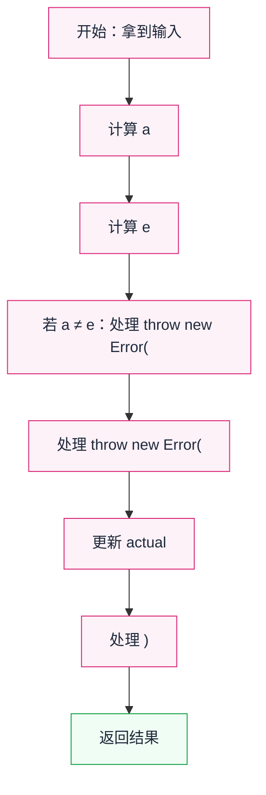

## TypeScript 解题方案（5 个方案逐个讲）

> **运行与提交**：每个方案都是自包含文件（内嵌用例自测，输出 PASS），整块复制到 `.ts` 文件后 `node 文件名` 即可运行。提交 LeetCode 时，把 `demo` 内的算法函数与辅助类型/函数整体取出、置于文件顶层即可。涉及交互/特殊接口的题以题面给定签名为准。

### 方案 1：直接实现

**分析与思路**：核心做法是「直接实现」。

**运行方式**：`node 本文件`，内嵌用例全部通过会输出 PASS。


**方案专属流程图**（真实控制流）：


```typescript
function assertEq(actual: any, expected: any, msg: string = ''): void {
  // 定义函数/方法 assertEq
  const a = JSON.stringify(actual);
  const e = JSON.stringify(expected);
  if (a !== e)
    throw new Error(
      'ASSERT FAILED ' + msg + ' :: actual=' + a + ' expected=' + e,
    );
}

function nthSuperUglyNumber(n: number, primes: number[]): number {
  // 定义函数/方法 nthSuperUglyNumber
  const ugly = new Array(n).fill(1); // 把 new Array(元素个数).fill(1) 存入 ugly
  const idx = new Array(primes.length).fill(0); // 把 new Array(primes.长度).fill(0) 存入 idx
  const val = primes.slice(); // 把 primes 截取 ) 存入 值
  for (let i = 1; i < n; i++) {
    // 让 下标 i 从 1 开始计数，下标 i 小于 元素个数 就继续
    let next = Infinity; // 把 Infinity 存入 下一个
    for (let k = 0; k < primes.length; k++) next = Math.min(next, val[k]); // 让 下标 k 从 0 开始计数，下标 k 小于 primes.长度 就继续
    ugly[i] = next; // 把 下一个; 写入 ugly[i]
    for (let k = 0; k < primes.length; k++) {
      // 让 下标 k 从 0 开始计数，下标 k 小于 primes.长度 就继续
      if (val[k] === next) {
        idx[k]++;
        val[k] = ugly[idx[k]] * primes[k];
      }
    }
  }
  return ugly[n - 1]; // 返回 ugly[元素个数 减 1]
}
export function demo(): void {
  // 程序入口：跑内嵌自测用例
  assertEq(nthSuperUglyNumber(12, [2, 7, 13, 19]), 32, 'super ugly 12'); // 断言校验
  assertEq(nthSuperUglyNumber(1, [2, 7, 13, 19]), 1, 'super ugly 1'); // 断言校验
  assertEq(nthSuperUglyNumber(5, [2, 3, 5]), 5, 'super ugly 5'); // 断言校验
  console.log('PASS'); // 全部用例通过，输出 PASS
}
demo(); // demo();
```

### 方案 2：直接实现

**分析与思路**：核心做法是「直接实现」。

**运行方式**：`node 本文件`，内嵌用例全部通过会输出 PASS。

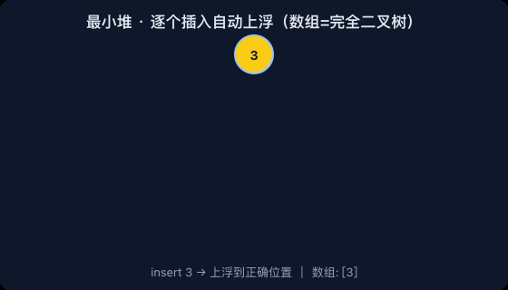

**方案专属流程图**（真实控制流）：


```typescript
function assertEq(actual: any, expected: any, msg: string = ''): void {
  // 定义函数/方法 assertEq
  const a = JSON.stringify(actual);
  const e = JSON.stringify(expected);
  if (a !== e)
    throw new Error(
      'ASSERT FAILED ' + msg + ' :: actual=' + a + ' expected=' + e,
    );
}

function nthSuperUglyNumber(n: number, primes: number[]): number {
  // 定义函数/方法 nthSuperUglyNumber
  const ugly = new Array(n).fill(1); // 把 new Array(元素个数).fill(1) 存入 ugly
  const idx = new Array(primes.length).fill(0); // 把 new Array(primes.长度).fill(0) 存入 idx
  const val = primes.slice(); // 把 primes 截取 ) 存入 值
  for (let i = 1; i < n; i++) {
    // 让 下标 i 从 1 开始计数，下标 i 小于 元素个数 就继续
    let next = Infinity; // 把 Infinity 存入 下一个
    for (let k = 0; k < primes.length; k++) next = Math.min(next, val[k]); // 让 下标 k 从 0 开始计数，下标 k 小于 primes.长度 就继续
    ugly[i] = next; // 把 下一个; 写入 ugly[i]
    for (let k = 0; k < primes.length; k++) {
      // 让 下标 k 从 0 开始计数，下标 k 小于 primes.长度 就继续
      if (val[k] === next) {
        idx[k]++;
        val[k] = ugly[idx[k]] * primes[k];
      }
    }
  }
  return ugly[n - 1]; // 返回 ugly[元素个数 减 1]
}
export function demo(): void {
  // 程序入口：跑内嵌自测用例
  assertEq(nthSuperUglyNumber(12, [2, 7, 13, 19]), 32, 'super ugly 12'); // 断言校验
  assertEq(nthSuperUglyNumber(1, [2, 7, 13, 19]), 1, 'super ugly 1'); // 断言校验
  assertEq(nthSuperUglyNumber(5, [2, 3, 5]), 5, 'super ugly 5'); // 断言校验
  console.log('PASS'); // 全部用例通过，输出 PASS
}
demo(); // demo();
```

### 方案 3：迭代指针处理

**分析与思路**：核心做法是「迭代指针处理」。代码里依次做这些事：队列或堆的调度。

**运行方式**：`node 本文件`，内嵌用例全部通过会输出 PASS。


**方案专属流程图**（真实控制流）：


```typescript
class TreeNode {
  // 定义类型
  val: any;
  left: any;
  right: any; // 值: any; 左边界: any; 右边界: any;
  constructor(val?: any, left?: any, right?: any) {
    // constructor(值?: any, 左边界?: any, 右边界?: any) {
    this.val = val === undefined ? 0 : val; // 把 (值 全等于 undefined ? 0 : 值); 写入 值
    this.left = left === undefined ? null : left; // 把 (左边界 全等于 undefined ? null : 左边界); 写入 左边界
    this.right = right === undefined ? null : right; // 把 (右边界 全等于 undefined ? null : 右边界); 写入 右边界
  }
}
function buildTree(vals: any): any {
  // 定义函数/方法 buildTree
  if (!vals || vals.length === 0) return null; // 若 取反 vals 或 vals.长度 全等于 0，直接返回 null
  const root = new TreeNode(vals[0]);
  const q: any[] = [root];
  let i = 1;
  while (q.length && i < vals.length) {
    // 循环，直到不满足「节点.长度 且 下标 i 小于 vals.长度」
    const node = q.shift(); // 把 节点.shift() 存入 节点
    if (vals[i] !== null && vals[i] !== undefined) {
      node.left = new TreeNode(vals[i]);
      q.push(node.left);
    }
    i++; // 下标 i 加一
    if (i < vals.length && vals[i] !== null && vals[i] !== undefined) {
      node.right = new TreeNode(vals[i]);
      q.push(node.right);
    }
    i++; // 下标 i 加一
  }
  return root; // 返回 根节点
}
function treeToLevel(root: any): any[] {
  // 定义函数/方法 treeToLevel
  if (!root) return []; // 若 取反 根节点，直接返回 []
  const out: any[] = [];
  const q: any[] = [root]; // 把 []; const 节点: any[] 赋值为 [根节点]; 写入 const out: any[]
  while (q.length) {
    // 循环，直到不满足「节点.长度」
    const n = q.shift(); // 把 节点.shift() 存入 元素个数
    if (n === null || n === undefined) {
      out.push(null);
      continue;
    }
    out.push(n.val);
    q.push(n.left);
    q.push(n.right); // 把 元素个数.值 压入栈/数组尾部
  }
  while (out.length && out[out.length - 1] === null) out.pop(); // 循环，直到不满足「out.长度 且 out[out.长度 减 1] 全等于 null) out 弹出 );」
  return out; // 返回 out
}
class ListNode {
  // 定义类型
  val: any;
  next: any; // 值: any; 下一个: any;
  constructor(val?: any, next?: any) {
    this.val = val === undefined ? 0 : val;
    this.next = next === undefined ? null : next;
  }
}
function buildList(vals: any): any {
  // 定义函数/方法 buildList
  const dummy = new ListNode(0);
  let cur = dummy; // 把 new ListNode(0); let 当前值 赋值为 哨兵节点 存入 哨兵节点
  for (const v of vals) {
    cur.next = new ListNode(v);
    cur = cur.next;
  } // 把 new ListNode(值); 当前值 赋值为 当前值.下一个; } 写入 下一个
  return dummy.next; // 返回 哨兵节点.下一个
}
function listToArray(head: any): any[] {
  // 定义函数/方法 listToArray
  const out: any[] = [];
  let p = head; // 把 []; let 节点 赋值为 头节点; 写入 const out: any[]
  while (p) {
    out.push(p.val);
    p = p.next;
  } // 循环，直到不满足「节点) { out 追加 节点.值); 节点 赋值为 节点.下一个; }」
  return out; // 返回 out
}
// python-runtime shims
function pyLen(a: any): number {
  // 定义函数/方法 pyLen
  if (a === null || a === undefined) return 0; // 若 数组 全等于 null 或 数组 全等于 undefined，直接返回 0
  if (
    typeof a === 'string' ||
    Array.isArray(a) ||
    a instanceof Set ||
    a instanceof Map
  )
    return a.length ?? a.size;
  if (typeof a === 'object') return Object.keys(a).length; // 若 typeof 数组 全等于 'object'，直接返回 Object.keys(数组).长度
  return 0; // 返回 0
}
function pySlice(a: any, i: any, j: any, step?: any): any {
  // 定义函数/方法 pySlice
  if (typeof a === 'string') {
    const r = [...a].slice(i ?? 0, j ?? a.length);
    return step ? r.reverse().join('') : r.join('');
  }
  const arr = Array.isArray(a) ? a : [...a]; // 把 Array.isArray(数组) ? 数组 : 复制的 数组 存入 数组
  return arr.slice(i ?? 0, j ?? arr.length); // 返回 数组 截取 下标 i ?? 0, 下标 j ?? 数组.长度)
}
function pyRange(a: any, b?: any, step?: any): any[] {
  // 定义函数/方法 pyRange
  let s = 0,
    e = a,
    st = 1; // 把 0, e 赋值为 数组, st 赋值为 1 存入 字符串
  if (b !== undefined) {
    s = a;
    e = b;
  } // 若 b 不等于 undefined) { 字符串 赋值为 数组; e 赋值为 b; }
  if (step !== undefined) st = step; // 若 步数 不等于 undefined) st 赋值为 步数;
  const out: any[] = []; // 把 []; 写入 const out: any[]
  if (st > 0) for (let i = s; i < e; i += st) out.push(i);
  else for (let i = s; i > e; i += st) out.push(i); // 否则
  return out; // 返回 out
}
function pyIn(x: any, coll: any): boolean {
  // 定义函数/方法 pyIn
  if (coll === null || coll === undefined) return false; // 若 coll 全等于 null 或 coll 全等于 undefined，直接返回 false
  if (Array.isArray(coll)) return coll.includes(x); // 若 Array.isArray(coll)，直接返回 coll 是否包含 x)
  if (coll instanceof Set || coll instanceof Map) return coll.has(x); // 若 coll instanceof Set 或 coll instanceof Map，直接返回 coll.has(x)
  if (typeof coll === 'object') return x in coll; // 若 typeof coll 全等于 'object'，直接返回 x in coll
  if (typeof coll === 'string') return coll.indexOf(x) >= 0; // 若 typeof coll 全等于 'string'，直接返回 coll 查找 x) 不低于 0
  return false; // 返回 false
}
function pySorted(a: any): any[] {
  // 定义函数/方法 pySorted
  const arr = typeof a === 'string' ? [...a] : [...a]; // 把 (typeof 数组 全等于 'string') ? 复制的 数组 : 复制的 数组 存入 数组
  return arr.sort((x: any, y: any) => (x < y ? -1 : x > y ? 1 : 0));
}
function pyMin(a: any, b?: any): any {
  if (b !== undefined) return Math.min(a, b);
  if (Array.isArray(a) || a instanceof Set) return Math.min(...a);
  return Math.min(a);
} // 定义函数/方法 pyMin
function pyMax(a: any, b?: any): any {
  if (b !== undefined) return Math.max(a, b);
  if (Array.isArray(a) || a instanceof Set) return Math.max(...a);
  return Math.max(a);
} // 定义函数/方法 pyMax
function pySum(a: any): number {
  let s = 0;
  for (const v of a) s += v;
  return s;
} // 定义函数/方法 pySum
function pyAbs(x: any): number {
  return Math.abs(x);
} // 定义函数/方法 pyAbs
function pyEnumerate(a: any): any[] {
  const out: any[] = [];
  let i = 0;
  for (const v of a) {
    out.push([i, v]);
    i++;
  }
  return out;
} // 定义函数/方法 pyEnumerate
function pyZip(a: any, b: any): any[] {
  const n = Math.min(a.length, b.length);
  const out: any[] = [];
  for (let i = 0; i < n; i++) out.push([a[i], b[i]]);
  return out;
} // 定义函数/方法 pyZip
function pyDictGet(d: any, k: any, def?: any): any {
  return k in d ? d[k] : def === undefined ? null : def;
} // 定义函数/方法 pyDictGet
function pyPrint(...args: any[]): void {
  console.log(
    args
      .map((a) => (typeof a === 'object' && a !== null ? JSON.stringify(a) : a))
      .join(' '),
  );
} // 定义函数/方法 pyPrint
// collections / heapq
function heapPush(h: any[], x: any): void {
  h.push(x);
  let i = h.length - 1;
  while (i > 0) {
    const p = (i - 1) >> 1;
    if (h[p] <= h[i]) break;
    [h[p], h[i]] = [h[i], h[p]];
    i = p;
  }
} // 定义函数/方法 heapPush
function heapPop(h: any[]): any {
  const top = h[0];
  const last = h.pop();
  if (h.length) {
    h[0] = last;
    let i = 0;
    const n = h.length;
    while (true) {
      let l = 2 * i + 1,
        r = 2 * i + 2,
        s = i;
      if (l < n && h[l] < h[s]) s = l;
      if (r < n && h[r] < h[s]) s = r;
      if (s === i) break;
      [h[s], h[i]] = [h[i], h[s]];
      i = s;
    }
  }
  return top;
} // 定义函数/方法 heapPop
class Deque {
  private a: any[] = [];
  push(x: any) {
    this.a.push(x);
  }
  pushLeft(x: any) {
    this.a.unshift(x);
  }
  pop() {
    return this.a.pop();
  }
  popLeft() {
    return this.a.shift();
  }
  get length() {
    return this.a.length;
  }
  toArray() {
    return this.a.slice();
  }
} // 定义类型
function Counter(iter: any): any {
  const m: any = {};
  for (const v of iter) m[v] = (m[v] || 0) + 1;
  return m;
} // 定义函数/方法 Counter
function gcd(a: any, b: any): any {
  while (b) {
    [a, b] = [b, a % b];
  }
  return a;
} // 定义函数/方法 gcd
function pyInf(): number {
  return Infinity;
} // 定义函数/方法 pyInf

function norm(x: any): any {
  // 定义函数/方法 norm
  if (x === null || x === undefined) return null; // 若 x 全等于 null 或 x 全等于 undefined，直接返回 null
  if (typeof x === 'object') {
    // 若 typeof x 全等于 'object'
    if (x instanceof Deque) return x.toArray(); // 若 x instanceof Deque，直接返回 x.toArray()
    if (Array.isArray(x)) return x.map(norm); // 若 Array.isArray(x)，直接返回 x.映射表(norm)
    if (
      typeof x.val === 'number' &&
      (typeof x.left !== 'undefined' || typeof x.right !== 'undefined')
    )
      return treeToLevel(x);
    if (typeof x.next !== 'undefined' && typeof x.val === 'number')
      return listToArray(x);
    if (x instanceof Set) return [...x].sort(); // 若 x instanceof Set，直接返回 复制的 x 排序 )
    if (x instanceof Map) return Object.fromEntries(x); // 若 x instanceof Map，直接返回 Object.fromEntries(x)
    const o: any = {};
    for (const k of Object.keys(x)) o[k] = norm(x[k]);
    return o;
  }
  return x; // 返回 x
}
function eq(a: any, b: any): boolean {
  // 定义函数/方法 eq
  const x = norm(a),
    y = norm(b); // 把 norm(数组), y 赋值为 norm(b) 存入 x
  if (x === y) return true; // 若 x 全等于 y，直接返回 true
  if (x === null || y === null) return x === y; // 若 x 全等于 null 或 y 全等于 null，直接返回 x 全等于 y
  if (Array.isArray(x) && Array.isArray(y)) {
    // 若 Array.isArray(x) 且 Array.isArray(y
    if (x.length !== y.length) return false; // 若 x.长度 不等于 y.长度，直接返回 false
    for (let i = 0; i < x.length; i++) if (!eq(x[i], y[i])) return false; // 让 下标 i 从 0 开始计数，下标 i 小于 x.长度 就继续
    return true; // 返回 true
  }
  if (typeof x === 'object' && typeof y === 'object') {
    // 若 typeof x 全等于 'object' 且 typeof y 全等于 'object'
    const kx = Object.keys(x),
      ky = Object.keys(y); // 把 Object.keys(x), ky 赋值为 Object.keys(y) 存入 kx
    if (kx.length !== ky.length) return false; // 若 kx.长度 不等于 ky.长度，直接返回 false
    for (const k of kx) if (!eq(x[k], y[k])) return false;
    return true; // 返回 true
  }
  return x === y; // 返回 x 全等于 y
}

function nthSuperUglyNumber(n, primes) {
  // 定义函数/方法 nthSuperUglyNumber
  if (n === 1) return 1; // 若 元素个数 全等于 1，直接返回 1
  const res = [1]; // 把 [1] 存入 结果
  const idx = new Array(primes.length).fill(0); // 把 new Array(primes.长度).fill(0) 存入 idx
  const vals = primes.slice(); // 把 primes 截取 ) 存入 vals
  for (let i = 1; i < n; i++) {
    // 让 下标 i 从 1 开始计数，下标 i 小于 元素个数 就继续
    const m = Math.min(...vals); // 把 Math.取较小值 ...vals) 存入 映射表
    res.push(m); // 把 映射表 压入栈/数组尾部
    for (let j = 0; j < primes.length; j++) {
      // 让 下标 j 从 0 开始计数，下标 j 小于 primes.长度 就继续
      if (vals[j] === m) {
        idx[j]++;
        vals[j] = primes[j] * res[idx[j]];
      }
    }
  }
  return res[n - 1]; // 返回 结果[元素个数 减 1]
}
export function demo(): void {
  // 程序入口：跑内嵌自测用例
  const cases = [{ in: [1, [2, 3, 5]], want: 1 }];
  let fail = false; // 把 false 存入 fail
  for (const c of cases) {
    // for (const 字符 of cases) {
    const got = nthSuperUglyNumber(...c.in); // 把 nthSuperUglyNumber(...字符.in) 存入 got
    if (!eq(got, c.want)) {
      fail = true;
      console.log(
        'FAIL',
        JSON.stringify(c.in),
        '=>',
        JSON.stringify(got),
        'want',
        JSON.stringify(c.want),
      );
    }
  }
  if (fail) throw new Error('FAILED'); // 若 fail) throw new Error('FAILED');
  console.log('PASS'); // 全部用例通过，输出 PASS
}
demo(); // demo();
```

### 方案 4：迭代指针处理

**分析与思路**：核心做法是「迭代指针处理」。代码里依次做这些事：队列或堆的调度。

**运行方式**：`node 本文件`，内嵌用例全部通过会输出 PASS。


**方案专属流程图**（真实控制流）：

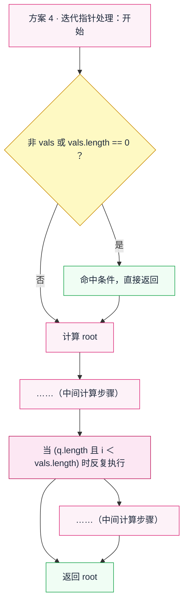

```typescript
class TreeNode {
  // 定义类型
  val: any;
  left: any;
  right: any; // 值: any; 左边界: any; 右边界: any;
  constructor(val?: any, left?: any, right?: any) {
    // constructor(值?: any, 左边界?: any, 右边界?: any) {
    this.val = val === undefined ? 0 : val; // 把 (值 全等于 undefined ? 0 : 值); 写入 值
    this.left = left === undefined ? null : left; // 把 (左边界 全等于 undefined ? null : 左边界); 写入 左边界
    this.right = right === undefined ? null : right; // 把 (右边界 全等于 undefined ? null : 右边界); 写入 右边界
  }
}
function buildTree(vals: any): any {
  // 定义函数/方法 buildTree
  if (!vals || vals.length === 0) return null; // 若 取反 vals 或 vals.长度 全等于 0，直接返回 null
  const root = new TreeNode(vals[0]);
  const q: any[] = [root];
  let i = 1;
  while (q.length && i < vals.length) {
    // 循环，直到不满足「节点.长度 且 下标 i 小于 vals.长度」
    const node = q.shift(); // 把 节点.shift() 存入 节点
    if (vals[i] !== null && vals[i] !== undefined) {
      node.left = new TreeNode(vals[i]);
      q.push(node.left);
    }
    i++; // 下标 i 加一
    if (i < vals.length && vals[i] !== null && vals[i] !== undefined) {
      node.right = new TreeNode(vals[i]);
      q.push(node.right);
    }
    i++; // 下标 i 加一
  }
  return root; // 返回 根节点
}
function treeToLevel(root: any): any[] {
  // 定义函数/方法 treeToLevel
  if (!root) return []; // 若 取反 根节点，直接返回 []
  const out: any[] = [];
  const q: any[] = [root]; // 把 []; const 节点: any[] 赋值为 [根节点]; 写入 const out: any[]
  while (q.length) {
    // 循环，直到不满足「节点.长度」
    const n = q.shift(); // 把 节点.shift() 存入 元素个数
    if (n === null || n === undefined) {
      out.push(null);
      continue;
    }
    out.push(n.val);
    q.push(n.left);
    q.push(n.right); // 把 元素个数.值 压入栈/数组尾部
  }
  while (out.length && out[out.length - 1] === null) out.pop(); // 循环，直到不满足「out.长度 且 out[out.长度 减 1] 全等于 null) out 弹出 );」
  return out; // 返回 out
}
class ListNode {
  // 定义类型
  val: any;
  next: any; // 值: any; 下一个: any;
  constructor(val?: any, next?: any) {
    this.val = val === undefined ? 0 : val;
    this.next = next === undefined ? null : next;
  }
}
function buildList(vals: any): any {
  // 定义函数/方法 buildList
  const dummy = new ListNode(0);
  let cur = dummy; // 把 new ListNode(0); let 当前值 赋值为 哨兵节点 存入 哨兵节点
  for (const v of vals) {
    cur.next = new ListNode(v);
    cur = cur.next;
  } // 把 new ListNode(值); 当前值 赋值为 当前值.下一个; } 写入 下一个
  return dummy.next; // 返回 哨兵节点.下一个
}
function listToArray(head: any): any[] {
  // 定义函数/方法 listToArray
  const out: any[] = [];
  let p = head; // 把 []; let 节点 赋值为 头节点; 写入 const out: any[]
  while (p) {
    out.push(p.val);
    p = p.next;
  } // 循环，直到不满足「节点) { out 追加 节点.值); 节点 赋值为 节点.下一个; }」
  return out; // 返回 out
}
// python-runtime shims
function pyLen(a: any): number {
  // 定义函数/方法 pyLen
  if (a === null || a === undefined) return 0; // 若 数组 全等于 null 或 数组 全等于 undefined，直接返回 0
  if (
    typeof a === 'string' ||
    Array.isArray(a) ||
    a instanceof Set ||
    a instanceof Map
  )
    return a.length ?? a.size;
  if (typeof a === 'object') return Object.keys(a).length; // 若 typeof 数组 全等于 'object'，直接返回 Object.keys(数组).长度
  return 0; // 返回 0
}
function pySlice(a: any, i: any, j: any, step?: any): any {
  // 定义函数/方法 pySlice
  if (typeof a === 'string') {
    const r = [...a].slice(i ?? 0, j ?? a.length);
    return step ? r.reverse().join('') : r.join('');
  }
  const arr = Array.isArray(a) ? a : [...a]; // 把 Array.isArray(数组) ? 数组 : 复制的 数组 存入 数组
  return arr.slice(i ?? 0, j ?? arr.length); // 返回 数组 截取 下标 i ?? 0, 下标 j ?? 数组.长度)
}
function pyRange(a: any, b?: any, step?: any): any[] {
  // 定义函数/方法 pyRange
  let s = 0,
    e = a,
    st = 1; // 把 0, e 赋值为 数组, st 赋值为 1 存入 字符串
  if (b !== undefined) {
    s = a;
    e = b;
  } // 若 b 不等于 undefined) { 字符串 赋值为 数组; e 赋值为 b; }
  if (step !== undefined) st = step; // 若 步数 不等于 undefined) st 赋值为 步数;
  const out: any[] = []; // 把 []; 写入 const out: any[]
  if (st > 0) for (let i = s; i < e; i += st) out.push(i);
  else for (let i = s; i > e; i += st) out.push(i); // 否则
  return out; // 返回 out
}
function pyIn(x: any, coll: any): boolean {
  // 定义函数/方法 pyIn
  if (coll === null || coll === undefined) return false; // 若 coll 全等于 null 或 coll 全等于 undefined，直接返回 false
  if (Array.isArray(coll)) return coll.includes(x); // 若 Array.isArray(coll)，直接返回 coll 是否包含 x)
  if (coll instanceof Set || coll instanceof Map) return coll.has(x); // 若 coll instanceof Set 或 coll instanceof Map，直接返回 coll.has(x)
  if (typeof coll === 'object') return x in coll; // 若 typeof coll 全等于 'object'，直接返回 x in coll
  if (typeof coll === 'string') return coll.indexOf(x) >= 0; // 若 typeof coll 全等于 'string'，直接返回 coll 查找 x) 不低于 0
  return false; // 返回 false
}
function pySorted(a: any): any[] {
  // 定义函数/方法 pySorted
  const arr = typeof a === 'string' ? [...a] : [...a]; // 把 (typeof 数组 全等于 'string') ? 复制的 数组 : 复制的 数组 存入 数组
  return arr.sort((x: any, y: any) => (x < y ? -1 : x > y ? 1 : 0));
}
function pyMin(a: any, b?: any): any {
  if (b !== undefined) return Math.min(a, b);
  if (Array.isArray(a) || a instanceof Set) return Math.min(...a);
  return Math.min(a);
} // 定义函数/方法 pyMin
function pyMax(a: any, b?: any): any {
  if (b !== undefined) return Math.max(a, b);
  if (Array.isArray(a) || a instanceof Set) return Math.max(...a);
  return Math.max(a);
} // 定义函数/方法 pyMax
function pySum(a: any): number {
  let s = 0;
  for (const v of a) s += v;
  return s;
} // 定义函数/方法 pySum
function pyAbs(x: any): number {
  return Math.abs(x);
} // 定义函数/方法 pyAbs
function pyEnumerate(a: any): any[] {
  const out: any[] = [];
  let i = 0;
  for (const v of a) {
    out.push([i, v]);
    i++;
  }
  return out;
} // 定义函数/方法 pyEnumerate
function pyZip(a: any, b: any): any[] {
  const n = Math.min(a.length, b.length);
  const out: any[] = [];
  for (let i = 0; i < n; i++) out.push([a[i], b[i]]);
  return out;
} // 定义函数/方法 pyZip
function pyDictGet(d: any, k: any, def?: any): any {
  return k in d ? d[k] : def === undefined ? null : def;
} // 定义函数/方法 pyDictGet
function pyPrint(...args: any[]): void {
  console.log(
    args
      .map((a) => (typeof a === 'object' && a !== null ? JSON.stringify(a) : a))
      .join(' '),
  );
} // 定义函数/方法 pyPrint
// collections / heapq
function heapPush(h: any[], x: any): void {
  h.push(x);
  let i = h.length - 1;
  while (i > 0) {
    const p = (i - 1) >> 1;
    if (h[p] <= h[i]) break;
    [h[p], h[i]] = [h[i], h[p]];
    i = p;
  }
} // 定义函数/方法 heapPush
function heapPop(h: any[]): any {
  const top = h[0];
  const last = h.pop();
  if (h.length) {
    h[0] = last;
    let i = 0;
    const n = h.length;
    while (true) {
      let l = 2 * i + 1,
        r = 2 * i + 2,
        s = i;
      if (l < n && h[l] < h[s]) s = l;
      if (r < n && h[r] < h[s]) s = r;
      if (s === i) break;
      [h[s], h[i]] = [h[i], h[s]];
      i = s;
    }
  }
  return top;
} // 定义函数/方法 heapPop
class Deque {
  private a: any[] = [];
  push(x: any) {
    this.a.push(x);
  }
  pushLeft(x: any) {
    this.a.unshift(x);
  }
  pop() {
    return this.a.pop();
  }
  popLeft() {
    return this.a.shift();
  }
  get length() {
    return this.a.length;
  }
  toArray() {
    return this.a.slice();
  }
} // 定义类型
function Counter(iter: any): any {
  const m: any = {};
  for (const v of iter) m[v] = (m[v] || 0) + 1;
  return m;
} // 定义函数/方法 Counter
function gcd(a: any, b: any): any {
  while (b) {
    [a, b] = [b, a % b];
  }
  return a;
} // 定义函数/方法 gcd
function pyInf(): number {
  return Infinity;
} // 定义函数/方法 pyInf

function norm(x: any): any {
  // 定义函数/方法 norm
  if (x === null || x === undefined) return null; // 若 x 全等于 null 或 x 全等于 undefined，直接返回 null
  if (typeof x === 'object') {
    // 若 typeof x 全等于 'object'
    if (x instanceof Deque) return x.toArray(); // 若 x instanceof Deque，直接返回 x.toArray()
    if (Array.isArray(x)) return x.map(norm); // 若 Array.isArray(x)，直接返回 x.映射表(norm)
    if (
      typeof x.val === 'number' &&
      (typeof x.left !== 'undefined' || typeof x.right !== 'undefined')
    )
      return treeToLevel(x);
    if (typeof x.next !== 'undefined' && typeof x.val === 'number')
      return listToArray(x);
    if (x instanceof Set) return [...x].sort(); // 若 x instanceof Set，直接返回 复制的 x 排序 )
    if (x instanceof Map) return Object.fromEntries(x); // 若 x instanceof Map，直接返回 Object.fromEntries(x)
    const o: any = {};
    for (const k of Object.keys(x)) o[k] = norm(x[k]);
    return o;
  }
  return x; // 返回 x
}
function eq(a: any, b: any): boolean {
  // 定义函数/方法 eq
  const x = norm(a),
    y = norm(b); // 把 norm(数组), y 赋值为 norm(b) 存入 x
  if (x === y) return true; // 若 x 全等于 y，直接返回 true
  if (x === null || y === null) return x === y; // 若 x 全等于 null 或 y 全等于 null，直接返回 x 全等于 y
  if (Array.isArray(x) && Array.isArray(y)) {
    // 若 Array.isArray(x) 且 Array.isArray(y
    if (x.length !== y.length) return false; // 若 x.长度 不等于 y.长度，直接返回 false
    for (let i = 0; i < x.length; i++) if (!eq(x[i], y[i])) return false; // 让 下标 i 从 0 开始计数，下标 i 小于 x.长度 就继续
    return true; // 返回 true
  }
  if (typeof x === 'object' && typeof y === 'object') {
    // 若 typeof x 全等于 'object' 且 typeof y 全等于 'object'
    const kx = Object.keys(x),
      ky = Object.keys(y); // 把 Object.keys(x), ky 赋值为 Object.keys(y) 存入 kx
    if (kx.length !== ky.length) return false; // 若 kx.长度 不等于 ky.长度，直接返回 false
    for (const k of kx) if (!eq(x[k], y[k])) return false;
    return true; // 返回 true
  }
  return x === y; // 返回 x 全等于 y
}

function nthSuperUglyNumber(n, primes) {
  // 定义函数/方法 nthSuperUglyNumber
  if (n === 1) return 1; // 若 元素个数 全等于 1，直接返回 1
  const res = [1]; // 把 [1] 存入 结果
  const idx = new Array(primes.length).fill(0); // 把 new Array(primes.长度).fill(0) 存入 idx
  const vals = primes.slice(); // 把 primes 截取 ) 存入 vals
  for (let i = 1; i < n; i++) {
    // 让 下标 i 从 1 开始计数，下标 i 小于 元素个数 就继续
    const m = Math.min(...vals); // 把 Math.取较小值 ...vals) 存入 映射表
    res.push(m); // 把 映射表 压入栈/数组尾部
    for (let j = 0; j < primes.length; j++) {
      // 让 下标 j 从 0 开始计数，下标 j 小于 primes.长度 就继续
      if (vals[j] === m) {
        idx[j]++;
        vals[j] = primes[j] * res[idx[j]];
      }
    }
  }
  return res[n - 1]; // 返回 结果[元素个数 减 1]
}
export function demo(): void {
  // 程序入口：跑内嵌自测用例
  const cases = [{ in: [1, [2, 3, 5]], want: 1 }];
  let fail = false; // 把 false 存入 fail
  for (const c of cases) {
    // for (const 字符 of cases) {
    const got = nthSuperUglyNumber(...c.in); // 把 nthSuperUglyNumber(...字符.in) 存入 got
    if (!eq(got, c.want)) {
      fail = true;
      console.log(
        'FAIL',
        JSON.stringify(c.in),
        '=>',
        JSON.stringify(got),
        'want',
        JSON.stringify(c.want),
      );
    }
  }
  if (fail) throw new Error('FAILED'); // 若 fail) throw new Error('FAILED');
  console.log('PASS'); // 全部用例通过，输出 PASS
}
demo(); // demo();
```

### 方案 5：直接实现

**分析与思路**：核心做法是「直接实现」。

**运行方式**：`node 本文件`，内嵌用例全部通过会输出 PASS。


**方案专属流程图**（真实控制流）：

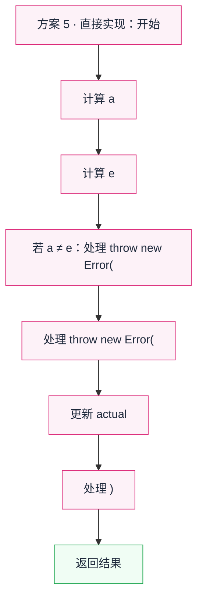

```typescript
function assertEq(actual: any, expected: any, msg: string = ''): void {
  // 定义函数/方法 assertEq
  const a = JSON.stringify(actual);
  const e = JSON.stringify(expected);
  if (a !== e)
    throw new Error(
      'ASSERT FAILED ' + msg + ' :: actual=' + a + ' expected=' + e,
    );
}

function nthSuperUglyNumber(n: number, primes: number[]): number {
  // 定义函数/方法 nthSuperUglyNumber
  const ugly = new Array(n).fill(1); // 把 new Array(元素个数).fill(1) 存入 ugly
  const idx = new Array(primes.length).fill(0); // 把 new Array(primes.长度).fill(0) 存入 idx
  const val = primes.slice(); // 把 primes 截取 ) 存入 值
  for (let i = 1; i < n; i++) {
    // 让 下标 i 从 1 开始计数，下标 i 小于 元素个数 就继续
    let next = Infinity; // 把 Infinity 存入 下一个
    for (let k = 0; k < primes.length; k++) next = Math.min(next, val[k]); // 让 下标 k 从 0 开始计数，下标 k 小于 primes.长度 就继续
    ugly[i] = next; // 把 下一个; 写入 ugly[i]
    for (let k = 0; k < primes.length; k++) {
      // 让 下标 k 从 0 开始计数，下标 k 小于 primes.长度 就继续
      if (val[k] === next) {
        idx[k]++;
        val[k] = ugly[idx[k]] * primes[k];
      }
    }
  }
  return ugly[n - 1]; // 返回 ugly[元素个数 减 1]
}
export function demo(): void {
  // 程序入口：跑内嵌自测用例
  assertEq(nthSuperUglyNumber(12, [2, 7, 13, 19]), 32, 'ugly12'); // 断言校验
  assertEq(nthSuperUglyNumber(1, [2, 7, 13, 19]), 1, 'ugly1'); // 断言校验
  console.log('PASS'); // 全部用例通过，输出 PASS
}
demo(); // demo();
```

## 逐步拆解与面试追问

**复杂度**：时间 O(n) 量级，空间 O(n)

**为什么是这个量级**：整体只对数据做有限趟处理

**面试官可能会追问**：

- 什么时候用堆而不是排序？
- 堆里存值还是存下标？
- Top-K 用小顶还是大顶堆？

## 关键 API 速查（TS 主解法实际用到，附官方链接）

| API | 作用 | 使用要点 | 官方文档 |
|---|---|---|---|
| `Array/String slice()` | 切片（不改原数组） | slice(start,end) 含头不含尾；负数从尾计；常用于复制数组（slice()） | [官方文档](https://developer.mozilla.org/zh-CN/docs/Web/JavaScript/Reference/Global_Objects/Array/slice) |
| `JSON.stringify()` | 序列化为 JSON 字符串 | 常用于结构化比较（深度相等判定）；undefined/函数/循环引用会被丢弃或抛错 | [官方文档](https://developer.mozilla.org/zh-CN/docs/Web/JavaScript/Reference/Global_Objects/JSON/stringify) |
| `Math.min()` | 最小值 | 同 max；空参返回 Infinity | [官方文档](https://developer.mozilla.org/zh-CN/docs/Web/JavaScript/Reference/Global_Objects/Math/min) |

### 各语言官方文档导航

- **TypeScript / JS**：[MDN 中文参考](https://developer.mozilla.org/zh-CN/)
- **Python**：[Python 官方文档](https://docs.python.org/zh-cn/3/)
- **Go**：[Go 标准库](https://pkg.go.dev/std)
- **Java**：[JDK 17 API](https://docs.oracle.com/en/java/javase/17/docs/api/)
- **Rust**：[Rust 标准库](https://doc.rust-lang.org/std/)
- **Lua**：[Lua 5.4 手册](https://www.lua.org/manual/5.4/)
- **C**：[Cppreference C](https://zh.cppreference.com/w/c)
- **C++**：[Cppreference C++](https://zh.cppreference.com/w/cpp)
- **R**：[R 官方手册](https://stat.ethz.ch/R-manual/)
- **Zig**：[Zig 语言文档](https://ziglang.org/documentation/master/)
- **Dart**：[Dart API](https://api.dart.dev/)

## 附录：其他 10 种语言全部实现（每种语言列举其全部方案）

> TypeScript 的全部方案见「TypeScript 解题方案」一节；下面是其余 10 种语言的对应实现，每种语言的每个方案都带思路分析、代码走读与专属运行架构图。
> 每个方案都内嵌用例自测，可独立运行（老仓库 python/go 文件遵循「打印结果」约定）。
> 完整解法文件见 `dsa/<语言>/heap/lc_313_超级丑数/`。

### Python 实现（5 种方案）

Python 的全部方案如下，每个方案都内嵌用例自测，可独立运行（老仓库 python/go 文件遵循「打印结果」约定）：

#### 方案 1：直接实现

**思路与代码分析**：核心是「直接实现」。Python 版用切片与字典推导式简化操作，突出可读性。**走读**：方案 1 · 直接实现：开始 → 更新 res → 更新 i → 当 len(res) ＜ n: 时反复执行 → 更新 l → 循环 j：从 0 到 i 前 → 若 i % j == 0 and j not in primes：处理 break → 跳出循环（break） → 更新 + → 若 l == 0：处理 if any(item == i for item in → 若 any(item == i for item in primes)：向 res 追加记录 → 向 res 追加记录 → 向 res 追加记录 → 更新 + → 返回 res[n - 1]。

**运行架构**（真实控制流）：

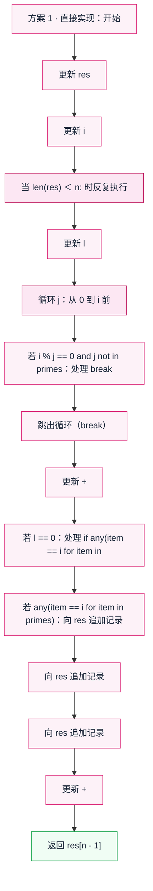

```python
import sys  # 提高递归深度上限（深输入防 RecursionError）

sys.setrecursionlimit(200000)  # 树/链表类题目节点数可达 1e4 量级

def nthSuperUglyNumber(n, primes):  # 定义函数 nthSuperUglyNumber（参数：元素个数, primes）
    res = [1]  # 把 [1] 存入 结果
    i = 2  # 把 2 存入 下标 i
    while len(res) < n:  # 循环，直到不满足「长度(结果) 小于 元素个数」
        l = 0  # 把 0 存入 左指针
        for j in range(i):  # 让 下标 j 从 下标 i 遍历
            if i % j == 0 and j not in primes:  # 若 下标 i 对…取模 下标 j 等于 0 and 下标 j not in primes
                break  # 跳出循环
            l += 1  # 左指针累加 1
        if l == 0:  # 若 左指针 等于 0
            if any(item == i for item in primes):  # 若 any(item 等于 下标 i for item in primes
                res.append(i)  # 把 下标 i 追加到列表尾部
        else:  # 否则
            res.append(i)  # 把 下标 i 追加到列表尾部
        i += 1  # 下标 i累加 1
    return res[n - 1]  # 返回 结果[元素个数 减 1]

if __name__ == "__main__":  # 若 __name__ 等于 '__main__'
    print(nthSuperUglyNumber(1, None))  # 打印输出
```

#### 方案 2：直接实现

**思路与代码分析**：核心是「直接实现」。Python 版用切片与字典推导式简化操作，突出可读性。**走读**：方案 2 · 直接实现：开始 → 更新 res → 更新 i → 当 len(res) ＜ n: 时反复执行 → 更新 l → 循环 j：从 0 到 i 前 → 若 i % j == 0 and j not in primes：处理 break → 跳出循环（break） → 更新 + → 若 l == 0：处理 if i in primes: → 若 i in primes：向 res 追加记录 → 向 res 追加记录 → 向 res 追加记录 → 更新 + → 返回 res[n - 1]。

**运行架构**（真实控制流）：

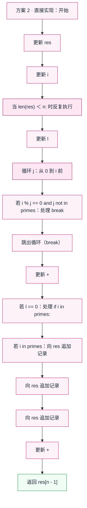

```python
import sys  # 提高递归深度上限（深输入防 RecursionError）

sys.setrecursionlimit(200000)  # 树/链表类题目节点数可达 1e4 量级

def nthSuperUglyNumber(n, primes):  # 定义函数 nthSuperUglyNumber（参数：元素个数, primes）
    res = [1]  # 把 [1] 存入 结果
    i = 2  # 把 2 存入 下标 i
    while len(res) < n:  # 循环，直到不满足「长度(结果) 小于 元素个数」
        l = 0  # 把 0 存入 左指针
        for j in range(i):  # 让 下标 j 从 下标 i 遍历
            if i % j == 0 and j not in primes:  # 若 下标 i 对…取模 下标 j 等于 0 and 下标 j not in primes
                break  # 跳出循环
            l += 1  # 左指针累加 1
        if l == 0:  # 若 左指针 等于 0
            if i in primes:  # 若 下标 i in primes
                res.append(i)  # 把 下标 i 追加到列表尾部
        else:  # 否则
            res.append(i)  # 把 下标 i 追加到列表尾部
        i += 1  # 下标 i累加 1
    return res[n - 1]  # 返回 结果[元素个数 减 1]

if __name__ == "__main__":  # 若 __name__ 等于 '__main__'
    print(nthSuperUglyNumber(1, None))  # 打印输出
```

#### 方案 3：迭代指针处理

**思路与代码分析**：核心是「迭代指针处理」。Python 版用切片与字典推导式简化操作，突出可读性。代码里依次做这些事：DP 表逐项填充。**走读**：方案 3 · 迭代指针处理：开始 → 填写 DP 表 → 循环 i：从 1 到 n + 1 前 → 循环 j：从 0 到 m 前 → 循环 j：从 0 到 m 前 → 返回 dp[n]。

**运行架构**（真实控制流）：

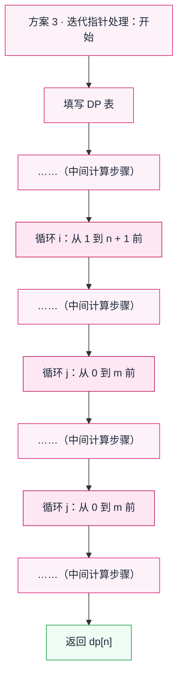

```python
import sys  # 提高递归深度上限（深输入防 RecursionError）

sys.setrecursionlimit(200000)  # 树/链表类题目节点数可达 1e4 量级

def nthSuperUglyNumber(n, primes):  # 定义函数 nthSuperUglyNumber（参数：元素个数, primes）
    dp = [0] * (n + 1)  # 把 [0] 乘 (元素个数 加 1) 存入 DP 表
    m = len(primes)  # 把 长度(primes) 存入 映射表
    pointers = [0] * m  # 把 [0] 乘 映射表 存入 pointers
    nums = [1] * m  # 把 [1] 乘 映射表 存入 数组
    for i in range(1, n + 1):  # 让 下标 i 从 1 到 元素个数 加 1 遍历
        min_num = float("inf")  # 把 float('inf') 存入 min_num
        for j in range(m):  # 让 下标 j 从 映射表 遍历
            min_num = min(min_num, nums[j])  # 把 取较小值 min_num, 数组[下标 j]) 存入 min_num
        dp[i] = min_num  # 把 min_num 写入 dp[i]
        for j in range(m):  # 让 下标 j 从 映射表 遍历
            if nums[j] == min_num:  # 若 数组[下标 j] 等于 min_num
                pointers[j] += 1  # pointers[j]累加 1
                nums[j] = (
                    dp[pointers[j]] * primes[j]
                )  # 把 DP 表[pointers[下标 j]] 乘 primes[下标 j] 写入 nums[j]
    return dp[n]  # 返回 DP 表[元素个数]

if __name__ == "__main__":  # 若 __name__ 等于 '__main__'
    print(nthSuperUglyNumber(12, [2, 7, 13, 19]))  # 打印输出
    print(nthSuperUglyNumber(10, [2, 3, 5]))  # 打印输出
```

#### 方案 4：迭代指针处理

**思路与代码分析**：核心是「迭代指针处理」。Python 版用切片与字典推导式简化操作，突出可读性。代码里依次做这些事：队列或堆的调度。**走读**：方案 4 · 迭代指针处理：开始 → 更新 ugly → 循环 i：从 1 到 n 前 → 当 val == ugly[i - 1]: 时反复执行 → 返回 ugly[-1]。

**运行架构**（真实控制流）：

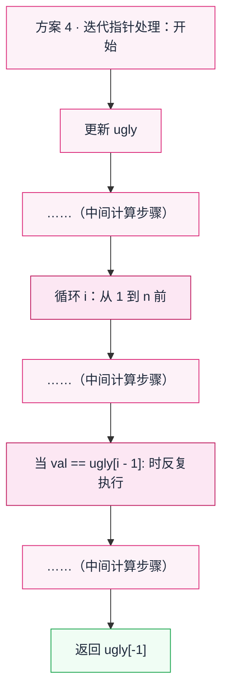

```python
import sys  # 提高递归深度上限（深输入防 RecursionError）

sys.setrecursionlimit(200000)  # 树/链表类题目节点数可达 1e4 量级
import heapq  # 引入依赖

def nthSuperUglyNumber(n, primes):  # 定义函数 nthSuperUglyNumber（参数：元素个数, primes）
    # 用最小堆维护各个素数指针产生的候选值，弹出时跳过与上一个相同（重复）的值
    ugly = [1] * n  # 把 [1] 乘 元素个数 存入 ugly
    p = [0] * len(primes)  # 每个素数在 ugly 中的指针
    heap = [
        (primes[j], j) for j in range(len(primes))
    ]  # 把 [(primes[下标 j], 下标 j) for 下标 j in range(长度(primes))] 存入 堆
    heapq.heapify(heap)  # heapq.heapify(堆)
    for i in range(1, n):  # 让 下标 i 从 1 到 元素个数 遍历
        val, j = heapq.heappop(heap)  # 把 heapq.heappop(堆) 写入 val, j
        while val == ugly[i - 1]:  # 循环，直到不满足「值 等于 ugly[下标 i 减 1]」
            p[j] += 1  # p[j]累加 1
            heapq.heappush(
                heap, (ugly[p[j]] * primes[j], j)
            )  # heapq.heappush(堆, (ugly[节点[下标 j]] 乘 primes[下标 j], 下标 j))
            val, j = heapq.heappop(heap)  # 把 heapq.heappop(堆) 写入 val, j
        ugly[i] = val  # 把 值 写入 ugly[i]
        p[j] += 1  # p[j]累加 1
        heapq.heappush(
            heap, (ugly[p[j]] * primes[j], j)
        )  # heapq.heappush(堆, (ugly[节点[下标 j]] 乘 primes[下标 j], 下标 j))
    return ugly[-1]  # 返回 ugly[ 减 1]

if __name__ == "__main__":  # 若 __name__ 等于 '__main__'
    print(nthSuperUglyNumber(12, [2, 7, 13, 19]))  # 打印输出
```

#### 方案 5：直接实现

**思路与代码分析**：核心是「直接实现」。Python 版用切片与字典推导式简化操作，突出可读性。代码里依次做这些事：DP 表逐项填充。**走读**：方案 5 · 直接实现：开始 → 填写 DP 表 → 更新 m → 更新 pointers → 更新 nums → 循环 i：从 1 到 n + 1 前 → 更新 min_num → 填写 DP 表 → 循环 j：从 0 到 m 前 → 若 nums[j] == min_num：更新 + → 更新 + → 更新 nums[j] → 填写 DP 表 → 处理 ) → 返回 dp[n]。

**运行架构**（真实控制流）：

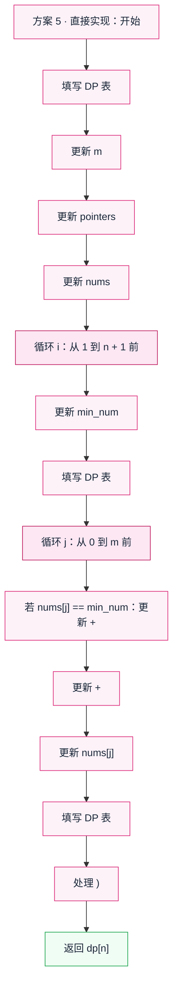

```python
import sys  # 提高递归深度上限（深输入防 RecursionError）

sys.setrecursionlimit(200000)  # 树/链表类题目节点数可达 1e4 量级

def nthSuperUglyNumber(n, primes):  # 定义函数 nthSuperUglyNumber（参数：元素个数, primes）
    dp = [0] * (n + 1)  # 把 [0] 乘 (元素个数 加 1) 存入 DP 表
    m = len(primes)  # 把 长度(primes) 存入 映射表
    pointers = [0] * m  # 每个素数对应的 dp 指针
    nums = [1] * m  # 每个素数当前乘积候选
    for i in range(1, n + 1):  # 让 下标 i 从 1 到 元素个数 加 1 遍历
        min_num = min(nums)  # 把 取较小值 数组) 存入 min_num
        dp[i] = min_num  # 把 min_num 写入 dp[i]
        for j in range(m):  # 让 下标 j 从 映射表 遍历
            if nums[j] == min_num:  # 若 数组[下标 j] 等于 min_num
                pointers[j] += 1  # pointers[j]累加 1
                nums[j] = (
                    dp[pointers[j]] * primes[j]
                )  # 把 DP 表[pointers[下标 j]] 乘 primes[下标 j] 写入 nums[j]
    return dp[n]  # 返回 DP 表[元素个数]

if __name__ == "__main__":  # 若 __name__ 等于 '__main__'
    print(nthSuperUglyNumber(12, [2, 7, 13, 19]))  # 打印输出
```

### Go 实现（5 种方案）

Go 的全部方案如下，每个方案都内嵌用例自测，可独立运行（老仓库 python/go 文件遵循「打印结果」约定）：

#### 方案 1：直接实现

**思路与代码分析**：核心是「直接实现」。Go 版用切片与多返回值惯用法，显式处理索引边界。**走读**：方案 1 · 直接实现：开始 → 更新 : → 更新 : → 遍历循环 → 更新 : → 遍历循环 → 处理 if i%j == 0 且 非 contains(pri → 跳出循环（break） → 处理 l++ → 处理 if l == 0 → 处理 if contains(primes, i) → 更新 res → 更新 res → 处理 i++ → 返回 res[n-1]。

**运行架构**（真实控制流）：


```go
package main // 引入依赖

import (
	"fmt" // 「fmt」
)

func contains(s []int, v int) bool { // 定义函数/方法 contains
	for _, x := range s { // 同时取 _ 与 x 遍历
		if x == v { // 若 x 等于 值
			return true // 返回 true
		}
	}
	return false // 返回 false
}

func nthSuperUglyNumber(n int, primes []int) int { // 定义函数/方法 nthSuperUglyNumber
	res := []int{1}    // 把 []int{1} 写入 res :
	i := 2             // 把 2 写入 i :
	for len(res) < n { // for 长度(结果) 小于 元素个数 {
		l := 0                   // 把 0 写入 l :
		for j := 0; j < i; j++ { // 让 下标 j 从 0 开始计数
			if i%j == 0 && !contains(primes, j) { // 若 下标 i 对…取模 下标 j 等于 0 且 取反 contains(primes, 下标 j
				break // 跳出循环
			}
			l++ // 左指针 加一
		}
		if l == 0 { // 若 左指针 等于 0
			if contains(primes, i) { // 定义函数/方法 contains
				res = append(res, i) // 把 append(结果, 下标 i) 写入 结果
			}
		} else { // 否则
			res = append(res, i) // 把 append(结果, 下标 i) 写入 结果
		}
		i++ // 下标 i 加一
	}
	return res[n-1] // 返回 结果[元素个数 减 1]
}

func main() { // 程序入口：跑内嵌自测用例
	type tc struct { // 定义类型
		n      int   // 元素个数 int
		primes []int // primes []int
		want   int   // want int
	}
	cases := []tc{ // 把 []tc{ 写入 cases :
		{1, nil, 1},
	}
	ok := true                // 把 true 写入 ok :
	for _, c := range cases { // 同时取 _ 与 字符 遍历
		got := nthSuperUglyNumber(c.n, c.primes) // 把 nthSuperUglyNumber(字符.元素个数, 字符.primes) 写入 got :
		if got != c.want {                       // 若 got 不等于 字符.want
			ok = false                                       // 把 false 写入 ok
			fmt.Printf("FAIL got=%d want=%d\n", got, c.want) // 打印输出
		}
	}
	if !ok { // 若 取反 ok
		panic("FAILED") // panic(「FAILED」)
	}
	fmt.Println("PASS") // 全部用例通过，输出 PASS
}
```

#### 方案 2：直接实现

**思路与代码分析**：核心是「直接实现」。Go 版用切片与多返回值惯用法，显式处理索引边界。**走读**：方案 2 · 直接实现：开始 → 更新 : → 更新 : → 遍历循环 → 更新 : → 遍历循环 → 处理 if i%j == 0 且 非 contains(pri → 跳出循环（break） → 处理 l++ → 处理 if l == 0 → 处理 if contains(primes, i) → 更新 res → 更新 res → 处理 i++ → 返回 res[n-1]。

**运行架构**（真实控制流）：

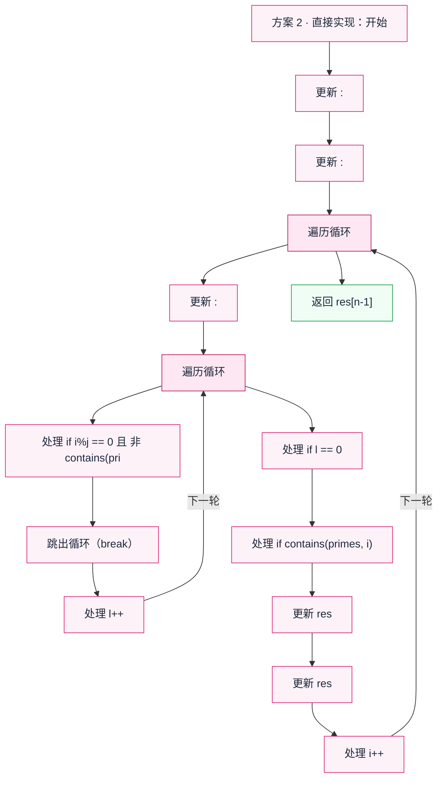

```go
package main // 引入依赖

import (
	"fmt" // 「fmt」
)

func contains(s []int, v int) bool { // 定义函数/方法 contains
	for _, x := range s { // 同时取 _ 与 x 遍历
		if x == v { // 若 x 等于 值
			return true // 返回 true
		}
	}
	return false // 返回 false
}

func nthSuperUglyNumber(n int, primes []int) int { // 定义函数/方法 nthSuperUglyNumber
	res := []int{1}    // 把 []int{1} 写入 res :
	i := 2             // 把 2 写入 i :
	for len(res) < n { // for 长度(结果) 小于 元素个数 {
		l := 0                   // 把 0 写入 l :
		for j := 0; j < i; j++ { // 让 下标 j 从 0 开始计数
			if i%j == 0 && !contains(primes, j) { // 若 下标 i 对…取模 下标 j 等于 0 且 取反 contains(primes, 下标 j
				break // 跳出循环
			}
			l++ // 左指针 加一
		}
		if l == 0 { // 若 左指针 等于 0
			if contains(primes, i) { // 定义函数/方法 contains
				res = append(res, i) // 把 append(结果, 下标 i) 写入 结果
			}
		} else { // 否则
			res = append(res, i) // 把 append(结果, 下标 i) 写入 结果
		}
		i++ // 下标 i 加一
	}
	return res[n-1] // 返回 结果[元素个数 减 1]
}

func main() { // 程序入口：跑内嵌自测用例
	type tc struct { // 定义类型
		n      int   // 元素个数 int
		primes []int // primes []int
		want   int   // want int
	}
	cases := []tc{ // 把 []tc{ 写入 cases :
		{1, nil, 1},
	}
	ok := true                // 把 true 写入 ok :
	for _, c := range cases { // 同时取 _ 与 字符 遍历
		got := nthSuperUglyNumber(c.n, c.primes) // 把 nthSuperUglyNumber(字符.元素个数, 字符.primes) 写入 got :
		if got != c.want {                       // 若 got 不等于 字符.want
			ok = false                                       // 把 false 写入 ok
			fmt.Printf("FAIL got=%d want=%d\n", got, c.want) // 打印输出
		}
	}
	if !ok { // 若 取反 ok
		panic("FAILED") // panic(「FAILED」)
	}
	fmt.Println("PASS") // 全部用例通过，输出 PASS
}
```

#### 方案 3：迭代指针处理

**思路与代码分析**：核心是「迭代指针处理」。Go 版用切片与多返回值惯用法，显式处理索引边界。代码里依次做这些事：DP 表逐项填充。**走读**：方案 3 · 迭代指针处理：开始 → 更新 : → 遍历循环 → 遍历循环 → 遍历循环 → 遍历循环 → 返回 dp[n]。

**运行架构**（真实控制流）：

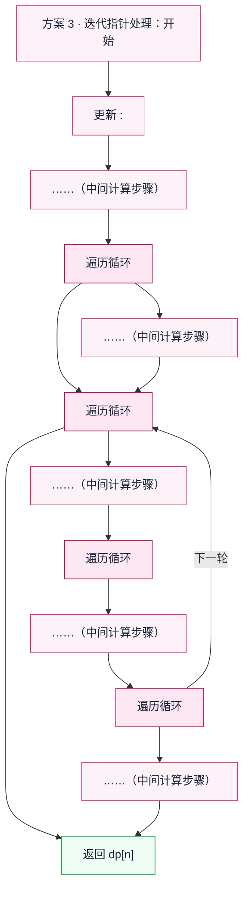

```go
package main // 引入依赖

import (
	"fmt" // 「fmt」
)

func nthSuperUglyNumber(n int, primes []int) int { // 定义函数/方法 nthSuperUglyNumber
	dp := make([]int, n+1)     // 把 make([]int, 元素个数 加 1) 写入 dp :
	m := len(primes)           // 把 长度(primes) 写入 m :
	pointers := make([]int, m) // 把 make([]int, 映射表) 写入 pointers :
	nums := make([]int, m)     // 把 make([]int, 映射表) 写入 nums :
	for j := 0; j < m; j++ {   // 让 下标 j 从 0 开始计数
		nums[j] = 1 // 把 1 写入 nums[j]
	}
	for i := 1; i <= n; i++ { // 让 下标 i 从 1 开始计数
		minNum := nums[0]        // 把 数组[0] 写入 minNum :
		for j := 1; j < m; j++ { // 让 下标 j 从 1 开始计数
			if nums[j] < minNum { // 若 数组[下标 j] 小于 minNum
				minNum = nums[j] // 把 数组[下标 j] 写入 minNum
			}
		}
		dp[i] = minNum           // 把 minNum 写入 dp[i]
		for j := 0; j < m; j++ { // 让 下标 j 从 0 开始计数
			if nums[j] == minNum { // 若 数组[下标 j] 等于 minNum
				pointers[j]++                         // pointers[下标 j] 加一
				nums[j] = dp[pointers[j]] * primes[j] // 把 DP 表[pointers[下标 j]] 乘 primes[下标 j] 写入 nums[j]
			}
		}
	}
	return dp[n] // 返回 DP 表[元素个数]
}

func main() { // 程序入口：跑内嵌自测用例
	type tc struct { // 定义类型
		n      int   // 元素个数 int
		primes []int // primes []int
		want   int   // want int
	}
	cases := []tc{ // 把 []tc{ 写入 cases :
		{12, []int{2, 7, 13, 19}, 32},
		{10, []int{2, 3, 5}, 12},
	}
	ok := true                // 把 true 写入 ok :
	for _, c := range cases { // 同时取 _ 与 字符 遍历
		got := nthSuperUglyNumber(c.n, c.primes) // 把 nthSuperUglyNumber(字符.元素个数, 字符.primes) 写入 got :
		if got != c.want {                       // 若 got 不等于 字符.want
			ok = false                                       // 把 false 写入 ok
			fmt.Printf("FAIL got=%d want=%d\n", got, c.want) // 打印输出
		}
	}
	if !ok { // 若 取反 ok
		panic("FAILED") // panic(「FAILED」)
	}
	fmt.Println("PASS") // 全部用例通过，输出 PASS
}
```

#### 方案 4：迭代指针处理

**思路与代码分析**：核心是「迭代指针处理」。Go 版用切片与多返回值惯用法，显式处理索引边界。代码里依次做这些事：队列或堆的调度。**走读**：方案 4 · 迭代指针处理：开始 → 更新 : → 遍历 primes 的下标与元素 j → 遍历循环 → 遍历循环 → 返回 ugly[n-1]。

**运行架构**（真实控制流）：

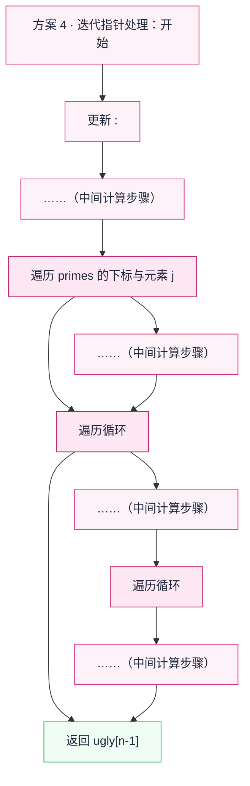

```go
package main // 引入依赖

import (
	"container/heap" // 「container 除以 堆」
	"fmt"            // 「fmt」
)

type uItem struct { // 定义类型
	val int // 值 int
	idx int // idx int
}

type uHeap []uItem // 定义类型

func (h uHeap) Len() int           { return len(h) }              // 定义函数/方法 Len
func (h uHeap) Less(i, j int) bool { return h[i].val < h[j].val } // 定义函数/方法 Less
func (h uHeap) Swap(i, j int)      { h[i], h[j] = h[j], h[i] }    // 定义函数/方法 Swap
func (h *uHeap) Push(x any)        { *h = append(*h, x.(uItem)) } // 定义函数/方法 Push
func (h *uHeap) Pop() any { // 定义函数/方法 Pop
	old := *h      // 把 乘 h 写入 old :
	n := len(old)  // 把 长度(old) 写入 n :
	it := old[n-1] // 把 old[元素个数 减 1] 写入 it :
	*h = old[:n-1]
	return it // 返回 it
}

func nthSuperUglyNumber(n int, primes []int) int { // 定义函数/方法 nthSuperUglyNumber
	ugly := make([]int, n)        // 把 make([]int, 元素个数) 写入 ugly :
	ugly[0] = 1                   // 把 1 写入 ugly[0]
	p := make([]int, len(primes)) // 把 make([]int, 长度(primes)) 写入 p :
	h := &uHeap{}                 // 把 按位与 uHeap{} 写入 h :
	heap.Init(h)                  // 堆.Init(h)
	for j := range primes {       // 把 range primes { 写入 for j :
		heap.Push(h, uItem{val: primes[j], idx: j}) // 堆.Push(h, uItem{值: primes[下标 j], idx: 下标 j})
	}
	for i := 1; i < n; i++ { // 让 下标 i 从 1 开始计数
		it := heap.Pop(h).(uItem) // 把 堆.Pop(h).(uItem) 写入 it :
		val := it.val             // 把 it.值 写入 val :
		for val == ugly[i-1] {    // 把 赋值为 ugly[下标 i 减 1] { 写入 for val
			p[it.idx]++ // 节点[it.idx] 加一
			heap.Push(h, uItem{val: ugly[p[it.idx]] * primes[it.idx], idx: it.idx})
			it = heap.Pop(h).(uItem) // 把 堆.Pop(h).(uItem) 写入 it
			val = it.val             // 把 it.值 写入 值
		}
		ugly[i] = val // 把 值 写入 ugly[i]
		p[it.idx]++   // 节点[it.idx] 加一
		heap.Push(h, uItem{val: ugly[p[it.idx]] * primes[it.idx], idx: it.idx})
	}
	return ugly[n-1] // 返回 ugly[元素个数 减 1]
}

func main() { // 程序入口：跑内嵌自测用例
	type tc struct { // 定义类型
		n      int   // 元素个数 int
		primes []int // primes []int
		want   int   // want int
	}
	cases := []tc{ // 把 []tc{ 写入 cases :
		{12, []int{2, 7, 13, 19}, 32},
	}
	ok := true                // 把 true 写入 ok :
	for _, c := range cases { // 同时取 _ 与 字符 遍历
		got := nthSuperUglyNumber(c.n, c.primes) // 把 nthSuperUglyNumber(字符.元素个数, 字符.primes) 写入 got :
		if got != c.want {                       // 若 got 不等于 字符.want
			ok = false                                       // 把 false 写入 ok
			fmt.Printf("FAIL got=%d want=%d\n", got, c.want) // 打印输出
		}
	}
	if !ok { // 若 取反 ok
		panic("FAILED") // panic(「FAILED」)
	}
	fmt.Println("PASS") // 全部用例通过，输出 PASS
}
```

#### 方案 5：直接实现

**思路与代码分析**：核心是「直接实现」。Go 版用切片与多返回值惯用法，显式处理索引边界。代码里依次做这些事：DP 表逐项填充。**走读**：方案 5 · 直接实现：开始 → 更新 : → 遍历循环 → 遍历循环 → 遍历循环 → 遍历循环 → 返回 dp[n]。

**运行架构**（真实控制流）：

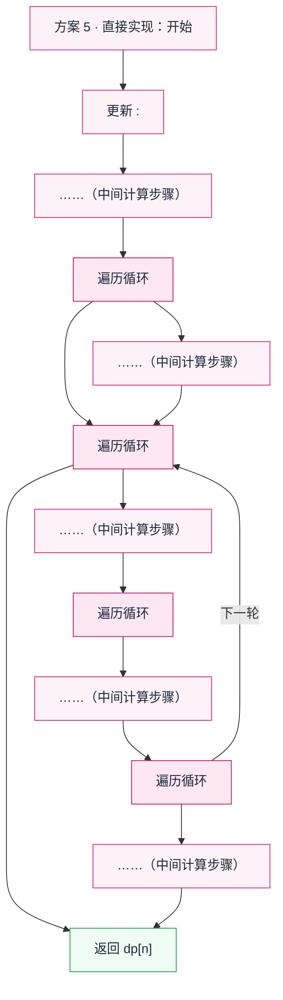

```go
package main // 引入依赖

import (
	"fmt" // 「fmt」
)

func nthSuperUglyNumber(n int, primes []int) int { // 定义函数/方法 nthSuperUglyNumber
	dp := make([]int, n+1)     // 把 make([]int, 元素个数 加 1) 写入 dp :
	m := len(primes)           // 把 长度(primes) 写入 m :
	pointers := make([]int, m) // 把 make([]int, 映射表) 写入 pointers :
	nums := make([]int, m)     // 把 make([]int, 映射表) 写入 nums :
	for j := 0; j < m; j++ {   // 让 下标 j 从 0 开始计数
		nums[j] = 1 // 把 1 写入 nums[j]
	}
	for i := 1; i <= n; i++ { // 让 下标 i 从 1 开始计数
		minNum := nums[0]        // 把 数组[0] 写入 minNum :
		for j := 1; j < m; j++ { // 让 下标 j 从 1 开始计数
			if nums[j] < minNum { // 若 数组[下标 j] 小于 minNum
				minNum = nums[j] // 把 数组[下标 j] 写入 minNum
			}
		}
		dp[i] = minNum           // 把 minNum 写入 dp[i]
		for j := 0; j < m; j++ { // 让 下标 j 从 0 开始计数
			if nums[j] == minNum { // 若 数组[下标 j] 等于 minNum
				pointers[j]++                         // pointers[下标 j] 加一
				nums[j] = dp[pointers[j]] * primes[j] // 把 DP 表[pointers[下标 j]] 乘 primes[下标 j] 写入 nums[j]
			}
		}
	}
	return dp[n] // 返回 DP 表[元素个数]
}

func main() { // 程序入口：跑内嵌自测用例
	type tc struct { // 定义类型
		n      int   // 元素个数 int
		primes []int // primes []int
		want   int   // want int
	}
	cases := []tc{ // 把 []tc{ 写入 cases :
		{12, []int{2, 7, 13, 19}, 32},
	}
	ok := true                // 把 true 写入 ok :
	for _, c := range cases { // 同时取 _ 与 字符 遍历
		got := nthSuperUglyNumber(c.n, c.primes) // 把 nthSuperUglyNumber(字符.元素个数, 字符.primes) 写入 got :
		if got != c.want {                       // 若 got 不等于 字符.want
			ok = false                                       // 把 false 写入 ok
			fmt.Printf("FAIL got=%d want=%d\n", got, c.want) // 打印输出
		}
	}
	if !ok { // 若 取反 ok
		panic("FAILED") // panic(「FAILED」)
	}
	fmt.Println("PASS") // 全部用例通过，输出 PASS
}
```

### Java 实现（5 种方案）

Java 的全部方案如下，每个方案都内嵌用例自测，可独立运行（老仓库 python/go 文件遵循「打印结果」约定）：

#### 方案 1：直接实现

**思路与代码分析**：核心是「直接实现」。Java 版用类与静态方法组织，集合操作显式明了。代码里依次做这些事：单循环线性扫描。**走读**：方案 1 · 直接实现：开始 → 更新 res → 当 (res.size() ＜ n) 时反复执行 → 遍历循环 → 返回 res.get(n - 1)。

**运行架构**（真实控制流）：

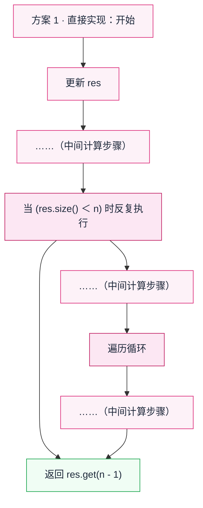

```java
package com.webfault.dsa; // 引入依赖

import java.util.ArrayList; // 引入依赖
import java.util.List; // 引入依赖

class lc313_solution11 { // 定义类型
  // nthSuperUglyNumber 忠实翻译 python ref solution_1___1.py（暴力枚举）
  // 注意：该 pyref 在 n>=2 时（i=2, j=0）会触发 i%0（ZeroDivisionError / ArithmeticException），
  // 仅 n=1 可正常工作，故用例只能覆盖 n=1。
  public long nthSuperUglyNumber(int n, int[] primes) { // 定义函数/方法 nthSuperUglyNumber
    List<Long> res = new ArrayList<>(); // 把 new ArrayList 小于 超过 (); 写入 List<Long> res
    res.add(1L); // 结果 追加 1L);
    int i = 2; // 把 2 存入 下标 i
    while (res.size() < n) { // 循环，直到不满足「结果.大小() 小于 元素个数」
      int l = 0; // 把 0 存入 左指针
      for (int j = 0; j < i; j++) { // 让 下标 j 从 0 开始计数，下标 j 小于 下标 i 就继续
        if (i % j == 0
            && !containsPrime(primes, j)) { // 若 下标 i 对…取模 下标 j 等于 0 且 取反 containsPrime(primes, 下标 j
          break; // 跳出循环
        }
        l++; // 左指针 加一
      }
      if (l == 0) { // 若 左指针 等于 0
        if (containsPrime(primes, i)) { // 若 containsPrime(primes, 下标 i
          res.add((long) i); // 结果 追加 (long) 下标 i);
        }
      } else { // 否则
        res.add((long) i); // 结果 追加 (long) 下标 i);
      }
      i++; // 下标 i 加一
    }
    return res.get(n - 1); // 返回 结果 查找 元素个数 减 1)
  }

  private static boolean containsPrime(
      int[] primes, int x) { // private static boolean containsPrime(int[] primes, int x) {
    for (int p : primes) { // for (int 节点 : primes) {
      if (p == x) { // 若 节点 等于 x
        return true; // 返回 true
      }
    }
    return false; // 返回 false
  }

  public static void main(String[] args) { // public static void main(String[] args) {
    lc313_solution11 s = new lc313_solution11(); // 把 new lc313_solution11(); 写入 lc313_solution11 s
    // want 由 python ref solution_1___1.py 实跑得到（仅 n=1 可用）
    Object[][] cases = { // 把 { 写入 Object[][] cases
      {1, new int[] {}, 1L},
      {1, new int[] {2, 3, 5}, 1L},
      {1, new int[] {7}, 1L},
    };
    boolean ok = true; // 把 true; 写入 boolean ok
    for (Object[] c : cases) { // for (Object[] 字符 : cases) {
      long got = s.nthSuperUglyNumber((Integer) c[0], (int[]) c[1]);
      long want = (Long) c[2]; // 把 (Long) 字符[2]; 写入 long want
      if (got != want) { // 若 got 不等于 want
        ok = false; // 把 false; 写入 ok
        System.out.println("FAIL got " + got + " want " + want); // 打印输出
      }
    }
    if (!ok) { // 若 取反 ok
      throw new RuntimeException("FAILED"); // throw new RuntimeException(「FAILED」);
    }
    System.out.println("PASS"); // 全部用例通过，输出 PASS
  }
}
```

#### 方案 2：直接实现

**思路与代码分析**：核心是「直接实现」。Java 版用类与静态方法组织，集合操作显式明了。代码里依次做这些事：单循环线性扫描。**走读**：方案 2 · 直接实现：开始 → 更新 res → 当 (res.size() ＜ n) 时反复执行 → 遍历循环 → 返回 res.get(n - 1)。

**运行架构**（真实控制流）：


```java
package com.webfault.dsa; // 引入依赖

import java.util.ArrayList; // 引入依赖
import java.util.List; // 引入依赖

class lc313_solution22 { // 定义类型
  // nthSuperUglyNumber 忠实翻译 python ref solution_2___2.py（暴力枚举）
  // 注意：该 pyref 在 n>=2 时（i=2, j=0）会触发 i%0（ZeroDivisionError / ArithmeticException），
  // 仅 n=1 可正常工作，故用例只能覆盖 n=1。
  public long nthSuperUglyNumber(int n, int[] primes) { // 定义函数/方法 nthSuperUglyNumber
    List<Long> res = new ArrayList<>(); // 把 new ArrayList 小于 超过 (); 写入 List<Long> res
    res.add(1L); // 结果 追加 1L);
    int i = 2; // 把 2 存入 下标 i
    while (res.size() < n) { // 循环，直到不满足「结果.大小() 小于 元素个数」
      int l = 0; // 把 0 存入 左指针
      for (int j = 0; j < i; j++) { // 让 下标 j 从 0 开始计数，下标 j 小于 下标 i 就继续
        if (i % j == 0
            && !containsPrime(primes, j)) { // 若 下标 i 对…取模 下标 j 等于 0 且 取反 containsPrime(primes, 下标 j
          break; // 跳出循环
        }
        l++; // 左指针 加一
      }
      if (l == 0) { // 若 左指针 等于 0
        if (containsPrime(primes, i)) { // 若 containsPrime(primes, 下标 i
          res.add((long) i); // 结果 追加 (long) 下标 i);
        }
      } else { // 否则
        res.add((long) i); // 结果 追加 (long) 下标 i);
      }
      i++; // 下标 i 加一
    }
    return res.get(n - 1); // 返回 结果 查找 元素个数 减 1)
  }

  private static boolean containsPrime(
      int[] primes, int x) { // private static boolean containsPrime(int[] primes, int x) {
    for (int p : primes) { // for (int 节点 : primes) {
      if (p == x) { // 若 节点 等于 x
        return true; // 返回 true
      }
    }
    return false; // 返回 false
  }

  public static void main(String[] args) { // public static void main(String[] args) {
    lc313_solution22 s = new lc313_solution22(); // 把 new lc313_solution22(); 写入 lc313_solution22 s
    // want 由 python ref solution_2___2.py 实跑得到（仅 n=1 可用）
    Object[][] cases = { // 把 { 写入 Object[][] cases
      {1, new int[] {}, 1L},
      {1, new int[] {2, 3, 5}, 1L},
      {1, new int[] {7}, 1L},
    };
    boolean ok = true; // 把 true; 写入 boolean ok
    for (Object[] c : cases) { // for (Object[] 字符 : cases) {
      long got = s.nthSuperUglyNumber((Integer) c[0], (int[]) c[1]);
      long want = (Long) c[2]; // 把 (Long) 字符[2]; 写入 long want
      if (got != want) { // 若 got 不等于 want
        ok = false; // 把 false; 写入 ok
        System.out.println("FAIL got " + got + " want " + want); // 打印输出
      }
    }
    if (!ok) { // 若 取反 ok
      throw new RuntimeException("FAILED"); // throw new RuntimeException(「FAILED」);
    }
    System.out.println("PASS"); // 全部用例通过，输出 PASS
  }
}
```

#### 方案 3：迭代指针处理

**思路与代码分析**：核心是「迭代指针处理」。Java 版用类与静态方法组织，集合操作显式明了。代码里依次做这些事：DP 表逐项填充；双重循环遍历。**走读**：方案 3 · 迭代指针处理：开始 → 填写 DP 表 → 遍历循环 → 遍历循环 → 遍历循环 → 遍历循环 → 返回 dp[n]。

**运行架构**（真实控制流）：

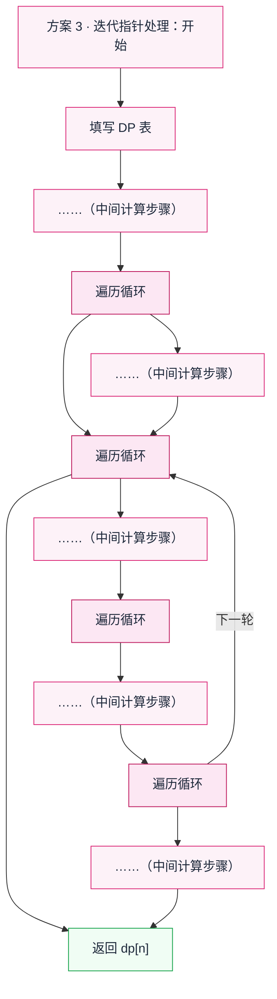

```java
package com.webfault.dsa; // 引入依赖

class lc313_solution33 { // 定义类型
  // nthSuperUglyNumber 忠实翻译 python ref solution_3___3.py（多指针 DP，手动 min 循环）
  public static long nthSuperUglyNumber(int n, int[] primes) {
    long[] dp = new long[n + 1]; // 把 new long[元素个数 加 1]; 写入 long[] dp
    int m = primes.length; // 把 primes.长度 存入 映射表
    int[] pointers = new int[m]; // 把 new int[映射表]; 写入 int[] pointers
    long[] nums = new long[m]; // 把 new long[映射表]; 写入 long[] nums
    for (int j = 0; j < m; j++) { // 让 下标 j 从 0 开始计数，下标 j 小于 映射表 就继续
      nums[j] = 1; // 把 1; 写入 nums[j]
    }
    for (int i = 1; i <= n; i++) { // 让 下标 i 从 1 开始计数，下标 i 不超过 元素个数 就继续
      long minNum = Long.MAX_VALUE; // 把 Long.MAX_VALUE; 写入 long minNum
      for (int j = 0; j < m; j++) { // 让 下标 j 从 0 开始计数，下标 j 小于 映射表 就继续
        minNum = Math.min(minNum, nums[j]); // 把 Math.取较小值 minNum, 数组[下标 j]); 写入 minNum
      }
      dp[i] = minNum; // 把 minNum; 写入 dp[i]
      for (int j = 0; j < m; j++) { // 让 下标 j 从 0 开始计数，下标 j 小于 映射表 就继续
        if (nums[j] == minNum) { // 若 数组[下标 j] 等于 minNum
          pointers[j]++; // pointers[下标 j] 加一 ;
          nums[j] =
              dp[pointers[j]] * primes[j]; // 把 DP 表[pointers[下标 j]] 乘 primes[下标 j]; 写入 nums[j]
        }
      }
    }
    return dp[n]; // 返回 DP 表[元素个数]
  }

  public static void main(String[] args) { // public static void main(String[] args) {
    // want 由 python ref solution_3___3.py 实跑得到
    Object[][] cases = { // 把 { 写入 Object[][] cases
      {12, new int[] {2, 7, 13, 19}, 32L},
      {10, new int[] {2, 3, 5}, 12L},
      {1, new int[] {2}, 1L},
      {2, new int[] {2}, 2L},
      {6, new int[] {2, 3, 5}, 6L},
      {7, new int[] {3, 5, 7}, 21L},
      {5, new int[] {2, 3}, 6L},
      {17, new int[] {2, 3, 5}, 27L},
    };
    boolean ok = true; // 把 true; 写入 boolean ok
    for (Object[] c : cases) { // for (Object[] 字符 : cases) {
      long got = nthSuperUglyNumber((Integer) c[0], (int[]) c[1]);
      long want = (Long) c[2]; // 把 (Long) 字符[2]; 写入 long want
      if (got != want) { // 若 got 不等于 want
        ok = false; // 把 false; 写入 ok
        System.out.println("FAIL got " + got + " want " + want); // 打印输出
      }
    }
    if (!ok) { // 若 取反 ok
      throw new RuntimeException("FAILED"); // throw new RuntimeException(「FAILED」);
    }
    System.out.println("PASS"); // 全部用例通过，输出 PASS
  }
}
```

#### 方案 4：迭代指针处理

**思路与代码分析**：核心是「迭代指针处理」。Java 版用类与静态方法组织，集合操作显式明了。代码里依次做这些事：双重循环遍历；队列或堆的调度。**走读**：方案 4 · 迭代指针处理：开始 → 更新 ugly → 遍历循环 → 遍历循环 → 遍历循环 → 当 (val == ugly[i - 1]) 时反复执行 → 返回 ugly[n - 1]。

**运行架构**（真实控制流）：

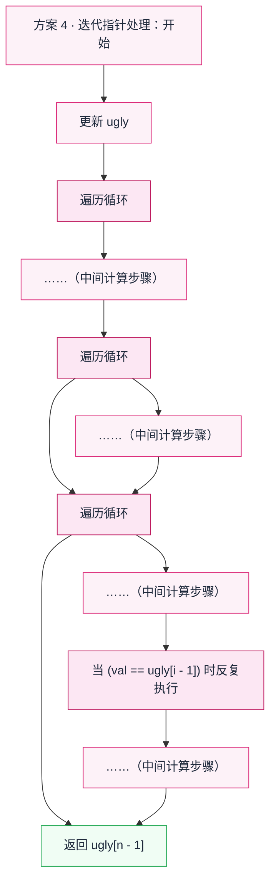

```java
package com.webfault.dsa; // 引入依赖

import java.util.PriorityQueue; // 引入依赖

class lc313_solution411 { // 定义类型
  // nthSuperUglyNumber 忠实翻译 python ref solution_4_1_____1______.py（最小堆，弹出时跳过重复值）
  static long nthSuperUglyNumber(int n, int[] primes) { // 定义函数/方法 nthSuperUglyNumber
    long[] ugly = new long[n]; // 把 new long[元素个数]; 写入 long[] ugly
    for (int x = 0; x < n; x++) { // 让 x 从 0 开始计数，x 小于 元素个数 就继续
      ugly[x] = 1; // python: ugly = [1] * n
    }
    int[] p = new int[primes.length]; // 把 new int[primes.长度]; 写入 int[] p
    // python heapq 元组 (val, j) 字典序比较
    PriorityQueue<long[]> heap =
        new PriorityQueue<>(
            (a, b) -> a[0] != b[0] ? Long.compare(a[0], b[0]) : Long.compare(a[1], b[1]));
    for (int j = 0; j < primes.length; j++) { // 让 下标 j 从 0 开始计数，下标 j 小于 primes.长度 就继续
      heap.offer(new long[] {primes[j], j}); // 堆.offer(new long[]{primes[下标 j], 下标 j});
    }
    for (int i = 1; i < n; i++) { // 让 下标 i 从 1 开始计数，下标 i 小于 元素个数 就继续
      long[] top = heap.poll(); // 把 堆.poll(); 写入 long[] top
      long val = top[0]; // 把 top[0]; 写入 long val
      int j = (int) top[1]; // 把 (int) top[1] 存入 下标 j
      while (val == ugly[i - 1]) { // 循环，直到不满足「值 等于 ugly[下标 i 减 1]」
        p[j]++; // 节点[下标 j] 加一 ;
        heap.offer(
            new long[] {
              ugly[p[j]] * primes[j], j
            }); // 堆.offer(new long[]{ugly[节点[下标 j]] 乘 primes[下标 j], 下标 j});
        top = heap.poll(); // 把 堆.poll(); 写入 top
        val = top[0]; // 把 top[0]; 写入 值
        j = (int) top[1]; // 把 (int) top[1]; 写入 下标 j
      }
      ugly[i] = val; // 把 值; 写入 ugly[i]
      p[j]++; // 节点[下标 j] 加一 ;
      heap.offer(
          new long[] {
            ugly[p[j]] * primes[j], j
          }); // 堆.offer(new long[]{ugly[节点[下标 j]] 乘 primes[下标 j], 下标 j});
    }
    return ugly[n - 1]; // 返回 ugly[元素个数 减 1]
  }

  public static void main(String[] args) { // public static void main(String[] args) {
    // want 由 python ref solution_4_1_____1______.py 实跑得到
    Object[][] cases = { // 把 { 写入 Object[][] cases
      {12, new int[] {2, 7, 13, 19}, 32L},
      {10, new int[] {2, 3, 5}, 12L},
      {1, new int[] {2}, 1L},
      {2, new int[] {2}, 2L},
      {6, new int[] {2, 3, 5}, 6L},
      {7, new int[] {3, 5, 7}, 21L},
      {5, new int[] {2, 3}, 6L},
      {17, new int[] {2, 3, 5}, 27L},
    };
    boolean ok = true; // 把 true; 写入 boolean ok
    for (Object[] c : cases) { // for (Object[] 字符 : cases) {
      long got = nthSuperUglyNumber((Integer) c[0], (int[]) c[1]);
      long want = (Long) c[2]; // 把 (Long) 字符[2]; 写入 long want
      if (got != want) { // 若 got 不等于 want
        ok = false; // 把 false; 写入 ok
        System.out.println("FAIL got " + got + " want " + want); // 打印输出
      }
    }
    if (!ok) { // 若 取反 ok
      throw new RuntimeException("FAILED"); // throw new RuntimeException(「FAILED」);
    }
    System.out.println("PASS"); // 全部用例通过，输出 PASS
  }
}
```

#### 方案 5：直接实现

**思路与代码分析**：核心是「直接实现」。Java 版用类与静态方法组织，集合操作显式明了。代码里依次做这些事：DP 表逐项填充；双重循环遍历。**走读**：方案 5 · 直接实现：开始 → 填写 DP 表 → 遍历循环 → 遍历循环 → 遍历循环 → 遍历循环 → 返回 dp[n]。

**运行架构**（真实控制流）：

```mermaid
graph TD
    N0["方案 5 · 直接实现：开始"]
    N1["填写 DP 表"]
    D1["……（中间计算步骤）"]
    N5["遍历循环"]
    D2["……（中间计算步骤）"]
    N7["遍历循环"]
    D3["……（中间计算步骤）"]
    N9["遍历循环"]
    D4["……（中间计算步骤）"]
    N12["遍历循环"]
    D5["……（中间计算步骤）"]
    N17["返回 dp[n]"]
    N0 --> N1
    N5 --> N7
    N12 -- 下一轮 --> N7
    N7 --> N17
    N1 --> D1
    D1 --> N5
    N5 --> D2
    D2 --> N7
    N7 --> D3
    D3 --> N9
    N9 --> D4
    D4 --> N12
    N12 --> D5
    D5 --> N17
    classDef n fill:#fdf2f8,stroke:#db2777,color:#1e293b;
    classDef lp fill:#fce7f3,stroke:#be185d,color:#1e293b;
    classDef dc fill:#fef9c3,stroke:#ca8a04,color:#1e293b;
    classDef tm fill:#f0fdf4,stroke:#16a34a,color:#1e293b;
    class N0,N1,D1,D2,D3,D4,D5 n;
    class N5,N7,N9,N12 lp;
    class N17 tm;
```

```java
package com.webfault.dsa; // 引入依赖

class lc313_solution511 { // 定义类型
  // nthSuperUglyNumber 忠实翻译 python ref solution_5_1_____1_____.py（多指针 DP，min(nums) 版本）
  public static long nthSuperUglyNumber(int n, int[] primes) {
    long[] dp = new long[n + 1]; // 把 new long[元素个数 加 1]; 写入 long[] dp
    int m = primes.length; // 把 primes.长度 存入 映射表
    int[] pointers = new int[m]; // 把 new int[映射表]; 写入 int[] pointers
    long[] nums = new long[m]; // 把 new long[映射表]; 写入 long[] nums
    for (int j = 0; j < m; j++) { // 让 下标 j 从 0 开始计数，下标 j 小于 映射表 就继续
      nums[j] = 1; // 把 1; 写入 nums[j]
    }
    for (int i = 1; i <= n; i++) { // 让 下标 i 从 1 开始计数，下标 i 不超过 元素个数 就继续
      long minNum = Long.MAX_VALUE; // 把 Long.MAX_VALUE; 写入 long minNum
      for (int j = 0; j < m; j++) { // 让 下标 j 从 0 开始计数，下标 j 小于 映射表 就继续
        minNum = Math.min(minNum, nums[j]); // 把 Math.取较小值 minNum, 数组[下标 j]); 写入 minNum
      }
      dp[i] = minNum; // 把 minNum; 写入 dp[i]
      for (int j = 0; j < m; j++) { // 让 下标 j 从 0 开始计数，下标 j 小于 映射表 就继续
        if (nums[j] == minNum) { // 若 数组[下标 j] 等于 minNum
          pointers[j]++; // pointers[下标 j] 加一 ;
          nums[j] =
              dp[pointers[j]] * primes[j]; // 把 DP 表[pointers[下标 j]] 乘 primes[下标 j]; 写入 nums[j]
        }
      }
    }
    return dp[n]; // 返回 DP 表[元素个数]
  }

  public static void main(String[] args) { // public static void main(String[] args) {
    // want 由 python ref solution_5_1_____1_____.py 实跑得到
    Object[][] cases = { // 把 { 写入 Object[][] cases
      {12, new int[] {2, 7, 13, 19}, 32L},
      {10, new int[] {2, 3, 5}, 12L},
      {1, new int[] {2}, 1L},
      {2, new int[] {2}, 2L},
      {6, new int[] {2, 3, 5}, 6L},
      {7, new int[] {3, 5, 7}, 21L},
      {5, new int[] {2, 3}, 6L},
      {17, new int[] {2, 3, 5}, 27L},
    };
    boolean ok = true; // 把 true; 写入 boolean ok
    for (Object[] c : cases) { // for (Object[] 字符 : cases) {
      long got = nthSuperUglyNumber((Integer) c[0], (int[]) c[1]);
      long want = (Long) c[2]; // 把 (Long) 字符[2]; 写入 long want
      if (got != want) { // 若 got 不等于 want
        ok = false; // 把 false; 写入 ok
        System.out.println("FAIL got " + got + " want " + want); // 打印输出
      }
    }
    if (!ok) { // 若 取反 ok
      throw new RuntimeException("FAILED"); // throw new RuntimeException(「FAILED」);
    }
    System.out.println("PASS"); // 全部用例通过，输出 PASS
  }
}
```

### Rust 实现（5 种方案）

Rust 的全部方案如下，每个方案都内嵌用例自测，可独立运行（老仓库 python/go 文件遵循「打印结果」约定）：

#### 方案 1：直接实现

**思路与代码分析**：核心是「直接实现」。Rust 版用所有权移动与切片借用改写同一逻辑，注意 Option 与引用边界。**走读**：方案 1 · 直接实现：开始 → 计算 ugly → 计算 idx → 计算 val → 遍历 1..n 中的每个元素 i → 计算 next → 遍历 0..primes.len() 中的每个元素 k → 处理 if val[k] ＜ next → 更新 next → 更新 ugly[i] → 遍历 0..primes.len() 中的每个元素 k → 处理 if val[k] == next → 更新 + → 更新 val[k] → 处理 ugly[n - 1] → 返回结果。

**运行架构**（真实控制流）：

```mermaid
graph TD
    N0["方案 1 · 直接实现：开始"]
    N1["计算 ugly"]
    N2["计算 idx"]
    N3["计算 val"]
    N4["遍历 1..n 中的每个元素 i"]
    N5["计算 next"]
    N6["遍历 0..primes.len() 中的每个元素 k"]
    N7["处理 if val[k] ＜ next"]
    N8["更新 next"]
    N9["更新 ugly[i]"]
    N10["遍历 0..primes.len() 中的每个元素 k"]
    N11["处理 if val[k] == next"]
    N12["更新 +"]
    N13["更新 val[k]"]
    N14["处理 ugly[n - 1]"]
    N15["返回结果"]
    N0 --> N1
    N1 --> N2
    N2 --> N3
    N3 --> N4
    N4 --> N5
    N5 --> N6
    N6 --> N7
    N7 --> N8
    N8 -- 下一轮 --> N6
    N6 --> N9
    N9 --> N10
    N10 --> N11
    N11 --> N12
    N12 --> N13
    N13 -- 下一轮 --> N10
    N10 -- 下一轮 --> N4
    N4 --> N14
    N14 --> N15
    classDef n fill:#fdf2f8,stroke:#db2777,color:#1e293b;
    classDef lp fill:#fce7f3,stroke:#be185d,color:#1e293b;
    classDef dc fill:#fef9c3,stroke:#ca8a04,color:#1e293b;
    classDef tm fill:#f0fdf4,stroke:#16a34a,color:#1e293b;
    class N0,N1,N2,N3,N5,N7,N8,N9,N11,N12,N13,N14 n;
    class N4,N6,N10 lp;
    class N15 tm;
```

```rust
// LeetCode 313. 超级丑数 — Rust 版（方案1）
fn nth_super_ugly_number(n: usize, primes: &[i64]) -> i64 {
    // 定义函数/方法 nth_super_ugly_number
    let mut ugly = vec![1i64; n]; // 把 vec取反 [1i64; 元素个数]; 写入 let mut ugly
    let mut idx = vec![0usize; primes.len()]; // 把 vec取反 [0usize; primes.长度()]; 写入 let mut idx
    let mut val: Vec<i64> = primes.to_vec(); // 把 primes.to_vec(); 写入 let mut val: Vec<i64>
    for i in 1..n {
        // 逐个取出 1 的元素（下标 i）
        let mut next = i64::MAX; // 把 i64::MAX; 写入 let mut next
        for k in 0..primes.len() {
            if val[k] < next {
                next = val[k];
            }
        } // 逐个取出 0 的元素（下标 k）
        ugly[i] = next; // 把 下一个; 写入 ugly[i]
        for k in 0..primes.len() {
            // 逐个取出 0 的元素（下标 k）
            if val[k] == next {
                // 若 值[下标 k] 等于 下一个
                idx[k] += 1; // idx[k]累加 1
                val[k] = ugly[idx[k]] * primes[k]; // 把 ugly[idx[下标 k]] 乘 primes[下标 k]; 写入 val[k]
            }
        }
    }
    ugly[n - 1] // ugly[元素个数 减 1]
}
fn main() {
    // 程序入口：跑内嵌自测用例
    assert_eq!(nth_super_ugly_number(12, &[2, 7, 13, 19]), 32); // 断言校验
    assert_eq!(nth_super_ugly_number(1, &[2, 7, 13, 19]), 1); // 断言校验
    println!("PASS"); // 全部用例通过，输出 PASS
}
```

#### 方案 2：直接实现

**思路与代码分析**：核心是「直接实现」。Rust 版用所有权移动与切片借用改写同一逻辑，注意 Option 与引用边界。**走读**：方案 2 · 直接实现：开始 → 计算 ugly → 计算 idx → 计算 val → 遍历 1..n 中的每个元素 i → 计算 next → 遍历 0..primes.len() 中的每个元素 k → 处理 if val[k] ＜ next → 更新 next → 更新 ugly[i] → 遍历 0..primes.len() 中的每个元素 k → 处理 if val[k] == next → 更新 + → 更新 val[k] → 处理 ugly[n - 1] → 返回结果。

**运行架构**（真实控制流）：

```mermaid
graph TD
    N0["方案 2 · 直接实现：开始"]
    N1["计算 ugly"]
    N2["计算 idx"]
    N3["计算 val"]
    N4["遍历 1..n 中的每个元素 i"]
    N5["计算 next"]
    N6["遍历 0..primes.len() 中的每个元素 k"]
    N7["处理 if val[k] ＜ next"]
    N8["更新 next"]
    N9["更新 ugly[i]"]
    N10["遍历 0..primes.len() 中的每个元素 k"]
    N11["处理 if val[k] == next"]
    N12["更新 +"]
    N13["更新 val[k]"]
    N14["处理 ugly[n - 1]"]
    N15["返回结果"]
    N0 --> N1
    N1 --> N2
    N2 --> N3
    N3 --> N4
    N4 --> N5
    N5 --> N6
    N6 --> N7
    N7 --> N8
    N8 -- 下一轮 --> N6
    N6 --> N9
    N9 --> N10
    N10 --> N11
    N11 --> N12
    N12 --> N13
    N13 -- 下一轮 --> N10
    N10 -- 下一轮 --> N4
    N4 --> N14
    N14 --> N15
    classDef n fill:#fdf2f8,stroke:#db2777,color:#1e293b;
    classDef lp fill:#fce7f3,stroke:#be185d,color:#1e293b;
    classDef dc fill:#fef9c3,stroke:#ca8a04,color:#1e293b;
    classDef tm fill:#f0fdf4,stroke:#16a34a,color:#1e293b;
    class N0,N1,N2,N3,N5,N7,N8,N9,N11,N12,N13,N14 n;
    class N4,N6,N10 lp;
    class N15 tm;
```

```rust
// LeetCode 313. 超级丑数 — Rust 版（方案2）
fn nth_super_ugly_number(n: usize, primes: &[i64]) -> i64 {
    // 定义函数/方法 nth_super_ugly_number
    let mut ugly = vec![1i64; n]; // 把 vec取反 [1i64; 元素个数]; 写入 let mut ugly
    let mut idx = vec![0usize; primes.len()]; // 把 vec取反 [0usize; primes.长度()]; 写入 let mut idx
    let mut val: Vec<i64> = primes.to_vec(); // 把 primes.to_vec(); 写入 let mut val: Vec<i64>
    for i in 1..n {
        // 逐个取出 1 的元素（下标 i）
        let mut next = i64::MAX; // 把 i64::MAX; 写入 let mut next
        for k in 0..primes.len() {
            if val[k] < next {
                next = val[k];
            }
        } // 逐个取出 0 的元素（下标 k）
        ugly[i] = next; // 把 下一个; 写入 ugly[i]
        for k in 0..primes.len() {
            // 逐个取出 0 的元素（下标 k）
            if val[k] == next {
                // 若 值[下标 k] 等于 下一个
                idx[k] += 1; // idx[k]累加 1
                val[k] = ugly[idx[k]] * primes[k]; // 把 ugly[idx[下标 k]] 乘 primes[下标 k]; 写入 val[k]
            }
        }
    }
    ugly[n - 1] // ugly[元素个数 减 1]
}
fn main() {
    // 程序入口：跑内嵌自测用例
    assert_eq!(nth_super_ugly_number(12, &[2, 7, 13, 19]), 32); // 断言校验
    assert_eq!(nth_super_ugly_number(1, &[2, 7, 13, 19]), 1); // 断言校验
    println!("PASS"); // 全部用例通过，输出 PASS
}
```

#### 方案 3：迭代指针处理

**思路与代码分析**：核心是「迭代指针处理」。Rust 版用所有权移动与切片借用改写同一逻辑，注意 Option 与引用边界。**走读**：方案 3 · 迭代指针处理：开始 → 计算 ugly → 计算 idx → 计算 val → 遍历 1..n 中的每个元素 i → 计算 next → 遍历 0..primes.len() 中的每个元素 k → 处理 if val[k] ＜ next → 更新 next → 更新 ugly[i] → 遍历 0..primes.len() 中的每个元素 k → 处理 if val[k] == next → 更新 + → 更新 val[k] → 处理 ugly[n - 1] → 返回结果。

**运行架构**（真实控制流）：

```mermaid
graph TD
    N0["方案 3 · 迭代指针处理：开始"]
    N1["计算 ugly"]
    N2["计算 idx"]
    N3["计算 val"]
    N4["遍历 1..n 中的每个元素 i"]
    N5["计算 next"]
    N6["遍历 0..primes.len() 中的每个元素 k"]
    N7["处理 if val[k] ＜ next"]
    N8["更新 next"]
    N9["更新 ugly[i]"]
    N10["遍历 0..primes.len() 中的每个元素 k"]
    N11["处理 if val[k] == next"]
    N12["更新 +"]
    N13["更新 val[k]"]
    N14["处理 ugly[n - 1]"]
    N15["返回结果"]
    N0 --> N1
    N1 --> N2
    N2 --> N3
    N3 --> N4
    N4 --> N5
    N5 --> N6
    N6 --> N7
    N7 --> N8
    N8 -- 下一轮 --> N6
    N6 --> N9
    N9 --> N10
    N10 --> N11
    N11 --> N12
    N12 --> N13
    N13 -- 下一轮 --> N10
    N10 -- 下一轮 --> N4
    N4 --> N14
    N14 --> N15
    classDef n fill:#fdf2f8,stroke:#db2777,color:#1e293b;
    classDef lp fill:#fce7f3,stroke:#be185d,color:#1e293b;
    classDef dc fill:#fef9c3,stroke:#ca8a04,color:#1e293b;
    classDef tm fill:#f0fdf4,stroke:#16a34a,color:#1e293b;
    class N0,N1,N2,N3,N5,N7,N8,N9,N11,N12,N13,N14 n;
    class N4,N6,N10 lp;
    class N15 tm;
```

```rust
// LeetCode 313. 超级丑数 — Rust 版（方案3）
fn nth_super_ugly_number(n: usize, primes: &[i64]) -> i64 {
    // 定义函数/方法 nth_super_ugly_number
    let mut ugly = vec![1i64; n]; // 把 vec取反 [1i64; 元素个数]; 写入 let mut ugly
    let mut idx = vec![0usize; primes.len()]; // 把 vec取反 [0usize; primes.长度()]; 写入 let mut idx
    let mut val: Vec<i64> = primes.to_vec(); // 把 primes.to_vec(); 写入 let mut val: Vec<i64>
    for i in 1..n {
        // 逐个取出 1 的元素（下标 i）
        let mut next = i64::MAX; // 把 i64::MAX; 写入 let mut next
        for k in 0..primes.len() {
            if val[k] < next {
                next = val[k];
            }
        } // 逐个取出 0 的元素（下标 k）
        ugly[i] = next; // 把 下一个; 写入 ugly[i]
        for k in 0..primes.len() {
            // 逐个取出 0 的元素（下标 k）
            if val[k] == next {
                // 若 值[下标 k] 等于 下一个
                idx[k] += 1; // idx[k]累加 1
                val[k] = ugly[idx[k]] * primes[k]; // 把 ugly[idx[下标 k]] 乘 primes[下标 k]; 写入 val[k]
            }
        }
    }
    ugly[n - 1] // ugly[元素个数 减 1]
}
fn main() {
    // 程序入口：跑内嵌自测用例
    assert_eq!(nth_super_ugly_number(12, &[2, 7, 13, 19]), 32); // 断言校验
    assert_eq!(nth_super_ugly_number(1, &[2, 7, 13, 19]), 1); // 断言校验
    println!("PASS"); // 全部用例通过，输出 PASS
}
```

#### 方案 4：迭代指针处理

**思路与代码分析**：核心是「迭代指针处理」。Rust 版用所有权移动与切片借用改写同一逻辑，注意 Option 与引用边界。**走读**：方案 4 · 迭代指针处理：开始 → 计算 ugly → 计算 idx → 计算 val → 遍历 1..n 中的每个元素 i → 计算 next → 遍历 0..primes.len() 中的每个元素 k → 处理 if val[k] ＜ next → 更新 next → 更新 ugly[i] → 遍历 0..primes.len() 中的每个元素 k → 处理 if val[k] == next → 更新 + → 更新 val[k] → 处理 ugly[n - 1] → 返回结果。

**运行架构**（真实控制流）：

```mermaid
graph TD
    N0["方案 4 · 迭代指针处理：开始"]
    N1["计算 ugly"]
    N2["计算 idx"]
    N3["计算 val"]
    N4["遍历 1..n 中的每个元素 i"]
    N5["计算 next"]
    N6["遍历 0..primes.len() 中的每个元素 k"]
    N7["处理 if val[k] ＜ next"]
    N8["更新 next"]
    N9["更新 ugly[i]"]
    N10["遍历 0..primes.len() 中的每个元素 k"]
    N11["处理 if val[k] == next"]
    N12["更新 +"]
    N13["更新 val[k]"]
    N14["处理 ugly[n - 1]"]
    N15["返回结果"]
    N0 --> N1
    N1 --> N2
    N2 --> N3
    N3 --> N4
    N4 --> N5
    N5 --> N6
    N6 --> N7
    N7 --> N8
    N8 -- 下一轮 --> N6
    N6 --> N9
    N9 --> N10
    N10 --> N11
    N11 --> N12
    N12 --> N13
    N13 -- 下一轮 --> N10
    N10 -- 下一轮 --> N4
    N4 --> N14
    N14 --> N15
    classDef n fill:#fdf2f8,stroke:#db2777,color:#1e293b;
    classDef lp fill:#fce7f3,stroke:#be185d,color:#1e293b;
    classDef dc fill:#fef9c3,stroke:#ca8a04,color:#1e293b;
    classDef tm fill:#f0fdf4,stroke:#16a34a,color:#1e293b;
    class N0,N1,N2,N3,N5,N7,N8,N9,N11,N12,N13,N14 n;
    class N4,N6,N10 lp;
    class N15 tm;
```

```rust
// LeetCode 313. 超级丑数 — Rust 版（方案4）
fn nth_super_ugly_number(n: usize, primes: &[i64]) -> i64 {
    // 定义函数/方法 nth_super_ugly_number
    let mut ugly = vec![1i64; n]; // 把 vec取反 [1i64; 元素个数]; 写入 let mut ugly
    let mut idx = vec![0usize; primes.len()]; // 把 vec取反 [0usize; primes.长度()]; 写入 let mut idx
    let mut val: Vec<i64> = primes.to_vec(); // 把 primes.to_vec(); 写入 let mut val: Vec<i64>
    for i in 1..n {
        // 逐个取出 1 的元素（下标 i）
        let mut next = i64::MAX; // 把 i64::MAX; 写入 let mut next
        for k in 0..primes.len() {
            if val[k] < next {
                next = val[k];
            }
        } // 逐个取出 0 的元素（下标 k）
        ugly[i] = next; // 把 下一个; 写入 ugly[i]
        for k in 0..primes.len() {
            // 逐个取出 0 的元素（下标 k）
            if val[k] == next {
                // 若 值[下标 k] 等于 下一个
                idx[k] += 1; // idx[k]累加 1
                val[k] = ugly[idx[k]] * primes[k]; // 把 ugly[idx[下标 k]] 乘 primes[下标 k]; 写入 val[k]
            }
        }
    }
    ugly[n - 1] // ugly[元素个数 减 1]
}
fn main() {
    // 程序入口：跑内嵌自测用例
    assert_eq!(nth_super_ugly_number(12, &[2, 7, 13, 19]), 32); // 断言校验
    assert_eq!(nth_super_ugly_number(1, &[2, 7, 13, 19]), 1); // 断言校验
    println!("PASS"); // 全部用例通过，输出 PASS
}
```

#### 方案 5：直接实现

**思路与代码分析**：核心是「直接实现」。Rust 版用所有权移动与切片借用改写同一逻辑，注意 Option 与引用边界。**走读**：方案 5 · 直接实现：开始 → 计算 ugly → 计算 idx → 计算 val → 遍历 1..n 中的每个元素 i → 计算 next → 遍历 0..primes.len() 中的每个元素 k → 处理 if val[k] ＜ next → 更新 next → 更新 ugly[i] → 遍历 0..primes.len() 中的每个元素 k → 处理 if val[k] == next → 更新 + → 更新 val[k] → 处理 ugly[n - 1] → 返回结果。

**运行架构**（真实控制流）：

```mermaid
graph TD
    N0["方案 5 · 直接实现：开始"]
    N1["计算 ugly"]
    N2["计算 idx"]
    N3["计算 val"]
    N4["遍历 1..n 中的每个元素 i"]
    N5["计算 next"]
    N6["遍历 0..primes.len() 中的每个元素 k"]
    N7["处理 if val[k] ＜ next"]
    N8["更新 next"]
    N9["更新 ugly[i]"]
    N10["遍历 0..primes.len() 中的每个元素 k"]
    N11["处理 if val[k] == next"]
    N12["更新 +"]
    N13["更新 val[k]"]
    N14["处理 ugly[n - 1]"]
    N15["返回结果"]
    N0 --> N1
    N1 --> N2
    N2 --> N3
    N3 --> N4
    N4 --> N5
    N5 --> N6
    N6 --> N7
    N7 --> N8
    N8 -- 下一轮 --> N6
    N6 --> N9
    N9 --> N10
    N10 --> N11
    N11 --> N12
    N12 --> N13
    N13 -- 下一轮 --> N10
    N10 -- 下一轮 --> N4
    N4 --> N14
    N14 --> N15
    classDef n fill:#fdf2f8,stroke:#db2777,color:#1e293b;
    classDef lp fill:#fce7f3,stroke:#be185d,color:#1e293b;
    classDef dc fill:#fef9c3,stroke:#ca8a04,color:#1e293b;
    classDef tm fill:#f0fdf4,stroke:#16a34a,color:#1e293b;
    class N0,N1,N2,N3,N5,N7,N8,N9,N11,N12,N13,N14 n;
    class N4,N6,N10 lp;
    class N15 tm;
```

```rust
// LeetCode 313. 超级丑数 — Rust 版（方案5）
fn nth_super_ugly_number(n: usize, primes: &[i64]) -> i64 {
    // 定义函数/方法 nth_super_ugly_number
    let mut ugly = vec![1i64; n]; // 把 vec取反 [1i64; 元素个数]; 写入 let mut ugly
    let mut idx = vec![0usize; primes.len()]; // 把 vec取反 [0usize; primes.长度()]; 写入 let mut idx
    let mut val: Vec<i64> = primes.to_vec(); // 把 primes.to_vec(); 写入 let mut val: Vec<i64>
    for i in 1..n {
        // 逐个取出 1 的元素（下标 i）
        let mut next = i64::MAX; // 把 i64::MAX; 写入 let mut next
        for k in 0..primes.len() {
            if val[k] < next {
                next = val[k];
            }
        } // 逐个取出 0 的元素（下标 k）
        ugly[i] = next; // 把 下一个; 写入 ugly[i]
        for k in 0..primes.len() {
            // 逐个取出 0 的元素（下标 k）
            if val[k] == next {
                // 若 值[下标 k] 等于 下一个
                idx[k] += 1; // idx[k]累加 1
                val[k] = ugly[idx[k]] * primes[k]; // 把 ugly[idx[下标 k]] 乘 primes[下标 k]; 写入 val[k]
            }
        }
    }
    ugly[n - 1] // ugly[元素个数 减 1]
}
fn main() {
    // 程序入口：跑内嵌自测用例
    assert_eq!(nth_super_ugly_number(12, &[2, 7, 13, 19]), 32); // 断言校验
    assert_eq!(nth_super_ugly_number(1, &[2, 7, 13, 19]), 1); // 断言校验
    println!("PASS"); // 全部用例通过，输出 PASS
}
```

### Lua 实现（5 种方案）

Lua 的全部方案如下，每个方案都内嵌用例自测，可独立运行（老仓库 python/go 文件遵循「打印结果」约定）：

#### 方案 1：直接实现

**思路与代码分析**：核心是「直接实现」。Lua 版用表与 ipairs 遍历，注意 ipairs 遇 nil 即停的语义。**走读**：方案 1 · 直接实现：开始 → 更新 ugly → 循环 k：从 1 到 #primes do → 循环 i：从 2 到 n do → 循环 k：从 1 到 #primes do → 循环 k：从 1 到 #primes do → 返回 ugly[n]。

**运行架构**（真实控制流）：

```mermaid
graph TD
    N0["方案 1 · 直接实现：开始"]
    N1["更新 ugly"]
    D1["……（中间计算步骤）"]
    N4["循环 k：从 1 到 #primes do"]
    D2["……（中间计算步骤）"]
    N7["循环 i：从 2 到 n do"]
    D3["……（中间计算步骤）"]
    N9["循环 k：从 1 到 #primes do"]
    D4["……（中间计算步骤）"]
    N13["循环 k：从 1 到 #primes do"]
    D5["……（中间计算步骤）"]
    N17["返回 ugly[n]"]
    N0 --> N1
    N1 --> D1
    D1 --> N4
    N4 --> D2
    D2 --> N7
    N7 --> D3
    D3 --> N9
    N9 --> D4
    D4 --> N13
    N13 --> D5
    D5 --> N17
    classDef n fill:#fdf2f8,stroke:#db2777,color:#1e293b;
    classDef lp fill:#fce7f3,stroke:#be185d,color:#1e293b;
    classDef dc fill:#fef9c3,stroke:#ca8a04,color:#1e293b;
    classDef tm fill:#f0fdf4,stroke:#16a34a,color:#1e293b;
    class N0,N1,D1,D2,D3,D4,D5 n;
    class N4,N7,N9,N13 lp;
    class N17 tm;
```

```lua
-- LeetCode 313. 超级丑数 — Lua 版（方案1）
local function nth_super_ugly_number(n, primes) -- local function nth_super_ugly_number(元素个数, primes)
	local ugly = {} -- 把 {} 写入 local ugly
	ugly[1] = 1 -- 把 1 写入 ugly[1]
	local idx, val = {}, {} -- 把 {}, {} 写入 local idx, val
	for k = 1, #primes do
		idx[k] = 1
		val[k] = primes[k]
	end
	for i = 2, n do -- 让 下标 i 从 2 走到 元素个数（Lua 1 基）
		local next = math.huge -- 把 math.huge 写入 local next
		for k = 1, #primes do
			if val[k] < next then
				next = val[k]
			end
		end
		ugly[i] = next -- 把 下一个 写入 ugly[i]
		for k = 1, #primes do -- 把 1, #primes do 写入 for k
			if val[k] == next then -- 若 值[下标 k] 等于 下一个 then
				idx[k] = idx[k] + 1 -- 把 idx[下标 k] 加 1 写入 idx[k]
				val[k] = ugly[idx[k]] * primes[k] -- 把 ugly[idx[下标 k]] 乘 primes[下标 k] 写入 val[k]
			end -- 终点
		end -- 终点
	end -- 终点
	return ugly[n] -- 返回 ugly[元素个数]
end -- 终点
assert(nth_super_ugly_number(12, { 2, 7, 13, 19 }) == 32) -- 断言校验
assert(nth_super_ugly_number(1, { 2, 7, 13, 19 }) == 1) -- 断言校验
print("PASS") -- 全部用例通过，输出 PASS
```

#### 方案 2：直接实现

**思路与代码分析**：核心是「直接实现」。Lua 版用表与 ipairs 遍历，注意 ipairs 遇 nil 即停的语义。**走读**：方案 2 · 直接实现：开始 → 更新 ugly → 循环 k：从 1 到 #primes do → 循环 i：从 2 到 n do → 循环 k：从 1 到 #primes do → 循环 k：从 1 到 #primes do → 返回 ugly[n]。

**运行架构**（真实控制流）：

```mermaid
graph TD
    N0["方案 2 · 直接实现：开始"]
    N1["更新 ugly"]
    D1["……（中间计算步骤）"]
    N4["循环 k：从 1 到 #primes do"]
    D2["……（中间计算步骤）"]
    N7["循环 i：从 2 到 n do"]
    D3["……（中间计算步骤）"]
    N9["循环 k：从 1 到 #primes do"]
    D4["……（中间计算步骤）"]
    N13["循环 k：从 1 到 #primes do"]
    D5["……（中间计算步骤）"]
    N17["返回 ugly[n]"]
    N0 --> N1
    N1 --> D1
    D1 --> N4
    N4 --> D2
    D2 --> N7
    N7 --> D3
    D3 --> N9
    N9 --> D4
    D4 --> N13
    N13 --> D5
    D5 --> N17
    classDef n fill:#fdf2f8,stroke:#db2777,color:#1e293b;
    classDef lp fill:#fce7f3,stroke:#be185d,color:#1e293b;
    classDef dc fill:#fef9c3,stroke:#ca8a04,color:#1e293b;
    classDef tm fill:#f0fdf4,stroke:#16a34a,color:#1e293b;
    class N0,N1,D1,D2,D3,D4,D5 n;
    class N4,N7,N9,N13 lp;
    class N17 tm;
```

```lua
-- LeetCode 313. 超级丑数 — Lua 版（方案2）
local function nth_super_ugly_number(n, primes) -- local function nth_super_ugly_number(元素个数, primes)
	local ugly = {} -- 把 {} 写入 local ugly
	ugly[1] = 1 -- 把 1 写入 ugly[1]
	local idx, val = {}, {} -- 把 {}, {} 写入 local idx, val
	for k = 1, #primes do
		idx[k] = 1
		val[k] = primes[k]
	end
	for i = 2, n do -- 让 下标 i 从 2 走到 元素个数（Lua 1 基）
		local next = math.huge -- 把 math.huge 写入 local next
		for k = 1, #primes do
			if val[k] < next then
				next = val[k]
			end
		end
		ugly[i] = next -- 把 下一个 写入 ugly[i]
		for k = 1, #primes do -- 把 1, #primes do 写入 for k
			if val[k] == next then -- 若 值[下标 k] 等于 下一个 then
				idx[k] = idx[k] + 1 -- 把 idx[下标 k] 加 1 写入 idx[k]
				val[k] = ugly[idx[k]] * primes[k] -- 把 ugly[idx[下标 k]] 乘 primes[下标 k] 写入 val[k]
			end -- 终点
		end -- 终点
	end -- 终点
	return ugly[n] -- 返回 ugly[元素个数]
end -- 终点
assert(nth_super_ugly_number(12, { 2, 7, 13, 19 }) == 32) -- 断言校验
assert(nth_super_ugly_number(1, { 2, 7, 13, 19 }) == 1) -- 断言校验
print("PASS") -- 全部用例通过，输出 PASS
```

#### 方案 3：迭代指针处理

**思路与代码分析**：核心是「迭代指针处理」。Lua 版用表与 ipairs 遍历，注意 ipairs 遇 nil 即停的语义。**走读**：方案 3 · 迭代指针处理：开始 → 更新 ugly → 循环 k：从 1 到 #primes do → 循环 i：从 2 到 n do → 循环 k：从 1 到 #primes do → 循环 k：从 1 到 #primes do → 返回 ugly[n]。

**运行架构**（真实控制流）：

```mermaid
graph TD
    N0["方案 3 · 迭代指针处理：开始"]
    N1["更新 ugly"]
    D1["……（中间计算步骤）"]
    N4["循环 k：从 1 到 #primes do"]
    D2["……（中间计算步骤）"]
    N7["循环 i：从 2 到 n do"]
    D3["……（中间计算步骤）"]
    N9["循环 k：从 1 到 #primes do"]
    D4["……（中间计算步骤）"]
    N13["循环 k：从 1 到 #primes do"]
    D5["……（中间计算步骤）"]
    N17["返回 ugly[n]"]
    N0 --> N1
    N1 --> D1
    D1 --> N4
    N4 --> D2
    D2 --> N7
    N7 --> D3
    D3 --> N9
    N9 --> D4
    D4 --> N13
    N13 --> D5
    D5 --> N17
    classDef n fill:#fdf2f8,stroke:#db2777,color:#1e293b;
    classDef lp fill:#fce7f3,stroke:#be185d,color:#1e293b;
    classDef dc fill:#fef9c3,stroke:#ca8a04,color:#1e293b;
    classDef tm fill:#f0fdf4,stroke:#16a34a,color:#1e293b;
    class N0,N1,D1,D2,D3,D4,D5 n;
    class N4,N7,N9,N13 lp;
    class N17 tm;
```

```lua
-- LeetCode 313. 超级丑数 — Lua 版（方案3）
local function nth_super_ugly_number(n, primes) -- local function nth_super_ugly_number(元素个数, primes)
	local ugly = {} -- 把 {} 写入 local ugly
	ugly[1] = 1 -- 把 1 写入 ugly[1]
	local idx, val = {}, {} -- 把 {}, {} 写入 local idx, val
	for k = 1, #primes do
		idx[k] = 1
		val[k] = primes[k]
	end
	for i = 2, n do -- 让 下标 i 从 2 走到 元素个数（Lua 1 基）
		local next = math.huge -- 把 math.huge 写入 local next
		for k = 1, #primes do
			if val[k] < next then
				next = val[k]
			end
		end
		ugly[i] = next -- 把 下一个 写入 ugly[i]
		for k = 1, #primes do -- 把 1, #primes do 写入 for k
			if val[k] == next then -- 若 值[下标 k] 等于 下一个 then
				idx[k] = idx[k] + 1 -- 把 idx[下标 k] 加 1 写入 idx[k]
				val[k] = ugly[idx[k]] * primes[k] -- 把 ugly[idx[下标 k]] 乘 primes[下标 k] 写入 val[k]
			end -- 终点
		end -- 终点
	end -- 终点
	return ugly[n] -- 返回 ugly[元素个数]
end -- 终点
assert(nth_super_ugly_number(12, { 2, 7, 13, 19 }) == 32) -- 断言校验
assert(nth_super_ugly_number(1, { 2, 7, 13, 19 }) == 1) -- 断言校验
print("PASS") -- 全部用例通过，输出 PASS
```

#### 方案 4：迭代指针处理

**思路与代码分析**：核心是「迭代指针处理」。Lua 版用表与 ipairs 遍历，注意 ipairs 遇 nil 即停的语义。**走读**：方案 4 · 迭代指针处理：开始 → 更新 ugly → 循环 k：从 1 到 #primes do → 循环 i：从 2 到 n do → 循环 k：从 1 到 #primes do → 循环 k：从 1 到 #primes do → 返回 ugly[n]。

**运行架构**（真实控制流）：

```mermaid
graph TD
    N0["方案 4 · 迭代指针处理：开始"]
    N1["更新 ugly"]
    D1["……（中间计算步骤）"]
    N4["循环 k：从 1 到 #primes do"]
    D2["……（中间计算步骤）"]
    N7["循环 i：从 2 到 n do"]
    D3["……（中间计算步骤）"]
    N9["循环 k：从 1 到 #primes do"]
    D4["……（中间计算步骤）"]
    N13["循环 k：从 1 到 #primes do"]
    D5["……（中间计算步骤）"]
    N17["返回 ugly[n]"]
    N0 --> N1
    N1 --> D1
    D1 --> N4
    N4 --> D2
    D2 --> N7
    N7 --> D3
    D3 --> N9
    N9 --> D4
    D4 --> N13
    N13 --> D5
    D5 --> N17
    classDef n fill:#fdf2f8,stroke:#db2777,color:#1e293b;
    classDef lp fill:#fce7f3,stroke:#be185d,color:#1e293b;
    classDef dc fill:#fef9c3,stroke:#ca8a04,color:#1e293b;
    classDef tm fill:#f0fdf4,stroke:#16a34a,color:#1e293b;
    class N0,N1,D1,D2,D3,D4,D5 n;
    class N4,N7,N9,N13 lp;
    class N17 tm;
```

```lua
-- LeetCode 313. 超级丑数 — Lua 版（方案4）
local function nth_super_ugly_number(n, primes) -- local function nth_super_ugly_number(元素个数, primes)
	local ugly = {} -- 把 {} 写入 local ugly
	ugly[1] = 1 -- 把 1 写入 ugly[1]
	local idx, val = {}, {} -- 把 {}, {} 写入 local idx, val
	for k = 1, #primes do
		idx[k] = 1
		val[k] = primes[k]
	end
	for i = 2, n do -- 让 下标 i 从 2 走到 元素个数（Lua 1 基）
		local next = math.huge -- 把 math.huge 写入 local next
		for k = 1, #primes do
			if val[k] < next then
				next = val[k]
			end
		end
		ugly[i] = next -- 把 下一个 写入 ugly[i]
		for k = 1, #primes do -- 把 1, #primes do 写入 for k
			if val[k] == next then -- 若 值[下标 k] 等于 下一个 then
				idx[k] = idx[k] + 1 -- 把 idx[下标 k] 加 1 写入 idx[k]
				val[k] = ugly[idx[k]] * primes[k] -- 把 ugly[idx[下标 k]] 乘 primes[下标 k] 写入 val[k]
			end -- 终点
		end -- 终点
	end -- 终点
	return ugly[n] -- 返回 ugly[元素个数]
end -- 终点
assert(nth_super_ugly_number(12, { 2, 7, 13, 19 }) == 32) -- 断言校验
assert(nth_super_ugly_number(1, { 2, 7, 13, 19 }) == 1) -- 断言校验
print("PASS") -- 全部用例通过，输出 PASS
```

#### 方案 5：直接实现

**思路与代码分析**：核心是「直接实现」。Lua 版用表与 ipairs 遍历，注意 ipairs 遇 nil 即停的语义。**走读**：方案 5 · 直接实现：开始 → 更新 ugly → 循环 k：从 1 到 #primes do → 循环 i：从 2 到 n do → 循环 k：从 1 到 #primes do → 循环 k：从 1 到 #primes do → 返回 ugly[n]。

**运行架构**（真实控制流）：

```mermaid
graph TD
    N0["方案 5 · 直接实现：开始"]
    N1["更新 ugly"]
    D1["……（中间计算步骤）"]
    N4["循环 k：从 1 到 #primes do"]
    D2["……（中间计算步骤）"]
    N7["循环 i：从 2 到 n do"]
    D3["……（中间计算步骤）"]
    N9["循环 k：从 1 到 #primes do"]
    D4["……（中间计算步骤）"]
    N13["循环 k：从 1 到 #primes do"]
    D5["……（中间计算步骤）"]
    N17["返回 ugly[n]"]
    N0 --> N1
    N1 --> D1
    D1 --> N4
    N4 --> D2
    D2 --> N7
    N7 --> D3
    D3 --> N9
    N9 --> D4
    D4 --> N13
    N13 --> D5
    D5 --> N17
    classDef n fill:#fdf2f8,stroke:#db2777,color:#1e293b;
    classDef lp fill:#fce7f3,stroke:#be185d,color:#1e293b;
    classDef dc fill:#fef9c3,stroke:#ca8a04,color:#1e293b;
    classDef tm fill:#f0fdf4,stroke:#16a34a,color:#1e293b;
    class N0,N1,D1,D2,D3,D4,D5 n;
    class N4,N7,N9,N13 lp;
    class N17 tm;
```

```lua
-- LeetCode 313. 超级丑数 — Lua 版（方案5）
local function nth_super_ugly_number(n, primes) -- local function nth_super_ugly_number(元素个数, primes)
	local ugly = {} -- 把 {} 写入 local ugly
	ugly[1] = 1 -- 把 1 写入 ugly[1]
	local idx, val = {}, {} -- 把 {}, {} 写入 local idx, val
	for k = 1, #primes do
		idx[k] = 1
		val[k] = primes[k]
	end
	for i = 2, n do -- 让 下标 i 从 2 走到 元素个数（Lua 1 基）
		local next = math.huge -- 把 math.huge 写入 local next
		for k = 1, #primes do
			if val[k] < next then
				next = val[k]
			end
		end
		ugly[i] = next -- 把 下一个 写入 ugly[i]
		for k = 1, #primes do -- 把 1, #primes do 写入 for k
			if val[k] == next then -- 若 值[下标 k] 等于 下一个 then
				idx[k] = idx[k] + 1 -- 把 idx[下标 k] 加 1 写入 idx[k]
				val[k] = ugly[idx[k]] * primes[k] -- 把 ugly[idx[下标 k]] 乘 primes[下标 k] 写入 val[k]
			end -- 终点
		end -- 终点
	end -- 终点
	return ugly[n] -- 返回 ugly[元素个数]
end -- 终点
assert(nth_super_ugly_number(12, { 2, 7, 13, 19 }) == 32) -- 断言校验
assert(nth_super_ugly_number(1, { 2, 7, 13, 19 }) == 1) -- 断言校验
print("PASS") -- 全部用例通过，输出 PASS
```

### C 实现（5 种方案）

C 的全部方案如下，每个方案都内嵌用例自测，可独立运行（老仓库 python/go 文件遵循「打印结果」约定）：

#### 方案 1：直接实现

**思路与代码分析**：核心是「直接实现」。C 版手动管理下标与内存，循环边界全部显式写出。代码里依次做这些事：双重循环遍历。**走读**：方案 1 · 直接实现：开始 → 处理 long ugly[1024] → 遍历循环 → 遍历循环 → 遍历循环 → 遍历循环 → 返回 ugly[n - 1]。

**运行架构**（真实控制流）：

```mermaid
graph TD
    N0["方案 1 · 直接实现：开始"]
    N1["处理 long ugly[1024]"]
    D1["……（中间计算步骤）"]
    N5["遍历循环"]
    D2["……（中间计算步骤）"]
    N8["遍历循环"]
    D3["……（中间计算步骤）"]
    N10["遍历循环"]
    D4["……（中间计算步骤）"]
    N14["遍历循环"]
    D5["……（中间计算步骤）"]
    N18["返回 ugly[n - 1]"]
    N0 --> N1
    N5 --> N8
    N14 -- 下一轮 --> N8
    N8 --> N18
    N1 --> D1
    D1 --> N5
    N5 --> D2
    D2 --> N8
    N8 --> D3
    D3 --> N10
    N10 --> D4
    D4 --> N14
    N14 --> D5
    D5 --> N18
    classDef n fill:#fdf2f8,stroke:#db2777,color:#1e293b;
    classDef lp fill:#fce7f3,stroke:#be185d,color:#1e293b;
    classDef dc fill:#fef9c3,stroke:#ca8a04,color:#1e293b;
    classDef tm fill:#f0fdf4,stroke:#16a34a,color:#1e293b;
    class N0,N1,D1,D2,D3,D4,D5 n;
    class N5,N8,N10,N14 lp;
    class N18 tm;
```

```c
/* LeetCode 313. 超级丑数 — C 版（方案1） */
#include <stdio.h>                                                     // 引入头文件
static long nth_super_ugly_number(int n, const long *primes, int np) { // 定义函数/方法 nth_super_ugly_number
    long ugly[1024];                                                   // long ugly[1024];
    int idx[64];                                                       // int idx[64];
    long val[64];                                                      // long 值[64];
    ugly[0] = 1;                                                       // 把 1; 写入 ugly[0]
    for (int k = 0; k < np; k++) {
        idx[k] = 0;
        val[k] = primes[k];
    }                             // 让 下标 k 从 0 开始计数，下标 k 小于 np 就继续
    for (int i = 1; i < n; i++) { // 让 下标 i 从 1 开始计数，下标 i 小于 元素个数 就继续
        long next = ~0UL >> 1;    // 把 ~0UL 超过 超过 1; 写入 long next
        for (int k = 0; k < np; k++)
            if (val[k] < next)
                next = val[k];         // 让 下标 k 从 0 开始计数，下标 k 小于 np 就继续
        ugly[i] = next;                // 把 下一个; 写入 ugly[i]
        for (int k = 0; k < np; k++) { // 让 下标 k 从 0 开始计数，下标 k 小于 np 就继续
            if (val[k] == next) {
                idx[k]++;
                val[k] = ugly[idx[k]] * primes[k];
            }
        }
    }
    return ugly[n - 1]; // 返回 ugly[元素个数 减 1]
}
int main(void) {               // 程序入口：跑内嵌自测用例
    long p[] = {2, 7, 13, 19}; // 把 {2, 7, 13, 19}; 写入 long p[]
    if (nth_super_ugly_number(12, p, 4) != 32) {
        printf("FAIL 1\n");
        return 1;
    }
    if (nth_super_ugly_number(1, p, 4) != 1) {
        printf("FAIL 2\n");
        return 1;
    }
    printf("PASS\n"); // 全部用例通过，输出 PASS
    return 0;         // 返回 0
}
```

#### 方案 2：直接实现

**思路与代码分析**：核心是「直接实现」。C 版手动管理下标与内存，循环边界全部显式写出。代码里依次做这些事：双重循环遍历。**走读**：方案 2 · 直接实现：开始 → 处理 long ugly[1024] → 遍历循环 → 遍历循环 → 遍历循环 → 遍历循环 → 返回 ugly[n - 1]。

**运行架构**（真实控制流）：

```mermaid
graph TD
    N0["方案 2 · 直接实现：开始"]
    N1["处理 long ugly[1024]"]
    D1["……（中间计算步骤）"]
    N5["遍历循环"]
    D2["……（中间计算步骤）"]
    N8["遍历循环"]
    D3["……（中间计算步骤）"]
    N10["遍历循环"]
    D4["……（中间计算步骤）"]
    N14["遍历循环"]
    D5["……（中间计算步骤）"]
    N18["返回 ugly[n - 1]"]
    N0 --> N1
    N5 --> N8
    N14 -- 下一轮 --> N8
    N8 --> N18
    N1 --> D1
    D1 --> N5
    N5 --> D2
    D2 --> N8
    N8 --> D3
    D3 --> N10
    N10 --> D4
    D4 --> N14
    N14 --> D5
    D5 --> N18
    classDef n fill:#fdf2f8,stroke:#db2777,color:#1e293b;
    classDef lp fill:#fce7f3,stroke:#be185d,color:#1e293b;
    classDef dc fill:#fef9c3,stroke:#ca8a04,color:#1e293b;
    classDef tm fill:#f0fdf4,stroke:#16a34a,color:#1e293b;
    class N0,N1,D1,D2,D3,D4,D5 n;
    class N5,N8,N10,N14 lp;
    class N18 tm;
```

```c
/* LeetCode 313. 超级丑数 — C 版（方案2） */
#include <stdio.h>                                                     // 引入头文件
static long nth_super_ugly_number(int n, const long *primes, int np) { // 定义函数/方法 nth_super_ugly_number
    long ugly[1024];                                                   // long ugly[1024];
    int idx[64];                                                       // int idx[64];
    long val[64];                                                      // long 值[64];
    ugly[0] = 1;                                                       // 把 1; 写入 ugly[0]
    for (int k = 0; k < np; k++) {
        idx[k] = 0;
        val[k] = primes[k];
    }                             // 让 下标 k 从 0 开始计数，下标 k 小于 np 就继续
    for (int i = 1; i < n; i++) { // 让 下标 i 从 1 开始计数，下标 i 小于 元素个数 就继续
        long next = ~0UL >> 1;    // 把 ~0UL 超过 超过 1; 写入 long next
        for (int k = 0; k < np; k++)
            if (val[k] < next)
                next = val[k];         // 让 下标 k 从 0 开始计数，下标 k 小于 np 就继续
        ugly[i] = next;                // 把 下一个; 写入 ugly[i]
        for (int k = 0; k < np; k++) { // 让 下标 k 从 0 开始计数，下标 k 小于 np 就继续
            if (val[k] == next) {
                idx[k]++;
                val[k] = ugly[idx[k]] * primes[k];
            }
        }
    }
    return ugly[n - 1]; // 返回 ugly[元素个数 减 1]
}
int main(void) {               // 程序入口：跑内嵌自测用例
    long p[] = {2, 7, 13, 19}; // 把 {2, 7, 13, 19}; 写入 long p[]
    if (nth_super_ugly_number(12, p, 4) != 32) {
        printf("FAIL 1\n");
        return 1;
    }
    if (nth_super_ugly_number(1, p, 4) != 1) {
        printf("FAIL 2\n");
        return 1;
    }
    printf("PASS\n"); // 全部用例通过，输出 PASS
    return 0;         // 返回 0
}
```

#### 方案 3：迭代指针处理

**思路与代码分析**：核心是「迭代指针处理」。C 版手动管理下标与内存，循环边界全部显式写出。代码里依次做这些事：双重循环遍历。**走读**：方案 3 · 迭代指针处理：开始 → 处理 long ugly[1024] → 遍历循环 → 遍历循环 → 遍历循环 → 遍历循环 → 返回 ugly[n - 1]。

**运行架构**（真实控制流）：

```mermaid
graph TD
    N0["方案 3 · 迭代指针处理：开始"]
    N1["处理 long ugly[1024]"]
    D1["……（中间计算步骤）"]
    N5["遍历循环"]
    D2["……（中间计算步骤）"]
    N8["遍历循环"]
    D3["……（中间计算步骤）"]
    N10["遍历循环"]
    D4["……（中间计算步骤）"]
    N14["遍历循环"]
    D5["……（中间计算步骤）"]
    N18["返回 ugly[n - 1]"]
    N0 --> N1
    N5 --> N8
    N14 -- 下一轮 --> N8
    N8 --> N18
    N1 --> D1
    D1 --> N5
    N5 --> D2
    D2 --> N8
    N8 --> D3
    D3 --> N10
    N10 --> D4
    D4 --> N14
    N14 --> D5
    D5 --> N18
    classDef n fill:#fdf2f8,stroke:#db2777,color:#1e293b;
    classDef lp fill:#fce7f3,stroke:#be185d,color:#1e293b;
    classDef dc fill:#fef9c3,stroke:#ca8a04,color:#1e293b;
    classDef tm fill:#f0fdf4,stroke:#16a34a,color:#1e293b;
    class N0,N1,D1,D2,D3,D4,D5 n;
    class N5,N8,N10,N14 lp;
    class N18 tm;
```

```c
/* LeetCode 313. 超级丑数 — C 版（方案3） */
#include <stdio.h>                                                     // 引入头文件
static long nth_super_ugly_number(int n, const long *primes, int np) { // 定义函数/方法 nth_super_ugly_number
    long ugly[1024];                                                   // long ugly[1024];
    int idx[64];                                                       // int idx[64];
    long val[64];                                                      // long 值[64];
    ugly[0] = 1;                                                       // 把 1; 写入 ugly[0]
    for (int k = 0; k < np; k++) {
        idx[k] = 0;
        val[k] = primes[k];
    }                             // 让 下标 k 从 0 开始计数，下标 k 小于 np 就继续
    for (int i = 1; i < n; i++) { // 让 下标 i 从 1 开始计数，下标 i 小于 元素个数 就继续
        long next = ~0UL >> 1;    // 把 ~0UL 超过 超过 1; 写入 long next
        for (int k = 0; k < np; k++)
            if (val[k] < next)
                next = val[k];         // 让 下标 k 从 0 开始计数，下标 k 小于 np 就继续
        ugly[i] = next;                // 把 下一个; 写入 ugly[i]
        for (int k = 0; k < np; k++) { // 让 下标 k 从 0 开始计数，下标 k 小于 np 就继续
            if (val[k] == next) {
                idx[k]++;
                val[k] = ugly[idx[k]] * primes[k];
            }
        }
    }
    return ugly[n - 1]; // 返回 ugly[元素个数 减 1]
}
int main(void) {               // 程序入口：跑内嵌自测用例
    long p[] = {2, 7, 13, 19}; // 把 {2, 7, 13, 19}; 写入 long p[]
    if (nth_super_ugly_number(12, p, 4) != 32) {
        printf("FAIL 1\n");
        return 1;
    }
    if (nth_super_ugly_number(1, p, 4) != 1) {
        printf("FAIL 2\n");
        return 1;
    }
    printf("PASS\n"); // 全部用例通过，输出 PASS
    return 0;         // 返回 0
}
```

#### 方案 4：迭代指针处理

**思路与代码分析**：核心是「迭代指针处理」。C 版手动管理下标与内存，循环边界全部显式写出。代码里依次做这些事：双重循环遍历。**走读**：方案 4 · 迭代指针处理：开始 → 处理 long ugly[1024] → 遍历循环 → 遍历循环 → 遍历循环 → 遍历循环 → 返回 ugly[n - 1]。

**运行架构**（真实控制流）：

```mermaid
graph TD
    N0["方案 4 · 迭代指针处理：开始"]
    N1["处理 long ugly[1024]"]
    D1["……（中间计算步骤）"]
    N5["遍历循环"]
    D2["……（中间计算步骤）"]
    N8["遍历循环"]
    D3["……（中间计算步骤）"]
    N10["遍历循环"]
    D4["……（中间计算步骤）"]
    N14["遍历循环"]
    D5["……（中间计算步骤）"]
    N18["返回 ugly[n - 1]"]
    N0 --> N1
    N5 --> N8
    N14 -- 下一轮 --> N8
    N8 --> N18
    N1 --> D1
    D1 --> N5
    N5 --> D2
    D2 --> N8
    N8 --> D3
    D3 --> N10
    N10 --> D4
    D4 --> N14
    N14 --> D5
    D5 --> N18
    classDef n fill:#fdf2f8,stroke:#db2777,color:#1e293b;
    classDef lp fill:#fce7f3,stroke:#be185d,color:#1e293b;
    classDef dc fill:#fef9c3,stroke:#ca8a04,color:#1e293b;
    classDef tm fill:#f0fdf4,stroke:#16a34a,color:#1e293b;
    class N0,N1,D1,D2,D3,D4,D5 n;
    class N5,N8,N10,N14 lp;
    class N18 tm;
```

```c
/* LeetCode 313. 超级丑数 — C 版（方案4） */
#include <stdio.h>                                                     // 引入头文件
static long nth_super_ugly_number(int n, const long *primes, int np) { // 定义函数/方法 nth_super_ugly_number
    long ugly[1024];                                                   // long ugly[1024];
    int idx[64];                                                       // int idx[64];
    long val[64];                                                      // long 值[64];
    ugly[0] = 1;                                                       // 把 1; 写入 ugly[0]
    for (int k = 0; k < np; k++) {
        idx[k] = 0;
        val[k] = primes[k];
    }                             // 让 下标 k 从 0 开始计数，下标 k 小于 np 就继续
    for (int i = 1; i < n; i++) { // 让 下标 i 从 1 开始计数，下标 i 小于 元素个数 就继续
        long next = ~0UL >> 1;    // 把 ~0UL 超过 超过 1; 写入 long next
        for (int k = 0; k < np; k++)
            if (val[k] < next)
                next = val[k];         // 让 下标 k 从 0 开始计数，下标 k 小于 np 就继续
        ugly[i] = next;                // 把 下一个; 写入 ugly[i]
        for (int k = 0; k < np; k++) { // 让 下标 k 从 0 开始计数，下标 k 小于 np 就继续
            if (val[k] == next) {
                idx[k]++;
                val[k] = ugly[idx[k]] * primes[k];
            }
        }
    }
    return ugly[n - 1]; // 返回 ugly[元素个数 减 1]
}
int main(void) {               // 程序入口：跑内嵌自测用例
    long p[] = {2, 7, 13, 19}; // 把 {2, 7, 13, 19}; 写入 long p[]
    if (nth_super_ugly_number(12, p, 4) != 32) {
        printf("FAIL 1\n");
        return 1;
    }
    if (nth_super_ugly_number(1, p, 4) != 1) {
        printf("FAIL 2\n");
        return 1;
    }
    printf("PASS\n"); // 全部用例通过，输出 PASS
    return 0;         // 返回 0
}
```

#### 方案 5：直接实现

**思路与代码分析**：核心是「直接实现」。C 版手动管理下标与内存，循环边界全部显式写出。代码里依次做这些事：双重循环遍历。**走读**：方案 5 · 直接实现：开始 → 处理 long ugly[1024] → 遍历循环 → 遍历循环 → 遍历循环 → 遍历循环 → 返回 ugly[n - 1]。

**运行架构**（真实控制流）：

```mermaid
graph TD
    N0["方案 5 · 直接实现：开始"]
    N1["处理 long ugly[1024]"]
    D1["……（中间计算步骤）"]
    N5["遍历循环"]
    D2["……（中间计算步骤）"]
    N8["遍历循环"]
    D3["……（中间计算步骤）"]
    N10["遍历循环"]
    D4["……（中间计算步骤）"]
    N14["遍历循环"]
    D5["……（中间计算步骤）"]
    N18["返回 ugly[n - 1]"]
    N0 --> N1
    N5 --> N8
    N14 -- 下一轮 --> N8
    N8 --> N18
    N1 --> D1
    D1 --> N5
    N5 --> D2
    D2 --> N8
    N8 --> D3
    D3 --> N10
    N10 --> D4
    D4 --> N14
    N14 --> D5
    D5 --> N18
    classDef n fill:#fdf2f8,stroke:#db2777,color:#1e293b;
    classDef lp fill:#fce7f3,stroke:#be185d,color:#1e293b;
    classDef dc fill:#fef9c3,stroke:#ca8a04,color:#1e293b;
    classDef tm fill:#f0fdf4,stroke:#16a34a,color:#1e293b;
    class N0,N1,D1,D2,D3,D4,D5 n;
    class N5,N8,N10,N14 lp;
    class N18 tm;
```

```c
/* LeetCode 313. 超级丑数 — C 版（方案5） */
#include <stdio.h>                                                     // 引入头文件
static long nth_super_ugly_number(int n, const long *primes, int np) { // 定义函数/方法 nth_super_ugly_number
    long ugly[1024];                                                   // long ugly[1024];
    int idx[64];                                                       // int idx[64];
    long val[64];                                                      // long 值[64];
    ugly[0] = 1;                                                       // 把 1; 写入 ugly[0]
    for (int k = 0; k < np; k++) {
        idx[k] = 0;
        val[k] = primes[k];
    }                             // 让 下标 k 从 0 开始计数，下标 k 小于 np 就继续
    for (int i = 1; i < n; i++) { // 让 下标 i 从 1 开始计数，下标 i 小于 元素个数 就继续
        long next = ~0UL >> 1;    // 把 ~0UL 超过 超过 1; 写入 long next
        for (int k = 0; k < np; k++)
            if (val[k] < next)
                next = val[k];         // 让 下标 k 从 0 开始计数，下标 k 小于 np 就继续
        ugly[i] = next;                // 把 下一个; 写入 ugly[i]
        for (int k = 0; k < np; k++) { // 让 下标 k 从 0 开始计数，下标 k 小于 np 就继续
            if (val[k] == next) {
                idx[k]++;
                val[k] = ugly[idx[k]] * primes[k];
            }
        }
    }
    return ugly[n - 1]; // 返回 ugly[元素个数 减 1]
}
int main(void) {               // 程序入口：跑内嵌自测用例
    long p[] = {2, 7, 13, 19}; // 把 {2, 7, 13, 19}; 写入 long p[]
    if (nth_super_ugly_number(12, p, 4) != 32) {
        printf("FAIL 1\n");
        return 1;
    }
    if (nth_super_ugly_number(1, p, 4) != 1) {
        printf("FAIL 2\n");
        return 1;
    }
    printf("PASS\n"); // 全部用例通过，输出 PASS
    return 0;         // 返回 0
}
```

### C++ 实现（5 种方案）

C++ 的全部方案如下，每个方案都内嵌用例自测，可独立运行（老仓库 python/go 文件遵循「打印结果」约定）：

#### 方案 1：直接实现

**思路与代码分析**：核心是「直接实现」。C++ 版用 STL 容器与迭代器，减少手写下标错误。代码里依次做这些事：双重循环遍历。**走读**：方案 1 · 直接实现：开始 → 处理 std::vector＜int64_t＞ ugly(n, → 处理 std::vector＜size_t＞ idx(prim → 处理 std::vector＜int64_t＞ val(pri → 遍历循环 → 更新 next → 遍历循环 → 更新 next → 更新 ugly[i] → 遍历循环 → 处理 ++k) → 若 val[k] == next 则： → 处理 ++idx[k] → 更新 val[k] → 返回 ugly[n - 1]。

**运行架构**（真实控制流）：

```mermaid
graph TD
    N0["方案 1 · 直接实现：开始"]
    N1["处理 std::vector＜int64_t＞ ugly(n,"]
    N2["处理 std::vector＜size_t＞ idx(prim"]
    N3["处理 std::vector＜int64_t＞ val(pri"]
    N4["遍历循环"]
    N5["更新 next"]
    N6["遍历循环"]
    N7["更新 next"]
    N8["更新 ugly[i]"]
    N9["遍历循环"]
    N10["处理 ++k)"]
    N11["若 val[k] == next 则："]
    N12["处理 ++idx[k]"]
    N13["更新 val[k]"]
    N14["返回 ugly[n - 1]"]
    N0 --> N1
    N1 --> N2
    N2 --> N3
    N3 --> N4
    N4 --> N5
    N5 --> N6
    N6 --> N7
    N7 --> N8
    N8 --> N9
    N9 --> N10
    N10 --> N11
    N11 --> N12
    N12 --> N13
    N13 -- 下一轮 --> N4
    N4 --> N14
    classDef n fill:#fdf2f8,stroke:#db2777,color:#1e293b;
    classDef lp fill:#fce7f3,stroke:#be185d,color:#1e293b;
    classDef dc fill:#fef9c3,stroke:#ca8a04,color:#1e293b;
    classDef tm fill:#f0fdf4,stroke:#16a34a,color:#1e293b;
    class N0,N1,N2,N3,N5,N7,N8,N10,N11,N12,N13 n;
    class N4,N6,N9 lp;
    class N14 tm;
```

```cpp
// LeetCode 313. 超级丑数 — C++ 版（方案1）
#include <cassert>  // 引入头文件
#include <cstdint>  // 引入头文件
#include <iostream> // 引入头文件
#include <vector>   // 引入头文件
static int64_t nthSuperUglyNumber(int n,
                                  const std::vector<int64_t> &primes) { // 定义函数/方法 nthSuperUglyNumber
    std::vector<int64_t> ugly(n, 1);           // std::vector 小于 int64_t 超过 ugly(元素个数, 1);
    std::vector<size_t> idx(primes.size(), 0); // std::vector 小于 size_t 超过 idx(primes.大小(), 0);
    std::vector<int64_t> val(primes);          // std::vector 小于 int64_t 超过 值(primes);
    for (int i = 1; i < n; ++i) { // 让 下标 i 从 1 开始计数，下标 i 小于 元素个数 就继续
        int64_t next = INT64_MAX; // 把 INT64_MAX; 写入 int64_t next
        for (size_t k = 0; k < primes.size(); ++k)
            next = std::min(next, val[k]); // 让 下标 k 从 0 开始计数，下标 k 小于 primes.大小() 就继续
        ugly[i] = next;                    // 把 下一个; 写入 ugly[i]
        for (size_t k = 0; k < primes.size();
             ++k) { // 让 下标 k 从 0 开始计数，下标 k 小于 primes.大小() 就继续
            if (val[k] == next) {                  // 若 值[下标 k] 等于 下一个
                ++idx[k];                          // 加一 idx[下标 k];
                val[k] = ugly[idx[k]] * primes[k]; // 把 ugly[idx[下标 k]] 乘 primes[下标 k]; 写入 val[k]
            }
        }
    }
    return ugly[n - 1]; // 返回 ugly[元素个数 减 1]
}
int main() {                                              // 程序入口：跑内嵌自测用例
    assert(nthSuperUglyNumber(12, {2, 7, 13, 19}) == 32); // 断言校验
    assert(nthSuperUglyNumber(1, {2, 7, 13, 19}) == 1);   // 断言校验
    std::cout << "PASS" << std::endl;                     // 全部用例通过，输出 PASS
    return 0;                                             // 返回 0
}
```

#### 方案 2：直接实现

**思路与代码分析**：核心是「直接实现」。C++ 版用 STL 容器与迭代器，减少手写下标错误。代码里依次做这些事：双重循环遍历。**走读**：方案 2 · 直接实现：开始 → 处理 std::vector＜int64_t＞ ugly(n, → 处理 std::vector＜size_t＞ idx(prim → 处理 std::vector＜int64_t＞ val(pri → 遍历循环 → 更新 next → 遍历循环 → 更新 next → 更新 ugly[i] → 遍历循环 → 处理 ++k) → 若 val[k] == next 则： → 处理 ++idx[k] → 更新 val[k] → 返回 ugly[n - 1]。

**运行架构**（真实控制流）：

```mermaid
graph TD
    N0["方案 2 · 直接实现：开始"]
    N1["处理 std::vector＜int64_t＞ ugly(n,"]
    N2["处理 std::vector＜size_t＞ idx(prim"]
    N3["处理 std::vector＜int64_t＞ val(pri"]
    N4["遍历循环"]
    N5["更新 next"]
    N6["遍历循环"]
    N7["更新 next"]
    N8["更新 ugly[i]"]
    N9["遍历循环"]
    N10["处理 ++k)"]
    N11["若 val[k] == next 则："]
    N12["处理 ++idx[k]"]
    N13["更新 val[k]"]
    N14["返回 ugly[n - 1]"]
    N0 --> N1
    N1 --> N2
    N2 --> N3
    N3 --> N4
    N4 --> N5
    N5 --> N6
    N6 --> N7
    N7 --> N8
    N8 --> N9
    N9 --> N10
    N10 --> N11
    N11 --> N12
    N12 --> N13
    N13 -- 下一轮 --> N4
    N4 --> N14
    classDef n fill:#fdf2f8,stroke:#db2777,color:#1e293b;
    classDef lp fill:#fce7f3,stroke:#be185d,color:#1e293b;
    classDef dc fill:#fef9c3,stroke:#ca8a04,color:#1e293b;
    classDef tm fill:#f0fdf4,stroke:#16a34a,color:#1e293b;
    class N0,N1,N2,N3,N5,N7,N8,N10,N11,N12,N13 n;
    class N4,N6,N9 lp;
    class N14 tm;
```

```cpp
// LeetCode 313. 超级丑数 — C++ 版（方案2）
#include <cassert>  // 引入头文件
#include <cstdint>  // 引入头文件
#include <iostream> // 引入头文件
#include <vector>   // 引入头文件
static int64_t nthSuperUglyNumber(int n,
                                  const std::vector<int64_t> &primes) { // 定义函数/方法 nthSuperUglyNumber
    std::vector<int64_t> ugly(n, 1);           // std::vector 小于 int64_t 超过 ugly(元素个数, 1);
    std::vector<size_t> idx(primes.size(), 0); // std::vector 小于 size_t 超过 idx(primes.大小(), 0);
    std::vector<int64_t> val(primes);          // std::vector 小于 int64_t 超过 值(primes);
    for (int i = 1; i < n; ++i) { // 让 下标 i 从 1 开始计数，下标 i 小于 元素个数 就继续
        int64_t next = INT64_MAX; // 把 INT64_MAX; 写入 int64_t next
        for (size_t k = 0; k < primes.size(); ++k)
            next = std::min(next, val[k]); // 让 下标 k 从 0 开始计数，下标 k 小于 primes.大小() 就继续
        ugly[i] = next;                    // 把 下一个; 写入 ugly[i]
        for (size_t k = 0; k < primes.size();
             ++k) { // 让 下标 k 从 0 开始计数，下标 k 小于 primes.大小() 就继续
            if (val[k] == next) {                  // 若 值[下标 k] 等于 下一个
                ++idx[k];                          // 加一 idx[下标 k];
                val[k] = ugly[idx[k]] * primes[k]; // 把 ugly[idx[下标 k]] 乘 primes[下标 k]; 写入 val[k]
            }
        }
    }
    return ugly[n - 1]; // 返回 ugly[元素个数 减 1]
}
int main() {                                              // 程序入口：跑内嵌自测用例
    assert(nthSuperUglyNumber(12, {2, 7, 13, 19}) == 32); // 断言校验
    assert(nthSuperUglyNumber(1, {2, 7, 13, 19}) == 1);   // 断言校验
    std::cout << "PASS" << std::endl;                     // 全部用例通过，输出 PASS
    return 0;                                             // 返回 0
}
```

#### 方案 3：迭代指针处理

**思路与代码分析**：核心是「迭代指针处理」。C++ 版用 STL 容器与迭代器，减少手写下标错误。代码里依次做这些事：双重循环遍历。**走读**：方案 3 · 迭代指针处理：开始 → 处理 std::vector＜int64_t＞ ugly(n, → 处理 std::vector＜size_t＞ idx(prim → 处理 std::vector＜int64_t＞ val(pri → 遍历循环 → 更新 next → 遍历循环 → 更新 next → 更新 ugly[i] → 遍历循环 → 处理 ++k) → 若 val[k] == next 则： → 处理 ++idx[k] → 更新 val[k] → 返回 ugly[n - 1]。

**运行架构**（真实控制流）：

```mermaid
graph TD
    N0["方案 3 · 迭代指针处理：开始"]
    N1["处理 std::vector＜int64_t＞ ugly(n,"]
    N2["处理 std::vector＜size_t＞ idx(prim"]
    N3["处理 std::vector＜int64_t＞ val(pri"]
    N4["遍历循环"]
    N5["更新 next"]
    N6["遍历循环"]
    N7["更新 next"]
    N8["更新 ugly[i]"]
    N9["遍历循环"]
    N10["处理 ++k)"]
    N11["若 val[k] == next 则："]
    N12["处理 ++idx[k]"]
    N13["更新 val[k]"]
    N14["返回 ugly[n - 1]"]
    N0 --> N1
    N1 --> N2
    N2 --> N3
    N3 --> N4
    N4 --> N5
    N5 --> N6
    N6 --> N7
    N7 --> N8
    N8 --> N9
    N9 --> N10
    N10 --> N11
    N11 --> N12
    N12 --> N13
    N13 -- 下一轮 --> N4
    N4 --> N14
    classDef n fill:#fdf2f8,stroke:#db2777,color:#1e293b;
    classDef lp fill:#fce7f3,stroke:#be185d,color:#1e293b;
    classDef dc fill:#fef9c3,stroke:#ca8a04,color:#1e293b;
    classDef tm fill:#f0fdf4,stroke:#16a34a,color:#1e293b;
    class N0,N1,N2,N3,N5,N7,N8,N10,N11,N12,N13 n;
    class N4,N6,N9 lp;
    class N14 tm;
```

```cpp
// LeetCode 313. 超级丑数 — C++ 版（方案3）
#include <cassert>  // 引入头文件
#include <cstdint>  // 引入头文件
#include <iostream> // 引入头文件
#include <vector>   // 引入头文件
static int64_t nthSuperUglyNumber(int n,
                                  const std::vector<int64_t> &primes) { // 定义函数/方法 nthSuperUglyNumber
    std::vector<int64_t> ugly(n, 1);           // std::vector 小于 int64_t 超过 ugly(元素个数, 1);
    std::vector<size_t> idx(primes.size(), 0); // std::vector 小于 size_t 超过 idx(primes.大小(), 0);
    std::vector<int64_t> val(primes);          // std::vector 小于 int64_t 超过 值(primes);
    for (int i = 1; i < n; ++i) { // 让 下标 i 从 1 开始计数，下标 i 小于 元素个数 就继续
        int64_t next = INT64_MAX; // 把 INT64_MAX; 写入 int64_t next
        for (size_t k = 0; k < primes.size(); ++k)
            next = std::min(next, val[k]); // 让 下标 k 从 0 开始计数，下标 k 小于 primes.大小() 就继续
        ugly[i] = next;                    // 把 下一个; 写入 ugly[i]
        for (size_t k = 0; k < primes.size();
             ++k) { // 让 下标 k 从 0 开始计数，下标 k 小于 primes.大小() 就继续
            if (val[k] == next) {                  // 若 值[下标 k] 等于 下一个
                ++idx[k];                          // 加一 idx[下标 k];
                val[k] = ugly[idx[k]] * primes[k]; // 把 ugly[idx[下标 k]] 乘 primes[下标 k]; 写入 val[k]
            }
        }
    }
    return ugly[n - 1]; // 返回 ugly[元素个数 减 1]
}
int main() {                                              // 程序入口：跑内嵌自测用例
    assert(nthSuperUglyNumber(12, {2, 7, 13, 19}) == 32); // 断言校验
    assert(nthSuperUglyNumber(1, {2, 7, 13, 19}) == 1);   // 断言校验
    std::cout << "PASS" << std::endl;                     // 全部用例通过，输出 PASS
    return 0;                                             // 返回 0
}
```

#### 方案 4：迭代指针处理

**思路与代码分析**：核心是「迭代指针处理」。C++ 版用 STL 容器与迭代器，减少手写下标错误。代码里依次做这些事：双重循环遍历。**走读**：方案 4 · 迭代指针处理：开始 → 处理 std::vector＜int64_t＞ ugly(n, → 处理 std::vector＜size_t＞ idx(prim → 处理 std::vector＜int64_t＞ val(pri → 遍历循环 → 更新 next → 遍历循环 → 更新 next → 更新 ugly[i] → 遍历循环 → 处理 ++k) → 若 val[k] == next 则： → 处理 ++idx[k] → 更新 val[k] → 返回 ugly[n - 1]。

**运行架构**（真实控制流）：

```mermaid
graph TD
    N0["方案 4 · 迭代指针处理：开始"]
    N1["处理 std::vector＜int64_t＞ ugly(n,"]
    N2["处理 std::vector＜size_t＞ idx(prim"]
    N3["处理 std::vector＜int64_t＞ val(pri"]
    N4["遍历循环"]
    N5["更新 next"]
    N6["遍历循环"]
    N7["更新 next"]
    N8["更新 ugly[i]"]
    N9["遍历循环"]
    N10["处理 ++k)"]
    N11["若 val[k] == next 则："]
    N12["处理 ++idx[k]"]
    N13["更新 val[k]"]
    N14["返回 ugly[n - 1]"]
    N0 --> N1
    N1 --> N2
    N2 --> N3
    N3 --> N4
    N4 --> N5
    N5 --> N6
    N6 --> N7
    N7 --> N8
    N8 --> N9
    N9 --> N10
    N10 --> N11
    N11 --> N12
    N12 --> N13
    N13 -- 下一轮 --> N4
    N4 --> N14
    classDef n fill:#fdf2f8,stroke:#db2777,color:#1e293b;
    classDef lp fill:#fce7f3,stroke:#be185d,color:#1e293b;
    classDef dc fill:#fef9c3,stroke:#ca8a04,color:#1e293b;
    classDef tm fill:#f0fdf4,stroke:#16a34a,color:#1e293b;
    class N0,N1,N2,N3,N5,N7,N8,N10,N11,N12,N13 n;
    class N4,N6,N9 lp;
    class N14 tm;
```

```cpp
// LeetCode 313. 超级丑数 — C++ 版（方案4）
#include <cassert>  // 引入头文件
#include <cstdint>  // 引入头文件
#include <iostream> // 引入头文件
#include <vector>   // 引入头文件
static int64_t nthSuperUglyNumber(int n,
                                  const std::vector<int64_t> &primes) { // 定义函数/方法 nthSuperUglyNumber
    std::vector<int64_t> ugly(n, 1);           // std::vector 小于 int64_t 超过 ugly(元素个数, 1);
    std::vector<size_t> idx(primes.size(), 0); // std::vector 小于 size_t 超过 idx(primes.大小(), 0);
    std::vector<int64_t> val(primes);          // std::vector 小于 int64_t 超过 值(primes);
    for (int i = 1; i < n; ++i) { // 让 下标 i 从 1 开始计数，下标 i 小于 元素个数 就继续
        int64_t next = INT64_MAX; // 把 INT64_MAX; 写入 int64_t next
        for (size_t k = 0; k < primes.size(); ++k)
            next = std::min(next, val[k]); // 让 下标 k 从 0 开始计数，下标 k 小于 primes.大小() 就继续
        ugly[i] = next;                    // 把 下一个; 写入 ugly[i]
        for (size_t k = 0; k < primes.size();
             ++k) { // 让 下标 k 从 0 开始计数，下标 k 小于 primes.大小() 就继续
            if (val[k] == next) {                  // 若 值[下标 k] 等于 下一个
                ++idx[k];                          // 加一 idx[下标 k];
                val[k] = ugly[idx[k]] * primes[k]; // 把 ugly[idx[下标 k]] 乘 primes[下标 k]; 写入 val[k]
            }
        }
    }
    return ugly[n - 1]; // 返回 ugly[元素个数 减 1]
}
int main() {                                              // 程序入口：跑内嵌自测用例
    assert(nthSuperUglyNumber(12, {2, 7, 13, 19}) == 32); // 断言校验
    assert(nthSuperUglyNumber(1, {2, 7, 13, 19}) == 1);   // 断言校验
    std::cout << "PASS" << std::endl;                     // 全部用例通过，输出 PASS
    return 0;                                             // 返回 0
}
```

#### 方案 5：直接实现

**思路与代码分析**：核心是「直接实现」。C++ 版用 STL 容器与迭代器，减少手写下标错误。代码里依次做这些事：双重循环遍历。**走读**：方案 5 · 直接实现：开始 → 处理 std::vector＜int64_t＞ ugly(n, → 处理 std::vector＜size_t＞ idx(prim → 处理 std::vector＜int64_t＞ val(pri → 遍历循环 → 更新 next → 遍历循环 → 更新 next → 更新 ugly[i] → 遍历循环 → 处理 ++k) → 若 val[k] == next 则： → 处理 ++idx[k] → 更新 val[k] → 返回 ugly[n - 1]。

**运行架构**（真实控制流）：

```mermaid
graph TD
    N0["方案 5 · 直接实现：开始"]
    N1["处理 std::vector＜int64_t＞ ugly(n,"]
    N2["处理 std::vector＜size_t＞ idx(prim"]
    N3["处理 std::vector＜int64_t＞ val(pri"]
    N4["遍历循环"]
    N5["更新 next"]
    N6["遍历循环"]
    N7["更新 next"]
    N8["更新 ugly[i]"]
    N9["遍历循环"]
    N10["处理 ++k)"]
    N11["若 val[k] == next 则："]
    N12["处理 ++idx[k]"]
    N13["更新 val[k]"]
    N14["返回 ugly[n - 1]"]
    N0 --> N1
    N1 --> N2
    N2 --> N3
    N3 --> N4
    N4 --> N5
    N5 --> N6
    N6 --> N7
    N7 --> N8
    N8 --> N9
    N9 --> N10
    N10 --> N11
    N11 --> N12
    N12 --> N13
    N13 -- 下一轮 --> N4
    N4 --> N14
    classDef n fill:#fdf2f8,stroke:#db2777,color:#1e293b;
    classDef lp fill:#fce7f3,stroke:#be185d,color:#1e293b;
    classDef dc fill:#fef9c3,stroke:#ca8a04,color:#1e293b;
    classDef tm fill:#f0fdf4,stroke:#16a34a,color:#1e293b;
    class N0,N1,N2,N3,N5,N7,N8,N10,N11,N12,N13 n;
    class N4,N6,N9 lp;
    class N14 tm;
```

```cpp
// LeetCode 313. 超级丑数 — C++ 版（方案5）
#include <cassert>  // 引入头文件
#include <cstdint>  // 引入头文件
#include <iostream> // 引入头文件
#include <vector>   // 引入头文件
static int64_t nthSuperUglyNumber(int n,
                                  const std::vector<int64_t> &primes) { // 定义函数/方法 nthSuperUglyNumber
    std::vector<int64_t> ugly(n, 1);           // std::vector 小于 int64_t 超过 ugly(元素个数, 1);
    std::vector<size_t> idx(primes.size(), 0); // std::vector 小于 size_t 超过 idx(primes.大小(), 0);
    std::vector<int64_t> val(primes);          // std::vector 小于 int64_t 超过 值(primes);
    for (int i = 1; i < n; ++i) { // 让 下标 i 从 1 开始计数，下标 i 小于 元素个数 就继续
        int64_t next = INT64_MAX; // 把 INT64_MAX; 写入 int64_t next
        for (size_t k = 0; k < primes.size(); ++k)
            next = std::min(next, val[k]); // 让 下标 k 从 0 开始计数，下标 k 小于 primes.大小() 就继续
        ugly[i] = next;                    // 把 下一个; 写入 ugly[i]
        for (size_t k = 0; k < primes.size();
             ++k) { // 让 下标 k 从 0 开始计数，下标 k 小于 primes.大小() 就继续
            if (val[k] == next) {                  // 若 值[下标 k] 等于 下一个
                ++idx[k];                          // 加一 idx[下标 k];
                val[k] = ugly[idx[k]] * primes[k]; // 把 ugly[idx[下标 k]] 乘 primes[下标 k]; 写入 val[k]
            }
        }
    }
    return ugly[n - 1]; // 返回 ugly[元素个数 减 1]
}
int main() {                                              // 程序入口：跑内嵌自测用例
    assert(nthSuperUglyNumber(12, {2, 7, 13, 19}) == 32); // 断言校验
    assert(nthSuperUglyNumber(1, {2, 7, 13, 19}) == 1);   // 断言校验
    std::cout << "PASS" << std::endl;                     // 全部用例通过，输出 PASS
    return 0;                                             // 返回 0
}
```

### R 实现（5 种方案）

R 的全部方案如下，每个方案都内嵌用例自测，可独立运行（老仓库 python/go 文件遵循「打印结果」约定）：

#### 方案 1：直接实现

**思路与代码分析**：核心是「直接实现」。R 版用向量化思维与 1 起始下标，注意 1:n 的降序陷阱。代码里依次做这些事：双重循环遍历。**走读**：方案 1 · 直接实现：开始 → 处理 ugly ＜- rep(1, n) → 处理 idx ＜- rep(1L, length(primes → 处理 val ＜- primes → 若 n ≥ 2：处理 for (i in 2:n) → 循环 i：遍历 2:n → 处理 next_v ＜- min(val) → 处理 ugly[i] ＜- next_v → 循环 k：遍历 seq_along(primes) → 若 val[k] == next_v 则： → 处理 idx[k] ＜- idx[k] + 1L → 处理 val[k] ＜- ugly[idx[k]] * pri → 处理 ugly[n] → 返回结果。

**运行架构**（真实控制流）：

```mermaid
graph TD
    N0["方案 1 · 直接实现：开始"]
    N1["处理 ugly ＜- rep(1, n)"]
    N2["处理 idx ＜- rep(1L, length(primes"]
    N3["处理 val ＜- primes"]
    N4["若 n ≥ 2：处理 for (i in 2:n)"]
    N5["循环 i：遍历 2:n"]
    N6["处理 next_v ＜- min(val)"]
    N7["处理 ugly[i] ＜- next_v"]
    N8["循环 k：遍历 seq_along(primes)"]
    N9["若 val[k] == next_v 则："]
    N10["处理 idx[k] ＜- idx[k] + 1L"]
    N11["处理 val[k] ＜- ugly[idx[k]] * pri"]
    N12["处理 ugly[n]"]
    N13["返回结果"]
    N0 --> N1
    N1 --> N2
    N2 --> N3
    N3 --> N4
    N4 --> N5
    N5 --> N6
    N6 --> N7
    N7 --> N8
    N8 --> N9
    N9 --> N10
    N10 --> N11
    N11 -- 下一轮 --> N8
    N8 -- 下一轮 --> N5
    N5 --> N12
    N12 --> N13
    classDef n fill:#fdf2f8,stroke:#db2777,color:#1e293b;
    classDef lp fill:#fce7f3,stroke:#be185d,color:#1e293b;
    classDef dc fill:#fef9c3,stroke:#ca8a04,color:#1e293b;
    classDef tm fill:#f0fdf4,stroke:#16a34a,color:#1e293b;
    class N0,N1,N2,N3,N4,N6,N7,N9,N10,N11,N12 n;
    class N5,N8 lp;
    class N13 tm;
```

```r
# 版（方案1） 定义函数 nth_super_ugly_number（参数：元素个数, primes）
nth_super_ugly_number <- function(n, primes) {
    ugly <- rep(1, n)  # 把 rep(1, 元素个数) 存入 ugly
    idx <- rep(1L, length(primes))  # 把 rep(1L, 长度(primes)) 存入 idx
    val <- primes  # 把 primes 存入 值
    if (n >= 2)
        for (i in 2:n) {
            # 若 元素个数 不低于 2) for (下标 i in 2:元素个数
            next_v <- min(val)  # 把 取较小值 值) 存入 next_v
            ugly[i] <- next_v  # 把 next_v 存入 ugly[i]
            for (k in seq_along(primes)) {
                # for (下标 k in seq_along(primes)) { 若 值[下标 k] 等于 next_v
                if (val[k] == next_v) {
                  idx[k] <- idx[k] + 1L  # 把 idx[下标 k] 加 1L 存入 idx[k]
                  val[k] <- ugly[idx[k]] * primes[k]  # 把 ugly[idx[下标 k]] 乘 primes[下标 k] 存入 val[k]
                }
            }
        }
    ugly[n]  # ugly[元素个数]
}
stopifnot(nth_super_ugly_number(12, c(2, 7, 13, 19)) == 32)  # 断言校验
stopifnot(nth_super_ugly_number(1, c(2, 7, 13, 19)) == 1)  # 断言校验
cat("PASS\n")  # 全部用例通过，输出 PASS
```

#### 方案 2：直接实现

**思路与代码分析**：核心是「直接实现」。R 版用向量化思维与 1 起始下标，注意 1:n 的降序陷阱。代码里依次做这些事：双重循环遍历。**走读**：方案 2 · 直接实现：开始 → 处理 ugly ＜- rep(1, n) → 处理 idx ＜- rep(1L, length(primes → 处理 val ＜- primes → 若 n ≥ 2：处理 for (i in 2:n) → 循环 i：遍历 2:n → 处理 next_v ＜- min(val) → 处理 ugly[i] ＜- next_v → 循环 k：遍历 seq_along(primes) → 若 val[k] == next_v 则： → 处理 idx[k] ＜- idx[k] + 1L → 处理 val[k] ＜- ugly[idx[k]] * pri → 处理 ugly[n] → 返回结果。

**运行架构**（真实控制流）：

```mermaid
graph TD
    N0["方案 2 · 直接实现：开始"]
    N1["处理 ugly ＜- rep(1, n)"]
    N2["处理 idx ＜- rep(1L, length(primes"]
    N3["处理 val ＜- primes"]
    N4["若 n ≥ 2：处理 for (i in 2:n)"]
    N5["循环 i：遍历 2:n"]
    N6["处理 next_v ＜- min(val)"]
    N7["处理 ugly[i] ＜- next_v"]
    N8["循环 k：遍历 seq_along(primes)"]
    N9["若 val[k] == next_v 则："]
    N10["处理 idx[k] ＜- idx[k] + 1L"]
    N11["处理 val[k] ＜- ugly[idx[k]] * pri"]
    N12["处理 ugly[n]"]
    N13["返回结果"]
    N0 --> N1
    N1 --> N2
    N2 --> N3
    N3 --> N4
    N4 --> N5
    N5 --> N6
    N6 --> N7
    N7 --> N8
    N8 --> N9
    N9 --> N10
    N10 --> N11
    N11 -- 下一轮 --> N8
    N8 -- 下一轮 --> N5
    N5 --> N12
    N12 --> N13
    classDef n fill:#fdf2f8,stroke:#db2777,color:#1e293b;
    classDef lp fill:#fce7f3,stroke:#be185d,color:#1e293b;
    classDef dc fill:#fef9c3,stroke:#ca8a04,color:#1e293b;
    classDef tm fill:#f0fdf4,stroke:#16a34a,color:#1e293b;
    class N0,N1,N2,N3,N4,N6,N7,N9,N10,N11,N12 n;
    class N5,N8 lp;
    class N13 tm;
```

```r
# 版（方案2） 定义函数 nth_super_ugly_number（参数：元素个数, primes）
nth_super_ugly_number <- function(n, primes) {
    ugly <- rep(1, n)  # 把 rep(1, 元素个数) 存入 ugly
    idx <- rep(1L, length(primes))  # 把 rep(1L, 长度(primes)) 存入 idx
    val <- primes  # 把 primes 存入 值
    if (n >= 2)
        for (i in 2:n) {
            # 若 元素个数 不低于 2) for (下标 i in 2:元素个数
            next_v <- min(val)  # 把 取较小值 值) 存入 next_v
            ugly[i] <- next_v  # 把 next_v 存入 ugly[i]
            for (k in seq_along(primes)) {
                # for (下标 k in seq_along(primes)) { 若 值[下标 k] 等于 next_v
                if (val[k] == next_v) {
                  idx[k] <- idx[k] + 1L  # 把 idx[下标 k] 加 1L 存入 idx[k]
                  val[k] <- ugly[idx[k]] * primes[k]  # 把 ugly[idx[下标 k]] 乘 primes[下标 k] 存入 val[k]
                }
            }
        }
    ugly[n]  # ugly[元素个数]
}
stopifnot(nth_super_ugly_number(12, c(2, 7, 13, 19)) == 32)  # 断言校验
stopifnot(nth_super_ugly_number(1, c(2, 7, 13, 19)) == 1)  # 断言校验
cat("PASS\n")  # 全部用例通过，输出 PASS
```

#### 方案 3：迭代指针处理

**思路与代码分析**：核心是「迭代指针处理」。R 版用向量化思维与 1 起始下标，注意 1:n 的降序陷阱。代码里依次做这些事：双重循环遍历。**走读**：方案 3 · 迭代指针处理：开始 → 处理 ugly ＜- rep(1, n) → 处理 idx ＜- rep(1L, length(primes → 处理 val ＜- primes → 若 n ≥ 2：处理 for (i in 2:n) → 循环 i：遍历 2:n → 处理 next_v ＜- min(val) → 处理 ugly[i] ＜- next_v → 循环 k：遍历 seq_along(primes) → 若 val[k] == next_v 则： → 处理 idx[k] ＜- idx[k] + 1L → 处理 val[k] ＜- ugly[idx[k]] * pri → 处理 ugly[n] → 返回结果。

**运行架构**（真实控制流）：

```mermaid
graph TD
    N0["方案 3 · 迭代指针处理：开始"]
    N1["处理 ugly ＜- rep(1, n)"]
    N2["处理 idx ＜- rep(1L, length(primes"]
    N3["处理 val ＜- primes"]
    N4["若 n ≥ 2：处理 for (i in 2:n)"]
    N5["循环 i：遍历 2:n"]
    N6["处理 next_v ＜- min(val)"]
    N7["处理 ugly[i] ＜- next_v"]
    N8["循环 k：遍历 seq_along(primes)"]
    N9["若 val[k] == next_v 则："]
    N10["处理 idx[k] ＜- idx[k] + 1L"]
    N11["处理 val[k] ＜- ugly[idx[k]] * pri"]
    N12["处理 ugly[n]"]
    N13["返回结果"]
    N0 --> N1
    N1 --> N2
    N2 --> N3
    N3 --> N4
    N4 --> N5
    N5 --> N6
    N6 --> N7
    N7 --> N8
    N8 --> N9
    N9 --> N10
    N10 --> N11
    N11 -- 下一轮 --> N8
    N8 -- 下一轮 --> N5
    N5 --> N12
    N12 --> N13
    classDef n fill:#fdf2f8,stroke:#db2777,color:#1e293b;
    classDef lp fill:#fce7f3,stroke:#be185d,color:#1e293b;
    classDef dc fill:#fef9c3,stroke:#ca8a04,color:#1e293b;
    classDef tm fill:#f0fdf4,stroke:#16a34a,color:#1e293b;
    class N0,N1,N2,N3,N4,N6,N7,N9,N10,N11,N12 n;
    class N5,N8 lp;
    class N13 tm;
```

```r
# 版（方案3） 定义函数 nth_super_ugly_number（参数：元素个数, primes）
nth_super_ugly_number <- function(n, primes) {
    ugly <- rep(1, n)  # 把 rep(1, 元素个数) 存入 ugly
    idx <- rep(1L, length(primes))  # 把 rep(1L, 长度(primes)) 存入 idx
    val <- primes  # 把 primes 存入 值
    if (n >= 2)
        for (i in 2:n) {
            # 若 元素个数 不低于 2) for (下标 i in 2:元素个数
            next_v <- min(val)  # 把 取较小值 值) 存入 next_v
            ugly[i] <- next_v  # 把 next_v 存入 ugly[i]
            for (k in seq_along(primes)) {
                # for (下标 k in seq_along(primes)) { 若 值[下标 k] 等于 next_v
                if (val[k] == next_v) {
                  idx[k] <- idx[k] + 1L  # 把 idx[下标 k] 加 1L 存入 idx[k]
                  val[k] <- ugly[idx[k]] * primes[k]  # 把 ugly[idx[下标 k]] 乘 primes[下标 k] 存入 val[k]
                }
            }
        }
    ugly[n]  # ugly[元素个数]
}
stopifnot(nth_super_ugly_number(12, c(2, 7, 13, 19)) == 32)  # 断言校验
stopifnot(nth_super_ugly_number(1, c(2, 7, 13, 19)) == 1)  # 断言校验
cat("PASS\n")  # 全部用例通过，输出 PASS
```

#### 方案 4：迭代指针处理

**思路与代码分析**：核心是「迭代指针处理」。R 版用向量化思维与 1 起始下标，注意 1:n 的降序陷阱。代码里依次做这些事：双重循环遍历。**走读**：方案 4 · 迭代指针处理：开始 → 处理 ugly ＜- rep(1, n) → 处理 idx ＜- rep(1L, length(primes → 处理 val ＜- primes → 若 n ≥ 2：处理 for (i in 2:n) → 循环 i：遍历 2:n → 处理 next_v ＜- min(val) → 处理 ugly[i] ＜- next_v → 循环 k：遍历 seq_along(primes) → 若 val[k] == next_v 则： → 处理 idx[k] ＜- idx[k] + 1L → 处理 val[k] ＜- ugly[idx[k]] * pri → 处理 ugly[n] → 返回结果。

**运行架构**（真实控制流）：

```mermaid
graph TD
    N0["方案 4 · 迭代指针处理：开始"]
    N1["处理 ugly ＜- rep(1, n)"]
    N2["处理 idx ＜- rep(1L, length(primes"]
    N3["处理 val ＜- primes"]
    N4["若 n ≥ 2：处理 for (i in 2:n)"]
    N5["循环 i：遍历 2:n"]
    N6["处理 next_v ＜- min(val)"]
    N7["处理 ugly[i] ＜- next_v"]
    N8["循环 k：遍历 seq_along(primes)"]
    N9["若 val[k] == next_v 则："]
    N10["处理 idx[k] ＜- idx[k] + 1L"]
    N11["处理 val[k] ＜- ugly[idx[k]] * pri"]
    N12["处理 ugly[n]"]
    N13["返回结果"]
    N0 --> N1
    N1 --> N2
    N2 --> N3
    N3 --> N4
    N4 --> N5
    N5 --> N6
    N6 --> N7
    N7 --> N8
    N8 --> N9
    N9 --> N10
    N10 --> N11
    N11 -- 下一轮 --> N8
    N8 -- 下一轮 --> N5
    N5 --> N12
    N12 --> N13
    classDef n fill:#fdf2f8,stroke:#db2777,color:#1e293b;
    classDef lp fill:#fce7f3,stroke:#be185d,color:#1e293b;
    classDef dc fill:#fef9c3,stroke:#ca8a04,color:#1e293b;
    classDef tm fill:#f0fdf4,stroke:#16a34a,color:#1e293b;
    class N0,N1,N2,N3,N4,N6,N7,N9,N10,N11,N12 n;
    class N5,N8 lp;
    class N13 tm;
```

```r
# 版（方案4） 定义函数 nth_super_ugly_number（参数：元素个数, primes）
nth_super_ugly_number <- function(n, primes) {
    ugly <- rep(1, n)  # 把 rep(1, 元素个数) 存入 ugly
    idx <- rep(1L, length(primes))  # 把 rep(1L, 长度(primes)) 存入 idx
    val <- primes  # 把 primes 存入 值
    if (n >= 2)
        for (i in 2:n) {
            # 若 元素个数 不低于 2) for (下标 i in 2:元素个数
            next_v <- min(val)  # 把 取较小值 值) 存入 next_v
            ugly[i] <- next_v  # 把 next_v 存入 ugly[i]
            for (k in seq_along(primes)) {
                # for (下标 k in seq_along(primes)) { 若 值[下标 k] 等于 next_v
                if (val[k] == next_v) {
                  idx[k] <- idx[k] + 1L  # 把 idx[下标 k] 加 1L 存入 idx[k]
                  val[k] <- ugly[idx[k]] * primes[k]  # 把 ugly[idx[下标 k]] 乘 primes[下标 k] 存入 val[k]
                }
            }
        }
    ugly[n]  # ugly[元素个数]
}
stopifnot(nth_super_ugly_number(12, c(2, 7, 13, 19)) == 32)  # 断言校验
stopifnot(nth_super_ugly_number(1, c(2, 7, 13, 19)) == 1)  # 断言校验
cat("PASS\n")  # 全部用例通过，输出 PASS
```

#### 方案 5：直接实现

**思路与代码分析**：核心是「直接实现」。R 版用向量化思维与 1 起始下标，注意 1:n 的降序陷阱。代码里依次做这些事：双重循环遍历。**走读**：方案 5 · 直接实现：开始 → 处理 ugly ＜- rep(1, n) → 处理 idx ＜- rep(1L, length(primes → 处理 val ＜- primes → 若 n ≥ 2：处理 for (i in 2:n) → 循环 i：遍历 2:n → 处理 next_v ＜- min(val) → 处理 ugly[i] ＜- next_v → 循环 k：遍历 seq_along(primes) → 若 val[k] == next_v 则： → 处理 idx[k] ＜- idx[k] + 1L → 处理 val[k] ＜- ugly[idx[k]] * pri → 处理 ugly[n] → 返回结果。

**运行架构**（真实控制流）：

```mermaid
graph TD
    N0["方案 5 · 直接实现：开始"]
    N1["处理 ugly ＜- rep(1, n)"]
    N2["处理 idx ＜- rep(1L, length(primes"]
    N3["处理 val ＜- primes"]
    N4["若 n ≥ 2：处理 for (i in 2:n)"]
    N5["循环 i：遍历 2:n"]
    N6["处理 next_v ＜- min(val)"]
    N7["处理 ugly[i] ＜- next_v"]
    N8["循环 k：遍历 seq_along(primes)"]
    N9["若 val[k] == next_v 则："]
    N10["处理 idx[k] ＜- idx[k] + 1L"]
    N11["处理 val[k] ＜- ugly[idx[k]] * pri"]
    N12["处理 ugly[n]"]
    N13["返回结果"]
    N0 --> N1
    N1 --> N2
    N2 --> N3
    N3 --> N4
    N4 --> N5
    N5 --> N6
    N6 --> N7
    N7 --> N8
    N8 --> N9
    N9 --> N10
    N10 --> N11
    N11 -- 下一轮 --> N8
    N8 -- 下一轮 --> N5
    N5 --> N12
    N12 --> N13
    classDef n fill:#fdf2f8,stroke:#db2777,color:#1e293b;
    classDef lp fill:#fce7f3,stroke:#be185d,color:#1e293b;
    classDef dc fill:#fef9c3,stroke:#ca8a04,color:#1e293b;
    classDef tm fill:#f0fdf4,stroke:#16a34a,color:#1e293b;
    class N0,N1,N2,N3,N4,N6,N7,N9,N10,N11,N12 n;
    class N5,N8 lp;
    class N13 tm;
```

```r
# 版（方案5） 定义函数 nth_super_ugly_number（参数：元素个数, primes）
nth_super_ugly_number <- function(n, primes) {
    ugly <- rep(1, n)  # 把 rep(1, 元素个数) 存入 ugly
    idx <- rep(1L, length(primes))  # 把 rep(1L, 长度(primes)) 存入 idx
    val <- primes  # 把 primes 存入 值
    if (n >= 2)
        for (i in 2:n) {
            # 若 元素个数 不低于 2) for (下标 i in 2:元素个数
            next_v <- min(val)  # 把 取较小值 值) 存入 next_v
            ugly[i] <- next_v  # 把 next_v 存入 ugly[i]
            for (k in seq_along(primes)) {
                # for (下标 k in seq_along(primes)) { 若 值[下标 k] 等于 next_v
                if (val[k] == next_v) {
                  idx[k] <- idx[k] + 1L  # 把 idx[下标 k] 加 1L 存入 idx[k]
                  val[k] <- ugly[idx[k]] * primes[k]  # 把 ugly[idx[下标 k]] 乘 primes[下标 k] 存入 val[k]
                }
            }
        }
    ugly[n]  # ugly[元素个数]
}
stopifnot(nth_super_ugly_number(12, c(2, 7, 13, 19)) == 32)  # 断言校验
stopifnot(nth_super_ugly_number(1, c(2, 7, 13, 19)) == 1)  # 断言校验
cat("PASS\n")  # 全部用例通过，输出 PASS
```

### Zig 实现（5 种方案）

Zig 的全部方案如下，每个方案都内嵌用例自测，可独立运行（老仓库 python/go 文件遵循「打印结果」约定）：

#### 方案 1：直接实现

**思路与代码分析**：核心是「直接实现」。Zig 版显式分配与清零，整型边界处理严格。代码里依次做这些事：双重循环遍历。**走读**：方案 1 · 直接实现：开始 → 计算 ugly → 遍历集合元素 → 当 (i ＜ n) : (i += 1) 时反复执行 → 遍历集合元素 → 遍历集合元素 → 返回 ugly[n - 1]。

**运行架构**（真实控制流）：

```mermaid
graph TD
    N0["方案 1 · 直接实现：开始"]
    N1["计算 ugly"]
    D1["……（中间计算步骤）"]
    N8["遍历集合元素"]
    D2["……（中间计算步骤）"]
    N12["当 (i ＜ n) : (i += 1) 时反复执行"]
    D3["……（中间计算步骤）"]
    N14["遍历集合元素"]
    D4["……（中间计算步骤）"]
    N17["遍历集合元素"]
    D5["……（中间计算步骤）"]
    N21["返回 ugly[n - 1]"]
    N0 --> N1
    N17 -- 下一轮 --> N12
    N12 --> N21
    N1 --> D1
    D1 --> N8
    N8 --> D2
    D2 --> N12
    N12 --> D3
    D3 --> N14
    N14 --> D4
    D4 --> N17
    N17 --> D5
    D5 --> N21
    classDef n fill:#fdf2f8,stroke:#db2777,color:#1e293b;
    classDef lp fill:#fce7f3,stroke:#be185d,color:#1e293b;
    classDef dc fill:#fef9c3,stroke:#ca8a04,color:#1e293b;
    classDef tm fill:#f0fdf4,stroke:#16a34a,color:#1e293b;
    class N0,N1,D1,D2,D3,D4,D5 n;
    class N8,N12,N14,N17 lp;
    class N21 tm;
```

```zig
// LeetCode 313. 超级丑数 — Zig 版（方案1）
const std = @import("std"); // 把 @import(「std」) 存入 std
fn nthSuperUglyNumber(n: usize, primes: []const i64, alloc: std.mem.Allocator) i64 { // 定义函数/方法 nthSuperUglyNumber
    var ugly = alloc.alloc(i64, n) catch unreachable; // 把 alloc.alloc(i64, 元素个数) catch unreachable 存入 ugly
    defer alloc.free(ugly); // defer alloc.free(ugly);
    var idx = alloc.alloc(usize, primes.len) catch unreachable; // 把 alloc.alloc(usize, primes.长度) catch unreachable 存入 idx
    defer alloc.free(idx); // defer alloc.free(idx);
    var val = alloc.alloc(i64, primes.len) catch unreachable; // 把 alloc.alloc(i64, primes.长度) catch unreachable 存入 值
    defer alloc.free(val); // defer alloc.free(值);
    ugly[0] = 1; // 把 1; 写入 ugly[0]
    for (primes, 0..) |p, k| {
        idx[k] = 0;
        val[k] = p;
    } // 把 0; 值[下标 k] 赋值为 节点; } 写入 for (primes, 0..) |p, k| { idx[k]
    var i: usize = 1; // 把 1; 写入 var i: usize
    while (i < n) : (i += 1) { // 循环，直到不满足「下标 i 小于 元素个数) : (下标 i 累加 1」
        var next: i64 = std.math.maxInt(i64); // 把 std.math.maxInt(i64); 写入 var next: i64
        for (val) |v| { // 逐个取出 值 的元素（值）
            if (v < next) next = v; // 若 值 小于 下一个) 下一个 赋值为 值;
        }
        ugly[i] = next; // 把 下一个; 写入 ugly[i]
        for (primes, 0..) |p, k| { // for (primes, 0..) 按位或 节点, 下标 k 按位或 {
            if (val[k] == next) { // 若 值[下标 k] 等于 下一个
                idx[k] += 1; // idx[k]累加 1
                val[k] = ugly[idx[k]] * p; // 把 ugly[idx[下标 k]] 乘 节点; 写入 val[k]
            }
        }
    }
    return ugly[n - 1]; // 返回 ugly[元素个数 减 1]
}
pub fn main() !void { // 程序入口：跑内嵌自测用例
    var arena = std.heap.ArenaAllocator.init(std.heap.page_allocator); // 把 std.堆.ArenaAllocator.init(std.堆.page_allocator) 存入 arena
    defer arena.deinit(); // defer arena.deinit();
    const alloc = arena.allocator(); // 把 arena.allocator() 存入 alloc
    if (nthSuperUglyNumber(12, &[_]i64{ 2, 7, 13, 19 }, alloc) != 32) return error.TestFailed;
    if (nthSuperUglyNumber(1, &[_]i64{ 2, 7, 13, 19 }, alloc) != 1) return error.TestFailed;
    std.debug.print("PASS\n", .{}); // 全部用例通过，输出 PASS
}
```

#### 方案 2：直接实现

**思路与代码分析**：核心是「直接实现」。Zig 版显式分配与清零，整型边界处理严格。代码里依次做这些事：双重循环遍历。**走读**：方案 2 · 直接实现：开始 → 计算 ugly → 遍历集合元素 → 当 (i ＜ n) : (i += 1) 时反复执行 → 遍历集合元素 → 遍历集合元素 → 返回 ugly[n - 1]。

**运行架构**（真实控制流）：

```mermaid
graph TD
    N0["方案 2 · 直接实现：开始"]
    N1["计算 ugly"]
    D1["……（中间计算步骤）"]
    N8["遍历集合元素"]
    D2["……（中间计算步骤）"]
    N12["当 (i ＜ n) : (i += 1) 时反复执行"]
    D3["……（中间计算步骤）"]
    N14["遍历集合元素"]
    D4["……（中间计算步骤）"]
    N17["遍历集合元素"]
    D5["……（中间计算步骤）"]
    N21["返回 ugly[n - 1]"]
    N0 --> N1
    N17 -- 下一轮 --> N12
    N12 --> N21
    N1 --> D1
    D1 --> N8
    N8 --> D2
    D2 --> N12
    N12 --> D3
    D3 --> N14
    N14 --> D4
    D4 --> N17
    N17 --> D5
    D5 --> N21
    classDef n fill:#fdf2f8,stroke:#db2777,color:#1e293b;
    classDef lp fill:#fce7f3,stroke:#be185d,color:#1e293b;
    classDef dc fill:#fef9c3,stroke:#ca8a04,color:#1e293b;
    classDef tm fill:#f0fdf4,stroke:#16a34a,color:#1e293b;
    class N0,N1,D1,D2,D3,D4,D5 n;
    class N8,N12,N14,N17 lp;
    class N21 tm;
```

```zig
// LeetCode 313. 超级丑数 — Zig 版（方案2）
const std = @import("std"); // 把 @import(「std」) 存入 std
fn nthSuperUglyNumber(n: usize, primes: []const i64, alloc: std.mem.Allocator) i64 { // 定义函数/方法 nthSuperUglyNumber
    var ugly = alloc.alloc(i64, n) catch unreachable; // 把 alloc.alloc(i64, 元素个数) catch unreachable 存入 ugly
    defer alloc.free(ugly); // defer alloc.free(ugly);
    var idx = alloc.alloc(usize, primes.len) catch unreachable; // 把 alloc.alloc(usize, primes.长度) catch unreachable 存入 idx
    defer alloc.free(idx); // defer alloc.free(idx);
    var val = alloc.alloc(i64, primes.len) catch unreachable; // 把 alloc.alloc(i64, primes.长度) catch unreachable 存入 值
    defer alloc.free(val); // defer alloc.free(值);
    ugly[0] = 1; // 把 1; 写入 ugly[0]
    for (primes, 0..) |p, k| {
        idx[k] = 0;
        val[k] = p;
    } // 把 0; 值[下标 k] 赋值为 节点; } 写入 for (primes, 0..) |p, k| { idx[k]
    var i: usize = 1; // 把 1; 写入 var i: usize
    while (i < n) : (i += 1) { // 循环，直到不满足「下标 i 小于 元素个数) : (下标 i 累加 1」
        var next: i64 = std.math.maxInt(i64); // 把 std.math.maxInt(i64); 写入 var next: i64
        for (val) |v| { // 逐个取出 值 的元素（值）
            if (v < next) next = v; // 若 值 小于 下一个) 下一个 赋值为 值;
        }
        ugly[i] = next; // 把 下一个; 写入 ugly[i]
        for (primes, 0..) |p, k| { // for (primes, 0..) 按位或 节点, 下标 k 按位或 {
            if (val[k] == next) { // 若 值[下标 k] 等于 下一个
                idx[k] += 1; // idx[k]累加 1
                val[k] = ugly[idx[k]] * p; // 把 ugly[idx[下标 k]] 乘 节点; 写入 val[k]
            }
        }
    }
    return ugly[n - 1]; // 返回 ugly[元素个数 减 1]
}
pub fn main() !void { // 程序入口：跑内嵌自测用例
    var arena = std.heap.ArenaAllocator.init(std.heap.page_allocator); // 把 std.堆.ArenaAllocator.init(std.堆.page_allocator) 存入 arena
    defer arena.deinit(); // defer arena.deinit();
    const alloc = arena.allocator(); // 把 arena.allocator() 存入 alloc
    if (nthSuperUglyNumber(12, &[_]i64{ 2, 7, 13, 19 }, alloc) != 32) return error.TestFailed;
    if (nthSuperUglyNumber(1, &[_]i64{ 2, 7, 13, 19 }, alloc) != 1) return error.TestFailed;
    std.debug.print("PASS\n", .{}); // 全部用例通过，输出 PASS
}
```

#### 方案 3：迭代指针处理

**思路与代码分析**：核心是「迭代指针处理」。Zig 版显式分配与清零，整型边界处理严格。代码里依次做这些事：双重循环遍历。**走读**：方案 3 · 迭代指针处理：开始 → 计算 ugly → 遍历集合元素 → 当 (i ＜ n) : (i += 1) 时反复执行 → 遍历集合元素 → 遍历集合元素 → 返回 ugly[n - 1]。

**运行架构**（真实控制流）：

```mermaid
graph TD
    N0["方案 3 · 迭代指针处理：开始"]
    N1["计算 ugly"]
    D1["……（中间计算步骤）"]
    N8["遍历集合元素"]
    D2["……（中间计算步骤）"]
    N12["当 (i ＜ n) : (i += 1) 时反复执行"]
    D3["……（中间计算步骤）"]
    N14["遍历集合元素"]
    D4["……（中间计算步骤）"]
    N17["遍历集合元素"]
    D5["……（中间计算步骤）"]
    N21["返回 ugly[n - 1]"]
    N0 --> N1
    N17 -- 下一轮 --> N12
    N12 --> N21
    N1 --> D1
    D1 --> N8
    N8 --> D2
    D2 --> N12
    N12 --> D3
    D3 --> N14
    N14 --> D4
    D4 --> N17
    N17 --> D5
    D5 --> N21
    classDef n fill:#fdf2f8,stroke:#db2777,color:#1e293b;
    classDef lp fill:#fce7f3,stroke:#be185d,color:#1e293b;
    classDef dc fill:#fef9c3,stroke:#ca8a04,color:#1e293b;
    classDef tm fill:#f0fdf4,stroke:#16a34a,color:#1e293b;
    class N0,N1,D1,D2,D3,D4,D5 n;
    class N8,N12,N14,N17 lp;
    class N21 tm;
```

```zig
// LeetCode 313. 超级丑数 — Zig 版（方案3）
const std = @import("std"); // 把 @import(「std」) 存入 std
fn nthSuperUglyNumber(n: usize, primes: []const i64, alloc: std.mem.Allocator) i64 { // 定义函数/方法 nthSuperUglyNumber
    var ugly = alloc.alloc(i64, n) catch unreachable; // 把 alloc.alloc(i64, 元素个数) catch unreachable 存入 ugly
    defer alloc.free(ugly); // defer alloc.free(ugly);
    var idx = alloc.alloc(usize, primes.len) catch unreachable; // 把 alloc.alloc(usize, primes.长度) catch unreachable 存入 idx
    defer alloc.free(idx); // defer alloc.free(idx);
    var val = alloc.alloc(i64, primes.len) catch unreachable; // 把 alloc.alloc(i64, primes.长度) catch unreachable 存入 值
    defer alloc.free(val); // defer alloc.free(值);
    ugly[0] = 1; // 把 1; 写入 ugly[0]
    for (primes, 0..) |p, k| {
        idx[k] = 0;
        val[k] = p;
    } // 把 0; 值[下标 k] 赋值为 节点; } 写入 for (primes, 0..) |p, k| { idx[k]
    var i: usize = 1; // 把 1; 写入 var i: usize
    while (i < n) : (i += 1) { // 循环，直到不满足「下标 i 小于 元素个数) : (下标 i 累加 1」
        var next: i64 = std.math.maxInt(i64); // 把 std.math.maxInt(i64); 写入 var next: i64
        for (val) |v| { // 逐个取出 值 的元素（值）
            if (v < next) next = v; // 若 值 小于 下一个) 下一个 赋值为 值;
        }
        ugly[i] = next; // 把 下一个; 写入 ugly[i]
        for (primes, 0..) |p, k| { // for (primes, 0..) 按位或 节点, 下标 k 按位或 {
            if (val[k] == next) { // 若 值[下标 k] 等于 下一个
                idx[k] += 1; // idx[k]累加 1
                val[k] = ugly[idx[k]] * p; // 把 ugly[idx[下标 k]] 乘 节点; 写入 val[k]
            }
        }
    }
    return ugly[n - 1]; // 返回 ugly[元素个数 减 1]
}
pub fn main() !void { // 程序入口：跑内嵌自测用例
    var arena = std.heap.ArenaAllocator.init(std.heap.page_allocator); // 把 std.堆.ArenaAllocator.init(std.堆.page_allocator) 存入 arena
    defer arena.deinit(); // defer arena.deinit();
    const alloc = arena.allocator(); // 把 arena.allocator() 存入 alloc
    if (nthSuperUglyNumber(12, &[_]i64{ 2, 7, 13, 19 }, alloc) != 32) return error.TestFailed;
    if (nthSuperUglyNumber(1, &[_]i64{ 2, 7, 13, 19 }, alloc) != 1) return error.TestFailed;
    std.debug.print("PASS\n", .{}); // 全部用例通过，输出 PASS
}
```

#### 方案 4：迭代指针处理

**思路与代码分析**：核心是「迭代指针处理」。Zig 版显式分配与清零，整型边界处理严格。代码里依次做这些事：双重循环遍历。**走读**：方案 4 · 迭代指针处理：开始 → 计算 ugly → 遍历集合元素 → 当 (i ＜ n) : (i += 1) 时反复执行 → 遍历集合元素 → 遍历集合元素 → 返回 ugly[n - 1]。

**运行架构**（真实控制流）：

```mermaid
graph TD
    N0["方案 4 · 迭代指针处理：开始"]
    N1["计算 ugly"]
    D1["……（中间计算步骤）"]
    N8["遍历集合元素"]
    D2["……（中间计算步骤）"]
    N12["当 (i ＜ n) : (i += 1) 时反复执行"]
    D3["……（中间计算步骤）"]
    N14["遍历集合元素"]
    D4["……（中间计算步骤）"]
    N17["遍历集合元素"]
    D5["……（中间计算步骤）"]
    N21["返回 ugly[n - 1]"]
    N0 --> N1
    N17 -- 下一轮 --> N12
    N12 --> N21
    N1 --> D1
    D1 --> N8
    N8 --> D2
    D2 --> N12
    N12 --> D3
    D3 --> N14
    N14 --> D4
    D4 --> N17
    N17 --> D5
    D5 --> N21
    classDef n fill:#fdf2f8,stroke:#db2777,color:#1e293b;
    classDef lp fill:#fce7f3,stroke:#be185d,color:#1e293b;
    classDef dc fill:#fef9c3,stroke:#ca8a04,color:#1e293b;
    classDef tm fill:#f0fdf4,stroke:#16a34a,color:#1e293b;
    class N0,N1,D1,D2,D3,D4,D5 n;
    class N8,N12,N14,N17 lp;
    class N21 tm;
```

```zig
// LeetCode 313. 超级丑数 — Zig 版（方案4）
const std = @import("std"); // 把 @import(「std」) 存入 std
fn nthSuperUglyNumber(n: usize, primes: []const i64, alloc: std.mem.Allocator) i64 { // 定义函数/方法 nthSuperUglyNumber
    var ugly = alloc.alloc(i64, n) catch unreachable; // 把 alloc.alloc(i64, 元素个数) catch unreachable 存入 ugly
    defer alloc.free(ugly); // defer alloc.free(ugly);
    var idx = alloc.alloc(usize, primes.len) catch unreachable; // 把 alloc.alloc(usize, primes.长度) catch unreachable 存入 idx
    defer alloc.free(idx); // defer alloc.free(idx);
    var val = alloc.alloc(i64, primes.len) catch unreachable; // 把 alloc.alloc(i64, primes.长度) catch unreachable 存入 值
    defer alloc.free(val); // defer alloc.free(值);
    ugly[0] = 1; // 把 1; 写入 ugly[0]
    for (primes, 0..) |p, k| {
        idx[k] = 0;
        val[k] = p;
    } // 把 0; 值[下标 k] 赋值为 节点; } 写入 for (primes, 0..) |p, k| { idx[k]
    var i: usize = 1; // 把 1; 写入 var i: usize
    while (i < n) : (i += 1) { // 循环，直到不满足「下标 i 小于 元素个数) : (下标 i 累加 1」
        var next: i64 = std.math.maxInt(i64); // 把 std.math.maxInt(i64); 写入 var next: i64
        for (val) |v| { // 逐个取出 值 的元素（值）
            if (v < next) next = v; // 若 值 小于 下一个) 下一个 赋值为 值;
        }
        ugly[i] = next; // 把 下一个; 写入 ugly[i]
        for (primes, 0..) |p, k| { // for (primes, 0..) 按位或 节点, 下标 k 按位或 {
            if (val[k] == next) { // 若 值[下标 k] 等于 下一个
                idx[k] += 1; // idx[k]累加 1
                val[k] = ugly[idx[k]] * p; // 把 ugly[idx[下标 k]] 乘 节点; 写入 val[k]
            }
        }
    }
    return ugly[n - 1]; // 返回 ugly[元素个数 减 1]
}
pub fn main() !void { // 程序入口：跑内嵌自测用例
    var arena = std.heap.ArenaAllocator.init(std.heap.page_allocator); // 把 std.堆.ArenaAllocator.init(std.堆.page_allocator) 存入 arena
    defer arena.deinit(); // defer arena.deinit();
    const alloc = arena.allocator(); // 把 arena.allocator() 存入 alloc
    if (nthSuperUglyNumber(12, &[_]i64{ 2, 7, 13, 19 }, alloc) != 32) return error.TestFailed;
    if (nthSuperUglyNumber(1, &[_]i64{ 2, 7, 13, 19 }, alloc) != 1) return error.TestFailed;
    std.debug.print("PASS\n", .{}); // 全部用例通过，输出 PASS
}
```

#### 方案 5：直接实现

**思路与代码分析**：核心是「直接实现」。Zig 版显式分配与清零，整型边界处理严格。代码里依次做这些事：双重循环遍历。**走读**：方案 5 · 直接实现：开始 → 计算 ugly → 遍历集合元素 → 当 (i ＜ n) : (i += 1) 时反复执行 → 遍历集合元素 → 遍历集合元素 → 返回 ugly[n - 1]。

**运行架构**（真实控制流）：

```mermaid
graph TD
    N0["方案 5 · 直接实现：开始"]
    N1["计算 ugly"]
    D1["……（中间计算步骤）"]
    N8["遍历集合元素"]
    D2["……（中间计算步骤）"]
    N12["当 (i ＜ n) : (i += 1) 时反复执行"]
    D3["……（中间计算步骤）"]
    N14["遍历集合元素"]
    D4["……（中间计算步骤）"]
    N17["遍历集合元素"]
    D5["……（中间计算步骤）"]
    N21["返回 ugly[n - 1]"]
    N0 --> N1
    N17 -- 下一轮 --> N12
    N12 --> N21
    N1 --> D1
    D1 --> N8
    N8 --> D2
    D2 --> N12
    N12 --> D3
    D3 --> N14
    N14 --> D4
    D4 --> N17
    N17 --> D5
    D5 --> N21
    classDef n fill:#fdf2f8,stroke:#db2777,color:#1e293b;
    classDef lp fill:#fce7f3,stroke:#be185d,color:#1e293b;
    classDef dc fill:#fef9c3,stroke:#ca8a04,color:#1e293b;
    classDef tm fill:#f0fdf4,stroke:#16a34a,color:#1e293b;
    class N0,N1,D1,D2,D3,D4,D5 n;
    class N8,N12,N14,N17 lp;
    class N21 tm;
```

```zig
// LeetCode 313. 超级丑数 — Zig 版（方案5）
const std = @import("std"); // 把 @import(「std」) 存入 std
fn nthSuperUglyNumber(n: usize, primes: []const i64, alloc: std.mem.Allocator) i64 { // 定义函数/方法 nthSuperUglyNumber
    var ugly = alloc.alloc(i64, n) catch unreachable; // 把 alloc.alloc(i64, 元素个数) catch unreachable 存入 ugly
    defer alloc.free(ugly); // defer alloc.free(ugly);
    var idx = alloc.alloc(usize, primes.len) catch unreachable; // 把 alloc.alloc(usize, primes.长度) catch unreachable 存入 idx
    defer alloc.free(idx); // defer alloc.free(idx);
    var val = alloc.alloc(i64, primes.len) catch unreachable; // 把 alloc.alloc(i64, primes.长度) catch unreachable 存入 值
    defer alloc.free(val); // defer alloc.free(值);
    ugly[0] = 1; // 把 1; 写入 ugly[0]
    for (primes, 0..) |p, k| {
        idx[k] = 0;
        val[k] = p;
    } // 把 0; 值[下标 k] 赋值为 节点; } 写入 for (primes, 0..) |p, k| { idx[k]
    var i: usize = 1; // 把 1; 写入 var i: usize
    while (i < n) : (i += 1) { // 循环，直到不满足「下标 i 小于 元素个数) : (下标 i 累加 1」
        var next: i64 = std.math.maxInt(i64); // 把 std.math.maxInt(i64); 写入 var next: i64
        for (val) |v| { // 逐个取出 值 的元素（值）
            if (v < next) next = v; // 若 值 小于 下一个) 下一个 赋值为 值;
        }
        ugly[i] = next; // 把 下一个; 写入 ugly[i]
        for (primes, 0..) |p, k| { // for (primes, 0..) 按位或 节点, 下标 k 按位或 {
            if (val[k] == next) { // 若 值[下标 k] 等于 下一个
                idx[k] += 1; // idx[k]累加 1
                val[k] = ugly[idx[k]] * p; // 把 ugly[idx[下标 k]] 乘 节点; 写入 val[k]
            }
        }
    }
    return ugly[n - 1]; // 返回 ugly[元素个数 减 1]
}
pub fn main() !void { // 程序入口：跑内嵌自测用例
    var arena = std.heap.ArenaAllocator.init(std.heap.page_allocator); // 把 std.堆.ArenaAllocator.init(std.堆.page_allocator) 存入 arena
    defer arena.deinit(); // defer arena.deinit();
    const alloc = arena.allocator(); // 把 arena.allocator() 存入 alloc
    if (nthSuperUglyNumber(12, &[_]i64{ 2, 7, 13, 19 }, alloc) != 32) return error.TestFailed;
    if (nthSuperUglyNumber(1, &[_]i64{ 2, 7, 13, 19 }, alloc) != 1) return error.TestFailed;
    std.debug.print("PASS\n", .{}); // 全部用例通过，输出 PASS
}
```

### Dart 实现（5 种方案）

Dart 的全部方案如下，每个方案都内嵌用例自测，可独立运行（老仓库 python/go 文件遵循「打印结果」约定）：

#### 方案 1：直接实现

**思路与代码分析**：核心是「直接实现」。Dart 版用可空类型标注与集合方法，注意空安全。代码里依次做这些事：双重循环遍历。**走读**：方案 1 · 直接实现：开始 → 更新 ugly → 遍历循环 → 遍历循环 → 遍历循环 → 返回 ugly[n - 1]。

**运行架构**（真实控制流）：

```mermaid
graph TD
    N0["方案 1 · 直接实现：开始"]
    N1["更新 ugly"]
    D1["……（中间计算步骤）"]
    N10["遍历循环"]
    D2["……（中间计算步骤）"]
    N12["遍历循环"]
    D3["……（中间计算步骤）"]
    N15["遍历循环"]
    D4["……（中间计算步骤）"]
    N21["返回 ugly[n - 1]"]
    N0 --> N1
    N15 -- 下一轮 --> N10
    N10 --> N21
    N1 --> D1
    D1 --> N10
    N10 --> D2
    D2 --> N12
    N12 --> D3
    D3 --> N15
    N15 --> D4
    D4 --> N21
    classDef n fill:#fdf2f8,stroke:#db2777,color:#1e293b;
    classDef lp fill:#fce7f3,stroke:#be185d,color:#1e293b;
    classDef dc fill:#fef9c3,stroke:#ca8a04,color:#1e293b;
    classDef tm fill:#f0fdf4,stroke:#16a34a,color:#1e293b;
    class N0,N1,D1,D2,D3,D4 n;
    class N10,N12,N15 lp;
    class N21 tm;
```

```dart
// LeetCode 313. 超级丑数 — Dart 版（方案1）
int nthSuperUglyNumber(int n, List<int> primes) {
  // 定义函数/方法 nthSuperUglyNumber
  final ugly = List<int>.filled(
    n,
    1,
  ); // 把 List 小于 int 超过 .filled(元素个数, 1) 存入 ugly
  final idx = List<int>.filled(
    primes.length,
    0,
  ); // 把 List 小于 int 超过 .filled(primes.长度, 0) 存入 idx
  final val = List<int>.from(primes); // 把 List 小于 int 超过 .from(primes) 存入 值
  for (var i = 1; i < n; i++) {
    // 让 下标 i 从 1 开始计数，下标 i 小于 元素个数 就继续
    var next = 0x7fffffffffffffff; // 把 0x7fffffffffffffff 存入 下一个
    for (final v in val) {
      // for (final 值 in 值) {
      if (v < next) next = v; // 若 值 小于 下一个) 下一个 赋值为 值;
    }
    ugly[i] = next; // 把 下一个; 写入 ugly[i]
    for (var k = 0; k < primes.length; k++) {
      // 让 下标 k 从 0 开始计数，下标 k 小于 primes.长度 就继续
      if (val[k] == next) {
        // 若 值[下标 k] 等于 下一个
        idx[k]++; // idx[下标 k] 加一 ;
        val[k] =
            ugly[idx[k]] *
            primes[k]; // 把 ugly[idx[下标 k]] 乘 primes[下标 k]; 写入 val[k]
      }
    }
  }
  return ugly[n - 1]; // 返回 ugly[元素个数 减 1]
}

void main() {
  // 程序入口：跑内嵌自测用例
  if (nthSuperUglyNumber(12, [2, 7, 13, 19]) != 32) throw StateError('c1');
  if (nthSuperUglyNumber(1, [2, 7, 13, 19]) != 1) throw StateError('c2');
  print('PASS'); // 全部用例通过，输出 PASS
}
```

#### 方案 2：直接实现

**思路与代码分析**：核心是「直接实现」。Dart 版用可空类型标注与集合方法，注意空安全。代码里依次做这些事：双重循环遍历。**走读**：方案 2 · 直接实现：开始 → 更新 ugly → 遍历循环 → 遍历循环 → 遍历循环 → 返回 ugly[n - 1]。

**运行架构**（真实控制流）：

```mermaid
graph TD
    N0["方案 2 · 直接实现：开始"]
    N1["更新 ugly"]
    D1["……（中间计算步骤）"]
    N10["遍历循环"]
    D2["……（中间计算步骤）"]
    N12["遍历循环"]
    D3["……（中间计算步骤）"]
    N15["遍历循环"]
    D4["……（中间计算步骤）"]
    N21["返回 ugly[n - 1]"]
    N0 --> N1
    N15 -- 下一轮 --> N10
    N10 --> N21
    N1 --> D1
    D1 --> N10
    N10 --> D2
    D2 --> N12
    N12 --> D3
    D3 --> N15
    N15 --> D4
    D4 --> N21
    classDef n fill:#fdf2f8,stroke:#db2777,color:#1e293b;
    classDef lp fill:#fce7f3,stroke:#be185d,color:#1e293b;
    classDef dc fill:#fef9c3,stroke:#ca8a04,color:#1e293b;
    classDef tm fill:#f0fdf4,stroke:#16a34a,color:#1e293b;
    class N0,N1,D1,D2,D3,D4 n;
    class N10,N12,N15 lp;
    class N21 tm;
```

```dart
// LeetCode 313. 超级丑数 — Dart 版（方案2）
int nthSuperUglyNumber(int n, List<int> primes) {
  // 定义函数/方法 nthSuperUglyNumber
  final ugly = List<int>.filled(
    n,
    1,
  ); // 把 List 小于 int 超过 .filled(元素个数, 1) 存入 ugly
  final idx = List<int>.filled(
    primes.length,
    0,
  ); // 把 List 小于 int 超过 .filled(primes.长度, 0) 存入 idx
  final val = List<int>.from(primes); // 把 List 小于 int 超过 .from(primes) 存入 值
  for (var i = 1; i < n; i++) {
    // 让 下标 i 从 1 开始计数，下标 i 小于 元素个数 就继续
    var next = 0x7fffffffffffffff; // 把 0x7fffffffffffffff 存入 下一个
    for (final v in val) {
      // for (final 值 in 值) {
      if (v < next) next = v; // 若 值 小于 下一个) 下一个 赋值为 值;
    }
    ugly[i] = next; // 把 下一个; 写入 ugly[i]
    for (var k = 0; k < primes.length; k++) {
      // 让 下标 k 从 0 开始计数，下标 k 小于 primes.长度 就继续
      if (val[k] == next) {
        // 若 值[下标 k] 等于 下一个
        idx[k]++; // idx[下标 k] 加一 ;
        val[k] =
            ugly[idx[k]] *
            primes[k]; // 把 ugly[idx[下标 k]] 乘 primes[下标 k]; 写入 val[k]
      }
    }
  }
  return ugly[n - 1]; // 返回 ugly[元素个数 减 1]
}

void main() {
  // 程序入口：跑内嵌自测用例
  if (nthSuperUglyNumber(12, [2, 7, 13, 19]) != 32) throw StateError('c1');
  if (nthSuperUglyNumber(1, [2, 7, 13, 19]) != 1) throw StateError('c2');
  print('PASS'); // 全部用例通过，输出 PASS
}
```

#### 方案 3：迭代指针处理

**思路与代码分析**：核心是「迭代指针处理」。Dart 版用可空类型标注与集合方法，注意空安全。代码里依次做这些事：双重循环遍历。**走读**：方案 3 · 迭代指针处理：开始 → 更新 ugly → 遍历循环 → 遍历循环 → 遍历循环 → 返回 ugly[n - 1]。

**运行架构**（真实控制流）：

```mermaid
graph TD
    N0["方案 3 · 迭代指针处理：开始"]
    N1["更新 ugly"]
    D1["……（中间计算步骤）"]
    N10["遍历循环"]
    D2["……（中间计算步骤）"]
    N12["遍历循环"]
    D3["……（中间计算步骤）"]
    N15["遍历循环"]
    D4["……（中间计算步骤）"]
    N21["返回 ugly[n - 1]"]
    N0 --> N1
    N15 -- 下一轮 --> N10
    N10 --> N21
    N1 --> D1
    D1 --> N10
    N10 --> D2
    D2 --> N12
    N12 --> D3
    D3 --> N15
    N15 --> D4
    D4 --> N21
    classDef n fill:#fdf2f8,stroke:#db2777,color:#1e293b;
    classDef lp fill:#fce7f3,stroke:#be185d,color:#1e293b;
    classDef dc fill:#fef9c3,stroke:#ca8a04,color:#1e293b;
    classDef tm fill:#f0fdf4,stroke:#16a34a,color:#1e293b;
    class N0,N1,D1,D2,D3,D4 n;
    class N10,N12,N15 lp;
    class N21 tm;
```

```dart
// LeetCode 313. 超级丑数 — Dart 版（方案3）
int nthSuperUglyNumber(int n, List<int> primes) {
  // 定义函数/方法 nthSuperUglyNumber
  final ugly = List<int>.filled(
    n,
    1,
  ); // 把 List 小于 int 超过 .filled(元素个数, 1) 存入 ugly
  final idx = List<int>.filled(
    primes.length,
    0,
  ); // 把 List 小于 int 超过 .filled(primes.长度, 0) 存入 idx
  final val = List<int>.from(primes); // 把 List 小于 int 超过 .from(primes) 存入 值
  for (var i = 1; i < n; i++) {
    // 让 下标 i 从 1 开始计数，下标 i 小于 元素个数 就继续
    var next = 0x7fffffffffffffff; // 把 0x7fffffffffffffff 存入 下一个
    for (final v in val) {
      // for (final 值 in 值) {
      if (v < next) next = v; // 若 值 小于 下一个) 下一个 赋值为 值;
    }
    ugly[i] = next; // 把 下一个; 写入 ugly[i]
    for (var k = 0; k < primes.length; k++) {
      // 让 下标 k 从 0 开始计数，下标 k 小于 primes.长度 就继续
      if (val[k] == next) {
        // 若 值[下标 k] 等于 下一个
        idx[k]++; // idx[下标 k] 加一 ;
        val[k] =
            ugly[idx[k]] *
            primes[k]; // 把 ugly[idx[下标 k]] 乘 primes[下标 k]; 写入 val[k]
      }
    }
  }
  return ugly[n - 1]; // 返回 ugly[元素个数 减 1]
}

void main() {
  // 程序入口：跑内嵌自测用例
  if (nthSuperUglyNumber(12, [2, 7, 13, 19]) != 32) throw StateError('c1');
  if (nthSuperUglyNumber(1, [2, 7, 13, 19]) != 1) throw StateError('c2');
  print('PASS'); // 全部用例通过，输出 PASS
}
```

#### 方案 4：迭代指针处理

**思路与代码分析**：核心是「迭代指针处理」。Dart 版用可空类型标注与集合方法，注意空安全。代码里依次做这些事：双重循环遍历。**走读**：方案 4 · 迭代指针处理：开始 → 更新 ugly → 遍历循环 → 遍历循环 → 遍历循环 → 返回 ugly[n - 1]。

**运行架构**（真实控制流）：

```mermaid
graph TD
    N0["方案 4 · 迭代指针处理：开始"]
    N1["更新 ugly"]
    D1["……（中间计算步骤）"]
    N10["遍历循环"]
    D2["……（中间计算步骤）"]
    N12["遍历循环"]
    D3["……（中间计算步骤）"]
    N15["遍历循环"]
    D4["……（中间计算步骤）"]
    N21["返回 ugly[n - 1]"]
    N0 --> N1
    N15 -- 下一轮 --> N10
    N10 --> N21
    N1 --> D1
    D1 --> N10
    N10 --> D2
    D2 --> N12
    N12 --> D3
    D3 --> N15
    N15 --> D4
    D4 --> N21
    classDef n fill:#fdf2f8,stroke:#db2777,color:#1e293b;
    classDef lp fill:#fce7f3,stroke:#be185d,color:#1e293b;
    classDef dc fill:#fef9c3,stroke:#ca8a04,color:#1e293b;
    classDef tm fill:#f0fdf4,stroke:#16a34a,color:#1e293b;
    class N0,N1,D1,D2,D3,D4 n;
    class N10,N12,N15 lp;
    class N21 tm;
```

```dart
// LeetCode 313. 超级丑数 — Dart 版（方案4）
int nthSuperUglyNumber(int n, List<int> primes) {
  // 定义函数/方法 nthSuperUglyNumber
  final ugly = List<int>.filled(
    n,
    1,
  ); // 把 List 小于 int 超过 .filled(元素个数, 1) 存入 ugly
  final idx = List<int>.filled(
    primes.length,
    0,
  ); // 把 List 小于 int 超过 .filled(primes.长度, 0) 存入 idx
  final val = List<int>.from(primes); // 把 List 小于 int 超过 .from(primes) 存入 值
  for (var i = 1; i < n; i++) {
    // 让 下标 i 从 1 开始计数，下标 i 小于 元素个数 就继续
    var next = 0x7fffffffffffffff; // 把 0x7fffffffffffffff 存入 下一个
    for (final v in val) {
      // for (final 值 in 值) {
      if (v < next) next = v; // 若 值 小于 下一个) 下一个 赋值为 值;
    }
    ugly[i] = next; // 把 下一个; 写入 ugly[i]
    for (var k = 0; k < primes.length; k++) {
      // 让 下标 k 从 0 开始计数，下标 k 小于 primes.长度 就继续
      if (val[k] == next) {
        // 若 值[下标 k] 等于 下一个
        idx[k]++; // idx[下标 k] 加一 ;
        val[k] =
            ugly[idx[k]] *
            primes[k]; // 把 ugly[idx[下标 k]] 乘 primes[下标 k]; 写入 val[k]
      }
    }
  }
  return ugly[n - 1]; // 返回 ugly[元素个数 减 1]
}

void main() {
  // 程序入口：跑内嵌自测用例
  if (nthSuperUglyNumber(12, [2, 7, 13, 19]) != 32) throw StateError('c1');
  if (nthSuperUglyNumber(1, [2, 7, 13, 19]) != 1) throw StateError('c2');
  print('PASS'); // 全部用例通过，输出 PASS
}
```

#### 方案 5：直接实现

**思路与代码分析**：核心是「直接实现」。Dart 版用可空类型标注与集合方法，注意空安全。代码里依次做这些事：双重循环遍历。**走读**：方案 5 · 直接实现：开始 → 更新 ugly → 遍历循环 → 遍历循环 → 遍历循环 → 返回 ugly[n - 1]。

**运行架构**（真实控制流）：

```mermaid
graph TD
    N0["方案 5 · 直接实现：开始"]
    N1["更新 ugly"]
    D1["……（中间计算步骤）"]
    N10["遍历循环"]
    D2["……（中间计算步骤）"]
    N12["遍历循环"]
    D3["……（中间计算步骤）"]
    N15["遍历循环"]
    D4["……（中间计算步骤）"]
    N21["返回 ugly[n - 1]"]
    N0 --> N1
    N15 -- 下一轮 --> N10
    N10 --> N21
    N1 --> D1
    D1 --> N10
    N10 --> D2
    D2 --> N12
    N12 --> D3
    D3 --> N15
    N15 --> D4
    D4 --> N21
    classDef n fill:#fdf2f8,stroke:#db2777,color:#1e293b;
    classDef lp fill:#fce7f3,stroke:#be185d,color:#1e293b;
    classDef dc fill:#fef9c3,stroke:#ca8a04,color:#1e293b;
    classDef tm fill:#f0fdf4,stroke:#16a34a,color:#1e293b;
    class N0,N1,D1,D2,D3,D4 n;
    class N10,N12,N15 lp;
    class N21 tm;
```

```dart
// LeetCode 313. 超级丑数 — Dart 版（方案5）
int nthSuperUglyNumber(int n, List<int> primes) {
  // 定义函数/方法 nthSuperUglyNumber
  final ugly = List<int>.filled(
    n,
    1,
  ); // 把 List 小于 int 超过 .filled(元素个数, 1) 存入 ugly
  final idx = List<int>.filled(
    primes.length,
    0,
  ); // 把 List 小于 int 超过 .filled(primes.长度, 0) 存入 idx
  final val = List<int>.from(primes); // 把 List 小于 int 超过 .from(primes) 存入 值
  for (var i = 1; i < n; i++) {
    // 让 下标 i 从 1 开始计数，下标 i 小于 元素个数 就继续
    var next = 0x7fffffffffffffff; // 把 0x7fffffffffffffff 存入 下一个
    for (final v in val) {
      // for (final 值 in 值) {
      if (v < next) next = v; // 若 值 小于 下一个) 下一个 赋值为 值;
    }
    ugly[i] = next; // 把 下一个; 写入 ugly[i]
    for (var k = 0; k < primes.length; k++) {
      // 让 下标 k 从 0 开始计数，下标 k 小于 primes.长度 就继续
      if (val[k] == next) {
        // 若 值[下标 k] 等于 下一个
        idx[k]++; // idx[下标 k] 加一 ;
        val[k] =
            ugly[idx[k]] *
            primes[k]; // 把 ugly[idx[下标 k]] 乘 primes[下标 k]; 写入 val[k]
      }
    }
  }
  return ugly[n - 1]; // 返回 ugly[元素个数 减 1]
}

void main() {
  // 程序入口：跑内嵌自测用例
  if (nthSuperUglyNumber(12, [2, 7, 13, 19]) != 32) throw StateError('c1');
  if (nthSuperUglyNumber(1, [2, 7, 13, 19]) != 1) throw StateError('c2');
  print('PASS'); // 全部用例通过，输出 PASS
}
```

---

## 内容总结

- **超级丑数**（堆 · Medium）：共 5 个方案，主线思路「直接实现」；时间 O(n) 量级；动画演示堆上浮过程，附录给出 11 种语言 × 全部方案的可运行实现。
- 来源博客：[https://blog.csdn.net/tyro_java/article/details/133625091](https://blog.csdn.net/tyro_java/article/details/133625091)
- 导航：[📋 总目录](../) ｜ [← 144 数组中的第k个最大元素](../144_数组中的第k个最大元素/) ｜ [146 前k个高频元素 →](../146_前k个高频元素/)
