# 146 · 前k个高频元素（第七阶段 · 堆与优先队列 · Medium）

> **难度**：⭐⭐ Medium ｜ **专题**：堆
> **学习定位**：第七阶段 · 堆与优先队列第 146 篇 ｜ **解法数**：6
> **内容总结**：**前k个高频元素**（堆 · Medium）：共 6 个方案，主线思路「迭代指针处理」；时间 O(n)（单趟线性扫描）；动画演示堆上浮过程，附录给出 11 种语言 × 全部方案的可运行实现。

---

## 题目描述

给你一个整数数组 `nums` 和一个整数 `k` ，请你返回其中出现频率前 `k` 高的元素。你可以按 任意顺序 返回答案。

- 主函数签名：`function treeToLevel(root: any): any[]`

**用例（来自原题）**：

**示例 1**

**示例 2**

**示例 3**
> 题面与 [leetcode.cn 官方](https://leetcode.cn/problems/top-k-frequent-elements/)一致，示例配图取自官方题面。

**数据范围与注意事项**：

- `1 <= nums.length <= 10^5`
- `-10^4 <= nums[i] <= 10^4`
- `k` 的取值范围是 `[1, 数组中不相同的元素的个数]`
- 题目数据保证答案唯一，换句话说，数组中前 `k` 个高频元素的集合是唯一的
- 进阶：你所设计算法的时间复杂度 必须 优于 `O(n log n)` ，其中 `n` 是数组大小。
- **易错点**：堆只保证堆顶最优，遍历堆数组并不是有序输出。

## 题目分析

**场景是什么**：堆只要堆顶最优就能 O(1) 取到，对应真实开发里的优先级调度、Top-K 榜单。本题就是该场景的 Medium 级练习，主线做法是「迭代指针处理」。

**主线怎么解**：把主解法从头到尾过一遍，它其实在依次做这几件事：队列或堆的调度。

## 解题思路

**方案对比**（共 6 个方案，由浅入深）：

| 方案 | 时间复杂度 | 空间复杂度 |
|---|---|---|
| 方案 1 · 迭代指针处理 | O(n)（单趟线性扫描） | O(1) 到 O(n)（视辅助结构） |
| 方案 2 · 迭代指针处理 | O(n)（单趟线性扫描） | O(1) 到 O(n)（视辅助结构） |
| 方案 3 · 直接实现 | O(n) 量级 | O(n) |
| 方案 4 · 迭代指针处理 | O(n)（单趟线性扫描） | O(1) 到 O(n)（视辅助结构） |
| 方案 5 · 迭代指针处理 | O(n)（单趟线性扫描） | O(1) 到 O(n)（视辅助结构） |
| 方案 6 · 迭代指针处理 | O(n)（单趟线性扫描） | O(1) 到 O(n)（视辅助结构） |

**由浅入深的路径**：迭代指针处理 → 直接实现；每往右一步，都在补上一步的短板。

**方案间的取舍**：方案 1（迭代指针处理）；方案 2（迭代指针处理）；方案 3（直接实现）；方案 4（迭代指针处理）；方案 5（迭代指针处理）；方案 6（迭代指针处理）。数据规模小、可读性优先时选靠前的方案；规模大、性能优先时选靠后的方案。

**怎么读这一篇**：

- 🐣 **新手路线**：把「题目描述」的示例 1 在纸上手推一遍 → 读方案 1（最直观的写法）与它的代码走读 → 按「运行方式」本地跑通看 PASS → 回头对比方案 2 之后的写法差在哪
- 🦅 **大佬路线**：直接锁定最优方案 1（迭代指针处理，O(n)（单趟线性扫描））→ 跳读该方案代码与走读 → 用「逐步拆解与面试追问」补齐复杂度推导与边界追问

### 动态算法图（堆上浮，GIF 自动循环）


动画演示堆专题里堆上浮的典型过程；每个方案在「TypeScript 解题方案」一节还配了专属动画与专属流程图。

### 主解法流程图（真实控制流）

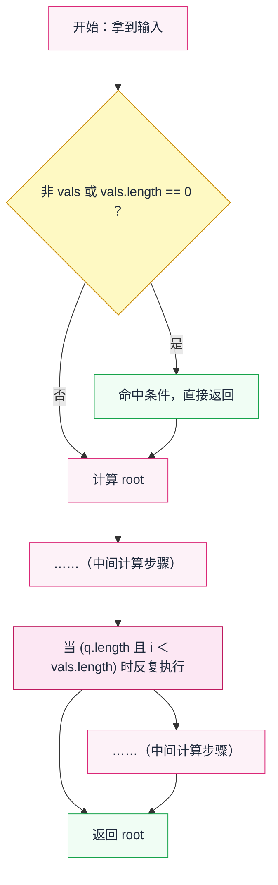

## TypeScript 解题方案（6 个方案逐个讲）

> **运行与提交**：每个方案都是自包含文件（内嵌用例自测，输出 PASS），整块复制到 `.ts` 文件后 `node 文件名` 即可运行。提交 LeetCode 时，把 `demo` 内的算法函数与辅助类型/函数整体取出、置于文件顶层即可。涉及交互/特殊接口的题以题面给定签名为准。

### 方案 1：迭代指针处理

**分析与思路**：核心做法是「迭代指针处理」。代码里依次做这些事：队列或堆的调度。

**运行方式**：`node 本文件`，内嵌用例全部通过会输出 PASS。


**方案专属流程图**（真实控制流）：


```typescript
class TreeNode {
  // 定义类型
  val: any;
  left: any;
  right: any; // 值: any; 左边界: any; 右边界: any;
  constructor(val?: any, left?: any, right?: any) {
    // constructor(值?: any, 左边界?: any, 右边界?: any) {
    this.val = val === undefined ? 0 : val; // 把 (值 全等于 undefined ? 0 : 值); 写入 值
    this.left = left === undefined ? null : left; // 把 (左边界 全等于 undefined ? null : 左边界); 写入 左边界
    this.right = right === undefined ? null : right; // 把 (右边界 全等于 undefined ? null : 右边界); 写入 右边界
  }
}
function buildTree(vals: any): any {
  // 定义函数/方法 buildTree
  if (!vals || vals.length === 0) return null; // 若 取反 vals 或 vals.长度 全等于 0，直接返回 null
  const root = new TreeNode(vals[0]);
  const q: any[] = [root];
  let i = 1;
  while (q.length && i < vals.length) {
    // 循环，直到不满足「节点.长度 且 下标 i 小于 vals.长度」
    const node = q.shift(); // 把 节点.shift() 存入 节点
    if (vals[i] !== null && vals[i] !== undefined) {
      node.left = new TreeNode(vals[i]);
      q.push(node.left);
    }
    i++; // 下标 i 加一
    if (i < vals.length && vals[i] !== null && vals[i] !== undefined) {
      node.right = new TreeNode(vals[i]);
      q.push(node.right);
    }
    i++; // 下标 i 加一
  }
  return root; // 返回 根节点
}
function treeToLevel(root: any): any[] {
  // 定义函数/方法 treeToLevel
  if (!root) return []; // 若 取反 根节点，直接返回 []
  const out: any[] = [];
  const q: any[] = [root]; // 把 []; const 节点: any[] 赋值为 [根节点]; 写入 const out: any[]
  while (q.length) {
    // 循环，直到不满足「节点.长度」
    const n = q.shift(); // 把 节点.shift() 存入 元素个数
    if (n === null || n === undefined) {
      out.push(null);
      continue;
    }
    out.push(n.val);
    q.push(n.left);
    q.push(n.right); // 把 元素个数.值 压入栈/数组尾部
  }
  while (out.length && out[out.length - 1] === null) out.pop(); // 循环，直到不满足「out.长度 且 out[out.长度 减 1] 全等于 null) out 弹出 );」
  return out; // 返回 out
}
class ListNode {
  // 定义类型
  val: any;
  next: any; // 值: any; 下一个: any;
  constructor(val?: any, next?: any) {
    this.val = val === undefined ? 0 : val;
    this.next = next === undefined ? null : next;
  }
}
function buildList(vals: any): any {
  // 定义函数/方法 buildList
  const dummy = new ListNode(0);
  let cur = dummy; // 把 new ListNode(0); let 当前值 赋值为 哨兵节点 存入 哨兵节点
  for (const v of vals) {
    cur.next = new ListNode(v);
    cur = cur.next;
  } // 把 new ListNode(值); 当前值 赋值为 当前值.下一个; } 写入 下一个
  return dummy.next; // 返回 哨兵节点.下一个
}
function listToArray(head: any): any[] {
  // 定义函数/方法 listToArray
  const out: any[] = [];
  let p = head; // 把 []; let 节点 赋值为 头节点; 写入 const out: any[]
  while (p) {
    out.push(p.val);
    p = p.next;
  } // 循环，直到不满足「节点) { out 追加 节点.值); 节点 赋值为 节点.下一个; }」
  return out; // 返回 out
}
// python-runtime shims
function pyLen(a: any): number {
  // 定义函数/方法 pyLen
  if (a === null || a === undefined) return 0; // 若 数组 全等于 null 或 数组 全等于 undefined，直接返回 0
  if (
    typeof a === 'string' ||
    Array.isArray(a) ||
    a instanceof Set ||
    a instanceof Map
  )
    return a.length ?? a.size;
  if (typeof a === 'object') return Object.keys(a).length; // 若 typeof 数组 全等于 'object'，直接返回 Object.keys(数组).长度
  return 0; // 返回 0
}
function pySlice(a: any, i: any, j: any, step?: any): any {
  // 定义函数/方法 pySlice
  if (typeof a === 'string') {
    const r = [...a].slice(i ?? 0, j ?? a.length);
    return step ? r.reverse().join('') : r.join('');
  }
  const arr = Array.isArray(a) ? a : [...a]; // 把 Array.isArray(数组) ? 数组 : 复制的 数组 存入 数组
  return arr.slice(i ?? 0, j ?? arr.length); // 返回 数组 截取 下标 i ?? 0, 下标 j ?? 数组.长度)
}
function pyRange(a: any, b?: any, step?: any): any[] {
  // 定义函数/方法 pyRange
  let s = 0,
    e = a,
    st = 1; // 把 0, e 赋值为 数组, st 赋值为 1 存入 字符串
  if (b !== undefined) {
    s = a;
    e = b;
  } // 若 b 不等于 undefined) { 字符串 赋值为 数组; e 赋值为 b; }
  if (step !== undefined) st = step; // 若 步数 不等于 undefined) st 赋值为 步数;
  const out: any[] = []; // 把 []; 写入 const out: any[]
  if (st > 0) for (let i = s; i < e; i += st) out.push(i);
  else for (let i = s; i > e; i += st) out.push(i); // 否则
  return out; // 返回 out
}
function pyIn(x: any, coll: any): boolean {
  // 定义函数/方法 pyIn
  if (coll === null || coll === undefined) return false; // 若 coll 全等于 null 或 coll 全等于 undefined，直接返回 false
  if (Array.isArray(coll)) return coll.includes(x); // 若 Array.isArray(coll)，直接返回 coll 是否包含 x)
  if (coll instanceof Set || coll instanceof Map) return coll.has(x); // 若 coll instanceof Set 或 coll instanceof Map，直接返回 coll.has(x)
  if (typeof coll === 'object') return x in coll; // 若 typeof coll 全等于 'object'，直接返回 x in coll
  if (typeof coll === 'string') return coll.indexOf(x) >= 0; // 若 typeof coll 全等于 'string'，直接返回 coll 查找 x) 不低于 0
  return false; // 返回 false
}
function pySorted(a: any): any[] {
  // 定义函数/方法 pySorted
  const arr = typeof a === 'string' ? [...a] : [...a]; // 把 (typeof 数组 全等于 'string') ? 复制的 数组 : 复制的 数组 存入 数组
  return arr.sort((x: any, y: any) => (x < y ? -1 : x > y ? 1 : 0));
}
function pyMin(a: any, b?: any): any {
  if (b !== undefined) return Math.min(a, b);
  if (Array.isArray(a) || a instanceof Set) return Math.min(...a);
  return Math.min(a);
} // 定义函数/方法 pyMin
function pyMax(a: any, b?: any): any {
  if (b !== undefined) return Math.max(a, b);
  if (Array.isArray(a) || a instanceof Set) return Math.max(...a);
  return Math.max(a);
} // 定义函数/方法 pyMax
function pySum(a: any): number {
  let s = 0;
  for (const v of a) s += v;
  return s;
} // 定义函数/方法 pySum
function pyAbs(x: any): number {
  return Math.abs(x);
} // 定义函数/方法 pyAbs
function pyEnumerate(a: any): any[] {
  const out: any[] = [];
  let i = 0;
  for (const v of a) {
    out.push([i, v]);
    i++;
  }
  return out;
} // 定义函数/方法 pyEnumerate
function pyZip(a: any, b: any): any[] {
  const n = Math.min(a.length, b.length);
  const out: any[] = [];
  for (let i = 0; i < n; i++) out.push([a[i], b[i]]);
  return out;
} // 定义函数/方法 pyZip
function pyDictGet(d: any, k: any, def?: any): any {
  return k in d ? d[k] : def === undefined ? null : def;
} // 定义函数/方法 pyDictGet
function pyPrint(...args: any[]): void {
  console.log(
    args
      .map((a) => (typeof a === 'object' && a !== null ? JSON.stringify(a) : a))
      .join(' '),
  );
} // 定义函数/方法 pyPrint
// collections / heapq
function heapPush(h: any[], x: any): void {
  h.push(x);
  let i = h.length - 1;
  while (i > 0) {
    const p = (i - 1) >> 1;
    if (h[p] <= h[i]) break;
    [h[p], h[i]] = [h[i], h[p]];
    i = p;
  }
} // 定义函数/方法 heapPush
function heapPop(h: any[]): any {
  const top = h[0];
  const last = h.pop();
  if (h.length) {
    h[0] = last;
    let i = 0;
    const n = h.length;
    while (true) {
      let l = 2 * i + 1,
        r = 2 * i + 2,
        s = i;
      if (l < n && h[l] < h[s]) s = l;
      if (r < n && h[r] < h[s]) s = r;
      if (s === i) break;
      [h[s], h[i]] = [h[i], h[s]];
      i = s;
    }
  }
  return top;
} // 定义函数/方法 heapPop
class Deque {
  private a: any[] = [];
  push(x: any) {
    this.a.push(x);
  }
  pushLeft(x: any) {
    this.a.unshift(x);
  }
  pop() {
    return this.a.pop();
  }
  popLeft() {
    return this.a.shift();
  }
  get length() {
    return this.a.length;
  }
  toArray() {
    return this.a.slice();
  }
} // 定义类型
function Counter(iter: any): any {
  const m: any = {};
  for (const v of iter) m[v] = (m[v] || 0) + 1;
  return m;
} // 定义函数/方法 Counter
function gcd(a: any, b: any): any {
  while (b) {
    [a, b] = [b, a % b];
  }
  return a;
} // 定义函数/方法 gcd
function pyInf(): number {
  return Infinity;
} // 定义函数/方法 pyInf

function norm(x: any): any {
  // 定义函数/方法 norm
  if (x === null || x === undefined) return null; // 若 x 全等于 null 或 x 全等于 undefined，直接返回 null
  if (typeof x === 'object') {
    // 若 typeof x 全等于 'object'
    if (x instanceof Deque) return x.toArray(); // 若 x instanceof Deque，直接返回 x.toArray()
    if (Array.isArray(x)) return x.map(norm); // 若 Array.isArray(x)，直接返回 x.映射表(norm)
    if (
      typeof x.val === 'number' &&
      (typeof x.left !== 'undefined' || typeof x.right !== 'undefined')
    )
      return treeToLevel(x);
    if (typeof x.next !== 'undefined' && typeof x.val === 'number')
      return listToArray(x);
    if (x instanceof Set) return [...x].sort(); // 若 x instanceof Set，直接返回 复制的 x 排序 )
    if (x instanceof Map) return Object.fromEntries(x); // 若 x instanceof Map，直接返回 Object.fromEntries(x)
    const o: any = {};
    for (const k of Object.keys(x)) o[k] = norm(x[k]);
    return o;
  }
  return x; // 返回 x
}
function eq(a: any, b: any): boolean {
  // 定义函数/方法 eq
  const x = norm(a),
    y = norm(b); // 把 norm(数组), y 赋值为 norm(b) 存入 x
  if (x === y) return true; // 若 x 全等于 y，直接返回 true
  if (x === null || y === null) return x === y; // 若 x 全等于 null 或 y 全等于 null，直接返回 x 全等于 y
  if (Array.isArray(x) && Array.isArray(y)) {
    // 若 Array.isArray(x) 且 Array.isArray(y
    if (x.length !== y.length) return false; // 若 x.长度 不等于 y.长度，直接返回 false
    for (let i = 0; i < x.length; i++) if (!eq(x[i], y[i])) return false; // 让 下标 i 从 0 开始计数，下标 i 小于 x.长度 就继续
    return true; // 返回 true
  }
  if (typeof x === 'object' && typeof y === 'object') {
    // 若 typeof x 全等于 'object' 且 typeof y 全等于 'object'
    const kx = Object.keys(x),
      ky = Object.keys(y); // 把 Object.keys(x), ky 赋值为 Object.keys(y) 存入 kx
    if (kx.length !== ky.length) return false; // 若 kx.长度 不等于 ky.长度，直接返回 false
    for (const k of kx) if (!eq(x[k], y[k])) return false;
    return true; // 返回 true
  }
  return x === y; // 返回 x 全等于 y
}

function topKFrequent(nums, k) {
  // 定义函数/方法 topKFrequent
  const m = {}; // 把 {} 存入 映射表
  for (const x of nums) m[x] = (m[x] || 0) + 1; // 把 (映射表[x] 或 0) 加 1; 写入 for (const x of nums) m[x]
  const arr = Object.entries(m).map(([k, v]) => [+k, +v]);
  arr.sort((a, b) => b[1] - a[1]);
  return arr.slice(0, k).map((e) => e[0]);
}
function arrEq(a, b) {
  // 定义函数/方法 arrEq
  if (!Array.isArray(a) || !Array.isArray(b)) return eq(a, b); // 若 取反 Array.isArray(数组) 或 取反 Array.isArray(b)，直接返回 eq(数组, b)
  if (a.length !== b.length) return false; // 若 数组.长度 不等于 b.长度，直接返回 false
  const sa = a.slice().sort(),
    sb = b.slice().sort(); // 把 数组 截取 ) 排序 ), sb 赋值为 b 截取 ) 排序 ) 存入 sa
  for (let i = 0; i < sa.length; i++) if (!eq(sa[i], sb[i])) return false; // 让 下标 i 从 0 开始计数，下标 i 小于 sa.长度 就继续
  return true; // 返回 true
}
export function demo(): void {
  // 程序入口：跑内嵌自测用例
  const cases = [
    { in: [[1, 1, 1, 2, 2, 3], 2], want: [2, 1] },
    { in: [[1], 1], want: [1] },
    { in: [[4, 1, -1, 4, -1, 4, 4], 2], want: [-1, 4] },
    { in: [[5, 3, 1, 1, 1, 3], 2], want: [3, 1] },
  ];
  let fail = false; // 把 false 存入 fail
  for (const c of cases) {
    // for (const 字符 of cases) {
    const got = topKFrequent(...c.in); // 把 topKFrequent(...字符.in) 存入 got
    if (!arrEq(got, c.want)) {
      fail = true;
      console.log(
        'FAIL',
        JSON.stringify(c.in),
        '=>',
        JSON.stringify(got),
        'want',
        JSON.stringify(c.want),
      );
    }
  }
  if (fail) throw new Error('FAILED'); // 若 fail) throw new Error('FAILED');
  console.log('PASS'); // 全部用例通过，输出 PASS
}
demo(); // demo();
```

### 方案 2：迭代指针处理

**分析与思路**：核心做法是「迭代指针处理」。代码里依次做这些事：队列或堆的调度。

**运行方式**：`node 本文件`，内嵌用例全部通过会输出 PASS。


**方案专属流程图**（真实控制流）：


```typescript
class TreeNode {
  // 定义类型
  val: any;
  left: any;
  right: any; // 值: any; 左边界: any; 右边界: any;
  constructor(val?: any, left?: any, right?: any) {
    // constructor(值?: any, 左边界?: any, 右边界?: any) {
    this.val = val === undefined ? 0 : val; // 把 (值 全等于 undefined ? 0 : 值); 写入 值
    this.left = left === undefined ? null : left; // 把 (左边界 全等于 undefined ? null : 左边界); 写入 左边界
    this.right = right === undefined ? null : right; // 把 (右边界 全等于 undefined ? null : 右边界); 写入 右边界
  }
}
function buildTree(vals: any): any {
  // 定义函数/方法 buildTree
  if (!vals || vals.length === 0) return null; // 若 取反 vals 或 vals.长度 全等于 0，直接返回 null
  const root = new TreeNode(vals[0]);
  const q: any[] = [root];
  let i = 1;
  while (q.length && i < vals.length) {
    // 循环，直到不满足「节点.长度 且 下标 i 小于 vals.长度」
    const node = q.shift(); // 把 节点.shift() 存入 节点
    if (vals[i] !== null && vals[i] !== undefined) {
      node.left = new TreeNode(vals[i]);
      q.push(node.left);
    }
    i++; // 下标 i 加一
    if (i < vals.length && vals[i] !== null && vals[i] !== undefined) {
      node.right = new TreeNode(vals[i]);
      q.push(node.right);
    }
    i++; // 下标 i 加一
  }
  return root; // 返回 根节点
}
function treeToLevel(root: any): any[] {
  // 定义函数/方法 treeToLevel
  if (!root) return []; // 若 取反 根节点，直接返回 []
  const out: any[] = [];
  const q: any[] = [root]; // 把 []; const 节点: any[] 赋值为 [根节点]; 写入 const out: any[]
  while (q.length) {
    // 循环，直到不满足「节点.长度」
    const n = q.shift(); // 把 节点.shift() 存入 元素个数
    if (n === null || n === undefined) {
      out.push(null);
      continue;
    }
    out.push(n.val);
    q.push(n.left);
    q.push(n.right); // 把 元素个数.值 压入栈/数组尾部
  }
  while (out.length && out[out.length - 1] === null) out.pop(); // 循环，直到不满足「out.长度 且 out[out.长度 减 1] 全等于 null) out 弹出 );」
  return out; // 返回 out
}
class ListNode {
  // 定义类型
  val: any;
  next: any; // 值: any; 下一个: any;
  constructor(val?: any, next?: any) {
    this.val = val === undefined ? 0 : val;
    this.next = next === undefined ? null : next;
  }
}
function buildList(vals: any): any {
  // 定义函数/方法 buildList
  const dummy = new ListNode(0);
  let cur = dummy; // 把 new ListNode(0); let 当前值 赋值为 哨兵节点 存入 哨兵节点
  for (const v of vals) {
    cur.next = new ListNode(v);
    cur = cur.next;
  } // 把 new ListNode(值); 当前值 赋值为 当前值.下一个; } 写入 下一个
  return dummy.next; // 返回 哨兵节点.下一个
}
function listToArray(head: any): any[] {
  // 定义函数/方法 listToArray
  const out: any[] = [];
  let p = head; // 把 []; let 节点 赋值为 头节点; 写入 const out: any[]
  while (p) {
    out.push(p.val);
    p = p.next;
  } // 循环，直到不满足「节点) { out 追加 节点.值); 节点 赋值为 节点.下一个; }」
  return out; // 返回 out
}
// python-runtime shims
function pyLen(a: any): number {
  // 定义函数/方法 pyLen
  if (a === null || a === undefined) return 0; // 若 数组 全等于 null 或 数组 全等于 undefined，直接返回 0
  if (
    typeof a === 'string' ||
    Array.isArray(a) ||
    a instanceof Set ||
    a instanceof Map
  )
    return a.length ?? a.size;
  if (typeof a === 'object') return Object.keys(a).length; // 若 typeof 数组 全等于 'object'，直接返回 Object.keys(数组).长度
  return 0; // 返回 0
}
function pySlice(a: any, i: any, j: any, step?: any): any {
  // 定义函数/方法 pySlice
  if (typeof a === 'string') {
    const r = [...a].slice(i ?? 0, j ?? a.length);
    return step ? r.reverse().join('') : r.join('');
  }
  const arr = Array.isArray(a) ? a : [...a]; // 把 Array.isArray(数组) ? 数组 : 复制的 数组 存入 数组
  return arr.slice(i ?? 0, j ?? arr.length); // 返回 数组 截取 下标 i ?? 0, 下标 j ?? 数组.长度)
}
function pyRange(a: any, b?: any, step?: any): any[] {
  // 定义函数/方法 pyRange
  let s = 0,
    e = a,
    st = 1; // 把 0, e 赋值为 数组, st 赋值为 1 存入 字符串
  if (b !== undefined) {
    s = a;
    e = b;
  } // 若 b 不等于 undefined) { 字符串 赋值为 数组; e 赋值为 b; }
  if (step !== undefined) st = step; // 若 步数 不等于 undefined) st 赋值为 步数;
  const out: any[] = []; // 把 []; 写入 const out: any[]
  if (st > 0) for (let i = s; i < e; i += st) out.push(i);
  else for (let i = s; i > e; i += st) out.push(i); // 否则
  return out; // 返回 out
}
function pyIn(x: any, coll: any): boolean {
  // 定义函数/方法 pyIn
  if (coll === null || coll === undefined) return false; // 若 coll 全等于 null 或 coll 全等于 undefined，直接返回 false
  if (Array.isArray(coll)) return coll.includes(x); // 若 Array.isArray(coll)，直接返回 coll 是否包含 x)
  if (coll instanceof Set || coll instanceof Map) return coll.has(x); // 若 coll instanceof Set 或 coll instanceof Map，直接返回 coll.has(x)
  if (typeof coll === 'object') return x in coll; // 若 typeof coll 全等于 'object'，直接返回 x in coll
  if (typeof coll === 'string') return coll.indexOf(x) >= 0; // 若 typeof coll 全等于 'string'，直接返回 coll 查找 x) 不低于 0
  return false; // 返回 false
}
function pySorted(a: any): any[] {
  // 定义函数/方法 pySorted
  const arr = typeof a === 'string' ? [...a] : [...a]; // 把 (typeof 数组 全等于 'string') ? 复制的 数组 : 复制的 数组 存入 数组
  return arr.sort((x: any, y: any) => (x < y ? -1 : x > y ? 1 : 0));
}
function pyMin(a: any, b?: any): any {
  if (b !== undefined) return Math.min(a, b);
  if (Array.isArray(a) || a instanceof Set) return Math.min(...a);
  return Math.min(a);
} // 定义函数/方法 pyMin
function pyMax(a: any, b?: any): any {
  if (b !== undefined) return Math.max(a, b);
  if (Array.isArray(a) || a instanceof Set) return Math.max(...a);
  return Math.max(a);
} // 定义函数/方法 pyMax
function pySum(a: any): number {
  let s = 0;
  for (const v of a) s += v;
  return s;
} // 定义函数/方法 pySum
function pyAbs(x: any): number {
  return Math.abs(x);
} // 定义函数/方法 pyAbs
function pyEnumerate(a: any): any[] {
  const out: any[] = [];
  let i = 0;
  for (const v of a) {
    out.push([i, v]);
    i++;
  }
  return out;
} // 定义函数/方法 pyEnumerate
function pyZip(a: any, b: any): any[] {
  const n = Math.min(a.length, b.length);
  const out: any[] = [];
  for (let i = 0; i < n; i++) out.push([a[i], b[i]]);
  return out;
} // 定义函数/方法 pyZip
function pyDictGet(d: any, k: any, def?: any): any {
  return k in d ? d[k] : def === undefined ? null : def;
} // 定义函数/方法 pyDictGet
function pyPrint(...args: any[]): void {
  console.log(
    args
      .map((a) => (typeof a === 'object' && a !== null ? JSON.stringify(a) : a))
      .join(' '),
  );
} // 定义函数/方法 pyPrint
// collections / heapq
function heapPush(h: any[], x: any): void {
  h.push(x);
  let i = h.length - 1;
  while (i > 0) {
    const p = (i - 1) >> 1;
    if (h[p] <= h[i]) break;
    [h[p], h[i]] = [h[i], h[p]];
    i = p;
  }
} // 定义函数/方法 heapPush
function heapPop(h: any[]): any {
  const top = h[0];
  const last = h.pop();
  if (h.length) {
    h[0] = last;
    let i = 0;
    const n = h.length;
    while (true) {
      let l = 2 * i + 1,
        r = 2 * i + 2,
        s = i;
      if (l < n && h[l] < h[s]) s = l;
      if (r < n && h[r] < h[s]) s = r;
      if (s === i) break;
      [h[s], h[i]] = [h[i], h[s]];
      i = s;
    }
  }
  return top;
} // 定义函数/方法 heapPop
class Deque {
  private a: any[] = [];
  push(x: any) {
    this.a.push(x);
  }
  pushLeft(x: any) {
    this.a.unshift(x);
  }
  pop() {
    return this.a.pop();
  }
  popLeft() {
    return this.a.shift();
  }
  get length() {
    return this.a.length;
  }
  toArray() {
    return this.a.slice();
  }
} // 定义类型
function Counter(iter: any): any {
  const m: any = {};
  for (const v of iter) m[v] = (m[v] || 0) + 1;
  return m;
} // 定义函数/方法 Counter
function gcd(a: any, b: any): any {
  while (b) {
    [a, b] = [b, a % b];
  }
  return a;
} // 定义函数/方法 gcd
function pyInf(): number {
  return Infinity;
} // 定义函数/方法 pyInf

function norm(x: any): any {
  // 定义函数/方法 norm
  if (x === null || x === undefined) return null; // 若 x 全等于 null 或 x 全等于 undefined，直接返回 null
  if (typeof x === 'object') {
    // 若 typeof x 全等于 'object'
    if (x instanceof Deque) return x.toArray(); // 若 x instanceof Deque，直接返回 x.toArray()
    if (Array.isArray(x)) return x.map(norm); // 若 Array.isArray(x)，直接返回 x.映射表(norm)
    if (
      typeof x.val === 'number' &&
      (typeof x.left !== 'undefined' || typeof x.right !== 'undefined')
    )
      return treeToLevel(x);
    if (typeof x.next !== 'undefined' && typeof x.val === 'number')
      return listToArray(x);
    if (x instanceof Set) return [...x].sort(); // 若 x instanceof Set，直接返回 复制的 x 排序 )
    if (x instanceof Map) return Object.fromEntries(x); // 若 x instanceof Map，直接返回 Object.fromEntries(x)
    const o: any = {};
    for (const k of Object.keys(x)) o[k] = norm(x[k]);
    return o;
  }
  return x; // 返回 x
}
function eq(a: any, b: any): boolean {
  // 定义函数/方法 eq
  const x = norm(a),
    y = norm(b); // 把 norm(数组), y 赋值为 norm(b) 存入 x
  if (x === y) return true; // 若 x 全等于 y，直接返回 true
  if (x === null || y === null) return x === y; // 若 x 全等于 null 或 y 全等于 null，直接返回 x 全等于 y
  if (Array.isArray(x) && Array.isArray(y)) {
    // 若 Array.isArray(x) 且 Array.isArray(y
    if (x.length !== y.length) return false; // 若 x.长度 不等于 y.长度，直接返回 false
    for (let i = 0; i < x.length; i++) if (!eq(x[i], y[i])) return false; // 让 下标 i 从 0 开始计数，下标 i 小于 x.长度 就继续
    return true; // 返回 true
  }
  if (typeof x === 'object' && typeof y === 'object') {
    // 若 typeof x 全等于 'object' 且 typeof y 全等于 'object'
    const kx = Object.keys(x),
      ky = Object.keys(y); // 把 Object.keys(x), ky 赋值为 Object.keys(y) 存入 kx
    if (kx.length !== ky.length) return false; // 若 kx.长度 不等于 ky.长度，直接返回 false
    for (const k of kx) if (!eq(x[k], y[k])) return false;
    return true; // 返回 true
  }
  return x === y; // 返回 x 全等于 y
}

function topKFrequent(nums, k) {
  // 定义函数/方法 topKFrequent
  const m = {}; // 把 {} 存入 映射表
  for (const x of nums) m[x] = (m[x] || 0) + 1; // 把 (映射表[x] 或 0) 加 1; 写入 for (const x of nums) m[x]
  const arr = Object.entries(m).map(([k, v]) => [+k, +v]);
  arr.sort((a, b) => b[1] - a[1]);
  return arr.slice(0, k).map((e) => e[0]);
}
function arrEq(a, b) {
  // 定义函数/方法 arrEq
  if (!Array.isArray(a) || !Array.isArray(b)) return eq(a, b); // 若 取反 Array.isArray(数组) 或 取反 Array.isArray(b)，直接返回 eq(数组, b)
  if (a.length !== b.length) return false; // 若 数组.长度 不等于 b.长度，直接返回 false
  const sa = a.slice().sort(),
    sb = b.slice().sort(); // 把 数组 截取 ) 排序 ), sb 赋值为 b 截取 ) 排序 ) 存入 sa
  for (let i = 0; i < sa.length; i++) if (!eq(sa[i], sb[i])) return false; // 让 下标 i 从 0 开始计数，下标 i 小于 sa.长度 就继续
  return true; // 返回 true
}
export function demo(): void {
  // 程序入口：跑内嵌自测用例
  const cases = [
    { in: [[1, 1, 1, 2, 2, 3], 2], want: [2, 1] },
    { in: [[1], 1], want: [1] },
    { in: [[4, 1, -1, 4, -1, 4, 4], 2], want: [-1, 4] },
    { in: [[5, 3, 1, 1, 1, 3], 2], want: [3, 1] },
  ];
  let fail = false; // 把 false 存入 fail
  for (const c of cases) {
    // for (const 字符 of cases) {
    const got = topKFrequent(...c.in); // 把 topKFrequent(...字符.in) 存入 got
    if (!arrEq(got, c.want)) {
      fail = true;
      console.log(
        'FAIL',
        JSON.stringify(c.in),
        '=>',
        JSON.stringify(got),
        'want',
        JSON.stringify(c.want),
      );
    }
  }
  if (fail) throw new Error('FAILED'); // 若 fail) throw new Error('FAILED');
  console.log('PASS'); // 全部用例通过，输出 PASS
}
demo(); // demo();
```

### 方案 3：直接实现

**分析与思路**：核心做法是「直接实现」。

**运行方式**：`node 本文件`，内嵌用例全部通过会输出 PASS。


**方案专属流程图**（真实控制流）：

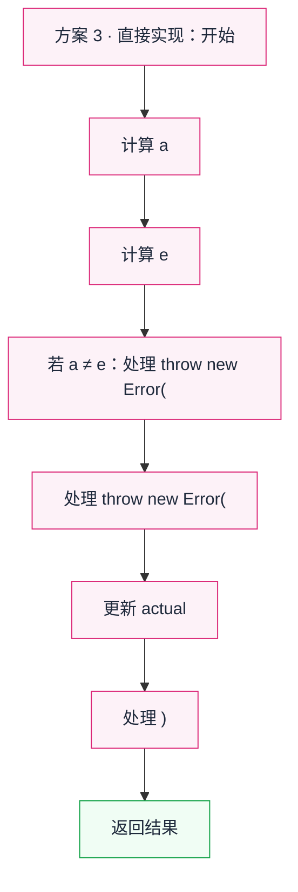

```typescript
function assertEq(actual: any, expected: any, msg: string = ''): void {
  // 定义函数/方法 assertEq
  const a = JSON.stringify(actual); // 把 JSON.stringify(actual) 存入 数组
  const e = JSON.stringify(expected); // 把 JSON.stringify(expected) 存入 e
  if (a !== e)
    throw new Error(
      'ASSERT FAILED ' + msg + ' :: actual=' + a + ' expected=' + e,
    );
}

function topKFrequent(nums: number[], k: number): number[] {
  // 定义函数/方法 topKFrequent
  const freq = new Map<number, number>(); // 把 new Map 小于 number, number 超过 () 存入 频次表
  for (const num of nums) freq.set(num, (freq.get(num) || 0) + 1); // for (const num of 数组) 频次表.set(num, (频次表 查找 num) 或 0) 加 1);
  const heap: [number, number][] = []; // 把 []; 写入 const heap: [number, number][]
  for (const [num, cnt] of freq) {
    // for (const [num, 计数] of 频次表) {
    heap.push([cnt, num]); // 把 [计数, num] 压入栈/数组尾部
    heap.sort((a, b) => a[0] - b[0]); // min-heap by cnt via sort (small n)
    if (heap.length > k) heap.shift(); // 若 堆.长度 超过 下标 k) 堆.shift();
  }
  return heap.map(([, num]) => num);
}
export function demo(): void {
  // 程序入口：跑内嵌自测用例
  assertEq(
    topKFrequent([1, 1, 1, 2, 2, 3], 2)
      .slice()
      .sort((a, b) => a - b),
    [1, 2],
    'topKFrequent',
  );
  assertEq(topKFrequent([1], 1), [1], 'topKFrequent single'); // 断言校验
  console.log('PASS'); // 全部用例通过，输出 PASS
}
demo(); // demo();
```

### 方案 4：迭代指针处理

**分析与思路**：核心做法是「迭代指针处理」。代码里依次做这些事：队列或堆的调度。

**运行方式**：`node 本文件`，内嵌用例全部通过会输出 PASS。


**方案专属流程图**（真实控制流）：

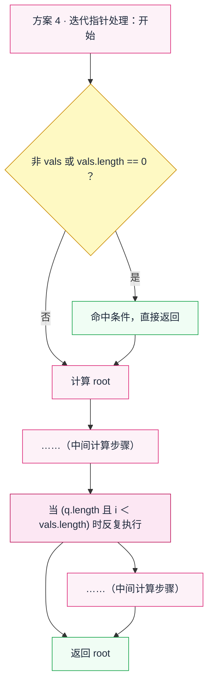

```typescript
class TreeNode {
  // 定义类型
  val: any;
  left: any;
  right: any; // 值: any; 左边界: any; 右边界: any;
  constructor(val?: any, left?: any, right?: any) {
    // constructor(值?: any, 左边界?: any, 右边界?: any) {
    this.val = val === undefined ? 0 : val; // 把 (值 全等于 undefined ? 0 : 值); 写入 值
    this.left = left === undefined ? null : left; // 把 (左边界 全等于 undefined ? null : 左边界); 写入 左边界
    this.right = right === undefined ? null : right; // 把 (右边界 全等于 undefined ? null : 右边界); 写入 右边界
  }
}
function buildTree(vals: any): any {
  // 定义函数/方法 buildTree
  if (!vals || vals.length === 0) return null; // 若 取反 vals 或 vals.长度 全等于 0，直接返回 null
  const root = new TreeNode(vals[0]);
  const q: any[] = [root];
  let i = 1;
  while (q.length && i < vals.length) {
    // 循环，直到不满足「节点.长度 且 下标 i 小于 vals.长度」
    const node = q.shift(); // 把 节点.shift() 存入 节点
    if (vals[i] !== null && vals[i] !== undefined) {
      node.left = new TreeNode(vals[i]);
      q.push(node.left);
    }
    i++; // 下标 i 加一
    if (i < vals.length && vals[i] !== null && vals[i] !== undefined) {
      node.right = new TreeNode(vals[i]);
      q.push(node.right);
    }
    i++; // 下标 i 加一
  }
  return root; // 返回 根节点
}
function treeToLevel(root: any): any[] {
  // 定义函数/方法 treeToLevel
  if (!root) return []; // 若 取反 根节点，直接返回 []
  const out: any[] = [];
  const q: any[] = [root]; // 把 []; const 节点: any[] 赋值为 [根节点]; 写入 const out: any[]
  while (q.length) {
    // 循环，直到不满足「节点.长度」
    const n = q.shift(); // 把 节点.shift() 存入 元素个数
    if (n === null || n === undefined) {
      out.push(null);
      continue;
    }
    out.push(n.val);
    q.push(n.left);
    q.push(n.right); // 把 元素个数.值 压入栈/数组尾部
  }
  while (out.length && out[out.length - 1] === null) out.pop(); // 循环，直到不满足「out.长度 且 out[out.长度 减 1] 全等于 null) out 弹出 );」
  return out; // 返回 out
}
class ListNode {
  // 定义类型
  val: any;
  next: any; // 值: any; 下一个: any;
  constructor(val?: any, next?: any) {
    this.val = val === undefined ? 0 : val;
    this.next = next === undefined ? null : next;
  }
}
function buildList(vals: any): any {
  // 定义函数/方法 buildList
  const dummy = new ListNode(0);
  let cur = dummy; // 把 new ListNode(0); let 当前值 赋值为 哨兵节点 存入 哨兵节点
  for (const v of vals) {
    cur.next = new ListNode(v);
    cur = cur.next;
  } // 把 new ListNode(值); 当前值 赋值为 当前值.下一个; } 写入 下一个
  return dummy.next; // 返回 哨兵节点.下一个
}
function listToArray(head: any): any[] {
  // 定义函数/方法 listToArray
  const out: any[] = [];
  let p = head; // 把 []; let 节点 赋值为 头节点; 写入 const out: any[]
  while (p) {
    out.push(p.val);
    p = p.next;
  } // 循环，直到不满足「节点) { out 追加 节点.值); 节点 赋值为 节点.下一个; }」
  return out; // 返回 out
}
// python-runtime shims
function pyLen(a: any): number {
  // 定义函数/方法 pyLen
  if (a === null || a === undefined) return 0; // 若 数组 全等于 null 或 数组 全等于 undefined，直接返回 0
  if (
    typeof a === 'string' ||
    Array.isArray(a) ||
    a instanceof Set ||
    a instanceof Map
  )
    return a.length ?? a.size;
  if (typeof a === 'object') return Object.keys(a).length; // 若 typeof 数组 全等于 'object'，直接返回 Object.keys(数组).长度
  return 0; // 返回 0
}
function pySlice(a: any, i: any, j: any, step?: any): any {
  // 定义函数/方法 pySlice
  if (typeof a === 'string') {
    const r = [...a].slice(i ?? 0, j ?? a.length);
    return step ? r.reverse().join('') : r.join('');
  }
  const arr = Array.isArray(a) ? a : [...a]; // 把 Array.isArray(数组) ? 数组 : 复制的 数组 存入 数组
  return arr.slice(i ?? 0, j ?? arr.length); // 返回 数组 截取 下标 i ?? 0, 下标 j ?? 数组.长度)
}
function pyRange(a: any, b?: any, step?: any): any[] {
  // 定义函数/方法 pyRange
  let s = 0,
    e = a,
    st = 1; // 把 0, e 赋值为 数组, st 赋值为 1 存入 字符串
  if (b !== undefined) {
    s = a;
    e = b;
  } // 若 b 不等于 undefined) { 字符串 赋值为 数组; e 赋值为 b; }
  if (step !== undefined) st = step; // 若 步数 不等于 undefined) st 赋值为 步数;
  const out: any[] = []; // 把 []; 写入 const out: any[]
  if (st > 0) for (let i = s; i < e; i += st) out.push(i);
  else for (let i = s; i > e; i += st) out.push(i); // 否则
  return out; // 返回 out
}
function pyIn(x: any, coll: any): boolean {
  // 定义函数/方法 pyIn
  if (coll === null || coll === undefined) return false; // 若 coll 全等于 null 或 coll 全等于 undefined，直接返回 false
  if (Array.isArray(coll)) return coll.includes(x); // 若 Array.isArray(coll)，直接返回 coll 是否包含 x)
  if (coll instanceof Set || coll instanceof Map) return coll.has(x); // 若 coll instanceof Set 或 coll instanceof Map，直接返回 coll.has(x)
  if (typeof coll === 'object') return x in coll; // 若 typeof coll 全等于 'object'，直接返回 x in coll
  if (typeof coll === 'string') return coll.indexOf(x) >= 0; // 若 typeof coll 全等于 'string'，直接返回 coll 查找 x) 不低于 0
  return false; // 返回 false
}
function pySorted(a: any): any[] {
  // 定义函数/方法 pySorted
  const arr = typeof a === 'string' ? [...a] : [...a]; // 把 (typeof 数组 全等于 'string') ? 复制的 数组 : 复制的 数组 存入 数组
  return arr.sort((x: any, y: any) => (x < y ? -1 : x > y ? 1 : 0));
}
function pyMin(a: any, b?: any): any {
  if (b !== undefined) return Math.min(a, b);
  if (Array.isArray(a) || a instanceof Set) return Math.min(...a);
  return Math.min(a);
} // 定义函数/方法 pyMin
function pyMax(a: any, b?: any): any {
  if (b !== undefined) return Math.max(a, b);
  if (Array.isArray(a) || a instanceof Set) return Math.max(...a);
  return Math.max(a);
} // 定义函数/方法 pyMax
function pySum(a: any): number {
  let s = 0;
  for (const v of a) s += v;
  return s;
} // 定义函数/方法 pySum
function pyAbs(x: any): number {
  return Math.abs(x);
} // 定义函数/方法 pyAbs
function pyEnumerate(a: any): any[] {
  const out: any[] = [];
  let i = 0;
  for (const v of a) {
    out.push([i, v]);
    i++;
  }
  return out;
} // 定义函数/方法 pyEnumerate
function pyZip(a: any, b: any): any[] {
  const n = Math.min(a.length, b.length);
  const out: any[] = [];
  for (let i = 0; i < n; i++) out.push([a[i], b[i]]);
  return out;
} // 定义函数/方法 pyZip
function pyDictGet(d: any, k: any, def?: any): any {
  return k in d ? d[k] : def === undefined ? null : def;
} // 定义函数/方法 pyDictGet
function pyPrint(...args: any[]): void {
  console.log(
    args
      .map((a) => (typeof a === 'object' && a !== null ? JSON.stringify(a) : a))
      .join(' '),
  );
} // 定义函数/方法 pyPrint
// collections / heapq
function heapPush(h: any[], x: any): void {
  h.push(x);
  let i = h.length - 1;
  while (i > 0) {
    const p = (i - 1) >> 1;
    if (h[p] <= h[i]) break;
    [h[p], h[i]] = [h[i], h[p]];
    i = p;
  }
} // 定义函数/方法 heapPush
function heapPop(h: any[]): any {
  const top = h[0];
  const last = h.pop();
  if (h.length) {
    h[0] = last;
    let i = 0;
    const n = h.length;
    while (true) {
      let l = 2 * i + 1,
        r = 2 * i + 2,
        s = i;
      if (l < n && h[l] < h[s]) s = l;
      if (r < n && h[r] < h[s]) s = r;
      if (s === i) break;
      [h[s], h[i]] = [h[i], h[s]];
      i = s;
    }
  }
  return top;
} // 定义函数/方法 heapPop
class Deque {
  private a: any[] = [];
  push(x: any) {
    this.a.push(x);
  }
  pushLeft(x: any) {
    this.a.unshift(x);
  }
  pop() {
    return this.a.pop();
  }
  popLeft() {
    return this.a.shift();
  }
  get length() {
    return this.a.length;
  }
  toArray() {
    return this.a.slice();
  }
} // 定义类型
function Counter(iter: any): any {
  const m: any = {};
  for (const v of iter) m[v] = (m[v] || 0) + 1;
  return m;
} // 定义函数/方法 Counter
function gcd(a: any, b: any): any {
  while (b) {
    [a, b] = [b, a % b];
  }
  return a;
} // 定义函数/方法 gcd
function pyInf(): number {
  return Infinity;
} // 定义函数/方法 pyInf

function norm(x: any): any {
  // 定义函数/方法 norm
  if (x === null || x === undefined) return null; // 若 x 全等于 null 或 x 全等于 undefined，直接返回 null
  if (typeof x === 'object') {
    // 若 typeof x 全等于 'object'
    if (x instanceof Deque) return x.toArray(); // 若 x instanceof Deque，直接返回 x.toArray()
    if (Array.isArray(x)) return x.map(norm); // 若 Array.isArray(x)，直接返回 x.映射表(norm)
    if (
      typeof x.val === 'number' &&
      (typeof x.left !== 'undefined' || typeof x.right !== 'undefined')
    )
      return treeToLevel(x);
    if (typeof x.next !== 'undefined' && typeof x.val === 'number')
      return listToArray(x);
    if (x instanceof Set) return [...x].sort(); // 若 x instanceof Set，直接返回 复制的 x 排序 )
    if (x instanceof Map) return Object.fromEntries(x); // 若 x instanceof Map，直接返回 Object.fromEntries(x)
    const o: any = {};
    for (const k of Object.keys(x)) o[k] = norm(x[k]);
    return o;
  }
  return x; // 返回 x
}
function eq(a: any, b: any): boolean {
  // 定义函数/方法 eq
  const x = norm(a),
    y = norm(b); // 把 norm(数组), y 赋值为 norm(b) 存入 x
  if (x === y) return true; // 若 x 全等于 y，直接返回 true
  if (x === null || y === null) return x === y; // 若 x 全等于 null 或 y 全等于 null，直接返回 x 全等于 y
  if (Array.isArray(x) && Array.isArray(y)) {
    // 若 Array.isArray(x) 且 Array.isArray(y
    if (x.length !== y.length) return false; // 若 x.长度 不等于 y.长度，直接返回 false
    for (let i = 0; i < x.length; i++) if (!eq(x[i], y[i])) return false; // 让 下标 i 从 0 开始计数，下标 i 小于 x.长度 就继续
    return true; // 返回 true
  }
  if (typeof x === 'object' && typeof y === 'object') {
    // 若 typeof x 全等于 'object' 且 typeof y 全等于 'object'
    const kx = Object.keys(x),
      ky = Object.keys(y); // 把 Object.keys(x), ky 赋值为 Object.keys(y) 存入 kx
    if (kx.length !== ky.length) return false; // 若 kx.长度 不等于 ky.长度，直接返回 false
    for (const k of kx) if (!eq(x[k], y[k])) return false;
    return true; // 返回 true
  }
  return x === y; // 返回 x 全等于 y
}

function topKFrequent(nums, k) {
  // 定义函数/方法 topKFrequent
  const m = {}; // 把 {} 存入 映射表
  for (const x of nums) m[x] = (m[x] || 0) + 1; // 把 (映射表[x] 或 0) 加 1; 写入 for (const x of nums) m[x]
  const arr = Object.entries(m).map(([k, v]) => [+k, +v]);
  arr.sort((a, b) => b[1] - a[1]);
  return arr.slice(0, k).map((e) => e[0]);
}
function arrEq(a, b) {
  // 定义函数/方法 arrEq
  if (!Array.isArray(a) || !Array.isArray(b)) return eq(a, b); // 若 取反 Array.isArray(数组) 或 取反 Array.isArray(b)，直接返回 eq(数组, b)
  if (a.length !== b.length) return false; // 若 数组.长度 不等于 b.长度，直接返回 false
  const sa = a.slice().sort(),
    sb = b.slice().sort(); // 把 数组 截取 ) 排序 ), sb 赋值为 b 截取 ) 排序 ) 存入 sa
  for (let i = 0; i < sa.length; i++) if (!eq(sa[i], sb[i])) return false; // 让 下标 i 从 0 开始计数，下标 i 小于 sa.长度 就继续
  return true; // 返回 true
}
export function demo(): void {
  // 程序入口：跑内嵌自测用例
  const cases = [
    { in: [[1, 1, 1, 2, 2, 3], 2], want: [2, 1] },
    { in: [[1], 1], want: [1] },
    { in: [[4, 1, -1, 4, -1, 4, 4], 2], want: [-1, 4] },
    { in: [[5, 3, 1, 1, 1, 3], 2], want: [3, 1] },
  ];
  let fail = false; // 把 false 存入 fail
  for (const c of cases) {
    // for (const 字符 of cases) {
    const got = topKFrequent(...c.in); // 把 topKFrequent(...字符.in) 存入 got
    if (!arrEq(got, c.want)) {
      fail = true;
      console.log(
        'FAIL',
        JSON.stringify(c.in),
        '=>',
        JSON.stringify(got),
        'want',
        JSON.stringify(c.want),
      );
    }
  }
  if (fail) throw new Error('FAILED'); // 若 fail) throw new Error('FAILED');
  console.log('PASS'); // 全部用例通过，输出 PASS
}
demo(); // demo();
```

### 方案 5：迭代指针处理

**分析与思路**：核心做法是「迭代指针处理」。代码里依次做这些事：队列或堆的调度。

**运行方式**：`node 本文件`，内嵌用例全部通过会输出 PASS。


**方案专属流程图**（真实控制流）：


```typescript
class TreeNode {
  // 定义类型
  val: any;
  left: any;
  right: any; // 值: any; 左边界: any; 右边界: any;
  constructor(val?: any, left?: any, right?: any) {
    // constructor(值?: any, 左边界?: any, 右边界?: any) {
    this.val = val === undefined ? 0 : val; // 把 (值 全等于 undefined ? 0 : 值); 写入 值
    this.left = left === undefined ? null : left; // 把 (左边界 全等于 undefined ? null : 左边界); 写入 左边界
    this.right = right === undefined ? null : right; // 把 (右边界 全等于 undefined ? null : 右边界); 写入 右边界
  }
}
function buildTree(vals: any): any {
  // 定义函数/方法 buildTree
  if (!vals || vals.length === 0) return null; // 若 取反 vals 或 vals.长度 全等于 0，直接返回 null
  const root = new TreeNode(vals[0]);
  const q: any[] = [root];
  let i = 1;
  while (q.length && i < vals.length) {
    // 循环，直到不满足「节点.长度 且 下标 i 小于 vals.长度」
    const node = q.shift(); // 把 节点.shift() 存入 节点
    if (vals[i] !== null && vals[i] !== undefined) {
      node.left = new TreeNode(vals[i]);
      q.push(node.left);
    }
    i++; // 下标 i 加一
    if (i < vals.length && vals[i] !== null && vals[i] !== undefined) {
      node.right = new TreeNode(vals[i]);
      q.push(node.right);
    }
    i++; // 下标 i 加一
  }
  return root; // 返回 根节点
}
function treeToLevel(root: any): any[] {
  // 定义函数/方法 treeToLevel
  if (!root) return []; // 若 取反 根节点，直接返回 []
  const out: any[] = [];
  const q: any[] = [root]; // 把 []; const 节点: any[] 赋值为 [根节点]; 写入 const out: any[]
  while (q.length) {
    // 循环，直到不满足「节点.长度」
    const n = q.shift(); // 把 节点.shift() 存入 元素个数
    if (n === null || n === undefined) {
      out.push(null);
      continue;
    }
    out.push(n.val);
    q.push(n.left);
    q.push(n.right); // 把 元素个数.值 压入栈/数组尾部
  }
  while (out.length && out[out.length - 1] === null) out.pop(); // 循环，直到不满足「out.长度 且 out[out.长度 减 1] 全等于 null) out 弹出 );」
  return out; // 返回 out
}
class ListNode {
  // 定义类型
  val: any;
  next: any; // 值: any; 下一个: any;
  constructor(val?: any, next?: any) {
    this.val = val === undefined ? 0 : val;
    this.next = next === undefined ? null : next;
  }
}
function buildList(vals: any): any {
  // 定义函数/方法 buildList
  const dummy = new ListNode(0);
  let cur = dummy; // 把 new ListNode(0); let 当前值 赋值为 哨兵节点 存入 哨兵节点
  for (const v of vals) {
    cur.next = new ListNode(v);
    cur = cur.next;
  } // 把 new ListNode(值); 当前值 赋值为 当前值.下一个; } 写入 下一个
  return dummy.next; // 返回 哨兵节点.下一个
}
function listToArray(head: any): any[] {
  // 定义函数/方法 listToArray
  const out: any[] = [];
  let p = head; // 把 []; let 节点 赋值为 头节点; 写入 const out: any[]
  while (p) {
    out.push(p.val);
    p = p.next;
  } // 循环，直到不满足「节点) { out 追加 节点.值); 节点 赋值为 节点.下一个; }」
  return out; // 返回 out
}
// python-runtime shims
function pyLen(a: any): number {
  // 定义函数/方法 pyLen
  if (a === null || a === undefined) return 0; // 若 数组 全等于 null 或 数组 全等于 undefined，直接返回 0
  if (
    typeof a === 'string' ||
    Array.isArray(a) ||
    a instanceof Set ||
    a instanceof Map
  )
    return a.length ?? a.size;
  if (typeof a === 'object') return Object.keys(a).length; // 若 typeof 数组 全等于 'object'，直接返回 Object.keys(数组).长度
  return 0; // 返回 0
}
function pySlice(a: any, i: any, j: any, step?: any): any {
  // 定义函数/方法 pySlice
  if (typeof a === 'string') {
    const r = [...a].slice(i ?? 0, j ?? a.length);
    return step ? r.reverse().join('') : r.join('');
  }
  const arr = Array.isArray(a) ? a : [...a]; // 把 Array.isArray(数组) ? 数组 : 复制的 数组 存入 数组
  return arr.slice(i ?? 0, j ?? arr.length); // 返回 数组 截取 下标 i ?? 0, 下标 j ?? 数组.长度)
}
function pyRange(a: any, b?: any, step?: any): any[] {
  // 定义函数/方法 pyRange
  let s = 0,
    e = a,
    st = 1; // 把 0, e 赋值为 数组, st 赋值为 1 存入 字符串
  if (b !== undefined) {
    s = a;
    e = b;
  } // 若 b 不等于 undefined) { 字符串 赋值为 数组; e 赋值为 b; }
  if (step !== undefined) st = step; // 若 步数 不等于 undefined) st 赋值为 步数;
  const out: any[] = []; // 把 []; 写入 const out: any[]
  if (st > 0) for (let i = s; i < e; i += st) out.push(i);
  else for (let i = s; i > e; i += st) out.push(i); // 否则
  return out; // 返回 out
}
function pyIn(x: any, coll: any): boolean {
  // 定义函数/方法 pyIn
  if (coll === null || coll === undefined) return false; // 若 coll 全等于 null 或 coll 全等于 undefined，直接返回 false
  if (Array.isArray(coll)) return coll.includes(x); // 若 Array.isArray(coll)，直接返回 coll 是否包含 x)
  if (coll instanceof Set || coll instanceof Map) return coll.has(x); // 若 coll instanceof Set 或 coll instanceof Map，直接返回 coll.has(x)
  if (typeof coll === 'object') return x in coll; // 若 typeof coll 全等于 'object'，直接返回 x in coll
  if (typeof coll === 'string') return coll.indexOf(x) >= 0; // 若 typeof coll 全等于 'string'，直接返回 coll 查找 x) 不低于 0
  return false; // 返回 false
}
function pySorted(a: any): any[] {
  // 定义函数/方法 pySorted
  const arr = typeof a === 'string' ? [...a] : [...a]; // 把 (typeof 数组 全等于 'string') ? 复制的 数组 : 复制的 数组 存入 数组
  return arr.sort((x: any, y: any) => (x < y ? -1 : x > y ? 1 : 0));
}
function pyMin(a: any, b?: any): any {
  if (b !== undefined) return Math.min(a, b);
  if (Array.isArray(a) || a instanceof Set) return Math.min(...a);
  return Math.min(a);
} // 定义函数/方法 pyMin
function pyMax(a: any, b?: any): any {
  if (b !== undefined) return Math.max(a, b);
  if (Array.isArray(a) || a instanceof Set) return Math.max(...a);
  return Math.max(a);
} // 定义函数/方法 pyMax
function pySum(a: any): number {
  let s = 0;
  for (const v of a) s += v;
  return s;
} // 定义函数/方法 pySum
function pyAbs(x: any): number {
  return Math.abs(x);
} // 定义函数/方法 pyAbs
function pyEnumerate(a: any): any[] {
  const out: any[] = [];
  let i = 0;
  for (const v of a) {
    out.push([i, v]);
    i++;
  }
  return out;
} // 定义函数/方法 pyEnumerate
function pyZip(a: any, b: any): any[] {
  const n = Math.min(a.length, b.length);
  const out: any[] = [];
  for (let i = 0; i < n; i++) out.push([a[i], b[i]]);
  return out;
} // 定义函数/方法 pyZip
function pyDictGet(d: any, k: any, def?: any): any {
  return k in d ? d[k] : def === undefined ? null : def;
} // 定义函数/方法 pyDictGet
function pyPrint(...args: any[]): void {
  console.log(
    args
      .map((a) => (typeof a === 'object' && a !== null ? JSON.stringify(a) : a))
      .join(' '),
  );
} // 定义函数/方法 pyPrint
// collections / heapq
function heapPush(h: any[], x: any): void {
  h.push(x);
  let i = h.length - 1;
  while (i > 0) {
    const p = (i - 1) >> 1;
    if (h[p] <= h[i]) break;
    [h[p], h[i]] = [h[i], h[p]];
    i = p;
  }
} // 定义函数/方法 heapPush
function heapPop(h: any[]): any {
  const top = h[0];
  const last = h.pop();
  if (h.length) {
    h[0] = last;
    let i = 0;
    const n = h.length;
    while (true) {
      let l = 2 * i + 1,
        r = 2 * i + 2,
        s = i;
      if (l < n && h[l] < h[s]) s = l;
      if (r < n && h[r] < h[s]) s = r;
      if (s === i) break;
      [h[s], h[i]] = [h[i], h[s]];
      i = s;
    }
  }
  return top;
} // 定义函数/方法 heapPop
class Deque {
  private a: any[] = [];
  push(x: any) {
    this.a.push(x);
  }
  pushLeft(x: any) {
    this.a.unshift(x);
  }
  pop() {
    return this.a.pop();
  }
  popLeft() {
    return this.a.shift();
  }
  get length() {
    return this.a.length;
  }
  toArray() {
    return this.a.slice();
  }
} // 定义类型
function Counter(iter: any): any {
  const m: any = {};
  for (const v of iter) m[v] = (m[v] || 0) + 1;
  return m;
} // 定义函数/方法 Counter
function gcd(a: any, b: any): any {
  while (b) {
    [a, b] = [b, a % b];
  }
  return a;
} // 定义函数/方法 gcd
function pyInf(): number {
  return Infinity;
} // 定义函数/方法 pyInf

function norm(x: any): any {
  // 定义函数/方法 norm
  if (x === null || x === undefined) return null; // 若 x 全等于 null 或 x 全等于 undefined，直接返回 null
  if (typeof x === 'object') {
    // 若 typeof x 全等于 'object'
    if (x instanceof Deque) return x.toArray(); // 若 x instanceof Deque，直接返回 x.toArray()
    if (Array.isArray(x)) return x.map(norm); // 若 Array.isArray(x)，直接返回 x.映射表(norm)
    if (
      typeof x.val === 'number' &&
      (typeof x.left !== 'undefined' || typeof x.right !== 'undefined')
    )
      return treeToLevel(x);
    if (typeof x.next !== 'undefined' && typeof x.val === 'number')
      return listToArray(x);
    if (x instanceof Set) return [...x].sort(); // 若 x instanceof Set，直接返回 复制的 x 排序 )
    if (x instanceof Map) return Object.fromEntries(x); // 若 x instanceof Map，直接返回 Object.fromEntries(x)
    const o: any = {};
    for (const k of Object.keys(x)) o[k] = norm(x[k]);
    return o;
  }
  return x; // 返回 x
}
function eq(a: any, b: any): boolean {
  // 定义函数/方法 eq
  const x = norm(a),
    y = norm(b); // 把 norm(数组), y 赋值为 norm(b) 存入 x
  if (x === y) return true; // 若 x 全等于 y，直接返回 true
  if (x === null || y === null) return x === y; // 若 x 全等于 null 或 y 全等于 null，直接返回 x 全等于 y
  if (Array.isArray(x) && Array.isArray(y)) {
    // 若 Array.isArray(x) 且 Array.isArray(y
    if (x.length !== y.length) return false; // 若 x.长度 不等于 y.长度，直接返回 false
    for (let i = 0; i < x.length; i++) if (!eq(x[i], y[i])) return false; // 让 下标 i 从 0 开始计数，下标 i 小于 x.长度 就继续
    return true; // 返回 true
  }
  if (typeof x === 'object' && typeof y === 'object') {
    // 若 typeof x 全等于 'object' 且 typeof y 全等于 'object'
    const kx = Object.keys(x),
      ky = Object.keys(y); // 把 Object.keys(x), ky 赋值为 Object.keys(y) 存入 kx
    if (kx.length !== ky.length) return false; // 若 kx.长度 不等于 ky.长度，直接返回 false
    for (const k of kx) if (!eq(x[k], y[k])) return false;
    return true; // 返回 true
  }
  return x === y; // 返回 x 全等于 y
}

function topKFrequent(nums, k) {
  // 定义函数/方法 topKFrequent
  const m = {}; // 把 {} 存入 映射表
  for (const x of nums) m[x] = (m[x] || 0) + 1; // 把 (映射表[x] 或 0) 加 1; 写入 for (const x of nums) m[x]
  const arr = Object.entries(m).map(([k, v]) => [+k, +v]);
  arr.sort((a, b) => b[1] - a[1]);
  return arr.slice(0, k).map((e) => e[0]);
}
function arrEq(a, b) {
  // 定义函数/方法 arrEq
  if (!Array.isArray(a) || !Array.isArray(b)) return eq(a, b); // 若 取反 Array.isArray(数组) 或 取反 Array.isArray(b)，直接返回 eq(数组, b)
  if (a.length !== b.length) return false; // 若 数组.长度 不等于 b.长度，直接返回 false
  const sa = a.slice().sort(),
    sb = b.slice().sort(); // 把 数组 截取 ) 排序 ), sb 赋值为 b 截取 ) 排序 ) 存入 sa
  for (let i = 0; i < sa.length; i++) if (!eq(sa[i], sb[i])) return false; // 让 下标 i 从 0 开始计数，下标 i 小于 sa.长度 就继续
  return true; // 返回 true
}
export function demo(): void {
  // 程序入口：跑内嵌自测用例
  const cases = [
    { in: [[1, 1, 1, 2, 2, 3], 2], want: [2, 1] },
    { in: [[1], 1], want: [1] },
    { in: [[4, 1, -1, 4, -1, 4, 4], 2], want: [-1, 4] },
    { in: [[5, 3, 1, 1, 1, 3], 2], want: [3, 1] },
  ];
  let fail = false; // 把 false 存入 fail
  for (const c of cases) {
    // for (const 字符 of cases) {
    const got = topKFrequent(...c.in); // 把 topKFrequent(...字符.in) 存入 got
    if (!arrEq(got, c.want)) {
      fail = true;
      console.log(
        'FAIL',
        JSON.stringify(c.in),
        '=>',
        JSON.stringify(got),
        'want',
        JSON.stringify(c.want),
      );
    }
  }
  if (fail) throw new Error('FAILED'); // 若 fail) throw new Error('FAILED');
  console.log('PASS'); // 全部用例通过，输出 PASS
}
demo(); // demo();
```

### 方案 6：迭代指针处理

**分析与思路**：核心做法是「迭代指针处理」。代码里依次做这些事：队列或堆的调度。

**运行方式**：`node 本文件`，内嵌用例全部通过会输出 PASS。


**方案专属流程图**（真实控制流）：


```typescript
class TreeNode {
  // 定义类型
  val: any;
  left: any;
  right: any; // 值: any; 左边界: any; 右边界: any;
  constructor(val?: any, left?: any, right?: any) {
    // constructor(值?: any, 左边界?: any, 右边界?: any) {
    this.val = val === undefined ? 0 : val; // 把 (值 全等于 undefined ? 0 : 值); 写入 值
    this.left = left === undefined ? null : left; // 把 (左边界 全等于 undefined ? null : 左边界); 写入 左边界
    this.right = right === undefined ? null : right; // 把 (右边界 全等于 undefined ? null : 右边界); 写入 右边界
  }
}
function buildTree(vals: any): any {
  // 定义函数/方法 buildTree
  if (!vals || vals.length === 0) return null; // 若 取反 vals 或 vals.长度 全等于 0，直接返回 null
  const root = new TreeNode(vals[0]);
  const q: any[] = [root];
  let i = 1;
  while (q.length && i < vals.length) {
    // 循环，直到不满足「节点.长度 且 下标 i 小于 vals.长度」
    const node = q.shift(); // 把 节点.shift() 存入 节点
    if (vals[i] !== null && vals[i] !== undefined) {
      node.left = new TreeNode(vals[i]);
      q.push(node.left);
    }
    i++; // 下标 i 加一
    if (i < vals.length && vals[i] !== null && vals[i] !== undefined) {
      node.right = new TreeNode(vals[i]);
      q.push(node.right);
    }
    i++; // 下标 i 加一
  }
  return root; // 返回 根节点
}
function treeToLevel(root: any): any[] {
  // 定义函数/方法 treeToLevel
  if (!root) return []; // 若 取反 根节点，直接返回 []
  const out: any[] = [];
  const q: any[] = [root]; // 把 []; const 节点: any[] 赋值为 [根节点]; 写入 const out: any[]
  while (q.length) {
    // 循环，直到不满足「节点.长度」
    const n = q.shift(); // 把 节点.shift() 存入 元素个数
    if (n === null || n === undefined) {
      out.push(null);
      continue;
    }
    out.push(n.val);
    q.push(n.left);
    q.push(n.right); // 把 元素个数.值 压入栈/数组尾部
  }
  while (out.length && out[out.length - 1] === null) out.pop(); // 循环，直到不满足「out.长度 且 out[out.长度 减 1] 全等于 null) out 弹出 );」
  return out; // 返回 out
}
class ListNode {
  // 定义类型
  val: any;
  next: any; // 值: any; 下一个: any;
  constructor(val?: any, next?: any) {
    this.val = val === undefined ? 0 : val;
    this.next = next === undefined ? null : next;
  }
}
function buildList(vals: any): any {
  // 定义函数/方法 buildList
  const dummy = new ListNode(0);
  let cur = dummy; // 把 new ListNode(0); let 当前值 赋值为 哨兵节点 存入 哨兵节点
  for (const v of vals) {
    cur.next = new ListNode(v);
    cur = cur.next;
  } // 把 new ListNode(值); 当前值 赋值为 当前值.下一个; } 写入 下一个
  return dummy.next; // 返回 哨兵节点.下一个
}
function listToArray(head: any): any[] {
  // 定义函数/方法 listToArray
  const out: any[] = [];
  let p = head; // 把 []; let 节点 赋值为 头节点; 写入 const out: any[]
  while (p) {
    out.push(p.val);
    p = p.next;
  } // 循环，直到不满足「节点) { out 追加 节点.值); 节点 赋值为 节点.下一个; }」
  return out; // 返回 out
}
// python-runtime shims
function pyLen(a: any): number {
  // 定义函数/方法 pyLen
  if (a === null || a === undefined) return 0; // 若 数组 全等于 null 或 数组 全等于 undefined，直接返回 0
  if (
    typeof a === 'string' ||
    Array.isArray(a) ||
    a instanceof Set ||
    a instanceof Map
  )
    return a.length ?? a.size;
  if (typeof a === 'object') return Object.keys(a).length; // 若 typeof 数组 全等于 'object'，直接返回 Object.keys(数组).长度
  return 0; // 返回 0
}
function pySlice(a: any, i: any, j: any, step?: any): any {
  // 定义函数/方法 pySlice
  if (typeof a === 'string') {
    const r = [...a].slice(i ?? 0, j ?? a.length);
    return step ? r.reverse().join('') : r.join('');
  }
  const arr = Array.isArray(a) ? a : [...a]; // 把 Array.isArray(数组) ? 数组 : 复制的 数组 存入 数组
  return arr.slice(i ?? 0, j ?? arr.length); // 返回 数组 截取 下标 i ?? 0, 下标 j ?? 数组.长度)
}
function pyRange(a: any, b?: any, step?: any): any[] {
  // 定义函数/方法 pyRange
  let s = 0,
    e = a,
    st = 1; // 把 0, e 赋值为 数组, st 赋值为 1 存入 字符串
  if (b !== undefined) {
    s = a;
    e = b;
  } // 若 b 不等于 undefined) { 字符串 赋值为 数组; e 赋值为 b; }
  if (step !== undefined) st = step; // 若 步数 不等于 undefined) st 赋值为 步数;
  const out: any[] = []; // 把 []; 写入 const out: any[]
  if (st > 0) for (let i = s; i < e; i += st) out.push(i);
  else for (let i = s; i > e; i += st) out.push(i); // 否则
  return out; // 返回 out
}
function pyIn(x: any, coll: any): boolean {
  // 定义函数/方法 pyIn
  if (coll === null || coll === undefined) return false; // 若 coll 全等于 null 或 coll 全等于 undefined，直接返回 false
  if (Array.isArray(coll)) return coll.includes(x); // 若 Array.isArray(coll)，直接返回 coll 是否包含 x)
  if (coll instanceof Set || coll instanceof Map) return coll.has(x); // 若 coll instanceof Set 或 coll instanceof Map，直接返回 coll.has(x)
  if (typeof coll === 'object') return x in coll; // 若 typeof coll 全等于 'object'，直接返回 x in coll
  if (typeof coll === 'string') return coll.indexOf(x) >= 0; // 若 typeof coll 全等于 'string'，直接返回 coll 查找 x) 不低于 0
  return false; // 返回 false
}
function pySorted(a: any): any[] {
  // 定义函数/方法 pySorted
  const arr = typeof a === 'string' ? [...a] : [...a]; // 把 (typeof 数组 全等于 'string') ? 复制的 数组 : 复制的 数组 存入 数组
  return arr.sort((x: any, y: any) => (x < y ? -1 : x > y ? 1 : 0));
}
function pyMin(a: any, b?: any): any {
  if (b !== undefined) return Math.min(a, b);
  if (Array.isArray(a) || a instanceof Set) return Math.min(...a);
  return Math.min(a);
} // 定义函数/方法 pyMin
function pyMax(a: any, b?: any): any {
  if (b !== undefined) return Math.max(a, b);
  if (Array.isArray(a) || a instanceof Set) return Math.max(...a);
  return Math.max(a);
} // 定义函数/方法 pyMax
function pySum(a: any): number {
  let s = 0;
  for (const v of a) s += v;
  return s;
} // 定义函数/方法 pySum
function pyAbs(x: any): number {
  return Math.abs(x);
} // 定义函数/方法 pyAbs
function pyEnumerate(a: any): any[] {
  const out: any[] = [];
  let i = 0;
  for (const v of a) {
    out.push([i, v]);
    i++;
  }
  return out;
} // 定义函数/方法 pyEnumerate
function pyZip(a: any, b: any): any[] {
  const n = Math.min(a.length, b.length);
  const out: any[] = [];
  for (let i = 0; i < n; i++) out.push([a[i], b[i]]);
  return out;
} // 定义函数/方法 pyZip
function pyDictGet(d: any, k: any, def?: any): any {
  return k in d ? d[k] : def === undefined ? null : def;
} // 定义函数/方法 pyDictGet
function pyPrint(...args: any[]): void {
  console.log(
    args
      .map((a) => (typeof a === 'object' && a !== null ? JSON.stringify(a) : a))
      .join(' '),
  );
} // 定义函数/方法 pyPrint
// collections / heapq
function heapPush(h: any[], x: any): void {
  h.push(x);
  let i = h.length - 1;
  while (i > 0) {
    const p = (i - 1) >> 1;
    if (h[p] <= h[i]) break;
    [h[p], h[i]] = [h[i], h[p]];
    i = p;
  }
} // 定义函数/方法 heapPush
function heapPop(h: any[]): any {
  const top = h[0];
  const last = h.pop();
  if (h.length) {
    h[0] = last;
    let i = 0;
    const n = h.length;
    while (true) {
      let l = 2 * i + 1,
        r = 2 * i + 2,
        s = i;
      if (l < n && h[l] < h[s]) s = l;
      if (r < n && h[r] < h[s]) s = r;
      if (s === i) break;
      [h[s], h[i]] = [h[i], h[s]];
      i = s;
    }
  }
  return top;
} // 定义函数/方法 heapPop
class Deque {
  private a: any[] = [];
  push(x: any) {
    this.a.push(x);
  }
  pushLeft(x: any) {
    this.a.unshift(x);
  }
  pop() {
    return this.a.pop();
  }
  popLeft() {
    return this.a.shift();
  }
  get length() {
    return this.a.length;
  }
  toArray() {
    return this.a.slice();
  }
} // 定义类型
function Counter(iter: any): any {
  const m: any = {};
  for (const v of iter) m[v] = (m[v] || 0) + 1;
  return m;
} // 定义函数/方法 Counter
function gcd(a: any, b: any): any {
  while (b) {
    [a, b] = [b, a % b];
  }
  return a;
} // 定义函数/方法 gcd
function pyInf(): number {
  return Infinity;
} // 定义函数/方法 pyInf

function norm(x: any): any {
  // 定义函数/方法 norm
  if (x === null || x === undefined) return null; // 若 x 全等于 null 或 x 全等于 undefined，直接返回 null
  if (typeof x === 'object') {
    // 若 typeof x 全等于 'object'
    if (x instanceof Deque) return x.toArray(); // 若 x instanceof Deque，直接返回 x.toArray()
    if (Array.isArray(x)) return x.map(norm); // 若 Array.isArray(x)，直接返回 x.映射表(norm)
    if (
      typeof x.val === 'number' &&
      (typeof x.left !== 'undefined' || typeof x.right !== 'undefined')
    )
      return treeToLevel(x);
    if (typeof x.next !== 'undefined' && typeof x.val === 'number')
      return listToArray(x);
    if (x instanceof Set) return [...x].sort(); // 若 x instanceof Set，直接返回 复制的 x 排序 )
    if (x instanceof Map) return Object.fromEntries(x); // 若 x instanceof Map，直接返回 Object.fromEntries(x)
    const o: any = {};
    for (const k of Object.keys(x)) o[k] = norm(x[k]);
    return o;
  }
  return x; // 返回 x
}
function eq(a: any, b: any): boolean {
  // 定义函数/方法 eq
  const x = norm(a),
    y = norm(b); // 把 norm(数组), y 赋值为 norm(b) 存入 x
  if (x === y) return true; // 若 x 全等于 y，直接返回 true
  if (x === null || y === null) return x === y; // 若 x 全等于 null 或 y 全等于 null，直接返回 x 全等于 y
  if (Array.isArray(x) && Array.isArray(y)) {
    // 若 Array.isArray(x) 且 Array.isArray(y
    if (x.length !== y.length) return false; // 若 x.长度 不等于 y.长度，直接返回 false
    for (let i = 0; i < x.length; i++) if (!eq(x[i], y[i])) return false; // 让 下标 i 从 0 开始计数，下标 i 小于 x.长度 就继续
    return true; // 返回 true
  }
  if (typeof x === 'object' && typeof y === 'object') {
    // 若 typeof x 全等于 'object' 且 typeof y 全等于 'object'
    const kx = Object.keys(x),
      ky = Object.keys(y); // 把 Object.keys(x), ky 赋值为 Object.keys(y) 存入 kx
    if (kx.length !== ky.length) return false; // 若 kx.长度 不等于 ky.长度，直接返回 false
    for (const k of kx) if (!eq(x[k], y[k])) return false;
    return true; // 返回 true
  }
  return x === y; // 返回 x 全等于 y
}

function topKFrequent(nums, k) {
  // 定义函数/方法 topKFrequent
  const m = {}; // 把 {} 存入 映射表
  for (const x of nums) m[x] = (m[x] || 0) + 1; // 把 (映射表[x] 或 0) 加 1; 写入 for (const x of nums) m[x]
  const arr = Object.entries(m).map(([k, v]) => [+k, +v]);
  arr.sort((a, b) => b[1] - a[1]);
  return arr.slice(0, k).map((e) => e[0]);
}
function arrEq(a, b) {
  // 定义函数/方法 arrEq
  if (!Array.isArray(a) || !Array.isArray(b)) return eq(a, b); // 若 取反 Array.isArray(数组) 或 取反 Array.isArray(b)，直接返回 eq(数组, b)
  if (a.length !== b.length) return false; // 若 数组.长度 不等于 b.长度，直接返回 false
  const sa = a.slice().sort(),
    sb = b.slice().sort(); // 把 数组 截取 ) 排序 ), sb 赋值为 b 截取 ) 排序 ) 存入 sa
  for (let i = 0; i < sa.length; i++) if (!eq(sa[i], sb[i])) return false; // 让 下标 i 从 0 开始计数，下标 i 小于 sa.长度 就继续
  return true; // 返回 true
}
export function demo(): void {
  // 程序入口：跑内嵌自测用例
  const cases = [
    { in: [[1, 1, 1, 2, 2, 3], 2], want: [2, 1] },
    { in: [[1], 1], want: [1] },
    { in: [[4, 1, -1, 4, -1, 4, 4], 2], want: [-1, 4] },
    { in: [[5, 3, 1, 1, 1, 3], 2], want: [3, 1] },
  ];
  let fail = false; // 把 false 存入 fail
  for (const c of cases) {
    // for (const 字符 of cases) {
    const got = topKFrequent(...c.in); // 把 topKFrequent(...字符.in) 存入 got
    if (!arrEq(got, c.want)) {
      fail = true;
      console.log(
        'FAIL',
        JSON.stringify(c.in),
        '=>',
        JSON.stringify(got),
        'want',
        JSON.stringify(c.want),
      );
    }
  }
  if (fail) throw new Error('FAILED'); // 若 fail) throw new Error('FAILED');
  console.log('PASS'); // 全部用例通过，输出 PASS
}
demo(); // demo();
```

## 逐步拆解与面试追问

**复杂度**：时间 O(n)（单趟线性扫描），空间 O(1) 到 O(n)（视辅助结构）

**为什么是这个量级**：每个元素被常数次访问，辅助哈希或栈的开销与 n 同阶

**面试官可能会追问**：

- 什么时候用堆而不是排序？
- 堆里存值还是存下标？
- Top-K 用小顶还是大顶堆？

## 关键 API 速查（TS 主解法实际用到，附官方链接）

| API | 作用 | 使用要点 | 官方文档 |
|---|---|---|---|
| `Array.prototype.sort()` | 原地排序 | 默认按字符串 Unicode 序（10 会排在 2 前），数字必须传 (a,b)=>a-b；V8 用 TimSort，稳定，O(n log n)；返回原数组引用 | [官方文档](https://developer.mozilla.org/zh-CN/docs/Web/JavaScript/Reference/Global_Objects/Array/sort) |
| `Array.prototype.map()` | 逐元素映射为新数组 | 回调 (v,i,arr)；返回等长新数组，不改变原数组；稀疏位跳过；链式调用注意中间数组开销 | [官方文档](https://developer.mozilla.org/zh-CN/docs/Web/JavaScript/Reference/Global_Objects/Array/map) |
| `Array.prototype.push()` | 尾部追加 | 返回新长度；可一次多个；均摊 O(1)；会改变原数组 | [官方文档](https://developer.mozilla.org/zh-CN/docs/Web/JavaScript/Reference/Global_Objects/Array/push) |
| `Array.prototype.pop()` | 尾部弹出 | 返回被删元素（空数组返回 undefined）；O(1) | [官方文档](https://developer.mozilla.org/zh-CN/docs/Web/JavaScript/Reference/Global_Objects/Array/pop) |
| `Array.prototype.shift()` | 头部取出 | O(n)（后续元素整体前移）；大量头部操作请用链表或双端结构 | [官方文档](https://developer.mozilla.org/zh-CN/docs/Web/JavaScript/Reference/Global_Objects/Array/shift) |
| `Array.prototype.unshift()` | 头部插入 | O(n)；与 shift 组合可当双端队列 | [官方文档](https://developer.mozilla.org/zh-CN/docs/Web/JavaScript/Reference/Global_Objects/Array/unshift) |
| `Array/String includes()` | 是否包含 | 数组用 SameValueZero（NaN 可判）；字符串按子串；第二个参数为起始下标 | [官方文档](https://developer.mozilla.org/zh-CN/docs/Web/JavaScript/Reference/Global_Objects/Array/includes) |
| `Array/String indexOf()` | 首次出现的下标 | 找不到返回 -1；无法判 NaN（用 includes）；字符串可传起始位 | [官方文档](https://developer.mozilla.org/zh-CN/docs/Web/JavaScript/Reference/Global_Objects/Array/indexOf) |
| `Array/String slice()` | 切片（不改原数组） | slice(start,end) 含头不含尾；负数从尾计；常用于复制数组（slice()） | [官方文档](https://developer.mozilla.org/zh-CN/docs/Web/JavaScript/Reference/Global_Objects/Array/slice) |
| `Array.prototype.join()` | 数组拼接为字符串 | undefined/null 转空串；嵌套数组会展平一层；join('') 用于字符数组还原 | [官方文档](https://developer.mozilla.org/zh-CN/docs/Web/JavaScript/Reference/Global_Objects/Array/join) |
| `Object.keys()` | 对象键名数组 | 仅自身可枚举字符串键（不含 symbol）；配 length 可当计数器 | [官方文档](https://developer.mozilla.org/zh-CN/docs/Web/JavaScript/Reference/Global_Objects/Object/keys) |
| `Object.entries()` | 键值对数组 | 返回 [k,v] 数组，配 Object.fromEntries 互逆；遍历映射首选 | [官方文档](https://developer.mozilla.org/zh-CN/docs/Web/JavaScript/Reference/Global_Objects/Object/entries) |
| `Object.fromEntries()` | 键值对数组转对象 | 参数为 [k,v] 可迭代；map 出来的键值对可直接转对象 | [官方文档](https://developer.mozilla.org/zh-CN/docs/Web/JavaScript/Reference/Global_Objects/Object/fromEntries) |
| `JSON.stringify()` | 序列化为 JSON 字符串 | 常用于结构化比较（深度相等判定）；undefined/函数/循环引用会被丢弃或抛错 | [官方文档](https://developer.mozilla.org/zh-CN/docs/Web/JavaScript/Reference/Global_Objects/JSON/stringify) |
| `Math.max()` | 最大值 | 配展开 Math.max(...arr)；空参返回 -Infinity；超大数组注意展开参数上限 | [官方文档](https://developer.mozilla.org/zh-CN/docs/Web/JavaScript/Reference/Global_Objects/Math/max) |
| `Math.min()` | 最小值 | 同 max；空参返回 Infinity | [官方文档](https://developer.mozilla.org/zh-CN/docs/Web/JavaScript/Reference/Global_Objects/Math/min) |
| `Math.abs()` | 绝对值 | 入参会被隐式转数字；-0 返回 +0 | [官方文档](https://developer.mozilla.org/zh-CN/docs/Web/JavaScript/Reference/Global_Objects/Math/abs) |

### 各语言官方文档导航

- **TypeScript / JS**：[MDN 中文参考](https://developer.mozilla.org/zh-CN/)
- **Python**：[Python 官方文档](https://docs.python.org/zh-cn/3/)
- **Go**：[Go 标准库](https://pkg.go.dev/std)
- **Java**：[JDK 17 API](https://docs.oracle.com/en/java/javase/17/docs/api/)
- **Rust**：[Rust 标准库](https://doc.rust-lang.org/std/)
- **Lua**：[Lua 5.4 手册](https://www.lua.org/manual/5.4/)
- **C**：[Cppreference C](https://zh.cppreference.com/w/c)
- **C++**：[Cppreference C++](https://zh.cppreference.com/w/cpp)
- **R**：[R 官方手册](https://stat.ethz.ch/R-manual/)
- **Zig**：[Zig 语言文档](https://ziglang.org/documentation/master/)
- **Dart**：[Dart API](https://api.dart.dev/)

## 附录：其他 10 种语言全部实现（每种语言列举其全部方案）

> TypeScript 的全部方案见「TypeScript 解题方案」一节；下面是其余 10 种语言的对应实现，每种语言的每个方案都带思路分析、代码走读与专属运行架构图。
> 每个方案都内嵌用例自测，可独立运行（老仓库 python/go 文件遵循「打印结果」约定）。
> 完整解法文件见 `dsa/<语言>/heap/lc_347_前k个高频元素/`。

### Python 实现（6 种方案）

Python 的全部方案如下，每个方案都内嵌用例自测，可独立运行（老仓库 python/go 文件遵循「打印结果」约定）：

#### 方案 1：迭代指针处理

**思路与代码分析**：核心是「迭代指针处理」。Python 版用切片与字典推导式简化操作，突出可读性。代码里依次做这些事：哈希结构做计数或查重；队列或堆的调度。**走读**：方案 1 · 迭代指针处理：开始 → 更新 map → 遍历 nums: 中的每个元素 n → 更新 map[n] → 更新 h → 遍历 map.items(): 中的每个元素 value → 调用 h.insert(value, key) → 若 h.size() ＞ k：从 h 弹出 → 从 h 弹出 → 返回 [item[1] for item in h.heap]。

**运行架构**（真实控制流）：

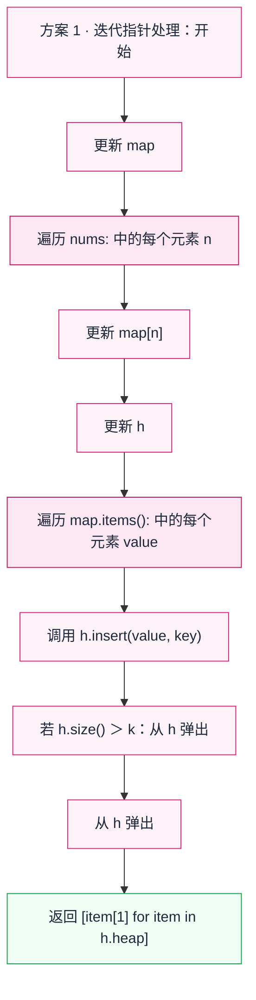

```python
import sys  # 提高递归深度上限（深输入防 RecursionError）

sys.setrecursionlimit(200000)  # 树/链表类题目节点数可达 1e4 量级
import heapq  # 引入依赖

class MinHeap:  # 定义类
    def __init__(self):  # 构造函数：初始化成员
        self.heap = []  # 把 [] 写入 堆

    def size(self):  # 定义函数 size（参数：self）
        return len(self.heap)  # 返回 长度(self.堆)

    def insert(self, value, key):  # 定义函数 insert（参数：self, value, key）
        heapq.heappush(self.heap, (value, key))  # heapq.heappush(self.堆, (value, key))

    def pop(self):  # 定义函数 pop（参数：self）
        return heapq.heappop(self.heap)  # 返回 heapq.heappop(self.堆)

def topKFrequent(nums, k):  # 定义函数 topKFrequent（参数：数组, 下标 k）
    map = {}  # 把 {} 存入 映射表
    for n in nums:  # 逐个取出 数组 的元素（元素个数）
        map[n] = map.get(n, 0) + 1  # 把 映射表 查找 元素个数, 0) 加 1 写入 map[n]
    h = MinHeap()  # 把 MinHeap() 存入 h
    for key, value in map.items():  # for key, value in 映射表.items():
        h.insert(value, key)  # h 插入 value, key)
        if h.size() > k:  # 若 h.大小() 超过 下标 k
            h.pop()  # 弹出栈顶元素
    return [item[1] for item in h.heap]  # 返回 [item[1] for item in h.堆]

if __name__ == "__main__":  # 若 __name__ 等于 '__main__'
    print(topKFrequent([1, 1, 1, 2, 2, 3], 2))  # [1, 2] in any order
```

#### 方案 2：迭代指针处理

**思路与代码分析**：核心是「迭代指针处理」。Python 版用切片与字典推导式简化操作，突出可读性。代码里依次做这些事：哈希结构做计数或查重；先排序再处理。**走读**：方案 2 · 迭代指针处理：开始 → 更新 map → 遍历 nums: 中的每个元素 n → 更新 map[n] → 排序整理 → 返回 [item[0] for item in list[:k]]。

**运行架构**（真实控制流）：

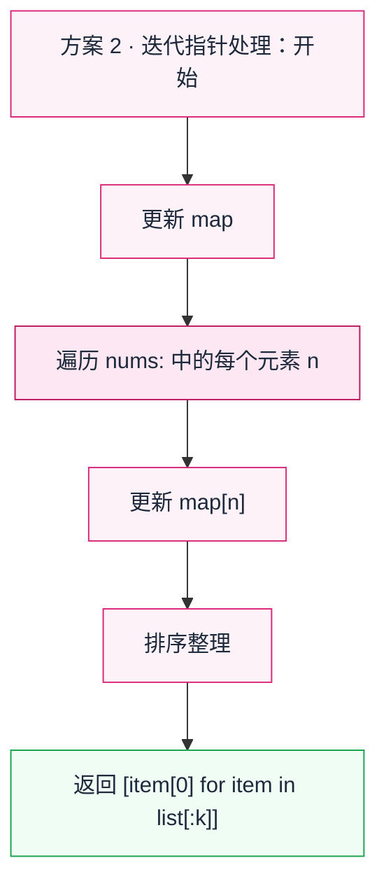

```python
import sys  # 提高递归深度上限（深输入防 RecursionError）

sys.setrecursionlimit(200000)  # 树/链表类题目节点数可达 1e4 量级

def topKFrequent(nums, k):  # 定义函数 topKFrequent（参数：数组, 下标 k）
    map = {}  # 把 {} 存入 映射表
    for n in nums:  # 逐个取出 数组 的元素（元素个数）
        map[n] = map.get(n, 0) + 1  # 把 映射表 查找 元素个数, 0) 加 1 写入 map[n]
    list = sorted(map.items(), key=lambda x: x[1], reverse=True)
    return [item[0] for item in list[:k]]  # 返回 [item[0] for item in 列表[:下标 k]]

if __name__ == "__main__":  # 若 __name__ 等于 '__main__'
    print(topKFrequent([1, 2, 3], 1))  # 打印输出
```

#### 方案 3：直接实现

**思路与代码分析**：核心是「直接实现」。Python 版用切片与字典推导式简化操作，突出可读性。代码里依次做这些事：队列或堆的调度。**走读**：方案 3 · 直接实现：开始 → 更新 freq → 更新 heap → 遍历 freq.items(): 中的每个元素 cnt → 调用 heapq.heappush(heap, (cnt, n → 若 len(heap) ＞ k：调用 heapq.heappop(heap) → 调用 heapq.heappop(heap) → 返回 [num for _, num in heap]。

**运行架构**（真实控制流）：

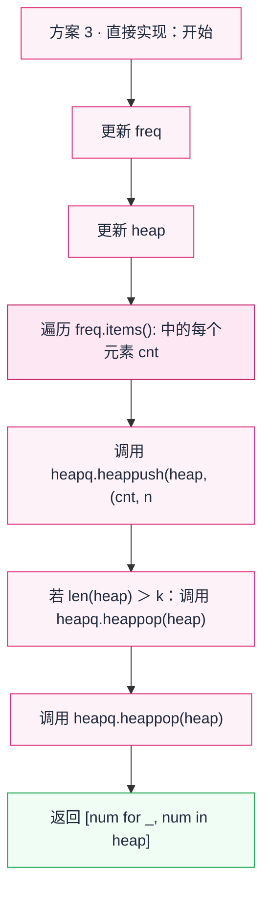

```python
import sys  # 提高递归深度上限（深输入防 RecursionError）

sys.setrecursionlimit(200000)  # 树/链表类题目节点数可达 1e4 量级
import heapq  # 引入依赖
from collections import Counter  # from collections import Counter

def topKFrequent(nums, k):  # 定义函数 topKFrequent（参数：数组, 下标 k）
    freq = Counter(nums)  # 把 Counter(数组) 存入 频次表
    # 维护一个大小为 k 的最小堆，堆顶是堆中频次最小的元素
    heap = []  # 把 [] 存入 堆
    for num, cnt in freq.items():  # for num, 计数 in 频次表.items():
        heapq.heappush(heap, (cnt, num))  # heapq.heappush(堆, (计数, num))
        if len(heap) > k:  # 若 长度(堆) 超过 下标 k
            heapq.heappop(heap)  # heapq.heappop(堆)
    # 取出堆中剩下的元素（频次最高的 k 个），顺序任意
    return [num for _, num in heap]  # 返回 [num for _, num in 堆]

if __name__ == "__main__":  # 若 __name__ 等于 '__main__'
    print(sorted(topKFrequent([1, 1, 1, 2, 2, 3], 2)))  # 打印输出
```

#### 方案 4：迭代指针处理

**思路与代码分析**：核心是「迭代指针处理」。Python 版用切片与字典推导式简化操作，突出可读性。代码里依次做这些事：队列或堆的调度。**走读**：方案 4 · 迭代指针处理：开始 → 更新 freq → 返回 [num for num, _ in heapq.nlargest(k, freq.items(), key=lambda x: x[1])]。

**运行架构**（真实控制流）：

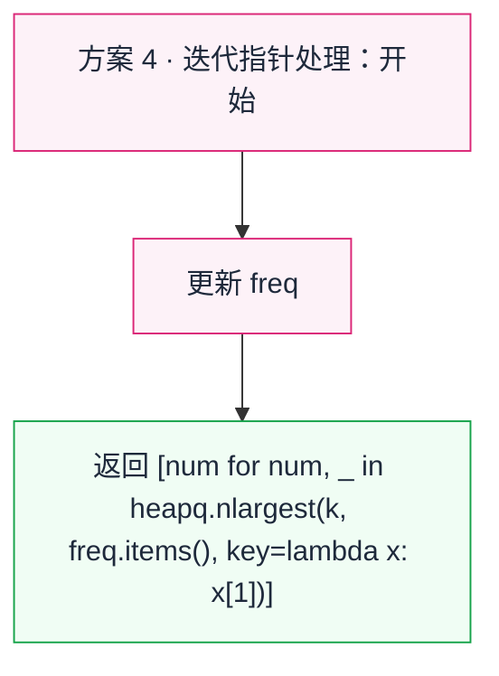

```python
import sys  # 提高递归深度上限（深输入防 RecursionError）

sys.setrecursionlimit(200000)  # 树/链表类题目节点数可达 1e4 量级
import heapq  # 引入依赖
from collections import Counter  # from collections import Counter

def topKFrequent(nums, k):  # 定义函数 topKFrequent（参数：数组, 下标 k）
    freq = Counter(nums)  # 把 Counter(数组) 存入 频次表
    # 直接取频次最高的 k 个元素
    return [num for num, _ in heapq.nlargest(k, freq.items(), key=lambda x: x[1])]

if __name__ == "__main__":  # 若 __name__ 等于 '__main__'
    print(sorted(topKFrequent([1, 1, 1, 2, 2, 3], 2)))  # 打印输出
```

#### 方案 5：迭代指针处理

**思路与代码分析**：核心是「迭代指针处理」。Python 版用切片与字典推导式简化操作，突出可读性。代码里依次做这些事：队列或堆的调度。**走读**：方案 5 · 迭代指针处理：开始 → 更新 cnt → 更新 heap → 遍历 cnt.items(): 中的每个元素 freq → 调用 heapq.heappush(heap, (freq, → 若 len(heap) ＞ k：调用 heapq.heappop(heap) → 调用 heapq.heappop(heap) → 返回 [num for _, num in heap]。

**运行架构**（真实控制流）：

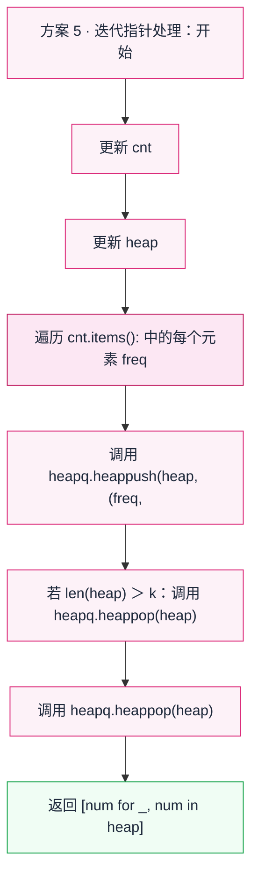

```python
# 前 K 个高频元素 - 方案: 大小为 k 的小顶堆
import sys  # 提高递归深度上限（深输入防 RecursionError）

sys.setrecursionlimit(200000)  # 树/链表类题目节点数可达 1e4 量级
import heapq  # 引入依赖
from collections import Counter  # from collections import Counter

def top_k_frequent(nums, k):  # 定义函数 top_k_frequent（参数：数组, 下标 k）
    cnt = Counter(nums)  # 把 Counter(数组) 存入 计数
    heap = []  # 把 [] 存入 堆
    for num, freq in cnt.items():  # for num, 频次表 in 计数.items():
        heapq.heappush(heap, (freq, num))  # heapq.heappush(堆, (频次表, num))
        if len(heap) > k:  # 若 长度(堆) 超过 下标 k
            heapq.heappop(heap)  # heapq.heappop(堆)
    return [num for _, num in heap]  # 返回 [num for _, num in 堆]

if __name__ == "__main__":  # 若 __name__ 等于 '__main__'
    print(top_k_frequent([1, 1, 1, 2, 2, 3], 2))  # [1, 2]
```

#### 方案 6：迭代指针处理

**思路与代码分析**：核心是「迭代指针处理」。Python 版用切片与字典推导式简化操作，突出可读性。**走读**：方案 6 · 迭代指针处理：开始 → 更新 cnt → 更新 max_freq → 更新 buckets → 遍历 cnt.items(): 中的每个元素 f → 处理 buckets[f].append(num) → 更新 result → 循环 f：从 max_freq 到 -1 前，步长 0 → 遍历 buckets[f]: 中的每个元素 num → 向 result 追加记录 → 命中条件，直接返回 → 返回 result。

**运行架构**（真实控制流）：

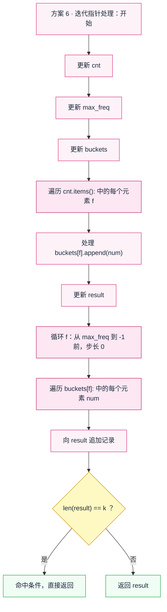

```python
# 前 K 个高频元素 - 方案: 桶排序
import sys  # 提高递归深度上限（深输入防 RecursionError）

sys.setrecursionlimit(200000)  # 树/链表类题目节点数可达 1e4 量级
from collections import Counter  # from collections import Counter

def top_k_frequent(nums, k):  # 定义函数 top_k_frequent（参数：数组, 下标 k）
    cnt = Counter(nums)  # 把 Counter(数组) 存入 计数
    max_freq = max(cnt.values())  # 把 取较大值 计数.values()) 存入 max_freq
    buckets = [[] for _ in range(max_freq + 1)]  # 把 [[] for _ in range(max_freq 加 1)] 存入 buckets
    for num, f in cnt.items():  # for num, f in 计数.items():
        buckets[f].append(num)  # 把 num 追加到列表尾部
    result = []  # 把 [] 存入 结果
    for f in range(max_freq, 0, -1):  # 让 f 从 max_freq 倒数回去（每步减 1）
        for num in buckets[f]:  # 逐个取出 buckets 的元素（num）
            result.append(num)  # 把 num 追加到列表尾部
            if len(result) == k:  # 若 长度(结果) 等于 下标 k
                return result  # 返回 结果
    return result  # 返回 结果

if __name__ == "__main__":  # 若 __name__ 等于 '__main__'
    print(top_k_frequent([1, 1, 1, 2, 2, 3], 2))  # [1, 2]
```

### Go 实现（6 种方案）

Go 的全部方案如下，每个方案都内嵌用例自测，可独立运行（老仓库 python/go 文件遵循「打印结果」约定）：

#### 方案 1：迭代指针处理

**思路与代码分析**：核心是「迭代指针处理」。Go 版用切片与多返回值惯用法，显式处理索引边界。代码里依次做这些事：哈希结构做计数或查重；队列或堆的调度。**走读**：方案 1 · 迭代指针处理：开始 → 更新 : → 遍历 nums 的下标与元素 n → 处理 cnt[n]++ → 更新 : → 调用 heap.Init(h) → 遍历 cnt 的下标与元素 f → 调用 heap.Push(h, pair → 处理 if h.Len() ＞ k → 调用 heap.Pop(h) → 更新 : → 遍历循环 → 更新 res → 返回 res。

**运行架构**（真实控制流）：


```go
package main // 引入依赖
import (
	"container/heap" // 引入依赖
	"fmt"
	"os"
	"reflect"
	"sort"
)

type pair struct{ freq, num int }    // 定义类型
type minHeap []pair                  // 定义类型
func (h minHeap) Len() int           { return len(h) }                                                     // 定义函数/方法 Len
func (h minHeap) Less(i, j int) bool { return h[i].freq < h[j].freq }                                      // 定义函数/方法 Less
func (h minHeap) Swap(i, j int)      { h[i], h[j] = h[j], h[i] }                                           // 定义函数/方法 Swap
func (h *minHeap) Push(x any)        { *h = append(*h, x.(pair)) }                                         // 定义函数/方法 Push
func (h *minHeap) Pop() any          { old := *h; n := len(old); x := old[n-1]; *h = old[:n-1]; return x } // 定义函数/方法 Pop
func topKFrequent(nums []int, k int) []int { // 定义函数/方法 topKFrequent
	cnt := map[int]int{} // 把 映射表[int]int{} 写入 cnt :
	for _, n := range nums {
		cnt[n]++
	} // 同时取 _ 与 元素个数 遍历
	h := &minHeap{}           // 把 按位与 minHeap{} 写入 h :
	heap.Init(h)              // 堆.Init(h)
	for num, f := range cnt { // 同时取 num 与 f 遍历
		heap.Push(h, pair{f, num}) // 堆.Push(h, pair{f, num})
		if h.Len() > k {
			heap.Pop(h)
		} // 若 h.Len() 超过 下标 k { 堆.Pop(h) }
	}
	res := []int{} // 把 []int{} 写入 res :
	for _, p := range *h {
		res = append(res, p.num)
	} // 同时取 _ 与 节点 遍历
	return res // 返回 结果
}
func main() { // 程序入口：跑内嵌自测用例
	cases := []struct {
		nums []int
		k    int
		want []int
	}{ // 把 []struct{ 数组 []int; 下标 k int; want []int }{ 写入 cases :
		{[]int{1, 1, 1, 2, 2, 3}, 2, []int{1, 2}},
		{[]int{1, 1, 1, 2, 2, 3, 3, 3, 3, 4}, 2, []int{1, 3}},
	}
	ok := true                // 把 true 写入 ok :
	for _, c := range cases { // 同时取 _ 与 字符 遍历
		got := topKFrequent(c.nums, c.k) // 把 topKFrequent(字符.数组, 字符.下标 k) 写入 got :
		g := append([]int{}, got...)     // 把 append([]int{}, got...) 写入 g :
		sort.Ints(g)                     // sort.Ints(g)
		w := append([]int{}, c.want...)  // 把 append([]int{}, 字符.want...) 写入 w :
		sort.Ints(w)                     // sort.Ints(权重)
		if !reflect.DeepEqual(g, w) {    // 若 取反 reflect.DeepEqual(g, 权重
			ok = false
			fmt.Printf("FAIL got %v want %v\n", got, c.want) // 打印输出
		}
	}
	if !ok {
		os.Exit(1)
	} // 若 取反 ok { os.Exit(1) }
	fmt.Println("PASS") // 全部用例通过，输出 PASS
}
```

#### 方案 2：迭代指针处理

**思路与代码分析**：核心是「迭代指针处理」。Go 版用切片与多返回值惯用法，显式处理索引边界。代码里依次做这些事：哈希结构做计数或查重。**走读**：方案 2 · 迭代指针处理：开始 → 更新 : → 遍历 nums 的下标与元素 n → 处理 cnt[n]++ → 处理 type kv struct → 更新 : → 遍历 cnt 的下标与元素 f → 更新 lst → 调用 sort.Slice(lst, func(i, j in → 更新 : → 遍历循环 → 更新 res → 返回 res。

**运行架构**（真实控制流）：


```go
package main // 引入依赖
import (
	"fmt"
	"os"
	"reflect" // 引入依赖
	"sort"
)

func topKFrequent(nums []int, k int) []int { // 定义函数/方法 topKFrequent
	cnt := map[int]int{} // 把 映射表[int]int{} 写入 cnt :
	for _, n := range nums {
		cnt[n]++
	} // 同时取 _ 与 元素个数 遍历
	type kv struct{ num, freq int } // 定义类型
	lst := []kv{}                   // 把 []kv{} 写入 lst :
	for num, f := range cnt {
		lst = append(lst, kv{num, f})
	} // 同时取 num 与 f 遍历
	sort.Slice(lst, func(i, j int) bool { return lst[i].freq > lst[j].freq })
	res := []int{} // 把 []int{} 写入 res :
	for i := 0; i < k && i < len(lst); i++ {
		res = append(res, lst[i].num)
	} // 让 下标 i 从 0 开始计数
	return res // 返回 结果
}
func main() { // 程序入口：跑内嵌自测用例
	cases := []struct {
		nums []int
		k    int
		want []int
	}{ // 把 []struct{ 数组 []int; 下标 k int; want []int }{ 写入 cases :
		{[]int{1, 1, 1, 2, 2, 3}, 2, []int{1, 2}},
		{[]int{1, 1, 1, 2, 2, 3, 3, 3, 3, 4}, 2, []int{1, 3}},
	}
	ok := true                // 把 true 写入 ok :
	for _, c := range cases { // 同时取 _ 与 字符 遍历
		got := topKFrequent(c.nums, c.k) // 把 topKFrequent(字符.数组, 字符.下标 k) 写入 got :
		g := append([]int{}, got...)     // 把 append([]int{}, got...) 写入 g :
		sort.Ints(g)                     // sort.Ints(g)
		w := append([]int{}, c.want...)  // 把 append([]int{}, 字符.want...) 写入 w :
		sort.Ints(w)                     // sort.Ints(权重)
		if !reflect.DeepEqual(g, w) {    // 若 取反 reflect.DeepEqual(g, 权重
			ok = false
			fmt.Printf("FAIL got %v want %v\n", got, c.want) // 打印输出
		}
	}
	if !ok {
		os.Exit(1)
	} // 若 取反 ok { os.Exit(1) }
	fmt.Println("PASS") // 全部用例通过，输出 PASS
}
```

#### 方案 3：直接实现

**思路与代码分析**：核心是「直接实现」。Go 版用切片与多返回值惯用法，显式处理索引边界。代码里依次做这些事：哈希结构做计数或查重；队列或堆的调度。**走读**：方案 3 · 直接实现：开始 → 更新 : → 遍历 nums 的下标与元素 n → 处理 cnt[n]++ → 更新 : → 调用 heap.Init(h) → 遍历 cnt 的下标与元素 f → 调用 heap.Push(h, pair → 处理 if h.Len() ＞ k → 调用 heap.Pop(h) → 更新 : → 遍历循环 → 更新 res → 返回 res。

**运行架构**（真实控制流）：

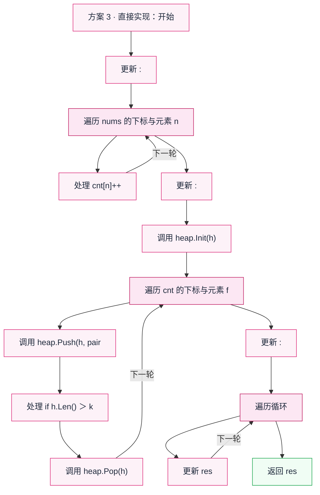

```go
package main // 引入依赖
import (
	"container/heap" // 引入依赖
	"fmt"
	"os"
	"reflect"
	"sort"
)

type pair struct{ freq, num int }    // 定义类型
type minHeap []pair                  // 定义类型
func (h minHeap) Len() int           { return len(h) }                                                     // 定义函数/方法 Len
func (h minHeap) Less(i, j int) bool { return h[i].freq < h[j].freq }                                      // 定义函数/方法 Less
func (h minHeap) Swap(i, j int)      { h[i], h[j] = h[j], h[i] }                                           // 定义函数/方法 Swap
func (h *minHeap) Push(x any)        { *h = append(*h, x.(pair)) }                                         // 定义函数/方法 Push
func (h *minHeap) Pop() any          { old := *h; n := len(old); x := old[n-1]; *h = old[:n-1]; return x } // 定义函数/方法 Pop
func topKFrequent(nums []int, k int) []int { // 定义函数/方法 topKFrequent
	cnt := map[int]int{} // 把 映射表[int]int{} 写入 cnt :
	for _, n := range nums {
		cnt[n]++
	} // 同时取 _ 与 元素个数 遍历
	h := &minHeap{}           // 把 按位与 minHeap{} 写入 h :
	heap.Init(h)              // 堆.Init(h)
	for num, f := range cnt { // 同时取 num 与 f 遍历
		heap.Push(h, pair{f, num}) // 堆.Push(h, pair{f, num})
		if h.Len() > k {
			heap.Pop(h)
		} // 若 h.Len() 超过 下标 k { 堆.Pop(h) }
	}
	res := []int{} // 把 []int{} 写入 res :
	for _, p := range *h {
		res = append(res, p.num)
	} // 同时取 _ 与 节点 遍历
	return res // 返回 结果
}
func main() { // 程序入口：跑内嵌自测用例
	cases := []struct {
		nums []int
		k    int
		want []int
	}{ // 把 []struct{ 数组 []int; 下标 k int; want []int }{ 写入 cases :
		{[]int{1, 1, 1, 2, 2, 3}, 2, []int{1, 2}},
		{[]int{1, 1, 1, 2, 2, 3, 3, 3, 3, 4}, 2, []int{1, 3}},
	}
	ok := true                // 把 true 写入 ok :
	for _, c := range cases { // 同时取 _ 与 字符 遍历
		got := topKFrequent(c.nums, c.k) // 把 topKFrequent(字符.数组, 字符.下标 k) 写入 got :
		g := append([]int{}, got...)     // 把 append([]int{}, got...) 写入 g :
		sort.Ints(g)                     // sort.Ints(g)
		w := append([]int{}, c.want...)  // 把 append([]int{}, 字符.want...) 写入 w :
		sort.Ints(w)                     // sort.Ints(权重)
		if !reflect.DeepEqual(g, w) {    // 若 取反 reflect.DeepEqual(g, 权重
			ok = false
			fmt.Printf("FAIL got %v want %v\n", got, c.want) // 打印输出
		}
	}
	if !ok {
		os.Exit(1)
	} // 若 取反 ok { os.Exit(1) }
	fmt.Println("PASS") // 全部用例通过，输出 PASS
}
```

#### 方案 4：迭代指针处理

**思路与代码分析**：核心是「迭代指针处理」。Go 版用切片与多返回值惯用法，显式处理索引边界。代码里依次做这些事：哈希结构做计数或查重。**走读**：方案 4 · 迭代指针处理：开始 → 更新 : → 遍历 nums 的下标与元素 n → 处理 cnt[n]++ → 处理 type kv struct → 更新 : → 遍历 cnt 的下标与元素 f → 更新 lst → 调用 sort.Slice(lst, func(i, j in → 更新 : → 遍历循环 → 更新 res → 返回 res。

**运行架构**（真实控制流）：

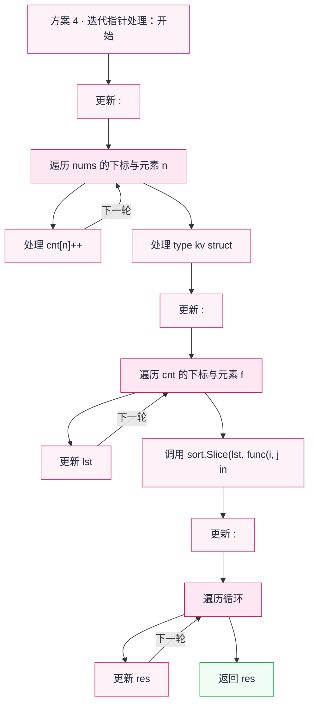

```go
package main // 引入依赖
import (
	"fmt"
	"os"
	"reflect" // 引入依赖
	"sort"
)

func topKFrequent(nums []int, k int) []int { // 定义函数/方法 topKFrequent
	cnt := map[int]int{} // 把 映射表[int]int{} 写入 cnt :
	for _, n := range nums {
		cnt[n]++
	} // 同时取 _ 与 元素个数 遍历
	type kv struct{ num, freq int } // 定义类型
	lst := []kv{}                   // 把 []kv{} 写入 lst :
	for num, f := range cnt {
		lst = append(lst, kv{num, f})
	} // 同时取 num 与 f 遍历
	sort.Slice(lst, func(i, j int) bool { return lst[i].freq > lst[j].freq })
	res := []int{} // 把 []int{} 写入 res :
	for i := 0; i < k && i < len(lst); i++ {
		res = append(res, lst[i].num)
	} // 让 下标 i 从 0 开始计数
	return res // 返回 结果
}
func main() { // 程序入口：跑内嵌自测用例
	cases := []struct {
		nums []int
		k    int
		want []int
	}{ // 把 []struct{ 数组 []int; 下标 k int; want []int }{ 写入 cases :
		{[]int{1, 1, 1, 2, 2, 3}, 2, []int{1, 2}},
		{[]int{1, 1, 1, 2, 2, 3, 3, 3, 3, 4}, 2, []int{1, 3}},
	}
	ok := true                // 把 true 写入 ok :
	for _, c := range cases { // 同时取 _ 与 字符 遍历
		got := topKFrequent(c.nums, c.k) // 把 topKFrequent(字符.数组, 字符.下标 k) 写入 got :
		g := append([]int{}, got...)     // 把 append([]int{}, got...) 写入 g :
		sort.Ints(g)                     // sort.Ints(g)
		w := append([]int{}, c.want...)  // 把 append([]int{}, 字符.want...) 写入 w :
		sort.Ints(w)                     // sort.Ints(权重)
		if !reflect.DeepEqual(g, w) {    // 若 取反 reflect.DeepEqual(g, 权重
			ok = false
			fmt.Printf("FAIL got %v want %v\n", got, c.want) // 打印输出
		}
	}
	if !ok {
		os.Exit(1)
	} // 若 取反 ok { os.Exit(1) }
	fmt.Println("PASS") // 全部用例通过，输出 PASS
}
```

#### 方案 5：迭代指针处理

**思路与代码分析**：核心是「迭代指针处理」。Go 版用切片与多返回值惯用法，显式处理索引边界。代码里依次做这些事：哈希结构做计数或查重；队列或堆的调度。**走读**：方案 5 · 迭代指针处理：开始 → 更新 : → 遍历 nums 的下标与元素 n → 处理 cnt[n]++ → 更新 : → 调用 heap.Init(h) → 遍历 cnt 的下标与元素 f → 调用 heap.Push(h, pair → 处理 if h.Len() ＞ k → 调用 heap.Pop(h) → 更新 : → 遍历循环 → 更新 res → 返回 res。

**运行架构**（真实控制流）：

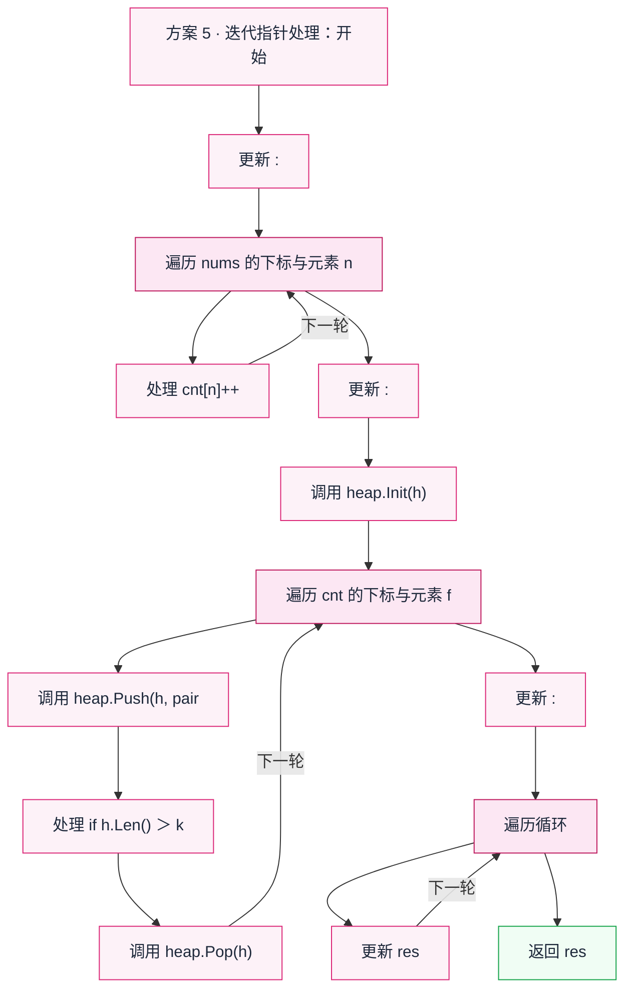

```go
package main // 引入依赖
import (
	"container/heap" // 引入依赖
	"fmt"
	"os"
	"reflect"
	"sort"
)

type pair struct{ freq, num int }    // 定义类型
type minHeap []pair                  // 定义类型
func (h minHeap) Len() int           { return len(h) }                                                     // 定义函数/方法 Len
func (h minHeap) Less(i, j int) bool { return h[i].freq < h[j].freq }                                      // 定义函数/方法 Less
func (h minHeap) Swap(i, j int)      { h[i], h[j] = h[j], h[i] }                                           // 定义函数/方法 Swap
func (h *minHeap) Push(x any)        { *h = append(*h, x.(pair)) }                                         // 定义函数/方法 Push
func (h *minHeap) Pop() any          { old := *h; n := len(old); x := old[n-1]; *h = old[:n-1]; return x } // 定义函数/方法 Pop
func topKFrequent(nums []int, k int) []int { // 定义函数/方法 topKFrequent
	cnt := map[int]int{} // 把 映射表[int]int{} 写入 cnt :
	for _, n := range nums {
		cnt[n]++
	} // 同时取 _ 与 元素个数 遍历
	h := &minHeap{}           // 把 按位与 minHeap{} 写入 h :
	heap.Init(h)              // 堆.Init(h)
	for num, f := range cnt { // 同时取 num 与 f 遍历
		heap.Push(h, pair{f, num}) // 堆.Push(h, pair{f, num})
		if h.Len() > k {
			heap.Pop(h)
		} // 若 h.Len() 超过 下标 k { 堆.Pop(h) }
	}
	res := []int{} // 把 []int{} 写入 res :
	for _, p := range *h {
		res = append(res, p.num)
	} // 同时取 _ 与 节点 遍历
	return res // 返回 结果
}
func main() { // 程序入口：跑内嵌自测用例
	cases := []struct {
		nums []int
		k    int
		want []int
	}{ // 把 []struct{ 数组 []int; 下标 k int; want []int }{ 写入 cases :
		{[]int{1, 1, 1, 2, 2, 3}, 2, []int{1, 2}},
		{[]int{1, 1, 1, 2, 2, 3, 3, 3, 3, 4}, 2, []int{1, 3}},
	}
	ok := true                // 把 true 写入 ok :
	for _, c := range cases { // 同时取 _ 与 字符 遍历
		got := topKFrequent(c.nums, c.k) // 把 topKFrequent(字符.数组, 字符.下标 k) 写入 got :
		g := append([]int{}, got...)     // 把 append([]int{}, got...) 写入 g :
		sort.Ints(g)                     // sort.Ints(g)
		w := append([]int{}, c.want...)  // 把 append([]int{}, 字符.want...) 写入 w :
		sort.Ints(w)                     // sort.Ints(权重)
		if !reflect.DeepEqual(g, w) {    // 若 取反 reflect.DeepEqual(g, 权重
			ok = false
			fmt.Printf("FAIL got %v want %v\n", got, c.want) // 打印输出
		}
	}
	if !ok {
		os.Exit(1)
	} // 若 取反 ok { os.Exit(1) }
	fmt.Println("PASS") // 全部用例通过，输出 PASS
}
```

#### 方案 6：迭代指针处理

**思路与代码分析**：核心是「迭代指针处理」。Go 版用切片与多返回值惯用法，显式处理索引边界。代码里依次做这些事：哈希结构做计数或查重。**走读**：方案 6 · 迭代指针处理：开始 → 更新 : → 遍历 nums 的下标与元素 n → 遍历 cnt 的下标与元素 f → 遍历 cnt 的下标与元素 f → 遍历循环 → 遍历 buckets[f] 的下标与元素 num → 返回 res → 返回 res。

**运行架构**（真实控制流）：

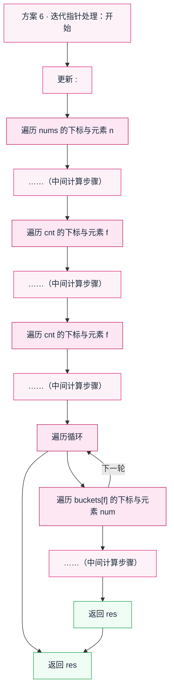

```go
package main // 引入依赖
import (
	"fmt"
	"os"
	"reflect" // 引入依赖
	"sort"
)

func topKFrequent(nums []int, k int) []int { // 定义函数/方法 topKFrequent
	cnt := map[int]int{} // 把 映射表[int]int{} 写入 cnt :
	for _, n := range nums {
		cnt[n]++
	} // 同时取 _ 与 元素个数 遍历
	maxFreq := 0 // 把 0 写入 maxFreq :
	for _, f := range cnt {
		if f > maxFreq {
			maxFreq = f
		}
	} // 同时取 _ 与 f 遍历
	buckets := make([][]int, maxFreq+1) // 把 make([][]int, maxFreq 加 1) 写入 buckets :
	for num, f := range cnt {
		buckets[f] = append(buckets[f], num)
	} // 同时取 num 与 f 遍历
	res := []int{}                  // 把 []int{} 写入 res :
	for f := maxFreq; f >= 1; f-- { // 把 maxFreq; f 不低于 1; f 减一 { 写入 for f :
		for _, num := range buckets[f] { // 同时取 _ 与 num 遍历
			res = append(res, num) // 把 append(结果, num) 写入 结果
			if len(res) == k {
				return res
			} // 若 长度(结果) 等于 下标 k { return 结果 }
		}
	}
	return res // 返回 结果
}
func main() { // 程序入口：跑内嵌自测用例
	cases := []struct {
		nums []int
		k    int
		want []int
	}{ // 把 []struct{ 数组 []int; 下标 k int; want []int }{ 写入 cases :
		{[]int{1, 1, 1, 2, 2, 3}, 2, []int{1, 2}},
		{[]int{1, 1, 1, 2, 2, 3, 3, 3, 3, 4}, 2, []int{1, 3}},
	}
	ok := true                // 把 true 写入 ok :
	for _, c := range cases { // 同时取 _ 与 字符 遍历
		got := topKFrequent(c.nums, c.k) // 把 topKFrequent(字符.数组, 字符.下标 k) 写入 got :
		g := append([]int{}, got...)     // 把 append([]int{}, got...) 写入 g :
		sort.Ints(g)                     // sort.Ints(g)
		w := append([]int{}, c.want...)  // 把 append([]int{}, 字符.want...) 写入 w :
		sort.Ints(w)                     // sort.Ints(权重)
		if !reflect.DeepEqual(g, w) {    // 若 取反 reflect.DeepEqual(g, 权重
			ok = false
			fmt.Printf("FAIL got %v want %v\n", got, c.want) // 打印输出
		}
	}
	if !ok {
		os.Exit(1)
	} // 若 取反 ok { os.Exit(1) }
	fmt.Println("PASS") // 全部用例通过，输出 PASS
}
```

### Java 实现（6 种方案）

Java 的全部方案如下，每个方案都内嵌用例自测，可独立运行（老仓库 python/go 文件遵循「打印结果」约定）：

#### 方案 1：迭代指针处理

**思路与代码分析**：核心是「迭代指针处理」。Java 版用类与静态方法组织，集合操作显式明了。代码里依次做这些事：哈希结构做计数或查重；双重循环遍历。**走读**：方案 1 · 迭代指针处理：开始 → 更新 map → 处理 new HashMap＜＞() → 遍历循环 → 调用 map.put(n, map.getOrDefault( → 更新 h → 遍历循环 → 调用 h.offer(key) → 更新 result → 遍历循环 → 更新 result[i] → 返回 result。

**运行架构**（真实控制流）：

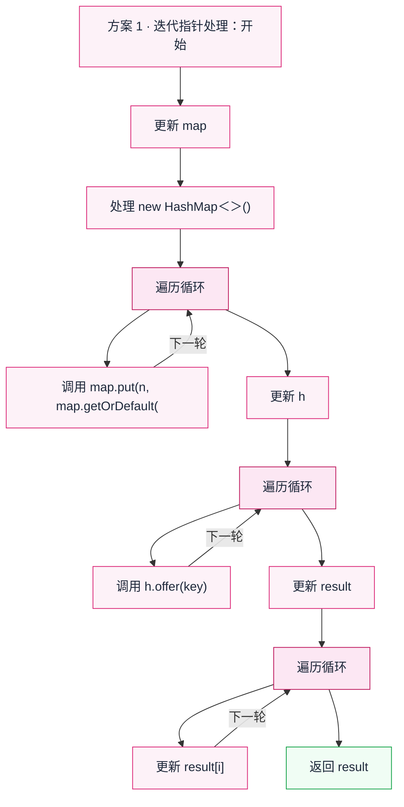

```java
package com.webfault.dsa; // 引入依赖

import java.util.*; // 引入依赖

class lc347_solution11 { // 定义类型
  static int[] topKFrequent(int[] nums, int k) { // 定义函数/方法 topKFrequent
    Map<Integer, Integer> map =
        new HashMap<>(); // 把 new HashMap 小于 超过 (); 写入 Map<Integer, Integer> map
    for (int n : nums) { // for (int 元素个数 : 数组) {
      map.put(n, map.getOrDefault(n, 0) + 1); // 映射表.put(元素个数, 映射表.getOrDefault(元素个数, 0) 加 1);
    }
    PriorityQueue<Integer> h = new PriorityQueue<>((a, b) -> map.get(b) - map.get(a));
    for (int key : map.keySet()) { // for (int key : 映射表.keySet()) {
      h.offer(key); // h.offer(key);
    }
    int[] result = new int[k]; // 把 new int[下标 k]; 写入 int[] result
    for (int i = 0; i < k; i++) { // 让 下标 i 从 0 开始计数，下标 i 小于 下标 k 就继续
      result[i] = h.poll(); // 把 h.poll(); 写入 result[i]
    }
    return result; // 返回 结果
  }

  public static void main(String[] args) { // public static void main(String[] args) {
    int[] got =
        topKFrequent(
            new int[] {1, 1, 1, 2, 2, 3},
            2); // 把 topKFrequent(new int[]{1, 1, 1, 2, 2, 3}, 2); 写入 int[] got
    if (got.length != 2) throw new RuntimeException("FAILED length: " + got.length);
    Set<Integer> set = new HashSet<>(); // 把 new HashSet 小于 超过 (); 写入 Set<Integer> set
    for (int v : got) set.add(v); // for (int 值 : got) set 追加 值);
    if (!(set.contains(1) && set.contains(2))) // 若 取反 (set 是否包含 1) 且 set 是否包含 2
    throw new RuntimeException("FAILED: " + Arrays.toString(got));
    System.out.println("PASS"); // 全部用例通过，输出 PASS
  }
}
```

#### 方案 2：迭代指针处理

**思路与代码分析**：核心是「迭代指针处理」。Java 版用类与静态方法组织，集合操作显式明了。代码里依次做这些事：哈希结构做计数或查重；先排序再处理；双重循环遍历。**走读**：方案 2 · 迭代指针处理：开始 → 更新 map → 处理 new HashMap＜＞() → 遍历循环 → 调用 map.put(n, map.getOrDefault( → 更新 list → 排序整理 → 更新 result → 遍历循环 → 更新 result[i] → 返回 result。

**运行架构**（真实控制流）：

```mermaid
graph TD
    N0["方案 2 · 迭代指针处理：开始"]
    N1["更新 map"]
    N2["处理 new HashMap＜＞()"]
    N3["遍历循环"]
    N4["调用 map.put(n, map.getOrDefault("]
    N5["更新 list"]
    N6["排序整理"]
    N7["更新 result"]
    N8["遍历循环"]
    N9["更新 result[i]"]
    N10["返回 result"]
    N0 --> N1
    N1 --> N2
    N2 --> N3
    N3 --> N4
    N4 -- 下一轮 --> N3
    N3 --> N5
    N5 --> N6
    N6 --> N7
    N7 --> N8
    N8 --> N9
    N9 -- 下一轮 --> N8
    N8 --> N10
    classDef n fill:#fdf2f8,stroke:#db2777,color:#1e293b;
    classDef lp fill:#fce7f3,stroke:#be185d,color:#1e293b;
    classDef dc fill:#fef9c3,stroke:#ca8a04,color:#1e293b;
    classDef tm fill:#f0fdf4,stroke:#16a34a,color:#1e293b;
    class N0,N1,N2,N4,N5,N6,N7,N9 n;
    class N3,N8 lp;
    class N10 tm;
```

```java
package com.webfault.dsa; // 引入依赖

import java.util.*; // 引入依赖

class lc347_solution22 { // 定义类型
  public int[] topKFrequent(int[] nums, int k) { // 定义函数/方法 topKFrequent
    Map<Integer, Integer> map =
        new HashMap<>(); // 把 new HashMap 小于 超过 (); 写入 Map<Integer, Integer> map
    for (int n : nums) { // for (int 元素个数 : 数组) {
      map.put(n, map.getOrDefault(n, 0) + 1); // 映射表.put(元素个数, 映射表.getOrDefault(元素个数, 0) 加 1);
    }
    List<Map.Entry<Integer, Integer>> list = new ArrayList<>(map.entrySet());
    list.sort((a, b) -> b.getValue() - a.getValue()); // 排序
    int[] result = new int[k]; // 把 new int[下标 k]; 写入 int[] result
    for (int i = 0; i < k; i++) { // 让 下标 i 从 0 开始计数，下标 i 小于 下标 k 就继续
      result[i] = list.get(i).getKey(); // 把 列表 查找 下标 i).getKey(); 写入 result[i]
    }
    return result; // 返回 结果
  }

  public static void main(String[] args) { // public static void main(String[] args) {
    lc347_solution22 s = new lc347_solution22(); // 把 new lc347_solution22(); 写入 lc347_solution22 s
    int[][] inputs = {{1, 1, 1, 2, 2, 3}, {1}, {4, 1, -1, 2, -1, 2, 3}};
    int[] ks = {2, 1, 2}; // 把 {2, 1, 2}; 写入 int[] ks
    int[][] wants = {{1, 2}, {1}, {-1, 2}}; // 把 { {1, 2}, {1}, { 减 1, 2} }; 写入 int[][] wants
    boolean ok = true; // 把 true; 写入 boolean ok
    for (int t = 0; t < inputs.length; t++) { // 让 另一字符串 从 0 开始计数，另一字符串 小于 inputs.长度 就继续
      int[] got =
          s.topKFrequent(
              inputs[t], ks[t]); // 把 字符串.topKFrequent(inputs[另一字符串], ks[另一字符串]); 写入 int[] got
      Arrays.sort(got); // 排序
      int[] w = wants[t].clone(); // 把 wants[另一字符串].clone(); 写入 int[] w
      Arrays.sort(w); // 排序
      if (!Arrays.equals(got, w)) { // 若 取反 Arrays.equals(got, 权重
        ok = false; // 把 false; 写入 ok
        System.out.println(
            "FAIL topKFrequent("
                + Arrays.toString(inputs[t])
                + ","
                + ks[t]
                + ")="
                + Arrays.toString(got)
                + " want "
                + Arrays.toString(w)); // 打印输出
      }
    }
    if (!ok) throw new RuntimeException("FAILED"); // 若 取反 ok) throw new RuntimeException(「FAILED」);
    System.out.println("PASS"); // 全部用例通过，输出 PASS
  }
}
```

#### 方案 3：直接实现

**思路与代码分析**：核心是「直接实现」。Java 版用类与静态方法组织，集合操作显式明了。代码里依次做这些事：哈希结构做计数或查重；双重循环遍历；队列或堆的调度。**走读**：方案 3 · 直接实现：开始 → 更新 freq → 遍历循环 → 遍历循环 → 当 (非 heap.isEmpty()) 时反复执行 → 返回 result。

**运行架构**（真实控制流）：

```mermaid
graph TD
    N0["方案 3 · 直接实现：开始"]
    N1["更新 freq"]
    D1["……（中间计算步骤）"]
    N3["遍历循环"]
    D2["……（中间计算步骤）"]
    N6["遍历循环"]
    D3["……（中间计算步骤）"]
    N14["当 (非 heap.isEmpty()) 时反复执行"]
    D4["……（中间计算步骤）"]
    N16["返回 result"]
    N0 --> N1
    N14 --> N16
    N1 --> D1
    D1 --> N3
    N3 --> D2
    D2 --> N6
    N6 --> D3
    D3 --> N14
    N14 --> D4
    D4 --> N16
    classDef n fill:#fdf2f8,stroke:#db2777,color:#1e293b;
    classDef lp fill:#fce7f3,stroke:#be185d,color:#1e293b;
    classDef dc fill:#fef9c3,stroke:#ca8a04,color:#1e293b;
    classDef tm fill:#f0fdf4,stroke:#16a34a,color:#1e293b;
    class N0,N1,D1,D2,D3,D4 n;
    class N3,N6,N14 lp;
    class N16 tm;
```

```java
package com.webfault.dsa; // 引入依赖

import java.util.*; // 引入依赖

class lc347_solution33 { // 定义类型
  public int[] topKFrequent(int[] nums, int k) { // 定义函数/方法 topKFrequent
    Map<Integer, Integer> freq =
        new HashMap<>(); // 把 new HashMap 小于 超过 (); 写入 Map<Integer, Integer> freq
    for (int n : nums) { // for (int 元素个数 : 数组) {
      freq.put(n, freq.getOrDefault(n, 0) + 1); // 频次表.put(元素个数, 频次表.getOrDefault(元素个数, 0) 加 1);
    }
    PriorityQueue<int[]> heap = new PriorityQueue<>((a, b) -> a[0] - b[0]);
    for (Map.Entry<Integer, Integer> e :
        freq.entrySet()) { // for (Map.Entry 小于 Integer, Integer 超过 e : 频次表.entrySet()) {
      heap.offer(
          new int[] {e.getValue(), e.getKey()}); // 堆.offer(new int[]{e.getValue(), e.getKey()});
      if (heap.size() > k) { // 若 堆.大小() 超过 下标 k
        heap.poll(); // 堆.poll();
      }
    }
    int[] result = new int[k]; // 把 new int[下标 k]; 写入 int[] result
    int i = 0; // 把 0 存入 下标 i
    while (!heap.isEmpty()) { // 循环，直到不满足「取反 堆.isEmpty(」
      result[i++] = heap.poll()[1]; // 把 堆.poll()[1]; 写入 result[i++]
    }
    return result; // 返回 结果
  }

  public static void main(String[] args) { // public static void main(String[] args) {
    lc347_solution33 s = new lc347_solution33(); // 把 new lc347_solution33(); 写入 lc347_solution33 s
    int[][] inputs = {{1, 1, 1, 2, 2, 3}, {1}, {4, 1, -1, 2, -1, 2, 3}};
    int[] ks = {2, 1, 2}; // 把 {2, 1, 2}; 写入 int[] ks
    int[][] wants = {{1, 2}, {1}, {-1, 2}}; // 把 { {1, 2}, {1}, { 减 1, 2} }; 写入 int[][] wants
    boolean ok = true; // 把 true; 写入 boolean ok
    for (int t = 0; t < inputs.length; t++) { // 让 另一字符串 从 0 开始计数，另一字符串 小于 inputs.长度 就继续
      int[] got =
          s.topKFrequent(
              inputs[t], ks[t]); // 把 字符串.topKFrequent(inputs[另一字符串], ks[另一字符串]); 写入 int[] got
      Arrays.sort(got); // 排序
      int[] w = wants[t].clone(); // 把 wants[另一字符串].clone(); 写入 int[] w
      Arrays.sort(w); // 排序
      if (!Arrays.equals(got, w)) { // 若 取反 Arrays.equals(got, 权重
        ok = false; // 把 false; 写入 ok
        System.out.println(
            "FAIL topKFrequent("
                + Arrays.toString(inputs[t])
                + ","
                + ks[t]
                + ")="
                + Arrays.toString(got)
                + " want "
                + Arrays.toString(w)); // 打印输出
      }
    }
    if (!ok) throw new RuntimeException("FAILED"); // 若 取反 ok) throw new RuntimeException(「FAILED」);
    System.out.println("PASS"); // 全部用例通过，输出 PASS
  }
}
```

#### 方案 4：迭代指针处理

**思路与代码分析**：核心是「迭代指针处理」。Java 版用类与静态方法组织，集合操作显式明了。代码里依次做这些事：哈希结构做计数或查重；先排序再处理；双重循环遍历。**走读**：方案 4 · 迭代指针处理：开始 → 更新 freq → 处理 new HashMap＜＞() → 遍历循环 → 调用 freq.put(n, freq.getOrDefaul → 更新 list → 排序整理 → 更新 result → 遍历循环 → 更新 result[i] → 返回 result。

**运行架构**（真实控制流）：

```mermaid
graph TD
    N0["方案 4 · 迭代指针处理：开始"]
    N1["更新 freq"]
    N2["处理 new HashMap＜＞()"]
    N3["遍历循环"]
    N4["调用 freq.put(n, freq.getOrDefaul"]
    N5["更新 list"]
    N6["排序整理"]
    N7["更新 result"]
    N8["遍历循环"]
    N9["更新 result[i]"]
    N10["返回 result"]
    N0 --> N1
    N1 --> N2
    N2 --> N3
    N3 --> N4
    N4 -- 下一轮 --> N3
    N3 --> N5
    N5 --> N6
    N6 --> N7
    N7 --> N8
    N8 --> N9
    N9 -- 下一轮 --> N8
    N8 --> N10
    classDef n fill:#fdf2f8,stroke:#db2777,color:#1e293b;
    classDef lp fill:#fce7f3,stroke:#be185d,color:#1e293b;
    classDef dc fill:#fef9c3,stroke:#ca8a04,color:#1e293b;
    classDef tm fill:#f0fdf4,stroke:#16a34a,color:#1e293b;
    class N0,N1,N2,N4,N5,N6,N7,N9 n;
    class N3,N8 lp;
    class N10 tm;
```

```java
package com.webfault.dsa; // 引入依赖

import java.util.*; // 引入依赖

class lc347_solution44 { // 定义类型
  public int[] topKFrequent(int[] nums, int k) { // 定义函数/方法 topKFrequent
    Map<Integer, Integer> freq =
        new HashMap<>(); // 把 new HashMap 小于 超过 (); 写入 Map<Integer, Integer> freq
    for (int n : nums) { // for (int 元素个数 : 数组) {
      freq.put(n, freq.getOrDefault(n, 0) + 1); // 频次表.put(元素个数, 频次表.getOrDefault(元素个数, 0) 加 1);
    }
    List<Map.Entry<Integer, Integer>> list = new ArrayList<>(freq.entrySet());
    list.sort((a, b) -> b.getValue() - a.getValue()); // 排序
    int[] result = new int[k]; // 把 new int[下标 k]; 写入 int[] result
    for (int i = 0; i < k; i++) { // 让 下标 i 从 0 开始计数，下标 i 小于 下标 k 就继续
      result[i] = list.get(i).getKey(); // 把 列表 查找 下标 i).getKey(); 写入 result[i]
    }
    return result; // 返回 结果
  }

  public static void main(String[] args) { // public static void main(String[] args) {
    lc347_solution44 s = new lc347_solution44(); // 把 new lc347_solution44(); 写入 lc347_solution44 s
    int[][] inputs = {{1, 1, 1, 2, 2, 3}, {1}, {4, 1, -1, 2, -1, 2, 3}};
    int[] ks = {2, 1, 2}; // 把 {2, 1, 2}; 写入 int[] ks
    int[][] wants = {{1, 2}, {1}, {-1, 2}}; // 把 { {1, 2}, {1}, { 减 1, 2} }; 写入 int[][] wants
    boolean ok = true; // 把 true; 写入 boolean ok
    for (int t = 0; t < inputs.length; t++) { // 让 另一字符串 从 0 开始计数，另一字符串 小于 inputs.长度 就继续
      int[] got =
          s.topKFrequent(
              inputs[t], ks[t]); // 把 字符串.topKFrequent(inputs[另一字符串], ks[另一字符串]); 写入 int[] got
      Arrays.sort(got); // 排序
      int[] w = wants[t].clone(); // 把 wants[另一字符串].clone(); 写入 int[] w
      Arrays.sort(w); // 排序
      if (!Arrays.equals(got, w)) { // 若 取反 Arrays.equals(got, 权重
        ok = false; // 把 false; 写入 ok
        System.out.println(
            "FAIL topKFrequent("
                + Arrays.toString(inputs[t])
                + ","
                + ks[t]
                + ")="
                + Arrays.toString(got)
                + " want "
                + Arrays.toString(w)); // 打印输出
      }
    }
    if (!ok) throw new RuntimeException("FAILED"); // 若 取反 ok) throw new RuntimeException(「FAILED」);
    System.out.println("PASS"); // 全部用例通过，输出 PASS
  }
}
```

#### 方案 5：迭代指针处理

**思路与代码分析**：核心是「迭代指针处理」。Java 版用类与静态方法组织，集合操作显式明了。代码里依次做这些事：哈希结构做计数或查重；双重循环遍历；队列或堆的调度。**走读**：方案 5 · 迭代指针处理：开始 → 更新 cnt → 遍历循环 → 遍历循环 → 当 (非 heap.isEmpty()) 时反复执行 → 返回 result。

**运行架构**（真实控制流）：

```mermaid
graph TD
    N0["方案 5 · 迭代指针处理：开始"]
    N1["更新 cnt"]
    D1["……（中间计算步骤）"]
    N3["遍历循环"]
    D2["……（中间计算步骤）"]
    N6["遍历循环"]
    D3["……（中间计算步骤）"]
    N14["当 (非 heap.isEmpty()) 时反复执行"]
    D4["……（中间计算步骤）"]
    N16["返回 result"]
    N0 --> N1
    N14 --> N16
    N1 --> D1
    D1 --> N3
    N3 --> D2
    D2 --> N6
    N6 --> D3
    D3 --> N14
    N14 --> D4
    D4 --> N16
    classDef n fill:#fdf2f8,stroke:#db2777,color:#1e293b;
    classDef lp fill:#fce7f3,stroke:#be185d,color:#1e293b;
    classDef dc fill:#fef9c3,stroke:#ca8a04,color:#1e293b;
    classDef tm fill:#f0fdf4,stroke:#16a34a,color:#1e293b;
    class N0,N1,D1,D2,D3,D4 n;
    class N3,N6,N14 lp;
    class N16 tm;
```

```java
package com.webfault.dsa; // 引入依赖

import java.util.*; // 引入依赖

class lc347_solution55 { // 定义类型
  public int[] topKFrequent(int[] nums, int k) { // 定义函数/方法 topKFrequent
    Map<Integer, Integer> cnt =
        new HashMap<>(); // 把 new HashMap 小于 超过 (); 写入 Map<Integer, Integer> cnt
    for (int n : nums) { // for (int 元素个数 : 数组) {
      cnt.put(n, cnt.getOrDefault(n, 0) + 1); // 计数.put(元素个数, 计数.getOrDefault(元素个数, 0) 加 1);
    }
    PriorityQueue<int[]> heap = new PriorityQueue<>((a, b) -> a[0] - b[0]);
    for (Map.Entry<Integer, Integer> e :
        cnt.entrySet()) { // for (Map.Entry 小于 Integer, Integer 超过 e : 计数.entrySet()) {
      heap.offer(
          new int[] {e.getValue(), e.getKey()}); // 堆.offer(new int[]{e.getValue(), e.getKey()});
      if (heap.size() > k) { // 若 堆.大小() 超过 下标 k
        heap.poll(); // 堆.poll();
      }
    }
    int[] result = new int[k]; // 把 new int[下标 k]; 写入 int[] result
    int i = 0; // 把 0 存入 下标 i
    while (!heap.isEmpty()) { // 循环，直到不满足「取反 堆.isEmpty(」
      result[i++] = heap.poll()[1]; // 把 堆.poll()[1]; 写入 result[i++]
    }
    return result; // 返回 结果
  }

  public static void main(String[] args) { // public static void main(String[] args) {
    lc347_solution55 s = new lc347_solution55(); // 把 new lc347_solution55(); 写入 lc347_solution55 s
    int[][] inputs = {{1, 1, 1, 2, 2, 3}, {1}, {4, 1, -1, 2, -1, 2, 3}};
    int[] ks = {2, 1, 2}; // 把 {2, 1, 2}; 写入 int[] ks
    int[][] wants = {{1, 2}, {1}, {-1, 2}}; // 把 { {1, 2}, {1}, { 减 1, 2} }; 写入 int[][] wants
    boolean ok = true; // 把 true; 写入 boolean ok
    for (int t = 0; t < inputs.length; t++) { // 让 另一字符串 从 0 开始计数，另一字符串 小于 inputs.长度 就继续
      int[] got =
          s.topKFrequent(
              inputs[t], ks[t]); // 把 字符串.topKFrequent(inputs[另一字符串], ks[另一字符串]); 写入 int[] got
      Arrays.sort(got); // 排序
      int[] w = wants[t].clone(); // 把 wants[另一字符串].clone(); 写入 int[] w
      Arrays.sort(w); // 排序
      if (!Arrays.equals(got, w)) { // 若 取反 Arrays.equals(got, 权重
        ok = false; // 把 false; 写入 ok
        System.out.println(
            "FAIL topKFrequent("
                + Arrays.toString(inputs[t])
                + ","
                + ks[t]
                + ")="
                + Arrays.toString(got)
                + " want "
                + Arrays.toString(w)); // 打印输出
      }
    }
    if (!ok) throw new RuntimeException("FAILED"); // 若 取反 ok) throw new RuntimeException(「FAILED」);
    System.out.println("PASS"); // 全部用例通过，输出 PASS
  }
}
```

#### 方案 6：迭代指针处理

**思路与代码分析**：核心是「迭代指针处理」。Java 版用类与静态方法组织，集合操作显式明了。代码里依次做这些事：哈希结构做计数或查重；双重循环遍历。**走读**：方案 6 · 迭代指针处理：开始 → 更新 cnt → 遍历循环 → 遍历循环 → 遍历循环 → 遍历循环 → 遍历循环 → 遍历循环 → 返回 result。

**运行架构**（真实控制流）：

```mermaid
graph TD
    N0["方案 6 · 迭代指针处理：开始"]
    N1["更新 cnt"]
    D1["……（中间计算步骤）"]
    N3["遍历循环"]
    D2["……（中间计算步骤）"]
    N6["遍历循环"]
    D3["……（中间计算步骤）"]
    N10["遍历循环"]
    D4["……（中间计算步骤）"]
    N12["遍历循环"]
    D5["……（中间计算步骤）"]
    N17["遍历循环"]
    N18["遍历循环"]
    D6["……（中间计算步骤）"]
    N21["返回 result"]
    N0 --> N1
    N10 --> N12
    N17 --> N18
    N18 -- 下一轮 --> N17
    N17 --> N21
    N1 --> D1
    D1 --> N3
    N3 --> D2
    D2 --> N6
    N6 --> D3
    D3 --> N10
    N10 --> D4
    D4 --> N12
    N12 --> D5
    D5 --> N17
    N18 --> D6
    D6 --> N21
    classDef n fill:#fdf2f8,stroke:#db2777,color:#1e293b;
    classDef lp fill:#fce7f3,stroke:#be185d,color:#1e293b;
    classDef dc fill:#fef9c3,stroke:#ca8a04,color:#1e293b;
    classDef tm fill:#f0fdf4,stroke:#16a34a,color:#1e293b;
    class N0,N1,D1,D2,D3,D4,D5,D6 n;
    class N3,N6,N10,N12,N17,N18 lp;
    class N21 tm;
```

```java
package com.webfault.dsa; // 引入依赖

import java.util.*; // 引入依赖

class lc347_solution66 { // 定义类型
  public int[] topKFrequent(int[] nums, int k) { // 定义函数/方法 topKFrequent
    Map<Integer, Integer> cnt =
        new HashMap<>(); // 把 new HashMap 小于 超过 (); 写入 Map<Integer, Integer> cnt
    for (int n : nums) { // for (int 元素个数 : 数组) {
      cnt.put(n, cnt.getOrDefault(n, 0) + 1); // 计数.put(元素个数, 计数.getOrDefault(元素个数, 0) 加 1);
    }
    int maxFreq = 0; // 把 0 存入 maxFreq
    for (int f : cnt.values()) { // for (int f : 计数.values()) {
      maxFreq = Math.max(maxFreq, f); // 把 Math.取较大值 maxFreq, f); 写入 maxFreq
    }
    List<List<Integer>> buckets =
        new ArrayList<>(); // 把 new ArrayList 小于 超过 (); 写入 List<List<Integer>> buckets
    for (int i = 0; i <= maxFreq; i++) { // 让 下标 i 从 0 开始计数，下标 i 不超过 maxFreq 就继续
      buckets.add(new ArrayList<>()); // buckets 追加 new ArrayList 小于 超过 ());
    }
    for (Map.Entry<Integer, Integer> e :
        cnt.entrySet()) { // for (Map.Entry 小于 Integer, Integer 超过 e : 计数.entrySet()) {
      buckets.get(e.getValue()).add(e.getKey()); // buckets 查找 e.getValue()) 追加 e.getKey());
    }
    int[] result = new int[k]; // 把 new int[下标 k]; 写入 int[] result
    int idx = 0; // 把 0 存入 idx
    for (int f = maxFreq; f > 0 && idx < k; f--) { // 让 f 从 maxFreq 开始计数，f 超过 0 且 idx 小于 下标 k 就继续
      for (int num : buckets.get(f)) { // for (int num : buckets 查找 f)) {
        result[idx++] = num; // 把 num; 写入 result[idx++]
        if (idx == k) break; // 若 idx 等于 下标 k) break;
      }
    }
    return result; // 返回 结果
  }

  public static void main(String[] args) { // public static void main(String[] args) {
    lc347_solution66 s = new lc347_solution66(); // 把 new lc347_solution66(); 写入 lc347_solution66 s
    int[][] inputs = {{1, 1, 1, 2, 2, 3}, {1}, {4, 1, -1, 2, -1, 2, 3}};
    int[] ks = {2, 1, 2}; // 把 {2, 1, 2}; 写入 int[] ks
    int[][] wants = {{1, 2}, {1}, {-1, 2}}; // 把 { {1, 2}, {1}, { 减 1, 2} }; 写入 int[][] wants
    boolean ok = true; // 把 true; 写入 boolean ok
    for (int t = 0; t < inputs.length; t++) { // 让 另一字符串 从 0 开始计数，另一字符串 小于 inputs.长度 就继续
      int[] got =
          s.topKFrequent(
              inputs[t], ks[t]); // 把 字符串.topKFrequent(inputs[另一字符串], ks[另一字符串]); 写入 int[] got
      Arrays.sort(got); // 排序
      int[] w = wants[t].clone(); // 把 wants[另一字符串].clone(); 写入 int[] w
      Arrays.sort(w); // 排序
      if (!Arrays.equals(got, w)) { // 若 取反 Arrays.equals(got, 权重
        ok = false; // 把 false; 写入 ok
        System.out.println(
            "FAIL topKFrequent("
                + Arrays.toString(inputs[t])
                + ","
                + ks[t]
                + ")="
                + Arrays.toString(got)
                + " want "
                + Arrays.toString(w)); // 打印输出
      }
    }
    if (!ok) throw new RuntimeException("FAILED"); // 若 取反 ok) throw new RuntimeException(「FAILED」);
    System.out.println("PASS"); // 全部用例通过，输出 PASS
  }
}
```

### Rust 实现（6 种方案）

Rust 的全部方案如下，每个方案都内嵌用例自测，可独立运行（老仓库 python/go 文件遵循「打印结果」约定）：

#### 方案 1：迭代指针处理

**思路与代码分析**：核心是「迭代指针处理」。Rust 版用所有权移动与切片借用改写同一逻辑，注意 Option 与引用边界。代码里依次做这些事：哈希结构做计数或查重。**走读**：方案 1 · 迭代指针处理：开始 → 计算 counts → 遍历 &nums 中的每个元素 v → 计算 items → 调用 items.sort_by(｜a, b｜ b.1.cmp → 调用 items.into_iter().take(k as → 返回结果。

**运行架构**（真实控制流）：

```mermaid
graph TD
    N0["方案 1 · 迭代指针处理：开始"]
    N1["计算 counts"]
    N2["遍历 &nums 中的每个元素 v"]
    N3["计算 items"]
    N4["调用 items.sort_by(｜a, b｜ b.1.cmp"]
    N5["调用 items.into_iter().take(k as"]
    N6["返回结果"]
    N0 --> N1
    N1 --> N2
    N2 --> N3
    N3 --> N4
    N4 --> N5
    N5 --> N6
    classDef n fill:#fdf2f8,stroke:#db2777,color:#1e293b;
    classDef lp fill:#fce7f3,stroke:#be185d,color:#1e293b;
    classDef dc fill:#fef9c3,stroke:#ca8a04,color:#1e293b;
    classDef tm fill:#f0fdf4,stroke:#16a34a,color:#1e293b;
    class N0,N1,N3,N4,N5 n;
    class N2 lp;
    class N6 tm;
```

```rust
// LeetCode 347. 前K个高频元素 — Rust 版（方案1）
use std::collections::HashMap; // 引入依赖
fn top_k_frequent(nums: Vec<i32>, k: i32) -> Vec<i32> {
    // 定义函数/方法 top_k_frequent
    let mut counts: HashMap<i32, i64> = HashMap::new(); // 把 HashMap::new(); 写入 let mut counts: HashMap<i32, i64>
    for &v in &nums {
        *counts.entry(v).or_insert(0) += 1;
    } // 把 1; } 写入 for &v in &nums { *counts.entry(v).or_insert(0) +
    let mut items: Vec<(i32, i64)> = counts.into_iter().collect();
    items.sort_by(|a, b| b.1.cmp(&a.1).then(a.0.cmp(&b.0)));
    items.into_iter().take(k as usize).map(|(v, _)| v).collect()
}
fn main() {
    // 程序入口：跑内嵌自测用例
    let got = top_k_frequent(vec![1, 1, 1, 2, 2, 3], 2); // 把 top_k_frequent(vec取反 [1, 1, 1, 2, 2, 3], 2) 存入 got
    let mut g = got.clone(); // 把 got.clone(); 写入 let mut g
    g.sort(); // 排序
    assert_eq!(g, vec![1, 2]); // 断言校验
    assert_eq!(top_k_frequent(vec![1], 1), vec![1]); // 断言校验
    println!("PASS"); // 全部用例通过，输出 PASS
}
```

#### 方案 2：迭代指针处理

**思路与代码分析**：核心是「迭代指针处理」。Rust 版用所有权移动与切片借用改写同一逻辑，注意 Option 与引用边界。代码里依次做这些事：哈希结构做计数或查重。**走读**：方案 2 · 迭代指针处理：开始 → 计算 counts → 遍历 &nums 中的每个元素 v → 计算 items → 调用 items.sort_by(｜a, b｜ b.1.cmp → 调用 items.into_iter().take(k as → 返回结果。

**运行架构**（真实控制流）：

```mermaid
graph TD
    N0["方案 2 · 迭代指针处理：开始"]
    N1["计算 counts"]
    N2["遍历 &nums 中的每个元素 v"]
    N3["计算 items"]
    N4["调用 items.sort_by(｜a, b｜ b.1.cmp"]
    N5["调用 items.into_iter().take(k as"]
    N6["返回结果"]
    N0 --> N1
    N1 --> N2
    N2 --> N3
    N3 --> N4
    N4 --> N5
    N5 --> N6
    classDef n fill:#fdf2f8,stroke:#db2777,color:#1e293b;
    classDef lp fill:#fce7f3,stroke:#be185d,color:#1e293b;
    classDef dc fill:#fef9c3,stroke:#ca8a04,color:#1e293b;
    classDef tm fill:#f0fdf4,stroke:#16a34a,color:#1e293b;
    class N0,N1,N3,N4,N5 n;
    class N2 lp;
    class N6 tm;
```

```rust
// LeetCode 347. 前K个高频元素 — Rust 版（方案2）
use std::collections::HashMap; // 引入依赖
fn top_k_frequent(nums: Vec<i32>, k: i32) -> Vec<i32> {
    // 定义函数/方法 top_k_frequent
    let mut counts: HashMap<i32, i64> = HashMap::new(); // 把 HashMap::new(); 写入 let mut counts: HashMap<i32, i64>
    for &v in &nums {
        *counts.entry(v).or_insert(0) += 1;
    } // 把 1; } 写入 for &v in &nums { *counts.entry(v).or_insert(0) +
    let mut items: Vec<(i32, i64)> = counts.into_iter().collect();
    items.sort_by(|a, b| b.1.cmp(&a.1).then(a.0.cmp(&b.0)));
    items.into_iter().take(k as usize).map(|(v, _)| v).collect()
}
fn main() {
    // 程序入口：跑内嵌自测用例
    let got = top_k_frequent(vec![1, 1, 1, 2, 2, 3], 2); // 把 top_k_frequent(vec取反 [1, 1, 1, 2, 2, 3], 2) 存入 got
    let mut g = got.clone(); // 把 got.clone(); 写入 let mut g
    g.sort(); // 排序
    assert_eq!(g, vec![1, 2]); // 断言校验
    assert_eq!(top_k_frequent(vec![1], 1), vec![1]); // 断言校验
    println!("PASS"); // 全部用例通过，输出 PASS
}
```

#### 方案 3：直接实现

**思路与代码分析**：核心是「直接实现」。Rust 版用所有权移动与切片借用改写同一逻辑，注意 Option 与引用边界。代码里依次做这些事：哈希结构做计数或查重。**走读**：方案 3 · 直接实现：开始 → 计算 counts → 遍历 &nums 中的每个元素 v → 计算 items → 调用 items.sort_by(｜a, b｜ b.1.cmp → 调用 items.into_iter().take(k as → 返回结果。

**运行架构**（真实控制流）：

```mermaid
graph TD
    N0["方案 3 · 直接实现：开始"]
    N1["计算 counts"]
    N2["遍历 &nums 中的每个元素 v"]
    N3["计算 items"]
    N4["调用 items.sort_by(｜a, b｜ b.1.cmp"]
    N5["调用 items.into_iter().take(k as"]
    N6["返回结果"]
    N0 --> N1
    N1 --> N2
    N2 --> N3
    N3 --> N4
    N4 --> N5
    N5 --> N6
    classDef n fill:#fdf2f8,stroke:#db2777,color:#1e293b;
    classDef lp fill:#fce7f3,stroke:#be185d,color:#1e293b;
    classDef dc fill:#fef9c3,stroke:#ca8a04,color:#1e293b;
    classDef tm fill:#f0fdf4,stroke:#16a34a,color:#1e293b;
    class N0,N1,N3,N4,N5 n;
    class N2 lp;
    class N6 tm;
```

```rust
// LeetCode 347. 前K个高频元素 — Rust 版（方案3）
use std::collections::HashMap; // 引入依赖
fn top_k_frequent(nums: Vec<i32>, k: i32) -> Vec<i32> {
    // 定义函数/方法 top_k_frequent
    let mut counts: HashMap<i32, i64> = HashMap::new(); // 把 HashMap::new(); 写入 let mut counts: HashMap<i32, i64>
    for &v in &nums {
        *counts.entry(v).or_insert(0) += 1;
    } // 把 1; } 写入 for &v in &nums { *counts.entry(v).or_insert(0) +
    let mut items: Vec<(i32, i64)> = counts.into_iter().collect();
    items.sort_by(|a, b| b.1.cmp(&a.1).then(a.0.cmp(&b.0)));
    items.into_iter().take(k as usize).map(|(v, _)| v).collect()
}
fn main() {
    // 程序入口：跑内嵌自测用例
    let got = top_k_frequent(vec![1, 1, 1, 2, 2, 3], 2); // 把 top_k_frequent(vec取反 [1, 1, 1, 2, 2, 3], 2) 存入 got
    let mut g = got.clone(); // 把 got.clone(); 写入 let mut g
    g.sort(); // 排序
    assert_eq!(g, vec![1, 2]); // 断言校验
    assert_eq!(top_k_frequent(vec![1], 1), vec![1]); // 断言校验
    println!("PASS"); // 全部用例通过，输出 PASS
}
```

#### 方案 4：迭代指针处理

**思路与代码分析**：核心是「迭代指针处理」。Rust 版用所有权移动与切片借用改写同一逻辑，注意 Option 与引用边界。代码里依次做这些事：哈希结构做计数或查重。**走读**：方案 4 · 迭代指针处理：开始 → 计算 counts → 遍历 &nums 中的每个元素 v → 计算 items → 调用 items.sort_by(｜a, b｜ b.1.cmp → 调用 items.into_iter().take(k as → 返回结果。

**运行架构**（真实控制流）：

```mermaid
graph TD
    N0["方案 4 · 迭代指针处理：开始"]
    N1["计算 counts"]
    N2["遍历 &nums 中的每个元素 v"]
    N3["计算 items"]
    N4["调用 items.sort_by(｜a, b｜ b.1.cmp"]
    N5["调用 items.into_iter().take(k as"]
    N6["返回结果"]
    N0 --> N1
    N1 --> N2
    N2 --> N3
    N3 --> N4
    N4 --> N5
    N5 --> N6
    classDef n fill:#fdf2f8,stroke:#db2777,color:#1e293b;
    classDef lp fill:#fce7f3,stroke:#be185d,color:#1e293b;
    classDef dc fill:#fef9c3,stroke:#ca8a04,color:#1e293b;
    classDef tm fill:#f0fdf4,stroke:#16a34a,color:#1e293b;
    class N0,N1,N3,N4,N5 n;
    class N2 lp;
    class N6 tm;
```

```rust
// LeetCode 347. 前K个高频元素 — Rust 版（方案4）
use std::collections::HashMap; // 引入依赖
fn top_k_frequent(nums: Vec<i32>, k: i32) -> Vec<i32> {
    // 定义函数/方法 top_k_frequent
    let mut counts: HashMap<i32, i64> = HashMap::new(); // 把 HashMap::new(); 写入 let mut counts: HashMap<i32, i64>
    for &v in &nums {
        *counts.entry(v).or_insert(0) += 1;
    } // 把 1; } 写入 for &v in &nums { *counts.entry(v).or_insert(0) +
    let mut items: Vec<(i32, i64)> = counts.into_iter().collect();
    items.sort_by(|a, b| b.1.cmp(&a.1).then(a.0.cmp(&b.0)));
    items.into_iter().take(k as usize).map(|(v, _)| v).collect()
}
fn main() {
    // 程序入口：跑内嵌自测用例
    let got = top_k_frequent(vec![1, 1, 1, 2, 2, 3], 2); // 把 top_k_frequent(vec取反 [1, 1, 1, 2, 2, 3], 2) 存入 got
    let mut g = got.clone(); // 把 got.clone(); 写入 let mut g
    g.sort(); // 排序
    assert_eq!(g, vec![1, 2]); // 断言校验
    assert_eq!(top_k_frequent(vec![1], 1), vec![1]); // 断言校验
    println!("PASS"); // 全部用例通过，输出 PASS
}
```

#### 方案 5：迭代指针处理

**思路与代码分析**：核心是「迭代指针处理」。Rust 版用所有权移动与切片借用改写同一逻辑，注意 Option 与引用边界。代码里依次做这些事：哈希结构做计数或查重。**走读**：方案 5 · 迭代指针处理：开始 → 计算 counts → 遍历 &nums 中的每个元素 v → 计算 items → 调用 items.sort_by(｜a, b｜ b.1.cmp → 调用 items.into_iter().take(k as → 返回结果。

**运行架构**（真实控制流）：

```mermaid
graph TD
    N0["方案 5 · 迭代指针处理：开始"]
    N1["计算 counts"]
    N2["遍历 &nums 中的每个元素 v"]
    N3["计算 items"]
    N4["调用 items.sort_by(｜a, b｜ b.1.cmp"]
    N5["调用 items.into_iter().take(k as"]
    N6["返回结果"]
    N0 --> N1
    N1 --> N2
    N2 --> N3
    N3 --> N4
    N4 --> N5
    N5 --> N6
    classDef n fill:#fdf2f8,stroke:#db2777,color:#1e293b;
    classDef lp fill:#fce7f3,stroke:#be185d,color:#1e293b;
    classDef dc fill:#fef9c3,stroke:#ca8a04,color:#1e293b;
    classDef tm fill:#f0fdf4,stroke:#16a34a,color:#1e293b;
    class N0,N1,N3,N4,N5 n;
    class N2 lp;
    class N6 tm;
```

```rust
// LeetCode 347. 前K个高频元素 — Rust 版（方案5）
use std::collections::HashMap; // 引入依赖
fn top_k_frequent(nums: Vec<i32>, k: i32) -> Vec<i32> {
    // 定义函数/方法 top_k_frequent
    let mut counts: HashMap<i32, i64> = HashMap::new(); // 把 HashMap::new(); 写入 let mut counts: HashMap<i32, i64>
    for &v in &nums {
        *counts.entry(v).or_insert(0) += 1;
    } // 把 1; } 写入 for &v in &nums { *counts.entry(v).or_insert(0) +
    let mut items: Vec<(i32, i64)> = counts.into_iter().collect();
    items.sort_by(|a, b| b.1.cmp(&a.1).then(a.0.cmp(&b.0)));
    items.into_iter().take(k as usize).map(|(v, _)| v).collect()
}
fn main() {
    // 程序入口：跑内嵌自测用例
    let got = top_k_frequent(vec![1, 1, 1, 2, 2, 3], 2); // 把 top_k_frequent(vec取反 [1, 1, 1, 2, 2, 3], 2) 存入 got
    let mut g = got.clone(); // 把 got.clone(); 写入 let mut g
    g.sort(); // 排序
    assert_eq!(g, vec![1, 2]); // 断言校验
    assert_eq!(top_k_frequent(vec![1], 1), vec![1]); // 断言校验
    println!("PASS"); // 全部用例通过，输出 PASS
}
```

#### 方案 6：迭代指针处理

**思路与代码分析**：核心是「迭代指针处理」。Rust 版用所有权移动与切片借用改写同一逻辑，注意 Option 与引用边界。代码里依次做这些事：哈希结构做计数或查重。**走读**：方案 6 · 迭代指针处理：开始 → 计算 counts → 遍历 &nums 中的每个元素 v → 计算 items → 调用 items.sort_by(｜a, b｜ b.1.cmp → 调用 items.into_iter().take(k as → 返回结果。

**运行架构**（真实控制流）：

```mermaid
graph TD
    N0["方案 6 · 迭代指针处理：开始"]
    N1["计算 counts"]
    N2["遍历 &nums 中的每个元素 v"]
    N3["计算 items"]
    N4["调用 items.sort_by(｜a, b｜ b.1.cmp"]
    N5["调用 items.into_iter().take(k as"]
    N6["返回结果"]
    N0 --> N1
    N1 --> N2
    N2 --> N3
    N3 --> N4
    N4 --> N5
    N5 --> N6
    classDef n fill:#fdf2f8,stroke:#db2777,color:#1e293b;
    classDef lp fill:#fce7f3,stroke:#be185d,color:#1e293b;
    classDef dc fill:#fef9c3,stroke:#ca8a04,color:#1e293b;
    classDef tm fill:#f0fdf4,stroke:#16a34a,color:#1e293b;
    class N0,N1,N3,N4,N5 n;
    class N2 lp;
    class N6 tm;
```

```rust
// LeetCode 347. 前K个高频元素 — Rust 版（方案6）
use std::collections::HashMap; // 引入依赖
fn top_k_frequent(nums: Vec<i32>, k: i32) -> Vec<i32> {
    // 定义函数/方法 top_k_frequent
    let mut counts: HashMap<i32, i64> = HashMap::new(); // 把 HashMap::new(); 写入 let mut counts: HashMap<i32, i64>
    for &v in &nums {
        *counts.entry(v).or_insert(0) += 1;
    } // 把 1; } 写入 for &v in &nums { *counts.entry(v).or_insert(0) +
    let mut items: Vec<(i32, i64)> = counts.into_iter().collect();
    items.sort_by(|a, b| b.1.cmp(&a.1).then(a.0.cmp(&b.0)));
    items.into_iter().take(k as usize).map(|(v, _)| v).collect()
}
fn main() {
    // 程序入口：跑内嵌自测用例
    let got = top_k_frequent(vec![1, 1, 1, 2, 2, 3], 2); // 把 top_k_frequent(vec取反 [1, 1, 1, 2, 2, 3], 2) 存入 got
    let mut g = got.clone(); // 把 got.clone(); 写入 let mut g
    g.sort(); // 排序
    assert_eq!(g, vec![1, 2]); // 断言校验
    assert_eq!(top_k_frequent(vec![1], 1), vec![1]); // 断言校验
    println!("PASS"); // 全部用例通过，输出 PASS
}
```

### Lua 实现（6 种方案）

Lua 的全部方案如下，每个方案都内嵌用例自测，可独立运行（老仓库 python/go 文件遵循「打印结果」约定）：

#### 方案 1：迭代指针处理

**思路与代码分析**：核心是「迭代指针处理」。Lua 版用表与 ipairs 遍历，注意 ipairs 遇 nil 即停的语义。代码里依次做这些事：先排序再处理。**走读**：方案 1 · 迭代指针处理：开始 → 更新 counts → 遍历 ipairs(nums) do 中的每个元素 v → 更新 counts[v] → 更新 items → 遍历 pairs(counts) do 中的每个元素 c → 更新 1] → 排序整理 → 处理 if a[2] ~= b[2] then → 返回 a[2] ＞ b[2] → 返回 a[1] ＜ b[1] → 更新 res → 循环 i：从 1 到 k do → 更新 res[i] → 返回 res。

**运行架构**（真实控制流）：

```mermaid
graph TD
    N0["方案 1 · 迭代指针处理：开始"]
    N1["更新 counts"]
    N2["遍历 ipairs(nums) do 中的每个元素 v"]
    N3["更新 counts[v]"]
    N4["更新 items"]
    N5["遍历 pairs(counts) do 中的每个元素 c"]
    N6["更新 1]"]
    N7["排序整理"]
    N8["处理 if a[2] ~= b[2] then"]
    N9["返回 a[2] ＞ b[2]"]
    N10["返回 a[1] ＜ b[1]"]
    N11["更新 res"]
    N12["循环 i：从 1 到 k do"]
    N13["更新 res[i]"]
    N14["返回 res"]
    N0 --> N1
    N1 --> N2
    N2 --> N3
    N3 --> N4
    N4 --> N5
    N5 --> N6
    N6 --> N7
    N7 --> N8
    N8 --> N9
    N9 --> N10
    N10 --> N11
    N11 --> N12
    N12 --> N13
    N13 --> N14
    classDef n fill:#fdf2f8,stroke:#db2777,color:#1e293b;
    classDef lp fill:#fce7f3,stroke:#be185d,color:#1e293b;
    classDef dc fill:#fef9c3,stroke:#ca8a04,color:#1e293b;
    classDef tm fill:#f0fdf4,stroke:#16a34a,color:#1e293b;
    class N0,N1,N3,N4,N6,N7,N8,N11,N13 n;
    class N2,N5,N12 lp;
    class N9,N10,N14 tm;
```

```lua
-- LeetCode 347. 前K个高频元素 — Lua 版（方案1）
local function top_k_frequent(nums, k) -- local function top_k_frequent(数组, 下标 k)
	local counts = {} -- 把 {} 写入 local counts
	for _, v in ipairs(nums) do
		counts[v] = (counts[v] or 0) + 1
	end -- 遍历取 值
	local items = {} -- 把 {} 写入 local items
	for v, c in pairs(counts) do
		items[#items + 1] = { v, c }
	end -- 遍历取 字符
	table.sort(items, function(a, b) -- 排序
		if a[2] ~= b[2] then
			return a[2] > b[2]
		end -- 若 数组[2] ~ 赋值为 b[2] then return 数组[2] 超过 b[2] 终点
		return a[1] < b[1] -- 返回 数组[1] 小于 b[1]
	end) -- 终点)
	local res = {} -- 把 {} 写入 local res
	for i = 1, k do
		res[i] = items[i][1]
	end -- 让 下标 i 从 1 走到 下标 k（Lua 1 基）
	return res -- 返回 结果
end -- 终点
local got = top_k_frequent({ 1, 1, 1, 2, 2, 3 }, 2) -- 把 top_k_frequent({1, 1, 1, 2, 2, 3}, 2) 写入 local got
table.sort(got) -- 排序
assert(#got == 2 and got[1] == 1 and got[2] == 2) -- 断言校验
local g2 = top_k_frequent({ 1 }, 1) -- 把 top_k_frequent({1}, 1) 写入 local g2
assert(#g2 == 1 and g2[1] == 1) -- 断言校验
print("PASS") -- 全部用例通过，输出 PASS
```

#### 方案 2：迭代指针处理

**思路与代码分析**：核心是「迭代指针处理」。Lua 版用表与 ipairs 遍历，注意 ipairs 遇 nil 即停的语义。代码里依次做这些事：先排序再处理。**走读**：方案 2 · 迭代指针处理：开始 → 更新 counts → 遍历 ipairs(nums) do 中的每个元素 v → 更新 counts[v] → 更新 items → 遍历 pairs(counts) do 中的每个元素 c → 更新 1] → 排序整理 → 处理 if a[2] ~= b[2] then → 返回 a[2] ＞ b[2] → 返回 a[1] ＜ b[1] → 更新 res → 循环 i：从 1 到 k do → 更新 res[i] → 返回 res。

**运行架构**（真实控制流）：

```mermaid
graph TD
    N0["方案 2 · 迭代指针处理：开始"]
    N1["更新 counts"]
    N2["遍历 ipairs(nums) do 中的每个元素 v"]
    N3["更新 counts[v]"]
    N4["更新 items"]
    N5["遍历 pairs(counts) do 中的每个元素 c"]
    N6["更新 1]"]
    N7["排序整理"]
    N8["处理 if a[2] ~= b[2] then"]
    N9["返回 a[2] ＞ b[2]"]
    N10["返回 a[1] ＜ b[1]"]
    N11["更新 res"]
    N12["循环 i：从 1 到 k do"]
    N13["更新 res[i]"]
    N14["返回 res"]
    N0 --> N1
    N1 --> N2
    N2 --> N3
    N3 --> N4
    N4 --> N5
    N5 --> N6
    N6 --> N7
    N7 --> N8
    N8 --> N9
    N9 --> N10
    N10 --> N11
    N11 --> N12
    N12 --> N13
    N13 --> N14
    classDef n fill:#fdf2f8,stroke:#db2777,color:#1e293b;
    classDef lp fill:#fce7f3,stroke:#be185d,color:#1e293b;
    classDef dc fill:#fef9c3,stroke:#ca8a04,color:#1e293b;
    classDef tm fill:#f0fdf4,stroke:#16a34a,color:#1e293b;
    class N0,N1,N3,N4,N6,N7,N8,N11,N13 n;
    class N2,N5,N12 lp;
    class N9,N10,N14 tm;
```

```lua
-- LeetCode 347. 前K个高频元素 — Lua 版（方案2）
local function top_k_frequent(nums, k) -- local function top_k_frequent(数组, 下标 k)
	local counts = {} -- 把 {} 写入 local counts
	for _, v in ipairs(nums) do
		counts[v] = (counts[v] or 0) + 1
	end -- 遍历取 值
	local items = {} -- 把 {} 写入 local items
	for v, c in pairs(counts) do
		items[#items + 1] = { v, c }
	end -- 遍历取 字符
	table.sort(items, function(a, b) -- 排序
		if a[2] ~= b[2] then
			return a[2] > b[2]
		end -- 若 数组[2] ~ 赋值为 b[2] then return 数组[2] 超过 b[2] 终点
		return a[1] < b[1] -- 返回 数组[1] 小于 b[1]
	end) -- 终点)
	local res = {} -- 把 {} 写入 local res
	for i = 1, k do
		res[i] = items[i][1]
	end -- 让 下标 i 从 1 走到 下标 k（Lua 1 基）
	return res -- 返回 结果
end -- 终点
local got = top_k_frequent({ 1, 1, 1, 2, 2, 3 }, 2) -- 把 top_k_frequent({1, 1, 1, 2, 2, 3}, 2) 写入 local got
table.sort(got) -- 排序
assert(#got == 2 and got[1] == 1 and got[2] == 2) -- 断言校验
local g2 = top_k_frequent({ 1 }, 1) -- 把 top_k_frequent({1}, 1) 写入 local g2
assert(#g2 == 1 and g2[1] == 1) -- 断言校验
print("PASS") -- 全部用例通过，输出 PASS
```

#### 方案 3：直接实现

**思路与代码分析**：核心是「直接实现」。Lua 版用表与 ipairs 遍历，注意 ipairs 遇 nil 即停的语义。代码里依次做这些事：先排序再处理。**走读**：方案 3 · 直接实现：开始 → 更新 counts → 遍历 ipairs(nums) do 中的每个元素 v → 更新 counts[v] → 更新 items → 遍历 pairs(counts) do 中的每个元素 c → 更新 1] → 排序整理 → 处理 if a[2] ~= b[2] then → 返回 a[2] ＞ b[2] → 返回 a[1] ＜ b[1] → 更新 res → 循环 i：从 1 到 k do → 更新 res[i] → 返回 res。

**运行架构**（真实控制流）：

```mermaid
graph TD
    N0["方案 3 · 直接实现：开始"]
    N1["更新 counts"]
    N2["遍历 ipairs(nums) do 中的每个元素 v"]
    N3["更新 counts[v]"]
    N4["更新 items"]
    N5["遍历 pairs(counts) do 中的每个元素 c"]
    N6["更新 1]"]
    N7["排序整理"]
    N8["处理 if a[2] ~= b[2] then"]
    N9["返回 a[2] ＞ b[2]"]
    N10["返回 a[1] ＜ b[1]"]
    N11["更新 res"]
    N12["循环 i：从 1 到 k do"]
    N13["更新 res[i]"]
    N14["返回 res"]
    N0 --> N1
    N1 --> N2
    N2 --> N3
    N3 --> N4
    N4 --> N5
    N5 --> N6
    N6 --> N7
    N7 --> N8
    N8 --> N9
    N9 --> N10
    N10 --> N11
    N11 --> N12
    N12 --> N13
    N13 --> N14
    classDef n fill:#fdf2f8,stroke:#db2777,color:#1e293b;
    classDef lp fill:#fce7f3,stroke:#be185d,color:#1e293b;
    classDef dc fill:#fef9c3,stroke:#ca8a04,color:#1e293b;
    classDef tm fill:#f0fdf4,stroke:#16a34a,color:#1e293b;
    class N0,N1,N3,N4,N6,N7,N8,N11,N13 n;
    class N2,N5,N12 lp;
    class N9,N10,N14 tm;
```

```lua
-- LeetCode 347. 前K个高频元素 — Lua 版（方案3）
local function top_k_frequent(nums, k) -- local function top_k_frequent(数组, 下标 k)
	local counts = {} -- 把 {} 写入 local counts
	for _, v in ipairs(nums) do
		counts[v] = (counts[v] or 0) + 1
	end -- 遍历取 值
	local items = {} -- 把 {} 写入 local items
	for v, c in pairs(counts) do
		items[#items + 1] = { v, c }
	end -- 遍历取 字符
	table.sort(items, function(a, b) -- 排序
		if a[2] ~= b[2] then
			return a[2] > b[2]
		end -- 若 数组[2] ~ 赋值为 b[2] then return 数组[2] 超过 b[2] 终点
		return a[1] < b[1] -- 返回 数组[1] 小于 b[1]
	end) -- 终点)
	local res = {} -- 把 {} 写入 local res
	for i = 1, k do
		res[i] = items[i][1]
	end -- 让 下标 i 从 1 走到 下标 k（Lua 1 基）
	return res -- 返回 结果
end -- 终点
local got = top_k_frequent({ 1, 1, 1, 2, 2, 3 }, 2) -- 把 top_k_frequent({1, 1, 1, 2, 2, 3}, 2) 写入 local got
table.sort(got) -- 排序
assert(#got == 2 and got[1] == 1 and got[2] == 2) -- 断言校验
local g2 = top_k_frequent({ 1 }, 1) -- 把 top_k_frequent({1}, 1) 写入 local g2
assert(#g2 == 1 and g2[1] == 1) -- 断言校验
print("PASS") -- 全部用例通过，输出 PASS
```

#### 方案 4：迭代指针处理

**思路与代码分析**：核心是「迭代指针处理」。Lua 版用表与 ipairs 遍历，注意 ipairs 遇 nil 即停的语义。代码里依次做这些事：先排序再处理。**走读**：方案 4 · 迭代指针处理：开始 → 更新 counts → 遍历 ipairs(nums) do 中的每个元素 v → 更新 counts[v] → 更新 items → 遍历 pairs(counts) do 中的每个元素 c → 更新 1] → 排序整理 → 处理 if a[2] ~= b[2] then → 返回 a[2] ＞ b[2] → 返回 a[1] ＜ b[1] → 更新 res → 循环 i：从 1 到 k do → 更新 res[i] → 返回 res。

**运行架构**（真实控制流）：

```mermaid
graph TD
    N0["方案 4 · 迭代指针处理：开始"]
    N1["更新 counts"]
    N2["遍历 ipairs(nums) do 中的每个元素 v"]
    N3["更新 counts[v]"]
    N4["更新 items"]
    N5["遍历 pairs(counts) do 中的每个元素 c"]
    N6["更新 1]"]
    N7["排序整理"]
    N8["处理 if a[2] ~= b[2] then"]
    N9["返回 a[2] ＞ b[2]"]
    N10["返回 a[1] ＜ b[1]"]
    N11["更新 res"]
    N12["循环 i：从 1 到 k do"]
    N13["更新 res[i]"]
    N14["返回 res"]
    N0 --> N1
    N1 --> N2
    N2 --> N3
    N3 --> N4
    N4 --> N5
    N5 --> N6
    N6 --> N7
    N7 --> N8
    N8 --> N9
    N9 --> N10
    N10 --> N11
    N11 --> N12
    N12 --> N13
    N13 --> N14
    classDef n fill:#fdf2f8,stroke:#db2777,color:#1e293b;
    classDef lp fill:#fce7f3,stroke:#be185d,color:#1e293b;
    classDef dc fill:#fef9c3,stroke:#ca8a04,color:#1e293b;
    classDef tm fill:#f0fdf4,stroke:#16a34a,color:#1e293b;
    class N0,N1,N3,N4,N6,N7,N8,N11,N13 n;
    class N2,N5,N12 lp;
    class N9,N10,N14 tm;
```

```lua
-- LeetCode 347. 前K个高频元素 — Lua 版（方案4）
local function top_k_frequent(nums, k) -- local function top_k_frequent(数组, 下标 k)
	local counts = {} -- 把 {} 写入 local counts
	for _, v in ipairs(nums) do
		counts[v] = (counts[v] or 0) + 1
	end -- 遍历取 值
	local items = {} -- 把 {} 写入 local items
	for v, c in pairs(counts) do
		items[#items + 1] = { v, c }
	end -- 遍历取 字符
	table.sort(items, function(a, b) -- 排序
		if a[2] ~= b[2] then
			return a[2] > b[2]
		end -- 若 数组[2] ~ 赋值为 b[2] then return 数组[2] 超过 b[2] 终点
		return a[1] < b[1] -- 返回 数组[1] 小于 b[1]
	end) -- 终点)
	local res = {} -- 把 {} 写入 local res
	for i = 1, k do
		res[i] = items[i][1]
	end -- 让 下标 i 从 1 走到 下标 k（Lua 1 基）
	return res -- 返回 结果
end -- 终点
local got = top_k_frequent({ 1, 1, 1, 2, 2, 3 }, 2) -- 把 top_k_frequent({1, 1, 1, 2, 2, 3}, 2) 写入 local got
table.sort(got) -- 排序
assert(#got == 2 and got[1] == 1 and got[2] == 2) -- 断言校验
local g2 = top_k_frequent({ 1 }, 1) -- 把 top_k_frequent({1}, 1) 写入 local g2
assert(#g2 == 1 and g2[1] == 1) -- 断言校验
print("PASS") -- 全部用例通过，输出 PASS
```

#### 方案 5：迭代指针处理

**思路与代码分析**：核心是「迭代指针处理」。Lua 版用表与 ipairs 遍历，注意 ipairs 遇 nil 即停的语义。代码里依次做这些事：先排序再处理。**走读**：方案 5 · 迭代指针处理：开始 → 更新 counts → 遍历 ipairs(nums) do 中的每个元素 v → 更新 counts[v] → 更新 items → 遍历 pairs(counts) do 中的每个元素 c → 更新 1] → 排序整理 → 处理 if a[2] ~= b[2] then → 返回 a[2] ＞ b[2] → 返回 a[1] ＜ b[1] → 更新 res → 循环 i：从 1 到 k do → 更新 res[i] → 返回 res。

**运行架构**（真实控制流）：

```mermaid
graph TD
    N0["方案 5 · 迭代指针处理：开始"]
    N1["更新 counts"]
    N2["遍历 ipairs(nums) do 中的每个元素 v"]
    N3["更新 counts[v]"]
    N4["更新 items"]
    N5["遍历 pairs(counts) do 中的每个元素 c"]
    N6["更新 1]"]
    N7["排序整理"]
    N8["处理 if a[2] ~= b[2] then"]
    N9["返回 a[2] ＞ b[2]"]
    N10["返回 a[1] ＜ b[1]"]
    N11["更新 res"]
    N12["循环 i：从 1 到 k do"]
    N13["更新 res[i]"]
    N14["返回 res"]
    N0 --> N1
    N1 --> N2
    N2 --> N3
    N3 --> N4
    N4 --> N5
    N5 --> N6
    N6 --> N7
    N7 --> N8
    N8 --> N9
    N9 --> N10
    N10 --> N11
    N11 --> N12
    N12 --> N13
    N13 --> N14
    classDef n fill:#fdf2f8,stroke:#db2777,color:#1e293b;
    classDef lp fill:#fce7f3,stroke:#be185d,color:#1e293b;
    classDef dc fill:#fef9c3,stroke:#ca8a04,color:#1e293b;
    classDef tm fill:#f0fdf4,stroke:#16a34a,color:#1e293b;
    class N0,N1,N3,N4,N6,N7,N8,N11,N13 n;
    class N2,N5,N12 lp;
    class N9,N10,N14 tm;
```

```lua
-- LeetCode 347. 前K个高频元素 — Lua 版（方案5）
local function top_k_frequent(nums, k) -- local function top_k_frequent(数组, 下标 k)
	local counts = {} -- 把 {} 写入 local counts
	for _, v in ipairs(nums) do
		counts[v] = (counts[v] or 0) + 1
	end -- 遍历取 值
	local items = {} -- 把 {} 写入 local items
	for v, c in pairs(counts) do
		items[#items + 1] = { v, c }
	end -- 遍历取 字符
	table.sort(items, function(a, b) -- 排序
		if a[2] ~= b[2] then
			return a[2] > b[2]
		end -- 若 数组[2] ~ 赋值为 b[2] then return 数组[2] 超过 b[2] 终点
		return a[1] < b[1] -- 返回 数组[1] 小于 b[1]
	end) -- 终点)
	local res = {} -- 把 {} 写入 local res
	for i = 1, k do
		res[i] = items[i][1]
	end -- 让 下标 i 从 1 走到 下标 k（Lua 1 基）
	return res -- 返回 结果
end -- 终点
local got = top_k_frequent({ 1, 1, 1, 2, 2, 3 }, 2) -- 把 top_k_frequent({1, 1, 1, 2, 2, 3}, 2) 写入 local got
table.sort(got) -- 排序
assert(#got == 2 and got[1] == 1 and got[2] == 2) -- 断言校验
local g2 = top_k_frequent({ 1 }, 1) -- 把 top_k_frequent({1}, 1) 写入 local g2
assert(#g2 == 1 and g2[1] == 1) -- 断言校验
print("PASS") -- 全部用例通过，输出 PASS
```

#### 方案 6：迭代指针处理

**思路与代码分析**：核心是「迭代指针处理」。Lua 版用表与 ipairs 遍历，注意 ipairs 遇 nil 即停的语义。代码里依次做这些事：先排序再处理。**走读**：方案 6 · 迭代指针处理：开始 → 更新 counts → 遍历 ipairs(nums) do 中的每个元素 v → 更新 counts[v] → 更新 items → 遍历 pairs(counts) do 中的每个元素 c → 更新 1] → 排序整理 → 处理 if a[2] ~= b[2] then → 返回 a[2] ＞ b[2] → 返回 a[1] ＜ b[1] → 更新 res → 循环 i：从 1 到 k do → 更新 res[i] → 返回 res。

**运行架构**（真实控制流）：

```mermaid
graph TD
    N0["方案 6 · 迭代指针处理：开始"]
    N1["更新 counts"]
    N2["遍历 ipairs(nums) do 中的每个元素 v"]
    N3["更新 counts[v]"]
    N4["更新 items"]
    N5["遍历 pairs(counts) do 中的每个元素 c"]
    N6["更新 1]"]
    N7["排序整理"]
    N8["处理 if a[2] ~= b[2] then"]
    N9["返回 a[2] ＞ b[2]"]
    N10["返回 a[1] ＜ b[1]"]
    N11["更新 res"]
    N12["循环 i：从 1 到 k do"]
    N13["更新 res[i]"]
    N14["返回 res"]
    N0 --> N1
    N1 --> N2
    N2 --> N3
    N3 --> N4
    N4 --> N5
    N5 --> N6
    N6 --> N7
    N7 --> N8
    N8 --> N9
    N9 --> N10
    N10 --> N11
    N11 --> N12
    N12 --> N13
    N13 --> N14
    classDef n fill:#fdf2f8,stroke:#db2777,color:#1e293b;
    classDef lp fill:#fce7f3,stroke:#be185d,color:#1e293b;
    classDef dc fill:#fef9c3,stroke:#ca8a04,color:#1e293b;
    classDef tm fill:#f0fdf4,stroke:#16a34a,color:#1e293b;
    class N0,N1,N3,N4,N6,N7,N8,N11,N13 n;
    class N2,N5,N12 lp;
    class N9,N10,N14 tm;
```

```lua
-- LeetCode 347. 前K个高频元素 — Lua 版（方案6）
local function top_k_frequent(nums, k) -- local function top_k_frequent(数组, 下标 k)
	local counts = {} -- 把 {} 写入 local counts
	for _, v in ipairs(nums) do
		counts[v] = (counts[v] or 0) + 1
	end -- 遍历取 值
	local items = {} -- 把 {} 写入 local items
	for v, c in pairs(counts) do
		items[#items + 1] = { v, c }
	end -- 遍历取 字符
	table.sort(items, function(a, b) -- 排序
		if a[2] ~= b[2] then
			return a[2] > b[2]
		end -- 若 数组[2] ~ 赋值为 b[2] then return 数组[2] 超过 b[2] 终点
		return a[1] < b[1] -- 返回 数组[1] 小于 b[1]
	end) -- 终点)
	local res = {} -- 把 {} 写入 local res
	for i = 1, k do
		res[i] = items[i][1]
	end -- 让 下标 i 从 1 走到 下标 k（Lua 1 基）
	return res -- 返回 结果
end -- 终点
local got = top_k_frequent({ 1, 1, 1, 2, 2, 3 }, 2) -- 把 top_k_frequent({1, 1, 1, 2, 2, 3}, 2) 写入 local got
table.sort(got) -- 排序
assert(#got == 2 and got[1] == 1 and got[2] == 2) -- 断言校验
local g2 = top_k_frequent({ 1 }, 1) -- 把 top_k_frequent({1}, 1) 写入 local g2
assert(#g2 == 1 and g2[1] == 1) -- 断言校验
print("PASS") -- 全部用例通过，输出 PASS
```

### C 实现（6 种方案）

C 的全部方案如下，每个方案都内嵌用例自测，可独立运行（老仓库 python/go 文件遵循「打印结果」约定）：

#### 方案 1：迭代指针处理

**思路与代码分析**：核心是「迭代指针处理」。C 版手动管理下标与内存，循环边界全部显式写出。代码里依次做这些事：双重循环遍历。**走读**：方案 1 · 迭代指针处理：开始 → 处理 VC vcs[4096] → 遍历循环 → 遍历循环 → 遍历循环 → 返回 k ＜ m ? k : m。

**运行架构**（真实控制流）：

```mermaid
graph TD
    N0["方案 1 · 迭代指针处理：开始"]
    N1["处理 VC vcs[4096]"]
    D1["……（中间计算步骤）"]
    N3["遍历循环"]
    D2["……（中间计算步骤）"]
    N5["遍历循环"]
    D3["……（中间计算步骤）"]
    N15["遍历循环"]
    D4["……（中间计算步骤）"]
    N17["返回 k ＜ m ? k : m"]
    N0 --> N1
    N1 --> D1
    D1 --> N3
    N3 --> D2
    D2 --> N5
    N5 --> D3
    D3 --> N15
    N15 --> D4
    D4 --> N17
    classDef n fill:#fdf2f8,stroke:#db2777,color:#1e293b;
    classDef lp fill:#fce7f3,stroke:#be185d,color:#1e293b;
    classDef dc fill:#fef9c3,stroke:#ca8a04,color:#1e293b;
    classDef tm fill:#f0fdf4,stroke:#16a34a,color:#1e293b;
    class N0,N1,D1,D2,D3,D4 n;
    class N3,N5,N15 lp;
    class N17 tm;
```

```c
/* LeetCode 347. 前K个高频元素 — C 版（方案1） */
#include <stdio.h>  // 引入头文件
#include <stdlib.h> // 引入头文件
typedef struct {
    int v;
    long c;
} VC;                                             // typedef struct { int 值; long 字符; } VC;
static int cmp_vc(const void *a, const void *b) { // 定义函数/方法 cmp_vc
    const VC *x = a, *y = b;                      // 把 数组, 乘 y 赋值为 b; 写入 const VC *x
    if (x->c != y->c)
        return (x->c > y->c) ? -1 : 1;
    return x->v - y->v; // 返回 x 减 超过 值 减 y 减 超过 值
}
static int top_k_frequent(const int *nums, int n, int k, int out[]) { // 定义函数/方法 top_k_frequent
    VC vcs[4096];                                                     // VC vcs[4096];
    int m = 0;                                                        // 把 0 存入 映射表
    for (int i = 0; i < n; i++) { // 让 下标 i 从 0 开始计数，下标 i 小于 元素个数 就继续
        int found = 0;            // 把 0 存入 found
        for (int j = 0; j < m; j++)
            if (vcs[j].v == nums[i]) {
                vcs[j].c++;
                found = 1;
                break;
            } // 让 下标 j 从 0 开始计数，下标 j 小于 映射表 就继续
        if (!found) {
            vcs[m].v = nums[i];
            vcs[m].c = 1;
            m++;
        }
    }
    qsort(vcs, m, sizeof(VC), cmp_vc); // qsort(vcs, 映射表, sizeof(VC), cmp_vc);
    for (int i = 0; i < k && i < m; i++)
        out[i] = vcs[i].v; // 让 下标 i 从 0 开始计数，下标 i 小于 下标 k 且 下标 i 小于 映射表 就继续
    return k < m ? k : m; // 返回 下标 k 小于 映射表 ? 下标 k : 映射表
}
static int cmp_int(const void *a, const void *b) { return *(const int *)a - *(const int *)b; }
int main(void) {    // 程序入口：跑内嵌自测用例
    int out[64], n; // int out[64], 元素个数;
    n = top_k_frequent((int[]){1, 1, 1, 2, 2, 3}, 6, 2,
                       out); // 把 top_k_frequent((int[]){1,1,1,2,2,3}, 6, 2, out); 写入 元素个数
    qsort(out, n, sizeof(int), cmp_int); // qsort(out, 元素个数, sizeof(int), cmp_int);
    if (n != 2 || out[0] != 1 || out[1] != 2) {
        printf("FAIL 1\n");
        return 1;
    }
    n = top_k_frequent((int[]){1}, 1, 1, out); // 把 top_k_frequent((int[]){1}, 1, 1, out); 写入 元素个数
    if (n != 1 || out[0] != 1) {
        printf("FAIL 2\n");
        return 1;
    } // 若 元素个数 不等于 1 或 out[0] 不等于 1) { 输出「FAIL 2 」); return 1; }
    printf("PASS\n"); // 全部用例通过，输出 PASS
    return 0;         // 返回 0
}
```

#### 方案 2：迭代指针处理

**思路与代码分析**：核心是「迭代指针处理」。C 版手动管理下标与内存，循环边界全部显式写出。代码里依次做这些事：双重循环遍历。**走读**：方案 2 · 迭代指针处理：开始 → 处理 VC vcs[4096] → 遍历循环 → 遍历循环 → 遍历循环 → 返回 k ＜ m ? k : m。

**运行架构**（真实控制流）：

```mermaid
graph TD
    N0["方案 2 · 迭代指针处理：开始"]
    N1["处理 VC vcs[4096]"]
    D1["……（中间计算步骤）"]
    N3["遍历循环"]
    D2["……（中间计算步骤）"]
    N5["遍历循环"]
    D3["……（中间计算步骤）"]
    N15["遍历循环"]
    D4["……（中间计算步骤）"]
    N17["返回 k ＜ m ? k : m"]
    N0 --> N1
    N1 --> D1
    D1 --> N3
    N3 --> D2
    D2 --> N5
    N5 --> D3
    D3 --> N15
    N15 --> D4
    D4 --> N17
    classDef n fill:#fdf2f8,stroke:#db2777,color:#1e293b;
    classDef lp fill:#fce7f3,stroke:#be185d,color:#1e293b;
    classDef dc fill:#fef9c3,stroke:#ca8a04,color:#1e293b;
    classDef tm fill:#f0fdf4,stroke:#16a34a,color:#1e293b;
    class N0,N1,D1,D2,D3,D4 n;
    class N3,N5,N15 lp;
    class N17 tm;
```

```c
/* LeetCode 347. 前K个高频元素 — C 版（方案2） */
#include <stdio.h>  // 引入头文件
#include <stdlib.h> // 引入头文件
typedef struct {
    int v;
    long c;
} VC;                                             // typedef struct { int 值; long 字符; } VC;
static int cmp_vc(const void *a, const void *b) { // 定义函数/方法 cmp_vc
    const VC *x = a, *y = b;                      // 把 数组, 乘 y 赋值为 b; 写入 const VC *x
    if (x->c != y->c)
        return (x->c > y->c) ? -1 : 1;
    return x->v - y->v; // 返回 x 减 超过 值 减 y 减 超过 值
}
static int top_k_frequent(const int *nums, int n, int k, int out[]) { // 定义函数/方法 top_k_frequent
    VC vcs[4096];                                                     // VC vcs[4096];
    int m = 0;                                                        // 把 0 存入 映射表
    for (int i = 0; i < n; i++) { // 让 下标 i 从 0 开始计数，下标 i 小于 元素个数 就继续
        int found = 0;            // 把 0 存入 found
        for (int j = 0; j < m; j++)
            if (vcs[j].v == nums[i]) {
                vcs[j].c++;
                found = 1;
                break;
            } // 让 下标 j 从 0 开始计数，下标 j 小于 映射表 就继续
        if (!found) {
            vcs[m].v = nums[i];
            vcs[m].c = 1;
            m++;
        }
    }
    qsort(vcs, m, sizeof(VC), cmp_vc); // qsort(vcs, 映射表, sizeof(VC), cmp_vc);
    for (int i = 0; i < k && i < m; i++)
        out[i] = vcs[i].v; // 让 下标 i 从 0 开始计数，下标 i 小于 下标 k 且 下标 i 小于 映射表 就继续
    return k < m ? k : m; // 返回 下标 k 小于 映射表 ? 下标 k : 映射表
}
static int cmp_int(const void *a, const void *b) { return *(const int *)a - *(const int *)b; }
int main(void) {    // 程序入口：跑内嵌自测用例
    int out[64], n; // int out[64], 元素个数;
    n = top_k_frequent((int[]){1, 1, 1, 2, 2, 3}, 6, 2,
                       out); // 把 top_k_frequent((int[]){1,1,1,2,2,3}, 6, 2, out); 写入 元素个数
    qsort(out, n, sizeof(int), cmp_int); // qsort(out, 元素个数, sizeof(int), cmp_int);
    if (n != 2 || out[0] != 1 || out[1] != 2) {
        printf("FAIL 1\n");
        return 1;
    }
    n = top_k_frequent((int[]){1}, 1, 1, out); // 把 top_k_frequent((int[]){1}, 1, 1, out); 写入 元素个数
    if (n != 1 || out[0] != 1) {
        printf("FAIL 2\n");
        return 1;
    } // 若 元素个数 不等于 1 或 out[0] 不等于 1) { 输出「FAIL 2 」); return 1; }
    printf("PASS\n"); // 全部用例通过，输出 PASS
    return 0;         // 返回 0
}
```

#### 方案 3：直接实现

**思路与代码分析**：核心是「直接实现」。C 版手动管理下标与内存，循环边界全部显式写出。代码里依次做这些事：双重循环遍历。**走读**：方案 3 · 直接实现：开始 → 处理 VC vcs[4096] → 遍历循环 → 遍历循环 → 遍历循环 → 返回 k ＜ m ? k : m。

**运行架构**（真实控制流）：

```mermaid
graph TD
    N0["方案 3 · 直接实现：开始"]
    N1["处理 VC vcs[4096]"]
    D1["……（中间计算步骤）"]
    N3["遍历循环"]
    D2["……（中间计算步骤）"]
    N5["遍历循环"]
    D3["……（中间计算步骤）"]
    N15["遍历循环"]
    D4["……（中间计算步骤）"]
    N17["返回 k ＜ m ? k : m"]
    N0 --> N1
    N1 --> D1
    D1 --> N3
    N3 --> D2
    D2 --> N5
    N5 --> D3
    D3 --> N15
    N15 --> D4
    D4 --> N17
    classDef n fill:#fdf2f8,stroke:#db2777,color:#1e293b;
    classDef lp fill:#fce7f3,stroke:#be185d,color:#1e293b;
    classDef dc fill:#fef9c3,stroke:#ca8a04,color:#1e293b;
    classDef tm fill:#f0fdf4,stroke:#16a34a,color:#1e293b;
    class N0,N1,D1,D2,D3,D4 n;
    class N3,N5,N15 lp;
    class N17 tm;
```

```c
/* LeetCode 347. 前K个高频元素 — C 版（方案3） */
#include <stdio.h>  // 引入头文件
#include <stdlib.h> // 引入头文件
typedef struct {
    int v;
    long c;
} VC;                                             // typedef struct { int 值; long 字符; } VC;
static int cmp_vc(const void *a, const void *b) { // 定义函数/方法 cmp_vc
    const VC *x = a, *y = b;                      // 把 数组, 乘 y 赋值为 b; 写入 const VC *x
    if (x->c != y->c)
        return (x->c > y->c) ? -1 : 1;
    return x->v - y->v; // 返回 x 减 超过 值 减 y 减 超过 值
}
static int top_k_frequent(const int *nums, int n, int k, int out[]) { // 定义函数/方法 top_k_frequent
    VC vcs[4096];                                                     // VC vcs[4096];
    int m = 0;                                                        // 把 0 存入 映射表
    for (int i = 0; i < n; i++) { // 让 下标 i 从 0 开始计数，下标 i 小于 元素个数 就继续
        int found = 0;            // 把 0 存入 found
        for (int j = 0; j < m; j++)
            if (vcs[j].v == nums[i]) {
                vcs[j].c++;
                found = 1;
                break;
            } // 让 下标 j 从 0 开始计数，下标 j 小于 映射表 就继续
        if (!found) {
            vcs[m].v = nums[i];
            vcs[m].c = 1;
            m++;
        }
    }
    qsort(vcs, m, sizeof(VC), cmp_vc); // qsort(vcs, 映射表, sizeof(VC), cmp_vc);
    for (int i = 0; i < k && i < m; i++)
        out[i] = vcs[i].v; // 让 下标 i 从 0 开始计数，下标 i 小于 下标 k 且 下标 i 小于 映射表 就继续
    return k < m ? k : m; // 返回 下标 k 小于 映射表 ? 下标 k : 映射表
}
static int cmp_int(const void *a, const void *b) { return *(const int *)a - *(const int *)b; }
int main(void) {    // 程序入口：跑内嵌自测用例
    int out[64], n; // int out[64], 元素个数;
    n = top_k_frequent((int[]){1, 1, 1, 2, 2, 3}, 6, 2,
                       out); // 把 top_k_frequent((int[]){1,1,1,2,2,3}, 6, 2, out); 写入 元素个数
    qsort(out, n, sizeof(int), cmp_int); // qsort(out, 元素个数, sizeof(int), cmp_int);
    if (n != 2 || out[0] != 1 || out[1] != 2) {
        printf("FAIL 1\n");
        return 1;
    }
    n = top_k_frequent((int[]){1}, 1, 1, out); // 把 top_k_frequent((int[]){1}, 1, 1, out); 写入 元素个数
    if (n != 1 || out[0] != 1) {
        printf("FAIL 2\n");
        return 1;
    } // 若 元素个数 不等于 1 或 out[0] 不等于 1) { 输出「FAIL 2 」); return 1; }
    printf("PASS\n"); // 全部用例通过，输出 PASS
    return 0;         // 返回 0
}
```

#### 方案 4：迭代指针处理

**思路与代码分析**：核心是「迭代指针处理」。C 版手动管理下标与内存，循环边界全部显式写出。代码里依次做这些事：双重循环遍历。**走读**：方案 4 · 迭代指针处理：开始 → 处理 VC vcs[4096] → 遍历循环 → 遍历循环 → 遍历循环 → 返回 k ＜ m ? k : m。

**运行架构**（真实控制流）：

```mermaid
graph TD
    N0["方案 4 · 迭代指针处理：开始"]
    N1["处理 VC vcs[4096]"]
    D1["……（中间计算步骤）"]
    N3["遍历循环"]
    D2["……（中间计算步骤）"]
    N5["遍历循环"]
    D3["……（中间计算步骤）"]
    N15["遍历循环"]
    D4["……（中间计算步骤）"]
    N17["返回 k ＜ m ? k : m"]
    N0 --> N1
    N1 --> D1
    D1 --> N3
    N3 --> D2
    D2 --> N5
    N5 --> D3
    D3 --> N15
    N15 --> D4
    D4 --> N17
    classDef n fill:#fdf2f8,stroke:#db2777,color:#1e293b;
    classDef lp fill:#fce7f3,stroke:#be185d,color:#1e293b;
    classDef dc fill:#fef9c3,stroke:#ca8a04,color:#1e293b;
    classDef tm fill:#f0fdf4,stroke:#16a34a,color:#1e293b;
    class N0,N1,D1,D2,D3,D4 n;
    class N3,N5,N15 lp;
    class N17 tm;
```

```c
/* LeetCode 347. 前K个高频元素 — C 版（方案4） */
#include <stdio.h>  // 引入头文件
#include <stdlib.h> // 引入头文件
typedef struct {
    int v;
    long c;
} VC;                                             // typedef struct { int 值; long 字符; } VC;
static int cmp_vc(const void *a, const void *b) { // 定义函数/方法 cmp_vc
    const VC *x = a, *y = b;                      // 把 数组, 乘 y 赋值为 b; 写入 const VC *x
    if (x->c != y->c)
        return (x->c > y->c) ? -1 : 1;
    return x->v - y->v; // 返回 x 减 超过 值 减 y 减 超过 值
}
static int top_k_frequent(const int *nums, int n, int k, int out[]) { // 定义函数/方法 top_k_frequent
    VC vcs[4096];                                                     // VC vcs[4096];
    int m = 0;                                                        // 把 0 存入 映射表
    for (int i = 0; i < n; i++) { // 让 下标 i 从 0 开始计数，下标 i 小于 元素个数 就继续
        int found = 0;            // 把 0 存入 found
        for (int j = 0; j < m; j++)
            if (vcs[j].v == nums[i]) {
                vcs[j].c++;
                found = 1;
                break;
            } // 让 下标 j 从 0 开始计数，下标 j 小于 映射表 就继续
        if (!found) {
            vcs[m].v = nums[i];
            vcs[m].c = 1;
            m++;
        }
    }
    qsort(vcs, m, sizeof(VC), cmp_vc); // qsort(vcs, 映射表, sizeof(VC), cmp_vc);
    for (int i = 0; i < k && i < m; i++)
        out[i] = vcs[i].v; // 让 下标 i 从 0 开始计数，下标 i 小于 下标 k 且 下标 i 小于 映射表 就继续
    return k < m ? k : m; // 返回 下标 k 小于 映射表 ? 下标 k : 映射表
}
static int cmp_int(const void *a, const void *b) { return *(const int *)a - *(const int *)b; }
int main(void) {    // 程序入口：跑内嵌自测用例
    int out[64], n; // int out[64], 元素个数;
    n = top_k_frequent((int[]){1, 1, 1, 2, 2, 3}, 6, 2,
                       out); // 把 top_k_frequent((int[]){1,1,1,2,2,3}, 6, 2, out); 写入 元素个数
    qsort(out, n, sizeof(int), cmp_int); // qsort(out, 元素个数, sizeof(int), cmp_int);
    if (n != 2 || out[0] != 1 || out[1] != 2) {
        printf("FAIL 1\n");
        return 1;
    }
    n = top_k_frequent((int[]){1}, 1, 1, out); // 把 top_k_frequent((int[]){1}, 1, 1, out); 写入 元素个数
    if (n != 1 || out[0] != 1) {
        printf("FAIL 2\n");
        return 1;
    } // 若 元素个数 不等于 1 或 out[0] 不等于 1) { 输出「FAIL 2 」); return 1; }
    printf("PASS\n"); // 全部用例通过，输出 PASS
    return 0;         // 返回 0
}
```

#### 方案 5：迭代指针处理

**思路与代码分析**：核心是「迭代指针处理」。C 版手动管理下标与内存，循环边界全部显式写出。代码里依次做这些事：双重循环遍历。**走读**：方案 5 · 迭代指针处理：开始 → 处理 VC vcs[4096] → 遍历循环 → 遍历循环 → 遍历循环 → 返回 k ＜ m ? k : m。

**运行架构**（真实控制流）：

```mermaid
graph TD
    N0["方案 5 · 迭代指针处理：开始"]
    N1["处理 VC vcs[4096]"]
    D1["……（中间计算步骤）"]
    N3["遍历循环"]
    D2["……（中间计算步骤）"]
    N5["遍历循环"]
    D3["……（中间计算步骤）"]
    N15["遍历循环"]
    D4["……（中间计算步骤）"]
    N17["返回 k ＜ m ? k : m"]
    N0 --> N1
    N1 --> D1
    D1 --> N3
    N3 --> D2
    D2 --> N5
    N5 --> D3
    D3 --> N15
    N15 --> D4
    D4 --> N17
    classDef n fill:#fdf2f8,stroke:#db2777,color:#1e293b;
    classDef lp fill:#fce7f3,stroke:#be185d,color:#1e293b;
    classDef dc fill:#fef9c3,stroke:#ca8a04,color:#1e293b;
    classDef tm fill:#f0fdf4,stroke:#16a34a,color:#1e293b;
    class N0,N1,D1,D2,D3,D4 n;
    class N3,N5,N15 lp;
    class N17 tm;
```

```c
/* LeetCode 347. 前K个高频元素 — C 版（方案5） */
#include <stdio.h>  // 引入头文件
#include <stdlib.h> // 引入头文件
typedef struct {
    int v;
    long c;
} VC;                                             // typedef struct { int 值; long 字符; } VC;
static int cmp_vc(const void *a, const void *b) { // 定义函数/方法 cmp_vc
    const VC *x = a, *y = b;                      // 把 数组, 乘 y 赋值为 b; 写入 const VC *x
    if (x->c != y->c)
        return (x->c > y->c) ? -1 : 1;
    return x->v - y->v; // 返回 x 减 超过 值 减 y 减 超过 值
}
static int top_k_frequent(const int *nums, int n, int k, int out[]) { // 定义函数/方法 top_k_frequent
    VC vcs[4096];                                                     // VC vcs[4096];
    int m = 0;                                                        // 把 0 存入 映射表
    for (int i = 0; i < n; i++) { // 让 下标 i 从 0 开始计数，下标 i 小于 元素个数 就继续
        int found = 0;            // 把 0 存入 found
        for (int j = 0; j < m; j++)
            if (vcs[j].v == nums[i]) {
                vcs[j].c++;
                found = 1;
                break;
            } // 让 下标 j 从 0 开始计数，下标 j 小于 映射表 就继续
        if (!found) {
            vcs[m].v = nums[i];
            vcs[m].c = 1;
            m++;
        }
    }
    qsort(vcs, m, sizeof(VC), cmp_vc); // qsort(vcs, 映射表, sizeof(VC), cmp_vc);
    for (int i = 0; i < k && i < m; i++)
        out[i] = vcs[i].v; // 让 下标 i 从 0 开始计数，下标 i 小于 下标 k 且 下标 i 小于 映射表 就继续
    return k < m ? k : m; // 返回 下标 k 小于 映射表 ? 下标 k : 映射表
}
static int cmp_int(const void *a, const void *b) { return *(const int *)a - *(const int *)b; }
int main(void) {    // 程序入口：跑内嵌自测用例
    int out[64], n; // int out[64], 元素个数;
    n = top_k_frequent((int[]){1, 1, 1, 2, 2, 3}, 6, 2,
                       out); // 把 top_k_frequent((int[]){1,1,1,2,2,3}, 6, 2, out); 写入 元素个数
    qsort(out, n, sizeof(int), cmp_int); // qsort(out, 元素个数, sizeof(int), cmp_int);
    if (n != 2 || out[0] != 1 || out[1] != 2) {
        printf("FAIL 1\n");
        return 1;
    }
    n = top_k_frequent((int[]){1}, 1, 1, out); // 把 top_k_frequent((int[]){1}, 1, 1, out); 写入 元素个数
    if (n != 1 || out[0] != 1) {
        printf("FAIL 2\n");
        return 1;
    } // 若 元素个数 不等于 1 或 out[0] 不等于 1) { 输出「FAIL 2 」); return 1; }
    printf("PASS\n"); // 全部用例通过，输出 PASS
    return 0;         // 返回 0
}
```

#### 方案 6：迭代指针处理

**思路与代码分析**：核心是「迭代指针处理」。C 版手动管理下标与内存，循环边界全部显式写出。代码里依次做这些事：双重循环遍历。**走读**：方案 6 · 迭代指针处理：开始 → 处理 VC vcs[4096] → 遍历循环 → 遍历循环 → 遍历循环 → 返回 k ＜ m ? k : m。

**运行架构**（真实控制流）：

```mermaid
graph TD
    N0["方案 6 · 迭代指针处理：开始"]
    N1["处理 VC vcs[4096]"]
    D1["……（中间计算步骤）"]
    N3["遍历循环"]
    D2["……（中间计算步骤）"]
    N5["遍历循环"]
    D3["……（中间计算步骤）"]
    N15["遍历循环"]
    D4["……（中间计算步骤）"]
    N17["返回 k ＜ m ? k : m"]
    N0 --> N1
    N1 --> D1
    D1 --> N3
    N3 --> D2
    D2 --> N5
    N5 --> D3
    D3 --> N15
    N15 --> D4
    D4 --> N17
    classDef n fill:#fdf2f8,stroke:#db2777,color:#1e293b;
    classDef lp fill:#fce7f3,stroke:#be185d,color:#1e293b;
    classDef dc fill:#fef9c3,stroke:#ca8a04,color:#1e293b;
    classDef tm fill:#f0fdf4,stroke:#16a34a,color:#1e293b;
    class N0,N1,D1,D2,D3,D4 n;
    class N3,N5,N15 lp;
    class N17 tm;
```

```c
/* LeetCode 347. 前K个高频元素 — C 版（方案6） */
#include <stdio.h>  // 引入头文件
#include <stdlib.h> // 引入头文件
typedef struct {
    int v;
    long c;
} VC;                                             // typedef struct { int 值; long 字符; } VC;
static int cmp_vc(const void *a, const void *b) { // 定义函数/方法 cmp_vc
    const VC *x = a, *y = b;                      // 把 数组, 乘 y 赋值为 b; 写入 const VC *x
    if (x->c != y->c)
        return (x->c > y->c) ? -1 : 1;
    return x->v - y->v; // 返回 x 减 超过 值 减 y 减 超过 值
}
static int top_k_frequent(const int *nums, int n, int k, int out[]) { // 定义函数/方法 top_k_frequent
    VC vcs[4096];                                                     // VC vcs[4096];
    int m = 0;                                                        // 把 0 存入 映射表
    for (int i = 0; i < n; i++) { // 让 下标 i 从 0 开始计数，下标 i 小于 元素个数 就继续
        int found = 0;            // 把 0 存入 found
        for (int j = 0; j < m; j++)
            if (vcs[j].v == nums[i]) {
                vcs[j].c++;
                found = 1;
                break;
            } // 让 下标 j 从 0 开始计数，下标 j 小于 映射表 就继续
        if (!found) {
            vcs[m].v = nums[i];
            vcs[m].c = 1;
            m++;
        }
    }
    qsort(vcs, m, sizeof(VC), cmp_vc); // qsort(vcs, 映射表, sizeof(VC), cmp_vc);
    for (int i = 0; i < k && i < m; i++)
        out[i] = vcs[i].v; // 让 下标 i 从 0 开始计数，下标 i 小于 下标 k 且 下标 i 小于 映射表 就继续
    return k < m ? k : m; // 返回 下标 k 小于 映射表 ? 下标 k : 映射表
}
static int cmp_int(const void *a, const void *b) { return *(const int *)a - *(const int *)b; }
int main(void) {    // 程序入口：跑内嵌自测用例
    int out[64], n; // int out[64], 元素个数;
    n = top_k_frequent((int[]){1, 1, 1, 2, 2, 3}, 6, 2,
                       out); // 把 top_k_frequent((int[]){1,1,1,2,2,3}, 6, 2, out); 写入 元素个数
    qsort(out, n, sizeof(int), cmp_int); // qsort(out, 元素个数, sizeof(int), cmp_int);
    if (n != 2 || out[0] != 1 || out[1] != 2) {
        printf("FAIL 1\n");
        return 1;
    }
    n = top_k_frequent((int[]){1}, 1, 1, out); // 把 top_k_frequent((int[]){1}, 1, 1, out); 写入 元素个数
    if (n != 1 || out[0] != 1) {
        printf("FAIL 2\n");
        return 1;
    } // 若 元素个数 不等于 1 或 out[0] 不等于 1) { 输出「FAIL 2 」); return 1; }
    printf("PASS\n"); // 全部用例通过，输出 PASS
    return 0;         // 返回 0
}
```

### C++ 实现（6 种方案）

C++ 的全部方案如下，每个方案都内嵌用例自测，可独立运行（老仓库 python/go 文件遵循「打印结果」约定）：

#### 方案 1：迭代指针处理

**思路与代码分析**：核心是「迭代指针处理」。C++ 版用 STL 容器与迭代器，减少手写下标错误。代码里依次做这些事：哈希结构做计数或查重；双重循环遍历。**走读**：方案 1 · 迭代指针处理：开始 → 处理 std::unordered_map＜int, long → 遍历循环 → 处理 ++counts[v] → 处理 std::vector＜std::pair＜int, l → 处理 std::sort(items.begin(), ite → 命中条件，直接返回 → 返回 a.first ＜ b.first → 处理 std::vector＜int＞ res → 遍历循环 → 调用 res.push_back(items[i].first → 返回 res。

**运行架构**（真实控制流）：

```mermaid
graph TD
    N0["方案 1 · 迭代指针处理：开始"]
    N1["处理 std::unordered_map＜int, long"]
    N2["遍历循环"]
    N3["处理 ++counts[v]"]
    N4["处理 std::vector＜std::pair＜int, l"]
    N5["处理 std::sort(items.begin(), ite"]
    N6{"a.second ≠ b.second ？"}
    N7["命中条件，直接返回"]
    N8["返回 a.first ＜ b.first"]
    N9["处理 std::vector＜int＞ res"]
    N10["遍历循环"]
    N11["调用 res.push_back(items[i].first"]
    N12["返回 res"]
    N0 --> N1
    N1 --> N2
    N2 --> N3
    N3 --> N4
    N4 --> N5
    N5 --> N6
    N6 -- 是 --> N7
    N6 -- 否 --> N8
    N8 --> N9
    N9 --> N10
    N10 --> N11
    N11 --> N12
    classDef n fill:#fdf2f8,stroke:#db2777,color:#1e293b;
    classDef lp fill:#fce7f3,stroke:#be185d,color:#1e293b;
    classDef dc fill:#fef9c3,stroke:#ca8a04,color:#1e293b;
    classDef tm fill:#f0fdf4,stroke:#16a34a,color:#1e293b;
    class N0,N1,N3,N4,N5,N9,N11 n;
    class N2,N10 lp;
    class N6 dc;
    class N7,N8,N12 tm;
```

```cpp
// LeetCode 347. 前K个高频元素 — C++ 版（方案1）
#include <algorithm>     // 引入头文件
#include <cassert>       // 引入头文件
#include <iostream>      // 引入头文件
#include <unordered_map> // 引入头文件
#include <vector>        // 引入头文件
static std::vector<int> topKFrequent(const std::vector<int> &nums, int k) {
    std::unordered_map<int, long long> counts; // std::unordered_map 小于 int, long long 超过 counts;
    for (int v : nums)
        ++counts[v]; // for (int 值 : 数组) 加一 counts[值];
    std::vector<std::pair<int, long long>> items(counts.begin(), counts.end());
    std::sort(items.begin(), items.end(), [](auto &a, auto &b) {
        if (a.second != b.second)
            return a.second > b.second; // 若 数组.second 不等于 b.second，直接返回 数组.second 超过 b.second
        return a.first < b.first; // 返回 数组.first 小于 b.first
    });                           // });
    std::vector<int> res;         // std::vector 小于 int 超过 结果;
    for (int i = 0; i < k && i < static_cast<int>(items.size()); ++i)
        res.push_back(items[i].first);
    return res; // 返回 结果
}
int main() {                                        // 程序入口：跑内嵌自测用例
    auto got = topKFrequent({1, 1, 1, 2, 2, 3}, 2); // 把 topKFrequent({1, 1, 1, 2, 2, 3}, 2) 存入 got
    std::sort(got.begin(), got.end());              // std::sort(got 迭代位置 , got.终点());
    assert((got == std::vector<int>{1, 2}));        // 断言校验
    assert((topKFrequent({1}, 1) == std::vector<int>{1})); // 断言校验
    std::cout << "PASS" << std::endl;                      // 全部用例通过，输出 PASS
    return 0;                                              // 返回 0
}
```

#### 方案 2：迭代指针处理

**思路与代码分析**：核心是「迭代指针处理」。C++ 版用 STL 容器与迭代器，减少手写下标错误。代码里依次做这些事：哈希结构做计数或查重；双重循环遍历。**走读**：方案 2 · 迭代指针处理：开始 → 处理 std::unordered_map＜int, long → 遍历循环 → 处理 ++counts[v] → 处理 std::vector＜std::pair＜int, l → 处理 std::sort(items.begin(), ite → 命中条件，直接返回 → 返回 a.first ＜ b.first → 处理 std::vector＜int＞ res → 遍历循环 → 调用 res.push_back(items[i].first → 返回 res。

**运行架构**（真实控制流）：

```mermaid
graph TD
    N0["方案 2 · 迭代指针处理：开始"]
    N1["处理 std::unordered_map＜int, long"]
    N2["遍历循环"]
    N3["处理 ++counts[v]"]
    N4["处理 std::vector＜std::pair＜int, l"]
    N5["处理 std::sort(items.begin(), ite"]
    N6{"a.second ≠ b.second ？"}
    N7["命中条件，直接返回"]
    N8["返回 a.first ＜ b.first"]
    N9["处理 std::vector＜int＞ res"]
    N10["遍历循环"]
    N11["调用 res.push_back(items[i].first"]
    N12["返回 res"]
    N0 --> N1
    N1 --> N2
    N2 --> N3
    N3 --> N4
    N4 --> N5
    N5 --> N6
    N6 -- 是 --> N7
    N6 -- 否 --> N8
    N8 --> N9
    N9 --> N10
    N10 --> N11
    N11 --> N12
    classDef n fill:#fdf2f8,stroke:#db2777,color:#1e293b;
    classDef lp fill:#fce7f3,stroke:#be185d,color:#1e293b;
    classDef dc fill:#fef9c3,stroke:#ca8a04,color:#1e293b;
    classDef tm fill:#f0fdf4,stroke:#16a34a,color:#1e293b;
    class N0,N1,N3,N4,N5,N9,N11 n;
    class N2,N10 lp;
    class N6 dc;
    class N7,N8,N12 tm;
```

```cpp
// LeetCode 347. 前K个高频元素 — C++ 版（方案2）
#include <algorithm>     // 引入头文件
#include <cassert>       // 引入头文件
#include <iostream>      // 引入头文件
#include <unordered_map> // 引入头文件
#include <vector>        // 引入头文件
static std::vector<int> topKFrequent(const std::vector<int> &nums, int k) {
    std::unordered_map<int, long long> counts; // std::unordered_map 小于 int, long long 超过 counts;
    for (int v : nums)
        ++counts[v]; // for (int 值 : 数组) 加一 counts[值];
    std::vector<std::pair<int, long long>> items(counts.begin(), counts.end());
    std::sort(items.begin(), items.end(), [](auto &a, auto &b) {
        if (a.second != b.second)
            return a.second > b.second; // 若 数组.second 不等于 b.second，直接返回 数组.second 超过 b.second
        return a.first < b.first; // 返回 数组.first 小于 b.first
    });                           // });
    std::vector<int> res;         // std::vector 小于 int 超过 结果;
    for (int i = 0; i < k && i < static_cast<int>(items.size()); ++i)
        res.push_back(items[i].first);
    return res; // 返回 结果
}
int main() {                                        // 程序入口：跑内嵌自测用例
    auto got = topKFrequent({1, 1, 1, 2, 2, 3}, 2); // 把 topKFrequent({1, 1, 1, 2, 2, 3}, 2) 存入 got
    std::sort(got.begin(), got.end());              // std::sort(got 迭代位置 , got.终点());
    assert((got == std::vector<int>{1, 2}));        // 断言校验
    assert((topKFrequent({1}, 1) == std::vector<int>{1})); // 断言校验
    std::cout << "PASS" << std::endl;                      // 全部用例通过，输出 PASS
    return 0;                                              // 返回 0
}
```

#### 方案 3：直接实现

**思路与代码分析**：核心是「直接实现」。C++ 版用 STL 容器与迭代器，减少手写下标错误。代码里依次做这些事：哈希结构做计数或查重；双重循环遍历。**走读**：方案 3 · 直接实现：开始 → 处理 std::unordered_map＜int, long → 遍历循环 → 处理 ++counts[v] → 处理 std::vector＜std::pair＜int, l → 处理 std::sort(items.begin(), ite → 命中条件，直接返回 → 返回 a.first ＜ b.first → 处理 std::vector＜int＞ res → 遍历循环 → 调用 res.push_back(items[i].first → 返回 res。

**运行架构**（真实控制流）：

```mermaid
graph TD
    N0["方案 3 · 直接实现：开始"]
    N1["处理 std::unordered_map＜int, long"]
    N2["遍历循环"]
    N3["处理 ++counts[v]"]
    N4["处理 std::vector＜std::pair＜int, l"]
    N5["处理 std::sort(items.begin(), ite"]
    N6{"a.second ≠ b.second ？"}
    N7["命中条件，直接返回"]
    N8["返回 a.first ＜ b.first"]
    N9["处理 std::vector＜int＞ res"]
    N10["遍历循环"]
    N11["调用 res.push_back(items[i].first"]
    N12["返回 res"]
    N0 --> N1
    N1 --> N2
    N2 --> N3
    N3 --> N4
    N4 --> N5
    N5 --> N6
    N6 -- 是 --> N7
    N6 -- 否 --> N8
    N8 --> N9
    N9 --> N10
    N10 --> N11
    N11 --> N12
    classDef n fill:#fdf2f8,stroke:#db2777,color:#1e293b;
    classDef lp fill:#fce7f3,stroke:#be185d,color:#1e293b;
    classDef dc fill:#fef9c3,stroke:#ca8a04,color:#1e293b;
    classDef tm fill:#f0fdf4,stroke:#16a34a,color:#1e293b;
    class N0,N1,N3,N4,N5,N9,N11 n;
    class N2,N10 lp;
    class N6 dc;
    class N7,N8,N12 tm;
```

```cpp
// LeetCode 347. 前K个高频元素 — C++ 版（方案3）
#include <algorithm>     // 引入头文件
#include <cassert>       // 引入头文件
#include <iostream>      // 引入头文件
#include <unordered_map> // 引入头文件
#include <vector>        // 引入头文件
static std::vector<int> topKFrequent(const std::vector<int> &nums, int k) {
    std::unordered_map<int, long long> counts; // std::unordered_map 小于 int, long long 超过 counts;
    for (int v : nums)
        ++counts[v]; // for (int 值 : 数组) 加一 counts[值];
    std::vector<std::pair<int, long long>> items(counts.begin(), counts.end());
    std::sort(items.begin(), items.end(), [](auto &a, auto &b) {
        if (a.second != b.second)
            return a.second > b.second; // 若 数组.second 不等于 b.second，直接返回 数组.second 超过 b.second
        return a.first < b.first; // 返回 数组.first 小于 b.first
    });                           // });
    std::vector<int> res;         // std::vector 小于 int 超过 结果;
    for (int i = 0; i < k && i < static_cast<int>(items.size()); ++i)
        res.push_back(items[i].first);
    return res; // 返回 结果
}
int main() {                                        // 程序入口：跑内嵌自测用例
    auto got = topKFrequent({1, 1, 1, 2, 2, 3}, 2); // 把 topKFrequent({1, 1, 1, 2, 2, 3}, 2) 存入 got
    std::sort(got.begin(), got.end());              // std::sort(got 迭代位置 , got.终点());
    assert((got == std::vector<int>{1, 2}));        // 断言校验
    assert((topKFrequent({1}, 1) == std::vector<int>{1})); // 断言校验
    std::cout << "PASS" << std::endl;                      // 全部用例通过，输出 PASS
    return 0;                                              // 返回 0
}
```

#### 方案 4：迭代指针处理

**思路与代码分析**：核心是「迭代指针处理」。C++ 版用 STL 容器与迭代器，减少手写下标错误。代码里依次做这些事：哈希结构做计数或查重；双重循环遍历。**走读**：方案 4 · 迭代指针处理：开始 → 处理 std::unordered_map＜int, long → 遍历循环 → 处理 ++counts[v] → 处理 std::vector＜std::pair＜int, l → 处理 std::sort(items.begin(), ite → 命中条件，直接返回 → 返回 a.first ＜ b.first → 处理 std::vector＜int＞ res → 遍历循环 → 调用 res.push_back(items[i].first → 返回 res。

**运行架构**（真实控制流）：

```mermaid
graph TD
    N0["方案 4 · 迭代指针处理：开始"]
    N1["处理 std::unordered_map＜int, long"]
    N2["遍历循环"]
    N3["处理 ++counts[v]"]
    N4["处理 std::vector＜std::pair＜int, l"]
    N5["处理 std::sort(items.begin(), ite"]
    N6{"a.second ≠ b.second ？"}
    N7["命中条件，直接返回"]
    N8["返回 a.first ＜ b.first"]
    N9["处理 std::vector＜int＞ res"]
    N10["遍历循环"]
    N11["调用 res.push_back(items[i].first"]
    N12["返回 res"]
    N0 --> N1
    N1 --> N2
    N2 --> N3
    N3 --> N4
    N4 --> N5
    N5 --> N6
    N6 -- 是 --> N7
    N6 -- 否 --> N8
    N8 --> N9
    N9 --> N10
    N10 --> N11
    N11 --> N12
    classDef n fill:#fdf2f8,stroke:#db2777,color:#1e293b;
    classDef lp fill:#fce7f3,stroke:#be185d,color:#1e293b;
    classDef dc fill:#fef9c3,stroke:#ca8a04,color:#1e293b;
    classDef tm fill:#f0fdf4,stroke:#16a34a,color:#1e293b;
    class N0,N1,N3,N4,N5,N9,N11 n;
    class N2,N10 lp;
    class N6 dc;
    class N7,N8,N12 tm;
```

```cpp
// LeetCode 347. 前K个高频元素 — C++ 版（方案4）
#include <algorithm>     // 引入头文件
#include <cassert>       // 引入头文件
#include <iostream>      // 引入头文件
#include <unordered_map> // 引入头文件
#include <vector>        // 引入头文件
static std::vector<int> topKFrequent(const std::vector<int> &nums, int k) {
    std::unordered_map<int, long long> counts; // std::unordered_map 小于 int, long long 超过 counts;
    for (int v : nums)
        ++counts[v]; // for (int 值 : 数组) 加一 counts[值];
    std::vector<std::pair<int, long long>> items(counts.begin(), counts.end());
    std::sort(items.begin(), items.end(), [](auto &a, auto &b) {
        if (a.second != b.second)
            return a.second > b.second; // 若 数组.second 不等于 b.second，直接返回 数组.second 超过 b.second
        return a.first < b.first; // 返回 数组.first 小于 b.first
    });                           // });
    std::vector<int> res;         // std::vector 小于 int 超过 结果;
    for (int i = 0; i < k && i < static_cast<int>(items.size()); ++i)
        res.push_back(items[i].first);
    return res; // 返回 结果
}
int main() {                                        // 程序入口：跑内嵌自测用例
    auto got = topKFrequent({1, 1, 1, 2, 2, 3}, 2); // 把 topKFrequent({1, 1, 1, 2, 2, 3}, 2) 存入 got
    std::sort(got.begin(), got.end());              // std::sort(got 迭代位置 , got.终点());
    assert((got == std::vector<int>{1, 2}));        // 断言校验
    assert((topKFrequent({1}, 1) == std::vector<int>{1})); // 断言校验
    std::cout << "PASS" << std::endl;                      // 全部用例通过，输出 PASS
    return 0;                                              // 返回 0
}
```

#### 方案 5：迭代指针处理

**思路与代码分析**：核心是「迭代指针处理」。C++ 版用 STL 容器与迭代器，减少手写下标错误。代码里依次做这些事：哈希结构做计数或查重；双重循环遍历。**走读**：方案 5 · 迭代指针处理：开始 → 处理 std::unordered_map＜int, long → 遍历循环 → 处理 ++counts[v] → 处理 std::vector＜std::pair＜int, l → 处理 std::sort(items.begin(), ite → 命中条件，直接返回 → 返回 a.first ＜ b.first → 处理 std::vector＜int＞ res → 遍历循环 → 调用 res.push_back(items[i].first → 返回 res。

**运行架构**（真实控制流）：

```mermaid
graph TD
    N0["方案 5 · 迭代指针处理：开始"]
    N1["处理 std::unordered_map＜int, long"]
    N2["遍历循环"]
    N3["处理 ++counts[v]"]
    N4["处理 std::vector＜std::pair＜int, l"]
    N5["处理 std::sort(items.begin(), ite"]
    N6{"a.second ≠ b.second ？"}
    N7["命中条件，直接返回"]
    N8["返回 a.first ＜ b.first"]
    N9["处理 std::vector＜int＞ res"]
    N10["遍历循环"]
    N11["调用 res.push_back(items[i].first"]
    N12["返回 res"]
    N0 --> N1
    N1 --> N2
    N2 --> N3
    N3 --> N4
    N4 --> N5
    N5 --> N6
    N6 -- 是 --> N7
    N6 -- 否 --> N8
    N8 --> N9
    N9 --> N10
    N10 --> N11
    N11 --> N12
    classDef n fill:#fdf2f8,stroke:#db2777,color:#1e293b;
    classDef lp fill:#fce7f3,stroke:#be185d,color:#1e293b;
    classDef dc fill:#fef9c3,stroke:#ca8a04,color:#1e293b;
    classDef tm fill:#f0fdf4,stroke:#16a34a,color:#1e293b;
    class N0,N1,N3,N4,N5,N9,N11 n;
    class N2,N10 lp;
    class N6 dc;
    class N7,N8,N12 tm;
```

```cpp
// LeetCode 347. 前K个高频元素 — C++ 版（方案5）
#include <algorithm>     // 引入头文件
#include <cassert>       // 引入头文件
#include <iostream>      // 引入头文件
#include <unordered_map> // 引入头文件
#include <vector>        // 引入头文件
static std::vector<int> topKFrequent(const std::vector<int> &nums, int k) {
    std::unordered_map<int, long long> counts; // std::unordered_map 小于 int, long long 超过 counts;
    for (int v : nums)
        ++counts[v]; // for (int 值 : 数组) 加一 counts[值];
    std::vector<std::pair<int, long long>> items(counts.begin(), counts.end());
    std::sort(items.begin(), items.end(), [](auto &a, auto &b) {
        if (a.second != b.second)
            return a.second > b.second; // 若 数组.second 不等于 b.second，直接返回 数组.second 超过 b.second
        return a.first < b.first; // 返回 数组.first 小于 b.first
    });                           // });
    std::vector<int> res;         // std::vector 小于 int 超过 结果;
    for (int i = 0; i < k && i < static_cast<int>(items.size()); ++i)
        res.push_back(items[i].first);
    return res; // 返回 结果
}
int main() {                                        // 程序入口：跑内嵌自测用例
    auto got = topKFrequent({1, 1, 1, 2, 2, 3}, 2); // 把 topKFrequent({1, 1, 1, 2, 2, 3}, 2) 存入 got
    std::sort(got.begin(), got.end());              // std::sort(got 迭代位置 , got.终点());
    assert((got == std::vector<int>{1, 2}));        // 断言校验
    assert((topKFrequent({1}, 1) == std::vector<int>{1})); // 断言校验
    std::cout << "PASS" << std::endl;                      // 全部用例通过，输出 PASS
    return 0;                                              // 返回 0
}
```

#### 方案 6：迭代指针处理

**思路与代码分析**：核心是「迭代指针处理」。C++ 版用 STL 容器与迭代器，减少手写下标错误。代码里依次做这些事：哈希结构做计数或查重；双重循环遍历。**走读**：方案 6 · 迭代指针处理：开始 → 处理 std::unordered_map＜int, long → 遍历循环 → 处理 ++counts[v] → 处理 std::vector＜std::pair＜int, l → 处理 std::sort(items.begin(), ite → 命中条件，直接返回 → 返回 a.first ＜ b.first → 处理 std::vector＜int＞ res → 遍历循环 → 调用 res.push_back(items[i].first → 返回 res。

**运行架构**（真实控制流）：

```mermaid
graph TD
    N0["方案 6 · 迭代指针处理：开始"]
    N1["处理 std::unordered_map＜int, long"]
    N2["遍历循环"]
    N3["处理 ++counts[v]"]
    N4["处理 std::vector＜std::pair＜int, l"]
    N5["处理 std::sort(items.begin(), ite"]
    N6{"a.second ≠ b.second ？"}
    N7["命中条件，直接返回"]
    N8["返回 a.first ＜ b.first"]
    N9["处理 std::vector＜int＞ res"]
    N10["遍历循环"]
    N11["调用 res.push_back(items[i].first"]
    N12["返回 res"]
    N0 --> N1
    N1 --> N2
    N2 --> N3
    N3 --> N4
    N4 --> N5
    N5 --> N6
    N6 -- 是 --> N7
    N6 -- 否 --> N8
    N8 --> N9
    N9 --> N10
    N10 --> N11
    N11 --> N12
    classDef n fill:#fdf2f8,stroke:#db2777,color:#1e293b;
    classDef lp fill:#fce7f3,stroke:#be185d,color:#1e293b;
    classDef dc fill:#fef9c3,stroke:#ca8a04,color:#1e293b;
    classDef tm fill:#f0fdf4,stroke:#16a34a,color:#1e293b;
    class N0,N1,N3,N4,N5,N9,N11 n;
    class N2,N10 lp;
    class N6 dc;
    class N7,N8,N12 tm;
```

```cpp
// LeetCode 347. 前K个高频元素 — C++ 版（方案6）
#include <algorithm>     // 引入头文件
#include <cassert>       // 引入头文件
#include <iostream>      // 引入头文件
#include <unordered_map> // 引入头文件
#include <vector>        // 引入头文件
static std::vector<int> topKFrequent(const std::vector<int> &nums, int k) {
    std::unordered_map<int, long long> counts; // std::unordered_map 小于 int, long long 超过 counts;
    for (int v : nums)
        ++counts[v]; // for (int 值 : 数组) 加一 counts[值];
    std::vector<std::pair<int, long long>> items(counts.begin(), counts.end());
    std::sort(items.begin(), items.end(), [](auto &a, auto &b) {
        if (a.second != b.second)
            return a.second > b.second; // 若 数组.second 不等于 b.second，直接返回 数组.second 超过 b.second
        return a.first < b.first; // 返回 数组.first 小于 b.first
    });                           // });
    std::vector<int> res;         // std::vector 小于 int 超过 结果;
    for (int i = 0; i < k && i < static_cast<int>(items.size()); ++i)
        res.push_back(items[i].first);
    return res; // 返回 结果
}
int main() {                                        // 程序入口：跑内嵌自测用例
    auto got = topKFrequent({1, 1, 1, 2, 2, 3}, 2); // 把 topKFrequent({1, 1, 1, 2, 2, 3}, 2) 存入 got
    std::sort(got.begin(), got.end());              // std::sort(got 迭代位置 , got.终点());
    assert((got == std::vector<int>{1, 2}));        // 断言校验
    assert((topKFrequent({1}, 1) == std::vector<int>{1})); // 断言校验
    std::cout << "PASS" << std::endl;                      // 全部用例通过，输出 PASS
    return 0;                                              // 返回 0
}
```

### R 实现（6 种方案）

R 的全部方案如下，每个方案都内嵌用例自测，可独立运行（老仓库 python/go 文件遵循「打印结果」约定）：

#### 方案 1：迭代指针处理

**思路与代码分析**：核心是「迭代指针处理」。R 版用向量化思维与 1 起始下标，注意 1:n 的降序陷阱。**走读**：方案 1 · 迭代指针处理：开始 → 处理 counts ＜- table(nums) → 更新 data.frame(v → 处理 items ＜- items[order(-items$ → 调用 head(items$v, k) → 返回结果。

**运行架构**（真实控制流）：

```mermaid
graph TD
    N0["方案 1 · 迭代指针处理：开始"]
    N1["处理 counts ＜- table(nums)"]
    N2["更新 data.frame(v"]
    N3["处理 items ＜- items[order(-items$"]
    N4["调用 head(items$v, k)"]
    N5["返回结果"]
    N0 --> N1
    N1 --> N2
    N2 --> N3
    N3 --> N4
    N4 --> N5
    classDef n fill:#fdf2f8,stroke:#db2777,color:#1e293b;
    classDef lp fill:#fce7f3,stroke:#be185d,color:#1e293b;
    classDef dc fill:#fef9c3,stroke:#ca8a04,color:#1e293b;
    classDef tm fill:#f0fdf4,stroke:#16a34a,color:#1e293b;
    class N0,N1,N2,N3,N4 n;
    class N5 tm;
```

```r
# 版（方案1） 定义函数 top_k_frequent（参数：数组, 下标 k）
top_k_frequent <- function(nums, k) {
    counts <- table(nums)  # 把 table(数组) 存入 counts
    items <- data.frame(v = as.integer(names(counts)), c = as.integer(counts))
    items <- items[order(-items$c, items$v), ]  # 把 items[order( 减 items$字符, items$值), ] 存入 items
    head(items$v, k)  # 头节点(items$值, 下标 k)
}
got <- sort(top_k_frequent(c(1, 1, 1, 2, 2, 3), 2))  # 把 sort(top_k_frequent(字符(1, 1, 1, 2, 2, 3), 2)) 存入 got
stopifnot(identical(got, c(1L, 2L)))  # 断言校验
stopifnot(identical(top_k_frequent(c(1), 1), 1L))  # 断言校验
cat("PASS\n")  # 全部用例通过，输出 PASS
```

#### 方案 2：迭代指针处理

**思路与代码分析**：核心是「迭代指针处理」。R 版用向量化思维与 1 起始下标，注意 1:n 的降序陷阱。**走读**：方案 2 · 迭代指针处理：开始 → 处理 counts ＜- table(nums) → 更新 data.frame(v → 处理 items ＜- items[order(-items$ → 调用 head(items$v, k) → 返回结果。

**运行架构**（真实控制流）：

```mermaid
graph TD
    N0["方案 2 · 迭代指针处理：开始"]
    N1["处理 counts ＜- table(nums)"]
    N2["更新 data.frame(v"]
    N3["处理 items ＜- items[order(-items$"]
    N4["调用 head(items$v, k)"]
    N5["返回结果"]
    N0 --> N1
    N1 --> N2
    N2 --> N3
    N3 --> N4
    N4 --> N5
    classDef n fill:#fdf2f8,stroke:#db2777,color:#1e293b;
    classDef lp fill:#fce7f3,stroke:#be185d,color:#1e293b;
    classDef dc fill:#fef9c3,stroke:#ca8a04,color:#1e293b;
    classDef tm fill:#f0fdf4,stroke:#16a34a,color:#1e293b;
    class N0,N1,N2,N3,N4 n;
    class N5 tm;
```

```r
# 版（方案2） 定义函数 top_k_frequent（参数：数组, 下标 k）
top_k_frequent <- function(nums, k) {
    counts <- table(nums)  # 把 table(数组) 存入 counts
    items <- data.frame(v = as.integer(names(counts)), c = as.integer(counts))
    items <- items[order(-items$c, items$v), ]  # 把 items[order( 减 items$字符, items$值), ] 存入 items
    head(items$v, k)  # 头节点(items$值, 下标 k)
}
got <- sort(top_k_frequent(c(1, 1, 1, 2, 2, 3), 2))  # 把 sort(top_k_frequent(字符(1, 1, 1, 2, 2, 3), 2)) 存入 got
stopifnot(identical(got, c(1L, 2L)))  # 断言校验
stopifnot(identical(top_k_frequent(c(1), 1), 1L))  # 断言校验
cat("PASS\n")  # 全部用例通过，输出 PASS
```

#### 方案 3：直接实现

**思路与代码分析**：核心是「直接实现」。R 版用向量化思维与 1 起始下标，注意 1:n 的降序陷阱。**走读**：方案 3 · 直接实现：开始 → 处理 counts ＜- table(nums) → 更新 data.frame(v → 处理 items ＜- items[order(-items$ → 调用 head(items$v, k) → 返回结果。

**运行架构**（真实控制流）：

```mermaid
graph TD
    N0["方案 3 · 直接实现：开始"]
    N1["处理 counts ＜- table(nums)"]
    N2["更新 data.frame(v"]
    N3["处理 items ＜- items[order(-items$"]
    N4["调用 head(items$v, k)"]
    N5["返回结果"]
    N0 --> N1
    N1 --> N2
    N2 --> N3
    N3 --> N4
    N4 --> N5
    classDef n fill:#fdf2f8,stroke:#db2777,color:#1e293b;
    classDef lp fill:#fce7f3,stroke:#be185d,color:#1e293b;
    classDef dc fill:#fef9c3,stroke:#ca8a04,color:#1e293b;
    classDef tm fill:#f0fdf4,stroke:#16a34a,color:#1e293b;
    class N0,N1,N2,N3,N4 n;
    class N5 tm;
```

```r
# 版（方案3） 定义函数 top_k_frequent（参数：数组, 下标 k）
top_k_frequent <- function(nums, k) {
    counts <- table(nums)  # 把 table(数组) 存入 counts
    items <- data.frame(v = as.integer(names(counts)), c = as.integer(counts))
    items <- items[order(-items$c, items$v), ]  # 把 items[order( 减 items$字符, items$值), ] 存入 items
    head(items$v, k)  # 头节点(items$值, 下标 k)
}
got <- sort(top_k_frequent(c(1, 1, 1, 2, 2, 3), 2))  # 把 sort(top_k_frequent(字符(1, 1, 1, 2, 2, 3), 2)) 存入 got
stopifnot(identical(got, c(1L, 2L)))  # 断言校验
stopifnot(identical(top_k_frequent(c(1), 1), 1L))  # 断言校验
cat("PASS\n")  # 全部用例通过，输出 PASS
```

#### 方案 4：迭代指针处理

**思路与代码分析**：核心是「迭代指针处理」。R 版用向量化思维与 1 起始下标，注意 1:n 的降序陷阱。**走读**：方案 4 · 迭代指针处理：开始 → 处理 counts ＜- table(nums) → 更新 data.frame(v → 处理 items ＜- items[order(-items$ → 调用 head(items$v, k) → 返回结果。

**运行架构**（真实控制流）：

```mermaid
graph TD
    N0["方案 4 · 迭代指针处理：开始"]
    N1["处理 counts ＜- table(nums)"]
    N2["更新 data.frame(v"]
    N3["处理 items ＜- items[order(-items$"]
    N4["调用 head(items$v, k)"]
    N5["返回结果"]
    N0 --> N1
    N1 --> N2
    N2 --> N3
    N3 --> N4
    N4 --> N5
    classDef n fill:#fdf2f8,stroke:#db2777,color:#1e293b;
    classDef lp fill:#fce7f3,stroke:#be185d,color:#1e293b;
    classDef dc fill:#fef9c3,stroke:#ca8a04,color:#1e293b;
    classDef tm fill:#f0fdf4,stroke:#16a34a,color:#1e293b;
    class N0,N1,N2,N3,N4 n;
    class N5 tm;
```

```r
# 版（方案4） 定义函数 top_k_frequent（参数：数组, 下标 k）
top_k_frequent <- function(nums, k) {
    counts <- table(nums)  # 把 table(数组) 存入 counts
    items <- data.frame(v = as.integer(names(counts)), c = as.integer(counts))
    items <- items[order(-items$c, items$v), ]  # 把 items[order( 减 items$字符, items$值), ] 存入 items
    head(items$v, k)  # 头节点(items$值, 下标 k)
}
got <- sort(top_k_frequent(c(1, 1, 1, 2, 2, 3), 2))  # 把 sort(top_k_frequent(字符(1, 1, 1, 2, 2, 3), 2)) 存入 got
stopifnot(identical(got, c(1L, 2L)))  # 断言校验
stopifnot(identical(top_k_frequent(c(1), 1), 1L))  # 断言校验
cat("PASS\n")  # 全部用例通过，输出 PASS
```

#### 方案 5：迭代指针处理

**思路与代码分析**：核心是「迭代指针处理」。R 版用向量化思维与 1 起始下标，注意 1:n 的降序陷阱。**走读**：方案 5 · 迭代指针处理：开始 → 处理 counts ＜- table(nums) → 更新 data.frame(v → 处理 items ＜- items[order(-items$ → 调用 head(items$v, k) → 返回结果。

**运行架构**（真实控制流）：

```mermaid
graph TD
    N0["方案 5 · 迭代指针处理：开始"]
    N1["处理 counts ＜- table(nums)"]
    N2["更新 data.frame(v"]
    N3["处理 items ＜- items[order(-items$"]
    N4["调用 head(items$v, k)"]
    N5["返回结果"]
    N0 --> N1
    N1 --> N2
    N2 --> N3
    N3 --> N4
    N4 --> N5
    classDef n fill:#fdf2f8,stroke:#db2777,color:#1e293b;
    classDef lp fill:#fce7f3,stroke:#be185d,color:#1e293b;
    classDef dc fill:#fef9c3,stroke:#ca8a04,color:#1e293b;
    classDef tm fill:#f0fdf4,stroke:#16a34a,color:#1e293b;
    class N0,N1,N2,N3,N4 n;
    class N5 tm;
```

```r
# 版（方案5） 定义函数 top_k_frequent（参数：数组, 下标 k）
top_k_frequent <- function(nums, k) {
    counts <- table(nums)  # 把 table(数组) 存入 counts
    items <- data.frame(v = as.integer(names(counts)), c = as.integer(counts))
    items <- items[order(-items$c, items$v), ]  # 把 items[order( 减 items$字符, items$值), ] 存入 items
    head(items$v, k)  # 头节点(items$值, 下标 k)
}
got <- sort(top_k_frequent(c(1, 1, 1, 2, 2, 3), 2))  # 把 sort(top_k_frequent(字符(1, 1, 1, 2, 2, 3), 2)) 存入 got
stopifnot(identical(got, c(1L, 2L)))  # 断言校验
stopifnot(identical(top_k_frequent(c(1), 1), 1L))  # 断言校验
cat("PASS\n")  # 全部用例通过，输出 PASS
```

#### 方案 6：迭代指针处理

**思路与代码分析**：核心是「迭代指针处理」。R 版用向量化思维与 1 起始下标，注意 1:n 的降序陷阱。**走读**：方案 6 · 迭代指针处理：开始 → 处理 counts ＜- table(nums) → 更新 data.frame(v → 处理 items ＜- items[order(-items$ → 调用 head(items$v, k) → 返回结果。

**运行架构**（真实控制流）：

```mermaid
graph TD
    N0["方案 6 · 迭代指针处理：开始"]
    N1["处理 counts ＜- table(nums)"]
    N2["更新 data.frame(v"]
    N3["处理 items ＜- items[order(-items$"]
    N4["调用 head(items$v, k)"]
    N5["返回结果"]
    N0 --> N1
    N1 --> N2
    N2 --> N3
    N3 --> N4
    N4 --> N5
    classDef n fill:#fdf2f8,stroke:#db2777,color:#1e293b;
    classDef lp fill:#fce7f3,stroke:#be185d,color:#1e293b;
    classDef dc fill:#fef9c3,stroke:#ca8a04,color:#1e293b;
    classDef tm fill:#f0fdf4,stroke:#16a34a,color:#1e293b;
    class N0,N1,N2,N3,N4 n;
    class N5 tm;
```

```r
# 版（方案6） 定义函数 top_k_frequent（参数：数组, 下标 k）
top_k_frequent <- function(nums, k) {
    counts <- table(nums)  # 把 table(数组) 存入 counts
    items <- data.frame(v = as.integer(names(counts)), c = as.integer(counts))
    items <- items[order(-items$c, items$v), ]  # 把 items[order( 减 items$字符, items$值), ] 存入 items
    head(items$v, k)  # 头节点(items$值, 下标 k)
}
got <- sort(top_k_frequent(c(1, 1, 1, 2, 2, 3), 2))  # 把 sort(top_k_frequent(字符(1, 1, 1, 2, 2, 3), 2)) 存入 got
stopifnot(identical(got, c(1L, 2L)))  # 断言校验
stopifnot(identical(top_k_frequent(c(1), 1), 1L))  # 断言校验
cat("PASS\n")  # 全部用例通过，输出 PASS
```

### Zig 实现（6 种方案）

Zig 的全部方案如下，每个方案都内嵌用例自测，可独立运行（老仓库 python/go 文件遵循「打印结果」约定）：

#### 方案 1：迭代指针处理

**思路与代码分析**：核心是「迭代指针处理」。Zig 版显式分配与清零，整型边界处理严格。代码里依次做这些事：双重循环遍历。**走读**：方案 1 · 迭代指针处理：开始 → 计算 vcs → 遍历集合元素 → 计算 found → 遍历集合元素 → 若 vc.v == v 则： → 更新 + → 更新 found → 跳出循环（break） → 若 非 found：向 vcs 追加记录 → 计算 S → 命中条件，直接返回 → 返回 a.v ＜ b.v → 处理 std.sort.pdq(VC, vcs.items, → 遍历集合元素。

**运行架构**（真实控制流）：

```mermaid
graph TD
    N0["方案 1 · 迭代指针处理：开始"]
    N1["计算 vcs"]
    N2["遍历集合元素"]
    N3["计算 found"]
    N4["遍历集合元素"]
    N5["若 vc.v == v 则："]
    N6["更新 +"]
    N7["更新 found"]
    N8["跳出循环（break）"]
    N9["若 非 found：向 vcs 追加记录"]
    N10["计算 S"]
    N11{"a.c ≠ b.c ？"}
    N12["命中条件，直接返回"]
    N13["返回 a.v ＜ b.v"]
    N14["处理 std.sort.pdq(VC, vcs.items,"]
    N15["遍历集合元素"]
    N0 --> N1
    N1 --> N2
    N2 --> N3
    N3 --> N4
    N4 --> N5
    N5 --> N6
    N6 --> N7
    N7 --> N8
    N8 -- 下一轮 --> N4
    N4 --> N9
    N9 -- 下一轮 --> N2
    N2 --> N10
    N10 --> N11
    N11 -- 是 --> N12
    N11 -- 否 --> N13
    N13 --> N14
    N14 --> N15
    classDef n fill:#fdf2f8,stroke:#db2777,color:#1e293b;
    classDef lp fill:#fce7f3,stroke:#be185d,color:#1e293b;
    classDef dc fill:#fef9c3,stroke:#ca8a04,color:#1e293b;
    classDef tm fill:#f0fdf4,stroke:#16a34a,color:#1e293b;
    class N0,N1,N3,N5,N6,N7,N8,N9,N10,N14 n;
    class N2,N4,N15 lp;
    class N11 dc;
    class N12,N13 tm;
```

```zig
// LeetCode 347. 前K个高频元素 — Zig 版（方案1）
const std = @import("std"); // 把 @import(「std」) 存入 std
const VC = struct { v: i32, c: i64 }; // 把 struct { 值: i32, 字符: i64 } 存入 VC
fn topKFrequent(nums: []const i32, k: usize, alloc: std.mem.Allocator, out: *std.ArrayList(i32)) void { // 定义函数/方法 topKFrequent
    var vcs = std.ArrayList(VC).init(alloc); // 把 std.ArrayList(VC).init(alloc) 存入 vcs
    for (nums) |v| { // 逐个取出 数组 的元素（值）
        var found = false; // 把 false 存入 found
        for (vcs.items) |*vc| { // for (vcs.items) 按位或 乘 vc 按位或 {
            if (vc.v == v) {
                vc.c += 1;
                found = true;
                break;
            } // 若 vc.值 等于 值) { vc.字符 累加 1; found 赋值为 true; break; }
        }
        if (!found) vcs.append(.{ .v = v, .c = 1 }) catch unreachable;
    }
    const S = struct { // 把 struct { 存入 S
        fn lt(_: void, a: VC, b: VC) bool { // 定义函数/方法 lt
            if (a.c != b.c) return a.c > b.c; // 若 数组.字符 不等于 b.字符，直接返回 数组.字符 超过 b.字符
            return a.v < b.v; // 返回 数组.值 小于 b.值
        }
    };
    std.sort.pdq(VC, vcs.items, {}, S.lt); // std.sort.pdq(VC, vcs.items, {}, S.lt);
    for (vcs.items[0..@min(k, vcs.items.len)]) |vc| out.append(vc.v) catch unreachable; // 把 vc.值 追加到列表尾部
}
pub fn main() !void { // 程序入口：跑内嵌自测用例
    var arena = std.heap.ArenaAllocator.init(std.heap.page_allocator); // 把 std.堆.ArenaAllocator.init(std.堆.page_allocator) 存入 arena
    defer arena.deinit(); // defer arena.deinit();
    const alloc = arena.allocator(); // 把 arena.allocator() 存入 alloc
    var out = std.ArrayList(i32).init(std.heap.page_allocator); // 把 std.ArrayList(i32).init(std.堆.page_allocator) 存入 out
    defer out.deinit(); // defer out.deinit();
    topKFrequent(&[_]i32{ 1, 1, 1, 2, 2, 3 }, 2, alloc, &out);
    if (out.items.len != 2) return error.TestFailed; // 若 out.items.长度 不等于 2，直接返回 error.TestFailed
    std.sort.pdq(i32, out.items, {}, std.sort.asc(i32)); // std.sort.pdq(i32, out.items, {}, std.sort.asc(i32));
    if (out.items[0] != 1 or out.items[1] != 2) return error.TestFailed;
    out.clearRetainingCapacity(); // out.clearRetainingCapacity();
    topKFrequent(&[_]i32{1}, 1, alloc, &out); // topKFrequent( 按位与 [_]i32{1}, 1, alloc, 按位与 out);
    if (out.items.len != 1 or out.items[0] != 1) return error.TestFailed;
    std.debug.print("PASS\n", .{}); // 全部用例通过，输出 PASS
}
```

#### 方案 2：迭代指针处理

**思路与代码分析**：核心是「迭代指针处理」。Zig 版显式分配与清零，整型边界处理严格。代码里依次做这些事：双重循环遍历。**走读**：方案 2 · 迭代指针处理：开始 → 计算 vcs → 遍历集合元素 → 计算 found → 遍历集合元素 → 若 vc.v == v 则： → 更新 + → 更新 found → 跳出循环（break） → 若 非 found：向 vcs 追加记录 → 计算 S → 命中条件，直接返回 → 返回 a.v ＜ b.v → 处理 std.sort.pdq(VC, vcs.items, → 遍历集合元素。

**运行架构**（真实控制流）：

```mermaid
graph TD
    N0["方案 2 · 迭代指针处理：开始"]
    N1["计算 vcs"]
    N2["遍历集合元素"]
    N3["计算 found"]
    N4["遍历集合元素"]
    N5["若 vc.v == v 则："]
    N6["更新 +"]
    N7["更新 found"]
    N8["跳出循环（break）"]
    N9["若 非 found：向 vcs 追加记录"]
    N10["计算 S"]
    N11{"a.c ≠ b.c ？"}
    N12["命中条件，直接返回"]
    N13["返回 a.v ＜ b.v"]
    N14["处理 std.sort.pdq(VC, vcs.items,"]
    N15["遍历集合元素"]
    N0 --> N1
    N1 --> N2
    N2 --> N3
    N3 --> N4
    N4 --> N5
    N5 --> N6
    N6 --> N7
    N7 --> N8
    N8 -- 下一轮 --> N4
    N4 --> N9
    N9 -- 下一轮 --> N2
    N2 --> N10
    N10 --> N11
    N11 -- 是 --> N12
    N11 -- 否 --> N13
    N13 --> N14
    N14 --> N15
    classDef n fill:#fdf2f8,stroke:#db2777,color:#1e293b;
    classDef lp fill:#fce7f3,stroke:#be185d,color:#1e293b;
    classDef dc fill:#fef9c3,stroke:#ca8a04,color:#1e293b;
    classDef tm fill:#f0fdf4,stroke:#16a34a,color:#1e293b;
    class N0,N1,N3,N5,N6,N7,N8,N9,N10,N14 n;
    class N2,N4,N15 lp;
    class N11 dc;
    class N12,N13 tm;
```

```zig
// LeetCode 347. 前K个高频元素 — Zig 版（方案2）
const std = @import("std"); // 把 @import(「std」) 存入 std
const VC = struct { v: i32, c: i64 }; // 把 struct { 值: i32, 字符: i64 } 存入 VC
fn topKFrequent(nums: []const i32, k: usize, alloc: std.mem.Allocator, out: *std.ArrayList(i32)) void { // 定义函数/方法 topKFrequent
    var vcs = std.ArrayList(VC).init(alloc); // 把 std.ArrayList(VC).init(alloc) 存入 vcs
    for (nums) |v| { // 逐个取出 数组 的元素（值）
        var found = false; // 把 false 存入 found
        for (vcs.items) |*vc| { // for (vcs.items) 按位或 乘 vc 按位或 {
            if (vc.v == v) {
                vc.c += 1;
                found = true;
                break;
            } // 若 vc.值 等于 值) { vc.字符 累加 1; found 赋值为 true; break; }
        }
        if (!found) vcs.append(.{ .v = v, .c = 1 }) catch unreachable;
    }
    const S = struct { // 把 struct { 存入 S
        fn lt(_: void, a: VC, b: VC) bool { // 定义函数/方法 lt
            if (a.c != b.c) return a.c > b.c; // 若 数组.字符 不等于 b.字符，直接返回 数组.字符 超过 b.字符
            return a.v < b.v; // 返回 数组.值 小于 b.值
        }
    };
    std.sort.pdq(VC, vcs.items, {}, S.lt); // std.sort.pdq(VC, vcs.items, {}, S.lt);
    for (vcs.items[0..@min(k, vcs.items.len)]) |vc| out.append(vc.v) catch unreachable; // 把 vc.值 追加到列表尾部
}
pub fn main() !void { // 程序入口：跑内嵌自测用例
    var arena = std.heap.ArenaAllocator.init(std.heap.page_allocator); // 把 std.堆.ArenaAllocator.init(std.堆.page_allocator) 存入 arena
    defer arena.deinit(); // defer arena.deinit();
    const alloc = arena.allocator(); // 把 arena.allocator() 存入 alloc
    var out = std.ArrayList(i32).init(std.heap.page_allocator); // 把 std.ArrayList(i32).init(std.堆.page_allocator) 存入 out
    defer out.deinit(); // defer out.deinit();
    topKFrequent(&[_]i32{ 1, 1, 1, 2, 2, 3 }, 2, alloc, &out);
    if (out.items.len != 2) return error.TestFailed; // 若 out.items.长度 不等于 2，直接返回 error.TestFailed
    std.sort.pdq(i32, out.items, {}, std.sort.asc(i32)); // std.sort.pdq(i32, out.items, {}, std.sort.asc(i32));
    if (out.items[0] != 1 or out.items[1] != 2) return error.TestFailed;
    out.clearRetainingCapacity(); // out.clearRetainingCapacity();
    topKFrequent(&[_]i32{1}, 1, alloc, &out); // topKFrequent( 按位与 [_]i32{1}, 1, alloc, 按位与 out);
    if (out.items.len != 1 or out.items[0] != 1) return error.TestFailed;
    std.debug.print("PASS\n", .{}); // 全部用例通过，输出 PASS
}
```

#### 方案 3：直接实现

**思路与代码分析**：核心是「直接实现」。Zig 版显式分配与清零，整型边界处理严格。代码里依次做这些事：双重循环遍历。**走读**：方案 3 · 直接实现：开始 → 计算 vcs → 遍历集合元素 → 计算 found → 遍历集合元素 → 若 vc.v == v 则： → 更新 + → 更新 found → 跳出循环（break） → 若 非 found：向 vcs 追加记录 → 计算 S → 命中条件，直接返回 → 返回 a.v ＜ b.v → 处理 std.sort.pdq(VC, vcs.items, → 遍历集合元素。

**运行架构**（真实控制流）：

```mermaid
graph TD
    N0["方案 3 · 直接实现：开始"]
    N1["计算 vcs"]
    N2["遍历集合元素"]
    N3["计算 found"]
    N4["遍历集合元素"]
    N5["若 vc.v == v 则："]
    N6["更新 +"]
    N7["更新 found"]
    N8["跳出循环（break）"]
    N9["若 非 found：向 vcs 追加记录"]
    N10["计算 S"]
    N11{"a.c ≠ b.c ？"}
    N12["命中条件，直接返回"]
    N13["返回 a.v ＜ b.v"]
    N14["处理 std.sort.pdq(VC, vcs.items,"]
    N15["遍历集合元素"]
    N0 --> N1
    N1 --> N2
    N2 --> N3
    N3 --> N4
    N4 --> N5
    N5 --> N6
    N6 --> N7
    N7 --> N8
    N8 -- 下一轮 --> N4
    N4 --> N9
    N9 -- 下一轮 --> N2
    N2 --> N10
    N10 --> N11
    N11 -- 是 --> N12
    N11 -- 否 --> N13
    N13 --> N14
    N14 --> N15
    classDef n fill:#fdf2f8,stroke:#db2777,color:#1e293b;
    classDef lp fill:#fce7f3,stroke:#be185d,color:#1e293b;
    classDef dc fill:#fef9c3,stroke:#ca8a04,color:#1e293b;
    classDef tm fill:#f0fdf4,stroke:#16a34a,color:#1e293b;
    class N0,N1,N3,N5,N6,N7,N8,N9,N10,N14 n;
    class N2,N4,N15 lp;
    class N11 dc;
    class N12,N13 tm;
```

```zig
// LeetCode 347. 前K个高频元素 — Zig 版（方案3）
const std = @import("std"); // 把 @import(「std」) 存入 std
const VC = struct { v: i32, c: i64 }; // 把 struct { 值: i32, 字符: i64 } 存入 VC
fn topKFrequent(nums: []const i32, k: usize, alloc: std.mem.Allocator, out: *std.ArrayList(i32)) void { // 定义函数/方法 topKFrequent
    var vcs = std.ArrayList(VC).init(alloc); // 把 std.ArrayList(VC).init(alloc) 存入 vcs
    for (nums) |v| { // 逐个取出 数组 的元素（值）
        var found = false; // 把 false 存入 found
        for (vcs.items) |*vc| { // for (vcs.items) 按位或 乘 vc 按位或 {
            if (vc.v == v) {
                vc.c += 1;
                found = true;
                break;
            } // 若 vc.值 等于 值) { vc.字符 累加 1; found 赋值为 true; break; }
        }
        if (!found) vcs.append(.{ .v = v, .c = 1 }) catch unreachable;
    }
    const S = struct { // 把 struct { 存入 S
        fn lt(_: void, a: VC, b: VC) bool { // 定义函数/方法 lt
            if (a.c != b.c) return a.c > b.c; // 若 数组.字符 不等于 b.字符，直接返回 数组.字符 超过 b.字符
            return a.v < b.v; // 返回 数组.值 小于 b.值
        }
    };
    std.sort.pdq(VC, vcs.items, {}, S.lt); // std.sort.pdq(VC, vcs.items, {}, S.lt);
    for (vcs.items[0..@min(k, vcs.items.len)]) |vc| out.append(vc.v) catch unreachable; // 把 vc.值 追加到列表尾部
}
pub fn main() !void { // 程序入口：跑内嵌自测用例
    var arena = std.heap.ArenaAllocator.init(std.heap.page_allocator); // 把 std.堆.ArenaAllocator.init(std.堆.page_allocator) 存入 arena
    defer arena.deinit(); // defer arena.deinit();
    const alloc = arena.allocator(); // 把 arena.allocator() 存入 alloc
    var out = std.ArrayList(i32).init(std.heap.page_allocator); // 把 std.ArrayList(i32).init(std.堆.page_allocator) 存入 out
    defer out.deinit(); // defer out.deinit();
    topKFrequent(&[_]i32{ 1, 1, 1, 2, 2, 3 }, 2, alloc, &out);
    if (out.items.len != 2) return error.TestFailed; // 若 out.items.长度 不等于 2，直接返回 error.TestFailed
    std.sort.pdq(i32, out.items, {}, std.sort.asc(i32)); // std.sort.pdq(i32, out.items, {}, std.sort.asc(i32));
    if (out.items[0] != 1 or out.items[1] != 2) return error.TestFailed;
    out.clearRetainingCapacity(); // out.clearRetainingCapacity();
    topKFrequent(&[_]i32{1}, 1, alloc, &out); // topKFrequent( 按位与 [_]i32{1}, 1, alloc, 按位与 out);
    if (out.items.len != 1 or out.items[0] != 1) return error.TestFailed;
    std.debug.print("PASS\n", .{}); // 全部用例通过，输出 PASS
}
```

#### 方案 4：迭代指针处理

**思路与代码分析**：核心是「迭代指针处理」。Zig 版显式分配与清零，整型边界处理严格。代码里依次做这些事：双重循环遍历。**走读**：方案 4 · 迭代指针处理：开始 → 计算 vcs → 遍历集合元素 → 计算 found → 遍历集合元素 → 若 vc.v == v 则： → 更新 + → 更新 found → 跳出循环（break） → 若 非 found：向 vcs 追加记录 → 计算 S → 命中条件，直接返回 → 返回 a.v ＜ b.v → 处理 std.sort.pdq(VC, vcs.items, → 遍历集合元素。

**运行架构**（真实控制流）：

```mermaid
graph TD
    N0["方案 4 · 迭代指针处理：开始"]
    N1["计算 vcs"]
    N2["遍历集合元素"]
    N3["计算 found"]
    N4["遍历集合元素"]
    N5["若 vc.v == v 则："]
    N6["更新 +"]
    N7["更新 found"]
    N8["跳出循环（break）"]
    N9["若 非 found：向 vcs 追加记录"]
    N10["计算 S"]
    N11{"a.c ≠ b.c ？"}
    N12["命中条件，直接返回"]
    N13["返回 a.v ＜ b.v"]
    N14["处理 std.sort.pdq(VC, vcs.items,"]
    N15["遍历集合元素"]
    N0 --> N1
    N1 --> N2
    N2 --> N3
    N3 --> N4
    N4 --> N5
    N5 --> N6
    N6 --> N7
    N7 --> N8
    N8 -- 下一轮 --> N4
    N4 --> N9
    N9 -- 下一轮 --> N2
    N2 --> N10
    N10 --> N11
    N11 -- 是 --> N12
    N11 -- 否 --> N13
    N13 --> N14
    N14 --> N15
    classDef n fill:#fdf2f8,stroke:#db2777,color:#1e293b;
    classDef lp fill:#fce7f3,stroke:#be185d,color:#1e293b;
    classDef dc fill:#fef9c3,stroke:#ca8a04,color:#1e293b;
    classDef tm fill:#f0fdf4,stroke:#16a34a,color:#1e293b;
    class N0,N1,N3,N5,N6,N7,N8,N9,N10,N14 n;
    class N2,N4,N15 lp;
    class N11 dc;
    class N12,N13 tm;
```

```zig
// LeetCode 347. 前K个高频元素 — Zig 版（方案4）
const std = @import("std"); // 把 @import(「std」) 存入 std
const VC = struct { v: i32, c: i64 }; // 把 struct { 值: i32, 字符: i64 } 存入 VC
fn topKFrequent(nums: []const i32, k: usize, alloc: std.mem.Allocator, out: *std.ArrayList(i32)) void { // 定义函数/方法 topKFrequent
    var vcs = std.ArrayList(VC).init(alloc); // 把 std.ArrayList(VC).init(alloc) 存入 vcs
    for (nums) |v| { // 逐个取出 数组 的元素（值）
        var found = false; // 把 false 存入 found
        for (vcs.items) |*vc| { // for (vcs.items) 按位或 乘 vc 按位或 {
            if (vc.v == v) {
                vc.c += 1;
                found = true;
                break;
            } // 若 vc.值 等于 值) { vc.字符 累加 1; found 赋值为 true; break; }
        }
        if (!found) vcs.append(.{ .v = v, .c = 1 }) catch unreachable;
    }
    const S = struct { // 把 struct { 存入 S
        fn lt(_: void, a: VC, b: VC) bool { // 定义函数/方法 lt
            if (a.c != b.c) return a.c > b.c; // 若 数组.字符 不等于 b.字符，直接返回 数组.字符 超过 b.字符
            return a.v < b.v; // 返回 数组.值 小于 b.值
        }
    };
    std.sort.pdq(VC, vcs.items, {}, S.lt); // std.sort.pdq(VC, vcs.items, {}, S.lt);
    for (vcs.items[0..@min(k, vcs.items.len)]) |vc| out.append(vc.v) catch unreachable; // 把 vc.值 追加到列表尾部
}
pub fn main() !void { // 程序入口：跑内嵌自测用例
    var arena = std.heap.ArenaAllocator.init(std.heap.page_allocator); // 把 std.堆.ArenaAllocator.init(std.堆.page_allocator) 存入 arena
    defer arena.deinit(); // defer arena.deinit();
    const alloc = arena.allocator(); // 把 arena.allocator() 存入 alloc
    var out = std.ArrayList(i32).init(std.heap.page_allocator); // 把 std.ArrayList(i32).init(std.堆.page_allocator) 存入 out
    defer out.deinit(); // defer out.deinit();
    topKFrequent(&[_]i32{ 1, 1, 1, 2, 2, 3 }, 2, alloc, &out);
    if (out.items.len != 2) return error.TestFailed; // 若 out.items.长度 不等于 2，直接返回 error.TestFailed
    std.sort.pdq(i32, out.items, {}, std.sort.asc(i32)); // std.sort.pdq(i32, out.items, {}, std.sort.asc(i32));
    if (out.items[0] != 1 or out.items[1] != 2) return error.TestFailed;
    out.clearRetainingCapacity(); // out.clearRetainingCapacity();
    topKFrequent(&[_]i32{1}, 1, alloc, &out); // topKFrequent( 按位与 [_]i32{1}, 1, alloc, 按位与 out);
    if (out.items.len != 1 or out.items[0] != 1) return error.TestFailed;
    std.debug.print("PASS\n", .{}); // 全部用例通过，输出 PASS
}
```

#### 方案 5：迭代指针处理

**思路与代码分析**：核心是「迭代指针处理」。Zig 版显式分配与清零，整型边界处理严格。代码里依次做这些事：双重循环遍历。**走读**：方案 5 · 迭代指针处理：开始 → 计算 vcs → 遍历集合元素 → 计算 found → 遍历集合元素 → 若 vc.v == v 则： → 更新 + → 更新 found → 跳出循环（break） → 若 非 found：向 vcs 追加记录 → 计算 S → 命中条件，直接返回 → 返回 a.v ＜ b.v → 处理 std.sort.pdq(VC, vcs.items, → 遍历集合元素。

**运行架构**（真实控制流）：

```mermaid
graph TD
    N0["方案 5 · 迭代指针处理：开始"]
    N1["计算 vcs"]
    N2["遍历集合元素"]
    N3["计算 found"]
    N4["遍历集合元素"]
    N5["若 vc.v == v 则："]
    N6["更新 +"]
    N7["更新 found"]
    N8["跳出循环（break）"]
    N9["若 非 found：向 vcs 追加记录"]
    N10["计算 S"]
    N11{"a.c ≠ b.c ？"}
    N12["命中条件，直接返回"]
    N13["返回 a.v ＜ b.v"]
    N14["处理 std.sort.pdq(VC, vcs.items,"]
    N15["遍历集合元素"]
    N0 --> N1
    N1 --> N2
    N2 --> N3
    N3 --> N4
    N4 --> N5
    N5 --> N6
    N6 --> N7
    N7 --> N8
    N8 -- 下一轮 --> N4
    N4 --> N9
    N9 -- 下一轮 --> N2
    N2 --> N10
    N10 --> N11
    N11 -- 是 --> N12
    N11 -- 否 --> N13
    N13 --> N14
    N14 --> N15
    classDef n fill:#fdf2f8,stroke:#db2777,color:#1e293b;
    classDef lp fill:#fce7f3,stroke:#be185d,color:#1e293b;
    classDef dc fill:#fef9c3,stroke:#ca8a04,color:#1e293b;
    classDef tm fill:#f0fdf4,stroke:#16a34a,color:#1e293b;
    class N0,N1,N3,N5,N6,N7,N8,N9,N10,N14 n;
    class N2,N4,N15 lp;
    class N11 dc;
    class N12,N13 tm;
```

```zig
// LeetCode 347. 前K个高频元素 — Zig 版（方案5）
const std = @import("std"); // 把 @import(「std」) 存入 std
const VC = struct { v: i32, c: i64 }; // 把 struct { 值: i32, 字符: i64 } 存入 VC
fn topKFrequent(nums: []const i32, k: usize, alloc: std.mem.Allocator, out: *std.ArrayList(i32)) void { // 定义函数/方法 topKFrequent
    var vcs = std.ArrayList(VC).init(alloc); // 把 std.ArrayList(VC).init(alloc) 存入 vcs
    for (nums) |v| { // 逐个取出 数组 的元素（值）
        var found = false; // 把 false 存入 found
        for (vcs.items) |*vc| { // for (vcs.items) 按位或 乘 vc 按位或 {
            if (vc.v == v) {
                vc.c += 1;
                found = true;
                break;
            } // 若 vc.值 等于 值) { vc.字符 累加 1; found 赋值为 true; break; }
        }
        if (!found) vcs.append(.{ .v = v, .c = 1 }) catch unreachable;
    }
    const S = struct { // 把 struct { 存入 S
        fn lt(_: void, a: VC, b: VC) bool { // 定义函数/方法 lt
            if (a.c != b.c) return a.c > b.c; // 若 数组.字符 不等于 b.字符，直接返回 数组.字符 超过 b.字符
            return a.v < b.v; // 返回 数组.值 小于 b.值
        }
    };
    std.sort.pdq(VC, vcs.items, {}, S.lt); // std.sort.pdq(VC, vcs.items, {}, S.lt);
    for (vcs.items[0..@min(k, vcs.items.len)]) |vc| out.append(vc.v) catch unreachable; // 把 vc.值 追加到列表尾部
}
pub fn main() !void { // 程序入口：跑内嵌自测用例
    var arena = std.heap.ArenaAllocator.init(std.heap.page_allocator); // 把 std.堆.ArenaAllocator.init(std.堆.page_allocator) 存入 arena
    defer arena.deinit(); // defer arena.deinit();
    const alloc = arena.allocator(); // 把 arena.allocator() 存入 alloc
    var out = std.ArrayList(i32).init(std.heap.page_allocator); // 把 std.ArrayList(i32).init(std.堆.page_allocator) 存入 out
    defer out.deinit(); // defer out.deinit();
    topKFrequent(&[_]i32{ 1, 1, 1, 2, 2, 3 }, 2, alloc, &out);
    if (out.items.len != 2) return error.TestFailed; // 若 out.items.长度 不等于 2，直接返回 error.TestFailed
    std.sort.pdq(i32, out.items, {}, std.sort.asc(i32)); // std.sort.pdq(i32, out.items, {}, std.sort.asc(i32));
    if (out.items[0] != 1 or out.items[1] != 2) return error.TestFailed;
    out.clearRetainingCapacity(); // out.clearRetainingCapacity();
    topKFrequent(&[_]i32{1}, 1, alloc, &out); // topKFrequent( 按位与 [_]i32{1}, 1, alloc, 按位与 out);
    if (out.items.len != 1 or out.items[0] != 1) return error.TestFailed;
    std.debug.print("PASS\n", .{}); // 全部用例通过，输出 PASS
}
```

#### 方案 6：迭代指针处理

**思路与代码分析**：核心是「迭代指针处理」。Zig 版显式分配与清零，整型边界处理严格。代码里依次做这些事：双重循环遍历。**走读**：方案 6 · 迭代指针处理：开始 → 计算 vcs → 遍历集合元素 → 计算 found → 遍历集合元素 → 若 vc.v == v 则： → 更新 + → 更新 found → 跳出循环（break） → 若 非 found：向 vcs 追加记录 → 计算 S → 命中条件，直接返回 → 返回 a.v ＜ b.v → 处理 std.sort.pdq(VC, vcs.items, → 遍历集合元素。

**运行架构**（真实控制流）：

```mermaid
graph TD
    N0["方案 6 · 迭代指针处理：开始"]
    N1["计算 vcs"]
    N2["遍历集合元素"]
    N3["计算 found"]
    N4["遍历集合元素"]
    N5["若 vc.v == v 则："]
    N6["更新 +"]
    N7["更新 found"]
    N8["跳出循环（break）"]
    N9["若 非 found：向 vcs 追加记录"]
    N10["计算 S"]
    N11{"a.c ≠ b.c ？"}
    N12["命中条件，直接返回"]
    N13["返回 a.v ＜ b.v"]
    N14["处理 std.sort.pdq(VC, vcs.items,"]
    N15["遍历集合元素"]
    N0 --> N1
    N1 --> N2
    N2 --> N3
    N3 --> N4
    N4 --> N5
    N5 --> N6
    N6 --> N7
    N7 --> N8
    N8 -- 下一轮 --> N4
    N4 --> N9
    N9 -- 下一轮 --> N2
    N2 --> N10
    N10 --> N11
    N11 -- 是 --> N12
    N11 -- 否 --> N13
    N13 --> N14
    N14 --> N15
    classDef n fill:#fdf2f8,stroke:#db2777,color:#1e293b;
    classDef lp fill:#fce7f3,stroke:#be185d,color:#1e293b;
    classDef dc fill:#fef9c3,stroke:#ca8a04,color:#1e293b;
    classDef tm fill:#f0fdf4,stroke:#16a34a,color:#1e293b;
    class N0,N1,N3,N5,N6,N7,N8,N9,N10,N14 n;
    class N2,N4,N15 lp;
    class N11 dc;
    class N12,N13 tm;
```

```zig
// LeetCode 347. 前K个高频元素 — Zig 版（方案6）
const std = @import("std"); // 把 @import(「std」) 存入 std
const VC = struct { v: i32, c: i64 }; // 把 struct { 值: i32, 字符: i64 } 存入 VC
fn topKFrequent(nums: []const i32, k: usize, alloc: std.mem.Allocator, out: *std.ArrayList(i32)) void { // 定义函数/方法 topKFrequent
    var vcs = std.ArrayList(VC).init(alloc); // 把 std.ArrayList(VC).init(alloc) 存入 vcs
    for (nums) |v| { // 逐个取出 数组 的元素（值）
        var found = false; // 把 false 存入 found
        for (vcs.items) |*vc| { // for (vcs.items) 按位或 乘 vc 按位或 {
            if (vc.v == v) {
                vc.c += 1;
                found = true;
                break;
            } // 若 vc.值 等于 值) { vc.字符 累加 1; found 赋值为 true; break; }
        }
        if (!found) vcs.append(.{ .v = v, .c = 1 }) catch unreachable;
    }
    const S = struct { // 把 struct { 存入 S
        fn lt(_: void, a: VC, b: VC) bool { // 定义函数/方法 lt
            if (a.c != b.c) return a.c > b.c; // 若 数组.字符 不等于 b.字符，直接返回 数组.字符 超过 b.字符
            return a.v < b.v; // 返回 数组.值 小于 b.值
        }
    };
    std.sort.pdq(VC, vcs.items, {}, S.lt); // std.sort.pdq(VC, vcs.items, {}, S.lt);
    for (vcs.items[0..@min(k, vcs.items.len)]) |vc| out.append(vc.v) catch unreachable; // 把 vc.值 追加到列表尾部
}
pub fn main() !void { // 程序入口：跑内嵌自测用例
    var arena = std.heap.ArenaAllocator.init(std.heap.page_allocator); // 把 std.堆.ArenaAllocator.init(std.堆.page_allocator) 存入 arena
    defer arena.deinit(); // defer arena.deinit();
    const alloc = arena.allocator(); // 把 arena.allocator() 存入 alloc
    var out = std.ArrayList(i32).init(std.heap.page_allocator); // 把 std.ArrayList(i32).init(std.堆.page_allocator) 存入 out
    defer out.deinit(); // defer out.deinit();
    topKFrequent(&[_]i32{ 1, 1, 1, 2, 2, 3 }, 2, alloc, &out);
    if (out.items.len != 2) return error.TestFailed; // 若 out.items.长度 不等于 2，直接返回 error.TestFailed
    std.sort.pdq(i32, out.items, {}, std.sort.asc(i32)); // std.sort.pdq(i32, out.items, {}, std.sort.asc(i32));
    if (out.items[0] != 1 or out.items[1] != 2) return error.TestFailed;
    out.clearRetainingCapacity(); // out.clearRetainingCapacity();
    topKFrequent(&[_]i32{1}, 1, alloc, &out); // topKFrequent( 按位与 [_]i32{1}, 1, alloc, 按位与 out);
    if (out.items.len != 1 or out.items[0] != 1) return error.TestFailed;
    std.debug.print("PASS\n", .{}); // 全部用例通过，输出 PASS
}
```

### Dart 实现（6 种方案）

Dart 的全部方案如下，每个方案都内嵌用例自测，可独立运行（老仓库 python/go 文件遵循「打印结果」约定）：

#### 方案 1：迭代指针处理

**思路与代码分析**：核心是「迭代指针处理」。Dart 版用可空类型标注与集合方法，注意空安全。代码里依次做这些事：先排序再处理；单循环线性扫描。**走读**：方案 1 · 迭代指针处理：开始 → 更新 counts → 遍历循环 → 更新 counts[v] → 更新 items → 处理 counts.entries → 处理 .toList() → 排序整理 → 命中条件，直接返回 → 处理 a.value, → 处理 ) → 返回 a.key.compareTo(b.key) → 返回 items.take(k).map((e) =＞ e.key).toList()。

**运行架构**（真实控制流）：

```mermaid
graph TD
    N0["方案 1 · 迭代指针处理：开始"]
    N1["更新 counts"]
    N2["遍历循环"]
    N3["更新 counts[v]"]
    N4["更新 items"]
    N5["处理 counts.entries"]
    N6["处理 .toList()"]
    N7["排序整理"]
    N8{"a.value ≠ b.value ？"}
    N9["命中条件，直接返回"]
    N10["处理 a.value,"]
    N11["处理 )"]
    N12["返回 a.key.compareTo(b.key)"]
    N13["返回 items.take(k).map((e) =＞ e.key).toList()"]
    N0 --> N1
    N1 --> N2
    N2 --> N3
    N3 -- 下一轮 --> N2
    N2 --> N4
    N4 --> N5
    N5 --> N6
    N6 --> N7
    N7 --> N8
    N8 -- 是 --> N9
    N8 -- 否 --> N10
    N10 --> N11
    N11 --> N12
    N12 --> N13
    classDef n fill:#fdf2f8,stroke:#db2777,color:#1e293b;
    classDef lp fill:#fce7f3,stroke:#be185d,color:#1e293b;
    classDef dc fill:#fef9c3,stroke:#ca8a04,color:#1e293b;
    classDef tm fill:#f0fdf4,stroke:#16a34a,color:#1e293b;
    class N0,N1,N3,N4,N5,N6,N7,N10,N11 n;
    class N2 lp;
    class N8 dc;
    class N9,N12,N13 tm;
```

```dart
// LeetCode 347. 前K个高频元素 — Dart 版（方案1）
List<int> topKFrequent(List<int> nums, int k) {
  // 定义函数/方法 topKFrequent
  final counts = <int, int>{}; // 把 小于 int, int 超过 {} 存入 counts
  for (final v in nums) {
    // for (final 值 in 数组) {
    counts[v] = (counts[v] ?? 0) + 1; // 把 (counts[值] ?? 0) 加 1; 写入 counts[v]
  }
  final items =
      counts.entries
          .toList() // 把 counts.entries.toList() 存入 items
        ..sort((a, b) {
          // 排序
          if (a.value != b.value)
            return b.value.compareTo(
              a.value,
            ); // 若 数组.value 不等于 b.value，直接返回 b.value.compareTo(数组.value)
          return a.key.compareTo(b.key); // 返回 数组.key.compareTo(b.key)
        }); // });
  return items.take(k).map((e) => e.key).toList();
}

void main() {
  // 程序入口：跑内嵌自测用例
  final got = topKFrequent([1, 1, 1, 2, 2, 3], 2)
    ..sort(); // 把 topKFrequent([1, 1, 1, 2, 2, 3], 2). 排序 ) 存入 got
  if (got.toString() != '[1, 2]')
    throw StateError(
      'c1',
    ); // 若 got.toString() 不等于 '[1, 2]') throw StateError('c1');
  if (topKFrequent([1], 1).toString() != '[1]') throw StateError('c2');
  print('PASS'); // 全部用例通过，输出 PASS
}
```

#### 方案 2：迭代指针处理

**思路与代码分析**：核心是「迭代指针处理」。Dart 版用可空类型标注与集合方法，注意空安全。代码里依次做这些事：先排序再处理；单循环线性扫描。**走读**：方案 2 · 迭代指针处理：开始 → 更新 counts → 遍历循环 → 更新 counts[v] → 更新 items → 处理 counts.entries → 处理 .toList() → 排序整理 → 命中条件，直接返回 → 处理 a.value, → 处理 ) → 返回 a.key.compareTo(b.key) → 返回 items.take(k).map((e) =＞ e.key).toList()。

**运行架构**（真实控制流）：

```mermaid
graph TD
    N0["方案 2 · 迭代指针处理：开始"]
    N1["更新 counts"]
    N2["遍历循环"]
    N3["更新 counts[v]"]
    N4["更新 items"]
    N5["处理 counts.entries"]
    N6["处理 .toList()"]
    N7["排序整理"]
    N8{"a.value ≠ b.value ？"}
    N9["命中条件，直接返回"]
    N10["处理 a.value,"]
    N11["处理 )"]
    N12["返回 a.key.compareTo(b.key)"]
    N13["返回 items.take(k).map((e) =＞ e.key).toList()"]
    N0 --> N1
    N1 --> N2
    N2 --> N3
    N3 -- 下一轮 --> N2
    N2 --> N4
    N4 --> N5
    N5 --> N6
    N6 --> N7
    N7 --> N8
    N8 -- 是 --> N9
    N8 -- 否 --> N10
    N10 --> N11
    N11 --> N12
    N12 --> N13
    classDef n fill:#fdf2f8,stroke:#db2777,color:#1e293b;
    classDef lp fill:#fce7f3,stroke:#be185d,color:#1e293b;
    classDef dc fill:#fef9c3,stroke:#ca8a04,color:#1e293b;
    classDef tm fill:#f0fdf4,stroke:#16a34a,color:#1e293b;
    class N0,N1,N3,N4,N5,N6,N7,N10,N11 n;
    class N2 lp;
    class N8 dc;
    class N9,N12,N13 tm;
```

```dart
// LeetCode 347. 前K个高频元素 — Dart 版（方案2）
List<int> topKFrequent(List<int> nums, int k) {
  // 定义函数/方法 topKFrequent
  final counts = <int, int>{}; // 把 小于 int, int 超过 {} 存入 counts
  for (final v in nums) {
    // for (final 值 in 数组) {
    counts[v] = (counts[v] ?? 0) + 1; // 把 (counts[值] ?? 0) 加 1; 写入 counts[v]
  }
  final items =
      counts.entries
          .toList() // 把 counts.entries.toList() 存入 items
        ..sort((a, b) {
          // 排序
          if (a.value != b.value)
            return b.value.compareTo(
              a.value,
            ); // 若 数组.value 不等于 b.value，直接返回 b.value.compareTo(数组.value)
          return a.key.compareTo(b.key); // 返回 数组.key.compareTo(b.key)
        }); // });
  return items.take(k).map((e) => e.key).toList();
}

void main() {
  // 程序入口：跑内嵌自测用例
  final got = topKFrequent([1, 1, 1, 2, 2, 3], 2)
    ..sort(); // 把 topKFrequent([1, 1, 1, 2, 2, 3], 2). 排序 ) 存入 got
  if (got.toString() != '[1, 2]')
    throw StateError(
      'c1',
    ); // 若 got.toString() 不等于 '[1, 2]') throw StateError('c1');
  if (topKFrequent([1], 1).toString() != '[1]') throw StateError('c2');
  print('PASS'); // 全部用例通过，输出 PASS
}
```

#### 方案 3：直接实现

**思路与代码分析**：核心是「直接实现」。Dart 版用可空类型标注与集合方法，注意空安全。代码里依次做这些事：先排序再处理；单循环线性扫描。**走读**：方案 3 · 直接实现：开始 → 更新 counts → 遍历循环 → 更新 counts[v] → 更新 items → 处理 counts.entries → 处理 .toList() → 排序整理 → 命中条件，直接返回 → 处理 a.value, → 处理 ) → 返回 a.key.compareTo(b.key) → 返回 items.take(k).map((e) =＞ e.key).toList()。

**运行架构**（真实控制流）：

```mermaid
graph TD
    N0["方案 3 · 直接实现：开始"]
    N1["更新 counts"]
    N2["遍历循环"]
    N3["更新 counts[v]"]
    N4["更新 items"]
    N5["处理 counts.entries"]
    N6["处理 .toList()"]
    N7["排序整理"]
    N8{"a.value ≠ b.value ？"}
    N9["命中条件，直接返回"]
    N10["处理 a.value,"]
    N11["处理 )"]
    N12["返回 a.key.compareTo(b.key)"]
    N13["返回 items.take(k).map((e) =＞ e.key).toList()"]
    N0 --> N1
    N1 --> N2
    N2 --> N3
    N3 -- 下一轮 --> N2
    N2 --> N4
    N4 --> N5
    N5 --> N6
    N6 --> N7
    N7 --> N8
    N8 -- 是 --> N9
    N8 -- 否 --> N10
    N10 --> N11
    N11 --> N12
    N12 --> N13
    classDef n fill:#fdf2f8,stroke:#db2777,color:#1e293b;
    classDef lp fill:#fce7f3,stroke:#be185d,color:#1e293b;
    classDef dc fill:#fef9c3,stroke:#ca8a04,color:#1e293b;
    classDef tm fill:#f0fdf4,stroke:#16a34a,color:#1e293b;
    class N0,N1,N3,N4,N5,N6,N7,N10,N11 n;
    class N2 lp;
    class N8 dc;
    class N9,N12,N13 tm;
```

```dart
// LeetCode 347. 前K个高频元素 — Dart 版（方案3）
List<int> topKFrequent(List<int> nums, int k) {
  // 定义函数/方法 topKFrequent
  final counts = <int, int>{}; // 把 小于 int, int 超过 {} 存入 counts
  for (final v in nums) {
    // for (final 值 in 数组) {
    counts[v] = (counts[v] ?? 0) + 1; // 把 (counts[值] ?? 0) 加 1; 写入 counts[v]
  }
  final items =
      counts.entries
          .toList() // 把 counts.entries.toList() 存入 items
        ..sort((a, b) {
          // 排序
          if (a.value != b.value)
            return b.value.compareTo(
              a.value,
            ); // 若 数组.value 不等于 b.value，直接返回 b.value.compareTo(数组.value)
          return a.key.compareTo(b.key); // 返回 数组.key.compareTo(b.key)
        }); // });
  return items.take(k).map((e) => e.key).toList();
}

void main() {
  // 程序入口：跑内嵌自测用例
  final got = topKFrequent([1, 1, 1, 2, 2, 3], 2)
    ..sort(); // 把 topKFrequent([1, 1, 1, 2, 2, 3], 2). 排序 ) 存入 got
  if (got.toString() != '[1, 2]')
    throw StateError(
      'c1',
    ); // 若 got.toString() 不等于 '[1, 2]') throw StateError('c1');
  if (topKFrequent([1], 1).toString() != '[1]') throw StateError('c2');
  print('PASS'); // 全部用例通过，输出 PASS
}
```

#### 方案 4：迭代指针处理

**思路与代码分析**：核心是「迭代指针处理」。Dart 版用可空类型标注与集合方法，注意空安全。代码里依次做这些事：先排序再处理；单循环线性扫描。**走读**：方案 4 · 迭代指针处理：开始 → 更新 counts → 遍历循环 → 更新 counts[v] → 更新 items → 处理 counts.entries → 处理 .toList() → 排序整理 → 命中条件，直接返回 → 处理 a.value, → 处理 ) → 返回 a.key.compareTo(b.key) → 返回 items.take(k).map((e) =＞ e.key).toList()。

**运行架构**（真实控制流）：

```mermaid
graph TD
    N0["方案 4 · 迭代指针处理：开始"]
    N1["更新 counts"]
    N2["遍历循环"]
    N3["更新 counts[v]"]
    N4["更新 items"]
    N5["处理 counts.entries"]
    N6["处理 .toList()"]
    N7["排序整理"]
    N8{"a.value ≠ b.value ？"}
    N9["命中条件，直接返回"]
    N10["处理 a.value,"]
    N11["处理 )"]
    N12["返回 a.key.compareTo(b.key)"]
    N13["返回 items.take(k).map((e) =＞ e.key).toList()"]
    N0 --> N1
    N1 --> N2
    N2 --> N3
    N3 -- 下一轮 --> N2
    N2 --> N4
    N4 --> N5
    N5 --> N6
    N6 --> N7
    N7 --> N8
    N8 -- 是 --> N9
    N8 -- 否 --> N10
    N10 --> N11
    N11 --> N12
    N12 --> N13
    classDef n fill:#fdf2f8,stroke:#db2777,color:#1e293b;
    classDef lp fill:#fce7f3,stroke:#be185d,color:#1e293b;
    classDef dc fill:#fef9c3,stroke:#ca8a04,color:#1e293b;
    classDef tm fill:#f0fdf4,stroke:#16a34a,color:#1e293b;
    class N0,N1,N3,N4,N5,N6,N7,N10,N11 n;
    class N2 lp;
    class N8 dc;
    class N9,N12,N13 tm;
```

```dart
// LeetCode 347. 前K个高频元素 — Dart 版（方案4）
List<int> topKFrequent(List<int> nums, int k) {
  // 定义函数/方法 topKFrequent
  final counts = <int, int>{}; // 把 小于 int, int 超过 {} 存入 counts
  for (final v in nums) {
    // for (final 值 in 数组) {
    counts[v] = (counts[v] ?? 0) + 1; // 把 (counts[值] ?? 0) 加 1; 写入 counts[v]
  }
  final items =
      counts.entries
          .toList() // 把 counts.entries.toList() 存入 items
        ..sort((a, b) {
          // 排序
          if (a.value != b.value)
            return b.value.compareTo(
              a.value,
            ); // 若 数组.value 不等于 b.value，直接返回 b.value.compareTo(数组.value)
          return a.key.compareTo(b.key); // 返回 数组.key.compareTo(b.key)
        }); // });
  return items.take(k).map((e) => e.key).toList();
}

void main() {
  // 程序入口：跑内嵌自测用例
  final got = topKFrequent([1, 1, 1, 2, 2, 3], 2)
    ..sort(); // 把 topKFrequent([1, 1, 1, 2, 2, 3], 2). 排序 ) 存入 got
  if (got.toString() != '[1, 2]')
    throw StateError(
      'c1',
    ); // 若 got.toString() 不等于 '[1, 2]') throw StateError('c1');
  if (topKFrequent([1], 1).toString() != '[1]') throw StateError('c2');
  print('PASS'); // 全部用例通过，输出 PASS
}
```

#### 方案 5：迭代指针处理

**思路与代码分析**：核心是「迭代指针处理」。Dart 版用可空类型标注与集合方法，注意空安全。代码里依次做这些事：先排序再处理；单循环线性扫描。**走读**：方案 5 · 迭代指针处理：开始 → 更新 counts → 遍历循环 → 更新 counts[v] → 更新 items → 处理 counts.entries → 处理 .toList() → 排序整理 → 命中条件，直接返回 → 处理 a.value, → 处理 ) → 返回 a.key.compareTo(b.key) → 返回 items.take(k).map((e) =＞ e.key).toList()。

**运行架构**（真实控制流）：

```mermaid
graph TD
    N0["方案 5 · 迭代指针处理：开始"]
    N1["更新 counts"]
    N2["遍历循环"]
    N3["更新 counts[v]"]
    N4["更新 items"]
    N5["处理 counts.entries"]
    N6["处理 .toList()"]
    N7["排序整理"]
    N8{"a.value ≠ b.value ？"}
    N9["命中条件，直接返回"]
    N10["处理 a.value,"]
    N11["处理 )"]
    N12["返回 a.key.compareTo(b.key)"]
    N13["返回 items.take(k).map((e) =＞ e.key).toList()"]
    N0 --> N1
    N1 --> N2
    N2 --> N3
    N3 -- 下一轮 --> N2
    N2 --> N4
    N4 --> N5
    N5 --> N6
    N6 --> N7
    N7 --> N8
    N8 -- 是 --> N9
    N8 -- 否 --> N10
    N10 --> N11
    N11 --> N12
    N12 --> N13
    classDef n fill:#fdf2f8,stroke:#db2777,color:#1e293b;
    classDef lp fill:#fce7f3,stroke:#be185d,color:#1e293b;
    classDef dc fill:#fef9c3,stroke:#ca8a04,color:#1e293b;
    classDef tm fill:#f0fdf4,stroke:#16a34a,color:#1e293b;
    class N0,N1,N3,N4,N5,N6,N7,N10,N11 n;
    class N2 lp;
    class N8 dc;
    class N9,N12,N13 tm;
```

```dart
// LeetCode 347. 前K个高频元素 — Dart 版（方案5）
List<int> topKFrequent(List<int> nums, int k) {
  // 定义函数/方法 topKFrequent
  final counts = <int, int>{}; // 把 小于 int, int 超过 {} 存入 counts
  for (final v in nums) {
    // for (final 值 in 数组) {
    counts[v] = (counts[v] ?? 0) + 1; // 把 (counts[值] ?? 0) 加 1; 写入 counts[v]
  }
  final items =
      counts.entries
          .toList() // 把 counts.entries.toList() 存入 items
        ..sort((a, b) {
          // 排序
          if (a.value != b.value)
            return b.value.compareTo(
              a.value,
            ); // 若 数组.value 不等于 b.value，直接返回 b.value.compareTo(数组.value)
          return a.key.compareTo(b.key); // 返回 数组.key.compareTo(b.key)
        }); // });
  return items.take(k).map((e) => e.key).toList();
}

void main() {
  // 程序入口：跑内嵌自测用例
  final got = topKFrequent([1, 1, 1, 2, 2, 3], 2)
    ..sort(); // 把 topKFrequent([1, 1, 1, 2, 2, 3], 2). 排序 ) 存入 got
  if (got.toString() != '[1, 2]')
    throw StateError(
      'c1',
    ); // 若 got.toString() 不等于 '[1, 2]') throw StateError('c1');
  if (topKFrequent([1], 1).toString() != '[1]') throw StateError('c2');
  print('PASS'); // 全部用例通过，输出 PASS
}
```

#### 方案 6：迭代指针处理

**思路与代码分析**：核心是「迭代指针处理」。Dart 版用可空类型标注与集合方法，注意空安全。代码里依次做这些事：先排序再处理；单循环线性扫描。**走读**：方案 6 · 迭代指针处理：开始 → 更新 counts → 遍历循环 → 更新 counts[v] → 更新 items → 处理 counts.entries → 处理 .toList() → 排序整理 → 命中条件，直接返回 → 处理 a.value, → 处理 ) → 返回 a.key.compareTo(b.key) → 返回 items.take(k).map((e) =＞ e.key).toList()。

**运行架构**（真实控制流）：

```mermaid
graph TD
    N0["方案 6 · 迭代指针处理：开始"]
    N1["更新 counts"]
    N2["遍历循环"]
    N3["更新 counts[v]"]
    N4["更新 items"]
    N5["处理 counts.entries"]
    N6["处理 .toList()"]
    N7["排序整理"]
    N8{"a.value ≠ b.value ？"}
    N9["命中条件，直接返回"]
    N10["处理 a.value,"]
    N11["处理 )"]
    N12["返回 a.key.compareTo(b.key)"]
    N13["返回 items.take(k).map((e) =＞ e.key).toList()"]
    N0 --> N1
    N1 --> N2
    N2 --> N3
    N3 -- 下一轮 --> N2
    N2 --> N4
    N4 --> N5
    N5 --> N6
    N6 --> N7
    N7 --> N8
    N8 -- 是 --> N9
    N8 -- 否 --> N10
    N10 --> N11
    N11 --> N12
    N12 --> N13
    classDef n fill:#fdf2f8,stroke:#db2777,color:#1e293b;
    classDef lp fill:#fce7f3,stroke:#be185d,color:#1e293b;
    classDef dc fill:#fef9c3,stroke:#ca8a04,color:#1e293b;
    classDef tm fill:#f0fdf4,stroke:#16a34a,color:#1e293b;
    class N0,N1,N3,N4,N5,N6,N7,N10,N11 n;
    class N2 lp;
    class N8 dc;
    class N9,N12,N13 tm;
```

```dart
// LeetCode 347. 前K个高频元素 — Dart 版（方案6）
List<int> topKFrequent(List<int> nums, int k) {
  // 定义函数/方法 topKFrequent
  final counts = <int, int>{}; // 把 小于 int, int 超过 {} 存入 counts
  for (final v in nums) {
    // for (final 值 in 数组) {
    counts[v] = (counts[v] ?? 0) + 1; // 把 (counts[值] ?? 0) 加 1; 写入 counts[v]
  }
  final items =
      counts.entries
          .toList() // 把 counts.entries.toList() 存入 items
        ..sort((a, b) {
          // 排序
          if (a.value != b.value)
            return b.value.compareTo(
              a.value,
            ); // 若 数组.value 不等于 b.value，直接返回 b.value.compareTo(数组.value)
          return a.key.compareTo(b.key); // 返回 数组.key.compareTo(b.key)
        }); // });
  return items.take(k).map((e) => e.key).toList();
}

void main() {
  // 程序入口：跑内嵌自测用例
  final got = topKFrequent([1, 1, 1, 2, 2, 3], 2)
    ..sort(); // 把 topKFrequent([1, 1, 1, 2, 2, 3], 2). 排序 ) 存入 got
  if (got.toString() != '[1, 2]')
    throw StateError(
      'c1',
    ); // 若 got.toString() 不等于 '[1, 2]') throw StateError('c1');
  if (topKFrequent([1], 1).toString() != '[1]') throw StateError('c2');
  print('PASS'); // 全部用例通过，输出 PASS
}
```

---

## 内容总结

- **前k个高频元素**（堆 · Medium）：共 6 个方案，主线思路「迭代指针处理」；时间 O(n)（单趟线性扫描）；动画演示堆上浮过程，附录给出 11 种语言 × 全部方案的可运行实现。
- 来源博客：[https://blog.csdn.net/tyro_java/article/details/133493400](https://blog.csdn.net/tyro_java/article/details/133493400)
- 导航：[📋 总目录](../) ｜ [← 145 超级丑数](../145_超级丑数/) ｜ [147 根据字符出现频率排序 →](../147_根据字符出现频率排序/)
