# 147 · 根据字符出现频率排序（第七阶段 · 堆与优先队列 · Medium）

> **难度**：⭐⭐ Medium ｜ **专题**：堆
> **学习定位**：第七阶段 · 堆与优先队列第 147 篇 ｜ **解法数**：6
> **内容总结**：**根据字符出现频率排序**（堆 · Medium）：共 6 个方案，主线思路「迭代指针处理」；时间 O(n)（单趟线性扫描）；动画演示堆上浮过程，附录给出 11 种语言 × 全部方案的可运行实现。

---

## 题目描述

给定一个字符串 `s` ，根据字符出现的 频率 对其进行 降序排序 。一个字符出现的 频率 是它出现在字符串中的次数。

返回 已排序的字符串 。如果有多个答案，返回其中任何一个。

- 主函数签名：`function treeToLevel(root: any): any[]`

**用例（来自原题）**：

**示例 1**

```text
输入: s = "tree"
输出: "eert"
```

解释：'e'出现两次，'r'和't'都只出现一次。 因此'e'必须出现在'r'和't'之前。此外，「eetr」也是一个有效的答案。

**示例 2**

```text
输入: s = "cccaaa"
输出: "cccaaa"
```

解释：'c'和'a'都出现三次。此外，「aaaccc」也是有效的答案。 注意「cacaca」是不正确的，因为相同的字母必须放在一起。

**示例 3**

```text
输入: s = "Aabb"
输出: "bbAa"
```

解释：此外，「bbaA」也是一个有效的答案，但「Aabb」是不正确的。 注意'A'和'a'被认为是两种不同的字符。
> 题面与 [leetcode.cn 官方](https://leetcode.cn/problems/sort-characters-by-frequency/)一致，示例配图取自官方题面。

**数据范围与注意事项**：

- `1 <= s.length <= 5  10^5`
- `s` 由大小写英文字母和数字组成
- **易错点**：堆只保证堆顶最优，遍历堆数组并不是有序输出。

## 题目分析

**场景是什么**：堆只要堆顶最优就能 O(1) 取到，对应真实开发里的优先级调度、Top-K 榜单。本题就是该场景的 Medium 级练习，主线做法是「迭代指针处理」。

**主线怎么解**：把主解法从头到尾过一遍，它其实在依次做这几件事：队列或堆的调度。

## 解题思路

**方案对比**（共 6 个方案，由浅入深）：

| 方案 | 时间复杂度 | 空间复杂度 |
|---|---|---|
| 方案 1 · 迭代指针处理 | O(n)（单趟线性扫描） | O(1) 到 O(n)（视辅助结构） |
| 方案 2 · 直接实现 | O(n) 量级 | O(n) |
| 方案 3 · 迭代指针处理 | O(n)（单趟线性扫描） | O(1) 到 O(n)（视辅助结构） |
| 方案 4 · 迭代指针处理 | O(n)（单趟线性扫描） | O(1) 到 O(n)（视辅助结构） |
| 方案 5 · 直接实现 | O(n) 量级 | O(n) |
| 方案 6 · 迭代指针处理 | O(n)（单趟线性扫描） | O(1) 到 O(n)（视辅助结构） |

**由浅入深的路径**：迭代指针处理 → 直接实现；每往右一步，都在补上一步的短板。

**方案间的取舍**：方案 1（迭代指针处理）；方案 2（直接实现）；方案 3（迭代指针处理）；方案 4（迭代指针处理）；方案 5（直接实现）；方案 6（迭代指针处理）。数据规模小、可读性优先时选靠前的方案；规模大、性能优先时选靠后的方案。

**怎么读这一篇**：

- 🐣 **新手路线**：把「题目描述」的示例 1 在纸上手推一遍 → 读方案 1（最直观的写法）与它的代码走读 → 按「运行方式」本地跑通看 PASS → 回头对比方案 2 之后的写法差在哪
- 🦅 **大佬路线**：直接锁定最优方案 1（迭代指针处理，O(n)（单趟线性扫描））→ 跳读该方案代码与走读 → 用「逐步拆解与面试追问」补齐复杂度推导与边界追问

### 动态算法图（堆上浮，GIF 自动循环）


动画演示堆专题里堆上浮的典型过程；每个方案在「TypeScript 解题方案」一节还配了专属动画与专属流程图。

### 主解法流程图（真实控制流）

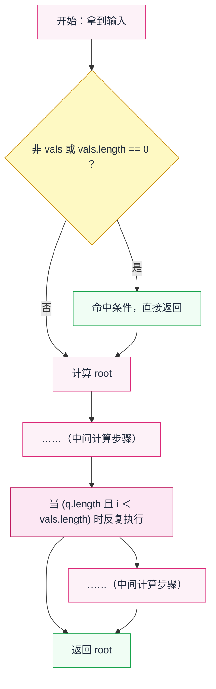

## TypeScript 解题方案（6 个方案逐个讲）

> **运行与提交**：每个方案都是自包含文件（内嵌用例自测，输出 PASS），整块复制到 `.ts` 文件后 `node 文件名` 即可运行。提交 LeetCode 时，把 `demo` 内的算法函数与辅助类型/函数整体取出、置于文件顶层即可。涉及交互/特殊接口的题以题面给定签名为准。

### 方案 1：迭代指针处理

**分析与思路**：核心做法是「迭代指针处理」。代码里依次做这些事：队列或堆的调度。

**运行方式**：`node 本文件`，内嵌用例全部通过会输出 PASS。


**方案专属流程图**（真实控制流）：


```typescript
class TreeNode {
  // 定义类型
  val: any;
  left: any;
  right: any; // 值: any; 左边界: any; 右边界: any;
  constructor(val?: any, left?: any, right?: any) {
    // constructor(值?: any, 左边界?: any, 右边界?: any) {
    this.val = val === undefined ? 0 : val; // 把 (值 全等于 undefined ? 0 : 值); 写入 值
    this.left = left === undefined ? null : left; // 把 (左边界 全等于 undefined ? null : 左边界); 写入 左边界
    this.right = right === undefined ? null : right; // 把 (右边界 全等于 undefined ? null : 右边界); 写入 右边界
  }
}
function buildTree(vals: any): any {
  // 定义函数/方法 buildTree
  if (!vals || vals.length === 0) return null; // 若 取反 vals 或 vals.长度 全等于 0，直接返回 null
  const root = new TreeNode(vals[0]);
  const q: any[] = [root];
  let i = 1;
  while (q.length && i < vals.length) {
    // 循环，直到不满足「节点.长度 且 下标 i 小于 vals.长度」
    const node = q.shift(); // 把 节点.shift() 存入 节点
    if (vals[i] !== null && vals[i] !== undefined) {
      node.left = new TreeNode(vals[i]);
      q.push(node.left);
    }
    i++; // 下标 i 加一
    if (i < vals.length && vals[i] !== null && vals[i] !== undefined) {
      node.right = new TreeNode(vals[i]);
      q.push(node.right);
    }
    i++; // 下标 i 加一
  }
  return root; // 返回 根节点
}
function treeToLevel(root: any): any[] {
  // 定义函数/方法 treeToLevel
  if (!root) return []; // 若 取反 根节点，直接返回 []
  const out: any[] = [];
  const q: any[] = [root]; // 把 []; const 节点: any[] 赋值为 [根节点]; 写入 const out: any[]
  while (q.length) {
    // 循环，直到不满足「节点.长度」
    const n = q.shift(); // 把 节点.shift() 存入 元素个数
    if (n === null || n === undefined) {
      out.push(null);
      continue;
    }
    out.push(n.val);
    q.push(n.left);
    q.push(n.right); // 把 元素个数.值 压入栈/数组尾部
  }
  while (out.length && out[out.length - 1] === null) out.pop(); // 循环，直到不满足「out.长度 且 out[out.长度 减 1] 全等于 null) out 弹出 );」
  return out; // 返回 out
}
class ListNode {
  // 定义类型
  val: any;
  next: any; // 值: any; 下一个: any;
  constructor(val?: any, next?: any) {
    this.val = val === undefined ? 0 : val;
    this.next = next === undefined ? null : next;
  }
}
function buildList(vals: any): any {
  // 定义函数/方法 buildList
  const dummy = new ListNode(0);
  let cur = dummy; // 把 new ListNode(0); let 当前值 赋值为 哨兵节点 存入 哨兵节点
  for (const v of vals) {
    cur.next = new ListNode(v);
    cur = cur.next;
  } // 把 new ListNode(值); 当前值 赋值为 当前值.下一个; } 写入 下一个
  return dummy.next; // 返回 哨兵节点.下一个
}
function listToArray(head: any): any[] {
  // 定义函数/方法 listToArray
  const out: any[] = [];
  let p = head; // 把 []; let 节点 赋值为 头节点; 写入 const out: any[]
  while (p) {
    out.push(p.val);
    p = p.next;
  } // 循环，直到不满足「节点) { out 追加 节点.值); 节点 赋值为 节点.下一个; }」
  return out; // 返回 out
}
// python-runtime shims
function pyLen(a: any): number {
  // 定义函数/方法 pyLen
  if (a === null || a === undefined) return 0; // 若 数组 全等于 null 或 数组 全等于 undefined，直接返回 0
  if (
    typeof a === 'string' ||
    Array.isArray(a) ||
    a instanceof Set ||
    a instanceof Map
  )
    return a.length ?? a.size;
  if (typeof a === 'object') return Object.keys(a).length; // 若 typeof 数组 全等于 'object'，直接返回 Object.keys(数组).长度
  return 0; // 返回 0
}
function pySlice(a: any, i: any, j: any, step?: any): any {
  // 定义函数/方法 pySlice
  if (typeof a === 'string') {
    const r = [...a].slice(i ?? 0, j ?? a.length);
    return step ? r.reverse().join('') : r.join('');
  }
  const arr = Array.isArray(a) ? a : [...a]; // 把 Array.isArray(数组) ? 数组 : 复制的 数组 存入 数组
  return arr.slice(i ?? 0, j ?? arr.length); // 返回 数组 截取 下标 i ?? 0, 下标 j ?? 数组.长度)
}
function pyRange(a: any, b?: any, step?: any): any[] {
  // 定义函数/方法 pyRange
  let s = 0,
    e = a,
    st = 1; // 把 0, e 赋值为 数组, st 赋值为 1 存入 字符串
  if (b !== undefined) {
    s = a;
    e = b;
  } // 若 b 不等于 undefined) { 字符串 赋值为 数组; e 赋值为 b; }
  if (step !== undefined) st = step; // 若 步数 不等于 undefined) st 赋值为 步数;
  const out: any[] = []; // 把 []; 写入 const out: any[]
  if (st > 0) for (let i = s; i < e; i += st) out.push(i);
  else for (let i = s; i > e; i += st) out.push(i); // 否则
  return out; // 返回 out
}
function pyIn(x: any, coll: any): boolean {
  // 定义函数/方法 pyIn
  if (coll === null || coll === undefined) return false; // 若 coll 全等于 null 或 coll 全等于 undefined，直接返回 false
  if (Array.isArray(coll)) return coll.includes(x); // 若 Array.isArray(coll)，直接返回 coll 是否包含 x)
  if (coll instanceof Set || coll instanceof Map) return coll.has(x); // 若 coll instanceof Set 或 coll instanceof Map，直接返回 coll.has(x)
  if (typeof coll === 'object') return x in coll; // 若 typeof coll 全等于 'object'，直接返回 x in coll
  if (typeof coll === 'string') return coll.indexOf(x) >= 0; // 若 typeof coll 全等于 'string'，直接返回 coll 查找 x) 不低于 0
  return false; // 返回 false
}
function pySorted(a: any): any[] {
  // 定义函数/方法 pySorted
  const arr = typeof a === 'string' ? [...a] : [...a]; // 把 (typeof 数组 全等于 'string') ? 复制的 数组 : 复制的 数组 存入 数组
  return arr.sort((x: any, y: any) => (x < y ? -1 : x > y ? 1 : 0));
}
function pyMin(a: any, b?: any): any {
  if (b !== undefined) return Math.min(a, b);
  if (Array.isArray(a) || a instanceof Set) return Math.min(...a);
  return Math.min(a);
} // 定义函数/方法 pyMin
function pyMax(a: any, b?: any): any {
  if (b !== undefined) return Math.max(a, b);
  if (Array.isArray(a) || a instanceof Set) return Math.max(...a);
  return Math.max(a);
} // 定义函数/方法 pyMax
function pySum(a: any): number {
  let s = 0;
  for (const v of a) s += v;
  return s;
} // 定义函数/方法 pySum
function pyAbs(x: any): number {
  return Math.abs(x);
} // 定义函数/方法 pyAbs
function pyEnumerate(a: any): any[] {
  const out: any[] = [];
  let i = 0;
  for (const v of a) {
    out.push([i, v]);
    i++;
  }
  return out;
} // 定义函数/方法 pyEnumerate
function pyZip(a: any, b: any): any[] {
  const n = Math.min(a.length, b.length);
  const out: any[] = [];
  for (let i = 0; i < n; i++) out.push([a[i], b[i]]);
  return out;
} // 定义函数/方法 pyZip
function pyDictGet(d: any, k: any, def?: any): any {
  return k in d ? d[k] : def === undefined ? null : def;
} // 定义函数/方法 pyDictGet
function pyPrint(...args: any[]): void {
  console.log(
    args
      .map((a) => (typeof a === 'object' && a !== null ? JSON.stringify(a) : a))
      .join(' '),
  );
} // 定义函数/方法 pyPrint
// collections / heapq
function heapPush(h: any[], x: any): void {
  h.push(x);
  let i = h.length - 1;
  while (i > 0) {
    const p = (i - 1) >> 1;
    if (h[p] <= h[i]) break;
    [h[p], h[i]] = [h[i], h[p]];
    i = p;
  }
} // 定义函数/方法 heapPush
function heapPop(h: any[]): any {
  const top = h[0];
  const last = h.pop();
  if (h.length) {
    h[0] = last;
    let i = 0;
    const n = h.length;
    while (true) {
      let l = 2 * i + 1,
        r = 2 * i + 2,
        s = i;
      if (l < n && h[l] < h[s]) s = l;
      if (r < n && h[r] < h[s]) s = r;
      if (s === i) break;
      [h[s], h[i]] = [h[i], h[s]];
      i = s;
    }
  }
  return top;
} // 定义函数/方法 heapPop
class Deque {
  private a: any[] = [];
  push(x: any) {
    this.a.push(x);
  }
  pushLeft(x: any) {
    this.a.unshift(x);
  }
  pop() {
    return this.a.pop();
  }
  popLeft() {
    return this.a.shift();
  }
  get length() {
    return this.a.length;
  }
  toArray() {
    return this.a.slice();
  }
} // 定义类型
function Counter(iter: any): any {
  const m: any = {};
  for (const v of iter) m[v] = (m[v] || 0) + 1;
  return m;
} // 定义函数/方法 Counter
function gcd(a: any, b: any): any {
  while (b) {
    [a, b] = [b, a % b];
  }
  return a;
} // 定义函数/方法 gcd
function pyInf(): number {
  return Infinity;
} // 定义函数/方法 pyInf

function norm(x: any): any {
  // 定义函数/方法 norm
  if (x === null || x === undefined) return null; // 若 x 全等于 null 或 x 全等于 undefined，直接返回 null
  if (typeof x === 'object') {
    // 若 typeof x 全等于 'object'
    if (x instanceof Deque) return x.toArray(); // 若 x instanceof Deque，直接返回 x.toArray()
    if (Array.isArray(x)) return x.map(norm); // 若 Array.isArray(x)，直接返回 x.映射表(norm)
    if (
      typeof x.val === 'number' &&
      (typeof x.left !== 'undefined' || typeof x.right !== 'undefined')
    )
      return treeToLevel(x);
    if (typeof x.next !== 'undefined' && typeof x.val === 'number')
      return listToArray(x);
    if (x instanceof Set) return [...x].sort(); // 若 x instanceof Set，直接返回 复制的 x 排序 )
    if (x instanceof Map) return Object.fromEntries(x); // 若 x instanceof Map，直接返回 Object.fromEntries(x)
    const o: any = {};
    for (const k of Object.keys(x)) o[k] = norm(x[k]);
    return o;
  }
  return x; // 返回 x
}
function eq(a: any, b: any): boolean {
  // 定义函数/方法 eq
  const x = norm(a),
    y = norm(b); // 把 norm(数组), y 赋值为 norm(b) 存入 x
  if (x === y) return true; // 若 x 全等于 y，直接返回 true
  if (x === null || y === null) return x === y; // 若 x 全等于 null 或 y 全等于 null，直接返回 x 全等于 y
  if (Array.isArray(x) && Array.isArray(y)) {
    // 若 Array.isArray(x) 且 Array.isArray(y
    if (x.length !== y.length) return false; // 若 x.长度 不等于 y.长度，直接返回 false
    for (let i = 0; i < x.length; i++) if (!eq(x[i], y[i])) return false; // 让 下标 i 从 0 开始计数，下标 i 小于 x.长度 就继续
    return true; // 返回 true
  }
  if (typeof x === 'object' && typeof y === 'object') {
    // 若 typeof x 全等于 'object' 且 typeof y 全等于 'object'
    const kx = Object.keys(x),
      ky = Object.keys(y); // 把 Object.keys(x), ky 赋值为 Object.keys(y) 存入 kx
    if (kx.length !== ky.length) return false; // 若 kx.长度 不等于 ky.长度，直接返回 false
    for (const k of kx) if (!eq(x[k], y[k])) return false;
    return true; // 返回 true
  }
  return x === y; // 返回 x 全等于 y
}

function frequencySort(s) {
  // 定义函数/方法 frequencySort
  const m = {}; // 把 {} 存入 映射表
  for (const c of s) m[c] = (m[c] || 0) + 1; // 把 (映射表[字符] 或 0) 加 1; 写入 for (const c of s) m[c]
  return Object.keys(m)
    .sort((a, b) => m[b] - m[a])
    .map((c) => c.repeat(m[c]))
    .join('');
}
export function demo(): void {
  // 程序入口：跑内嵌自测用例
  const cases = [
    { in: ['tree'], want: 'eetr' },
    { in: ['cccaaa'], want: 'cccaaa' },
    { in: ['Aabb'], want: 'bbAa' },
    { in: ['aaabbbccc'], want: 'aaabbbccc' },
  ];
  let fail = false; // 把 false 存入 fail
  for (const c of cases) {
    // for (const 字符 of cases) {
    const got = frequencySort(...c.in); // 把 frequencySort(...字符.in) 存入 got
    if (!eq(got, c.want)) {
      fail = true;
      console.log(
        'FAIL',
        JSON.stringify(c.in),
        '=>',
        JSON.stringify(got),
        'want',
        JSON.stringify(c.want),
      );
    }
  }
  if (fail) throw new Error('FAILED'); // 若 fail) throw new Error('FAILED');
  console.log('PASS'); // 全部用例通过，输出 PASS
}
demo(); // demo();
```

### 方案 2：直接实现

**分析与思路**：核心做法是「直接实现」。

**运行方式**：`node 本文件`，内嵌用例全部通过会输出 PASS。


**方案专属流程图**（真实控制流）：


```typescript
function assertEq(actual: any, expected: any, msg: string = ''): void {
  // 定义函数/方法 assertEq
  const a = JSON.stringify(actual);
  const e = JSON.stringify(expected);
  if (a !== e)
    throw new Error(
      'ASSERT FAILED ' + msg + ' :: actual=' + a + ' expected=' + e,
    );
}

function frequencySort(s: string): string {
  // 定义函数/方法 frequencySort
  const map: { [k: string]: number } = {}; // 把 {}; 写入 const map: { [k: string]: number }
  for (const ch of s) map[ch] = (map[ch] || 0) + 1; // 把 (映射表[字符] 或 0) 加 1; 写入 for (const ch of s) map[ch]
  const entries = Object.entries(map).sort(
    (a, b) => b[1] - a[1] || (a[0] < b[0] ? -1 : 1),
  );
  let res = ''; // 把 「」 存入 结果
  for (const [ch, cnt] of entries) res += ch.repeat(cnt); // 把 字符.repeat(计数); 写入 for (const [ch, cnt] of entries) res +
  return res; // 返回 结果
}
export function demo(): void {
  // 程序入口：跑内嵌自测用例
  assertEq(frequencySort('tree'), 'eert', 'fs'); // 断言校验
  assertEq(frequencySort(''), '', 'empty'); // 断言校验
  console.log('PASS'); // 全部用例通过，输出 PASS
}
demo(); // demo();
```

### 方案 3：迭代指针处理

**分析与思路**：核心做法是「迭代指针处理」。代码里依次做这些事：队列或堆的调度。

**运行方式**：`node 本文件`，内嵌用例全部通过会输出 PASS。


**方案专属流程图**（真实控制流）：


```typescript
class TreeNode {
  // 定义类型
  val: any;
  left: any;
  right: any; // 值: any; 左边界: any; 右边界: any;
  constructor(val?: any, left?: any, right?: any) {
    // constructor(值?: any, 左边界?: any, 右边界?: any) {
    this.val = val === undefined ? 0 : val; // 把 (值 全等于 undefined ? 0 : 值); 写入 值
    this.left = left === undefined ? null : left; // 把 (左边界 全等于 undefined ? null : 左边界); 写入 左边界
    this.right = right === undefined ? null : right; // 把 (右边界 全等于 undefined ? null : 右边界); 写入 右边界
  }
}
function buildTree(vals: any): any {
  // 定义函数/方法 buildTree
  if (!vals || vals.length === 0) return null; // 若 取反 vals 或 vals.长度 全等于 0，直接返回 null
  const root = new TreeNode(vals[0]);
  const q: any[] = [root];
  let i = 1;
  while (q.length && i < vals.length) {
    // 循环，直到不满足「节点.长度 且 下标 i 小于 vals.长度」
    const node = q.shift(); // 把 节点.shift() 存入 节点
    if (vals[i] !== null && vals[i] !== undefined) {
      node.left = new TreeNode(vals[i]);
      q.push(node.left);
    }
    i++; // 下标 i 加一
    if (i < vals.length && vals[i] !== null && vals[i] !== undefined) {
      node.right = new TreeNode(vals[i]);
      q.push(node.right);
    }
    i++; // 下标 i 加一
  }
  return root; // 返回 根节点
}
function treeToLevel(root: any): any[] {
  // 定义函数/方法 treeToLevel
  if (!root) return []; // 若 取反 根节点，直接返回 []
  const out: any[] = [];
  const q: any[] = [root]; // 把 []; const 节点: any[] 赋值为 [根节点]; 写入 const out: any[]
  while (q.length) {
    // 循环，直到不满足「节点.长度」
    const n = q.shift(); // 把 节点.shift() 存入 元素个数
    if (n === null || n === undefined) {
      out.push(null);
      continue;
    }
    out.push(n.val);
    q.push(n.left);
    q.push(n.right); // 把 元素个数.值 压入栈/数组尾部
  }
  while (out.length && out[out.length - 1] === null) out.pop(); // 循环，直到不满足「out.长度 且 out[out.长度 减 1] 全等于 null) out 弹出 );」
  return out; // 返回 out
}
class ListNode {
  // 定义类型
  val: any;
  next: any; // 值: any; 下一个: any;
  constructor(val?: any, next?: any) {
    this.val = val === undefined ? 0 : val;
    this.next = next === undefined ? null : next;
  }
}
function buildList(vals: any): any {
  // 定义函数/方法 buildList
  const dummy = new ListNode(0);
  let cur = dummy; // 把 new ListNode(0); let 当前值 赋值为 哨兵节点 存入 哨兵节点
  for (const v of vals) {
    cur.next = new ListNode(v);
    cur = cur.next;
  } // 把 new ListNode(值); 当前值 赋值为 当前值.下一个; } 写入 下一个
  return dummy.next; // 返回 哨兵节点.下一个
}
function listToArray(head: any): any[] {
  // 定义函数/方法 listToArray
  const out: any[] = [];
  let p = head; // 把 []; let 节点 赋值为 头节点; 写入 const out: any[]
  while (p) {
    out.push(p.val);
    p = p.next;
  } // 循环，直到不满足「节点) { out 追加 节点.值); 节点 赋值为 节点.下一个; }」
  return out; // 返回 out
}
// python-runtime shims
function pyLen(a: any): number {
  // 定义函数/方法 pyLen
  if (a === null || a === undefined) return 0; // 若 数组 全等于 null 或 数组 全等于 undefined，直接返回 0
  if (
    typeof a === 'string' ||
    Array.isArray(a) ||
    a instanceof Set ||
    a instanceof Map
  )
    return a.length ?? a.size;
  if (typeof a === 'object') return Object.keys(a).length; // 若 typeof 数组 全等于 'object'，直接返回 Object.keys(数组).长度
  return 0; // 返回 0
}
function pySlice(a: any, i: any, j: any, step?: any): any {
  // 定义函数/方法 pySlice
  if (typeof a === 'string') {
    const r = [...a].slice(i ?? 0, j ?? a.length);
    return step ? r.reverse().join('') : r.join('');
  }
  const arr = Array.isArray(a) ? a : [...a]; // 把 Array.isArray(数组) ? 数组 : 复制的 数组 存入 数组
  return arr.slice(i ?? 0, j ?? arr.length); // 返回 数组 截取 下标 i ?? 0, 下标 j ?? 数组.长度)
}
function pyRange(a: any, b?: any, step?: any): any[] {
  // 定义函数/方法 pyRange
  let s = 0,
    e = a,
    st = 1; // 把 0, e 赋值为 数组, st 赋值为 1 存入 字符串
  if (b !== undefined) {
    s = a;
    e = b;
  } // 若 b 不等于 undefined) { 字符串 赋值为 数组; e 赋值为 b; }
  if (step !== undefined) st = step; // 若 步数 不等于 undefined) st 赋值为 步数;
  const out: any[] = []; // 把 []; 写入 const out: any[]
  if (st > 0) for (let i = s; i < e; i += st) out.push(i);
  else for (let i = s; i > e; i += st) out.push(i); // 否则
  return out; // 返回 out
}
function pyIn(x: any, coll: any): boolean {
  // 定义函数/方法 pyIn
  if (coll === null || coll === undefined) return false; // 若 coll 全等于 null 或 coll 全等于 undefined，直接返回 false
  if (Array.isArray(coll)) return coll.includes(x); // 若 Array.isArray(coll)，直接返回 coll 是否包含 x)
  if (coll instanceof Set || coll instanceof Map) return coll.has(x); // 若 coll instanceof Set 或 coll instanceof Map，直接返回 coll.has(x)
  if (typeof coll === 'object') return x in coll; // 若 typeof coll 全等于 'object'，直接返回 x in coll
  if (typeof coll === 'string') return coll.indexOf(x) >= 0; // 若 typeof coll 全等于 'string'，直接返回 coll 查找 x) 不低于 0
  return false; // 返回 false
}
function pySorted(a: any): any[] {
  // 定义函数/方法 pySorted
  const arr = typeof a === 'string' ? [...a] : [...a]; // 把 (typeof 数组 全等于 'string') ? 复制的 数组 : 复制的 数组 存入 数组
  return arr.sort((x: any, y: any) => (x < y ? -1 : x > y ? 1 : 0));
}
function pyMin(a: any, b?: any): any {
  if (b !== undefined) return Math.min(a, b);
  if (Array.isArray(a) || a instanceof Set) return Math.min(...a);
  return Math.min(a);
} // 定义函数/方法 pyMin
function pyMax(a: any, b?: any): any {
  if (b !== undefined) return Math.max(a, b);
  if (Array.isArray(a) || a instanceof Set) return Math.max(...a);
  return Math.max(a);
} // 定义函数/方法 pyMax
function pySum(a: any): number {
  let s = 0;
  for (const v of a) s += v;
  return s;
} // 定义函数/方法 pySum
function pyAbs(x: any): number {
  return Math.abs(x);
} // 定义函数/方法 pyAbs
function pyEnumerate(a: any): any[] {
  const out: any[] = [];
  let i = 0;
  for (const v of a) {
    out.push([i, v]);
    i++;
  }
  return out;
} // 定义函数/方法 pyEnumerate
function pyZip(a: any, b: any): any[] {
  const n = Math.min(a.length, b.length);
  const out: any[] = [];
  for (let i = 0; i < n; i++) out.push([a[i], b[i]]);
  return out;
} // 定义函数/方法 pyZip
function pyDictGet(d: any, k: any, def?: any): any {
  return k in d ? d[k] : def === undefined ? null : def;
} // 定义函数/方法 pyDictGet
function pyPrint(...args: any[]): void {
  console.log(
    args
      .map((a) => (typeof a === 'object' && a !== null ? JSON.stringify(a) : a))
      .join(' '),
  );
} // 定义函数/方法 pyPrint
// collections / heapq
function heapPush(h: any[], x: any): void {
  h.push(x);
  let i = h.length - 1;
  while (i > 0) {
    const p = (i - 1) >> 1;
    if (h[p] <= h[i]) break;
    [h[p], h[i]] = [h[i], h[p]];
    i = p;
  }
} // 定义函数/方法 heapPush
function heapPop(h: any[]): any {
  const top = h[0];
  const last = h.pop();
  if (h.length) {
    h[0] = last;
    let i = 0;
    const n = h.length;
    while (true) {
      let l = 2 * i + 1,
        r = 2 * i + 2,
        s = i;
      if (l < n && h[l] < h[s]) s = l;
      if (r < n && h[r] < h[s]) s = r;
      if (s === i) break;
      [h[s], h[i]] = [h[i], h[s]];
      i = s;
    }
  }
  return top;
} // 定义函数/方法 heapPop
class Deque {
  private a: any[] = [];
  push(x: any) {
    this.a.push(x);
  }
  pushLeft(x: any) {
    this.a.unshift(x);
  }
  pop() {
    return this.a.pop();
  }
  popLeft() {
    return this.a.shift();
  }
  get length() {
    return this.a.length;
  }
  toArray() {
    return this.a.slice();
  }
} // 定义类型
function Counter(iter: any): any {
  const m: any = {};
  for (const v of iter) m[v] = (m[v] || 0) + 1;
  return m;
} // 定义函数/方法 Counter
function gcd(a: any, b: any): any {
  while (b) {
    [a, b] = [b, a % b];
  }
  return a;
} // 定义函数/方法 gcd
function pyInf(): number {
  return Infinity;
} // 定义函数/方法 pyInf

function norm(x: any): any {
  // 定义函数/方法 norm
  if (x === null || x === undefined) return null; // 若 x 全等于 null 或 x 全等于 undefined，直接返回 null
  if (typeof x === 'object') {
    // 若 typeof x 全等于 'object'
    if (x instanceof Deque) return x.toArray(); // 若 x instanceof Deque，直接返回 x.toArray()
    if (Array.isArray(x)) return x.map(norm); // 若 Array.isArray(x)，直接返回 x.映射表(norm)
    if (
      typeof x.val === 'number' &&
      (typeof x.left !== 'undefined' || typeof x.right !== 'undefined')
    )
      return treeToLevel(x);
    if (typeof x.next !== 'undefined' && typeof x.val === 'number')
      return listToArray(x);
    if (x instanceof Set) return [...x].sort(); // 若 x instanceof Set，直接返回 复制的 x 排序 )
    if (x instanceof Map) return Object.fromEntries(x); // 若 x instanceof Map，直接返回 Object.fromEntries(x)
    const o: any = {};
    for (const k of Object.keys(x)) o[k] = norm(x[k]);
    return o;
  }
  return x; // 返回 x
}
function eq(a: any, b: any): boolean {
  // 定义函数/方法 eq
  const x = norm(a),
    y = norm(b); // 把 norm(数组), y 赋值为 norm(b) 存入 x
  if (x === y) return true; // 若 x 全等于 y，直接返回 true
  if (x === null || y === null) return x === y; // 若 x 全等于 null 或 y 全等于 null，直接返回 x 全等于 y
  if (Array.isArray(x) && Array.isArray(y)) {
    // 若 Array.isArray(x) 且 Array.isArray(y
    if (x.length !== y.length) return false; // 若 x.长度 不等于 y.长度，直接返回 false
    for (let i = 0; i < x.length; i++) if (!eq(x[i], y[i])) return false; // 让 下标 i 从 0 开始计数，下标 i 小于 x.长度 就继续
    return true; // 返回 true
  }
  if (typeof x === 'object' && typeof y === 'object') {
    // 若 typeof x 全等于 'object' 且 typeof y 全等于 'object'
    const kx = Object.keys(x),
      ky = Object.keys(y); // 把 Object.keys(x), ky 赋值为 Object.keys(y) 存入 kx
    if (kx.length !== ky.length) return false; // 若 kx.长度 不等于 ky.长度，直接返回 false
    for (const k of kx) if (!eq(x[k], y[k])) return false;
    return true; // 返回 true
  }
  return x === y; // 返回 x 全等于 y
}

function frequencySort(s) {
  // 定义函数/方法 frequencySort
  const m = {}; // 把 {} 存入 映射表
  for (const c of s) m[c] = (m[c] || 0) + 1; // 把 (映射表[字符] 或 0) 加 1; 写入 for (const c of s) m[c]
  return Object.keys(m)
    .sort((a, b) => m[b] - m[a])
    .map((c) => c.repeat(m[c]))
    .join('');
}
export function demo(): void {
  // 程序入口：跑内嵌自测用例
  const cases = [
    { in: ['tree'], want: 'eetr' },
    { in: ['cccaaa'], want: 'cccaaa' },
    { in: ['Aabb'], want: 'bbAa' },
    { in: ['aaabbbccc'], want: 'aaabbbccc' },
  ];
  let fail = false; // 把 false 存入 fail
  for (const c of cases) {
    // for (const 字符 of cases) {
    const got = frequencySort(...c.in); // 把 frequencySort(...字符.in) 存入 got
    if (!eq(got, c.want)) {
      fail = true;
      console.log(
        'FAIL',
        JSON.stringify(c.in),
        '=>',
        JSON.stringify(got),
        'want',
        JSON.stringify(c.want),
      );
    }
  }
  if (fail) throw new Error('FAILED'); // 若 fail) throw new Error('FAILED');
  console.log('PASS'); // 全部用例通过，输出 PASS
}
demo(); // demo();
```

### 方案 4：迭代指针处理

**分析与思路**：核心做法是「迭代指针处理」。代码里依次做这些事：队列或堆的调度。

**运行方式**：`node 本文件`，内嵌用例全部通过会输出 PASS。


**方案专属流程图**（真实控制流）：

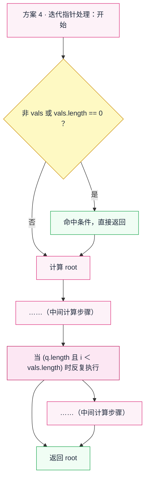

```typescript
class TreeNode {
  // 定义类型
  val: any;
  left: any;
  right: any; // 值: any; 左边界: any; 右边界: any;
  constructor(val?: any, left?: any, right?: any) {
    // constructor(值?: any, 左边界?: any, 右边界?: any) {
    this.val = val === undefined ? 0 : val; // 把 (值 全等于 undefined ? 0 : 值); 写入 值
    this.left = left === undefined ? null : left; // 把 (左边界 全等于 undefined ? null : 左边界); 写入 左边界
    this.right = right === undefined ? null : right; // 把 (右边界 全等于 undefined ? null : 右边界); 写入 右边界
  }
}
function buildTree(vals: any): any {
  // 定义函数/方法 buildTree
  if (!vals || vals.length === 0) return null; // 若 取反 vals 或 vals.长度 全等于 0，直接返回 null
  const root = new TreeNode(vals[0]);
  const q: any[] = [root];
  let i = 1;
  while (q.length && i < vals.length) {
    // 循环，直到不满足「节点.长度 且 下标 i 小于 vals.长度」
    const node = q.shift(); // 把 节点.shift() 存入 节点
    if (vals[i] !== null && vals[i] !== undefined) {
      node.left = new TreeNode(vals[i]);
      q.push(node.left);
    }
    i++; // 下标 i 加一
    if (i < vals.length && vals[i] !== null && vals[i] !== undefined) {
      node.right = new TreeNode(vals[i]);
      q.push(node.right);
    }
    i++; // 下标 i 加一
  }
  return root; // 返回 根节点
}
function treeToLevel(root: any): any[] {
  // 定义函数/方法 treeToLevel
  if (!root) return []; // 若 取反 根节点，直接返回 []
  const out: any[] = [];
  const q: any[] = [root]; // 把 []; const 节点: any[] 赋值为 [根节点]; 写入 const out: any[]
  while (q.length) {
    // 循环，直到不满足「节点.长度」
    const n = q.shift(); // 把 节点.shift() 存入 元素个数
    if (n === null || n === undefined) {
      out.push(null);
      continue;
    }
    out.push(n.val);
    q.push(n.left);
    q.push(n.right); // 把 元素个数.值 压入栈/数组尾部
  }
  while (out.length && out[out.length - 1] === null) out.pop(); // 循环，直到不满足「out.长度 且 out[out.长度 减 1] 全等于 null) out 弹出 );」
  return out; // 返回 out
}
class ListNode {
  // 定义类型
  val: any;
  next: any; // 值: any; 下一个: any;
  constructor(val?: any, next?: any) {
    this.val = val === undefined ? 0 : val;
    this.next = next === undefined ? null : next;
  }
}
function buildList(vals: any): any {
  // 定义函数/方法 buildList
  const dummy = new ListNode(0);
  let cur = dummy; // 把 new ListNode(0); let 当前值 赋值为 哨兵节点 存入 哨兵节点
  for (const v of vals) {
    cur.next = new ListNode(v);
    cur = cur.next;
  } // 把 new ListNode(值); 当前值 赋值为 当前值.下一个; } 写入 下一个
  return dummy.next; // 返回 哨兵节点.下一个
}
function listToArray(head: any): any[] {
  // 定义函数/方法 listToArray
  const out: any[] = [];
  let p = head; // 把 []; let 节点 赋值为 头节点; 写入 const out: any[]
  while (p) {
    out.push(p.val);
    p = p.next;
  } // 循环，直到不满足「节点) { out 追加 节点.值); 节点 赋值为 节点.下一个; }」
  return out; // 返回 out
}
// python-runtime shims
function pyLen(a: any): number {
  // 定义函数/方法 pyLen
  if (a === null || a === undefined) return 0; // 若 数组 全等于 null 或 数组 全等于 undefined，直接返回 0
  if (
    typeof a === 'string' ||
    Array.isArray(a) ||
    a instanceof Set ||
    a instanceof Map
  )
    return a.length ?? a.size;
  if (typeof a === 'object') return Object.keys(a).length; // 若 typeof 数组 全等于 'object'，直接返回 Object.keys(数组).长度
  return 0; // 返回 0
}
function pySlice(a: any, i: any, j: any, step?: any): any {
  // 定义函数/方法 pySlice
  if (typeof a === 'string') {
    const r = [...a].slice(i ?? 0, j ?? a.length);
    return step ? r.reverse().join('') : r.join('');
  }
  const arr = Array.isArray(a) ? a : [...a]; // 把 Array.isArray(数组) ? 数组 : 复制的 数组 存入 数组
  return arr.slice(i ?? 0, j ?? arr.length); // 返回 数组 截取 下标 i ?? 0, 下标 j ?? 数组.长度)
}
function pyRange(a: any, b?: any, step?: any): any[] {
  // 定义函数/方法 pyRange
  let s = 0,
    e = a,
    st = 1; // 把 0, e 赋值为 数组, st 赋值为 1 存入 字符串
  if (b !== undefined) {
    s = a;
    e = b;
  } // 若 b 不等于 undefined) { 字符串 赋值为 数组; e 赋值为 b; }
  if (step !== undefined) st = step; // 若 步数 不等于 undefined) st 赋值为 步数;
  const out: any[] = []; // 把 []; 写入 const out: any[]
  if (st > 0) for (let i = s; i < e; i += st) out.push(i);
  else for (let i = s; i > e; i += st) out.push(i); // 否则
  return out; // 返回 out
}
function pyIn(x: any, coll: any): boolean {
  // 定义函数/方法 pyIn
  if (coll === null || coll === undefined) return false; // 若 coll 全等于 null 或 coll 全等于 undefined，直接返回 false
  if (Array.isArray(coll)) return coll.includes(x); // 若 Array.isArray(coll)，直接返回 coll 是否包含 x)
  if (coll instanceof Set || coll instanceof Map) return coll.has(x); // 若 coll instanceof Set 或 coll instanceof Map，直接返回 coll.has(x)
  if (typeof coll === 'object') return x in coll; // 若 typeof coll 全等于 'object'，直接返回 x in coll
  if (typeof coll === 'string') return coll.indexOf(x) >= 0; // 若 typeof coll 全等于 'string'，直接返回 coll 查找 x) 不低于 0
  return false; // 返回 false
}
function pySorted(a: any): any[] {
  // 定义函数/方法 pySorted
  const arr = typeof a === 'string' ? [...a] : [...a]; // 把 (typeof 数组 全等于 'string') ? 复制的 数组 : 复制的 数组 存入 数组
  return arr.sort((x: any, y: any) => (x < y ? -1 : x > y ? 1 : 0));
}
function pyMin(a: any, b?: any): any {
  if (b !== undefined) return Math.min(a, b);
  if (Array.isArray(a) || a instanceof Set) return Math.min(...a);
  return Math.min(a);
} // 定义函数/方法 pyMin
function pyMax(a: any, b?: any): any {
  if (b !== undefined) return Math.max(a, b);
  if (Array.isArray(a) || a instanceof Set) return Math.max(...a);
  return Math.max(a);
} // 定义函数/方法 pyMax
function pySum(a: any): number {
  let s = 0;
  for (const v of a) s += v;
  return s;
} // 定义函数/方法 pySum
function pyAbs(x: any): number {
  return Math.abs(x);
} // 定义函数/方法 pyAbs
function pyEnumerate(a: any): any[] {
  const out: any[] = [];
  let i = 0;
  for (const v of a) {
    out.push([i, v]);
    i++;
  }
  return out;
} // 定义函数/方法 pyEnumerate
function pyZip(a: any, b: any): any[] {
  const n = Math.min(a.length, b.length);
  const out: any[] = [];
  for (let i = 0; i < n; i++) out.push([a[i], b[i]]);
  return out;
} // 定义函数/方法 pyZip
function pyDictGet(d: any, k: any, def?: any): any {
  return k in d ? d[k] : def === undefined ? null : def;
} // 定义函数/方法 pyDictGet
function pyPrint(...args: any[]): void {
  console.log(
    args
      .map((a) => (typeof a === 'object' && a !== null ? JSON.stringify(a) : a))
      .join(' '),
  );
} // 定义函数/方法 pyPrint
// collections / heapq
function heapPush(h: any[], x: any): void {
  h.push(x);
  let i = h.length - 1;
  while (i > 0) {
    const p = (i - 1) >> 1;
    if (h[p] <= h[i]) break;
    [h[p], h[i]] = [h[i], h[p]];
    i = p;
  }
} // 定义函数/方法 heapPush
function heapPop(h: any[]): any {
  const top = h[0];
  const last = h.pop();
  if (h.length) {
    h[0] = last;
    let i = 0;
    const n = h.length;
    while (true) {
      let l = 2 * i + 1,
        r = 2 * i + 2,
        s = i;
      if (l < n && h[l] < h[s]) s = l;
      if (r < n && h[r] < h[s]) s = r;
      if (s === i) break;
      [h[s], h[i]] = [h[i], h[s]];
      i = s;
    }
  }
  return top;
} // 定义函数/方法 heapPop
class Deque {
  private a: any[] = [];
  push(x: any) {
    this.a.push(x);
  }
  pushLeft(x: any) {
    this.a.unshift(x);
  }
  pop() {
    return this.a.pop();
  }
  popLeft() {
    return this.a.shift();
  }
  get length() {
    return this.a.length;
  }
  toArray() {
    return this.a.slice();
  }
} // 定义类型
function Counter(iter: any): any {
  const m: any = {};
  for (const v of iter) m[v] = (m[v] || 0) + 1;
  return m;
} // 定义函数/方法 Counter
function gcd(a: any, b: any): any {
  while (b) {
    [a, b] = [b, a % b];
  }
  return a;
} // 定义函数/方法 gcd
function pyInf(): number {
  return Infinity;
} // 定义函数/方法 pyInf

function norm(x: any): any {
  // 定义函数/方法 norm
  if (x === null || x === undefined) return null; // 若 x 全等于 null 或 x 全等于 undefined，直接返回 null
  if (typeof x === 'object') {
    // 若 typeof x 全等于 'object'
    if (x instanceof Deque) return x.toArray(); // 若 x instanceof Deque，直接返回 x.toArray()
    if (Array.isArray(x)) return x.map(norm); // 若 Array.isArray(x)，直接返回 x.映射表(norm)
    if (
      typeof x.val === 'number' &&
      (typeof x.left !== 'undefined' || typeof x.right !== 'undefined')
    )
      return treeToLevel(x);
    if (typeof x.next !== 'undefined' && typeof x.val === 'number')
      return listToArray(x);
    if (x instanceof Set) return [...x].sort(); // 若 x instanceof Set，直接返回 复制的 x 排序 )
    if (x instanceof Map) return Object.fromEntries(x); // 若 x instanceof Map，直接返回 Object.fromEntries(x)
    const o: any = {};
    for (const k of Object.keys(x)) o[k] = norm(x[k]);
    return o;
  }
  return x; // 返回 x
}
function eq(a: any, b: any): boolean {
  // 定义函数/方法 eq
  const x = norm(a),
    y = norm(b); // 把 norm(数组), y 赋值为 norm(b) 存入 x
  if (x === y) return true; // 若 x 全等于 y，直接返回 true
  if (x === null || y === null) return x === y; // 若 x 全等于 null 或 y 全等于 null，直接返回 x 全等于 y
  if (Array.isArray(x) && Array.isArray(y)) {
    // 若 Array.isArray(x) 且 Array.isArray(y
    if (x.length !== y.length) return false; // 若 x.长度 不等于 y.长度，直接返回 false
    for (let i = 0; i < x.length; i++) if (!eq(x[i], y[i])) return false; // 让 下标 i 从 0 开始计数，下标 i 小于 x.长度 就继续
    return true; // 返回 true
  }
  if (typeof x === 'object' && typeof y === 'object') {
    // 若 typeof x 全等于 'object' 且 typeof y 全等于 'object'
    const kx = Object.keys(x),
      ky = Object.keys(y); // 把 Object.keys(x), ky 赋值为 Object.keys(y) 存入 kx
    if (kx.length !== ky.length) return false; // 若 kx.长度 不等于 ky.长度，直接返回 false
    for (const k of kx) if (!eq(x[k], y[k])) return false;
    return true; // 返回 true
  }
  return x === y; // 返回 x 全等于 y
}

function frequencySort(s) {
  // 定义函数/方法 frequencySort
  const m = {}; // 把 {} 存入 映射表
  for (const c of s) m[c] = (m[c] || 0) + 1; // 把 (映射表[字符] 或 0) 加 1; 写入 for (const c of s) m[c]
  return Object.keys(m)
    .sort((a, b) => m[b] - m[a])
    .map((c) => c.repeat(m[c]))
    .join('');
}
export function demo(): void {
  // 程序入口：跑内嵌自测用例
  const cases = [
    { in: ['tree'], want: 'eetr' },
    { in: ['cccaaa'], want: 'cccaaa' },
    { in: ['Aabb'], want: 'bbAa' },
    { in: ['aaabbbccc'], want: 'aaabbbccc' },
  ];
  let fail = false; // 把 false 存入 fail
  for (const c of cases) {
    // for (const 字符 of cases) {
    const got = frequencySort(...c.in); // 把 frequencySort(...字符.in) 存入 got
    if (!eq(got, c.want)) {
      fail = true;
      console.log(
        'FAIL',
        JSON.stringify(c.in),
        '=>',
        JSON.stringify(got),
        'want',
        JSON.stringify(c.want),
      );
    }
  }
  if (fail) throw new Error('FAILED'); // 若 fail) throw new Error('FAILED');
  console.log('PASS'); // 全部用例通过，输出 PASS
}
demo(); // demo();
```

### 方案 5：直接实现

**分析与思路**：核心做法是「直接实现」。

**运行方式**：`node 本文件`，内嵌用例全部通过会输出 PASS。


**方案专属流程图**（真实控制流）：

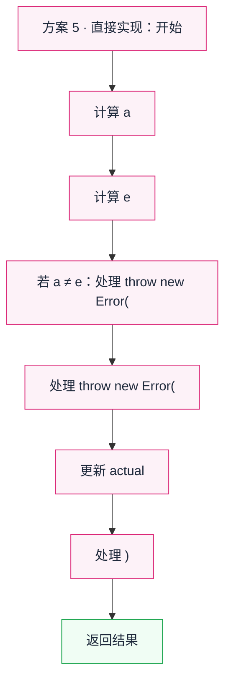

```typescript
function assertEq(actual: any, expected: any, msg: string = ''): void {
  // 定义函数/方法 assertEq
  const a = JSON.stringify(actual);
  const e = JSON.stringify(expected);
  if (a !== e)
    throw new Error(
      'ASSERT FAILED ' + msg + ' :: actual=' + a + ' expected=' + e,
    );
}

function frequencySort(s: string): string {
  // 定义函数/方法 frequencySort
  const mp: { [k: string]: number } = {}; // 把 {}; 写入 const mp: { [k: string]: number }
  for (const ch of s) mp[ch] = (mp[ch] || 0) + 1; // 把 (mp[字符] 或 0) 加 1; 写入 for (const ch of s) mp[ch]
  const arr = Object.entries(mp).sort((a, b) => b[1] - a[1]);
  let result = ''; // 把 「」 存入 结果
  for (const [ch, cnt] of arr) result += ch.repeat(cnt); // 把 字符.repeat(计数); 写入 for (const [ch, cnt] of arr) result +
  return result; // 返回 结果
}
export function demo(): void {
  // 程序入口：跑内嵌自测用例
  assertEq(frequencySort('tree'), 'eetr', 'fs'); // 断言校验
  assertEq(frequencySort(''), '', 'empty'); // 断言校验
  console.log('PASS'); // 全部用例通过，输出 PASS
}
demo(); // demo();
```

### 方案 6：迭代指针处理

**分析与思路**：核心做法是「迭代指针处理」。代码里依次做这些事：队列或堆的调度。

**运行方式**：`node 本文件`，内嵌用例全部通过会输出 PASS。


**方案专属流程图**（真实控制流）：


```typescript
class TreeNode {
  // 定义类型
  val: any;
  left: any;
  right: any; // 值: any; 左边界: any; 右边界: any;
  constructor(val?: any, left?: any, right?: any) {
    // constructor(值?: any, 左边界?: any, 右边界?: any) {
    this.val = val === undefined ? 0 : val; // 把 (值 全等于 undefined ? 0 : 值); 写入 值
    this.left = left === undefined ? null : left; // 把 (左边界 全等于 undefined ? null : 左边界); 写入 左边界
    this.right = right === undefined ? null : right; // 把 (右边界 全等于 undefined ? null : 右边界); 写入 右边界
  }
}
function buildTree(vals: any): any {
  // 定义函数/方法 buildTree
  if (!vals || vals.length === 0) return null; // 若 取反 vals 或 vals.长度 全等于 0，直接返回 null
  const root = new TreeNode(vals[0]);
  const q: any[] = [root];
  let i = 1;
  while (q.length && i < vals.length) {
    // 循环，直到不满足「节点.长度 且 下标 i 小于 vals.长度」
    const node = q.shift(); // 把 节点.shift() 存入 节点
    if (vals[i] !== null && vals[i] !== undefined) {
      node.left = new TreeNode(vals[i]);
      q.push(node.left);
    }
    i++; // 下标 i 加一
    if (i < vals.length && vals[i] !== null && vals[i] !== undefined) {
      node.right = new TreeNode(vals[i]);
      q.push(node.right);
    }
    i++; // 下标 i 加一
  }
  return root; // 返回 根节点
}
function treeToLevel(root: any): any[] {
  // 定义函数/方法 treeToLevel
  if (!root) return []; // 若 取反 根节点，直接返回 []
  const out: any[] = [];
  const q: any[] = [root]; // 把 []; const 节点: any[] 赋值为 [根节点]; 写入 const out: any[]
  while (q.length) {
    // 循环，直到不满足「节点.长度」
    const n = q.shift(); // 把 节点.shift() 存入 元素个数
    if (n === null || n === undefined) {
      out.push(null);
      continue;
    }
    out.push(n.val);
    q.push(n.left);
    q.push(n.right); // 把 元素个数.值 压入栈/数组尾部
  }
  while (out.length && out[out.length - 1] === null) out.pop(); // 循环，直到不满足「out.长度 且 out[out.长度 减 1] 全等于 null) out 弹出 );」
  return out; // 返回 out
}
class ListNode {
  // 定义类型
  val: any;
  next: any; // 值: any; 下一个: any;
  constructor(val?: any, next?: any) {
    this.val = val === undefined ? 0 : val;
    this.next = next === undefined ? null : next;
  }
}
function buildList(vals: any): any {
  // 定义函数/方法 buildList
  const dummy = new ListNode(0);
  let cur = dummy; // 把 new ListNode(0); let 当前值 赋值为 哨兵节点 存入 哨兵节点
  for (const v of vals) {
    cur.next = new ListNode(v);
    cur = cur.next;
  } // 把 new ListNode(值); 当前值 赋值为 当前值.下一个; } 写入 下一个
  return dummy.next; // 返回 哨兵节点.下一个
}
function listToArray(head: any): any[] {
  // 定义函数/方法 listToArray
  const out: any[] = [];
  let p = head; // 把 []; let 节点 赋值为 头节点; 写入 const out: any[]
  while (p) {
    out.push(p.val);
    p = p.next;
  } // 循环，直到不满足「节点) { out 追加 节点.值); 节点 赋值为 节点.下一个; }」
  return out; // 返回 out
}
// python-runtime shims
function pyLen(a: any): number {
  // 定义函数/方法 pyLen
  if (a === null || a === undefined) return 0; // 若 数组 全等于 null 或 数组 全等于 undefined，直接返回 0
  if (
    typeof a === 'string' ||
    Array.isArray(a) ||
    a instanceof Set ||
    a instanceof Map
  )
    return a.length ?? a.size;
  if (typeof a === 'object') return Object.keys(a).length; // 若 typeof 数组 全等于 'object'，直接返回 Object.keys(数组).长度
  return 0; // 返回 0
}
function pySlice(a: any, i: any, j: any, step?: any): any {
  // 定义函数/方法 pySlice
  if (typeof a === 'string') {
    const r = [...a].slice(i ?? 0, j ?? a.length);
    return step ? r.reverse().join('') : r.join('');
  }
  const arr = Array.isArray(a) ? a : [...a]; // 把 Array.isArray(数组) ? 数组 : 复制的 数组 存入 数组
  return arr.slice(i ?? 0, j ?? arr.length); // 返回 数组 截取 下标 i ?? 0, 下标 j ?? 数组.长度)
}
function pyRange(a: any, b?: any, step?: any): any[] {
  // 定义函数/方法 pyRange
  let s = 0,
    e = a,
    st = 1; // 把 0, e 赋值为 数组, st 赋值为 1 存入 字符串
  if (b !== undefined) {
    s = a;
    e = b;
  } // 若 b 不等于 undefined) { 字符串 赋值为 数组; e 赋值为 b; }
  if (step !== undefined) st = step; // 若 步数 不等于 undefined) st 赋值为 步数;
  const out: any[] = []; // 把 []; 写入 const out: any[]
  if (st > 0) for (let i = s; i < e; i += st) out.push(i);
  else for (let i = s; i > e; i += st) out.push(i); // 否则
  return out; // 返回 out
}
function pyIn(x: any, coll: any): boolean {
  // 定义函数/方法 pyIn
  if (coll === null || coll === undefined) return false; // 若 coll 全等于 null 或 coll 全等于 undefined，直接返回 false
  if (Array.isArray(coll)) return coll.includes(x); // 若 Array.isArray(coll)，直接返回 coll 是否包含 x)
  if (coll instanceof Set || coll instanceof Map) return coll.has(x); // 若 coll instanceof Set 或 coll instanceof Map，直接返回 coll.has(x)
  if (typeof coll === 'object') return x in coll; // 若 typeof coll 全等于 'object'，直接返回 x in coll
  if (typeof coll === 'string') return coll.indexOf(x) >= 0; // 若 typeof coll 全等于 'string'，直接返回 coll 查找 x) 不低于 0
  return false; // 返回 false
}
function pySorted(a: any): any[] {
  // 定义函数/方法 pySorted
  const arr = typeof a === 'string' ? [...a] : [...a]; // 把 (typeof 数组 全等于 'string') ? 复制的 数组 : 复制的 数组 存入 数组
  return arr.sort((x: any, y: any) => (x < y ? -1 : x > y ? 1 : 0));
}
function pyMin(a: any, b?: any): any {
  if (b !== undefined) return Math.min(a, b);
  if (Array.isArray(a) || a instanceof Set) return Math.min(...a);
  return Math.min(a);
} // 定义函数/方法 pyMin
function pyMax(a: any, b?: any): any {
  if (b !== undefined) return Math.max(a, b);
  if (Array.isArray(a) || a instanceof Set) return Math.max(...a);
  return Math.max(a);
} // 定义函数/方法 pyMax
function pySum(a: any): number {
  let s = 0;
  for (const v of a) s += v;
  return s;
} // 定义函数/方法 pySum
function pyAbs(x: any): number {
  return Math.abs(x);
} // 定义函数/方法 pyAbs
function pyEnumerate(a: any): any[] {
  const out: any[] = [];
  let i = 0;
  for (const v of a) {
    out.push([i, v]);
    i++;
  }
  return out;
} // 定义函数/方法 pyEnumerate
function pyZip(a: any, b: any): any[] {
  const n = Math.min(a.length, b.length);
  const out: any[] = [];
  for (let i = 0; i < n; i++) out.push([a[i], b[i]]);
  return out;
} // 定义函数/方法 pyZip
function pyDictGet(d: any, k: any, def?: any): any {
  return k in d ? d[k] : def === undefined ? null : def;
} // 定义函数/方法 pyDictGet
function pyPrint(...args: any[]): void {
  console.log(
    args
      .map((a) => (typeof a === 'object' && a !== null ? JSON.stringify(a) : a))
      .join(' '),
  );
} // 定义函数/方法 pyPrint
// collections / heapq
function heapPush(h: any[], x: any): void {
  h.push(x);
  let i = h.length - 1;
  while (i > 0) {
    const p = (i - 1) >> 1;
    if (h[p] <= h[i]) break;
    [h[p], h[i]] = [h[i], h[p]];
    i = p;
  }
} // 定义函数/方法 heapPush
function heapPop(h: any[]): any {
  const top = h[0];
  const last = h.pop();
  if (h.length) {
    h[0] = last;
    let i = 0;
    const n = h.length;
    while (true) {
      let l = 2 * i + 1,
        r = 2 * i + 2,
        s = i;
      if (l < n && h[l] < h[s]) s = l;
      if (r < n && h[r] < h[s]) s = r;
      if (s === i) break;
      [h[s], h[i]] = [h[i], h[s]];
      i = s;
    }
  }
  return top;
} // 定义函数/方法 heapPop
class Deque {
  private a: any[] = [];
  push(x: any) {
    this.a.push(x);
  }
  pushLeft(x: any) {
    this.a.unshift(x);
  }
  pop() {
    return this.a.pop();
  }
  popLeft() {
    return this.a.shift();
  }
  get length() {
    return this.a.length;
  }
  toArray() {
    return this.a.slice();
  }
} // 定义类型
function Counter(iter: any): any {
  const m: any = {};
  for (const v of iter) m[v] = (m[v] || 0) + 1;
  return m;
} // 定义函数/方法 Counter
function gcd(a: any, b: any): any {
  while (b) {
    [a, b] = [b, a % b];
  }
  return a;
} // 定义函数/方法 gcd
function pyInf(): number {
  return Infinity;
} // 定义函数/方法 pyInf

function norm(x: any): any {
  // 定义函数/方法 norm
  if (x === null || x === undefined) return null; // 若 x 全等于 null 或 x 全等于 undefined，直接返回 null
  if (typeof x === 'object') {
    // 若 typeof x 全等于 'object'
    if (x instanceof Deque) return x.toArray(); // 若 x instanceof Deque，直接返回 x.toArray()
    if (Array.isArray(x)) return x.map(norm); // 若 Array.isArray(x)，直接返回 x.映射表(norm)
    if (
      typeof x.val === 'number' &&
      (typeof x.left !== 'undefined' || typeof x.right !== 'undefined')
    )
      return treeToLevel(x);
    if (typeof x.next !== 'undefined' && typeof x.val === 'number')
      return listToArray(x);
    if (x instanceof Set) return [...x].sort(); // 若 x instanceof Set，直接返回 复制的 x 排序 )
    if (x instanceof Map) return Object.fromEntries(x); // 若 x instanceof Map，直接返回 Object.fromEntries(x)
    const o: any = {};
    for (const k of Object.keys(x)) o[k] = norm(x[k]);
    return o;
  }
  return x; // 返回 x
}
function eq(a: any, b: any): boolean {
  // 定义函数/方法 eq
  const x = norm(a),
    y = norm(b); // 把 norm(数组), y 赋值为 norm(b) 存入 x
  if (x === y) return true; // 若 x 全等于 y，直接返回 true
  if (x === null || y === null) return x === y; // 若 x 全等于 null 或 y 全等于 null，直接返回 x 全等于 y
  if (Array.isArray(x) && Array.isArray(y)) {
    // 若 Array.isArray(x) 且 Array.isArray(y
    if (x.length !== y.length) return false; // 若 x.长度 不等于 y.长度，直接返回 false
    for (let i = 0; i < x.length; i++) if (!eq(x[i], y[i])) return false; // 让 下标 i 从 0 开始计数，下标 i 小于 x.长度 就继续
    return true; // 返回 true
  }
  if (typeof x === 'object' && typeof y === 'object') {
    // 若 typeof x 全等于 'object' 且 typeof y 全等于 'object'
    const kx = Object.keys(x),
      ky = Object.keys(y); // 把 Object.keys(x), ky 赋值为 Object.keys(y) 存入 kx
    if (kx.length !== ky.length) return false; // 若 kx.长度 不等于 ky.长度，直接返回 false
    for (const k of kx) if (!eq(x[k], y[k])) return false;
    return true; // 返回 true
  }
  return x === y; // 返回 x 全等于 y
}

function frequencySort(s) {
  // 定义函数/方法 frequencySort
  const m = {}; // 把 {} 存入 映射表
  for (const c of s) m[c] = (m[c] || 0) + 1; // 把 (映射表[字符] 或 0) 加 1; 写入 for (const c of s) m[c]
  return Object.keys(m)
    .sort((a, b) => m[b] - m[a])
    .map((c) => c.repeat(m[c]))
    .join('');
}
export function demo(): void {
  // 程序入口：跑内嵌自测用例
  const cases = [
    { in: ['tree'], want: 'eetr' },
    { in: ['cccaaa'], want: 'cccaaa' },
    { in: ['Aabb'], want: 'bbAa' },
    { in: ['aaabbbccc'], want: 'aaabbbccc' },
  ];
  let fail = false; // 把 false 存入 fail
  for (const c of cases) {
    // for (const 字符 of cases) {
    const got = frequencySort(...c.in); // 把 frequencySort(...字符.in) 存入 got
    if (!eq(got, c.want)) {
      fail = true;
      console.log(
        'FAIL',
        JSON.stringify(c.in),
        '=>',
        JSON.stringify(got),
        'want',
        JSON.stringify(c.want),
      );
    }
  }
  if (fail) throw new Error('FAILED'); // 若 fail) throw new Error('FAILED');
  console.log('PASS'); // 全部用例通过，输出 PASS
}
demo(); // demo();
```

## 逐步拆解与面试追问

**复杂度**：时间 O(n)（单趟线性扫描），空间 O(1) 到 O(n)（视辅助结构）

**为什么是这个量级**：每个元素被常数次访问，辅助哈希或栈的开销与 n 同阶

**面试官可能会追问**：

- 什么时候用堆而不是排序？
- 堆里存值还是存下标？
- Top-K 用小顶还是大顶堆？

## 关键 API 速查（TS 主解法实际用到，附官方链接）

| API | 作用 | 使用要点 | 官方文档 |
|---|---|---|---|
| `Array.prototype.sort()` | 原地排序 | 默认按字符串 Unicode 序（10 会排在 2 前），数字必须传 (a,b)=>a-b；V8 用 TimSort，稳定，O(n log n)；返回原数组引用 | [官方文档](https://developer.mozilla.org/zh-CN/docs/Web/JavaScript/Reference/Global_Objects/Array/sort) |
| `Array.prototype.map()` | 逐元素映射为新数组 | 回调 (v,i,arr)；返回等长新数组，不改变原数组；稀疏位跳过；链式调用注意中间数组开销 | [官方文档](https://developer.mozilla.org/zh-CN/docs/Web/JavaScript/Reference/Global_Objects/Array/map) |
| `Array.prototype.push()` | 尾部追加 | 返回新长度；可一次多个；均摊 O(1)；会改变原数组 | [官方文档](https://developer.mozilla.org/zh-CN/docs/Web/JavaScript/Reference/Global_Objects/Array/push) |
| `Array.prototype.pop()` | 尾部弹出 | 返回被删元素（空数组返回 undefined）；O(1) | [官方文档](https://developer.mozilla.org/zh-CN/docs/Web/JavaScript/Reference/Global_Objects/Array/pop) |
| `Array.prototype.shift()` | 头部取出 | O(n)（后续元素整体前移）；大量头部操作请用链表或双端结构 | [官方文档](https://developer.mozilla.org/zh-CN/docs/Web/JavaScript/Reference/Global_Objects/Array/shift) |
| `Array.prototype.unshift()` | 头部插入 | O(n)；与 shift 组合可当双端队列 | [官方文档](https://developer.mozilla.org/zh-CN/docs/Web/JavaScript/Reference/Global_Objects/Array/unshift) |
| `Array/String includes()` | 是否包含 | 数组用 SameValueZero（NaN 可判）；字符串按子串；第二个参数为起始下标 | [官方文档](https://developer.mozilla.org/zh-CN/docs/Web/JavaScript/Reference/Global_Objects/Array/includes) |
| `Array/String indexOf()` | 首次出现的下标 | 找不到返回 -1；无法判 NaN（用 includes）；字符串可传起始位 | [官方文档](https://developer.mozilla.org/zh-CN/docs/Web/JavaScript/Reference/Global_Objects/Array/indexOf) |
| `Array/String slice()` | 切片（不改原数组） | slice(start,end) 含头不含尾；负数从尾计；常用于复制数组（slice()） | [官方文档](https://developer.mozilla.org/zh-CN/docs/Web/JavaScript/Reference/Global_Objects/Array/slice) |
| `Array.prototype.join()` | 数组拼接为字符串 | undefined/null 转空串；嵌套数组会展平一层；join('') 用于字符数组还原 | [官方文档](https://developer.mozilla.org/zh-CN/docs/Web/JavaScript/Reference/Global_Objects/Array/join) |
| `String.prototype.repeat()` | 重复 N 次 | 参数为次数（非分隔）；负数抛 RangeError | [官方文档](https://developer.mozilla.org/zh-CN/docs/Web/JavaScript/Reference/Global_Objects/String/repeat) |
| `Object.keys()` | 对象键名数组 | 仅自身可枚举字符串键（不含 symbol）；配 length 可当计数器 | [官方文档](https://developer.mozilla.org/zh-CN/docs/Web/JavaScript/Reference/Global_Objects/Object/keys) |
| `Object.fromEntries()` | 键值对数组转对象 | 参数为 [k,v] 可迭代；map 出来的键值对可直接转对象 | [官方文档](https://developer.mozilla.org/zh-CN/docs/Web/JavaScript/Reference/Global_Objects/Object/fromEntries) |
| `JSON.stringify()` | 序列化为 JSON 字符串 | 常用于结构化比较（深度相等判定）；undefined/函数/循环引用会被丢弃或抛错 | [官方文档](https://developer.mozilla.org/zh-CN/docs/Web/JavaScript/Reference/Global_Objects/JSON/stringify) |
| `Math.max()` | 最大值 | 配展开 Math.max(...arr)；空参返回 -Infinity；超大数组注意展开参数上限 | [官方文档](https://developer.mozilla.org/zh-CN/docs/Web/JavaScript/Reference/Global_Objects/Math/max) |
| `Math.min()` | 最小值 | 同 max；空参返回 Infinity | [官方文档](https://developer.mozilla.org/zh-CN/docs/Web/JavaScript/Reference/Global_Objects/Math/min) |
| `Math.abs()` | 绝对值 | 入参会被隐式转数字；-0 返回 +0 | [官方文档](https://developer.mozilla.org/zh-CN/docs/Web/JavaScript/Reference/Global_Objects/Math/abs) |

### 各语言官方文档导航

- **TypeScript / JS**：[MDN 中文参考](https://developer.mozilla.org/zh-CN/)
- **Python**：[Python 官方文档](https://docs.python.org/zh-cn/3/)
- **Go**：[Go 标准库](https://pkg.go.dev/std)
- **Java**：[JDK 17 API](https://docs.oracle.com/en/java/javase/17/docs/api/)
- **Rust**：[Rust 标准库](https://doc.rust-lang.org/std/)
- **Lua**：[Lua 5.4 手册](https://www.lua.org/manual/5.4/)
- **C**：[Cppreference C](https://zh.cppreference.com/w/c)
- **C++**：[Cppreference C++](https://zh.cppreference.com/w/cpp)
- **R**：[R 官方手册](https://stat.ethz.ch/R-manual/)
- **Zig**：[Zig 语言文档](https://ziglang.org/documentation/master/)
- **Dart**：[Dart API](https://api.dart.dev/)

## 附录：其他 10 种语言全部实现（每种语言列举其全部方案）

> TypeScript 的全部方案见「TypeScript 解题方案」一节；下面是其余 10 种语言的对应实现，每种语言的每个方案都带思路分析、代码走读与专属运行架构图。
> 每个方案都内嵌用例自测，可独立运行（老仓库 python/go 文件遵循「打印结果」约定）。
> 完整解法文件见 `dsa/<语言>/heap/lc_451_根据字符出现频率排序/`。

### Python 实现（6 种方案）

Python 的全部方案如下，每个方案都内嵌用例自测，可独立运行（老仓库 python/go 文件遵循「打印结果」约定）：

#### 方案 1：迭代指针处理

**思路与代码分析**：核心是「迭代指针处理」。Python 版用切片与字典推导式简化操作，突出可读性。代码里依次做这些事：哈希结构做计数或查重；先排序再处理。**走读**：方案 1 · 迭代指针处理：开始 → 更新 map → 遍历 s: 中的每个元素 item → 更新 map[item] → 排序整理 → 更新 result → 遍历 arr: 中的每个元素 item → 更新 + → 返回 result。

**运行架构**（真实控制流）：

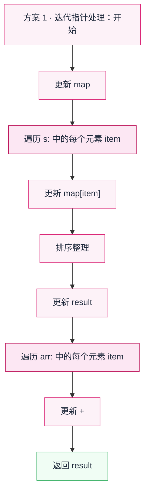

```python
import sys  # 提高递归深度上限（深输入防 RecursionError）

sys.setrecursionlimit(200000)  # 树/链表类题目节点数可达 1e4 量级

def frequencySort(s):  # 定义函数 frequencySort（参数：字符串）
    map = {}  # 把 {} 存入 映射表
    for item in s:  # 逐个取出 字符串 的元素（item）
        map[item] = map.get(item, 0) + 1  # 把 映射表 查找 item, 0) 加 1 写入 map[item]
    arr = sorted(map.items(), key=lambda x: x[1], reverse=True)
    result = ""  # 把 '' 存入 结果
    for item in arr:  # 逐个取出 数组 的元素（item）
        result += item[0] * item[1]  # 结果累加 item[0] 乘 item[1]
    return result  # 返回 结果

if __name__ == "__main__":  # 若 __name__ 等于 '__main__'
    print(frequencySort("abc"))  # 打印输出
```

#### 方案 2：直接实现

**思路与代码分析**：核心是「直接实现」。Python 版用切片与字典推导式简化操作，突出可读性。代码里依次做这些事：哈希结构做计数或查重；队列或堆的调度。**走读**：方案 2 · 直接实现：开始 → 更新 map → 遍历 s: 中的每个元素 item → 更新 map[item] → 更新 heap → 遍历 map.items(): 中的每个元素 count → 调用 heapq.heappush(heap, (-count → 更新 result → 当 heap: 时反复执行 → 更新 char → 更新 + → 返回 result。

**运行架构**（真实控制流）：

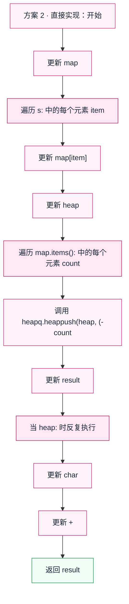

```python
import sys  # 提高递归深度上限（深输入防 RecursionError）

sys.setrecursionlimit(200000)  # 树/链表类题目节点数可达 1e4 量级
import heapq  # 引入依赖

class MaxHeap:  # 定义类
    def __init__(self):  # 构造函数：初始化成员
        self.heap = []  # 把 [] 写入 堆

    def push(self, val):  # 定义函数 push（参数：self, 值）
        heapq.heappush(self.heap, -val)  # heapq.heappush(self.堆, 减 值)

    def pop(self):  # 定义函数 pop（参数：self）
        return -heapq.heappop(self.heap)  # 返回 减 heapq.heappop(self.堆)

    def __len__(self):  # 定义函数 __len__（参数：self）
        return len(self.heap)  # 返回 长度(self.堆)

def frequencySort(s):  # 定义函数 frequencySort（参数：字符串）
    map = {}  # 把 {} 存入 映射表
    for item in s:  # 逐个取出 字符串 的元素（item）
        map[item] = map.get(item, 0) + 1  # 把 映射表 查找 item, 0) 加 1 写入 map[item]
    heap = []  # 把 [] 存入 堆
    for char, count in map.items():  # for char, 计数 in 映射表.items():
        heapq.heappush(heap, (-count, char))  # heapq.heappush(堆, ( 减 计数, char))
    result = ""  # 把 '' 存入 结果
    while heap:  # 循环，直到不满足「堆」
        count, char = heapq.heappop(heap)  # 把 heapq.heappop(堆) 写入 count, char
        result += char * (-count)  # 结果累加 char 乘 ( 减 计数)
    return result  # 返回 结果

if __name__ == "__main__":  # 若 __name__ 等于 '__main__'
    print(frequencySort("tree"))  # 打印输出
```

#### 方案 3：迭代指针处理

**思路与代码分析**：核心是「迭代指针处理」。Python 版用切片与字典推导式简化操作，突出可读性。代码里依次做这些事：先排序再处理。**走读**：方案 3 · 迭代指针处理：开始 → 更新 mp → 遍历 s: 中的每个元素 ch → 更新 mp[ch] → 排序整理 → 更新 key → 处理 ) → 更新 result → 遍历 arr: 中的每个元素 cnt → 更新 + → 返回 result。

**运行架构**（真实控制流）：

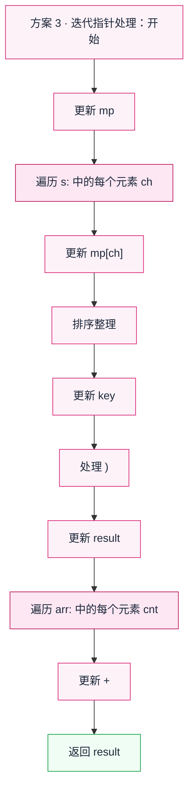

```python
# 根据字符出现频率排序 - 方案: dict 计数 + 排序
import sys  # 提高递归深度上限（深输入防 RecursionError）

sys.setrecursionlimit(200000)  # 树/链表类题目节点数可达 1e4 量级

def frequency_sort(s):  # 定义函数 frequency_sort（参数：字符串）
    mp = {}  # 把 {} 存入 mp
    for ch in s:  # 逐个取出 字符串 的元素（字符）
        mp[ch] = mp.get(ch, 0) + 1  # 把 mp 查找 字符, 0) 加 1 写入 mp[ch]
    arr = sorted(
        mp.items(), key=lambda x: -x[1]
    )  # 把 sorted(mp.items(), key 赋值为 lambda x: 减 x[1]) 存入 数组
    result = ""  # 把 '' 存入 结果
    for ch, cnt in arr:  # for 字符, 计数 in 数组:
        result += ch * cnt  # 结果累加 字符 乘 计数
    return result  # 返回 结果

if __name__ == "__main__":  # 若 __name__ 等于 '__main__'
    print(frequency_sort("tree"))  # 'eert' 或 'eetr'
```

#### 方案 4：迭代指针处理

**思路与代码分析**：核心是「迭代指针处理」。Python 版用切片与字典推导式简化操作，突出可读性。**走读**：方案 4 · 迭代指针处理：开始 → 更新 cnt → 遍历 s: 中的每个元素 ch → 更新 cnt[ch] → 更新 max_freq → 更新 buckets → 遍历 cnt.items(): 中的每个元素 f → 处理 buckets[f].append(ch) → 更新 result → 循环 f：从 max_freq 到 -1 前，步长 0 → 遍历 buckets[f]: 中的每个元素 ch → 更新 + → 返回 result。

**运行架构**（真实控制流）：

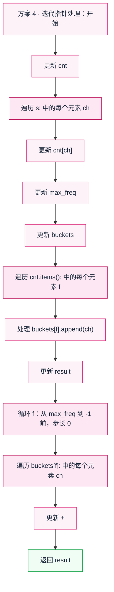

```python
# 根据字符出现频率排序 - 方案: 桶排序
import sys  # 提高递归深度上限（深输入防 RecursionError）

sys.setrecursionlimit(200000)  # 树/链表类题目节点数可达 1e4 量级

def frequency_sort(s):  # 定义函数 frequency_sort（参数：字符串）
    cnt = {}  # 把 {} 存入 计数
    for ch in s:  # 逐个取出 字符串 的元素（字符）
        cnt[ch] = cnt.get(ch, 0) + 1  # 把 计数 查找 字符, 0) 加 1 写入 cnt[ch]
    max_freq = max(cnt.values()) if cnt else 0  # 把 取较大值 计数.values()) if 计数 else 0 存入 max_freq
    buckets = [[] for _ in range(max_freq + 1)]  # 把 [[] for _ in range(max_freq 加 1)] 存入 buckets
    for ch, f in cnt.items():  # for 字符, f in 计数.items():
        buckets[f].append(ch)  # 把 字符 追加到列表尾部
    result = ""  # 把 '' 存入 结果
    for f in range(max_freq, 0, -1):  # 让 f 从 max_freq 倒数回去（每步减 1）
        for ch in buckets[f]:  # 逐个取出 buckets 的元素（字符）
            result += ch * f  # 结果累加 字符 乘 f
    return result  # 返回 结果

if __name__ == "__main__":  # 若 __name__ 等于 '__main__'
    print(frequency_sort("tree"))  # 'eert' 或 'eetr'
```

#### 方案 5：直接实现

**思路与代码分析**：核心是「直接实现」。Python 版用切片与字典推导式简化操作，突出可读性。代码里依次做这些事：先排序再处理。**走读**：方案 5 · 直接实现：开始 → 更新 mp → 遍历 s: 中的每个元素 ch → 更新 mp[ch] → 排序整理 → 更新 key → 处理 ) → 更新 result → 遍历 arr: 中的每个元素 cnt → 更新 + → 返回 result。

**运行架构**（真实控制流）：

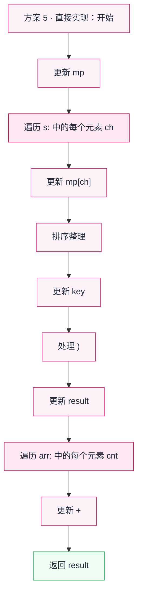

```python
import sys  # 提高递归深度上限（深输入防 RecursionError）

sys.setrecursionlimit(200000)  # 树/链表类题目节点数可达 1e4 量级

def frequencySort(s):  # 定义函数 frequencySort（参数：字符串）
    mp = {}  # 把 {} 存入 mp
    for ch in s:  # 逐个取出 字符串 的元素（字符）
        mp[ch] = mp.get(ch, 0) + 1  # 把 mp 查找 字符, 0) 加 1 写入 mp[ch]
    arr = sorted(
        mp.items(), key=lambda x: -x[1]
    )  # 把 sorted(mp.items(), key 赋值为 lambda x: 减 x[1]) 存入 数组
    result = ""  # 把 '' 存入 结果
    for ch, cnt in arr:  # for 字符, 计数 in 数组:
        result += ch * cnt  # 结果累加 字符 乘 计数
    return result  # 返回 结果

if __name__ == "__main__":  # 若 __name__ 等于 '__main__'
    print(frequencySort("tree"))  # 打印输出
```

#### 方案 6：迭代指针处理

**思路与代码分析**：核心是「迭代指针处理」。Python 版用切片与字典推导式简化操作，突出可读性。代码里依次做这些事：队列或堆的调度。**走读**：方案 6 · 迭代指针处理：开始 → 更新 cnt → 更新 heap → 调用 heapq.heapify(heap) → 更新 result → 当 heap: 时反复执行 → 更新 k → 更新 + → 返回 result。

**运行架构**（真实控制流）：

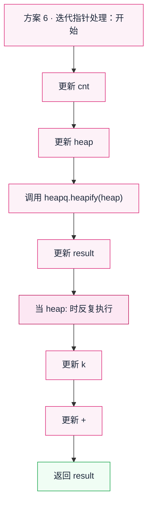

```python
# 根据字符出现频率排序 - 方案: 小顶堆 (heapq)
import sys  # 提高递归深度上限（深输入防 RecursionError）

sys.setrecursionlimit(200000)  # 树/链表类题目节点数可达 1e4 量级
import heapq  # 引入依赖
from collections import Counter  # from collections import Counter

def frequency_sort(s):  # 定义函数 frequency_sort（参数：字符串）
    cnt = Counter(s)  # 把 Counter(字符串) 存入 计数
    heap = [(-v, k) for k, v in cnt.items()]  # 把 [( 减 值, 下标 k) for 下标 k, 值 in 计数.items()] 存入 堆
    heapq.heapify(heap)  # heapq.heapify(堆)
    result = ""  # 把 '' 存入 结果
    while heap:  # 循环，直到不满足「堆」
        v, k = heapq.heappop(heap)  # 把 heapq.heappop(堆) 写入 v, k
        result += k * (-v)  # 结果累加 下标 k 乘 ( 减 值)
    return result  # 返回 结果

if __name__ == "__main__":  # 若 __name__ 等于 '__main__'
    print(frequency_sort("tree"))  # 'eert' 或 'eetr'
```

### Go 实现（6 种方案）

Go 的全部方案如下，每个方案都内嵌用例自测，可独立运行（老仓库 python/go 文件遵循「打印结果」约定）：

#### 方案 1：迭代指针处理

**思路与代码分析**：核心是「迭代指针处理」。Go 版用切片与多返回值惯用法，显式处理索引边界。代码里依次做这些事：哈希结构做计数或查重。**走读**：方案 1 · 迭代指针处理：开始 → 更新 : → 遍历 s 的下标与元素 ch → 处理 cnt[ch]++ → 处理 type pair struct → 处理 ch rune → 处理 c int → 计算 arr → 遍历 cnt 的下标与元素 c → 更新 arr → 调用 sort.Slice(arr, func(i, j in → 计算 b → 遍历 arr 的下标与元素 p → 遍历循环 → 调用 b.WriteRune(p.ch) → 返回 b.String()。

**运行架构**（真实控制流）：


```go
package main // 引入依赖

import (
	"fmt"
	"os"
	"sort"
	"strings"
) // 引入依赖

func frequencySort(s string) string { // 定义函数/方法 frequencySort
	cnt := map[rune]int{}  // 把 映射表[rune]int{} 写入 cnt :
	for _, ch := range s { // 同时取 _ 与 字符 遍历
		cnt[ch]++ // 计数[字符] 加一
	}
	type pair struct { // 定义类型
		ch rune // 字符 rune
		c  int  // 字符 int
	}
	var arr []pair           // var 数组 []pair
	for ch, c := range cnt { // 同时取 字符 与 字符 遍历
		arr = append(arr, pair{ch, c}) // 把 append(数组, pair{字符, 字符}) 写入 数组
	}
	sort.Slice(arr, func(i, j int) bool { return arr[i].c > arr[j].c })
	var b strings.Builder   // var b strings.Builder
	for _, p := range arr { // 同时取 _ 与 节点 遍历
		for k := 0; k < p.c; k++ { // 让 下标 k 从 0 开始计数
			b.WriteRune(p.ch) // b.WriteRune(节点.字符)
		}
	}
	return b.String() // 返回 b.String()
}

func main() { // 程序入口：跑内嵌自测用例
	cases := []struct { // 把 []struct { 写入 cases :
		in   string // in string
		want string // want string
	}{ // }{
		{"aaabbbbccccc", "cccccbbbbaaa"},
		{"aab", "aab"},
		{"xzzzz", "zzzzx"},
		{"", ""},
		{"a", "a"},
	}
	ok := true                // 把 true 写入 ok :
	for _, c := range cases { // 同时取 _ 与 字符 遍历
		if got := frequencySort(c.in); got != c.want { // 若 got : 赋值为 frequencySort(字符.in); got 不等于 字符.want
			ok = false                                                           // 把 false 写入 ok
			fmt.Printf("FAIL frequencySort(%q)=%q want %q\n", c.in, got, c.want) // 打印输出
		}
	}
	if !ok { // 若 取反 ok
		os.Exit(1) // os.Exit(1)
	}
	fmt.Println("PASS") // 全部用例通过，输出 PASS
}
```

#### 方案 2：直接实现

**思路与代码分析**：核心是「直接实现」。Go 版用切片与多返回值惯用法，显式处理索引边界。代码里依次做这些事：哈希结构做计数或查重。**走读**：方案 2 · 直接实现：开始 → 更新 : → 遍历 s 的下标与元素 ch → 处理 cnt[ch]++ → 处理 type pair struct → 处理 ch rune → 处理 c int → 计算 arr → 遍历 cnt 的下标与元素 c → 更新 arr → 调用 sort.Slice(arr, func(i, j in → 计算 b → 遍历 arr 的下标与元素 p → 遍历循环 → 调用 b.WriteRune(p.ch) → 返回 b.String()。

**运行架构**（真实控制流）：


```go
package main // 引入依赖

import (
	"fmt"
	"os"
	"sort"
	"strings"
) // 引入依赖

func frequencySort(s string) string { // 定义函数/方法 frequencySort
	cnt := map[rune]int{}  // 把 映射表[rune]int{} 写入 cnt :
	for _, ch := range s { // 同时取 _ 与 字符 遍历
		cnt[ch]++ // 计数[字符] 加一
	}
	type pair struct { // 定义类型
		ch rune // 字符 rune
		c  int  // 字符 int
	}
	var arr []pair           // var 数组 []pair
	for ch, c := range cnt { // 同时取 字符 与 字符 遍历
		arr = append(arr, pair{ch, c}) // 把 append(数组, pair{字符, 字符}) 写入 数组
	}
	sort.Slice(arr, func(i, j int) bool { return arr[i].c > arr[j].c })
	var b strings.Builder   // var b strings.Builder
	for _, p := range arr { // 同时取 _ 与 节点 遍历
		for k := 0; k < p.c; k++ { // 让 下标 k 从 0 开始计数
			b.WriteRune(p.ch) // b.WriteRune(节点.字符)
		}
	}
	return b.String() // 返回 b.String()
}

func main() { // 程序入口：跑内嵌自测用例
	cases := []struct { // 把 []struct { 写入 cases :
		in   string // in string
		want string // want string
	}{ // }{
		{"aaabbbbccccc", "cccccbbbbaaa"},
		{"aab", "aab"},
		{"xzzzz", "zzzzx"},
		{"", ""},
		{"a", "a"},
	}
	ok := true                // 把 true 写入 ok :
	for _, c := range cases { // 同时取 _ 与 字符 遍历
		if got := frequencySort(c.in); got != c.want { // 若 got : 赋值为 frequencySort(字符.in); got 不等于 字符.want
			ok = false                                                           // 把 false 写入 ok
			fmt.Printf("FAIL frequencySort(%q)=%q want %q\n", c.in, got, c.want) // 打印输出
		}
	}
	if !ok { // 若 取反 ok
		os.Exit(1) // os.Exit(1)
	}
	fmt.Println("PASS") // 全部用例通过，输出 PASS
}
```

#### 方案 3：迭代指针处理

**思路与代码分析**：核心是「迭代指针处理」。Go 版用切片与多返回值惯用法，显式处理索引边界。代码里依次做这些事：哈希结构做计数或查重。**走读**：方案 3 · 迭代指针处理：开始 → 更新 : → 遍历 s 的下标与元素 ch → 处理 cnt[ch]++ → 处理 type pair struct → 处理 ch rune → 处理 c int → 计算 arr → 遍历 cnt 的下标与元素 c → 更新 arr → 调用 sort.Slice(arr, func(i, j in → 计算 b → 遍历 arr 的下标与元素 p → 遍历循环 → 调用 b.WriteRune(p.ch) → 返回 b.String()。

**运行架构**（真实控制流）：


```go
package main // 引入依赖

import (
	"fmt"
	"os"
	"sort"
	"strings"
) // 引入依赖

func frequencySort(s string) string { // 定义函数/方法 frequencySort
	cnt := map[rune]int{}  // 把 映射表[rune]int{} 写入 cnt :
	for _, ch := range s { // 同时取 _ 与 字符 遍历
		cnt[ch]++ // 计数[字符] 加一
	}
	type pair struct { // 定义类型
		ch rune // 字符 rune
		c  int  // 字符 int
	}
	var arr []pair           // var 数组 []pair
	for ch, c := range cnt { // 同时取 字符 与 字符 遍历
		arr = append(arr, pair{ch, c}) // 把 append(数组, pair{字符, 字符}) 写入 数组
	}
	sort.Slice(arr, func(i, j int) bool { return arr[i].c > arr[j].c })
	var b strings.Builder   // var b strings.Builder
	for _, p := range arr { // 同时取 _ 与 节点 遍历
		for k := 0; k < p.c; k++ { // 让 下标 k 从 0 开始计数
			b.WriteRune(p.ch) // b.WriteRune(节点.字符)
		}
	}
	return b.String() // 返回 b.String()
}

func main() { // 程序入口：跑内嵌自测用例
	cases := []struct { // 把 []struct { 写入 cases :
		in   string // in string
		want string // want string
	}{ // }{
		{"aaabbbbccccc", "cccccbbbbaaa"},
		{"aab", "aab"},
		{"xzzzz", "zzzzx"},
		{"", ""},
		{"a", "a"},
	}
	ok := true                // 把 true 写入 ok :
	for _, c := range cases { // 同时取 _ 与 字符 遍历
		if got := frequencySort(c.in); got != c.want { // 若 got : 赋值为 frequencySort(字符.in); got 不等于 字符.want
			ok = false                                                           // 把 false 写入 ok
			fmt.Printf("FAIL frequencySort(%q)=%q want %q\n", c.in, got, c.want) // 打印输出
		}
	}
	if !ok { // 若 取反 ok
		os.Exit(1) // os.Exit(1)
	}
	fmt.Println("PASS") // 全部用例通过，输出 PASS
}
```

#### 方案 4：迭代指针处理

**思路与代码分析**：核心是「迭代指针处理」。Go 版用切片与多返回值惯用法，显式处理索引边界。代码里依次做这些事：哈希结构做计数或查重。**走读**：方案 4 · 迭代指针处理：开始 → 更新 : → 遍历 s 的下标与元素 ch → 处理 cnt[ch]++ → 处理 type pair struct → 处理 ch rune → 处理 c int → 计算 arr → 遍历 cnt 的下标与元素 c → 更新 arr → 调用 sort.Slice(arr, func(i, j in → 计算 b → 遍历 arr 的下标与元素 p → 遍历循环 → 调用 b.WriteRune(p.ch) → 返回 b.String()。

**运行架构**（真实控制流）：

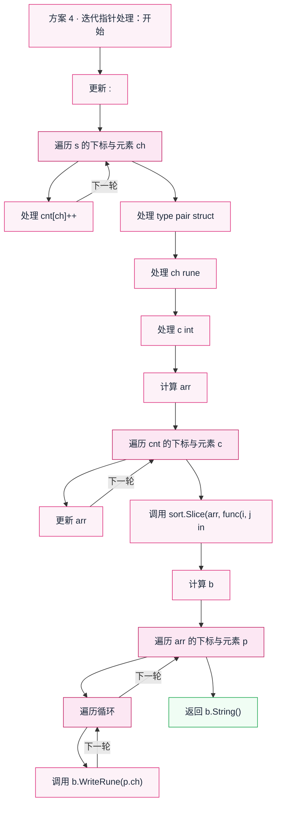

```go
package main // 引入依赖

import (
	"fmt"
	"os"
	"sort"
	"strings"
) // 引入依赖

func frequencySort(s string) string { // 定义函数/方法 frequencySort
	cnt := map[rune]int{}  // 把 映射表[rune]int{} 写入 cnt :
	for _, ch := range s { // 同时取 _ 与 字符 遍历
		cnt[ch]++ // 计数[字符] 加一
	}
	type pair struct { // 定义类型
		ch rune // 字符 rune
		c  int  // 字符 int
	}
	var arr []pair           // var 数组 []pair
	for ch, c := range cnt { // 同时取 字符 与 字符 遍历
		arr = append(arr, pair{ch, c}) // 把 append(数组, pair{字符, 字符}) 写入 数组
	}
	sort.Slice(arr, func(i, j int) bool { return arr[i].c > arr[j].c })
	var b strings.Builder   // var b strings.Builder
	for _, p := range arr { // 同时取 _ 与 节点 遍历
		for k := 0; k < p.c; k++ { // 让 下标 k 从 0 开始计数
			b.WriteRune(p.ch) // b.WriteRune(节点.字符)
		}
	}
	return b.String() // 返回 b.String()
}

func main() { // 程序入口：跑内嵌自测用例
	cases := []struct { // 把 []struct { 写入 cases :
		in   string // in string
		want string // want string
	}{ // }{
		{"aaabbbbccccc", "cccccbbbbaaa"},
		{"aab", "aab"},
		{"xzzzz", "zzzzx"},
		{"", ""},
		{"a", "a"},
	}
	ok := true                // 把 true 写入 ok :
	for _, c := range cases { // 同时取 _ 与 字符 遍历
		if got := frequencySort(c.in); got != c.want { // 若 got : 赋值为 frequencySort(字符.in); got 不等于 字符.want
			ok = false                                                           // 把 false 写入 ok
			fmt.Printf("FAIL frequencySort(%q)=%q want %q\n", c.in, got, c.want) // 打印输出
		}
	}
	if !ok { // 若 取反 ok
		os.Exit(1) // os.Exit(1)
	}
	fmt.Println("PASS") // 全部用例通过，输出 PASS
}
```

#### 方案 5：直接实现

**思路与代码分析**：核心是「直接实现」。Go 版用切片与多返回值惯用法，显式处理索引边界。代码里依次做这些事：哈希结构做计数或查重。**走读**：方案 5 · 直接实现：开始 → 更新 : → 遍历 s 的下标与元素 ch → 处理 cnt[ch]++ → 处理 type pair struct → 处理 ch rune → 处理 c int → 计算 arr → 遍历 cnt 的下标与元素 c → 更新 arr → 调用 sort.Slice(arr, func(i, j in → 计算 b → 遍历 arr 的下标与元素 p → 遍历循环 → 调用 b.WriteRune(p.ch) → 返回 b.String()。

**运行架构**（真实控制流）：

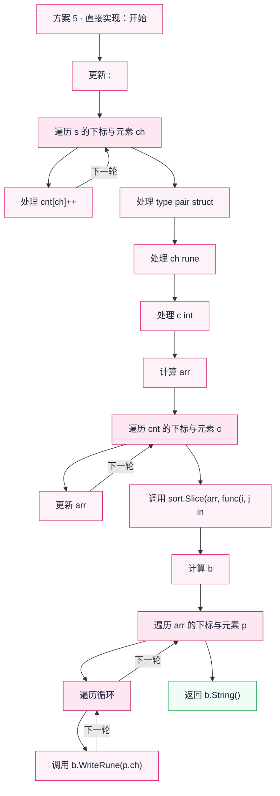

```go
package main // 引入依赖

import (
	"fmt"
	"os"
	"sort"
	"strings"
) // 引入依赖

func frequencySort(s string) string { // 定义函数/方法 frequencySort
	cnt := map[rune]int{}  // 把 映射表[rune]int{} 写入 cnt :
	for _, ch := range s { // 同时取 _ 与 字符 遍历
		cnt[ch]++ // 计数[字符] 加一
	}
	type pair struct { // 定义类型
		ch rune // 字符 rune
		c  int  // 字符 int
	}
	var arr []pair           // var 数组 []pair
	for ch, c := range cnt { // 同时取 字符 与 字符 遍历
		arr = append(arr, pair{ch, c}) // 把 append(数组, pair{字符, 字符}) 写入 数组
	}
	sort.Slice(arr, func(i, j int) bool { return arr[i].c > arr[j].c })
	var b strings.Builder   // var b strings.Builder
	for _, p := range arr { // 同时取 _ 与 节点 遍历
		for k := 0; k < p.c; k++ { // 让 下标 k 从 0 开始计数
			b.WriteRune(p.ch) // b.WriteRune(节点.字符)
		}
	}
	return b.String() // 返回 b.String()
}

func main() { // 程序入口：跑内嵌自测用例
	cases := []struct { // 把 []struct { 写入 cases :
		in   string // in string
		want string // want string
	}{ // }{
		{"aaabbbbccccc", "cccccbbbbaaa"},
		{"aab", "aab"},
		{"xzzzz", "zzzzx"},
		{"", ""},
		{"a", "a"},
	}
	ok := true                // 把 true 写入 ok :
	for _, c := range cases { // 同时取 _ 与 字符 遍历
		if got := frequencySort(c.in); got != c.want { // 若 got : 赋值为 frequencySort(字符.in); got 不等于 字符.want
			ok = false                                                           // 把 false 写入 ok
			fmt.Printf("FAIL frequencySort(%q)=%q want %q\n", c.in, got, c.want) // 打印输出
		}
	}
	if !ok { // 若 取反 ok
		os.Exit(1) // os.Exit(1)
	}
	fmt.Println("PASS") // 全部用例通过，输出 PASS
}
```

#### 方案 6：迭代指针处理

**思路与代码分析**：核心是「迭代指针处理」。Go 版用切片与多返回值惯用法，显式处理索引边界。代码里依次做这些事：哈希结构做计数或查重。**走读**：方案 6 · 迭代指针处理：开始 → 更新 : → 遍历 s 的下标与元素 ch → 处理 cnt[ch]++ → 处理 type pair struct → 处理 ch rune → 处理 c int → 计算 arr → 遍历 cnt 的下标与元素 c → 更新 arr → 调用 sort.Slice(arr, func(i, j in → 计算 b → 遍历 arr 的下标与元素 p → 遍历循环 → 调用 b.WriteRune(p.ch) → 返回 b.String()。

**运行架构**（真实控制流）：


```go
package main // 引入依赖

import (
	"fmt"
	"os"
	"sort"
	"strings"
) // 引入依赖

func frequencySort(s string) string { // 定义函数/方法 frequencySort
	cnt := map[rune]int{}  // 把 映射表[rune]int{} 写入 cnt :
	for _, ch := range s { // 同时取 _ 与 字符 遍历
		cnt[ch]++ // 计数[字符] 加一
	}
	type pair struct { // 定义类型
		ch rune // 字符 rune
		c  int  // 字符 int
	}
	var arr []pair           // var 数组 []pair
	for ch, c := range cnt { // 同时取 字符 与 字符 遍历
		arr = append(arr, pair{ch, c}) // 把 append(数组, pair{字符, 字符}) 写入 数组
	}
	sort.Slice(arr, func(i, j int) bool { return arr[i].c > arr[j].c })
	var b strings.Builder   // var b strings.Builder
	for _, p := range arr { // 同时取 _ 与 节点 遍历
		for k := 0; k < p.c; k++ { // 让 下标 k 从 0 开始计数
			b.WriteRune(p.ch) // b.WriteRune(节点.字符)
		}
	}
	return b.String() // 返回 b.String()
}

func main() { // 程序入口：跑内嵌自测用例
	cases := []struct { // 把 []struct { 写入 cases :
		in   string // in string
		want string // want string
	}{ // }{
		{"aaabbbbccccc", "cccccbbbbaaa"},
		{"aab", "aab"},
		{"xzzzz", "zzzzx"},
		{"", ""},
		{"a", "a"},
	}
	ok := true                // 把 true 写入 ok :
	for _, c := range cases { // 同时取 _ 与 字符 遍历
		if got := frequencySort(c.in); got != c.want { // 若 got : 赋值为 frequencySort(字符.in); got 不等于 字符.want
			ok = false                                                           // 把 false 写入 ok
			fmt.Printf("FAIL frequencySort(%q)=%q want %q\n", c.in, got, c.want) // 打印输出
		}
	}
	if !ok { // 若 取反 ok
		os.Exit(1) // os.Exit(1)
	}
	fmt.Println("PASS") // 全部用例通过，输出 PASS
}
```

### Java 实现（6 种方案）

Java 的全部方案如下，每个方案都内嵌用例自测，可独立运行（老仓库 python/go 文件遵循「打印结果」约定）：

#### 方案 1：迭代指针处理

**思路与代码分析**：核心是「迭代指针处理」。Java 版用类与静态方法组织，集合操作显式明了。代码里依次做这些事：哈希结构做计数或查重；双重循环遍历。

**运行架构**（真实控制流）：

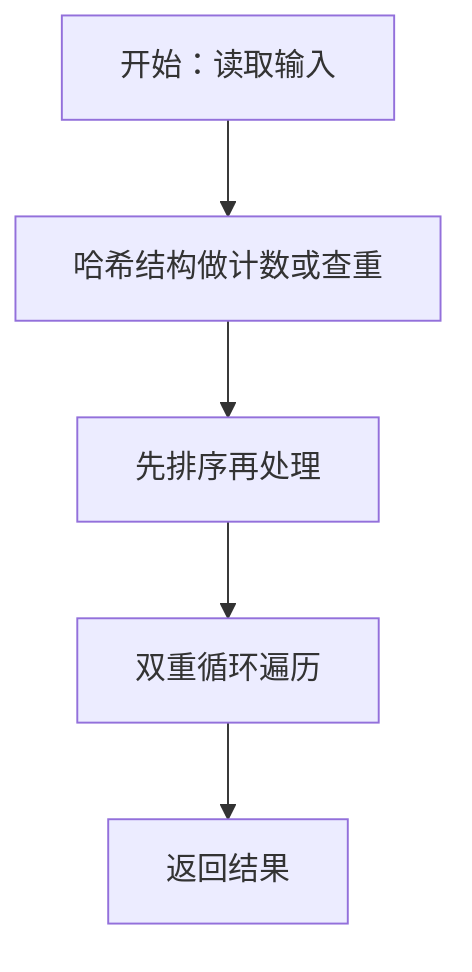

```java
package com.webfault.dsa; // 引入依赖

import java.util.*; // 引入依赖

class solution111sortMap { // 定义类型
  public String frequencySort(String s) { // 定义函数/方法 frequencySort
    Map<Character, Integer> map =
        new HashMap<>(); // 把 new HashMap 小于 超过 (); 写入 Map<Character, Integer> map
    for (char c : s.toCharArray()) { // for (char 字符 : 字符串.toCharArray()) {
      map.put(c, map.getOrDefault(c, 0) + 1); // 映射表.put(字符, 映射表.getOrDefault(字符, 0) 加 1);
    }
    List<Map.Entry<Character, Integer>> arr = new ArrayList<>(map.entrySet());
    arr.sort((a, b) -> b.getValue() - a.getValue()); // 排序
    StringBuilder result = new StringBuilder(); // 把 new StringBuilder(); 写入 StringBuilder result
    for (Map.Entry<Character, Integer> item :
        arr) { // for (Map.Entry 小于 Character, Integer 超过 item : 数组) {
      for (int i = 0; i < item.getValue(); i++) { // 让 下标 i 从 0 开始计数，下标 i 小于 item.getValue() 就继续
        result.append(item.getKey()); // 把 item.getKey( 追加到列表尾部
      }
    }
    return result.toString(); // 返回 结果.toString()
  }

  public static void main(String[] args) { // public static void main(String[] args) {
    solution111sortMap s =
        new solution111sortMap(); // 把 new solution111sortMap(); 写入 solution111sortMap s
    String[] inputs = {"tree", "cccaaa", "Aabb", "", "raaeaedere"};
    boolean ok = true; // 把 true; 写入 boolean ok
    for (String in : inputs) { // for (String in : inputs) {
      String got = s.frequencySort(in); // 把 字符串.frequencySort(in) 存入 got
      if (!isFreqSorted(got, in)) { // 若 取反 isFreqSorted(got, in
        ok = false; // 把 false; 写入 ok
        System.out.println("FAIL frequencySort(" + in + ")=" + got); // 打印输出
      }
    }
    if (!ok) throw new RuntimeException("FAILED"); // 若 取反 ok) throw new RuntimeException(「FAILED」);
    System.out.println("PASS"); // 全部用例通过，输出 PASS
  }

  static boolean isFreqSorted(String r, String input) { // 定义判定函数 isFreqSorted
    if (r == null) return false; // 若 右指针 等于 null，直接返回 false
    Map<Character, Integer> in =
        new HashMap<>(); // 把 new HashMap 小于 超过 (); 写入 Map<Character, Integer> in
    for (char c : input.toCharArray()) in.put(c, in.getOrDefault(c, 0) + 1);
    Map<Character, Integer> out =
        new HashMap<>(); // 把 new HashMap 小于 超过 (); 写入 Map<Character, Integer> out
    for (char c : r.toCharArray()) out.put(c, out.getOrDefault(c, 0) + 1);
    if (!in.equals(out)) return false; // 若 取反 in.equals(out)，直接返回 false
    int i = 0; // 把 0 存入 下标 i
    int prev = Integer.MAX_VALUE; // 把 Integer.MAX_VALUE 存入 前一个
    while (i < r.length()) { // 循环，直到不满足「下标 i 小于 右指针.长度(」
      char c = r.charAt(i); // 逐字符处理
      int j = i; // 把 下标 i 存入 下标 j
      while (j < r.length() && r.charAt(j) == c)
        j++; // 循环，直到不满足「下标 j 小于 右指针.长度() 且 右指针 取字符 下标 j) 等于 字符) 下标 j 加一 ;」
      int freq = j - i; // 把 下标 j 减 下标 i 存入 频次表
      if (freq != out.get(c)) return false; // 若 频次表 不等于 out 查找 字符)，直接返回 false
      if (freq > prev) return false; // 若 频次表 超过 前一个，直接返回 false
      prev = freq; // 把 频次表; 写入 前一个
      i = j; // 把 下标 j; 写入 下标 i
    }
    return true; // 返回 true
  }
}
```

#### 方案 2：直接实现

**思路与代码分析**：核心是「直接实现」。Java 版用类与静态方法组织，集合操作显式明了。代码里依次做这些事：哈希结构做计数或查重；双重循环遍历。

**运行架构**（真实控制流）：

```mermaid
graph TD
    A["开始：读取输入"]
    F0["哈希结构做计数或查重"]
    A --> F0
    F1["双重循环遍历"]
    F0 --> F1
    Z["返回结果"]
    F1 --> Z
```

```java
package com.webfault.dsa; // 引入依赖

import java.util.*; // 引入依赖

class lc451_solution22 { // 定义类型
  public String frequencySort(String s) { // 定义函数/方法 frequencySort
    Map<Character, Integer> freq =
        new HashMap<>(); // 把 new HashMap 小于 超过 (); 写入 Map<Character, Integer> freq
    for (char c : s.toCharArray()) { // for (char 字符 : 字符串.toCharArray()) {
      freq.put(c, freq.getOrDefault(c, 0) + 1); // 频次表.put(字符, 频次表.getOrDefault(字符, 0) 加 1);
    }
    PriorityQueue<Map.Entry<Character, Integer>> pq =
        new PriorityQueue<>(
            (a, b) -> b.getValue() - a.getValue() // (数组, b) 减 超过 b.getValue() 减 数组.getValue()
            );
    pq.addAll(freq.entrySet()); // 优先队列.addAll(频次表.entrySet());
    StringBuilder sb = new StringBuilder(); // 把 new StringBuilder(); 写入 StringBuilder sb
    while (!pq.isEmpty()) { // 循环，直到不满足「取反 优先队列.isEmpty(」
      Map.Entry<Character, Integer> entry =
          pq.poll(); // 把 优先队列.poll(); 写入 Map.Entry<Character, Integer> entry
      for (int i = 0; i < entry.getValue(); i++) { // 让 下标 i 从 0 开始计数，下标 i 小于 entry.getValue() 就继续
        sb.append(entry.getKey()); // 把 entry.getKey( 追加到列表尾部
      }
    }
    return sb.toString(); // 返回 sb.toString()
  }

  public static void main(String[] args) { // public static void main(String[] args) {
    lc451_solution22 s = new lc451_solution22(); // 把 new lc451_solution22(); 写入 lc451_solution22 s
    String[] inputs = {"tree", "cccaaa", "Aabb", "", "raaeaedere"};
    boolean ok = true; // 把 true; 写入 boolean ok
    for (String in : inputs) { // for (String in : inputs) {
      String got = s.frequencySort(in); // 把 字符串.frequencySort(in) 存入 got
      if (!isFreqSorted(got, in)) { // 若 取反 isFreqSorted(got, in
        ok = false; // 把 false; 写入 ok
        System.out.println("FAIL frequencySort(" + in + ")=" + got); // 打印输出
      }
    }
    if (!ok) throw new RuntimeException("FAILED"); // 若 取反 ok) throw new RuntimeException(「FAILED」);
    System.out.println("PASS"); // 全部用例通过，输出 PASS
  }

  static boolean isFreqSorted(String r, String input) { // 定义判定函数 isFreqSorted
    if (r == null) return false; // 若 右指针 等于 null，直接返回 false
    Map<Character, Integer> in =
        new HashMap<>(); // 把 new HashMap 小于 超过 (); 写入 Map<Character, Integer> in
    for (char c : input.toCharArray()) in.put(c, in.getOrDefault(c, 0) + 1);
    Map<Character, Integer> out =
        new HashMap<>(); // 把 new HashMap 小于 超过 (); 写入 Map<Character, Integer> out
    for (char c : r.toCharArray()) out.put(c, out.getOrDefault(c, 0) + 1);
    if (!in.equals(out)) return false; // 若 取反 in.equals(out)，直接返回 false
    int i = 0; // 把 0 存入 下标 i
    int prev = Integer.MAX_VALUE; // 把 Integer.MAX_VALUE 存入 前一个
    while (i < r.length()) { // 循环，直到不满足「下标 i 小于 右指针.长度(」
      char c = r.charAt(i); // 逐字符处理
      int j = i; // 把 下标 i 存入 下标 j
      while (j < r.length() && r.charAt(j) == c)
        j++; // 循环，直到不满足「下标 j 小于 右指针.长度() 且 右指针 取字符 下标 j) 等于 字符) 下标 j 加一 ;」
      int freq = j - i; // 把 下标 j 减 下标 i 存入 频次表
      if (freq != out.get(c)) return false; // 若 频次表 不等于 out 查找 字符)，直接返回 false
      if (freq > prev) return false; // 若 频次表 超过 前一个，直接返回 false
      prev = freq; // 把 频次表; 写入 前一个
      i = j; // 把 下标 j; 写入 下标 i
    }
    return true; // 返回 true
  }
}
```

#### 方案 3：迭代指针处理

**思路与代码分析**：核心是「迭代指针处理」。Java 版用类与静态方法组织，集合操作显式明了。代码里依次做这些事：哈希结构做计数或查重；双重循环遍历。

**运行架构**：与方案 1 的控制流相同（同算法在该语言的等价实现），图见上。

```java
package com.webfault.dsa; // 引入依赖

import java.util.*; // 引入依赖

class lc451_solution311 { // 定义类型
  public String frequencySort(String s) { // 定义函数/方法 frequencySort
    Map<Character, Integer> mp =
        new HashMap<>(); // 把 new HashMap 小于 超过 (); 写入 Map<Character, Integer> mp
    for (char ch : s.toCharArray()) { // for (char 字符 : 字符串.toCharArray()) {
      mp.put(ch, mp.getOrDefault(ch, 0) + 1); // mp.put(字符, mp.getOrDefault(字符, 0) 加 1);
    }
    List<Map.Entry<Character, Integer>> arr = new ArrayList<>(mp.entrySet());
    arr.sort((a, b) -> b.getValue() - a.getValue()); // 排序
    StringBuilder sb = new StringBuilder(); // 把 new StringBuilder(); 写入 StringBuilder sb
    for (Map.Entry<Character, Integer> e :
        arr) { // for (Map.Entry 小于 Character, Integer 超过 e : 数组) {
      for (int i = 0; i < e.getValue(); i++) { // 让 下标 i 从 0 开始计数，下标 i 小于 e.getValue() 就继续
        sb.append(e.getKey()); // 把 e.getKey( 追加到列表尾部
      }
    }
    return sb.toString(); // 返回 sb.toString()
  }

  public static void main(String[] args) { // public static void main(String[] args) {
    lc451_solution311 s =
        new lc451_solution311(); // 把 new lc451_solution311(); 写入 lc451_solution311 s
    String[] inputs = {"tree", "cccaaa", "Aabb", "", "raaeaedere"};
    boolean ok = true; // 把 true; 写入 boolean ok
    for (String in : inputs) { // for (String in : inputs) {
      String got = s.frequencySort(in); // 把 字符串.frequencySort(in) 存入 got
      if (!isFreqSorted(got, in)) { // 若 取反 isFreqSorted(got, in
        ok = false; // 把 false; 写入 ok
        System.out.println("FAIL frequencySort(" + in + ")=" + got); // 打印输出
      }
    }
    if (!ok) throw new RuntimeException("FAILED"); // 若 取反 ok) throw new RuntimeException(「FAILED」);
    System.out.println("PASS"); // 全部用例通过，输出 PASS
  }

  static boolean isFreqSorted(String r, String input) { // 定义判定函数 isFreqSorted
    if (r == null) return false; // 若 右指针 等于 null，直接返回 false
    Map<Character, Integer> in =
        new HashMap<>(); // 把 new HashMap 小于 超过 (); 写入 Map<Character, Integer> in
    for (char c : input.toCharArray()) in.put(c, in.getOrDefault(c, 0) + 1);
    Map<Character, Integer> out =
        new HashMap<>(); // 把 new HashMap 小于 超过 (); 写入 Map<Character, Integer> out
    for (char c : r.toCharArray()) out.put(c, out.getOrDefault(c, 0) + 1);
    if (!in.equals(out)) return false; // 若 取反 in.equals(out)，直接返回 false
    int i = 0; // 把 0 存入 下标 i
    int prev = Integer.MAX_VALUE; // 把 Integer.MAX_VALUE 存入 前一个
    while (i < r.length()) { // 循环，直到不满足「下标 i 小于 右指针.长度(」
      char c = r.charAt(i); // 逐字符处理
      int j = i; // 把 下标 i 存入 下标 j
      while (j < r.length() && r.charAt(j) == c)
        j++; // 循环，直到不满足「下标 j 小于 右指针.长度() 且 右指针 取字符 下标 j) 等于 字符) 下标 j 加一 ;」
      int freq = j - i; // 把 下标 j 减 下标 i 存入 频次表
      if (freq != out.get(c)) return false; // 若 频次表 不等于 out 查找 字符)，直接返回 false
      if (freq > prev) return false; // 若 频次表 超过 前一个，直接返回 false
      prev = freq; // 把 频次表; 写入 前一个
      i = j; // 把 下标 j; 写入 下标 i
    }
    return true; // 返回 true
  }
}
```

#### 方案 4：迭代指针处理

**思路与代码分析**：核心是「迭代指针处理」。Java 版用类与静态方法组织，集合操作显式明了。代码里依次做这些事：哈希结构做计数或查重；双重循环遍历。

**运行架构**：与方案 2 的控制流相同（同算法在该语言的等价实现），图见上。

```java
package com.webfault.dsa; // 引入依赖

import java.util.*; // 引入依赖

class lc451_solution422 { // 定义类型
  public String frequencySort(String s) { // 定义函数/方法 frequencySort
    Map<Character, Integer> cnt =
        new HashMap<>(); // 把 new HashMap 小于 超过 (); 写入 Map<Character, Integer> cnt
    for (char ch : s.toCharArray()) cnt.put(ch, cnt.getOrDefault(ch, 0) + 1);
    int maxFreq = 0; // 把 0 存入 maxFreq
    for (int f : cnt.values()) maxFreq = Math.max(maxFreq, f);
    List<List<Character>> buckets =
        new ArrayList<>(); // 把 new ArrayList 小于 超过 (); 写入 List<List<Character>> buckets
    for (int i = 0; i <= maxFreq; i++)
      buckets.add(new ArrayList<>()); // 让 下标 i 从 0 开始计数，下标 i 不超过 maxFreq 就继续
    for (Map.Entry<Character, Integer> e :
        cnt.entrySet()) { // for (Map.Entry 小于 Character, Integer 超过 e : 计数.entrySet()) {
      buckets.get(e.getValue()).add(e.getKey()); // buckets 查找 e.getValue()) 追加 e.getKey());
    }
    StringBuilder result = new StringBuilder(); // 把 new StringBuilder(); 写入 StringBuilder result
    for (int f = maxFreq; f >= 1; f--) { // 让 f 从 maxFreq 开始计数，f 不低于 1 就继续
      for (char ch : buckets.get(f)) { // for (char 字符 : buckets 查找 f)) {
        for (int i = 0; i < f; i++) result.append(ch); // 让 下标 i 从 0 开始计数，下标 i 小于 f 就继续
      }
    }
    return result.toString(); // 返回 结果.toString()
  }

  public static void main(String[] args) { // public static void main(String[] args) {
    lc451_solution422 s =
        new lc451_solution422(); // 把 new lc451_solution422(); 写入 lc451_solution422 s
    String[] inputs = {"tree", "cccaaa", "Aabb", "", "raaeaedere"};
    boolean ok = true; // 把 true; 写入 boolean ok
    for (String in : inputs) { // for (String in : inputs) {
      String got = s.frequencySort(in); // 把 字符串.frequencySort(in) 存入 got
      if (!isFreqSorted(got, in)) { // 若 取反 isFreqSorted(got, in
        ok = false; // 把 false; 写入 ok
        System.out.println("FAIL frequencySort(" + in + ")=" + got); // 打印输出
      }
    }
    if (!ok) throw new RuntimeException("FAILED"); // 若 取反 ok) throw new RuntimeException(「FAILED」);
    System.out.println("PASS"); // 全部用例通过，输出 PASS
  }

  static boolean isFreqSorted(String r, String input) { // 定义判定函数 isFreqSorted
    if (r == null) return false; // 若 右指针 等于 null，直接返回 false
    Map<Character, Integer> in =
        new HashMap<>(); // 把 new HashMap 小于 超过 (); 写入 Map<Character, Integer> in
    for (char c : input.toCharArray()) in.put(c, in.getOrDefault(c, 0) + 1);
    Map<Character, Integer> out =
        new HashMap<>(); // 把 new HashMap 小于 超过 (); 写入 Map<Character, Integer> out
    for (char c : r.toCharArray()) out.put(c, out.getOrDefault(c, 0) + 1);
    if (!in.equals(out)) return false; // 若 取反 in.equals(out)，直接返回 false
    int i = 0; // 把 0 存入 下标 i
    int prev = Integer.MAX_VALUE; // 把 Integer.MAX_VALUE 存入 前一个
    while (i < r.length()) { // 循环，直到不满足「下标 i 小于 右指针.长度(」
      char c = r.charAt(i); // 逐字符处理
      int j = i; // 把 下标 i 存入 下标 j
      while (j < r.length() && r.charAt(j) == c)
        j++; // 循环，直到不满足「下标 j 小于 右指针.长度() 且 右指针 取字符 下标 j) 等于 字符) 下标 j 加一 ;」
      int freq = j - i; // 把 下标 j 减 下标 i 存入 频次表
      if (freq != out.get(c)) return false; // 若 频次表 不等于 out 查找 字符)，直接返回 false
      if (freq > prev) return false; // 若 频次表 超过 前一个，直接返回 false
      prev = freq; // 把 频次表; 写入 前一个
      i = j; // 把 下标 j; 写入 下标 i
    }
    return true; // 返回 true
  }
}
```

#### 方案 5：直接实现

**思路与代码分析**：核心是「直接实现」。Java 版用类与静态方法组织，集合操作显式明了。代码里依次做这些事：哈希结构做计数或查重；双重循环遍历。

**运行架构**：与方案 1 的控制流相同（同算法在该语言的等价实现），图见上。

```java
package com.webfault.dsa; // 引入依赖

import java.util.*; // 引入依赖

class solution511map { // 定义类型
  public String frequencySort(String s) { // 定义函数/方法 frequencySort
    Map<Character, Integer> mp =
        new HashMap<>(); // 把 new HashMap 小于 超过 (); 写入 Map<Character, Integer> mp
    for (char ch : s.toCharArray()) { // for (char 字符 : 字符串.toCharArray()) {
      mp.put(ch, mp.getOrDefault(ch, 0) + 1); // mp.put(字符, mp.getOrDefault(字符, 0) 加 1);
    }
    List<Map.Entry<Character, Integer>> arr = new ArrayList<>(mp.entrySet());
    arr.sort((a, b) -> b.getValue() - a.getValue()); // 排序
    StringBuilder sb = new StringBuilder(); // 把 new StringBuilder(); 写入 StringBuilder sb
    for (Map.Entry<Character, Integer> e :
        arr) { // for (Map.Entry 小于 Character, Integer 超过 e : 数组) {
      for (int i = 0; i < e.getValue(); i++) { // 让 下标 i 从 0 开始计数，下标 i 小于 e.getValue() 就继续
        sb.append(e.getKey()); // 把 e.getKey( 追加到列表尾部
      }
    }
    return sb.toString(); // 返回 sb.toString()
  }

  public static void main(String[] args) { // public static void main(String[] args) {
    solution511map s = new solution511map(); // 把 new solution511map(); 写入 solution511map s
    String[] inputs = {"tree", "cccaaa", "Aabb", "", "raaeaedere"};
    boolean ok = true; // 把 true; 写入 boolean ok
    for (String in : inputs) { // for (String in : inputs) {
      String got = s.frequencySort(in); // 把 字符串.frequencySort(in) 存入 got
      if (!isFreqSorted(got, in)) { // 若 取反 isFreqSorted(got, in
        ok = false; // 把 false; 写入 ok
        System.out.println("FAIL frequencySort(" + in + ")=" + got); // 打印输出
      }
    }
    if (!ok) throw new RuntimeException("FAILED"); // 若 取反 ok) throw new RuntimeException(「FAILED」);
    System.out.println("PASS"); // 全部用例通过，输出 PASS
  }

  static boolean isFreqSorted(String r, String input) { // 定义判定函数 isFreqSorted
    if (r == null) return false; // 若 右指针 等于 null，直接返回 false
    Map<Character, Integer> in =
        new HashMap<>(); // 把 new HashMap 小于 超过 (); 写入 Map<Character, Integer> in
    for (char c : input.toCharArray()) in.put(c, in.getOrDefault(c, 0) + 1);
    Map<Character, Integer> out =
        new HashMap<>(); // 把 new HashMap 小于 超过 (); 写入 Map<Character, Integer> out
    for (char c : r.toCharArray()) out.put(c, out.getOrDefault(c, 0) + 1);
    if (!in.equals(out)) return false; // 若 取反 in.equals(out)，直接返回 false
    int i = 0; // 把 0 存入 下标 i
    int prev = Integer.MAX_VALUE; // 把 Integer.MAX_VALUE 存入 前一个
    while (i < r.length()) { // 循环，直到不满足「下标 i 小于 右指针.长度(」
      char c = r.charAt(i); // 逐字符处理
      int j = i; // 把 下标 i 存入 下标 j
      while (j < r.length() && r.charAt(j) == c)
        j++; // 循环，直到不满足「下标 j 小于 右指针.长度() 且 右指针 取字符 下标 j) 等于 字符) 下标 j 加一 ;」
      int freq = j - i; // 把 下标 j 减 下标 i 存入 频次表
      if (freq != out.get(c)) return false; // 若 频次表 不等于 out 查找 字符)，直接返回 false
      if (freq > prev) return false; // 若 频次表 超过 前一个，直接返回 false
      prev = freq; // 把 频次表; 写入 前一个
      i = j; // 把 下标 j; 写入 下标 i
    }
    return true; // 返回 true
  }
}
```

#### 方案 6：迭代指针处理

**思路与代码分析**：核心是「迭代指针处理」。Java 版用类与静态方法组织，集合操作显式明了。代码里依次做这些事：哈希结构做计数或查重；双重循环遍历。

**运行架构**：与方案 2 的控制流相同（同算法在该语言的等价实现），图见上。

```java
package com.webfault.dsa; // 引入依赖

import java.util.*; // 引入依赖

class lc451_solution622 { // 定义类型
  public String frequencySort(String s) { // 定义函数/方法 frequencySort
    Map<Character, Integer> cnt =
        new HashMap<>(); // 把 new HashMap 小于 超过 (); 写入 Map<Character, Integer> cnt
    for (char ch : s.toCharArray()) { // for (char 字符 : 字符串.toCharArray()) {
      cnt.put(ch, cnt.getOrDefault(ch, 0) + 1); // 计数.put(字符, 计数.getOrDefault(字符, 0) 加 1);
    }
    PriorityQueue<Map.Entry<Character, Integer>> pq =
        new PriorityQueue<>(
            (a, b) -> b.getValue() - a.getValue() // (数组, b) 减 超过 b.getValue() 减 数组.getValue()
            );
    pq.addAll(cnt.entrySet()); // 优先队列.addAll(计数.entrySet());
    StringBuilder sb = new StringBuilder(); // 把 new StringBuilder(); 写入 StringBuilder sb
    while (!pq.isEmpty()) { // 循环，直到不满足「取反 优先队列.isEmpty(」
      Map.Entry<Character, Integer> e =
          pq.poll(); // 把 优先队列.poll(); 写入 Map.Entry<Character, Integer> e
      for (int i = 0; i < e.getValue(); i++) { // 让 下标 i 从 0 开始计数，下标 i 小于 e.getValue() 就继续
        sb.append(e.getKey()); // 把 e.getKey( 追加到列表尾部
      }
    }
    return sb.toString(); // 返回 sb.toString()
  }

  public static void main(String[] args) { // public static void main(String[] args) {
    lc451_solution622 s =
        new lc451_solution622(); // 把 new lc451_solution622(); 写入 lc451_solution622 s
    String[] inputs = {"tree", "cccaaa", "Aabb", "", "raaeaedere"};
    boolean ok = true; // 把 true; 写入 boolean ok
    for (String in : inputs) { // for (String in : inputs) {
      String got = s.frequencySort(in); // 把 字符串.frequencySort(in) 存入 got
      if (!isFreqSorted(got, in)) { // 若 取反 isFreqSorted(got, in
        ok = false; // 把 false; 写入 ok
        System.out.println("FAIL frequencySort(" + in + ")=" + got); // 打印输出
      }
    }
    if (!ok) throw new RuntimeException("FAILED"); // 若 取反 ok) throw new RuntimeException(「FAILED」);
    System.out.println("PASS"); // 全部用例通过，输出 PASS
  }

  static boolean isFreqSorted(String r, String input) { // 定义判定函数 isFreqSorted
    if (r == null) return false; // 若 右指针 等于 null，直接返回 false
    Map<Character, Integer> in =
        new HashMap<>(); // 把 new HashMap 小于 超过 (); 写入 Map<Character, Integer> in
    for (char c : input.toCharArray()) in.put(c, in.getOrDefault(c, 0) + 1);
    Map<Character, Integer> out =
        new HashMap<>(); // 把 new HashMap 小于 超过 (); 写入 Map<Character, Integer> out
    for (char c : r.toCharArray()) out.put(c, out.getOrDefault(c, 0) + 1);
    if (!in.equals(out)) return false; // 若 取反 in.equals(out)，直接返回 false
    int i = 0; // 把 0 存入 下标 i
    int prev = Integer.MAX_VALUE; // 把 Integer.MAX_VALUE 存入 前一个
    while (i < r.length()) { // 循环，直到不满足「下标 i 小于 右指针.长度(」
      char c = r.charAt(i); // 逐字符处理
      int j = i; // 把 下标 i 存入 下标 j
      while (j < r.length() && r.charAt(j) == c)
        j++; // 循环，直到不满足「下标 j 小于 右指针.长度() 且 右指针 取字符 下标 j) 等于 字符) 下标 j 加一 ;」
      int freq = j - i; // 把 下标 j 减 下标 i 存入 频次表
      if (freq != out.get(c)) return false; // 若 频次表 不等于 out 查找 字符)，直接返回 false
      if (freq > prev) return false; // 若 频次表 超过 前一个，直接返回 false
      prev = freq; // 把 频次表; 写入 前一个
      i = j; // 把 下标 j; 写入 下标 i
    }
    return true; // 返回 true
  }
}
```

### Rust 实现（6 种方案）

Rust 的全部方案如下，每个方案都内嵌用例自测，可独立运行（老仓库 python/go 文件遵循「打印结果」约定）：

#### 方案 1：迭代指针处理

**思路与代码分析**：核心是「迭代指针处理」。Rust 版用所有权移动与切片借用改写同一逻辑，注意 Option 与引用边界。代码里依次做这些事：哈希结构做计数或查重；单循环线性扫描。**走读**：方案 1 · 迭代指针处理：开始 → 计算 counts → 计算 first_idx → 遍历循环 → 调用 first_idx.entry(c).or_insert → 计算 items → 处理 .iter() → 处理 .map(｜(&c, &n)｜ (c, n, first → 处理 .collect() → 调用 items.sort_by(｜a, b｜ b.1.cmp → 处理 items → 处理 .iter() → 处理 .map(｜&(c, n, _)｜ std::iter: → 处理 .collect() → 返回结果。

**运行架构**（真实控制流）：

```mermaid
graph TD
    N0["方案 1 · 迭代指针处理：开始"]
    N1["计算 counts"]
    N2["计算 first_idx"]
    N3["遍历循环"]
    N4["调用 first_idx.entry(c).or_insert"]
    N5["计算 items"]
    N6["处理 .iter()"]
    N7["处理 .map(｜(&c, &n)｜ (c, n, first"]
    N8["处理 .collect()"]
    N9["调用 items.sort_by(｜a, b｜ b.1.cmp"]
    N10["处理 items"]
    N11["处理 .iter()"]
    N12["处理 .map(｜&(c, n, _)｜ std::iter:"]
    N13["处理 .collect()"]
    N14["返回结果"]
    N0 --> N1
    N1 --> N2
    N2 --> N3
    N3 --> N4
    N4 -- 下一轮 --> N3
    N3 --> N5
    N5 --> N6
    N6 --> N7
    N7 --> N8
    N8 --> N9
    N9 --> N10
    N10 --> N11
    N11 --> N12
    N12 --> N13
    N13 --> N14
    classDef n fill:#fdf2f8,stroke:#db2777,color:#1e293b;
    classDef lp fill:#fce7f3,stroke:#be185d,color:#1e293b;
    classDef dc fill:#fef9c3,stroke:#ca8a04,color:#1e293b;
    classDef tm fill:#f0fdf4,stroke:#16a34a,color:#1e293b;
    class N0,N1,N2,N4,N5,N6,N7,N8,N9,N10,N11,N12,N13 n;
    class N3 lp;
    class N14 tm;
```

```rust
// LeetCode 451. 根据字符出现频率排序 — Rust 版（方案1）
use std::collections::HashMap; // 引入依赖
fn frequency_sort(s: &str) -> String {
    // 定义函数/方法 frequency_sort
    let mut counts: HashMap<char, i64> = HashMap::new(); // 把 HashMap::new(); 写入 let mut counts: HashMap<char, i64>
    let mut first_idx: HashMap<char, usize> = HashMap::new(); // 把 HashMap::new(); 写入 let mut first_idx: HashMap<char, usize>
    for (i, c) in s.chars().enumerate() {
        // for (下标 i, 字符) in 字符串.chars().enumerate() {
        *counts.entry(c).or_insert(0) += 1;
        first_idx.entry(c).or_insert(i); // first_idx.entry(字符).or_insert(下标 i);
    }
    let mut items: Vec<(char, i64, usize)> = counts
        .iter()
        .map(|(&c, &n)| (c, n, first_idx[&c]))
        .collect();
    items.sort_by(|a, b| b.1.cmp(&a.1).then(a.2.cmp(&b.2)));
    items
        .iter()
        .map(|&(c, n, _)| std::iter::repeat(c).take(n as usize).collect::<String>())
        .collect()
}
fn main() {
    // 程序入口：跑内嵌自测用例
    assert_eq!(frequency_sort("tree"), "eetr"); // 断言校验
    assert_eq!(frequency_sort(""), ""); // 断言校验
    assert_eq!(frequency_sort("cccaaa"), "cccaaa"); // 断言校验
    println!("PASS"); // 全部用例通过，输出 PASS
}
```

#### 方案 2：直接实现

**思路与代码分析**：核心是「直接实现」。Rust 版用所有权移动与切片借用改写同一逻辑，注意 Option 与引用边界。代码里依次做这些事：哈希结构做计数或查重；单循环线性扫描。**走读**：方案 2 · 直接实现：开始 → 计算 counts → 计算 first_idx → 遍历循环 → 调用 first_idx.entry(c).or_insert → 计算 items → 处理 .iter() → 处理 .map(｜(&c, &n)｜ (c, n, first → 处理 .collect() → 调用 items.sort_by(｜a, b｜ b.1.cmp → 处理 items → 处理 .iter() → 处理 .map(｜&(c, n, _)｜ std::iter: → 处理 .collect() → 返回结果。

**运行架构**（真实控制流）：

```mermaid
graph TD
    N0["方案 2 · 直接实现：开始"]
    N1["计算 counts"]
    N2["计算 first_idx"]
    N3["遍历循环"]
    N4["调用 first_idx.entry(c).or_insert"]
    N5["计算 items"]
    N6["处理 .iter()"]
    N7["处理 .map(｜(&c, &n)｜ (c, n, first"]
    N8["处理 .collect()"]
    N9["调用 items.sort_by(｜a, b｜ b.1.cmp"]
    N10["处理 items"]
    N11["处理 .iter()"]
    N12["处理 .map(｜&(c, n, _)｜ std::iter:"]
    N13["处理 .collect()"]
    N14["返回结果"]
    N0 --> N1
    N1 --> N2
    N2 --> N3
    N3 --> N4
    N4 -- 下一轮 --> N3
    N3 --> N5
    N5 --> N6
    N6 --> N7
    N7 --> N8
    N8 --> N9
    N9 --> N10
    N10 --> N11
    N11 --> N12
    N12 --> N13
    N13 --> N14
    classDef n fill:#fdf2f8,stroke:#db2777,color:#1e293b;
    classDef lp fill:#fce7f3,stroke:#be185d,color:#1e293b;
    classDef dc fill:#fef9c3,stroke:#ca8a04,color:#1e293b;
    classDef tm fill:#f0fdf4,stroke:#16a34a,color:#1e293b;
    class N0,N1,N2,N4,N5,N6,N7,N8,N9,N10,N11,N12,N13 n;
    class N3 lp;
    class N14 tm;
```

```rust
// LeetCode 451. 根据字符出现频率排序 — Rust 版（方案2）
use std::collections::HashMap; // 引入依赖
fn frequency_sort(s: &str) -> String {
    // 定义函数/方法 frequency_sort
    let mut counts: HashMap<char, i64> = HashMap::new(); // 把 HashMap::new(); 写入 let mut counts: HashMap<char, i64>
    let mut first_idx: HashMap<char, usize> = HashMap::new(); // 把 HashMap::new(); 写入 let mut first_idx: HashMap<char, usize>
    for (i, c) in s.chars().enumerate() {
        // for (下标 i, 字符) in 字符串.chars().enumerate() {
        *counts.entry(c).or_insert(0) += 1;
        first_idx.entry(c).or_insert(i); // first_idx.entry(字符).or_insert(下标 i);
    }
    let mut items: Vec<(char, i64, usize)> = counts
        .iter()
        .map(|(&c, &n)| (c, n, first_idx[&c]))
        .collect();
    items.sort_by(|a, b| b.1.cmp(&a.1).then(a.2.cmp(&b.2)));
    items
        .iter()
        .map(|&(c, n, _)| std::iter::repeat(c).take(n as usize).collect::<String>())
        .collect()
}
fn main() {
    // 程序入口：跑内嵌自测用例
    assert_eq!(frequency_sort("tree"), "eetr"); // 断言校验
    assert_eq!(frequency_sort(""), ""); // 断言校验
    assert_eq!(frequency_sort("cccaaa"), "cccaaa"); // 断言校验
    println!("PASS"); // 全部用例通过，输出 PASS
}
```

#### 方案 3：迭代指针处理

**思路与代码分析**：核心是「迭代指针处理」。Rust 版用所有权移动与切片借用改写同一逻辑，注意 Option 与引用边界。代码里依次做这些事：哈希结构做计数或查重；单循环线性扫描。**走读**：方案 3 · 迭代指针处理：开始 → 计算 counts → 计算 first_idx → 遍历循环 → 调用 first_idx.entry(c).or_insert → 计算 items → 处理 .iter() → 处理 .map(｜(&c, &n)｜ (c, n, first → 处理 .collect() → 调用 items.sort_by(｜a, b｜ b.1.cmp → 处理 items → 处理 .iter() → 处理 .map(｜&(c, n, _)｜ std::iter: → 处理 .collect() → 返回结果。

**运行架构**（真实控制流）：

```mermaid
graph TD
    N0["方案 3 · 迭代指针处理：开始"]
    N1["计算 counts"]
    N2["计算 first_idx"]
    N3["遍历循环"]
    N4["调用 first_idx.entry(c).or_insert"]
    N5["计算 items"]
    N6["处理 .iter()"]
    N7["处理 .map(｜(&c, &n)｜ (c, n, first"]
    N8["处理 .collect()"]
    N9["调用 items.sort_by(｜a, b｜ b.1.cmp"]
    N10["处理 items"]
    N11["处理 .iter()"]
    N12["处理 .map(｜&(c, n, _)｜ std::iter:"]
    N13["处理 .collect()"]
    N14["返回结果"]
    N0 --> N1
    N1 --> N2
    N2 --> N3
    N3 --> N4
    N4 -- 下一轮 --> N3
    N3 --> N5
    N5 --> N6
    N6 --> N7
    N7 --> N8
    N8 --> N9
    N9 --> N10
    N10 --> N11
    N11 --> N12
    N12 --> N13
    N13 --> N14
    classDef n fill:#fdf2f8,stroke:#db2777,color:#1e293b;
    classDef lp fill:#fce7f3,stroke:#be185d,color:#1e293b;
    classDef dc fill:#fef9c3,stroke:#ca8a04,color:#1e293b;
    classDef tm fill:#f0fdf4,stroke:#16a34a,color:#1e293b;
    class N0,N1,N2,N4,N5,N6,N7,N8,N9,N10,N11,N12,N13 n;
    class N3 lp;
    class N14 tm;
```

```rust
// LeetCode 451. 根据字符出现频率排序 — Rust 版（方案3）
use std::collections::HashMap; // 引入依赖
fn frequency_sort(s: &str) -> String {
    // 定义函数/方法 frequency_sort
    let mut counts: HashMap<char, i64> = HashMap::new(); // 把 HashMap::new(); 写入 let mut counts: HashMap<char, i64>
    let mut first_idx: HashMap<char, usize> = HashMap::new(); // 把 HashMap::new(); 写入 let mut first_idx: HashMap<char, usize>
    for (i, c) in s.chars().enumerate() {
        // for (下标 i, 字符) in 字符串.chars().enumerate() {
        *counts.entry(c).or_insert(0) += 1;
        first_idx.entry(c).or_insert(i); // first_idx.entry(字符).or_insert(下标 i);
    }
    let mut items: Vec<(char, i64, usize)> = counts
        .iter()
        .map(|(&c, &n)| (c, n, first_idx[&c]))
        .collect();
    items.sort_by(|a, b| b.1.cmp(&a.1).then(a.2.cmp(&b.2)));
    items
        .iter()
        .map(|&(c, n, _)| std::iter::repeat(c).take(n as usize).collect::<String>())
        .collect()
}
fn main() {
    // 程序入口：跑内嵌自测用例
    assert_eq!(frequency_sort("tree"), "eetr"); // 断言校验
    assert_eq!(frequency_sort(""), ""); // 断言校验
    assert_eq!(frequency_sort("cccaaa"), "cccaaa"); // 断言校验
    println!("PASS"); // 全部用例通过，输出 PASS
}
```

#### 方案 4：迭代指针处理

**思路与代码分析**：核心是「迭代指针处理」。Rust 版用所有权移动与切片借用改写同一逻辑，注意 Option 与引用边界。代码里依次做这些事：哈希结构做计数或查重；单循环线性扫描。**走读**：方案 4 · 迭代指针处理：开始 → 计算 counts → 计算 first_idx → 遍历循环 → 调用 first_idx.entry(c).or_insert → 计算 items → 处理 .iter() → 处理 .map(｜(&c, &n)｜ (c, n, first → 处理 .collect() → 调用 items.sort_by(｜a, b｜ b.1.cmp → 处理 items → 处理 .iter() → 处理 .map(｜&(c, n, _)｜ std::iter: → 处理 .collect() → 返回结果。

**运行架构**（真实控制流）：

```mermaid
graph TD
    N0["方案 4 · 迭代指针处理：开始"]
    N1["计算 counts"]
    N2["计算 first_idx"]
    N3["遍历循环"]
    N4["调用 first_idx.entry(c).or_insert"]
    N5["计算 items"]
    N6["处理 .iter()"]
    N7["处理 .map(｜(&c, &n)｜ (c, n, first"]
    N8["处理 .collect()"]
    N9["调用 items.sort_by(｜a, b｜ b.1.cmp"]
    N10["处理 items"]
    N11["处理 .iter()"]
    N12["处理 .map(｜&(c, n, _)｜ std::iter:"]
    N13["处理 .collect()"]
    N14["返回结果"]
    N0 --> N1
    N1 --> N2
    N2 --> N3
    N3 --> N4
    N4 -- 下一轮 --> N3
    N3 --> N5
    N5 --> N6
    N6 --> N7
    N7 --> N8
    N8 --> N9
    N9 --> N10
    N10 --> N11
    N11 --> N12
    N12 --> N13
    N13 --> N14
    classDef n fill:#fdf2f8,stroke:#db2777,color:#1e293b;
    classDef lp fill:#fce7f3,stroke:#be185d,color:#1e293b;
    classDef dc fill:#fef9c3,stroke:#ca8a04,color:#1e293b;
    classDef tm fill:#f0fdf4,stroke:#16a34a,color:#1e293b;
    class N0,N1,N2,N4,N5,N6,N7,N8,N9,N10,N11,N12,N13 n;
    class N3 lp;
    class N14 tm;
```

```rust
// LeetCode 451. 根据字符出现频率排序 — Rust 版（方案4）
use std::collections::HashMap; // 引入依赖
fn frequency_sort(s: &str) -> String {
    // 定义函数/方法 frequency_sort
    let mut counts: HashMap<char, i64> = HashMap::new(); // 把 HashMap::new(); 写入 let mut counts: HashMap<char, i64>
    let mut first_idx: HashMap<char, usize> = HashMap::new(); // 把 HashMap::new(); 写入 let mut first_idx: HashMap<char, usize>
    for (i, c) in s.chars().enumerate() {
        // for (下标 i, 字符) in 字符串.chars().enumerate() {
        *counts.entry(c).or_insert(0) += 1;
        first_idx.entry(c).or_insert(i); // first_idx.entry(字符).or_insert(下标 i);
    }
    let mut items: Vec<(char, i64, usize)> = counts
        .iter()
        .map(|(&c, &n)| (c, n, first_idx[&c]))
        .collect();
    items.sort_by(|a, b| b.1.cmp(&a.1).then(a.2.cmp(&b.2)));
    items
        .iter()
        .map(|&(c, n, _)| std::iter::repeat(c).take(n as usize).collect::<String>())
        .collect()
}
fn main() {
    // 程序入口：跑内嵌自测用例
    assert_eq!(frequency_sort("tree"), "eetr"); // 断言校验
    assert_eq!(frequency_sort(""), ""); // 断言校验
    assert_eq!(frequency_sort("cccaaa"), "cccaaa"); // 断言校验
    println!("PASS"); // 全部用例通过，输出 PASS
}
```

#### 方案 5：直接实现

**思路与代码分析**：核心是「直接实现」。Rust 版用所有权移动与切片借用改写同一逻辑，注意 Option 与引用边界。代码里依次做这些事：哈希结构做计数或查重；单循环线性扫描。**走读**：方案 5 · 直接实现：开始 → 计算 counts → 计算 first_idx → 遍历循环 → 调用 first_idx.entry(c).or_insert → 计算 items → 处理 .iter() → 处理 .map(｜(&c, &n)｜ (c, n, first → 处理 .collect() → 调用 items.sort_by(｜a, b｜ b.1.cmp → 处理 items → 处理 .iter() → 处理 .map(｜&(c, n, _)｜ std::iter: → 处理 .collect() → 返回结果。

**运行架构**（真实控制流）：

```mermaid
graph TD
    N0["方案 5 · 直接实现：开始"]
    N1["计算 counts"]
    N2["计算 first_idx"]
    N3["遍历循环"]
    N4["调用 first_idx.entry(c).or_insert"]
    N5["计算 items"]
    N6["处理 .iter()"]
    N7["处理 .map(｜(&c, &n)｜ (c, n, first"]
    N8["处理 .collect()"]
    N9["调用 items.sort_by(｜a, b｜ b.1.cmp"]
    N10["处理 items"]
    N11["处理 .iter()"]
    N12["处理 .map(｜&(c, n, _)｜ std::iter:"]
    N13["处理 .collect()"]
    N14["返回结果"]
    N0 --> N1
    N1 --> N2
    N2 --> N3
    N3 --> N4
    N4 -- 下一轮 --> N3
    N3 --> N5
    N5 --> N6
    N6 --> N7
    N7 --> N8
    N8 --> N9
    N9 --> N10
    N10 --> N11
    N11 --> N12
    N12 --> N13
    N13 --> N14
    classDef n fill:#fdf2f8,stroke:#db2777,color:#1e293b;
    classDef lp fill:#fce7f3,stroke:#be185d,color:#1e293b;
    classDef dc fill:#fef9c3,stroke:#ca8a04,color:#1e293b;
    classDef tm fill:#f0fdf4,stroke:#16a34a,color:#1e293b;
    class N0,N1,N2,N4,N5,N6,N7,N8,N9,N10,N11,N12,N13 n;
    class N3 lp;
    class N14 tm;
```

```rust
// LeetCode 451. 根据字符出现频率排序 — Rust 版（方案5）
use std::collections::HashMap; // 引入依赖
fn frequency_sort(s: &str) -> String {
    // 定义函数/方法 frequency_sort
    let mut counts: HashMap<char, i64> = HashMap::new(); // 把 HashMap::new(); 写入 let mut counts: HashMap<char, i64>
    let mut first_idx: HashMap<char, usize> = HashMap::new(); // 把 HashMap::new(); 写入 let mut first_idx: HashMap<char, usize>
    for (i, c) in s.chars().enumerate() {
        // for (下标 i, 字符) in 字符串.chars().enumerate() {
        *counts.entry(c).or_insert(0) += 1;
        first_idx.entry(c).or_insert(i); // first_idx.entry(字符).or_insert(下标 i);
    }
    let mut items: Vec<(char, i64, usize)> = counts
        .iter()
        .map(|(&c, &n)| (c, n, first_idx[&c]))
        .collect();
    items.sort_by(|a, b| b.1.cmp(&a.1).then(a.2.cmp(&b.2)));
    items
        .iter()
        .map(|&(c, n, _)| std::iter::repeat(c).take(n as usize).collect::<String>())
        .collect()
}
fn main() {
    // 程序入口：跑内嵌自测用例
    assert_eq!(frequency_sort("tree"), "eetr"); // 断言校验
    assert_eq!(frequency_sort(""), ""); // 断言校验
    assert_eq!(frequency_sort("cccaaa"), "cccaaa"); // 断言校验
    println!("PASS"); // 全部用例通过，输出 PASS
}
```

#### 方案 6：迭代指针处理

**思路与代码分析**：核心是「迭代指针处理」。Rust 版用所有权移动与切片借用改写同一逻辑，注意 Option 与引用边界。代码里依次做这些事：哈希结构做计数或查重；单循环线性扫描。**走读**：方案 6 · 迭代指针处理：开始 → 计算 counts → 计算 first_idx → 遍历循环 → 调用 first_idx.entry(c).or_insert → 计算 items → 处理 .iter() → 处理 .map(｜(&c, &n)｜ (c, n, first → 处理 .collect() → 调用 items.sort_by(｜a, b｜ b.1.cmp → 处理 items → 处理 .iter() → 处理 .map(｜&(c, n, _)｜ std::iter: → 处理 .collect() → 返回结果。

**运行架构**（真实控制流）：

```mermaid
graph TD
    N0["方案 6 · 迭代指针处理：开始"]
    N1["计算 counts"]
    N2["计算 first_idx"]
    N3["遍历循环"]
    N4["调用 first_idx.entry(c).or_insert"]
    N5["计算 items"]
    N6["处理 .iter()"]
    N7["处理 .map(｜(&c, &n)｜ (c, n, first"]
    N8["处理 .collect()"]
    N9["调用 items.sort_by(｜a, b｜ b.1.cmp"]
    N10["处理 items"]
    N11["处理 .iter()"]
    N12["处理 .map(｜&(c, n, _)｜ std::iter:"]
    N13["处理 .collect()"]
    N14["返回结果"]
    N0 --> N1
    N1 --> N2
    N2 --> N3
    N3 --> N4
    N4 -- 下一轮 --> N3
    N3 --> N5
    N5 --> N6
    N6 --> N7
    N7 --> N8
    N8 --> N9
    N9 --> N10
    N10 --> N11
    N11 --> N12
    N12 --> N13
    N13 --> N14
    classDef n fill:#fdf2f8,stroke:#db2777,color:#1e293b;
    classDef lp fill:#fce7f3,stroke:#be185d,color:#1e293b;
    classDef dc fill:#fef9c3,stroke:#ca8a04,color:#1e293b;
    classDef tm fill:#f0fdf4,stroke:#16a34a,color:#1e293b;
    class N0,N1,N2,N4,N5,N6,N7,N8,N9,N10,N11,N12,N13 n;
    class N3 lp;
    class N14 tm;
```

```rust
// LeetCode 451. 根据字符出现频率排序 — Rust 版（方案6）
use std::collections::HashMap; // 引入依赖
fn frequency_sort(s: &str) -> String {
    // 定义函数/方法 frequency_sort
    let mut counts: HashMap<char, i64> = HashMap::new(); // 把 HashMap::new(); 写入 let mut counts: HashMap<char, i64>
    let mut first_idx: HashMap<char, usize> = HashMap::new(); // 把 HashMap::new(); 写入 let mut first_idx: HashMap<char, usize>
    for (i, c) in s.chars().enumerate() {
        // for (下标 i, 字符) in 字符串.chars().enumerate() {
        *counts.entry(c).or_insert(0) += 1;
        first_idx.entry(c).or_insert(i); // first_idx.entry(字符).or_insert(下标 i);
    }
    let mut items: Vec<(char, i64, usize)> = counts
        .iter()
        .map(|(&c, &n)| (c, n, first_idx[&c]))
        .collect();
    items.sort_by(|a, b| b.1.cmp(&a.1).then(a.2.cmp(&b.2)));
    items
        .iter()
        .map(|&(c, n, _)| std::iter::repeat(c).take(n as usize).collect::<String>())
        .collect()
}
fn main() {
    // 程序入口：跑内嵌自测用例
    assert_eq!(frequency_sort("tree"), "eetr"); // 断言校验
    assert_eq!(frequency_sort(""), ""); // 断言校验
    assert_eq!(frequency_sort("cccaaa"), "cccaaa"); // 断言校验
    println!("PASS"); // 全部用例通过，输出 PASS
}
```

### Lua 实现（6 种方案）

Lua 的全部方案如下，每个方案都内嵌用例自测，可独立运行（老仓库 python/go 文件遵循「打印结果」约定）：

#### 方案 1：迭代指针处理

**思路与代码分析**：核心是「迭代指针处理」。Lua 版用表与 ipairs 遍历，注意 ipairs 遇 nil 即停的语义。代码里依次做这些事：先排序再处理。**走读**：方案 1 · 迭代指针处理：开始 → 更新 first → 循环 i：从 1 到 #s do → 遍历 pairs(counts) do 中的每个元素 c → 返回 counts[a] ＞ counts[b] → 返回 first[a] ＜ first[b] → 遍历 ipairs(order) do 中的每个元素 c → 返回 table.concat(out)。

**运行架构**（真实控制流）：

```mermaid
graph TD
    N0["方案 1 · 迭代指针处理：开始"]
    N1["更新 first"]
    N2["循环 i：从 1 到 #s do"]
    D1["……（中间计算步骤）"]
    N9["遍历 pairs(counts) do 中的每个元素 c"]
    D2["……（中间计算步骤）"]
    N13["返回 counts[a] ＞ counts[b]"]
    N14["返回 first[a] ＜ first[b]"]
    D3["……（中间计算步骤）"]
    N16["遍历 ipairs(order) do 中的每个元素 c"]
    D4["……（中间计算步骤）"]
    N18["返回 table.concat(out)"]
    N0 --> N1
    N1 --> N2
    N13 --> N14
    N2 --> D1
    D1 --> N9
    N9 --> D2
    D2 --> N13
    N14 --> D3
    D3 --> N16
    N16 --> D4
    D4 --> N18
    classDef n fill:#fdf2f8,stroke:#db2777,color:#1e293b;
    classDef lp fill:#fce7f3,stroke:#be185d,color:#1e293b;
    classDef dc fill:#fef9c3,stroke:#ca8a04,color:#1e293b;
    classDef tm fill:#f0fdf4,stroke:#16a34a,color:#1e293b;
    class N0,N1,D1,D2,D3,D4 n;
    class N2,N9,N16 lp;
    class N13,N14,N18 tm;
```

```lua
-- LeetCode 451. 根据字符出现频率排序 — Lua 版（方案1）
local function frequency_sort(s) -- local function frequency_sort(字符串)
	local counts, first = {}, {} -- 把 {}, {} 写入 local counts, first
	for i = 1, #s do -- 把 1, #字符串 do 写入 for i
		local c = s:sub(i, i) -- 把 字符串:sub(下标 i, 下标 i) 写入 local c
		if counts[c] == nil then
			counts[c] = 0
			first[c] = i
		end
		counts[c] = counts[c] + 1 -- 把 counts[字符] 加 1 写入 counts[c]
	end -- 终点
	local order = {} -- 把 {} 写入 local order
	for c in pairs(counts) do
		order[#order + 1] = c
	end -- 把 字符 终点 写入 for c in pairs(counts) do order[#order + 1]
	table.sort(order, function(a, b) -- 排序
		if counts[a] ~= counts[b] then
			return counts[a] > counts[b]
		end
		return first[a] < first[b] -- 返回 first[数组] 小于 first[b]
	end) -- 终点)
	local out = {} -- 把 {} 写入 local out
	for _, c in ipairs(order) do -- 遍历取 字符
		out[#out + 1] = string.rep(c, counts[c]) -- 把 string.rep(字符, counts[字符]) 写入 out[#out + 1]
	end -- 终点
	return table.concat(out) -- 返回 table.concat(out)
end -- 终点
assert(frequency_sort("tree") == "eetr") -- 断言校验
assert(frequency_sort("") == "") -- 断言校验
assert(frequency_sort("cccaaa") == "cccaaa") -- 断言校验
print("PASS") -- 全部用例通过，输出 PASS
```

#### 方案 2：直接实现

**思路与代码分析**：核心是「直接实现」。Lua 版用表与 ipairs 遍历，注意 ipairs 遇 nil 即停的语义。代码里依次做这些事：先排序再处理。**走读**：方案 2 · 直接实现：开始 → 更新 first → 循环 i：从 1 到 #s do → 遍历 pairs(counts) do 中的每个元素 c → 返回 counts[a] ＞ counts[b] → 返回 first[a] ＜ first[b] → 遍历 ipairs(order) do 中的每个元素 c → 返回 table.concat(out)。

**运行架构**（真实控制流）：

```mermaid
graph TD
    N0["方案 2 · 直接实现：开始"]
    N1["更新 first"]
    N2["循环 i：从 1 到 #s do"]
    D1["……（中间计算步骤）"]
    N9["遍历 pairs(counts) do 中的每个元素 c"]
    D2["……（中间计算步骤）"]
    N13["返回 counts[a] ＞ counts[b]"]
    N14["返回 first[a] ＜ first[b]"]
    D3["……（中间计算步骤）"]
    N16["遍历 ipairs(order) do 中的每个元素 c"]
    D4["……（中间计算步骤）"]
    N18["返回 table.concat(out)"]
    N0 --> N1
    N1 --> N2
    N13 --> N14
    N2 --> D1
    D1 --> N9
    N9 --> D2
    D2 --> N13
    N14 --> D3
    D3 --> N16
    N16 --> D4
    D4 --> N18
    classDef n fill:#fdf2f8,stroke:#db2777,color:#1e293b;
    classDef lp fill:#fce7f3,stroke:#be185d,color:#1e293b;
    classDef dc fill:#fef9c3,stroke:#ca8a04,color:#1e293b;
    classDef tm fill:#f0fdf4,stroke:#16a34a,color:#1e293b;
    class N0,N1,D1,D2,D3,D4 n;
    class N2,N9,N16 lp;
    class N13,N14,N18 tm;
```

```lua
-- LeetCode 451. 根据字符出现频率排序 — Lua 版（方案2）
local function frequency_sort(s) -- local function frequency_sort(字符串)
	local counts, first = {}, {} -- 把 {}, {} 写入 local counts, first
	for i = 1, #s do -- 把 1, #字符串 do 写入 for i
		local c = s:sub(i, i) -- 把 字符串:sub(下标 i, 下标 i) 写入 local c
		if counts[c] == nil then
			counts[c] = 0
			first[c] = i
		end
		counts[c] = counts[c] + 1 -- 把 counts[字符] 加 1 写入 counts[c]
	end -- 终点
	local order = {} -- 把 {} 写入 local order
	for c in pairs(counts) do
		order[#order + 1] = c
	end -- 把 字符 终点 写入 for c in pairs(counts) do order[#order + 1]
	table.sort(order, function(a, b) -- 排序
		if counts[a] ~= counts[b] then
			return counts[a] > counts[b]
		end
		return first[a] < first[b] -- 返回 first[数组] 小于 first[b]
	end) -- 终点)
	local out = {} -- 把 {} 写入 local out
	for _, c in ipairs(order) do -- 遍历取 字符
		out[#out + 1] = string.rep(c, counts[c]) -- 把 string.rep(字符, counts[字符]) 写入 out[#out + 1]
	end -- 终点
	return table.concat(out) -- 返回 table.concat(out)
end -- 终点
assert(frequency_sort("tree") == "eetr") -- 断言校验
assert(frequency_sort("") == "") -- 断言校验
assert(frequency_sort("cccaaa") == "cccaaa") -- 断言校验
print("PASS") -- 全部用例通过，输出 PASS
```

#### 方案 3：迭代指针处理

**思路与代码分析**：核心是「迭代指针处理」。Lua 版用表与 ipairs 遍历，注意 ipairs 遇 nil 即停的语义。代码里依次做这些事：先排序再处理。**走读**：方案 3 · 迭代指针处理：开始 → 更新 first → 循环 i：从 1 到 #s do → 遍历 pairs(counts) do 中的每个元素 c → 返回 counts[a] ＞ counts[b] → 返回 first[a] ＜ first[b] → 遍历 ipairs(order) do 中的每个元素 c → 返回 table.concat(out)。

**运行架构**（真实控制流）：

```mermaid
graph TD
    N0["方案 3 · 迭代指针处理：开始"]
    N1["更新 first"]
    N2["循环 i：从 1 到 #s do"]
    D1["……（中间计算步骤）"]
    N9["遍历 pairs(counts) do 中的每个元素 c"]
    D2["……（中间计算步骤）"]
    N13["返回 counts[a] ＞ counts[b]"]
    N14["返回 first[a] ＜ first[b]"]
    D3["……（中间计算步骤）"]
    N16["遍历 ipairs(order) do 中的每个元素 c"]
    D4["……（中间计算步骤）"]
    N18["返回 table.concat(out)"]
    N0 --> N1
    N1 --> N2
    N13 --> N14
    N2 --> D1
    D1 --> N9
    N9 --> D2
    D2 --> N13
    N14 --> D3
    D3 --> N16
    N16 --> D4
    D4 --> N18
    classDef n fill:#fdf2f8,stroke:#db2777,color:#1e293b;
    classDef lp fill:#fce7f3,stroke:#be185d,color:#1e293b;
    classDef dc fill:#fef9c3,stroke:#ca8a04,color:#1e293b;
    classDef tm fill:#f0fdf4,stroke:#16a34a,color:#1e293b;
    class N0,N1,D1,D2,D3,D4 n;
    class N2,N9,N16 lp;
    class N13,N14,N18 tm;
```

```lua
-- LeetCode 451. 根据字符出现频率排序 — Lua 版（方案3）
local function frequency_sort(s) -- local function frequency_sort(字符串)
	local counts, first = {}, {} -- 把 {}, {} 写入 local counts, first
	for i = 1, #s do -- 把 1, #字符串 do 写入 for i
		local c = s:sub(i, i) -- 把 字符串:sub(下标 i, 下标 i) 写入 local c
		if counts[c] == nil then
			counts[c] = 0
			first[c] = i
		end
		counts[c] = counts[c] + 1 -- 把 counts[字符] 加 1 写入 counts[c]
	end -- 终点
	local order = {} -- 把 {} 写入 local order
	for c in pairs(counts) do
		order[#order + 1] = c
	end -- 把 字符 终点 写入 for c in pairs(counts) do order[#order + 1]
	table.sort(order, function(a, b) -- 排序
		if counts[a] ~= counts[b] then
			return counts[a] > counts[b]
		end
		return first[a] < first[b] -- 返回 first[数组] 小于 first[b]
	end) -- 终点)
	local out = {} -- 把 {} 写入 local out
	for _, c in ipairs(order) do -- 遍历取 字符
		out[#out + 1] = string.rep(c, counts[c]) -- 把 string.rep(字符, counts[字符]) 写入 out[#out + 1]
	end -- 终点
	return table.concat(out) -- 返回 table.concat(out)
end -- 终点
assert(frequency_sort("tree") == "eetr") -- 断言校验
assert(frequency_sort("") == "") -- 断言校验
assert(frequency_sort("cccaaa") == "cccaaa") -- 断言校验
print("PASS") -- 全部用例通过，输出 PASS
```

#### 方案 4：迭代指针处理

**思路与代码分析**：核心是「迭代指针处理」。Lua 版用表与 ipairs 遍历，注意 ipairs 遇 nil 即停的语义。代码里依次做这些事：先排序再处理。**走读**：方案 4 · 迭代指针处理：开始 → 更新 first → 循环 i：从 1 到 #s do → 遍历 pairs(counts) do 中的每个元素 c → 返回 counts[a] ＞ counts[b] → 返回 first[a] ＜ first[b] → 遍历 ipairs(order) do 中的每个元素 c → 返回 table.concat(out)。

**运行架构**（真实控制流）：

```mermaid
graph TD
    N0["方案 4 · 迭代指针处理：开始"]
    N1["更新 first"]
    N2["循环 i：从 1 到 #s do"]
    D1["……（中间计算步骤）"]
    N9["遍历 pairs(counts) do 中的每个元素 c"]
    D2["……（中间计算步骤）"]
    N13["返回 counts[a] ＞ counts[b]"]
    N14["返回 first[a] ＜ first[b]"]
    D3["……（中间计算步骤）"]
    N16["遍历 ipairs(order) do 中的每个元素 c"]
    D4["……（中间计算步骤）"]
    N18["返回 table.concat(out)"]
    N0 --> N1
    N1 --> N2
    N13 --> N14
    N2 --> D1
    D1 --> N9
    N9 --> D2
    D2 --> N13
    N14 --> D3
    D3 --> N16
    N16 --> D4
    D4 --> N18
    classDef n fill:#fdf2f8,stroke:#db2777,color:#1e293b;
    classDef lp fill:#fce7f3,stroke:#be185d,color:#1e293b;
    classDef dc fill:#fef9c3,stroke:#ca8a04,color:#1e293b;
    classDef tm fill:#f0fdf4,stroke:#16a34a,color:#1e293b;
    class N0,N1,D1,D2,D3,D4 n;
    class N2,N9,N16 lp;
    class N13,N14,N18 tm;
```

```lua
-- LeetCode 451. 根据字符出现频率排序 — Lua 版（方案4）
local function frequency_sort(s) -- local function frequency_sort(字符串)
	local counts, first = {}, {} -- 把 {}, {} 写入 local counts, first
	for i = 1, #s do -- 把 1, #字符串 do 写入 for i
		local c = s:sub(i, i) -- 把 字符串:sub(下标 i, 下标 i) 写入 local c
		if counts[c] == nil then
			counts[c] = 0
			first[c] = i
		end
		counts[c] = counts[c] + 1 -- 把 counts[字符] 加 1 写入 counts[c]
	end -- 终点
	local order = {} -- 把 {} 写入 local order
	for c in pairs(counts) do
		order[#order + 1] = c
	end -- 把 字符 终点 写入 for c in pairs(counts) do order[#order + 1]
	table.sort(order, function(a, b) -- 排序
		if counts[a] ~= counts[b] then
			return counts[a] > counts[b]
		end
		return first[a] < first[b] -- 返回 first[数组] 小于 first[b]
	end) -- 终点)
	local out = {} -- 把 {} 写入 local out
	for _, c in ipairs(order) do -- 遍历取 字符
		out[#out + 1] = string.rep(c, counts[c]) -- 把 string.rep(字符, counts[字符]) 写入 out[#out + 1]
	end -- 终点
	return table.concat(out) -- 返回 table.concat(out)
end -- 终点
assert(frequency_sort("tree") == "eetr") -- 断言校验
assert(frequency_sort("") == "") -- 断言校验
assert(frequency_sort("cccaaa") == "cccaaa") -- 断言校验
print("PASS") -- 全部用例通过，输出 PASS
```

#### 方案 5：直接实现

**思路与代码分析**：核心是「直接实现」。Lua 版用表与 ipairs 遍历，注意 ipairs 遇 nil 即停的语义。代码里依次做这些事：先排序再处理。**走读**：方案 5 · 直接实现：开始 → 更新 first → 循环 i：从 1 到 #s do → 遍历 pairs(counts) do 中的每个元素 c → 返回 counts[a] ＞ counts[b] → 返回 first[a] ＜ first[b] → 遍历 ipairs(order) do 中的每个元素 c → 返回 table.concat(out)。

**运行架构**（真实控制流）：

```mermaid
graph TD
    N0["方案 5 · 直接实现：开始"]
    N1["更新 first"]
    N2["循环 i：从 1 到 #s do"]
    D1["……（中间计算步骤）"]
    N9["遍历 pairs(counts) do 中的每个元素 c"]
    D2["……（中间计算步骤）"]
    N13["返回 counts[a] ＞ counts[b]"]
    N14["返回 first[a] ＜ first[b]"]
    D3["……（中间计算步骤）"]
    N16["遍历 ipairs(order) do 中的每个元素 c"]
    D4["……（中间计算步骤）"]
    N18["返回 table.concat(out)"]
    N0 --> N1
    N1 --> N2
    N13 --> N14
    N2 --> D1
    D1 --> N9
    N9 --> D2
    D2 --> N13
    N14 --> D3
    D3 --> N16
    N16 --> D4
    D4 --> N18
    classDef n fill:#fdf2f8,stroke:#db2777,color:#1e293b;
    classDef lp fill:#fce7f3,stroke:#be185d,color:#1e293b;
    classDef dc fill:#fef9c3,stroke:#ca8a04,color:#1e293b;
    classDef tm fill:#f0fdf4,stroke:#16a34a,color:#1e293b;
    class N0,N1,D1,D2,D3,D4 n;
    class N2,N9,N16 lp;
    class N13,N14,N18 tm;
```

```lua
-- LeetCode 451. 根据字符出现频率排序 — Lua 版（方案5）
local function frequency_sort(s) -- local function frequency_sort(字符串)
	local counts, first = {}, {} -- 把 {}, {} 写入 local counts, first
	for i = 1, #s do -- 把 1, #字符串 do 写入 for i
		local c = s:sub(i, i) -- 把 字符串:sub(下标 i, 下标 i) 写入 local c
		if counts[c] == nil then
			counts[c] = 0
			first[c] = i
		end
		counts[c] = counts[c] + 1 -- 把 counts[字符] 加 1 写入 counts[c]
	end -- 终点
	local order = {} -- 把 {} 写入 local order
	for c in pairs(counts) do
		order[#order + 1] = c
	end -- 把 字符 终点 写入 for c in pairs(counts) do order[#order + 1]
	table.sort(order, function(a, b) -- 排序
		if counts[a] ~= counts[b] then
			return counts[a] > counts[b]
		end
		return first[a] < first[b] -- 返回 first[数组] 小于 first[b]
	end) -- 终点)
	local out = {} -- 把 {} 写入 local out
	for _, c in ipairs(order) do -- 遍历取 字符
		out[#out + 1] = string.rep(c, counts[c]) -- 把 string.rep(字符, counts[字符]) 写入 out[#out + 1]
	end -- 终点
	return table.concat(out) -- 返回 table.concat(out)
end -- 终点
assert(frequency_sort("tree") == "eetr") -- 断言校验
assert(frequency_sort("") == "") -- 断言校验
assert(frequency_sort("cccaaa") == "cccaaa") -- 断言校验
print("PASS") -- 全部用例通过，输出 PASS
```

#### 方案 6：迭代指针处理

**思路与代码分析**：核心是「迭代指针处理」。Lua 版用表与 ipairs 遍历，注意 ipairs 遇 nil 即停的语义。代码里依次做这些事：先排序再处理。**走读**：方案 6 · 迭代指针处理：开始 → 更新 first → 循环 i：从 1 到 #s do → 遍历 pairs(counts) do 中的每个元素 c → 返回 counts[a] ＞ counts[b] → 返回 first[a] ＜ first[b] → 遍历 ipairs(order) do 中的每个元素 c → 返回 table.concat(out)。

**运行架构**（真实控制流）：

```mermaid
graph TD
    N0["方案 6 · 迭代指针处理：开始"]
    N1["更新 first"]
    N2["循环 i：从 1 到 #s do"]
    D1["……（中间计算步骤）"]
    N9["遍历 pairs(counts) do 中的每个元素 c"]
    D2["……（中间计算步骤）"]
    N13["返回 counts[a] ＞ counts[b]"]
    N14["返回 first[a] ＜ first[b]"]
    D3["……（中间计算步骤）"]
    N16["遍历 ipairs(order) do 中的每个元素 c"]
    D4["……（中间计算步骤）"]
    N18["返回 table.concat(out)"]
    N0 --> N1
    N1 --> N2
    N13 --> N14
    N2 --> D1
    D1 --> N9
    N9 --> D2
    D2 --> N13
    N14 --> D3
    D3 --> N16
    N16 --> D4
    D4 --> N18
    classDef n fill:#fdf2f8,stroke:#db2777,color:#1e293b;
    classDef lp fill:#fce7f3,stroke:#be185d,color:#1e293b;
    classDef dc fill:#fef9c3,stroke:#ca8a04,color:#1e293b;
    classDef tm fill:#f0fdf4,stroke:#16a34a,color:#1e293b;
    class N0,N1,D1,D2,D3,D4 n;
    class N2,N9,N16 lp;
    class N13,N14,N18 tm;
```

```lua
-- LeetCode 451. 根据字符出现频率排序 — Lua 版（方案6）
local function frequency_sort(s) -- local function frequency_sort(字符串)
	local counts, first = {}, {} -- 把 {}, {} 写入 local counts, first
	for i = 1, #s do -- 把 1, #字符串 do 写入 for i
		local c = s:sub(i, i) -- 把 字符串:sub(下标 i, 下标 i) 写入 local c
		if counts[c] == nil then
			counts[c] = 0
			first[c] = i
		end
		counts[c] = counts[c] + 1 -- 把 counts[字符] 加 1 写入 counts[c]
	end -- 终点
	local order = {} -- 把 {} 写入 local order
	for c in pairs(counts) do
		order[#order + 1] = c
	end -- 把 字符 终点 写入 for c in pairs(counts) do order[#order + 1]
	table.sort(order, function(a, b) -- 排序
		if counts[a] ~= counts[b] then
			return counts[a] > counts[b]
		end
		return first[a] < first[b] -- 返回 first[数组] 小于 first[b]
	end) -- 终点)
	local out = {} -- 把 {} 写入 local out
	for _, c in ipairs(order) do -- 遍历取 字符
		out[#out + 1] = string.rep(c, counts[c]) -- 把 string.rep(字符, counts[字符]) 写入 out[#out + 1]
	end -- 终点
	return table.concat(out) -- 返回 table.concat(out)
end -- 终点
assert(frequency_sort("tree") == "eetr") -- 断言校验
assert(frequency_sort("") == "") -- 断言校验
assert(frequency_sort("cccaaa") == "cccaaa") -- 断言校验
print("PASS") -- 全部用例通过，输出 PASS
```

### C 实现（6 种方案）

C 的全部方案如下，每个方案都内嵌用例自测，可独立运行（老仓库 python/go 文件遵循「打印结果」约定）：

#### 方案 1：迭代指针处理

**思路与代码分析**：核心是「迭代指针处理」。C 版手动管理下标与内存，循环边界全部显式写出。代码里依次做这些事：双重循环遍历。**走读**：方案 1 · 迭代指针处理：开始 → 处理 FC fcs[256] → 遍历循环 → 遍历循环 → 遍历循环 → 遍历循环 → 返回结果。

**运行架构**（真实控制流）：

```mermaid
graph TD
    N0["方案 1 · 迭代指针处理：开始"]
    N1["处理 FC fcs[256]"]
    D1["……（中间计算步骤）"]
    N4["遍历循环"]
    D2["……（中间计算步骤）"]
    N13["遍历循环"]
    D3["……（中间计算步骤）"]
    N19["遍历循环"]
    N20["遍历循环"]
    D4["……（中间计算步骤）"]
    N23["返回结果"]
    N0 --> N1
    N19 --> N20
    N1 --> D1
    D1 --> N4
    N4 --> D2
    D2 --> N13
    N13 --> D3
    D3 --> N19
    N20 --> D4
    D4 --> N23
    classDef n fill:#fdf2f8,stroke:#db2777,color:#1e293b;
    classDef lp fill:#fce7f3,stroke:#be185d,color:#1e293b;
    classDef dc fill:#fef9c3,stroke:#ca8a04,color:#1e293b;
    classDef tm fill:#f0fdf4,stroke:#16a34a,color:#1e293b;
    class N0,N1,D1,D2,D3,D4 n;
    class N4,N13,N19,N20 lp;
    class N23 tm;
```

```c
/* LeetCode 451. 根据字符出现频率排序 — C 版（方案1） */
#include <stdio.h>  // 引入头文件
#include <stdlib.h> // 引入头文件
#include <string.h> // 引入头文件
typedef struct {
    char c;
    int cnt;
    int first;
} FC; // typedef struct { char 字符; int 计数; int first; } FC;
static int cmp_fc(const void *a, const void *b) { // 定义函数/方法 cmp_fc
    const FC *x = a, *y = b;                      // 把 数组, 乘 y 赋值为 b; 写入 const FC *x
    if (x->cnt != y->cnt)
        return y->cnt -
               x->cnt; // 若 x 减 超过 计数 不等于 y 减 超过 计数，直接返回 y 减 超过 计数 减 x 减 超过 计数
    return x->first - y->first; // 返回 x 减 超过 first 减 y 减 超过 first
}
static void frequency_sort(const char *s, char out[]) { // 定义函数/方法 frequency_sort
    FC fcs[256];                                        // FC fcs[256];
    int n = 0;                                          // 把 0 存入 元素个数
    int seen[256] = {0};                                // 把 {0}; 写入 int seen[256]
    for (const char *p = s; *p; p++) { // 把 字符串; 乘 节点; 节点 加一 ) { 写入 for (const char *p
        unsigned char c = (unsigned char)*p; // 把 (unsigned char) 乘 节点; 写入 unsigned char c
        if (!seen[c]) {
            seen[c] = 1;
            fcs[n].c = c;
            fcs[n].cnt = 0;
            fcs[n].first = (int)(p - s);
            n++;
        }
        fcs[0].cnt += 0; // noop
        for (int k = 0; k < n; k++)
            if (fcs[k].c == c) {
                fcs[k].cnt++;
                break;
            } // 让 下标 k 从 0 开始计数，下标 k 小于 元素个数 就继续
    }
    qsort(fcs, n, sizeof(FC), cmp_fc); // qsort(fcs, 元素个数, sizeof(FC), cmp_fc);
    int pos = 0;                       // 把 0 存入 pos
    for (int k = 0; k < n; k++) // 让 下标 k 从 0 开始计数，下标 k 小于 元素个数 就继续
        for (int j = 0; j < fcs[k].cnt; j++)
            out[pos++] = fcs[k].c; // 让 下标 j 从 0 开始计数，下标 j 小于 fcs[下标 k].计数 就继续
    out[pos] = '\0';               // 把 '\0'; 写入 out[pos]
}
int main(void) {                 // 程序入口：跑内嵌自测用例
    char out[4096];              // char out[4096];
    frequency_sort("tree", out); // frequency_sort(「tree」, out);
    if (strcmp(out, "eetr") != 0) {
        printf("FAIL 1 %s\n", out);
        return 1;
    }                        // 若 strcmp(out, 「eetr」) 不等于 0) { 输出「eetr」, out); return 1; }
    frequency_sort("", out); // frequency_sort(「」, out);
    if (strcmp(out, "") != 0) {
        printf("FAIL 2\n");
        return 1;
    }                              // 若 strcmp(out, 「」) 不等于 0) { 输出「」); return 1; }
    frequency_sort("cccaaa", out); // frequency_sort(「cccaaa」, out);
    if (strcmp(out, "cccaaa") != 0) {
        printf("FAIL 3 %s\n", out);
        return 1;
    }
    printf("PASS\n"); // 全部用例通过，输出 PASS
    return 0;         // 返回 0
}
```

#### 方案 2：直接实现

**思路与代码分析**：核心是「直接实现」。C 版手动管理下标与内存，循环边界全部显式写出。代码里依次做这些事：双重循环遍历。**走读**：方案 2 · 直接实现：开始 → 处理 FC fcs[256] → 遍历循环 → 遍历循环 → 遍历循环 → 遍历循环 → 返回结果。

**运行架构**（真实控制流）：

```mermaid
graph TD
    N0["方案 2 · 直接实现：开始"]
    N1["处理 FC fcs[256]"]
    D1["……（中间计算步骤）"]
    N4["遍历循环"]
    D2["……（中间计算步骤）"]
    N13["遍历循环"]
    D3["……（中间计算步骤）"]
    N19["遍历循环"]
    N20["遍历循环"]
    D4["……（中间计算步骤）"]
    N23["返回结果"]
    N0 --> N1
    N19 --> N20
    N1 --> D1
    D1 --> N4
    N4 --> D2
    D2 --> N13
    N13 --> D3
    D3 --> N19
    N20 --> D4
    D4 --> N23
    classDef n fill:#fdf2f8,stroke:#db2777,color:#1e293b;
    classDef lp fill:#fce7f3,stroke:#be185d,color:#1e293b;
    classDef dc fill:#fef9c3,stroke:#ca8a04,color:#1e293b;
    classDef tm fill:#f0fdf4,stroke:#16a34a,color:#1e293b;
    class N0,N1,D1,D2,D3,D4 n;
    class N4,N13,N19,N20 lp;
    class N23 tm;
```

```c
/* LeetCode 451. 根据字符出现频率排序 — C 版（方案2） */
#include <stdio.h>  // 引入头文件
#include <stdlib.h> // 引入头文件
#include <string.h> // 引入头文件
typedef struct {
    char c;
    int cnt;
    int first;
} FC; // typedef struct { char 字符; int 计数; int first; } FC;
static int cmp_fc(const void *a, const void *b) { // 定义函数/方法 cmp_fc
    const FC *x = a, *y = b;                      // 把 数组, 乘 y 赋值为 b; 写入 const FC *x
    if (x->cnt != y->cnt)
        return y->cnt -
               x->cnt; // 若 x 减 超过 计数 不等于 y 减 超过 计数，直接返回 y 减 超过 计数 减 x 减 超过 计数
    return x->first - y->first; // 返回 x 减 超过 first 减 y 减 超过 first
}
static void frequency_sort(const char *s, char out[]) { // 定义函数/方法 frequency_sort
    FC fcs[256];                                        // FC fcs[256];
    int n = 0;                                          // 把 0 存入 元素个数
    int seen[256] = {0};                                // 把 {0}; 写入 int seen[256]
    for (const char *p = s; *p; p++) { // 把 字符串; 乘 节点; 节点 加一 ) { 写入 for (const char *p
        unsigned char c = (unsigned char)*p; // 把 (unsigned char) 乘 节点; 写入 unsigned char c
        if (!seen[c]) {
            seen[c] = 1;
            fcs[n].c = c;
            fcs[n].cnt = 0;
            fcs[n].first = (int)(p - s);
            n++;
        }
        fcs[0].cnt += 0; // noop
        for (int k = 0; k < n; k++)
            if (fcs[k].c == c) {
                fcs[k].cnt++;
                break;
            } // 让 下标 k 从 0 开始计数，下标 k 小于 元素个数 就继续
    }
    qsort(fcs, n, sizeof(FC), cmp_fc); // qsort(fcs, 元素个数, sizeof(FC), cmp_fc);
    int pos = 0;                       // 把 0 存入 pos
    for (int k = 0; k < n; k++) // 让 下标 k 从 0 开始计数，下标 k 小于 元素个数 就继续
        for (int j = 0; j < fcs[k].cnt; j++)
            out[pos++] = fcs[k].c; // 让 下标 j 从 0 开始计数，下标 j 小于 fcs[下标 k].计数 就继续
    out[pos] = '\0';               // 把 '\0'; 写入 out[pos]
}
int main(void) {                 // 程序入口：跑内嵌自测用例
    char out[4096];              // char out[4096];
    frequency_sort("tree", out); // frequency_sort(「tree」, out);
    if (strcmp(out, "eetr") != 0) {
        printf("FAIL 1 %s\n", out);
        return 1;
    }                        // 若 strcmp(out, 「eetr」) 不等于 0) { 输出「eetr」, out); return 1; }
    frequency_sort("", out); // frequency_sort(「」, out);
    if (strcmp(out, "") != 0) {
        printf("FAIL 2\n");
        return 1;
    }                              // 若 strcmp(out, 「」) 不等于 0) { 输出「」); return 1; }
    frequency_sort("cccaaa", out); // frequency_sort(「cccaaa」, out);
    if (strcmp(out, "cccaaa") != 0) {
        printf("FAIL 3 %s\n", out);
        return 1;
    }
    printf("PASS\n"); // 全部用例通过，输出 PASS
    return 0;         // 返回 0
}
```

#### 方案 3：迭代指针处理

**思路与代码分析**：核心是「迭代指针处理」。C 版手动管理下标与内存，循环边界全部显式写出。代码里依次做这些事：双重循环遍历。**走读**：方案 3 · 迭代指针处理：开始 → 处理 FC fcs[256] → 遍历循环 → 遍历循环 → 遍历循环 → 遍历循环 → 返回结果。

**运行架构**（真实控制流）：

```mermaid
graph TD
    N0["方案 3 · 迭代指针处理：开始"]
    N1["处理 FC fcs[256]"]
    D1["……（中间计算步骤）"]
    N4["遍历循环"]
    D2["……（中间计算步骤）"]
    N13["遍历循环"]
    D3["……（中间计算步骤）"]
    N19["遍历循环"]
    N20["遍历循环"]
    D4["……（中间计算步骤）"]
    N23["返回结果"]
    N0 --> N1
    N19 --> N20
    N1 --> D1
    D1 --> N4
    N4 --> D2
    D2 --> N13
    N13 --> D3
    D3 --> N19
    N20 --> D4
    D4 --> N23
    classDef n fill:#fdf2f8,stroke:#db2777,color:#1e293b;
    classDef lp fill:#fce7f3,stroke:#be185d,color:#1e293b;
    classDef dc fill:#fef9c3,stroke:#ca8a04,color:#1e293b;
    classDef tm fill:#f0fdf4,stroke:#16a34a,color:#1e293b;
    class N0,N1,D1,D2,D3,D4 n;
    class N4,N13,N19,N20 lp;
    class N23 tm;
```

```c
/* LeetCode 451. 根据字符出现频率排序 — C 版（方案3） */
#include <stdio.h>  // 引入头文件
#include <stdlib.h> // 引入头文件
#include <string.h> // 引入头文件
typedef struct {
    char c;
    int cnt;
    int first;
} FC; // typedef struct { char 字符; int 计数; int first; } FC;
static int cmp_fc(const void *a, const void *b) { // 定义函数/方法 cmp_fc
    const FC *x = a, *y = b;                      // 把 数组, 乘 y 赋值为 b; 写入 const FC *x
    if (x->cnt != y->cnt)
        return y->cnt -
               x->cnt; // 若 x 减 超过 计数 不等于 y 减 超过 计数，直接返回 y 减 超过 计数 减 x 减 超过 计数
    return x->first - y->first; // 返回 x 减 超过 first 减 y 减 超过 first
}
static void frequency_sort(const char *s, char out[]) { // 定义函数/方法 frequency_sort
    FC fcs[256];                                        // FC fcs[256];
    int n = 0;                                          // 把 0 存入 元素个数
    int seen[256] = {0};                                // 把 {0}; 写入 int seen[256]
    for (const char *p = s; *p; p++) { // 把 字符串; 乘 节点; 节点 加一 ) { 写入 for (const char *p
        unsigned char c = (unsigned char)*p; // 把 (unsigned char) 乘 节点; 写入 unsigned char c
        if (!seen[c]) {
            seen[c] = 1;
            fcs[n].c = c;
            fcs[n].cnt = 0;
            fcs[n].first = (int)(p - s);
            n++;
        }
        fcs[0].cnt += 0; // noop
        for (int k = 0; k < n; k++)
            if (fcs[k].c == c) {
                fcs[k].cnt++;
                break;
            } // 让 下标 k 从 0 开始计数，下标 k 小于 元素个数 就继续
    }
    qsort(fcs, n, sizeof(FC), cmp_fc); // qsort(fcs, 元素个数, sizeof(FC), cmp_fc);
    int pos = 0;                       // 把 0 存入 pos
    for (int k = 0; k < n; k++) // 让 下标 k 从 0 开始计数，下标 k 小于 元素个数 就继续
        for (int j = 0; j < fcs[k].cnt; j++)
            out[pos++] = fcs[k].c; // 让 下标 j 从 0 开始计数，下标 j 小于 fcs[下标 k].计数 就继续
    out[pos] = '\0';               // 把 '\0'; 写入 out[pos]
}
int main(void) {                 // 程序入口：跑内嵌自测用例
    char out[4096];              // char out[4096];
    frequency_sort("tree", out); // frequency_sort(「tree」, out);
    if (strcmp(out, "eetr") != 0) {
        printf("FAIL 1 %s\n", out);
        return 1;
    }                        // 若 strcmp(out, 「eetr」) 不等于 0) { 输出「eetr」, out); return 1; }
    frequency_sort("", out); // frequency_sort(「」, out);
    if (strcmp(out, "") != 0) {
        printf("FAIL 2\n");
        return 1;
    }                              // 若 strcmp(out, 「」) 不等于 0) { 输出「」); return 1; }
    frequency_sort("cccaaa", out); // frequency_sort(「cccaaa」, out);
    if (strcmp(out, "cccaaa") != 0) {
        printf("FAIL 3 %s\n", out);
        return 1;
    }
    printf("PASS\n"); // 全部用例通过，输出 PASS
    return 0;         // 返回 0
}
```

#### 方案 4：迭代指针处理

**思路与代码分析**：核心是「迭代指针处理」。C 版手动管理下标与内存，循环边界全部显式写出。代码里依次做这些事：双重循环遍历。**走读**：方案 4 · 迭代指针处理：开始 → 处理 FC fcs[256] → 遍历循环 → 遍历循环 → 遍历循环 → 遍历循环 → 返回结果。

**运行架构**（真实控制流）：

```mermaid
graph TD
    N0["方案 4 · 迭代指针处理：开始"]
    N1["处理 FC fcs[256]"]
    D1["……（中间计算步骤）"]
    N4["遍历循环"]
    D2["……（中间计算步骤）"]
    N13["遍历循环"]
    D3["……（中间计算步骤）"]
    N19["遍历循环"]
    N20["遍历循环"]
    D4["……（中间计算步骤）"]
    N23["返回结果"]
    N0 --> N1
    N19 --> N20
    N1 --> D1
    D1 --> N4
    N4 --> D2
    D2 --> N13
    N13 --> D3
    D3 --> N19
    N20 --> D4
    D4 --> N23
    classDef n fill:#fdf2f8,stroke:#db2777,color:#1e293b;
    classDef lp fill:#fce7f3,stroke:#be185d,color:#1e293b;
    classDef dc fill:#fef9c3,stroke:#ca8a04,color:#1e293b;
    classDef tm fill:#f0fdf4,stroke:#16a34a,color:#1e293b;
    class N0,N1,D1,D2,D3,D4 n;
    class N4,N13,N19,N20 lp;
    class N23 tm;
```

```c
/* LeetCode 451. 根据字符出现频率排序 — C 版（方案4） */
#include <stdio.h>  // 引入头文件
#include <stdlib.h> // 引入头文件
#include <string.h> // 引入头文件
typedef struct {
    char c;
    int cnt;
    int first;
} FC; // typedef struct { char 字符; int 计数; int first; } FC;
static int cmp_fc(const void *a, const void *b) { // 定义函数/方法 cmp_fc
    const FC *x = a, *y = b;                      // 把 数组, 乘 y 赋值为 b; 写入 const FC *x
    if (x->cnt != y->cnt)
        return y->cnt -
               x->cnt; // 若 x 减 超过 计数 不等于 y 减 超过 计数，直接返回 y 减 超过 计数 减 x 减 超过 计数
    return x->first - y->first; // 返回 x 减 超过 first 减 y 减 超过 first
}
static void frequency_sort(const char *s, char out[]) { // 定义函数/方法 frequency_sort
    FC fcs[256];                                        // FC fcs[256];
    int n = 0;                                          // 把 0 存入 元素个数
    int seen[256] = {0};                                // 把 {0}; 写入 int seen[256]
    for (const char *p = s; *p; p++) { // 把 字符串; 乘 节点; 节点 加一 ) { 写入 for (const char *p
        unsigned char c = (unsigned char)*p; // 把 (unsigned char) 乘 节点; 写入 unsigned char c
        if (!seen[c]) {
            seen[c] = 1;
            fcs[n].c = c;
            fcs[n].cnt = 0;
            fcs[n].first = (int)(p - s);
            n++;
        }
        fcs[0].cnt += 0; // noop
        for (int k = 0; k < n; k++)
            if (fcs[k].c == c) {
                fcs[k].cnt++;
                break;
            } // 让 下标 k 从 0 开始计数，下标 k 小于 元素个数 就继续
    }
    qsort(fcs, n, sizeof(FC), cmp_fc); // qsort(fcs, 元素个数, sizeof(FC), cmp_fc);
    int pos = 0;                       // 把 0 存入 pos
    for (int k = 0; k < n; k++) // 让 下标 k 从 0 开始计数，下标 k 小于 元素个数 就继续
        for (int j = 0; j < fcs[k].cnt; j++)
            out[pos++] = fcs[k].c; // 让 下标 j 从 0 开始计数，下标 j 小于 fcs[下标 k].计数 就继续
    out[pos] = '\0';               // 把 '\0'; 写入 out[pos]
}
int main(void) {                 // 程序入口：跑内嵌自测用例
    char out[4096];              // char out[4096];
    frequency_sort("tree", out); // frequency_sort(「tree」, out);
    if (strcmp(out, "eetr") != 0) {
        printf("FAIL 1 %s\n", out);
        return 1;
    }                        // 若 strcmp(out, 「eetr」) 不等于 0) { 输出「eetr」, out); return 1; }
    frequency_sort("", out); // frequency_sort(「」, out);
    if (strcmp(out, "") != 0) {
        printf("FAIL 2\n");
        return 1;
    }                              // 若 strcmp(out, 「」) 不等于 0) { 输出「」); return 1; }
    frequency_sort("cccaaa", out); // frequency_sort(「cccaaa」, out);
    if (strcmp(out, "cccaaa") != 0) {
        printf("FAIL 3 %s\n", out);
        return 1;
    }
    printf("PASS\n"); // 全部用例通过，输出 PASS
    return 0;         // 返回 0
}
```

#### 方案 5：直接实现

**思路与代码分析**：核心是「直接实现」。C 版手动管理下标与内存，循环边界全部显式写出。代码里依次做这些事：双重循环遍历。**走读**：方案 5 · 直接实现：开始 → 处理 FC fcs[256] → 遍历循环 → 遍历循环 → 遍历循环 → 遍历循环 → 返回结果。

**运行架构**（真实控制流）：

```mermaid
graph TD
    N0["方案 5 · 直接实现：开始"]
    N1["处理 FC fcs[256]"]
    D1["……（中间计算步骤）"]
    N4["遍历循环"]
    D2["……（中间计算步骤）"]
    N13["遍历循环"]
    D3["……（中间计算步骤）"]
    N19["遍历循环"]
    N20["遍历循环"]
    D4["……（中间计算步骤）"]
    N23["返回结果"]
    N0 --> N1
    N19 --> N20
    N1 --> D1
    D1 --> N4
    N4 --> D2
    D2 --> N13
    N13 --> D3
    D3 --> N19
    N20 --> D4
    D4 --> N23
    classDef n fill:#fdf2f8,stroke:#db2777,color:#1e293b;
    classDef lp fill:#fce7f3,stroke:#be185d,color:#1e293b;
    classDef dc fill:#fef9c3,stroke:#ca8a04,color:#1e293b;
    classDef tm fill:#f0fdf4,stroke:#16a34a,color:#1e293b;
    class N0,N1,D1,D2,D3,D4 n;
    class N4,N13,N19,N20 lp;
    class N23 tm;
```

```c
/* LeetCode 451. 根据字符出现频率排序 — C 版（方案5） */
#include <stdio.h>  // 引入头文件
#include <stdlib.h> // 引入头文件
#include <string.h> // 引入头文件
typedef struct {
    char c;
    int cnt;
    int first;
} FC; // typedef struct { char 字符; int 计数; int first; } FC;
static int cmp_fc(const void *a, const void *b) { // 定义函数/方法 cmp_fc
    const FC *x = a, *y = b;                      // 把 数组, 乘 y 赋值为 b; 写入 const FC *x
    if (x->cnt != y->cnt)
        return y->cnt -
               x->cnt; // 若 x 减 超过 计数 不等于 y 减 超过 计数，直接返回 y 减 超过 计数 减 x 减 超过 计数
    return x->first - y->first; // 返回 x 减 超过 first 减 y 减 超过 first
}
static void frequency_sort(const char *s, char out[]) { // 定义函数/方法 frequency_sort
    FC fcs[256];                                        // FC fcs[256];
    int n = 0;                                          // 把 0 存入 元素个数
    int seen[256] = {0};                                // 把 {0}; 写入 int seen[256]
    for (const char *p = s; *p; p++) { // 把 字符串; 乘 节点; 节点 加一 ) { 写入 for (const char *p
        unsigned char c = (unsigned char)*p; // 把 (unsigned char) 乘 节点; 写入 unsigned char c
        if (!seen[c]) {
            seen[c] = 1;
            fcs[n].c = c;
            fcs[n].cnt = 0;
            fcs[n].first = (int)(p - s);
            n++;
        }
        fcs[0].cnt += 0; // noop
        for (int k = 0; k < n; k++)
            if (fcs[k].c == c) {
                fcs[k].cnt++;
                break;
            } // 让 下标 k 从 0 开始计数，下标 k 小于 元素个数 就继续
    }
    qsort(fcs, n, sizeof(FC), cmp_fc); // qsort(fcs, 元素个数, sizeof(FC), cmp_fc);
    int pos = 0;                       // 把 0 存入 pos
    for (int k = 0; k < n; k++) // 让 下标 k 从 0 开始计数，下标 k 小于 元素个数 就继续
        for (int j = 0; j < fcs[k].cnt; j++)
            out[pos++] = fcs[k].c; // 让 下标 j 从 0 开始计数，下标 j 小于 fcs[下标 k].计数 就继续
    out[pos] = '\0';               // 把 '\0'; 写入 out[pos]
}
int main(void) {                 // 程序入口：跑内嵌自测用例
    char out[4096];              // char out[4096];
    frequency_sort("tree", out); // frequency_sort(「tree」, out);
    if (strcmp(out, "eetr") != 0) {
        printf("FAIL 1 %s\n", out);
        return 1;
    }                        // 若 strcmp(out, 「eetr」) 不等于 0) { 输出「eetr」, out); return 1; }
    frequency_sort("", out); // frequency_sort(「」, out);
    if (strcmp(out, "") != 0) {
        printf("FAIL 2\n");
        return 1;
    }                              // 若 strcmp(out, 「」) 不等于 0) { 输出「」); return 1; }
    frequency_sort("cccaaa", out); // frequency_sort(「cccaaa」, out);
    if (strcmp(out, "cccaaa") != 0) {
        printf("FAIL 3 %s\n", out);
        return 1;
    }
    printf("PASS\n"); // 全部用例通过，输出 PASS
    return 0;         // 返回 0
}
```

#### 方案 6：迭代指针处理

**思路与代码分析**：核心是「迭代指针处理」。C 版手动管理下标与内存，循环边界全部显式写出。代码里依次做这些事：双重循环遍历。**走读**：方案 6 · 迭代指针处理：开始 → 处理 FC fcs[256] → 遍历循环 → 遍历循环 → 遍历循环 → 遍历循环 → 返回结果。

**运行架构**（真实控制流）：

```mermaid
graph TD
    N0["方案 6 · 迭代指针处理：开始"]
    N1["处理 FC fcs[256]"]
    D1["……（中间计算步骤）"]
    N4["遍历循环"]
    D2["……（中间计算步骤）"]
    N13["遍历循环"]
    D3["……（中间计算步骤）"]
    N19["遍历循环"]
    N20["遍历循环"]
    D4["……（中间计算步骤）"]
    N23["返回结果"]
    N0 --> N1
    N19 --> N20
    N1 --> D1
    D1 --> N4
    N4 --> D2
    D2 --> N13
    N13 --> D3
    D3 --> N19
    N20 --> D4
    D4 --> N23
    classDef n fill:#fdf2f8,stroke:#db2777,color:#1e293b;
    classDef lp fill:#fce7f3,stroke:#be185d,color:#1e293b;
    classDef dc fill:#fef9c3,stroke:#ca8a04,color:#1e293b;
    classDef tm fill:#f0fdf4,stroke:#16a34a,color:#1e293b;
    class N0,N1,D1,D2,D3,D4 n;
    class N4,N13,N19,N20 lp;
    class N23 tm;
```

```c
/* LeetCode 451. 根据字符出现频率排序 — C 版（方案6） */
#include <stdio.h>  // 引入头文件
#include <stdlib.h> // 引入头文件
#include <string.h> // 引入头文件
typedef struct {
    char c;
    int cnt;
    int first;
} FC; // typedef struct { char 字符; int 计数; int first; } FC;
static int cmp_fc(const void *a, const void *b) { // 定义函数/方法 cmp_fc
    const FC *x = a, *y = b;                      // 把 数组, 乘 y 赋值为 b; 写入 const FC *x
    if (x->cnt != y->cnt)
        return y->cnt -
               x->cnt; // 若 x 减 超过 计数 不等于 y 减 超过 计数，直接返回 y 减 超过 计数 减 x 减 超过 计数
    return x->first - y->first; // 返回 x 减 超过 first 减 y 减 超过 first
}
static void frequency_sort(const char *s, char out[]) { // 定义函数/方法 frequency_sort
    FC fcs[256];                                        // FC fcs[256];
    int n = 0;                                          // 把 0 存入 元素个数
    int seen[256] = {0};                                // 把 {0}; 写入 int seen[256]
    for (const char *p = s; *p; p++) { // 把 字符串; 乘 节点; 节点 加一 ) { 写入 for (const char *p
        unsigned char c = (unsigned char)*p; // 把 (unsigned char) 乘 节点; 写入 unsigned char c
        if (!seen[c]) {
            seen[c] = 1;
            fcs[n].c = c;
            fcs[n].cnt = 0;
            fcs[n].first = (int)(p - s);
            n++;
        }
        fcs[0].cnt += 0; // noop
        for (int k = 0; k < n; k++)
            if (fcs[k].c == c) {
                fcs[k].cnt++;
                break;
            } // 让 下标 k 从 0 开始计数，下标 k 小于 元素个数 就继续
    }
    qsort(fcs, n, sizeof(FC), cmp_fc); // qsort(fcs, 元素个数, sizeof(FC), cmp_fc);
    int pos = 0;                       // 把 0 存入 pos
    for (int k = 0; k < n; k++) // 让 下标 k 从 0 开始计数，下标 k 小于 元素个数 就继续
        for (int j = 0; j < fcs[k].cnt; j++)
            out[pos++] = fcs[k].c; // 让 下标 j 从 0 开始计数，下标 j 小于 fcs[下标 k].计数 就继续
    out[pos] = '\0';               // 把 '\0'; 写入 out[pos]
}
int main(void) {                 // 程序入口：跑内嵌自测用例
    char out[4096];              // char out[4096];
    frequency_sort("tree", out); // frequency_sort(「tree」, out);
    if (strcmp(out, "eetr") != 0) {
        printf("FAIL 1 %s\n", out);
        return 1;
    }                        // 若 strcmp(out, 「eetr」) 不等于 0) { 输出「eetr」, out); return 1; }
    frequency_sort("", out); // frequency_sort(「」, out);
    if (strcmp(out, "") != 0) {
        printf("FAIL 2\n");
        return 1;
    }                              // 若 strcmp(out, 「」) 不等于 0) { 输出「」); return 1; }
    frequency_sort("cccaaa", out); // frequency_sort(「cccaaa」, out);
    if (strcmp(out, "cccaaa") != 0) {
        printf("FAIL 3 %s\n", out);
        return 1;
    }
    printf("PASS\n"); // 全部用例通过，输出 PASS
    return 0;         // 返回 0
}
```

### C++ 实现（6 种方案）

C++ 的全部方案如下，每个方案都内嵌用例自测，可独立运行（老仓库 python/go 文件遵循「打印结果」约定）：

#### 方案 1：迭代指针处理

**思路与代码分析**：核心是「迭代指针处理」。C++ 版用 STL 容器与迭代器，减少手写下标错误。代码里依次做这些事：哈希结构做计数或查重；双重循环遍历。**走读**：方案 1 · 迭代指针处理：开始 → 处理 std::unordered_map＜char, lon → 遍历循环 → 遍历循环 → 命中条件，直接返回 → 返回 a.second.second ＜ b.second.second → 遍历循环 → 返回 res。

**运行架构**（真实控制流）：

```mermaid
graph TD
    N0["方案 1 · 迭代指针处理：开始"]
    N1["处理 std::unordered_map＜char, lon"]
    D1["……（中间计算步骤）"]
    N3["遍历循环"]
    D2["……（中间计算步骤）"]
    N7["遍历循环"]
    D3["……（中间计算步骤）"]
    N10{"a.second.first ≠ b.second.first ？"}
    N11["命中条件，直接返回"]
    N12["返回 a.second.second ＜ b.second.second"]
    D4["……（中间计算步骤）"]
    N14["遍历循环"]
    D5["……（中间计算步骤）"]
    N17["返回 res"]
    N0 --> N1
    N10 -- 是 --> N11
    N10 -- 否 --> N12
    N1 --> D1
    D1 --> N3
    N3 --> D2
    D2 --> N7
    N7 --> D3
    D3 --> N10
    N11 --> N12
    N12 --> D4
    D4 --> N14
    N14 --> D5
    D5 --> N17
    classDef n fill:#fdf2f8,stroke:#db2777,color:#1e293b;
    classDef lp fill:#fce7f3,stroke:#be185d,color:#1e293b;
    classDef dc fill:#fef9c3,stroke:#ca8a04,color:#1e293b;
    classDef tm fill:#f0fdf4,stroke:#16a34a,color:#1e293b;
    class N0,N1,D1,D2,D3,D4,D5 n;
    class N3,N7,N14 lp;
    class N10 dc;
    class N11,N12,N17 tm;
```

```cpp
// LeetCode 451. 根据字符出现频率排序 — C++ 版（方案1）
#include <algorithm>     // 引入头文件
#include <cassert>       // 引入头文件
#include <iostream>      // 引入头文件
#include <string>        // 引入头文件
#include <unordered_map> // 引入头文件
#include <vector>        // 引入头文件
static std::string frequencySort(const std::string &s) {
    std::unordered_map<char, long long> counts; // std::unordered_map 小于 char, long long 超过 counts;
    std::unordered_map<char, size_t> firstIdx;  // std::unordered_map 小于 char, size_t 超过 firstIdx;
    for (size_t i = 0; i < s.size(); ++i) { // 让 下标 i 从 0 开始计数，下标 i 小于 字符串.大小() 就继续
        ++counts[s[i]];                     // 加一 counts[字符串[下标 i]];
        firstIdx.emplace(s[i], i); // firstIdx.emplace(字符串[下标 i], 下标 i);
    }
    std::vector<std::pair<char, std::pair<long long, size_t>>> items;
    for (auto &[c, n] : counts)
        items.emplace_back(c, std::make_pair(n, firstIdx[c]));
    std::sort(items.begin(), items.end(), [](auto &a, auto &b) {
        if (a.second.first != b.second.first)
            return a.second.first > b.second.first;
        return a.second.second < b.second.second; // 返回 数组.second.second 小于 b.second.second
    });                                           // });
    std::string res;                              // std::string 结果;
    for (auto &[c, p] : items)
        res.append(static_cast<size_t>(p.first),
                   c); // 把 static_cast 小于 size_t 超过 (节点.first 追加到列表尾部
    return res;        // 返回 结果
}
int main() {                                     // 程序入口：跑内嵌自测用例
    assert(frequencySort("tree") == "eetr");     // 断言校验
    assert(frequencySort("") == "");             // 断言校验
    assert(frequencySort("cccaaa") == "cccaaa"); // 断言校验
    std::cout << "PASS" << std::endl;            // 全部用例通过，输出 PASS
    return 0;                                    // 返回 0
}
```

#### 方案 2：直接实现

**思路与代码分析**：核心是「直接实现」。C++ 版用 STL 容器与迭代器，减少手写下标错误。代码里依次做这些事：哈希结构做计数或查重；双重循环遍历。**走读**：方案 2 · 直接实现：开始 → 处理 std::unordered_map＜char, lon → 遍历循环 → 遍历循环 → 命中条件，直接返回 → 返回 a.second.second ＜ b.second.second → 遍历循环 → 返回 res。

**运行架构**（真实控制流）：

```mermaid
graph TD
    N0["方案 2 · 直接实现：开始"]
    N1["处理 std::unordered_map＜char, lon"]
    D1["……（中间计算步骤）"]
    N3["遍历循环"]
    D2["……（中间计算步骤）"]
    N7["遍历循环"]
    D3["……（中间计算步骤）"]
    N10{"a.second.first ≠ b.second.first ？"}
    N11["命中条件，直接返回"]
    N12["返回 a.second.second ＜ b.second.second"]
    D4["……（中间计算步骤）"]
    N14["遍历循环"]
    D5["……（中间计算步骤）"]
    N17["返回 res"]
    N0 --> N1
    N10 -- 是 --> N11
    N10 -- 否 --> N12
    N1 --> D1
    D1 --> N3
    N3 --> D2
    D2 --> N7
    N7 --> D3
    D3 --> N10
    N11 --> N12
    N12 --> D4
    D4 --> N14
    N14 --> D5
    D5 --> N17
    classDef n fill:#fdf2f8,stroke:#db2777,color:#1e293b;
    classDef lp fill:#fce7f3,stroke:#be185d,color:#1e293b;
    classDef dc fill:#fef9c3,stroke:#ca8a04,color:#1e293b;
    classDef tm fill:#f0fdf4,stroke:#16a34a,color:#1e293b;
    class N0,N1,D1,D2,D3,D4,D5 n;
    class N3,N7,N14 lp;
    class N10 dc;
    class N11,N12,N17 tm;
```

```cpp
// LeetCode 451. 根据字符出现频率排序 — C++ 版（方案2）
#include <algorithm>     // 引入头文件
#include <cassert>       // 引入头文件
#include <iostream>      // 引入头文件
#include <string>        // 引入头文件
#include <unordered_map> // 引入头文件
#include <vector>        // 引入头文件
static std::string frequencySort(const std::string &s) {
    std::unordered_map<char, long long> counts; // std::unordered_map 小于 char, long long 超过 counts;
    std::unordered_map<char, size_t> firstIdx;  // std::unordered_map 小于 char, size_t 超过 firstIdx;
    for (size_t i = 0; i < s.size(); ++i) { // 让 下标 i 从 0 开始计数，下标 i 小于 字符串.大小() 就继续
        ++counts[s[i]];                     // 加一 counts[字符串[下标 i]];
        firstIdx.emplace(s[i], i); // firstIdx.emplace(字符串[下标 i], 下标 i);
    }
    std::vector<std::pair<char, std::pair<long long, size_t>>> items;
    for (auto &[c, n] : counts)
        items.emplace_back(c, std::make_pair(n, firstIdx[c]));
    std::sort(items.begin(), items.end(), [](auto &a, auto &b) {
        if (a.second.first != b.second.first)
            return a.second.first > b.second.first;
        return a.second.second < b.second.second; // 返回 数组.second.second 小于 b.second.second
    });                                           // });
    std::string res;                              // std::string 结果;
    for (auto &[c, p] : items)
        res.append(static_cast<size_t>(p.first),
                   c); // 把 static_cast 小于 size_t 超过 (节点.first 追加到列表尾部
    return res;        // 返回 结果
}
int main() {                                     // 程序入口：跑内嵌自测用例
    assert(frequencySort("tree") == "eetr");     // 断言校验
    assert(frequencySort("") == "");             // 断言校验
    assert(frequencySort("cccaaa") == "cccaaa"); // 断言校验
    std::cout << "PASS" << std::endl;            // 全部用例通过，输出 PASS
    return 0;                                    // 返回 0
}
```

#### 方案 3：迭代指针处理

**思路与代码分析**：核心是「迭代指针处理」。C++ 版用 STL 容器与迭代器，减少手写下标错误。代码里依次做这些事：哈希结构做计数或查重；双重循环遍历。**走读**：方案 3 · 迭代指针处理：开始 → 处理 std::unordered_map＜char, lon → 遍历循环 → 遍历循环 → 命中条件，直接返回 → 返回 a.second.second ＜ b.second.second → 遍历循环 → 返回 res。

**运行架构**（真实控制流）：

```mermaid
graph TD
    N0["方案 3 · 迭代指针处理：开始"]
    N1["处理 std::unordered_map＜char, lon"]
    D1["……（中间计算步骤）"]
    N3["遍历循环"]
    D2["……（中间计算步骤）"]
    N7["遍历循环"]
    D3["……（中间计算步骤）"]
    N10{"a.second.first ≠ b.second.first ？"}
    N11["命中条件，直接返回"]
    N12["返回 a.second.second ＜ b.second.second"]
    D4["……（中间计算步骤）"]
    N14["遍历循环"]
    D5["……（中间计算步骤）"]
    N17["返回 res"]
    N0 --> N1
    N10 -- 是 --> N11
    N10 -- 否 --> N12
    N1 --> D1
    D1 --> N3
    N3 --> D2
    D2 --> N7
    N7 --> D3
    D3 --> N10
    N11 --> N12
    N12 --> D4
    D4 --> N14
    N14 --> D5
    D5 --> N17
    classDef n fill:#fdf2f8,stroke:#db2777,color:#1e293b;
    classDef lp fill:#fce7f3,stroke:#be185d,color:#1e293b;
    classDef dc fill:#fef9c3,stroke:#ca8a04,color:#1e293b;
    classDef tm fill:#f0fdf4,stroke:#16a34a,color:#1e293b;
    class N0,N1,D1,D2,D3,D4,D5 n;
    class N3,N7,N14 lp;
    class N10 dc;
    class N11,N12,N17 tm;
```

```cpp
// LeetCode 451. 根据字符出现频率排序 — C++ 版（方案3）
#include <algorithm>     // 引入头文件
#include <cassert>       // 引入头文件
#include <iostream>      // 引入头文件
#include <string>        // 引入头文件
#include <unordered_map> // 引入头文件
#include <vector>        // 引入头文件
static std::string frequencySort(const std::string &s) {
    std::unordered_map<char, long long> counts; // std::unordered_map 小于 char, long long 超过 counts;
    std::unordered_map<char, size_t> firstIdx;  // std::unordered_map 小于 char, size_t 超过 firstIdx;
    for (size_t i = 0; i < s.size(); ++i) { // 让 下标 i 从 0 开始计数，下标 i 小于 字符串.大小() 就继续
        ++counts[s[i]];                     // 加一 counts[字符串[下标 i]];
        firstIdx.emplace(s[i], i); // firstIdx.emplace(字符串[下标 i], 下标 i);
    }
    std::vector<std::pair<char, std::pair<long long, size_t>>> items;
    for (auto &[c, n] : counts)
        items.emplace_back(c, std::make_pair(n, firstIdx[c]));
    std::sort(items.begin(), items.end(), [](auto &a, auto &b) {
        if (a.second.first != b.second.first)
            return a.second.first > b.second.first;
        return a.second.second < b.second.second; // 返回 数组.second.second 小于 b.second.second
    });                                           // });
    std::string res;                              // std::string 结果;
    for (auto &[c, p] : items)
        res.append(static_cast<size_t>(p.first),
                   c); // 把 static_cast 小于 size_t 超过 (节点.first 追加到列表尾部
    return res;        // 返回 结果
}
int main() {                                     // 程序入口：跑内嵌自测用例
    assert(frequencySort("tree") == "eetr");     // 断言校验
    assert(frequencySort("") == "");             // 断言校验
    assert(frequencySort("cccaaa") == "cccaaa"); // 断言校验
    std::cout << "PASS" << std::endl;            // 全部用例通过，输出 PASS
    return 0;                                    // 返回 0
}
```

#### 方案 4：迭代指针处理

**思路与代码分析**：核心是「迭代指针处理」。C++ 版用 STL 容器与迭代器，减少手写下标错误。代码里依次做这些事：哈希结构做计数或查重；双重循环遍历。**走读**：方案 4 · 迭代指针处理：开始 → 处理 std::unordered_map＜char, lon → 遍历循环 → 遍历循环 → 命中条件，直接返回 → 返回 a.second.second ＜ b.second.second → 遍历循环 → 返回 res。

**运行架构**（真实控制流）：

```mermaid
graph TD
    N0["方案 4 · 迭代指针处理：开始"]
    N1["处理 std::unordered_map＜char, lon"]
    D1["……（中间计算步骤）"]
    N3["遍历循环"]
    D2["……（中间计算步骤）"]
    N7["遍历循环"]
    D3["……（中间计算步骤）"]
    N10{"a.second.first ≠ b.second.first ？"}
    N11["命中条件，直接返回"]
    N12["返回 a.second.second ＜ b.second.second"]
    D4["……（中间计算步骤）"]
    N14["遍历循环"]
    D5["……（中间计算步骤）"]
    N17["返回 res"]
    N0 --> N1
    N10 -- 是 --> N11
    N10 -- 否 --> N12
    N1 --> D1
    D1 --> N3
    N3 --> D2
    D2 --> N7
    N7 --> D3
    D3 --> N10
    N11 --> N12
    N12 --> D4
    D4 --> N14
    N14 --> D5
    D5 --> N17
    classDef n fill:#fdf2f8,stroke:#db2777,color:#1e293b;
    classDef lp fill:#fce7f3,stroke:#be185d,color:#1e293b;
    classDef dc fill:#fef9c3,stroke:#ca8a04,color:#1e293b;
    classDef tm fill:#f0fdf4,stroke:#16a34a,color:#1e293b;
    class N0,N1,D1,D2,D3,D4,D5 n;
    class N3,N7,N14 lp;
    class N10 dc;
    class N11,N12,N17 tm;
```

```cpp
// LeetCode 451. 根据字符出现频率排序 — C++ 版（方案4）
#include <algorithm>     // 引入头文件
#include <cassert>       // 引入头文件
#include <iostream>      // 引入头文件
#include <string>        // 引入头文件
#include <unordered_map> // 引入头文件
#include <vector>        // 引入头文件
static std::string frequencySort(const std::string &s) {
    std::unordered_map<char, long long> counts; // std::unordered_map 小于 char, long long 超过 counts;
    std::unordered_map<char, size_t> firstIdx;  // std::unordered_map 小于 char, size_t 超过 firstIdx;
    for (size_t i = 0; i < s.size(); ++i) { // 让 下标 i 从 0 开始计数，下标 i 小于 字符串.大小() 就继续
        ++counts[s[i]];                     // 加一 counts[字符串[下标 i]];
        firstIdx.emplace(s[i], i); // firstIdx.emplace(字符串[下标 i], 下标 i);
    }
    std::vector<std::pair<char, std::pair<long long, size_t>>> items;
    for (auto &[c, n] : counts)
        items.emplace_back(c, std::make_pair(n, firstIdx[c]));
    std::sort(items.begin(), items.end(), [](auto &a, auto &b) {
        if (a.second.first != b.second.first)
            return a.second.first > b.second.first;
        return a.second.second < b.second.second; // 返回 数组.second.second 小于 b.second.second
    });                                           // });
    std::string res;                              // std::string 结果;
    for (auto &[c, p] : items)
        res.append(static_cast<size_t>(p.first),
                   c); // 把 static_cast 小于 size_t 超过 (节点.first 追加到列表尾部
    return res;        // 返回 结果
}
int main() {                                     // 程序入口：跑内嵌自测用例
    assert(frequencySort("tree") == "eetr");     // 断言校验
    assert(frequencySort("") == "");             // 断言校验
    assert(frequencySort("cccaaa") == "cccaaa"); // 断言校验
    std::cout << "PASS" << std::endl;            // 全部用例通过，输出 PASS
    return 0;                                    // 返回 0
}
```

#### 方案 5：直接实现

**思路与代码分析**：核心是「直接实现」。C++ 版用 STL 容器与迭代器，减少手写下标错误。代码里依次做这些事：哈希结构做计数或查重；双重循环遍历。**走读**：方案 5 · 直接实现：开始 → 处理 std::unordered_map＜char, lon → 遍历循环 → 遍历循环 → 命中条件，直接返回 → 返回 a.second.second ＜ b.second.second → 遍历循环 → 返回 res。

**运行架构**（真实控制流）：

```mermaid
graph TD
    N0["方案 5 · 直接实现：开始"]
    N1["处理 std::unordered_map＜char, lon"]
    D1["……（中间计算步骤）"]
    N3["遍历循环"]
    D2["……（中间计算步骤）"]
    N7["遍历循环"]
    D3["……（中间计算步骤）"]
    N10{"a.second.first ≠ b.second.first ？"}
    N11["命中条件，直接返回"]
    N12["返回 a.second.second ＜ b.second.second"]
    D4["……（中间计算步骤）"]
    N14["遍历循环"]
    D5["……（中间计算步骤）"]
    N17["返回 res"]
    N0 --> N1
    N10 -- 是 --> N11
    N10 -- 否 --> N12
    N1 --> D1
    D1 --> N3
    N3 --> D2
    D2 --> N7
    N7 --> D3
    D3 --> N10
    N11 --> N12
    N12 --> D4
    D4 --> N14
    N14 --> D5
    D5 --> N17
    classDef n fill:#fdf2f8,stroke:#db2777,color:#1e293b;
    classDef lp fill:#fce7f3,stroke:#be185d,color:#1e293b;
    classDef dc fill:#fef9c3,stroke:#ca8a04,color:#1e293b;
    classDef tm fill:#f0fdf4,stroke:#16a34a,color:#1e293b;
    class N0,N1,D1,D2,D3,D4,D5 n;
    class N3,N7,N14 lp;
    class N10 dc;
    class N11,N12,N17 tm;
```

```cpp
// LeetCode 451. 根据字符出现频率排序 — C++ 版（方案5）
#include <algorithm>     // 引入头文件
#include <cassert>       // 引入头文件
#include <iostream>      // 引入头文件
#include <string>        // 引入头文件
#include <unordered_map> // 引入头文件
#include <vector>        // 引入头文件
static std::string frequencySort(const std::string &s) {
    std::unordered_map<char, long long> counts; // std::unordered_map 小于 char, long long 超过 counts;
    std::unordered_map<char, size_t> firstIdx;  // std::unordered_map 小于 char, size_t 超过 firstIdx;
    for (size_t i = 0; i < s.size(); ++i) { // 让 下标 i 从 0 开始计数，下标 i 小于 字符串.大小() 就继续
        ++counts[s[i]];                     // 加一 counts[字符串[下标 i]];
        firstIdx.emplace(s[i], i); // firstIdx.emplace(字符串[下标 i], 下标 i);
    }
    std::vector<std::pair<char, std::pair<long long, size_t>>> items;
    for (auto &[c, n] : counts)
        items.emplace_back(c, std::make_pair(n, firstIdx[c]));
    std::sort(items.begin(), items.end(), [](auto &a, auto &b) {
        if (a.second.first != b.second.first)
            return a.second.first > b.second.first;
        return a.second.second < b.second.second; // 返回 数组.second.second 小于 b.second.second
    });                                           // });
    std::string res;                              // std::string 结果;
    for (auto &[c, p] : items)
        res.append(static_cast<size_t>(p.first),
                   c); // 把 static_cast 小于 size_t 超过 (节点.first 追加到列表尾部
    return res;        // 返回 结果
}
int main() {                                     // 程序入口：跑内嵌自测用例
    assert(frequencySort("tree") == "eetr");     // 断言校验
    assert(frequencySort("") == "");             // 断言校验
    assert(frequencySort("cccaaa") == "cccaaa"); // 断言校验
    std::cout << "PASS" << std::endl;            // 全部用例通过，输出 PASS
    return 0;                                    // 返回 0
}
```

#### 方案 6：迭代指针处理

**思路与代码分析**：核心是「迭代指针处理」。C++ 版用 STL 容器与迭代器，减少手写下标错误。代码里依次做这些事：哈希结构做计数或查重；双重循环遍历。**走读**：方案 6 · 迭代指针处理：开始 → 处理 std::unordered_map＜char, lon → 遍历循环 → 遍历循环 → 命中条件，直接返回 → 返回 a.second.second ＜ b.second.second → 遍历循环 → 返回 res。

**运行架构**（真实控制流）：

```mermaid
graph TD
    N0["方案 6 · 迭代指针处理：开始"]
    N1["处理 std::unordered_map＜char, lon"]
    D1["……（中间计算步骤）"]
    N3["遍历循环"]
    D2["……（中间计算步骤）"]
    N7["遍历循环"]
    D3["……（中间计算步骤）"]
    N10{"a.second.first ≠ b.second.first ？"}
    N11["命中条件，直接返回"]
    N12["返回 a.second.second ＜ b.second.second"]
    D4["……（中间计算步骤）"]
    N14["遍历循环"]
    D5["……（中间计算步骤）"]
    N17["返回 res"]
    N0 --> N1
    N10 -- 是 --> N11
    N10 -- 否 --> N12
    N1 --> D1
    D1 --> N3
    N3 --> D2
    D2 --> N7
    N7 --> D3
    D3 --> N10
    N11 --> N12
    N12 --> D4
    D4 --> N14
    N14 --> D5
    D5 --> N17
    classDef n fill:#fdf2f8,stroke:#db2777,color:#1e293b;
    classDef lp fill:#fce7f3,stroke:#be185d,color:#1e293b;
    classDef dc fill:#fef9c3,stroke:#ca8a04,color:#1e293b;
    classDef tm fill:#f0fdf4,stroke:#16a34a,color:#1e293b;
    class N0,N1,D1,D2,D3,D4,D5 n;
    class N3,N7,N14 lp;
    class N10 dc;
    class N11,N12,N17 tm;
```

```cpp
// LeetCode 451. 根据字符出现频率排序 — C++ 版（方案6）
#include <algorithm>     // 引入头文件
#include <cassert>       // 引入头文件
#include <iostream>      // 引入头文件
#include <string>        // 引入头文件
#include <unordered_map> // 引入头文件
#include <vector>        // 引入头文件
static std::string frequencySort(const std::string &s) {
    std::unordered_map<char, long long> counts; // std::unordered_map 小于 char, long long 超过 counts;
    std::unordered_map<char, size_t> firstIdx;  // std::unordered_map 小于 char, size_t 超过 firstIdx;
    for (size_t i = 0; i < s.size(); ++i) { // 让 下标 i 从 0 开始计数，下标 i 小于 字符串.大小() 就继续
        ++counts[s[i]];                     // 加一 counts[字符串[下标 i]];
        firstIdx.emplace(s[i], i); // firstIdx.emplace(字符串[下标 i], 下标 i);
    }
    std::vector<std::pair<char, std::pair<long long, size_t>>> items;
    for (auto &[c, n] : counts)
        items.emplace_back(c, std::make_pair(n, firstIdx[c]));
    std::sort(items.begin(), items.end(), [](auto &a, auto &b) {
        if (a.second.first != b.second.first)
            return a.second.first > b.second.first;
        return a.second.second < b.second.second; // 返回 数组.second.second 小于 b.second.second
    });                                           // });
    std::string res;                              // std::string 结果;
    for (auto &[c, p] : items)
        res.append(static_cast<size_t>(p.first),
                   c); // 把 static_cast 小于 size_t 超过 (节点.first 追加到列表尾部
    return res;        // 返回 结果
}
int main() {                                     // 程序入口：跑内嵌自测用例
    assert(frequencySort("tree") == "eetr");     // 断言校验
    assert(frequencySort("") == "");             // 断言校验
    assert(frequencySort("cccaaa") == "cccaaa"); // 断言校验
    std::cout << "PASS" << std::endl;            // 全部用例通过，输出 PASS
    return 0;                                    // 返回 0
}
```

### R 实现（6 种方案）

R 的全部方案如下，每个方案都内嵌用例自测，可独立运行（老仓库 python/go 文件遵循「打印结果」约定）：

#### 方案 1：迭代指针处理

**思路与代码分析**：核心是「迭代指针处理」。R 版用向量化思维与 1 起始下标，注意 1:n 的降序陷阱。**走读**：方案 1 · 迭代指针处理：开始 → 处理 chars ＜- strsplit(s, )[[1] → 命中条件，直接返回 → 处理 counts ＜- table(chars) → 处理 first_idx ＜- sapply(names(co → 处理 ord ＜- order(-as.integer(cou → 调用 paste(vapply(ord, function(i → 调用 strrep(names(counts)[i], cou。

**运行架构**（真实控制流）：

```mermaid
graph TD
    N0["方案 1 · 迭代指针处理：开始"]
    N1["处理 chars ＜- strsplit(s, )[[1]"]
    N2{"length(chars) == 0L ？"}
    N3["命中条件，直接返回"]
    N4["处理 counts ＜- table(chars)"]
    N5["处理 first_idx ＜- sapply(names(co"]
    N6["处理 ord ＜- order(-as.integer(cou"]
    N7["调用 paste(vapply(ord, function(i"]
    N8["调用 strrep(names(counts)[i], cou"]
    N0 --> N1
    N1 --> N2
    N2 -- 是 --> N3
    N2 -- 否 --> N4
    N4 --> N5
    N5 --> N6
    N6 --> N7
    N7 --> N8
    classDef n fill:#fdf2f8,stroke:#db2777,color:#1e293b;
    classDef lp fill:#fce7f3,stroke:#be185d,color:#1e293b;
    classDef dc fill:#fef9c3,stroke:#ca8a04,color:#1e293b;
    classDef tm fill:#f0fdf4,stroke:#16a34a,color:#1e293b;
    class N0,N1,N4,N5,N6,N7,N8 n;
    class N2 dc;
    class N3 tm;
```

```r
# — R 版（方案1） 定义函数 frequency_sort（参数：字符串）
frequency_sort <- function(s) {
    chars <- strsplit(s, "")[[1]]  # 把 strsplit(字符串, 「」)[[1]] 存入 chars
    if (length(chars) == 0L)
        return("")  # 若 长度(chars) 等于 0L) return(「」
    counts <- table(chars)  # 把 table(chars) 存入 counts
    first_idx <- sapply(names(counts), function(c) match(c, chars))
    ord <- order(-as.integer(counts), first_idx)  # 把 order( 减 as.integer(counts), first_idx) 存入 ord
    paste(vapply(ord, function(i) {
        # paste(vapply(ord, function(下标 i) {
        strrep(names(counts)[i], counts[[i]])  # strrep(names(counts)[下标 i], counts[[下标 i]])
    }, ""), collapse = "")  # 把 「」) 写入 }, ''), collapse
}
stopifnot(frequency_sort("tree") == "eetr")  # 断言校验
stopifnot(frequency_sort("") == "")  # 断言校验
stopifnot(frequency_sort("cccaaa") == "cccaaa")  # 断言校验
cat("PASS\n")  # 全部用例通过，输出 PASS
```

#### 方案 2：直接实现

**思路与代码分析**：核心是「直接实现」。R 版用向量化思维与 1 起始下标，注意 1:n 的降序陷阱。**走读**：方案 2 · 直接实现：开始 → 处理 chars ＜- strsplit(s, )[[1] → 命中条件，直接返回 → 处理 counts ＜- table(chars) → 处理 first_idx ＜- sapply(names(co → 处理 ord ＜- order(-as.integer(cou → 调用 paste(vapply(ord, function(i → 调用 strrep(names(counts)[i], cou。

**运行架构**（真实控制流）：

```mermaid
graph TD
    N0["方案 2 · 直接实现：开始"]
    N1["处理 chars ＜- strsplit(s, )[[1]"]
    N2{"length(chars) == 0L ？"}
    N3["命中条件，直接返回"]
    N4["处理 counts ＜- table(chars)"]
    N5["处理 first_idx ＜- sapply(names(co"]
    N6["处理 ord ＜- order(-as.integer(cou"]
    N7["调用 paste(vapply(ord, function(i"]
    N8["调用 strrep(names(counts)[i], cou"]
    N0 --> N1
    N1 --> N2
    N2 -- 是 --> N3
    N2 -- 否 --> N4
    N4 --> N5
    N5 --> N6
    N6 --> N7
    N7 --> N8
    classDef n fill:#fdf2f8,stroke:#db2777,color:#1e293b;
    classDef lp fill:#fce7f3,stroke:#be185d,color:#1e293b;
    classDef dc fill:#fef9c3,stroke:#ca8a04,color:#1e293b;
    classDef tm fill:#f0fdf4,stroke:#16a34a,color:#1e293b;
    class N0,N1,N4,N5,N6,N7,N8 n;
    class N2 dc;
    class N3 tm;
```

```r
# — R 版（方案2） 定义函数 frequency_sort（参数：字符串）
frequency_sort <- function(s) {
    chars <- strsplit(s, "")[[1]]  # 把 strsplit(字符串, 「」)[[1]] 存入 chars
    if (length(chars) == 0L)
        return("")  # 若 长度(chars) 等于 0L) return(「」
    counts <- table(chars)  # 把 table(chars) 存入 counts
    first_idx <- sapply(names(counts), function(c) match(c, chars))
    ord <- order(-as.integer(counts), first_idx)  # 把 order( 减 as.integer(counts), first_idx) 存入 ord
    paste(vapply(ord, function(i) {
        # paste(vapply(ord, function(下标 i) {
        strrep(names(counts)[i], counts[[i]])  # strrep(names(counts)[下标 i], counts[[下标 i]])
    }, ""), collapse = "")  # 把 「」) 写入 }, ''), collapse
}
stopifnot(frequency_sort("tree") == "eetr")  # 断言校验
stopifnot(frequency_sort("") == "")  # 断言校验
stopifnot(frequency_sort("cccaaa") == "cccaaa")  # 断言校验
cat("PASS\n")  # 全部用例通过，输出 PASS
```

#### 方案 3：迭代指针处理

**思路与代码分析**：核心是「迭代指针处理」。R 版用向量化思维与 1 起始下标，注意 1:n 的降序陷阱。**走读**：方案 3 · 迭代指针处理：开始 → 处理 chars ＜- strsplit(s, )[[1] → 命中条件，直接返回 → 处理 counts ＜- table(chars) → 处理 first_idx ＜- sapply(names(co → 处理 ord ＜- order(-as.integer(cou → 调用 paste(vapply(ord, function(i → 调用 strrep(names(counts)[i], cou。

**运行架构**（真实控制流）：

```mermaid
graph TD
    N0["方案 3 · 迭代指针处理：开始"]
    N1["处理 chars ＜- strsplit(s, )[[1]"]
    N2{"length(chars) == 0L ？"}
    N3["命中条件，直接返回"]
    N4["处理 counts ＜- table(chars)"]
    N5["处理 first_idx ＜- sapply(names(co"]
    N6["处理 ord ＜- order(-as.integer(cou"]
    N7["调用 paste(vapply(ord, function(i"]
    N8["调用 strrep(names(counts)[i], cou"]
    N0 --> N1
    N1 --> N2
    N2 -- 是 --> N3
    N2 -- 否 --> N4
    N4 --> N5
    N5 --> N6
    N6 --> N7
    N7 --> N8
    classDef n fill:#fdf2f8,stroke:#db2777,color:#1e293b;
    classDef lp fill:#fce7f3,stroke:#be185d,color:#1e293b;
    classDef dc fill:#fef9c3,stroke:#ca8a04,color:#1e293b;
    classDef tm fill:#f0fdf4,stroke:#16a34a,color:#1e293b;
    class N0,N1,N4,N5,N6,N7,N8 n;
    class N2 dc;
    class N3 tm;
```

```r
# — R 版（方案3） 定义函数 frequency_sort（参数：字符串）
frequency_sort <- function(s) {
    chars <- strsplit(s, "")[[1]]  # 把 strsplit(字符串, 「」)[[1]] 存入 chars
    if (length(chars) == 0L)
        return("")  # 若 长度(chars) 等于 0L) return(「」
    counts <- table(chars)  # 把 table(chars) 存入 counts
    first_idx <- sapply(names(counts), function(c) match(c, chars))
    ord <- order(-as.integer(counts), first_idx)  # 把 order( 减 as.integer(counts), first_idx) 存入 ord
    paste(vapply(ord, function(i) {
        # paste(vapply(ord, function(下标 i) {
        strrep(names(counts)[i], counts[[i]])  # strrep(names(counts)[下标 i], counts[[下标 i]])
    }, ""), collapse = "")  # 把 「」) 写入 }, ''), collapse
}
stopifnot(frequency_sort("tree") == "eetr")  # 断言校验
stopifnot(frequency_sort("") == "")  # 断言校验
stopifnot(frequency_sort("cccaaa") == "cccaaa")  # 断言校验
cat("PASS\n")  # 全部用例通过，输出 PASS
```

#### 方案 4：迭代指针处理

**思路与代码分析**：核心是「迭代指针处理」。R 版用向量化思维与 1 起始下标，注意 1:n 的降序陷阱。**走读**：方案 4 · 迭代指针处理：开始 → 处理 chars ＜- strsplit(s, )[[1] → 命中条件，直接返回 → 处理 counts ＜- table(chars) → 处理 first_idx ＜- sapply(names(co → 处理 ord ＜- order(-as.integer(cou → 调用 paste(vapply(ord, function(i → 调用 strrep(names(counts)[i], cou。

**运行架构**（真实控制流）：

```mermaid
graph TD
    N0["方案 4 · 迭代指针处理：开始"]
    N1["处理 chars ＜- strsplit(s, )[[1]"]
    N2{"length(chars) == 0L ？"}
    N3["命中条件，直接返回"]
    N4["处理 counts ＜- table(chars)"]
    N5["处理 first_idx ＜- sapply(names(co"]
    N6["处理 ord ＜- order(-as.integer(cou"]
    N7["调用 paste(vapply(ord, function(i"]
    N8["调用 strrep(names(counts)[i], cou"]
    N0 --> N1
    N1 --> N2
    N2 -- 是 --> N3
    N2 -- 否 --> N4
    N4 --> N5
    N5 --> N6
    N6 --> N7
    N7 --> N8
    classDef n fill:#fdf2f8,stroke:#db2777,color:#1e293b;
    classDef lp fill:#fce7f3,stroke:#be185d,color:#1e293b;
    classDef dc fill:#fef9c3,stroke:#ca8a04,color:#1e293b;
    classDef tm fill:#f0fdf4,stroke:#16a34a,color:#1e293b;
    class N0,N1,N4,N5,N6,N7,N8 n;
    class N2 dc;
    class N3 tm;
```

```r
# — R 版（方案4） 定义函数 frequency_sort（参数：字符串）
frequency_sort <- function(s) {
    chars <- strsplit(s, "")[[1]]  # 把 strsplit(字符串, 「」)[[1]] 存入 chars
    if (length(chars) == 0L)
        return("")  # 若 长度(chars) 等于 0L) return(「」
    counts <- table(chars)  # 把 table(chars) 存入 counts
    first_idx <- sapply(names(counts), function(c) match(c, chars))
    ord <- order(-as.integer(counts), first_idx)  # 把 order( 减 as.integer(counts), first_idx) 存入 ord
    paste(vapply(ord, function(i) {
        # paste(vapply(ord, function(下标 i) {
        strrep(names(counts)[i], counts[[i]])  # strrep(names(counts)[下标 i], counts[[下标 i]])
    }, ""), collapse = "")  # 把 「」) 写入 }, ''), collapse
}
stopifnot(frequency_sort("tree") == "eetr")  # 断言校验
stopifnot(frequency_sort("") == "")  # 断言校验
stopifnot(frequency_sort("cccaaa") == "cccaaa")  # 断言校验
cat("PASS\n")  # 全部用例通过，输出 PASS
```

#### 方案 5：直接实现

**思路与代码分析**：核心是「直接实现」。R 版用向量化思维与 1 起始下标，注意 1:n 的降序陷阱。**走读**：方案 5 · 直接实现：开始 → 处理 chars ＜- strsplit(s, )[[1] → 命中条件，直接返回 → 处理 counts ＜- table(chars) → 处理 first_idx ＜- sapply(names(co → 处理 ord ＜- order(-as.integer(cou → 调用 paste(vapply(ord, function(i → 调用 strrep(names(counts)[i], cou。

**运行架构**（真实控制流）：

```mermaid
graph TD
    N0["方案 5 · 直接实现：开始"]
    N1["处理 chars ＜- strsplit(s, )[[1]"]
    N2{"length(chars) == 0L ？"}
    N3["命中条件，直接返回"]
    N4["处理 counts ＜- table(chars)"]
    N5["处理 first_idx ＜- sapply(names(co"]
    N6["处理 ord ＜- order(-as.integer(cou"]
    N7["调用 paste(vapply(ord, function(i"]
    N8["调用 strrep(names(counts)[i], cou"]
    N0 --> N1
    N1 --> N2
    N2 -- 是 --> N3
    N2 -- 否 --> N4
    N4 --> N5
    N5 --> N6
    N6 --> N7
    N7 --> N8
    classDef n fill:#fdf2f8,stroke:#db2777,color:#1e293b;
    classDef lp fill:#fce7f3,stroke:#be185d,color:#1e293b;
    classDef dc fill:#fef9c3,stroke:#ca8a04,color:#1e293b;
    classDef tm fill:#f0fdf4,stroke:#16a34a,color:#1e293b;
    class N0,N1,N4,N5,N6,N7,N8 n;
    class N2 dc;
    class N3 tm;
```

```r
# — R 版（方案5） 定义函数 frequency_sort（参数：字符串）
frequency_sort <- function(s) {
    chars <- strsplit(s, "")[[1]]  # 把 strsplit(字符串, 「」)[[1]] 存入 chars
    if (length(chars) == 0L)
        return("")  # 若 长度(chars) 等于 0L) return(「」
    counts <- table(chars)  # 把 table(chars) 存入 counts
    first_idx <- sapply(names(counts), function(c) match(c, chars))
    ord <- order(-as.integer(counts), first_idx)  # 把 order( 减 as.integer(counts), first_idx) 存入 ord
    paste(vapply(ord, function(i) {
        # paste(vapply(ord, function(下标 i) {
        strrep(names(counts)[i], counts[[i]])  # strrep(names(counts)[下标 i], counts[[下标 i]])
    }, ""), collapse = "")  # 把 「」) 写入 }, ''), collapse
}
stopifnot(frequency_sort("tree") == "eetr")  # 断言校验
stopifnot(frequency_sort("") == "")  # 断言校验
stopifnot(frequency_sort("cccaaa") == "cccaaa")  # 断言校验
cat("PASS\n")  # 全部用例通过，输出 PASS
```

#### 方案 6：迭代指针处理

**思路与代码分析**：核心是「迭代指针处理」。R 版用向量化思维与 1 起始下标，注意 1:n 的降序陷阱。**走读**：方案 6 · 迭代指针处理：开始 → 处理 chars ＜- strsplit(s, )[[1] → 命中条件，直接返回 → 处理 counts ＜- table(chars) → 处理 first_idx ＜- sapply(names(co → 处理 ord ＜- order(-as.integer(cou → 调用 paste(vapply(ord, function(i → 调用 strrep(names(counts)[i], cou。

**运行架构**（真实控制流）：

```mermaid
graph TD
    N0["方案 6 · 迭代指针处理：开始"]
    N1["处理 chars ＜- strsplit(s, )[[1]"]
    N2{"length(chars) == 0L ？"}
    N3["命中条件，直接返回"]
    N4["处理 counts ＜- table(chars)"]
    N5["处理 first_idx ＜- sapply(names(co"]
    N6["处理 ord ＜- order(-as.integer(cou"]
    N7["调用 paste(vapply(ord, function(i"]
    N8["调用 strrep(names(counts)[i], cou"]
    N0 --> N1
    N1 --> N2
    N2 -- 是 --> N3
    N2 -- 否 --> N4
    N4 --> N5
    N5 --> N6
    N6 --> N7
    N7 --> N8
    classDef n fill:#fdf2f8,stroke:#db2777,color:#1e293b;
    classDef lp fill:#fce7f3,stroke:#be185d,color:#1e293b;
    classDef dc fill:#fef9c3,stroke:#ca8a04,color:#1e293b;
    classDef tm fill:#f0fdf4,stroke:#16a34a,color:#1e293b;
    class N0,N1,N4,N5,N6,N7,N8 n;
    class N2 dc;
    class N3 tm;
```

```r
# — R 版（方案6） 定义函数 frequency_sort（参数：字符串）
frequency_sort <- function(s) {
    chars <- strsplit(s, "")[[1]]  # 把 strsplit(字符串, 「」)[[1]] 存入 chars
    if (length(chars) == 0L)
        return("")  # 若 长度(chars) 等于 0L) return(「」
    counts <- table(chars)  # 把 table(chars) 存入 counts
    first_idx <- sapply(names(counts), function(c) match(c, chars))
    ord <- order(-as.integer(counts), first_idx)  # 把 order( 减 as.integer(counts), first_idx) 存入 ord
    paste(vapply(ord, function(i) {
        # paste(vapply(ord, function(下标 i) {
        strrep(names(counts)[i], counts[[i]])  # strrep(names(counts)[下标 i], counts[[下标 i]])
    }, ""), collapse = "")  # 把 「」) 写入 }, ''), collapse
}
stopifnot(frequency_sort("tree") == "eetr")  # 断言校验
stopifnot(frequency_sort("") == "")  # 断言校验
stopifnot(frequency_sort("cccaaa") == "cccaaa")  # 断言校验
cat("PASS\n")  # 全部用例通过，输出 PASS
```

### Zig 实现（6 种方案）

Zig 的全部方案如下，每个方案都内嵌用例自测，可独立运行（老仓库 python/go 文件遵循「打印结果」约定）：

#### 方案 1：迭代指针处理

**思路与代码分析**：核心是「迭代指针处理」。Zig 版显式分配与清零，整型边界处理严格。代码里依次做这些事：双重循环遍历。**走读**：方案 1 · 迭代指针处理：开始 → 计算 fcs → 遍历集合元素 → 遍历集合元素 → 命中条件，直接返回 → 返回 a.first ＜ b.first → 遍历集合元素 → 遍历集合元素。

**运行架构**（真实控制流）：

```mermaid
graph TD
    N0["方案 1 · 迭代指针处理：开始"]
    N1["计算 fcs"]
    D1["……（中间计算步骤）"]
    N4["遍历集合元素"]
    D2["……（中间计算步骤）"]
    N9["遍历集合元素"]
    D3["……（中间计算步骤）"]
    N14{"a.cnt ≠ b.cnt ？"}
    N15["命中条件，直接返回"]
    N16["返回 a.first ＜ b.first"]
    D4["……（中间计算步骤）"]
    N18["遍历集合元素"]
    N19["遍历集合元素"]
    N0 --> N1
    N9 -- 下一轮 --> N4
    N14 -- 是 --> N15
    N14 -- 否 --> N16
    N18 --> N19
    N19 -- 下一轮 --> N18
    N1 --> D1
    D1 --> N4
    N4 --> D2
    D2 --> N9
    N9 --> D3
    D3 --> N14
    N15 --> N16
    N16 --> D4
    D4 --> N18
    classDef n fill:#fdf2f8,stroke:#db2777,color:#1e293b;
    classDef lp fill:#fce7f3,stroke:#be185d,color:#1e293b;
    classDef dc fill:#fef9c3,stroke:#ca8a04,color:#1e293b;
    classDef tm fill:#f0fdf4,stroke:#16a34a,color:#1e293b;
    class N0,N1,D1,D2,D3,D4 n;
    class N4,N9,N18,N19 lp;
    class N14 dc;
    class N15,N16 tm;
```

```zig
// LeetCode 451. 根据字符出现频率排序 — Zig 版（方案1）
const std = @import("std"); // 把 @import(「std」) 存入 std
const FC = struct { c: u8, cnt: i32, first: usize }; // 把 struct { 字符: u8, 计数: i32, first: usize } 存入 FC
fn frequencySort(s: []const u8, out: *std.ArrayList(u8)) void { // 定义函数/方法 frequencySort
    var fcs: [256]FC = undefined; // 把 undefined; 写入 var fcs: [256]FC
    var seen = [_]bool{false} ** 256; // 把 [_]bool{false} 乘 乘 256 存入 已见集合
    var n: usize = 0; // 把 0; 写入 var n: usize
    for (s, 0..) |c, i| { // for (字符串, 0..) 按位或 字符, 下标 i 按位或 {
        if (!seen[c]) { // 若 取反 已见集合[字符]
            seen[c] = true; // 把 true; 写入 seen[c]
            fcs[n] = .{ .c = c, .cnt = 0, .first = i }; // 把 { .字符 赋值为 字符, .计数 赋值为 0, .first 赋值为 下标 i }; 写入 fcs[n]
            n += 1; // 元素个数累加 1
        }
        for (0..n) |k| { // 让 下标 k 从 0 走到 元素个数 减一
            if (fcs[k].c == c) {
                fcs[k].cnt += 1;
                break;
            } // 若 fcs[下标 k].字符 等于 字符) { fcs[下标 k].计数 累加 1; break; }
        }
    }
    const S = struct { // 把 struct { 存入 S
        fn lt(_: void, a: FC, b: FC) bool { // 定义函数/方法 lt
            if (a.cnt != b.cnt) return a.cnt > b.cnt; // 若 数组.计数 不等于 b.计数，直接返回 数组.计数 超过 b.计数
            return a.first < b.first; // 返回 数组.first 小于 b.first
        }
    };
    std.sort.pdq(FC, fcs[0..n], {}, S.lt); // std.sort.pdq(FC, fcs[0..元素个数], {}, S.lt);
    for (0..n) |k| { // 让 下标 k 从 0 走到 元素个数 减一
        for (0..@intCast(fcs[k].cnt)) |_| out.append(fcs[k].c) catch unreachable; // 把 fcs[下标 k].字符 追加到列表尾部
    }
}
pub fn main() !void { // 程序入口：跑内嵌自测用例
    var out = std.ArrayList(u8).init(std.heap.page_allocator); // 把 std.ArrayList(u8).init(std.堆.page_allocator) 存入 out
    defer out.deinit(); // defer out.deinit();
    frequencySort("tree", &out); // frequencySort(「tree」, 按位与 out);
    if (!std.mem.eql(u8, out.items, "eetr")) return error.TestFailed;
    out.clearRetainingCapacity(); // out.clearRetainingCapacity();
    frequencySort("", &out); // frequencySort(「」, 按位与 out);
    if (out.items.len != 0) return error.TestFailed; // 若 out.items.长度 不等于 0，直接返回 error.TestFailed
    out.clearRetainingCapacity(); // out.clearRetainingCapacity();
    frequencySort("cccaaa", &out); // frequencySort(「cccaaa」, 按位与 out);
    if (!std.mem.eql(u8, out.items, "cccaaa")) return error.TestFailed;
    std.debug.print("PASS\n", .{}); // 全部用例通过，输出 PASS
}
```

#### 方案 2：直接实现

**思路与代码分析**：核心是「直接实现」。Zig 版显式分配与清零，整型边界处理严格。代码里依次做这些事：双重循环遍历。**走读**：方案 2 · 直接实现：开始 → 计算 fcs → 遍历集合元素 → 遍历集合元素 → 命中条件，直接返回 → 返回 a.first ＜ b.first → 遍历集合元素 → 遍历集合元素。

**运行架构**（真实控制流）：

```mermaid
graph TD
    N0["方案 2 · 直接实现：开始"]
    N1["计算 fcs"]
    D1["……（中间计算步骤）"]
    N4["遍历集合元素"]
    D2["……（中间计算步骤）"]
    N9["遍历集合元素"]
    D3["……（中间计算步骤）"]
    N14{"a.cnt ≠ b.cnt ？"}
    N15["命中条件，直接返回"]
    N16["返回 a.first ＜ b.first"]
    D4["……（中间计算步骤）"]
    N18["遍历集合元素"]
    N19["遍历集合元素"]
    N0 --> N1
    N9 -- 下一轮 --> N4
    N14 -- 是 --> N15
    N14 -- 否 --> N16
    N18 --> N19
    N19 -- 下一轮 --> N18
    N1 --> D1
    D1 --> N4
    N4 --> D2
    D2 --> N9
    N9 --> D3
    D3 --> N14
    N15 --> N16
    N16 --> D4
    D4 --> N18
    classDef n fill:#fdf2f8,stroke:#db2777,color:#1e293b;
    classDef lp fill:#fce7f3,stroke:#be185d,color:#1e293b;
    classDef dc fill:#fef9c3,stroke:#ca8a04,color:#1e293b;
    classDef tm fill:#f0fdf4,stroke:#16a34a,color:#1e293b;
    class N0,N1,D1,D2,D3,D4 n;
    class N4,N9,N18,N19 lp;
    class N14 dc;
    class N15,N16 tm;
```

```zig
// LeetCode 451. 根据字符出现频率排序 — Zig 版（方案2）
const std = @import("std"); // 把 @import(「std」) 存入 std
const FC = struct { c: u8, cnt: i32, first: usize }; // 把 struct { 字符: u8, 计数: i32, first: usize } 存入 FC
fn frequencySort(s: []const u8, out: *std.ArrayList(u8)) void { // 定义函数/方法 frequencySort
    var fcs: [256]FC = undefined; // 把 undefined; 写入 var fcs: [256]FC
    var seen = [_]bool{false} ** 256; // 把 [_]bool{false} 乘 乘 256 存入 已见集合
    var n: usize = 0; // 把 0; 写入 var n: usize
    for (s, 0..) |c, i| { // for (字符串, 0..) 按位或 字符, 下标 i 按位或 {
        if (!seen[c]) { // 若 取反 已见集合[字符]
            seen[c] = true; // 把 true; 写入 seen[c]
            fcs[n] = .{ .c = c, .cnt = 0, .first = i }; // 把 { .字符 赋值为 字符, .计数 赋值为 0, .first 赋值为 下标 i }; 写入 fcs[n]
            n += 1; // 元素个数累加 1
        }
        for (0..n) |k| { // 让 下标 k 从 0 走到 元素个数 减一
            if (fcs[k].c == c) {
                fcs[k].cnt += 1;
                break;
            } // 若 fcs[下标 k].字符 等于 字符) { fcs[下标 k].计数 累加 1; break; }
        }
    }
    const S = struct { // 把 struct { 存入 S
        fn lt(_: void, a: FC, b: FC) bool { // 定义函数/方法 lt
            if (a.cnt != b.cnt) return a.cnt > b.cnt; // 若 数组.计数 不等于 b.计数，直接返回 数组.计数 超过 b.计数
            return a.first < b.first; // 返回 数组.first 小于 b.first
        }
    };
    std.sort.pdq(FC, fcs[0..n], {}, S.lt); // std.sort.pdq(FC, fcs[0..元素个数], {}, S.lt);
    for (0..n) |k| { // 让 下标 k 从 0 走到 元素个数 减一
        for (0..@intCast(fcs[k].cnt)) |_| out.append(fcs[k].c) catch unreachable; // 把 fcs[下标 k].字符 追加到列表尾部
    }
}
pub fn main() !void { // 程序入口：跑内嵌自测用例
    var out = std.ArrayList(u8).init(std.heap.page_allocator); // 把 std.ArrayList(u8).init(std.堆.page_allocator) 存入 out
    defer out.deinit(); // defer out.deinit();
    frequencySort("tree", &out); // frequencySort(「tree」, 按位与 out);
    if (!std.mem.eql(u8, out.items, "eetr")) return error.TestFailed;
    out.clearRetainingCapacity(); // out.clearRetainingCapacity();
    frequencySort("", &out); // frequencySort(「」, 按位与 out);
    if (out.items.len != 0) return error.TestFailed; // 若 out.items.长度 不等于 0，直接返回 error.TestFailed
    out.clearRetainingCapacity(); // out.clearRetainingCapacity();
    frequencySort("cccaaa", &out); // frequencySort(「cccaaa」, 按位与 out);
    if (!std.mem.eql(u8, out.items, "cccaaa")) return error.TestFailed;
    std.debug.print("PASS\n", .{}); // 全部用例通过，输出 PASS
}
```

#### 方案 3：迭代指针处理

**思路与代码分析**：核心是「迭代指针处理」。Zig 版显式分配与清零，整型边界处理严格。代码里依次做这些事：双重循环遍历。**走读**：方案 3 · 迭代指针处理：开始 → 计算 fcs → 遍历集合元素 → 遍历集合元素 → 命中条件，直接返回 → 返回 a.first ＜ b.first → 遍历集合元素 → 遍历集合元素。

**运行架构**（真实控制流）：

```mermaid
graph TD
    N0["方案 3 · 迭代指针处理：开始"]
    N1["计算 fcs"]
    D1["……（中间计算步骤）"]
    N4["遍历集合元素"]
    D2["……（中间计算步骤）"]
    N9["遍历集合元素"]
    D3["……（中间计算步骤）"]
    N14{"a.cnt ≠ b.cnt ？"}
    N15["命中条件，直接返回"]
    N16["返回 a.first ＜ b.first"]
    D4["……（中间计算步骤）"]
    N18["遍历集合元素"]
    N19["遍历集合元素"]
    N0 --> N1
    N9 -- 下一轮 --> N4
    N14 -- 是 --> N15
    N14 -- 否 --> N16
    N18 --> N19
    N19 -- 下一轮 --> N18
    N1 --> D1
    D1 --> N4
    N4 --> D2
    D2 --> N9
    N9 --> D3
    D3 --> N14
    N15 --> N16
    N16 --> D4
    D4 --> N18
    classDef n fill:#fdf2f8,stroke:#db2777,color:#1e293b;
    classDef lp fill:#fce7f3,stroke:#be185d,color:#1e293b;
    classDef dc fill:#fef9c3,stroke:#ca8a04,color:#1e293b;
    classDef tm fill:#f0fdf4,stroke:#16a34a,color:#1e293b;
    class N0,N1,D1,D2,D3,D4 n;
    class N4,N9,N18,N19 lp;
    class N14 dc;
    class N15,N16 tm;
```

```zig
// LeetCode 451. 根据字符出现频率排序 — Zig 版（方案3）
const std = @import("std"); // 把 @import(「std」) 存入 std
const FC = struct { c: u8, cnt: i32, first: usize }; // 把 struct { 字符: u8, 计数: i32, first: usize } 存入 FC
fn frequencySort(s: []const u8, out: *std.ArrayList(u8)) void { // 定义函数/方法 frequencySort
    var fcs: [256]FC = undefined; // 把 undefined; 写入 var fcs: [256]FC
    var seen = [_]bool{false} ** 256; // 把 [_]bool{false} 乘 乘 256 存入 已见集合
    var n: usize = 0; // 把 0; 写入 var n: usize
    for (s, 0..) |c, i| { // for (字符串, 0..) 按位或 字符, 下标 i 按位或 {
        if (!seen[c]) { // 若 取反 已见集合[字符]
            seen[c] = true; // 把 true; 写入 seen[c]
            fcs[n] = .{ .c = c, .cnt = 0, .first = i }; // 把 { .字符 赋值为 字符, .计数 赋值为 0, .first 赋值为 下标 i }; 写入 fcs[n]
            n += 1; // 元素个数累加 1
        }
        for (0..n) |k| { // 让 下标 k 从 0 走到 元素个数 减一
            if (fcs[k].c == c) {
                fcs[k].cnt += 1;
                break;
            } // 若 fcs[下标 k].字符 等于 字符) { fcs[下标 k].计数 累加 1; break; }
        }
    }
    const S = struct { // 把 struct { 存入 S
        fn lt(_: void, a: FC, b: FC) bool { // 定义函数/方法 lt
            if (a.cnt != b.cnt) return a.cnt > b.cnt; // 若 数组.计数 不等于 b.计数，直接返回 数组.计数 超过 b.计数
            return a.first < b.first; // 返回 数组.first 小于 b.first
        }
    };
    std.sort.pdq(FC, fcs[0..n], {}, S.lt); // std.sort.pdq(FC, fcs[0..元素个数], {}, S.lt);
    for (0..n) |k| { // 让 下标 k 从 0 走到 元素个数 减一
        for (0..@intCast(fcs[k].cnt)) |_| out.append(fcs[k].c) catch unreachable; // 把 fcs[下标 k].字符 追加到列表尾部
    }
}
pub fn main() !void { // 程序入口：跑内嵌自测用例
    var out = std.ArrayList(u8).init(std.heap.page_allocator); // 把 std.ArrayList(u8).init(std.堆.page_allocator) 存入 out
    defer out.deinit(); // defer out.deinit();
    frequencySort("tree", &out); // frequencySort(「tree」, 按位与 out);
    if (!std.mem.eql(u8, out.items, "eetr")) return error.TestFailed;
    out.clearRetainingCapacity(); // out.clearRetainingCapacity();
    frequencySort("", &out); // frequencySort(「」, 按位与 out);
    if (out.items.len != 0) return error.TestFailed; // 若 out.items.长度 不等于 0，直接返回 error.TestFailed
    out.clearRetainingCapacity(); // out.clearRetainingCapacity();
    frequencySort("cccaaa", &out); // frequencySort(「cccaaa」, 按位与 out);
    if (!std.mem.eql(u8, out.items, "cccaaa")) return error.TestFailed;
    std.debug.print("PASS\n", .{}); // 全部用例通过，输出 PASS
}
```

#### 方案 4：迭代指针处理

**思路与代码分析**：核心是「迭代指针处理」。Zig 版显式分配与清零，整型边界处理严格。代码里依次做这些事：双重循环遍历。**走读**：方案 4 · 迭代指针处理：开始 → 计算 fcs → 遍历集合元素 → 遍历集合元素 → 命中条件，直接返回 → 返回 a.first ＜ b.first → 遍历集合元素 → 遍历集合元素。

**运行架构**（真实控制流）：

```mermaid
graph TD
    N0["方案 4 · 迭代指针处理：开始"]
    N1["计算 fcs"]
    D1["……（中间计算步骤）"]
    N4["遍历集合元素"]
    D2["……（中间计算步骤）"]
    N9["遍历集合元素"]
    D3["……（中间计算步骤）"]
    N14{"a.cnt ≠ b.cnt ？"}
    N15["命中条件，直接返回"]
    N16["返回 a.first ＜ b.first"]
    D4["……（中间计算步骤）"]
    N18["遍历集合元素"]
    N19["遍历集合元素"]
    N0 --> N1
    N9 -- 下一轮 --> N4
    N14 -- 是 --> N15
    N14 -- 否 --> N16
    N18 --> N19
    N19 -- 下一轮 --> N18
    N1 --> D1
    D1 --> N4
    N4 --> D2
    D2 --> N9
    N9 --> D3
    D3 --> N14
    N15 --> N16
    N16 --> D4
    D4 --> N18
    classDef n fill:#fdf2f8,stroke:#db2777,color:#1e293b;
    classDef lp fill:#fce7f3,stroke:#be185d,color:#1e293b;
    classDef dc fill:#fef9c3,stroke:#ca8a04,color:#1e293b;
    classDef tm fill:#f0fdf4,stroke:#16a34a,color:#1e293b;
    class N0,N1,D1,D2,D3,D4 n;
    class N4,N9,N18,N19 lp;
    class N14 dc;
    class N15,N16 tm;
```

```zig
// LeetCode 451. 根据字符出现频率排序 — Zig 版（方案4）
const std = @import("std"); // 把 @import(「std」) 存入 std
const FC = struct { c: u8, cnt: i32, first: usize }; // 把 struct { 字符: u8, 计数: i32, first: usize } 存入 FC
fn frequencySort(s: []const u8, out: *std.ArrayList(u8)) void { // 定义函数/方法 frequencySort
    var fcs: [256]FC = undefined; // 把 undefined; 写入 var fcs: [256]FC
    var seen = [_]bool{false} ** 256; // 把 [_]bool{false} 乘 乘 256 存入 已见集合
    var n: usize = 0; // 把 0; 写入 var n: usize
    for (s, 0..) |c, i| { // for (字符串, 0..) 按位或 字符, 下标 i 按位或 {
        if (!seen[c]) { // 若 取反 已见集合[字符]
            seen[c] = true; // 把 true; 写入 seen[c]
            fcs[n] = .{ .c = c, .cnt = 0, .first = i }; // 把 { .字符 赋值为 字符, .计数 赋值为 0, .first 赋值为 下标 i }; 写入 fcs[n]
            n += 1; // 元素个数累加 1
        }
        for (0..n) |k| { // 让 下标 k 从 0 走到 元素个数 减一
            if (fcs[k].c == c) {
                fcs[k].cnt += 1;
                break;
            } // 若 fcs[下标 k].字符 等于 字符) { fcs[下标 k].计数 累加 1; break; }
        }
    }
    const S = struct { // 把 struct { 存入 S
        fn lt(_: void, a: FC, b: FC) bool { // 定义函数/方法 lt
            if (a.cnt != b.cnt) return a.cnt > b.cnt; // 若 数组.计数 不等于 b.计数，直接返回 数组.计数 超过 b.计数
            return a.first < b.first; // 返回 数组.first 小于 b.first
        }
    };
    std.sort.pdq(FC, fcs[0..n], {}, S.lt); // std.sort.pdq(FC, fcs[0..元素个数], {}, S.lt);
    for (0..n) |k| { // 让 下标 k 从 0 走到 元素个数 减一
        for (0..@intCast(fcs[k].cnt)) |_| out.append(fcs[k].c) catch unreachable; // 把 fcs[下标 k].字符 追加到列表尾部
    }
}
pub fn main() !void { // 程序入口：跑内嵌自测用例
    var out = std.ArrayList(u8).init(std.heap.page_allocator); // 把 std.ArrayList(u8).init(std.堆.page_allocator) 存入 out
    defer out.deinit(); // defer out.deinit();
    frequencySort("tree", &out); // frequencySort(「tree」, 按位与 out);
    if (!std.mem.eql(u8, out.items, "eetr")) return error.TestFailed;
    out.clearRetainingCapacity(); // out.clearRetainingCapacity();
    frequencySort("", &out); // frequencySort(「」, 按位与 out);
    if (out.items.len != 0) return error.TestFailed; // 若 out.items.长度 不等于 0，直接返回 error.TestFailed
    out.clearRetainingCapacity(); // out.clearRetainingCapacity();
    frequencySort("cccaaa", &out); // frequencySort(「cccaaa」, 按位与 out);
    if (!std.mem.eql(u8, out.items, "cccaaa")) return error.TestFailed;
    std.debug.print("PASS\n", .{}); // 全部用例通过，输出 PASS
}
```

#### 方案 5：直接实现

**思路与代码分析**：核心是「直接实现」。Zig 版显式分配与清零，整型边界处理严格。代码里依次做这些事：双重循环遍历。**走读**：方案 5 · 直接实现：开始 → 计算 fcs → 遍历集合元素 → 遍历集合元素 → 命中条件，直接返回 → 返回 a.first ＜ b.first → 遍历集合元素 → 遍历集合元素。

**运行架构**（真实控制流）：

```mermaid
graph TD
    N0["方案 5 · 直接实现：开始"]
    N1["计算 fcs"]
    D1["……（中间计算步骤）"]
    N4["遍历集合元素"]
    D2["……（中间计算步骤）"]
    N9["遍历集合元素"]
    D3["……（中间计算步骤）"]
    N14{"a.cnt ≠ b.cnt ？"}
    N15["命中条件，直接返回"]
    N16["返回 a.first ＜ b.first"]
    D4["……（中间计算步骤）"]
    N18["遍历集合元素"]
    N19["遍历集合元素"]
    N0 --> N1
    N9 -- 下一轮 --> N4
    N14 -- 是 --> N15
    N14 -- 否 --> N16
    N18 --> N19
    N19 -- 下一轮 --> N18
    N1 --> D1
    D1 --> N4
    N4 --> D2
    D2 --> N9
    N9 --> D3
    D3 --> N14
    N15 --> N16
    N16 --> D4
    D4 --> N18
    classDef n fill:#fdf2f8,stroke:#db2777,color:#1e293b;
    classDef lp fill:#fce7f3,stroke:#be185d,color:#1e293b;
    classDef dc fill:#fef9c3,stroke:#ca8a04,color:#1e293b;
    classDef tm fill:#f0fdf4,stroke:#16a34a,color:#1e293b;
    class N0,N1,D1,D2,D3,D4 n;
    class N4,N9,N18,N19 lp;
    class N14 dc;
    class N15,N16 tm;
```

```zig
// LeetCode 451. 根据字符出现频率排序 — Zig 版（方案5）
const std = @import("std"); // 把 @import(「std」) 存入 std
const FC = struct { c: u8, cnt: i32, first: usize }; // 把 struct { 字符: u8, 计数: i32, first: usize } 存入 FC
fn frequencySort(s: []const u8, out: *std.ArrayList(u8)) void { // 定义函数/方法 frequencySort
    var fcs: [256]FC = undefined; // 把 undefined; 写入 var fcs: [256]FC
    var seen = [_]bool{false} ** 256; // 把 [_]bool{false} 乘 乘 256 存入 已见集合
    var n: usize = 0; // 把 0; 写入 var n: usize
    for (s, 0..) |c, i| { // for (字符串, 0..) 按位或 字符, 下标 i 按位或 {
        if (!seen[c]) { // 若 取反 已见集合[字符]
            seen[c] = true; // 把 true; 写入 seen[c]
            fcs[n] = .{ .c = c, .cnt = 0, .first = i }; // 把 { .字符 赋值为 字符, .计数 赋值为 0, .first 赋值为 下标 i }; 写入 fcs[n]
            n += 1; // 元素个数累加 1
        }
        for (0..n) |k| { // 让 下标 k 从 0 走到 元素个数 减一
            if (fcs[k].c == c) {
                fcs[k].cnt += 1;
                break;
            } // 若 fcs[下标 k].字符 等于 字符) { fcs[下标 k].计数 累加 1; break; }
        }
    }
    const S = struct { // 把 struct { 存入 S
        fn lt(_: void, a: FC, b: FC) bool { // 定义函数/方法 lt
            if (a.cnt != b.cnt) return a.cnt > b.cnt; // 若 数组.计数 不等于 b.计数，直接返回 数组.计数 超过 b.计数
            return a.first < b.first; // 返回 数组.first 小于 b.first
        }
    };
    std.sort.pdq(FC, fcs[0..n], {}, S.lt); // std.sort.pdq(FC, fcs[0..元素个数], {}, S.lt);
    for (0..n) |k| { // 让 下标 k 从 0 走到 元素个数 减一
        for (0..@intCast(fcs[k].cnt)) |_| out.append(fcs[k].c) catch unreachable; // 把 fcs[下标 k].字符 追加到列表尾部
    }
}
pub fn main() !void { // 程序入口：跑内嵌自测用例
    var out = std.ArrayList(u8).init(std.heap.page_allocator); // 把 std.ArrayList(u8).init(std.堆.page_allocator) 存入 out
    defer out.deinit(); // defer out.deinit();
    frequencySort("tree", &out); // frequencySort(「tree」, 按位与 out);
    if (!std.mem.eql(u8, out.items, "eetr")) return error.TestFailed;
    out.clearRetainingCapacity(); // out.clearRetainingCapacity();
    frequencySort("", &out); // frequencySort(「」, 按位与 out);
    if (out.items.len != 0) return error.TestFailed; // 若 out.items.长度 不等于 0，直接返回 error.TestFailed
    out.clearRetainingCapacity(); // out.clearRetainingCapacity();
    frequencySort("cccaaa", &out); // frequencySort(「cccaaa」, 按位与 out);
    if (!std.mem.eql(u8, out.items, "cccaaa")) return error.TestFailed;
    std.debug.print("PASS\n", .{}); // 全部用例通过，输出 PASS
}
```

#### 方案 6：迭代指针处理

**思路与代码分析**：核心是「迭代指针处理」。Zig 版显式分配与清零，整型边界处理严格。代码里依次做这些事：双重循环遍历。**走读**：方案 6 · 迭代指针处理：开始 → 计算 fcs → 遍历集合元素 → 遍历集合元素 → 命中条件，直接返回 → 返回 a.first ＜ b.first → 遍历集合元素 → 遍历集合元素。

**运行架构**（真实控制流）：

```mermaid
graph TD
    N0["方案 6 · 迭代指针处理：开始"]
    N1["计算 fcs"]
    D1["……（中间计算步骤）"]
    N4["遍历集合元素"]
    D2["……（中间计算步骤）"]
    N9["遍历集合元素"]
    D3["……（中间计算步骤）"]
    N14{"a.cnt ≠ b.cnt ？"}
    N15["命中条件，直接返回"]
    N16["返回 a.first ＜ b.first"]
    D4["……（中间计算步骤）"]
    N18["遍历集合元素"]
    N19["遍历集合元素"]
    N0 --> N1
    N9 -- 下一轮 --> N4
    N14 -- 是 --> N15
    N14 -- 否 --> N16
    N18 --> N19
    N19 -- 下一轮 --> N18
    N1 --> D1
    D1 --> N4
    N4 --> D2
    D2 --> N9
    N9 --> D3
    D3 --> N14
    N15 --> N16
    N16 --> D4
    D4 --> N18
    classDef n fill:#fdf2f8,stroke:#db2777,color:#1e293b;
    classDef lp fill:#fce7f3,stroke:#be185d,color:#1e293b;
    classDef dc fill:#fef9c3,stroke:#ca8a04,color:#1e293b;
    classDef tm fill:#f0fdf4,stroke:#16a34a,color:#1e293b;
    class N0,N1,D1,D2,D3,D4 n;
    class N4,N9,N18,N19 lp;
    class N14 dc;
    class N15,N16 tm;
```

```zig
// LeetCode 451. 根据字符出现频率排序 — Zig 版（方案6）
const std = @import("std"); // 把 @import(「std」) 存入 std
const FC = struct { c: u8, cnt: i32, first: usize }; // 把 struct { 字符: u8, 计数: i32, first: usize } 存入 FC
fn frequencySort(s: []const u8, out: *std.ArrayList(u8)) void { // 定义函数/方法 frequencySort
    var fcs: [256]FC = undefined; // 把 undefined; 写入 var fcs: [256]FC
    var seen = [_]bool{false} ** 256; // 把 [_]bool{false} 乘 乘 256 存入 已见集合
    var n: usize = 0; // 把 0; 写入 var n: usize
    for (s, 0..) |c, i| { // for (字符串, 0..) 按位或 字符, 下标 i 按位或 {
        if (!seen[c]) { // 若 取反 已见集合[字符]
            seen[c] = true; // 把 true; 写入 seen[c]
            fcs[n] = .{ .c = c, .cnt = 0, .first = i }; // 把 { .字符 赋值为 字符, .计数 赋值为 0, .first 赋值为 下标 i }; 写入 fcs[n]
            n += 1; // 元素个数累加 1
        }
        for (0..n) |k| { // 让 下标 k 从 0 走到 元素个数 减一
            if (fcs[k].c == c) {
                fcs[k].cnt += 1;
                break;
            } // 若 fcs[下标 k].字符 等于 字符) { fcs[下标 k].计数 累加 1; break; }
        }
    }
    const S = struct { // 把 struct { 存入 S
        fn lt(_: void, a: FC, b: FC) bool { // 定义函数/方法 lt
            if (a.cnt != b.cnt) return a.cnt > b.cnt; // 若 数组.计数 不等于 b.计数，直接返回 数组.计数 超过 b.计数
            return a.first < b.first; // 返回 数组.first 小于 b.first
        }
    };
    std.sort.pdq(FC, fcs[0..n], {}, S.lt); // std.sort.pdq(FC, fcs[0..元素个数], {}, S.lt);
    for (0..n) |k| { // 让 下标 k 从 0 走到 元素个数 减一
        for (0..@intCast(fcs[k].cnt)) |_| out.append(fcs[k].c) catch unreachable; // 把 fcs[下标 k].字符 追加到列表尾部
    }
}
pub fn main() !void { // 程序入口：跑内嵌自测用例
    var out = std.ArrayList(u8).init(std.heap.page_allocator); // 把 std.ArrayList(u8).init(std.堆.page_allocator) 存入 out
    defer out.deinit(); // defer out.deinit();
    frequencySort("tree", &out); // frequencySort(「tree」, 按位与 out);
    if (!std.mem.eql(u8, out.items, "eetr")) return error.TestFailed;
    out.clearRetainingCapacity(); // out.clearRetainingCapacity();
    frequencySort("", &out); // frequencySort(「」, 按位与 out);
    if (out.items.len != 0) return error.TestFailed; // 若 out.items.长度 不等于 0，直接返回 error.TestFailed
    out.clearRetainingCapacity(); // out.clearRetainingCapacity();
    frequencySort("cccaaa", &out); // frequencySort(「cccaaa」, 按位与 out);
    if (!std.mem.eql(u8, out.items, "cccaaa")) return error.TestFailed;
    std.debug.print("PASS\n", .{}); // 全部用例通过，输出 PASS
}
```

### Dart 实现（6 种方案）

Dart 的全部方案如下，每个方案都内嵌用例自测，可独立运行（老仓库 python/go 文件遵循「打印结果」约定）：

#### 方案 1：迭代指针处理

**思路与代码分析**：核心是「迭代指针处理」。Dart 版用可空类型标注与集合方法，注意空安全。代码里依次做这些事：先排序再处理；双重循环遍历。**走读**：方案 1 · 迭代指针处理：开始 → 命中条件，直接返回 → 更新 counts → 遍历循环 → 命中条件，直接返回 → 遍历循环 → 返回 sb.toString()。

**运行架构**（真实控制流）：

```mermaid
graph TD
    N0["方案 1 · 迭代指针处理：开始"]
    N1{"s.isEmpty ？"}
    N2["命中条件，直接返回"]
    N3["更新 counts"]
    D1["……（中间计算步骤）"]
    N5["遍历循环"]
    D2["……（中间计算步骤）"]
    N13{"counts[a] ≠ counts[b]) return counts[b]非 .compareTo(counts[a]非 ？"}
    N14["命中条件，直接返回"]
    D3["……（中间计算步骤）"]
    N18["遍历循环"]
    D4["……（中间计算步骤）"]
    N20["返回 sb.toString()"]
    N0 --> N1
    N1 -- 是 --> N2
    N1 -- 否 --> N3
    N13 -- 是 --> N14
    N18 --> N20
    N2 --> N3
    N3 --> D1
    D1 --> N5
    N5 --> D2
    D2 --> N13
    N14 --> D3
    D3 --> N18
    N18 --> D4
    D4 --> N20
    classDef n fill:#fdf2f8,stroke:#db2777,color:#1e293b;
    classDef lp fill:#fce7f3,stroke:#be185d,color:#1e293b;
    classDef dc fill:#fef9c3,stroke:#ca8a04,color:#1e293b;
    classDef tm fill:#f0fdf4,stroke:#16a34a,color:#1e293b;
    class N0,N3,D1,D2,D3,D4 n;
    class N5,N18 lp;
    class N1,N13 dc;
    class N2,N14,N20 tm;
```

```dart
// LeetCode 451. 根据字符出现频率排序 — Dart 版（方案1）
String frequencySort(String s) {
  // 定义函数/方法 frequencySort
  if (s.isEmpty) return ''; // 若 字符串.isEmpty，直接返回 ''
  final counts = <String, int>{}; // 把 小于 String, int 超过 {} 存入 counts
  final firstIdx = <String, int>{}; // 把 小于 String, int 超过 {} 存入 firstIdx
  for (var i = 0; i < s.length; i++) {
    // 让 下标 i 从 0 开始计数，下标 i 小于 字符串.长度 就继续
    final c = s[i]; // 把 字符串[下标 i] 存入 字符
    counts[c] = (counts[c] ?? 0) + 1; // 把 (counts[字符] ?? 0) 加 1; 写入 counts[c]
    firstIdx.putIfAbsent(c, () => i);
  }
  final keys =
      counts.keys
          .toList() // 把 counts.keys.toList() 存入 keys
        ..sort((a, b) {
          // 排序
          if (counts[a] != counts[b]) return counts[b]!.compareTo(counts[a]!);
          return firstIdx[a]!.compareTo(
            firstIdx[b]!,
          ); // 返回 firstIdx[数组]取反 .compareTo(firstIdx[b]取反 )
        }); // });
  final sb = StringBuffer(); // 把 StringBuffer() 存入 sb
  for (final c in keys) {
    // for (final 字符 in keys) {
    sb.write(c * counts[c]!); // sb.write(字符 乘 counts[字符]取反 );
  }
  return sb.toString(); // 返回 sb.toString()
}

void main() {
  // 程序入口：跑内嵌自测用例
  if (frequencySort('tree') != 'eetr')
    throw StateError(
      'c1',
    ); // 若 frequencySort('tree') 不等于 'eetr') throw StateError('c1');
  if (frequencySort('') != '')
    throw StateError(
      'c2',
    ); // 若 frequencySort('') 不等于 '') throw StateError('c2');
  if (frequencySort('cccaaa') != 'cccaaa') throw StateError('c3');
  print('PASS'); // 全部用例通过，输出 PASS
}
```

#### 方案 2：直接实现

**思路与代码分析**：核心是「直接实现」。Dart 版用可空类型标注与集合方法，注意空安全。代码里依次做这些事：先排序再处理；双重循环遍历。**走读**：方案 2 · 直接实现：开始 → 命中条件，直接返回 → 更新 counts → 遍历循环 → 命中条件，直接返回 → 遍历循环 → 返回 sb.toString()。

**运行架构**（真实控制流）：

```mermaid
graph TD
    N0["方案 2 · 直接实现：开始"]
    N1{"s.isEmpty ？"}
    N2["命中条件，直接返回"]
    N3["更新 counts"]
    D1["……（中间计算步骤）"]
    N5["遍历循环"]
    D2["……（中间计算步骤）"]
    N13{"counts[a] ≠ counts[b]) return counts[b]非 .compareTo(counts[a]非 ？"}
    N14["命中条件，直接返回"]
    D3["……（中间计算步骤）"]
    N18["遍历循环"]
    D4["……（中间计算步骤）"]
    N20["返回 sb.toString()"]
    N0 --> N1
    N1 -- 是 --> N2
    N1 -- 否 --> N3
    N13 -- 是 --> N14
    N18 --> N20
    N2 --> N3
    N3 --> D1
    D1 --> N5
    N5 --> D2
    D2 --> N13
    N14 --> D3
    D3 --> N18
    N18 --> D4
    D4 --> N20
    classDef n fill:#fdf2f8,stroke:#db2777,color:#1e293b;
    classDef lp fill:#fce7f3,stroke:#be185d,color:#1e293b;
    classDef dc fill:#fef9c3,stroke:#ca8a04,color:#1e293b;
    classDef tm fill:#f0fdf4,stroke:#16a34a,color:#1e293b;
    class N0,N3,D1,D2,D3,D4 n;
    class N5,N18 lp;
    class N1,N13 dc;
    class N2,N14,N20 tm;
```

```dart
// LeetCode 451. 根据字符出现频率排序 — Dart 版（方案2）
String frequencySort(String s) {
  // 定义函数/方法 frequencySort
  if (s.isEmpty) return ''; // 若 字符串.isEmpty，直接返回 ''
  final counts = <String, int>{}; // 把 小于 String, int 超过 {} 存入 counts
  final firstIdx = <String, int>{}; // 把 小于 String, int 超过 {} 存入 firstIdx
  for (var i = 0; i < s.length; i++) {
    // 让 下标 i 从 0 开始计数，下标 i 小于 字符串.长度 就继续
    final c = s[i]; // 把 字符串[下标 i] 存入 字符
    counts[c] = (counts[c] ?? 0) + 1; // 把 (counts[字符] ?? 0) 加 1; 写入 counts[c]
    firstIdx.putIfAbsent(c, () => i);
  }
  final keys =
      counts.keys
          .toList() // 把 counts.keys.toList() 存入 keys
        ..sort((a, b) {
          // 排序
          if (counts[a] != counts[b]) return counts[b]!.compareTo(counts[a]!);
          return firstIdx[a]!.compareTo(
            firstIdx[b]!,
          ); // 返回 firstIdx[数组]取反 .compareTo(firstIdx[b]取反 )
        }); // });
  final sb = StringBuffer(); // 把 StringBuffer() 存入 sb
  for (final c in keys) {
    // for (final 字符 in keys) {
    sb.write(c * counts[c]!); // sb.write(字符 乘 counts[字符]取反 );
  }
  return sb.toString(); // 返回 sb.toString()
}

void main() {
  // 程序入口：跑内嵌自测用例
  if (frequencySort('tree') != 'eetr')
    throw StateError(
      'c1',
    ); // 若 frequencySort('tree') 不等于 'eetr') throw StateError('c1');
  if (frequencySort('') != '')
    throw StateError(
      'c2',
    ); // 若 frequencySort('') 不等于 '') throw StateError('c2');
  if (frequencySort('cccaaa') != 'cccaaa') throw StateError('c3');
  print('PASS'); // 全部用例通过，输出 PASS
}
```

#### 方案 3：迭代指针处理

**思路与代码分析**：核心是「迭代指针处理」。Dart 版用可空类型标注与集合方法，注意空安全。代码里依次做这些事：先排序再处理；双重循环遍历。**走读**：方案 3 · 迭代指针处理：开始 → 命中条件，直接返回 → 更新 counts → 遍历循环 → 命中条件，直接返回 → 遍历循环 → 返回 sb.toString()。

**运行架构**（真实控制流）：

```mermaid
graph TD
    N0["方案 3 · 迭代指针处理：开始"]
    N1{"s.isEmpty ？"}
    N2["命中条件，直接返回"]
    N3["更新 counts"]
    D1["……（中间计算步骤）"]
    N5["遍历循环"]
    D2["……（中间计算步骤）"]
    N13{"counts[a] ≠ counts[b]) return counts[b]非 .compareTo(counts[a]非 ？"}
    N14["命中条件，直接返回"]
    D3["……（中间计算步骤）"]
    N18["遍历循环"]
    D4["……（中间计算步骤）"]
    N20["返回 sb.toString()"]
    N0 --> N1
    N1 -- 是 --> N2
    N1 -- 否 --> N3
    N13 -- 是 --> N14
    N18 --> N20
    N2 --> N3
    N3 --> D1
    D1 --> N5
    N5 --> D2
    D2 --> N13
    N14 --> D3
    D3 --> N18
    N18 --> D4
    D4 --> N20
    classDef n fill:#fdf2f8,stroke:#db2777,color:#1e293b;
    classDef lp fill:#fce7f3,stroke:#be185d,color:#1e293b;
    classDef dc fill:#fef9c3,stroke:#ca8a04,color:#1e293b;
    classDef tm fill:#f0fdf4,stroke:#16a34a,color:#1e293b;
    class N0,N3,D1,D2,D3,D4 n;
    class N5,N18 lp;
    class N1,N13 dc;
    class N2,N14,N20 tm;
```

```dart
// LeetCode 451. 根据字符出现频率排序 — Dart 版（方案3）
String frequencySort(String s) {
  // 定义函数/方法 frequencySort
  if (s.isEmpty) return ''; // 若 字符串.isEmpty，直接返回 ''
  final counts = <String, int>{}; // 把 小于 String, int 超过 {} 存入 counts
  final firstIdx = <String, int>{}; // 把 小于 String, int 超过 {} 存入 firstIdx
  for (var i = 0; i < s.length; i++) {
    // 让 下标 i 从 0 开始计数，下标 i 小于 字符串.长度 就继续
    final c = s[i]; // 把 字符串[下标 i] 存入 字符
    counts[c] = (counts[c] ?? 0) + 1; // 把 (counts[字符] ?? 0) 加 1; 写入 counts[c]
    firstIdx.putIfAbsent(c, () => i);
  }
  final keys =
      counts.keys
          .toList() // 把 counts.keys.toList() 存入 keys
        ..sort((a, b) {
          // 排序
          if (counts[a] != counts[b]) return counts[b]!.compareTo(counts[a]!);
          return firstIdx[a]!.compareTo(
            firstIdx[b]!,
          ); // 返回 firstIdx[数组]取反 .compareTo(firstIdx[b]取反 )
        }); // });
  final sb = StringBuffer(); // 把 StringBuffer() 存入 sb
  for (final c in keys) {
    // for (final 字符 in keys) {
    sb.write(c * counts[c]!); // sb.write(字符 乘 counts[字符]取反 );
  }
  return sb.toString(); // 返回 sb.toString()
}

void main() {
  // 程序入口：跑内嵌自测用例
  if (frequencySort('tree') != 'eetr')
    throw StateError(
      'c1',
    ); // 若 frequencySort('tree') 不等于 'eetr') throw StateError('c1');
  if (frequencySort('') != '')
    throw StateError(
      'c2',
    ); // 若 frequencySort('') 不等于 '') throw StateError('c2');
  if (frequencySort('cccaaa') != 'cccaaa') throw StateError('c3');
  print('PASS'); // 全部用例通过，输出 PASS
}
```

#### 方案 4：迭代指针处理

**思路与代码分析**：核心是「迭代指针处理」。Dart 版用可空类型标注与集合方法，注意空安全。代码里依次做这些事：先排序再处理；双重循环遍历。**走读**：方案 4 · 迭代指针处理：开始 → 命中条件，直接返回 → 更新 counts → 遍历循环 → 命中条件，直接返回 → 遍历循环 → 返回 sb.toString()。

**运行架构**（真实控制流）：

```mermaid
graph TD
    N0["方案 4 · 迭代指针处理：开始"]
    N1{"s.isEmpty ？"}
    N2["命中条件，直接返回"]
    N3["更新 counts"]
    D1["……（中间计算步骤）"]
    N5["遍历循环"]
    D2["……（中间计算步骤）"]
    N13{"counts[a] ≠ counts[b]) return counts[b]非 .compareTo(counts[a]非 ？"}
    N14["命中条件，直接返回"]
    D3["……（中间计算步骤）"]
    N18["遍历循环"]
    D4["……（中间计算步骤）"]
    N20["返回 sb.toString()"]
    N0 --> N1
    N1 -- 是 --> N2
    N1 -- 否 --> N3
    N13 -- 是 --> N14
    N18 --> N20
    N2 --> N3
    N3 --> D1
    D1 --> N5
    N5 --> D2
    D2 --> N13
    N14 --> D3
    D3 --> N18
    N18 --> D4
    D4 --> N20
    classDef n fill:#fdf2f8,stroke:#db2777,color:#1e293b;
    classDef lp fill:#fce7f3,stroke:#be185d,color:#1e293b;
    classDef dc fill:#fef9c3,stroke:#ca8a04,color:#1e293b;
    classDef tm fill:#f0fdf4,stroke:#16a34a,color:#1e293b;
    class N0,N3,D1,D2,D3,D4 n;
    class N5,N18 lp;
    class N1,N13 dc;
    class N2,N14,N20 tm;
```

```dart
// LeetCode 451. 根据字符出现频率排序 — Dart 版（方案4）
String frequencySort(String s) {
  // 定义函数/方法 frequencySort
  if (s.isEmpty) return ''; // 若 字符串.isEmpty，直接返回 ''
  final counts = <String, int>{}; // 把 小于 String, int 超过 {} 存入 counts
  final firstIdx = <String, int>{}; // 把 小于 String, int 超过 {} 存入 firstIdx
  for (var i = 0; i < s.length; i++) {
    // 让 下标 i 从 0 开始计数，下标 i 小于 字符串.长度 就继续
    final c = s[i]; // 把 字符串[下标 i] 存入 字符
    counts[c] = (counts[c] ?? 0) + 1; // 把 (counts[字符] ?? 0) 加 1; 写入 counts[c]
    firstIdx.putIfAbsent(c, () => i);
  }
  final keys =
      counts.keys
          .toList() // 把 counts.keys.toList() 存入 keys
        ..sort((a, b) {
          // 排序
          if (counts[a] != counts[b]) return counts[b]!.compareTo(counts[a]!);
          return firstIdx[a]!.compareTo(
            firstIdx[b]!,
          ); // 返回 firstIdx[数组]取反 .compareTo(firstIdx[b]取反 )
        }); // });
  final sb = StringBuffer(); // 把 StringBuffer() 存入 sb
  for (final c in keys) {
    // for (final 字符 in keys) {
    sb.write(c * counts[c]!); // sb.write(字符 乘 counts[字符]取反 );
  }
  return sb.toString(); // 返回 sb.toString()
}

void main() {
  // 程序入口：跑内嵌自测用例
  if (frequencySort('tree') != 'eetr')
    throw StateError(
      'c1',
    ); // 若 frequencySort('tree') 不等于 'eetr') throw StateError('c1');
  if (frequencySort('') != '')
    throw StateError(
      'c2',
    ); // 若 frequencySort('') 不等于 '') throw StateError('c2');
  if (frequencySort('cccaaa') != 'cccaaa') throw StateError('c3');
  print('PASS'); // 全部用例通过，输出 PASS
}
```

#### 方案 5：直接实现

**思路与代码分析**：核心是「直接实现」。Dart 版用可空类型标注与集合方法，注意空安全。代码里依次做这些事：先排序再处理；双重循环遍历。**走读**：方案 5 · 直接实现：开始 → 命中条件，直接返回 → 更新 counts → 遍历循环 → 命中条件，直接返回 → 遍历循环 → 返回 sb.toString()。

**运行架构**（真实控制流）：

```mermaid
graph TD
    N0["方案 5 · 直接实现：开始"]
    N1{"s.isEmpty ？"}
    N2["命中条件，直接返回"]
    N3["更新 counts"]
    D1["……（中间计算步骤）"]
    N5["遍历循环"]
    D2["……（中间计算步骤）"]
    N13{"counts[a] ≠ counts[b]) return counts[b]非 .compareTo(counts[a]非 ？"}
    N14["命中条件，直接返回"]
    D3["……（中间计算步骤）"]
    N18["遍历循环"]
    D4["……（中间计算步骤）"]
    N20["返回 sb.toString()"]
    N0 --> N1
    N1 -- 是 --> N2
    N1 -- 否 --> N3
    N13 -- 是 --> N14
    N18 --> N20
    N2 --> N3
    N3 --> D1
    D1 --> N5
    N5 --> D2
    D2 --> N13
    N14 --> D3
    D3 --> N18
    N18 --> D4
    D4 --> N20
    classDef n fill:#fdf2f8,stroke:#db2777,color:#1e293b;
    classDef lp fill:#fce7f3,stroke:#be185d,color:#1e293b;
    classDef dc fill:#fef9c3,stroke:#ca8a04,color:#1e293b;
    classDef tm fill:#f0fdf4,stroke:#16a34a,color:#1e293b;
    class N0,N3,D1,D2,D3,D4 n;
    class N5,N18 lp;
    class N1,N13 dc;
    class N2,N14,N20 tm;
```

```dart
// LeetCode 451. 根据字符出现频率排序 — Dart 版（方案5）
String frequencySort(String s) {
  // 定义函数/方法 frequencySort
  if (s.isEmpty) return ''; // 若 字符串.isEmpty，直接返回 ''
  final counts = <String, int>{}; // 把 小于 String, int 超过 {} 存入 counts
  final firstIdx = <String, int>{}; // 把 小于 String, int 超过 {} 存入 firstIdx
  for (var i = 0; i < s.length; i++) {
    // 让 下标 i 从 0 开始计数，下标 i 小于 字符串.长度 就继续
    final c = s[i]; // 把 字符串[下标 i] 存入 字符
    counts[c] = (counts[c] ?? 0) + 1; // 把 (counts[字符] ?? 0) 加 1; 写入 counts[c]
    firstIdx.putIfAbsent(c, () => i);
  }
  final keys =
      counts.keys
          .toList() // 把 counts.keys.toList() 存入 keys
        ..sort((a, b) {
          // 排序
          if (counts[a] != counts[b]) return counts[b]!.compareTo(counts[a]!);
          return firstIdx[a]!.compareTo(
            firstIdx[b]!,
          ); // 返回 firstIdx[数组]取反 .compareTo(firstIdx[b]取反 )
        }); // });
  final sb = StringBuffer(); // 把 StringBuffer() 存入 sb
  for (final c in keys) {
    // for (final 字符 in keys) {
    sb.write(c * counts[c]!); // sb.write(字符 乘 counts[字符]取反 );
  }
  return sb.toString(); // 返回 sb.toString()
}

void main() {
  // 程序入口：跑内嵌自测用例
  if (frequencySort('tree') != 'eetr')
    throw StateError(
      'c1',
    ); // 若 frequencySort('tree') 不等于 'eetr') throw StateError('c1');
  if (frequencySort('') != '')
    throw StateError(
      'c2',
    ); // 若 frequencySort('') 不等于 '') throw StateError('c2');
  if (frequencySort('cccaaa') != 'cccaaa') throw StateError('c3');
  print('PASS'); // 全部用例通过，输出 PASS
}
```

#### 方案 6：迭代指针处理

**思路与代码分析**：核心是「迭代指针处理」。Dart 版用可空类型标注与集合方法，注意空安全。代码里依次做这些事：先排序再处理；双重循环遍历。**走读**：方案 6 · 迭代指针处理：开始 → 命中条件，直接返回 → 更新 counts → 遍历循环 → 命中条件，直接返回 → 遍历循环 → 返回 sb.toString()。

**运行架构**（真实控制流）：

```mermaid
graph TD
    N0["方案 6 · 迭代指针处理：开始"]
    N1{"s.isEmpty ？"}
    N2["命中条件，直接返回"]
    N3["更新 counts"]
    D1["……（中间计算步骤）"]
    N5["遍历循环"]
    D2["……（中间计算步骤）"]
    N13{"counts[a] ≠ counts[b]) return counts[b]非 .compareTo(counts[a]非 ？"}
    N14["命中条件，直接返回"]
    D3["……（中间计算步骤）"]
    N18["遍历循环"]
    D4["……（中间计算步骤）"]
    N20["返回 sb.toString()"]
    N0 --> N1
    N1 -- 是 --> N2
    N1 -- 否 --> N3
    N13 -- 是 --> N14
    N18 --> N20
    N2 --> N3
    N3 --> D1
    D1 --> N5
    N5 --> D2
    D2 --> N13
    N14 --> D3
    D3 --> N18
    N18 --> D4
    D4 --> N20
    classDef n fill:#fdf2f8,stroke:#db2777,color:#1e293b;
    classDef lp fill:#fce7f3,stroke:#be185d,color:#1e293b;
    classDef dc fill:#fef9c3,stroke:#ca8a04,color:#1e293b;
    classDef tm fill:#f0fdf4,stroke:#16a34a,color:#1e293b;
    class N0,N3,D1,D2,D3,D4 n;
    class N5,N18 lp;
    class N1,N13 dc;
    class N2,N14,N20 tm;
```

```dart
// LeetCode 451. 根据字符出现频率排序 — Dart 版（方案6）
String frequencySort(String s) {
  // 定义函数/方法 frequencySort
  if (s.isEmpty) return ''; // 若 字符串.isEmpty，直接返回 ''
  final counts = <String, int>{}; // 把 小于 String, int 超过 {} 存入 counts
  final firstIdx = <String, int>{}; // 把 小于 String, int 超过 {} 存入 firstIdx
  for (var i = 0; i < s.length; i++) {
    // 让 下标 i 从 0 开始计数，下标 i 小于 字符串.长度 就继续
    final c = s[i]; // 把 字符串[下标 i] 存入 字符
    counts[c] = (counts[c] ?? 0) + 1; // 把 (counts[字符] ?? 0) 加 1; 写入 counts[c]
    firstIdx.putIfAbsent(c, () => i);
  }
  final keys =
      counts.keys
          .toList() // 把 counts.keys.toList() 存入 keys
        ..sort((a, b) {
          // 排序
          if (counts[a] != counts[b]) return counts[b]!.compareTo(counts[a]!);
          return firstIdx[a]!.compareTo(
            firstIdx[b]!,
          ); // 返回 firstIdx[数组]取反 .compareTo(firstIdx[b]取反 )
        }); // });
  final sb = StringBuffer(); // 把 StringBuffer() 存入 sb
  for (final c in keys) {
    // for (final 字符 in keys) {
    sb.write(c * counts[c]!); // sb.write(字符 乘 counts[字符]取反 );
  }
  return sb.toString(); // 返回 sb.toString()
}

void main() {
  // 程序入口：跑内嵌自测用例
  if (frequencySort('tree') != 'eetr')
    throw StateError(
      'c1',
    ); // 若 frequencySort('tree') 不等于 'eetr') throw StateError('c1');
  if (frequencySort('') != '')
    throw StateError(
      'c2',
    ); // 若 frequencySort('') 不等于 '') throw StateError('c2');
  if (frequencySort('cccaaa') != 'cccaaa') throw StateError('c3');
  print('PASS'); // 全部用例通过，输出 PASS
}
```

---

## 内容总结

- **根据字符出现频率排序**（堆 · Medium）：共 6 个方案，主线思路「迭代指针处理」；时间 O(n)（单趟线性扫描）；动画演示堆上浮过程，附录给出 11 种语言 × 全部方案的可运行实现。
- 来源博客：[https://blog.csdn.net/tyro_java/article/details/133564001](https://blog.csdn.net/tyro_java/article/details/133564001)
- 导航：[📋 总目录](../) ｜ [← 146 前k个高频元素](../146_前k个高频元素/) ｜ [148 ipo →](../148_ipo/)
