# 148 · ipo（第七阶段 · 堆与优先队列 · Medium）

> **难度**：⭐⭐ Medium ｜ **专题**：堆
> **学习定位**：第七阶段 · 堆与优先队列第 148 篇 ｜ **解法数**：1
> **内容总结**：**ipo**（堆 · Medium）：共 1 个方案，主线思路「迭代指针处理」；时间 O(n)（单趟线性扫描）；动画演示堆上浮过程，附录给出 11 种语言 × 全部方案的可运行实现。

---

## 题目描述

假设 力扣（LeetCode）即将开始 IPO 。为了以更高的价格将股票卖给风险投资公司，力扣 希望在 IPO 之前开展一些项目以增加其资本。 由于资源有限，它只能在 IPO 之前完成最多 `k` 个不同的项目。帮助 力扣 设计完成最多 `k` 个不同项目后得到最大总资本的方式。

给你 `n` 个项目。对于每个项目 `i` ，它都有一个纯利润 `profits[i]` ，和启动该项目需要的最小资本 `capital[i]` 。

最初，你的资本为 `w` 。当你完成一个项目时，你将获得纯利润，且利润将被添加到你的总资本中。

总而言之，从给定项目中选择 最多 `k` 个不同项目的列表，以 最大化最终资本 ，并输出最终可获得的最多资本。

答案保证在 32 位有符号整数范围内。

- 主函数签名：`function treeToLevel(root: any): any[]`

**用例（来自原题）**：

**示例 1**

```text
输入：k = 2, w = 0, profits = [1,2,3], capital = [0,1,1]
输出：4
```

解释：由于你的初始资本为 0，你仅可以从 0 号项目开始。 在完成后，你将获得 1 的利润，你的总资本将变为 1。 此时你可以选择开始 1 号或 2 号项目。 由于你最多可以选择两个项目，所以你需要完成 2 号项目以获得最大的资本。 因此，输出最后最大化的资本，为 0 + 1 + 3 = 4。

**示例 2**

```text
输入：k = 3, w = 0, profits = [1,2,3], capital = [0,1,2]
输出：6
```
> ✅ **官方验证**：全部 TypeScript 解法已通过 leetcode.cn 官方示例用例验证（自动注入运行，全部 PASS）。题面与 [leetcode.cn 官方](https://leetcode.cn/problems/ipo/)一致，示例配图取自官方题面。

**数据范围与注意事项**：

- `1 <= k <= 10^5`
- `0 <= w <= 10^9`
- `n == profits.length`
- `n == capital.length`
- `1 <= n <= 10^5`
- `0 <= profits[i] <= 10^4`
- `0 <= capital[i] <= 10^9`
- **易错点**：堆只保证堆顶最优，遍历堆数组并不是有序输出。

## 题目分析

**场景是什么**：堆只要堆顶最优就能 O(1) 取到，对应真实开发里的优先级调度、Top-K 榜单。本题就是该场景的 Medium 级练习，主线做法是「迭代指针处理」。

**主线怎么解**：把主解法从头到尾过一遍，它其实在依次做这几件事：队列或堆的调度。

## 解题思路

**方案对比**（共 1 个方案，由浅入深）：

| 方案 | 时间复杂度 | 空间复杂度 |
|---|---|---|
| 方案 1 · 迭代指针处理 | O(n)（单趟线性扫描） | O(1) 到 O(n)（视辅助结构） |

**怎么读这一篇**：

- 🐣 **新手路线**：把「题目描述」的示例 1 在纸上手推一遍 → 读方案 1（最直观的写法）与它的代码走读 → 按「运行方式」本地跑通看 PASS → 回头对比方案 2 之后的写法差在哪
- 🦅 **大佬路线**：直接锁定最优方案 1（迭代指针处理，O(n)（单趟线性扫描））→ 跳读该方案代码与走读 → 用「逐步拆解与面试追问」补齐复杂度推导与边界追问

### 动态算法图（堆上浮，GIF 自动循环）


动画演示堆专题里堆上浮的典型过程；每个方案在「TypeScript 解题方案」一节还配了专属动画与专属流程图。

### 主解法流程图（真实控制流）

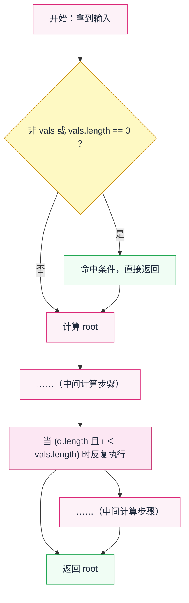

## TypeScript 解题方案（1 个方案逐个讲）

> **运行与提交**：每个方案都是自包含文件（内嵌用例自测，输出 PASS），整块复制到 `.ts` 文件后 `node 文件名` 即可运行。提交 LeetCode 时，把 `demo` 内的算法函数与辅助类型/函数整体取出、置于文件顶层即可。涉及交互/特殊接口的题以题面给定签名为准。

### 方案 1：迭代指针处理

**分析与思路**：核心做法是「迭代指针处理」。代码里依次做这些事：队列或堆的调度。

**运行方式**：`node 本文件`，内嵌用例全部通过会输出 PASS。


**方案专属流程图**（真实控制流）：

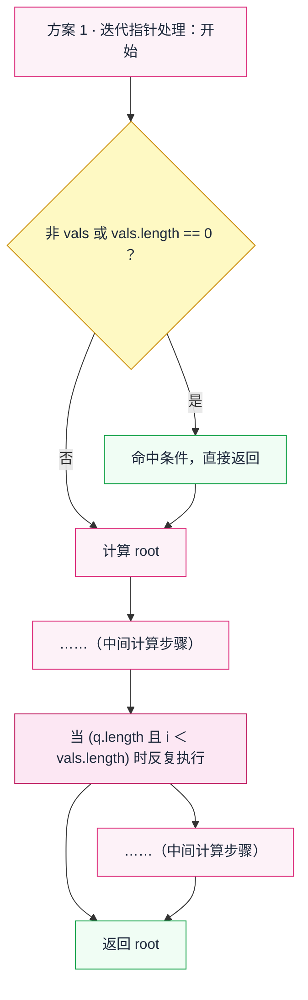

```typescript
class TreeNode {
  // 定义类型
  val: any;
  left: any;
  right: any; // 值: any; 左边界: any; 右边界: any;
  constructor(val?: any, left?: any, right?: any) {
    // constructor(值?: any, 左边界?: any, 右边界?: any) {
    this.val = val === undefined ? 0 : val; // 把 (值 全等于 undefined ? 0 : 值); 写入 值
    this.left = left === undefined ? null : left; // 把 (左边界 全等于 undefined ? null : 左边界); 写入 左边界
    this.right = right === undefined ? null : right; // 把 (右边界 全等于 undefined ? null : 右边界); 写入 右边界
  }
}
function buildTree(vals: any): any {
  // 定义函数/方法 buildTree
  if (!vals || vals.length === 0) return null; // 若 取反 vals 或 vals.长度 全等于 0，直接返回 null
  const root = new TreeNode(vals[0]);
  const q: any[] = [root];
  let i = 1;
  while (q.length && i < vals.length) {
    // 循环，直到不满足「节点.长度 且 下标 i 小于 vals.长度」
    const node = q.shift(); // 把 节点.shift() 存入 节点
    if (vals[i] !== null && vals[i] !== undefined) {
      node.left = new TreeNode(vals[i]);
      q.push(node.left);
    }
    i++; // 下标 i 加一
    if (i < vals.length && vals[i] !== null && vals[i] !== undefined) {
      node.right = new TreeNode(vals[i]);
      q.push(node.right);
    }
    i++; // 下标 i 加一
  }
  return root; // 返回 根节点
}
function treeToLevel(root: any): any[] {
  // 定义函数/方法 treeToLevel
  if (!root) return []; // 若 取反 根节点，直接返回 []
  const out: any[] = [];
  const q: any[] = [root]; // 把 []; const 节点: any[] 赋值为 [根节点]; 写入 const out: any[]
  while (q.length) {
    // 循环，直到不满足「节点.长度」
    const n = q.shift(); // 把 节点.shift() 存入 元素个数
    if (n === null || n === undefined) {
      out.push(null);
      continue;
    }
    out.push(n.val);
    q.push(n.left);
    q.push(n.right); // 把 元素个数.值 压入栈/数组尾部
  }
  while (out.length && out[out.length - 1] === null) out.pop(); // 循环，直到不满足「out.长度 且 out[out.长度 减 1] 全等于 null) out 弹出 );」
  return out; // 返回 out
}
class ListNode {
  // 定义类型
  val: any;
  next: any; // 值: any; 下一个: any;
  constructor(val?: any, next?: any) {
    this.val = val === undefined ? 0 : val;
    this.next = next === undefined ? null : next;
  }
}
function buildList(vals: any): any {
  // 定义函数/方法 buildList
  const dummy = new ListNode(0);
  let cur = dummy; // 把 new ListNode(0); let 当前值 赋值为 哨兵节点 存入 哨兵节点
  for (const v of vals) {
    cur.next = new ListNode(v);
    cur = cur.next;
  } // 把 new ListNode(值); 当前值 赋值为 当前值.下一个; } 写入 下一个
  return dummy.next; // 返回 哨兵节点.下一个
}
function listToArray(head: any): any[] {
  // 定义函数/方法 listToArray
  const out: any[] = [];
  let p = head; // 把 []; let 节点 赋值为 头节点; 写入 const out: any[]
  while (p) {
    out.push(p.val);
    p = p.next;
  } // 循环，直到不满足「节点) { out 追加 节点.值); 节点 赋值为 节点.下一个; }」
  return out; // 返回 out
}
// python-runtime shims
function pyLen(a: any): number {
  // 定义函数/方法 pyLen
  if (a === null || a === undefined) return 0; // 若 数组 全等于 null 或 数组 全等于 undefined，直接返回 0
  if (
    typeof a === 'string' ||
    Array.isArray(a) ||
    a instanceof Set ||
    a instanceof Map
  )
    return a.length ?? a.size;
  if (typeof a === 'object') return Object.keys(a).length; // 若 typeof 数组 全等于 'object'，直接返回 Object.keys(数组).长度
  return 0; // 返回 0
}
function pySlice(a: any, i: any, j: any, step?: any): any {
  // 定义函数/方法 pySlice
  if (typeof a === 'string') {
    const r = [...a].slice(i ?? 0, j ?? a.length);
    return step ? r.reverse().join('') : r.join('');
  }
  const arr = Array.isArray(a) ? a : [...a]; // 把 Array.isArray(数组) ? 数组 : 复制的 数组 存入 数组
  return arr.slice(i ?? 0, j ?? arr.length); // 返回 数组 截取 下标 i ?? 0, 下标 j ?? 数组.长度)
}
function pyRange(a: any, b?: any, step?: any): any[] {
  // 定义函数/方法 pyRange
  let s = 0,
    e = a,
    st = 1; // 把 0, e 赋值为 数组, st 赋值为 1 存入 字符串
  if (b !== undefined) {
    s = a;
    e = b;
  } // 若 b 不等于 undefined) { 字符串 赋值为 数组; e 赋值为 b; }
  if (step !== undefined) st = step; // 若 步数 不等于 undefined) st 赋值为 步数;
  const out: any[] = []; // 把 []; 写入 const out: any[]
  if (st > 0) for (let i = s; i < e; i += st) out.push(i);
  else for (let i = s; i > e; i += st) out.push(i); // 否则
  return out; // 返回 out
}
function pyIn(x: any, coll: any): boolean {
  // 定义函数/方法 pyIn
  if (coll === null || coll === undefined) return false; // 若 coll 全等于 null 或 coll 全等于 undefined，直接返回 false
  if (Array.isArray(coll)) return coll.includes(x); // 若 Array.isArray(coll)，直接返回 coll 是否包含 x)
  if (coll instanceof Set || coll instanceof Map) return coll.has(x); // 若 coll instanceof Set 或 coll instanceof Map，直接返回 coll.has(x)
  if (typeof coll === 'object') return x in coll; // 若 typeof coll 全等于 'object'，直接返回 x in coll
  if (typeof coll === 'string') return coll.indexOf(x) >= 0; // 若 typeof coll 全等于 'string'，直接返回 coll 查找 x) 不低于 0
  return false; // 返回 false
}
function pySorted(a: any): any[] {
  // 定义函数/方法 pySorted
  const arr = typeof a === 'string' ? [...a] : [...a]; // 把 (typeof 数组 全等于 'string') ? 复制的 数组 : 复制的 数组 存入 数组
  return arr.sort((x: any, y: any) => (x < y ? -1 : x > y ? 1 : 0));
}
function pyMin(a: any, b?: any): any {
  if (b !== undefined) return Math.min(a, b);
  if (Array.isArray(a) || a instanceof Set) return Math.min(...a);
  return Math.min(a);
} // 定义函数/方法 pyMin
function pyMax(a: any, b?: any): any {
  if (b !== undefined) return Math.max(a, b);
  if (Array.isArray(a) || a instanceof Set) return Math.max(...a);
  return Math.max(a);
} // 定义函数/方法 pyMax
function pySum(a: any): number {
  let s = 0;
  for (const v of a) s += v;
  return s;
} // 定义函数/方法 pySum
function pyAbs(x: any): number {
  return Math.abs(x);
} // 定义函数/方法 pyAbs
function pyEnumerate(a: any): any[] {
  const out: any[] = [];
  let i = 0;
  for (const v of a) {
    out.push([i, v]);
    i++;
  }
  return out;
} // 定义函数/方法 pyEnumerate
function pyZip(a: any, b: any): any[] {
  const n = Math.min(a.length, b.length);
  const out: any[] = [];
  for (let i = 0; i < n; i++) out.push([a[i], b[i]]);
  return out;
} // 定义函数/方法 pyZip
function pyDictGet(d: any, k: any, def?: any): any {
  return k in d ? d[k] : def === undefined ? null : def;
} // 定义函数/方法 pyDictGet
function pyPrint(...args: any[]): void {
  console.log(
    args
      .map((a) => (typeof a === 'object' && a !== null ? JSON.stringify(a) : a))
      .join(' '),
  );
} // 定义函数/方法 pyPrint
// collections / heapq
function heapPush(h: any[], x: any): void {
  h.push(x);
  let i = h.length - 1;
  while (i > 0) {
    const p = (i - 1) >> 1;
    if (h[p] <= h[i]) break;
    [h[p], h[i]] = [h[i], h[p]];
    i = p;
  }
} // 定义函数/方法 heapPush
function heapPop(h: any[]): any {
  const top = h[0];
  const last = h.pop();
  if (h.length) {
    h[0] = last;
    let i = 0;
    const n = h.length;
    while (true) {
      let l = 2 * i + 1,
        r = 2 * i + 2,
        s = i;
      if (l < n && h[l] < h[s]) s = l;
      if (r < n && h[r] < h[s]) s = r;
      if (s === i) break;
      [h[s], h[i]] = [h[i], h[s]];
      i = s;
    }
  }
  return top;
} // 定义函数/方法 heapPop
class Deque {
  private a: any[] = [];
  push(x: any) {
    this.a.push(x);
  }
  pushLeft(x: any) {
    this.a.unshift(x);
  }
  pop() {
    return this.a.pop();
  }
  popLeft() {
    return this.a.shift();
  }
  get length() {
    return this.a.length;
  }
  toArray() {
    return this.a.slice();
  }
} // 定义类型
function Counter(iter: any): any {
  const m: any = {};
  for (const v of iter) m[v] = (m[v] || 0) + 1;
  return m;
} // 定义函数/方法 Counter
function gcd(a: any, b: any): any {
  while (b) {
    [a, b] = [b, a % b];
  }
  return a;
} // 定义函数/方法 gcd
function pyInf(): number {
  return Infinity;
} // 定义函数/方法 pyInf

function norm(x: any): any {
  // 定义函数/方法 norm
  if (x === null || x === undefined) return null; // 若 x 全等于 null 或 x 全等于 undefined，直接返回 null
  if (typeof x === 'object') {
    // 若 typeof x 全等于 'object'
    if (x instanceof Deque) return x.toArray(); // 若 x instanceof Deque，直接返回 x.toArray()
    if (Array.isArray(x)) return x.map(norm); // 若 Array.isArray(x)，直接返回 x.映射表(norm)
    if (
      typeof x.val === 'number' &&
      (typeof x.left !== 'undefined' || typeof x.right !== 'undefined')
    )
      return treeToLevel(x);
    if (typeof x.next !== 'undefined' && typeof x.val === 'number')
      return listToArray(x);
    if (x instanceof Set) return [...x].sort(); // 若 x instanceof Set，直接返回 复制的 x 排序 )
    if (x instanceof Map) return Object.fromEntries(x); // 若 x instanceof Map，直接返回 Object.fromEntries(x)
    const o: any = {};
    for (const k of Object.keys(x)) o[k] = norm(x[k]);
    return o;
  }
  return x; // 返回 x
}
function eq(a: any, b: any): boolean {
  // 定义函数/方法 eq
  const x = norm(a),
    y = norm(b); // 把 norm(数组), y 赋值为 norm(b) 存入 x
  if (x === y) return true; // 若 x 全等于 y，直接返回 true
  if (x === null || y === null) return x === y; // 若 x 全等于 null 或 y 全等于 null，直接返回 x 全等于 y
  if (Array.isArray(x) && Array.isArray(y)) {
    // 若 Array.isArray(x) 且 Array.isArray(y
    if (x.length !== y.length) return false; // 若 x.长度 不等于 y.长度，直接返回 false
    for (let i = 0; i < x.length; i++) if (!eq(x[i], y[i])) return false; // 让 下标 i 从 0 开始计数，下标 i 小于 x.长度 就继续
    return true; // 返回 true
  }
  if (typeof x === 'object' && typeof y === 'object') {
    // 若 typeof x 全等于 'object' 且 typeof y 全等于 'object'
    const kx = Object.keys(x),
      ky = Object.keys(y); // 把 Object.keys(x), ky 赋值为 Object.keys(y) 存入 kx
    if (kx.length !== ky.length) return false; // 若 kx.长度 不等于 ky.长度，直接返回 false
    for (const k of kx) if (!eq(x[k], y[k])) return false;
    return true; // 返回 true
  }
  return x === y; // 返回 x 全等于 y
}

function findMaximizedCapital(k, w, profits, capital) {
  // 定义函数/方法 findMaximizedCapital
  const n = profits.length; // 把 profits.长度 存入 元素个数
  const projects = []; // 把 [] 存入 projects
  for (let i = 0; i < n; i++) projects.push([capital[i], profits[i]]); // 让 下标 i 从 0 开始计数，下标 i 小于 元素个数 就继续
  projects.sort((a, b) => a[0] - b[0]);
  const pq = []; // 把 [] 存入 优先队列
  let i = 0; // 把 0 存入 下标 i
  for (let t = 0; t < k; t++) {
    // 让 另一字符串 从 0 开始计数，另一字符串 小于 下标 k 就继续
    while (i < n && projects[i][0] <= w) {
      heapPush(pq, -projects[i][1]);
      i++;
    }
    if (!pq.length) break; // 若 取反 优先队列.长度) break;
    w += -heapPop(pq); // 权重累加 减 heapPop(优先队列)
  }
  return w; // 返回 权重
}
export function demo(): void {
  // 程序入口：跑内嵌自测用例
  const cases = [
    { in: [2, 0, [1, 2, 3], [0, 1, 1]], want: 4 },
    { in: [3, 0, [1, 2, 3], [0, 1, 2]], want: 6 },
    { in: [1, 0, [1, 2], [1, 2]], want: 0 },
    { in: [2, 1, [1, 2, 3], [1, 1, 2]], want: 6 },
  ];
  let fail = false; // 把 false 存入 fail
  for (const c of cases) {
    // for (const 字符 of cases) {
    const got = findMaximizedCapital(...c.in); // 把 findMaximizedCapital(...字符.in) 存入 got
    if (!eq(got, c.want)) {
      fail = true;
      console.log(
        'FAIL',
        JSON.stringify(c.in),
        '=>',
        JSON.stringify(got),
        'want',
        JSON.stringify(c.want),
      );
    }
  }
  if (fail) throw new Error('FAILED'); // 若 fail) throw new Error('FAILED');
  console.log('PASS'); // 全部用例通过，输出 PASS
}
demo(); // demo();
```

## 逐步拆解与面试追问

**复杂度**：时间 O(n)（单趟线性扫描），空间 O(1) 到 O(n)（视辅助结构）

**为什么是这个量级**：每个元素被常数次访问，辅助哈希或栈的开销与 n 同阶

**面试官可能会追问**：

- 什么时候用堆而不是排序？
- 堆里存值还是存下标？
- Top-K 用小顶还是大顶堆？

## 关键 API 速查（TS 主解法实际用到，附官方链接）

| API | 作用 | 使用要点 | 官方文档 |
|---|---|---|---|
| `Array.prototype.sort()` | 原地排序 | 默认按字符串 Unicode 序（10 会排在 2 前），数字必须传 (a,b)=>a-b；V8 用 TimSort，稳定，O(n log n)；返回原数组引用 | [官方文档](https://developer.mozilla.org/zh-CN/docs/Web/JavaScript/Reference/Global_Objects/Array/sort) |
| `Array.prototype.map()` | 逐元素映射为新数组 | 回调 (v,i,arr)；返回等长新数组，不改变原数组；稀疏位跳过；链式调用注意中间数组开销 | [官方文档](https://developer.mozilla.org/zh-CN/docs/Web/JavaScript/Reference/Global_Objects/Array/map) |
| `Array.prototype.push()` | 尾部追加 | 返回新长度；可一次多个；均摊 O(1)；会改变原数组 | [官方文档](https://developer.mozilla.org/zh-CN/docs/Web/JavaScript/Reference/Global_Objects/Array/push) |
| `Array.prototype.pop()` | 尾部弹出 | 返回被删元素（空数组返回 undefined）；O(1) | [官方文档](https://developer.mozilla.org/zh-CN/docs/Web/JavaScript/Reference/Global_Objects/Array/pop) |
| `Array.prototype.shift()` | 头部取出 | O(n)（后续元素整体前移）；大量头部操作请用链表或双端结构 | [官方文档](https://developer.mozilla.org/zh-CN/docs/Web/JavaScript/Reference/Global_Objects/Array/shift) |
| `Array.prototype.unshift()` | 头部插入 | O(n)；与 shift 组合可当双端队列 | [官方文档](https://developer.mozilla.org/zh-CN/docs/Web/JavaScript/Reference/Global_Objects/Array/unshift) |
| `Array/String includes()` | 是否包含 | 数组用 SameValueZero（NaN 可判）；字符串按子串；第二个参数为起始下标 | [官方文档](https://developer.mozilla.org/zh-CN/docs/Web/JavaScript/Reference/Global_Objects/Array/includes) |
| `Array/String indexOf()` | 首次出现的下标 | 找不到返回 -1；无法判 NaN（用 includes）；字符串可传起始位 | [官方文档](https://developer.mozilla.org/zh-CN/docs/Web/JavaScript/Reference/Global_Objects/Array/indexOf) |
| `Array/String slice()` | 切片（不改原数组） | slice(start,end) 含头不含尾；负数从尾计；常用于复制数组（slice()） | [官方文档](https://developer.mozilla.org/zh-CN/docs/Web/JavaScript/Reference/Global_Objects/Array/slice) |
| `Array.prototype.join()` | 数组拼接为字符串 | undefined/null 转空串；嵌套数组会展平一层；join('') 用于字符数组还原 | [官方文档](https://developer.mozilla.org/zh-CN/docs/Web/JavaScript/Reference/Global_Objects/Array/join) |
| `Object.keys()` | 对象键名数组 | 仅自身可枚举字符串键（不含 symbol）；配 length 可当计数器 | [官方文档](https://developer.mozilla.org/zh-CN/docs/Web/JavaScript/Reference/Global_Objects/Object/keys) |
| `Object.fromEntries()` | 键值对数组转对象 | 参数为 [k,v] 可迭代；map 出来的键值对可直接转对象 | [官方文档](https://developer.mozilla.org/zh-CN/docs/Web/JavaScript/Reference/Global_Objects/Object/fromEntries) |
| `JSON.stringify()` | 序列化为 JSON 字符串 | 常用于结构化比较（深度相等判定）；undefined/函数/循环引用会被丢弃或抛错 | [官方文档](https://developer.mozilla.org/zh-CN/docs/Web/JavaScript/Reference/Global_Objects/JSON/stringify) |
| `Math.max()` | 最大值 | 配展开 Math.max(...arr)；空参返回 -Infinity；超大数组注意展开参数上限 | [官方文档](https://developer.mozilla.org/zh-CN/docs/Web/JavaScript/Reference/Global_Objects/Math/max) |
| `Math.min()` | 最小值 | 同 max；空参返回 Infinity | [官方文档](https://developer.mozilla.org/zh-CN/docs/Web/JavaScript/Reference/Global_Objects/Math/min) |
| `Math.abs()` | 绝对值 | 入参会被隐式转数字；-0 返回 +0 | [官方文档](https://developer.mozilla.org/zh-CN/docs/Web/JavaScript/Reference/Global_Objects/Math/abs) |

### 各语言官方文档导航

- **TypeScript / JS**：[MDN 中文参考](https://developer.mozilla.org/zh-CN/)
- **Python**：[Python 官方文档](https://docs.python.org/zh-cn/3/)
- **Go**：[Go 标准库](https://pkg.go.dev/std)
- **Java**：[JDK 17 API](https://docs.oracle.com/en/java/javase/17/docs/api/)
- **Rust**：[Rust 标准库](https://doc.rust-lang.org/std/)
- **Lua**：[Lua 5.4 手册](https://www.lua.org/manual/5.4/)
- **C**：[Cppreference C](https://zh.cppreference.com/w/c)
- **C++**：[Cppreference C++](https://zh.cppreference.com/w/cpp)
- **R**：[R 官方手册](https://stat.ethz.ch/R-manual/)
- **Zig**：[Zig 语言文档](https://ziglang.org/documentation/master/)
- **Dart**：[Dart API](https://api.dart.dev/)

## 附录：其他 10 种语言全部实现（每种语言列举其全部方案）

> TypeScript 的全部方案见「TypeScript 解题方案」一节；下面是其余 10 种语言的对应实现，每种语言的每个方案都带思路分析、代码走读与专属运行架构图。
> 每个方案都内嵌用例自测，可独立运行（老仓库 python/go 文件遵循「打印结果」约定）。
> 完整解法文件见 `dsa/<语言>/heap/lc_502_ipo/`。

### Python 实现（1 种方案）

Python 的全部方案如下，每个方案都内嵌用例自测，可独立运行（老仓库 python/go 文件遵循「打印结果」约定）：

#### 方案 1：迭代指针处理

**思路与代码分析**：核心是「迭代指针处理」。Python 版用切片与字典推导式简化操作，突出可读性。代码里依次做这些事：先排序再处理；队列或堆的调度。**走读**：方案 1 · 迭代指针处理：开始 → 更新 n → 循环 _：从 0 到 k 前 → 当 ( 时反复执行 → 返回 w。

**运行架构**（真实控制流）：

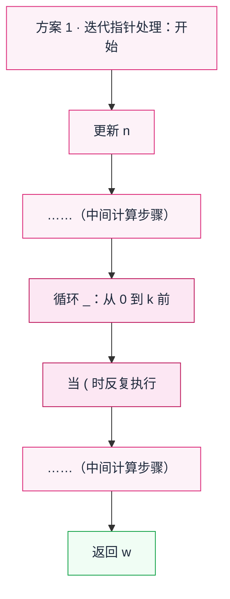

```python
import sys  # 提高递归深度上限（深输入防 RecursionError）

sys.setrecursionlimit(200000)  # 树/链表类题目节点数可达 1e4 量级
import heapq  # 引入依赖

def findMaximizedCapital(
    k, w, profits, capital
):  # 定义函数 findMaximizedCapital（参数：下标 k, 权重, profits, capital）
    n = len(profits)  # 把 长度(profits) 存入 元素个数
    # 按资本升序排列
    indices = sorted(range(n), key=lambda i: capital[i])
    # 最大堆（Python只有最小堆，用负数模拟）
    max_heap = []  # 把 [] 存入 max_heap
    i = 0  # 把 0 存入 下标 i
    for _ in range(k):  # 让 _ 从 下标 k 遍历
        # 将所有当前资本可以启动的项目加入最大堆
        while (
            i < n and capital[indices[i]] <= w
        ):  # 循环，直到不满足「下标 i 小于 元素个数 and capital[indices[下标 i]] 不超过 权重」
            heapq.heappush(
                max_heap, -profits[indices[i]]
            )  # heapq.heappush(max_heap, 减 profits[indices[下标 i]])
            i += 1  # 下标 i累加 1
        if not max_heap:  # 若 not max_heap
            break  # 跳出循环
        # 选择利润最大的项目
        w += -heapq.heappop(max_heap)  # 权重累加 减 heapq.heappop(max_heap)
    return w  # 返回 权重

if __name__ == "__main__":  # 若 __name__ 等于 '__main__'
    print(findMaximizedCapital(2, 0, [1, 2, 3], [0, 1, 1]))  # 打印输出
```

### Go 实现（1 种方案）

Go 的全部方案如下，每个方案都内嵌用例自测，可独立运行（老仓库 python/go 文件遵循「打印结果」约定）：

#### 方案 1：迭代指针处理

**思路与代码分析**：核心是「迭代指针处理」。Go 版用切片与多返回值惯用法，显式处理索引边界。代码里依次做这些事：队列或堆的调度。**走读**：方案 1 · 迭代指针处理：开始 → 更新 : → 遍历循环 → 返回 capital[indices[a]] ＜ capital[indices[b]] → 遍历循环 → 遍历循环 → 返回 w。

**运行架构**（真实控制流）：

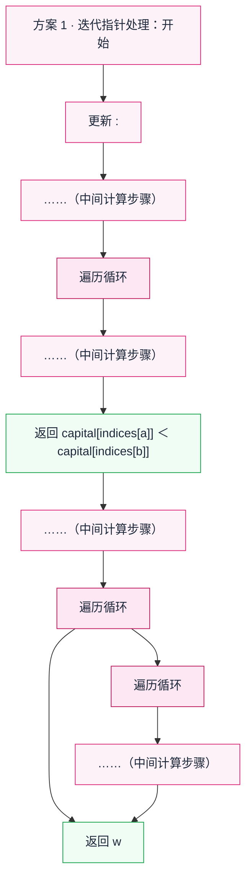

```go
package main // 引入依赖

import (
	"container/heap" // 「container 除以 堆」
	"fmt"            // 「fmt」
	"sort"           // 「sort」
)

type pHeap []int // 定义类型

func (h pHeap) Len() int           { return len(h) }            // 定义函数/方法 Len
func (h pHeap) Less(i, j int) bool { return h[i] > h[j] }       // 定义函数/方法 Less
func (h pHeap) Swap(i, j int)      { h[i], h[j] = h[j], h[i] }  // 定义函数/方法 Swap
func (h *pHeap) Push(x any)        { *h = append(*h, x.(int)) } // 定义函数/方法 Push
func (h *pHeap) Pop() any { // 定义函数/方法 Pop
	old := *h      // 把 乘 h 写入 old :
	n := len(old)  // 把 长度(old) 写入 n :
	it := old[n-1] // 把 old[元素个数 减 1] 写入 it :
	*h = old[:n-1]
	return it // 返回 it
}

func findMaximizedCapital(k int, w int, profits []int, capital []int) int { // 定义函数/方法 findMaximizedCapital
	n := len(profits)         // 把 长度(profits) 写入 n :
	indices := make([]int, n) // 把 make([]int, 元素个数) 写入 indices :
	for i := 0; i < n; i++ {  // 让 下标 i 从 0 开始计数
		indices[i] = i // 把 下标 i 写入 indices[i]
	}
	sort.Slice(indices, func(a, b int) bool { // sort.Slice(indices, func(数组, b int) bool {
		return capital[indices[a]] < capital[indices[b]] // 返回 capital[indices[数组]] 小于 capital[indices[b]]
	}) // })
	maxHeap := &pHeap{}      // 把 按位与 pHeap{} 写入 maxHeap :
	heap.Init(maxHeap)       // 堆.Init(maxHeap)
	i := 0                   // 把 0 写入 i :
	for t := 0; t < k; t++ { // 让 另一字符串 从 0 开始计数
		for i < n && capital[indices[i]] <= w { // 把 权重 { 写入 for i < n && capital[indices[i]] <
			heap.Push(maxHeap, profits[indices[i]]) // 堆.Push(maxHeap, profits[indices[下标 i]])
			i++                                     // 下标 i 加一
		}
		if maxHeap.Len() == 0 { // 若 maxHeap.Len() 等于 0
			break // 跳出循环
		}
		w += heap.Pop(maxHeap).(int) // 权重累加 堆.Pop(maxHeap).(int)
	}
	return w // 返回 权重
}

func main() { // 程序入口：跑内嵌自测用例
	type tc struct { // 定义类型
		k       int   // 下标 k int
		w       int   // 权重 int
		profits []int // profits []int
		capital []int // capital []int
		want    int   // want int
	}
	cases := []tc{ // 把 []tc{ 写入 cases :
		{2, 0, []int{1, 2, 3}, []int{0, 1, 1}, 4},
	}
	ok := true                // 把 true 写入 ok :
	for _, c := range cases { // 同时取 _ 与 字符 遍历
		got := findMaximizedCapital(c.k, c.w, c.profits, c.capital)
		if got != c.want { // 若 got 不等于 字符.want
			ok = false                                       // 把 false 写入 ok
			fmt.Printf("FAIL got=%d want=%d\n", got, c.want) // 打印输出
		}
	}
	if !ok { // 若 取反 ok
		panic("FAILED") // panic(「FAILED」)
	}
	fmt.Println("PASS") // 全部用例通过，输出 PASS
}
```

### Java 实现（1 种方案）

Java 的全部方案如下，每个方案都内嵌用例自测，可独立运行（老仓库 python/go 文件遵循「打印结果」约定）：

#### 方案 1：迭代指针处理

**思路与代码分析**：核心是「迭代指针处理」。Java 版用类与静态方法组织，集合操作显式明了。代码里依次做这些事：先排序再处理；双重循环遍历。**走读**：方案 1 · 迭代指针处理：开始 → 更新 n → 更新 indices → 遍历循环 → 排序整理 → 更新 maxHeap → 更新 i → 遍历循环 → 当 (i ＜ n 时反复执行 → 更新 < → 调用 maxHeap.offer(profits[indice → 处理 i++ → 若 maxHeap.isEmpty()：处理 break → 更新 + → 返回 w。

**运行架构**（真实控制流）：

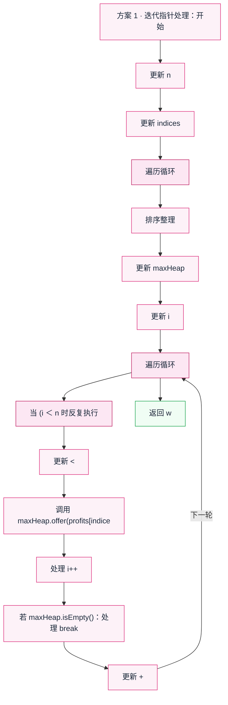

```java
package com.webfault.dsa; // 引入依赖

import java.util.*; // 引入依赖

class lc502_solution1 { // 定义类型
  public int findMaximizedCapital(
      int k, int w, int[] profits, int[] capital) { // 定义函数/方法 findMaximizedCapital
    int n = profits.length; // 把 profits.长度 存入 元素个数
    Integer[] indices = new Integer[n]; // 把 new Integer[元素个数]; 写入 Integer[] indices
    for (int i = 0; i < n; i++) indices[i] = i; // 让 下标 i 从 0 开始计数，下标 i 小于 元素个数 就继续
    Arrays.sort(indices, (a, b) -> capital[a] - capital[b]); // 排序
    PriorityQueue<Integer> maxHeap = new PriorityQueue<>((a, b) -> b - a);
    int i = 0; // 把 0 存入 下标 i
    for (int t = 0; t < k; t++) { // 让 另一字符串 从 0 开始计数，另一字符串 小于 下标 k 就继续
      while (i < n
          && capital[indices[i]] <= w) { // 循环，直到不满足「下标 i 小于 元素个数 且 capital[indices[下标 i]] 不超过 权重」
        maxHeap.offer(profits[indices[i]]); // maxHeap.offer(profits[indices[下标 i]]);
        i++; // 下标 i 加一
      }
      if (maxHeap.isEmpty()) break; // 若 maxHeap.isEmpty()) break;
      w += maxHeap.poll(); // 权重累加 maxHeap.poll()
    }
    return w; // 返回 权重
  }

  public static void main(String[] args) { // public static void main(String[] args) {
    lc502_solution1 s = new lc502_solution1(); // 把 new lc502_solution1(); 写入 lc502_solution1 s
    int[][] cases = { // 把 { 写入 int[][] cases
      {2, 0, 4}, // k, w, want  (profits/capital follow)
    };
    // cases: (k, w, profits[], capital[], want)
    Object[] t1 = new Object[] {2, 0, new int[] {1, 2, 3}, new int[] {0, 1, 1}, 4};
    Object[] t2 = new Object[] {1, 0, new int[] {1, 2, 3}, new int[] {1, 2, 3}, 0};
    Object[] t3 = new Object[] {3, 0, new int[] {1, 2, 3}, new int[] {0, 1, 1}, 6};
    Object[][] tests = {t1, t2, t3}; // 把 {t1, t2, t3}; 写入 Object[][] tests
    boolean ok = true; // 把 true; 写入 boolean ok
    for (Object[] t : tests) { // for (Object[] 另一字符串 : tests) {
      int k = (int) t[0]; // 把 (int) 另一字符串[0] 存入 下标 k
      int w = (int) t[1]; // 把 (int) 另一字符串[1] 存入 权重
      int[] profits = (int[]) t[2]; // 把 (int[]) 另一字符串[2]; 写入 int[] profits
      int[] capital = (int[]) t[3]; // 把 (int[]) 另一字符串[3]; 写入 int[] capital
      int want = (int) t[4]; // 把 (int) 另一字符串[4] 存入 want
      int got = s.findMaximizedCapital(k, w, profits, capital);
      if (got != want) { // 若 got 不等于 want
        ok = false; // 把 false; 写入 ok
        System.out.println(
            "FAIL findMaximizedCapital(" + k + "," + w + ")=" + got + " want " + want); // 打印输出
      }
    }
    if (!ok) throw new RuntimeException("FAILED"); // 若 取反 ok) throw new RuntimeException(「FAILED」);
    System.out.println("PASS"); // 全部用例通过，输出 PASS
  }
}
```

### Rust 实现（1 种方案）

Rust 的全部方案如下，每个方案都内嵌用例自测，可独立运行（老仓库 python/go 文件遵循「打印结果」约定）：

#### 方案 1：迭代指针处理

**思路与代码分析**：核心是「迭代指针处理」。Rust 版用所有权移动与切片借用改写同一逻辑，注意 Option 与引用边界。代码里依次做这些事：先排序再处理。**走读**：方案 1 · 迭代指针处理：开始 → 计算 n → 当 k ＞ 0 时反复执行 → 遍历 0..n as i64 中的每个元素 j → 返回结果。

**运行架构**（真实控制流）：

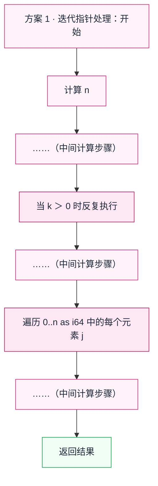

```rust
// LeetCode 502. IPO — Rust 版（方案1）
fn find_maximized_capital(mut k: i32, mut w: i64, profits: &[i64], capital: &[i64]) -> i64 {
    // 定义函数/方法 find_maximized_capital
    let n = profits.len(); // 把 profits.长度() 存入 元素个数
    let mut projects: Vec<(i64, i64)> = (0..n).map(|i| (capital[i], profits[i])).collect();
    projects.sort(); // 排序
    let mut i = 0usize; // 把 0usize; 写入 let mut i
    while k > 0 {
        // while 下标 k 超过 0 {
        // 选可用项目中利润最大者（等价于最大堆）
        let mut best: i64 = -1; // 把 减 1; 写入 let mut best: i64
        let mut best_j: i64 = -1; // 把 减 1; 写入 let mut best_j: i64
        for j in 0..n as i64 {
            // 逐个取出 0 的元素（下标 j）
            if projects[j as usize].0 <= w && projects[j as usize].1 > best {
                best = projects[j as usize].1; // 把 projects[下标 j as usize].1; 写入 当前最优
                best_j = j; // 把 下标 j; 写入 best_j
            }
        }
        if best_j < 0 {
            break;
        } // 若 best_j 小于 0 { break; }
        w += best; // 权重累加 当前最优
        projects[best_j as usize].0 = i64::MAX; // 标记已用
        k -= 1; // 下标 k累减 1
    }
    w // 权重
}
fn main() {
    // 程序入口：跑内嵌自测用例
    assert_eq!(find_maximized_capital(2, 0, &[1, 2, 3], &[0, 1, 1]), 4); // 断言校验
    assert_eq!(find_maximized_capital(3, 0, &[1, 2, 3], &[0, 1, 2]), 6); // 断言校验
    assert_eq!(find_maximized_capital(1, 0, &[1, 2], &[1, 2]), 0); // 断言校验
    assert_eq!(find_maximized_capital(2, 1, &[1, 2, 3], &[1, 1, 2]), 6); // 断言校验
    println!("PASS"); // 全部用例通过，输出 PASS
}
```

### Lua 实现（1 种方案）

Lua 的全部方案如下，每个方案都内嵌用例自测，可独立运行（老仓库 python/go 文件遵循「打印结果」约定）：

#### 方案 1：迭代指针处理

**思路与代码分析**：核心是「迭代指针处理」。Lua 版用表与 ipairs 遍历，注意 ipairs 遇 nil 即停的语义。**走读**：方案 1 · 迭代指针处理：开始 → 更新 n → 更新 used → 循环 _：从 1 到 k do → 更新 best_j → 循环 j：从 1 到 n do → 处理 if not used[j] and capital[j → 更新 best → 更新 best_j → 处理 if best_j ＜ 0 then → 跳出循环（break） → 更新 w → 更新 used[best_j] → 返回 w。

**运行架构**（真实控制流）：

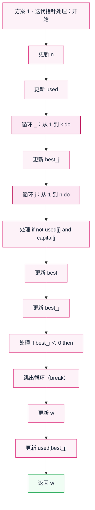

```lua
-- LeetCode 502. IPO — Lua 版（方案1）
local function find_maximized_capital(k, w, profits, capital)
	local n = #profits -- 把 #profits 写入 local n
	local used = {} -- 把 {} 写入 local used
	for _ = 1, k do -- 让 _ 从 1 走到 下标 k（Lua 1 基）
		local best, best_j = -1, -1 -- 把 减 1, 减 1 写入 local best, best_j
		for j = 1, n do -- 让 下标 j 从 1 走到 元素个数（Lua 1 基）
			if not used[j] and capital[j] <= w and profits[j] > best then
				best = profits[j] -- 把 profits[下标 j] 存入 当前最优
				best_j = j -- 把 下标 j 存入 best_j
			end -- 终点
		end -- 终点
		if best_j < 0 then
			break
		end -- 若 best_j 小于 0 then break 终点
		w = w + best -- 把 权重 加 当前最优 存入 权重
		used[best_j] = true -- 把 true 写入 used[best_j]
	end -- 终点
	return w -- 返回 权重
end -- 终点
assert(find_maximized_capital(2, 0, { 1, 2, 3 }, { 0, 1, 1 }) == 4) -- 断言校验
assert(find_maximized_capital(3, 0, { 1, 2, 3 }, { 0, 1, 2 }) == 6) -- 断言校验
assert(find_maximized_capital(1, 0, { 1, 2 }, { 1, 2 }) == 0) -- 断言校验
assert(find_maximized_capital(2, 1, { 1, 2, 3 }, { 1, 1, 2 }) == 6) -- 断言校验
print("PASS") -- 全部用例通过，输出 PASS
```

### C 实现（1 种方案）

C 的全部方案如下，每个方案都内嵌用例自测，可独立运行（老仓库 python/go 文件遵循「打印结果」约定）：

#### 方案 1：迭代指针处理

**思路与代码分析**：核心是「迭代指针处理」。C 版手动管理下标与内存，循环边界全部显式写出。代码里依次做这些事：双重循环遍历。**走读**：方案 1 · 迭代指针处理：开始 → 更新 used[64] → 遍历循环 → 更新 best → 更新 best_j → 遍历循环 → 若 非 used[j] 且 capital[j] ≤ w 且 profits[j] ＞ best 则： → 更新 best → 更新 best_j → 若 best_j ＜ 0：处理 break → 跳出循环（break） → 更新 + → 更新 used[best_j] → 返回 w。

**运行架构**（真实控制流）：

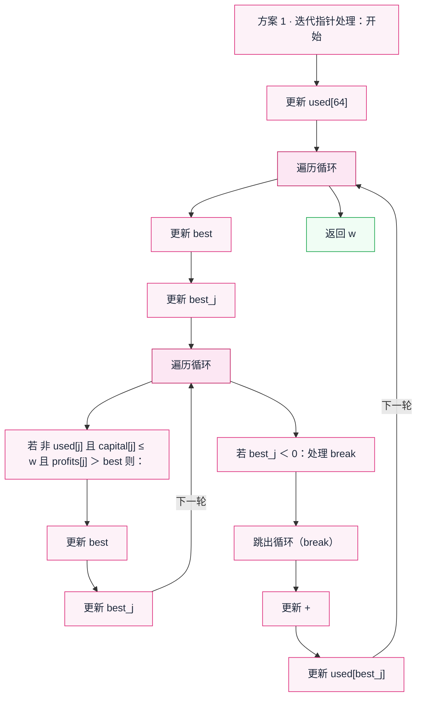

```c
/* LeetCode 502. IPO — C 版（方案1） */
#include <stdio.h> // 引入头文件
static long find_maximized_capital(int k, long w, const long *profits, const long *capital,
                                   int n) { // 定义函数/方法 find_maximized_capital
    int used[64] = {0};                     // 把 {0}; 写入 int used[64]
    for (int t = 0; t < k; t++) { // 让 另一字符串 从 0 开始计数，另一字符串 小于 下标 k 就继续
        long best = -1;           // 把 减 1; 写入 long best
        int best_j = -1;          // 把 减 1 存入 best_j
        for (int j = 0; j < n; j++) { // 让 下标 j 从 0 开始计数，下标 j 小于 元素个数 就继续
            if (!used[j] && capital[j] <= w && profits[j] > best) {
                best = profits[j];
                best_j = j;
            }
        }
        if (best_j < 0)
            break;        // 若 best_j 小于 0) break;
        w += best;        // 权重累加 当前最优
        used[best_j] = 1; // 把 1; 写入 used[best_j]
    }
    return w; // 返回 权重
}
int main(void) { // 程序入口：跑内嵌自测用例
    if (find_maximized_capital(2, 0, (long[]){1, 2, 3}, (long[]){0, 1, 1}, 3) != 4) {
        printf("FAIL 1\n");
        return 1;
    }
    if (find_maximized_capital(3, 0, (long[]){1, 2, 3}, (long[]){0, 1, 2}, 3) != 6) {
        printf("FAIL 2\n");
        return 1;
    }
    if (find_maximized_capital(1, 0, (long[]){1, 2}, (long[]){1, 2}, 2) != 0) {
        printf("FAIL 3\n");
        return 1;
    }
    if (find_maximized_capital(2, 1, (long[]){1, 2, 3}, (long[]){1, 1, 2}, 3) != 6) {
        printf("FAIL 4\n");
        return 1;
    }
    printf("PASS\n"); // 全部用例通过，输出 PASS
    return 0;         // 返回 0
}
```

### C++ 实现（1 种方案）

C++ 的全部方案如下，每个方案都内嵌用例自测，可独立运行（老仓库 python/go 文件遵循「打印结果」约定）：

#### 方案 1：迭代指针处理

**思路与代码分析**：核心是「迭代指针处理」。C++ 版用 STL 容器与迭代器，减少手写下标错误。代码里依次做这些事：双重循环遍历。**走读**：方案 1 · 迭代指针处理：开始 → 更新 n → 处理 std::vector＜bool＞ used(n, fa → 遍历循环 → 更新 best → 更新 best_j → 遍历循环 → 若 非 used[j] 且 capital[j] ≤ w 且 profits[j] ＞ best 则： → 更新 best → 更新 best_j → 若 best_j ＜ 0：处理 break → 跳出循环（break） → 更新 + → 更新 used[best_j] → 返回 w。

**运行架构**（真实控制流）：

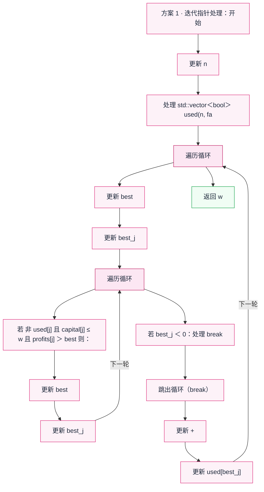

```cpp
// LeetCode 502. IPO — C++ 版（方案1）
#include <cassert>  // 引入头文件
#include <iostream> // 引入头文件
#include <vector>   // 引入头文件
static long long findMaximizedCapital(int k, long long w, const std::vector<long long> &profits,
                                      const std::vector<long long> &capital) {
    int n = static_cast<int>(profits.size()); // 把 static_cast 小于 int 超过 (profits.大小()) 存入 元素个数
    std::vector<bool> used(n, false); // std::vector 小于 bool 超过 已用标记(元素个数, false);
    for (int t = 0; t < k; ++t) { // 让 另一字符串 从 0 开始计数，另一字符串 小于 下标 k 就继续
        long long best = -1;          // 把 减 1 存入 当前最优
        int best_j = -1;              // 把 减 1 存入 best_j
        for (int j = 0; j < n; ++j) { // 让 下标 j 从 0 开始计数，下标 j 小于 元素个数 就继续
            if (!used[j] && capital[j] <= w && profits[j] > best) {
                best = profits[j];
                best_j = j;
            }
        }
        if (best_j < 0)
            break;           // 若 best_j 小于 0) break;
        w += best;           // 权重累加 当前最优
        used[best_j] = true; // 把 true; 写入 used[best_j]
    }
    return w; // 返回 权重
}
int main() {                                                       // 程序入口：跑内嵌自测用例
    assert(findMaximizedCapital(2, 0, {1, 2, 3}, {0, 1, 1}) == 4); // 断言校验
    assert(findMaximizedCapital(3, 0, {1, 2, 3}, {0, 1, 2}) == 6); // 断言校验
    assert(findMaximizedCapital(1, 0, {1, 2}, {1, 2}) == 0);       // 断言校验
    assert(findMaximizedCapital(2, 1, {1, 2, 3}, {1, 1, 2}) == 6); // 断言校验
    std::cout << "PASS" << std::endl;                              // 全部用例通过，输出 PASS
    return 0;                                                      // 返回 0
}
```

### R 实现（1 种方案）

R 的全部方案如下，每个方案都内嵌用例自测，可独立运行（老仓库 python/go 文件遵循「打印结果」约定）：

#### 方案 1：迭代指针处理

**思路与代码分析**：核心是「迭代指针处理」。R 版用向量化思维与 1 起始下标，注意 1:n 的降序陷阱。代码里依次做这些事：双重循环遍历。**走读**：方案 1 · 迭代指针处理：开始 → 处理 n ＜- length(profits) → 处理 used ＜- rep(FALSE, n) → 循环 t：遍历 seq_len(k) → 处理 best ＜- -1 → 处理 best_j ＜- -1 → 循环 j：遍历 seq_len(n) → 若 非 used[j] 且 capital[j] ≤ w 且 profits[j] ＞ best 则： → 处理 best ＜- profits[j] → 处理 best_j ＜- j → 若 best_j ＜ 0：处理 break → 跳出循环（break） → 处理 w ＜- w + best → 处理 used[best_j] ＜- TRUE → 处理 w → 返回结果。

**运行架构**（真实控制流）：

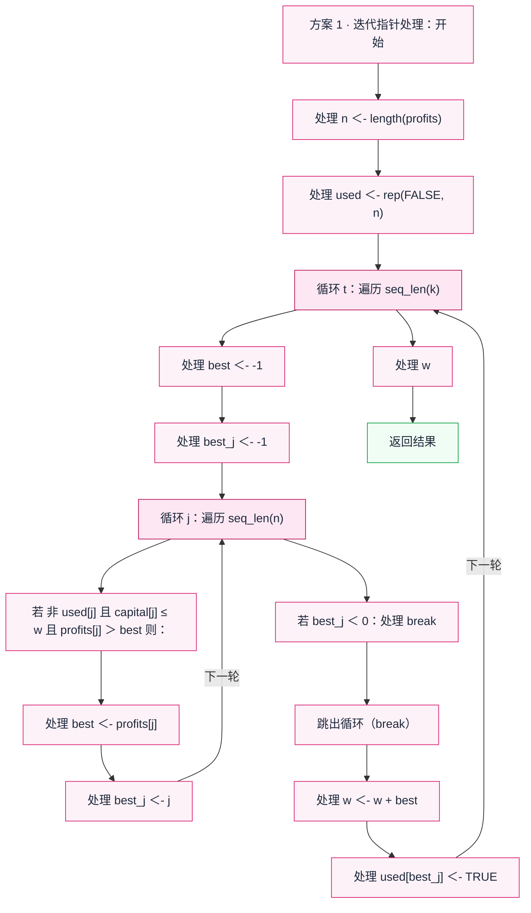

```r
# 定义函数 find_maximized_capital（参数：下标 k, 权重, profits, capital）
find_maximized_capital <- function(k, w, profits, capital) {
    n <- length(profits)  # 把 长度(profits) 存入 元素个数
    used <- rep(FALSE, n)  # 把 rep(FALSE, 元素个数) 存入 已用标记
    for (t in seq_len(k)) {
        # for (另一字符串 in seq_len(下标 k)) {
        best <- -1
        best_j <- -1  # 把 减 1; best_j 小于 减 减 1 存入 当前最优
        for (j in seq_len(n)) {
            # for (下标 j in seq_len(元素个数)) {
            if (!used[j] && capital[j] <= w && profits[j] > best) {
                best <- profits[j]
                best_j <- j
            }
        }
        if (best_j < 0)
            break  # 若 best_j 小于 0) break
        w <- w + best  # 把 权重 加 当前最优 存入 权重
        used[best_j] <- TRUE  # 把 TRUE 存入 used[best_j]
    }
    w  # 权重
}
stopifnot(find_maximized_capital(2, 0, c(1, 2, 3), c(0, 1, 1)) == 4)  # 断言校验
stopifnot(find_maximized_capital(3, 0, c(1, 2, 3), c(0, 1, 2)) == 6)  # 断言校验
stopifnot(find_maximized_capital(1, 0, c(1, 2), c(1, 2)) == 0)  # 断言校验
stopifnot(find_maximized_capital(2, 1, c(1, 2, 3), c(1, 1, 2)) == 6)  # 断言校验
cat("PASS\n")  # 全部用例通过，输出 PASS
```

### Zig 实现（1 种方案）

Zig 的全部方案如下，每个方案都内嵌用例自测，可独立运行（老仓库 python/go 文件遵循「打印结果」约定）：

#### 方案 1：迭代指针处理

**思路与代码分析**：核心是「迭代指针处理」。Zig 版显式分配与清零，整型边界处理严格。代码里依次做这些事：单循环线性扫描。**走读**：方案 1 · 迭代指针处理：开始 → 计算 w → 计算 used → 计算 t → 当 (t ＜ k) : (t += 1) 时反复执行 → 计算 best → 计算 best_j → 遍历集合元素 → 若 非 used[j] and capital[j] ≤ w and p ＞ best 则： → 更新 best → 更新 best_j → 若 best_j ＜ 0：处理 break → 更新 + → 更新 used[@intCast(best_j)] → 返回 w。

**运行架构**（真实控制流）：

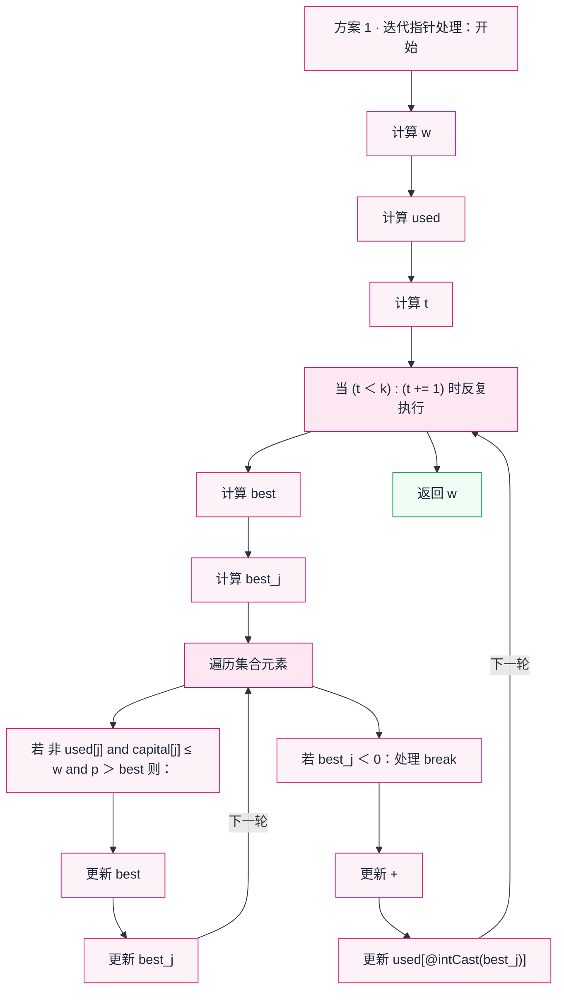

```zig
// LeetCode 502. IPO — Zig 版（方案1）
const std = @import("std"); // 把 @import(「std」) 存入 std
fn findMaximizedCapital(k: i32, w0: i64, profits: []const i64, capital: []const i64) i64 { // 定义函数/方法 findMaximizedCapital
    var w = w0; // 把 w0 存入 权重
    var used = [_]bool{false} ** 64; // 把 [_]bool{false} 乘 乘 64 存入 已用标记
    var t: i32 = 0; // 把 0; 写入 var t: i32
    while (t < k) : (t += 1) { // 循环，直到不满足「另一字符串 小于 下标 k) : (另一字符串 累加 1」
        var best: i64 = -1; // 把 减 1; 写入 var best: i64
        var best_j: i64 = -1; // 把 减 1; 写入 var best_j: i64
        for (profits, 0..) |p, j| { // for (profits, 0..) 按位或 节点, 下标 j 按位或 {
            if (!used[j] and capital[j] <= w and p > best) {
                best = p;
                best_j = @intCast(j);
            }
        }
        if (best_j < 0) break; // 若 best_j 小于 0) break;
        w += best; // 权重累加 当前最优
        used[@intCast(best_j)] = true; // 把 true; 写入 used[@intCast(best_j)]
    }
    return w; // 返回 权重
}
pub fn main() !void { // 程序入口：跑内嵌自测用例
    if (findMaximizedCapital(2, 0, &[_]i64{ 1, 2, 3 }, &[_]i64{ 0, 1, 1 }) != 4) return error.TestFailed;
    if (findMaximizedCapital(3, 0, &[_]i64{ 1, 2, 3 }, &[_]i64{ 0, 1, 2 }) != 6) return error.TestFailed;
    if (findMaximizedCapital(1, 0, &[_]i64{ 1, 2 }, &[_]i64{ 1, 2 }) != 0) return error.TestFailed;
    if (findMaximizedCapital(2, 1, &[_]i64{ 1, 2, 3 }, &[_]i64{ 1, 1, 2 }) != 6) return error.TestFailed;
    std.debug.print("PASS\n", .{}); // 全部用例通过，输出 PASS
}
```

### Dart 实现（1 种方案）

Dart 的全部方案如下，每个方案都内嵌用例自测，可独立运行（老仓库 python/go 文件遵循「打印结果」约定）：

#### 方案 1：迭代指针处理

**思路与代码分析**：核心是「迭代指针处理」。Dart 版用可空类型标注与集合方法，注意空安全。代码里依次做这些事：双重循环遍历。**走读**：方案 1 · 迭代指针处理：开始 → 更新 n → 遍历循环 → 遍历循环 → 返回 w。

**运行架构**（真实控制流）：

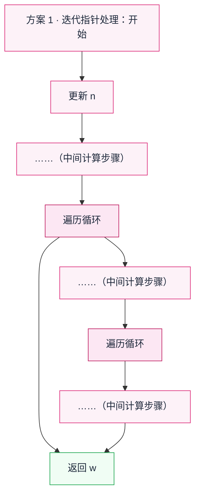

```dart
// LeetCode 502. IPO — Dart 版（方案1）
int findMaximizedCapital(int k, int w, List<int> profits, List<int> capital) {
  // 定义函数/方法 findMaximizedCapital
  final n = profits.length; // 把 profits.长度 存入 元素个数
  final used = List<bool>.filled(
    n,
    false,
  ); // 把 List 小于 bool 超过 .filled(元素个数, false) 存入 已用标记
  for (var t = 0; t < k; t++) {
    // 让 另一字符串 从 0 开始计数，另一字符串 小于 下标 k 就继续
    var best = -1; // 把 减 1 存入 当前最优
    var bestJ = -1; // 把 减 1 存入 bestJ
    for (var j = 0; j < n; j++) {
      // 让 下标 j 从 0 开始计数，下标 j 小于 元素个数 就继续
      if (!used[j] && capital[j] <= w && profits[j] > best) {
        best = profits[j]; // 把 profits[下标 j] 存入 当前最优
        bestJ = j; // 把 下标 j 存入 bestJ
      }
    }
    if (bestJ < 0) break; // 若 bestJ 小于 0) break;
    w += best; // 权重累加 当前最优
    used[bestJ] = true; // 把 true; 写入 used[bestJ]
  }
  return w; // 返回 权重
}

void main() {
  // 程序入口：跑内嵌自测用例
  if (findMaximizedCapital(2, 0, [1, 2, 3], [0, 1, 1]) != 4)
    throw StateError('c1');
  if (findMaximizedCapital(3, 0, [1, 2, 3], [0, 1, 2]) != 6)
    throw StateError('c2');
  if (findMaximizedCapital(1, 0, [1, 2], [1, 2]) != 0) throw StateError('c3');
  if (findMaximizedCapital(2, 1, [1, 2, 3], [1, 1, 2]) != 6)
    throw StateError('c4');
  print('PASS'); // 全部用例通过，输出 PASS
}
```

---

## 内容总结

- **ipo**（堆 · Medium）：共 1 个方案，主线思路「迭代指针处理」；时间 O(n)（单趟线性扫描）；动画演示堆上浮过程，附录给出 11 种语言 × 全部方案的可运行实现。
- 来源博客：[https://blog.csdn.net/tyro_java/article/details/145347672](https://blog.csdn.net/tyro_java/article/details/145347672)
- 导航：[📋 总目录](../) ｜ [← 147 根据字符出现频率排序](../147_根据字符出现频率排序/) ｜ [149 合并k个升序链表 →](../149_合并k个升序链表/)
