# 149 · 合并k个升序链表（第七阶段 · 堆与优先队列 · Hard）

> **难度**：⭐⭐⭐ Hard ｜ **专题**：堆
> **学习定位**：第七阶段 · 堆与优先队列第 149 篇 ｜ **解法数**：12
> **内容总结**：**合并k个升序链表**（堆 · Hard）：共 12 个方案，主线思路「单趟扫描」；时间 O(n)（单趟线性扫描）；动画演示堆上浮过程，附录给出 11 种语言 × 全部方案的可运行实现。

---

## 题目描述

给你一个链表数组，每个链表都已经按升序排列。

请你将所有链表合并到一个升序链表中，返回合并后的链表。

- 主函数签名：`function mergeKLists(lists: Array<ListNode | null>): ListNode | null`

**用例（来自原题）**：

**示例 1**

```text
输入：lists = [[1,4,5],[1,3,4],[2,6]]
输出：[1,1,2,3,4,4,5,6]
```

解释：链表数组如下： [ 1->4->5, 1->3->4, 2->6 ] 将它们合并到一个有序链表中得到。 1->1->2->3->4->4->5->6

**示例 2**

```text
输入：lists = []
输出：[]
```

**示例 3**

```text
输入：lists = [[]]
输出：[]
```
> ✅ **官方验证**：全部 TypeScript 解法已通过 leetcode.cn 官方示例用例验证（自动注入运行，全部 PASS）。题面与 [leetcode.cn 官方](https://leetcode.cn/problems/merge-k-sorted-lists/)一致，示例配图取自官方题面。

**数据范围与注意事项**：

- `k == lists.length`
- `0 <= k <= 10^4`
- `0 <= lists[i].length <= 500`
- `-10^4 <= lists[i][j] <= 10^4`
- `lists[i]` 按 升序 排列
- `lists[i].length` 的总和不超过 `10^4`
- **易错点**：堆只保证堆顶最优，遍历堆数组并不是有序输出。

## 题目分析

**场景是什么**：堆只要堆顶最优就能 O(1) 取到，对应真实开发里的优先级调度、Top-K 榜单。本题就是该场景的 Hard 级练习，主线做法是「单趟扫描」。

**主线怎么解**：把主解法从头到尾过一遍，它其实在依次做这几件事：单循环线性扫描。

## 解题思路

**方案对比**（共 12 个方案，由浅入深）：

| 方案 | 时间复杂度 | 空间复杂度 |
|---|---|---|
| 方案 1 · 单趟扫描 | O(n)（单趟线性扫描） | O(1) 到 O(n)（视辅助结构） |
| 方案 2 · 栈辅助 | O(n)（单趟线性扫描） | O(1) 到 O(n)（视辅助结构） |
| 方案 3 · 迭代指针处理 | O(n)（单趟线性扫描） | O(1) 到 O(n)（视辅助结构） |
| 方案 4 · 迭代指针处理 | O(n)（单趟线性扫描） | O(1) 到 O(n)（视辅助结构） |
| 方案 5 · 栈辅助 | O(n)（单趟线性扫描） | O(1) 到 O(n)（视辅助结构） |
| 方案 6 · 栈辅助 | O(n)（单趟线性扫描） | O(1) 到 O(n)（视辅助结构） |
| 方案 7 · 迭代指针处理 | O(n)（单趟线性扫描） | O(1) 到 O(n)（视辅助结构） |
| 方案 8 · 迭代指针处理 | O(n)（单趟线性扫描） | O(1) 到 O(n)（视辅助结构） |
| 方案 9 · 迭代指针处理 | O(n)（单趟线性扫描） | O(1) 到 O(n)（视辅助结构） |
| 方案 10 · 双重循环枚举 | O(n²)（两层嵌套扫描） | O(1) 到 O(n) |
| 方案 11 · 直接实现 | O(n) 量级 | O(n) |
| 方案 12 · 单趟扫描 | O(n)（单趟线性扫描） | O(1) 到 O(n)（视辅助结构） |

**由浅入深的路径**：单趟扫描 → 栈辅助 → 迭代指针处理 → 双重循环枚举 → 直接实现；每往右一步，都在补上一步的短板。

**方案间的取舍**：方案 1（单趟扫描）；方案 2（栈辅助）；方案 3（迭代指针处理）；方案 4（迭代指针处理）；方案 5（栈辅助）；方案 6（栈辅助）；方案 7（迭代指针处理）；方案 8（迭代指针处理）；方案 9（迭代指针处理）；方案 10（双重循环枚举）；方案 11（直接实现）；方案 12（单趟扫描）。数据规模小、可读性优先时选靠前的方案；规模大、性能优先时选靠后的方案。

**怎么读这一篇**：

- 🐣 **新手路线**：把「题目描述」的示例 1 在纸上手推一遍 → 读方案 1（最直观的写法）与它的代码走读 → 按「运行方式」本地跑通看 PASS → 回头对比方案 2 之后的写法差在哪
- 🦅 **大佬路线**：直接锁定最优方案 1（单趟扫描，O(n)（单趟线性扫描））→ 跳读该方案代码与走读 → 用「逐步拆解与面试追问」补齐复杂度推导与边界追问

### 动态算法图（堆上浮，GIF 自动循环）


动画演示堆专题里堆上浮的典型过程；每个方案在「TypeScript 解题方案」一节还配了专属动画与专属流程图。

### 主解法流程图（真实控制流）

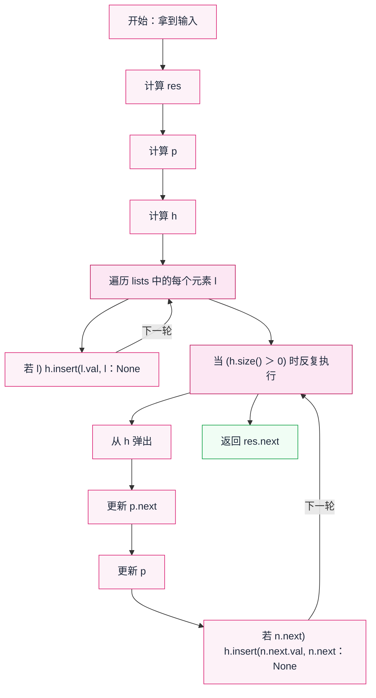

## TypeScript 解题方案（12 个方案逐个讲）

> **运行与提交**：每个方案都是自包含文件（内嵌用例自测，输出 PASS），整块复制到 `.ts` 文件后 `node 文件名` 即可运行。提交 LeetCode 时，把 `demo` 内的算法函数与辅助类型/函数整体取出、置于文件顶层即可。涉及交互/特殊接口的题以题面给定签名为准。

### 方案 1：单趟扫描

**分析与思路**：核心做法是「单趟扫描」。代码里依次做这些事：单循环线性扫描。

**运行方式**：`node 本文件`，内嵌用例全部通过会输出 PASS。


**方案专属流程图**（真实控制流）：

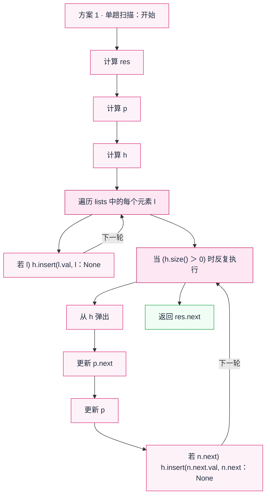

```typescript
export function demo(): void {
  // 程序入口：跑内嵌自测用例
  class ListNode {
    // 定义类型
    val: number; // 值: number;
    next: ListNode | null; // 下一个: ListNode 按位或 null;
    constructor(val?: number, next?: ListNode | null) {
      // constructor(值?: number, 下一个?: ListNode 按位或 null) {
      this.val = val === undefined ? 0 : val; // 把 值 全等于 undefined ? 0 : 值; 写入 值
      this.next = next === undefined ? null : next; // 把 下一个 全等于 undefined ? null : 下一个; 写入 下一个
    }
  }

  interface HeapItem {
    val: number;
    id: number;
    node: ListNode;
  } // 定义类型

  class MinHeap {
    // 定义类型
    private heap: HeapItem[] = []; // 把 []; 写入 private heap: HeapItem[]
    private counter = 0; // 把 0; 写入 private counter

    size(): number {
      return this.heap.length;
    } // 大小(): number { return this.堆.长度; }

    // 插入（对应 python heapq.heappush((val, id(node), node))，id 用自增计数充当 tiebreak）
    insert(val: number, node: ListNode): void {
      // insert(值: number, 节点: ListNode): void {
      this.heap.push({ val: val, id: this.counter++, node: node }); // 把 { 值: 值, id: this.counter 加一 , 节点: 节点 } 压入栈/数组尾部
      this.shiftUp(this.heap.length - 1); // this.shiftUp(this.堆.长度 减 1);
    }

    pop(): ListNode | null {
      // pop(): ListNode 按位或 null {
      if (this.heap.length === 0) return null; // 若 this.堆.长度 全等于 0，直接返回 null
      const first = this.heap[0]; // 把 this.堆[0] 存入 first
      const last = this.heap.pop() as HeapItem; // 把 this.堆 弹出 ) as HeapItem 存入 last
      if (this.heap.length > 0) {
        // 若 this.堆.长度 超过 0
        this.heap[0] = last; // 把 last; 写入 this.heap[0]
        this.shiftDown(0); // this.shiftDown(0);
      }
      return first.node; // 返回 first.节点
    }

    private less(a: HeapItem, b: HeapItem): boolean {
      // private less(数组: HeapItem, b: HeapItem): boolean {
      if (a.val !== b.val) return a.val < b.val; // 若 数组.值 不等于 b.值，直接返回 数组.值 小于 b.值
      return a.id < b.id; // 返回 数组.id 小于 b.id
    }

    private swap(i: number, j: number): void {
      // private 交换 下标 i: number, 下标 j: number): void {
      const t = this.heap[i];
      this.heap[i] = this.heap[j];
      this.heap[j] = t;
    }

    private shiftUp(i: number): void {
      // private shiftUp(下标 i: number): void {
      while (i > 0) {
        // 循环，直到不满足「下标 i 超过 0」
        const pi = (i - 1) >> 1; // 把 (下标 i 减 1) 超过 超过 1 存入 pi
        if (this.less(this.heap[i], this.heap[pi])) {
          this.swap(pi, i);
          i = pi;
        } else break; // 否则
      }
    }

    private shiftDown(i: number): void {
      // private shiftDown(下标 i: number): void {
      const n = this.heap.length; // 把 this.堆.长度 存入 元素个数
      for (;;) {
        // for (;;) {
        let smallest = i; // 把 下标 i 存入 smallest
        const li = 2 * i + 1,
          ri = 2 * i + 2; // 把 2 乘 下标 i 加 1, ri 赋值为 2 乘 下标 i 加 2 存入 li
        if (li < n && this.less(this.heap[li], this.heap[smallest]))
          smallest = li;
        if (ri < n && this.less(this.heap[ri], this.heap[smallest]))
          smallest = ri;
        if (smallest === i) break; // 若 smallest 全等于 下标 i) break;
        this.swap(i, smallest); // this.交换 下标 i, smallest);
        i = smallest; // 把 smallest 存入 下标 i
      }
    }
  }

  function mergeKLists(lists: Array<ListNode | null>): ListNode | null {
    // 定义函数/方法 mergeKLists
    const res = new ListNode(0); // 把 new ListNode(0) 存入 结果
    let p = res; // 把 结果 存入 节点
    const h = new MinHeap(); // 把 new MinHeap() 存入 h
    for (const l of lists) {
      // for (const 左指针 of lists) {
      if (l) h.insert(l.val, l); // 若 左指针) h 插入 左指针.值, 左指针);
    }
    while (h.size() > 0) {
      // 循环，直到不满足「h.大小() 超过 0」
      const n = h.pop() as ListNode; // 把 h 弹出 ) as ListNode 存入 元素个数
      p.next = n; // 把 元素个数; 写入 下一个
      p = p.next; // 把 节点.下一个 存入 节点
      if (n.next) h.insert(n.next.val, n.next); // 若 元素个数.下一个) h 插入 元素个数.下一个.值, 元素个数.下一个);
    }
    return res.next; // 返回 结果.下一个
  }

  function build(vals: number[]): ListNode | null {
    // 定义函数/方法 build
    const dummy = new ListNode(0); // 把 new ListNode(0) 存入 哨兵节点
    let cur = dummy; // 把 哨兵节点 存入 当前值
    for (const v of vals) {
      cur.next = new ListNode(v);
      cur = cur.next;
    } // 把 new ListNode(值); 当前值 赋值为 当前值.下一个; } 写入 下一个
    return dummy.next; // 返回 哨兵节点.下一个
  }

  function toList(node: ListNode | null): number[] {
    // 定义函数/方法 toList
    const res: number[] = []; // 把 []; 写入 const res: number[]
    while (node) {
      res.push(node.val);
      node = node.next;
    } // 循环，直到不满足「节点) { 结果 追加 节点.值); 节点 赋值为 节点.下一个; }」
    return res; // 返回 结果
  }

  const cases: { in: number[][]; want: number[] }[] = [
    {
      in: [
        [1, 4, 5],
        [1, 3, 4],
        [2, 6],
      ],
      want: [1, 1, 2, 3, 4, 4, 5, 6],
    },
    { in: [], want: [] },
    { in: [[1]], want: [1] },
    { in: [[1], [0]], want: [0, 1] },
    {
      in: [
        [-2, -1],
        [0, 3],
      ],
      want: [-2, -1, 0, 3],
    },
    { in: [[5], [1, 2, 3], [4]], want: [1, 2, 3, 4, 5] },
  ];
  let fail = false; // 把 false 存入 fail
  for (const c of cases) {
    // for (const 字符 of cases) {
    const got = toList(mergeKLists(c.in.map(build))); // 把 toList(mergeKLists(字符.in.映射表(build))) 存入 got
    if (got.length !== c.want.length || got.some((v, i) => v !== c.want[i])) {
      fail = true; // 把 true 存入 fail
      console.log('FAIL mergeKLists(%o)=%o want %o', c.in, got, c.want); // 打印输出
    }
  }
  if (fail) throw new Error('FAILED'); // 若 fail) throw new Error(「FAILED」);
  console.log('PASS'); // 全部用例通过，输出 PASS
}
demo(); // demo();
```

### 方案 2：栈辅助

**分析与思路**：核心做法是「栈辅助」。代码里依次做这些事：单循环线性扫描；栈的后进先出操作。

**运行方式**：`node 本文件`，内嵌用例全部通过会输出 PASS。

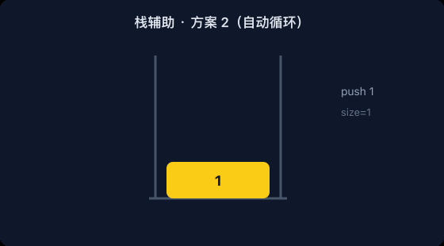

**方案专属流程图**（真实控制流）：

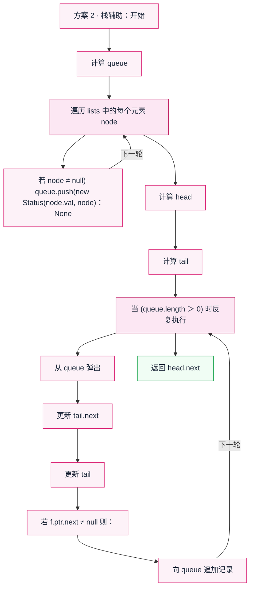

```typescript
export function demo(): void {
  // 程序入口：跑内嵌自测用例
  class ListNode {
    // 定义类型
    val: number; // 值: number;
    next: ListNode | null; // 下一个: ListNode 按位或 null;
    constructor(val?: number, next?: ListNode | null) {
      // constructor(值?: number, 下一个?: ListNode 按位或 null) {
      this.val = val === undefined ? 0 : val; // 把 值 全等于 undefined ? 0 : 值; 写入 值
      this.next = next === undefined ? null : next; // 把 下一个 全等于 undefined ? null : 下一个; 写入 下一个
    }
  }

  class Status {
    // 定义类型
    val: number; // 值: number;
    ptr: ListNode; // ptr: ListNode;
    constructor(val: number, ptr: ListNode) {
      // constructor(值: number, ptr: ListNode) {
      this.val = val; // 把 值; 写入 值
      this.ptr = ptr; // 把 ptr; 写入 this.ptr
    }
  }

  class PQ {
    // 定义类型
    private heap: Status[] = []; // 把 []; 写入 private heap: Status[]
    get length(): number {
      return this.heap.length;
    } // get 长度(): number { return this.堆.长度; }
    private compare(a: Status, b: Status): number {
      return a.val - b.val;
    }
    push(item: Status): void {
      // push(item: Status): void {
      this.heap.push(item); // 把 item 压入栈/数组尾部
      this._siftUp(this.heap.length - 1); // this._siftUp(this.堆.长度 减 1);
    }
    pop(): Status | undefined {
      // pop(): Status 按位或 undefined {
      if (this.heap.length === 0) return undefined; // 若 this.堆.长度 全等于 0，直接返回 undefined
      const lastElement = this.heap.pop() as Status; // 把 this.堆 弹出 ) as Status 存入 lastElement
      if (this.heap.length === 0) return lastElement; // 若 this.堆.长度 全等于 0，直接返回 lastElement
      const returnItem = this.heap[0]; // 把 this.堆[0] 存入 returnItem
      this.heap[0] = lastElement; // 把 lastElement; 写入 this.heap[0]
      this._siftDown(0); // this._siftDown(0);
      return returnItem; // 返回 returnItem
    }
    private _siftUp(index: number): void {
      // private _siftUp(index: number): void {
      while (index > 0) {
        // 循环，直到不满足「index 超过 0」
        const parentIndex = Math.floor((index - 1) / 2); // 把 向下取整((index 减 1) 除以 2) 存入 parentIndex
        if (this.compare(this.heap[parentIndex], this.heap[index]) > 0) {
          // 若 this.compare(this.堆[parentIndex], this.堆[index]) 超过 0
          const t = this.heap[parentIndex];
          this.heap[parentIndex] = this.heap[index];
          this.heap[index] = t;
          index = parentIndex; // 把 parentIndex 存入 index
        } else break; // 否则
      }
    }
    private _siftDown(index: number): void {
      // private _siftDown(index: number): void {
      const size = this.heap.length; // 把 this.堆.长度 存入 大小
      for (;;) {
        // for (;;) {
        let smallest = index; // 把 index 存入 smallest
        const leftChild = 2 * index + 1; // 把 2 乘 index 加 1 存入 leftChild
        const rightChild = 2 * index + 2; // 把 2 乘 index 加 2 存入 rightChild
        if (
          leftChild < size &&
          this.compare(this.heap[leftChild], this.heap[smallest]) < 0
        )
          smallest = leftChild;
        if (
          rightChild < size &&
          this.compare(this.heap[rightChild], this.heap[smallest]) < 0
        )
          smallest = rightChild;
        if (smallest !== index) {
          // 若 smallest 不等于 index
          const t = this.heap[index];
          this.heap[index] = this.heap[smallest];
          this.heap[smallest] = t;
          index = smallest; // 把 smallest 存入 index
        } else break; // 否则
      }
    }
  }

  function mergeKLists(lists: Array<ListNode | null>): ListNode | null {
    // 定义函数/方法 mergeKLists
    const queue = new PQ(); // 把 new PQ() 存入 队列
    for (const node of lists) {
      // for (const 节点 of lists) {
      if (node !== null) queue.push(new Status(node.val, node)); // 若 节点 不等于 null) 队列 追加 new Status(节点.值, 节点));
    }
    const head = new ListNode(0); // 把 new ListNode(0) 存入 头节点
    let tail = head; // 把 头节点 存入 尾节点
    while (queue.length > 0) {
      // 循环，直到不满足「队列.长度 超过 0」
      const f = queue.pop() as Status; // 把 队列 弹出 ) as Status 存入 f
      tail.next = f.ptr; // 把 f.ptr; 写入 下一个
      tail = tail.next; // 把 尾节点.下一个 存入 尾节点
      if (f.ptr.next !== null) {
        // 若 f.ptr.下一个 不等于 null
        queue.push(new Status(f.ptr.next.val, f.ptr.next)); // 把 new Status(f.ptr.下一个.值, f.ptr.下一个 压入栈/数组尾部
      }
    }
    return head.next; // 返回 头节点.下一个
  }

  function build(vals: number[]): ListNode | null {
    // 定义函数/方法 build
    const dummy = new ListNode(0); // 把 new ListNode(0) 存入 哨兵节点
    let cur = dummy; // 把 哨兵节点 存入 当前值
    for (const v of vals) {
      cur.next = new ListNode(v);
      cur = cur.next;
    } // 把 new ListNode(值); 当前值 赋值为 当前值.下一个; } 写入 下一个
    return dummy.next; // 返回 哨兵节点.下一个
  }

  function toList(node: ListNode | null): number[] {
    // 定义函数/方法 toList
    const res: number[] = []; // 把 []; 写入 const res: number[]
    while (node) {
      res.push(node.val);
      node = node.next;
    } // 循环，直到不满足「节点) { 结果 追加 节点.值); 节点 赋值为 节点.下一个; }」
    return res; // 返回 结果
  }

  const cases: { in: number[][]; want: number[] }[] = [
    {
      in: [
        [1, 4, 5],
        [1, 3, 4],
        [2, 6],
      ],
      want: [1, 1, 2, 3, 4, 4, 5, 6],
    },
    { in: [], want: [] },
    { in: [[1]], want: [1] },
    { in: [[1], [0]], want: [0, 1] },
    {
      in: [
        [-2, -1],
        [0, 3],
      ],
      want: [-2, -1, 0, 3],
    },
    { in: [[5], [1, 2, 3], [4]], want: [1, 2, 3, 4, 5] },
  ];
  let fail = false; // 把 false 存入 fail
  for (const c of cases) {
    // for (const 字符 of cases) {
    const got = toList(mergeKLists(c.in.map(build))); // 把 toList(mergeKLists(字符.in.映射表(build))) 存入 got
    if (got.length !== c.want.length || got.some((v, i) => v !== c.want[i])) {
      fail = true; // 把 true 存入 fail
      console.log('FAIL mergeKLists(%o)=%o want %o', c.in, got, c.want); // 打印输出
    }
  }
  if (fail) throw new Error('FAILED'); // 若 fail) throw new Error(「FAILED」);
  console.log('PASS'); // 全部用例通过，输出 PASS
}
demo(); // demo();
```

### 方案 3：迭代指针处理

**分析与思路**：核心做法是「迭代指针处理」。

**运行方式**：`node 本文件`，内嵌用例全部通过会输出 PASS。


**方案专属流程图**（真实控制流）：


```typescript
export function demo(): void {
  // 程序入口：跑内嵌自测用例
  class ListNode {
    // 定义类型
    val: number; // 值: number;
    next: ListNode | null; // 下一个: ListNode 按位或 null;
    constructor(val?: number, next?: ListNode | null) {
      // constructor(值?: number, 下一个?: ListNode 按位或 null) {
      this.val = val === undefined ? 0 : val; // 把 值 全等于 undefined ? 0 : 值; 写入 值
      this.next = next === undefined ? null : next; // 把 下一个 全等于 undefined ? null : 下一个; 写入 下一个
    }
  }

  function mergeTwoLists(
    a: ListNode | null,
    b: ListNode | null,
  ): ListNode | null {
    // 定义函数/方法 mergeTwoLists
    if (a === null) return b; // 若 数组 全等于 null，直接返回 b
    if (b === null) return a; // 若 b 全等于 null，直接返回 数组
    const head = new ListNode(0); // 把 new ListNode(0) 存入 头节点
    let tail = head; // 把 头节点 存入 尾节点
    let aPtr = a; // 把 数组 存入 aPtr
    let bPtr = b; // 把 b 存入 bPtr
    while (aPtr !== null && bPtr !== null) {
      // 循环，直到不满足「aPtr 不等于 null 且 bPtr 不等于 null」
      if (aPtr.val < bPtr.val) {
        // 若 aPtr.值 小于 bPtr.值
        tail.next = aPtr; // 把 aPtr; 写入 下一个
        aPtr = aPtr.next; // 把 aPtr.下一个 存入 aPtr
      } else {
        // 否则
        tail.next = bPtr; // 把 bPtr; 写入 下一个
        bPtr = bPtr.next; // 把 bPtr.下一个 存入 bPtr
      }
      tail = tail.next; // 把 尾节点.下一个 存入 尾节点
    }
    tail.next = aPtr !== null ? aPtr : bPtr; // 把 aPtr 不等于 null ? aPtr : bPtr; 写入 下一个
    return head.next; // 返回 头节点.下一个
  }

  function mergeKLists(lists: Array<ListNode | null>): ListNode | null {
    // 定义函数/方法 mergeKLists
    let ans: ListNode | null = null; // 把 null; 写入 let ans: ListNode | null
    for (let i = 0; i < lists.length; i++) {
      // 让 下标 i 从 0 开始计数，下标 i 小于 lists.长度 就继续
      ans = mergeTwoLists(ans, lists[i]); // 把 mergeTwoLists(答案, lists[下标 i]) 存入 答案
    }
    return ans; // 返回 答案
  }

  function build(vals: number[]): ListNode | null {
    // 定义函数/方法 build
    const dummy = new ListNode(0); // 把 new ListNode(0) 存入 哨兵节点
    let cur = dummy; // 把 哨兵节点 存入 当前值
    for (const v of vals) {
      cur.next = new ListNode(v);
      cur = cur.next;
    } // 把 new ListNode(值); 当前值 赋值为 当前值.下一个; } 写入 下一个
    return dummy.next; // 返回 哨兵节点.下一个
  }

  function toList(node: ListNode | null): number[] {
    // 定义函数/方法 toList
    const res: number[] = []; // 把 []; 写入 const res: number[]
    while (node) {
      res.push(node.val);
      node = node.next;
    } // 循环，直到不满足「节点) { 结果 追加 节点.值); 节点 赋值为 节点.下一个; }」
    return res; // 返回 结果
  }

  const cases: { in: number[][]; want: number[] }[] = [
    {
      in: [
        [1, 4, 5],
        [1, 3, 4],
        [2, 6],
      ],
      want: [1, 1, 2, 3, 4, 4, 5, 6],
    },
    { in: [], want: [] },
    { in: [[1]], want: [1] },
    { in: [[1], [0]], want: [0, 1] },
    {
      in: [
        [-2, -1],
        [0, 3],
      ],
      want: [-2, -1, 0, 3],
    },
    { in: [[5], [1, 2, 3], [4]], want: [1, 2, 3, 4, 5] },
  ];
  let fail = false; // 把 false 存入 fail
  for (const c of cases) {
    // for (const 字符 of cases) {
    const got = toList(mergeKLists(c.in.map(build))); // 把 toList(mergeKLists(字符.in.映射表(build))) 存入 got
    if (got.length !== c.want.length || got.some((v, i) => v !== c.want[i])) {
      fail = true; // 把 true 存入 fail
      console.log('FAIL mergeKLists(%o)=%o want %o', c.in, got, c.want); // 打印输出
    }
  }
  if (fail) throw new Error('FAILED'); // 若 fail) throw new Error(「FAILED」);
  console.log('PASS'); // 全部用例通过，输出 PASS
}
demo(); // demo();
```

### 方案 4：迭代指针处理

**分析与思路**：核心做法是「迭代指针处理」。

**运行方式**：`node 本文件`，内嵌用例全部通过会输出 PASS。


**方案专属流程图**（真实控制流）：

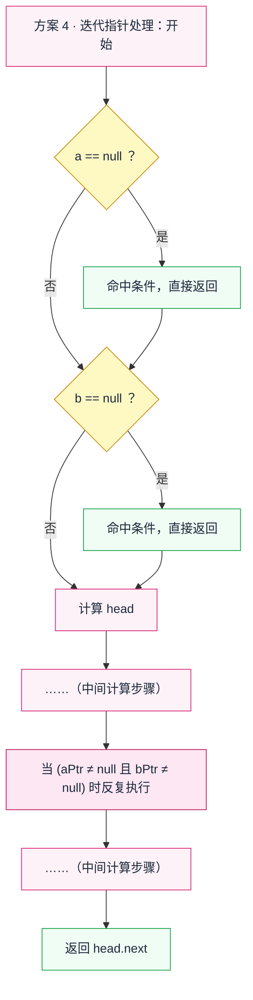

```typescript
export function demo(): void {
  // 程序入口：跑内嵌自测用例
  class ListNode {
    // 定义类型
    val: number; // 值: number;
    next: ListNode | null; // 下一个: ListNode 按位或 null;
    constructor(val?: number, next?: ListNode | null) {
      // constructor(值?: number, 下一个?: ListNode 按位或 null) {
      this.val = val === undefined ? 0 : val; // 把 值 全等于 undefined ? 0 : 值; 写入 值
      this.next = next === undefined ? null : next; // 把 下一个 全等于 undefined ? null : 下一个; 写入 下一个
    }
  }

  function mergeTwoLists(
    a: ListNode | null,
    b: ListNode | null,
  ): ListNode | null {
    // 定义函数/方法 mergeTwoLists
    if (a === null) return b; // 若 数组 全等于 null，直接返回 b
    if (b === null) return a; // 若 b 全等于 null，直接返回 数组
    const head = new ListNode(0); // 把 new ListNode(0) 存入 头节点
    let tail = head; // 把 头节点 存入 尾节点
    let aPtr = a; // 把 数组 存入 aPtr
    let bPtr = b; // 把 b 存入 bPtr
    while (aPtr !== null && bPtr !== null) {
      // 循环，直到不满足「aPtr 不等于 null 且 bPtr 不等于 null」
      if (aPtr.val < bPtr.val) {
        // 若 aPtr.值 小于 bPtr.值
        tail.next = aPtr; // 把 aPtr; 写入 下一个
        aPtr = aPtr.next; // 把 aPtr.下一个 存入 aPtr
      } else {
        // 否则
        tail.next = bPtr; // 把 bPtr; 写入 下一个
        bPtr = bPtr.next; // 把 bPtr.下一个 存入 bPtr
      }
      tail = tail.next; // 把 尾节点.下一个 存入 尾节点
    }
    tail.next = aPtr !== null ? aPtr : bPtr; // 把 aPtr 不等于 null ? aPtr : bPtr; 写入 下一个
    return head.next; // 返回 头节点.下一个
  }

  function merge(
    lists: Array<ListNode | null>,
    l: number,
    r: number,
  ): ListNode | null {
    // 定义函数/方法 merge
    if (l === r) return lists[l]; // 若 左指针 全等于 右指针，直接返回 lists[左指针]
    if (l > r) return null; // 若 左指针 超过 右指针，直接返回 null
    const mid = Math.floor((l + r) / 2); // 把 向下取整((左指针 加 右指针) 除以 2) 存入 中点
    return mergeTwoLists(merge(lists, l, mid), merge(lists, mid + 1, r));
  }

  function mergeKLists(lists: Array<ListNode | null>): ListNode | null {
    // 定义函数/方法 mergeKLists
    return merge(lists, 0, lists.length - 1); // 返回 merge(lists, 0, lists.长度 减 1)
  }

  function build(vals: number[]): ListNode | null {
    // 定义函数/方法 build
    const dummy = new ListNode(0); // 把 new ListNode(0) 存入 哨兵节点
    let cur = dummy; // 把 哨兵节点 存入 当前值
    for (const v of vals) {
      cur.next = new ListNode(v);
      cur = cur.next;
    } // 把 new ListNode(值); 当前值 赋值为 当前值.下一个; } 写入 下一个
    return dummy.next; // 返回 哨兵节点.下一个
  }

  function toList(node: ListNode | null): number[] {
    // 定义函数/方法 toList
    const res: number[] = []; // 把 []; 写入 const res: number[]
    while (node) {
      res.push(node.val);
      node = node.next;
    } // 循环，直到不满足「节点) { 结果 追加 节点.值); 节点 赋值为 节点.下一个; }」
    return res; // 返回 结果
  }

  const cases: { in: number[][]; want: number[] }[] = [
    {
      in: [
        [1, 4, 5],
        [1, 3, 4],
        [2, 6],
      ],
      want: [1, 1, 2, 3, 4, 4, 5, 6],
    },
    { in: [], want: [] },
    { in: [[1]], want: [1] },
    { in: [[1], [0]], want: [0, 1] },
    {
      in: [
        [-2, -1],
        [0, 3],
      ],
      want: [-2, -1, 0, 3],
    },
    { in: [[5], [1, 2, 3], [4]], want: [1, 2, 3, 4, 5] },
  ];
  let fail = false; // 把 false 存入 fail
  for (const c of cases) {
    // for (const 字符 of cases) {
    const got = toList(mergeKLists(c.in.map(build))); // 把 toList(mergeKLists(字符.in.映射表(build))) 存入 got
    if (got.length !== c.want.length || got.some((v, i) => v !== c.want[i])) {
      fail = true; // 把 true 存入 fail
      console.log('FAIL mergeKLists(%o)=%o want %o', c.in, got, c.want); // 打印输出
    }
  }
  if (fail) throw new Error('FAILED'); // 若 fail) throw new Error(「FAILED」);
  console.log('PASS'); // 全部用例通过，输出 PASS
}
demo(); // demo();
```

### 方案 5：栈辅助

**分析与思路**：核心做法是「栈辅助」。代码里依次做这些事：单循环线性扫描；栈的后进先出操作；队列或堆的调度。

**运行方式**：`node 本文件`，内嵌用例全部通过会输出 PASS。


**方案专属流程图**（真实控制流）：

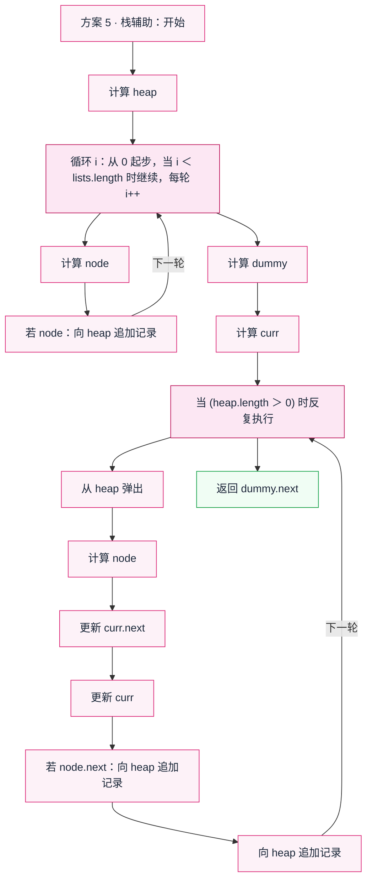

```typescript
export function demo(): void {
  // 程序入口：跑内嵌自测用例
  class ListNode {
    // 定义类型
    val: number; // 值: number;
    next: ListNode | null; // 下一个: ListNode 按位或 null;
    constructor(val?: number, next?: ListNode | null) {
      // constructor(值?: number, 下一个?: ListNode 按位或 null) {
      this.val = val === undefined ? 0 : val; // 把 值 全等于 undefined ? 0 : 值; 写入 值
      this.next = next === undefined ? null : next; // 把 下一个 全等于 undefined ? null : 下一个; 写入 下一个
    }
  }

  interface HeapItem {
    val: number;
    idx: number;
    node: ListNode;
  } // 定义类型

  // 小顶堆（heapq 风格）：元组 (val, i, node) 比较，val 相同时按链表序号 i
  class MinHeap {
    // 定义类型
    private heap: HeapItem[] = []; // 把 []; 写入 private heap: HeapItem[]

    push(item: HeapItem): void {
      // push(item: HeapItem): void {
      this.heap.push(item); // 把 item 压入栈/数组尾部
      let i = this.heap.length - 1; // 把 this.堆.长度 减 1 存入 下标 i
      while (i > 0) {
        // 循环，直到不满足「下标 i 超过 0」
        const p = (i - 1) >> 1; // 把 (下标 i 减 1) 超过 超过 1 存入 节点
        if (this.less(this.heap[i], this.heap[p])) {
          // 若 this.less(this.堆[下标 i], this.堆[节点]
          const t = this.heap[i];
          this.heap[i] = this.heap[p];
          this.heap[p] = t;
          i = p; // 把 节点 存入 下标 i
        } else break; // 否则
      }
    }

    pop(): HeapItem | undefined {
      // pop(): HeapItem 按位或 undefined {
      if (this.heap.length === 0) return undefined; // 若 this.堆.长度 全等于 0，直接返回 undefined
      const top = this.heap[0]; // 把 this.堆[0] 存入 top
      const last = this.heap.pop() as HeapItem; // 把 this.堆 弹出 ) as HeapItem 存入 last
      if (this.heap.length > 0) {
        // 若 this.堆.长度 超过 0
        this.heap[0] = last; // 把 last; 写入 this.heap[0]
        let i = 0; // 把 0 存入 下标 i
        const n = this.heap.length; // 把 this.堆.长度 存入 元素个数
        for (;;) {
          // for (;;) {
          let smallest = i; // 把 下标 i 存入 smallest
          const l = 2 * i + 1,
            r = 2 * i + 2; // 把 2 乘 下标 i 加 1, 右指针 赋值为 2 乘 下标 i 加 2 存入 左指针
          if (l < n && this.less(this.heap[l], this.heap[smallest]))
            smallest = l;
          if (r < n && this.less(this.heap[r], this.heap[smallest]))
            smallest = r;
          if (smallest === i) break; // 若 smallest 全等于 下标 i) break;
          const t = this.heap[i];
          this.heap[i] = this.heap[smallest];
          this.heap[smallest] = t;
          i = smallest; // 把 smallest 存入 下标 i
        }
      }
      return top; // 返回 top
    }

    get length(): number {
      return this.heap.length;
    } // get 长度(): number { return this.堆.长度; }

    private less(a: HeapItem, b: HeapItem): boolean {
      // private less(数组: HeapItem, b: HeapItem): boolean {
      if (a.val !== b.val) return a.val < b.val; // 若 数组.值 不等于 b.值，直接返回 数组.值 小于 b.值
      return a.idx < b.idx; // 返回 数组.idx 小于 b.idx
    }
  }

  // 合并 K 个升序链表 - 方案: 小顶堆 (heapq)
  function merge_k_lists(lists: Array<ListNode | null>): ListNode | null {
    // 定义函数/方法 merge_k_lists
    const heap = new MinHeap(); // 把 new MinHeap() 存入 堆
    for (let i = 0; i < lists.length; i++) {
      // 让 下标 i 从 0 开始计数，下标 i 小于 lists.长度 就继续
      const node = lists[i]; // 把 lists[下标 i] 存入 节点
      if (node) heap.push({ val: node.val, idx: i, node: node }); // 若 节点) 堆 追加 { 值: 节点.值, idx: 下标 i, 节点: 节点 });
    }
    const dummy = new ListNode(0); // 把 new ListNode(0) 存入 哨兵节点
    let curr = dummy; // 把 哨兵节点 存入 当前值
    while (heap.length > 0) {
      // 循环，直到不满足「堆.长度 超过 0」
      const item = heap.pop() as HeapItem; // 把 堆 弹出 ) as HeapItem 存入 item
      const node = item.node; // 把 item.节点 存入 节点
      curr.next = node; // 把 节点; 写入 下一个
      curr = curr.next; // 把 当前值.下一个 存入 当前值
      if (node.next)
        heap.push({ val: node.next.val, idx: item.idx, node: node.next }); // 若 节点.下一个) 堆 追加 { 值: 节点.下一个.值, idx: item.idx, 节点: 节点.下一个 });
    }
    return dummy.next; // 返回 哨兵节点.下一个
  }

  function build(vals: number[]): ListNode | null {
    // 定义函数/方法 build
    const dummy = new ListNode(0); // 把 new ListNode(0) 存入 哨兵节点
    let cur = dummy; // 把 哨兵节点 存入 当前值
    for (const v of vals) {
      cur.next = new ListNode(v);
      cur = cur.next;
    } // 把 new ListNode(值); 当前值 赋值为 当前值.下一个; } 写入 下一个
    return dummy.next; // 返回 哨兵节点.下一个
  }

  function toList(node: ListNode | null): number[] {
    // 定义函数/方法 toList
    const res: number[] = []; // 把 []; 写入 const res: number[]
    while (node) {
      res.push(node.val);
      node = node.next;
    } // 循环，直到不满足「节点) { 结果 追加 节点.值); 节点 赋值为 节点.下一个; }」
    return res; // 返回 结果
  }

  const cases: { in: number[][]; want: number[] }[] = [
    {
      in: [
        [1, 4, 5],
        [1, 3, 4],
        [2, 6],
      ],
      want: [1, 1, 2, 3, 4, 4, 5, 6],
    },
    { in: [], want: [] },
    { in: [[1]], want: [1] },
    { in: [[1], [0]], want: [0, 1] },
    {
      in: [
        [-2, -1],
        [0, 3],
      ],
      want: [-2, -1, 0, 3],
    },
    { in: [[5], [1, 2, 3], [4]], want: [1, 2, 3, 4, 5] },
  ];
  let fail = false; // 把 false 存入 fail
  for (const c of cases) {
    // for (const 字符 of cases) {
    const got = toList(merge_k_lists(c.in.map(build))); // 把 toList(merge_k_lists(字符.in.映射表(build))) 存入 got
    if (got.length !== c.want.length || got.some((v, i) => v !== c.want[i])) {
      fail = true; // 把 true 存入 fail
      console.log('FAIL merge_k_lists(%o)=%o want %o', c.in, got, c.want); // 打印输出
    }
  }
  if (fail) throw new Error('FAILED'); // 若 fail) throw new Error(「FAILED」);
  console.log('PASS'); // 全部用例通过，输出 PASS
}
demo(); // demo();
```

### 方案 6：栈辅助

**分析与思路**：核心做法是「栈辅助」。代码里依次做这些事：单循环线性扫描；栈的后进先出操作；队列或堆的调度。

**运行方式**：`node 本文件`，内嵌用例全部通过会输出 PASS。


**方案专属流程图**（真实控制流）：

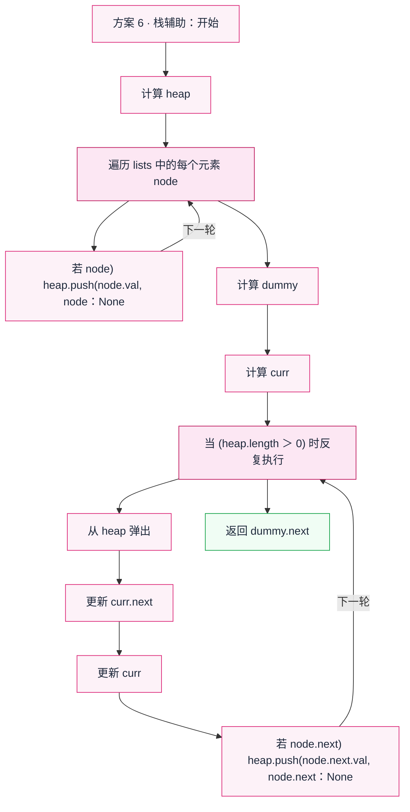

```typescript
export function demo(): void {
  // 程序入口：跑内嵌自测用例
  class ListNode {
    // 定义类型
    val: number; // 值: number;
    next: ListNode | null; // 下一个: ListNode 按位或 null;
    constructor(val?: number, next?: ListNode | null) {
      // constructor(值?: number, 下一个?: ListNode 按位或 null) {
      this.val = val === undefined ? 0 : val; // 把 值 全等于 undefined ? 0 : 值; 写入 值
      this.next = next === undefined ? null : next; // 把 下一个 全等于 undefined ? null : 下一个; 写入 下一个
    }
  }

  interface HeapItem {
    val: number;
    id: number;
    node: ListNode;
  } // 定义类型

  // 小顶堆：元组 (val, id, node) 比较，id 用自增计数充当 python id() tiebreak
  class MinHeap {
    // 定义类型
    private heap: HeapItem[] = []; // 把 []; 写入 private heap: HeapItem[]
    private counter = 0; // 把 0; 写入 private counter

    push(val: number, node: ListNode): void {
      // push(值: number, 节点: ListNode): void {
      this.heap.push({ val: val, id: this.counter++, node: node }); // 把 { 值: 值, id: this.counter 加一 , 节点: 节点 } 压入栈/数组尾部
      let i = this.heap.length - 1; // 把 this.堆.长度 减 1 存入 下标 i
      while (i > 0) {
        // 循环，直到不满足「下标 i 超过 0」
        const p = (i - 1) >> 1; // 把 (下标 i 减 1) 超过 超过 1 存入 节点
        if (this.less(this.heap[i], this.heap[p])) {
          // 若 this.less(this.堆[下标 i], this.堆[节点]
          const t = this.heap[i];
          this.heap[i] = this.heap[p];
          this.heap[p] = t;
          i = p; // 把 节点 存入 下标 i
        } else break; // 否则
      }
    }

    pop(): ListNode | undefined {
      // pop(): ListNode 按位或 undefined {
      if (this.heap.length === 0) return undefined; // 若 this.堆.长度 全等于 0，直接返回 undefined
      const top = this.heap[0]; // 把 this.堆[0] 存入 top
      const last = this.heap.pop() as HeapItem; // 把 this.堆 弹出 ) as HeapItem 存入 last
      if (this.heap.length > 0) {
        // 若 this.堆.长度 超过 0
        this.heap[0] = last; // 把 last; 写入 this.heap[0]
        let i = 0; // 把 0 存入 下标 i
        const n = this.heap.length; // 把 this.堆.长度 存入 元素个数
        for (;;) {
          // for (;;) {
          let smallest = i; // 把 下标 i 存入 smallest
          const l = 2 * i + 1,
            r = 2 * i + 2; // 把 2 乘 下标 i 加 1, 右指针 赋值为 2 乘 下标 i 加 2 存入 左指针
          if (l < n && this.less(this.heap[l], this.heap[smallest]))
            smallest = l;
          if (r < n && this.less(this.heap[r], this.heap[smallest]))
            smallest = r;
          if (smallest === i) break; // 若 smallest 全等于 下标 i) break;
          const t = this.heap[i];
          this.heap[i] = this.heap[smallest];
          this.heap[smallest] = t;
          i = smallest; // 把 smallest 存入 下标 i
        }
      }
      return top.node; // 返回 top.节点
    }

    get length(): number {
      return this.heap.length;
    } // get 长度(): number { return this.堆.长度; }

    private less(a: HeapItem, b: HeapItem): boolean {
      // private less(数组: HeapItem, b: HeapItem): boolean {
      if (a.val !== b.val) return a.val < b.val; // 若 数组.值 不等于 b.值，直接返回 数组.值 小于 b.值
      return a.id < b.id; // 返回 数组.id 小于 b.id
    }
  }

  // 合并 K 个升序链表 - 方案: 小顶堆 (用 id 做 tiebreak, 避免比较节点)
  function merge_k_lists(lists: Array<ListNode | null>): ListNode | null {
    // 定义函数/方法 merge_k_lists
    const heap = new MinHeap(); // 把 new MinHeap() 存入 堆
    for (const node of lists) {
      // for (const 节点 of lists) {
      if (node) heap.push(node.val, node); // 若 节点) 堆 追加 节点.值, 节点);
    }
    const dummy = new ListNode(0); // 把 new ListNode(0) 存入 哨兵节点
    let curr = dummy; // 把 哨兵节点 存入 当前值
    while (heap.length > 0) {
      // 循环，直到不满足「堆.长度 超过 0」
      const node = heap.pop() as ListNode; // 把 堆 弹出 ) as ListNode 存入 节点
      curr.next = node; // 把 节点; 写入 下一个
      curr = curr.next; // 把 当前值.下一个 存入 当前值
      if (node.next) heap.push(node.next.val, node.next); // 若 节点.下一个) 堆 追加 节点.下一个.值, 节点.下一个);
    }
    return dummy.next; // 返回 哨兵节点.下一个
  }

  function build(vals: number[]): ListNode | null {
    // 定义函数/方法 build
    const dummy = new ListNode(0); // 把 new ListNode(0) 存入 哨兵节点
    let cur = dummy; // 把 哨兵节点 存入 当前值
    for (const v of vals) {
      cur.next = new ListNode(v);
      cur = cur.next;
    } // 把 new ListNode(值); 当前值 赋值为 当前值.下一个; } 写入 下一个
    return dummy.next; // 返回 哨兵节点.下一个
  }

  function toList(node: ListNode | null): number[] {
    // 定义函数/方法 toList
    const res: number[] = []; // 把 []; 写入 const res: number[]
    while (node) {
      res.push(node.val);
      node = node.next;
    } // 循环，直到不满足「节点) { 结果 追加 节点.值); 节点 赋值为 节点.下一个; }」
    return res; // 返回 结果
  }

  const cases: { in: number[][]; want: number[] }[] = [
    {
      in: [
        [1, 4, 5],
        [1, 3, 4],
        [2, 6],
      ],
      want: [1, 1, 2, 3, 4, 4, 5, 6],
    },
    { in: [], want: [] },
    { in: [[1]], want: [1] },
    { in: [[1], [0]], want: [0, 1] },
    {
      in: [
        [-2, -1],
        [0, 3],
      ],
      want: [-2, -1, 0, 3],
    },
    { in: [[5], [1, 2, 3], [4]], want: [1, 2, 3, 4, 5] },
  ];
  let fail = false; // 把 false 存入 fail
  for (const c of cases) {
    // for (const 字符 of cases) {
    const got = toList(merge_k_lists(c.in.map(build))); // 把 toList(merge_k_lists(字符.in.映射表(build))) 存入 got
    if (got.length !== c.want.length || got.some((v, i) => v !== c.want[i])) {
      fail = true; // 把 true 存入 fail
      console.log('FAIL merge_k_lists(%o)=%o want %o', c.in, got, c.want); // 打印输出
    }
  }
  if (fail) throw new Error('FAILED'); // 若 fail) throw new Error(「FAILED」);
  console.log('PASS'); // 全部用例通过，输出 PASS
}
demo(); // demo();
```

### 方案 7：迭代指针处理

**分析与思路**：核心做法是「迭代指针处理」。

**运行方式**：`node 本文件`，内嵌用例全部通过会输出 PASS。


**方案专属流程图**（真实控制流）：

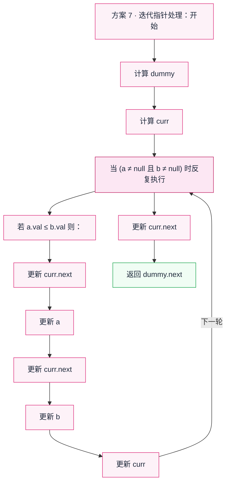

```typescript
export function demo(): void {
  // 程序入口：跑内嵌自测用例
  class ListNode {
    // 定义类型
    val: number; // 值: number;
    next: ListNode | null; // 下一个: ListNode 按位或 null;
    constructor(val?: number, next?: ListNode | null) {
      // constructor(值?: number, 下一个?: ListNode 按位或 null) {
      this.val = val === undefined ? 0 : val; // 把 值 全等于 undefined ? 0 : 值; 写入 值
      this.next = next === undefined ? null : next; // 把 下一个 全等于 undefined ? null : 下一个; 写入 下一个
    }
  }

  function mergeTwo(a: ListNode | null, b: ListNode | null): ListNode | null {
    // 定义函数/方法 mergeTwo
    const dummy = new ListNode(0); // 把 new ListNode(0) 存入 哨兵节点
    let curr = dummy; // 把 哨兵节点 存入 当前值
    while (a !== null && b !== null) {
      // 循环，直到不满足「数组 不等于 null 且 b 不等于 null」
      if (a.val <= b.val) {
        // 若 数组.值 不超过 b.值
        curr.next = a; // 把 数组; 写入 下一个
        a = a.next; // 把 数组.下一个 存入 数组
      } else {
        // 否则
        curr.next = b; // 把 b; 写入 下一个
        b = b.next; // 把 b.下一个 存入 b
      }
      curr = curr.next; // 把 当前值.下一个 存入 当前值
    }
    curr.next = a !== null ? a : b; // 把 数组 不等于 null ? 数组 : b; 写入 下一个
    return dummy.next; // 返回 哨兵节点.下一个
  }

  // 合并 K 个升序链表 - 方案: 分治合并 (自顶向下, 两两合并)
  function merge_k_lists(lists: Array<ListNode | null>): ListNode | null {
    // 定义函数/方法 merge_k_lists
    if (lists.length === 0) return null; // 若 lists.长度 全等于 0，直接返回 null

    const divide = (lo: number, hi: number): ListNode | null => {
      if (lo === hi) return lists[lo]; // 若 左边界 全等于 右边界，直接返回 lists[左边界]
      const mid = Math.floor((lo + hi) / 2); // 把 向下取整((左边界 加 右边界) 除以 2) 存入 中点
      const left = divide(lo, mid); // 把 divide(左边界, 中点) 存入 左边界
      const right = divide(mid + 1, hi); // 把 divide(中点 加 1, 右边界) 存入 右边界
      return mergeTwo(left, right); // 返回 mergeTwo(左边界, 右边界)
    };

    return divide(0, lists.length - 1); // 返回 divide(0, lists.长度 减 1)
  }

  function build(vals: number[]): ListNode | null {
    // 定义函数/方法 build
    const dummy = new ListNode(0); // 把 new ListNode(0) 存入 哨兵节点
    let cur = dummy; // 把 哨兵节点 存入 当前值
    for (const v of vals) {
      cur.next = new ListNode(v);
      cur = cur.next;
    } // 把 new ListNode(值); 当前值 赋值为 当前值.下一个; } 写入 下一个
    return dummy.next; // 返回 哨兵节点.下一个
  }

  function toList(node: ListNode | null): number[] {
    // 定义函数/方法 toList
    const res: number[] = []; // 把 []; 写入 const res: number[]
    while (node) {
      res.push(node.val);
      node = node.next;
    } // 循环，直到不满足「节点) { 结果 追加 节点.值); 节点 赋值为 节点.下一个; }」
    return res; // 返回 结果
  }

  const cases: { in: number[][]; want: number[] }[] = [
    {
      in: [
        [1, 4, 5],
        [1, 3, 4],
        [2, 6],
      ],
      want: [1, 1, 2, 3, 4, 4, 5, 6],
    },
    { in: [], want: [] },
    { in: [[1]], want: [1] },
    { in: [[1], [0]], want: [0, 1] },
    {
      in: [
        [-2, -1],
        [0, 3],
      ],
      want: [-2, -1, 0, 3],
    },
    { in: [[5], [1, 2, 3], [4]], want: [1, 2, 3, 4, 5] },
  ];
  let fail = false; // 把 false 存入 fail
  for (const c of cases) {
    // for (const 字符 of cases) {
    const got = toList(merge_k_lists(c.in.map(build))); // 把 toList(merge_k_lists(字符.in.映射表(build))) 存入 got
    if (got.length !== c.want.length || got.some((v, i) => v !== c.want[i])) {
      fail = true; // 把 true 存入 fail
      console.log('FAIL merge_k_lists(%o)=%o want %o', c.in, got, c.want); // 打印输出
    }
  }
  if (fail) throw new Error('FAILED'); // 若 fail) throw new Error(「FAILED」);
  console.log('PASS'); // 全部用例通过，输出 PASS
}
demo(); // demo();
```

### 方案 8：迭代指针处理

**分析与思路**：核心做法是「迭代指针处理」。

**运行方式**：`node 本文件`，内嵌用例全部通过会输出 PASS。


**方案专属流程图**（真实控制流）：

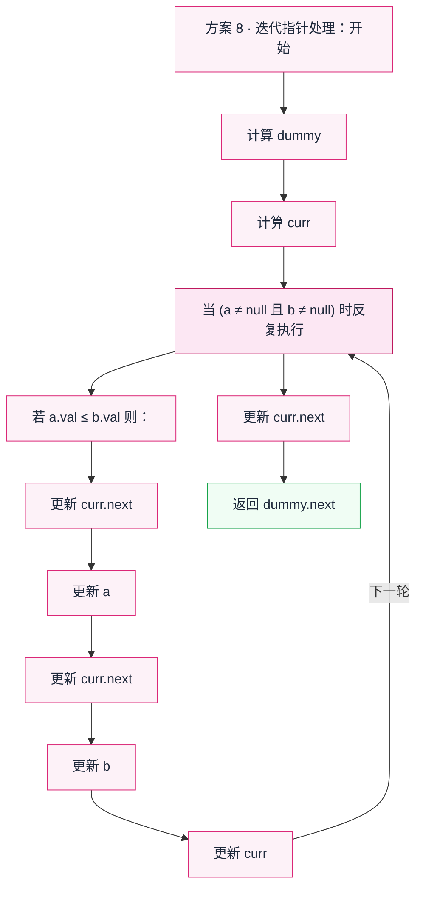

```typescript
export function demo(): void {
  // 程序入口：跑内嵌自测用例
  class ListNode {
    // 定义类型
    val: number; // 值: number;
    next: ListNode | null; // 下一个: ListNode 按位或 null;
    constructor(val?: number, next?: ListNode | null) {
      // constructor(值?: number, 下一个?: ListNode 按位或 null) {
      this.val = val === undefined ? 0 : val; // 把 值 全等于 undefined ? 0 : 值; 写入 值
      this.next = next === undefined ? null : next; // 把 下一个 全等于 undefined ? null : 下一个; 写入 下一个
    }
  }

  function mergeTwo(a: ListNode | null, b: ListNode | null): ListNode | null {
    // 定义函数/方法 mergeTwo
    const dummy = new ListNode(0); // 把 new ListNode(0) 存入 哨兵节点
    let curr = dummy; // 把 哨兵节点 存入 当前值
    while (a !== null && b !== null) {
      // 循环，直到不满足「数组 不等于 null 且 b 不等于 null」
      if (a.val <= b.val) {
        // 若 数组.值 不超过 b.值
        curr.next = a; // 把 数组; 写入 下一个
        a = a.next; // 把 数组.下一个 存入 数组
      } else {
        // 否则
        curr.next = b; // 把 b; 写入 下一个
        b = b.next; // 把 b.下一个 存入 b
      }
      curr = curr.next; // 把 当前值.下一个 存入 当前值
    }
    curr.next = a !== null ? a : b; // 把 数组 不等于 null ? 数组 : b; 写入 下一个
    return dummy.next; // 返回 哨兵节点.下一个
  }

  // 合并 K 个升序链表 - 方案: 分治合并 (自底向上, 逐对合并)
  function merge_k_lists(lists: Array<ListNode | null>): ListNode | null {
    // 定义函数/方法 merge_k_lists
    let cur = lists.filter((l) => l !== null) as Array<ListNode | null>;
    if (cur.length === 0) return null; // 若 当前值.长度 全等于 0，直接返回 null
    while (cur.length > 1) {
      // 循环，直到不满足「当前值.长度 超过 1」
      const merged: Array<ListNode | null> = []; // 把 []; 写入 const merged: Array<ListNode | null>
      for (let i = 0; i < cur.length; i += 2) {
        // 让 下标 i 从 0 开始计数，下标 i 小于 当前值.长度 就继续
        const a = cur[i]; // 把 当前值[下标 i] 存入 数组
        const b = i + 1 < cur.length ? cur[i + 1] : null; // 把 下标 i 加 1 小于 当前值.长度 ? 当前值[下标 i 加 1] : null 存入 b
        merged.push(mergeTwo(a, b)); // 把 mergeTwo(数组, b 压入栈/数组尾部
      }
      cur = merged; // 把 merged 存入 当前值
    }
    return cur[0]; // 返回 当前值[0]
  }

  function build(vals: number[]): ListNode | null {
    // 定义函数/方法 build
    const dummy = new ListNode(0); // 把 new ListNode(0) 存入 哨兵节点
    let cur = dummy; // 把 哨兵节点 存入 当前值
    for (const v of vals) {
      cur.next = new ListNode(v);
      cur = cur.next;
    } // 把 new ListNode(值); 当前值 赋值为 当前值.下一个; } 写入 下一个
    return dummy.next; // 返回 哨兵节点.下一个
  }

  function toList(node: ListNode | null): number[] {
    // 定义函数/方法 toList
    const res: number[] = []; // 把 []; 写入 const res: number[]
    while (node) {
      res.push(node.val);
      node = node.next;
    } // 循环，直到不满足「节点) { 结果 追加 节点.值); 节点 赋值为 节点.下一个; }」
    return res; // 返回 结果
  }

  const cases: { in: number[][]; want: number[] }[] = [
    {
      in: [
        [1, 4, 5],
        [1, 3, 4],
        [2, 6],
      ],
      want: [1, 1, 2, 3, 4, 4, 5, 6],
    },
    { in: [], want: [] },
    { in: [[1]], want: [1] },
    { in: [[1], [0]], want: [0, 1] },
    {
      in: [
        [-2, -1],
        [0, 3],
      ],
      want: [-2, -1, 0, 3],
    },
    { in: [[5], [1, 2, 3], [4]], want: [1, 2, 3, 4, 5] },
  ];
  let fail = false; // 把 false 存入 fail
  for (const c of cases) {
    // for (const 字符 of cases) {
    const got = toList(merge_k_lists(c.in.map(build))); // 把 toList(merge_k_lists(字符.in.映射表(build))) 存入 got
    if (got.length !== c.want.length || got.some((v, i) => v !== c.want[i])) {
      fail = true; // 把 true 存入 fail
      console.log('FAIL merge_k_lists(%o)=%o want %o', c.in, got, c.want); // 打印输出
    }
  }
  if (fail) throw new Error('FAILED'); // 若 fail) throw new Error(「FAILED」);
  console.log('PASS'); // 全部用例通过，输出 PASS
}
demo(); // demo();
```

### 方案 9：迭代指针处理

**分析与思路**：核心做法是「迭代指针处理」。

**运行方式**：`node 本文件`，内嵌用例全部通过会输出 PASS。

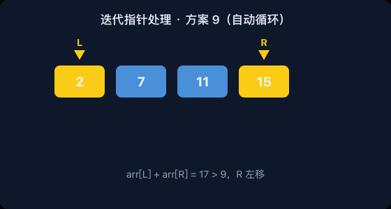

**方案专属流程图**（真实控制流）：

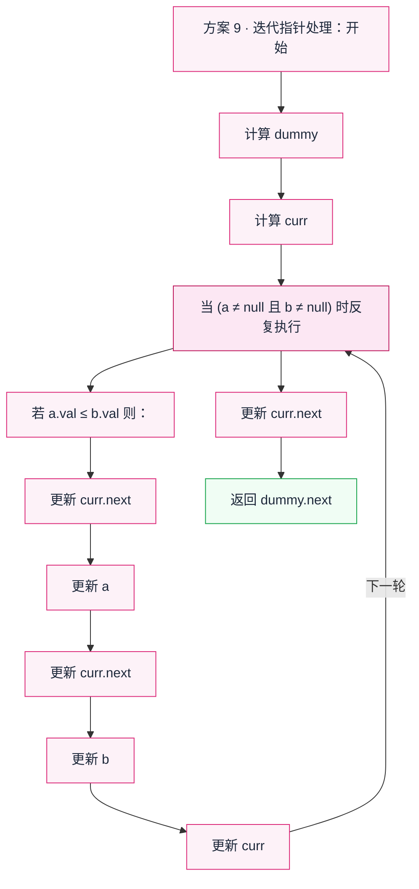

```typescript
export function demo(): void {
  // 程序入口：跑内嵌自测用例
  class ListNode {
    // 定义类型
    val: number; // 值: number;
    next: ListNode | null; // 下一个: ListNode 按位或 null;
    constructor(val?: number, next?: ListNode | null) {
      // constructor(值?: number, 下一个?: ListNode 按位或 null) {
      this.val = val === undefined ? 0 : val; // 把 值 全等于 undefined ? 0 : 值; 写入 值
      this.next = next === undefined ? null : next; // 把 下一个 全等于 undefined ? null : 下一个; 写入 下一个
    }
  }

  function mergeTwo(a: ListNode | null, b: ListNode | null): ListNode | null {
    // 定义函数/方法 mergeTwo
    const dummy = new ListNode(0); // 把 new ListNode(0) 存入 哨兵节点
    let curr = dummy; // 把 哨兵节点 存入 当前值
    while (a !== null && b !== null) {
      // 循环，直到不满足「数组 不等于 null 且 b 不等于 null」
      if (a.val <= b.val) {
        // 若 数组.值 不超过 b.值
        curr.next = a; // 把 数组; 写入 下一个
        a = a.next; // 把 数组.下一个 存入 数组
      } else {
        // 否则
        curr.next = b; // 把 b; 写入 下一个
        b = b.next; // 把 b.下一个 存入 b
      }
      curr = curr.next; // 把 当前值.下一个 存入 当前值
    }
    curr.next = a !== null ? a : b; // 把 数组 不等于 null ? 数组 : b; 写入 下一个
    return dummy.next; // 返回 哨兵节点.下一个
  }

  // 合并 K 个升序链表 - 方案: 顺序合并 (依次把每条链表并入结果)
  function merge_k_lists(lists: Array<ListNode | null>): ListNode | null {
    // 定义函数/方法 merge_k_lists
    let result: ListNode | null = null; // 把 null; 写入 let result: ListNode | null
    for (const l of lists) {
      // for (const 左指针 of lists) {
      result = mergeTwo(result, l); // 把 mergeTwo(结果, 左指针) 存入 结果
    }
    return result; // 返回 结果
  }

  function build(vals: number[]): ListNode | null {
    // 定义函数/方法 build
    const dummy = new ListNode(0); // 把 new ListNode(0) 存入 哨兵节点
    let cur = dummy; // 把 哨兵节点 存入 当前值
    for (const v of vals) {
      cur.next = new ListNode(v);
      cur = cur.next;
    } // 把 new ListNode(值); 当前值 赋值为 当前值.下一个; } 写入 下一个
    return dummy.next; // 返回 哨兵节点.下一个
  }

  function toList(node: ListNode | null): number[] {
    // 定义函数/方法 toList
    const res: number[] = []; // 把 []; 写入 const res: number[]
    while (node) {
      res.push(node.val);
      node = node.next;
    } // 循环，直到不满足「节点) { 结果 追加 节点.值); 节点 赋值为 节点.下一个; }」
    return res; // 返回 结果
  }

  const cases: { in: number[][]; want: number[] }[] = [
    {
      in: [
        [1, 4, 5],
        [1, 3, 4],
        [2, 6],
      ],
      want: [1, 1, 2, 3, 4, 4, 5, 6],
    },
    { in: [], want: [] },
    { in: [[1]], want: [1] },
    { in: [[1], [0]], want: [0, 1] },
    {
      in: [
        [-2, -1],
        [0, 3],
      ],
      want: [-2, -1, 0, 3],
    },
    { in: [[5], [1, 2, 3], [4]], want: [1, 2, 3, 4, 5] },
  ];
  let fail = false; // 把 false 存入 fail
  for (const c of cases) {
    // for (const 字符 of cases) {
    const got = toList(merge_k_lists(c.in.map(build))); // 把 toList(merge_k_lists(字符.in.映射表(build))) 存入 got
    if (got.length !== c.want.length || got.some((v, i) => v !== c.want[i])) {
      fail = true; // 把 true 存入 fail
      console.log('FAIL merge_k_lists(%o)=%o want %o', c.in, got, c.want); // 打印输出
    }
  }
  if (fail) throw new Error('FAILED'); // 若 fail) throw new Error(「FAILED」);
  console.log('PASS'); // 全部用例通过，输出 PASS
}
demo(); // demo();
```

### 方案 10：双重循环枚举

**分析与思路**：核心做法是「双重循环枚举」。代码里依次做这些事：先排序再处理；双重循环遍历。

**运行方式**：`node 本文件`，内嵌用例全部通过会输出 PASS。


**方案专属流程图**（真实控制流）：

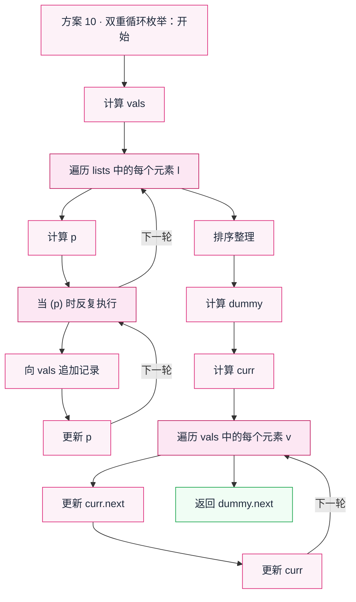

```typescript
export function demo(): void {
  // 程序入口：跑内嵌自测用例
  class ListNode {
    // 定义类型
    val: number; // 值: number;
    next: ListNode | null; // 下一个: ListNode 按位或 null;
    constructor(val?: number, next?: ListNode | null) {
      // constructor(值?: number, 下一个?: ListNode 按位或 null) {
      this.val = val === undefined ? 0 : val; // 把 值 全等于 undefined ? 0 : 值; 写入 值
      this.next = next === undefined ? null : next; // 把 下一个 全等于 undefined ? null : 下一个; 写入 下一个
    }
  }

  // 合并 K 个升序链表 - 方案: 收集所有值 + 排序 + 重建
  function merge_k_lists(lists: Array<ListNode | null>): ListNode | null {
    // 定义函数/方法 merge_k_lists
    const vals: number[] = []; // 把 []; 写入 const vals: number[]
    for (const l of lists) {
      // for (const 左指针 of lists) {
      let p = l; // 把 左指针 存入 节点
      while (p) {
        // 循环，直到不满足「节点」
        vals.push(p.val); // 把 节点.值 压入栈/数组尾部
        p = p.next; // 把 节点.下一个 存入 节点
      }
    }
    vals.sort((a, b) => a - b);
    const dummy = new ListNode(0); // 把 new ListNode(0) 存入 哨兵节点
    let curr = dummy; // 把 哨兵节点 存入 当前值
    for (const v of vals) {
      // for (const 值 of vals) {
      curr.next = new ListNode(v); // 把 new ListNode(值); 写入 下一个
      curr = curr.next; // 把 当前值.下一个 存入 当前值
    }
    return dummy.next; // 返回 哨兵节点.下一个
  }

  function build(vals: number[]): ListNode | null {
    // 定义函数/方法 build
    const dummy = new ListNode(0); // 把 new ListNode(0) 存入 哨兵节点
    let cur = dummy; // 把 哨兵节点 存入 当前值
    for (const v of vals) {
      cur.next = new ListNode(v);
      cur = cur.next;
    } // 把 new ListNode(值); 当前值 赋值为 当前值.下一个; } 写入 下一个
    return dummy.next; // 返回 哨兵节点.下一个
  }

  function toList(node: ListNode | null): number[] {
    // 定义函数/方法 toList
    const res: number[] = []; // 把 []; 写入 const res: number[]
    while (node) {
      res.push(node.val);
      node = node.next;
    } // 循环，直到不满足「节点) { 结果 追加 节点.值); 节点 赋值为 节点.下一个; }」
    return res; // 返回 结果
  }

  const cases: { in: number[][]; want: number[] }[] = [
    {
      in: [
        [1, 4, 5],
        [1, 3, 4],
        [2, 6],
      ],
      want: [1, 1, 2, 3, 4, 4, 5, 6],
    },
    { in: [], want: [] },
    { in: [[1]], want: [1] },
    { in: [[1], [0]], want: [0, 1] },
    {
      in: [
        [-2, -1],
        [0, 3],
      ],
      want: [-2, -1, 0, 3],
    },
    { in: [[5], [1, 2, 3], [4]], want: [1, 2, 3, 4, 5] },
  ];
  let fail = false; // 把 false 存入 fail
  for (const c of cases) {
    // for (const 字符 of cases) {
    const got = toList(merge_k_lists(c.in.map(build))); // 把 toList(merge_k_lists(字符.in.映射表(build))) 存入 got
    if (got.length !== c.want.length || got.some((v, i) => v !== c.want[i])) {
      fail = true; // 把 true 存入 fail
      console.log('FAIL merge_k_lists(%o)=%o want %o', c.in, got, c.want); // 打印输出
    }
  }
  if (fail) throw new Error('FAILED'); // 若 fail) throw new Error(「FAILED」);
  console.log('PASS'); // 全部用例通过，输出 PASS
}
demo(); // demo();
```

### 方案 11：直接实现

**分析与思路**：核心做法是「直接实现」。

**运行方式**：`node 本文件`，内嵌用例全部通过会输出 PASS。


**方案专属流程图**（真实控制流）：

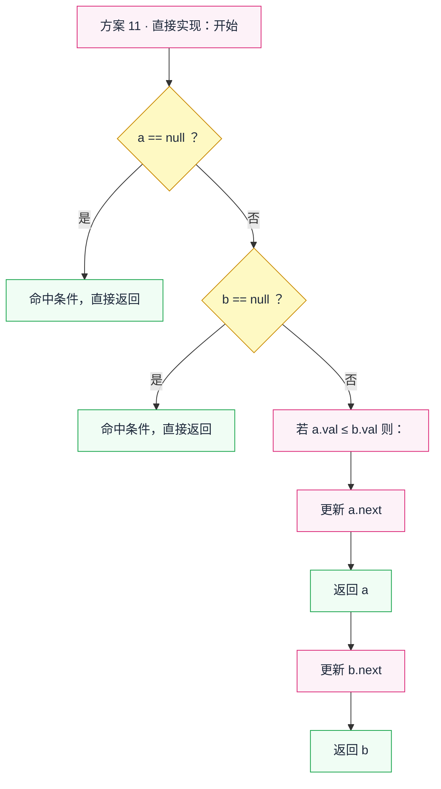

```typescript
export function demo(): void {
  // 程序入口：跑内嵌自测用例
  class ListNode {
    // 定义类型
    val: number; // 值: number;
    next: ListNode | null; // 下一个: ListNode 按位或 null;
    constructor(val?: number, next?: ListNode | null) {
      // constructor(值?: number, 下一个?: ListNode 按位或 null) {
      this.val = val === undefined ? 0 : val; // 把 值 全等于 undefined ? 0 : 值; 写入 值
      this.next = next === undefined ? null : next; // 把 下一个 全等于 undefined ? null : 下一个; 写入 下一个
    }
  }

  function mergeTwo(a: ListNode | null, b: ListNode | null): ListNode | null {
    // 定义函数/方法 mergeTwo
    if (a === null) return b; // 若 数组 全等于 null，直接返回 b
    if (b === null) return a; // 若 b 全等于 null，直接返回 数组
    if (a.val <= b.val) {
      // 若 数组.值 不超过 b.值
      a.next = mergeTwo(a.next, b); // 把 mergeTwo(数组.下一个, b); 写入 下一个
      return a; // 返回 数组
    } else {
      // 否则
      b.next = mergeTwo(a, b.next); // 把 mergeTwo(数组, b.下一个); 写入 下一个
      return b; // 返回 b
    }
  }

  // 合并 K 个升序链表 - 方案: 递归逐条合并 (merge(l0, merge(l1, ...)))
  function merge_k_lists(lists: Array<ListNode | null>): ListNode | null {
    // 定义函数/方法 merge_k_lists
    if (lists.length === 0) return null; // 若 lists.长度 全等于 0，直接返回 null

    const mergeRest = (i: number): ListNode | null => {
      if (i === lists.length - 1) return lists[i]; // 若 下标 i 全等于 lists.长度 减 1，直接返回 lists[下标 i]
      return mergeTwo(lists[i], mergeRest(i + 1)); // 返回 mergeTwo(lists[下标 i], mergeRest(下标 i 加 1))
    };

    return mergeRest(0); // 返回 mergeRest(0)
  }

  function build(vals: number[]): ListNode | null {
    // 定义函数/方法 build
    const dummy = new ListNode(0); // 把 new ListNode(0) 存入 哨兵节点
    let cur = dummy; // 把 哨兵节点 存入 当前值
    for (const v of vals) {
      cur.next = new ListNode(v);
      cur = cur.next;
    } // 把 new ListNode(值); 当前值 赋值为 当前值.下一个; } 写入 下一个
    return dummy.next; // 返回 哨兵节点.下一个
  }

  function toList(node: ListNode | null): number[] {
    // 定义函数/方法 toList
    const res: number[] = []; // 把 []; 写入 const res: number[]
    while (node) {
      res.push(node.val);
      node = node.next;
    } // 循环，直到不满足「节点) { 结果 追加 节点.值); 节点 赋值为 节点.下一个; }」
    return res; // 返回 结果
  }

  const cases: { in: number[][]; want: number[] }[] = [
    {
      in: [
        [1, 4, 5],
        [1, 3, 4],
        [2, 6],
      ],
      want: [1, 1, 2, 3, 4, 4, 5, 6],
    },
    { in: [], want: [] },
    { in: [[1]], want: [1] },
    { in: [[1], [0]], want: [0, 1] },
    {
      in: [
        [-2, -1],
        [0, 3],
      ],
      want: [-2, -1, 0, 3],
    },
    { in: [[5], [1, 2, 3], [4]], want: [1, 2, 3, 4, 5] },
  ];
  let fail = false; // 把 false 存入 fail
  for (const c of cases) {
    // for (const 字符 of cases) {
    const got = toList(merge_k_lists(c.in.map(build))); // 把 toList(merge_k_lists(字符.in.映射表(build))) 存入 got
    if (got.length !== c.want.length || got.some((v, i) => v !== c.want[i])) {
      fail = true; // 把 true 存入 fail
      console.log('FAIL merge_k_lists(%o)=%o want %o', c.in, got, c.want); // 打印输出
    }
  }
  if (fail) throw new Error('FAILED'); // 若 fail) throw new Error(「FAILED」);
  console.log('PASS'); // 全部用例通过，输出 PASS
}
demo(); // demo();
```

### 方案 12：单趟扫描

**分析与思路**：核心做法是「单趟扫描」。代码里依次做这些事：单循环线性扫描。

**运行方式**：`node 本文件`，内嵌用例全部通过会输出 PASS。

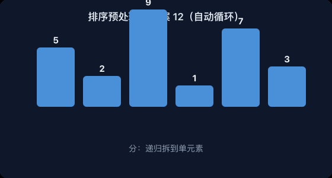

**方案专属流程图**（真实控制流）：

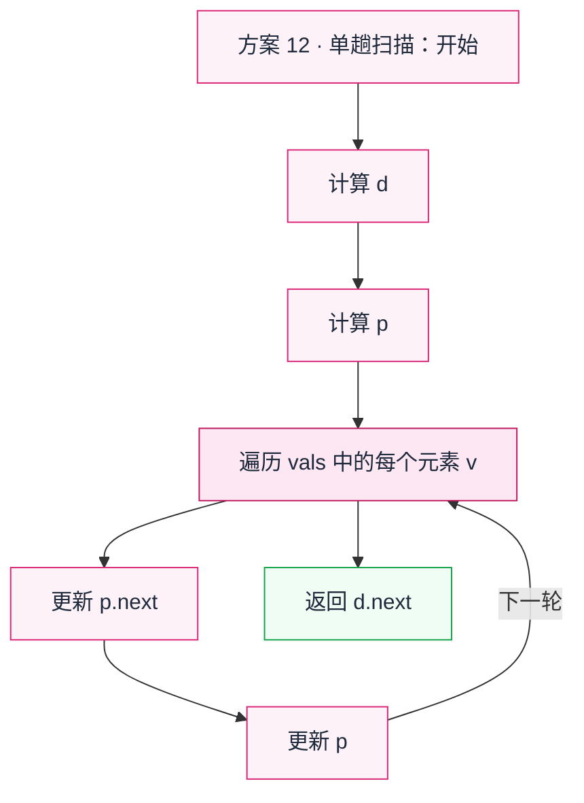

```typescript
export function demo(): void {
  // 程序入口：跑内嵌自测用例
  class ListNode {
    val: number;
    next: ListNode | null;
    constructor(v = 0, n: ListNode | null = null) {
      this.val = v;
      this.next = n;
    }
  } // 定义类型
  function build(vals: number[]): ListNode | null {
    const d = new ListNode();
    let p = d;
    for (const v of vals) {
      p.next = new ListNode(v);
      p = p.next;
    }
    return d.next;
  } // 定义函数/方法 build
  function toArr(h: ListNode | null): number[] {
    const r: number[] = [];
    while (h) {
      r.push(h.val);
      h = h.next;
    }
    return r;
  } // 定义函数/方法 toArr
  function mergeKLists(lists: (ListNode | null)[]): ListNode | null {
    // 定义函数/方法 mergeKLists
    const pq: ListNode[] = []; // 把 []; 写入 const pq: ListNode[]
    const push = (n: ListNode) => {
      pq.push(n);
      pq.sort((a, b) => a.val - b.val);
    };
    for (const l of lists) if (l) push(l); // for(const 左指针 of lists) if(左指针) push(左指针);
    const d = new ListNode();
    let p = d; // 把 new ListNode(); let 节点 赋值为 d 存入 d
    while (pq.length) {
      const n = pq.shift()!;
      p.next = n;
      p = p.next!;
      if (n.next) push(n.next);
    }
    return d.next; // 返回 d.下一个
  }
  const cases = [
    {
      in: [
        [1, 4, 5],
        [1, 3, 4],
        [2, 6],
      ],
      want: [1, 1, 2, 3, 4, 4, 5, 6],
    },
    { in: [[]], want: [] },
    { in: [[1]], want: [1] },
  ];
  let fail = false; // 把 false 存入 fail
  for (const c of cases) {
    const ls = c.in.map((x) => (x.length ? build(x) : null));
    const got = toArr(mergeKLists(ls));
    if (JSON.stringify(got) !== JSON.stringify(c.want)) {
      fail = true;
      console.log('FAIL ' + got);
    }
  }
  if (fail) throw new Error('FAILED'); // 若 fail) throw new Error(「FAILED」);
  console.log('PASS'); // 全部用例通过，输出 PASS
}
demo(); // demo();
```

## 逐步拆解与面试追问

**复杂度**：时间 O(n)（单趟线性扫描），空间 O(1) 到 O(n)（视辅助结构）

**为什么是这个量级**：每个元素被常数次访问，辅助哈希或栈的开销与 n 同阶

**面试官可能会追问**：

- 什么时候用堆而不是排序？
- 堆里存值还是存下标？
- Top-K 用小顶还是大顶堆？

## 关键 API 速查（TS 主解法实际用到，附官方链接）

| API | 作用 | 使用要点 | 官方文档 |
|---|---|---|---|
| `Array.prototype.map()` | 逐元素映射为新数组 | 回调 (v,i,arr)；返回等长新数组，不改变原数组；稀疏位跳过；链式调用注意中间数组开销 | [官方文档](https://developer.mozilla.org/zh-CN/docs/Web/JavaScript/Reference/Global_Objects/Array/map) |
| `Array.prototype.push()` | 尾部追加 | 返回新长度；可一次多个；均摊 O(1)；会改变原数组 | [官方文档](https://developer.mozilla.org/zh-CN/docs/Web/JavaScript/Reference/Global_Objects/Array/push) |
| `Array.prototype.pop()` | 尾部弹出 | 返回被删元素（空数组返回 undefined）；O(1) | [官方文档](https://developer.mozilla.org/zh-CN/docs/Web/JavaScript/Reference/Global_Objects/Array/pop) |

### 各语言官方文档导航

- **TypeScript / JS**：[MDN 中文参考](https://developer.mozilla.org/zh-CN/)
- **Python**：[Python 官方文档](https://docs.python.org/zh-cn/3/)
- **Go**：[Go 标准库](https://pkg.go.dev/std)
- **Java**：[JDK 17 API](https://docs.oracle.com/en/java/javase/17/docs/api/)
- **Rust**：[Rust 标准库](https://doc.rust-lang.org/std/)
- **Lua**：[Lua 5.4 手册](https://www.lua.org/manual/5.4/)
- **C**：[Cppreference C](https://zh.cppreference.com/w/c)
- **C++**：[Cppreference C++](https://zh.cppreference.com/w/cpp)
- **R**：[R 官方手册](https://stat.ethz.ch/R-manual/)
- **Zig**：[Zig 语言文档](https://ziglang.org/documentation/master/)
- **Dart**：[Dart API](https://api.dart.dev/)

## 附录：其他 10 种语言全部实现（每种语言列举其全部方案）

> TypeScript 的全部方案见「TypeScript 解题方案」一节；下面是其余 10 种语言的对应实现，每种语言的每个方案都带思路分析、代码走读与专属运行架构图。
> 每个方案都内嵌用例自测，可独立运行（老仓库 python/go 文件遵循「打印结果」约定）。
> 完整解法文件见 `dsa/<语言>/heap/lc_23_合并k个升序链表/`。

### Python 实现（12 种方案）

Python 的全部方案如下，每个方案都内嵌用例自测，可独立运行（老仓库 python/go 文件遵循「打印结果」约定）：

#### 方案 1：单趟扫描

**思路与代码分析**：核心是「单趟扫描」。Python 版用切片与字典推导式简化操作，突出可读性。**走读**：方案 1 · 单趟扫描：开始 → 更新 res → 更新 p → 更新 h → 遍历 lists: 中的每个元素 l → 若 l：调用 h.insert(l.val, l) → 调用 h.insert(l.val, l) → 当 h.size() ＞ 0: 时反复执行 → 从 h 弹出 → 更新 p.next → 更新 p → 若 n.next：调用 h.insert(n.next.val, n.next) → 调用 h.insert(n.next.val, n.next) → 返回 res.next。

**运行架构**（真实控制流）：

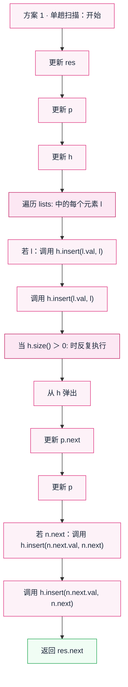

```python
import sys  # 提高递归深度上限（深输入防 RecursionError）

sys.setrecursionlimit(200000)  # 树/链表类题目节点数可达 1e4 量级
import heapq  # 引入依赖

class ListNode:  # 定义类
    def __init__(self, val=0, next=None):  # 构造函数：初始化成员
        self.val = val  # 把 值 写入 值
        self.next = next  # 把 下一个 写入 下一个

class MinHeap:  # 定义类
    def __init__(self):  # 构造函数：初始化成员
        self.heap = []  # 把 [] 写入 堆

    def size(self):  # 定义函数 size（参数：self）
        return len(self.heap)  # 返回 长度(self.堆)

    def insert(self, val, node):  # 定义函数 insert（参数：self, 值, 节点）
        heapq.heappush(self.heap, (val, id(node), node))  # heapq.heappush(self.堆, (值, id(节点), 节点))

    def pop(self):  # 定义函数 pop（参数：self）
        val, _id, node = heapq.heappop(self.heap)  # 把 heapq.heappop(self.堆) 写入 val, _id, node
        return node  # 返回 节点

def mergeKLists(lists):  # 定义函数 mergeKLists（参数：lists）
    res = ListNode(0)  # 把 ListNode(0) 存入 结果
    p = res  # 把 结果 存入 节点
    h = MinHeap()  # 把 MinHeap() 存入 h
    for l in lists:  # 逐个取出 lists 的元素（左指针）
        if l:  # 若 左指针
            h.insert(l.val, l)  # h 插入 左指针.值, 左指针)
    while h.size() > 0:  # 循环，直到不满足「h.大小() 超过 0」
        n = h.pop()  # 把 h 弹出 ) 存入 元素个数
        p.next = n  # 把 元素个数 写入 下一个
        p = p.next  # 把 节点.下一个 存入 节点
        if n.next:  # 若 元素个数.下一个
            h.insert(n.next.val, n.next)  # h 插入 元素个数.下一个.值, 元素个数.下一个)
    return res.next  # 返回 结果.下一个

def build(vals):  # 定义函数 build（参数：vals）
    dummy = ListNode(0)  # 把 ListNode(0) 存入 哨兵节点
    cur = dummy  # 把 哨兵节点 存入 当前值
    for v in vals:  # 逐个取出 vals 的元素（值）
        cur.next = ListNode(v)  # 把 ListNode(值) 写入 下一个
        cur = cur.next  # 把 当前值.下一个 存入 当前值
    return dummy.next  # 返回 哨兵节点.下一个

def to_list(node):  # 定义函数 to_list（参数：节点）
    res = []  # 把 [] 存入 结果
    while node:  # 循环，直到不满足「节点」
        res.append(node.val)  # 把 节点.值 追加到列表尾部
        node = node.next  # 把 节点.下一个 存入 节点
    return res  # 返回 结果

if __name__ == "__main__":  # 若 __name__ 等于 '__main__'
    lists = [[1, 4, 5], [1, 3, 4], [2, 6]]  # 把 [[1, 4, 5], [1, 3, 4], [2, 6]] 存入 lists
    built = [build(l) for l in lists]  # 把 [build(左指针) for 左指针 in lists] 存入 built
    print(to_list(mergeKLists(built)))  # 打印输出
```

#### 方案 2：栈辅助

**思路与代码分析**：核心是「栈辅助」。Python 版用切片与字典推导式简化操作，突出可读性。代码里依次做这些事：栈的后进先出操作。**走读**：方案 2 · 栈辅助：开始 → 更新 queue → 遍历 lists: 中的每个元素 node → 当 queue.length ＞ 0: 时反复执行 → 返回 head.next。

**运行架构**（真实控制流）：

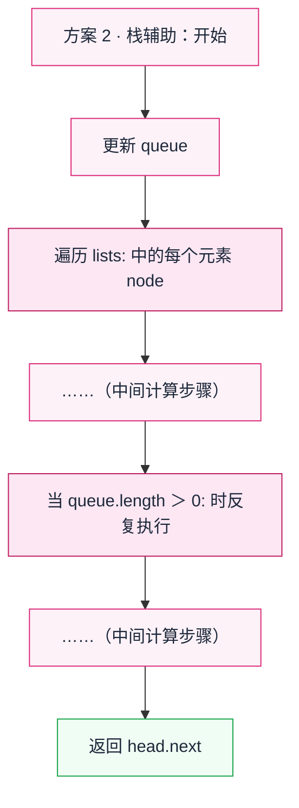

```python
import sys  # 提高递归深度上限（深输入防 RecursionError）

sys.setrecursionlimit(200000)  # 树/链表类题目节点数可达 1e4 量级
import heapq  # 引入依赖

class ListNode:  # 定义类
    def __init__(self, val=0, next=None):  # 构造函数：初始化成员
        self.val = val  # 把 值 写入 值
        self.next = next  # 把 下一个 写入 下一个

class Status:  # 定义类
    def __init__(self, val, ptr):  # 构造函数：初始化成员
        self.val = val  # 把 值 写入 值
        self.ptr = ptr  # 把 ptr 写入 self.ptr

    def __lt__(self, other):  # 定义函数 __lt__（参数：self, other）
        return self.val < other.val  # 返回 self.值 小于 other.值

class PQ:  # 定义类
    def __init__(self):  # 构造函数：初始化成员
        self.heap = []  # 把 [] 写入 堆

    @property  # @property
    def length(self):  # 定义函数 length（参数：self）
        return len(self.heap)  # 返回 长度(self.堆)

    def push(self, item):  # 定义函数 push（参数：self, item）
        heapq.heappush(self.heap, item)  # heapq.heappush(self.堆, item)

    def pop(self):  # 定义函数 pop（参数：self）
        return heapq.heappop(self.heap)  # 返回 heapq.heappop(self.堆)

def mergeKLists(lists):  # 定义函数 mergeKLists（参数：lists）
    queue = PQ()  # 把 PQ() 存入 队列
    for node in lists:  # 逐个取出 lists 的元素（节点）
        if node is not None:  # 若 节点 is not None
            queue.push(Status(node.val, node))  # 把 Status(节点.值, 节点 压入栈/数组尾部
    head = ListNode(0)  # 把 ListNode(0) 存入 头节点
    tail = head  # 把 头节点 存入 尾节点
    while queue.length > 0:  # 循环，直到不满足「队列.长度 超过 0」
        f = queue.pop()  # 把 队列 弹出 ) 存入 f
        if f:  # 若 f
            tail.next = f.ptr  # 把 f.ptr 写入 下一个
            tail = tail.next  # 把 尾节点.下一个 存入 尾节点
            if f.ptr.next is not None:  # 若 f.ptr.下一个 is not None
                queue.push(
                    Status(f.ptr.next.val, f.ptr.next)
                )  # 把 Status(f.ptr.下一个.值, f.ptr.下一个 压入栈/数组尾部
    return head.next  # 返回 头节点.下一个

def build(vals):  # 定义函数 build（参数：vals）
    dummy = ListNode(0)  # 把 ListNode(0) 存入 哨兵节点
    cur = dummy  # 把 哨兵节点 存入 当前值
    for v in vals:  # 逐个取出 vals 的元素（值）
        cur.next = ListNode(v)  # 把 ListNode(值) 写入 下一个
        cur = cur.next  # 把 当前值.下一个 存入 当前值
    return dummy.next  # 返回 哨兵节点.下一个

def to_list(node):  # 定义函数 to_list（参数：节点）
    res = []  # 把 [] 存入 结果
    while node:  # 循环，直到不满足「节点」
        res.append(node.val)  # 把 节点.值 追加到列表尾部
        node = node.next  # 把 节点.下一个 存入 节点
    return res  # 返回 结果

if __name__ == "__main__":  # 若 __name__ 等于 '__main__'
    lists = [[1, 4, 5], [1, 3, 4], [2, 6]]  # 把 [[1, 4, 5], [1, 3, 4], [2, 6]] 存入 lists
    built = [build(l) for l in lists]  # 把 [build(左指针) for 左指针 in lists] 存入 built
    print(to_list(mergeKLists(built)))  # 打印输出
```

#### 方案 3：迭代指针处理

**思路与代码分析**：核心是「迭代指针处理」。Python 版用切片与字典推导式简化操作，突出可读性。**走读**：方案 3 · 迭代指针处理：开始 → 更新 ans → 循环 i：从 0 到 len(lists 前 → 更新 ans → 返回 ans。

**运行架构**（真实控制流）：

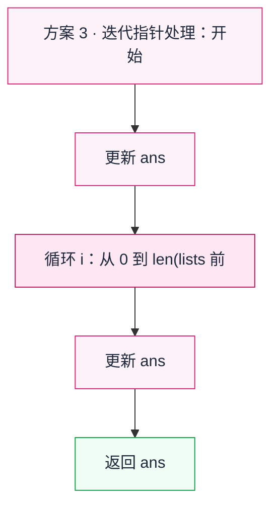

```python
import sys  # 提高递归深度上限（深输入防 RecursionError）

sys.setrecursionlimit(200000)  # 树/链表类题目节点数可达 1e4 量级

class ListNode:  # 定义类
    def __init__(self, val=0, next=None):  # 构造函数：初始化成员
        self.val = val  # 把 值 写入 值
        self.next = next  # 把 下一个 写入 下一个

def mergeKLists(lists):  # 定义函数 mergeKLists（参数：lists）
    ans = None  # 把 None 存入 答案
    for i in range(len(lists)):  # 让 下标 i 从 长度(lists 遍历
        ans = mergeTwoLists(ans, lists[i])  # 把 mergeTwoLists(答案, lists[下标 i]) 存入 答案
    return ans  # 返回 答案

def mergeTwoLists(a, b):  # 定义函数 mergeTwoLists（参数：数组, b）
    if a is None:  # 若 数组 is None
        return b  # 返回 b
    if b is None:  # 若 b is None
        return a  # 返回 数组
    head = ListNode(0)  # 把 ListNode(0) 存入 头节点
    tail = head  # 把 头节点 存入 尾节点
    aPtr = a  # 把 数组 存入 aPtr
    bPtr = b  # 把 b 存入 bPtr
    while aPtr is not None and bPtr is not None:  # 循环，直到不满足「aPtr is not None and bPtr is not None」
        if aPtr.val < bPtr.val:  # 若 aPtr.值 小于 bPtr.值
            tail.next = aPtr  # 把 aPtr 写入 下一个
            aPtr = aPtr.next  # 把 aPtr.下一个 存入 aPtr
        else:  # 否则
            tail.next = bPtr  # 把 bPtr 写入 下一个
            bPtr = bPtr.next  # 把 bPtr.下一个 存入 bPtr
        tail = tail.next  # 把 尾节点.下一个 存入 尾节点
    tail.next = aPtr if aPtr is not None else bPtr  # 把 aPtr if aPtr is not None else bPtr 写入 下一个
    return head.next  # 返回 头节点.下一个

def build(vals):  # 定义函数 build（参数：vals）
    dummy = ListNode(0)  # 把 ListNode(0) 存入 哨兵节点
    cur = dummy  # 把 哨兵节点 存入 当前值
    for v in vals:  # 逐个取出 vals 的元素（值）
        cur.next = ListNode(v)  # 把 ListNode(值) 写入 下一个
        cur = cur.next  # 把 当前值.下一个 存入 当前值
    return dummy.next  # 返回 哨兵节点.下一个

def to_list(node):  # 定义函数 to_list（参数：节点）
    res = []  # 把 [] 存入 结果
    while node:  # 循环，直到不满足「节点」
        res.append(node.val)  # 把 节点.值 追加到列表尾部
        node = node.next  # 把 节点.下一个 存入 节点
    return res  # 返回 结果

if __name__ == "__main__":  # 若 __name__ 等于 '__main__'
    lists = [[1, 4, 5], [1, 3, 4], [2, 6]]  # 把 [[1, 4, 5], [1, 3, 4], [2, 6]] 存入 lists
    built = [build(l) for l in lists]  # 把 [build(左指针) for 左指针 in lists] 存入 built
    print(to_list(mergeKLists(built)))  # 打印输出
```

#### 方案 4：迭代指针处理

**思路与代码分析**：核心是「迭代指针处理」。Python 版用切片与字典推导式简化操作，突出可读性。**走读**：方案 4 · 迭代指针处理：开始 → 返回 merge(lists, 0, len(lists) - 1)。

**运行架构**（真实控制流）：

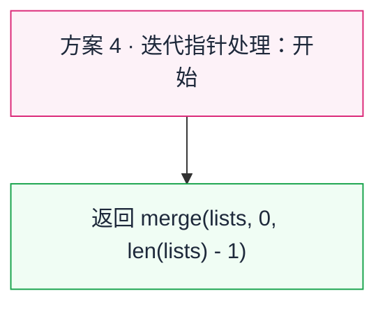

```python
import sys  # 提高递归深度上限（深输入防 RecursionError）

sys.setrecursionlimit(200000)  # 树/链表类题目节点数可达 1e4 量级

class ListNode:  # 定义类
    def __init__(self, val=0, next=None):  # 构造函数：初始化成员
        self.val = val  # 把 值 写入 值
        self.next = next  # 把 下一个 写入 下一个

def mergeKLists(lists):  # 定义函数 mergeKLists（参数：lists）
    return merge(lists, 0, len(lists) - 1)  # 返回 merge(lists, 0, 长度(lists) 减 1)

def merge(lists, l, r):  # 定义函数 merge（参数：lists, 左指针, 右指针）
    if l == r:  # 若 左指针 等于 右指针
        return lists[l]  # 返回 lists[左指针]
    if l > r:  # 若 左指针 超过 右指针
        return None  # 返回 None
    mid = (l + r) // 2  # 把 (左指针 加 右指针) 除以 除以 2 存入 中点
    return mergeTwoLists(merge(lists, l, mid), merge(lists, mid + 1, r))

def mergeTwoLists(a, b):  # 定义函数 mergeTwoLists（参数：数组, b）
    if a is None:  # 若 数组 is None
        return b  # 返回 b
    if b is None:  # 若 b is None
        return a  # 返回 数组
    head = ListNode(0)  # 把 ListNode(0) 存入 头节点
    tail = head  # 把 头节点 存入 尾节点
    aPtr = a  # 把 数组 存入 aPtr
    bPtr = b  # 把 b 存入 bPtr
    while aPtr is not None and bPtr is not None:  # 循环，直到不满足「aPtr is not None and bPtr is not None」
        if aPtr.val < bPtr.val:  # 若 aPtr.值 小于 bPtr.值
            tail.next = aPtr  # 把 aPtr 写入 下一个
            aPtr = aPtr.next  # 把 aPtr.下一个 存入 aPtr
        else:  # 否则
            tail.next = bPtr  # 把 bPtr 写入 下一个
            bPtr = bPtr.next  # 把 bPtr.下一个 存入 bPtr
        tail = tail.next  # 把 尾节点.下一个 存入 尾节点
    tail.next = aPtr if aPtr is not None else bPtr  # 把 aPtr if aPtr is not None else bPtr 写入 下一个
    return head.next  # 返回 头节点.下一个

def build(vals):  # 定义函数 build（参数：vals）
    dummy = ListNode(0)  # 把 ListNode(0) 存入 哨兵节点
    cur = dummy  # 把 哨兵节点 存入 当前值
    for v in vals:  # 逐个取出 vals 的元素（值）
        cur.next = ListNode(v)  # 把 ListNode(值) 写入 下一个
        cur = cur.next  # 把 当前值.下一个 存入 当前值
    return dummy.next  # 返回 哨兵节点.下一个

def to_list(node):  # 定义函数 to_list（参数：节点）
    res = []  # 把 [] 存入 结果
    while node:  # 循环，直到不满足「节点」
        res.append(node.val)  # 把 节点.值 追加到列表尾部
        node = node.next  # 把 节点.下一个 存入 节点
    return res  # 返回 结果

if __name__ == "__main__":  # 若 __name__ 等于 '__main__'
    lists = [[1, 4, 5], [1, 3, 4], [2, 6]]  # 把 [[1, 4, 5], [1, 3, 4], [2, 6]] 存入 lists
    built = [build(l) for l in lists]  # 把 [build(左指针) for 左指针 in lists] 存入 built
    print(to_list(mergeKLists(built)))  # 打印输出
```

#### 方案 5：栈辅助

**思路与代码分析**：核心是「栈辅助」。Python 版用切片与字典推导式简化操作，突出可读性。代码里依次做这些事：队列或堆的调度。**走读**：方案 5 · 栈辅助：开始 → 更新 heap → 遍历 enumerate(lists): 中的每个元素 node → 若 node：调用 heapq.heappush(heap, (node.v → 调用 heapq.heappush(heap, (node.v → 更新 dummy → 更新 curr → 当 heap: 时反复执行 → 更新 node → 更新 curr.next → 更新 curr → 若 node.next：调用 heapq.heappush( → 调用 heapq.heappush( → 处理 heap, (node.next.val, i, nod → 处理 ) → 返回 dummy.next。

**运行架构**（真实控制流）：

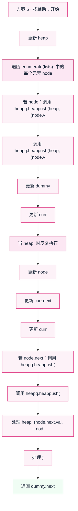

```python
# 合并 K 个升序链表 - 方案: 小顶堆 (heapq)
import sys  # 提高递归深度上限（深输入防 RecursionError）

sys.setrecursionlimit(200000)  # 树/链表类题目节点数可达 1e4 量级
import heapq  # 引入依赖

class ListNode:  # 定义类
    def __init__(self, val=0, next=None):  # 构造函数：初始化成员
        self.val = val  # 把 值 写入 值
        self.next = next  # 把 下一个 写入 下一个

def merge_k_lists(lists):  # 定义函数 merge_k_lists（参数：lists）
    heap = []  # 把 [] 存入 堆
    for i, node in enumerate(lists):  # 同时取 下标 i 与 节点 遍历
        if node:  # 若 节点
            heapq.heappush(heap, (node.val, i, node))  # heapq.heappush(堆, (节点.值, 下标 i, 节点))
    dummy = ListNode(0)  # 把 ListNode(0) 存入 哨兵节点
    curr = dummy  # 把 哨兵节点 存入 当前值
    while heap:  # 循环，直到不满足「堆」
        _, i, node = heapq.heappop(heap)  # 把 heapq.heappop(堆) 写入 _, i, node
        curr.next = node  # 把 节点 写入 下一个
        curr = curr.next  # 把 当前值.下一个 存入 当前值
        if node.next:  # 若 节点.下一个
            heapq.heappush(
                heap, (node.next.val, i, node.next)
            )  # heapq.heappush(堆, (节点.下一个.值, 下标 i, 节点.下一个))
    return dummy.next  # 返回 哨兵节点.下一个

def build(arr):  # 定义函数 build（参数：数组）
    dummy = ListNode(0)  # 把 ListNode(0) 存入 哨兵节点
    curr = dummy  # 把 哨兵节点 存入 当前值
    for v in arr:  # 逐个取出 数组 的元素（值）
        curr.next = ListNode(v)  # 把 ListNode(值) 写入 下一个
        curr = curr.next  # 把 当前值.下一个 存入 当前值
    return dummy.next  # 返回 哨兵节点.下一个

def to_list(node):  # 定义函数 to_list（参数：节点）
    res = []  # 把 [] 存入 结果
    while node:  # 循环，直到不满足「节点」
        res.append(node.val)  # 把 节点.值 追加到列表尾部
        node = node.next  # 把 节点.下一个 存入 节点
    return res  # 返回 结果

if __name__ == "__main__":  # 若 __name__ 等于 '__main__'
    lists = [build([1, 4, 5]), build([1, 3, 4]), build([2, 6])]
    print(to_list(merge_k_lists(lists)))  # [1, 1, 2, 3, 4, 4, 5, 6]
```

#### 方案 6：栈辅助

**思路与代码分析**：核心是「栈辅助」。Python 版用切片与字典推导式简化操作，突出可读性。代码里依次做这些事：队列或堆的调度。**走读**：方案 6 · 栈辅助：开始 → 更新 heap → 遍历 lists: 中的每个元素 node → 若 node：调用 heapq.heappush(heap, (node.v → 调用 heapq.heappush(heap, (node.v → 更新 dummy → 更新 curr → 当 heap: 时反复执行 → 更新 node → 更新 curr.next → 更新 curr → 若 node.next：调用 heapq.heappush( → 调用 heapq.heappush( → 处理 heap, (node.next.val, id(nod → 处理 ) → 返回 dummy.next。

**运行架构**（真实控制流）：

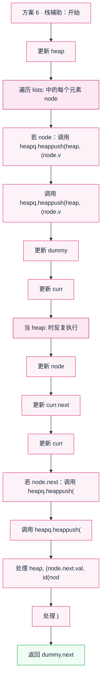

```python
# 合并 K 个升序链表 - 方案: 小顶堆 (用 id 做 tiebreak, 避免比较节点)
import sys  # 提高递归深度上限（深输入防 RecursionError）

sys.setrecursionlimit(200000)  # 树/链表类题目节点数可达 1e4 量级
import heapq  # 引入依赖

class ListNode:  # 定义类
    def __init__(self, val=0, next=None):  # 构造函数：初始化成员
        self.val = val  # 把 值 写入 值
        self.next = next  # 把 下一个 写入 下一个

def merge_k_lists(lists):  # 定义函数 merge_k_lists（参数：lists）
    heap = []  # 把 [] 存入 堆
    for node in lists:  # 逐个取出 lists 的元素（节点）
        if node:  # 若 节点
            heapq.heappush(heap, (node.val, id(node), node))  # heapq.heappush(堆, (节点.值, id(节点), 节点))
    dummy = ListNode(0)  # 把 ListNode(0) 存入 哨兵节点
    curr = dummy  # 把 哨兵节点 存入 当前值
    while heap:  # 循环，直到不满足「堆」
        _, _, node = heapq.heappop(heap)  # 把 heapq.heappop(堆) 写入 _, _, node
        curr.next = node  # 把 节点 写入 下一个
        curr = curr.next  # 把 当前值.下一个 存入 当前值
        if node.next:  # 若 节点.下一个
            heapq.heappush(
                heap, (node.next.val, id(node.next), node.next)
            )  # heapq.heappush(堆, (节点.下一个.值, id(节点.下一个), 节点.下一个))
    return dummy.next  # 返回 哨兵节点.下一个

def build(arr):  # 定义函数 build（参数：数组）
    dummy = ListNode(0)  # 把 ListNode(0) 存入 哨兵节点
    curr = dummy  # 把 哨兵节点 存入 当前值
    for v in arr:  # 逐个取出 数组 的元素（值）
        curr.next = ListNode(v)  # 把 ListNode(值) 写入 下一个
        curr = curr.next  # 把 当前值.下一个 存入 当前值
    return dummy.next  # 返回 哨兵节点.下一个

def to_list(node):  # 定义函数 to_list（参数：节点）
    res = []  # 把 [] 存入 结果
    while node:  # 循环，直到不满足「节点」
        res.append(node.val)  # 把 节点.值 追加到列表尾部
        node = node.next  # 把 节点.下一个 存入 节点
    return res  # 返回 结果

if __name__ == "__main__":  # 若 __name__ 等于 '__main__'
    lists = [build([1, 4, 5]), build([1, 3, 4]), build([2, 6])]
    print(to_list(merge_k_lists(lists)))  # [1, 1, 2, 3, 4, 4, 5, 6]
```

#### 方案 7：迭代指针处理

**思路与代码分析**：核心是「迭代指针处理」。Python 版用切片与字典推导式简化操作，突出可读性。**走读**：方案 7 · 迭代指针处理：开始 → 更新 dummy → 更新 curr → 当 a and b: 时反复执行 → 若 a.val ≤ b.val：更新 curr.next → 更新 curr.next → 更新 a → 更新 curr.next → 更新 b → 更新 curr → 更新 curr.next → 返回 dummy.next。

**运行架构**（真实控制流）：

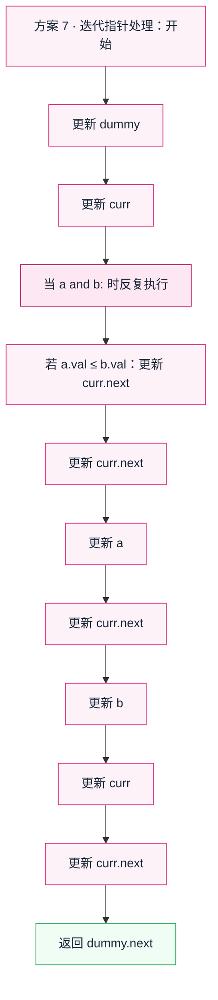

```python
# 合并 K 个升序链表 - 方案: 分治合并 (自顶向下, 两两合并)

import sys  # 提高递归深度上限（深输入防 RecursionError）

sys.setrecursionlimit(200000)  # 树/链表类题目节点数可达 1e4 量级

class ListNode:  # 定义类
    def __init__(self, val=0, next=None):  # 构造函数：初始化成员
        self.val = val  # 把 值 写入 值
        self.next = next  # 把 下一个 写入 下一个

def merge_two(a, b):  # 定义函数 merge_two（参数：数组, b）
    dummy = ListNode(0)  # 把 ListNode(0) 存入 哨兵节点
    curr = dummy  # 把 哨兵节点 存入 当前值
    while a and b:  # 循环，直到不满足「数组 and b」
        if a.val <= b.val:  # 若 数组.值 不超过 b.值
            curr.next = a  # 把 数组 写入 下一个
            a = a.next  # 把 数组.下一个 存入 数组
        else:  # 否则
            curr.next = b  # 把 b 写入 下一个
            b = b.next  # 把 b.下一个 存入 b
        curr = curr.next  # 把 当前值.下一个 存入 当前值
    curr.next = a or b  # 把 数组 or b 写入 下一个
    return dummy.next  # 返回 哨兵节点.下一个

def merge_k_lists(lists):  # 定义函数 merge_k_lists（参数：lists）
    if not lists:  # 若 not lists
        return None  # 返回 None

    def divide(lo, hi):  # 定义函数 divide（参数：左边界, 右边界）
        if lo == hi:  # 若 左边界 等于 右边界
            return lists[lo]  # 返回 lists[左边界]
        mid = (lo + hi) // 2  # 把 (左边界 加 右边界) 除以 除以 2 存入 中点
        left = divide(lo, mid)  # 把 divide(左边界, 中点) 存入 左边界
        right = divide(mid + 1, hi)  # 把 divide(中点 加 1, 右边界) 存入 右边界
        return merge_two(left, right)  # 返回 merge_two(左边界, 右边界)

    return divide(0, len(lists) - 1)  # 返回 divide(0, 长度(lists) 减 1)

def build(arr):  # 定义函数 build（参数：数组）
    dummy = ListNode(0)  # 把 ListNode(0) 存入 哨兵节点
    curr = dummy  # 把 哨兵节点 存入 当前值
    for v in arr:  # 逐个取出 数组 的元素（值）
        curr.next = ListNode(v)  # 把 ListNode(值) 写入 下一个
        curr = curr.next  # 把 当前值.下一个 存入 当前值
    return dummy.next  # 返回 哨兵节点.下一个

def to_list(node):  # 定义函数 to_list（参数：节点）
    res = []  # 把 [] 存入 结果
    while node:  # 循环，直到不满足「节点」
        res.append(node.val)  # 把 节点.值 追加到列表尾部
        node = node.next  # 把 节点.下一个 存入 节点
    return res  # 返回 结果

if __name__ == "__main__":  # 若 __name__ 等于 '__main__'
    lists = [build([1, 4, 5]), build([1, 3, 4]), build([2, 6])]
    print(to_list(merge_k_lists(lists)))  # [1, 1, 2, 3, 4, 4, 5, 6]
```

#### 方案 8：迭代指针处理

**思路与代码分析**：核心是「迭代指针处理」。Python 版用切片与字典推导式简化操作，突出可读性。**走读**：方案 8 · 迭代指针处理：开始 → 更新 dummy → 更新 curr → 当 a and b: 时反复执行 → 若 a.val ≤ b.val：更新 curr.next → 更新 curr.next → 更新 a → 更新 curr.next → 更新 b → 更新 curr → 更新 curr.next → 返回 dummy.next。

**运行架构**（真实控制流）：

```mermaid
graph TD
    N0["方案 8 · 迭代指针处理：开始"]
    N1["更新 dummy"]
    N2["更新 curr"]
    N3["当 a and b: 时反复执行"]
    N4["若 a.val ≤ b.val：更新 curr.next"]
    N5["更新 curr.next"]
    N6["更新 a"]
    N7["更新 curr.next"]
    N8["更新 b"]
    N9["更新 curr"]
    N10["更新 curr.next"]
    N11["返回 dummy.next"]
    N0 --> N1
    N1 --> N2
    N2 --> N3
    N3 --> N4
    N4 --> N5
    N5 --> N6
    N6 --> N7
    N7 --> N8
    N8 --> N9
    N9 --> N10
    N10 --> N11
    classDef n fill:#fdf2f8,stroke:#db2777,color:#1e293b;
    classDef lp fill:#fce7f3,stroke:#be185d,color:#1e293b;
    classDef dc fill:#fef9c3,stroke:#ca8a04,color:#1e293b;
    classDef tm fill:#f0fdf4,stroke:#16a34a,color:#1e293b;
    class N0,N1,N2,N4,N5,N6,N7,N8,N9,N10 n;
    class N3 lp;
    class N11 tm;
```

```python
# 合并 K 个升序链表 - 方案: 分治合并 (自底向上, 逐对合并)

import sys  # 提高递归深度上限（深输入防 RecursionError）

sys.setrecursionlimit(200000)  # 树/链表类题目节点数可达 1e4 量级

class ListNode:  # 定义类
    def __init__(self, val=0, next=None):  # 构造函数：初始化成员
        self.val = val  # 把 值 写入 值
        self.next = next  # 把 下一个 写入 下一个

def merge_two(a, b):  # 定义函数 merge_two（参数：数组, b）
    dummy = ListNode(0)  # 把 ListNode(0) 存入 哨兵节点
    curr = dummy  # 把 哨兵节点 存入 当前值
    while a and b:  # 循环，直到不满足「数组 and b」
        if a.val <= b.val:  # 若 数组.值 不超过 b.值
            curr.next = a  # 把 数组 写入 下一个
            a = a.next  # 把 数组.下一个 存入 数组
        else:  # 否则
            curr.next = b  # 把 b 写入 下一个
            b = b.next  # 把 b.下一个 存入 b
        curr = curr.next  # 把 当前值.下一个 存入 当前值
    curr.next = a or b  # 把 数组 or b 写入 下一个
    return dummy.next  # 返回 哨兵节点.下一个

def merge_k_lists(lists):  # 定义函数 merge_k_lists（参数：lists）
    lists = [l for l in lists if l]  # 把 [左指针 for 左指针 in lists if 左指针] 存入 lists
    if not lists:  # 若 not lists
        return None  # 返回 None
    while len(lists) > 1:  # 循环，直到不满足「长度(lists) 超过 1」
        merged = []  # 把 [] 存入 merged
        for i in range(0, len(lists), 2):  # 让 下标 i 从 0 到 长度(lists 遍历
            a = lists[i]  # 把 lists[下标 i] 存入 数组
            b = (
                lists[i + 1] if i + 1 < len(lists) else None
            )  # 把 lists[下标 i 加 1] if 下标 i 加 1 小于 长度(lists) else None 存入 b
            merged.append(merge_two(a, b))  # 把 merge_two(数组, b 追加到列表尾部
        lists = merged  # 把 merged 存入 lists
    return lists[0]  # 返回 lists[0]

def build(arr):  # 定义函数 build（参数：数组）
    dummy = ListNode(0)  # 把 ListNode(0) 存入 哨兵节点
    curr = dummy  # 把 哨兵节点 存入 当前值
    for v in arr:  # 逐个取出 数组 的元素（值）
        curr.next = ListNode(v)  # 把 ListNode(值) 写入 下一个
        curr = curr.next  # 把 当前值.下一个 存入 当前值
    return dummy.next  # 返回 哨兵节点.下一个

def to_list(node):  # 定义函数 to_list（参数：节点）
    res = []  # 把 [] 存入 结果
    while node:  # 循环，直到不满足「节点」
        res.append(node.val)  # 把 节点.值 追加到列表尾部
        node = node.next  # 把 节点.下一个 存入 节点
    return res  # 返回 结果

if __name__ == "__main__":  # 若 __name__ 等于 '__main__'
    lists = [build([1, 4, 5]), build([1, 3, 4]), build([2, 6])]
    print(to_list(merge_k_lists(lists)))  # [1, 1, 2, 3, 4, 4, 5, 6]
```

#### 方案 9：迭代指针处理

**思路与代码分析**：核心是「迭代指针处理」。Python 版用切片与字典推导式简化操作，突出可读性。**走读**：方案 9 · 迭代指针处理：开始 → 更新 dummy → 更新 curr → 当 a and b: 时反复执行 → 若 a.val ≤ b.val：更新 curr.next → 更新 curr.next → 更新 a → 更新 curr.next → 更新 b → 更新 curr → 更新 curr.next → 返回 dummy.next。

**运行架构**（真实控制流）：

```mermaid
graph TD
    N0["方案 9 · 迭代指针处理：开始"]
    N1["更新 dummy"]
    N2["更新 curr"]
    N3["当 a and b: 时反复执行"]
    N4["若 a.val ≤ b.val：更新 curr.next"]
    N5["更新 curr.next"]
    N6["更新 a"]
    N7["更新 curr.next"]
    N8["更新 b"]
    N9["更新 curr"]
    N10["更新 curr.next"]
    N11["返回 dummy.next"]
    N0 --> N1
    N1 --> N2
    N2 --> N3
    N3 --> N4
    N4 --> N5
    N5 --> N6
    N6 --> N7
    N7 --> N8
    N8 --> N9
    N9 --> N10
    N10 --> N11
    classDef n fill:#fdf2f8,stroke:#db2777,color:#1e293b;
    classDef lp fill:#fce7f3,stroke:#be185d,color:#1e293b;
    classDef dc fill:#fef9c3,stroke:#ca8a04,color:#1e293b;
    classDef tm fill:#f0fdf4,stroke:#16a34a,color:#1e293b;
    class N0,N1,N2,N4,N5,N6,N7,N8,N9,N10 n;
    class N3 lp;
    class N11 tm;
```

```python
# 合并 K 个升序链表 - 方案: 顺序合并 (依次把每条链表并入结果)

import sys  # 提高递归深度上限（深输入防 RecursionError）

sys.setrecursionlimit(200000)  # 树/链表类题目节点数可达 1e4 量级

class ListNode:  # 定义类
    def __init__(self, val=0, next=None):  # 构造函数：初始化成员
        self.val = val  # 把 值 写入 值
        self.next = next  # 把 下一个 写入 下一个

def merge_two(a, b):  # 定义函数 merge_two（参数：数组, b）
    dummy = ListNode(0)  # 把 ListNode(0) 存入 哨兵节点
    curr = dummy  # 把 哨兵节点 存入 当前值
    while a and b:  # 循环，直到不满足「数组 and b」
        if a.val <= b.val:  # 若 数组.值 不超过 b.值
            curr.next = a  # 把 数组 写入 下一个
            a = a.next  # 把 数组.下一个 存入 数组
        else:  # 否则
            curr.next = b  # 把 b 写入 下一个
            b = b.next  # 把 b.下一个 存入 b
        curr = curr.next  # 把 当前值.下一个 存入 当前值
    curr.next = a or b  # 把 数组 or b 写入 下一个
    return dummy.next  # 返回 哨兵节点.下一个

def merge_k_lists(lists):  # 定义函数 merge_k_lists（参数：lists）
    result = None  # 把 None 存入 结果
    for l in lists:  # 逐个取出 lists 的元素（左指针）
        result = merge_two(result, l)  # 把 merge_two(结果, 左指针) 存入 结果
    return result  # 返回 结果

def build(arr):  # 定义函数 build（参数：数组）
    dummy = ListNode(0)  # 把 ListNode(0) 存入 哨兵节点
    curr = dummy  # 把 哨兵节点 存入 当前值
    for v in arr:  # 逐个取出 数组 的元素（值）
        curr.next = ListNode(v)  # 把 ListNode(值) 写入 下一个
        curr = curr.next  # 把 当前值.下一个 存入 当前值
    return dummy.next  # 返回 哨兵节点.下一个

def to_list(node):  # 定义函数 to_list（参数：节点）
    res = []  # 把 [] 存入 结果
    while node:  # 循环，直到不满足「节点」
        res.append(node.val)  # 把 节点.值 追加到列表尾部
        node = node.next  # 把 节点.下一个 存入 节点
    return res  # 返回 结果

if __name__ == "__main__":  # 若 __name__ 等于 '__main__'
    lists = [build([1, 4, 5]), build([1, 3, 4]), build([2, 6])]
    print(to_list(merge_k_lists(lists)))  # [1, 1, 2, 3, 4, 4, 5, 6]
```

#### 方案 10：双重循环枚举

**思路与代码分析**：核心是「双重循环枚举」。Python 版用切片与字典推导式简化操作，突出可读性。代码里依次做这些事：先排序再处理。**走读**：方案 10 · 双重循环枚举：开始 → 更新 vals → 遍历 lists: 中的每个元素 l → 当 l: 时反复执行 → 向 vals 追加记录 → 更新 l → 排序整理 → 更新 dummy → 更新 curr → 遍历 vals: 中的每个元素 v → 更新 curr.next → 更新 curr → 返回 dummy.next。

**运行架构**（真实控制流）：

```mermaid
graph TD
    N0["方案 10 · 双重循环枚举：开始"]
    N1["更新 vals"]
    N2["遍历 lists: 中的每个元素 l"]
    N3["当 l: 时反复执行"]
    N4["向 vals 追加记录"]
    N5["更新 l"]
    N6["排序整理"]
    N7["更新 dummy"]
    N8["更新 curr"]
    N9["遍历 vals: 中的每个元素 v"]
    N10["更新 curr.next"]
    N11["更新 curr"]
    N12["返回 dummy.next"]
    N0 --> N1
    N1 --> N2
    N2 --> N3
    N3 --> N4
    N4 --> N5
    N5 --> N6
    N6 --> N7
    N7 --> N8
    N8 --> N9
    N9 --> N10
    N10 --> N11
    N11 --> N12
    classDef n fill:#fdf2f8,stroke:#db2777,color:#1e293b;
    classDef lp fill:#fce7f3,stroke:#be185d,color:#1e293b;
    classDef dc fill:#fef9c3,stroke:#ca8a04,color:#1e293b;
    classDef tm fill:#f0fdf4,stroke:#16a34a,color:#1e293b;
    class N0,N1,N4,N5,N6,N7,N8,N10,N11 n;
    class N2,N3,N9 lp;
    class N12 tm;
```

```python
# 合并 K 个升序链表 - 方案: 收集所有值 + 排序 + 重建

import sys  # 提高递归深度上限（深输入防 RecursionError）

sys.setrecursionlimit(200000)  # 树/链表类题目节点数可达 1e4 量级

class ListNode:  # 定义类
    def __init__(self, val=0, next=None):  # 构造函数：初始化成员
        self.val = val  # 把 值 写入 值
        self.next = next  # 把 下一个 写入 下一个

def merge_k_lists(lists):  # 定义函数 merge_k_lists（参数：lists）
    vals = []  # 把 [] 存入 vals
    for l in lists:  # 逐个取出 lists 的元素（左指针）
        while l:  # 循环，直到不满足「左指针」
            vals.append(l.val)  # 把 左指针.值 追加到列表尾部
            l = l.next  # 把 左指针.下一个 存入 左指针
    vals.sort()  # 排序
    dummy = ListNode(0)  # 把 ListNode(0) 存入 哨兵节点
    curr = dummy  # 把 哨兵节点 存入 当前值
    for v in vals:  # 逐个取出 vals 的元素（值）
        curr.next = ListNode(v)  # 把 ListNode(值) 写入 下一个
        curr = curr.next  # 把 当前值.下一个 存入 当前值
    return dummy.next  # 返回 哨兵节点.下一个

def build(arr):  # 定义函数 build（参数：数组）
    dummy = ListNode(0)  # 把 ListNode(0) 存入 哨兵节点
    curr = dummy  # 把 哨兵节点 存入 当前值
    for v in arr:  # 逐个取出 数组 的元素（值）
        curr.next = ListNode(v)  # 把 ListNode(值) 写入 下一个
        curr = curr.next  # 把 当前值.下一个 存入 当前值
    return dummy.next  # 返回 哨兵节点.下一个

def to_list(node):  # 定义函数 to_list（参数：节点）
    res = []  # 把 [] 存入 结果
    while node:  # 循环，直到不满足「节点」
        res.append(node.val)  # 把 节点.值 追加到列表尾部
        node = node.next  # 把 节点.下一个 存入 节点
    return res  # 返回 结果

if __name__ == "__main__":  # 若 __name__ 等于 '__main__'
    lists = [build([1, 4, 5]), build([1, 3, 4]), build([2, 6])]
    print(to_list(merge_k_lists(lists)))  # [1, 1, 2, 3, 4, 4, 5, 6]
```

#### 方案 11：直接实现

**思路与代码分析**：核心是「直接实现」。Python 版用切片与字典推导式简化操作，突出可读性。**走读**：方案 11 · 直接实现：开始 → 命中条件，直接返回 → 命中条件，直接返回 → 若 a.val ≤ b.val：更新 a.next → 更新 a.next → 返回 a → 更新 b.next → 返回 b。

**运行架构**（真实控制流）：

```mermaid
graph TD
    N0["方案 11 · 直接实现：开始"]
    N1{"not a ？"}
    N2["命中条件，直接返回"]
    N3{"not b ？"}
    N4["命中条件，直接返回"]
    N5["若 a.val ≤ b.val：更新 a.next"]
    N6["更新 a.next"]
    N7["返回 a"]
    N8["更新 b.next"]
    N9["返回 b"]
    N0 --> N1
    N1 -- 是 --> N2
    N1 -- 否 --> N3
    N3 -- 是 --> N4
    N3 -- 否 --> N5
    N5 --> N6
    N6 --> N7
    N7 --> N8
    N8 --> N9
    classDef n fill:#fdf2f8,stroke:#db2777,color:#1e293b;
    classDef lp fill:#fce7f3,stroke:#be185d,color:#1e293b;
    classDef dc fill:#fef9c3,stroke:#ca8a04,color:#1e293b;
    classDef tm fill:#f0fdf4,stroke:#16a34a,color:#1e293b;
    class N0,N5,N6,N8 n;
    class N1,N3 dc;
    class N2,N4,N7,N9 tm;
```

```python
# 合并 K 个升序链表 - 方案: 递归逐条合并 (merge(l0, merge(l1, ...)))

import sys  # 提高递归深度上限（深输入防 RecursionError）

sys.setrecursionlimit(200000)  # 树/链表类题目节点数可达 1e4 量级

class ListNode:  # 定义类
    def __init__(self, val=0, next=None):  # 构造函数：初始化成员
        self.val = val  # 把 值 写入 值
        self.next = next  # 把 下一个 写入 下一个

def merge_two(a, b):  # 定义函数 merge_two（参数：数组, b）
    if not a:  # 若 not 数组
        return b  # 返回 b
    if not b:  # 若 not b
        return a  # 返回 数组
    if a.val <= b.val:  # 若 数组.值 不超过 b.值
        a.next = merge_two(a.next, b)  # 把 merge_two(数组.下一个, b) 写入 下一个
        return a  # 返回 数组
    else:  # 否则
        b.next = merge_two(a, b.next)  # 把 merge_two(数组, b.下一个) 写入 下一个
        return b  # 返回 b

def merge_k_lists(lists):  # 定义函数 merge_k_lists（参数：lists）
    if not lists:  # 若 not lists
        return None  # 返回 None

    def merge_rest(i):  # 定义函数 merge_rest（参数：下标 i）
        if i == len(lists) - 1:  # 若 下标 i 等于 长度(lists) 减 1
            return lists[i]  # 返回 lists[下标 i]
        return merge_two(
            lists[i], merge_rest(i + 1)
        )  # 返回 merge_two(lists[下标 i], merge_rest(下标 i 加 1))

    return merge_rest(0)  # 返回 merge_rest(0)

def build(arr):  # 定义函数 build（参数：数组）
    dummy = ListNode(0)  # 把 ListNode(0) 存入 哨兵节点
    curr = dummy  # 把 哨兵节点 存入 当前值
    for v in arr:  # 逐个取出 数组 的元素（值）
        curr.next = ListNode(v)  # 把 ListNode(值) 写入 下一个
        curr = curr.next  # 把 当前值.下一个 存入 当前值
    return dummy.next  # 返回 哨兵节点.下一个

def to_list(node):  # 定义函数 to_list（参数：节点）
    res = []  # 把 [] 存入 结果
    while node:  # 循环，直到不满足「节点」
        res.append(node.val)  # 把 节点.值 追加到列表尾部
        node = node.next  # 把 节点.下一个 存入 节点
    return res  # 返回 结果

if __name__ == "__main__":  # 若 __name__ 等于 '__main__'
    lists = [build([1, 4, 5]), build([1, 3, 4]), build([2, 6])]
    print(to_list(merge_k_lists(lists)))  # [1, 1, 2, 3, 4, 4, 5, 6]
```

#### 方案 12：单趟扫描

**思路与代码分析**：核心是「单趟扫描」。Python 版用切片与字典推导式简化操作，突出可读性。**走读**：方案 12 · 单趟扫描：开始 → 当 node: 时反复执行 → 处理 yield node.val → 更新 node → 返回结果。

**运行架构**（真实控制流）：

```mermaid
graph TD
    N0["方案 12 · 单趟扫描：开始"]
    N1["当 node: 时反复执行"]
    N2["处理 yield node.val"]
    N3["更新 node"]
    N4["返回结果"]
    N0 --> N1
    N1 --> N2
    N2 --> N3
    N3 --> N4
    classDef n fill:#fdf2f8,stroke:#db2777,color:#1e293b;
    classDef lp fill:#fce7f3,stroke:#be185d,color:#1e293b;
    classDef dc fill:#fef9c3,stroke:#ca8a04,color:#1e293b;
    classDef tm fill:#f0fdf4,stroke:#16a34a,color:#1e293b;
    class N0,N2,N3 n;
    class N1 lp;
    class N4 tm;
```

```python
# 合并 K 个升序链表 - 方案: 内置 heapq.merge (惰性迭代归并)

import sys  # 提高递归深度上限（深输入防 RecursionError）

sys.setrecursionlimit(200000)  # 树/链表类题目节点数可达 1e4 量级

class ListNode:  # 定义类
    def __init__(self, val=0, next=None):  # 构造函数：初始化成员
        self.val = val  # 把 值 写入 值
        self.next = next  # 把 下一个 写入 下一个

def list_to_iter(node):  # 定义函数 list_to_iter（参数：节点）
    while node:  # 循环，直到不满足「节点」
        yield node.val  # yield 节点.值
        node = node.next  # 把 节点.下一个 存入 节点

def merge_k_lists(lists):  # 定义函数 merge_k_lists（参数：lists）
    iters = [
        list_to_iter(l) for l in lists if l
    ]  # 把 [list_to_iter(左指针) for 左指针 in lists if 左指针] 存入 iters
    dummy = ListNode(0)  # 把 ListNode(0) 存入 哨兵节点
    curr = dummy  # 把 哨兵节点 存入 当前值
    for v in __import__("heapq").merge(*iters):  # 逐个取出 __import__ 的元素（值）
        curr.next = ListNode(v)  # 把 ListNode(值) 写入 下一个
        curr = curr.next  # 把 当前值.下一个 存入 当前值
    return dummy.next  # 返回 哨兵节点.下一个

def build(arr):  # 定义函数 build（参数：数组）
    dummy = ListNode(0)  # 把 ListNode(0) 存入 哨兵节点
    curr = dummy  # 把 哨兵节点 存入 当前值
    for v in arr:  # 逐个取出 数组 的元素（值）
        curr.next = ListNode(v)  # 把 ListNode(值) 写入 下一个
        curr = curr.next  # 把 当前值.下一个 存入 当前值
    return dummy.next  # 返回 哨兵节点.下一个

def to_list(node):  # 定义函数 to_list（参数：节点）
    res = []  # 把 [] 存入 结果
    while node:  # 循环，直到不满足「节点」
        res.append(node.val)  # 把 节点.值 追加到列表尾部
        node = node.next  # 把 节点.下一个 存入 节点
    return res  # 返回 结果

if __name__ == "__main__":  # 若 __name__ 等于 '__main__'
    lists = [build([1, 4, 5]), build([1, 3, 4]), build([2, 6])]
    print(to_list(merge_k_lists(lists)))  # [1, 1, 2, 3, 4, 4, 5, 6]
```

### Go 实现（12 种方案）

Go 的全部方案如下，每个方案都内嵌用例自测，可独立运行（老仓库 python/go 文件遵循「打印结果」约定）：

#### 方案 1：单趟扫描

**思路与代码分析**：核心是「单趟扫描」。Go 版用切片与多返回值惯用法，显式处理索引边界。**走读**：方案 1 · 单趟扫描：开始 → 更新 : → 遍历 lists 的下标与元素 node → 处理 if node ≠ nil → 调用 h.Push(node) → 更新 : → 更新 : → 遍历循环 → 更新 : → 更新 p.Next → 更新 p → 处理 if node.Next ≠ nil → 调用 h.Push(node.Next) → 返回 dummy.Next。

**运行架构**（真实控制流）：

```mermaid
graph TD
    N0["方案 1 · 单趟扫描：开始"]
    N1["更新 :"]
    N2["遍历 lists 的下标与元素 node"]
    N3["处理 if node ≠ nil"]
    N4["调用 h.Push(node)"]
    N5["更新 :"]
    N6["更新 :"]
    N7["遍历循环"]
    N8["更新 :"]
    N9["更新 p.Next"]
    N10["更新 p"]
    N11["处理 if node.Next ≠ nil"]
    N12["调用 h.Push(node.Next)"]
    N13["返回 dummy.Next"]
    N0 --> N1
    N1 --> N2
    N2 --> N3
    N3 --> N4
    N4 -- 下一轮 --> N2
    N2 --> N5
    N5 --> N6
    N6 --> N7
    N7 --> N8
    N8 --> N9
    N9 --> N10
    N10 --> N11
    N11 --> N12
    N12 -- 下一轮 --> N7
    N7 --> N13
    classDef n fill:#fdf2f8,stroke:#db2777,color:#1e293b;
    classDef lp fill:#fce7f3,stroke:#be185d,color:#1e293b;
    classDef dc fill:#fef9c3,stroke:#ca8a04,color:#1e293b;
    classDef tm fill:#f0fdf4,stroke:#16a34a,color:#1e293b;
    class N0,N1,N3,N4,N5,N6,N8,N9,N10,N11,N12 n;
    class N2,N7 lp;
    class N13 tm;
```

```go
package main // 引入依赖

import (
	"fmt"     // 「fmt」
	"reflect" // 「reflect」
)

type ListNode struct { // 定义类型
	Val  int       // Val int
	Next *ListNode // Next 乘 ListNode
}

type MinHeap struct { // 定义类型
	heap []*ListNode // 堆 [] 乘 ListNode
}

func NewMinHeap() *MinHeap { // 定义函数/方法 NewMinHeap
	return &MinHeap{heap: []*ListNode{}} // 返回 按位与 MinHeap{堆: [] 乘 ListNode{}}
}

func (h *MinHeap) Push(node *ListNode) { // 定义函数/方法 Push
	h.heap = append(h.heap, node) // 把 append(h.堆, 节点) 写入 堆
	h.shiftUp(len(h.heap) - 1)    // h.shiftUp(长度(h.堆) 减 1)
}

func (h *MinHeap) Pop() *ListNode { // 定义函数/方法 Pop
	if len(h.heap) == 0 { // 若 长度(h.堆) 等于 0
		return nil // 返回 nil
	}
	res := h.heap[0]                // 把 h.堆[0] 写入 res :
	last := h.heap[len(h.heap)-1]   // 把 h.堆[长度(h.堆) 减 1] 写入 last :
	h.heap = h.heap[:len(h.heap)-1] // 把 h.堆[:长度(h.堆) 减 1] 写入 堆
	if len(h.heap) > 0 {            // 若 长度(h.堆) 超过 0
		h.heap[0] = last // 把 last 写入 h.heap[0]
		h.shiftDown(0)   // h.shiftDown(0)
	}
	return res // 返回 结果
}

func (h *MinHeap) Size() int { return len(h.heap) } // 定义函数/方法 Size

func (h *MinHeap) shiftUp(i int) { // 定义函数/方法 shiftUp
	for i > 0 { // for 下标 i 超过 0 {
		parent := (i - 1) >> 1                  // 把 (下标 i 减 1) 超过 超过 1 写入 parent :
		if h.heap[parent].Val > h.heap[i].Val { // 若 h.堆[parent].Val 超过 h.堆[下标 i].Val
			h.heap[parent], h.heap[i] = h.heap[i], h.heap[parent] // 把 h.堆[下标 i], h.堆[parent] 写入 h.heap[parent], h.heap[i]
			i = parent                                            // 把 parent 写入 下标 i
		} else { // 否则
			break // 跳出循环
		}
	}
}

func (h *MinHeap) shiftDown(i int) { // 定义函数/方法 shiftDown
	size := len(h.heap) // 把 长度(h.堆) 写入 size :
	for {               // for {
		smallest := i                                               // 把 下标 i 写入 smallest :
		left := 2*i + 1                                             // 把 2 乘 下标 i 加 1 写入 left :
		right := 2*i + 2                                            // 把 2 乘 下标 i 加 2 写入 right :
		if left < size && h.heap[left].Val < h.heap[smallest].Val { // 若 左边界 小于 大小 且 h.堆[左边界].Val 小于 h.堆[smallest].Val
			smallest = left // 把 左边界 写入 smallest
		}
		if right < size && h.heap[right].Val < h.heap[smallest].Val { // 若 右边界 小于 大小 且 h.堆[右边界].Val 小于 h.堆[smallest].Val
			smallest = right // 把 右边界 写入 smallest
		}
		if smallest == i { // 若 smallest 等于 下标 i
			break // 跳出循环
		}
		h.heap[smallest], h.heap[i] = h.heap[i], h.heap[smallest] // 把 h.堆[下标 i], h.堆[smallest] 写入 h.heap[smallest], h.heap[i]
		i = smallest                                              // 把 smallest 写入 下标 i
	}
}

func mergeKLists(lists []*ListNode) *ListNode { // 定义函数/方法 mergeKLists
	h := NewMinHeap()            // 把 NewMinHeap() 写入 h :
	for _, node := range lists { // 同时取 _ 与 节点 遍历
		if node != nil { // 若 节点 不等于 nil
			h.Push(node) // h.Push(节点)
		}
	}
	dummy := &ListNode{} // 把 按位与 ListNode{} 写入 dummy :
	p := dummy           // 把 哨兵节点 写入 p :
	for h.Size() > 0 {   // for h.Size() 超过 0 {
		node := h.Pop()       // 把 h.Pop() 写入 node :
		p.Next = node         // 把 节点 写入 p.Next
		p = p.Next            // 把 节点.Next 写入 节点
		if node.Next != nil { // 若 节点.Next 不等于 nil
			h.Push(node.Next) // h.Push(节点.Next)
		}
	}
	return dummy.Next // 返回 哨兵节点.Next
}

func build(arr []int) *ListNode { // 定义函数/方法 build
	dummy := &ListNode{}    // 把 按位与 ListNode{} 写入 dummy :
	curr := dummy           // 把 哨兵节点 写入 curr :
	for _, v := range arr { // 同时取 _ 与 值 遍历
		curr.Next = &ListNode{Val: v} // 把 按位与 ListNode{Val: 值} 写入 curr.Next
		curr = curr.Next              // 把 当前值.Next 写入 当前值
	}
	return dummy.Next // 返回 哨兵节点.Next
}

func toList(node *ListNode) []int { // 定义函数/方法 toList
	res := []int{}    // 把 []int{} 写入 res :
	for node != nil { // 把 nil { 写入 for node !
		res = append(res, node.Val) // 把 append(结果, 节点.Val) 写入 结果
		node = node.Next            // 把 节点.Next 写入 节点
	}
	return res // 返回 结果
}

func main() { // 程序入口：跑内嵌自测用例
	type tc struct { // 定义类型
		in   [][]int // in [][]int
		want []int   // want []int
	}
	cases := []tc{ // 把 []tc{ 写入 cases :
		{[][]int{{1, 4, 5}, {1, 3, 4}, {2, 6}}, []int{1, 1, 2, 3, 4, 4, 5, 6}},
		{[][]int{}, []int{}},
	}
	ok := true                // 把 true 写入 ok :
	for _, c := range cases { // 同时取 _ 与 字符 遍历
		lists := []*ListNode{}   // 把 [] 乘 ListNode{} 写入 lists :
		for _, a := range c.in { // 同时取 _ 与 数组 遍历
			lists = append(lists, build(a)) // 把 append(lists, build(数组)) 写入 lists
		}
		got := toList(mergeKLists(lists))    // 把 toList(mergeKLists(lists)) 写入 got :
		if !reflect.DeepEqual(got, c.want) { // 若 取反 reflect.DeepEqual(got, 字符.want
			ok = false                                       // 把 false 写入 ok
			fmt.Printf("FAIL got=%v want=%v\n", got, c.want) // 打印输出
		}
	}
	if !ok { // 若 取反 ok
		panic("FAILED") // panic(「FAILED」)
	}
	fmt.Println("PASS") // 全部用例通过，输出 PASS
}
```

#### 方案 2：栈辅助

**思路与代码分析**：核心是「栈辅助」。Go 版用切片与多返回值惯用法，显式处理索引边界。**走读**：方案 2 · 栈辅助：开始 → 更新 : → 遍历 lists 的下标与元素 node → 处理 if node ≠ nil → 调用 pq.Push(&Status → 更新 : → 更新 : → 遍历循环 → 更新 : → 处理 if f ≠ nil → 更新 tail.Next → 更新 tail → 处理 if f.ptr.Next ≠ nil → 调用 pq.Push(&Status → 返回 dummy.Next。

**运行架构**（真实控制流）：

```mermaid
graph TD
    N0["方案 2 · 栈辅助：开始"]
    N1["更新 :"]
    N2["遍历 lists 的下标与元素 node"]
    N3["处理 if node ≠ nil"]
    N4["调用 pq.Push(&Status"]
    N5["更新 :"]
    N6["更新 :"]
    N7["遍历循环"]
    N8["更新 :"]
    N9["处理 if f ≠ nil"]
    N10["更新 tail.Next"]
    N11["更新 tail"]
    N12["处理 if f.ptr.Next ≠ nil"]
    N13["调用 pq.Push(&Status"]
    N14["返回 dummy.Next"]
    N0 --> N1
    N1 --> N2
    N2 --> N3
    N3 --> N4
    N4 -- 下一轮 --> N2
    N2 --> N5
    N5 --> N6
    N6 --> N7
    N7 --> N8
    N8 --> N9
    N9 --> N10
    N10 --> N11
    N11 --> N12
    N12 --> N13
    N13 -- 下一轮 --> N7
    N7 --> N14
    classDef n fill:#fdf2f8,stroke:#db2777,color:#1e293b;
    classDef lp fill:#fce7f3,stroke:#be185d,color:#1e293b;
    classDef dc fill:#fef9c3,stroke:#ca8a04,color:#1e293b;
    classDef tm fill:#f0fdf4,stroke:#16a34a,color:#1e293b;
    class N0,N1,N3,N4,N5,N6,N8,N9,N10,N11,N12,N13 n;
    class N2,N7 lp;
    class N14 tm;
```

```go
package main // 引入依赖

import (
	"fmt"     // 「fmt」
	"reflect" // 「reflect」
)

type ListNode struct { // 定义类型
	Val  int       // Val int
	Next *ListNode // Next 乘 ListNode
}

type Status struct { // 定义类型
	val int       // 值 int
	ptr *ListNode // ptr 乘 ListNode
}

type PriorityQueue struct { // 定义类型
	heap []*Status // 堆 [] 乘 Status
}

func NewPQ() *PriorityQueue { // 定义函数/方法 NewPQ
	return &PriorityQueue{heap: []*Status{}} // 返回 按位与 PriorityQueue{堆: [] 乘 Status{}}
}

func (pq *PriorityQueue) Len() int { return len(pq.heap) } // 定义函数/方法 Len

func (pq *PriorityQueue) Push(s *Status) { // 定义函数/方法 Push
	pq.heap = append(pq.heap, s) // 把 append(优先队列.堆, 字符串) 写入 堆
	pq.siftUp(len(pq.heap) - 1)  // 优先队列.siftUp(长度(优先队列.堆) 减 1)
}

func (pq *PriorityQueue) Pop() *Status { // 定义函数/方法 Pop
	if pq.Len() == 0 { // 若 优先队列.Len() 等于 0
		return nil // 返回 nil
	}
	res := pq.heap[0]                  // 把 优先队列.堆[0] 写入 res :
	last := pq.heap[len(pq.heap)-1]    // 把 优先队列.堆[长度(优先队列.堆) 减 1] 写入 last :
	pq.heap = pq.heap[:len(pq.heap)-1] // 把 优先队列.堆[:长度(优先队列.堆) 减 1] 写入 堆
	if pq.Len() > 0 {                  // 若 优先队列.Len() 超过 0
		pq.heap[0] = last // 把 last 写入 pq.heap[0]
		pq.siftDown(0)    // 优先队列.siftDown(0)
	}
	return res // 返回 结果
}

func (pq *PriorityQueue) siftUp(i int) { // 定义函数/方法 siftUp
	for i > 0 { // for 下标 i 超过 0 {
		parent := (i - 1) >> 1                    // 把 (下标 i 减 1) 超过 超过 1 写入 parent :
		if pq.heap[parent].val > pq.heap[i].val { // 若 优先队列.堆[parent].值 超过 优先队列.堆[下标 i].值
			pq.heap[parent], pq.heap[i] = pq.heap[i], pq.heap[parent]
			i = parent // 把 parent 写入 下标 i
		} else { // 否则
			break // 跳出循环
		}
	}
}

func (pq *PriorityQueue) siftDown(i int) { // 定义函数/方法 siftDown
	size := len(pq.heap) // 把 长度(优先队列.堆) 写入 size :
	for {                // for {
		smallest := i                                                 // 把 下标 i 写入 smallest :
		left := 2*i + 1                                               // 把 2 乘 下标 i 加 1 写入 left :
		right := 2*i + 2                                              // 把 2 乘 下标 i 加 2 写入 right :
		if left < size && pq.heap[left].val < pq.heap[smallest].val { // 若 左边界 小于 大小 且 优先队列.堆[左边界].值 小于 优先队列.堆[smallest].值
			smallest = left // 把 左边界 写入 smallest
		}
		if right < size && pq.heap[right].val < pq.heap[smallest].val { // 若 右边界 小于 大小 且 优先队列.堆[右边界].值 小于 优先队列.堆[smallest].值
			smallest = right // 把 右边界 写入 smallest
		}
		if smallest == i { // 若 smallest 等于 下标 i
			break // 跳出循环
		}
		pq.heap[smallest], pq.heap[i] = pq.heap[i], pq.heap[smallest]
		i = smallest // 把 smallest 写入 下标 i
	}
}

func mergeKLists(lists []*ListNode) *ListNode { // 定义函数/方法 mergeKLists
	pq := NewPQ()                // 把 NewPQ() 写入 pq :
	for _, node := range lists { // 同时取 _ 与 节点 遍历
		if node != nil { // 若 节点 不等于 nil
			pq.Push(&Status{val: node.Val, ptr: node}) // 优先队列.Push( 按位与 Status{值: 节点.Val, ptr: 节点})
		}
	}
	dummy := &ListNode{} // 把 按位与 ListNode{} 写入 dummy :
	tail := dummy        // 把 哨兵节点 写入 tail :
	for pq.Len() > 0 {   // for 优先队列.Len() 超过 0 {
		f := pq.Pop() // 把 优先队列.Pop() 写入 f :
		if f != nil { // 若 f 不等于 nil
			tail.Next = f.ptr      // 把 f.ptr 写入 tail.Next
			tail = tail.Next       // 把 尾节点.Next 写入 尾节点
			if f.ptr.Next != nil { // 若 f.ptr.Next 不等于 nil
				pq.Push(&Status{val: f.ptr.Next.Val, ptr: f.ptr.Next}) // 优先队列.Push( 按位与 Status{值: f.ptr.Next.Val, ptr: f.ptr.Next})
			}
		}
	}
	return dummy.Next // 返回 哨兵节点.Next
}

func build(arr []int) *ListNode { // 定义函数/方法 build
	dummy := &ListNode{}    // 把 按位与 ListNode{} 写入 dummy :
	curr := dummy           // 把 哨兵节点 写入 curr :
	for _, v := range arr { // 同时取 _ 与 值 遍历
		curr.Next = &ListNode{Val: v} // 把 按位与 ListNode{Val: 值} 写入 curr.Next
		curr = curr.Next              // 把 当前值.Next 写入 当前值
	}
	return dummy.Next // 返回 哨兵节点.Next
}

func toList(node *ListNode) []int { // 定义函数/方法 toList
	res := []int{}    // 把 []int{} 写入 res :
	for node != nil { // 把 nil { 写入 for node !
		res = append(res, node.Val) // 把 append(结果, 节点.Val) 写入 结果
		node = node.Next            // 把 节点.Next 写入 节点
	}
	return res // 返回 结果
}

func main() { // 程序入口：跑内嵌自测用例
	type tc struct { // 定义类型
		in   [][]int // in [][]int
		want []int   // want []int
	}
	cases := []tc{ // 把 []tc{ 写入 cases :
		{[][]int{{1, 4, 5}, {1, 3, 4}, {2, 6}}, []int{1, 1, 2, 3, 4, 4, 5, 6}},
		{[][]int{}, []int{}},
	}
	ok := true                // 把 true 写入 ok :
	for _, c := range cases { // 同时取 _ 与 字符 遍历
		lists := []*ListNode{}   // 把 [] 乘 ListNode{} 写入 lists :
		for _, a := range c.in { // 同时取 _ 与 数组 遍历
			lists = append(lists, build(a)) // 把 append(lists, build(数组)) 写入 lists
		}
		got := toList(mergeKLists(lists))    // 把 toList(mergeKLists(lists)) 写入 got :
		if !reflect.DeepEqual(got, c.want) { // 若 取反 reflect.DeepEqual(got, 字符.want
			ok = false                                       // 把 false 写入 ok
			fmt.Printf("FAIL got=%v want=%v\n", got, c.want) // 打印输出
		}
	}
	if !ok { // 若 取反 ok
		panic("FAILED") // panic(「FAILED」)
	}
	fmt.Println("PASS") // 全部用例通过，输出 PASS
}
```

#### 方案 3：迭代指针处理

**思路与代码分析**：核心是「迭代指针处理」。Go 版用切片与多返回值惯用法，显式处理索引边界。**走读**：方案 3 · 迭代指针处理：开始 → 计算 r → 遍历循环 → 更新 r → 更新 h → 返回 r。

**运行架构**（真实控制流）：

```mermaid
graph TD
    N0["方案 3 · 迭代指针处理：开始"]
    N1["计算 r"]
    N2["遍历循环"]
    N3["更新 r"]
    N4["更新 h"]
    N5["返回 r"]
    N0 --> N1
    N1 --> N2
    N2 --> N3
    N3 --> N4
    N4 -- 下一轮 --> N2
    N2 --> N5
    classDef n fill:#fdf2f8,stroke:#db2777,color:#1e293b;
    classDef lp fill:#fce7f3,stroke:#be185d,color:#1e293b;
    classDef dc fill:#fef9c3,stroke:#ca8a04,color:#1e293b;
    classDef tm fill:#f0fdf4,stroke:#16a34a,color:#1e293b;
    class N0,N1,N3,N4 n;
    class N2 lp;
    class N5 tm;
```

```go
package main // 引入依赖

import (
	"fmt"
	"os"
) // 引入依赖

type ListNode struct {
	Val  int
	Next *ListNode
} // 定义类型

func buildList(vals []int) *ListNode { // 定义函数/方法 buildList
	dummy := &ListNode{}     // 把 按位与 ListNode{} 写入 dummy :
	cur := dummy             // 把 哨兵节点 写入 cur :
	for _, v := range vals { // 同时取 _ 与 值 遍历
		cur.Next = &ListNode{Val: v} // 把 按位与 ListNode{Val: 值} 写入 cur.Next
		cur = cur.Next               // 把 当前值.Next 写入 当前值
	}
	return dummy.Next // 返回 哨兵节点.Next
}

func listToSlice(h *ListNode) []int { // 定义函数/方法 listToSlice
	var r []int    // var 右指针 []int
	for h != nil { // 把 nil { 写入 for h !
		r = append(r, h.Val) // 把 append(右指针, h.Val) 写入 右指针
		h = h.Next           // 把 h.Next 写入 h
	}
	return r // 返回 右指针
}

func mergeTwoLists(a, b *ListNode) *ListNode { // 定义函数/方法 mergeTwoLists
	if a == nil { // 若 数组 等于 nil
		return b // 返回 b
	}
	if b == nil { // 若 b 等于 nil
		return a // 返回 数组
	}
	head := &ListNode{}              // 把 按位与 ListNode{} 写入 head :
	tail := head                     // 把 头节点 写入 tail :
	aPtr, bPtr := a, b               // 把 数组, b 写入 aPtr, bPtr :
	for aPtr != nil && bPtr != nil { // 把 nil 且 bPtr 不等于 nil { 写入 for aPtr !
		if aPtr.Val < bPtr.Val { // 若 aPtr.Val 小于 bPtr.Val
			tail.Next = aPtr // 把 aPtr 写入 tail.Next
			aPtr = aPtr.Next // 把 aPtr.Next 写入 aPtr
		} else { // 否则
			tail.Next = bPtr // 把 bPtr 写入 tail.Next
			bPtr = bPtr.Next // 把 bPtr.Next 写入 bPtr
		}
		tail = tail.Next // 把 尾节点.Next 写入 尾节点
	}
	if aPtr != nil { // 若 aPtr 不等于 nil
		tail.Next = aPtr // 把 aPtr 写入 tail.Next
	} else { // 否则
		tail.Next = bPtr // 把 bPtr 写入 tail.Next
	}
	return head.Next // 返回 头节点.Next
}

func mergeKLists(lists []*ListNode) *ListNode { // 定义函数/方法 mergeKLists
	var ans *ListNode                 // var 答案 乘 ListNode
	for i := 0; i < len(lists); i++ { // 让 下标 i 从 0 开始计数
		ans = mergeTwoLists(ans, lists[i]) // 把 mergeTwoLists(答案, lists[下标 i]) 写入 答案
	}
	return ans // 返回 答案
}

func main() { // 程序入口：跑内嵌自测用例
	lists := []*ListNode{buildList([]int{1, 4, 5}), buildList([]int{1, 3, 4}), buildList([]int{2, 6})}
	got := listToSlice(mergeKLists(lists))   // 把 listToSlice(mergeKLists(lists)) 写入 got :
	want := []int{1, 1, 2, 3, 4, 4, 5, 6}    // 把 []int{1, 1, 2, 3, 4, 4, 5, 6} 写入 want :
	if fmt.Sprint(got) != fmt.Sprint(want) { // 若 fmt.Sprint(got) 不等于 fmt.Sprint(want
		fmt.Printf("FAIL =%v want %v\n", got, want) // 打印输出
		os.Exit(1)                                  // os.Exit(1)
	}
	fmt.Println("PASS") // 全部用例通过，输出 PASS
}
```

#### 方案 4：迭代指针处理

**思路与代码分析**：核心是「迭代指针处理」。Go 版用切片与多返回值惯用法，显式处理索引边界。**走读**：方案 4 · 迭代指针处理：开始 → 返回 merge(lists, 0, len(lists)-1)。

**运行架构**（真实控制流）：

```mermaid
graph TD
    N0["方案 4 · 迭代指针处理：开始"]
    N1["返回 merge(lists, 0, len(lists)-1)"]
    N0 --> N1
    classDef n fill:#fdf2f8,stroke:#db2777,color:#1e293b;
    classDef lp fill:#fce7f3,stroke:#be185d,color:#1e293b;
    classDef dc fill:#fef9c3,stroke:#ca8a04,color:#1e293b;
    classDef tm fill:#f0fdf4,stroke:#16a34a,color:#1e293b;
    class N0 n;
    class N1 tm;
```

```go
package main // 引入依赖

import (
	"fmt"     // 「fmt」
	"reflect" // 「reflect」
)

type ListNode struct { // 定义类型
	Val  int       // Val int
	Next *ListNode // Next 乘 ListNode
}

func mergeKLists(lists []*ListNode) *ListNode { // 定义函数/方法 mergeKLists
	return merge(lists, 0, len(lists)-1) // 定义函数/方法 merge
}

func merge(lists []*ListNode, l, r int) *ListNode { // 定义函数/方法 merge
	if l == r { // 若 左指针 等于 右指针
		return lists[l] // 返回 lists[左指针]
	}
	if l > r { // 若 左指针 超过 右指针
		return nil // 返回 nil
	}
	mid := (l + r) / 2                                                 // 把 (左指针 加 右指针) 除以 2 写入 mid :
	return mergeTwoLists(merge(lists, l, mid), merge(lists, mid+1, r)) // 定义函数/方法 mergeTwoLists
}

func mergeTwoLists(a, b *ListNode) *ListNode { // 定义函数/方法 mergeTwoLists
	if a == nil { // 若 数组 等于 nil
		return b // 返回 b
	}
	if b == nil { // 若 b 等于 nil
		return a // 返回 数组
	}
	head := &ListNode{}              // 把 按位与 ListNode{} 写入 head :
	tail := head                     // 把 头节点 写入 tail :
	aPtr := a                        // 把 数组 写入 aPtr :
	bPtr := b                        // 把 b 写入 bPtr :
	for aPtr != nil && bPtr != nil { // 把 nil 且 bPtr 不等于 nil { 写入 for aPtr !
		if aPtr.Val < bPtr.Val { // 若 aPtr.Val 小于 bPtr.Val
			tail.Next = aPtr // 把 aPtr 写入 tail.Next
			aPtr = aPtr.Next // 把 aPtr.Next 写入 aPtr
		} else { // 否则
			tail.Next = bPtr // 把 bPtr 写入 tail.Next
			bPtr = bPtr.Next // 把 bPtr.Next 写入 bPtr
		}
		tail = tail.Next // 把 尾节点.Next 写入 尾节点
	}
	if aPtr != nil { // 若 aPtr 不等于 nil
		tail.Next = aPtr // 把 aPtr 写入 tail.Next
	} else { // 否则
		tail.Next = bPtr // 把 bPtr 写入 tail.Next
	}
	return head.Next // 返回 头节点.Next
}

func build(arr []int) *ListNode { // 定义函数/方法 build
	dummy := &ListNode{}    // 把 按位与 ListNode{} 写入 dummy :
	curr := dummy           // 把 哨兵节点 写入 curr :
	for _, v := range arr { // 同时取 _ 与 值 遍历
		curr.Next = &ListNode{Val: v} // 把 按位与 ListNode{Val: 值} 写入 curr.Next
		curr = curr.Next              // 把 当前值.Next 写入 当前值
	}
	return dummy.Next // 返回 哨兵节点.Next
}

func toList(node *ListNode) []int { // 定义函数/方法 toList
	res := []int{}    // 把 []int{} 写入 res :
	for node != nil { // 把 nil { 写入 for node !
		res = append(res, node.Val) // 把 append(结果, 节点.Val) 写入 结果
		node = node.Next            // 把 节点.Next 写入 节点
	}
	return res // 返回 结果
}

func main() { // 程序入口：跑内嵌自测用例
	type tc struct { // 定义类型
		in   [][]int // in [][]int
		want []int   // want []int
	}
	cases := []tc{ // 把 []tc{ 写入 cases :
		{[][]int{{1, 4, 5}, {1, 3, 4}, {2, 6}}, []int{1, 1, 2, 3, 4, 4, 5, 6}},
		{[][]int{}, []int{}},
	}
	ok := true                // 把 true 写入 ok :
	for _, c := range cases { // 同时取 _ 与 字符 遍历
		lists := []*ListNode{}   // 把 [] 乘 ListNode{} 写入 lists :
		for _, a := range c.in { // 同时取 _ 与 数组 遍历
			lists = append(lists, build(a)) // 把 append(lists, build(数组)) 写入 lists
		}
		got := toList(mergeKLists(lists))    // 把 toList(mergeKLists(lists)) 写入 got :
		if !reflect.DeepEqual(got, c.want) { // 若 取反 reflect.DeepEqual(got, 字符.want
			ok = false                                       // 把 false 写入 ok
			fmt.Printf("FAIL got=%v want=%v\n", got, c.want) // 打印输出
		}
	}
	if !ok { // 若 取反 ok
		panic("FAILED") // panic(「FAILED」)
	}
	fmt.Println("PASS") // 全部用例通过，输出 PASS
}
```

#### 方案 5：栈辅助

**思路与代码分析**：核心是「栈辅助」。Go 版用切片与多返回值惯用法，显式处理索引边界。代码里依次做这些事：队列或堆的调度。**走读**：方案 5 · 栈辅助：开始 → 更新 : → 调用 heap.Init(h) → 遍历 lists 的下标与元素 node → 处理 if node ≠ nil → 调用 heap.Push(h, hItem → 更新 : → 更新 : → 遍历循环 → 更新 : → 更新 curr.Next → 更新 curr → 处理 if it.node.Next ≠ nil → 调用 heap.Push(h, hItem → 返回 dummy.Next。

**运行架构**（真实控制流）：

```mermaid
graph TD
    N0["方案 5 · 栈辅助：开始"]
    N1["更新 :"]
    N2["调用 heap.Init(h)"]
    N3["遍历 lists 的下标与元素 node"]
    N4["处理 if node ≠ nil"]
    N5["调用 heap.Push(h, hItem"]
    N6["更新 :"]
    N7["更新 :"]
    N8["遍历循环"]
    N9["更新 :"]
    N10["更新 curr.Next"]
    N11["更新 curr"]
    N12["处理 if it.node.Next ≠ nil"]
    N13["调用 heap.Push(h, hItem"]
    N14["返回 dummy.Next"]
    N0 --> N1
    N1 --> N2
    N2 --> N3
    N3 --> N4
    N4 --> N5
    N5 -- 下一轮 --> N3
    N3 --> N6
    N6 --> N7
    N7 --> N8
    N8 --> N9
    N9 --> N10
    N10 --> N11
    N11 --> N12
    N12 --> N13
    N13 -- 下一轮 --> N8
    N8 --> N14
    classDef n fill:#fdf2f8,stroke:#db2777,color:#1e293b;
    classDef lp fill:#fce7f3,stroke:#be185d,color:#1e293b;
    classDef dc fill:#fef9c3,stroke:#ca8a04,color:#1e293b;
    classDef tm fill:#f0fdf4,stroke:#16a34a,color:#1e293b;
    class N0,N1,N2,N4,N5,N6,N7,N9,N10,N11,N12,N13 n;
    class N3,N8 lp;
    class N14 tm;
```

```go
package main // 引入依赖

import (
	"container/heap" // 「container 除以 堆」
	"fmt"            // 「fmt」
	"reflect"        // 「reflect」
)

type ListNode struct { // 定义类型
	Val  int       // Val int
	Next *ListNode // Next 乘 ListNode
}

type hItem struct { // 定义类型
	val  int       // 值 int
	idx  int       // idx int
	node *ListNode // 节点 乘 ListNode
}

type minHeap []hItem // 定义类型

func (h minHeap) Len() int { return len(h) } // 定义函数/方法 Len
func (h minHeap) Less(i, j int) bool { // 定义函数/方法 Less
	if h[i].val != h[j].val { // 若 h[下标 i].值 不等于 h[下标 j].值
		return h[i].val < h[j].val // 返回 h[下标 i].值 小于 h[下标 j].值
	}
	return h[i].idx < h[j].idx // 返回 h[下标 i].idx 小于 h[下标 j].idx
}
func (h minHeap) Swap(i, j int) { h[i], h[j] = h[j], h[i] }    // 定义函数/方法 Swap
func (h *minHeap) Push(x any)   { *h = append(*h, x.(hItem)) } // 定义函数/方法 Push
func (h *minHeap) Pop() any { // 定义函数/方法 Pop
	old := *h      // 把 乘 h 写入 old :
	n := len(old)  // 把 长度(old) 写入 n :
	it := old[n-1] // 把 old[元素个数 减 1] 写入 it :
	*h = old[:n-1]
	return it // 返回 it
}

func merge_k_lists(lists []*ListNode) *ListNode { // 定义函数/方法 merge_k_lists
	h := &minHeap{}              // 把 按位与 minHeap{} 写入 h :
	heap.Init(h)                 // 堆.Init(h)
	for i, node := range lists { // 同时取 下标 i 与 节点 遍历
		if node != nil { // 若 节点 不等于 nil
			heap.Push(h, hItem{val: node.Val, idx: i, node: node}) // 堆.Push(h, hItem{值: 节点.Val, idx: 下标 i, 节点: 节点})
		}
	}
	dummy := &ListNode{} // 把 按位与 ListNode{} 写入 dummy :
	curr := dummy        // 把 哨兵节点 写入 curr :
	for h.Len() > 0 {    // for h.Len() 超过 0 {
		it := heap.Pop(h).(hItem) // 把 堆.Pop(h).(hItem) 写入 it :
		curr.Next = it.node       // 把 it.节点 写入 curr.Next
		curr = curr.Next          // 把 当前值.Next 写入 当前值
		if it.node.Next != nil {  // 若 it.节点.Next 不等于 nil
			heap.Push(h, hItem{val: it.node.Next.Val, idx: it.idx, node: it.node.Next})
		}
	}
	return dummy.Next // 返回 哨兵节点.Next
}

func build(arr []int) *ListNode { // 定义函数/方法 build
	dummy := &ListNode{}    // 把 按位与 ListNode{} 写入 dummy :
	curr := dummy           // 把 哨兵节点 写入 curr :
	for _, v := range arr { // 同时取 _ 与 值 遍历
		curr.Next = &ListNode{Val: v} // 把 按位与 ListNode{Val: 值} 写入 curr.Next
		curr = curr.Next              // 把 当前值.Next 写入 当前值
	}
	return dummy.Next // 返回 哨兵节点.Next
}

func toList(node *ListNode) []int { // 定义函数/方法 toList
	res := []int{}    // 把 []int{} 写入 res :
	for node != nil { // 把 nil { 写入 for node !
		res = append(res, node.Val) // 把 append(结果, 节点.Val) 写入 结果
		node = node.Next            // 把 节点.Next 写入 节点
	}
	return res // 返回 结果
}

func main() { // 程序入口：跑内嵌自测用例
	type tc struct { // 定义类型
		in   [][]int // in [][]int
		want []int   // want []int
	}
	cases := []tc{ // 把 []tc{ 写入 cases :
		{[][]int{{1, 4, 5}, {1, 3, 4}, {2, 6}}, []int{1, 1, 2, 3, 4, 4, 5, 6}},
		{[][]int{}, []int{}},
	}
	ok := true                // 把 true 写入 ok :
	for _, c := range cases { // 同时取 _ 与 字符 遍历
		lists := []*ListNode{}   // 把 [] 乘 ListNode{} 写入 lists :
		for _, a := range c.in { // 同时取 _ 与 数组 遍历
			lists = append(lists, build(a)) // 把 append(lists, build(数组)) 写入 lists
		}
		got := toList(merge_k_lists(lists))  // 把 toList(merge_k_lists(lists)) 写入 got :
		if !reflect.DeepEqual(got, c.want) { // 若 取反 reflect.DeepEqual(got, 字符.want
			ok = false                                       // 把 false 写入 ok
			fmt.Printf("FAIL got=%v want=%v\n", got, c.want) // 打印输出
		}
	}
	if !ok { // 若 取反 ok
		panic("FAILED") // panic(「FAILED」)
	}
	fmt.Println("PASS") // 全部用例通过，输出 PASS
}
```

#### 方案 6：栈辅助

**思路与代码分析**：核心是「栈辅助」。Go 版用切片与多返回值惯用法，显式处理索引边界。代码里依次做这些事：队列或堆的调度。**走读**：方案 6 · 栈辅助：开始 → 更新 : → 遍历 lists 的下标与元素 node → 遍历循环 → 返回 dummy.Next。

**运行架构**（真实控制流）：

```mermaid
graph TD
    N0["方案 6 · 栈辅助：开始"]
    N1["更新 :"]
    D1["……（中间计算步骤）"]
    N4["遍历 lists 的下标与元素 node"]
    D2["……（中间计算步骤）"]
    N10["遍历循环"]
    D3["……（中间计算步骤）"]
    N17["返回 dummy.Next"]
    N0 --> N1
    N10 --> N17
    N1 --> D1
    D1 --> N4
    N4 --> D2
    D2 --> N10
    N10 --> D3
    D3 --> N17
    classDef n fill:#fdf2f8,stroke:#db2777,color:#1e293b;
    classDef lp fill:#fce7f3,stroke:#be185d,color:#1e293b;
    classDef dc fill:#fef9c3,stroke:#ca8a04,color:#1e293b;
    classDef tm fill:#f0fdf4,stroke:#16a34a,color:#1e293b;
    class N0,N1,D1,D2,D3 n;
    class N4,N10 lp;
    class N17 tm;
```

```go
package main // 引入依赖

import (
	"container/heap" // 「container 除以 堆」
	"fmt"            // 「fmt」
	"reflect"        // 「reflect」
)

type ListNode struct { // 定义类型
	Val  int       // Val int
	Next *ListNode // Next 乘 ListNode
}

type hItem struct { // 定义类型
	val  int       // 值 int
	cnt  int       // 计数 int
	node *ListNode // 节点 乘 ListNode
}

type minHeap []hItem // 定义类型

func (h minHeap) Len() int { return len(h) } // 定义函数/方法 Len
func (h minHeap) Less(i, j int) bool { // 定义函数/方法 Less
	if h[i].val != h[j].val { // 若 h[下标 i].值 不等于 h[下标 j].值
		return h[i].val < h[j].val // 返回 h[下标 i].值 小于 h[下标 j].值
	}
	return h[i].cnt < h[j].cnt // 返回 h[下标 i].计数 小于 h[下标 j].计数
}
func (h minHeap) Swap(i, j int) { h[i], h[j] = h[j], h[i] }    // 定义函数/方法 Swap
func (h *minHeap) Push(x any)   { *h = append(*h, x.(hItem)) } // 定义函数/方法 Push
func (h *minHeap) Pop() any { // 定义函数/方法 Pop
	old := *h      // 把 乘 h 写入 old :
	n := len(old)  // 把 长度(old) 写入 n :
	it := old[n-1] // 把 old[元素个数 减 1] 写入 it :
	*h = old[:n-1]
	return it // 返回 it
}

func merge_k_lists(lists []*ListNode) *ListNode { // 定义函数/方法 merge_k_lists
	h := &minHeap{}              // 把 按位与 minHeap{} 写入 h :
	heap.Init(h)                 // 堆.Init(h)
	cnt := 0                     // 把 0 写入 cnt :
	for _, node := range lists { // 同时取 _ 与 节点 遍历
		if node != nil { // 若 节点 不等于 nil
			cnt++                                                    // 计数 加一
			heap.Push(h, hItem{val: node.Val, cnt: cnt, node: node}) // 堆.Push(h, hItem{值: 节点.Val, 计数: 计数, 节点: 节点})
		}
	}
	dummy := &ListNode{} // 把 按位与 ListNode{} 写入 dummy :
	curr := dummy        // 把 哨兵节点 写入 curr :
	for h.Len() > 0 {    // for h.Len() 超过 0 {
		it := heap.Pop(h).(hItem) // 把 堆.Pop(h).(hItem) 写入 it :
		curr.Next = it.node       // 把 it.节点 写入 curr.Next
		curr = curr.Next          // 把 当前值.Next 写入 当前值
		if it.node.Next != nil {  // 若 it.节点.Next 不等于 nil
			cnt++                                                                    // 计数 加一
			heap.Push(h, hItem{val: it.node.Next.Val, cnt: cnt, node: it.node.Next}) // 堆.Push(h, hItem{值: it.节点.Next.Val, 计数: 计数, 节点: it.节点.Next})
		}
	}
	return dummy.Next // 返回 哨兵节点.Next
}

func build(arr []int) *ListNode { // 定义函数/方法 build
	dummy := &ListNode{}    // 把 按位与 ListNode{} 写入 dummy :
	curr := dummy           // 把 哨兵节点 写入 curr :
	for _, v := range arr { // 同时取 _ 与 值 遍历
		curr.Next = &ListNode{Val: v} // 把 按位与 ListNode{Val: 值} 写入 curr.Next
		curr = curr.Next              // 把 当前值.Next 写入 当前值
	}
	return dummy.Next // 返回 哨兵节点.Next
}

func toList(node *ListNode) []int { // 定义函数/方法 toList
	res := []int{}    // 把 []int{} 写入 res :
	for node != nil { // 把 nil { 写入 for node !
		res = append(res, node.Val) // 把 append(结果, 节点.Val) 写入 结果
		node = node.Next            // 把 节点.Next 写入 节点
	}
	return res // 返回 结果
}

func main() { // 程序入口：跑内嵌自测用例
	type tc struct { // 定义类型
		in   [][]int // in [][]int
		want []int   // want []int
	}
	cases := []tc{ // 把 []tc{ 写入 cases :
		{[][]int{{1, 4, 5}, {1, 3, 4}, {2, 6}}, []int{1, 1, 2, 3, 4, 4, 5, 6}},
		{[][]int{}, []int{}},
	}
	ok := true                // 把 true 写入 ok :
	for _, c := range cases { // 同时取 _ 与 字符 遍历
		lists := []*ListNode{}   // 把 [] 乘 ListNode{} 写入 lists :
		for _, a := range c.in { // 同时取 _ 与 数组 遍历
			lists = append(lists, build(a)) // 把 append(lists, build(数组)) 写入 lists
		}
		got := toList(merge_k_lists(lists))  // 把 toList(merge_k_lists(lists)) 写入 got :
		if !reflect.DeepEqual(got, c.want) { // 若 取反 reflect.DeepEqual(got, 字符.want
			ok = false                                       // 把 false 写入 ok
			fmt.Printf("FAIL got=%v want=%v\n", got, c.want) // 打印输出
		}
	}
	if !ok { // 若 取反 ok
		panic("FAILED") // panic(「FAILED」)
	}
	fmt.Println("PASS") // 全部用例通过，输出 PASS
}
```

#### 方案 7：迭代指针处理

**思路与代码分析**：核心是「迭代指针处理」。Go 版用切片与多返回值惯用法，显式处理索引边界。**走读**：方案 7 · 迭代指针处理：开始 → 处理 if len(lists) == 0 → 返回 nil → 计算 divide → 更新 divide → 处理 if lo == hi → 返回 lists[lo] → 更新 : → 更新 : → 更新 : → 返回 merge_two(left, right) → 返回 divide(0, len(lists)-1)。

**运行架构**（真实控制流）：

```mermaid
graph TD
    N0["方案 7 · 迭代指针处理：开始"]
    N1["处理 if len(lists) == 0"]
    N2["返回 nil"]
    N3["计算 divide"]
    N4["更新 divide"]
    N5["处理 if lo == hi"]
    N6["返回 lists[lo]"]
    N7["更新 :"]
    N8["更新 :"]
    N9["更新 :"]
    N10["返回 merge_two(left, right)"]
    N11["返回 divide(0, len(lists)-1)"]
    N0 --> N1
    N1 --> N2
    N2 --> N3
    N3 --> N4
    N4 --> N5
    N5 --> N6
    N6 --> N7
    N7 --> N8
    N8 --> N9
    N9 --> N10
    N10 --> N11
    classDef n fill:#fdf2f8,stroke:#db2777,color:#1e293b;
    classDef lp fill:#fce7f3,stroke:#be185d,color:#1e293b;
    classDef dc fill:#fef9c3,stroke:#ca8a04,color:#1e293b;
    classDef tm fill:#f0fdf4,stroke:#16a34a,color:#1e293b;
    class N0,N1,N3,N4,N5,N7,N8,N9 n;
    class N2,N6,N10,N11 tm;
```

```go
package main // 引入依赖

import (
	"fmt"     // 「fmt」
	"reflect" // 「reflect」
)

type ListNode struct { // 定义类型
	Val  int       // Val int
	Next *ListNode // Next 乘 ListNode
}

func merge_two(a, b *ListNode) *ListNode { // 定义函数/方法 merge_two
	dummy := &ListNode{}       // 把 按位与 ListNode{} 写入 dummy :
	curr := dummy              // 把 哨兵节点 写入 curr :
	for a != nil && b != nil { // 把 nil 且 b 不等于 nil { 写入 for a !
		if a.Val <= b.Val { // 若 数组.Val 不超过 b.Val
			curr.Next = a // 把 数组 写入 curr.Next
			a = a.Next    // 把 数组.Next 写入 数组
		} else { // 否则
			curr.Next = b // 把 b 写入 curr.Next
			b = b.Next    // 把 b.Next 写入 b
		}
		curr = curr.Next // 把 当前值.Next 写入 当前值
	}
	if a != nil { // 若 数组 不等于 nil
		curr.Next = a // 把 数组 写入 curr.Next
	} else { // 否则
		curr.Next = b // 把 b 写入 curr.Next
	}
	return dummy.Next // 返回 哨兵节点.Next
}

func merge_k_lists(lists []*ListNode) *ListNode { // 定义函数/方法 merge_k_lists
	if len(lists) == 0 { // 若 长度(lists) 等于 0
		return nil // 返回 nil
	}
	var divide func(lo, hi int) *ListNode // var divide func(左边界, 右边界 int) 乘 ListNode
	divide = func(lo, hi int) *ListNode { // 把 func(左边界, 右边界 int) 乘 ListNode { 写入 divide
		if lo == hi { // 若 左边界 等于 右边界
			return lists[lo] // 返回 lists[左边界]
		}
		mid := (lo + hi) / 2          // 把 (左边界 加 右边界) 除以 2 写入 mid :
		left := divide(lo, mid)       // 把 divide(左边界, 中点) 写入 left :
		right := divide(mid+1, hi)    // 把 divide(中点 加 1, 右边界) 写入 right :
		return merge_two(left, right) // 定义函数/方法 merge_two
	}
	return divide(0, len(lists)-1) // 定义函数/方法 divide
}

func build(arr []int) *ListNode { // 定义函数/方法 build
	dummy := &ListNode{}    // 把 按位与 ListNode{} 写入 dummy :
	curr := dummy           // 把 哨兵节点 写入 curr :
	for _, v := range arr { // 同时取 _ 与 值 遍历
		curr.Next = &ListNode{Val: v} // 把 按位与 ListNode{Val: 值} 写入 curr.Next
		curr = curr.Next              // 把 当前值.Next 写入 当前值
	}
	return dummy.Next // 返回 哨兵节点.Next
}

func toList(node *ListNode) []int { // 定义函数/方法 toList
	res := []int{}    // 把 []int{} 写入 res :
	for node != nil { // 把 nil { 写入 for node !
		res = append(res, node.Val) // 把 append(结果, 节点.Val) 写入 结果
		node = node.Next            // 把 节点.Next 写入 节点
	}
	return res // 返回 结果
}

func main() { // 程序入口：跑内嵌自测用例
	type tc struct { // 定义类型
		in   [][]int // in [][]int
		want []int   // want []int
	}
	cases := []tc{ // 把 []tc{ 写入 cases :
		{[][]int{{1, 4, 5}, {1, 3, 4}, {2, 6}}, []int{1, 1, 2, 3, 4, 4, 5, 6}},
		{[][]int{}, []int{}},
	}
	ok := true                // 把 true 写入 ok :
	for _, c := range cases { // 同时取 _ 与 字符 遍历
		lists := []*ListNode{}   // 把 [] 乘 ListNode{} 写入 lists :
		for _, a := range c.in { // 同时取 _ 与 数组 遍历
			lists = append(lists, build(a)) // 把 append(lists, build(数组)) 写入 lists
		}
		got := toList(merge_k_lists(lists))  // 把 toList(merge_k_lists(lists)) 写入 got :
		if !reflect.DeepEqual(got, c.want) { // 若 取反 reflect.DeepEqual(got, 字符.want
			ok = false                                       // 把 false 写入 ok
			fmt.Printf("FAIL got=%v want=%v\n", got, c.want) // 打印输出
		}
	}
	if !ok { // 若 取反 ok
		panic("FAILED") // panic(「FAILED」)
	}
	fmt.Println("PASS") // 全部用例通过，输出 PASS
}
```

#### 方案 8：迭代指针处理

**思路与代码分析**：核心是「迭代指针处理」。Go 版用切片与多返回值惯用法，显式处理索引边界。**走读**：方案 8 · 迭代指针处理：开始 → 更新 lists → 处理 if len(lists) == 0 → 返回 nil → 遍历循环 → 更新 : → 遍历循环 → 更新 : → 计算 b → 处理 if i+1 ＜ len(lists) → 更新 b → 更新 merged → 更新 lists → 返回 lists[0]。

**运行架构**（真实控制流）：

```mermaid
graph TD
    N0["方案 8 · 迭代指针处理：开始"]
    N1["更新 lists"]
    N2["处理 if len(lists) == 0"]
    N3["返回 nil"]
    N4["遍历循环"]
    N5["更新 :"]
    N6["遍历循环"]
    N7["更新 :"]
    N8["计算 b"]
    N9["处理 if i+1 ＜ len(lists)"]
    N10["更新 b"]
    N11["更新 merged"]
    N12["更新 lists"]
    N13["返回 lists[0]"]
    N0 --> N1
    N1 --> N2
    N2 --> N3
    N3 --> N4
    N4 --> N5
    N5 --> N6
    N6 --> N7
    N7 --> N8
    N8 --> N9
    N9 --> N10
    N10 --> N11
    N11 -- 下一轮 --> N6
    N6 --> N12
    N12 -- 下一轮 --> N4
    N4 --> N13
    classDef n fill:#fdf2f8,stroke:#db2777,color:#1e293b;
    classDef lp fill:#fce7f3,stroke:#be185d,color:#1e293b;
    classDef dc fill:#fef9c3,stroke:#ca8a04,color:#1e293b;
    classDef tm fill:#f0fdf4,stroke:#16a34a,color:#1e293b;
    class N0,N1,N2,N5,N7,N8,N9,N10,N11,N12 n;
    class N4,N6 lp;
    class N3,N13 tm;
```

```go
package main // 引入依赖

import (
	"fmt"     // 「fmt」
	"reflect" // 「reflect」
)

type ListNode struct { // 定义类型
	Val  int       // Val int
	Next *ListNode // Next 乘 ListNode
}

func merge_two(a, b *ListNode) *ListNode { // 定义函数/方法 merge_two
	dummy := &ListNode{}       // 把 按位与 ListNode{} 写入 dummy :
	curr := dummy              // 把 哨兵节点 写入 curr :
	for a != nil && b != nil { // 把 nil 且 b 不等于 nil { 写入 for a !
		if a.Val <= b.Val { // 若 数组.Val 不超过 b.Val
			curr.Next = a // 把 数组 写入 curr.Next
			a = a.Next    // 把 数组.Next 写入 数组
		} else { // 否则
			curr.Next = b // 把 b 写入 curr.Next
			b = b.Next    // 把 b.Next 写入 b
		}
		curr = curr.Next // 把 当前值.Next 写入 当前值
	}
	if a != nil { // 若 数组 不等于 nil
		curr.Next = a // 把 数组 写入 curr.Next
	} else { // 否则
		curr.Next = b // 把 b 写入 curr.Next
	}
	return dummy.Next // 返回 哨兵节点.Next
}

func merge_k_lists(lists []*ListNode) *ListNode { // 定义函数/方法 merge_k_lists
	lists = filterNil(lists) // 把 filterNil(lists) 写入 lists
	if len(lists) == 0 {     // 若 长度(lists) 等于 0
		return nil // 返回 nil
	}
	for len(lists) > 1 { // for 长度(lists) 超过 1 {
		merged := []*ListNode{}              // 把 [] 乘 ListNode{} 写入 merged :
		for i := 0; i < len(lists); i += 2 { // 让 下标 i 从 0 开始计数
			a := lists[i]         // 把 lists[下标 i] 写入 a :
			var b *ListNode       // var b 乘 ListNode
			if i+1 < len(lists) { // 若 下标 i 加 1 小于 长度(lists
				b = lists[i+1] // 把 lists[下标 i 加 1] 写入 b
			}
			merged = append(merged, merge_two(a, b)) // 把 append(merged, merge_two(数组, b)) 写入 merged
		}
		lists = merged // 把 merged 写入 lists
	}
	return lists[0] // 返回 lists[0]
}

func filterNil(lists []*ListNode) []*ListNode { // 定义函数/方法 filterNil
	out := []*ListNode{}      // 把 [] 乘 ListNode{} 写入 out :
	for _, l := range lists { // 同时取 _ 与 左指针 遍历
		if l != nil { // 若 左指针 不等于 nil
			out = append(out, l) // 把 append(out, 左指针) 写入 out
		}
	}
	return out // 返回 out
}

func build(arr []int) *ListNode { // 定义函数/方法 build
	dummy := &ListNode{}    // 把 按位与 ListNode{} 写入 dummy :
	curr := dummy           // 把 哨兵节点 写入 curr :
	for _, v := range arr { // 同时取 _ 与 值 遍历
		curr.Next = &ListNode{Val: v} // 把 按位与 ListNode{Val: 值} 写入 curr.Next
		curr = curr.Next              // 把 当前值.Next 写入 当前值
	}
	return dummy.Next // 返回 哨兵节点.Next
}

func toList(node *ListNode) []int { // 定义函数/方法 toList
	res := []int{}    // 把 []int{} 写入 res :
	for node != nil { // 把 nil { 写入 for node !
		res = append(res, node.Val) // 把 append(结果, 节点.Val) 写入 结果
		node = node.Next            // 把 节点.Next 写入 节点
	}
	return res // 返回 结果
}

func main() { // 程序入口：跑内嵌自测用例
	type tc struct { // 定义类型
		in   [][]int // in [][]int
		want []int   // want []int
	}
	cases := []tc{ // 把 []tc{ 写入 cases :
		{[][]int{{1, 4, 5}, {1, 3, 4}, {2, 6}}, []int{1, 1, 2, 3, 4, 4, 5, 6}},
		{[][]int{}, []int{}},
	}
	ok := true                // 把 true 写入 ok :
	for _, c := range cases { // 同时取 _ 与 字符 遍历
		lists := []*ListNode{}   // 把 [] 乘 ListNode{} 写入 lists :
		for _, a := range c.in { // 同时取 _ 与 数组 遍历
			lists = append(lists, build(a)) // 把 append(lists, build(数组)) 写入 lists
		}
		got := toList(merge_k_lists(lists))  // 把 toList(merge_k_lists(lists)) 写入 got :
		if !reflect.DeepEqual(got, c.want) { // 若 取反 reflect.DeepEqual(got, 字符.want
			ok = false                                       // 把 false 写入 ok
			fmt.Printf("FAIL got=%v want=%v\n", got, c.want) // 打印输出
		}
	}
	if !ok { // 若 取反 ok
		panic("FAILED") // panic(「FAILED」)
	}
	fmt.Println("PASS") // 全部用例通过，输出 PASS
}
```

#### 方案 9：迭代指针处理

**思路与代码分析**：核心是「迭代指针处理」。Go 版用切片与多返回值惯用法，显式处理索引边界。**走读**：方案 9 · 迭代指针处理：开始 → 更新 : → 遍历循环 → 更新 res → 更新 head → 返回 res。

**运行架构**（真实控制流）：

```mermaid
graph TD
    N0["方案 9 · 迭代指针处理：开始"]
    N1["更新 :"]
    N2["遍历循环"]
    N3["更新 res"]
    N4["更新 head"]
    N5["返回 res"]
    N0 --> N1
    N1 --> N2
    N2 --> N3
    N3 --> N4
    N4 -- 下一轮 --> N2
    N2 --> N5
    classDef n fill:#fdf2f8,stroke:#db2777,color:#1e293b;
    classDef lp fill:#fce7f3,stroke:#be185d,color:#1e293b;
    classDef dc fill:#fef9c3,stroke:#ca8a04,color:#1e293b;
    classDef tm fill:#f0fdf4,stroke:#16a34a,color:#1e293b;
    class N0,N1,N3,N4 n;
    class N2 lp;
    class N5 tm;
```

```go
package main // 引入依赖
import (
	"container/heap" // 引入依赖
	"fmt"
	"os"
	"reflect"
)

type ListNode struct {
	Val  int
	Next *ListNode
} // 定义类型
func buildList(vals []int) *ListNode { // 定义函数/方法 buildList
	dummy := &ListNode{}
	p := dummy // 把 按位与 ListNode{}; 节点 : 赋值为 哨兵节点 写入 dummy :
	for _, v := range vals {
		p.Next = &ListNode{Val: v}
		p = p.Next
	} // 同时取 _ 与 值 遍历
	return dummy.Next // 返回 哨兵节点.Next
}
func toArr(head *ListNode) []int { // 定义函数/方法 toArr
	res := []int{} // 把 []int{} 写入 res :
	for head != nil {
		res = append(res, head.Val)
		head = head.Next
	}
	return res // 返回 结果
}

type Item struct {
	node *ListNode
	idx  int
}                                     // 定义类型
type MinHeap []Item                   // 定义类型
func (h MinHeap) Len() int            { return len(h) }                        // 定义函数/方法 Len
func (h MinHeap) Less(i, j int) bool  { return h[i].node.Val < h[j].node.Val } // 定义函数/方法 Less
func (h MinHeap) Swap(i, j int)       { h[i], h[j] = h[j], h[i] }              // 定义函数/方法 Swap
func (h *MinHeap) Push(x interface{}) { *h = append(*h, x.(Item)) }            // 定义函数/方法 Push
func (h *MinHeap) Pop() interface{} {
	old := *h
	n := len(old)
	x := old[n-1]
	*h = old[:n-1]
	return x
} // 定义函数/方法 Pop
func mergeKLists(lists []*ListNode) *ListNode { // 定义函数/方法 mergeKLists
	h := &MinHeap{}
	heap.Init(h) // 把 按位与 MinHeap{}; 堆.Init(h) 写入 h :
	for i, l := range lists {
		if l != nil {
			heap.Push(h, Item{node: l, idx: i})
		}
	} // 同时取 下标 i 与 左指针 遍历
	dummy := &ListNode{}
	p := dummy        // 把 按位与 ListNode{}; 节点 : 赋值为 哨兵节点 写入 dummy :
	for h.Len() > 0 { // for h.Len() 超过 0 {
		it := heap.Pop(h).(Item)
		p.Next = it.node
		p = p.Next // 把 堆.Pop(h).(Item); 节点.Next 赋值为 it.节点; 节点 赋值为 节点.Next 写入 it :
		if it.node.Next != nil {
			heap.Push(h, Item{node: it.node.Next, idx: it.idx})
		}
	}
	return dummy.Next // 返回 哨兵节点.Next
}
func main() { // 程序入口：跑内嵌自测用例
	cases := []struct {
		in   [][]int
		want []int
	}{ // 把 []struct{ in [][]int; want []int }{ 写入 cases :
		{[][]int{{1, 4, 5}, {1, 3, 4}, {2, 6}}, []int{1, 1, 2, 3, 4, 4, 5, 6}},
		{[][]int{{}}, []int{}},
		{[][]int{{1}}, []int{1}},
	}
	ok := true                // 把 true 写入 ok :
	for _, c := range cases { // 同时取 _ 与 字符 遍历
		lists := make([]*ListNode, len(c.in)) // 把 make([] 乘 ListNode, 长度(字符.in)) 写入 lists :
		for i := range c.in {
			lists[i] = buildList(c.in[i])
		}
		got := toArr(mergeKLists(lists)) // 把 toArr(mergeKLists(lists)) 写入 got :
		if !reflect.DeepEqual(got, c.want) {
			ok = false
			fmt.Printf("FAIL %v\n", got)
		}
	}
	if !ok {
		os.Exit(1)
	} // 若 取反 ok { os.Exit(1) }
	fmt.Println("PASS") // 全部用例通过，输出 PASS
}
```

#### 方案 10：双重循环枚举

**思路与代码分析**：核心是「双重循环枚举」。Go 版用切片与多返回值惯用法，显式处理索引边界。**走读**：方案 10 · 双重循环枚举：开始 → 更新 : → 遍历 lists 的下标与元素 l → 遍历循环 → 更新 vals → 更新 l → 调用 sort.Ints(vals) → 更新 : → 更新 : → 遍历 vals 的下标与元素 v → 更新 curr.Next → 更新 curr → 返回 dummy.Next。

**运行架构**（真实控制流）：

```mermaid
graph TD
    N0["方案 10 · 双重循环枚举：开始"]
    N1["更新 :"]
    N2["遍历 lists 的下标与元素 l"]
    N3["遍历循环"]
    N4["更新 vals"]
    N5["更新 l"]
    N6["调用 sort.Ints(vals)"]
    N7["更新 :"]
    N8["更新 :"]
    N9["遍历 vals 的下标与元素 v"]
    N10["更新 curr.Next"]
    N11["更新 curr"]
    N12["返回 dummy.Next"]
    N0 --> N1
    N1 --> N2
    N2 --> N3
    N3 --> N4
    N4 --> N5
    N5 -- 下一轮 --> N3
    N3 -- 下一轮 --> N2
    N2 --> N6
    N6 --> N7
    N7 --> N8
    N8 --> N9
    N9 --> N10
    N10 --> N11
    N11 -- 下一轮 --> N9
    N9 --> N12
    classDef n fill:#fdf2f8,stroke:#db2777,color:#1e293b;
    classDef lp fill:#fce7f3,stroke:#be185d,color:#1e293b;
    classDef dc fill:#fef9c3,stroke:#ca8a04,color:#1e293b;
    classDef tm fill:#f0fdf4,stroke:#16a34a,color:#1e293b;
    class N0,N1,N4,N5,N6,N7,N8,N10,N11 n;
    class N2,N3,N9 lp;
    class N12 tm;
```

```go
package main // 引入依赖

import (
	"fmt"     // 「fmt」
	"reflect" // 「reflect」
	"sort"    // 「sort」
)

type ListNode struct { // 定义类型
	Val  int       // Val int
	Next *ListNode // Next 乘 ListNode
}

func merge_k_lists(lists []*ListNode) *ListNode { // 定义函数/方法 merge_k_lists
	vals := []int{}           // 把 []int{} 写入 vals :
	for _, l := range lists { // 同时取 _ 与 左指针 遍历
		for l != nil { // 把 nil { 写入 for l !
			vals = append(vals, l.Val) // 把 append(vals, 左指针.Val) 写入 vals
			l = l.Next                 // 把 左指针.Next 写入 左指针
		}
	}
	sort.Ints(vals)          // sort.Ints(vals)
	dummy := &ListNode{}     // 把 按位与 ListNode{} 写入 dummy :
	curr := dummy            // 把 哨兵节点 写入 curr :
	for _, v := range vals { // 同时取 _ 与 值 遍历
		curr.Next = &ListNode{Val: v} // 把 按位与 ListNode{Val: 值} 写入 curr.Next
		curr = curr.Next              // 把 当前值.Next 写入 当前值
	}
	return dummy.Next // 返回 哨兵节点.Next
}

func build(arr []int) *ListNode { // 定义函数/方法 build
	dummy := &ListNode{}    // 把 按位与 ListNode{} 写入 dummy :
	curr := dummy           // 把 哨兵节点 写入 curr :
	for _, v := range arr { // 同时取 _ 与 值 遍历
		curr.Next = &ListNode{Val: v} // 把 按位与 ListNode{Val: 值} 写入 curr.Next
		curr = curr.Next              // 把 当前值.Next 写入 当前值
	}
	return dummy.Next // 返回 哨兵节点.Next
}

func toList(node *ListNode) []int { // 定义函数/方法 toList
	res := []int{}    // 把 []int{} 写入 res :
	for node != nil { // 把 nil { 写入 for node !
		res = append(res, node.Val) // 把 append(结果, 节点.Val) 写入 结果
		node = node.Next            // 把 节点.Next 写入 节点
	}
	return res // 返回 结果
}

func main() { // 程序入口：跑内嵌自测用例
	type tc struct { // 定义类型
		in   [][]int // in [][]int
		want []int   // want []int
	}
	cases := []tc{ // 把 []tc{ 写入 cases :
		{[][]int{{1, 4, 5}, {1, 3, 4}, {2, 6}}, []int{1, 1, 2, 3, 4, 4, 5, 6}},
		{[][]int{}, []int{}},
	}
	ok := true                // 把 true 写入 ok :
	for _, c := range cases { // 同时取 _ 与 字符 遍历
		lists := []*ListNode{}   // 把 [] 乘 ListNode{} 写入 lists :
		for _, a := range c.in { // 同时取 _ 与 数组 遍历
			lists = append(lists, build(a)) // 把 append(lists, build(数组)) 写入 lists
		}
		got := toList(merge_k_lists(lists))  // 把 toList(merge_k_lists(lists)) 写入 got :
		if !reflect.DeepEqual(got, c.want) { // 若 取反 reflect.DeepEqual(got, 字符.want
			ok = false                                       // 把 false 写入 ok
			fmt.Printf("FAIL got=%v want=%v\n", got, c.want) // 打印输出
		}
	}
	if !ok { // 若 取反 ok
		panic("FAILED") // panic(「FAILED」)
	}
	fmt.Println("PASS") // 全部用例通过，输出 PASS
}
```

#### 方案 11：直接实现

**思路与代码分析**：核心是「直接实现」。Go 版用切片与多返回值惯用法，显式处理索引边界。**走读**：方案 11 · 直接实现：开始 → 更新 : → 遍历循环 → 更新 res → 更新 head → 返回 res。

**运行架构**（真实控制流）：

```mermaid
graph TD
    N0["方案 11 · 直接实现：开始"]
    N1["更新 :"]
    N2["遍历循环"]
    N3["更新 res"]
    N4["更新 head"]
    N5["返回 res"]
    N0 --> N1
    N1 --> N2
    N2 --> N3
    N3 --> N4
    N4 -- 下一轮 --> N2
    N2 --> N5
    classDef n fill:#fdf2f8,stroke:#db2777,color:#1e293b;
    classDef lp fill:#fce7f3,stroke:#be185d,color:#1e293b;
    classDef dc fill:#fef9c3,stroke:#ca8a04,color:#1e293b;
    classDef tm fill:#f0fdf4,stroke:#16a34a,color:#1e293b;
    class N0,N1,N3,N4 n;
    class N2 lp;
    class N5 tm;
```

```go
package main // 引入依赖
import (
	"container/heap" // 引入依赖
	"fmt"
	"os"
	"reflect"
)

type ListNode struct {
	Val  int
	Next *ListNode
} // 定义类型
func buildList(vals []int) *ListNode { // 定义函数/方法 buildList
	dummy := &ListNode{}
	p := dummy // 把 按位与 ListNode{}; 节点 : 赋值为 哨兵节点 写入 dummy :
	for _, v := range vals {
		p.Next = &ListNode{Val: v}
		p = p.Next
	} // 同时取 _ 与 值 遍历
	return dummy.Next // 返回 哨兵节点.Next
}
func toArr(head *ListNode) []int { // 定义函数/方法 toArr
	res := []int{} // 把 []int{} 写入 res :
	for head != nil {
		res = append(res, head.Val)
		head = head.Next
	}
	return res // 返回 结果
}

type Item struct {
	node *ListNode
	idx  int
}                                     // 定义类型
type MinHeap []Item                   // 定义类型
func (h MinHeap) Len() int            { return len(h) }                        // 定义函数/方法 Len
func (h MinHeap) Less(i, j int) bool  { return h[i].node.Val < h[j].node.Val } // 定义函数/方法 Less
func (h MinHeap) Swap(i, j int)       { h[i], h[j] = h[j], h[i] }              // 定义函数/方法 Swap
func (h *MinHeap) Push(x interface{}) { *h = append(*h, x.(Item)) }            // 定义函数/方法 Push
func (h *MinHeap) Pop() interface{} {
	old := *h
	n := len(old)
	x := old[n-1]
	*h = old[:n-1]
	return x
} // 定义函数/方法 Pop
func mergeKLists(lists []*ListNode) *ListNode { // 定义函数/方法 mergeKLists
	h := &MinHeap{}
	heap.Init(h) // 把 按位与 MinHeap{}; 堆.Init(h) 写入 h :
	for i, l := range lists {
		if l != nil {
			heap.Push(h, Item{node: l, idx: i})
		}
	} // 同时取 下标 i 与 左指针 遍历
	dummy := &ListNode{}
	p := dummy        // 把 按位与 ListNode{}; 节点 : 赋值为 哨兵节点 写入 dummy :
	for h.Len() > 0 { // for h.Len() 超过 0 {
		it := heap.Pop(h).(Item)
		p.Next = it.node
		p = p.Next // 把 堆.Pop(h).(Item); 节点.Next 赋值为 it.节点; 节点 赋值为 节点.Next 写入 it :
		if it.node.Next != nil {
			heap.Push(h, Item{node: it.node.Next, idx: it.idx})
		}
	}
	return dummy.Next // 返回 哨兵节点.Next
}
func main() { // 程序入口：跑内嵌自测用例
	cases := []struct {
		in   [][]int
		want []int
	}{ // 把 []struct{ in [][]int; want []int }{ 写入 cases :
		{[][]int{{1, 4, 5}, {1, 3, 4}, {2, 6}}, []int{1, 1, 2, 3, 4, 4, 5, 6}},
		{[][]int{{}}, []int{}},
		{[][]int{{1}}, []int{1}},
	}
	ok := true                // 把 true 写入 ok :
	for _, c := range cases { // 同时取 _ 与 字符 遍历
		lists := make([]*ListNode, len(c.in)) // 把 make([] 乘 ListNode, 长度(字符.in)) 写入 lists :
		for i := range c.in {
			lists[i] = buildList(c.in[i])
		}
		got := toArr(mergeKLists(lists)) // 把 toArr(mergeKLists(lists)) 写入 got :
		if !reflect.DeepEqual(got, c.want) {
			ok = false
			fmt.Printf("FAIL %v\n", got)
		}
	}
	if !ok {
		os.Exit(1)
	} // 若 取反 ok { os.Exit(1) }
	fmt.Println("PASS") // 全部用例通过，输出 PASS
}
```

#### 方案 12：单趟扫描

**思路与代码分析**：核心是「单趟扫描」。Go 版用切片与多返回值惯用法，显式处理索引边界。代码里依次做这些事：队列或堆的调度。**走读**：方案 12 · 单趟扫描：开始 → 更新 : → 调用 heap.Init(h) → 遍历 lists 的下标与元素 node → 处理 if node ≠ nil → 调用 heap.Push(h, hItem → 更新 : → 更新 : → 遍历循环 → 更新 : → 更新 curr.Next → 更新 curr → 处理 if it.node.Next ≠ nil → 调用 heap.Push(h, hItem → 返回 dummy.Next。

**运行架构**（真实控制流）：

```mermaid
graph TD
    N0["方案 12 · 单趟扫描：开始"]
    N1["更新 :"]
    N2["调用 heap.Init(h)"]
    N3["遍历 lists 的下标与元素 node"]
    N4["处理 if node ≠ nil"]
    N5["调用 heap.Push(h, hItem"]
    N6["更新 :"]
    N7["更新 :"]
    N8["遍历循环"]
    N9["更新 :"]
    N10["更新 curr.Next"]
    N11["更新 curr"]
    N12["处理 if it.node.Next ≠ nil"]
    N13["调用 heap.Push(h, hItem"]
    N14["返回 dummy.Next"]
    N0 --> N1
    N1 --> N2
    N2 --> N3
    N3 --> N4
    N4 --> N5
    N5 -- 下一轮 --> N3
    N3 --> N6
    N6 --> N7
    N7 --> N8
    N8 --> N9
    N9 --> N10
    N10 --> N11
    N11 --> N12
    N12 --> N13
    N13 -- 下一轮 --> N8
    N8 --> N14
    classDef n fill:#fdf2f8,stroke:#db2777,color:#1e293b;
    classDef lp fill:#fce7f3,stroke:#be185d,color:#1e293b;
    classDef dc fill:#fef9c3,stroke:#ca8a04,color:#1e293b;
    classDef tm fill:#f0fdf4,stroke:#16a34a,color:#1e293b;
    class N0,N1,N2,N4,N5,N6,N7,N9,N10,N11,N12,N13 n;
    class N3,N8 lp;
    class N14 tm;
```

```go
package main // 引入依赖

import (
	"container/heap" // 「container 除以 堆」
	"fmt"            // 「fmt」
	"reflect"        // 「reflect」
)

type ListNode struct { // 定义类型
	Val  int       // Val int
	Next *ListNode // Next 乘 ListNode
}

type hItem struct { // 定义类型
	val  int       // 值 int
	idx  int       // idx int
	node *ListNode // 节点 乘 ListNode
}

type minHeap []hItem // 定义类型

func (h minHeap) Len() int { return len(h) } // 定义函数/方法 Len
func (h minHeap) Less(i, j int) bool { // 定义函数/方法 Less
	if h[i].val != h[j].val { // 若 h[下标 i].值 不等于 h[下标 j].值
		return h[i].val < h[j].val // 返回 h[下标 i].值 小于 h[下标 j].值
	}
	return h[i].idx < h[j].idx // 返回 h[下标 i].idx 小于 h[下标 j].idx
}
func (h minHeap) Swap(i, j int) { h[i], h[j] = h[j], h[i] }    // 定义函数/方法 Swap
func (h *minHeap) Push(x any)   { *h = append(*h, x.(hItem)) } // 定义函数/方法 Push
func (h *minHeap) Pop() any { // 定义函数/方法 Pop
	old := *h      // 把 乘 h 写入 old :
	n := len(old)  // 把 长度(old) 写入 n :
	it := old[n-1] // 把 old[元素个数 减 1] 写入 it :
	*h = old[:n-1]
	return it // 返回 it
}

func merge_k_lists(lists []*ListNode) *ListNode { // 定义函数/方法 merge_k_lists
	h := &minHeap{}              // 把 按位与 minHeap{} 写入 h :
	heap.Init(h)                 // 堆.Init(h)
	for i, node := range lists { // 同时取 下标 i 与 节点 遍历
		if node != nil { // 若 节点 不等于 nil
			heap.Push(h, hItem{val: node.Val, idx: i, node: node}) // 堆.Push(h, hItem{值: 节点.Val, idx: 下标 i, 节点: 节点})
		}
	}
	dummy := &ListNode{} // 把 按位与 ListNode{} 写入 dummy :
	curr := dummy        // 把 哨兵节点 写入 curr :
	for h.Len() > 0 {    // for h.Len() 超过 0 {
		it := heap.Pop(h).(hItem) // 把 堆.Pop(h).(hItem) 写入 it :
		curr.Next = it.node       // 把 it.节点 写入 curr.Next
		curr = curr.Next          // 把 当前值.Next 写入 当前值
		if it.node.Next != nil {  // 若 it.节点.Next 不等于 nil
			heap.Push(h, hItem{val: it.node.Next.Val, idx: it.idx, node: it.node.Next})
		}
	}
	return dummy.Next // 返回 哨兵节点.Next
}

func build(arr []int) *ListNode { // 定义函数/方法 build
	dummy := &ListNode{}    // 把 按位与 ListNode{} 写入 dummy :
	curr := dummy           // 把 哨兵节点 写入 curr :
	for _, v := range arr { // 同时取 _ 与 值 遍历
		curr.Next = &ListNode{Val: v} // 把 按位与 ListNode{Val: 值} 写入 curr.Next
		curr = curr.Next              // 把 当前值.Next 写入 当前值
	}
	return dummy.Next // 返回 哨兵节点.Next
}

func toList(node *ListNode) []int { // 定义函数/方法 toList
	res := []int{}    // 把 []int{} 写入 res :
	for node != nil { // 把 nil { 写入 for node !
		res = append(res, node.Val) // 把 append(结果, 节点.Val) 写入 结果
		node = node.Next            // 把 节点.Next 写入 节点
	}
	return res // 返回 结果
}

func main() { // 程序入口：跑内嵌自测用例
	type tc struct { // 定义类型
		in   [][]int // in [][]int
		want []int   // want []int
	}
	cases := []tc{ // 把 []tc{ 写入 cases :
		{[][]int{{1, 4, 5}, {1, 3, 4}, {2, 6}}, []int{1, 1, 2, 3, 4, 4, 5, 6}},
		{[][]int{}, []int{}},
	}
	ok := true                // 把 true 写入 ok :
	for _, c := range cases { // 同时取 _ 与 字符 遍历
		lists := []*ListNode{}   // 把 [] 乘 ListNode{} 写入 lists :
		for _, a := range c.in { // 同时取 _ 与 数组 遍历
			lists = append(lists, build(a)) // 把 append(lists, build(数组)) 写入 lists
		}
		got := toList(merge_k_lists(lists))  // 把 toList(merge_k_lists(lists)) 写入 got :
		if !reflect.DeepEqual(got, c.want) { // 若 取反 reflect.DeepEqual(got, 字符.want
			ok = false                                       // 把 false 写入 ok
			fmt.Printf("FAIL got=%v want=%v\n", got, c.want) // 打印输出
		}
	}
	if !ok { // 若 取反 ok
		panic("FAILED") // panic(「FAILED」)
	}
	fmt.Println("PASS") // 全部用例通过，输出 PASS
}
```

### Java 实现（12 种方案）

Java 的全部方案如下，每个方案都内嵌用例自测，可独立运行（老仓库 python/go 文件遵循「打印结果」约定）：

#### 方案 1：单趟扫描

**思路与代码分析**：核心是「单趟扫描」。Java 版用类与静态方法组织，集合操作显式明了。**走读**：方案 1 · 单趟扫描：开始 → 更新 val → 返回结果。

**运行架构**（真实控制流）：

```mermaid
graph TD
    N0["方案 1 · 单趟扫描：开始"]
    N1["更新 val"]
    N2["返回结果"]
    N0 --> N1
    N1 --> N2
    classDef n fill:#fdf2f8,stroke:#db2777,color:#1e293b;
    classDef lp fill:#fce7f3,stroke:#be185d,color:#1e293b;
    classDef dc fill:#fef9c3,stroke:#ca8a04,color:#1e293b;
    classDef tm fill:#f0fdf4,stroke:#16a34a,color:#1e293b;
    class N0,N1 n;
    class N2 tm;
```

```java
package com.webfault.dsa; // 引入依赖

import java.util.*; // 引入依赖

class Lc23 { // 定义类型
  static class ListNode {
    int val;
    ListNode next;

    ListNode(int v) {
      val = v;
    }
  }

  ListNode mergeKLists(ListNode[] lists) { // 定义函数/方法 mergeKLists
    ListNode res = new ListNode(0);
    ListNode p = res; // 把 new ListNode(0); ListNode 节点 赋值为 结果; 写入 ListNode res
    PriorityQueue<ListNode> pq = new PriorityQueue<>((a, b) -> a.val - b.val);
    for (ListNode l : lists)
      if (l != null) pq.offer(l); // 把 null) 优先队列.offer(左指针); 写入 for(ListNode l: lists) if(l!
    while (!pq.isEmpty()) { // 循环，直到不满足「取反 优先队列.isEmpty(」
      ListNode n = pq.poll(); // 把 优先队列.poll(); 写入 ListNode n
      p.next = n;
      p = n; // 把 元素个数; 节点 赋值为 元素个数; 写入 下一个
      if (n.next != null) pq.offer(n.next); // 若 元素个数.下一个 不等于 null) 优先队列.offer(元素个数.下一个);
    }
    return res.next; // 返回 结果.下一个
  }

  ListNode build(int[] vals) {
    ListNode d = new ListNode(0), c = d;
    for (int v : vals) {
      c.next = new ListNode(v);
      c = c.next;
    }
    return d.next;
  }

  List<Integer> toList(ListNode n) {
    List<Integer> r = new ArrayList<>();
    while (n != null) {
      r.add(n.val);
      n = n.next;
    }
    return r;
  }

  public static void main(String[] args) { // public static void main(String[] args){
    Lc23 s = new Lc23(); // 把 new Lc23(); 写入 Lc23 s
    ListNode[] lists = {
      s.build(new int[] {1, 4, 5}), s.build(new int[] {1, 3, 4}), s.build(new int[] {2, 6})
    };
    List<Integer> got =
        s.toList(
            s.mergeKLists(lists)); // 把 字符串.toList(字符串.mergeKLists(lists)); 写入 List<Integer> got
    List<Integer> want =
        Arrays.asList(
            1, 1, 2, 3, 4, 4, 5, 6); // 把 Arrays.asList(1,1,2,3,4,4,5,6); 写入 List<Integer> want
    boolean ok = true; // 把 true; 写入 boolean ok
    if (got.size() != want.size()) ok = false; // 若 got.大小() 不等于 want.大小()) ok 赋值为 false;
    else
      for (int i = 0; i < want.size(); i++) if (!got.get(i).equals(want.get(i))) ok = false; // 否则
    if (!ok) throw new RuntimeException("FAILED"); // 若 取反 ok) throw new RuntimeException(「FAILED」);
    System.out.println("PASS"); // 全部用例通过，输出 PASS
  }
}
```

#### 方案 2：栈辅助

**思路与代码分析**：核心是「栈辅助」。Java 版用类与静态方法组织，集合操作显式明了。**走读**：方案 2 · 栈辅助：开始 → 更新 val → 返回结果。

**运行架构**（真实控制流）：

```mermaid
graph TD
    N0["方案 2 · 栈辅助：开始"]
    N1["更新 val"]
    N2["返回结果"]
    N0 --> N1
    N1 --> N2
    classDef n fill:#fdf2f8,stroke:#db2777,color:#1e293b;
    classDef lp fill:#fce7f3,stroke:#be185d,color:#1e293b;
    classDef dc fill:#fef9c3,stroke:#ca8a04,color:#1e293b;
    classDef tm fill:#f0fdf4,stroke:#16a34a,color:#1e293b;
    class N0,N1 n;
    class N2 tm;
```

```java
package com.webfault.dsa; // 引入依赖

import java.util.*; // 引入依赖

class Lc23 { // 定义类型
  static class ListNode {
    int val;
    ListNode next;

    ListNode(int v) {
      val = v;
    }
  }

  ListNode mergeKLists(ListNode[] lists) { // 定义函数/方法 mergeKLists
    ListNode res = new ListNode(0);
    ListNode p = res; // 把 new ListNode(0); ListNode 节点 赋值为 结果; 写入 ListNode res
    PriorityQueue<ListNode> pq = new PriorityQueue<>((a, b) -> a.val - b.val);
    for (ListNode l : lists)
      if (l != null) pq.offer(l); // 把 null) 优先队列.offer(左指针); 写入 for(ListNode l: lists) if(l!
    while (!pq.isEmpty()) { // 循环，直到不满足「取反 优先队列.isEmpty(」
      ListNode n = pq.poll(); // 把 优先队列.poll(); 写入 ListNode n
      p.next = n;
      p = n; // 把 元素个数; 节点 赋值为 元素个数; 写入 下一个
      if (n.next != null) pq.offer(n.next); // 若 元素个数.下一个 不等于 null) 优先队列.offer(元素个数.下一个);
    }
    return res.next; // 返回 结果.下一个
  }

  ListNode build(int[] vals) {
    ListNode d = new ListNode(0), c = d;
    for (int v : vals) {
      c.next = new ListNode(v);
      c = c.next;
    }
    return d.next;
  }

  List<Integer> toList(ListNode n) {
    List<Integer> r = new ArrayList<>();
    while (n != null) {
      r.add(n.val);
      n = n.next;
    }
    return r;
  }

  public static void main(String[] args) { // public static void main(String[] args){
    Lc23 s = new Lc23(); // 把 new Lc23(); 写入 Lc23 s
    ListNode[] lists = {
      s.build(new int[] {1, 4, 5}), s.build(new int[] {1, 3, 4}), s.build(new int[] {2, 6})
    };
    List<Integer> got =
        s.toList(
            s.mergeKLists(lists)); // 把 字符串.toList(字符串.mergeKLists(lists)); 写入 List<Integer> got
    List<Integer> want =
        Arrays.asList(
            1, 1, 2, 3, 4, 4, 5, 6); // 把 Arrays.asList(1,1,2,3,4,4,5,6); 写入 List<Integer> want
    boolean ok = true; // 把 true; 写入 boolean ok
    if (got.size() != want.size()) ok = false; // 若 got.大小() 不等于 want.大小()) ok 赋值为 false;
    else
      for (int i = 0; i < want.size(); i++) if (!got.get(i).equals(want.get(i))) ok = false; // 否则
    if (!ok) throw new RuntimeException("FAILED"); // 若 取反 ok) throw new RuntimeException(「FAILED」);
    System.out.println("PASS"); // 全部用例通过，输出 PASS
  }
}
```

#### 方案 3：迭代指针处理

**思路与代码分析**：核心是「迭代指针处理」。Java 版用类与静态方法组织，集合操作显式明了。**走读**：方案 3 · 迭代指针处理：开始 → 更新 val → 返回结果。

**运行架构**（真实控制流）：

```mermaid
graph TD
    N0["方案 3 · 迭代指针处理：开始"]
    N1["更新 val"]
    N2["返回结果"]
    N0 --> N1
    N1 --> N2
    classDef n fill:#fdf2f8,stroke:#db2777,color:#1e293b;
    classDef lp fill:#fce7f3,stroke:#be185d,color:#1e293b;
    classDef dc fill:#fef9c3,stroke:#ca8a04,color:#1e293b;
    classDef tm fill:#f0fdf4,stroke:#16a34a,color:#1e293b;
    class N0,N1 n;
    class N2 tm;
```

```java
package com.webfault.dsa; // 引入依赖

import java.util.*; // 引入依赖

class Lc23 { // 定义类型
  static class ListNode {
    int val;
    ListNode next;

    ListNode(int v) {
      val = v;
    }
  }

  ListNode mergeKLists(ListNode[] lists) { // 定义函数/方法 mergeKLists
    ListNode res = new ListNode(0);
    ListNode p = res; // 把 new ListNode(0); ListNode 节点 赋值为 结果; 写入 ListNode res
    PriorityQueue<ListNode> pq = new PriorityQueue<>((a, b) -> a.val - b.val);
    for (ListNode l : lists)
      if (l != null) pq.offer(l); // 把 null) 优先队列.offer(左指针); 写入 for(ListNode l: lists) if(l!
    while (!pq.isEmpty()) { // 循环，直到不满足「取反 优先队列.isEmpty(」
      ListNode n = pq.poll(); // 把 优先队列.poll(); 写入 ListNode n
      p.next = n;
      p = n; // 把 元素个数; 节点 赋值为 元素个数; 写入 下一个
      if (n.next != null) pq.offer(n.next); // 若 元素个数.下一个 不等于 null) 优先队列.offer(元素个数.下一个);
    }
    return res.next; // 返回 结果.下一个
  }

  ListNode build(int[] vals) {
    ListNode d = new ListNode(0), c = d;
    for (int v : vals) {
      c.next = new ListNode(v);
      c = c.next;
    }
    return d.next;
  }

  List<Integer> toList(ListNode n) {
    List<Integer> r = new ArrayList<>();
    while (n != null) {
      r.add(n.val);
      n = n.next;
    }
    return r;
  }

  public static void main(String[] args) { // public static void main(String[] args){
    Lc23 s = new Lc23(); // 把 new Lc23(); 写入 Lc23 s
    ListNode[] lists = {
      s.build(new int[] {1, 4, 5}), s.build(new int[] {1, 3, 4}), s.build(new int[] {2, 6})
    };
    List<Integer> got =
        s.toList(
            s.mergeKLists(lists)); // 把 字符串.toList(字符串.mergeKLists(lists)); 写入 List<Integer> got
    List<Integer> want =
        Arrays.asList(
            1, 1, 2, 3, 4, 4, 5, 6); // 把 Arrays.asList(1,1,2,3,4,4,5,6); 写入 List<Integer> want
    boolean ok = true; // 把 true; 写入 boolean ok
    if (got.size() != want.size()) ok = false; // 若 got.大小() 不等于 want.大小()) ok 赋值为 false;
    else
      for (int i = 0; i < want.size(); i++) if (!got.get(i).equals(want.get(i))) ok = false; // 否则
    if (!ok) throw new RuntimeException("FAILED"); // 若 取反 ok) throw new RuntimeException(「FAILED」);
    System.out.println("PASS"); // 全部用例通过，输出 PASS
  }
}
```

#### 方案 4：迭代指针处理

**思路与代码分析**：核心是「迭代指针处理」。Java 版用类与静态方法组织，集合操作显式明了。**走读**：方案 4 · 迭代指针处理：开始 → 更新 val → 返回结果。

**运行架构**（真实控制流）：

```mermaid
graph TD
    N0["方案 4 · 迭代指针处理：开始"]
    N1["更新 val"]
    N2["返回结果"]
    N0 --> N1
    N1 --> N2
    classDef n fill:#fdf2f8,stroke:#db2777,color:#1e293b;
    classDef lp fill:#fce7f3,stroke:#be185d,color:#1e293b;
    classDef dc fill:#fef9c3,stroke:#ca8a04,color:#1e293b;
    classDef tm fill:#f0fdf4,stroke:#16a34a,color:#1e293b;
    class N0,N1 n;
    class N2 tm;
```

```java
package com.webfault.dsa; // 引入依赖

import java.util.*; // 引入依赖

class Lc23 { // 定义类型
  static class ListNode {
    int val;
    ListNode next;

    ListNode(int v) {
      val = v;
    }
  }

  ListNode mergeKLists(ListNode[] lists) { // 定义函数/方法 mergeKLists
    ListNode res = new ListNode(0);
    ListNode p = res; // 把 new ListNode(0); ListNode 节点 赋值为 结果; 写入 ListNode res
    PriorityQueue<ListNode> pq = new PriorityQueue<>((a, b) -> a.val - b.val);
    for (ListNode l : lists)
      if (l != null) pq.offer(l); // 把 null) 优先队列.offer(左指针); 写入 for(ListNode l: lists) if(l!
    while (!pq.isEmpty()) { // 循环，直到不满足「取反 优先队列.isEmpty(」
      ListNode n = pq.poll(); // 把 优先队列.poll(); 写入 ListNode n
      p.next = n;
      p = n; // 把 元素个数; 节点 赋值为 元素个数; 写入 下一个
      if (n.next != null) pq.offer(n.next); // 若 元素个数.下一个 不等于 null) 优先队列.offer(元素个数.下一个);
    }
    return res.next; // 返回 结果.下一个
  }

  ListNode build(int[] vals) {
    ListNode d = new ListNode(0), c = d;
    for (int v : vals) {
      c.next = new ListNode(v);
      c = c.next;
    }
    return d.next;
  }

  List<Integer> toList(ListNode n) {
    List<Integer> r = new ArrayList<>();
    while (n != null) {
      r.add(n.val);
      n = n.next;
    }
    return r;
  }

  public static void main(String[] args) { // public static void main(String[] args){
    Lc23 s = new Lc23(); // 把 new Lc23(); 写入 Lc23 s
    ListNode[] lists = {
      s.build(new int[] {1, 4, 5}), s.build(new int[] {1, 3, 4}), s.build(new int[] {2, 6})
    };
    List<Integer> got =
        s.toList(
            s.mergeKLists(lists)); // 把 字符串.toList(字符串.mergeKLists(lists)); 写入 List<Integer> got
    List<Integer> want =
        Arrays.asList(
            1, 1, 2, 3, 4, 4, 5, 6); // 把 Arrays.asList(1,1,2,3,4,4,5,6); 写入 List<Integer> want
    boolean ok = true; // 把 true; 写入 boolean ok
    if (got.size() != want.size()) ok = false; // 若 got.大小() 不等于 want.大小()) ok 赋值为 false;
    else
      for (int i = 0; i < want.size(); i++) if (!got.get(i).equals(want.get(i))) ok = false; // 否则
    if (!ok) throw new RuntimeException("FAILED"); // 若 取反 ok) throw new RuntimeException(「FAILED」);
    System.out.println("PASS"); // 全部用例通过，输出 PASS
  }
}
```

#### 方案 5：栈辅助

**思路与代码分析**：核心是「栈辅助」。Java 版用类与静态方法组织，集合操作显式明了。**走读**：方案 5 · 栈辅助：开始 → 更新 val → 返回结果。

**运行架构**（真实控制流）：

```mermaid
graph TD
    N0["方案 5 · 栈辅助：开始"]
    N1["更新 val"]
    N2["返回结果"]
    N0 --> N1
    N1 --> N2
    classDef n fill:#fdf2f8,stroke:#db2777,color:#1e293b;
    classDef lp fill:#fce7f3,stroke:#be185d,color:#1e293b;
    classDef dc fill:#fef9c3,stroke:#ca8a04,color:#1e293b;
    classDef tm fill:#f0fdf4,stroke:#16a34a,color:#1e293b;
    class N0,N1 n;
    class N2 tm;
```

```java
package com.webfault.dsa; // 引入依赖

import java.util.*; // 引入依赖

class Lc23 { // 定义类型
  static class ListNode {
    int val;
    ListNode next;

    ListNode(int v) {
      val = v;
    }
  }

  ListNode mergeKLists(ListNode[] lists) { // 定义函数/方法 mergeKLists
    ListNode res = new ListNode(0);
    ListNode p = res; // 把 new ListNode(0); ListNode 节点 赋值为 结果; 写入 ListNode res
    PriorityQueue<ListNode> pq = new PriorityQueue<>((a, b) -> a.val - b.val);
    for (ListNode l : lists)
      if (l != null) pq.offer(l); // 把 null) 优先队列.offer(左指针); 写入 for(ListNode l: lists) if(l!
    while (!pq.isEmpty()) { // 循环，直到不满足「取反 优先队列.isEmpty(」
      ListNode n = pq.poll(); // 把 优先队列.poll(); 写入 ListNode n
      p.next = n;
      p = n; // 把 元素个数; 节点 赋值为 元素个数; 写入 下一个
      if (n.next != null) pq.offer(n.next); // 若 元素个数.下一个 不等于 null) 优先队列.offer(元素个数.下一个);
    }
    return res.next; // 返回 结果.下一个
  }

  ListNode build(int[] vals) {
    ListNode d = new ListNode(0), c = d;
    for (int v : vals) {
      c.next = new ListNode(v);
      c = c.next;
    }
    return d.next;
  }

  List<Integer> toList(ListNode n) {
    List<Integer> r = new ArrayList<>();
    while (n != null) {
      r.add(n.val);
      n = n.next;
    }
    return r;
  }

  public static void main(String[] args) { // public static void main(String[] args){
    Lc23 s = new Lc23(); // 把 new Lc23(); 写入 Lc23 s
    ListNode[] lists = {
      s.build(new int[] {1, 4, 5}), s.build(new int[] {1, 3, 4}), s.build(new int[] {2, 6})
    };
    List<Integer> got =
        s.toList(
            s.mergeKLists(lists)); // 把 字符串.toList(字符串.mergeKLists(lists)); 写入 List<Integer> got
    List<Integer> want =
        Arrays.asList(
            1, 1, 2, 3, 4, 4, 5, 6); // 把 Arrays.asList(1,1,2,3,4,4,5,6); 写入 List<Integer> want
    boolean ok = true; // 把 true; 写入 boolean ok
    if (got.size() != want.size()) ok = false; // 若 got.大小() 不等于 want.大小()) ok 赋值为 false;
    else
      for (int i = 0; i < want.size(); i++) if (!got.get(i).equals(want.get(i))) ok = false; // 否则
    if (!ok) throw new RuntimeException("FAILED"); // 若 取反 ok) throw new RuntimeException(「FAILED」);
    System.out.println("PASS"); // 全部用例通过，输出 PASS
  }
}
```

#### 方案 6：栈辅助

**思路与代码分析**：核心是「栈辅助」。Java 版用类与静态方法组织，集合操作显式明了。**走读**：方案 6 · 栈辅助：开始 → 更新 val → 返回结果。

**运行架构**（真实控制流）：

```mermaid
graph TD
    N0["方案 6 · 栈辅助：开始"]
    N1["更新 val"]
    N2["返回结果"]
    N0 --> N1
    N1 --> N2
    classDef n fill:#fdf2f8,stroke:#db2777,color:#1e293b;
    classDef lp fill:#fce7f3,stroke:#be185d,color:#1e293b;
    classDef dc fill:#fef9c3,stroke:#ca8a04,color:#1e293b;
    classDef tm fill:#f0fdf4,stroke:#16a34a,color:#1e293b;
    class N0,N1 n;
    class N2 tm;
```

```java
package com.webfault.dsa; // 引入依赖

import java.util.*; // 引入依赖

class Lc23 { // 定义类型
  static class ListNode {
    int val;
    ListNode next;

    ListNode(int v) {
      val = v;
    }
  }

  ListNode mergeKLists(ListNode[] lists) { // 定义函数/方法 mergeKLists
    ListNode res = new ListNode(0);
    ListNode p = res; // 把 new ListNode(0); ListNode 节点 赋值为 结果; 写入 ListNode res
    PriorityQueue<ListNode> pq = new PriorityQueue<>((a, b) -> a.val - b.val);
    for (ListNode l : lists)
      if (l != null) pq.offer(l); // 把 null) 优先队列.offer(左指针); 写入 for(ListNode l: lists) if(l!
    while (!pq.isEmpty()) { // 循环，直到不满足「取反 优先队列.isEmpty(」
      ListNode n = pq.poll(); // 把 优先队列.poll(); 写入 ListNode n
      p.next = n;
      p = n; // 把 元素个数; 节点 赋值为 元素个数; 写入 下一个
      if (n.next != null) pq.offer(n.next); // 若 元素个数.下一个 不等于 null) 优先队列.offer(元素个数.下一个);
    }
    return res.next; // 返回 结果.下一个
  }

  ListNode build(int[] vals) {
    ListNode d = new ListNode(0), c = d;
    for (int v : vals) {
      c.next = new ListNode(v);
      c = c.next;
    }
    return d.next;
  }

  List<Integer> toList(ListNode n) {
    List<Integer> r = new ArrayList<>();
    while (n != null) {
      r.add(n.val);
      n = n.next;
    }
    return r;
  }

  public static void main(String[] args) { // public static void main(String[] args){
    Lc23 s = new Lc23(); // 把 new Lc23(); 写入 Lc23 s
    ListNode[] lists = {
      s.build(new int[] {1, 4, 5}), s.build(new int[] {1, 3, 4}), s.build(new int[] {2, 6})
    };
    List<Integer> got =
        s.toList(
            s.mergeKLists(lists)); // 把 字符串.toList(字符串.mergeKLists(lists)); 写入 List<Integer> got
    List<Integer> want =
        Arrays.asList(
            1, 1, 2, 3, 4, 4, 5, 6); // 把 Arrays.asList(1,1,2,3,4,4,5,6); 写入 List<Integer> want
    boolean ok = true; // 把 true; 写入 boolean ok
    if (got.size() != want.size()) ok = false; // 若 got.大小() 不等于 want.大小()) ok 赋值为 false;
    else
      for (int i = 0; i < want.size(); i++) if (!got.get(i).equals(want.get(i))) ok = false; // 否则
    if (!ok) throw new RuntimeException("FAILED"); // 若 取反 ok) throw new RuntimeException(「FAILED」);
    System.out.println("PASS"); // 全部用例通过，输出 PASS
  }
}
```

#### 方案 7：迭代指针处理

**思路与代码分析**：核心是「迭代指针处理」。Java 版用类与静态方法组织，集合操作显式明了。代码里依次做这些事：双重循环遍历。

**运行架构**（真实控制流）：

```mermaid
graph TD
    A["开始：读取输入"]
    F0["双重循环遍历"]
    A --> F0
    Z["返回结果"]
    F0 --> Z
```

```java
package com.webfault.dsa; // 引入依赖

import java.util.*; // 引入依赖

class ListNode {
  int val;
  ListNode next;

  ListNode() {}

  ListNode(int v) {
    val = v;
  }

  ListNode(int v, ListNode n) {
    val = v;
    next = n;
  }
} // 定义类型

class Main { // 定义类型
  static int[] toArr(ListNode h) {
    int n = 0;
    for (ListNode x = h; x != null; x = x.next) n++;
    int[] r = new int[n];
    int i = 0;
    for (; h != null; h = h.next) r[i++] = h.val;
    return r;
  }

  static ListNode build(int[] vals) {
    ListNode d = new ListNode();
    ListNode p = d;
    for (int v : vals) {
      p.next = new ListNode(v);
      p = p.next;
    }
    return d.next;
  }

  static ListNode mergeKLists(ListNode[] lists) { // 定义函数/方法 mergeKLists
    PriorityQueue<ListNode> pq = new PriorityQueue<>((a, b) -> a.val - b.val);
    for (ListNode l : lists)
      if (l != null) pq.offer(l); // 把 null) 优先队列.offer(左指针); 写入 for(ListNode l:lists) if(l!
    ListNode d = new ListNode(), p = d; // 把 new ListNode(), 节点 赋值为 d; 写入 ListNode d
    while (!pq.isEmpty()) {
      ListNode n = pq.poll();
      p.next = n;
      p = p.next;
      if (n.next != null) pq.offer(n.next);
    }
    return d.next; // 返回 d.下一个
  }

  public static void main(String[] args) { // public static void main(String[] args) {
    int[][][] ins = {{{1, 4, 5}, {1, 3, 4}, {2, 6}}, {{}}, {{1}}};
    int[][] ws = {{1, 1, 2, 3, 4, 4, 5, 6}, {}, {1}};
    boolean ok = true; // 把 true; 写入 boolean ok
    for (int i = 0; i < ins.length; i++) {
      ListNode[] ls = new ListNode[ins[i].length];
      for (int j = 0; j < ins[i].length; j++)
        ls[j] = ins[i][j].length == 0 ? null : build(ins[i][j]);
      int[] got = toArr(mergeKLists(ls));
      if (!Arrays.equals(got, ws[i])) {
        ok = false;
        System.out.println("FAIL " + Arrays.toString(got));
      }
    } // 让 下标 i 从 0 开始计数，下标 i 小于 ins.长度 就继续
    if (!ok) throw new RuntimeException("FAILED"); // 若 取反 ok) throw new RuntimeException(「FAILED」);
    System.out.println("PASS"); // 全部用例通过，输出 PASS
  }
}
```

#### 方案 8：迭代指针处理

**思路与代码分析**：核心是「迭代指针处理」。Java 版用类与静态方法组织，集合操作显式明了。**走读**：方案 8 · 迭代指针处理：开始 → 更新 val → 返回结果。

**运行架构**（真实控制流）：

```mermaid
graph TD
    N0["方案 8 · 迭代指针处理：开始"]
    N1["更新 val"]
    N2["返回结果"]
    N0 --> N1
    N1 --> N2
    classDef n fill:#fdf2f8,stroke:#db2777,color:#1e293b;
    classDef lp fill:#fce7f3,stroke:#be185d,color:#1e293b;
    classDef dc fill:#fef9c3,stroke:#ca8a04,color:#1e293b;
    classDef tm fill:#f0fdf4,stroke:#16a34a,color:#1e293b;
    class N0,N1 n;
    class N2 tm;
```

```java
package com.webfault.dsa; // 引入依赖

import java.util.*; // 引入依赖

class Lc23 { // 定义类型
  static class ListNode {
    int val;
    ListNode next;

    ListNode(int v) {
      val = v;
    }
  }

  ListNode mergeKLists(ListNode[] lists) { // 定义函数/方法 mergeKLists
    ListNode res = new ListNode(0);
    ListNode p = res; // 把 new ListNode(0); ListNode 节点 赋值为 结果; 写入 ListNode res
    PriorityQueue<ListNode> pq = new PriorityQueue<>((a, b) -> a.val - b.val);
    for (ListNode l : lists)
      if (l != null) pq.offer(l); // 把 null) 优先队列.offer(左指针); 写入 for(ListNode l: lists) if(l!
    while (!pq.isEmpty()) { // 循环，直到不满足「取反 优先队列.isEmpty(」
      ListNode n = pq.poll(); // 把 优先队列.poll(); 写入 ListNode n
      p.next = n;
      p = n; // 把 元素个数; 节点 赋值为 元素个数; 写入 下一个
      if (n.next != null) pq.offer(n.next); // 若 元素个数.下一个 不等于 null) 优先队列.offer(元素个数.下一个);
    }
    return res.next; // 返回 结果.下一个
  }

  ListNode build(int[] vals) {
    ListNode d = new ListNode(0), c = d;
    for (int v : vals) {
      c.next = new ListNode(v);
      c = c.next;
    }
    return d.next;
  }

  List<Integer> toList(ListNode n) {
    List<Integer> r = new ArrayList<>();
    while (n != null) {
      r.add(n.val);
      n = n.next;
    }
    return r;
  }

  public static void main(String[] args) { // public static void main(String[] args){
    Lc23 s = new Lc23(); // 把 new Lc23(); 写入 Lc23 s
    ListNode[] lists = {
      s.build(new int[] {1, 4, 5}), s.build(new int[] {1, 3, 4}), s.build(new int[] {2, 6})
    };
    List<Integer> got =
        s.toList(
            s.mergeKLists(lists)); // 把 字符串.toList(字符串.mergeKLists(lists)); 写入 List<Integer> got
    List<Integer> want =
        Arrays.asList(
            1, 1, 2, 3, 4, 4, 5, 6); // 把 Arrays.asList(1,1,2,3,4,4,5,6); 写入 List<Integer> want
    boolean ok = true; // 把 true; 写入 boolean ok
    if (got.size() != want.size()) ok = false; // 若 got.大小() 不等于 want.大小()) ok 赋值为 false;
    else
      for (int i = 0; i < want.size(); i++) if (!got.get(i).equals(want.get(i))) ok = false; // 否则
    if (!ok) throw new RuntimeException("FAILED"); // 若 取反 ok) throw new RuntimeException(「FAILED」);
    System.out.println("PASS"); // 全部用例通过，输出 PASS
  }
}
```

#### 方案 9：迭代指针处理

**思路与代码分析**：核心是「迭代指针处理」。Java 版用类与静态方法组织，集合操作显式明了。**走读**：方案 9 · 迭代指针处理：开始 → 更新 val → 返回结果。

**运行架构**（真实控制流）：

```mermaid
graph TD
    N0["方案 9 · 迭代指针处理：开始"]
    N1["更新 val"]
    N2["返回结果"]
    N0 --> N1
    N1 --> N2
    classDef n fill:#fdf2f8,stroke:#db2777,color:#1e293b;
    classDef lp fill:#fce7f3,stroke:#be185d,color:#1e293b;
    classDef dc fill:#fef9c3,stroke:#ca8a04,color:#1e293b;
    classDef tm fill:#f0fdf4,stroke:#16a34a,color:#1e293b;
    class N0,N1 n;
    class N2 tm;
```

```java
package com.webfault.dsa; // 引入依赖

import java.util.*; // 引入依赖

class Lc23 { // 定义类型
  static class ListNode {
    int val;
    ListNode next;

    ListNode(int v) {
      val = v;
    }
  }

  ListNode mergeKLists(ListNode[] lists) { // 定义函数/方法 mergeKLists
    ListNode res = new ListNode(0);
    ListNode p = res; // 把 new ListNode(0); ListNode 节点 赋值为 结果; 写入 ListNode res
    PriorityQueue<ListNode> pq = new PriorityQueue<>((a, b) -> a.val - b.val);
    for (ListNode l : lists)
      if (l != null) pq.offer(l); // 把 null) 优先队列.offer(左指针); 写入 for(ListNode l: lists) if(l!
    while (!pq.isEmpty()) { // 循环，直到不满足「取反 优先队列.isEmpty(」
      ListNode n = pq.poll(); // 把 优先队列.poll(); 写入 ListNode n
      p.next = n;
      p = n; // 把 元素个数; 节点 赋值为 元素个数; 写入 下一个
      if (n.next != null) pq.offer(n.next); // 若 元素个数.下一个 不等于 null) 优先队列.offer(元素个数.下一个);
    }
    return res.next; // 返回 结果.下一个
  }

  ListNode build(int[] vals) {
    ListNode d = new ListNode(0), c = d;
    for (int v : vals) {
      c.next = new ListNode(v);
      c = c.next;
    }
    return d.next;
  }

  List<Integer> toList(ListNode n) {
    List<Integer> r = new ArrayList<>();
    while (n != null) {
      r.add(n.val);
      n = n.next;
    }
    return r;
  }

  public static void main(String[] args) { // public static void main(String[] args){
    Lc23 s = new Lc23(); // 把 new Lc23(); 写入 Lc23 s
    ListNode[] lists = {
      s.build(new int[] {1, 4, 5}), s.build(new int[] {1, 3, 4}), s.build(new int[] {2, 6})
    };
    List<Integer> got =
        s.toList(
            s.mergeKLists(lists)); // 把 字符串.toList(字符串.mergeKLists(lists)); 写入 List<Integer> got
    List<Integer> want =
        Arrays.asList(
            1, 1, 2, 3, 4, 4, 5, 6); // 把 Arrays.asList(1,1,2,3,4,4,5,6); 写入 List<Integer> want
    boolean ok = true; // 把 true; 写入 boolean ok
    if (got.size() != want.size()) ok = false; // 若 got.大小() 不等于 want.大小()) ok 赋值为 false;
    else
      for (int i = 0; i < want.size(); i++) if (!got.get(i).equals(want.get(i))) ok = false; // 否则
    if (!ok) throw new RuntimeException("FAILED"); // 若 取反 ok) throw new RuntimeException(「FAILED」);
    System.out.println("PASS"); // 全部用例通过，输出 PASS
  }
}
```

#### 方案 10：双重循环枚举

**思路与代码分析**：核心是「双重循环枚举」。Java 版用类与静态方法组织，集合操作显式明了。**走读**：方案 10 · 双重循环枚举：开始 → 更新 val → 返回结果。

**运行架构**（真实控制流）：

```mermaid
graph TD
    N0["方案 10 · 双重循环枚举：开始"]
    N1["更新 val"]
    N2["返回结果"]
    N0 --> N1
    N1 --> N2
    classDef n fill:#fdf2f8,stroke:#db2777,color:#1e293b;
    classDef lp fill:#fce7f3,stroke:#be185d,color:#1e293b;
    classDef dc fill:#fef9c3,stroke:#ca8a04,color:#1e293b;
    classDef tm fill:#f0fdf4,stroke:#16a34a,color:#1e293b;
    class N0,N1 n;
    class N2 tm;
```

```java
package com.webfault.dsa; // 引入依赖

import java.util.*; // 引入依赖

class Lc23 { // 定义类型
  static class ListNode {
    int val;
    ListNode next;

    ListNode(int v) {
      val = v;
    }
  }

  ListNode mergeKLists(ListNode[] lists) { // 定义函数/方法 mergeKLists
    ListNode res = new ListNode(0);
    ListNode p = res; // 把 new ListNode(0); ListNode 节点 赋值为 结果; 写入 ListNode res
    PriorityQueue<ListNode> pq = new PriorityQueue<>((a, b) -> a.val - b.val);
    for (ListNode l : lists)
      if (l != null) pq.offer(l); // 把 null) 优先队列.offer(左指针); 写入 for(ListNode l: lists) if(l!
    while (!pq.isEmpty()) { // 循环，直到不满足「取反 优先队列.isEmpty(」
      ListNode n = pq.poll(); // 把 优先队列.poll(); 写入 ListNode n
      p.next = n;
      p = n; // 把 元素个数; 节点 赋值为 元素个数; 写入 下一个
      if (n.next != null) pq.offer(n.next); // 若 元素个数.下一个 不等于 null) 优先队列.offer(元素个数.下一个);
    }
    return res.next; // 返回 结果.下一个
  }

  ListNode build(int[] vals) {
    ListNode d = new ListNode(0), c = d;
    for (int v : vals) {
      c.next = new ListNode(v);
      c = c.next;
    }
    return d.next;
  }

  List<Integer> toList(ListNode n) {
    List<Integer> r = new ArrayList<>();
    while (n != null) {
      r.add(n.val);
      n = n.next;
    }
    return r;
  }

  public static void main(String[] args) { // public static void main(String[] args){
    Lc23 s = new Lc23(); // 把 new Lc23(); 写入 Lc23 s
    ListNode[] lists = {
      s.build(new int[] {1, 4, 5}), s.build(new int[] {1, 3, 4}), s.build(new int[] {2, 6})
    };
    List<Integer> got =
        s.toList(
            s.mergeKLists(lists)); // 把 字符串.toList(字符串.mergeKLists(lists)); 写入 List<Integer> got
    List<Integer> want =
        Arrays.asList(
            1, 1, 2, 3, 4, 4, 5, 6); // 把 Arrays.asList(1,1,2,3,4,4,5,6); 写入 List<Integer> want
    boolean ok = true; // 把 true; 写入 boolean ok
    if (got.size() != want.size()) ok = false; // 若 got.大小() 不等于 want.大小()) ok 赋值为 false;
    else
      for (int i = 0; i < want.size(); i++) if (!got.get(i).equals(want.get(i))) ok = false; // 否则
    if (!ok) throw new RuntimeException("FAILED"); // 若 取反 ok) throw new RuntimeException(「FAILED」);
    System.out.println("PASS"); // 全部用例通过，输出 PASS
  }
}
```

#### 方案 11：直接实现

**思路与代码分析**：核心是「直接实现」。Java 版用类与静态方法组织，集合操作显式明了。**走读**：方案 11 · 直接实现：开始 → 更新 val → 返回结果。

**运行架构**（真实控制流）：

```mermaid
graph TD
    N0["方案 11 · 直接实现：开始"]
    N1["更新 val"]
    N2["返回结果"]
    N0 --> N1
    N1 --> N2
    classDef n fill:#fdf2f8,stroke:#db2777,color:#1e293b;
    classDef lp fill:#fce7f3,stroke:#be185d,color:#1e293b;
    classDef dc fill:#fef9c3,stroke:#ca8a04,color:#1e293b;
    classDef tm fill:#f0fdf4,stroke:#16a34a,color:#1e293b;
    class N0,N1 n;
    class N2 tm;
```

```java
package com.webfault.dsa; // 引入依赖

import java.util.*; // 引入依赖

class Lc23 { // 定义类型
  static class ListNode {
    int val;
    ListNode next;

    ListNode(int v) {
      val = v;
    }
  }

  ListNode mergeKLists(ListNode[] lists) { // 定义函数/方法 mergeKLists
    ListNode res = new ListNode(0);
    ListNode p = res; // 把 new ListNode(0); ListNode 节点 赋值为 结果; 写入 ListNode res
    PriorityQueue<ListNode> pq = new PriorityQueue<>((a, b) -> a.val - b.val);
    for (ListNode l : lists)
      if (l != null) pq.offer(l); // 把 null) 优先队列.offer(左指针); 写入 for(ListNode l: lists) if(l!
    while (!pq.isEmpty()) { // 循环，直到不满足「取反 优先队列.isEmpty(」
      ListNode n = pq.poll(); // 把 优先队列.poll(); 写入 ListNode n
      p.next = n;
      p = n; // 把 元素个数; 节点 赋值为 元素个数; 写入 下一个
      if (n.next != null) pq.offer(n.next); // 若 元素个数.下一个 不等于 null) 优先队列.offer(元素个数.下一个);
    }
    return res.next; // 返回 结果.下一个
  }

  ListNode build(int[] vals) {
    ListNode d = new ListNode(0), c = d;
    for (int v : vals) {
      c.next = new ListNode(v);
      c = c.next;
    }
    return d.next;
  }

  List<Integer> toList(ListNode n) {
    List<Integer> r = new ArrayList<>();
    while (n != null) {
      r.add(n.val);
      n = n.next;
    }
    return r;
  }

  public static void main(String[] args) { // public static void main(String[] args){
    Lc23 s = new Lc23(); // 把 new Lc23(); 写入 Lc23 s
    ListNode[] lists = {
      s.build(new int[] {1, 4, 5}), s.build(new int[] {1, 3, 4}), s.build(new int[] {2, 6})
    };
    List<Integer> got =
        s.toList(
            s.mergeKLists(lists)); // 把 字符串.toList(字符串.mergeKLists(lists)); 写入 List<Integer> got
    List<Integer> want =
        Arrays.asList(
            1, 1, 2, 3, 4, 4, 5, 6); // 把 Arrays.asList(1,1,2,3,4,4,5,6); 写入 List<Integer> want
    boolean ok = true; // 把 true; 写入 boolean ok
    if (got.size() != want.size()) ok = false; // 若 got.大小() 不等于 want.大小()) ok 赋值为 false;
    else
      for (int i = 0; i < want.size(); i++) if (!got.get(i).equals(want.get(i))) ok = false; // 否则
    if (!ok) throw new RuntimeException("FAILED"); // 若 取反 ok) throw new RuntimeException(「FAILED」);
    System.out.println("PASS"); // 全部用例通过，输出 PASS
  }
}
```

#### 方案 12：单趟扫描

**思路与代码分析**：核心是「单趟扫描」。Java 版用类与静态方法组织，集合操作显式明了。**走读**：方案 12 · 单趟扫描：开始 → 更新 val → 返回结果。

**运行架构**（真实控制流）：

```mermaid
graph TD
    N0["方案 12 · 单趟扫描：开始"]
    N1["更新 val"]
    N2["返回结果"]
    N0 --> N1
    N1 --> N2
    classDef n fill:#fdf2f8,stroke:#db2777,color:#1e293b;
    classDef lp fill:#fce7f3,stroke:#be185d,color:#1e293b;
    classDef dc fill:#fef9c3,stroke:#ca8a04,color:#1e293b;
    classDef tm fill:#f0fdf4,stroke:#16a34a,color:#1e293b;
    class N0,N1 n;
    class N2 tm;
```

```java
package com.webfault.dsa; // 引入依赖

import java.util.*; // 引入依赖

class Lc23 { // 定义类型
  static class ListNode {
    int val;
    ListNode next;

    ListNode(int v) {
      val = v;
    }
  }

  ListNode mergeKLists(ListNode[] lists) { // 定义函数/方法 mergeKLists
    ListNode res = new ListNode(0);
    ListNode p = res; // 把 new ListNode(0); ListNode 节点 赋值为 结果; 写入 ListNode res
    PriorityQueue<ListNode> pq = new PriorityQueue<>((a, b) -> a.val - b.val);
    for (ListNode l : lists)
      if (l != null) pq.offer(l); // 把 null) 优先队列.offer(左指针); 写入 for(ListNode l: lists) if(l!
    while (!pq.isEmpty()) { // 循环，直到不满足「取反 优先队列.isEmpty(」
      ListNode n = pq.poll(); // 把 优先队列.poll(); 写入 ListNode n
      p.next = n;
      p = n; // 把 元素个数; 节点 赋值为 元素个数; 写入 下一个
      if (n.next != null) pq.offer(n.next); // 若 元素个数.下一个 不等于 null) 优先队列.offer(元素个数.下一个);
    }
    return res.next; // 返回 结果.下一个
  }

  ListNode build(int[] vals) {
    ListNode d = new ListNode(0), c = d;
    for (int v : vals) {
      c.next = new ListNode(v);
      c = c.next;
    }
    return d.next;
  }

  List<Integer> toList(ListNode n) {
    List<Integer> r = new ArrayList<>();
    while (n != null) {
      r.add(n.val);
      n = n.next;
    }
    return r;
  }

  public static void main(String[] args) { // public static void main(String[] args){
    Lc23 s = new Lc23(); // 把 new Lc23(); 写入 Lc23 s
    ListNode[] lists = {
      s.build(new int[] {1, 4, 5}), s.build(new int[] {1, 3, 4}), s.build(new int[] {2, 6})
    };
    List<Integer> got =
        s.toList(
            s.mergeKLists(lists)); // 把 字符串.toList(字符串.mergeKLists(lists)); 写入 List<Integer> got
    List<Integer> want =
        Arrays.asList(
            1, 1, 2, 3, 4, 4, 5, 6); // 把 Arrays.asList(1,1,2,3,4,4,5,6); 写入 List<Integer> want
    boolean ok = true; // 把 true; 写入 boolean ok
    if (got.size() != want.size()) ok = false; // 若 got.大小() 不等于 want.大小()) ok 赋值为 false;
    else
      for (int i = 0; i < want.size(); i++) if (!got.get(i).equals(want.get(i))) ok = false; // 否则
    if (!ok) throw new RuntimeException("FAILED"); // 若 取反 ok) throw new RuntimeException(「FAILED」);
    System.out.println("PASS"); // 全部用例通过，输出 PASS
  }
}
```

### Rust 实现（12 种方案）

Rust 的全部方案如下，每个方案都内嵌用例自测，可独立运行（老仓库 python/go 文件遵循「打印结果」约定）：

#### 方案 1：单趟扫描

**思路与代码分析**：核心是「单趟扫描」。Rust 版用所有权移动与切片借用改写同一逻辑，注意 Option 与引用边界。**走读**：方案 1 · 单趟扫描：开始 → 计算 out → 计算 cur → 当 let Some(n) = cur 时反复执行 → 向 out 追加记录 → 更新 cur → 处理 out → 返回结果。

**运行架构**（真实控制流）：

```mermaid
graph TD
    N0["方案 1 · 单趟扫描：开始"]
    N1["计算 out"]
    N2["计算 cur"]
    N3["当 let Some(n) = cur 时反复执行"]
    N4["向 out 追加记录"]
    N5["更新 cur"]
    N6["处理 out"]
    N7["返回结果"]
    N0 --> N1
    N1 --> N2
    N2 --> N3
    N3 --> N4
    N4 --> N5
    N5 -- 下一轮 --> N3
    N3 --> N6
    N6 --> N7
    classDef n fill:#fdf2f8,stroke:#db2777,color:#1e293b;
    classDef lp fill:#fce7f3,stroke:#be185d,color:#1e293b;
    classDef dc fill:#fef9c3,stroke:#ca8a04,color:#1e293b;
    classDef tm fill:#f0fdf4,stroke:#16a34a,color:#1e293b;
    class N0,N1,N2,N4,N5,N6 n;
    class N3 lp;
    class N7 tm;
```

```rust
// LeetCode 23. 合并K个升序链表 — Rust 版（方案1）
#[derive(Debug)]
struct ListNode {
    val: i32,
    next: Option<Box<ListNode>>,
} // 定义类型
fn build_list(vals: &[i32]) -> Option<Box<ListNode>> {
    // 定义函数/方法 build_list
    let mut head: Option<Box<ListNode>> = None; // 把 None; 写入 let mut head: Option<Box<ListNode>>
    for &v in vals.iter().rev() {
        // for 按位与 值 in vals.iter().rev() {
        let mut n = Box::new(ListNode { val: v, next: head }); // 把 Box::new(ListNode { 值: 值, 下一个: 头节点 }); 写入 let mut n
        head = Some(n); // 把 Some(元素个数); 写入 头节点
    }
    head // 头节点
}
fn list_to_vec(head: &Option<Box<ListNode>>) -> Vec<i32> {
    // 定义函数/方法 list_to_vec
    let mut out = Vec::new(); // 把 Vec::new(); 写入 let mut out
    let mut cur = head; // 把 头节点; 写入 let mut cur
    while let Some(n) = cur {
        out.push(n.val);
        cur = &n.next;
    } // 边取边处理，取空即停
    out // out
}
fn merge_k_lists(lists: Vec<Option<Box<ListNode>>>) -> Option<Box<ListNode>> {
    // 定义函数/方法 merge_k_lists
    let mut lists = lists; // 把 lists; 写入 let mut lists
    let mut dummy = Box::new(ListNode { val: 0, next: None }); // 把 Box::new(ListNode { 值: 0, 下一个: None }); 写入 let mut dummy
    let mut tail: &mut Option<Box<ListNode>> = &mut dummy.next;
    loop {
        // loop {
        let mut best: i32 = i32::MAX; // 把 i32::MAX; 写入 let mut best: i32
        let mut any = false; // 把 false; 写入 let mut any
        for l in lists.iter() {
            // 逐个取出 lists 的元素（左指针）
            if let Some(n) = l {
                // 若 let Some(元素个数) 赋值为 左指针
                if n.val < best {
                    best = n.val;
                    any = true;
                } // 若 元素个数.值 小于 当前最优 { 当前最优 赋值为 元素个数.值; any 赋值为 true; }
            }
        }
        if !any {
            break;
        } // 若 取反 any { break; }
        for l in lists.iter_mut() {
            // 逐个取出 lists 的元素（左指针）
            if let Some(n) = l {
                // 若 let Some(元素个数) 赋值为 左指针
                if n.val == best {
                    // 若 元素个数.值 等于 当前最优
                    let next = n.next.take(); // 把 元素个数.下一个.take() 存入 下一个
                    let mut node = l.take().unwrap(); // 把 左指针.take().unwrap(); 写入 let mut node
                    node.next = None; // 把 None; 写入 下一个
                    *tail = Some(node);
                    tail = &mut tail.as_mut().unwrap().next; // 把 按位与 mut 尾节点.as_mut().unwrap().下一个; 写入 尾节点
                    *l = next;
                    break; // 跳出循环
                }
            }
        }
    }
    dummy.next // 哨兵节点.下一个
}
fn main() {
    // 程序入口：跑内嵌自测用例
    let lists = vec![
        build_list(&[1, 4, 5]),
        build_list(&[1, 3, 4]),
        build_list(&[2, 6]),
    ];
    let got = list_to_vec(&merge_k_lists(lists)); // 把 list_to_vec( 按位与 merge_k_lists(lists)) 存入 got
    assert_eq!(got, vec![1, 1, 2, 3, 4, 4, 5, 6]); // 断言校验
    let empty: Vec<Option<Box<ListNode>>> = vec![]; // 把 vec取反 []; 写入 let empty: Vec<Option<Box<ListNode>>>
    assert_eq!(list_to_vec(&merge_k_lists(empty)), Vec::<i32>::new()); // 断言校验
    println!("PASS"); // 全部用例通过，输出 PASS
}
```

#### 方案 2：栈辅助

**思路与代码分析**：核心是「栈辅助」。Rust 版用所有权移动与切片借用改写同一逻辑，注意 Option 与引用边界。**走读**：方案 2 · 栈辅助：开始 → 计算 out → 计算 cur → 当 let Some(n) = cur 时反复执行 → 向 out 追加记录 → 更新 cur → 处理 out → 返回结果。

**运行架构**（真实控制流）：

```mermaid
graph TD
    N0["方案 2 · 栈辅助：开始"]
    N1["计算 out"]
    N2["计算 cur"]
    N3["当 let Some(n) = cur 时反复执行"]
    N4["向 out 追加记录"]
    N5["更新 cur"]
    N6["处理 out"]
    N7["返回结果"]
    N0 --> N1
    N1 --> N2
    N2 --> N3
    N3 --> N4
    N4 --> N5
    N5 -- 下一轮 --> N3
    N3 --> N6
    N6 --> N7
    classDef n fill:#fdf2f8,stroke:#db2777,color:#1e293b;
    classDef lp fill:#fce7f3,stroke:#be185d,color:#1e293b;
    classDef dc fill:#fef9c3,stroke:#ca8a04,color:#1e293b;
    classDef tm fill:#f0fdf4,stroke:#16a34a,color:#1e293b;
    class N0,N1,N2,N4,N5,N6 n;
    class N3 lp;
    class N7 tm;
```

```rust
// LeetCode 23. 合并K个升序链表 — Rust 版（方案2）
#[derive(Debug)]
struct ListNode {
    val: i32,
    next: Option<Box<ListNode>>,
} // 定义类型
fn build_list(vals: &[i32]) -> Option<Box<ListNode>> {
    // 定义函数/方法 build_list
    let mut head: Option<Box<ListNode>> = None; // 把 None; 写入 let mut head: Option<Box<ListNode>>
    for &v in vals.iter().rev() {
        // for 按位与 值 in vals.iter().rev() {
        let mut n = Box::new(ListNode { val: v, next: head }); // 把 Box::new(ListNode { 值: 值, 下一个: 头节点 }); 写入 let mut n
        head = Some(n); // 把 Some(元素个数); 写入 头节点
    }
    head // 头节点
}
fn list_to_vec(head: &Option<Box<ListNode>>) -> Vec<i32> {
    // 定义函数/方法 list_to_vec
    let mut out = Vec::new(); // 把 Vec::new(); 写入 let mut out
    let mut cur = head; // 把 头节点; 写入 let mut cur
    while let Some(n) = cur {
        out.push(n.val);
        cur = &n.next;
    } // 边取边处理，取空即停
    out // out
}
fn merge_k_lists(lists: Vec<Option<Box<ListNode>>>) -> Option<Box<ListNode>> {
    // 定义函数/方法 merge_k_lists
    let mut lists = lists; // 把 lists; 写入 let mut lists
    let mut dummy = Box::new(ListNode { val: 0, next: None }); // 把 Box::new(ListNode { 值: 0, 下一个: None }); 写入 let mut dummy
    let mut tail: &mut Option<Box<ListNode>> = &mut dummy.next;
    loop {
        // loop {
        let mut best: i32 = i32::MAX; // 把 i32::MAX; 写入 let mut best: i32
        let mut any = false; // 把 false; 写入 let mut any
        for l in lists.iter() {
            // 逐个取出 lists 的元素（左指针）
            if let Some(n) = l {
                // 若 let Some(元素个数) 赋值为 左指针
                if n.val < best {
                    best = n.val;
                    any = true;
                } // 若 元素个数.值 小于 当前最优 { 当前最优 赋值为 元素个数.值; any 赋值为 true; }
            }
        }
        if !any {
            break;
        } // 若 取反 any { break; }
        for l in lists.iter_mut() {
            // 逐个取出 lists 的元素（左指针）
            if let Some(n) = l {
                // 若 let Some(元素个数) 赋值为 左指针
                if n.val == best {
                    // 若 元素个数.值 等于 当前最优
                    let next = n.next.take(); // 把 元素个数.下一个.take() 存入 下一个
                    let mut node = l.take().unwrap(); // 把 左指针.take().unwrap(); 写入 let mut node
                    node.next = None; // 把 None; 写入 下一个
                    *tail = Some(node);
                    tail = &mut tail.as_mut().unwrap().next; // 把 按位与 mut 尾节点.as_mut().unwrap().下一个; 写入 尾节点
                    *l = next;
                    break; // 跳出循环
                }
            }
        }
    }
    dummy.next // 哨兵节点.下一个
}
fn main() {
    // 程序入口：跑内嵌自测用例
    let lists = vec![
        build_list(&[1, 4, 5]),
        build_list(&[1, 3, 4]),
        build_list(&[2, 6]),
    ];
    let got = list_to_vec(&merge_k_lists(lists)); // 把 list_to_vec( 按位与 merge_k_lists(lists)) 存入 got
    assert_eq!(got, vec![1, 1, 2, 3, 4, 4, 5, 6]); // 断言校验
    let empty: Vec<Option<Box<ListNode>>> = vec![]; // 把 vec取反 []; 写入 let empty: Vec<Option<Box<ListNode>>>
    assert_eq!(list_to_vec(&merge_k_lists(empty)), Vec::<i32>::new()); // 断言校验
    println!("PASS"); // 全部用例通过，输出 PASS
}
```

#### 方案 3：迭代指针处理

**思路与代码分析**：核心是「迭代指针处理」。Rust 版用所有权移动与切片借用改写同一逻辑，注意 Option 与引用边界。**走读**：方案 3 · 迭代指针处理：开始 → 计算 out → 计算 cur → 当 let Some(n) = cur 时反复执行 → 向 out 追加记录 → 更新 cur → 处理 out → 返回结果。

**运行架构**（真实控制流）：

```mermaid
graph TD
    N0["方案 3 · 迭代指针处理：开始"]
    N1["计算 out"]
    N2["计算 cur"]
    N3["当 let Some(n) = cur 时反复执行"]
    N4["向 out 追加记录"]
    N5["更新 cur"]
    N6["处理 out"]
    N7["返回结果"]
    N0 --> N1
    N1 --> N2
    N2 --> N3
    N3 --> N4
    N4 --> N5
    N5 -- 下一轮 --> N3
    N3 --> N6
    N6 --> N7
    classDef n fill:#fdf2f8,stroke:#db2777,color:#1e293b;
    classDef lp fill:#fce7f3,stroke:#be185d,color:#1e293b;
    classDef dc fill:#fef9c3,stroke:#ca8a04,color:#1e293b;
    classDef tm fill:#f0fdf4,stroke:#16a34a,color:#1e293b;
    class N0,N1,N2,N4,N5,N6 n;
    class N3 lp;
    class N7 tm;
```

```rust
// LeetCode 23. 合并K个升序链表 — Rust 版（方案3）
#[derive(Debug)]
struct ListNode {
    val: i32,
    next: Option<Box<ListNode>>,
} // 定义类型
fn build_list(vals: &[i32]) -> Option<Box<ListNode>> {
    // 定义函数/方法 build_list
    let mut head: Option<Box<ListNode>> = None; // 把 None; 写入 let mut head: Option<Box<ListNode>>
    for &v in vals.iter().rev() {
        // for 按位与 值 in vals.iter().rev() {
        let mut n = Box::new(ListNode { val: v, next: head }); // 把 Box::new(ListNode { 值: 值, 下一个: 头节点 }); 写入 let mut n
        head = Some(n); // 把 Some(元素个数); 写入 头节点
    }
    head // 头节点
}
fn list_to_vec(head: &Option<Box<ListNode>>) -> Vec<i32> {
    // 定义函数/方法 list_to_vec
    let mut out = Vec::new(); // 把 Vec::new(); 写入 let mut out
    let mut cur = head; // 把 头节点; 写入 let mut cur
    while let Some(n) = cur {
        out.push(n.val);
        cur = &n.next;
    } // 边取边处理，取空即停
    out // out
}
fn merge_two(a: Option<Box<ListNode>>, b: Option<Box<ListNode>>) -> Option<Box<ListNode>> {
    // 定义函数/方法 merge_two
    match (a, b) {
        // 按情况匹配处理
        (None, x) | (x, None) => x,
        (Some(mut x), Some(mut y)) => {
            if y.val < x.val {
                std::mem::swap(&mut x, &mut y);
            } // 若 y.值 小于 x.值 { std::mem::交换 按位与 mut x, 按位与 mut y); }
            x.next = merge_two(x.next.take(), Some(y)); // 把 merge_two(x.下一个.take(), Some(y)); 写入 下一个
            Some(x) // Some(x)
        }
    }
}
fn merge_k_lists(lists: Vec<Option<Box<ListNode>>>) -> Option<Box<ListNode>> {
    // 定义函数/方法 merge_k_lists
    let mut acc = None; // 把 None; 写入 let mut acc
    for l in lists {
        acc = merge_two(acc, l);
    } // 逐个取出 lists 的元素（左指针）
    acc // 累加器
}
fn main() {
    // 程序入口：跑内嵌自测用例
    let lists = vec![
        build_list(&[1, 4, 5]),
        build_list(&[1, 3, 4]),
        build_list(&[2, 6]),
    ];
    let got = list_to_vec(&merge_k_lists(lists)); // 把 list_to_vec( 按位与 merge_k_lists(lists)) 存入 got
    assert_eq!(got, vec![1, 1, 2, 3, 4, 4, 5, 6]); // 断言校验
    let empty: Vec<Option<Box<ListNode>>> = vec![]; // 把 vec取反 []; 写入 let empty: Vec<Option<Box<ListNode>>>
    assert_eq!(list_to_vec(&merge_k_lists(empty)), Vec::<i32>::new()); // 断言校验
    let lists2 = vec![build_list(&[])]; // 把 vec取反 [build_list( 按位与 [])] 存入 lists2
    assert_eq!(list_to_vec(&merge_k_lists(lists2)), Vec::<i32>::new()); // 断言校验
    println!("PASS"); // 全部用例通过，输出 PASS
}
```

#### 方案 4：迭代指针处理

**思路与代码分析**：核心是「迭代指针处理」。Rust 版用所有权移动与切片借用改写同一逻辑，注意 Option 与引用边界。**走读**：方案 4 · 迭代指针处理：开始 → 计算 out → 计算 cur → 当 let Some(n) = cur 时反复执行 → 向 out 追加记录 → 更新 cur → 处理 out → 返回结果。

**运行架构**（真实控制流）：

```mermaid
graph TD
    N0["方案 4 · 迭代指针处理：开始"]
    N1["计算 out"]
    N2["计算 cur"]
    N3["当 let Some(n) = cur 时反复执行"]
    N4["向 out 追加记录"]
    N5["更新 cur"]
    N6["处理 out"]
    N7["返回结果"]
    N0 --> N1
    N1 --> N2
    N2 --> N3
    N3 --> N4
    N4 --> N5
    N5 -- 下一轮 --> N3
    N3 --> N6
    N6 --> N7
    classDef n fill:#fdf2f8,stroke:#db2777,color:#1e293b;
    classDef lp fill:#fce7f3,stroke:#be185d,color:#1e293b;
    classDef dc fill:#fef9c3,stroke:#ca8a04,color:#1e293b;
    classDef tm fill:#f0fdf4,stroke:#16a34a,color:#1e293b;
    class N0,N1,N2,N4,N5,N6 n;
    class N3 lp;
    class N7 tm;
```

```rust
// LeetCode 23. 合并K个升序链表 — Rust 版（方案4）
#[derive(Debug)]
struct ListNode {
    val: i32,
    next: Option<Box<ListNode>>,
} // 定义类型
fn build_list(vals: &[i32]) -> Option<Box<ListNode>> {
    // 定义函数/方法 build_list
    let mut head: Option<Box<ListNode>> = None; // 把 None; 写入 let mut head: Option<Box<ListNode>>
    for &v in vals.iter().rev() {
        // for 按位与 值 in vals.iter().rev() {
        let mut n = Box::new(ListNode { val: v, next: head }); // 把 Box::new(ListNode { 值: 值, 下一个: 头节点 }); 写入 let mut n
        head = Some(n); // 把 Some(元素个数); 写入 头节点
    }
    head // 头节点
}
fn list_to_vec(head: &Option<Box<ListNode>>) -> Vec<i32> {
    // 定义函数/方法 list_to_vec
    let mut out = Vec::new(); // 把 Vec::new(); 写入 let mut out
    let mut cur = head; // 把 头节点; 写入 let mut cur
    while let Some(n) = cur {
        out.push(n.val);
        cur = &n.next;
    } // 边取边处理，取空即停
    out // out
}
fn merge_two(a: Option<Box<ListNode>>, b: Option<Box<ListNode>>) -> Option<Box<ListNode>> {
    // 定义函数/方法 merge_two
    match (a, b) {
        // 按情况匹配处理
        (None, x) | (x, None) => x,
        (Some(mut x), Some(mut y)) => {
            if y.val < x.val {
                std::mem::swap(&mut x, &mut y);
            } // 若 y.值 小于 x.值 { std::mem::交换 按位与 mut x, 按位与 mut y); }
            x.next = merge_two(x.next.take(), Some(y)); // 把 merge_two(x.下一个.take(), Some(y)); 写入 下一个
            Some(x) // Some(x)
        }
    }
}
fn merge_k_lists(lists: Vec<Option<Box<ListNode>>>) -> Option<Box<ListNode>> {
    // 定义函数/方法 merge_k_lists
    let mut acc = None; // 把 None; 写入 let mut acc
    for l in lists {
        acc = merge_two(acc, l);
    } // 逐个取出 lists 的元素（左指针）
    acc // 累加器
}
fn main() {
    // 程序入口：跑内嵌自测用例
    let lists = vec![
        build_list(&[1, 4, 5]),
        build_list(&[1, 3, 4]),
        build_list(&[2, 6]),
    ];
    let got = list_to_vec(&merge_k_lists(lists)); // 把 list_to_vec( 按位与 merge_k_lists(lists)) 存入 got
    assert_eq!(got, vec![1, 1, 2, 3, 4, 4, 5, 6]); // 断言校验
    let empty: Vec<Option<Box<ListNode>>> = vec![]; // 把 vec取反 []; 写入 let empty: Vec<Option<Box<ListNode>>>
    assert_eq!(list_to_vec(&merge_k_lists(empty)), Vec::<i32>::new()); // 断言校验
    let lists2 = vec![build_list(&[])]; // 把 vec取反 [build_list( 按位与 [])] 存入 lists2
    assert_eq!(list_to_vec(&merge_k_lists(lists2)), Vec::<i32>::new()); // 断言校验
    println!("PASS"); // 全部用例通过，输出 PASS
}
```

#### 方案 5：栈辅助

**思路与代码分析**：核心是「栈辅助」。Rust 版用所有权移动与切片借用改写同一逻辑，注意 Option 与引用边界。**走读**：方案 5 · 栈辅助：开始 → 计算 out → 计算 cur → 当 let Some(n) = cur 时反复执行 → 向 out 追加记录 → 更新 cur → 处理 out → 返回结果。

**运行架构**（真实控制流）：

```mermaid
graph TD
    N0["方案 5 · 栈辅助：开始"]
    N1["计算 out"]
    N2["计算 cur"]
    N3["当 let Some(n) = cur 时反复执行"]
    N4["向 out 追加记录"]
    N5["更新 cur"]
    N6["处理 out"]
    N7["返回结果"]
    N0 --> N1
    N1 --> N2
    N2 --> N3
    N3 --> N4
    N4 --> N5
    N5 -- 下一轮 --> N3
    N3 --> N6
    N6 --> N7
    classDef n fill:#fdf2f8,stroke:#db2777,color:#1e293b;
    classDef lp fill:#fce7f3,stroke:#be185d,color:#1e293b;
    classDef dc fill:#fef9c3,stroke:#ca8a04,color:#1e293b;
    classDef tm fill:#f0fdf4,stroke:#16a34a,color:#1e293b;
    class N0,N1,N2,N4,N5,N6 n;
    class N3 lp;
    class N7 tm;
```

```rust
// LeetCode 23. 合并K个升序链表 — Rust 版（方案5）
#[derive(Debug)]
struct ListNode {
    val: i32,
    next: Option<Box<ListNode>>,
} // 定义类型
fn build_list(vals: &[i32]) -> Option<Box<ListNode>> {
    // 定义函数/方法 build_list
    let mut head: Option<Box<ListNode>> = None; // 把 None; 写入 let mut head: Option<Box<ListNode>>
    for &v in vals.iter().rev() {
        // for 按位与 值 in vals.iter().rev() {
        let mut n = Box::new(ListNode { val: v, next: head }); // 把 Box::new(ListNode { 值: 值, 下一个: 头节点 }); 写入 let mut n
        head = Some(n); // 把 Some(元素个数); 写入 头节点
    }
    head // 头节点
}
fn list_to_vec(head: &Option<Box<ListNode>>) -> Vec<i32> {
    // 定义函数/方法 list_to_vec
    let mut out = Vec::new(); // 把 Vec::new(); 写入 let mut out
    let mut cur = head; // 把 头节点; 写入 let mut cur
    while let Some(n) = cur {
        out.push(n.val);
        cur = &n.next;
    } // 边取边处理，取空即停
    out // out
}
fn merge_k_lists(lists: Vec<Option<Box<ListNode>>>) -> Option<Box<ListNode>> {
    // 定义函数/方法 merge_k_lists
    let mut lists = lists; // 把 lists; 写入 let mut lists
    let mut dummy = Box::new(ListNode { val: 0, next: None }); // 把 Box::new(ListNode { 值: 0, 下一个: None }); 写入 let mut dummy
    let mut tail: &mut Option<Box<ListNode>> = &mut dummy.next;
    loop {
        // loop {
        let mut best: i32 = i32::MAX; // 把 i32::MAX; 写入 let mut best: i32
        let mut any = false; // 把 false; 写入 let mut any
        for l in lists.iter() {
            // 逐个取出 lists 的元素（左指针）
            if let Some(n) = l {
                // 若 let Some(元素个数) 赋值为 左指针
                if n.val < best {
                    best = n.val;
                    any = true;
                } // 若 元素个数.值 小于 当前最优 { 当前最优 赋值为 元素个数.值; any 赋值为 true; }
            }
        }
        if !any {
            break;
        } // 若 取反 any { break; }
        for l in lists.iter_mut() {
            // 逐个取出 lists 的元素（左指针）
            if let Some(n) = l {
                // 若 let Some(元素个数) 赋值为 左指针
                if n.val == best {
                    // 若 元素个数.值 等于 当前最优
                    let next = n.next.take(); // 把 元素个数.下一个.take() 存入 下一个
                    let mut node = l.take().unwrap(); // 把 左指针.take().unwrap(); 写入 let mut node
                    node.next = None; // 把 None; 写入 下一个
                    *tail = Some(node);
                    tail = &mut tail.as_mut().unwrap().next; // 把 按位与 mut 尾节点.as_mut().unwrap().下一个; 写入 尾节点
                    *l = next;
                    break; // 跳出循环
                }
            }
        }
    }
    dummy.next // 哨兵节点.下一个
}
fn main() {
    // 程序入口：跑内嵌自测用例
    let lists = vec![
        build_list(&[1, 4, 5]),
        build_list(&[1, 3, 4]),
        build_list(&[2, 6]),
    ];
    let got = list_to_vec(&merge_k_lists(lists)); // 把 list_to_vec( 按位与 merge_k_lists(lists)) 存入 got
    assert_eq!(got, vec![1, 1, 2, 3, 4, 4, 5, 6]); // 断言校验
    let empty: Vec<Option<Box<ListNode>>> = vec![]; // 把 vec取反 []; 写入 let empty: Vec<Option<Box<ListNode>>>
    assert_eq!(list_to_vec(&merge_k_lists(empty)), Vec::<i32>::new()); // 断言校验
    println!("PASS"); // 全部用例通过，输出 PASS
}
```

#### 方案 6：栈辅助

**思路与代码分析**：核心是「栈辅助」。Rust 版用所有权移动与切片借用改写同一逻辑，注意 Option 与引用边界。**走读**：方案 6 · 栈辅助：开始 → 计算 out → 计算 cur → 当 let Some(n) = cur 时反复执行 → 向 out 追加记录 → 更新 cur → 处理 out → 返回结果。

**运行架构**（真实控制流）：

```mermaid
graph TD
    N0["方案 6 · 栈辅助：开始"]
    N1["计算 out"]
    N2["计算 cur"]
    N3["当 let Some(n) = cur 时反复执行"]
    N4["向 out 追加记录"]
    N5["更新 cur"]
    N6["处理 out"]
    N7["返回结果"]
    N0 --> N1
    N1 --> N2
    N2 --> N3
    N3 --> N4
    N4 --> N5
    N5 -- 下一轮 --> N3
    N3 --> N6
    N6 --> N7
    classDef n fill:#fdf2f8,stroke:#db2777,color:#1e293b;
    classDef lp fill:#fce7f3,stroke:#be185d,color:#1e293b;
    classDef dc fill:#fef9c3,stroke:#ca8a04,color:#1e293b;
    classDef tm fill:#f0fdf4,stroke:#16a34a,color:#1e293b;
    class N0,N1,N2,N4,N5,N6 n;
    class N3 lp;
    class N7 tm;
```

```rust
// LeetCode 23. 合并K个升序链表 — Rust 版（方案6）
#[derive(Debug)]
struct ListNode {
    val: i32,
    next: Option<Box<ListNode>>,
} // 定义类型
fn build_list(vals: &[i32]) -> Option<Box<ListNode>> {
    // 定义函数/方法 build_list
    let mut head: Option<Box<ListNode>> = None; // 把 None; 写入 let mut head: Option<Box<ListNode>>
    for &v in vals.iter().rev() {
        // for 按位与 值 in vals.iter().rev() {
        let mut n = Box::new(ListNode { val: v, next: head }); // 把 Box::new(ListNode { 值: 值, 下一个: 头节点 }); 写入 let mut n
        head = Some(n); // 把 Some(元素个数); 写入 头节点
    }
    head // 头节点
}
fn list_to_vec(head: &Option<Box<ListNode>>) -> Vec<i32> {
    // 定义函数/方法 list_to_vec
    let mut out = Vec::new(); // 把 Vec::new(); 写入 let mut out
    let mut cur = head; // 把 头节点; 写入 let mut cur
    while let Some(n) = cur {
        out.push(n.val);
        cur = &n.next;
    } // 边取边处理，取空即停
    out // out
}
fn merge_k_lists(lists: Vec<Option<Box<ListNode>>>) -> Option<Box<ListNode>> {
    // 定义函数/方法 merge_k_lists
    let mut lists = lists; // 把 lists; 写入 let mut lists
    let mut dummy = Box::new(ListNode { val: 0, next: None }); // 把 Box::new(ListNode { 值: 0, 下一个: None }); 写入 let mut dummy
    let mut tail: &mut Option<Box<ListNode>> = &mut dummy.next;
    loop {
        // loop {
        let mut best: i32 = i32::MAX; // 把 i32::MAX; 写入 let mut best: i32
        let mut any = false; // 把 false; 写入 let mut any
        for l in lists.iter() {
            // 逐个取出 lists 的元素（左指针）
            if let Some(n) = l {
                // 若 let Some(元素个数) 赋值为 左指针
                if n.val < best {
                    best = n.val;
                    any = true;
                } // 若 元素个数.值 小于 当前最优 { 当前最优 赋值为 元素个数.值; any 赋值为 true; }
            }
        }
        if !any {
            break;
        } // 若 取反 any { break; }
        for l in lists.iter_mut() {
            // 逐个取出 lists 的元素（左指针）
            if let Some(n) = l {
                // 若 let Some(元素个数) 赋值为 左指针
                if n.val == best {
                    // 若 元素个数.值 等于 当前最优
                    let next = n.next.take(); // 把 元素个数.下一个.take() 存入 下一个
                    let mut node = l.take().unwrap(); // 把 左指针.take().unwrap(); 写入 let mut node
                    node.next = None; // 把 None; 写入 下一个
                    *tail = Some(node);
                    tail = &mut tail.as_mut().unwrap().next; // 把 按位与 mut 尾节点.as_mut().unwrap().下一个; 写入 尾节点
                    *l = next;
                    break; // 跳出循环
                }
            }
        }
    }
    dummy.next // 哨兵节点.下一个
}
fn main() {
    // 程序入口：跑内嵌自测用例
    let lists = vec![
        build_list(&[1, 4, 5]),
        build_list(&[1, 3, 4]),
        build_list(&[2, 6]),
    ];
    let got = list_to_vec(&merge_k_lists(lists)); // 把 list_to_vec( 按位与 merge_k_lists(lists)) 存入 got
    assert_eq!(got, vec![1, 1, 2, 3, 4, 4, 5, 6]); // 断言校验
    let empty: Vec<Option<Box<ListNode>>> = vec![]; // 把 vec取反 []; 写入 let empty: Vec<Option<Box<ListNode>>>
    assert_eq!(list_to_vec(&merge_k_lists(empty)), Vec::<i32>::new()); // 断言校验
    println!("PASS"); // 全部用例通过，输出 PASS
}
```

#### 方案 7：迭代指针处理

**思路与代码分析**：核心是「迭代指针处理」。Rust 版用所有权移动与切片借用改写同一逻辑，注意 Option 与引用边界。**走读**：方案 7 · 迭代指针处理：开始 → 计算 out → 计算 cur → 当 let Some(n) = cur 时反复执行 → 向 out 追加记录 → 更新 cur → 处理 out → 返回结果。

**运行架构**（真实控制流）：

```mermaid
graph TD
    N0["方案 7 · 迭代指针处理：开始"]
    N1["计算 out"]
    N2["计算 cur"]
    N3["当 let Some(n) = cur 时反复执行"]
    N4["向 out 追加记录"]
    N5["更新 cur"]
    N6["处理 out"]
    N7["返回结果"]
    N0 --> N1
    N1 --> N2
    N2 --> N3
    N3 --> N4
    N4 --> N5
    N5 -- 下一轮 --> N3
    N3 --> N6
    N6 --> N7
    classDef n fill:#fdf2f8,stroke:#db2777,color:#1e293b;
    classDef lp fill:#fce7f3,stroke:#be185d,color:#1e293b;
    classDef dc fill:#fef9c3,stroke:#ca8a04,color:#1e293b;
    classDef tm fill:#f0fdf4,stroke:#16a34a,color:#1e293b;
    class N0,N1,N2,N4,N5,N6 n;
    class N3 lp;
    class N7 tm;
```

```rust
// LeetCode 23. 合并K个升序链表 — Rust 版（方案7）
#[derive(Debug)]
struct ListNode {
    val: i32,
    next: Option<Box<ListNode>>,
} // 定义类型
fn build_list(vals: &[i32]) -> Option<Box<ListNode>> {
    // 定义函数/方法 build_list
    let mut head: Option<Box<ListNode>> = None; // 把 None; 写入 let mut head: Option<Box<ListNode>>
    for &v in vals.iter().rev() {
        // for 按位与 值 in vals.iter().rev() {
        let mut n = Box::new(ListNode { val: v, next: head }); // 把 Box::new(ListNode { 值: 值, 下一个: 头节点 }); 写入 let mut n
        head = Some(n); // 把 Some(元素个数); 写入 头节点
    }
    head // 头节点
}
fn list_to_vec(head: &Option<Box<ListNode>>) -> Vec<i32> {
    // 定义函数/方法 list_to_vec
    let mut out = Vec::new(); // 把 Vec::new(); 写入 let mut out
    let mut cur = head; // 把 头节点; 写入 let mut cur
    while let Some(n) = cur {
        out.push(n.val);
        cur = &n.next;
    } // 边取边处理，取空即停
    out // out
}
fn merge_two(a: Option<Box<ListNode>>, b: Option<Box<ListNode>>) -> Option<Box<ListNode>> {
    // 定义函数/方法 merge_two
    match (a, b) {
        // 按情况匹配处理
        (None, x) | (x, None) => x,
        (Some(mut x), Some(mut y)) => {
            if y.val < x.val {
                std::mem::swap(&mut x, &mut y);
            } // 若 y.值 小于 x.值 { std::mem::交换 按位与 mut x, 按位与 mut y); }
            x.next = merge_two(x.next.take(), Some(y)); // 把 merge_two(x.下一个.take(), Some(y)); 写入 下一个
            Some(x) // Some(x)
        }
    }
}
fn merge_k_lists(lists: Vec<Option<Box<ListNode>>>) -> Option<Box<ListNode>> {
    // 定义函数/方法 merge_k_lists
    let mut acc = None; // 把 None; 写入 let mut acc
    for l in lists {
        acc = merge_two(acc, l);
    } // 逐个取出 lists 的元素（左指针）
    acc // 累加器
}
fn main() {
    // 程序入口：跑内嵌自测用例
    let lists = vec![
        build_list(&[1, 4, 5]),
        build_list(&[1, 3, 4]),
        build_list(&[2, 6]),
    ];
    let got = list_to_vec(&merge_k_lists(lists)); // 把 list_to_vec( 按位与 merge_k_lists(lists)) 存入 got
    assert_eq!(got, vec![1, 1, 2, 3, 4, 4, 5, 6]); // 断言校验
    let empty: Vec<Option<Box<ListNode>>> = vec![]; // 把 vec取反 []; 写入 let empty: Vec<Option<Box<ListNode>>>
    assert_eq!(list_to_vec(&merge_k_lists(empty)), Vec::<i32>::new()); // 断言校验
    let lists2 = vec![build_list(&[])]; // 把 vec取反 [build_list( 按位与 [])] 存入 lists2
    assert_eq!(list_to_vec(&merge_k_lists(lists2)), Vec::<i32>::new()); // 断言校验
    println!("PASS"); // 全部用例通过，输出 PASS
}
```

#### 方案 8：迭代指针处理

**思路与代码分析**：核心是「迭代指针处理」。Rust 版用所有权移动与切片借用改写同一逻辑，注意 Option 与引用边界。**走读**：方案 8 · 迭代指针处理：开始 → 计算 out → 计算 cur → 当 let Some(n) = cur 时反复执行 → 向 out 追加记录 → 更新 cur → 处理 out → 返回结果。

**运行架构**（真实控制流）：

```mermaid
graph TD
    N0["方案 8 · 迭代指针处理：开始"]
    N1["计算 out"]
    N2["计算 cur"]
    N3["当 let Some(n) = cur 时反复执行"]
    N4["向 out 追加记录"]
    N5["更新 cur"]
    N6["处理 out"]
    N7["返回结果"]
    N0 --> N1
    N1 --> N2
    N2 --> N3
    N3 --> N4
    N4 --> N5
    N5 -- 下一轮 --> N3
    N3 --> N6
    N6 --> N7
    classDef n fill:#fdf2f8,stroke:#db2777,color:#1e293b;
    classDef lp fill:#fce7f3,stroke:#be185d,color:#1e293b;
    classDef dc fill:#fef9c3,stroke:#ca8a04,color:#1e293b;
    classDef tm fill:#f0fdf4,stroke:#16a34a,color:#1e293b;
    class N0,N1,N2,N4,N5,N6 n;
    class N3 lp;
    class N7 tm;
```

```rust
// LeetCode 23. 合并K个升序链表 — Rust 版（方案8）
#[derive(Debug)]
struct ListNode {
    val: i32,
    next: Option<Box<ListNode>>,
} // 定义类型
fn build_list(vals: &[i32]) -> Option<Box<ListNode>> {
    // 定义函数/方法 build_list
    let mut head: Option<Box<ListNode>> = None; // 把 None; 写入 let mut head: Option<Box<ListNode>>
    for &v in vals.iter().rev() {
        // for 按位与 值 in vals.iter().rev() {
        let mut n = Box::new(ListNode { val: v, next: head }); // 把 Box::new(ListNode { 值: 值, 下一个: 头节点 }); 写入 let mut n
        head = Some(n); // 把 Some(元素个数); 写入 头节点
    }
    head // 头节点
}
fn list_to_vec(head: &Option<Box<ListNode>>) -> Vec<i32> {
    // 定义函数/方法 list_to_vec
    let mut out = Vec::new(); // 把 Vec::new(); 写入 let mut out
    let mut cur = head; // 把 头节点; 写入 let mut cur
    while let Some(n) = cur {
        out.push(n.val);
        cur = &n.next;
    } // 边取边处理，取空即停
    out // out
}
fn merge_two(a: Option<Box<ListNode>>, b: Option<Box<ListNode>>) -> Option<Box<ListNode>> {
    // 定义函数/方法 merge_two
    match (a, b) {
        // 按情况匹配处理
        (None, x) | (x, None) => x,
        (Some(mut x), Some(mut y)) => {
            if y.val < x.val {
                std::mem::swap(&mut x, &mut y);
            } // 若 y.值 小于 x.值 { std::mem::交换 按位与 mut x, 按位与 mut y); }
            x.next = merge_two(x.next.take(), Some(y)); // 把 merge_two(x.下一个.take(), Some(y)); 写入 下一个
            Some(x) // Some(x)
        }
    }
}
fn merge_k_lists(lists: Vec<Option<Box<ListNode>>>) -> Option<Box<ListNode>> {
    // 定义函数/方法 merge_k_lists
    let mut acc = None; // 把 None; 写入 let mut acc
    for l in lists {
        acc = merge_two(acc, l);
    } // 逐个取出 lists 的元素（左指针）
    acc // 累加器
}
fn main() {
    // 程序入口：跑内嵌自测用例
    let lists = vec![
        build_list(&[1, 4, 5]),
        build_list(&[1, 3, 4]),
        build_list(&[2, 6]),
    ];
    let got = list_to_vec(&merge_k_lists(lists)); // 把 list_to_vec( 按位与 merge_k_lists(lists)) 存入 got
    assert_eq!(got, vec![1, 1, 2, 3, 4, 4, 5, 6]); // 断言校验
    let empty: Vec<Option<Box<ListNode>>> = vec![]; // 把 vec取反 []; 写入 let empty: Vec<Option<Box<ListNode>>>
    assert_eq!(list_to_vec(&merge_k_lists(empty)), Vec::<i32>::new()); // 断言校验
    let lists2 = vec![build_list(&[])]; // 把 vec取反 [build_list( 按位与 [])] 存入 lists2
    assert_eq!(list_to_vec(&merge_k_lists(lists2)), Vec::<i32>::new()); // 断言校验
    println!("PASS"); // 全部用例通过，输出 PASS
}
```

#### 方案 9：迭代指针处理

**思路与代码分析**：核心是「迭代指针处理」。Rust 版用所有权移动与切片借用改写同一逻辑，注意 Option 与引用边界。**走读**：方案 9 · 迭代指针处理：开始 → 计算 out → 计算 cur → 当 let Some(n) = cur 时反复执行 → 向 out 追加记录 → 更新 cur → 处理 out → 返回结果。

**运行架构**（真实控制流）：

```mermaid
graph TD
    N0["方案 9 · 迭代指针处理：开始"]
    N1["计算 out"]
    N2["计算 cur"]
    N3["当 let Some(n) = cur 时反复执行"]
    N4["向 out 追加记录"]
    N5["更新 cur"]
    N6["处理 out"]
    N7["返回结果"]
    N0 --> N1
    N1 --> N2
    N2 --> N3
    N3 --> N4
    N4 --> N5
    N5 -- 下一轮 --> N3
    N3 --> N6
    N6 --> N7
    classDef n fill:#fdf2f8,stroke:#db2777,color:#1e293b;
    classDef lp fill:#fce7f3,stroke:#be185d,color:#1e293b;
    classDef dc fill:#fef9c3,stroke:#ca8a04,color:#1e293b;
    classDef tm fill:#f0fdf4,stroke:#16a34a,color:#1e293b;
    class N0,N1,N2,N4,N5,N6 n;
    class N3 lp;
    class N7 tm;
```

```rust
// LeetCode 23. 合并K个升序链表 — Rust 版（方案9）
#[derive(Debug)]
struct ListNode {
    val: i32,
    next: Option<Box<ListNode>>,
} // 定义类型
fn build_list(vals: &[i32]) -> Option<Box<ListNode>> {
    // 定义函数/方法 build_list
    let mut head: Option<Box<ListNode>> = None; // 把 None; 写入 let mut head: Option<Box<ListNode>>
    for &v in vals.iter().rev() {
        // for 按位与 值 in vals.iter().rev() {
        let mut n = Box::new(ListNode { val: v, next: head }); // 把 Box::new(ListNode { 值: 值, 下一个: 头节点 }); 写入 let mut n
        head = Some(n); // 把 Some(元素个数); 写入 头节点
    }
    head // 头节点
}
fn list_to_vec(head: &Option<Box<ListNode>>) -> Vec<i32> {
    // 定义函数/方法 list_to_vec
    let mut out = Vec::new(); // 把 Vec::new(); 写入 let mut out
    let mut cur = head; // 把 头节点; 写入 let mut cur
    while let Some(n) = cur {
        out.push(n.val);
        cur = &n.next;
    } // 边取边处理，取空即停
    out // out
}
fn merge_two(a: Option<Box<ListNode>>, b: Option<Box<ListNode>>) -> Option<Box<ListNode>> {
    // 定义函数/方法 merge_two
    match (a, b) {
        // 按情况匹配处理
        (None, x) | (x, None) => x,
        (Some(mut x), Some(mut y)) => {
            if y.val < x.val {
                std::mem::swap(&mut x, &mut y);
            } // 若 y.值 小于 x.值 { std::mem::交换 按位与 mut x, 按位与 mut y); }
            x.next = merge_two(x.next.take(), Some(y)); // 把 merge_two(x.下一个.take(), Some(y)); 写入 下一个
            Some(x) // Some(x)
        }
    }
}
fn merge_k_lists(lists: Vec<Option<Box<ListNode>>>) -> Option<Box<ListNode>> {
    // 定义函数/方法 merge_k_lists
    let mut acc = None; // 把 None; 写入 let mut acc
    for l in lists {
        acc = merge_two(acc, l);
    } // 逐个取出 lists 的元素（左指针）
    acc // 累加器
}
fn main() {
    // 程序入口：跑内嵌自测用例
    let lists = vec![
        build_list(&[1, 4, 5]),
        build_list(&[1, 3, 4]),
        build_list(&[2, 6]),
    ];
    let got = list_to_vec(&merge_k_lists(lists)); // 把 list_to_vec( 按位与 merge_k_lists(lists)) 存入 got
    assert_eq!(got, vec![1, 1, 2, 3, 4, 4, 5, 6]); // 断言校验
    let empty: Vec<Option<Box<ListNode>>> = vec![]; // 把 vec取反 []; 写入 let empty: Vec<Option<Box<ListNode>>>
    assert_eq!(list_to_vec(&merge_k_lists(empty)), Vec::<i32>::new()); // 断言校验
    let lists2 = vec![build_list(&[])]; // 把 vec取反 [build_list( 按位与 [])] 存入 lists2
    assert_eq!(list_to_vec(&merge_k_lists(lists2)), Vec::<i32>::new()); // 断言校验
    println!("PASS"); // 全部用例通过，输出 PASS
}
```

#### 方案 10：双重循环枚举

**思路与代码分析**：核心是「双重循环枚举」。Rust 版用所有权移动与切片借用改写同一逻辑，注意 Option 与引用边界。**走读**：方案 10 · 双重循环枚举：开始 → 计算 out → 计算 cur → 当 let Some(n) = cur 时反复执行 → 向 out 追加记录 → 更新 cur → 处理 out → 返回结果。

**运行架构**（真实控制流）：

```mermaid
graph TD
    N0["方案 10 · 双重循环枚举：开始"]
    N1["计算 out"]
    N2["计算 cur"]
    N3["当 let Some(n) = cur 时反复执行"]
    N4["向 out 追加记录"]
    N5["更新 cur"]
    N6["处理 out"]
    N7["返回结果"]
    N0 --> N1
    N1 --> N2
    N2 --> N3
    N3 --> N4
    N4 --> N5
    N5 -- 下一轮 --> N3
    N3 --> N6
    N6 --> N7
    classDef n fill:#fdf2f8,stroke:#db2777,color:#1e293b;
    classDef lp fill:#fce7f3,stroke:#be185d,color:#1e293b;
    classDef dc fill:#fef9c3,stroke:#ca8a04,color:#1e293b;
    classDef tm fill:#f0fdf4,stroke:#16a34a,color:#1e293b;
    class N0,N1,N2,N4,N5,N6 n;
    class N3 lp;
    class N7 tm;
```

```rust
// LeetCode 23. 合并K个升序链表 — Rust 版（方案10）
#[derive(Debug)]
struct ListNode {
    val: i32,
    next: Option<Box<ListNode>>,
} // 定义类型
fn build_list(vals: &[i32]) -> Option<Box<ListNode>> {
    // 定义函数/方法 build_list
    let mut head: Option<Box<ListNode>> = None; // 把 None; 写入 let mut head: Option<Box<ListNode>>
    for &v in vals.iter().rev() {
        // for 按位与 值 in vals.iter().rev() {
        let mut n = Box::new(ListNode { val: v, next: head }); // 把 Box::new(ListNode { 值: 值, 下一个: 头节点 }); 写入 let mut n
        head = Some(n); // 把 Some(元素个数); 写入 头节点
    }
    head // 头节点
}
fn list_to_vec(head: &Option<Box<ListNode>>) -> Vec<i32> {
    // 定义函数/方法 list_to_vec
    let mut out = Vec::new(); // 把 Vec::new(); 写入 let mut out
    let mut cur = head; // 把 头节点; 写入 let mut cur
    while let Some(n) = cur {
        out.push(n.val);
        cur = &n.next;
    } // 边取边处理，取空即停
    out // out
}
fn merge_two(a: Option<Box<ListNode>>, b: Option<Box<ListNode>>) -> Option<Box<ListNode>> {
    // 定义函数/方法 merge_two
    match (a, b) {
        // 按情况匹配处理
        (None, x) | (x, None) => x,
        (Some(mut x), Some(mut y)) => {
            if y.val < x.val {
                std::mem::swap(&mut x, &mut y);
            } // 若 y.值 小于 x.值 { std::mem::交换 按位与 mut x, 按位与 mut y); }
            x.next = merge_two(x.next.take(), Some(y)); // 把 merge_two(x.下一个.take(), Some(y)); 写入 下一个
            Some(x) // Some(x)
        }
    }
}
fn merge_k_lists(lists: Vec<Option<Box<ListNode>>>) -> Option<Box<ListNode>> {
    // 定义函数/方法 merge_k_lists
    let mut acc = None; // 把 None; 写入 let mut acc
    for l in lists {
        acc = merge_two(acc, l);
    } // 逐个取出 lists 的元素（左指针）
    acc // 累加器
}
fn main() {
    // 程序入口：跑内嵌自测用例
    let lists = vec![
        build_list(&[1, 4, 5]),
        build_list(&[1, 3, 4]),
        build_list(&[2, 6]),
    ];
    let got = list_to_vec(&merge_k_lists(lists)); // 把 list_to_vec( 按位与 merge_k_lists(lists)) 存入 got
    assert_eq!(got, vec![1, 1, 2, 3, 4, 4, 5, 6]); // 断言校验
    let empty: Vec<Option<Box<ListNode>>> = vec![]; // 把 vec取反 []; 写入 let empty: Vec<Option<Box<ListNode>>>
    assert_eq!(list_to_vec(&merge_k_lists(empty)), Vec::<i32>::new()); // 断言校验
    let lists2 = vec![build_list(&[])]; // 把 vec取反 [build_list( 按位与 [])] 存入 lists2
    assert_eq!(list_to_vec(&merge_k_lists(lists2)), Vec::<i32>::new()); // 断言校验
    println!("PASS"); // 全部用例通过，输出 PASS
}
```

#### 方案 11：直接实现

**思路与代码分析**：核心是「直接实现」。Rust 版用所有权移动与切片借用改写同一逻辑，注意 Option 与引用边界。**走读**：方案 11 · 直接实现：开始 → 计算 out → 计算 cur → 当 let Some(n) = cur 时反复执行 → 向 out 追加记录 → 更新 cur → 处理 out → 返回结果。

**运行架构**（真实控制流）：

```mermaid
graph TD
    N0["方案 11 · 直接实现：开始"]
    N1["计算 out"]
    N2["计算 cur"]
    N3["当 let Some(n) = cur 时反复执行"]
    N4["向 out 追加记录"]
    N5["更新 cur"]
    N6["处理 out"]
    N7["返回结果"]
    N0 --> N1
    N1 --> N2
    N2 --> N3
    N3 --> N4
    N4 --> N5
    N5 -- 下一轮 --> N3
    N3 --> N6
    N6 --> N7
    classDef n fill:#fdf2f8,stroke:#db2777,color:#1e293b;
    classDef lp fill:#fce7f3,stroke:#be185d,color:#1e293b;
    classDef dc fill:#fef9c3,stroke:#ca8a04,color:#1e293b;
    classDef tm fill:#f0fdf4,stroke:#16a34a,color:#1e293b;
    class N0,N1,N2,N4,N5,N6 n;
    class N3 lp;
    class N7 tm;
```

```rust
// LeetCode 23. 合并K个升序链表 — Rust 版（方案11）
#[derive(Debug)]
struct ListNode {
    val: i32,
    next: Option<Box<ListNode>>,
} // 定义类型
fn build_list(vals: &[i32]) -> Option<Box<ListNode>> {
    // 定义函数/方法 build_list
    let mut head: Option<Box<ListNode>> = None; // 把 None; 写入 let mut head: Option<Box<ListNode>>
    for &v in vals.iter().rev() {
        // for 按位与 值 in vals.iter().rev() {
        let mut n = Box::new(ListNode { val: v, next: head }); // 把 Box::new(ListNode { 值: 值, 下一个: 头节点 }); 写入 let mut n
        head = Some(n); // 把 Some(元素个数); 写入 头节点
    }
    head // 头节点
}
fn list_to_vec(head: &Option<Box<ListNode>>) -> Vec<i32> {
    // 定义函数/方法 list_to_vec
    let mut out = Vec::new(); // 把 Vec::new(); 写入 let mut out
    let mut cur = head; // 把 头节点; 写入 let mut cur
    while let Some(n) = cur {
        out.push(n.val);
        cur = &n.next;
    } // 边取边处理，取空即停
    out // out
}
fn merge_two(a: Option<Box<ListNode>>, b: Option<Box<ListNode>>) -> Option<Box<ListNode>> {
    // 定义函数/方法 merge_two
    match (a, b) {
        // 按情况匹配处理
        (None, x) | (x, None) => x,
        (Some(mut x), Some(mut y)) => {
            if y.val < x.val {
                std::mem::swap(&mut x, &mut y);
            } // 若 y.值 小于 x.值 { std::mem::交换 按位与 mut x, 按位与 mut y); }
            x.next = merge_two(x.next.take(), Some(y)); // 把 merge_two(x.下一个.take(), Some(y)); 写入 下一个
            Some(x) // Some(x)
        }
    }
}
fn merge_k_lists(lists: Vec<Option<Box<ListNode>>>) -> Option<Box<ListNode>> {
    // 定义函数/方法 merge_k_lists
    let mut acc = None; // 把 None; 写入 let mut acc
    for l in lists {
        acc = merge_two(acc, l);
    } // 逐个取出 lists 的元素（左指针）
    acc // 累加器
}
fn main() {
    // 程序入口：跑内嵌自测用例
    let lists = vec![
        build_list(&[1, 4, 5]),
        build_list(&[1, 3, 4]),
        build_list(&[2, 6]),
    ];
    let got = list_to_vec(&merge_k_lists(lists)); // 把 list_to_vec( 按位与 merge_k_lists(lists)) 存入 got
    assert_eq!(got, vec![1, 1, 2, 3, 4, 4, 5, 6]); // 断言校验
    let empty: Vec<Option<Box<ListNode>>> = vec![]; // 把 vec取反 []; 写入 let empty: Vec<Option<Box<ListNode>>>
    assert_eq!(list_to_vec(&merge_k_lists(empty)), Vec::<i32>::new()); // 断言校验
    let lists2 = vec![build_list(&[])]; // 把 vec取反 [build_list( 按位与 [])] 存入 lists2
    assert_eq!(list_to_vec(&merge_k_lists(lists2)), Vec::<i32>::new()); // 断言校验
    println!("PASS"); // 全部用例通过，输出 PASS
}
```

#### 方案 12：单趟扫描

**思路与代码分析**：核心是「单趟扫描」。Rust 版用所有权移动与切片借用改写同一逻辑，注意 Option 与引用边界。**走读**：方案 12 · 单趟扫描：开始 → 计算 out → 计算 cur → 当 let Some(n) = cur 时反复执行 → 向 out 追加记录 → 更新 cur → 处理 out → 返回结果。

**运行架构**（真实控制流）：

```mermaid
graph TD
    N0["方案 12 · 单趟扫描：开始"]
    N1["计算 out"]
    N2["计算 cur"]
    N3["当 let Some(n) = cur 时反复执行"]
    N4["向 out 追加记录"]
    N5["更新 cur"]
    N6["处理 out"]
    N7["返回结果"]
    N0 --> N1
    N1 --> N2
    N2 --> N3
    N3 --> N4
    N4 --> N5
    N5 -- 下一轮 --> N3
    N3 --> N6
    N6 --> N7
    classDef n fill:#fdf2f8,stroke:#db2777,color:#1e293b;
    classDef lp fill:#fce7f3,stroke:#be185d,color:#1e293b;
    classDef dc fill:#fef9c3,stroke:#ca8a04,color:#1e293b;
    classDef tm fill:#f0fdf4,stroke:#16a34a,color:#1e293b;
    class N0,N1,N2,N4,N5,N6 n;
    class N3 lp;
    class N7 tm;
```

```rust
// LeetCode 23. 合并K个升序链表 — Rust 版（方案12）
#[derive(Debug)]
struct ListNode {
    val: i32,
    next: Option<Box<ListNode>>,
} // 定义类型
fn build_list(vals: &[i32]) -> Option<Box<ListNode>> {
    // 定义函数/方法 build_list
    let mut head: Option<Box<ListNode>> = None; // 把 None; 写入 let mut head: Option<Box<ListNode>>
    for &v in vals.iter().rev() {
        // for 按位与 值 in vals.iter().rev() {
        let mut n = Box::new(ListNode { val: v, next: head }); // 把 Box::new(ListNode { 值: 值, 下一个: 头节点 }); 写入 let mut n
        head = Some(n); // 把 Some(元素个数); 写入 头节点
    }
    head // 头节点
}
fn list_to_vec(head: &Option<Box<ListNode>>) -> Vec<i32> {
    // 定义函数/方法 list_to_vec
    let mut out = Vec::new(); // 把 Vec::new(); 写入 let mut out
    let mut cur = head; // 把 头节点; 写入 let mut cur
    while let Some(n) = cur {
        out.push(n.val);
        cur = &n.next;
    } // 边取边处理，取空即停
    out // out
}
fn merge_two(a: Option<Box<ListNode>>, b: Option<Box<ListNode>>) -> Option<Box<ListNode>> {
    // 定义函数/方法 merge_two
    match (a, b) {
        // 按情况匹配处理
        (None, x) | (x, None) => x,
        (Some(mut x), Some(mut y)) => {
            if y.val < x.val {
                std::mem::swap(&mut x, &mut y);
            } // 若 y.值 小于 x.值 { std::mem::交换 按位与 mut x, 按位与 mut y); }
            x.next = merge_two(x.next.take(), Some(y)); // 把 merge_two(x.下一个.take(), Some(y)); 写入 下一个
            Some(x) // Some(x)
        }
    }
}
fn merge_k_lists(lists: Vec<Option<Box<ListNode>>>) -> Option<Box<ListNode>> {
    // 定义函数/方法 merge_k_lists
    let mut acc = None; // 把 None; 写入 let mut acc
    for l in lists {
        acc = merge_two(acc, l);
    } // 逐个取出 lists 的元素（左指针）
    acc // 累加器
}
fn main() {
    // 程序入口：跑内嵌自测用例
    let lists = vec![
        build_list(&[1, 4, 5]),
        build_list(&[1, 3, 4]),
        build_list(&[2, 6]),
    ];
    let got = list_to_vec(&merge_k_lists(lists)); // 把 list_to_vec( 按位与 merge_k_lists(lists)) 存入 got
    assert_eq!(got, vec![1, 1, 2, 3, 4, 4, 5, 6]); // 断言校验
    let empty: Vec<Option<Box<ListNode>>> = vec![]; // 把 vec取反 []; 写入 let empty: Vec<Option<Box<ListNode>>>
    assert_eq!(list_to_vec(&merge_k_lists(empty)), Vec::<i32>::new()); // 断言校验
    let lists2 = vec![build_list(&[])]; // 把 vec取反 [build_list( 按位与 [])] 存入 lists2
    assert_eq!(list_to_vec(&merge_k_lists(lists2)), Vec::<i32>::new()); // 断言校验
    println!("PASS"); // 全部用例通过，输出 PASS
}
```

### Lua 实现（12 种方案）

Lua 的全部方案如下，每个方案都内嵌用例自测，可独立运行（老仓库 python/go 文件遵循「打印结果」约定）：

#### 方案 1：单趟扫描

**思路与代码分析**：核心是「单趟扫描」。Lua 版用表与 ipairs 遍历，注意 ipairs 遇 nil 即停的语义。**走读**：方案 1 · 单趟扫描：开始 → 更新 cur → 遍历 ipairs(vals) do 中的每个元素 v → 更新 n → 处理 if not head then → 更新 cur → 更新 cur → 返回 head。

**运行架构**（真实控制流）：

```mermaid
graph TD
    N0["方案 1 · 单趟扫描：开始"]
    N1["更新 cur"]
    N2["遍历 ipairs(vals) do 中的每个元素 v"]
    N3["更新 n"]
    N4["处理 if not head then"]
    N5["更新 cur"]
    N6["更新 cur"]
    N7["返回 head"]
    N0 --> N1
    N1 --> N2
    N2 --> N3
    N3 --> N4
    N4 --> N5
    N5 --> N6
    N6 --> N7
    classDef n fill:#fdf2f8,stroke:#db2777,color:#1e293b;
    classDef lp fill:#fce7f3,stroke:#be185d,color:#1e293b;
    classDef dc fill:#fef9c3,stroke:#ca8a04,color:#1e293b;
    classDef tm fill:#f0fdf4,stroke:#16a34a,color:#1e293b;
    class N0,N1,N3,N4,N5,N6 n;
    class N2 lp;
    class N7 tm;
```

```lua
-- LeetCode 23. 合并K个升序链表 — Lua 版（方案1）
local ListNode = {} -- 把 {} 写入 local ListNode
ListNode.__index = ListNode -- 把 ListNode 写入 ListNode.__index
function ListNode.new(val, next)
	return setmetatable({ val = val, next = next }, ListNode)
end
local function build_list(vals) -- local function build_list(vals)
	local head, cur = nil, nil -- 把 nil, nil 写入 local head, cur
	for _, v in ipairs(vals) do -- 遍历取 值
		local n = ListNode.new(v) -- 把 ListNode.new(值) 写入 local n
		if not head then
			head, cur = n, n
		else
			cur.next, cur = n, n
		end
	end -- 终点
	return head -- 返回 头节点
end -- 终点
local function list_to_vec(head) -- local function list_to_vec(头节点)
	local out = {} -- 把 {} 写入 local out
	while head do
		out[#out + 1] = head.val
		head = head.next
	end -- 把 头节点.值; 头节点 赋值为 头节点.下一个 终点 写入 while head do out[#out + 1]
	return out -- 返回 out
end -- 终点
local function merge_k_lists(lists) -- local function merge_k_lists(lists)
	local ptrs = {} -- 把 {} 写入 local ptrs
	for i, l in ipairs(lists) do
		ptrs[i] = l
	end -- 遍历取 左指针
	local dummy = ListNode.new(0) -- 把 ListNode.new(0) 写入 local dummy
	local tail = dummy -- 把 哨兵节点 写入 local tail
	while true do -- while true do
		local best, bi = nil, 0 -- 把 nil, 0 写入 local best, bi
		for i = 1, #ptrs do -- 把 1, #ptrs do 写入 for i
			local p = ptrs[i] -- 把 ptrs[下标 i] 写入 local p
			if p and (best == nil or p.val < best) then
				best = p.val
				bi = i
			end
		end -- 终点
		if bi == 0 then
			break
		end -- 若 bi 等于 0 then break 终点
		tail.next = ptrs[bi] -- 把 ptrs[bi] 写入 下一个
		ptrs[bi] = ptrs[bi].next -- 把 ptrs[bi].下一个 写入 ptrs[bi]
		tail = tail.next -- 把 尾节点.下一个 存入 尾节点
	end -- 终点
	return dummy.next -- 返回 哨兵节点.下一个
end -- 终点
local got = list_to_vec(merge_k_lists({ build_list({ 1, 4, 5 }), build_list({ 1, 3, 4 }), build_list({ 2, 6 }) }))
assert(#got == 8 and table.concat(got, ",") == "1,1,2,3,4,4,5,6") -- 打印输出
assert(#list_to_vec(merge_k_lists({})) == 0) -- 断言校验
print("PASS") -- 全部用例通过，输出 PASS
```

#### 方案 2：栈辅助

**思路与代码分析**：核心是「栈辅助」。Lua 版用表与 ipairs 遍历，注意 ipairs 遇 nil 即停的语义。**走读**：方案 2 · 栈辅助：开始 → 更新 cur → 遍历 ipairs(vals) do 中的每个元素 v → 更新 n → 处理 if not head then → 更新 cur → 更新 cur → 返回 head。

**运行架构**（真实控制流）：

```mermaid
graph TD
    N0["方案 2 · 栈辅助：开始"]
    N1["更新 cur"]
    N2["遍历 ipairs(vals) do 中的每个元素 v"]
    N3["更新 n"]
    N4["处理 if not head then"]
    N5["更新 cur"]
    N6["更新 cur"]
    N7["返回 head"]
    N0 --> N1
    N1 --> N2
    N2 --> N3
    N3 --> N4
    N4 --> N5
    N5 --> N6
    N6 --> N7
    classDef n fill:#fdf2f8,stroke:#db2777,color:#1e293b;
    classDef lp fill:#fce7f3,stroke:#be185d,color:#1e293b;
    classDef dc fill:#fef9c3,stroke:#ca8a04,color:#1e293b;
    classDef tm fill:#f0fdf4,stroke:#16a34a,color:#1e293b;
    class N0,N1,N3,N4,N5,N6 n;
    class N2 lp;
    class N7 tm;
```

```lua
-- LeetCode 23. 合并K个升序链表 — Lua 版（方案2）
local ListNode = {} -- 把 {} 写入 local ListNode
ListNode.__index = ListNode -- 把 ListNode 写入 ListNode.__index
function ListNode.new(val, next)
	return setmetatable({ val = val, next = next }, ListNode)
end
local function build_list(vals) -- local function build_list(vals)
	local head, cur = nil, nil -- 把 nil, nil 写入 local head, cur
	for _, v in ipairs(vals) do -- 遍历取 值
		local n = ListNode.new(v) -- 把 ListNode.new(值) 写入 local n
		if not head then
			head, cur = n, n
		else
			cur.next, cur = n, n
		end
	end -- 终点
	return head -- 返回 头节点
end -- 终点
local function list_to_vec(head) -- local function list_to_vec(头节点)
	local out = {} -- 把 {} 写入 local out
	while head do
		out[#out + 1] = head.val
		head = head.next
	end -- 把 头节点.值; 头节点 赋值为 头节点.下一个 终点 写入 while head do out[#out + 1]
	return out -- 返回 out
end -- 终点
local function merge_k_lists(lists) -- local function merge_k_lists(lists)
	local ptrs = {} -- 把 {} 写入 local ptrs
	for i, l in ipairs(lists) do
		ptrs[i] = l
	end -- 遍历取 左指针
	local dummy = ListNode.new(0) -- 把 ListNode.new(0) 写入 local dummy
	local tail = dummy -- 把 哨兵节点 写入 local tail
	while true do -- while true do
		local best, bi = nil, 0 -- 把 nil, 0 写入 local best, bi
		for i = 1, #ptrs do -- 把 1, #ptrs do 写入 for i
			local p = ptrs[i] -- 把 ptrs[下标 i] 写入 local p
			if p and (best == nil or p.val < best) then
				best = p.val
				bi = i
			end
		end -- 终点
		if bi == 0 then
			break
		end -- 若 bi 等于 0 then break 终点
		tail.next = ptrs[bi] -- 把 ptrs[bi] 写入 下一个
		ptrs[bi] = ptrs[bi].next -- 把 ptrs[bi].下一个 写入 ptrs[bi]
		tail = tail.next -- 把 尾节点.下一个 存入 尾节点
	end -- 终点
	return dummy.next -- 返回 哨兵节点.下一个
end -- 终点
local got = list_to_vec(merge_k_lists({ build_list({ 1, 4, 5 }), build_list({ 1, 3, 4 }), build_list({ 2, 6 }) }))
assert(#got == 8 and table.concat(got, ",") == "1,1,2,3,4,4,5,6") -- 打印输出
assert(#list_to_vec(merge_k_lists({})) == 0) -- 断言校验
print("PASS") -- 全部用例通过，输出 PASS
```

#### 方案 3：迭代指针处理

**思路与代码分析**：核心是「迭代指针处理」。Lua 版用表与 ipairs 遍历，注意 ipairs 遇 nil 即停的语义。**走读**：方案 3 · 迭代指针处理：开始 → 更新 cur → 遍历 ipairs(vals) do 中的每个元素 v → 更新 n → 处理 if not head then → 更新 cur → 更新 cur → 返回 head。

**运行架构**（真实控制流）：

```mermaid
graph TD
    N0["方案 3 · 迭代指针处理：开始"]
    N1["更新 cur"]
    N2["遍历 ipairs(vals) do 中的每个元素 v"]
    N3["更新 n"]
    N4["处理 if not head then"]
    N5["更新 cur"]
    N6["更新 cur"]
    N7["返回 head"]
    N0 --> N1
    N1 --> N2
    N2 --> N3
    N3 --> N4
    N4 --> N5
    N5 --> N6
    N6 --> N7
    classDef n fill:#fdf2f8,stroke:#db2777,color:#1e293b;
    classDef lp fill:#fce7f3,stroke:#be185d,color:#1e293b;
    classDef dc fill:#fef9c3,stroke:#ca8a04,color:#1e293b;
    classDef tm fill:#f0fdf4,stroke:#16a34a,color:#1e293b;
    class N0,N1,N3,N4,N5,N6 n;
    class N2 lp;
    class N7 tm;
```

```lua
-- LeetCode 23. 合并K个升序链表 — Lua 版（方案3）
local ListNode = {} -- 把 {} 写入 local ListNode
ListNode.__index = ListNode -- 把 ListNode 写入 ListNode.__index
function ListNode.new(val, next)
	return setmetatable({ val = val, next = next }, ListNode)
end
local function build_list(vals) -- local function build_list(vals)
	local head, cur = nil, nil -- 把 nil, nil 写入 local head, cur
	for _, v in ipairs(vals) do -- 遍历取 值
		local n = ListNode.new(v) -- 把 ListNode.new(值) 写入 local n
		if not head then
			head, cur = n, n
		else
			cur.next, cur = n, n
		end
	end -- 终点
	return head -- 返回 头节点
end -- 终点
local function list_to_vec(head) -- local function list_to_vec(头节点)
	local out = {} -- 把 {} 写入 local out
	while head do
		out[#out + 1] = head.val
		head = head.next
	end -- 把 头节点.值; 头节点 赋值为 头节点.下一个 终点 写入 while head do out[#out + 1]
	return out -- 返回 out
end -- 终点
local function merge_two(a, b) -- local function merge_two(数组, b)
	local dummy = ListNode.new(0) -- 把 ListNode.new(0) 写入 local dummy
	local cur = dummy -- 把 哨兵节点 写入 local cur
	while a and b do -- while 数组 and b do
		if a.val <= b.val then
			cur.next = a
			a = a.next
		else
			cur.next = b
			b = b.next
		end
		cur = cur.next -- 把 当前值.下一个 存入 当前值
	end -- 终点
	cur.next = a or b -- 把 数组 or b 写入 下一个
	return dummy.next -- 返回 哨兵节点.下一个
end -- 终点
local function merge_k_lists(lists) -- local function merge_k_lists(lists)
	local acc = nil -- 把 nil 写入 local acc
	for _, l in ipairs(lists) do
		acc = merge_two(acc, l)
	end -- 遍历取 左指针
	return acc -- 返回 累加器
end -- 终点
local got = list_to_vec(merge_k_lists({ build_list({ 1, 4, 5 }), build_list({ 1, 3, 4 }), build_list({ 2, 6 }) }))
assert(#got == 8 and table.concat(got, ",") == "1,1,2,3,4,4,5,6") -- 打印输出
assert(#list_to_vec(merge_k_lists({})) == 0) -- 断言校验
assert(#list_to_vec(merge_k_lists({ build_list({}) })) == 0) -- 断言校验
print("PASS") -- 全部用例通过，输出 PASS
```

#### 方案 4：迭代指针处理

**思路与代码分析**：核心是「迭代指针处理」。Lua 版用表与 ipairs 遍历，注意 ipairs 遇 nil 即停的语义。**走读**：方案 4 · 迭代指针处理：开始 → 更新 cur → 遍历 ipairs(vals) do 中的每个元素 v → 更新 n → 处理 if not head then → 更新 cur → 更新 cur → 返回 head。

**运行架构**（真实控制流）：

```mermaid
graph TD
    N0["方案 4 · 迭代指针处理：开始"]
    N1["更新 cur"]
    N2["遍历 ipairs(vals) do 中的每个元素 v"]
    N3["更新 n"]
    N4["处理 if not head then"]
    N5["更新 cur"]
    N6["更新 cur"]
    N7["返回 head"]
    N0 --> N1
    N1 --> N2
    N2 --> N3
    N3 --> N4
    N4 --> N5
    N5 --> N6
    N6 --> N7
    classDef n fill:#fdf2f8,stroke:#db2777,color:#1e293b;
    classDef lp fill:#fce7f3,stroke:#be185d,color:#1e293b;
    classDef dc fill:#fef9c3,stroke:#ca8a04,color:#1e293b;
    classDef tm fill:#f0fdf4,stroke:#16a34a,color:#1e293b;
    class N0,N1,N3,N4,N5,N6 n;
    class N2 lp;
    class N7 tm;
```

```lua
-- LeetCode 23. 合并K个升序链表 — Lua 版（方案4）
local ListNode = {} -- 把 {} 写入 local ListNode
ListNode.__index = ListNode -- 把 ListNode 写入 ListNode.__index
function ListNode.new(val, next)
	return setmetatable({ val = val, next = next }, ListNode)
end
local function build_list(vals) -- local function build_list(vals)
	local head, cur = nil, nil -- 把 nil, nil 写入 local head, cur
	for _, v in ipairs(vals) do -- 遍历取 值
		local n = ListNode.new(v) -- 把 ListNode.new(值) 写入 local n
		if not head then
			head, cur = n, n
		else
			cur.next, cur = n, n
		end
	end -- 终点
	return head -- 返回 头节点
end -- 终点
local function list_to_vec(head) -- local function list_to_vec(头节点)
	local out = {} -- 把 {} 写入 local out
	while head do
		out[#out + 1] = head.val
		head = head.next
	end -- 把 头节点.值; 头节点 赋值为 头节点.下一个 终点 写入 while head do out[#out + 1]
	return out -- 返回 out
end -- 终点
local function merge_two(a, b) -- local function merge_two(数组, b)
	local dummy = ListNode.new(0) -- 把 ListNode.new(0) 写入 local dummy
	local cur = dummy -- 把 哨兵节点 写入 local cur
	while a and b do -- while 数组 and b do
		if a.val <= b.val then
			cur.next = a
			a = a.next
		else
			cur.next = b
			b = b.next
		end
		cur = cur.next -- 把 当前值.下一个 存入 当前值
	end -- 终点
	cur.next = a or b -- 把 数组 or b 写入 下一个
	return dummy.next -- 返回 哨兵节点.下一个
end -- 终点
local function merge_k_lists(lists) -- local function merge_k_lists(lists)
	local acc = nil -- 把 nil 写入 local acc
	for _, l in ipairs(lists) do
		acc = merge_two(acc, l)
	end -- 遍历取 左指针
	return acc -- 返回 累加器
end -- 终点
local got = list_to_vec(merge_k_lists({ build_list({ 1, 4, 5 }), build_list({ 1, 3, 4 }), build_list({ 2, 6 }) }))
assert(#got == 8 and table.concat(got, ",") == "1,1,2,3,4,4,5,6") -- 打印输出
assert(#list_to_vec(merge_k_lists({})) == 0) -- 断言校验
assert(#list_to_vec(merge_k_lists({ build_list({}) })) == 0) -- 断言校验
print("PASS") -- 全部用例通过，输出 PASS
```

#### 方案 5：栈辅助

**思路与代码分析**：核心是「栈辅助」。Lua 版用表与 ipairs 遍历，注意 ipairs 遇 nil 即停的语义。**走读**：方案 5 · 栈辅助：开始 → 更新 cur → 遍历 ipairs(vals) do 中的每个元素 v → 更新 n → 处理 if not head then → 更新 cur → 更新 cur → 返回 head。

**运行架构**（真实控制流）：

```mermaid
graph TD
    N0["方案 5 · 栈辅助：开始"]
    N1["更新 cur"]
    N2["遍历 ipairs(vals) do 中的每个元素 v"]
    N3["更新 n"]
    N4["处理 if not head then"]
    N5["更新 cur"]
    N6["更新 cur"]
    N7["返回 head"]
    N0 --> N1
    N1 --> N2
    N2 --> N3
    N3 --> N4
    N4 --> N5
    N5 --> N6
    N6 --> N7
    classDef n fill:#fdf2f8,stroke:#db2777,color:#1e293b;
    classDef lp fill:#fce7f3,stroke:#be185d,color:#1e293b;
    classDef dc fill:#fef9c3,stroke:#ca8a04,color:#1e293b;
    classDef tm fill:#f0fdf4,stroke:#16a34a,color:#1e293b;
    class N0,N1,N3,N4,N5,N6 n;
    class N2 lp;
    class N7 tm;
```

```lua
-- LeetCode 23. 合并K个升序链表 — Lua 版（方案5）
local ListNode = {} -- 把 {} 写入 local ListNode
ListNode.__index = ListNode -- 把 ListNode 写入 ListNode.__index
function ListNode.new(val, next)
	return setmetatable({ val = val, next = next }, ListNode)
end
local function build_list(vals) -- local function build_list(vals)
	local head, cur = nil, nil -- 把 nil, nil 写入 local head, cur
	for _, v in ipairs(vals) do -- 遍历取 值
		local n = ListNode.new(v) -- 把 ListNode.new(值) 写入 local n
		if not head then
			head, cur = n, n
		else
			cur.next, cur = n, n
		end
	end -- 终点
	return head -- 返回 头节点
end -- 终点
local function list_to_vec(head) -- local function list_to_vec(头节点)
	local out = {} -- 把 {} 写入 local out
	while head do
		out[#out + 1] = head.val
		head = head.next
	end -- 把 头节点.值; 头节点 赋值为 头节点.下一个 终点 写入 while head do out[#out + 1]
	return out -- 返回 out
end -- 终点
local function merge_k_lists(lists) -- local function merge_k_lists(lists)
	local ptrs = {} -- 把 {} 写入 local ptrs
	for i, l in ipairs(lists) do
		ptrs[i] = l
	end -- 遍历取 左指针
	local dummy = ListNode.new(0) -- 把 ListNode.new(0) 写入 local dummy
	local tail = dummy -- 把 哨兵节点 写入 local tail
	while true do -- while true do
		local best, bi = nil, 0 -- 把 nil, 0 写入 local best, bi
		for i = 1, #ptrs do -- 把 1, #ptrs do 写入 for i
			local p = ptrs[i] -- 把 ptrs[下标 i] 写入 local p
			if p and (best == nil or p.val < best) then
				best = p.val
				bi = i
			end
		end -- 终点
		if bi == 0 then
			break
		end -- 若 bi 等于 0 then break 终点
		tail.next = ptrs[bi] -- 把 ptrs[bi] 写入 下一个
		ptrs[bi] = ptrs[bi].next -- 把 ptrs[bi].下一个 写入 ptrs[bi]
		tail = tail.next -- 把 尾节点.下一个 存入 尾节点
	end -- 终点
	return dummy.next -- 返回 哨兵节点.下一个
end -- 终点
local got = list_to_vec(merge_k_lists({ build_list({ 1, 4, 5 }), build_list({ 1, 3, 4 }), build_list({ 2, 6 }) }))
assert(#got == 8 and table.concat(got, ",") == "1,1,2,3,4,4,5,6") -- 打印输出
assert(#list_to_vec(merge_k_lists({})) == 0) -- 断言校验
print("PASS") -- 全部用例通过，输出 PASS
```

#### 方案 6：栈辅助

**思路与代码分析**：核心是「栈辅助」。Lua 版用表与 ipairs 遍历，注意 ipairs 遇 nil 即停的语义。**走读**：方案 6 · 栈辅助：开始 → 更新 cur → 遍历 ipairs(vals) do 中的每个元素 v → 更新 n → 处理 if not head then → 更新 cur → 更新 cur → 返回 head。

**运行架构**（真实控制流）：

```mermaid
graph TD
    N0["方案 6 · 栈辅助：开始"]
    N1["更新 cur"]
    N2["遍历 ipairs(vals) do 中的每个元素 v"]
    N3["更新 n"]
    N4["处理 if not head then"]
    N5["更新 cur"]
    N6["更新 cur"]
    N7["返回 head"]
    N0 --> N1
    N1 --> N2
    N2 --> N3
    N3 --> N4
    N4 --> N5
    N5 --> N6
    N6 --> N7
    classDef n fill:#fdf2f8,stroke:#db2777,color:#1e293b;
    classDef lp fill:#fce7f3,stroke:#be185d,color:#1e293b;
    classDef dc fill:#fef9c3,stroke:#ca8a04,color:#1e293b;
    classDef tm fill:#f0fdf4,stroke:#16a34a,color:#1e293b;
    class N0,N1,N3,N4,N5,N6 n;
    class N2 lp;
    class N7 tm;
```

```lua
-- LeetCode 23. 合并K个升序链表 — Lua 版（方案6）
local ListNode = {} -- 把 {} 写入 local ListNode
ListNode.__index = ListNode -- 把 ListNode 写入 ListNode.__index
function ListNode.new(val, next)
	return setmetatable({ val = val, next = next }, ListNode)
end
local function build_list(vals) -- local function build_list(vals)
	local head, cur = nil, nil -- 把 nil, nil 写入 local head, cur
	for _, v in ipairs(vals) do -- 遍历取 值
		local n = ListNode.new(v) -- 把 ListNode.new(值) 写入 local n
		if not head then
			head, cur = n, n
		else
			cur.next, cur = n, n
		end
	end -- 终点
	return head -- 返回 头节点
end -- 终点
local function list_to_vec(head) -- local function list_to_vec(头节点)
	local out = {} -- 把 {} 写入 local out
	while head do
		out[#out + 1] = head.val
		head = head.next
	end -- 把 头节点.值; 头节点 赋值为 头节点.下一个 终点 写入 while head do out[#out + 1]
	return out -- 返回 out
end -- 终点
local function merge_k_lists(lists) -- local function merge_k_lists(lists)
	local ptrs = {} -- 把 {} 写入 local ptrs
	for i, l in ipairs(lists) do
		ptrs[i] = l
	end -- 遍历取 左指针
	local dummy = ListNode.new(0) -- 把 ListNode.new(0) 写入 local dummy
	local tail = dummy -- 把 哨兵节点 写入 local tail
	while true do -- while true do
		local best, bi = nil, 0 -- 把 nil, 0 写入 local best, bi
		for i = 1, #ptrs do -- 把 1, #ptrs do 写入 for i
			local p = ptrs[i] -- 把 ptrs[下标 i] 写入 local p
			if p and (best == nil or p.val < best) then
				best = p.val
				bi = i
			end
		end -- 终点
		if bi == 0 then
			break
		end -- 若 bi 等于 0 then break 终点
		tail.next = ptrs[bi] -- 把 ptrs[bi] 写入 下一个
		ptrs[bi] = ptrs[bi].next -- 把 ptrs[bi].下一个 写入 ptrs[bi]
		tail = tail.next -- 把 尾节点.下一个 存入 尾节点
	end -- 终点
	return dummy.next -- 返回 哨兵节点.下一个
end -- 终点
local got = list_to_vec(merge_k_lists({ build_list({ 1, 4, 5 }), build_list({ 1, 3, 4 }), build_list({ 2, 6 }) }))
assert(#got == 8 and table.concat(got, ",") == "1,1,2,3,4,4,5,6") -- 打印输出
assert(#list_to_vec(merge_k_lists({})) == 0) -- 断言校验
print("PASS") -- 全部用例通过，输出 PASS
```

#### 方案 7：迭代指针处理

**思路与代码分析**：核心是「迭代指针处理」。Lua 版用表与 ipairs 遍历，注意 ipairs 遇 nil 即停的语义。**走读**：方案 7 · 迭代指针处理：开始 → 更新 cur → 遍历 ipairs(vals) do 中的每个元素 v → 更新 n → 处理 if not head then → 更新 cur → 更新 cur → 返回 head。

**运行架构**（真实控制流）：

```mermaid
graph TD
    N0["方案 7 · 迭代指针处理：开始"]
    N1["更新 cur"]
    N2["遍历 ipairs(vals) do 中的每个元素 v"]
    N3["更新 n"]
    N4["处理 if not head then"]
    N5["更新 cur"]
    N6["更新 cur"]
    N7["返回 head"]
    N0 --> N1
    N1 --> N2
    N2 --> N3
    N3 --> N4
    N4 --> N5
    N5 --> N6
    N6 --> N7
    classDef n fill:#fdf2f8,stroke:#db2777,color:#1e293b;
    classDef lp fill:#fce7f3,stroke:#be185d,color:#1e293b;
    classDef dc fill:#fef9c3,stroke:#ca8a04,color:#1e293b;
    classDef tm fill:#f0fdf4,stroke:#16a34a,color:#1e293b;
    class N0,N1,N3,N4,N5,N6 n;
    class N2 lp;
    class N7 tm;
```

```lua
-- LeetCode 23. 合并K个升序链表 — Lua 版（方案7）
local ListNode = {} -- 把 {} 写入 local ListNode
ListNode.__index = ListNode -- 把 ListNode 写入 ListNode.__index
function ListNode.new(val, next)
	return setmetatable({ val = val, next = next }, ListNode)
end
local function build_list(vals) -- local function build_list(vals)
	local head, cur = nil, nil -- 把 nil, nil 写入 local head, cur
	for _, v in ipairs(vals) do -- 遍历取 值
		local n = ListNode.new(v) -- 把 ListNode.new(值) 写入 local n
		if not head then
			head, cur = n, n
		else
			cur.next, cur = n, n
		end
	end -- 终点
	return head -- 返回 头节点
end -- 终点
local function list_to_vec(head) -- local function list_to_vec(头节点)
	local out = {} -- 把 {} 写入 local out
	while head do
		out[#out + 1] = head.val
		head = head.next
	end -- 把 头节点.值; 头节点 赋值为 头节点.下一个 终点 写入 while head do out[#out + 1]
	return out -- 返回 out
end -- 终点
local function merge_two(a, b) -- local function merge_two(数组, b)
	local dummy = ListNode.new(0) -- 把 ListNode.new(0) 写入 local dummy
	local cur = dummy -- 把 哨兵节点 写入 local cur
	while a and b do -- while 数组 and b do
		if a.val <= b.val then
			cur.next = a
			a = a.next
		else
			cur.next = b
			b = b.next
		end
		cur = cur.next -- 把 当前值.下一个 存入 当前值
	end -- 终点
	cur.next = a or b -- 把 数组 or b 写入 下一个
	return dummy.next -- 返回 哨兵节点.下一个
end -- 终点
local function merge_k_lists(lists) -- local function merge_k_lists(lists)
	local acc = nil -- 把 nil 写入 local acc
	for _, l in ipairs(lists) do
		acc = merge_two(acc, l)
	end -- 遍历取 左指针
	return acc -- 返回 累加器
end -- 终点
local got = list_to_vec(merge_k_lists({ build_list({ 1, 4, 5 }), build_list({ 1, 3, 4 }), build_list({ 2, 6 }) }))
assert(#got == 8 and table.concat(got, ",") == "1,1,2,3,4,4,5,6") -- 打印输出
assert(#list_to_vec(merge_k_lists({})) == 0) -- 断言校验
assert(#list_to_vec(merge_k_lists({ build_list({}) })) == 0) -- 断言校验
print("PASS") -- 全部用例通过，输出 PASS
```

#### 方案 8：迭代指针处理

**思路与代码分析**：核心是「迭代指针处理」。Lua 版用表与 ipairs 遍历，注意 ipairs 遇 nil 即停的语义。**走读**：方案 8 · 迭代指针处理：开始 → 更新 cur → 遍历 ipairs(vals) do 中的每个元素 v → 更新 n → 处理 if not head then → 更新 cur → 更新 cur → 返回 head。

**运行架构**（真实控制流）：

```mermaid
graph TD
    N0["方案 8 · 迭代指针处理：开始"]
    N1["更新 cur"]
    N2["遍历 ipairs(vals) do 中的每个元素 v"]
    N3["更新 n"]
    N4["处理 if not head then"]
    N5["更新 cur"]
    N6["更新 cur"]
    N7["返回 head"]
    N0 --> N1
    N1 --> N2
    N2 --> N3
    N3 --> N4
    N4 --> N5
    N5 --> N6
    N6 --> N7
    classDef n fill:#fdf2f8,stroke:#db2777,color:#1e293b;
    classDef lp fill:#fce7f3,stroke:#be185d,color:#1e293b;
    classDef dc fill:#fef9c3,stroke:#ca8a04,color:#1e293b;
    classDef tm fill:#f0fdf4,stroke:#16a34a,color:#1e293b;
    class N0,N1,N3,N4,N5,N6 n;
    class N2 lp;
    class N7 tm;
```

```lua
-- LeetCode 23. 合并K个升序链表 — Lua 版（方案8）
local ListNode = {} -- 把 {} 写入 local ListNode
ListNode.__index = ListNode -- 把 ListNode 写入 ListNode.__index
function ListNode.new(val, next)
	return setmetatable({ val = val, next = next }, ListNode)
end
local function build_list(vals) -- local function build_list(vals)
	local head, cur = nil, nil -- 把 nil, nil 写入 local head, cur
	for _, v in ipairs(vals) do -- 遍历取 值
		local n = ListNode.new(v) -- 把 ListNode.new(值) 写入 local n
		if not head then
			head, cur = n, n
		else
			cur.next, cur = n, n
		end
	end -- 终点
	return head -- 返回 头节点
end -- 终点
local function list_to_vec(head) -- local function list_to_vec(头节点)
	local out = {} -- 把 {} 写入 local out
	while head do
		out[#out + 1] = head.val
		head = head.next
	end -- 把 头节点.值; 头节点 赋值为 头节点.下一个 终点 写入 while head do out[#out + 1]
	return out -- 返回 out
end -- 终点
local function merge_two(a, b) -- local function merge_two(数组, b)
	local dummy = ListNode.new(0) -- 把 ListNode.new(0) 写入 local dummy
	local cur = dummy -- 把 哨兵节点 写入 local cur
	while a and b do -- while 数组 and b do
		if a.val <= b.val then
			cur.next = a
			a = a.next
		else
			cur.next = b
			b = b.next
		end
		cur = cur.next -- 把 当前值.下一个 存入 当前值
	end -- 终点
	cur.next = a or b -- 把 数组 or b 写入 下一个
	return dummy.next -- 返回 哨兵节点.下一个
end -- 终点
local function merge_k_lists(lists) -- local function merge_k_lists(lists)
	local acc = nil -- 把 nil 写入 local acc
	for _, l in ipairs(lists) do
		acc = merge_two(acc, l)
	end -- 遍历取 左指针
	return acc -- 返回 累加器
end -- 终点
local got = list_to_vec(merge_k_lists({ build_list({ 1, 4, 5 }), build_list({ 1, 3, 4 }), build_list({ 2, 6 }) }))
assert(#got == 8 and table.concat(got, ",") == "1,1,2,3,4,4,5,6") -- 打印输出
assert(#list_to_vec(merge_k_lists({})) == 0) -- 断言校验
assert(#list_to_vec(merge_k_lists({ build_list({}) })) == 0) -- 断言校验
print("PASS") -- 全部用例通过，输出 PASS
```

#### 方案 9：迭代指针处理

**思路与代码分析**：核心是「迭代指针处理」。Lua 版用表与 ipairs 遍历，注意 ipairs 遇 nil 即停的语义。**走读**：方案 9 · 迭代指针处理：开始 → 更新 cur → 遍历 ipairs(vals) do 中的每个元素 v → 更新 n → 处理 if not head then → 更新 cur → 更新 cur → 返回 head。

**运行架构**（真实控制流）：

```mermaid
graph TD
    N0["方案 9 · 迭代指针处理：开始"]
    N1["更新 cur"]
    N2["遍历 ipairs(vals) do 中的每个元素 v"]
    N3["更新 n"]
    N4["处理 if not head then"]
    N5["更新 cur"]
    N6["更新 cur"]
    N7["返回 head"]
    N0 --> N1
    N1 --> N2
    N2 --> N3
    N3 --> N4
    N4 --> N5
    N5 --> N6
    N6 --> N7
    classDef n fill:#fdf2f8,stroke:#db2777,color:#1e293b;
    classDef lp fill:#fce7f3,stroke:#be185d,color:#1e293b;
    classDef dc fill:#fef9c3,stroke:#ca8a04,color:#1e293b;
    classDef tm fill:#f0fdf4,stroke:#16a34a,color:#1e293b;
    class N0,N1,N3,N4,N5,N6 n;
    class N2 lp;
    class N7 tm;
```

```lua
-- LeetCode 23. 合并K个升序链表 — Lua 版（方案9）
local ListNode = {} -- 把 {} 写入 local ListNode
ListNode.__index = ListNode -- 把 ListNode 写入 ListNode.__index
function ListNode.new(val, next)
	return setmetatable({ val = val, next = next }, ListNode)
end
local function build_list(vals) -- local function build_list(vals)
	local head, cur = nil, nil -- 把 nil, nil 写入 local head, cur
	for _, v in ipairs(vals) do -- 遍历取 值
		local n = ListNode.new(v) -- 把 ListNode.new(值) 写入 local n
		if not head then
			head, cur = n, n
		else
			cur.next, cur = n, n
		end
	end -- 终点
	return head -- 返回 头节点
end -- 终点
local function list_to_vec(head) -- local function list_to_vec(头节点)
	local out = {} -- 把 {} 写入 local out
	while head do
		out[#out + 1] = head.val
		head = head.next
	end -- 把 头节点.值; 头节点 赋值为 头节点.下一个 终点 写入 while head do out[#out + 1]
	return out -- 返回 out
end -- 终点
local function merge_two(a, b) -- local function merge_two(数组, b)
	local dummy = ListNode.new(0) -- 把 ListNode.new(0) 写入 local dummy
	local cur = dummy -- 把 哨兵节点 写入 local cur
	while a and b do -- while 数组 and b do
		if a.val <= b.val then
			cur.next = a
			a = a.next
		else
			cur.next = b
			b = b.next
		end
		cur = cur.next -- 把 当前值.下一个 存入 当前值
	end -- 终点
	cur.next = a or b -- 把 数组 or b 写入 下一个
	return dummy.next -- 返回 哨兵节点.下一个
end -- 终点
local function merge_k_lists(lists) -- local function merge_k_lists(lists)
	local acc = nil -- 把 nil 写入 local acc
	for _, l in ipairs(lists) do
		acc = merge_two(acc, l)
	end -- 遍历取 左指针
	return acc -- 返回 累加器
end -- 终点
local got = list_to_vec(merge_k_lists({ build_list({ 1, 4, 5 }), build_list({ 1, 3, 4 }), build_list({ 2, 6 }) }))
assert(#got == 8 and table.concat(got, ",") == "1,1,2,3,4,4,5,6") -- 打印输出
assert(#list_to_vec(merge_k_lists({})) == 0) -- 断言校验
assert(#list_to_vec(merge_k_lists({ build_list({}) })) == 0) -- 断言校验
print("PASS") -- 全部用例通过，输出 PASS
```

#### 方案 10：双重循环枚举

**思路与代码分析**：核心是「双重循环枚举」。Lua 版用表与 ipairs 遍历，注意 ipairs 遇 nil 即停的语义。**走读**：方案 10 · 双重循环枚举：开始 → 更新 cur → 遍历 ipairs(vals) do 中的每个元素 v → 更新 n → 处理 if not head then → 更新 cur → 更新 cur → 返回 head。

**运行架构**（真实控制流）：

```mermaid
graph TD
    N0["方案 10 · 双重循环枚举：开始"]
    N1["更新 cur"]
    N2["遍历 ipairs(vals) do 中的每个元素 v"]
    N3["更新 n"]
    N4["处理 if not head then"]
    N5["更新 cur"]
    N6["更新 cur"]
    N7["返回 head"]
    N0 --> N1
    N1 --> N2
    N2 --> N3
    N3 --> N4
    N4 --> N5
    N5 --> N6
    N6 --> N7
    classDef n fill:#fdf2f8,stroke:#db2777,color:#1e293b;
    classDef lp fill:#fce7f3,stroke:#be185d,color:#1e293b;
    classDef dc fill:#fef9c3,stroke:#ca8a04,color:#1e293b;
    classDef tm fill:#f0fdf4,stroke:#16a34a,color:#1e293b;
    class N0,N1,N3,N4,N5,N6 n;
    class N2 lp;
    class N7 tm;
```

```lua
-- LeetCode 23. 合并K个升序链表 — Lua 版（方案10）
local ListNode = {} -- 把 {} 写入 local ListNode
ListNode.__index = ListNode -- 把 ListNode 写入 ListNode.__index
function ListNode.new(val, next)
	return setmetatable({ val = val, next = next }, ListNode)
end
local function build_list(vals) -- local function build_list(vals)
	local head, cur = nil, nil -- 把 nil, nil 写入 local head, cur
	for _, v in ipairs(vals) do -- 遍历取 值
		local n = ListNode.new(v) -- 把 ListNode.new(值) 写入 local n
		if not head then
			head, cur = n, n
		else
			cur.next, cur = n, n
		end
	end -- 终点
	return head -- 返回 头节点
end -- 终点
local function list_to_vec(head) -- local function list_to_vec(头节点)
	local out = {} -- 把 {} 写入 local out
	while head do
		out[#out + 1] = head.val
		head = head.next
	end -- 把 头节点.值; 头节点 赋值为 头节点.下一个 终点 写入 while head do out[#out + 1]
	return out -- 返回 out
end -- 终点
local function merge_two(a, b) -- local function merge_two(数组, b)
	local dummy = ListNode.new(0) -- 把 ListNode.new(0) 写入 local dummy
	local cur = dummy -- 把 哨兵节点 写入 local cur
	while a and b do -- while 数组 and b do
		if a.val <= b.val then
			cur.next = a
			a = a.next
		else
			cur.next = b
			b = b.next
		end
		cur = cur.next -- 把 当前值.下一个 存入 当前值
	end -- 终点
	cur.next = a or b -- 把 数组 or b 写入 下一个
	return dummy.next -- 返回 哨兵节点.下一个
end -- 终点
local function merge_k_lists(lists) -- local function merge_k_lists(lists)
	local acc = nil -- 把 nil 写入 local acc
	for _, l in ipairs(lists) do
		acc = merge_two(acc, l)
	end -- 遍历取 左指针
	return acc -- 返回 累加器
end -- 终点
local got = list_to_vec(merge_k_lists({ build_list({ 1, 4, 5 }), build_list({ 1, 3, 4 }), build_list({ 2, 6 }) }))
assert(#got == 8 and table.concat(got, ",") == "1,1,2,3,4,4,5,6") -- 打印输出
assert(#list_to_vec(merge_k_lists({})) == 0) -- 断言校验
assert(#list_to_vec(merge_k_lists({ build_list({}) })) == 0) -- 断言校验
print("PASS") -- 全部用例通过，输出 PASS
```

#### 方案 11：直接实现

**思路与代码分析**：核心是「直接实现」。Lua 版用表与 ipairs 遍历，注意 ipairs 遇 nil 即停的语义。**走读**：方案 11 · 直接实现：开始 → 更新 cur → 遍历 ipairs(vals) do 中的每个元素 v → 更新 n → 处理 if not head then → 更新 cur → 更新 cur → 返回 head。

**运行架构**（真实控制流）：

```mermaid
graph TD
    N0["方案 11 · 直接实现：开始"]
    N1["更新 cur"]
    N2["遍历 ipairs(vals) do 中的每个元素 v"]
    N3["更新 n"]
    N4["处理 if not head then"]
    N5["更新 cur"]
    N6["更新 cur"]
    N7["返回 head"]
    N0 --> N1
    N1 --> N2
    N2 --> N3
    N3 --> N4
    N4 --> N5
    N5 --> N6
    N6 --> N7
    classDef n fill:#fdf2f8,stroke:#db2777,color:#1e293b;
    classDef lp fill:#fce7f3,stroke:#be185d,color:#1e293b;
    classDef dc fill:#fef9c3,stroke:#ca8a04,color:#1e293b;
    classDef tm fill:#f0fdf4,stroke:#16a34a,color:#1e293b;
    class N0,N1,N3,N4,N5,N6 n;
    class N2 lp;
    class N7 tm;
```

```lua
-- LeetCode 23. 合并K个升序链表 — Lua 版（方案11）
local ListNode = {} -- 把 {} 写入 local ListNode
ListNode.__index = ListNode -- 把 ListNode 写入 ListNode.__index
function ListNode.new(val, next)
	return setmetatable({ val = val, next = next }, ListNode)
end
local function build_list(vals) -- local function build_list(vals)
	local head, cur = nil, nil -- 把 nil, nil 写入 local head, cur
	for _, v in ipairs(vals) do -- 遍历取 值
		local n = ListNode.new(v) -- 把 ListNode.new(值) 写入 local n
		if not head then
			head, cur = n, n
		else
			cur.next, cur = n, n
		end
	end -- 终点
	return head -- 返回 头节点
end -- 终点
local function list_to_vec(head) -- local function list_to_vec(头节点)
	local out = {} -- 把 {} 写入 local out
	while head do
		out[#out + 1] = head.val
		head = head.next
	end -- 把 头节点.值; 头节点 赋值为 头节点.下一个 终点 写入 while head do out[#out + 1]
	return out -- 返回 out
end -- 终点
local function merge_two(a, b) -- local function merge_two(数组, b)
	local dummy = ListNode.new(0) -- 把 ListNode.new(0) 写入 local dummy
	local cur = dummy -- 把 哨兵节点 写入 local cur
	while a and b do -- while 数组 and b do
		if a.val <= b.val then
			cur.next = a
			a = a.next
		else
			cur.next = b
			b = b.next
		end
		cur = cur.next -- 把 当前值.下一个 存入 当前值
	end -- 终点
	cur.next = a or b -- 把 数组 or b 写入 下一个
	return dummy.next -- 返回 哨兵节点.下一个
end -- 终点
local function merge_k_lists(lists) -- local function merge_k_lists(lists)
	local acc = nil -- 把 nil 写入 local acc
	for _, l in ipairs(lists) do
		acc = merge_two(acc, l)
	end -- 遍历取 左指针
	return acc -- 返回 累加器
end -- 终点
local got = list_to_vec(merge_k_lists({ build_list({ 1, 4, 5 }), build_list({ 1, 3, 4 }), build_list({ 2, 6 }) }))
assert(#got == 8 and table.concat(got, ",") == "1,1,2,3,4,4,5,6") -- 打印输出
assert(#list_to_vec(merge_k_lists({})) == 0) -- 断言校验
assert(#list_to_vec(merge_k_lists({ build_list({}) })) == 0) -- 断言校验
print("PASS") -- 全部用例通过，输出 PASS
```

#### 方案 12：单趟扫描

**思路与代码分析**：核心是「单趟扫描」。Lua 版用表与 ipairs 遍历，注意 ipairs 遇 nil 即停的语义。**走读**：方案 12 · 单趟扫描：开始 → 更新 cur → 遍历 ipairs(vals) do 中的每个元素 v → 更新 n → 处理 if not head then → 更新 cur → 更新 cur → 返回 head。

**运行架构**（真实控制流）：

```mermaid
graph TD
    N0["方案 12 · 单趟扫描：开始"]
    N1["更新 cur"]
    N2["遍历 ipairs(vals) do 中的每个元素 v"]
    N3["更新 n"]
    N4["处理 if not head then"]
    N5["更新 cur"]
    N6["更新 cur"]
    N7["返回 head"]
    N0 --> N1
    N1 --> N2
    N2 --> N3
    N3 --> N4
    N4 --> N5
    N5 --> N6
    N6 --> N7
    classDef n fill:#fdf2f8,stroke:#db2777,color:#1e293b;
    classDef lp fill:#fce7f3,stroke:#be185d,color:#1e293b;
    classDef dc fill:#fef9c3,stroke:#ca8a04,color:#1e293b;
    classDef tm fill:#f0fdf4,stroke:#16a34a,color:#1e293b;
    class N0,N1,N3,N4,N5,N6 n;
    class N2 lp;
    class N7 tm;
```

```lua
-- LeetCode 23. 合并K个升序链表 — Lua 版（方案12）
local ListNode = {} -- 把 {} 写入 local ListNode
ListNode.__index = ListNode -- 把 ListNode 写入 ListNode.__index
function ListNode.new(val, next)
	return setmetatable({ val = val, next = next }, ListNode)
end
local function build_list(vals) -- local function build_list(vals)
	local head, cur = nil, nil -- 把 nil, nil 写入 local head, cur
	for _, v in ipairs(vals) do -- 遍历取 值
		local n = ListNode.new(v) -- 把 ListNode.new(值) 写入 local n
		if not head then
			head, cur = n, n
		else
			cur.next, cur = n, n
		end
	end -- 终点
	return head -- 返回 头节点
end -- 终点
local function list_to_vec(head) -- local function list_to_vec(头节点)
	local out = {} -- 把 {} 写入 local out
	while head do
		out[#out + 1] = head.val
		head = head.next
	end -- 把 头节点.值; 头节点 赋值为 头节点.下一个 终点 写入 while head do out[#out + 1]
	return out -- 返回 out
end -- 终点
local function merge_two(a, b) -- local function merge_two(数组, b)
	local dummy = ListNode.new(0) -- 把 ListNode.new(0) 写入 local dummy
	local cur = dummy -- 把 哨兵节点 写入 local cur
	while a and b do -- while 数组 and b do
		if a.val <= b.val then
			cur.next = a
			a = a.next
		else
			cur.next = b
			b = b.next
		end
		cur = cur.next -- 把 当前值.下一个 存入 当前值
	end -- 终点
	cur.next = a or b -- 把 数组 or b 写入 下一个
	return dummy.next -- 返回 哨兵节点.下一个
end -- 终点
local function merge_k_lists(lists) -- local function merge_k_lists(lists)
	local acc = nil -- 把 nil 写入 local acc
	for _, l in ipairs(lists) do
		acc = merge_two(acc, l)
	end -- 遍历取 左指针
	return acc -- 返回 累加器
end -- 终点
local got = list_to_vec(merge_k_lists({ build_list({ 1, 4, 5 }), build_list({ 1, 3, 4 }), build_list({ 2, 6 }) }))
assert(#got == 8 and table.concat(got, ",") == "1,1,2,3,4,4,5,6") -- 打印输出
assert(#list_to_vec(merge_k_lists({})) == 0) -- 断言校验
assert(#list_to_vec(merge_k_lists({ build_list({}) })) == 0) -- 断言校验
print("PASS") -- 全部用例通过，输出 PASS
```

### C 实现（12 种方案）

C 的全部方案如下，每个方案都内嵌用例自测，可独立运行（老仓库 python/go 文件遵循「打印结果」约定）：

#### 方案 1：单趟扫描

**思路与代码分析**：核心是「单趟扫描」。C 版手动管理下标与内存，循环边界全部显式写出。代码里依次做这些事：单循环线性扫描。**走读**：方案 1 · 单趟扫描：开始 → 更新 *head → 遍历循环 → 更新 *node → 更新 node->val → 更新 node->next → 更新 cur → 返回 head。

**运行架构**（真实控制流）：

```mermaid
graph TD
    N0["方案 1 · 单趟扫描：开始"]
    N1["更新 *head"]
    N2["遍历循环"]
    N3["更新 *node"]
    N4["更新 node->val"]
    N5["更新 node->next"]
    N6["更新 cur"]
    N7["返回 head"]
    N0 --> N1
    N1 --> N2
    N2 --> N3
    N3 --> N4
    N4 --> N5
    N5 --> N6
    N6 -- 下一轮 --> N2
    N2 --> N7
    classDef n fill:#fdf2f8,stroke:#db2777,color:#1e293b;
    classDef lp fill:#fce7f3,stroke:#be185d,color:#1e293b;
    classDef dc fill:#fef9c3,stroke:#ca8a04,color:#1e293b;
    classDef tm fill:#f0fdf4,stroke:#16a34a,color:#1e293b;
    class N0,N1,N3,N4,N5,N6 n;
    class N2 lp;
    class N7 tm;
```

```c
/* LeetCode 23. 合并K个升序链表 — C 版（方案1） */
#include <stdio.h>  // 引入头文件
#include <stdlib.h> // 引入头文件
typedef struct LNode {
    int val;
    struct LNode *next;
} LNode; // typedef struct LNode { int 值; struct LNode 乘 下一个; } LNode;
static LNode *build_list(const int *vals,
                         int n) { // static LNode 乘 build_list(const int 乘 vals, int 元素个数) {
    LNode *head = NULL, **cur = &head; // 把 NULL, 乘 乘 当前值 赋值为 按位与 头节点; 写入 LNode *head
    for (int i = 0; i < n; i++) { // 让 下标 i 从 0 开始计数，下标 i 小于 元素个数 就继续
        LNode *node = malloc(sizeof(LNode)); // 把 malloc(sizeof(LNode)); 写入 LNode *node
        node->val = vals[i];
        node->next = NULL; // 把 vals[下标 i]; 节点 减 超过 下一个 赋值为 NULL; 写入 node->val
        *cur = node;
        cur = &node->next;
    }
    return head; // 返回 头节点
}
static void free_list(LNode *h) {
    while (h) {
        LNode *n = h->next;
        free(h);
        h = n;
    }
}
static int list_check(LNode *h, const int *want, int wn) { // 定义函数/方法 list_check
    int i = 0;                                             // 把 0 存入 下标 i
    while (h) {                                            // 循环，直到不满足「h」
        if (i >= wn || h->val != want[i])
            return 0; // 若 下标 i 不低于 wn 或 h 减 超过 值 不等于 want[下标 i]，直接返回 0
        i++;
        h = h->next; // 把 h 减 超过 下一个; 写入 i++; h
    }
    return i == wn; // 返回 下标 i 等于 wn
}
static LNode *merge_k_lists(LNode **lists,
                            int k) {  // static LNode 乘 merge_k_lists(LNode 乘 乘 lists, int 下标 k) {
    LNode dummy = {0, NULL};          // 把 {0, NULL}; 写入 LNode dummy
    LNode *tail = &dummy;             // 把 按位与 哨兵节点; 写入 LNode *tail
    while (1) {                       // 循环，直到不满足「1」
        int best_i = -1;              // 把 减 1 存入 best_i
        for (int i = 0; i < k; i++) { // 让 下标 i 从 0 开始计数，下标 i 小于 下标 k 就继续
            if (lists[i] && (best_i < 0 || lists[i]->val < lists[best_i]->val))
                best_i = i;
        }
        if (best_i < 0)
            break;                           // 若 best_i 小于 0) break;
        tail->next = lists[best_i];          // 把 lists[best_i]; 写入 tail->next
        lists[best_i] = lists[best_i]->next; // 把 lists[best_i] 减 超过 下一个; 写入 lists[best_i]
        tail = tail->next;                   // 把 尾节点 减 超过 下一个; 写入 尾节点
    }
    return dummy.next; // 返回 哨兵节点.下一个
}
int main(void) {                                // 程序入口：跑内嵌自测用例
    LNode *lists[3];                            // LNode 乘 lists[3];
    lists[0] = build_list((int[]){1, 4, 5}, 3); // 把 build_list((int[]){1,4,5}, 3); 写入 lists[0]
    lists[1] = build_list((int[]){1, 3, 4}, 3); // 把 build_list((int[]){1,3,4}, 3); 写入 lists[1]
    lists[2] = build_list((int[]){2, 6}, 2);    // 把 build_list((int[]){2,6}, 2); 写入 lists[2]
    LNode *got = merge_k_lists(lists, 3);       // 把 merge_k_lists(lists, 3); 写入 LNode *got
    int want[] = {1, 1, 2, 3, 4, 4, 5, 6};      // 把 {1,1,2,3,4,4,5,6}; 写入 int want[]
    if (!list_check(got, want, 8)) {
        printf("FAIL 1\n");
        return 1;
    }               // 若 取反 list_check(got, want, 8)) { 输出「FAIL 1 」); return 1; }
    free_list(got); // free_list(got);
    if (merge_k_lists(NULL, 0) != NULL) {
        printf("FAIL 2\n");
        return 1;
    }
    printf("PASS\n"); // 全部用例通过，输出 PASS
    return 0;         // 返回 0
}
```

#### 方案 2：栈辅助

**思路与代码分析**：核心是「栈辅助」。C 版手动管理下标与内存，循环边界全部显式写出。代码里依次做这些事：单循环线性扫描。**走读**：方案 2 · 栈辅助：开始 → 更新 *head → 遍历循环 → 更新 *node → 更新 node->val → 更新 node->next → 更新 cur → 返回 head。

**运行架构**（真实控制流）：

```mermaid
graph TD
    N0["方案 2 · 栈辅助：开始"]
    N1["更新 *head"]
    N2["遍历循环"]
    N3["更新 *node"]
    N4["更新 node->val"]
    N5["更新 node->next"]
    N6["更新 cur"]
    N7["返回 head"]
    N0 --> N1
    N1 --> N2
    N2 --> N3
    N3 --> N4
    N4 --> N5
    N5 --> N6
    N6 -- 下一轮 --> N2
    N2 --> N7
    classDef n fill:#fdf2f8,stroke:#db2777,color:#1e293b;
    classDef lp fill:#fce7f3,stroke:#be185d,color:#1e293b;
    classDef dc fill:#fef9c3,stroke:#ca8a04,color:#1e293b;
    classDef tm fill:#f0fdf4,stroke:#16a34a,color:#1e293b;
    class N0,N1,N3,N4,N5,N6 n;
    class N2 lp;
    class N7 tm;
```

```c
/* LeetCode 23. 合并K个升序链表 — C 版（方案2） */
#include <stdio.h>  // 引入头文件
#include <stdlib.h> // 引入头文件
typedef struct LNode {
    int val;
    struct LNode *next;
} LNode; // typedef struct LNode { int 值; struct LNode 乘 下一个; } LNode;
static LNode *build_list(const int *vals,
                         int n) { // static LNode 乘 build_list(const int 乘 vals, int 元素个数) {
    LNode *head = NULL, **cur = &head; // 把 NULL, 乘 乘 当前值 赋值为 按位与 头节点; 写入 LNode *head
    for (int i = 0; i < n; i++) { // 让 下标 i 从 0 开始计数，下标 i 小于 元素个数 就继续
        LNode *node = malloc(sizeof(LNode)); // 把 malloc(sizeof(LNode)); 写入 LNode *node
        node->val = vals[i];
        node->next = NULL; // 把 vals[下标 i]; 节点 减 超过 下一个 赋值为 NULL; 写入 node->val
        *cur = node;
        cur = &node->next;
    }
    return head; // 返回 头节点
}
static void free_list(LNode *h) {
    while (h) {
        LNode *n = h->next;
        free(h);
        h = n;
    }
}
static int list_check(LNode *h, const int *want, int wn) { // 定义函数/方法 list_check
    int i = 0;                                             // 把 0 存入 下标 i
    while (h) {                                            // 循环，直到不满足「h」
        if (i >= wn || h->val != want[i])
            return 0; // 若 下标 i 不低于 wn 或 h 减 超过 值 不等于 want[下标 i]，直接返回 0
        i++;
        h = h->next; // 把 h 减 超过 下一个; 写入 i++; h
    }
    return i == wn; // 返回 下标 i 等于 wn
}
static LNode *merge_k_lists(LNode **lists,
                            int k) {  // static LNode 乘 merge_k_lists(LNode 乘 乘 lists, int 下标 k) {
    LNode dummy = {0, NULL};          // 把 {0, NULL}; 写入 LNode dummy
    LNode *tail = &dummy;             // 把 按位与 哨兵节点; 写入 LNode *tail
    while (1) {                       // 循环，直到不满足「1」
        int best_i = -1;              // 把 减 1 存入 best_i
        for (int i = 0; i < k; i++) { // 让 下标 i 从 0 开始计数，下标 i 小于 下标 k 就继续
            if (lists[i] && (best_i < 0 || lists[i]->val < lists[best_i]->val))
                best_i = i;
        }
        if (best_i < 0)
            break;                           // 若 best_i 小于 0) break;
        tail->next = lists[best_i];          // 把 lists[best_i]; 写入 tail->next
        lists[best_i] = lists[best_i]->next; // 把 lists[best_i] 减 超过 下一个; 写入 lists[best_i]
        tail = tail->next;                   // 把 尾节点 减 超过 下一个; 写入 尾节点
    }
    return dummy.next; // 返回 哨兵节点.下一个
}
int main(void) {                                // 程序入口：跑内嵌自测用例
    LNode *lists[3];                            // LNode 乘 lists[3];
    lists[0] = build_list((int[]){1, 4, 5}, 3); // 把 build_list((int[]){1,4,5}, 3); 写入 lists[0]
    lists[1] = build_list((int[]){1, 3, 4}, 3); // 把 build_list((int[]){1,3,4}, 3); 写入 lists[1]
    lists[2] = build_list((int[]){2, 6}, 2);    // 把 build_list((int[]){2,6}, 2); 写入 lists[2]
    LNode *got = merge_k_lists(lists, 3);       // 把 merge_k_lists(lists, 3); 写入 LNode *got
    int want[] = {1, 1, 2, 3, 4, 4, 5, 6};      // 把 {1,1,2,3,4,4,5,6}; 写入 int want[]
    if (!list_check(got, want, 8)) {
        printf("FAIL 1\n");
        return 1;
    }               // 若 取反 list_check(got, want, 8)) { 输出「FAIL 1 」); return 1; }
    free_list(got); // free_list(got);
    if (merge_k_lists(NULL, 0) != NULL) {
        printf("FAIL 2\n");
        return 1;
    }
    printf("PASS\n"); // 全部用例通过，输出 PASS
    return 0;         // 返回 0
}
```

#### 方案 3：迭代指针处理

**思路与代码分析**：核心是「迭代指针处理」。C 版手动管理下标与内存，循环边界全部显式写出。代码里依次做这些事：单循环线性扫描。**走读**：方案 3 · 迭代指针处理：开始 → 更新 *head → 遍历循环 → 更新 *node → 更新 node->val → 更新 node->next → 更新 cur → 返回 head。

**运行架构**（真实控制流）：

```mermaid
graph TD
    N0["方案 3 · 迭代指针处理：开始"]
    N1["更新 *head"]
    N2["遍历循环"]
    N3["更新 *node"]
    N4["更新 node->val"]
    N5["更新 node->next"]
    N6["更新 cur"]
    N7["返回 head"]
    N0 --> N1
    N1 --> N2
    N2 --> N3
    N3 --> N4
    N4 --> N5
    N5 --> N6
    N6 -- 下一轮 --> N2
    N2 --> N7
    classDef n fill:#fdf2f8,stroke:#db2777,color:#1e293b;
    classDef lp fill:#fce7f3,stroke:#be185d,color:#1e293b;
    classDef dc fill:#fef9c3,stroke:#ca8a04,color:#1e293b;
    classDef tm fill:#f0fdf4,stroke:#16a34a,color:#1e293b;
    class N0,N1,N3,N4,N5,N6 n;
    class N2 lp;
    class N7 tm;
```

```c
/* LeetCode 23. 合并K个升序链表 — C 版（方案3） */
#include <stdio.h>  // 引入头文件
#include <stdlib.h> // 引入头文件
typedef struct LNode {
    int val;
    struct LNode *next;
} LNode; // typedef struct LNode { int 值; struct LNode 乘 下一个; } LNode;
static LNode *build_list(const int *vals,
                         int n) { // static LNode 乘 build_list(const int 乘 vals, int 元素个数) {
    LNode *head = NULL, **cur = &head; // 把 NULL, 乘 乘 当前值 赋值为 按位与 头节点; 写入 LNode *head
    for (int i = 0; i < n; i++) { // 让 下标 i 从 0 开始计数，下标 i 小于 元素个数 就继续
        LNode *node = malloc(sizeof(LNode)); // 把 malloc(sizeof(LNode)); 写入 LNode *node
        node->val = vals[i];
        node->next = NULL; // 把 vals[下标 i]; 节点 减 超过 下一个 赋值为 NULL; 写入 node->val
        *cur = node;
        cur = &node->next;
    }
    return head; // 返回 头节点
}
static void free_list(LNode *h) {
    while (h) {
        LNode *n = h->next;
        free(h);
        h = n;
    }
}
static int list_check(LNode *h, const int *want, int wn) { // 定义函数/方法 list_check
    int i = 0;                                             // 把 0 存入 下标 i
    while (h) {                                            // 循环，直到不满足「h」
        if (i >= wn || h->val != want[i])
            return 0; // 若 下标 i 不低于 wn 或 h 减 超过 值 不等于 want[下标 i]，直接返回 0
        i++;          // 下标 i 加一
        h = h->next; // 把 h 减 超过 下一个; 写入 h
    }
    return i == wn; // 返回 下标 i 等于 wn
}
static LNode *merge_two(LNode *a, LNode *b) { // static LNode 乘 merge_two(LNode 乘 数组, LNode 乘 b) {
    LNode dummy = {0, NULL};                  // 把 {0, NULL}; 写入 LNode dummy
    LNode *cur = &dummy;                      // 把 按位与 哨兵节点; 写入 LNode *cur
    while (a && b) {                          // 循环，直到不满足「数组 且 b」
        if (a->val <= b->val) {
            cur->next = a;
            a = a->next;
        } else {
            cur->next = b;
            b = b->next;
        }                // 否则
        cur = cur->next; // 把 当前值 减 超过 下一个; 写入 当前值
    }
    cur->next = a ? a : b; // 把 数组 ? 数组 : b; 写入 cur->next
    return dummy.next;     // 返回 哨兵节点.下一个
}
static LNode *merge_k_lists(LNode **lists,
                            int k) { // static LNode 乘 merge_k_lists(LNode 乘 乘 lists, int 下标 k) {
    LNode *acc = NULL;               // 把 NULL; 写入 LNode *acc
    for (int i = 0; i < k; i++)
        acc = merge_two(acc, lists[i]); // 让 下标 i 从 0 开始计数，下标 i 小于 下标 k 就继续
    return acc;                         // 返回 累加器
}
int main(void) {                                // 程序入口：跑内嵌自测用例
    LNode *lists[3];                            // LNode 乘 lists[3];
    lists[0] = build_list((int[]){1, 4, 5}, 3); // 把 build_list((int[]){1,4,5}, 3); 写入 lists[0]
    lists[1] = build_list((int[]){1, 3, 4}, 3); // 把 build_list((int[]){1,3,4}, 3); 写入 lists[1]
    lists[2] = build_list((int[]){2, 6}, 2);    // 把 build_list((int[]){2,6}, 2); 写入 lists[2]
    LNode *got = merge_k_lists(lists, 3);       // 把 merge_k_lists(lists, 3); 写入 LNode *got
    int want[] = {1, 1, 2, 3, 4, 4, 5, 6};      // 把 {1,1,2,3,4,4,5,6}; 写入 int want[]
    if (!list_check(got, want, 8)) {
        printf("FAIL 1\n");
        return 1;
    }               // 若 取反 list_check(got, want, 8)) { 输出「FAIL 1 」); return 1; }
    free_list(got); // free_list(got);
    if (merge_k_lists(NULL, 0) != NULL) {
        printf("FAIL 2\n");
        return 1;
    }
    LNode *lists2[1] = {NULL}; // 把 {NULL}; 写入 LNode *lists2[1]
    if (merge_k_lists(lists2, 1) != NULL) {
        printf("FAIL 3\n");
        return 1;
    }
    printf("PASS\n"); // 全部用例通过，输出 PASS
    return 0;         // 返回 0
}
```

#### 方案 4：迭代指针处理

**思路与代码分析**：核心是「迭代指针处理」。C 版手动管理下标与内存，循环边界全部显式写出。代码里依次做这些事：单循环线性扫描。**走读**：方案 4 · 迭代指针处理：开始 → 更新 *head → 遍历循环 → 更新 *node → 更新 node->val → 更新 node->next → 更新 cur → 返回 head。

**运行架构**（真实控制流）：

```mermaid
graph TD
    N0["方案 4 · 迭代指针处理：开始"]
    N1["更新 *head"]
    N2["遍历循环"]
    N3["更新 *node"]
    N4["更新 node->val"]
    N5["更新 node->next"]
    N6["更新 cur"]
    N7["返回 head"]
    N0 --> N1
    N1 --> N2
    N2 --> N3
    N3 --> N4
    N4 --> N5
    N5 --> N6
    N6 -- 下一轮 --> N2
    N2 --> N7
    classDef n fill:#fdf2f8,stroke:#db2777,color:#1e293b;
    classDef lp fill:#fce7f3,stroke:#be185d,color:#1e293b;
    classDef dc fill:#fef9c3,stroke:#ca8a04,color:#1e293b;
    classDef tm fill:#f0fdf4,stroke:#16a34a,color:#1e293b;
    class N0,N1,N3,N4,N5,N6 n;
    class N2 lp;
    class N7 tm;
```

```c
/* LeetCode 23. 合并K个升序链表 — C 版（方案4） */
#include <stdio.h>  // 引入头文件
#include <stdlib.h> // 引入头文件
typedef struct LNode {
    int val;
    struct LNode *next;
} LNode; // typedef struct LNode { int 值; struct LNode 乘 下一个; } LNode;
static LNode *build_list(const int *vals,
                         int n) { // static LNode 乘 build_list(const int 乘 vals, int 元素个数) {
    LNode *head = NULL, **cur = &head; // 把 NULL, 乘 乘 当前值 赋值为 按位与 头节点; 写入 LNode *head
    for (int i = 0; i < n; i++) { // 让 下标 i 从 0 开始计数，下标 i 小于 元素个数 就继续
        LNode *node = malloc(sizeof(LNode)); // 把 malloc(sizeof(LNode)); 写入 LNode *node
        node->val = vals[i];
        node->next = NULL; // 把 vals[下标 i]; 节点 减 超过 下一个 赋值为 NULL; 写入 node->val
        *cur = node;
        cur = &node->next;
    }
    return head; // 返回 头节点
}
static void free_list(LNode *h) {
    while (h) {
        LNode *n = h->next;
        free(h);
        h = n;
    }
}
static int list_check(LNode *h, const int *want, int wn) { // 定义函数/方法 list_check
    int i = 0;                                             // 把 0 存入 下标 i
    while (h) {                                            // 循环，直到不满足「h」
        if (i >= wn || h->val != want[i])
            return 0; // 若 下标 i 不低于 wn 或 h 减 超过 值 不等于 want[下标 i]，直接返回 0
        i++;          // 下标 i 加一
        h = h->next; // 把 h 减 超过 下一个; 写入 h
    }
    return i == wn; // 返回 下标 i 等于 wn
}
static LNode *merge_two(LNode *a, LNode *b) { // static LNode 乘 merge_two(LNode 乘 数组, LNode 乘 b) {
    LNode dummy = {0, NULL};                  // 把 {0, NULL}; 写入 LNode dummy
    LNode *cur = &dummy;                      // 把 按位与 哨兵节点; 写入 LNode *cur
    while (a && b) {                          // 循环，直到不满足「数组 且 b」
        if (a->val <= b->val) {
            cur->next = a;
            a = a->next;
        } else {
            cur->next = b;
            b = b->next;
        }                // 否则
        cur = cur->next; // 把 当前值 减 超过 下一个; 写入 当前值
    }
    cur->next = a ? a : b; // 把 数组 ? 数组 : b; 写入 cur->next
    return dummy.next;     // 返回 哨兵节点.下一个
}
static LNode *merge_k_lists(LNode **lists,
                            int k) { // static LNode 乘 merge_k_lists(LNode 乘 乘 lists, int 下标 k) {
    LNode *acc = NULL;               // 把 NULL; 写入 LNode *acc
    for (int i = 0; i < k; i++)
        acc = merge_two(acc, lists[i]); // 让 下标 i 从 0 开始计数，下标 i 小于 下标 k 就继续
    return acc;                         // 返回 累加器
}
int main(void) {                                // 程序入口：跑内嵌自测用例
    LNode *lists[3];                            // LNode 乘 lists[3];
    lists[0] = build_list((int[]){1, 4, 5}, 3); // 把 build_list((int[]){1,4,5}, 3); 写入 lists[0]
    lists[1] = build_list((int[]){1, 3, 4}, 3); // 把 build_list((int[]){1,3,4}, 3); 写入 lists[1]
    lists[2] = build_list((int[]){2, 6}, 2);    // 把 build_list((int[]){2,6}, 2); 写入 lists[2]
    LNode *got = merge_k_lists(lists, 3);       // 把 merge_k_lists(lists, 3); 写入 LNode *got
    int want[] = {1, 1, 2, 3, 4, 4, 5, 6};      // 把 {1,1,2,3,4,4,5,6}; 写入 int want[]
    if (!list_check(got, want, 8)) {
        printf("FAIL 1\n");
        return 1;
    }               // 若 取反 list_check(got, want, 8)) { 输出「FAIL 1 」); return 1; }
    free_list(got); // free_list(got);
    if (merge_k_lists(NULL, 0) != NULL) {
        printf("FAIL 2\n");
        return 1;
    }
    LNode *lists2[1] = {NULL}; // 把 {NULL}; 写入 LNode *lists2[1]
    if (merge_k_lists(lists2, 1) != NULL) {
        printf("FAIL 3\n");
        return 1;
    }
    printf("PASS\n"); // 全部用例通过，输出 PASS
    return 0;         // 返回 0
}
```

#### 方案 5：栈辅助

**思路与代码分析**：核心是「栈辅助」。C 版手动管理下标与内存，循环边界全部显式写出。代码里依次做这些事：单循环线性扫描。**走读**：方案 5 · 栈辅助：开始 → 更新 *head → 遍历循环 → 更新 *node → 更新 node->val → 更新 node->next → 更新 cur → 返回 head。

**运行架构**（真实控制流）：

```mermaid
graph TD
    N0["方案 5 · 栈辅助：开始"]
    N1["更新 *head"]
    N2["遍历循环"]
    N3["更新 *node"]
    N4["更新 node->val"]
    N5["更新 node->next"]
    N6["更新 cur"]
    N7["返回 head"]
    N0 --> N1
    N1 --> N2
    N2 --> N3
    N3 --> N4
    N4 --> N5
    N5 --> N6
    N6 -- 下一轮 --> N2
    N2 --> N7
    classDef n fill:#fdf2f8,stroke:#db2777,color:#1e293b;
    classDef lp fill:#fce7f3,stroke:#be185d,color:#1e293b;
    classDef dc fill:#fef9c3,stroke:#ca8a04,color:#1e293b;
    classDef tm fill:#f0fdf4,stroke:#16a34a,color:#1e293b;
    class N0,N1,N3,N4,N5,N6 n;
    class N2 lp;
    class N7 tm;
```

```c
/* LeetCode 23. 合并K个升序链表 — C 版（方案5） */
#include <stdio.h>  // 引入头文件
#include <stdlib.h> // 引入头文件
typedef struct LNode {
    int val;
    struct LNode *next;
} LNode; // typedef struct LNode { int 值; struct LNode 乘 下一个; } LNode;
static LNode *build_list(const int *vals,
                         int n) { // static LNode 乘 build_list(const int 乘 vals, int 元素个数) {
    LNode *head = NULL, **cur = &head; // 把 NULL, 乘 乘 当前值 赋值为 按位与 头节点; 写入 LNode *head
    for (int i = 0; i < n; i++) { // 让 下标 i 从 0 开始计数，下标 i 小于 元素个数 就继续
        LNode *node = malloc(sizeof(LNode)); // 把 malloc(sizeof(LNode)); 写入 LNode *node
        node->val = vals[i];
        node->next = NULL; // 把 vals[下标 i]; 节点 减 超过 下一个 赋值为 NULL; 写入 node->val
        *cur = node;
        cur = &node->next;
    }
    return head; // 返回 头节点
}
static void free_list(LNode *h) {
    while (h) {
        LNode *n = h->next;
        free(h);
        h = n;
    }
}
static int list_check(LNode *h, const int *want, int wn) { // 定义函数/方法 list_check
    int i = 0;                                             // 把 0 存入 下标 i
    while (h) {                                            // 循环，直到不满足「h」
        if (i >= wn || h->val != want[i])
            return 0; // 若 下标 i 不低于 wn 或 h 减 超过 值 不等于 want[下标 i]，直接返回 0
        i++;
        h = h->next; // 把 h 减 超过 下一个; 写入 i++; h
    }
    return i == wn; // 返回 下标 i 等于 wn
}
static LNode *merge_k_lists(LNode **lists,
                            int k) {  // static LNode 乘 merge_k_lists(LNode 乘 乘 lists, int 下标 k) {
    LNode dummy = {0, NULL};          // 把 {0, NULL}; 写入 LNode dummy
    LNode *tail = &dummy;             // 把 按位与 哨兵节点; 写入 LNode *tail
    while (1) {                       // 循环，直到不满足「1」
        int best_i = -1;              // 把 减 1 存入 best_i
        for (int i = 0; i < k; i++) { // 让 下标 i 从 0 开始计数，下标 i 小于 下标 k 就继续
            if (lists[i] && (best_i < 0 || lists[i]->val < lists[best_i]->val))
                best_i = i;
        }
        if (best_i < 0)
            break;                           // 若 best_i 小于 0) break;
        tail->next = lists[best_i];          // 把 lists[best_i]; 写入 tail->next
        lists[best_i] = lists[best_i]->next; // 把 lists[best_i] 减 超过 下一个; 写入 lists[best_i]
        tail = tail->next;                   // 把 尾节点 减 超过 下一个; 写入 尾节点
    }
    return dummy.next; // 返回 哨兵节点.下一个
}
int main(void) {                                // 程序入口：跑内嵌自测用例
    LNode *lists[3];                            // LNode 乘 lists[3];
    lists[0] = build_list((int[]){1, 4, 5}, 3); // 把 build_list((int[]){1,4,5}, 3); 写入 lists[0]
    lists[1] = build_list((int[]){1, 3, 4}, 3); // 把 build_list((int[]){1,3,4}, 3); 写入 lists[1]
    lists[2] = build_list((int[]){2, 6}, 2);    // 把 build_list((int[]){2,6}, 2); 写入 lists[2]
    LNode *got = merge_k_lists(lists, 3);       // 把 merge_k_lists(lists, 3); 写入 LNode *got
    int want[] = {1, 1, 2, 3, 4, 4, 5, 6};      // 把 {1,1,2,3,4,4,5,6}; 写入 int want[]
    if (!list_check(got, want, 8)) {
        printf("FAIL 1\n");
        return 1;
    }               // 若 取反 list_check(got, want, 8)) { 输出「FAIL 1 」); return 1; }
    free_list(got); // free_list(got);
    if (merge_k_lists(NULL, 0) != NULL) {
        printf("FAIL 2\n");
        return 1;
    }
    printf("PASS\n"); // 全部用例通过，输出 PASS
    return 0;         // 返回 0
}
```

#### 方案 6：栈辅助

**思路与代码分析**：核心是「栈辅助」。C 版手动管理下标与内存，循环边界全部显式写出。代码里依次做这些事：单循环线性扫描。**走读**：方案 6 · 栈辅助：开始 → 更新 *head → 遍历循环 → 更新 *node → 更新 node->val → 更新 node->next → 更新 cur → 返回 head。

**运行架构**（真实控制流）：

```mermaid
graph TD
    N0["方案 6 · 栈辅助：开始"]
    N1["更新 *head"]
    N2["遍历循环"]
    N3["更新 *node"]
    N4["更新 node->val"]
    N5["更新 node->next"]
    N6["更新 cur"]
    N7["返回 head"]
    N0 --> N1
    N1 --> N2
    N2 --> N3
    N3 --> N4
    N4 --> N5
    N5 --> N6
    N6 -- 下一轮 --> N2
    N2 --> N7
    classDef n fill:#fdf2f8,stroke:#db2777,color:#1e293b;
    classDef lp fill:#fce7f3,stroke:#be185d,color:#1e293b;
    classDef dc fill:#fef9c3,stroke:#ca8a04,color:#1e293b;
    classDef tm fill:#f0fdf4,stroke:#16a34a,color:#1e293b;
    class N0,N1,N3,N4,N5,N6 n;
    class N2 lp;
    class N7 tm;
```

```c
/* LeetCode 23. 合并K个升序链表 — C 版（方案6） */
#include <stdio.h>  // 引入头文件
#include <stdlib.h> // 引入头文件
typedef struct LNode {
    int val;
    struct LNode *next;
} LNode; // typedef struct LNode { int 值; struct LNode 乘 下一个; } LNode;
static LNode *build_list(const int *vals,
                         int n) { // static LNode 乘 build_list(const int 乘 vals, int 元素个数) {
    LNode *head = NULL, **cur = &head; // 把 NULL, 乘 乘 当前值 赋值为 按位与 头节点; 写入 LNode *head
    for (int i = 0; i < n; i++) { // 让 下标 i 从 0 开始计数，下标 i 小于 元素个数 就继续
        LNode *node = malloc(sizeof(LNode)); // 把 malloc(sizeof(LNode)); 写入 LNode *node
        node->val = vals[i];
        node->next = NULL; // 把 vals[下标 i]; 节点 减 超过 下一个 赋值为 NULL; 写入 node->val
        *cur = node;
        cur = &node->next;
    }
    return head; // 返回 头节点
}
static void free_list(LNode *h) {
    while (h) {
        LNode *n = h->next;
        free(h);
        h = n;
    }
}
static int list_check(LNode *h, const int *want, int wn) { // 定义函数/方法 list_check
    int i = 0;                                             // 把 0 存入 下标 i
    while (h) {                                            // 循环，直到不满足「h」
        if (i >= wn || h->val != want[i])
            return 0; // 若 下标 i 不低于 wn 或 h 减 超过 值 不等于 want[下标 i]，直接返回 0
        i++;
        h = h->next; // 把 h 减 超过 下一个; 写入 i++; h
    }
    return i == wn; // 返回 下标 i 等于 wn
}
static LNode *merge_k_lists(LNode **lists,
                            int k) {  // static LNode 乘 merge_k_lists(LNode 乘 乘 lists, int 下标 k) {
    LNode dummy = {0, NULL};          // 把 {0, NULL}; 写入 LNode dummy
    LNode *tail = &dummy;             // 把 按位与 哨兵节点; 写入 LNode *tail
    while (1) {                       // 循环，直到不满足「1」
        int best_i = -1;              // 把 减 1 存入 best_i
        for (int i = 0; i < k; i++) { // 让 下标 i 从 0 开始计数，下标 i 小于 下标 k 就继续
            if (lists[i] && (best_i < 0 || lists[i]->val < lists[best_i]->val))
                best_i = i;
        }
        if (best_i < 0)
            break;                           // 若 best_i 小于 0) break;
        tail->next = lists[best_i];          // 把 lists[best_i]; 写入 tail->next
        lists[best_i] = lists[best_i]->next; // 把 lists[best_i] 减 超过 下一个; 写入 lists[best_i]
        tail = tail->next;                   // 把 尾节点 减 超过 下一个; 写入 尾节点
    }
    return dummy.next; // 返回 哨兵节点.下一个
}
int main(void) {                                // 程序入口：跑内嵌自测用例
    LNode *lists[3];                            // LNode 乘 lists[3];
    lists[0] = build_list((int[]){1, 4, 5}, 3); // 把 build_list((int[]){1,4,5}, 3); 写入 lists[0]
    lists[1] = build_list((int[]){1, 3, 4}, 3); // 把 build_list((int[]){1,3,4}, 3); 写入 lists[1]
    lists[2] = build_list((int[]){2, 6}, 2);    // 把 build_list((int[]){2,6}, 2); 写入 lists[2]
    LNode *got = merge_k_lists(lists, 3);       // 把 merge_k_lists(lists, 3); 写入 LNode *got
    int want[] = {1, 1, 2, 3, 4, 4, 5, 6};      // 把 {1,1,2,3,4,4,5,6}; 写入 int want[]
    if (!list_check(got, want, 8)) {
        printf("FAIL 1\n");
        return 1;
    }               // 若 取反 list_check(got, want, 8)) { 输出「FAIL 1 」); return 1; }
    free_list(got); // free_list(got);
    if (merge_k_lists(NULL, 0) != NULL) {
        printf("FAIL 2\n");
        return 1;
    }
    printf("PASS\n"); // 全部用例通过，输出 PASS
    return 0;         // 返回 0
}
```

#### 方案 7：迭代指针处理

**思路与代码分析**：核心是「迭代指针处理」。C 版手动管理下标与内存，循环边界全部显式写出。代码里依次做这些事：单循环线性扫描。**走读**：方案 7 · 迭代指针处理：开始 → 更新 *head → 遍历循环 → 更新 *node → 更新 node->val → 更新 node->next → 更新 cur → 返回 head。

**运行架构**（真实控制流）：

```mermaid
graph TD
    N0["方案 7 · 迭代指针处理：开始"]
    N1["更新 *head"]
    N2["遍历循环"]
    N3["更新 *node"]
    N4["更新 node->val"]
    N5["更新 node->next"]
    N6["更新 cur"]
    N7["返回 head"]
    N0 --> N1
    N1 --> N2
    N2 --> N3
    N3 --> N4
    N4 --> N5
    N5 --> N6
    N6 -- 下一轮 --> N2
    N2 --> N7
    classDef n fill:#fdf2f8,stroke:#db2777,color:#1e293b;
    classDef lp fill:#fce7f3,stroke:#be185d,color:#1e293b;
    classDef dc fill:#fef9c3,stroke:#ca8a04,color:#1e293b;
    classDef tm fill:#f0fdf4,stroke:#16a34a,color:#1e293b;
    class N0,N1,N3,N4,N5,N6 n;
    class N2 lp;
    class N7 tm;
```

```c
/* LeetCode 23. 合并K个升序链表 — C 版（方案7） */
#include <stdio.h>  // 引入头文件
#include <stdlib.h> // 引入头文件
typedef struct LNode {
    int val;
    struct LNode *next;
} LNode; // typedef struct LNode { int 值; struct LNode 乘 下一个; } LNode;
static LNode *build_list(const int *vals,
                         int n) { // static LNode 乘 build_list(const int 乘 vals, int 元素个数) {
    LNode *head = NULL, **cur = &head; // 把 NULL, 乘 乘 当前值 赋值为 按位与 头节点; 写入 LNode *head
    for (int i = 0; i < n; i++) { // 让 下标 i 从 0 开始计数，下标 i 小于 元素个数 就继续
        LNode *node = malloc(sizeof(LNode)); // 把 malloc(sizeof(LNode)); 写入 LNode *node
        node->val = vals[i];
        node->next = NULL; // 把 vals[下标 i]; 节点 减 超过 下一个 赋值为 NULL; 写入 node->val
        *cur = node;
        cur = &node->next;
    }
    return head; // 返回 头节点
}
static void free_list(LNode *h) {
    while (h) {
        LNode *n = h->next;
        free(h);
        h = n;
    }
}
static int list_check(LNode *h, const int *want, int wn) { // 定义函数/方法 list_check
    int i = 0;                                             // 把 0 存入 下标 i
    while (h) {                                            // 循环，直到不满足「h」
        if (i >= wn || h->val != want[i])
            return 0; // 若 下标 i 不低于 wn 或 h 减 超过 值 不等于 want[下标 i]，直接返回 0
        i++;          // 下标 i 加一
        h = h->next; // 把 h 减 超过 下一个; 写入 h
    }
    return i == wn; // 返回 下标 i 等于 wn
}
static LNode *merge_two(LNode *a, LNode *b) { // static LNode 乘 merge_two(LNode 乘 数组, LNode 乘 b) {
    LNode dummy = {0, NULL};                  // 把 {0, NULL}; 写入 LNode dummy
    LNode *cur = &dummy;                      // 把 按位与 哨兵节点; 写入 LNode *cur
    while (a && b) {                          // 循环，直到不满足「数组 且 b」
        if (a->val <= b->val) {
            cur->next = a;
            a = a->next;
        } else {
            cur->next = b;
            b = b->next;
        }                // 否则
        cur = cur->next; // 把 当前值 减 超过 下一个; 写入 当前值
    }
    cur->next = a ? a : b; // 把 数组 ? 数组 : b; 写入 cur->next
    return dummy.next;     // 返回 哨兵节点.下一个
}
static LNode *merge_k_lists(LNode **lists,
                            int k) { // static LNode 乘 merge_k_lists(LNode 乘 乘 lists, int 下标 k) {
    LNode *acc = NULL;               // 把 NULL; 写入 LNode *acc
    for (int i = 0; i < k; i++)
        acc = merge_two(acc, lists[i]); // 让 下标 i 从 0 开始计数，下标 i 小于 下标 k 就继续
    return acc;                         // 返回 累加器
}
int main(void) {                                // 程序入口：跑内嵌自测用例
    LNode *lists[3];                            // LNode 乘 lists[3];
    lists[0] = build_list((int[]){1, 4, 5}, 3); // 把 build_list((int[]){1,4,5}, 3); 写入 lists[0]
    lists[1] = build_list((int[]){1, 3, 4}, 3); // 把 build_list((int[]){1,3,4}, 3); 写入 lists[1]
    lists[2] = build_list((int[]){2, 6}, 2);    // 把 build_list((int[]){2,6}, 2); 写入 lists[2]
    LNode *got = merge_k_lists(lists, 3);       // 把 merge_k_lists(lists, 3); 写入 LNode *got
    int want[] = {1, 1, 2, 3, 4, 4, 5, 6};      // 把 {1,1,2,3,4,4,5,6}; 写入 int want[]
    if (!list_check(got, want, 8)) {
        printf("FAIL 1\n");
        return 1;
    }               // 若 取反 list_check(got, want, 8)) { 输出「FAIL 1 」); return 1; }
    free_list(got); // free_list(got);
    if (merge_k_lists(NULL, 0) != NULL) {
        printf("FAIL 2\n");
        return 1;
    }
    LNode *lists2[1] = {NULL}; // 把 {NULL}; 写入 LNode *lists2[1]
    if (merge_k_lists(lists2, 1) != NULL) {
        printf("FAIL 3\n");
        return 1;
    }
    printf("PASS\n"); // 全部用例通过，输出 PASS
    return 0;         // 返回 0
}
```

#### 方案 8：迭代指针处理

**思路与代码分析**：核心是「迭代指针处理」。C 版手动管理下标与内存，循环边界全部显式写出。代码里依次做这些事：单循环线性扫描。**走读**：方案 8 · 迭代指针处理：开始 → 更新 *head → 遍历循环 → 更新 *node → 更新 node->val → 更新 node->next → 更新 cur → 返回 head。

**运行架构**（真实控制流）：

```mermaid
graph TD
    N0["方案 8 · 迭代指针处理：开始"]
    N1["更新 *head"]
    N2["遍历循环"]
    N3["更新 *node"]
    N4["更新 node->val"]
    N5["更新 node->next"]
    N6["更新 cur"]
    N7["返回 head"]
    N0 --> N1
    N1 --> N2
    N2 --> N3
    N3 --> N4
    N4 --> N5
    N5 --> N6
    N6 -- 下一轮 --> N2
    N2 --> N7
    classDef n fill:#fdf2f8,stroke:#db2777,color:#1e293b;
    classDef lp fill:#fce7f3,stroke:#be185d,color:#1e293b;
    classDef dc fill:#fef9c3,stroke:#ca8a04,color:#1e293b;
    classDef tm fill:#f0fdf4,stroke:#16a34a,color:#1e293b;
    class N0,N1,N3,N4,N5,N6 n;
    class N2 lp;
    class N7 tm;
```

```c
/* LeetCode 23. 合并K个升序链表 — C 版（方案8） */
#include <stdio.h>  // 引入头文件
#include <stdlib.h> // 引入头文件
typedef struct LNode {
    int val;
    struct LNode *next;
} LNode; // typedef struct LNode { int 值; struct LNode 乘 下一个; } LNode;
static LNode *build_list(const int *vals,
                         int n) { // static LNode 乘 build_list(const int 乘 vals, int 元素个数) {
    LNode *head = NULL, **cur = &head; // 把 NULL, 乘 乘 当前值 赋值为 按位与 头节点; 写入 LNode *head
    for (int i = 0; i < n; i++) { // 让 下标 i 从 0 开始计数，下标 i 小于 元素个数 就继续
        LNode *node = malloc(sizeof(LNode)); // 把 malloc(sizeof(LNode)); 写入 LNode *node
        node->val = vals[i];
        node->next = NULL; // 把 vals[下标 i]; 节点 减 超过 下一个 赋值为 NULL; 写入 node->val
        *cur = node;
        cur = &node->next;
    }
    return head; // 返回 头节点
}
static void free_list(LNode *h) {
    while (h) {
        LNode *n = h->next;
        free(h);
        h = n;
    }
}
static int list_check(LNode *h, const int *want, int wn) { // 定义函数/方法 list_check
    int i = 0;                                             // 把 0 存入 下标 i
    while (h) {                                            // 循环，直到不满足「h」
        if (i >= wn || h->val != want[i])
            return 0; // 若 下标 i 不低于 wn 或 h 减 超过 值 不等于 want[下标 i]，直接返回 0
        i++;          // 下标 i 加一
        h = h->next; // 把 h 减 超过 下一个; 写入 h
    }
    return i == wn; // 返回 下标 i 等于 wn
}
static LNode *merge_two(LNode *a, LNode *b) { // static LNode 乘 merge_two(LNode 乘 数组, LNode 乘 b) {
    LNode dummy = {0, NULL};                  // 把 {0, NULL}; 写入 LNode dummy
    LNode *cur = &dummy;                      // 把 按位与 哨兵节点; 写入 LNode *cur
    while (a && b) {                          // 循环，直到不满足「数组 且 b」
        if (a->val <= b->val) {
            cur->next = a;
            a = a->next;
        } else {
            cur->next = b;
            b = b->next;
        }                // 否则
        cur = cur->next; // 把 当前值 减 超过 下一个; 写入 当前值
    }
    cur->next = a ? a : b; // 把 数组 ? 数组 : b; 写入 cur->next
    return dummy.next;     // 返回 哨兵节点.下一个
}
static LNode *merge_k_lists(LNode **lists,
                            int k) { // static LNode 乘 merge_k_lists(LNode 乘 乘 lists, int 下标 k) {
    LNode *acc = NULL;               // 把 NULL; 写入 LNode *acc
    for (int i = 0; i < k; i++)
        acc = merge_two(acc, lists[i]); // 让 下标 i 从 0 开始计数，下标 i 小于 下标 k 就继续
    return acc;                         // 返回 累加器
}
int main(void) {                                // 程序入口：跑内嵌自测用例
    LNode *lists[3];                            // LNode 乘 lists[3];
    lists[0] = build_list((int[]){1, 4, 5}, 3); // 把 build_list((int[]){1,4,5}, 3); 写入 lists[0]
    lists[1] = build_list((int[]){1, 3, 4}, 3); // 把 build_list((int[]){1,3,4}, 3); 写入 lists[1]
    lists[2] = build_list((int[]){2, 6}, 2);    // 把 build_list((int[]){2,6}, 2); 写入 lists[2]
    LNode *got = merge_k_lists(lists, 3);       // 把 merge_k_lists(lists, 3); 写入 LNode *got
    int want[] = {1, 1, 2, 3, 4, 4, 5, 6};      // 把 {1,1,2,3,4,4,5,6}; 写入 int want[]
    if (!list_check(got, want, 8)) {
        printf("FAIL 1\n");
        return 1;
    }               // 若 取反 list_check(got, want, 8)) { 输出「FAIL 1 」); return 1; }
    free_list(got); // free_list(got);
    if (merge_k_lists(NULL, 0) != NULL) {
        printf("FAIL 2\n");
        return 1;
    }
    LNode *lists2[1] = {NULL}; // 把 {NULL}; 写入 LNode *lists2[1]
    if (merge_k_lists(lists2, 1) != NULL) {
        printf("FAIL 3\n");
        return 1;
    }
    printf("PASS\n"); // 全部用例通过，输出 PASS
    return 0;         // 返回 0
}
```

#### 方案 9：迭代指针处理

**思路与代码分析**：核心是「迭代指针处理」。C 版手动管理下标与内存，循环边界全部显式写出。代码里依次做这些事：单循环线性扫描。**走读**：方案 9 · 迭代指针处理：开始 → 更新 *head → 遍历循环 → 更新 *node → 更新 node->val → 更新 node->next → 更新 cur → 返回 head。

**运行架构**（真实控制流）：

```mermaid
graph TD
    N0["方案 9 · 迭代指针处理：开始"]
    N1["更新 *head"]
    N2["遍历循环"]
    N3["更新 *node"]
    N4["更新 node->val"]
    N5["更新 node->next"]
    N6["更新 cur"]
    N7["返回 head"]
    N0 --> N1
    N1 --> N2
    N2 --> N3
    N3 --> N4
    N4 --> N5
    N5 --> N6
    N6 -- 下一轮 --> N2
    N2 --> N7
    classDef n fill:#fdf2f8,stroke:#db2777,color:#1e293b;
    classDef lp fill:#fce7f3,stroke:#be185d,color:#1e293b;
    classDef dc fill:#fef9c3,stroke:#ca8a04,color:#1e293b;
    classDef tm fill:#f0fdf4,stroke:#16a34a,color:#1e293b;
    class N0,N1,N3,N4,N5,N6 n;
    class N2 lp;
    class N7 tm;
```

```c
/* LeetCode 23. 合并K个升序链表 — C 版（方案9） */
#include <stdio.h>  // 引入头文件
#include <stdlib.h> // 引入头文件
typedef struct LNode {
    int val;
    struct LNode *next;
} LNode; // typedef struct LNode { int 值; struct LNode 乘 下一个; } LNode;
static LNode *build_list(const int *vals,
                         int n) { // static LNode 乘 build_list(const int 乘 vals, int 元素个数) {
    LNode *head = NULL, **cur = &head; // 把 NULL, 乘 乘 当前值 赋值为 按位与 头节点; 写入 LNode *head
    for (int i = 0; i < n; i++) { // 让 下标 i 从 0 开始计数，下标 i 小于 元素个数 就继续
        LNode *node = malloc(sizeof(LNode)); // 把 malloc(sizeof(LNode)); 写入 LNode *node
        node->val = vals[i];
        node->next = NULL; // 把 vals[下标 i]; 节点 减 超过 下一个 赋值为 NULL; 写入 node->val
        *cur = node;
        cur = &node->next;
    }
    return head; // 返回 头节点
}
static void free_list(LNode *h) {
    while (h) {
        LNode *n = h->next;
        free(h);
        h = n;
    }
}
static int list_check(LNode *h, const int *want, int wn) { // 定义函数/方法 list_check
    int i = 0;                                             // 把 0 存入 下标 i
    while (h) {                                            // 循环，直到不满足「h」
        if (i >= wn || h->val != want[i])
            return 0; // 若 下标 i 不低于 wn 或 h 减 超过 值 不等于 want[下标 i]，直接返回 0
        i++;          // 下标 i 加一
        h = h->next; // 把 h 减 超过 下一个; 写入 h
    }
    return i == wn; // 返回 下标 i 等于 wn
}
static LNode *merge_two(LNode *a, LNode *b) { // static LNode 乘 merge_two(LNode 乘 数组, LNode 乘 b) {
    LNode dummy = {0, NULL};                  // 把 {0, NULL}; 写入 LNode dummy
    LNode *cur = &dummy;                      // 把 按位与 哨兵节点; 写入 LNode *cur
    while (a && b) {                          // 循环，直到不满足「数组 且 b」
        if (a->val <= b->val) {
            cur->next = a;
            a = a->next;
        } else {
            cur->next = b;
            b = b->next;
        }                // 否则
        cur = cur->next; // 把 当前值 减 超过 下一个; 写入 当前值
    }
    cur->next = a ? a : b; // 把 数组 ? 数组 : b; 写入 cur->next
    return dummy.next;     // 返回 哨兵节点.下一个
}
static LNode *merge_k_lists(LNode **lists,
                            int k) { // static LNode 乘 merge_k_lists(LNode 乘 乘 lists, int 下标 k) {
    LNode *acc = NULL;               // 把 NULL; 写入 LNode *acc
    for (int i = 0; i < k; i++)
        acc = merge_two(acc, lists[i]); // 让 下标 i 从 0 开始计数，下标 i 小于 下标 k 就继续
    return acc;                         // 返回 累加器
}
int main(void) {                                // 程序入口：跑内嵌自测用例
    LNode *lists[3];                            // LNode 乘 lists[3];
    lists[0] = build_list((int[]){1, 4, 5}, 3); // 把 build_list((int[]){1,4,5}, 3); 写入 lists[0]
    lists[1] = build_list((int[]){1, 3, 4}, 3); // 把 build_list((int[]){1,3,4}, 3); 写入 lists[1]
    lists[2] = build_list((int[]){2, 6}, 2);    // 把 build_list((int[]){2,6}, 2); 写入 lists[2]
    LNode *got = merge_k_lists(lists, 3);       // 把 merge_k_lists(lists, 3); 写入 LNode *got
    int want[] = {1, 1, 2, 3, 4, 4, 5, 6};      // 把 {1,1,2,3,4,4,5,6}; 写入 int want[]
    if (!list_check(got, want, 8)) {
        printf("FAIL 1\n");
        return 1;
    }               // 若 取反 list_check(got, want, 8)) { 输出「FAIL 1 」); return 1; }
    free_list(got); // free_list(got);
    if (merge_k_lists(NULL, 0) != NULL) {
        printf("FAIL 2\n");
        return 1;
    }
    LNode *lists2[1] = {NULL}; // 把 {NULL}; 写入 LNode *lists2[1]
    if (merge_k_lists(lists2, 1) != NULL) {
        printf("FAIL 3\n");
        return 1;
    }
    printf("PASS\n"); // 全部用例通过，输出 PASS
    return 0;         // 返回 0
}
```

#### 方案 10：双重循环枚举

**思路与代码分析**：核心是「双重循环枚举」。C 版手动管理下标与内存，循环边界全部显式写出。代码里依次做这些事：单循环线性扫描。**走读**：方案 10 · 双重循环枚举：开始 → 更新 *head → 遍历循环 → 更新 *node → 更新 node->val → 更新 node->next → 更新 cur → 返回 head。

**运行架构**（真实控制流）：

```mermaid
graph TD
    N0["方案 10 · 双重循环枚举：开始"]
    N1["更新 *head"]
    N2["遍历循环"]
    N3["更新 *node"]
    N4["更新 node->val"]
    N5["更新 node->next"]
    N6["更新 cur"]
    N7["返回 head"]
    N0 --> N1
    N1 --> N2
    N2 --> N3
    N3 --> N4
    N4 --> N5
    N5 --> N6
    N6 -- 下一轮 --> N2
    N2 --> N7
    classDef n fill:#fdf2f8,stroke:#db2777,color:#1e293b;
    classDef lp fill:#fce7f3,stroke:#be185d,color:#1e293b;
    classDef dc fill:#fef9c3,stroke:#ca8a04,color:#1e293b;
    classDef tm fill:#f0fdf4,stroke:#16a34a,color:#1e293b;
    class N0,N1,N3,N4,N5,N6 n;
    class N2 lp;
    class N7 tm;
```

```c
/* LeetCode 23. 合并K个升序链表 — C 版（方案10） */
#include <stdio.h>  // 引入头文件
#include <stdlib.h> // 引入头文件
typedef struct LNode {
    int val;
    struct LNode *next;
} LNode; // typedef struct LNode { int 值; struct LNode 乘 下一个; } LNode;
static LNode *build_list(const int *vals,
                         int n) { // static LNode 乘 build_list(const int 乘 vals, int 元素个数) {
    LNode *head = NULL, **cur = &head; // 把 NULL, 乘 乘 当前值 赋值为 按位与 头节点; 写入 LNode *head
    for (int i = 0; i < n; i++) { // 让 下标 i 从 0 开始计数，下标 i 小于 元素个数 就继续
        LNode *node = malloc(sizeof(LNode)); // 把 malloc(sizeof(LNode)); 写入 LNode *node
        node->val = vals[i];
        node->next = NULL; // 把 vals[下标 i]; 节点 减 超过 下一个 赋值为 NULL; 写入 node->val
        *cur = node;
        cur = &node->next;
    }
    return head; // 返回 头节点
}
static void free_list(LNode *h) {
    while (h) {
        LNode *n = h->next;
        free(h);
        h = n;
    }
}
static int list_check(LNode *h, const int *want, int wn) { // 定义函数/方法 list_check
    int i = 0;                                             // 把 0 存入 下标 i
    while (h) {                                            // 循环，直到不满足「h」
        if (i >= wn || h->val != want[i])
            return 0; // 若 下标 i 不低于 wn 或 h 减 超过 值 不等于 want[下标 i]，直接返回 0
        i++;          // 下标 i 加一
        h = h->next; // 把 h 减 超过 下一个; 写入 h
    }
    return i == wn; // 返回 下标 i 等于 wn
}
static LNode *merge_two(LNode *a, LNode *b) { // static LNode 乘 merge_two(LNode 乘 数组, LNode 乘 b) {
    LNode dummy = {0, NULL};                  // 把 {0, NULL}; 写入 LNode dummy
    LNode *cur = &dummy;                      // 把 按位与 哨兵节点; 写入 LNode *cur
    while (a && b) {                          // 循环，直到不满足「数组 且 b」
        if (a->val <= b->val) {
            cur->next = a;
            a = a->next;
        } else {
            cur->next = b;
            b = b->next;
        }                // 否则
        cur = cur->next; // 把 当前值 减 超过 下一个; 写入 当前值
    }
    cur->next = a ? a : b; // 把 数组 ? 数组 : b; 写入 cur->next
    return dummy.next;     // 返回 哨兵节点.下一个
}
static LNode *merge_k_lists(LNode **lists,
                            int k) { // static LNode 乘 merge_k_lists(LNode 乘 乘 lists, int 下标 k) {
    LNode *acc = NULL;               // 把 NULL; 写入 LNode *acc
    for (int i = 0; i < k; i++)
        acc = merge_two(acc, lists[i]); // 让 下标 i 从 0 开始计数，下标 i 小于 下标 k 就继续
    return acc;                         // 返回 累加器
}
int main(void) {                                // 程序入口：跑内嵌自测用例
    LNode *lists[3];                            // LNode 乘 lists[3];
    lists[0] = build_list((int[]){1, 4, 5}, 3); // 把 build_list((int[]){1,4,5}, 3); 写入 lists[0]
    lists[1] = build_list((int[]){1, 3, 4}, 3); // 把 build_list((int[]){1,3,4}, 3); 写入 lists[1]
    lists[2] = build_list((int[]){2, 6}, 2);    // 把 build_list((int[]){2,6}, 2); 写入 lists[2]
    LNode *got = merge_k_lists(lists, 3);       // 把 merge_k_lists(lists, 3); 写入 LNode *got
    int want[] = {1, 1, 2, 3, 4, 4, 5, 6};      // 把 {1,1,2,3,4,4,5,6}; 写入 int want[]
    if (!list_check(got, want, 8)) {
        printf("FAIL 1\n");
        return 1;
    }               // 若 取反 list_check(got, want, 8)) { 输出「FAIL 1 」); return 1; }
    free_list(got); // free_list(got);
    if (merge_k_lists(NULL, 0) != NULL) {
        printf("FAIL 2\n");
        return 1;
    }
    LNode *lists2[1] = {NULL}; // 把 {NULL}; 写入 LNode *lists2[1]
    if (merge_k_lists(lists2, 1) != NULL) {
        printf("FAIL 3\n");
        return 1;
    }
    printf("PASS\n"); // 全部用例通过，输出 PASS
    return 0;         // 返回 0
}
```

#### 方案 11：直接实现

**思路与代码分析**：核心是「直接实现」。C 版手动管理下标与内存，循环边界全部显式写出。代码里依次做这些事：单循环线性扫描。**走读**：方案 11 · 直接实现：开始 → 更新 *head → 遍历循环 → 更新 *node → 更新 node->val → 更新 node->next → 更新 cur → 返回 head。

**运行架构**（真实控制流）：

```mermaid
graph TD
    N0["方案 11 · 直接实现：开始"]
    N1["更新 *head"]
    N2["遍历循环"]
    N3["更新 *node"]
    N4["更新 node->val"]
    N5["更新 node->next"]
    N6["更新 cur"]
    N7["返回 head"]
    N0 --> N1
    N1 --> N2
    N2 --> N3
    N3 --> N4
    N4 --> N5
    N5 --> N6
    N6 -- 下一轮 --> N2
    N2 --> N7
    classDef n fill:#fdf2f8,stroke:#db2777,color:#1e293b;
    classDef lp fill:#fce7f3,stroke:#be185d,color:#1e293b;
    classDef dc fill:#fef9c3,stroke:#ca8a04,color:#1e293b;
    classDef tm fill:#f0fdf4,stroke:#16a34a,color:#1e293b;
    class N0,N1,N3,N4,N5,N6 n;
    class N2 lp;
    class N7 tm;
```

```c
/* LeetCode 23. 合并K个升序链表 — C 版（方案11） */
#include <stdio.h>  // 引入头文件
#include <stdlib.h> // 引入头文件
typedef struct LNode {
    int val;
    struct LNode *next;
} LNode; // typedef struct LNode { int 值; struct LNode 乘 下一个; } LNode;
static LNode *build_list(const int *vals,
                         int n) { // static LNode 乘 build_list(const int 乘 vals, int 元素个数) {
    LNode *head = NULL, **cur = &head; // 把 NULL, 乘 乘 当前值 赋值为 按位与 头节点; 写入 LNode *head
    for (int i = 0; i < n; i++) { // 让 下标 i 从 0 开始计数，下标 i 小于 元素个数 就继续
        LNode *node = malloc(sizeof(LNode)); // 把 malloc(sizeof(LNode)); 写入 LNode *node
        node->val = vals[i];
        node->next = NULL; // 把 vals[下标 i]; 节点 减 超过 下一个 赋值为 NULL; 写入 node->val
        *cur = node;
        cur = &node->next;
    }
    return head; // 返回 头节点
}
static void free_list(LNode *h) {
    while (h) {
        LNode *n = h->next;
        free(h);
        h = n;
    }
}
static int list_check(LNode *h, const int *want, int wn) { // 定义函数/方法 list_check
    int i = 0;                                             // 把 0 存入 下标 i
    while (h) {                                            // 循环，直到不满足「h」
        if (i >= wn || h->val != want[i])
            return 0; // 若 下标 i 不低于 wn 或 h 减 超过 值 不等于 want[下标 i]，直接返回 0
        i++;          // 下标 i 加一
        h = h->next; // 把 h 减 超过 下一个; 写入 h
    }
    return i == wn; // 返回 下标 i 等于 wn
}
static LNode *merge_two(LNode *a, LNode *b) { // static LNode 乘 merge_two(LNode 乘 数组, LNode 乘 b) {
    LNode dummy = {0, NULL};                  // 把 {0, NULL}; 写入 LNode dummy
    LNode *cur = &dummy;                      // 把 按位与 哨兵节点; 写入 LNode *cur
    while (a && b) {                          // 循环，直到不满足「数组 且 b」
        if (a->val <= b->val) {
            cur->next = a;
            a = a->next;
        } else {
            cur->next = b;
            b = b->next;
        }                // 否则
        cur = cur->next; // 把 当前值 减 超过 下一个; 写入 当前值
    }
    cur->next = a ? a : b; // 把 数组 ? 数组 : b; 写入 cur->next
    return dummy.next;     // 返回 哨兵节点.下一个
}
static LNode *merge_k_lists(LNode **lists,
                            int k) { // static LNode 乘 merge_k_lists(LNode 乘 乘 lists, int 下标 k) {
    LNode *acc = NULL;               // 把 NULL; 写入 LNode *acc
    for (int i = 0; i < k; i++)
        acc = merge_two(acc, lists[i]); // 让 下标 i 从 0 开始计数，下标 i 小于 下标 k 就继续
    return acc;                         // 返回 累加器
}
int main(void) {                                // 程序入口：跑内嵌自测用例
    LNode *lists[3];                            // LNode 乘 lists[3];
    lists[0] = build_list((int[]){1, 4, 5}, 3); // 把 build_list((int[]){1,4,5}, 3); 写入 lists[0]
    lists[1] = build_list((int[]){1, 3, 4}, 3); // 把 build_list((int[]){1,3,4}, 3); 写入 lists[1]
    lists[2] = build_list((int[]){2, 6}, 2);    // 把 build_list((int[]){2,6}, 2); 写入 lists[2]
    LNode *got = merge_k_lists(lists, 3);       // 把 merge_k_lists(lists, 3); 写入 LNode *got
    int want[] = {1, 1, 2, 3, 4, 4, 5, 6};      // 把 {1,1,2,3,4,4,5,6}; 写入 int want[]
    if (!list_check(got, want, 8)) {
        printf("FAIL 1\n");
        return 1;
    }               // 若 取反 list_check(got, want, 8)) { 输出「FAIL 1 」); return 1; }
    free_list(got); // free_list(got);
    if (merge_k_lists(NULL, 0) != NULL) {
        printf("FAIL 2\n");
        return 1;
    }
    LNode *lists2[1] = {NULL}; // 把 {NULL}; 写入 LNode *lists2[1]
    if (merge_k_lists(lists2, 1) != NULL) {
        printf("FAIL 3\n");
        return 1;
    }
    printf("PASS\n"); // 全部用例通过，输出 PASS
    return 0;         // 返回 0
}
```

#### 方案 12：单趟扫描

**思路与代码分析**：核心是「单趟扫描」。C 版手动管理下标与内存，循环边界全部显式写出。代码里依次做这些事：单循环线性扫描。**走读**：方案 12 · 单趟扫描：开始 → 更新 *head → 遍历循环 → 更新 *node → 更新 node->val → 更新 node->next → 更新 cur → 返回 head。

**运行架构**（真实控制流）：

```mermaid
graph TD
    N0["方案 12 · 单趟扫描：开始"]
    N1["更新 *head"]
    N2["遍历循环"]
    N3["更新 *node"]
    N4["更新 node->val"]
    N5["更新 node->next"]
    N6["更新 cur"]
    N7["返回 head"]
    N0 --> N1
    N1 --> N2
    N2 --> N3
    N3 --> N4
    N4 --> N5
    N5 --> N6
    N6 -- 下一轮 --> N2
    N2 --> N7
    classDef n fill:#fdf2f8,stroke:#db2777,color:#1e293b;
    classDef lp fill:#fce7f3,stroke:#be185d,color:#1e293b;
    classDef dc fill:#fef9c3,stroke:#ca8a04,color:#1e293b;
    classDef tm fill:#f0fdf4,stroke:#16a34a,color:#1e293b;
    class N0,N1,N3,N4,N5,N6 n;
    class N2 lp;
    class N7 tm;
```

```c
/* LeetCode 23. 合并K个升序链表 — C 版（方案12） */
#include <stdio.h>  // 引入头文件
#include <stdlib.h> // 引入头文件
typedef struct LNode {
    int val;
    struct LNode *next;
} LNode; // typedef struct LNode { int 值; struct LNode 乘 下一个; } LNode;
static LNode *build_list(const int *vals,
                         int n) { // static LNode 乘 build_list(const int 乘 vals, int 元素个数) {
    LNode *head = NULL, **cur = &head; // 把 NULL, 乘 乘 当前值 赋值为 按位与 头节点; 写入 LNode *head
    for (int i = 0; i < n; i++) { // 让 下标 i 从 0 开始计数，下标 i 小于 元素个数 就继续
        LNode *node = malloc(sizeof(LNode)); // 把 malloc(sizeof(LNode)); 写入 LNode *node
        node->val = vals[i];
        node->next = NULL; // 把 vals[下标 i]; 节点 减 超过 下一个 赋值为 NULL; 写入 node->val
        *cur = node;
        cur = &node->next;
    }
    return head; // 返回 头节点
}
static void free_list(LNode *h) {
    while (h) {
        LNode *n = h->next;
        free(h);
        h = n;
    }
}
static int list_check(LNode *h, const int *want, int wn) { // 定义函数/方法 list_check
    int i = 0;                                             // 把 0 存入 下标 i
    while (h) {                                            // 循环，直到不满足「h」
        if (i >= wn || h->val != want[i])
            return 0; // 若 下标 i 不低于 wn 或 h 减 超过 值 不等于 want[下标 i]，直接返回 0
        i++;          // 下标 i 加一
        h = h->next; // 把 h 减 超过 下一个; 写入 h
    }
    return i == wn; // 返回 下标 i 等于 wn
}
static LNode *merge_two(LNode *a, LNode *b) { // static LNode 乘 merge_two(LNode 乘 数组, LNode 乘 b) {
    LNode dummy = {0, NULL};                  // 把 {0, NULL}; 写入 LNode dummy
    LNode *cur = &dummy;                      // 把 按位与 哨兵节点; 写入 LNode *cur
    while (a && b) {                          // 循环，直到不满足「数组 且 b」
        if (a->val <= b->val) {
            cur->next = a;
            a = a->next;
        } else {
            cur->next = b;
            b = b->next;
        }                // 否则
        cur = cur->next; // 把 当前值 减 超过 下一个; 写入 当前值
    }
    cur->next = a ? a : b; // 把 数组 ? 数组 : b; 写入 cur->next
    return dummy.next;     // 返回 哨兵节点.下一个
}
static LNode *merge_k_lists(LNode **lists,
                            int k) { // static LNode 乘 merge_k_lists(LNode 乘 乘 lists, int 下标 k) {
    LNode *acc = NULL;               // 把 NULL; 写入 LNode *acc
    for (int i = 0; i < k; i++)
        acc = merge_two(acc, lists[i]); // 让 下标 i 从 0 开始计数，下标 i 小于 下标 k 就继续
    return acc;                         // 返回 累加器
}
int main(void) {                                // 程序入口：跑内嵌自测用例
    LNode *lists[3];                            // LNode 乘 lists[3];
    lists[0] = build_list((int[]){1, 4, 5}, 3); // 把 build_list((int[]){1,4,5}, 3); 写入 lists[0]
    lists[1] = build_list((int[]){1, 3, 4}, 3); // 把 build_list((int[]){1,3,4}, 3); 写入 lists[1]
    lists[2] = build_list((int[]){2, 6}, 2);    // 把 build_list((int[]){2,6}, 2); 写入 lists[2]
    LNode *got = merge_k_lists(lists, 3);       // 把 merge_k_lists(lists, 3); 写入 LNode *got
    int want[] = {1, 1, 2, 3, 4, 4, 5, 6};      // 把 {1,1,2,3,4,4,5,6}; 写入 int want[]
    if (!list_check(got, want, 8)) {
        printf("FAIL 1\n");
        return 1;
    }               // 若 取反 list_check(got, want, 8)) { 输出「FAIL 1 」); return 1; }
    free_list(got); // free_list(got);
    if (merge_k_lists(NULL, 0) != NULL) {
        printf("FAIL 2\n");
        return 1;
    }
    LNode *lists2[1] = {NULL}; // 把 {NULL}; 写入 LNode *lists2[1]
    if (merge_k_lists(lists2, 1) != NULL) {
        printf("FAIL 3\n");
        return 1;
    }
    printf("PASS\n"); // 全部用例通过，输出 PASS
    return 0;         // 返回 0
}
```

### C++ 实现（12 种方案）

C++ 的全部方案如下，每个方案都内嵌用例自测，可独立运行（老仓库 python/go 文件遵循「打印结果」约定）：

#### 方案 1：单趟扫描

**思路与代码分析**：核心是「单趟扫描」。C++ 版用 STL 容器与迭代器，减少手写下标错误。**走读**：方案 1 · 单趟扫描：开始 → 处理 std::vector＜int＞ out → 当 (head) 时反复执行 → 调用 out.push_back(head-＞val) → 更新 head → 返回 out。

**运行架构**（真实控制流）：

```mermaid
graph TD
    N0["方案 1 · 单趟扫描：开始"]
    N1["处理 std::vector＜int＞ out"]
    N2["当 (head) 时反复执行"]
    N3["调用 out.push_back(head-＞val)"]
    N4["更新 head"]
    N5["返回 out"]
    N0 --> N1
    N1 --> N2
    N2 --> N3
    N3 --> N4
    N4 -- 下一轮 --> N2
    N2 --> N5
    classDef n fill:#fdf2f8,stroke:#db2777,color:#1e293b;
    classDef lp fill:#fce7f3,stroke:#be185d,color:#1e293b;
    classDef dc fill:#fef9c3,stroke:#ca8a04,color:#1e293b;
    classDef tm fill:#f0fdf4,stroke:#16a34a,color:#1e293b;
    class N0,N1,N3,N4 n;
    class N2 lp;
    class N5 tm;
```

```cpp
// LeetCode 23. 合并K个升序链表 — C++ 版（方案1）
#include <cassert>                    // 引入头文件
#include <iostream>                   // 引入头文件
#include <vector>                     // 引入头文件
struct LNode {                        // 定义类型
    int val;                          // int 值;
    LNode *next = nullptr;            // 把 nullptr; 写入 LNode *next
    explicit LNode(int v) : val(v) {} // explicit LNode(int 值) : 值(值) {}
};
static LNode *buildList(const std::vector<int> &vals) {
    LNode dummy(0);               // LNode 哨兵节点(0);
    LNode *cur = &dummy;          // 把 按位与 哨兵节点; 写入 LNode *cur
    for (int v : vals) {          // for (int 值 : vals) {
        cur->next = new LNode(v); // 把 new LNode(值); 写入 cur->next
        cur = cur->next;          // 把 当前值 减 超过 下一个; 写入 当前值
    }
    return dummy.next; // 返回 哨兵节点.下一个
}
static void freeList(LNode *h) { // 定义函数/方法 freeList
    while (h) {
        LNode *n = h->next;
        delete h;
        h = n;
    }
}
static std::vector<int>
listToVec(LNode *head) {  // static std::vector 小于 int 超过 listToVec(LNode 乘 头节点) {
    std::vector<int> out; // std::vector 小于 int 超过 out;
    while (head) {
        out.push_back(head->val);
        head = head->next;
    } // 循环，直到不满足「头节点) { out 追加 头节点 减 超过 值); 头节点 赋值为 头节点 减 超过 下一个; }」
    return out; // 返回 out
}
static LNode *mergeKLists(std::vector<LNode *> &lists) {
    LNode dummy(0);       // LNode 哨兵节点(0);
    LNode *tail = &dummy; // 把 按位与 哨兵节点; 写入 LNode *tail
    while (true) {        // 循环，直到不满足「true」
        int bestI = -1;   // 把 减 1 存入 bestI
        for (size_t i = 0; i < lists.size();
             ++i) { // 让 下标 i 从 0 开始计数，下标 i 小于 lists.大小() 就继续
            if (lists[i] && (bestI < 0 || lists[i]->val < lists[bestI]->val))
                bestI = static_cast<int>(i);
        }
        if (bestI < 0)
            break;                         // 若 bestI 小于 0) break;
        tail->next = lists[bestI];         // 把 lists[bestI]; 写入 tail->next
        lists[bestI] = lists[bestI]->next; // 把 lists[bestI] 减 超过 下一个; 写入 lists[bestI]
        tail = tail->next;                 // 把 尾节点 减 超过 下一个; 写入 尾节点
    }
    return dummy.next; // 返回 哨兵节点.下一个
}
int main() { // 程序入口：跑内嵌自测用例
    std::vector<LNode *> lists = {buildList({1, 4, 5}), buildList({1, 3, 4}), buildList({2, 6})};
    LNode *got = mergeKLists(lists); // 把 mergeKLists(lists); 写入 LNode *got
    assert((listToVec(got) == std::vector<int>{1, 1, 2, 3, 4, 4, 5, 6})); // 断言校验
    freeList(got);                                                        // freeList(got);
    std::vector<LNode *> emptyLists;            // std::vector 小于 LNode 乘 超过 emptyLists;
    assert(mergeKLists(emptyLists) == nullptr); // 断言校验
    std::cout << "PASS" << std::endl;           // 全部用例通过，输出 PASS
    return 0;                                   // 返回 0
}
```

#### 方案 2：栈辅助

**思路与代码分析**：核心是「栈辅助」。C++ 版用 STL 容器与迭代器，减少手写下标错误。**走读**：方案 2 · 栈辅助：开始 → 处理 std::vector＜int＞ out → 当 (head) 时反复执行 → 调用 out.push_back(head-＞val) → 更新 head → 返回 out。

**运行架构**（真实控制流）：

```mermaid
graph TD
    N0["方案 2 · 栈辅助：开始"]
    N1["处理 std::vector＜int＞ out"]
    N2["当 (head) 时反复执行"]
    N3["调用 out.push_back(head-＞val)"]
    N4["更新 head"]
    N5["返回 out"]
    N0 --> N1
    N1 --> N2
    N2 --> N3
    N3 --> N4
    N4 -- 下一轮 --> N2
    N2 --> N5
    classDef n fill:#fdf2f8,stroke:#db2777,color:#1e293b;
    classDef lp fill:#fce7f3,stroke:#be185d,color:#1e293b;
    classDef dc fill:#fef9c3,stroke:#ca8a04,color:#1e293b;
    classDef tm fill:#f0fdf4,stroke:#16a34a,color:#1e293b;
    class N0,N1,N3,N4 n;
    class N2 lp;
    class N5 tm;
```

```cpp
// LeetCode 23. 合并K个升序链表 — C++ 版（方案2）
#include <cassert>                    // 引入头文件
#include <iostream>                   // 引入头文件
#include <vector>                     // 引入头文件
struct LNode {                        // 定义类型
    int val;                          // int 值;
    LNode *next = nullptr;            // 把 nullptr; 写入 LNode *next
    explicit LNode(int v) : val(v) {} // explicit LNode(int 值) : 值(值) {}
};
static LNode *buildList(const std::vector<int> &vals) {
    LNode dummy(0);               // LNode 哨兵节点(0);
    LNode *cur = &dummy;          // 把 按位与 哨兵节点; 写入 LNode *cur
    for (int v : vals) {          // for (int 值 : vals) {
        cur->next = new LNode(v); // 把 new LNode(值); 写入 cur->next
        cur = cur->next;          // 把 当前值 减 超过 下一个; 写入 当前值
    }
    return dummy.next; // 返回 哨兵节点.下一个
}
static void freeList(LNode *h) { // 定义函数/方法 freeList
    while (h) {
        LNode *n = h->next;
        delete h;
        h = n;
    }
}
static std::vector<int>
listToVec(LNode *head) {  // static std::vector 小于 int 超过 listToVec(LNode 乘 头节点) {
    std::vector<int> out; // std::vector 小于 int 超过 out;
    while (head) {
        out.push_back(head->val);
        head = head->next;
    } // 循环，直到不满足「头节点) { out 追加 头节点 减 超过 值); 头节点 赋值为 头节点 减 超过 下一个; }」
    return out; // 返回 out
}
static LNode *mergeKLists(std::vector<LNode *> &lists) {
    LNode dummy(0);       // LNode 哨兵节点(0);
    LNode *tail = &dummy; // 把 按位与 哨兵节点; 写入 LNode *tail
    while (true) {        // 循环，直到不满足「true」
        int bestI = -1;   // 把 减 1 存入 bestI
        for (size_t i = 0; i < lists.size();
             ++i) { // 让 下标 i 从 0 开始计数，下标 i 小于 lists.大小() 就继续
            if (lists[i] && (bestI < 0 || lists[i]->val < lists[bestI]->val))
                bestI = static_cast<int>(i);
        }
        if (bestI < 0)
            break;                         // 若 bestI 小于 0) break;
        tail->next = lists[bestI];         // 把 lists[bestI]; 写入 tail->next
        lists[bestI] = lists[bestI]->next; // 把 lists[bestI] 减 超过 下一个; 写入 lists[bestI]
        tail = tail->next;                 // 把 尾节点 减 超过 下一个; 写入 尾节点
    }
    return dummy.next; // 返回 哨兵节点.下一个
}
int main() { // 程序入口：跑内嵌自测用例
    std::vector<LNode *> lists = {buildList({1, 4, 5}), buildList({1, 3, 4}), buildList({2, 6})};
    LNode *got = mergeKLists(lists); // 把 mergeKLists(lists); 写入 LNode *got
    assert((listToVec(got) == std::vector<int>{1, 1, 2, 3, 4, 4, 5, 6})); // 断言校验
    freeList(got);                                                        // freeList(got);
    std::vector<LNode *> emptyLists;            // std::vector 小于 LNode 乘 超过 emptyLists;
    assert(mergeKLists(emptyLists) == nullptr); // 断言校验
    std::cout << "PASS" << std::endl;           // 全部用例通过，输出 PASS
    return 0;                                   // 返回 0
}
```

#### 方案 3：迭代指针处理

**思路与代码分析**：核心是「迭代指针处理」。C++ 版用 STL 容器与迭代器，减少手写下标错误。**走读**：方案 3 · 迭代指针处理：开始 → 处理 std::vector＜int＞ out → 当 (head) 时反复执行 → 调用 out.push_back(head-＞val) → 更新 head → 返回 out。

**运行架构**（真实控制流）：

```mermaid
graph TD
    N0["方案 3 · 迭代指针处理：开始"]
    N1["处理 std::vector＜int＞ out"]
    N2["当 (head) 时反复执行"]
    N3["调用 out.push_back(head-＞val)"]
    N4["更新 head"]
    N5["返回 out"]
    N0 --> N1
    N1 --> N2
    N2 --> N3
    N3 --> N4
    N4 -- 下一轮 --> N2
    N2 --> N5
    classDef n fill:#fdf2f8,stroke:#db2777,color:#1e293b;
    classDef lp fill:#fce7f3,stroke:#be185d,color:#1e293b;
    classDef dc fill:#fef9c3,stroke:#ca8a04,color:#1e293b;
    classDef tm fill:#f0fdf4,stroke:#16a34a,color:#1e293b;
    class N0,N1,N3,N4 n;
    class N2 lp;
    class N5 tm;
```

```cpp
// LeetCode 23. 合并K个升序链表 — C++ 版（方案3）
#include <cassert>                       // 引入头文件
#include <iostream>                      // 引入头文件
#include <memory>                        // 引入头文件
#include <vector>                        // 引入头文件
struct ListNode {                        // 定义类型
    int val;                             // int 值;
    std::unique_ptr<ListNode> next;      // std::unique_ptr 小于 ListNode 超过 下一个;
    explicit ListNode(int v) : val(v) {} // explicit ListNode(int 值) : 值(值) {}
};
static std::unique_ptr<ListNode> buildList(const std::vector<int> &vals) {
    ListNode dummy(0);      // ListNode 哨兵节点(0);
    ListNode *cur = &dummy; // 把 按位与 哨兵节点; 写入 ListNode *cur
    for (int v : vals) {    // for (int 值 : vals) {
        cur->next =
            std::make_unique<ListNode>(v); // 把 std::make_unique 小于 ListNode 超过 (值); 写入 cur->next
        cur = cur->next.get();             // 把 当前值 减 超过 下一个 查找 ); 写入 当前值
    }
    return std::move(dummy.next); // 返回 std::move(哨兵节点.下一个)
}
static std::vector<int>
listToVec(ListNode *head) { // static std::vector 小于 int 超过 listToVec(ListNode 乘 头节点) {
    std::vector<int> out;   // std::vector 小于 int 超过 out;
    while (head) {
        out.push_back(head->val);
        head = head->next.get();
    }
    return out; // 返回 out
}
static ListNode *mergeTwo(ListNode *a,
                          ListNode *b) { // static ListNode 乘 mergeTwo(ListNode 乘 数组, ListNode 乘 b) {
    ListNode dummy(0);                   // ListNode 哨兵节点(0);
    ListNode *cur = &dummy;              // 把 按位与 哨兵节点; 写入 ListNode *cur
    while (a && b) {                     // 循环，直到不满足「数组 且 b」
        if (a->val <= b->val) {
            cur->next = std::unique_ptr<ListNode>(a);
            a = a->next.release();
        } else {
            cur->next = std::unique_ptr<ListNode>(b);
            b = b->next.release();
        }                      // 否则
        cur = cur->next.get(); // 把 当前值 减 超过 下一个 查找 ); 写入 当前值
    }
    cur->next = std::unique_ptr<ListNode>(
        a ? a : b); // 把 std::unique_ptr 小于 ListNode 超过 (数组 ? 数组 : b); 写入 cur->next
    return dummy.next.release(); // 返回 哨兵节点.下一个.release()
}
static std::unique_ptr<ListNode> mergeKLists(std::vector<std::unique_ptr<ListNode>> lists) {
    ListNode *acc = nullptr; // 把 nullptr; 写入 ListNode *acc
    for (auto &l : lists)
        acc = mergeTwo(acc, l.release());  // 逐个取出 lists 的元素（左指针）
    return std::unique_ptr<ListNode>(acc); // 返回 std::unique_ptr 小于 ListNode 超过 (累加器)
}
int main() { // 程序入口：跑内嵌自测用例
    std::vector<std::unique_ptr<ListNode>>
        lists; // std::vector 小于 std::unique_ptr 小于 ListNode 超过 超过 lists;
    lists.push_back(buildList({1, 4, 5})); // lists 追加 buildList({1, 4, 5}));
    lists.push_back(buildList({1, 3, 4})); // lists 追加 buildList({1, 3, 4}));
    lists.push_back(buildList({2, 6}));    // lists 追加 buildList({2, 6}));
    auto got = listToVec(
        mergeKLists(std::move(lists)).get()); // 把 listToVec(mergeKLists(std::move(lists)) 查找 )) 存入 got
    assert((got == std::vector<int>{1, 1, 2, 3, 4, 4, 5, 6}));        // 断言校验
    assert((listToVec(mergeKLists({}).get()) == std::vector<int>{})); // 断言校验
    std::vector<std::unique_ptr<ListNode>>
        emptyLists; // std::vector 小于 std::unique_ptr 小于 ListNode 超过 超过 emptyLists;
    emptyLists.push_back(buildList({})); // emptyLists 追加 buildList({}));
    assert((listToVec(mergeKLists(std::move(emptyLists)).get()) == std::vector<int>{})); // 断言校验
    std::cout << "PASS" << std::endl; // 全部用例通过，输出 PASS
    return 0;                         // 返回 0
}
```

#### 方案 4：迭代指针处理

**思路与代码分析**：核心是「迭代指针处理」。C++ 版用 STL 容器与迭代器，减少手写下标错误。**走读**：方案 4 · 迭代指针处理：开始 → 处理 std::vector＜int＞ out → 当 (head) 时反复执行 → 调用 out.push_back(head-＞val) → 更新 head → 返回 out。

**运行架构**（真实控制流）：

```mermaid
graph TD
    N0["方案 4 · 迭代指针处理：开始"]
    N1["处理 std::vector＜int＞ out"]
    N2["当 (head) 时反复执行"]
    N3["调用 out.push_back(head-＞val)"]
    N4["更新 head"]
    N5["返回 out"]
    N0 --> N1
    N1 --> N2
    N2 --> N3
    N3 --> N4
    N4 -- 下一轮 --> N2
    N2 --> N5
    classDef n fill:#fdf2f8,stroke:#db2777,color:#1e293b;
    classDef lp fill:#fce7f3,stroke:#be185d,color:#1e293b;
    classDef dc fill:#fef9c3,stroke:#ca8a04,color:#1e293b;
    classDef tm fill:#f0fdf4,stroke:#16a34a,color:#1e293b;
    class N0,N1,N3,N4 n;
    class N2 lp;
    class N5 tm;
```

```cpp
// LeetCode 23. 合并K个升序链表 — C++ 版（方案4）
#include <cassert>                       // 引入头文件
#include <iostream>                      // 引入头文件
#include <memory>                        // 引入头文件
#include <vector>                        // 引入头文件
struct ListNode {                        // 定义类型
    int val;                             // int 值;
    std::unique_ptr<ListNode> next;      // std::unique_ptr 小于 ListNode 超过 下一个;
    explicit ListNode(int v) : val(v) {} // explicit ListNode(int 值) : 值(值) {}
};
static std::unique_ptr<ListNode> buildList(const std::vector<int> &vals) {
    ListNode dummy(0);      // ListNode 哨兵节点(0);
    ListNode *cur = &dummy; // 把 按位与 哨兵节点; 写入 ListNode *cur
    for (int v : vals) {    // for (int 值 : vals) {
        cur->next =
            std::make_unique<ListNode>(v); // 把 std::make_unique 小于 ListNode 超过 (值); 写入 cur->next
        cur = cur->next.get();             // 把 当前值 减 超过 下一个 查找 ); 写入 当前值
    }
    return std::move(dummy.next); // 返回 std::move(哨兵节点.下一个)
}
static std::vector<int>
listToVec(ListNode *head) { // static std::vector 小于 int 超过 listToVec(ListNode 乘 头节点) {
    std::vector<int> out;   // std::vector 小于 int 超过 out;
    while (head) {
        out.push_back(head->val);
        head = head->next.get();
    }
    return out; // 返回 out
}
static ListNode *mergeTwo(ListNode *a,
                          ListNode *b) { // static ListNode 乘 mergeTwo(ListNode 乘 数组, ListNode 乘 b) {
    ListNode dummy(0);                   // ListNode 哨兵节点(0);
    ListNode *cur = &dummy;              // 把 按位与 哨兵节点; 写入 ListNode *cur
    while (a && b) {                     // 循环，直到不满足「数组 且 b」
        if (a->val <= b->val) {
            cur->next = std::unique_ptr<ListNode>(a);
            a = a->next.release();
        } else {
            cur->next = std::unique_ptr<ListNode>(b);
            b = b->next.release();
        }                      // 否则
        cur = cur->next.get(); // 把 当前值 减 超过 下一个 查找 ); 写入 当前值
    }
    cur->next = std::unique_ptr<ListNode>(
        a ? a : b); // 把 std::unique_ptr 小于 ListNode 超过 (数组 ? 数组 : b); 写入 cur->next
    return dummy.next.release(); // 返回 哨兵节点.下一个.release()
}
static std::unique_ptr<ListNode> mergeKLists(std::vector<std::unique_ptr<ListNode>> lists) {
    ListNode *acc = nullptr; // 把 nullptr; 写入 ListNode *acc
    for (auto &l : lists)
        acc = mergeTwo(acc, l.release());  // 逐个取出 lists 的元素（左指针）
    return std::unique_ptr<ListNode>(acc); // 返回 std::unique_ptr 小于 ListNode 超过 (累加器)
}
int main() { // 程序入口：跑内嵌自测用例
    std::vector<std::unique_ptr<ListNode>>
        lists; // std::vector 小于 std::unique_ptr 小于 ListNode 超过 超过 lists;
    lists.push_back(buildList({1, 4, 5})); // lists 追加 buildList({1, 4, 5}));
    lists.push_back(buildList({1, 3, 4})); // lists 追加 buildList({1, 3, 4}));
    lists.push_back(buildList({2, 6}));    // lists 追加 buildList({2, 6}));
    auto got = listToVec(
        mergeKLists(std::move(lists)).get()); // 把 listToVec(mergeKLists(std::move(lists)) 查找 )) 存入 got
    assert((got == std::vector<int>{1, 1, 2, 3, 4, 4, 5, 6}));        // 断言校验
    assert((listToVec(mergeKLists({}).get()) == std::vector<int>{})); // 断言校验
    std::vector<std::unique_ptr<ListNode>>
        emptyLists; // std::vector 小于 std::unique_ptr 小于 ListNode 超过 超过 emptyLists;
    emptyLists.push_back(buildList({})); // emptyLists 追加 buildList({}));
    assert((listToVec(mergeKLists(std::move(emptyLists)).get()) == std::vector<int>{})); // 断言校验
    std::cout << "PASS" << std::endl; // 全部用例通过，输出 PASS
    return 0;                         // 返回 0
}
```

#### 方案 5：栈辅助

**思路与代码分析**：核心是「栈辅助」。C++ 版用 STL 容器与迭代器，减少手写下标错误。**走读**：方案 5 · 栈辅助：开始 → 处理 std::vector＜int＞ out → 当 (head) 时反复执行 → 调用 out.push_back(head-＞val) → 更新 head → 返回 out。

**运行架构**（真实控制流）：

```mermaid
graph TD
    N0["方案 5 · 栈辅助：开始"]
    N1["处理 std::vector＜int＞ out"]
    N2["当 (head) 时反复执行"]
    N3["调用 out.push_back(head-＞val)"]
    N4["更新 head"]
    N5["返回 out"]
    N0 --> N1
    N1 --> N2
    N2 --> N3
    N3 --> N4
    N4 -- 下一轮 --> N2
    N2 --> N5
    classDef n fill:#fdf2f8,stroke:#db2777,color:#1e293b;
    classDef lp fill:#fce7f3,stroke:#be185d,color:#1e293b;
    classDef dc fill:#fef9c3,stroke:#ca8a04,color:#1e293b;
    classDef tm fill:#f0fdf4,stroke:#16a34a,color:#1e293b;
    class N0,N1,N3,N4 n;
    class N2 lp;
    class N5 tm;
```

```cpp
// LeetCode 23. 合并K个升序链表 — C++ 版（方案5）
#include <cassert>                    // 引入头文件
#include <iostream>                   // 引入头文件
#include <vector>                     // 引入头文件
struct LNode {                        // 定义类型
    int val;                          // int 值;
    LNode *next = nullptr;            // 把 nullptr; 写入 LNode *next
    explicit LNode(int v) : val(v) {} // explicit LNode(int 值) : 值(值) {}
};
static LNode *buildList(const std::vector<int> &vals) {
    LNode dummy(0);               // LNode 哨兵节点(0);
    LNode *cur = &dummy;          // 把 按位与 哨兵节点; 写入 LNode *cur
    for (int v : vals) {          // for (int 值 : vals) {
        cur->next = new LNode(v); // 把 new LNode(值); 写入 cur->next
        cur = cur->next;          // 把 当前值 减 超过 下一个; 写入 当前值
    }
    return dummy.next; // 返回 哨兵节点.下一个
}
static void freeList(LNode *h) { // 定义函数/方法 freeList
    while (h) {
        LNode *n = h->next;
        delete h;
        h = n;
    }
}
static std::vector<int>
listToVec(LNode *head) {  // static std::vector 小于 int 超过 listToVec(LNode 乘 头节点) {
    std::vector<int> out; // std::vector 小于 int 超过 out;
    while (head) {
        out.push_back(head->val);
        head = head->next;
    } // 循环，直到不满足「头节点) { out 追加 头节点 减 超过 值); 头节点 赋值为 头节点 减 超过 下一个; }」
    return out; // 返回 out
}
static LNode *mergeKLists(std::vector<LNode *> &lists) {
    LNode dummy(0);       // LNode 哨兵节点(0);
    LNode *tail = &dummy; // 把 按位与 哨兵节点; 写入 LNode *tail
    while (true) {        // 循环，直到不满足「true」
        int bestI = -1;   // 把 减 1 存入 bestI
        for (size_t i = 0; i < lists.size();
             ++i) { // 让 下标 i 从 0 开始计数，下标 i 小于 lists.大小() 就继续
            if (lists[i] && (bestI < 0 || lists[i]->val < lists[bestI]->val))
                bestI = static_cast<int>(i);
        }
        if (bestI < 0)
            break;                         // 若 bestI 小于 0) break;
        tail->next = lists[bestI];         // 把 lists[bestI]; 写入 tail->next
        lists[bestI] = lists[bestI]->next; // 把 lists[bestI] 减 超过 下一个; 写入 lists[bestI]
        tail = tail->next;                 // 把 尾节点 减 超过 下一个; 写入 尾节点
    }
    return dummy.next; // 返回 哨兵节点.下一个
}
int main() { // 程序入口：跑内嵌自测用例
    std::vector<LNode *> lists = {buildList({1, 4, 5}), buildList({1, 3, 4}), buildList({2, 6})};
    LNode *got = mergeKLists(lists); // 把 mergeKLists(lists); 写入 LNode *got
    assert((listToVec(got) == std::vector<int>{1, 1, 2, 3, 4, 4, 5, 6})); // 断言校验
    freeList(got);                                                        // freeList(got);
    std::vector<LNode *> emptyLists;            // std::vector 小于 LNode 乘 超过 emptyLists;
    assert(mergeKLists(emptyLists) == nullptr); // 断言校验
    std::cout << "PASS" << std::endl;           // 全部用例通过，输出 PASS
    return 0;                                   // 返回 0
}
```

#### 方案 6：栈辅助

**思路与代码分析**：核心是「栈辅助」。C++ 版用 STL 容器与迭代器，减少手写下标错误。**走读**：方案 6 · 栈辅助：开始 → 处理 std::vector＜int＞ out → 当 (head) 时反复执行 → 调用 out.push_back(head-＞val) → 更新 head → 返回 out。

**运行架构**（真实控制流）：

```mermaid
graph TD
    N0["方案 6 · 栈辅助：开始"]
    N1["处理 std::vector＜int＞ out"]
    N2["当 (head) 时反复执行"]
    N3["调用 out.push_back(head-＞val)"]
    N4["更新 head"]
    N5["返回 out"]
    N0 --> N1
    N1 --> N2
    N2 --> N3
    N3 --> N4
    N4 -- 下一轮 --> N2
    N2 --> N5
    classDef n fill:#fdf2f8,stroke:#db2777,color:#1e293b;
    classDef lp fill:#fce7f3,stroke:#be185d,color:#1e293b;
    classDef dc fill:#fef9c3,stroke:#ca8a04,color:#1e293b;
    classDef tm fill:#f0fdf4,stroke:#16a34a,color:#1e293b;
    class N0,N1,N3,N4 n;
    class N2 lp;
    class N5 tm;
```

```cpp
// LeetCode 23. 合并K个升序链表 — C++ 版（方案6）
#include <cassert>                    // 引入头文件
#include <iostream>                   // 引入头文件
#include <vector>                     // 引入头文件
struct LNode {                        // 定义类型
    int val;                          // int 值;
    LNode *next = nullptr;            // 把 nullptr; 写入 LNode *next
    explicit LNode(int v) : val(v) {} // explicit LNode(int 值) : 值(值) {}
};
static LNode *buildList(const std::vector<int> &vals) {
    LNode dummy(0);               // LNode 哨兵节点(0);
    LNode *cur = &dummy;          // 把 按位与 哨兵节点; 写入 LNode *cur
    for (int v : vals) {          // for (int 值 : vals) {
        cur->next = new LNode(v); // 把 new LNode(值); 写入 cur->next
        cur = cur->next;          // 把 当前值 减 超过 下一个; 写入 当前值
    }
    return dummy.next; // 返回 哨兵节点.下一个
}
static void freeList(LNode *h) { // 定义函数/方法 freeList
    while (h) {
        LNode *n = h->next;
        delete h;
        h = n;
    }
}
static std::vector<int>
listToVec(LNode *head) {  // static std::vector 小于 int 超过 listToVec(LNode 乘 头节点) {
    std::vector<int> out; // std::vector 小于 int 超过 out;
    while (head) {
        out.push_back(head->val);
        head = head->next;
    } // 循环，直到不满足「头节点) { out 追加 头节点 减 超过 值); 头节点 赋值为 头节点 减 超过 下一个; }」
    return out; // 返回 out
}
static LNode *mergeKLists(std::vector<LNode *> &lists) {
    LNode dummy(0);       // LNode 哨兵节点(0);
    LNode *tail = &dummy; // 把 按位与 哨兵节点; 写入 LNode *tail
    while (true) {        // 循环，直到不满足「true」
        int bestI = -1;   // 把 减 1 存入 bestI
        for (size_t i = 0; i < lists.size();
             ++i) { // 让 下标 i 从 0 开始计数，下标 i 小于 lists.大小() 就继续
            if (lists[i] && (bestI < 0 || lists[i]->val < lists[bestI]->val))
                bestI = static_cast<int>(i);
        }
        if (bestI < 0)
            break;                         // 若 bestI 小于 0) break;
        tail->next = lists[bestI];         // 把 lists[bestI]; 写入 tail->next
        lists[bestI] = lists[bestI]->next; // 把 lists[bestI] 减 超过 下一个; 写入 lists[bestI]
        tail = tail->next;                 // 把 尾节点 减 超过 下一个; 写入 尾节点
    }
    return dummy.next; // 返回 哨兵节点.下一个
}
int main() { // 程序入口：跑内嵌自测用例
    std::vector<LNode *> lists = {buildList({1, 4, 5}), buildList({1, 3, 4}), buildList({2, 6})};
    LNode *got = mergeKLists(lists); // 把 mergeKLists(lists); 写入 LNode *got
    assert((listToVec(got) == std::vector<int>{1, 1, 2, 3, 4, 4, 5, 6})); // 断言校验
    freeList(got);                                                        // freeList(got);
    std::vector<LNode *> emptyLists;            // std::vector 小于 LNode 乘 超过 emptyLists;
    assert(mergeKLists(emptyLists) == nullptr); // 断言校验
    std::cout << "PASS" << std::endl;           // 全部用例通过，输出 PASS
    return 0;                                   // 返回 0
}
```

#### 方案 7：迭代指针处理

**思路与代码分析**：核心是「迭代指针处理」。C++ 版用 STL 容器与迭代器，减少手写下标错误。**走读**：方案 7 · 迭代指针处理：开始 → 处理 std::vector＜int＞ out → 当 (head) 时反复执行 → 调用 out.push_back(head-＞val) → 更新 head → 返回 out。

**运行架构**（真实控制流）：

```mermaid
graph TD
    N0["方案 7 · 迭代指针处理：开始"]
    N1["处理 std::vector＜int＞ out"]
    N2["当 (head) 时反复执行"]
    N3["调用 out.push_back(head-＞val)"]
    N4["更新 head"]
    N5["返回 out"]
    N0 --> N1
    N1 --> N2
    N2 --> N3
    N3 --> N4
    N4 -- 下一轮 --> N2
    N2 --> N5
    classDef n fill:#fdf2f8,stroke:#db2777,color:#1e293b;
    classDef lp fill:#fce7f3,stroke:#be185d,color:#1e293b;
    classDef dc fill:#fef9c3,stroke:#ca8a04,color:#1e293b;
    classDef tm fill:#f0fdf4,stroke:#16a34a,color:#1e293b;
    class N0,N1,N3,N4 n;
    class N2 lp;
    class N5 tm;
```

```cpp
// LeetCode 23. 合并K个升序链表 — C++ 版（方案7）
#include <cassert>                       // 引入头文件
#include <iostream>                      // 引入头文件
#include <memory>                        // 引入头文件
#include <vector>                        // 引入头文件
struct ListNode {                        // 定义类型
    int val;                             // int 值;
    std::unique_ptr<ListNode> next;      // std::unique_ptr 小于 ListNode 超过 下一个;
    explicit ListNode(int v) : val(v) {} // explicit ListNode(int 值) : 值(值) {}
};
static std::unique_ptr<ListNode> buildList(const std::vector<int> &vals) {
    ListNode dummy(0);      // ListNode 哨兵节点(0);
    ListNode *cur = &dummy; // 把 按位与 哨兵节点; 写入 ListNode *cur
    for (int v : vals) {    // for (int 值 : vals) {
        cur->next =
            std::make_unique<ListNode>(v); // 把 std::make_unique 小于 ListNode 超过 (值); 写入 cur->next
        cur = cur->next.get();             // 把 当前值 减 超过 下一个 查找 ); 写入 当前值
    }
    return std::move(dummy.next); // 返回 std::move(哨兵节点.下一个)
}
static std::vector<int>
listToVec(ListNode *head) { // static std::vector 小于 int 超过 listToVec(ListNode 乘 头节点) {
    std::vector<int> out;   // std::vector 小于 int 超过 out;
    while (head) {
        out.push_back(head->val);
        head = head->next.get();
    }
    return out; // 返回 out
}
static ListNode *mergeTwo(ListNode *a,
                          ListNode *b) { // static ListNode 乘 mergeTwo(ListNode 乘 数组, ListNode 乘 b) {
    ListNode dummy(0);                   // ListNode 哨兵节点(0);
    ListNode *cur = &dummy;              // 把 按位与 哨兵节点; 写入 ListNode *cur
    while (a && b) {                     // 循环，直到不满足「数组 且 b」
        if (a->val <= b->val) {
            cur->next = std::unique_ptr<ListNode>(a);
            a = a->next.release();
        } else {
            cur->next = std::unique_ptr<ListNode>(b);
            b = b->next.release();
        }                      // 否则
        cur = cur->next.get(); // 把 当前值 减 超过 下一个 查找 ); 写入 当前值
    }
    cur->next = std::unique_ptr<ListNode>(
        a ? a : b); // 把 std::unique_ptr 小于 ListNode 超过 (数组 ? 数组 : b); 写入 cur->next
    return dummy.next.release(); // 返回 哨兵节点.下一个.release()
}
static std::unique_ptr<ListNode> mergeKLists(std::vector<std::unique_ptr<ListNode>> lists) {
    ListNode *acc = nullptr; // 把 nullptr; 写入 ListNode *acc
    for (auto &l : lists)
        acc = mergeTwo(acc, l.release());  // 逐个取出 lists 的元素（左指针）
    return std::unique_ptr<ListNode>(acc); // 返回 std::unique_ptr 小于 ListNode 超过 (累加器)
}
int main() { // 程序入口：跑内嵌自测用例
    std::vector<std::unique_ptr<ListNode>>
        lists; // std::vector 小于 std::unique_ptr 小于 ListNode 超过 超过 lists;
    lists.push_back(buildList({1, 4, 5})); // lists 追加 buildList({1, 4, 5}));
    lists.push_back(buildList({1, 3, 4})); // lists 追加 buildList({1, 3, 4}));
    lists.push_back(buildList({2, 6}));    // lists 追加 buildList({2, 6}));
    auto got = listToVec(
        mergeKLists(std::move(lists)).get()); // 把 listToVec(mergeKLists(std::move(lists)) 查找 )) 存入 got
    assert((got == std::vector<int>{1, 1, 2, 3, 4, 4, 5, 6}));        // 断言校验
    assert((listToVec(mergeKLists({}).get()) == std::vector<int>{})); // 断言校验
    std::vector<std::unique_ptr<ListNode>>
        emptyLists; // std::vector 小于 std::unique_ptr 小于 ListNode 超过 超过 emptyLists;
    emptyLists.push_back(buildList({})); // emptyLists 追加 buildList({}));
    assert((listToVec(mergeKLists(std::move(emptyLists)).get()) == std::vector<int>{})); // 断言校验
    std::cout << "PASS" << std::endl; // 全部用例通过，输出 PASS
    return 0;                         // 返回 0
}
```

#### 方案 8：迭代指针处理

**思路与代码分析**：核心是「迭代指针处理」。C++ 版用 STL 容器与迭代器，减少手写下标错误。**走读**：方案 8 · 迭代指针处理：开始 → 处理 std::vector＜int＞ out → 当 (head) 时反复执行 → 调用 out.push_back(head-＞val) → 更新 head → 返回 out。

**运行架构**（真实控制流）：

```mermaid
graph TD
    N0["方案 8 · 迭代指针处理：开始"]
    N1["处理 std::vector＜int＞ out"]
    N2["当 (head) 时反复执行"]
    N3["调用 out.push_back(head-＞val)"]
    N4["更新 head"]
    N5["返回 out"]
    N0 --> N1
    N1 --> N2
    N2 --> N3
    N3 --> N4
    N4 -- 下一轮 --> N2
    N2 --> N5
    classDef n fill:#fdf2f8,stroke:#db2777,color:#1e293b;
    classDef lp fill:#fce7f3,stroke:#be185d,color:#1e293b;
    classDef dc fill:#fef9c3,stroke:#ca8a04,color:#1e293b;
    classDef tm fill:#f0fdf4,stroke:#16a34a,color:#1e293b;
    class N0,N1,N3,N4 n;
    class N2 lp;
    class N5 tm;
```

```cpp
// LeetCode 23. 合并K个升序链表 — C++ 版（方案8）
#include <cassert>                       // 引入头文件
#include <iostream>                      // 引入头文件
#include <memory>                        // 引入头文件
#include <vector>                        // 引入头文件
struct ListNode {                        // 定义类型
    int val;                             // int 值;
    std::unique_ptr<ListNode> next;      // std::unique_ptr 小于 ListNode 超过 下一个;
    explicit ListNode(int v) : val(v) {} // explicit ListNode(int 值) : 值(值) {}
};
static std::unique_ptr<ListNode> buildList(const std::vector<int> &vals) {
    ListNode dummy(0);      // ListNode 哨兵节点(0);
    ListNode *cur = &dummy; // 把 按位与 哨兵节点; 写入 ListNode *cur
    for (int v : vals) {    // for (int 值 : vals) {
        cur->next =
            std::make_unique<ListNode>(v); // 把 std::make_unique 小于 ListNode 超过 (值); 写入 cur->next
        cur = cur->next.get();             // 把 当前值 减 超过 下一个 查找 ); 写入 当前值
    }
    return std::move(dummy.next); // 返回 std::move(哨兵节点.下一个)
}
static std::vector<int>
listToVec(ListNode *head) { // static std::vector 小于 int 超过 listToVec(ListNode 乘 头节点) {
    std::vector<int> out;   // std::vector 小于 int 超过 out;
    while (head) {
        out.push_back(head->val);
        head = head->next.get();
    }
    return out; // 返回 out
}
static ListNode *mergeTwo(ListNode *a,
                          ListNode *b) { // static ListNode 乘 mergeTwo(ListNode 乘 数组, ListNode 乘 b) {
    ListNode dummy(0);                   // ListNode 哨兵节点(0);
    ListNode *cur = &dummy;              // 把 按位与 哨兵节点; 写入 ListNode *cur
    while (a && b) {                     // 循环，直到不满足「数组 且 b」
        if (a->val <= b->val) {
            cur->next = std::unique_ptr<ListNode>(a);
            a = a->next.release();
        } else {
            cur->next = std::unique_ptr<ListNode>(b);
            b = b->next.release();
        }                      // 否则
        cur = cur->next.get(); // 把 当前值 减 超过 下一个 查找 ); 写入 当前值
    }
    cur->next = std::unique_ptr<ListNode>(
        a ? a : b); // 把 std::unique_ptr 小于 ListNode 超过 (数组 ? 数组 : b); 写入 cur->next
    return dummy.next.release(); // 返回 哨兵节点.下一个.release()
}
static std::unique_ptr<ListNode> mergeKLists(std::vector<std::unique_ptr<ListNode>> lists) {
    ListNode *acc = nullptr; // 把 nullptr; 写入 ListNode *acc
    for (auto &l : lists)
        acc = mergeTwo(acc, l.release());  // 逐个取出 lists 的元素（左指针）
    return std::unique_ptr<ListNode>(acc); // 返回 std::unique_ptr 小于 ListNode 超过 (累加器)
}
int main() { // 程序入口：跑内嵌自测用例
    std::vector<std::unique_ptr<ListNode>>
        lists; // std::vector 小于 std::unique_ptr 小于 ListNode 超过 超过 lists;
    lists.push_back(buildList({1, 4, 5})); // lists 追加 buildList({1, 4, 5}));
    lists.push_back(buildList({1, 3, 4})); // lists 追加 buildList({1, 3, 4}));
    lists.push_back(buildList({2, 6}));    // lists 追加 buildList({2, 6}));
    auto got = listToVec(
        mergeKLists(std::move(lists)).get()); // 把 listToVec(mergeKLists(std::move(lists)) 查找 )) 存入 got
    assert((got == std::vector<int>{1, 1, 2, 3, 4, 4, 5, 6}));        // 断言校验
    assert((listToVec(mergeKLists({}).get()) == std::vector<int>{})); // 断言校验
    std::vector<std::unique_ptr<ListNode>>
        emptyLists; // std::vector 小于 std::unique_ptr 小于 ListNode 超过 超过 emptyLists;
    emptyLists.push_back(buildList({})); // emptyLists 追加 buildList({}));
    assert((listToVec(mergeKLists(std::move(emptyLists)).get()) == std::vector<int>{})); // 断言校验
    std::cout << "PASS" << std::endl; // 全部用例通过，输出 PASS
    return 0;                         // 返回 0
}
```

#### 方案 9：迭代指针处理

**思路与代码分析**：核心是「迭代指针处理」。C++ 版用 STL 容器与迭代器，减少手写下标错误。**走读**：方案 9 · 迭代指针处理：开始 → 处理 std::vector＜int＞ out → 当 (head) 时反复执行 → 调用 out.push_back(head-＞val) → 更新 head → 返回 out。

**运行架构**（真实控制流）：

```mermaid
graph TD
    N0["方案 9 · 迭代指针处理：开始"]
    N1["处理 std::vector＜int＞ out"]
    N2["当 (head) 时反复执行"]
    N3["调用 out.push_back(head-＞val)"]
    N4["更新 head"]
    N5["返回 out"]
    N0 --> N1
    N1 --> N2
    N2 --> N3
    N3 --> N4
    N4 -- 下一轮 --> N2
    N2 --> N5
    classDef n fill:#fdf2f8,stroke:#db2777,color:#1e293b;
    classDef lp fill:#fce7f3,stroke:#be185d,color:#1e293b;
    classDef dc fill:#fef9c3,stroke:#ca8a04,color:#1e293b;
    classDef tm fill:#f0fdf4,stroke:#16a34a,color:#1e293b;
    class N0,N1,N3,N4 n;
    class N2 lp;
    class N5 tm;
```

```cpp
// LeetCode 23. 合并K个升序链表 — C++ 版（方案9）
#include <cassert>                       // 引入头文件
#include <iostream>                      // 引入头文件
#include <memory>                        // 引入头文件
#include <vector>                        // 引入头文件
struct ListNode {                        // 定义类型
    int val;                             // int 值;
    std::unique_ptr<ListNode> next;      // std::unique_ptr 小于 ListNode 超过 下一个;
    explicit ListNode(int v) : val(v) {} // explicit ListNode(int 值) : 值(值) {}
};
static std::unique_ptr<ListNode> buildList(const std::vector<int> &vals) {
    ListNode dummy(0);      // ListNode 哨兵节点(0);
    ListNode *cur = &dummy; // 把 按位与 哨兵节点; 写入 ListNode *cur
    for (int v : vals) {    // for (int 值 : vals) {
        cur->next =
            std::make_unique<ListNode>(v); // 把 std::make_unique 小于 ListNode 超过 (值); 写入 cur->next
        cur = cur->next.get();             // 把 当前值 减 超过 下一个 查找 ); 写入 当前值
    }
    return std::move(dummy.next); // 返回 std::move(哨兵节点.下一个)
}
static std::vector<int>
listToVec(ListNode *head) { // static std::vector 小于 int 超过 listToVec(ListNode 乘 头节点) {
    std::vector<int> out;   // std::vector 小于 int 超过 out;
    while (head) {
        out.push_back(head->val);
        head = head->next.get();
    }
    return out; // 返回 out
}
static ListNode *mergeTwo(ListNode *a,
                          ListNode *b) { // static ListNode 乘 mergeTwo(ListNode 乘 数组, ListNode 乘 b) {
    ListNode dummy(0);                   // ListNode 哨兵节点(0);
    ListNode *cur = &dummy;              // 把 按位与 哨兵节点; 写入 ListNode *cur
    while (a && b) {                     // 循环，直到不满足「数组 且 b」
        if (a->val <= b->val) {
            cur->next = std::unique_ptr<ListNode>(a);
            a = a->next.release();
        } else {
            cur->next = std::unique_ptr<ListNode>(b);
            b = b->next.release();
        }                      // 否则
        cur = cur->next.get(); // 把 当前值 减 超过 下一个 查找 ); 写入 当前值
    }
    cur->next = std::unique_ptr<ListNode>(
        a ? a : b); // 把 std::unique_ptr 小于 ListNode 超过 (数组 ? 数组 : b); 写入 cur->next
    return dummy.next.release(); // 返回 哨兵节点.下一个.release()
}
static std::unique_ptr<ListNode> mergeKLists(std::vector<std::unique_ptr<ListNode>> lists) {
    ListNode *acc = nullptr; // 把 nullptr; 写入 ListNode *acc
    for (auto &l : lists)
        acc = mergeTwo(acc, l.release());  // 逐个取出 lists 的元素（左指针）
    return std::unique_ptr<ListNode>(acc); // 返回 std::unique_ptr 小于 ListNode 超过 (累加器)
}
int main() { // 程序入口：跑内嵌自测用例
    std::vector<std::unique_ptr<ListNode>>
        lists; // std::vector 小于 std::unique_ptr 小于 ListNode 超过 超过 lists;
    lists.push_back(buildList({1, 4, 5})); // lists 追加 buildList({1, 4, 5}));
    lists.push_back(buildList({1, 3, 4})); // lists 追加 buildList({1, 3, 4}));
    lists.push_back(buildList({2, 6}));    // lists 追加 buildList({2, 6}));
    auto got = listToVec(
        mergeKLists(std::move(lists)).get()); // 把 listToVec(mergeKLists(std::move(lists)) 查找 )) 存入 got
    assert((got == std::vector<int>{1, 1, 2, 3, 4, 4, 5, 6}));        // 断言校验
    assert((listToVec(mergeKLists({}).get()) == std::vector<int>{})); // 断言校验
    std::vector<std::unique_ptr<ListNode>>
        emptyLists; // std::vector 小于 std::unique_ptr 小于 ListNode 超过 超过 emptyLists;
    emptyLists.push_back(buildList({})); // emptyLists 追加 buildList({}));
    assert((listToVec(mergeKLists(std::move(emptyLists)).get()) == std::vector<int>{})); // 断言校验
    std::cout << "PASS" << std::endl; // 全部用例通过，输出 PASS
    return 0;                         // 返回 0
}
```

#### 方案 10：双重循环枚举

**思路与代码分析**：核心是「双重循环枚举」。C++ 版用 STL 容器与迭代器，减少手写下标错误。**走读**：方案 10 · 双重循环枚举：开始 → 处理 std::vector＜int＞ out → 当 (head) 时反复执行 → 调用 out.push_back(head-＞val) → 更新 head → 返回 out。

**运行架构**（真实控制流）：

```mermaid
graph TD
    N0["方案 10 · 双重循环枚举：开始"]
    N1["处理 std::vector＜int＞ out"]
    N2["当 (head) 时反复执行"]
    N3["调用 out.push_back(head-＞val)"]
    N4["更新 head"]
    N5["返回 out"]
    N0 --> N1
    N1 --> N2
    N2 --> N3
    N3 --> N4
    N4 -- 下一轮 --> N2
    N2 --> N5
    classDef n fill:#fdf2f8,stroke:#db2777,color:#1e293b;
    classDef lp fill:#fce7f3,stroke:#be185d,color:#1e293b;
    classDef dc fill:#fef9c3,stroke:#ca8a04,color:#1e293b;
    classDef tm fill:#f0fdf4,stroke:#16a34a,color:#1e293b;
    class N0,N1,N3,N4 n;
    class N2 lp;
    class N5 tm;
```

```cpp
// LeetCode 23. 合并K个升序链表 — C++ 版（方案10）
#include <cassert>                       // 引入头文件
#include <iostream>                      // 引入头文件
#include <memory>                        // 引入头文件
#include <vector>                        // 引入头文件
struct ListNode {                        // 定义类型
    int val;                             // int 值;
    std::unique_ptr<ListNode> next;      // std::unique_ptr 小于 ListNode 超过 下一个;
    explicit ListNode(int v) : val(v) {} // explicit ListNode(int 值) : 值(值) {}
};
static std::unique_ptr<ListNode> buildList(const std::vector<int> &vals) {
    ListNode dummy(0);      // ListNode 哨兵节点(0);
    ListNode *cur = &dummy; // 把 按位与 哨兵节点; 写入 ListNode *cur
    for (int v : vals) {    // for (int 值 : vals) {
        cur->next =
            std::make_unique<ListNode>(v); // 把 std::make_unique 小于 ListNode 超过 (值); 写入 cur->next
        cur = cur->next.get();             // 把 当前值 减 超过 下一个 查找 ); 写入 当前值
    }
    return std::move(dummy.next); // 返回 std::move(哨兵节点.下一个)
}
static std::vector<int>
listToVec(ListNode *head) { // static std::vector 小于 int 超过 listToVec(ListNode 乘 头节点) {
    std::vector<int> out;   // std::vector 小于 int 超过 out;
    while (head) {
        out.push_back(head->val);
        head = head->next.get();
    }
    return out; // 返回 out
}
static ListNode *mergeTwo(ListNode *a,
                          ListNode *b) { // static ListNode 乘 mergeTwo(ListNode 乘 数组, ListNode 乘 b) {
    ListNode dummy(0);                   // ListNode 哨兵节点(0);
    ListNode *cur = &dummy;              // 把 按位与 哨兵节点; 写入 ListNode *cur
    while (a && b) {                     // 循环，直到不满足「数组 且 b」
        if (a->val <= b->val) {
            cur->next = std::unique_ptr<ListNode>(a);
            a = a->next.release();
        } else {
            cur->next = std::unique_ptr<ListNode>(b);
            b = b->next.release();
        }                      // 否则
        cur = cur->next.get(); // 把 当前值 减 超过 下一个 查找 ); 写入 当前值
    }
    cur->next = std::unique_ptr<ListNode>(
        a ? a : b); // 把 std::unique_ptr 小于 ListNode 超过 (数组 ? 数组 : b); 写入 cur->next
    return dummy.next.release(); // 返回 哨兵节点.下一个.release()
}
static std::unique_ptr<ListNode> mergeKLists(std::vector<std::unique_ptr<ListNode>> lists) {
    ListNode *acc = nullptr; // 把 nullptr; 写入 ListNode *acc
    for (auto &l : lists)
        acc = mergeTwo(acc, l.release());  // 逐个取出 lists 的元素（左指针）
    return std::unique_ptr<ListNode>(acc); // 返回 std::unique_ptr 小于 ListNode 超过 (累加器)
}
int main() { // 程序入口：跑内嵌自测用例
    std::vector<std::unique_ptr<ListNode>>
        lists; // std::vector 小于 std::unique_ptr 小于 ListNode 超过 超过 lists;
    lists.push_back(buildList({1, 4, 5})); // lists 追加 buildList({1, 4, 5}));
    lists.push_back(buildList({1, 3, 4})); // lists 追加 buildList({1, 3, 4}));
    lists.push_back(buildList({2, 6}));    // lists 追加 buildList({2, 6}));
    auto got = listToVec(
        mergeKLists(std::move(lists)).get()); // 把 listToVec(mergeKLists(std::move(lists)) 查找 )) 存入 got
    assert((got == std::vector<int>{1, 1, 2, 3, 4, 4, 5, 6}));        // 断言校验
    assert((listToVec(mergeKLists({}).get()) == std::vector<int>{})); // 断言校验
    std::vector<std::unique_ptr<ListNode>>
        emptyLists; // std::vector 小于 std::unique_ptr 小于 ListNode 超过 超过 emptyLists;
    emptyLists.push_back(buildList({})); // emptyLists 追加 buildList({}));
    assert((listToVec(mergeKLists(std::move(emptyLists)).get()) == std::vector<int>{})); // 断言校验
    std::cout << "PASS" << std::endl; // 全部用例通过，输出 PASS
    return 0;                         // 返回 0
}
```

#### 方案 11：直接实现

**思路与代码分析**：核心是「直接实现」。C++ 版用 STL 容器与迭代器，减少手写下标错误。**走读**：方案 11 · 直接实现：开始 → 处理 std::vector＜int＞ out → 当 (head) 时反复执行 → 调用 out.push_back(head-＞val) → 更新 head → 返回 out。

**运行架构**（真实控制流）：

```mermaid
graph TD
    N0["方案 11 · 直接实现：开始"]
    N1["处理 std::vector＜int＞ out"]
    N2["当 (head) 时反复执行"]
    N3["调用 out.push_back(head-＞val)"]
    N4["更新 head"]
    N5["返回 out"]
    N0 --> N1
    N1 --> N2
    N2 --> N3
    N3 --> N4
    N4 -- 下一轮 --> N2
    N2 --> N5
    classDef n fill:#fdf2f8,stroke:#db2777,color:#1e293b;
    classDef lp fill:#fce7f3,stroke:#be185d,color:#1e293b;
    classDef dc fill:#fef9c3,stroke:#ca8a04,color:#1e293b;
    classDef tm fill:#f0fdf4,stroke:#16a34a,color:#1e293b;
    class N0,N1,N3,N4 n;
    class N2 lp;
    class N5 tm;
```

```cpp
// LeetCode 23. 合并K个升序链表 — C++ 版（方案11）
#include <cassert>                       // 引入头文件
#include <iostream>                      // 引入头文件
#include <memory>                        // 引入头文件
#include <vector>                        // 引入头文件
struct ListNode {                        // 定义类型
    int val;                             // int 值;
    std::unique_ptr<ListNode> next;      // std::unique_ptr 小于 ListNode 超过 下一个;
    explicit ListNode(int v) : val(v) {} // explicit ListNode(int 值) : 值(值) {}
};
static std::unique_ptr<ListNode> buildList(const std::vector<int> &vals) {
    ListNode dummy(0);      // ListNode 哨兵节点(0);
    ListNode *cur = &dummy; // 把 按位与 哨兵节点; 写入 ListNode *cur
    for (int v : vals) {    // for (int 值 : vals) {
        cur->next =
            std::make_unique<ListNode>(v); // 把 std::make_unique 小于 ListNode 超过 (值); 写入 cur->next
        cur = cur->next.get();             // 把 当前值 减 超过 下一个 查找 ); 写入 当前值
    }
    return std::move(dummy.next); // 返回 std::move(哨兵节点.下一个)
}
static std::vector<int>
listToVec(ListNode *head) { // static std::vector 小于 int 超过 listToVec(ListNode 乘 头节点) {
    std::vector<int> out;   // std::vector 小于 int 超过 out;
    while (head) {
        out.push_back(head->val);
        head = head->next.get();
    }
    return out; // 返回 out
}
static ListNode *mergeTwo(ListNode *a,
                          ListNode *b) { // static ListNode 乘 mergeTwo(ListNode 乘 数组, ListNode 乘 b) {
    ListNode dummy(0);                   // ListNode 哨兵节点(0);
    ListNode *cur = &dummy;              // 把 按位与 哨兵节点; 写入 ListNode *cur
    while (a && b) {                     // 循环，直到不满足「数组 且 b」
        if (a->val <= b->val) {
            cur->next = std::unique_ptr<ListNode>(a);
            a = a->next.release();
        } else {
            cur->next = std::unique_ptr<ListNode>(b);
            b = b->next.release();
        }                      // 否则
        cur = cur->next.get(); // 把 当前值 减 超过 下一个 查找 ); 写入 当前值
    }
    cur->next = std::unique_ptr<ListNode>(
        a ? a : b); // 把 std::unique_ptr 小于 ListNode 超过 (数组 ? 数组 : b); 写入 cur->next
    return dummy.next.release(); // 返回 哨兵节点.下一个.release()
}
static std::unique_ptr<ListNode> mergeKLists(std::vector<std::unique_ptr<ListNode>> lists) {
    ListNode *acc = nullptr; // 把 nullptr; 写入 ListNode *acc
    for (auto &l : lists)
        acc = mergeTwo(acc, l.release());  // 逐个取出 lists 的元素（左指针）
    return std::unique_ptr<ListNode>(acc); // 返回 std::unique_ptr 小于 ListNode 超过 (累加器)
}
int main() { // 程序入口：跑内嵌自测用例
    std::vector<std::unique_ptr<ListNode>>
        lists; // std::vector 小于 std::unique_ptr 小于 ListNode 超过 超过 lists;
    lists.push_back(buildList({1, 4, 5})); // lists 追加 buildList({1, 4, 5}));
    lists.push_back(buildList({1, 3, 4})); // lists 追加 buildList({1, 3, 4}));
    lists.push_back(buildList({2, 6}));    // lists 追加 buildList({2, 6}));
    auto got = listToVec(
        mergeKLists(std::move(lists)).get()); // 把 listToVec(mergeKLists(std::move(lists)) 查找 )) 存入 got
    assert((got == std::vector<int>{1, 1, 2, 3, 4, 4, 5, 6}));        // 断言校验
    assert((listToVec(mergeKLists({}).get()) == std::vector<int>{})); // 断言校验
    std::vector<std::unique_ptr<ListNode>>
        emptyLists; // std::vector 小于 std::unique_ptr 小于 ListNode 超过 超过 emptyLists;
    emptyLists.push_back(buildList({})); // emptyLists 追加 buildList({}));
    assert((listToVec(mergeKLists(std::move(emptyLists)).get()) == std::vector<int>{})); // 断言校验
    std::cout << "PASS" << std::endl; // 全部用例通过，输出 PASS
    return 0;                         // 返回 0
}
```

#### 方案 12：单趟扫描

**思路与代码分析**：核心是「单趟扫描」。C++ 版用 STL 容器与迭代器，减少手写下标错误。**走读**：方案 12 · 单趟扫描：开始 → 处理 std::vector＜int＞ out → 当 (head) 时反复执行 → 调用 out.push_back(head-＞val) → 更新 head → 返回 out。

**运行架构**（真实控制流）：

```mermaid
graph TD
    N0["方案 12 · 单趟扫描：开始"]
    N1["处理 std::vector＜int＞ out"]
    N2["当 (head) 时反复执行"]
    N3["调用 out.push_back(head-＞val)"]
    N4["更新 head"]
    N5["返回 out"]
    N0 --> N1
    N1 --> N2
    N2 --> N3
    N3 --> N4
    N4 -- 下一轮 --> N2
    N2 --> N5
    classDef n fill:#fdf2f8,stroke:#db2777,color:#1e293b;
    classDef lp fill:#fce7f3,stroke:#be185d,color:#1e293b;
    classDef dc fill:#fef9c3,stroke:#ca8a04,color:#1e293b;
    classDef tm fill:#f0fdf4,stroke:#16a34a,color:#1e293b;
    class N0,N1,N3,N4 n;
    class N2 lp;
    class N5 tm;
```

```cpp
// LeetCode 23. 合并K个升序链表 — C++ 版（方案12）
#include <cassert>                       // 引入头文件
#include <iostream>                      // 引入头文件
#include <memory>                        // 引入头文件
#include <vector>                        // 引入头文件
struct ListNode {                        // 定义类型
    int val;                             // int 值;
    std::unique_ptr<ListNode> next;      // std::unique_ptr 小于 ListNode 超过 下一个;
    explicit ListNode(int v) : val(v) {} // explicit ListNode(int 值) : 值(值) {}
};
static std::unique_ptr<ListNode> buildList(const std::vector<int> &vals) {
    ListNode dummy(0);      // ListNode 哨兵节点(0);
    ListNode *cur = &dummy; // 把 按位与 哨兵节点; 写入 ListNode *cur
    for (int v : vals) {    // for (int 值 : vals) {
        cur->next =
            std::make_unique<ListNode>(v); // 把 std::make_unique 小于 ListNode 超过 (值); 写入 cur->next
        cur = cur->next.get();             // 把 当前值 减 超过 下一个 查找 ); 写入 当前值
    }
    return std::move(dummy.next); // 返回 std::move(哨兵节点.下一个)
}
static std::vector<int>
listToVec(ListNode *head) { // static std::vector 小于 int 超过 listToVec(ListNode 乘 头节点) {
    std::vector<int> out;   // std::vector 小于 int 超过 out;
    while (head) {
        out.push_back(head->val);
        head = head->next.get();
    }
    return out; // 返回 out
}
static ListNode *mergeTwo(ListNode *a,
                          ListNode *b) { // static ListNode 乘 mergeTwo(ListNode 乘 数组, ListNode 乘 b) {
    ListNode dummy(0);                   // ListNode 哨兵节点(0);
    ListNode *cur = &dummy;              // 把 按位与 哨兵节点; 写入 ListNode *cur
    while (a && b) {                     // 循环，直到不满足「数组 且 b」
        if (a->val <= b->val) {
            cur->next = std::unique_ptr<ListNode>(a);
            a = a->next.release();
        } else {
            cur->next = std::unique_ptr<ListNode>(b);
            b = b->next.release();
        }                      // 否则
        cur = cur->next.get(); // 把 当前值 减 超过 下一个 查找 ); 写入 当前值
    }
    cur->next = std::unique_ptr<ListNode>(
        a ? a : b); // 把 std::unique_ptr 小于 ListNode 超过 (数组 ? 数组 : b); 写入 cur->next
    return dummy.next.release(); // 返回 哨兵节点.下一个.release()
}
static std::unique_ptr<ListNode> mergeKLists(std::vector<std::unique_ptr<ListNode>> lists) {
    ListNode *acc = nullptr; // 把 nullptr; 写入 ListNode *acc
    for (auto &l : lists)
        acc = mergeTwo(acc, l.release());  // 逐个取出 lists 的元素（左指针）
    return std::unique_ptr<ListNode>(acc); // 返回 std::unique_ptr 小于 ListNode 超过 (累加器)
}
int main() { // 程序入口：跑内嵌自测用例
    std::vector<std::unique_ptr<ListNode>>
        lists; // std::vector 小于 std::unique_ptr 小于 ListNode 超过 超过 lists;
    lists.push_back(buildList({1, 4, 5})); // lists 追加 buildList({1, 4, 5}));
    lists.push_back(buildList({1, 3, 4})); // lists 追加 buildList({1, 3, 4}));
    lists.push_back(buildList({2, 6}));    // lists 追加 buildList({2, 6}));
    auto got = listToVec(
        mergeKLists(std::move(lists)).get()); // 把 listToVec(mergeKLists(std::move(lists)) 查找 )) 存入 got
    assert((got == std::vector<int>{1, 1, 2, 3, 4, 4, 5, 6}));        // 断言校验
    assert((listToVec(mergeKLists({}).get()) == std::vector<int>{})); // 断言校验
    std::vector<std::unique_ptr<ListNode>>
        emptyLists; // std::vector 小于 std::unique_ptr 小于 ListNode 超过 超过 emptyLists;
    emptyLists.push_back(buildList({})); // emptyLists 追加 buildList({}));
    assert((listToVec(mergeKLists(std::move(emptyLists)).get()) == std::vector<int>{})); // 断言校验
    std::cout << "PASS" << std::endl; // 全部用例通过，输出 PASS
    return 0;                         // 返回 0
}
```

### R 实现（12 种方案）

R 的全部方案如下，每个方案都内嵌用例自测，可独立运行（老仓库 python/go 文件遵循「打印结果」约定）：

#### 方案 1：单趟扫描

**思路与代码分析**：核心是「单趟扫描」。R 版用向量化思维与 1 起始下标，注意 1:n 的降序陷阱。代码里依次做这些事：单循环线性扫描。**走读**：方案 1 · 单趟扫描：开始 → 命中条件，直接返回 → 处理 head ＜- NULL → 处理 cur ＜- NULL → 循环 v：遍历 vals → 更新 new.env(parent → 处理 n$val ＜- v → 处理 n$nxt ＜- NULL → 若 is.null(head) 则： → 处理 head ＜- n → 处理 cur ＜- n → 处理 cur$nxt ＜- n → 处理 cur ＜- n → 处理 head。

**运行架构**（真实控制流）：

```mermaid
graph TD
    N0["方案 1 · 单趟扫描：开始"]
    N1{"length(vals) == 0 ？"}
    N2["命中条件，直接返回"]
    N3["处理 head ＜- NULL"]
    N4["处理 cur ＜- NULL"]
    N5["循环 v：遍历 vals"]
    N6["更新 new.env(parent"]
    N7["处理 n$val ＜- v"]
    N8["处理 n$nxt ＜- NULL"]
    N9["若 is.null(head) 则："]
    N10["处理 head ＜- n"]
    N11["处理 cur ＜- n"]
    N12["处理 cur$nxt ＜- n"]
    N13["处理 cur ＜- n"]
    N14["处理 head"]
    N0 --> N1
    N1 -- 是 --> N2
    N1 -- 否 --> N3
    N3 --> N4
    N4 --> N5
    N5 --> N6
    N6 --> N7
    N7 --> N8
    N8 --> N9
    N9 --> N10
    N10 --> N11
    N11 --> N12
    N12 --> N13
    N13 -- 下一轮 --> N5
    N5 --> N14
    classDef n fill:#fdf2f8,stroke:#db2777,color:#1e293b;
    classDef lp fill:#fce7f3,stroke:#be185d,color:#1e293b;
    classDef dc fill:#fef9c3,stroke:#ca8a04,color:#1e293b;
    classDef tm fill:#f0fdf4,stroke:#16a34a,color:#1e293b;
    class N0,N3,N4,N6,N7,N8,N9,N10,N11,N12,N13,N14 n;
    class N5 lp;
    class N1 dc;
    class N2 tm;
```

```r
# 版（方案1） 定义函数 build_list（参数：vals）
build_list <- function(vals) {
    if (length(vals) == 0)
        return(NULL)  # 若 长度(vals) 等于 0) return(NULL
    head <- NULL
    cur <- NULL  # 把 NULL; 当前值 小于 减 NULL 存入 头节点
    for (v in vals) {
        # for (值 in vals) {
        n <- new.env(parent = emptyenv())
        n$val <- v
        n$nxt <- NULL
        if (is.null(head)) {
            head <- n
            cur <- n
        } else {
            cur$nxt <- n
            cur <- n
        }
    }
    head  # 头节点
}
list_to_vec <- function(head) {
    # 定义函数 list_to_vec（参数：头节点）
    out <- integer(0)  # 把 integer(0) 存入 out
    while (!is.null(head)) {
        out[[length(out) + 1L]] <- head$val
        head <- head$nxt
    }
    out  # out
}
merge_k_lists <- function(lists) {
    # 定义函数 merge_k_lists（参数：lists）
    ptrs <- lists  # 把 lists 存入 ptrs
    dummy <- new.env(parent = emptyenv())
    dummy$val <- 0L
    dummy$nxt <- NULL
    tail <- dummy  # 把 哨兵节点 存入 尾节点
    repeat {
        # repeat {
        best_i <- 0L  # 把 0L 存入 best_i
        for (i in seq_along(ptrs)) {
            # for (下标 i in seq_along(ptrs)) {
            if (!is.null(ptrs[[i]]) && (best_i == 0L || ptrs[[i]]$val < ptrs[[best_i]]$val))
                best_i <- i
        }
        if (best_i == 0L)
            break  # 若 best_i 等于 0L) break
        tail$nxt <- ptrs[[best_i]]  # 把 ptrs[[best_i]] 存入 tail$nxt
        ptrs[[best_i]] <- ptrs[[best_i]]$nxt  # 把 ptrs[[best_i]]$nxt 存入 ptrs[[best_i]]
        tail <- tail$nxt  # 把 尾节点$nxt 存入 尾节点
    }
    dummy$nxt  # 哨兵节点$nxt
}
got <- list_to_vec(merge_k_lists(list(build_list(c(1L, 4L, 5L)), build_list(c(1L, 3L, 4L)), build_list(c(2L, 6L)))))
stopifnot(identical(got, c(1L, 1L, 2L, 3L, 4L, 4L, 5L, 6L)))  # 断言校验
stopifnot(is.null(merge_k_lists(list())))  # 断言校验
cat("PASS\n")  # 全部用例通过，输出 PASS
```

#### 方案 2：栈辅助

**思路与代码分析**：核心是「栈辅助」。R 版用向量化思维与 1 起始下标，注意 1:n 的降序陷阱。代码里依次做这些事：单循环线性扫描。**走读**：方案 2 · 栈辅助：开始 → 命中条件，直接返回 → 处理 head ＜- NULL → 处理 cur ＜- NULL → 循环 v：遍历 vals → 更新 new.env(parent → 处理 n$val ＜- v → 处理 n$nxt ＜- NULL → 若 is.null(head) 则： → 处理 head ＜- n → 处理 cur ＜- n → 处理 cur$nxt ＜- n → 处理 cur ＜- n → 处理 head。

**运行架构**（真实控制流）：

```mermaid
graph TD
    N0["方案 2 · 栈辅助：开始"]
    N1{"length(vals) == 0 ？"}
    N2["命中条件，直接返回"]
    N3["处理 head ＜- NULL"]
    N4["处理 cur ＜- NULL"]
    N5["循环 v：遍历 vals"]
    N6["更新 new.env(parent"]
    N7["处理 n$val ＜- v"]
    N8["处理 n$nxt ＜- NULL"]
    N9["若 is.null(head) 则："]
    N10["处理 head ＜- n"]
    N11["处理 cur ＜- n"]
    N12["处理 cur$nxt ＜- n"]
    N13["处理 cur ＜- n"]
    N14["处理 head"]
    N0 --> N1
    N1 -- 是 --> N2
    N1 -- 否 --> N3
    N3 --> N4
    N4 --> N5
    N5 --> N6
    N6 --> N7
    N7 --> N8
    N8 --> N9
    N9 --> N10
    N10 --> N11
    N11 --> N12
    N12 --> N13
    N13 -- 下一轮 --> N5
    N5 --> N14
    classDef n fill:#fdf2f8,stroke:#db2777,color:#1e293b;
    classDef lp fill:#fce7f3,stroke:#be185d,color:#1e293b;
    classDef dc fill:#fef9c3,stroke:#ca8a04,color:#1e293b;
    classDef tm fill:#f0fdf4,stroke:#16a34a,color:#1e293b;
    class N0,N3,N4,N6,N7,N8,N9,N10,N11,N12,N13,N14 n;
    class N5 lp;
    class N1 dc;
    class N2 tm;
```

```r
# 版（方案2） 定义函数 build_list（参数：vals）
build_list <- function(vals) {
    if (length(vals) == 0)
        return(NULL)  # 若 长度(vals) 等于 0) return(NULL
    head <- NULL
    cur <- NULL  # 把 NULL; 当前值 小于 减 NULL 存入 头节点
    for (v in vals) {
        # for (值 in vals) {
        n <- new.env(parent = emptyenv())
        n$val <- v
        n$nxt <- NULL
        if (is.null(head)) {
            head <- n
            cur <- n
        } else {
            cur$nxt <- n
            cur <- n
        }
    }
    head  # 头节点
}
list_to_vec <- function(head) {
    # 定义函数 list_to_vec（参数：头节点）
    out <- integer(0)  # 把 integer(0) 存入 out
    while (!is.null(head)) {
        out[[length(out) + 1L]] <- head$val
        head <- head$nxt
    }
    out  # out
}
merge_k_lists <- function(lists) {
    # 定义函数 merge_k_lists（参数：lists）
    ptrs <- lists  # 把 lists 存入 ptrs
    dummy <- new.env(parent = emptyenv())
    dummy$val <- 0L
    dummy$nxt <- NULL
    tail <- dummy  # 把 哨兵节点 存入 尾节点
    repeat {
        # repeat {
        best_i <- 0L  # 把 0L 存入 best_i
        for (i in seq_along(ptrs)) {
            # for (下标 i in seq_along(ptrs)) {
            if (!is.null(ptrs[[i]]) && (best_i == 0L || ptrs[[i]]$val < ptrs[[best_i]]$val))
                best_i <- i
        }
        if (best_i == 0L)
            break  # 若 best_i 等于 0L) break
        tail$nxt <- ptrs[[best_i]]  # 把 ptrs[[best_i]] 存入 tail$nxt
        ptrs[[best_i]] <- ptrs[[best_i]]$nxt  # 把 ptrs[[best_i]]$nxt 存入 ptrs[[best_i]]
        tail <- tail$nxt  # 把 尾节点$nxt 存入 尾节点
    }
    dummy$nxt  # 哨兵节点$nxt
}
got <- list_to_vec(merge_k_lists(list(build_list(c(1L, 4L, 5L)), build_list(c(1L, 3L, 4L)), build_list(c(2L, 6L)))))
stopifnot(identical(got, c(1L, 1L, 2L, 3L, 4L, 4L, 5L, 6L)))  # 断言校验
stopifnot(is.null(merge_k_lists(list())))  # 断言校验
cat("PASS\n")  # 全部用例通过，输出 PASS
```

#### 方案 3：迭代指针处理

**思路与代码分析**：核心是「迭代指针处理」。R 版用向量化思维与 1 起始下标，注意 1:n 的降序陷阱。代码里依次做这些事：单循环线性扫描。**走读**：方案 3 · 迭代指针处理：开始 → 命中条件，直接返回 → 处理 head ＜- NULL → 处理 cur ＜- NULL → 循环 v：遍历 vals → 更新 new.env(parent → 处理 n$val ＜- v → 处理 n$nxt ＜- NULL → 若 is.null(head) 则： → 处理 head ＜- n → 处理 cur ＜- n → 处理 cur$nxt ＜- n → 处理 cur ＜- n → 处理 head。

**运行架构**（真实控制流）：

```mermaid
graph TD
    N0["方案 3 · 迭代指针处理：开始"]
    N1{"length(vals) == 0 ？"}
    N2["命中条件，直接返回"]
    N3["处理 head ＜- NULL"]
    N4["处理 cur ＜- NULL"]
    N5["循环 v：遍历 vals"]
    N6["更新 new.env(parent"]
    N7["处理 n$val ＜- v"]
    N8["处理 n$nxt ＜- NULL"]
    N9["若 is.null(head) 则："]
    N10["处理 head ＜- n"]
    N11["处理 cur ＜- n"]
    N12["处理 cur$nxt ＜- n"]
    N13["处理 cur ＜- n"]
    N14["处理 head"]
    N0 --> N1
    N1 -- 是 --> N2
    N1 -- 否 --> N3
    N3 --> N4
    N4 --> N5
    N5 --> N6
    N6 --> N7
    N7 --> N8
    N8 --> N9
    N9 --> N10
    N10 --> N11
    N11 --> N12
    N12 --> N13
    N13 -- 下一轮 --> N5
    N5 --> N14
    classDef n fill:#fdf2f8,stroke:#db2777,color:#1e293b;
    classDef lp fill:#fce7f3,stroke:#be185d,color:#1e293b;
    classDef dc fill:#fef9c3,stroke:#ca8a04,color:#1e293b;
    classDef tm fill:#f0fdf4,stroke:#16a34a,color:#1e293b;
    class N0,N3,N4,N6,N7,N8,N9,N10,N11,N12,N13,N14 n;
    class N5 lp;
    class N1 dc;
    class N2 tm;
```

```r
# 版（方案3） 定义函数 build_list（参数：vals）
build_list <- function(vals) {
    if (length(vals) == 0)
        return(NULL)  # 若 长度(vals) 等于 0) return(NULL
    head <- NULL
    cur <- NULL  # 把 NULL; 当前值 小于 减 NULL 存入 头节点
    for (v in vals) {
        # for (值 in vals) {
        n <- new.env(parent = emptyenv())
        n$val <- v
        n$nxt <- NULL
        if (is.null(head)) {
            head <- n
            cur <- n
        } else {
            cur$nxt <- n
            cur <- n
        }
    }
    head  # 头节点
}
list_to_vec <- function(head) {
    # 定义函数 list_to_vec（参数：头节点）
    out <- integer(0)  # 把 integer(0) 存入 out
    while (!is.null(head)) {
        out[[length(out) + 1L]] <- head$val
        head <- head$nxt
    }
    out  # out
}
merge_two <- function(a, b) {
    # 定义函数 merge_two（参数：数组, b）
    dummy <- new.env(parent = emptyenv())
    dummy$val <- 0L
    dummy$nxt <- NULL
    cur <- dummy  # 把 哨兵节点 存入 当前值
    while (!is.null(a) && !is.null(b)) {
        # 循环，直到不满足「取反 is.null(数组) 且 取反 is.null(b」
        if (a$val <= b$val) {
            cur$nxt <- a
            a <- a$nxt
        } else {
            cur$nxt <- b
            b <- b$nxt
        }
        cur <- cur$nxt  # 把 当前值$nxt 存入 当前值
    }
    cur$nxt <- if (!is.null(a))
        a else b  # 把 if (取反 is.null(数组)) 数组 else b 存入 cur$nxt
    dummy$nxt  # 哨兵节点$nxt
}
merge_k_lists <- function(lists) {
    # 定义函数 merge_k_lists（参数：lists）
    acc <- NULL  # 把 NULL 存入 累加器
    for (l in lists) acc <- merge_two(acc, l)  # for (左指针 in lists) 累加器 小于 减 merge_two(累加器, 左指针)
    acc  # 累加器
}
got <- list_to_vec(merge_k_lists(list(build_list(c(1L, 4L, 5L)), build_list(c(1L, 3L, 4L)), build_list(c(2L, 6L)))))
stopifnot(identical(got, c(1L, 1L, 2L, 3L, 4L, 4L, 5L, 6L)))  # 断言校验
stopifnot(is.null(merge_k_lists(list())))  # 断言校验
stopifnot(is.null(merge_k_lists(list(build_list(integer(0))))))  # 断言校验
cat("PASS\n")  # 全部用例通过，输出 PASS
```

#### 方案 4：迭代指针处理

**思路与代码分析**：核心是「迭代指针处理」。R 版用向量化思维与 1 起始下标，注意 1:n 的降序陷阱。代码里依次做这些事：单循环线性扫描。**走读**：方案 4 · 迭代指针处理：开始 → 命中条件，直接返回 → 处理 head ＜- NULL → 处理 cur ＜- NULL → 循环 v：遍历 vals → 更新 new.env(parent → 处理 n$val ＜- v → 处理 n$nxt ＜- NULL → 若 is.null(head) 则： → 处理 head ＜- n → 处理 cur ＜- n → 处理 cur$nxt ＜- n → 处理 cur ＜- n → 处理 head。

**运行架构**（真实控制流）：

```mermaid
graph TD
    N0["方案 4 · 迭代指针处理：开始"]
    N1{"length(vals) == 0 ？"}
    N2["命中条件，直接返回"]
    N3["处理 head ＜- NULL"]
    N4["处理 cur ＜- NULL"]
    N5["循环 v：遍历 vals"]
    N6["更新 new.env(parent"]
    N7["处理 n$val ＜- v"]
    N8["处理 n$nxt ＜- NULL"]
    N9["若 is.null(head) 则："]
    N10["处理 head ＜- n"]
    N11["处理 cur ＜- n"]
    N12["处理 cur$nxt ＜- n"]
    N13["处理 cur ＜- n"]
    N14["处理 head"]
    N0 --> N1
    N1 -- 是 --> N2
    N1 -- 否 --> N3
    N3 --> N4
    N4 --> N5
    N5 --> N6
    N6 --> N7
    N7 --> N8
    N8 --> N9
    N9 --> N10
    N10 --> N11
    N11 --> N12
    N12 --> N13
    N13 -- 下一轮 --> N5
    N5 --> N14
    classDef n fill:#fdf2f8,stroke:#db2777,color:#1e293b;
    classDef lp fill:#fce7f3,stroke:#be185d,color:#1e293b;
    classDef dc fill:#fef9c3,stroke:#ca8a04,color:#1e293b;
    classDef tm fill:#f0fdf4,stroke:#16a34a,color:#1e293b;
    class N0,N3,N4,N6,N7,N8,N9,N10,N11,N12,N13,N14 n;
    class N5 lp;
    class N1 dc;
    class N2 tm;
```

```r
# 版（方案4） 定义函数 build_list（参数：vals）
build_list <- function(vals) {
    if (length(vals) == 0)
        return(NULL)  # 若 长度(vals) 等于 0) return(NULL
    head <- NULL
    cur <- NULL  # 把 NULL; 当前值 小于 减 NULL 存入 头节点
    for (v in vals) {
        # for (值 in vals) {
        n <- new.env(parent = emptyenv())
        n$val <- v
        n$nxt <- NULL
        if (is.null(head)) {
            head <- n
            cur <- n
        } else {
            cur$nxt <- n
            cur <- n
        }
    }
    head  # 头节点
}
list_to_vec <- function(head) {
    # 定义函数 list_to_vec（参数：头节点）
    out <- integer(0)  # 把 integer(0) 存入 out
    while (!is.null(head)) {
        out[[length(out) + 1L]] <- head$val
        head <- head$nxt
    }
    out  # out
}
merge_two <- function(a, b) {
    # 定义函数 merge_two（参数：数组, b）
    dummy <- new.env(parent = emptyenv())
    dummy$val <- 0L
    dummy$nxt <- NULL
    cur <- dummy  # 把 哨兵节点 存入 当前值
    while (!is.null(a) && !is.null(b)) {
        # 循环，直到不满足「取反 is.null(数组) 且 取反 is.null(b」
        if (a$val <= b$val) {
            cur$nxt <- a
            a <- a$nxt
        } else {
            cur$nxt <- b
            b <- b$nxt
        }
        cur <- cur$nxt  # 把 当前值$nxt 存入 当前值
    }
    cur$nxt <- if (!is.null(a))
        a else b  # 把 if (取反 is.null(数组)) 数组 else b 存入 cur$nxt
    dummy$nxt  # 哨兵节点$nxt
}
merge_k_lists <- function(lists) {
    # 定义函数 merge_k_lists（参数：lists）
    acc <- NULL  # 把 NULL 存入 累加器
    for (l in lists) acc <- merge_two(acc, l)  # for (左指针 in lists) 累加器 小于 减 merge_two(累加器, 左指针)
    acc  # 累加器
}
got <- list_to_vec(merge_k_lists(list(build_list(c(1L, 4L, 5L)), build_list(c(1L, 3L, 4L)), build_list(c(2L, 6L)))))
stopifnot(identical(got, c(1L, 1L, 2L, 3L, 4L, 4L, 5L, 6L)))  # 断言校验
stopifnot(is.null(merge_k_lists(list())))  # 断言校验
stopifnot(is.null(merge_k_lists(list(build_list(integer(0))))))  # 断言校验
cat("PASS\n")  # 全部用例通过，输出 PASS
```

#### 方案 5：栈辅助

**思路与代码分析**：核心是「栈辅助」。R 版用向量化思维与 1 起始下标，注意 1:n 的降序陷阱。代码里依次做这些事：单循环线性扫描。**走读**：方案 5 · 栈辅助：开始 → 命中条件，直接返回 → 处理 head ＜- NULL → 处理 cur ＜- NULL → 循环 v：遍历 vals → 更新 new.env(parent → 处理 n$val ＜- v → 处理 n$nxt ＜- NULL → 若 is.null(head) 则： → 处理 head ＜- n → 处理 cur ＜- n → 处理 cur$nxt ＜- n → 处理 cur ＜- n → 处理 head。

**运行架构**（真实控制流）：

```mermaid
graph TD
    N0["方案 5 · 栈辅助：开始"]
    N1{"length(vals) == 0 ？"}
    N2["命中条件，直接返回"]
    N3["处理 head ＜- NULL"]
    N4["处理 cur ＜- NULL"]
    N5["循环 v：遍历 vals"]
    N6["更新 new.env(parent"]
    N7["处理 n$val ＜- v"]
    N8["处理 n$nxt ＜- NULL"]
    N9["若 is.null(head) 则："]
    N10["处理 head ＜- n"]
    N11["处理 cur ＜- n"]
    N12["处理 cur$nxt ＜- n"]
    N13["处理 cur ＜- n"]
    N14["处理 head"]
    N0 --> N1
    N1 -- 是 --> N2
    N1 -- 否 --> N3
    N3 --> N4
    N4 --> N5
    N5 --> N6
    N6 --> N7
    N7 --> N8
    N8 --> N9
    N9 --> N10
    N10 --> N11
    N11 --> N12
    N12 --> N13
    N13 -- 下一轮 --> N5
    N5 --> N14
    classDef n fill:#fdf2f8,stroke:#db2777,color:#1e293b;
    classDef lp fill:#fce7f3,stroke:#be185d,color:#1e293b;
    classDef dc fill:#fef9c3,stroke:#ca8a04,color:#1e293b;
    classDef tm fill:#f0fdf4,stroke:#16a34a,color:#1e293b;
    class N0,N3,N4,N6,N7,N8,N9,N10,N11,N12,N13,N14 n;
    class N5 lp;
    class N1 dc;
    class N2 tm;
```

```r
# 版（方案5） 定义函数 build_list（参数：vals）
build_list <- function(vals) {
    if (length(vals) == 0)
        return(NULL)  # 若 长度(vals) 等于 0) return(NULL
    head <- NULL
    cur <- NULL  # 把 NULL; 当前值 小于 减 NULL 存入 头节点
    for (v in vals) {
        # for (值 in vals) {
        n <- new.env(parent = emptyenv())
        n$val <- v
        n$nxt <- NULL
        if (is.null(head)) {
            head <- n
            cur <- n
        } else {
            cur$nxt <- n
            cur <- n
        }
    }
    head  # 头节点
}
list_to_vec <- function(head) {
    # 定义函数 list_to_vec（参数：头节点）
    out <- integer(0)  # 把 integer(0) 存入 out
    while (!is.null(head)) {
        out[[length(out) + 1L]] <- head$val
        head <- head$nxt
    }
    out  # out
}
merge_k_lists <- function(lists) {
    # 定义函数 merge_k_lists（参数：lists）
    ptrs <- lists  # 把 lists 存入 ptrs
    dummy <- new.env(parent = emptyenv())
    dummy$val <- 0L
    dummy$nxt <- NULL
    tail <- dummy  # 把 哨兵节点 存入 尾节点
    repeat {
        # repeat {
        best_i <- 0L  # 把 0L 存入 best_i
        for (i in seq_along(ptrs)) {
            # for (下标 i in seq_along(ptrs)) {
            if (!is.null(ptrs[[i]]) && (best_i == 0L || ptrs[[i]]$val < ptrs[[best_i]]$val))
                best_i <- i
        }
        if (best_i == 0L)
            break  # 若 best_i 等于 0L) break
        tail$nxt <- ptrs[[best_i]]  # 把 ptrs[[best_i]] 存入 tail$nxt
        ptrs[[best_i]] <- ptrs[[best_i]]$nxt  # 把 ptrs[[best_i]]$nxt 存入 ptrs[[best_i]]
        tail <- tail$nxt  # 把 尾节点$nxt 存入 尾节点
    }
    dummy$nxt  # 哨兵节点$nxt
}
got <- list_to_vec(merge_k_lists(list(build_list(c(1L, 4L, 5L)), build_list(c(1L, 3L, 4L)), build_list(c(2L, 6L)))))
stopifnot(identical(got, c(1L, 1L, 2L, 3L, 4L, 4L, 5L, 6L)))  # 断言校验
stopifnot(is.null(merge_k_lists(list())))  # 断言校验
cat("PASS\n")  # 全部用例通过，输出 PASS
```

#### 方案 6：栈辅助

**思路与代码分析**：核心是「栈辅助」。R 版用向量化思维与 1 起始下标，注意 1:n 的降序陷阱。代码里依次做这些事：单循环线性扫描。**走读**：方案 6 · 栈辅助：开始 → 命中条件，直接返回 → 处理 head ＜- NULL → 处理 cur ＜- NULL → 循环 v：遍历 vals → 更新 new.env(parent → 处理 n$val ＜- v → 处理 n$nxt ＜- NULL → 若 is.null(head) 则： → 处理 head ＜- n → 处理 cur ＜- n → 处理 cur$nxt ＜- n → 处理 cur ＜- n → 处理 head。

**运行架构**（真实控制流）：

```mermaid
graph TD
    N0["方案 6 · 栈辅助：开始"]
    N1{"length(vals) == 0 ？"}
    N2["命中条件，直接返回"]
    N3["处理 head ＜- NULL"]
    N4["处理 cur ＜- NULL"]
    N5["循环 v：遍历 vals"]
    N6["更新 new.env(parent"]
    N7["处理 n$val ＜- v"]
    N8["处理 n$nxt ＜- NULL"]
    N9["若 is.null(head) 则："]
    N10["处理 head ＜- n"]
    N11["处理 cur ＜- n"]
    N12["处理 cur$nxt ＜- n"]
    N13["处理 cur ＜- n"]
    N14["处理 head"]
    N0 --> N1
    N1 -- 是 --> N2
    N1 -- 否 --> N3
    N3 --> N4
    N4 --> N5
    N5 --> N6
    N6 --> N7
    N7 --> N8
    N8 --> N9
    N9 --> N10
    N10 --> N11
    N11 --> N12
    N12 --> N13
    N13 -- 下一轮 --> N5
    N5 --> N14
    classDef n fill:#fdf2f8,stroke:#db2777,color:#1e293b;
    classDef lp fill:#fce7f3,stroke:#be185d,color:#1e293b;
    classDef dc fill:#fef9c3,stroke:#ca8a04,color:#1e293b;
    classDef tm fill:#f0fdf4,stroke:#16a34a,color:#1e293b;
    class N0,N3,N4,N6,N7,N8,N9,N10,N11,N12,N13,N14 n;
    class N5 lp;
    class N1 dc;
    class N2 tm;
```

```r
# 版（方案6） 定义函数 build_list（参数：vals）
build_list <- function(vals) {
    if (length(vals) == 0)
        return(NULL)  # 若 长度(vals) 等于 0) return(NULL
    head <- NULL
    cur <- NULL  # 把 NULL; 当前值 小于 减 NULL 存入 头节点
    for (v in vals) {
        # for (值 in vals) {
        n <- new.env(parent = emptyenv())
        n$val <- v
        n$nxt <- NULL
        if (is.null(head)) {
            head <- n
            cur <- n
        } else {
            cur$nxt <- n
            cur <- n
        }
    }
    head  # 头节点
}
list_to_vec <- function(head) {
    # 定义函数 list_to_vec（参数：头节点）
    out <- integer(0)  # 把 integer(0) 存入 out
    while (!is.null(head)) {
        out[[length(out) + 1L]] <- head$val
        head <- head$nxt
    }
    out  # out
}
merge_k_lists <- function(lists) {
    # 定义函数 merge_k_lists（参数：lists）
    ptrs <- lists  # 把 lists 存入 ptrs
    dummy <- new.env(parent = emptyenv())
    dummy$val <- 0L
    dummy$nxt <- NULL
    tail <- dummy  # 把 哨兵节点 存入 尾节点
    repeat {
        # repeat {
        best_i <- 0L  # 把 0L 存入 best_i
        for (i in seq_along(ptrs)) {
            # for (下标 i in seq_along(ptrs)) {
            if (!is.null(ptrs[[i]]) && (best_i == 0L || ptrs[[i]]$val < ptrs[[best_i]]$val))
                best_i <- i
        }
        if (best_i == 0L)
            break  # 若 best_i 等于 0L) break
        tail$nxt <- ptrs[[best_i]]  # 把 ptrs[[best_i]] 存入 tail$nxt
        ptrs[[best_i]] <- ptrs[[best_i]]$nxt  # 把 ptrs[[best_i]]$nxt 存入 ptrs[[best_i]]
        tail <- tail$nxt  # 把 尾节点$nxt 存入 尾节点
    }
    dummy$nxt  # 哨兵节点$nxt
}
got <- list_to_vec(merge_k_lists(list(build_list(c(1L, 4L, 5L)), build_list(c(1L, 3L, 4L)), build_list(c(2L, 6L)))))
stopifnot(identical(got, c(1L, 1L, 2L, 3L, 4L, 4L, 5L, 6L)))  # 断言校验
stopifnot(is.null(merge_k_lists(list())))  # 断言校验
cat("PASS\n")  # 全部用例通过，输出 PASS
```

#### 方案 7：迭代指针处理

**思路与代码分析**：核心是「迭代指针处理」。R 版用向量化思维与 1 起始下标，注意 1:n 的降序陷阱。代码里依次做这些事：单循环线性扫描。**走读**：方案 7 · 迭代指针处理：开始 → 命中条件，直接返回 → 处理 head ＜- NULL → 处理 cur ＜- NULL → 循环 v：遍历 vals → 更新 new.env(parent → 处理 n$val ＜- v → 处理 n$nxt ＜- NULL → 若 is.null(head) 则： → 处理 head ＜- n → 处理 cur ＜- n → 处理 cur$nxt ＜- n → 处理 cur ＜- n → 处理 head。

**运行架构**（真实控制流）：

```mermaid
graph TD
    N0["方案 7 · 迭代指针处理：开始"]
    N1{"length(vals) == 0 ？"}
    N2["命中条件，直接返回"]
    N3["处理 head ＜- NULL"]
    N4["处理 cur ＜- NULL"]
    N5["循环 v：遍历 vals"]
    N6["更新 new.env(parent"]
    N7["处理 n$val ＜- v"]
    N8["处理 n$nxt ＜- NULL"]
    N9["若 is.null(head) 则："]
    N10["处理 head ＜- n"]
    N11["处理 cur ＜- n"]
    N12["处理 cur$nxt ＜- n"]
    N13["处理 cur ＜- n"]
    N14["处理 head"]
    N0 --> N1
    N1 -- 是 --> N2
    N1 -- 否 --> N3
    N3 --> N4
    N4 --> N5
    N5 --> N6
    N6 --> N7
    N7 --> N8
    N8 --> N9
    N9 --> N10
    N10 --> N11
    N11 --> N12
    N12 --> N13
    N13 -- 下一轮 --> N5
    N5 --> N14
    classDef n fill:#fdf2f8,stroke:#db2777,color:#1e293b;
    classDef lp fill:#fce7f3,stroke:#be185d,color:#1e293b;
    classDef dc fill:#fef9c3,stroke:#ca8a04,color:#1e293b;
    classDef tm fill:#f0fdf4,stroke:#16a34a,color:#1e293b;
    class N0,N3,N4,N6,N7,N8,N9,N10,N11,N12,N13,N14 n;
    class N5 lp;
    class N1 dc;
    class N2 tm;
```

```r
# 版（方案7） 定义函数 build_list（参数：vals）
build_list <- function(vals) {
    if (length(vals) == 0)
        return(NULL)  # 若 长度(vals) 等于 0) return(NULL
    head <- NULL
    cur <- NULL  # 把 NULL; 当前值 小于 减 NULL 存入 头节点
    for (v in vals) {
        # for (值 in vals) {
        n <- new.env(parent = emptyenv())
        n$val <- v
        n$nxt <- NULL
        if (is.null(head)) {
            head <- n
            cur <- n
        } else {
            cur$nxt <- n
            cur <- n
        }
    }
    head  # 头节点
}
list_to_vec <- function(head) {
    # 定义函数 list_to_vec（参数：头节点）
    out <- integer(0)  # 把 integer(0) 存入 out
    while (!is.null(head)) {
        out[[length(out) + 1L]] <- head$val
        head <- head$nxt
    }
    out  # out
}
merge_two <- function(a, b) {
    # 定义函数 merge_two（参数：数组, b）
    dummy <- new.env(parent = emptyenv())
    dummy$val <- 0L
    dummy$nxt <- NULL
    cur <- dummy  # 把 哨兵节点 存入 当前值
    while (!is.null(a) && !is.null(b)) {
        # 循环，直到不满足「取反 is.null(数组) 且 取反 is.null(b」
        if (a$val <= b$val) {
            cur$nxt <- a
            a <- a$nxt
        } else {
            cur$nxt <- b
            b <- b$nxt
        }
        cur <- cur$nxt  # 把 当前值$nxt 存入 当前值
    }
    cur$nxt <- if (!is.null(a))
        a else b  # 把 if (取反 is.null(数组)) 数组 else b 存入 cur$nxt
    dummy$nxt  # 哨兵节点$nxt
}
merge_k_lists <- function(lists) {
    # 定义函数 merge_k_lists（参数：lists）
    acc <- NULL  # 把 NULL 存入 累加器
    for (l in lists) acc <- merge_two(acc, l)  # for (左指针 in lists) 累加器 小于 减 merge_two(累加器, 左指针)
    acc  # 累加器
}
got <- list_to_vec(merge_k_lists(list(build_list(c(1L, 4L, 5L)), build_list(c(1L, 3L, 4L)), build_list(c(2L, 6L)))))
stopifnot(identical(got, c(1L, 1L, 2L, 3L, 4L, 4L, 5L, 6L)))  # 断言校验
stopifnot(is.null(merge_k_lists(list())))  # 断言校验
stopifnot(is.null(merge_k_lists(list(build_list(integer(0))))))  # 断言校验
cat("PASS\n")  # 全部用例通过，输出 PASS
```

#### 方案 8：迭代指针处理

**思路与代码分析**：核心是「迭代指针处理」。R 版用向量化思维与 1 起始下标，注意 1:n 的降序陷阱。代码里依次做这些事：单循环线性扫描。**走读**：方案 8 · 迭代指针处理：开始 → 命中条件，直接返回 → 处理 head ＜- NULL → 处理 cur ＜- NULL → 循环 v：遍历 vals → 更新 new.env(parent → 处理 n$val ＜- v → 处理 n$nxt ＜- NULL → 若 is.null(head) 则： → 处理 head ＜- n → 处理 cur ＜- n → 处理 cur$nxt ＜- n → 处理 cur ＜- n → 处理 head。

**运行架构**（真实控制流）：

```mermaid
graph TD
    N0["方案 8 · 迭代指针处理：开始"]
    N1{"length(vals) == 0 ？"}
    N2["命中条件，直接返回"]
    N3["处理 head ＜- NULL"]
    N4["处理 cur ＜- NULL"]
    N5["循环 v：遍历 vals"]
    N6["更新 new.env(parent"]
    N7["处理 n$val ＜- v"]
    N8["处理 n$nxt ＜- NULL"]
    N9["若 is.null(head) 则："]
    N10["处理 head ＜- n"]
    N11["处理 cur ＜- n"]
    N12["处理 cur$nxt ＜- n"]
    N13["处理 cur ＜- n"]
    N14["处理 head"]
    N0 --> N1
    N1 -- 是 --> N2
    N1 -- 否 --> N3
    N3 --> N4
    N4 --> N5
    N5 --> N6
    N6 --> N7
    N7 --> N8
    N8 --> N9
    N9 --> N10
    N10 --> N11
    N11 --> N12
    N12 --> N13
    N13 -- 下一轮 --> N5
    N5 --> N14
    classDef n fill:#fdf2f8,stroke:#db2777,color:#1e293b;
    classDef lp fill:#fce7f3,stroke:#be185d,color:#1e293b;
    classDef dc fill:#fef9c3,stroke:#ca8a04,color:#1e293b;
    classDef tm fill:#f0fdf4,stroke:#16a34a,color:#1e293b;
    class N0,N3,N4,N6,N7,N8,N9,N10,N11,N12,N13,N14 n;
    class N5 lp;
    class N1 dc;
    class N2 tm;
```

```r
# 版（方案8） 定义函数 build_list（参数：vals）
build_list <- function(vals) {
    if (length(vals) == 0)
        return(NULL)  # 若 长度(vals) 等于 0) return(NULL
    head <- NULL
    cur <- NULL  # 把 NULL; 当前值 小于 减 NULL 存入 头节点
    for (v in vals) {
        # for (值 in vals) {
        n <- new.env(parent = emptyenv())
        n$val <- v
        n$nxt <- NULL
        if (is.null(head)) {
            head <- n
            cur <- n
        } else {
            cur$nxt <- n
            cur <- n
        }
    }
    head  # 头节点
}
list_to_vec <- function(head) {
    # 定义函数 list_to_vec（参数：头节点）
    out <- integer(0)  # 把 integer(0) 存入 out
    while (!is.null(head)) {
        out[[length(out) + 1L]] <- head$val
        head <- head$nxt
    }
    out  # out
}
merge_two <- function(a, b) {
    # 定义函数 merge_two（参数：数组, b）
    dummy <- new.env(parent = emptyenv())
    dummy$val <- 0L
    dummy$nxt <- NULL
    cur <- dummy  # 把 哨兵节点 存入 当前值
    while (!is.null(a) && !is.null(b)) {
        # 循环，直到不满足「取反 is.null(数组) 且 取反 is.null(b」
        if (a$val <= b$val) {
            cur$nxt <- a
            a <- a$nxt
        } else {
            cur$nxt <- b
            b <- b$nxt
        }
        cur <- cur$nxt  # 把 当前值$nxt 存入 当前值
    }
    cur$nxt <- if (!is.null(a))
        a else b  # 把 if (取反 is.null(数组)) 数组 else b 存入 cur$nxt
    dummy$nxt  # 哨兵节点$nxt
}
merge_k_lists <- function(lists) {
    # 定义函数 merge_k_lists（参数：lists）
    acc <- NULL  # 把 NULL 存入 累加器
    for (l in lists) acc <- merge_two(acc, l)  # for (左指针 in lists) 累加器 小于 减 merge_two(累加器, 左指针)
    acc  # 累加器
}
got <- list_to_vec(merge_k_lists(list(build_list(c(1L, 4L, 5L)), build_list(c(1L, 3L, 4L)), build_list(c(2L, 6L)))))
stopifnot(identical(got, c(1L, 1L, 2L, 3L, 4L, 4L, 5L, 6L)))  # 断言校验
stopifnot(is.null(merge_k_lists(list())))  # 断言校验
stopifnot(is.null(merge_k_lists(list(build_list(integer(0))))))  # 断言校验
cat("PASS\n")  # 全部用例通过，输出 PASS
```

#### 方案 9：迭代指针处理

**思路与代码分析**：核心是「迭代指针处理」。R 版用向量化思维与 1 起始下标，注意 1:n 的降序陷阱。代码里依次做这些事：单循环线性扫描。**走读**：方案 9 · 迭代指针处理：开始 → 命中条件，直接返回 → 处理 head ＜- NULL → 处理 cur ＜- NULL → 循环 v：遍历 vals → 更新 new.env(parent → 处理 n$val ＜- v → 处理 n$nxt ＜- NULL → 若 is.null(head) 则： → 处理 head ＜- n → 处理 cur ＜- n → 处理 cur$nxt ＜- n → 处理 cur ＜- n → 处理 head。

**运行架构**（真实控制流）：

```mermaid
graph TD
    N0["方案 9 · 迭代指针处理：开始"]
    N1{"length(vals) == 0 ？"}
    N2["命中条件，直接返回"]
    N3["处理 head ＜- NULL"]
    N4["处理 cur ＜- NULL"]
    N5["循环 v：遍历 vals"]
    N6["更新 new.env(parent"]
    N7["处理 n$val ＜- v"]
    N8["处理 n$nxt ＜- NULL"]
    N9["若 is.null(head) 则："]
    N10["处理 head ＜- n"]
    N11["处理 cur ＜- n"]
    N12["处理 cur$nxt ＜- n"]
    N13["处理 cur ＜- n"]
    N14["处理 head"]
    N0 --> N1
    N1 -- 是 --> N2
    N1 -- 否 --> N3
    N3 --> N4
    N4 --> N5
    N5 --> N6
    N6 --> N7
    N7 --> N8
    N8 --> N9
    N9 --> N10
    N10 --> N11
    N11 --> N12
    N12 --> N13
    N13 -- 下一轮 --> N5
    N5 --> N14
    classDef n fill:#fdf2f8,stroke:#db2777,color:#1e293b;
    classDef lp fill:#fce7f3,stroke:#be185d,color:#1e293b;
    classDef dc fill:#fef9c3,stroke:#ca8a04,color:#1e293b;
    classDef tm fill:#f0fdf4,stroke:#16a34a,color:#1e293b;
    class N0,N3,N4,N6,N7,N8,N9,N10,N11,N12,N13,N14 n;
    class N5 lp;
    class N1 dc;
    class N2 tm;
```

```r
# 版（方案9） 定义函数 build_list（参数：vals）
build_list <- function(vals) {
    if (length(vals) == 0)
        return(NULL)  # 若 长度(vals) 等于 0) return(NULL
    head <- NULL
    cur <- NULL  # 把 NULL; 当前值 小于 减 NULL 存入 头节点
    for (v in vals) {
        # for (值 in vals) {
        n <- new.env(parent = emptyenv())
        n$val <- v
        n$nxt <- NULL
        if (is.null(head)) {
            head <- n
            cur <- n
        } else {
            cur$nxt <- n
            cur <- n
        }
    }
    head  # 头节点
}
list_to_vec <- function(head) {
    # 定义函数 list_to_vec（参数：头节点）
    out <- integer(0)  # 把 integer(0) 存入 out
    while (!is.null(head)) {
        out[[length(out) + 1L]] <- head$val
        head <- head$nxt
    }
    out  # out
}
merge_two <- function(a, b) {
    # 定义函数 merge_two（参数：数组, b）
    dummy <- new.env(parent = emptyenv())
    dummy$val <- 0L
    dummy$nxt <- NULL
    cur <- dummy  # 把 哨兵节点 存入 当前值
    while (!is.null(a) && !is.null(b)) {
        # 循环，直到不满足「取反 is.null(数组) 且 取反 is.null(b」
        if (a$val <= b$val) {
            cur$nxt <- a
            a <- a$nxt
        } else {
            cur$nxt <- b
            b <- b$nxt
        }
        cur <- cur$nxt  # 把 当前值$nxt 存入 当前值
    }
    cur$nxt <- if (!is.null(a))
        a else b  # 把 if (取反 is.null(数组)) 数组 else b 存入 cur$nxt
    dummy$nxt  # 哨兵节点$nxt
}
merge_k_lists <- function(lists) {
    # 定义函数 merge_k_lists（参数：lists）
    acc <- NULL  # 把 NULL 存入 累加器
    for (l in lists) acc <- merge_two(acc, l)  # for (左指针 in lists) 累加器 小于 减 merge_two(累加器, 左指针)
    acc  # 累加器
}
got <- list_to_vec(merge_k_lists(list(build_list(c(1L, 4L, 5L)), build_list(c(1L, 3L, 4L)), build_list(c(2L, 6L)))))
stopifnot(identical(got, c(1L, 1L, 2L, 3L, 4L, 4L, 5L, 6L)))  # 断言校验
stopifnot(is.null(merge_k_lists(list())))  # 断言校验
stopifnot(is.null(merge_k_lists(list(build_list(integer(0))))))  # 断言校验
cat("PASS\n")  # 全部用例通过，输出 PASS
```

#### 方案 10：双重循环枚举

**思路与代码分析**：核心是「双重循环枚举」。R 版用向量化思维与 1 起始下标，注意 1:n 的降序陷阱。代码里依次做这些事：单循环线性扫描。**走读**：方案 10 · 双重循环枚举：开始 → 命中条件，直接返回 → 处理 head ＜- NULL → 处理 cur ＜- NULL → 循环 v：遍历 vals → 更新 new.env(parent → 处理 n$val ＜- v → 处理 n$nxt ＜- NULL → 若 is.null(head) 则： → 处理 head ＜- n → 处理 cur ＜- n → 处理 cur$nxt ＜- n → 处理 cur ＜- n → 处理 head。

**运行架构**（真实控制流）：

```mermaid
graph TD
    N0["方案 10 · 双重循环枚举：开始"]
    N1{"length(vals) == 0 ？"}
    N2["命中条件，直接返回"]
    N3["处理 head ＜- NULL"]
    N4["处理 cur ＜- NULL"]
    N5["循环 v：遍历 vals"]
    N6["更新 new.env(parent"]
    N7["处理 n$val ＜- v"]
    N8["处理 n$nxt ＜- NULL"]
    N9["若 is.null(head) 则："]
    N10["处理 head ＜- n"]
    N11["处理 cur ＜- n"]
    N12["处理 cur$nxt ＜- n"]
    N13["处理 cur ＜- n"]
    N14["处理 head"]
    N0 --> N1
    N1 -- 是 --> N2
    N1 -- 否 --> N3
    N3 --> N4
    N4 --> N5
    N5 --> N6
    N6 --> N7
    N7 --> N8
    N8 --> N9
    N9 --> N10
    N10 --> N11
    N11 --> N12
    N12 --> N13
    N13 -- 下一轮 --> N5
    N5 --> N14
    classDef n fill:#fdf2f8,stroke:#db2777,color:#1e293b;
    classDef lp fill:#fce7f3,stroke:#be185d,color:#1e293b;
    classDef dc fill:#fef9c3,stroke:#ca8a04,color:#1e293b;
    classDef tm fill:#f0fdf4,stroke:#16a34a,color:#1e293b;
    class N0,N3,N4,N6,N7,N8,N9,N10,N11,N12,N13,N14 n;
    class N5 lp;
    class N1 dc;
    class N2 tm;
```

```r
# 版（方案10） 定义函数 build_list（参数：vals）
build_list <- function(vals) {
    if (length(vals) == 0)
        return(NULL)  # 若 长度(vals) 等于 0) return(NULL
    head <- NULL
    cur <- NULL  # 把 NULL; 当前值 小于 减 NULL 存入 头节点
    for (v in vals) {
        # for (值 in vals) {
        n <- new.env(parent = emptyenv())
        n$val <- v
        n$nxt <- NULL
        if (is.null(head)) {
            head <- n
            cur <- n
        } else {
            cur$nxt <- n
            cur <- n
        }
    }
    head  # 头节点
}
list_to_vec <- function(head) {
    # 定义函数 list_to_vec（参数：头节点）
    out <- integer(0)  # 把 integer(0) 存入 out
    while (!is.null(head)) {
        out[[length(out) + 1L]] <- head$val
        head <- head$nxt
    }
    out  # out
}
merge_two <- function(a, b) {
    # 定义函数 merge_two（参数：数组, b）
    dummy <- new.env(parent = emptyenv())
    dummy$val <- 0L
    dummy$nxt <- NULL
    cur <- dummy  # 把 哨兵节点 存入 当前值
    while (!is.null(a) && !is.null(b)) {
        # 循环，直到不满足「取反 is.null(数组) 且 取反 is.null(b」
        if (a$val <= b$val) {
            cur$nxt <- a
            a <- a$nxt
        } else {
            cur$nxt <- b
            b <- b$nxt
        }
        cur <- cur$nxt  # 把 当前值$nxt 存入 当前值
    }
    cur$nxt <- if (!is.null(a))
        a else b  # 把 if (取反 is.null(数组)) 数组 else b 存入 cur$nxt
    dummy$nxt  # 哨兵节点$nxt
}
merge_k_lists <- function(lists) {
    # 定义函数 merge_k_lists（参数：lists）
    acc <- NULL  # 把 NULL 存入 累加器
    for (l in lists) acc <- merge_two(acc, l)  # for (左指针 in lists) 累加器 小于 减 merge_two(累加器, 左指针)
    acc  # 累加器
}
got <- list_to_vec(merge_k_lists(list(build_list(c(1L, 4L, 5L)), build_list(c(1L, 3L, 4L)), build_list(c(2L, 6L)))))
stopifnot(identical(got, c(1L, 1L, 2L, 3L, 4L, 4L, 5L, 6L)))  # 断言校验
stopifnot(is.null(merge_k_lists(list())))  # 断言校验
stopifnot(is.null(merge_k_lists(list(build_list(integer(0))))))  # 断言校验
cat("PASS\n")  # 全部用例通过，输出 PASS
```

#### 方案 11：直接实现

**思路与代码分析**：核心是「直接实现」。R 版用向量化思维与 1 起始下标，注意 1:n 的降序陷阱。代码里依次做这些事：单循环线性扫描。**走读**：方案 11 · 直接实现：开始 → 命中条件，直接返回 → 处理 head ＜- NULL → 处理 cur ＜- NULL → 循环 v：遍历 vals → 更新 new.env(parent → 处理 n$val ＜- v → 处理 n$nxt ＜- NULL → 若 is.null(head) 则： → 处理 head ＜- n → 处理 cur ＜- n → 处理 cur$nxt ＜- n → 处理 cur ＜- n → 处理 head。

**运行架构**（真实控制流）：

```mermaid
graph TD
    N0["方案 11 · 直接实现：开始"]
    N1{"length(vals) == 0 ？"}
    N2["命中条件，直接返回"]
    N3["处理 head ＜- NULL"]
    N4["处理 cur ＜- NULL"]
    N5["循环 v：遍历 vals"]
    N6["更新 new.env(parent"]
    N7["处理 n$val ＜- v"]
    N8["处理 n$nxt ＜- NULL"]
    N9["若 is.null(head) 则："]
    N10["处理 head ＜- n"]
    N11["处理 cur ＜- n"]
    N12["处理 cur$nxt ＜- n"]
    N13["处理 cur ＜- n"]
    N14["处理 head"]
    N0 --> N1
    N1 -- 是 --> N2
    N1 -- 否 --> N3
    N3 --> N4
    N4 --> N5
    N5 --> N6
    N6 --> N7
    N7 --> N8
    N8 --> N9
    N9 --> N10
    N10 --> N11
    N11 --> N12
    N12 --> N13
    N13 -- 下一轮 --> N5
    N5 --> N14
    classDef n fill:#fdf2f8,stroke:#db2777,color:#1e293b;
    classDef lp fill:#fce7f3,stroke:#be185d,color:#1e293b;
    classDef dc fill:#fef9c3,stroke:#ca8a04,color:#1e293b;
    classDef tm fill:#f0fdf4,stroke:#16a34a,color:#1e293b;
    class N0,N3,N4,N6,N7,N8,N9,N10,N11,N12,N13,N14 n;
    class N5 lp;
    class N1 dc;
    class N2 tm;
```

```r
# 版（方案11） 定义函数 build_list（参数：vals）
build_list <- function(vals) {
    if (length(vals) == 0)
        return(NULL)  # 若 长度(vals) 等于 0) return(NULL
    head <- NULL
    cur <- NULL  # 把 NULL; 当前值 小于 减 NULL 存入 头节点
    for (v in vals) {
        # for (值 in vals) {
        n <- new.env(parent = emptyenv())
        n$val <- v
        n$nxt <- NULL
        if (is.null(head)) {
            head <- n
            cur <- n
        } else {
            cur$nxt <- n
            cur <- n
        }
    }
    head  # 头节点
}
list_to_vec <- function(head) {
    # 定义函数 list_to_vec（参数：头节点）
    out <- integer(0)  # 把 integer(0) 存入 out
    while (!is.null(head)) {
        out[[length(out) + 1L]] <- head$val
        head <- head$nxt
    }
    out  # out
}
merge_two <- function(a, b) {
    # 定义函数 merge_two（参数：数组, b）
    dummy <- new.env(parent = emptyenv())
    dummy$val <- 0L
    dummy$nxt <- NULL
    cur <- dummy  # 把 哨兵节点 存入 当前值
    while (!is.null(a) && !is.null(b)) {
        # 循环，直到不满足「取反 is.null(数组) 且 取反 is.null(b」
        if (a$val <= b$val) {
            cur$nxt <- a
            a <- a$nxt
        } else {
            cur$nxt <- b
            b <- b$nxt
        }
        cur <- cur$nxt  # 把 当前值$nxt 存入 当前值
    }
    cur$nxt <- if (!is.null(a))
        a else b  # 把 if (取反 is.null(数组)) 数组 else b 存入 cur$nxt
    dummy$nxt  # 哨兵节点$nxt
}
merge_k_lists <- function(lists) {
    # 定义函数 merge_k_lists（参数：lists）
    acc <- NULL  # 把 NULL 存入 累加器
    for (l in lists) acc <- merge_two(acc, l)  # for (左指针 in lists) 累加器 小于 减 merge_two(累加器, 左指针)
    acc  # 累加器
}
got <- list_to_vec(merge_k_lists(list(build_list(c(1L, 4L, 5L)), build_list(c(1L, 3L, 4L)), build_list(c(2L, 6L)))))
stopifnot(identical(got, c(1L, 1L, 2L, 3L, 4L, 4L, 5L, 6L)))  # 断言校验
stopifnot(is.null(merge_k_lists(list())))  # 断言校验
stopifnot(is.null(merge_k_lists(list(build_list(integer(0))))))  # 断言校验
cat("PASS\n")  # 全部用例通过，输出 PASS
```

#### 方案 12：单趟扫描

**思路与代码分析**：核心是「单趟扫描」。R 版用向量化思维与 1 起始下标，注意 1:n 的降序陷阱。代码里依次做这些事：单循环线性扫描。**走读**：方案 12 · 单趟扫描：开始 → 命中条件，直接返回 → 处理 head ＜- NULL → 处理 cur ＜- NULL → 循环 v：遍历 vals → 更新 new.env(parent → 处理 n$val ＜- v → 处理 n$nxt ＜- NULL → 若 is.null(head) 则： → 处理 head ＜- n → 处理 cur ＜- n → 处理 cur$nxt ＜- n → 处理 cur ＜- n → 处理 head。

**运行架构**（真实控制流）：

```mermaid
graph TD
    N0["方案 12 · 单趟扫描：开始"]
    N1{"length(vals) == 0 ？"}
    N2["命中条件，直接返回"]
    N3["处理 head ＜- NULL"]
    N4["处理 cur ＜- NULL"]
    N5["循环 v：遍历 vals"]
    N6["更新 new.env(parent"]
    N7["处理 n$val ＜- v"]
    N8["处理 n$nxt ＜- NULL"]
    N9["若 is.null(head) 则："]
    N10["处理 head ＜- n"]
    N11["处理 cur ＜- n"]
    N12["处理 cur$nxt ＜- n"]
    N13["处理 cur ＜- n"]
    N14["处理 head"]
    N0 --> N1
    N1 -- 是 --> N2
    N1 -- 否 --> N3
    N3 --> N4
    N4 --> N5
    N5 --> N6
    N6 --> N7
    N7 --> N8
    N8 --> N9
    N9 --> N10
    N10 --> N11
    N11 --> N12
    N12 --> N13
    N13 -- 下一轮 --> N5
    N5 --> N14
    classDef n fill:#fdf2f8,stroke:#db2777,color:#1e293b;
    classDef lp fill:#fce7f3,stroke:#be185d,color:#1e293b;
    classDef dc fill:#fef9c3,stroke:#ca8a04,color:#1e293b;
    classDef tm fill:#f0fdf4,stroke:#16a34a,color:#1e293b;
    class N0,N3,N4,N6,N7,N8,N9,N10,N11,N12,N13,N14 n;
    class N5 lp;
    class N1 dc;
    class N2 tm;
```

```r
# 版（方案12） 定义函数 build_list（参数：vals）
build_list <- function(vals) {
    if (length(vals) == 0)
        return(NULL)  # 若 长度(vals) 等于 0) return(NULL
    head <- NULL
    cur <- NULL  # 把 NULL; 当前值 小于 减 NULL 存入 头节点
    for (v in vals) {
        # for (值 in vals) {
        n <- new.env(parent = emptyenv())
        n$val <- v
        n$nxt <- NULL
        if (is.null(head)) {
            head <- n
            cur <- n
        } else {
            cur$nxt <- n
            cur <- n
        }
    }
    head  # 头节点
}
list_to_vec <- function(head) {
    # 定义函数 list_to_vec（参数：头节点）
    out <- integer(0)  # 把 integer(0) 存入 out
    while (!is.null(head)) {
        out[[length(out) + 1L]] <- head$val
        head <- head$nxt
    }
    out  # out
}
merge_two <- function(a, b) {
    # 定义函数 merge_two（参数：数组, b）
    dummy <- new.env(parent = emptyenv())
    dummy$val <- 0L
    dummy$nxt <- NULL
    cur <- dummy  # 把 哨兵节点 存入 当前值
    while (!is.null(a) && !is.null(b)) {
        # 循环，直到不满足「取反 is.null(数组) 且 取反 is.null(b」
        if (a$val <= b$val) {
            cur$nxt <- a
            a <- a$nxt
        } else {
            cur$nxt <- b
            b <- b$nxt
        }
        cur <- cur$nxt  # 把 当前值$nxt 存入 当前值
    }
    cur$nxt <- if (!is.null(a))
        a else b  # 把 if (取反 is.null(数组)) 数组 else b 存入 cur$nxt
    dummy$nxt  # 哨兵节点$nxt
}
merge_k_lists <- function(lists) {
    # 定义函数 merge_k_lists（参数：lists）
    acc <- NULL  # 把 NULL 存入 累加器
    for (l in lists) acc <- merge_two(acc, l)  # for (左指针 in lists) 累加器 小于 减 merge_two(累加器, 左指针)
    acc  # 累加器
}
got <- list_to_vec(merge_k_lists(list(build_list(c(1L, 4L, 5L)), build_list(c(1L, 3L, 4L)), build_list(c(2L, 6L)))))
stopifnot(identical(got, c(1L, 1L, 2L, 3L, 4L, 4L, 5L, 6L)))  # 断言校验
stopifnot(is.null(merge_k_lists(list())))  # 断言校验
stopifnot(is.null(merge_k_lists(list(build_list(integer(0))))))  # 断言校验
cat("PASS\n")  # 全部用例通过，输出 PASS
```

### Zig 实现（12 种方案）

Zig 的全部方案如下，每个方案都内嵌用例自测，可独立运行（老仓库 python/go 文件遵循「打印结果」约定）：

#### 方案 1：单趟扫描

**思路与代码分析**：核心是「单趟扫描」。Zig 版显式分配与清零，整型边界处理严格。**走读**：方案 1 · 单趟扫描：开始 → 计算 cur → 当 (cur) ｜n｜ 时反复执行 → 向 out 追加记录 → 更新 cur → 返回结果。

**运行架构**（真实控制流）：

```mermaid
graph TD
    N0["方案 1 · 单趟扫描：开始"]
    N1["计算 cur"]
    N2["当 (cur) ｜n｜ 时反复执行"]
    N3["向 out 追加记录"]
    N4["更新 cur"]
    N5["返回结果"]
    N0 --> N1
    N1 --> N2
    N2 --> N3
    N3 --> N4
    N4 -- 下一轮 --> N2
    N2 --> N5
    classDef n fill:#fdf2f8,stroke:#db2777,color:#1e293b;
    classDef lp fill:#fce7f3,stroke:#be185d,color:#1e293b;
    classDef dc fill:#fef9c3,stroke:#ca8a04,color:#1e293b;
    classDef tm fill:#f0fdf4,stroke:#16a34a,color:#1e293b;
    class N0,N1,N3,N4 n;
    class N2 lp;
    class N5 tm;
```

```zig
// LeetCode 23. 合并K个升序链表 — Zig 版（方案1）
const std = @import("std"); // 把 @import(「std」) 存入 std
const LNode = struct { val: i32, next: ?*LNode }; // 把 struct { 值: i32, 下一个: ? 乘 LNode } 存入 LNode
fn buildList(alloc: std.mem.Allocator, vals: []const i32) ?*LNode { // 定义函数/方法 buildList
    var head: ?*LNode = null; // 把 null; 写入 var head: ?*LNode
    var tail: ?*LNode = null; // 把 null; 写入 var tail: ?*LNode
    for (vals) |v| { // 逐个取出 vals 的元素（值）
        const n = alloc.create(LNode) catch unreachable; // 把 alloc.create(LNode) catch unreachable 存入 元素个数
        n.* = .{ .val = v, .next = null }; // 把 { .值 赋值为 值, .下一个 赋值为 null }; 写入 n.*
        if (tail) |t| t.next = n else head = n; // 若 尾节点) 按位或 另一字符串 按位或 另一字符串.下一个 赋值为 元素个数 else 头节点 赋值为 元素个数;
        tail = n; // 把 元素个数; 写入 尾节点
    }
    return head; // 返回 头节点
}
fn listToVec(head: ?*LNode, out: *std.ArrayList(i32)) void { // 定义函数/方法 listToVec
    var cur = head; // 把 头节点 存入 当前值
    while (cur) |n| { // 循环，直到不满足「当前值) 按位或 元素个数 按位或」
        out.append(n.val) catch unreachable; // 把 元素个数.值 追加到列表尾部
        cur = n.next; // 把 元素个数.下一个; 写入 当前值
    }
}
fn mergeKLists(alloc: std.mem.Allocator, lists: []const ?*LNode) ?*LNode { // 定义函数/方法 mergeKLists
    var ptrs = alloc.dupe(?*LNode, lists) catch unreachable; // 把 alloc.dupe(? 乘 LNode, lists) catch unreachable 存入 ptrs
    const dummy = alloc.create(LNode) catch unreachable; // 把 alloc.create(LNode) catch unreachable 存入 哨兵节点
    dummy.* = .{ .val = 0, .next = null }; // 把 { .值 赋值为 0, .下一个 赋值为 null }; 写入 dummy.*
    var tail = dummy; // 把 哨兵节点 存入 尾节点
    while (true) { // 循环，直到不满足「true」
        var best_i: ?usize = null; // 把 null; 写入 var best_i: ?usize
        for (ptrs, 0..) |p, i| { // for (ptrs, 0..) 按位或 节点, 下标 i 按位或 {
            if (p) |node| { // 若 节点) 按位或 节点 按位或
                if (best_i == null or node.val < ptrs[best_i.?].?.val) best_i = i;
            }
        }
        const bi = best_i orelse break; // 把 best_i orelse break 存入 bi
        tail.next = ptrs[bi]; // 把 ptrs[bi]; 写入 下一个
        ptrs[bi] = ptrs[bi].?.next; // 把 ptrs[bi].?.下一个; 写入 ptrs[bi]
        tail = tail.next.?; // 把 尾节点.下一个.?; 写入 尾节点
    }
    return dummy.next; // 返回 哨兵节点.下一个
}
pub fn main() !void { // 程序入口：跑内嵌自测用例
    var arena = std.heap.ArenaAllocator.init(std.heap.page_allocator); // 把 std.堆.ArenaAllocator.init(std.堆.page_allocator) 存入 arena
    defer arena.deinit(); // defer arena.deinit();
    const alloc = arena.allocator(); // 把 arena.allocator() 存入 alloc
    const lists = [_]?*LNode{ // 把 [_]? 乘 LNode{ 存入 lists
        buildList(alloc, &[_]i32{ 1, 4, 5 }),
        buildList(alloc, &[_]i32{ 1, 3, 4 }),
        buildList(alloc, &[_]i32{ 2, 6 }),
    };
    var out = std.ArrayList(i32).init(std.heap.page_allocator); // 把 std.ArrayList(i32).init(std.堆.page_allocator) 存入 out
    defer out.deinit(); // defer out.deinit();
    listToVec(mergeKLists(alloc, &lists), &out); // listToVec(mergeKLists(alloc, 按位与 lists), 按位与 out);
    const want = [_]i32{ 1, 1, 2, 3, 4, 4, 5, 6 }; // 把 [_]i32{ 1, 1, 2, 3, 4, 4, 5, 6 } 存入 want
    if (out.items.len != want.len) return error.TestFailed; // 若 out.items.长度 不等于 want.长度，直接返回 error.TestFailed
    for (want, 0..) |w, i| if (out.items[i] != w) return error.TestFailed;
    out.clearRetainingCapacity(); // out.clearRetainingCapacity();
    listToVec(mergeKLists(alloc, &[_]?*LNode{}), &out); // listToVec(mergeKLists(alloc, 按位与 [_]? 乘 LNode{}), 按位与 out);
    if (out.items.len != 0) return error.TestFailed; // 若 out.items.长度 不等于 0，直接返回 error.TestFailed
    std.debug.print("PASS\n", .{}); // 全部用例通过，输出 PASS
}
```

#### 方案 2：栈辅助

**思路与代码分析**：核心是「栈辅助」。Zig 版显式分配与清零，整型边界处理严格。**走读**：方案 2 · 栈辅助：开始 → 计算 cur → 当 (cur) ｜n｜ 时反复执行 → 向 out 追加记录 → 更新 cur → 返回结果。

**运行架构**（真实控制流）：

```mermaid
graph TD
    N0["方案 2 · 栈辅助：开始"]
    N1["计算 cur"]
    N2["当 (cur) ｜n｜ 时反复执行"]
    N3["向 out 追加记录"]
    N4["更新 cur"]
    N5["返回结果"]
    N0 --> N1
    N1 --> N2
    N2 --> N3
    N3 --> N4
    N4 -- 下一轮 --> N2
    N2 --> N5
    classDef n fill:#fdf2f8,stroke:#db2777,color:#1e293b;
    classDef lp fill:#fce7f3,stroke:#be185d,color:#1e293b;
    classDef dc fill:#fef9c3,stroke:#ca8a04,color:#1e293b;
    classDef tm fill:#f0fdf4,stroke:#16a34a,color:#1e293b;
    class N0,N1,N3,N4 n;
    class N2 lp;
    class N5 tm;
```

```zig
// LeetCode 23. 合并K个升序链表 — Zig 版（方案2）
const std = @import("std"); // 把 @import(「std」) 存入 std
const LNode = struct { val: i32, next: ?*LNode }; // 把 struct { 值: i32, 下一个: ? 乘 LNode } 存入 LNode
fn buildList(alloc: std.mem.Allocator, vals: []const i32) ?*LNode { // 定义函数/方法 buildList
    var head: ?*LNode = null; // 把 null; 写入 var head: ?*LNode
    var tail: ?*LNode = null; // 把 null; 写入 var tail: ?*LNode
    for (vals) |v| { // 逐个取出 vals 的元素（值）
        const n = alloc.create(LNode) catch unreachable; // 把 alloc.create(LNode) catch unreachable 存入 元素个数
        n.* = .{ .val = v, .next = null }; // 把 { .值 赋值为 值, .下一个 赋值为 null }; 写入 n.*
        if (tail) |t| t.next = n else head = n; // 若 尾节点) 按位或 另一字符串 按位或 另一字符串.下一个 赋值为 元素个数 else 头节点 赋值为 元素个数;
        tail = n; // 把 元素个数; 写入 尾节点
    }
    return head; // 返回 头节点
}
fn listToVec(head: ?*LNode, out: *std.ArrayList(i32)) void { // 定义函数/方法 listToVec
    var cur = head; // 把 头节点 存入 当前值
    while (cur) |n| { // 循环，直到不满足「当前值) 按位或 元素个数 按位或」
        out.append(n.val) catch unreachable; // 把 元素个数.值 追加到列表尾部
        cur = n.next; // 把 元素个数.下一个; 写入 当前值
    }
}
fn mergeKLists(alloc: std.mem.Allocator, lists: []const ?*LNode) ?*LNode { // 定义函数/方法 mergeKLists
    var ptrs = alloc.dupe(?*LNode, lists) catch unreachable; // 把 alloc.dupe(? 乘 LNode, lists) catch unreachable 存入 ptrs
    const dummy = alloc.create(LNode) catch unreachable; // 把 alloc.create(LNode) catch unreachable 存入 哨兵节点
    dummy.* = .{ .val = 0, .next = null }; // 把 { .值 赋值为 0, .下一个 赋值为 null }; 写入 dummy.*
    var tail = dummy; // 把 哨兵节点 存入 尾节点
    while (true) { // 循环，直到不满足「true」
        var best_i: ?usize = null; // 把 null; 写入 var best_i: ?usize
        for (ptrs, 0..) |p, i| { // for (ptrs, 0..) 按位或 节点, 下标 i 按位或 {
            if (p) |node| { // 若 节点) 按位或 节点 按位或
                if (best_i == null or node.val < ptrs[best_i.?].?.val) best_i = i;
            }
        }
        const bi = best_i orelse break; // 把 best_i orelse break 存入 bi
        tail.next = ptrs[bi]; // 把 ptrs[bi]; 写入 下一个
        ptrs[bi] = ptrs[bi].?.next; // 把 ptrs[bi].?.下一个; 写入 ptrs[bi]
        tail = tail.next.?; // 把 尾节点.下一个.?; 写入 尾节点
    }
    return dummy.next; // 返回 哨兵节点.下一个
}
pub fn main() !void { // 程序入口：跑内嵌自测用例
    var arena = std.heap.ArenaAllocator.init(std.heap.page_allocator); // 把 std.堆.ArenaAllocator.init(std.堆.page_allocator) 存入 arena
    defer arena.deinit(); // defer arena.deinit();
    const alloc = arena.allocator(); // 把 arena.allocator() 存入 alloc
    const lists = [_]?*LNode{ // 把 [_]? 乘 LNode{ 存入 lists
        buildList(alloc, &[_]i32{ 1, 4, 5 }),
        buildList(alloc, &[_]i32{ 1, 3, 4 }),
        buildList(alloc, &[_]i32{ 2, 6 }),
    };
    var out = std.ArrayList(i32).init(std.heap.page_allocator); // 把 std.ArrayList(i32).init(std.堆.page_allocator) 存入 out
    defer out.deinit(); // defer out.deinit();
    listToVec(mergeKLists(alloc, &lists), &out); // listToVec(mergeKLists(alloc, 按位与 lists), 按位与 out);
    const want = [_]i32{ 1, 1, 2, 3, 4, 4, 5, 6 }; // 把 [_]i32{ 1, 1, 2, 3, 4, 4, 5, 6 } 存入 want
    if (out.items.len != want.len) return error.TestFailed; // 若 out.items.长度 不等于 want.长度，直接返回 error.TestFailed
    for (want, 0..) |w, i| if (out.items[i] != w) return error.TestFailed;
    out.clearRetainingCapacity(); // out.clearRetainingCapacity();
    listToVec(mergeKLists(alloc, &[_]?*LNode{}), &out); // listToVec(mergeKLists(alloc, 按位与 [_]? 乘 LNode{}), 按位与 out);
    if (out.items.len != 0) return error.TestFailed; // 若 out.items.长度 不等于 0，直接返回 error.TestFailed
    std.debug.print("PASS\n", .{}); // 全部用例通过，输出 PASS
}
```

#### 方案 3：迭代指针处理

**思路与代码分析**：核心是「迭代指针处理」。Zig 版显式分配与清零，整型边界处理严格。**走读**：方案 3 · 迭代指针处理：开始 → 计算 cur → 当 (cur) ｜n｜ 时反复执行 → 向 out 追加记录 → 更新 cur → 返回结果。

**运行架构**（真实控制流）：

```mermaid
graph TD
    N0["方案 3 · 迭代指针处理：开始"]
    N1["计算 cur"]
    N2["当 (cur) ｜n｜ 时反复执行"]
    N3["向 out 追加记录"]
    N4["更新 cur"]
    N5["返回结果"]
    N0 --> N1
    N1 --> N2
    N2 --> N3
    N3 --> N4
    N4 -- 下一轮 --> N2
    N2 --> N5
    classDef n fill:#fdf2f8,stroke:#db2777,color:#1e293b;
    classDef lp fill:#fce7f3,stroke:#be185d,color:#1e293b;
    classDef dc fill:#fef9c3,stroke:#ca8a04,color:#1e293b;
    classDef tm fill:#f0fdf4,stroke:#16a34a,color:#1e293b;
    class N0,N1,N3,N4 n;
    class N2 lp;
    class N5 tm;
```

```zig
// LeetCode 23. 合并K个升序链表 — Zig 版（方案3）
const std = @import("std"); // 把 @import(「std」) 存入 std
const LNode = struct { val: i32, next: ?*LNode }; // 把 struct { 值: i32, 下一个: ? 乘 LNode } 存入 LNode
fn buildList(alloc: std.mem.Allocator, vals: []const i32) ?*LNode { // 定义函数/方法 buildList
    var head: ?*LNode = null; // 把 null; 写入 var head: ?*LNode
    var tail: ?*LNode = null; // 把 null; 写入 var tail: ?*LNode
    for (vals) |v| { // 逐个取出 vals 的元素（值）
        const n = alloc.create(LNode) catch unreachable; // 把 alloc.create(LNode) catch unreachable 存入 元素个数
        n.* = .{ .val = v, .next = null }; // 把 { .值 赋值为 值, .下一个 赋值为 null }; 写入 n.*
        if (tail) |t| t.next = n else head = n; // 若 尾节点) 按位或 另一字符串 按位或 另一字符串.下一个 赋值为 元素个数 else 头节点 赋值为 元素个数;
        tail = n; // 把 元素个数; 写入 尾节点
    }
    return head; // 返回 头节点
}
fn listToVec(head: ?*LNode, out: *std.ArrayList(i32)) void { // 定义函数/方法 listToVec
    var cur = head; // 把 头节点 存入 当前值
    while (cur) |n| { // 循环，直到不满足「当前值) 按位或 元素个数 按位或」
        out.append(n.val) catch unreachable; // 把 元素个数.值 追加到列表尾部
        cur = n.next; // 把 元素个数.下一个; 写入 当前值
    }
}
fn mergeTwo(alloc: std.mem.Allocator, a_in: ?*LNode, b_in: ?*LNode) ?*LNode { // 定义函数/方法 mergeTwo
    var a = a_in; // 把 a_in 存入 数组
    var b = b_in; // 把 b_in 存入 b
    const dummy = alloc.create(LNode) catch unreachable; // 把 alloc.create(LNode) catch unreachable 存入 哨兵节点
    dummy.* = .{ .val = 0, .next = null }; // 把 { .值 赋值为 0, .下一个 赋值为 null }; 写入 dummy.*
    var cur = dummy; // 把 哨兵节点 存入 当前值
    while (a != null and b != null) { // 循环，直到不满足「数组 不等于 null and b 不等于 null」
        if (a.?.val <= b.?.val) { // 若 数组.?.值 不超过 b.?.值
            cur.next = a; // 把 数组; 写入 下一个
            a = a.?.next; // 把 数组.?.下一个; 写入 数组
        } else { // 否则
            cur.next = b; // 把 b; 写入 下一个
            b = b.?.next; // 把 b.?.下一个; 写入 b
        }
        cur = cur.next.?; // 把 当前值.下一个.?; 写入 当前值
    }
    cur.next = if (a) |x| x else b; // 把 if (数组) 按位或 x 按位或 x else b; 写入 下一个
    return dummy.next; // 返回 哨兵节点.下一个
}
fn mergeKLists(alloc: std.mem.Allocator, lists: []const ?*LNode) ?*LNode { // 定义函数/方法 mergeKLists
    var acc: ?*LNode = null; // 把 null; 写入 var acc: ?*LNode
    for (lists) |l| acc = mergeTwo(alloc, acc, l); // 逐个取出 lists 的元素（左指针）
    return acc; // 返回 累加器
}
pub fn main() !void { // 程序入口：跑内嵌自测用例
    var arena = std.heap.ArenaAllocator.init(std.heap.page_allocator); // 把 std.堆.ArenaAllocator.init(std.堆.page_allocator) 存入 arena
    defer arena.deinit(); // defer arena.deinit();
    const alloc = arena.allocator(); // 把 arena.allocator() 存入 alloc
    const lists = [_]?*LNode{ // 把 [_]? 乘 LNode{ 存入 lists
        buildList(alloc, &[_]i32{ 1, 4, 5 }),
        buildList(alloc, &[_]i32{ 1, 3, 4 }),
        buildList(alloc, &[_]i32{ 2, 6 }),
    };
    var out = std.ArrayList(i32).init(std.heap.page_allocator); // 把 std.ArrayList(i32).init(std.堆.page_allocator) 存入 out
    defer out.deinit(); // defer out.deinit();
    listToVec(mergeKLists(alloc, &lists), &out); // listToVec(mergeKLists(alloc, 按位与 lists), 按位与 out);
    const want = [_]i32{ 1, 1, 2, 3, 4, 4, 5, 6 }; // 把 [_]i32{ 1, 1, 2, 3, 4, 4, 5, 6 } 存入 want
    if (out.items.len != want.len) return error.TestFailed; // 若 out.items.长度 不等于 want.长度，直接返回 error.TestFailed
    for (want, 0..) |w, i| if (out.items[i] != w) return error.TestFailed;
    out.clearRetainingCapacity(); // out.clearRetainingCapacity();
    listToVec(mergeKLists(alloc, &[_]?*LNode{}), &out); // listToVec(mergeKLists(alloc, 按位与 [_]? 乘 LNode{}), 按位与 out);
    if (out.items.len != 0) return error.TestFailed; // 若 out.items.长度 不等于 0，直接返回 error.TestFailed
    const emptyLists = [_]?*LNode{null}; // 把 [_]? 乘 LNode{null} 存入 emptyLists
    out.clearRetainingCapacity(); // out.clearRetainingCapacity();
    listToVec(mergeKLists(alloc, &emptyLists), &out); // listToVec(mergeKLists(alloc, 按位与 emptyLists), 按位与 out);
    if (out.items.len != 0) return error.TestFailed; // 若 out.items.长度 不等于 0，直接返回 error.TestFailed
    std.debug.print("PASS\n", .{}); // 全部用例通过，输出 PASS
}
```

#### 方案 4：迭代指针处理

**思路与代码分析**：核心是「迭代指针处理」。Zig 版显式分配与清零，整型边界处理严格。**走读**：方案 4 · 迭代指针处理：开始 → 计算 cur → 当 (cur) ｜n｜ 时反复执行 → 向 out 追加记录 → 更新 cur → 返回结果。

**运行架构**（真实控制流）：

```mermaid
graph TD
    N0["方案 4 · 迭代指针处理：开始"]
    N1["计算 cur"]
    N2["当 (cur) ｜n｜ 时反复执行"]
    N3["向 out 追加记录"]
    N4["更新 cur"]
    N5["返回结果"]
    N0 --> N1
    N1 --> N2
    N2 --> N3
    N3 --> N4
    N4 -- 下一轮 --> N2
    N2 --> N5
    classDef n fill:#fdf2f8,stroke:#db2777,color:#1e293b;
    classDef lp fill:#fce7f3,stroke:#be185d,color:#1e293b;
    classDef dc fill:#fef9c3,stroke:#ca8a04,color:#1e293b;
    classDef tm fill:#f0fdf4,stroke:#16a34a,color:#1e293b;
    class N0,N1,N3,N4 n;
    class N2 lp;
    class N5 tm;
```

```zig
// LeetCode 23. 合并K个升序链表 — Zig 版（方案4）
const std = @import("std"); // 把 @import(「std」) 存入 std
const LNode = struct { val: i32, next: ?*LNode }; // 把 struct { 值: i32, 下一个: ? 乘 LNode } 存入 LNode
fn buildList(alloc: std.mem.Allocator, vals: []const i32) ?*LNode { // 定义函数/方法 buildList
    var head: ?*LNode = null; // 把 null; 写入 var head: ?*LNode
    var tail: ?*LNode = null; // 把 null; 写入 var tail: ?*LNode
    for (vals) |v| { // 逐个取出 vals 的元素（值）
        const n = alloc.create(LNode) catch unreachable; // 把 alloc.create(LNode) catch unreachable 存入 元素个数
        n.* = .{ .val = v, .next = null }; // 把 { .值 赋值为 值, .下一个 赋值为 null }; 写入 n.*
        if (tail) |t| t.next = n else head = n; // 若 尾节点) 按位或 另一字符串 按位或 另一字符串.下一个 赋值为 元素个数 else 头节点 赋值为 元素个数;
        tail = n; // 把 元素个数; 写入 尾节点
    }
    return head; // 返回 头节点
}
fn listToVec(head: ?*LNode, out: *std.ArrayList(i32)) void { // 定义函数/方法 listToVec
    var cur = head; // 把 头节点 存入 当前值
    while (cur) |n| { // 循环，直到不满足「当前值) 按位或 元素个数 按位或」
        out.append(n.val) catch unreachable; // 把 元素个数.值 追加到列表尾部
        cur = n.next; // 把 元素个数.下一个; 写入 当前值
    }
}
fn mergeTwo(alloc: std.mem.Allocator, a_in: ?*LNode, b_in: ?*LNode) ?*LNode { // 定义函数/方法 mergeTwo
    var a = a_in; // 把 a_in 存入 数组
    var b = b_in; // 把 b_in 存入 b
    const dummy = alloc.create(LNode) catch unreachable; // 把 alloc.create(LNode) catch unreachable 存入 哨兵节点
    dummy.* = .{ .val = 0, .next = null }; // 把 { .值 赋值为 0, .下一个 赋值为 null }; 写入 dummy.*
    var cur = dummy; // 把 哨兵节点 存入 当前值
    while (a != null and b != null) { // 循环，直到不满足「数组 不等于 null and b 不等于 null」
        if (a.?.val <= b.?.val) { // 若 数组.?.值 不超过 b.?.值
            cur.next = a; // 把 数组; 写入 下一个
            a = a.?.next; // 把 数组.?.下一个; 写入 数组
        } else { // 否则
            cur.next = b; // 把 b; 写入 下一个
            b = b.?.next; // 把 b.?.下一个; 写入 b
        }
        cur = cur.next.?; // 把 当前值.下一个.?; 写入 当前值
    }
    cur.next = if (a) |x| x else b; // 把 if (数组) 按位或 x 按位或 x else b; 写入 下一个
    return dummy.next; // 返回 哨兵节点.下一个
}
fn mergeKLists(alloc: std.mem.Allocator, lists: []const ?*LNode) ?*LNode { // 定义函数/方法 mergeKLists
    var acc: ?*LNode = null; // 把 null; 写入 var acc: ?*LNode
    for (lists) |l| acc = mergeTwo(alloc, acc, l); // 逐个取出 lists 的元素（左指针）
    return acc; // 返回 累加器
}
pub fn main() !void { // 程序入口：跑内嵌自测用例
    var arena = std.heap.ArenaAllocator.init(std.heap.page_allocator); // 把 std.堆.ArenaAllocator.init(std.堆.page_allocator) 存入 arena
    defer arena.deinit(); // defer arena.deinit();
    const alloc = arena.allocator(); // 把 arena.allocator() 存入 alloc
    const lists = [_]?*LNode{ // 把 [_]? 乘 LNode{ 存入 lists
        buildList(alloc, &[_]i32{ 1, 4, 5 }),
        buildList(alloc, &[_]i32{ 1, 3, 4 }),
        buildList(alloc, &[_]i32{ 2, 6 }),
    };
    var out = std.ArrayList(i32).init(std.heap.page_allocator); // 把 std.ArrayList(i32).init(std.堆.page_allocator) 存入 out
    defer out.deinit(); // defer out.deinit();
    listToVec(mergeKLists(alloc, &lists), &out); // listToVec(mergeKLists(alloc, 按位与 lists), 按位与 out);
    const want = [_]i32{ 1, 1, 2, 3, 4, 4, 5, 6 }; // 把 [_]i32{ 1, 1, 2, 3, 4, 4, 5, 6 } 存入 want
    if (out.items.len != want.len) return error.TestFailed; // 若 out.items.长度 不等于 want.长度，直接返回 error.TestFailed
    for (want, 0..) |w, i| if (out.items[i] != w) return error.TestFailed;
    out.clearRetainingCapacity(); // out.clearRetainingCapacity();
    listToVec(mergeKLists(alloc, &[_]?*LNode{}), &out); // listToVec(mergeKLists(alloc, 按位与 [_]? 乘 LNode{}), 按位与 out);
    if (out.items.len != 0) return error.TestFailed; // 若 out.items.长度 不等于 0，直接返回 error.TestFailed
    const emptyLists = [_]?*LNode{null}; // 把 [_]? 乘 LNode{null} 存入 emptyLists
    out.clearRetainingCapacity(); // out.clearRetainingCapacity();
    listToVec(mergeKLists(alloc, &emptyLists), &out); // listToVec(mergeKLists(alloc, 按位与 emptyLists), 按位与 out);
    if (out.items.len != 0) return error.TestFailed; // 若 out.items.长度 不等于 0，直接返回 error.TestFailed
    std.debug.print("PASS\n", .{}); // 全部用例通过，输出 PASS
}
```

#### 方案 5：栈辅助

**思路与代码分析**：核心是「栈辅助」。Zig 版显式分配与清零，整型边界处理严格。**走读**：方案 5 · 栈辅助：开始 → 计算 cur → 当 (cur) ｜n｜ 时反复执行 → 向 out 追加记录 → 更新 cur → 返回结果。

**运行架构**（真实控制流）：

```mermaid
graph TD
    N0["方案 5 · 栈辅助：开始"]
    N1["计算 cur"]
    N2["当 (cur) ｜n｜ 时反复执行"]
    N3["向 out 追加记录"]
    N4["更新 cur"]
    N5["返回结果"]
    N0 --> N1
    N1 --> N2
    N2 --> N3
    N3 --> N4
    N4 -- 下一轮 --> N2
    N2 --> N5
    classDef n fill:#fdf2f8,stroke:#db2777,color:#1e293b;
    classDef lp fill:#fce7f3,stroke:#be185d,color:#1e293b;
    classDef dc fill:#fef9c3,stroke:#ca8a04,color:#1e293b;
    classDef tm fill:#f0fdf4,stroke:#16a34a,color:#1e293b;
    class N0,N1,N3,N4 n;
    class N2 lp;
    class N5 tm;
```

```zig
// LeetCode 23. 合并K个升序链表 — Zig 版（方案5）
const std = @import("std"); // 把 @import(「std」) 存入 std
const LNode = struct { val: i32, next: ?*LNode }; // 把 struct { 值: i32, 下一个: ? 乘 LNode } 存入 LNode
fn buildList(alloc: std.mem.Allocator, vals: []const i32) ?*LNode { // 定义函数/方法 buildList
    var head: ?*LNode = null; // 把 null; 写入 var head: ?*LNode
    var tail: ?*LNode = null; // 把 null; 写入 var tail: ?*LNode
    for (vals) |v| { // 逐个取出 vals 的元素（值）
        const n = alloc.create(LNode) catch unreachable; // 把 alloc.create(LNode) catch unreachable 存入 元素个数
        n.* = .{ .val = v, .next = null }; // 把 { .值 赋值为 值, .下一个 赋值为 null }; 写入 n.*
        if (tail) |t| t.next = n else head = n; // 若 尾节点) 按位或 另一字符串 按位或 另一字符串.下一个 赋值为 元素个数 else 头节点 赋值为 元素个数;
        tail = n; // 把 元素个数; 写入 尾节点
    }
    return head; // 返回 头节点
}
fn listToVec(head: ?*LNode, out: *std.ArrayList(i32)) void { // 定义函数/方法 listToVec
    var cur = head; // 把 头节点 存入 当前值
    while (cur) |n| { // 循环，直到不满足「当前值) 按位或 元素个数 按位或」
        out.append(n.val) catch unreachable; // 把 元素个数.值 追加到列表尾部
        cur = n.next; // 把 元素个数.下一个; 写入 当前值
    }
}
fn mergeKLists(alloc: std.mem.Allocator, lists: []const ?*LNode) ?*LNode { // 定义函数/方法 mergeKLists
    var ptrs = alloc.dupe(?*LNode, lists) catch unreachable; // 把 alloc.dupe(? 乘 LNode, lists) catch unreachable 存入 ptrs
    const dummy = alloc.create(LNode) catch unreachable; // 把 alloc.create(LNode) catch unreachable 存入 哨兵节点
    dummy.* = .{ .val = 0, .next = null }; // 把 { .值 赋值为 0, .下一个 赋值为 null }; 写入 dummy.*
    var tail = dummy; // 把 哨兵节点 存入 尾节点
    while (true) { // 循环，直到不满足「true」
        var best_i: ?usize = null; // 把 null; 写入 var best_i: ?usize
        for (ptrs, 0..) |p, i| { // for (ptrs, 0..) 按位或 节点, 下标 i 按位或 {
            if (p) |node| { // 若 节点) 按位或 节点 按位或
                if (best_i == null or node.val < ptrs[best_i.?].?.val) best_i = i;
            }
        }
        const bi = best_i orelse break; // 把 best_i orelse break 存入 bi
        tail.next = ptrs[bi]; // 把 ptrs[bi]; 写入 下一个
        ptrs[bi] = ptrs[bi].?.next; // 把 ptrs[bi].?.下一个; 写入 ptrs[bi]
        tail = tail.next.?; // 把 尾节点.下一个.?; 写入 尾节点
    }
    return dummy.next; // 返回 哨兵节点.下一个
}
pub fn main() !void { // 程序入口：跑内嵌自测用例
    var arena = std.heap.ArenaAllocator.init(std.heap.page_allocator); // 把 std.堆.ArenaAllocator.init(std.堆.page_allocator) 存入 arena
    defer arena.deinit(); // defer arena.deinit();
    const alloc = arena.allocator(); // 把 arena.allocator() 存入 alloc
    const lists = [_]?*LNode{ // 把 [_]? 乘 LNode{ 存入 lists
        buildList(alloc, &[_]i32{ 1, 4, 5 }),
        buildList(alloc, &[_]i32{ 1, 3, 4 }),
        buildList(alloc, &[_]i32{ 2, 6 }),
    };
    var out = std.ArrayList(i32).init(std.heap.page_allocator); // 把 std.ArrayList(i32).init(std.堆.page_allocator) 存入 out
    defer out.deinit(); // defer out.deinit();
    listToVec(mergeKLists(alloc, &lists), &out); // listToVec(mergeKLists(alloc, 按位与 lists), 按位与 out);
    const want = [_]i32{ 1, 1, 2, 3, 4, 4, 5, 6 }; // 把 [_]i32{ 1, 1, 2, 3, 4, 4, 5, 6 } 存入 want
    if (out.items.len != want.len) return error.TestFailed; // 若 out.items.长度 不等于 want.长度，直接返回 error.TestFailed
    for (want, 0..) |w, i| if (out.items[i] != w) return error.TestFailed;
    out.clearRetainingCapacity(); // out.clearRetainingCapacity();
    listToVec(mergeKLists(alloc, &[_]?*LNode{}), &out); // listToVec(mergeKLists(alloc, 按位与 [_]? 乘 LNode{}), 按位与 out);
    if (out.items.len != 0) return error.TestFailed; // 若 out.items.长度 不等于 0，直接返回 error.TestFailed
    std.debug.print("PASS\n", .{}); // 全部用例通过，输出 PASS
}
```

#### 方案 6：栈辅助

**思路与代码分析**：核心是「栈辅助」。Zig 版显式分配与清零，整型边界处理严格。**走读**：方案 6 · 栈辅助：开始 → 计算 cur → 当 (cur) ｜n｜ 时反复执行 → 向 out 追加记录 → 更新 cur → 返回结果。

**运行架构**（真实控制流）：

```mermaid
graph TD
    N0["方案 6 · 栈辅助：开始"]
    N1["计算 cur"]
    N2["当 (cur) ｜n｜ 时反复执行"]
    N3["向 out 追加记录"]
    N4["更新 cur"]
    N5["返回结果"]
    N0 --> N1
    N1 --> N2
    N2 --> N3
    N3 --> N4
    N4 -- 下一轮 --> N2
    N2 --> N5
    classDef n fill:#fdf2f8,stroke:#db2777,color:#1e293b;
    classDef lp fill:#fce7f3,stroke:#be185d,color:#1e293b;
    classDef dc fill:#fef9c3,stroke:#ca8a04,color:#1e293b;
    classDef tm fill:#f0fdf4,stroke:#16a34a,color:#1e293b;
    class N0,N1,N3,N4 n;
    class N2 lp;
    class N5 tm;
```

```zig
// LeetCode 23. 合并K个升序链表 — Zig 版（方案6）
const std = @import("std"); // 把 @import(「std」) 存入 std
const LNode = struct { val: i32, next: ?*LNode }; // 把 struct { 值: i32, 下一个: ? 乘 LNode } 存入 LNode
fn buildList(alloc: std.mem.Allocator, vals: []const i32) ?*LNode { // 定义函数/方法 buildList
    var head: ?*LNode = null; // 把 null; 写入 var head: ?*LNode
    var tail: ?*LNode = null; // 把 null; 写入 var tail: ?*LNode
    for (vals) |v| { // 逐个取出 vals 的元素（值）
        const n = alloc.create(LNode) catch unreachable; // 把 alloc.create(LNode) catch unreachable 存入 元素个数
        n.* = .{ .val = v, .next = null }; // 把 { .值 赋值为 值, .下一个 赋值为 null }; 写入 n.*
        if (tail) |t| t.next = n else head = n; // 若 尾节点) 按位或 另一字符串 按位或 另一字符串.下一个 赋值为 元素个数 else 头节点 赋值为 元素个数;
        tail = n; // 把 元素个数; 写入 尾节点
    }
    return head; // 返回 头节点
}
fn listToVec(head: ?*LNode, out: *std.ArrayList(i32)) void { // 定义函数/方法 listToVec
    var cur = head; // 把 头节点 存入 当前值
    while (cur) |n| { // 循环，直到不满足「当前值) 按位或 元素个数 按位或」
        out.append(n.val) catch unreachable; // 把 元素个数.值 追加到列表尾部
        cur = n.next; // 把 元素个数.下一个; 写入 当前值
    }
}
fn mergeKLists(alloc: std.mem.Allocator, lists: []const ?*LNode) ?*LNode { // 定义函数/方法 mergeKLists
    var ptrs = alloc.dupe(?*LNode, lists) catch unreachable; // 把 alloc.dupe(? 乘 LNode, lists) catch unreachable 存入 ptrs
    const dummy = alloc.create(LNode) catch unreachable; // 把 alloc.create(LNode) catch unreachable 存入 哨兵节点
    dummy.* = .{ .val = 0, .next = null }; // 把 { .值 赋值为 0, .下一个 赋值为 null }; 写入 dummy.*
    var tail = dummy; // 把 哨兵节点 存入 尾节点
    while (true) { // 循环，直到不满足「true」
        var best_i: ?usize = null; // 把 null; 写入 var best_i: ?usize
        for (ptrs, 0..) |p, i| { // for (ptrs, 0..) 按位或 节点, 下标 i 按位或 {
            if (p) |node| { // 若 节点) 按位或 节点 按位或
                if (best_i == null or node.val < ptrs[best_i.?].?.val) best_i = i;
            }
        }
        const bi = best_i orelse break; // 把 best_i orelse break 存入 bi
        tail.next = ptrs[bi]; // 把 ptrs[bi]; 写入 下一个
        ptrs[bi] = ptrs[bi].?.next; // 把 ptrs[bi].?.下一个; 写入 ptrs[bi]
        tail = tail.next.?; // 把 尾节点.下一个.?; 写入 尾节点
    }
    return dummy.next; // 返回 哨兵节点.下一个
}
pub fn main() !void { // 程序入口：跑内嵌自测用例
    var arena = std.heap.ArenaAllocator.init(std.heap.page_allocator); // 把 std.堆.ArenaAllocator.init(std.堆.page_allocator) 存入 arena
    defer arena.deinit(); // defer arena.deinit();
    const alloc = arena.allocator(); // 把 arena.allocator() 存入 alloc
    const lists = [_]?*LNode{ // 把 [_]? 乘 LNode{ 存入 lists
        buildList(alloc, &[_]i32{ 1, 4, 5 }),
        buildList(alloc, &[_]i32{ 1, 3, 4 }),
        buildList(alloc, &[_]i32{ 2, 6 }),
    };
    var out = std.ArrayList(i32).init(std.heap.page_allocator); // 把 std.ArrayList(i32).init(std.堆.page_allocator) 存入 out
    defer out.deinit(); // defer out.deinit();
    listToVec(mergeKLists(alloc, &lists), &out); // listToVec(mergeKLists(alloc, 按位与 lists), 按位与 out);
    const want = [_]i32{ 1, 1, 2, 3, 4, 4, 5, 6 }; // 把 [_]i32{ 1, 1, 2, 3, 4, 4, 5, 6 } 存入 want
    if (out.items.len != want.len) return error.TestFailed; // 若 out.items.长度 不等于 want.长度，直接返回 error.TestFailed
    for (want, 0..) |w, i| if (out.items[i] != w) return error.TestFailed;
    out.clearRetainingCapacity(); // out.clearRetainingCapacity();
    listToVec(mergeKLists(alloc, &[_]?*LNode{}), &out); // listToVec(mergeKLists(alloc, 按位与 [_]? 乘 LNode{}), 按位与 out);
    if (out.items.len != 0) return error.TestFailed; // 若 out.items.长度 不等于 0，直接返回 error.TestFailed
    std.debug.print("PASS\n", .{}); // 全部用例通过，输出 PASS
}
```

#### 方案 7：迭代指针处理

**思路与代码分析**：核心是「迭代指针处理」。Zig 版显式分配与清零，整型边界处理严格。**走读**：方案 7 · 迭代指针处理：开始 → 计算 cur → 当 (cur) ｜n｜ 时反复执行 → 向 out 追加记录 → 更新 cur → 返回结果。

**运行架构**（真实控制流）：

```mermaid
graph TD
    N0["方案 7 · 迭代指针处理：开始"]
    N1["计算 cur"]
    N2["当 (cur) ｜n｜ 时反复执行"]
    N3["向 out 追加记录"]
    N4["更新 cur"]
    N5["返回结果"]
    N0 --> N1
    N1 --> N2
    N2 --> N3
    N3 --> N4
    N4 -- 下一轮 --> N2
    N2 --> N5
    classDef n fill:#fdf2f8,stroke:#db2777,color:#1e293b;
    classDef lp fill:#fce7f3,stroke:#be185d,color:#1e293b;
    classDef dc fill:#fef9c3,stroke:#ca8a04,color:#1e293b;
    classDef tm fill:#f0fdf4,stroke:#16a34a,color:#1e293b;
    class N0,N1,N3,N4 n;
    class N2 lp;
    class N5 tm;
```

```zig
// LeetCode 23. 合并K个升序链表 — Zig 版（方案7）
const std = @import("std"); // 把 @import(「std」) 存入 std
const LNode = struct { val: i32, next: ?*LNode }; // 把 struct { 值: i32, 下一个: ? 乘 LNode } 存入 LNode
fn buildList(alloc: std.mem.Allocator, vals: []const i32) ?*LNode { // 定义函数/方法 buildList
    var head: ?*LNode = null; // 把 null; 写入 var head: ?*LNode
    var tail: ?*LNode = null; // 把 null; 写入 var tail: ?*LNode
    for (vals) |v| { // 逐个取出 vals 的元素（值）
        const n = alloc.create(LNode) catch unreachable; // 把 alloc.create(LNode) catch unreachable 存入 元素个数
        n.* = .{ .val = v, .next = null }; // 把 { .值 赋值为 值, .下一个 赋值为 null }; 写入 n.*
        if (tail) |t| t.next = n else head = n; // 若 尾节点) 按位或 另一字符串 按位或 另一字符串.下一个 赋值为 元素个数 else 头节点 赋值为 元素个数;
        tail = n; // 把 元素个数; 写入 尾节点
    }
    return head; // 返回 头节点
}
fn listToVec(head: ?*LNode, out: *std.ArrayList(i32)) void { // 定义函数/方法 listToVec
    var cur = head; // 把 头节点 存入 当前值
    while (cur) |n| { // 循环，直到不满足「当前值) 按位或 元素个数 按位或」
        out.append(n.val) catch unreachable; // 把 元素个数.值 追加到列表尾部
        cur = n.next; // 把 元素个数.下一个; 写入 当前值
    }
}
fn mergeTwo(alloc: std.mem.Allocator, a_in: ?*LNode, b_in: ?*LNode) ?*LNode { // 定义函数/方法 mergeTwo
    var a = a_in; // 把 a_in 存入 数组
    var b = b_in; // 把 b_in 存入 b
    const dummy = alloc.create(LNode) catch unreachable; // 把 alloc.create(LNode) catch unreachable 存入 哨兵节点
    dummy.* = .{ .val = 0, .next = null }; // 把 { .值 赋值为 0, .下一个 赋值为 null }; 写入 dummy.*
    var cur = dummy; // 把 哨兵节点 存入 当前值
    while (a != null and b != null) { // 循环，直到不满足「数组 不等于 null and b 不等于 null」
        if (a.?.val <= b.?.val) { // 若 数组.?.值 不超过 b.?.值
            cur.next = a; // 把 数组; 写入 下一个
            a = a.?.next; // 把 数组.?.下一个; 写入 数组
        } else { // 否则
            cur.next = b; // 把 b; 写入 下一个
            b = b.?.next; // 把 b.?.下一个; 写入 b
        }
        cur = cur.next.?; // 把 当前值.下一个.?; 写入 当前值
    }
    cur.next = if (a) |x| x else b; // 把 if (数组) 按位或 x 按位或 x else b; 写入 下一个
    return dummy.next; // 返回 哨兵节点.下一个
}
fn mergeKLists(alloc: std.mem.Allocator, lists: []const ?*LNode) ?*LNode { // 定义函数/方法 mergeKLists
    var acc: ?*LNode = null; // 把 null; 写入 var acc: ?*LNode
    for (lists) |l| acc = mergeTwo(alloc, acc, l); // 逐个取出 lists 的元素（左指针）
    return acc; // 返回 累加器
}
pub fn main() !void { // 程序入口：跑内嵌自测用例
    var arena = std.heap.ArenaAllocator.init(std.heap.page_allocator); // 把 std.堆.ArenaAllocator.init(std.堆.page_allocator) 存入 arena
    defer arena.deinit(); // defer arena.deinit();
    const alloc = arena.allocator(); // 把 arena.allocator() 存入 alloc
    const lists = [_]?*LNode{ // 把 [_]? 乘 LNode{ 存入 lists
        buildList(alloc, &[_]i32{ 1, 4, 5 }),
        buildList(alloc, &[_]i32{ 1, 3, 4 }),
        buildList(alloc, &[_]i32{ 2, 6 }),
    };
    var out = std.ArrayList(i32).init(std.heap.page_allocator); // 把 std.ArrayList(i32).init(std.堆.page_allocator) 存入 out
    defer out.deinit(); // defer out.deinit();
    listToVec(mergeKLists(alloc, &lists), &out); // listToVec(mergeKLists(alloc, 按位与 lists), 按位与 out);
    const want = [_]i32{ 1, 1, 2, 3, 4, 4, 5, 6 }; // 把 [_]i32{ 1, 1, 2, 3, 4, 4, 5, 6 } 存入 want
    if (out.items.len != want.len) return error.TestFailed; // 若 out.items.长度 不等于 want.长度，直接返回 error.TestFailed
    for (want, 0..) |w, i| if (out.items[i] != w) return error.TestFailed;
    out.clearRetainingCapacity(); // out.clearRetainingCapacity();
    listToVec(mergeKLists(alloc, &[_]?*LNode{}), &out); // listToVec(mergeKLists(alloc, 按位与 [_]? 乘 LNode{}), 按位与 out);
    if (out.items.len != 0) return error.TestFailed; // 若 out.items.长度 不等于 0，直接返回 error.TestFailed
    const emptyLists = [_]?*LNode{null}; // 把 [_]? 乘 LNode{null} 存入 emptyLists
    out.clearRetainingCapacity(); // out.clearRetainingCapacity();
    listToVec(mergeKLists(alloc, &emptyLists), &out); // listToVec(mergeKLists(alloc, 按位与 emptyLists), 按位与 out);
    if (out.items.len != 0) return error.TestFailed; // 若 out.items.长度 不等于 0，直接返回 error.TestFailed
    std.debug.print("PASS\n", .{}); // 全部用例通过，输出 PASS
}
```

#### 方案 8：迭代指针处理

**思路与代码分析**：核心是「迭代指针处理」。Zig 版显式分配与清零，整型边界处理严格。**走读**：方案 8 · 迭代指针处理：开始 → 计算 cur → 当 (cur) ｜n｜ 时反复执行 → 向 out 追加记录 → 更新 cur → 返回结果。

**运行架构**（真实控制流）：

```mermaid
graph TD
    N0["方案 8 · 迭代指针处理：开始"]
    N1["计算 cur"]
    N2["当 (cur) ｜n｜ 时反复执行"]
    N3["向 out 追加记录"]
    N4["更新 cur"]
    N5["返回结果"]
    N0 --> N1
    N1 --> N2
    N2 --> N3
    N3 --> N4
    N4 -- 下一轮 --> N2
    N2 --> N5
    classDef n fill:#fdf2f8,stroke:#db2777,color:#1e293b;
    classDef lp fill:#fce7f3,stroke:#be185d,color:#1e293b;
    classDef dc fill:#fef9c3,stroke:#ca8a04,color:#1e293b;
    classDef tm fill:#f0fdf4,stroke:#16a34a,color:#1e293b;
    class N0,N1,N3,N4 n;
    class N2 lp;
    class N5 tm;
```

```zig
// LeetCode 23. 合并K个升序链表 — Zig 版（方案8）
const std = @import("std"); // 把 @import(「std」) 存入 std
const LNode = struct { val: i32, next: ?*LNode }; // 把 struct { 值: i32, 下一个: ? 乘 LNode } 存入 LNode
fn buildList(alloc: std.mem.Allocator, vals: []const i32) ?*LNode { // 定义函数/方法 buildList
    var head: ?*LNode = null; // 把 null; 写入 var head: ?*LNode
    var tail: ?*LNode = null; // 把 null; 写入 var tail: ?*LNode
    for (vals) |v| { // 逐个取出 vals 的元素（值）
        const n = alloc.create(LNode) catch unreachable; // 把 alloc.create(LNode) catch unreachable 存入 元素个数
        n.* = .{ .val = v, .next = null }; // 把 { .值 赋值为 值, .下一个 赋值为 null }; 写入 n.*
        if (tail) |t| t.next = n else head = n; // 若 尾节点) 按位或 另一字符串 按位或 另一字符串.下一个 赋值为 元素个数 else 头节点 赋值为 元素个数;
        tail = n; // 把 元素个数; 写入 尾节点
    }
    return head; // 返回 头节点
}
fn listToVec(head: ?*LNode, out: *std.ArrayList(i32)) void { // 定义函数/方法 listToVec
    var cur = head; // 把 头节点 存入 当前值
    while (cur) |n| { // 循环，直到不满足「当前值) 按位或 元素个数 按位或」
        out.append(n.val) catch unreachable; // 把 元素个数.值 追加到列表尾部
        cur = n.next; // 把 元素个数.下一个; 写入 当前值
    }
}
fn mergeTwo(alloc: std.mem.Allocator, a_in: ?*LNode, b_in: ?*LNode) ?*LNode { // 定义函数/方法 mergeTwo
    var a = a_in; // 把 a_in 存入 数组
    var b = b_in; // 把 b_in 存入 b
    const dummy = alloc.create(LNode) catch unreachable; // 把 alloc.create(LNode) catch unreachable 存入 哨兵节点
    dummy.* = .{ .val = 0, .next = null }; // 把 { .值 赋值为 0, .下一个 赋值为 null }; 写入 dummy.*
    var cur = dummy; // 把 哨兵节点 存入 当前值
    while (a != null and b != null) { // 循环，直到不满足「数组 不等于 null and b 不等于 null」
        if (a.?.val <= b.?.val) { // 若 数组.?.值 不超过 b.?.值
            cur.next = a; // 把 数组; 写入 下一个
            a = a.?.next; // 把 数组.?.下一个; 写入 数组
        } else { // 否则
            cur.next = b; // 把 b; 写入 下一个
            b = b.?.next; // 把 b.?.下一个; 写入 b
        }
        cur = cur.next.?; // 把 当前值.下一个.?; 写入 当前值
    }
    cur.next = if (a) |x| x else b; // 把 if (数组) 按位或 x 按位或 x else b; 写入 下一个
    return dummy.next; // 返回 哨兵节点.下一个
}
fn mergeKLists(alloc: std.mem.Allocator, lists: []const ?*LNode) ?*LNode { // 定义函数/方法 mergeKLists
    var acc: ?*LNode = null; // 把 null; 写入 var acc: ?*LNode
    for (lists) |l| acc = mergeTwo(alloc, acc, l); // 逐个取出 lists 的元素（左指针）
    return acc; // 返回 累加器
}
pub fn main() !void { // 程序入口：跑内嵌自测用例
    var arena = std.heap.ArenaAllocator.init(std.heap.page_allocator); // 把 std.堆.ArenaAllocator.init(std.堆.page_allocator) 存入 arena
    defer arena.deinit(); // defer arena.deinit();
    const alloc = arena.allocator(); // 把 arena.allocator() 存入 alloc
    const lists = [_]?*LNode{ // 把 [_]? 乘 LNode{ 存入 lists
        buildList(alloc, &[_]i32{ 1, 4, 5 }),
        buildList(alloc, &[_]i32{ 1, 3, 4 }),
        buildList(alloc, &[_]i32{ 2, 6 }),
    };
    var out = std.ArrayList(i32).init(std.heap.page_allocator); // 把 std.ArrayList(i32).init(std.堆.page_allocator) 存入 out
    defer out.deinit(); // defer out.deinit();
    listToVec(mergeKLists(alloc, &lists), &out); // listToVec(mergeKLists(alloc, 按位与 lists), 按位与 out);
    const want = [_]i32{ 1, 1, 2, 3, 4, 4, 5, 6 }; // 把 [_]i32{ 1, 1, 2, 3, 4, 4, 5, 6 } 存入 want
    if (out.items.len != want.len) return error.TestFailed; // 若 out.items.长度 不等于 want.长度，直接返回 error.TestFailed
    for (want, 0..) |w, i| if (out.items[i] != w) return error.TestFailed;
    out.clearRetainingCapacity(); // out.clearRetainingCapacity();
    listToVec(mergeKLists(alloc, &[_]?*LNode{}), &out); // listToVec(mergeKLists(alloc, 按位与 [_]? 乘 LNode{}), 按位与 out);
    if (out.items.len != 0) return error.TestFailed; // 若 out.items.长度 不等于 0，直接返回 error.TestFailed
    const emptyLists = [_]?*LNode{null}; // 把 [_]? 乘 LNode{null} 存入 emptyLists
    out.clearRetainingCapacity(); // out.clearRetainingCapacity();
    listToVec(mergeKLists(alloc, &emptyLists), &out); // listToVec(mergeKLists(alloc, 按位与 emptyLists), 按位与 out);
    if (out.items.len != 0) return error.TestFailed; // 若 out.items.长度 不等于 0，直接返回 error.TestFailed
    std.debug.print("PASS\n", .{}); // 全部用例通过，输出 PASS
}
```

#### 方案 9：迭代指针处理

**思路与代码分析**：核心是「迭代指针处理」。Zig 版显式分配与清零，整型边界处理严格。**走读**：方案 9 · 迭代指针处理：开始 → 计算 cur → 当 (cur) ｜n｜ 时反复执行 → 向 out 追加记录 → 更新 cur → 返回结果。

**运行架构**（真实控制流）：

```mermaid
graph TD
    N0["方案 9 · 迭代指针处理：开始"]
    N1["计算 cur"]
    N2["当 (cur) ｜n｜ 时反复执行"]
    N3["向 out 追加记录"]
    N4["更新 cur"]
    N5["返回结果"]
    N0 --> N1
    N1 --> N2
    N2 --> N3
    N3 --> N4
    N4 -- 下一轮 --> N2
    N2 --> N5
    classDef n fill:#fdf2f8,stroke:#db2777,color:#1e293b;
    classDef lp fill:#fce7f3,stroke:#be185d,color:#1e293b;
    classDef dc fill:#fef9c3,stroke:#ca8a04,color:#1e293b;
    classDef tm fill:#f0fdf4,stroke:#16a34a,color:#1e293b;
    class N0,N1,N3,N4 n;
    class N2 lp;
    class N5 tm;
```

```zig
// LeetCode 23. 合并K个升序链表 — Zig 版（方案9）
const std = @import("std"); // 把 @import(「std」) 存入 std
const LNode = struct { val: i32, next: ?*LNode }; // 把 struct { 值: i32, 下一个: ? 乘 LNode } 存入 LNode
fn buildList(alloc: std.mem.Allocator, vals: []const i32) ?*LNode { // 定义函数/方法 buildList
    var head: ?*LNode = null; // 把 null; 写入 var head: ?*LNode
    var tail: ?*LNode = null; // 把 null; 写入 var tail: ?*LNode
    for (vals) |v| { // 逐个取出 vals 的元素（值）
        const n = alloc.create(LNode) catch unreachable; // 把 alloc.create(LNode) catch unreachable 存入 元素个数
        n.* = .{ .val = v, .next = null }; // 把 { .值 赋值为 值, .下一个 赋值为 null }; 写入 n.*
        if (tail) |t| t.next = n else head = n; // 若 尾节点) 按位或 另一字符串 按位或 另一字符串.下一个 赋值为 元素个数 else 头节点 赋值为 元素个数;
        tail = n; // 把 元素个数; 写入 尾节点
    }
    return head; // 返回 头节点
}
fn listToVec(head: ?*LNode, out: *std.ArrayList(i32)) void { // 定义函数/方法 listToVec
    var cur = head; // 把 头节点 存入 当前值
    while (cur) |n| { // 循环，直到不满足「当前值) 按位或 元素个数 按位或」
        out.append(n.val) catch unreachable; // 把 元素个数.值 追加到列表尾部
        cur = n.next; // 把 元素个数.下一个; 写入 当前值
    }
}
fn mergeTwo(alloc: std.mem.Allocator, a_in: ?*LNode, b_in: ?*LNode) ?*LNode { // 定义函数/方法 mergeTwo
    var a = a_in; // 把 a_in 存入 数组
    var b = b_in; // 把 b_in 存入 b
    const dummy = alloc.create(LNode) catch unreachable; // 把 alloc.create(LNode) catch unreachable 存入 哨兵节点
    dummy.* = .{ .val = 0, .next = null }; // 把 { .值 赋值为 0, .下一个 赋值为 null }; 写入 dummy.*
    var cur = dummy; // 把 哨兵节点 存入 当前值
    while (a != null and b != null) { // 循环，直到不满足「数组 不等于 null and b 不等于 null」
        if (a.?.val <= b.?.val) { // 若 数组.?.值 不超过 b.?.值
            cur.next = a; // 把 数组; 写入 下一个
            a = a.?.next; // 把 数组.?.下一个; 写入 数组
        } else { // 否则
            cur.next = b; // 把 b; 写入 下一个
            b = b.?.next; // 把 b.?.下一个; 写入 b
        }
        cur = cur.next.?; // 把 当前值.下一个.?; 写入 当前值
    }
    cur.next = if (a) |x| x else b; // 把 if (数组) 按位或 x 按位或 x else b; 写入 下一个
    return dummy.next; // 返回 哨兵节点.下一个
}
fn mergeKLists(alloc: std.mem.Allocator, lists: []const ?*LNode) ?*LNode { // 定义函数/方法 mergeKLists
    var acc: ?*LNode = null; // 把 null; 写入 var acc: ?*LNode
    for (lists) |l| acc = mergeTwo(alloc, acc, l); // 逐个取出 lists 的元素（左指针）
    return acc; // 返回 累加器
}
pub fn main() !void { // 程序入口：跑内嵌自测用例
    var arena = std.heap.ArenaAllocator.init(std.heap.page_allocator); // 把 std.堆.ArenaAllocator.init(std.堆.page_allocator) 存入 arena
    defer arena.deinit(); // defer arena.deinit();
    const alloc = arena.allocator(); // 把 arena.allocator() 存入 alloc
    const lists = [_]?*LNode{ // 把 [_]? 乘 LNode{ 存入 lists
        buildList(alloc, &[_]i32{ 1, 4, 5 }),
        buildList(alloc, &[_]i32{ 1, 3, 4 }),
        buildList(alloc, &[_]i32{ 2, 6 }),
    };
    var out = std.ArrayList(i32).init(std.heap.page_allocator); // 把 std.ArrayList(i32).init(std.堆.page_allocator) 存入 out
    defer out.deinit(); // defer out.deinit();
    listToVec(mergeKLists(alloc, &lists), &out); // listToVec(mergeKLists(alloc, 按位与 lists), 按位与 out);
    const want = [_]i32{ 1, 1, 2, 3, 4, 4, 5, 6 }; // 把 [_]i32{ 1, 1, 2, 3, 4, 4, 5, 6 } 存入 want
    if (out.items.len != want.len) return error.TestFailed; // 若 out.items.长度 不等于 want.长度，直接返回 error.TestFailed
    for (want, 0..) |w, i| if (out.items[i] != w) return error.TestFailed;
    out.clearRetainingCapacity(); // out.clearRetainingCapacity();
    listToVec(mergeKLists(alloc, &[_]?*LNode{}), &out); // listToVec(mergeKLists(alloc, 按位与 [_]? 乘 LNode{}), 按位与 out);
    if (out.items.len != 0) return error.TestFailed; // 若 out.items.长度 不等于 0，直接返回 error.TestFailed
    const emptyLists = [_]?*LNode{null}; // 把 [_]? 乘 LNode{null} 存入 emptyLists
    out.clearRetainingCapacity(); // out.clearRetainingCapacity();
    listToVec(mergeKLists(alloc, &emptyLists), &out); // listToVec(mergeKLists(alloc, 按位与 emptyLists), 按位与 out);
    if (out.items.len != 0) return error.TestFailed; // 若 out.items.长度 不等于 0，直接返回 error.TestFailed
    std.debug.print("PASS\n", .{}); // 全部用例通过，输出 PASS
}
```

#### 方案 10：双重循环枚举

**思路与代码分析**：核心是「双重循环枚举」。Zig 版显式分配与清零，整型边界处理严格。**走读**：方案 10 · 双重循环枚举：开始 → 计算 cur → 当 (cur) ｜n｜ 时反复执行 → 向 out 追加记录 → 更新 cur → 返回结果。

**运行架构**（真实控制流）：

```mermaid
graph TD
    N0["方案 10 · 双重循环枚举：开始"]
    N1["计算 cur"]
    N2["当 (cur) ｜n｜ 时反复执行"]
    N3["向 out 追加记录"]
    N4["更新 cur"]
    N5["返回结果"]
    N0 --> N1
    N1 --> N2
    N2 --> N3
    N3 --> N4
    N4 -- 下一轮 --> N2
    N2 --> N5
    classDef n fill:#fdf2f8,stroke:#db2777,color:#1e293b;
    classDef lp fill:#fce7f3,stroke:#be185d,color:#1e293b;
    classDef dc fill:#fef9c3,stroke:#ca8a04,color:#1e293b;
    classDef tm fill:#f0fdf4,stroke:#16a34a,color:#1e293b;
    class N0,N1,N3,N4 n;
    class N2 lp;
    class N5 tm;
```

```zig
// LeetCode 23. 合并K个升序链表 — Zig 版（方案10）
const std = @import("std"); // 把 @import(「std」) 存入 std
const LNode = struct { val: i32, next: ?*LNode }; // 把 struct { 值: i32, 下一个: ? 乘 LNode } 存入 LNode
fn buildList(alloc: std.mem.Allocator, vals: []const i32) ?*LNode { // 定义函数/方法 buildList
    var head: ?*LNode = null; // 把 null; 写入 var head: ?*LNode
    var tail: ?*LNode = null; // 把 null; 写入 var tail: ?*LNode
    for (vals) |v| { // 逐个取出 vals 的元素（值）
        const n = alloc.create(LNode) catch unreachable; // 把 alloc.create(LNode) catch unreachable 存入 元素个数
        n.* = .{ .val = v, .next = null }; // 把 { .值 赋值为 值, .下一个 赋值为 null }; 写入 n.*
        if (tail) |t| t.next = n else head = n; // 若 尾节点) 按位或 另一字符串 按位或 另一字符串.下一个 赋值为 元素个数 else 头节点 赋值为 元素个数;
        tail = n; // 把 元素个数; 写入 尾节点
    }
    return head; // 返回 头节点
}
fn listToVec(head: ?*LNode, out: *std.ArrayList(i32)) void { // 定义函数/方法 listToVec
    var cur = head; // 把 头节点 存入 当前值
    while (cur) |n| { // 循环，直到不满足「当前值) 按位或 元素个数 按位或」
        out.append(n.val) catch unreachable; // 把 元素个数.值 追加到列表尾部
        cur = n.next; // 把 元素个数.下一个; 写入 当前值
    }
}
fn mergeTwo(alloc: std.mem.Allocator, a_in: ?*LNode, b_in: ?*LNode) ?*LNode { // 定义函数/方法 mergeTwo
    var a = a_in; // 把 a_in 存入 数组
    var b = b_in; // 把 b_in 存入 b
    const dummy = alloc.create(LNode) catch unreachable; // 把 alloc.create(LNode) catch unreachable 存入 哨兵节点
    dummy.* = .{ .val = 0, .next = null }; // 把 { .值 赋值为 0, .下一个 赋值为 null }; 写入 dummy.*
    var cur = dummy; // 把 哨兵节点 存入 当前值
    while (a != null and b != null) { // 循环，直到不满足「数组 不等于 null and b 不等于 null」
        if (a.?.val <= b.?.val) { // 若 数组.?.值 不超过 b.?.值
            cur.next = a; // 把 数组; 写入 下一个
            a = a.?.next; // 把 数组.?.下一个; 写入 数组
        } else { // 否则
            cur.next = b; // 把 b; 写入 下一个
            b = b.?.next; // 把 b.?.下一个; 写入 b
        }
        cur = cur.next.?; // 把 当前值.下一个.?; 写入 当前值
    }
    cur.next = if (a) |x| x else b; // 把 if (数组) 按位或 x 按位或 x else b; 写入 下一个
    return dummy.next; // 返回 哨兵节点.下一个
}
fn mergeKLists(alloc: std.mem.Allocator, lists: []const ?*LNode) ?*LNode { // 定义函数/方法 mergeKLists
    var acc: ?*LNode = null; // 把 null; 写入 var acc: ?*LNode
    for (lists) |l| acc = mergeTwo(alloc, acc, l); // 逐个取出 lists 的元素（左指针）
    return acc; // 返回 累加器
}
pub fn main() !void { // 程序入口：跑内嵌自测用例
    var arena = std.heap.ArenaAllocator.init(std.heap.page_allocator); // 把 std.堆.ArenaAllocator.init(std.堆.page_allocator) 存入 arena
    defer arena.deinit(); // defer arena.deinit();
    const alloc = arena.allocator(); // 把 arena.allocator() 存入 alloc
    const lists = [_]?*LNode{ // 把 [_]? 乘 LNode{ 存入 lists
        buildList(alloc, &[_]i32{ 1, 4, 5 }),
        buildList(alloc, &[_]i32{ 1, 3, 4 }),
        buildList(alloc, &[_]i32{ 2, 6 }),
    };
    var out = std.ArrayList(i32).init(std.heap.page_allocator); // 把 std.ArrayList(i32).init(std.堆.page_allocator) 存入 out
    defer out.deinit(); // defer out.deinit();
    listToVec(mergeKLists(alloc, &lists), &out); // listToVec(mergeKLists(alloc, 按位与 lists), 按位与 out);
    const want = [_]i32{ 1, 1, 2, 3, 4, 4, 5, 6 }; // 把 [_]i32{ 1, 1, 2, 3, 4, 4, 5, 6 } 存入 want
    if (out.items.len != want.len) return error.TestFailed; // 若 out.items.长度 不等于 want.长度，直接返回 error.TestFailed
    for (want, 0..) |w, i| if (out.items[i] != w) return error.TestFailed;
    out.clearRetainingCapacity(); // out.clearRetainingCapacity();
    listToVec(mergeKLists(alloc, &[_]?*LNode{}), &out); // listToVec(mergeKLists(alloc, 按位与 [_]? 乘 LNode{}), 按位与 out);
    if (out.items.len != 0) return error.TestFailed; // 若 out.items.长度 不等于 0，直接返回 error.TestFailed
    const emptyLists = [_]?*LNode{null}; // 把 [_]? 乘 LNode{null} 存入 emptyLists
    out.clearRetainingCapacity(); // out.clearRetainingCapacity();
    listToVec(mergeKLists(alloc, &emptyLists), &out); // listToVec(mergeKLists(alloc, 按位与 emptyLists), 按位与 out);
    if (out.items.len != 0) return error.TestFailed; // 若 out.items.长度 不等于 0，直接返回 error.TestFailed
    std.debug.print("PASS\n", .{}); // 全部用例通过，输出 PASS
}
```

#### 方案 11：直接实现

**思路与代码分析**：核心是「直接实现」。Zig 版显式分配与清零，整型边界处理严格。**走读**：方案 11 · 直接实现：开始 → 计算 cur → 当 (cur) ｜n｜ 时反复执行 → 向 out 追加记录 → 更新 cur → 返回结果。

**运行架构**（真实控制流）：

```mermaid
graph TD
    N0["方案 11 · 直接实现：开始"]
    N1["计算 cur"]
    N2["当 (cur) ｜n｜ 时反复执行"]
    N3["向 out 追加记录"]
    N4["更新 cur"]
    N5["返回结果"]
    N0 --> N1
    N1 --> N2
    N2 --> N3
    N3 --> N4
    N4 -- 下一轮 --> N2
    N2 --> N5
    classDef n fill:#fdf2f8,stroke:#db2777,color:#1e293b;
    classDef lp fill:#fce7f3,stroke:#be185d,color:#1e293b;
    classDef dc fill:#fef9c3,stroke:#ca8a04,color:#1e293b;
    classDef tm fill:#f0fdf4,stroke:#16a34a,color:#1e293b;
    class N0,N1,N3,N4 n;
    class N2 lp;
    class N5 tm;
```

```zig
// LeetCode 23. 合并K个升序链表 — Zig 版（方案11）
const std = @import("std"); // 把 @import(「std」) 存入 std
const LNode = struct { val: i32, next: ?*LNode }; // 把 struct { 值: i32, 下一个: ? 乘 LNode } 存入 LNode
fn buildList(alloc: std.mem.Allocator, vals: []const i32) ?*LNode { // 定义函数/方法 buildList
    var head: ?*LNode = null; // 把 null; 写入 var head: ?*LNode
    var tail: ?*LNode = null; // 把 null; 写入 var tail: ?*LNode
    for (vals) |v| { // 逐个取出 vals 的元素（值）
        const n = alloc.create(LNode) catch unreachable; // 把 alloc.create(LNode) catch unreachable 存入 元素个数
        n.* = .{ .val = v, .next = null }; // 把 { .值 赋值为 值, .下一个 赋值为 null }; 写入 n.*
        if (tail) |t| t.next = n else head = n; // 若 尾节点) 按位或 另一字符串 按位或 另一字符串.下一个 赋值为 元素个数 else 头节点 赋值为 元素个数;
        tail = n; // 把 元素个数; 写入 尾节点
    }
    return head; // 返回 头节点
}
fn listToVec(head: ?*LNode, out: *std.ArrayList(i32)) void { // 定义函数/方法 listToVec
    var cur = head; // 把 头节点 存入 当前值
    while (cur) |n| { // 循环，直到不满足「当前值) 按位或 元素个数 按位或」
        out.append(n.val) catch unreachable; // 把 元素个数.值 追加到列表尾部
        cur = n.next; // 把 元素个数.下一个; 写入 当前值
    }
}
fn mergeTwo(alloc: std.mem.Allocator, a_in: ?*LNode, b_in: ?*LNode) ?*LNode { // 定义函数/方法 mergeTwo
    var a = a_in; // 把 a_in 存入 数组
    var b = b_in; // 把 b_in 存入 b
    const dummy = alloc.create(LNode) catch unreachable; // 把 alloc.create(LNode) catch unreachable 存入 哨兵节点
    dummy.* = .{ .val = 0, .next = null }; // 把 { .值 赋值为 0, .下一个 赋值为 null }; 写入 dummy.*
    var cur = dummy; // 把 哨兵节点 存入 当前值
    while (a != null and b != null) { // 循环，直到不满足「数组 不等于 null and b 不等于 null」
        if (a.?.val <= b.?.val) { // 若 数组.?.值 不超过 b.?.值
            cur.next = a; // 把 数组; 写入 下一个
            a = a.?.next; // 把 数组.?.下一个; 写入 数组
        } else { // 否则
            cur.next = b; // 把 b; 写入 下一个
            b = b.?.next; // 把 b.?.下一个; 写入 b
        }
        cur = cur.next.?; // 把 当前值.下一个.?; 写入 当前值
    }
    cur.next = if (a) |x| x else b; // 把 if (数组) 按位或 x 按位或 x else b; 写入 下一个
    return dummy.next; // 返回 哨兵节点.下一个
}
fn mergeKLists(alloc: std.mem.Allocator, lists: []const ?*LNode) ?*LNode { // 定义函数/方法 mergeKLists
    var acc: ?*LNode = null; // 把 null; 写入 var acc: ?*LNode
    for (lists) |l| acc = mergeTwo(alloc, acc, l); // 逐个取出 lists 的元素（左指针）
    return acc; // 返回 累加器
}
pub fn main() !void { // 程序入口：跑内嵌自测用例
    var arena = std.heap.ArenaAllocator.init(std.heap.page_allocator); // 把 std.堆.ArenaAllocator.init(std.堆.page_allocator) 存入 arena
    defer arena.deinit(); // defer arena.deinit();
    const alloc = arena.allocator(); // 把 arena.allocator() 存入 alloc
    const lists = [_]?*LNode{ // 把 [_]? 乘 LNode{ 存入 lists
        buildList(alloc, &[_]i32{ 1, 4, 5 }),
        buildList(alloc, &[_]i32{ 1, 3, 4 }),
        buildList(alloc, &[_]i32{ 2, 6 }),
    };
    var out = std.ArrayList(i32).init(std.heap.page_allocator); // 把 std.ArrayList(i32).init(std.堆.page_allocator) 存入 out
    defer out.deinit(); // defer out.deinit();
    listToVec(mergeKLists(alloc, &lists), &out); // listToVec(mergeKLists(alloc, 按位与 lists), 按位与 out);
    const want = [_]i32{ 1, 1, 2, 3, 4, 4, 5, 6 }; // 把 [_]i32{ 1, 1, 2, 3, 4, 4, 5, 6 } 存入 want
    if (out.items.len != want.len) return error.TestFailed; // 若 out.items.长度 不等于 want.长度，直接返回 error.TestFailed
    for (want, 0..) |w, i| if (out.items[i] != w) return error.TestFailed;
    out.clearRetainingCapacity(); // out.clearRetainingCapacity();
    listToVec(mergeKLists(alloc, &[_]?*LNode{}), &out); // listToVec(mergeKLists(alloc, 按位与 [_]? 乘 LNode{}), 按位与 out);
    if (out.items.len != 0) return error.TestFailed; // 若 out.items.长度 不等于 0，直接返回 error.TestFailed
    const emptyLists = [_]?*LNode{null}; // 把 [_]? 乘 LNode{null} 存入 emptyLists
    out.clearRetainingCapacity(); // out.clearRetainingCapacity();
    listToVec(mergeKLists(alloc, &emptyLists), &out); // listToVec(mergeKLists(alloc, 按位与 emptyLists), 按位与 out);
    if (out.items.len != 0) return error.TestFailed; // 若 out.items.长度 不等于 0，直接返回 error.TestFailed
    std.debug.print("PASS\n", .{}); // 全部用例通过，输出 PASS
}
```

#### 方案 12：单趟扫描

**思路与代码分析**：核心是「单趟扫描」。Zig 版显式分配与清零，整型边界处理严格。**走读**：方案 12 · 单趟扫描：开始 → 计算 cur → 当 (cur) ｜n｜ 时反复执行 → 向 out 追加记录 → 更新 cur → 返回结果。

**运行架构**（真实控制流）：

```mermaid
graph TD
    N0["方案 12 · 单趟扫描：开始"]
    N1["计算 cur"]
    N2["当 (cur) ｜n｜ 时反复执行"]
    N3["向 out 追加记录"]
    N4["更新 cur"]
    N5["返回结果"]
    N0 --> N1
    N1 --> N2
    N2 --> N3
    N3 --> N4
    N4 -- 下一轮 --> N2
    N2 --> N5
    classDef n fill:#fdf2f8,stroke:#db2777,color:#1e293b;
    classDef lp fill:#fce7f3,stroke:#be185d,color:#1e293b;
    classDef dc fill:#fef9c3,stroke:#ca8a04,color:#1e293b;
    classDef tm fill:#f0fdf4,stroke:#16a34a,color:#1e293b;
    class N0,N1,N3,N4 n;
    class N2 lp;
    class N5 tm;
```

```zig
// LeetCode 23. 合并K个升序链表 — Zig 版（方案12）
const std = @import("std"); // 把 @import(「std」) 存入 std
const LNode = struct { val: i32, next: ?*LNode }; // 把 struct { 值: i32, 下一个: ? 乘 LNode } 存入 LNode
fn buildList(alloc: std.mem.Allocator, vals: []const i32) ?*LNode { // 定义函数/方法 buildList
    var head: ?*LNode = null; // 把 null; 写入 var head: ?*LNode
    var tail: ?*LNode = null; // 把 null; 写入 var tail: ?*LNode
    for (vals) |v| { // 逐个取出 vals 的元素（值）
        const n = alloc.create(LNode) catch unreachable; // 把 alloc.create(LNode) catch unreachable 存入 元素个数
        n.* = .{ .val = v, .next = null }; // 把 { .值 赋值为 值, .下一个 赋值为 null }; 写入 n.*
        if (tail) |t| t.next = n else head = n; // 若 尾节点) 按位或 另一字符串 按位或 另一字符串.下一个 赋值为 元素个数 else 头节点 赋值为 元素个数;
        tail = n; // 把 元素个数; 写入 尾节点
    }
    return head; // 返回 头节点
}
fn listToVec(head: ?*LNode, out: *std.ArrayList(i32)) void { // 定义函数/方法 listToVec
    var cur = head; // 把 头节点 存入 当前值
    while (cur) |n| { // 循环，直到不满足「当前值) 按位或 元素个数 按位或」
        out.append(n.val) catch unreachable; // 把 元素个数.值 追加到列表尾部
        cur = n.next; // 把 元素个数.下一个; 写入 当前值
    }
}
fn mergeTwo(alloc: std.mem.Allocator, a_in: ?*LNode, b_in: ?*LNode) ?*LNode { // 定义函数/方法 mergeTwo
    var a = a_in; // 把 a_in 存入 数组
    var b = b_in; // 把 b_in 存入 b
    const dummy = alloc.create(LNode) catch unreachable; // 把 alloc.create(LNode) catch unreachable 存入 哨兵节点
    dummy.* = .{ .val = 0, .next = null }; // 把 { .值 赋值为 0, .下一个 赋值为 null }; 写入 dummy.*
    var cur = dummy; // 把 哨兵节点 存入 当前值
    while (a != null and b != null) { // 循环，直到不满足「数组 不等于 null and b 不等于 null」
        if (a.?.val <= b.?.val) { // 若 数组.?.值 不超过 b.?.值
            cur.next = a; // 把 数组; 写入 下一个
            a = a.?.next; // 把 数组.?.下一个; 写入 数组
        } else { // 否则
            cur.next = b; // 把 b; 写入 下一个
            b = b.?.next; // 把 b.?.下一个; 写入 b
        }
        cur = cur.next.?; // 把 当前值.下一个.?; 写入 当前值
    }
    cur.next = if (a) |x| x else b; // 把 if (数组) 按位或 x 按位或 x else b; 写入 下一个
    return dummy.next; // 返回 哨兵节点.下一个
}
fn mergeKLists(alloc: std.mem.Allocator, lists: []const ?*LNode) ?*LNode { // 定义函数/方法 mergeKLists
    var acc: ?*LNode = null; // 把 null; 写入 var acc: ?*LNode
    for (lists) |l| acc = mergeTwo(alloc, acc, l); // 逐个取出 lists 的元素（左指针）
    return acc; // 返回 累加器
}
pub fn main() !void { // 程序入口：跑内嵌自测用例
    var arena = std.heap.ArenaAllocator.init(std.heap.page_allocator); // 把 std.堆.ArenaAllocator.init(std.堆.page_allocator) 存入 arena
    defer arena.deinit(); // defer arena.deinit();
    const alloc = arena.allocator(); // 把 arena.allocator() 存入 alloc
    const lists = [_]?*LNode{ // 把 [_]? 乘 LNode{ 存入 lists
        buildList(alloc, &[_]i32{ 1, 4, 5 }),
        buildList(alloc, &[_]i32{ 1, 3, 4 }),
        buildList(alloc, &[_]i32{ 2, 6 }),
    };
    var out = std.ArrayList(i32).init(std.heap.page_allocator); // 把 std.ArrayList(i32).init(std.堆.page_allocator) 存入 out
    defer out.deinit(); // defer out.deinit();
    listToVec(mergeKLists(alloc, &lists), &out); // listToVec(mergeKLists(alloc, 按位与 lists), 按位与 out);
    const want = [_]i32{ 1, 1, 2, 3, 4, 4, 5, 6 }; // 把 [_]i32{ 1, 1, 2, 3, 4, 4, 5, 6 } 存入 want
    if (out.items.len != want.len) return error.TestFailed; // 若 out.items.长度 不等于 want.长度，直接返回 error.TestFailed
    for (want, 0..) |w, i| if (out.items[i] != w) return error.TestFailed;
    out.clearRetainingCapacity(); // out.clearRetainingCapacity();
    listToVec(mergeKLists(alloc, &[_]?*LNode{}), &out); // listToVec(mergeKLists(alloc, 按位与 [_]? 乘 LNode{}), 按位与 out);
    if (out.items.len != 0) return error.TestFailed; // 若 out.items.长度 不等于 0，直接返回 error.TestFailed
    const emptyLists = [_]?*LNode{null}; // 把 [_]? 乘 LNode{null} 存入 emptyLists
    out.clearRetainingCapacity(); // out.clearRetainingCapacity();
    listToVec(mergeKLists(alloc, &emptyLists), &out); // listToVec(mergeKLists(alloc, 按位与 emptyLists), 按位与 out);
    if (out.items.len != 0) return error.TestFailed; // 若 out.items.长度 不等于 0，直接返回 error.TestFailed
    std.debug.print("PASS\n", .{}); // 全部用例通过，输出 PASS
}
```

### Dart 实现（12 种方案）

Dart 的全部方案如下，每个方案都内嵌用例自测，可独立运行（老仓库 python/go 文件遵循「打印结果」约定）：

#### 方案 1：单趟扫描

**思路与代码分析**：核心是「单趟扫描」。Dart 版用可空类型标注与集合方法，注意空安全。**走读**：方案 1 · 单趟扫描：开始 → 更新 out → 当 (head ≠ null) 时反复执行 → 调用 out.add(head.val) → 更新 head → 返回 out。

**运行架构**（真实控制流）：

```mermaid
graph TD
    N0["方案 1 · 单趟扫描：开始"]
    N1["更新 out"]
    N2["当 (head ≠ null) 时反复执行"]
    N3["调用 out.add(head.val)"]
    N4["更新 head"]
    N5["返回 out"]
    N0 --> N1
    N1 --> N2
    N2 --> N3
    N3 --> N4
    N4 -- 下一轮 --> N2
    N2 --> N5
    classDef n fill:#fdf2f8,stroke:#db2777,color:#1e293b;
    classDef lp fill:#fce7f3,stroke:#be185d,color:#1e293b;
    classDef dc fill:#fef9c3,stroke:#ca8a04,color:#1e293b;
    classDef tm fill:#f0fdf4,stroke:#16a34a,color:#1e293b;
    class N0,N1,N3,N4 n;
    class N2 lp;
    class N5 tm;
```

```dart
// LeetCode 23. 合并K个升序链表 — Dart 版（方案1）
class LNode {
  // 定义类型
  final int val; // final int 值;
  LNode? next; // LNode? 下一个;
  LNode(this.val); // LNode(this.值);
}

LNode? buildList(List<int> vals) {
  // LNode? buildList(List 小于 int 超过 vals) {
  LNode? head; // LNode? 头节点;
  LNode? cur; // LNode? 当前值;
  for (final v in vals) {
    // for (final 值 in vals) {
    final n = LNode(v); // 把 LNode(值) 存入 元素个数
    if (head == null) {
      // 若 头节点 等于 null
      head = n; // 把 元素个数 存入 头节点
    } else {
      // 否则
      cur!.next = n; // 把 元素个数; 写入 下一个
    }
    cur = n; // 把 元素个数 存入 当前值
  }
  return head; // 返回 头节点
}

List<int> listToVec(LNode? head) {
  // 定义函数/方法 listToVec
  final out = <int>[]; // 把 小于 int 超过 [] 存入 out
  while (head != null) {
    // 循环，直到不满足「头节点 不等于 null」
    out.add(head.val); // out 追加 头节点.值);
    head = head.next; // 把 头节点.下一个 存入 头节点
  }
  return out; // 返回 out
}

LNode? mergeKLists(List<LNode?> lists) {
  // LNode? mergeKLists(List 小于 LNode? 超过 lists) {
  final ptrs = List<LNode?>.from(
    lists,
  ); // 把 List 小于 LNode? 超过 .from(lists) 存入 ptrs
  final dummy = LNode(0); // 把 LNode(0) 存入 哨兵节点
  var tail = dummy; // 把 哨兵节点 存入 尾节点
  while (true) {
    // 循环，直到不满足「true」
    var bestI = -1; // 把 减 1 存入 bestI
    for (var i = 0; i < ptrs.length; i++) {
      // 让 下标 i 从 0 开始计数，下标 i 小于 ptrs.长度 就继续
      if (ptrs[i] != null && (bestI < 0 || ptrs[i]!.val < ptrs[bestI]!.val))
        bestI = i;
    }
    if (bestI < 0) break; // 若 bestI 小于 0) break;
    tail.next = ptrs[bestI]; // 把 ptrs[bestI]; 写入 下一个
    ptrs[bestI] = ptrs[bestI]!.next; // 把 ptrs[bestI]取反 .下一个; 写入 ptrs[bestI]
    tail = tail.next!; // 把 尾节点.下一个取反 存入 尾节点
  }
  return dummy.next; // 返回 哨兵节点.下一个
}

void main() {
  // 程序入口：跑内嵌自测用例
  final got = listToVec(
    mergeKLists([
      buildList([1, 4, 5]),
      buildList([1, 3, 4]),
      buildList([2, 6]),
    ]),
  );
  if (got.toString() != '[1, 1, 2, 3, 4, 4, 5, 6]') throw StateError('c1');
  if (mergeKLists([]) != null)
    throw StateError(
      'c2',
    ); // 若 mergeKLists([]) 不等于 null) throw StateError('c2');
  print('PASS'); // 全部用例通过，输出 PASS
}
```

#### 方案 2：栈辅助

**思路与代码分析**：核心是「栈辅助」。Dart 版用可空类型标注与集合方法，注意空安全。**走读**：方案 2 · 栈辅助：开始 → 更新 out → 当 (head ≠ null) 时反复执行 → 调用 out.add(head.val) → 更新 head → 返回 out。

**运行架构**（真实控制流）：

```mermaid
graph TD
    N0["方案 2 · 栈辅助：开始"]
    N1["更新 out"]
    N2["当 (head ≠ null) 时反复执行"]
    N3["调用 out.add(head.val)"]
    N4["更新 head"]
    N5["返回 out"]
    N0 --> N1
    N1 --> N2
    N2 --> N3
    N3 --> N4
    N4 -- 下一轮 --> N2
    N2 --> N5
    classDef n fill:#fdf2f8,stroke:#db2777,color:#1e293b;
    classDef lp fill:#fce7f3,stroke:#be185d,color:#1e293b;
    classDef dc fill:#fef9c3,stroke:#ca8a04,color:#1e293b;
    classDef tm fill:#f0fdf4,stroke:#16a34a,color:#1e293b;
    class N0,N1,N3,N4 n;
    class N2 lp;
    class N5 tm;
```

```dart
// LeetCode 23. 合并K个升序链表 — Dart 版（方案2）
class LNode {
  // 定义类型
  final int val; // final int 值;
  LNode? next; // LNode? 下一个;
  LNode(this.val); // LNode(this.值);
}

LNode? buildList(List<int> vals) {
  // LNode? buildList(List 小于 int 超过 vals) {
  LNode? head; // LNode? 头节点;
  LNode? cur; // LNode? 当前值;
  for (final v in vals) {
    // for (final 值 in vals) {
    final n = LNode(v); // 把 LNode(值) 存入 元素个数
    if (head == null) {
      // 若 头节点 等于 null
      head = n; // 把 元素个数 存入 头节点
    } else {
      // 否则
      cur!.next = n; // 把 元素个数; 写入 下一个
    }
    cur = n; // 把 元素个数 存入 当前值
  }
  return head; // 返回 头节点
}

List<int> listToVec(LNode? head) {
  // 定义函数/方法 listToVec
  final out = <int>[]; // 把 小于 int 超过 [] 存入 out
  while (head != null) {
    // 循环，直到不满足「头节点 不等于 null」
    out.add(head.val); // out 追加 头节点.值);
    head = head.next; // 把 头节点.下一个 存入 头节点
  }
  return out; // 返回 out
}

LNode? mergeKLists(List<LNode?> lists) {
  // LNode? mergeKLists(List 小于 LNode? 超过 lists) {
  final ptrs = List<LNode?>.from(
    lists,
  ); // 把 List 小于 LNode? 超过 .from(lists) 存入 ptrs
  final dummy = LNode(0); // 把 LNode(0) 存入 哨兵节点
  var tail = dummy; // 把 哨兵节点 存入 尾节点
  while (true) {
    // 循环，直到不满足「true」
    var bestI = -1; // 把 减 1 存入 bestI
    for (var i = 0; i < ptrs.length; i++) {
      // 让 下标 i 从 0 开始计数，下标 i 小于 ptrs.长度 就继续
      if (ptrs[i] != null && (bestI < 0 || ptrs[i]!.val < ptrs[bestI]!.val))
        bestI = i;
    }
    if (bestI < 0) break; // 若 bestI 小于 0) break;
    tail.next = ptrs[bestI]; // 把 ptrs[bestI]; 写入 下一个
    ptrs[bestI] = ptrs[bestI]!.next; // 把 ptrs[bestI]取反 .下一个; 写入 ptrs[bestI]
    tail = tail.next!; // 把 尾节点.下一个取反 存入 尾节点
  }
  return dummy.next; // 返回 哨兵节点.下一个
}

void main() {
  // 程序入口：跑内嵌自测用例
  final got = listToVec(
    mergeKLists([
      buildList([1, 4, 5]),
      buildList([1, 3, 4]),
      buildList([2, 6]),
    ]),
  );
  if (got.toString() != '[1, 1, 2, 3, 4, 4, 5, 6]') throw StateError('c1');
  if (mergeKLists([]) != null)
    throw StateError(
      'c2',
    ); // 若 mergeKLists([]) 不等于 null) throw StateError('c2');
  print('PASS'); // 全部用例通过，输出 PASS
}
```

#### 方案 3：迭代指针处理

**思路与代码分析**：核心是「迭代指针处理」。Dart 版用可空类型标注与集合方法，注意空安全。**走读**：方案 3 · 迭代指针处理：开始 → 更新 out → 当 (head ≠ null) 时反复执行 → 调用 out.add(head.val) → 更新 head → 返回 out。

**运行架构**（真实控制流）：

```mermaid
graph TD
    N0["方案 3 · 迭代指针处理：开始"]
    N1["更新 out"]
    N2["当 (head ≠ null) 时反复执行"]
    N3["调用 out.add(head.val)"]
    N4["更新 head"]
    N5["返回 out"]
    N0 --> N1
    N1 --> N2
    N2 --> N3
    N3 --> N4
    N4 -- 下一轮 --> N2
    N2 --> N5
    classDef n fill:#fdf2f8,stroke:#db2777,color:#1e293b;
    classDef lp fill:#fce7f3,stroke:#be185d,color:#1e293b;
    classDef dc fill:#fef9c3,stroke:#ca8a04,color:#1e293b;
    classDef tm fill:#f0fdf4,stroke:#16a34a,color:#1e293b;
    class N0,N1,N3,N4 n;
    class N2 lp;
    class N5 tm;
```

```dart
// LeetCode 23. 合并K个升序链表 — Dart 版（方案3）
class LNode {
  // 定义类型
  final int val; // final int 值;
  LNode? next; // LNode? 下一个;
  LNode(this.val); // LNode(this.值);
}

LNode? buildList(List<int> vals) {
  // LNode? buildList(List 小于 int 超过 vals) {
  LNode? head; // LNode? 头节点;
  LNode? cur; // LNode? 当前值;
  for (final v in vals) {
    // for (final 值 in vals) {
    final n = LNode(v); // 把 LNode(值) 存入 元素个数
    if (head == null) {
      // 若 头节点 等于 null
      head = n; // 把 元素个数 存入 头节点
    } else {
      // 否则
      cur!.next = n; // 把 元素个数; 写入 下一个
    }
    cur = n; // 把 元素个数 存入 当前值
  }
  return head; // 返回 头节点
}

List<int> listToVec(LNode? head) {
  // 定义函数/方法 listToVec
  final out = <int>[]; // 把 小于 int 超过 [] 存入 out
  while (head != null) {
    // 循环，直到不满足「头节点 不等于 null」
    out.add(head.val); // out 追加 头节点.值);
    head = head.next; // 把 头节点.下一个 存入 头节点
  }
  return out; // 返回 out
}

LNode? mergeTwo(LNode? a, LNode? b) {
  // LNode? mergeTwo(LNode? 数组, LNode? b) {
  final dummy = LNode(0); // 把 LNode(0) 存入 哨兵节点
  var cur = dummy; // 把 哨兵节点 存入 当前值
  while (a != null && b != null) {
    // 循环，直到不满足「数组 不等于 null 且 b 不等于 null」
    if (a.val <= b.val) {
      // 若 数组.值 不超过 b.值
      cur.next = a; // 把 数组; 写入 下一个
      a = a.next; // 把 数组.下一个 存入 数组
    } else {
      // 否则
      cur.next = b; // 把 b; 写入 下一个
      b = b.next; // 把 b.下一个 存入 b
    }
    cur = cur.next!; // 把 当前值.下一个取反 存入 当前值
  }
  cur.next = a ?? b; // 把 数组 ?? b; 写入 下一个
  return dummy.next; // 返回 哨兵节点.下一个
}

LNode? mergeKLists(List<LNode?> lists) {
  // LNode? mergeKLists(List 小于 LNode? 超过 lists) {
  LNode? acc; // LNode? 累加器;
  for (final l in lists) {
    // for (final 左指针 in lists) {
    acc = mergeTwo(acc, l); // 把 mergeTwo(累加器, 左指针) 存入 累加器
  }
  return acc; // 返回 累加器
}

void main() {
  // 程序入口：跑内嵌自测用例
  final got = listToVec(
    mergeKLists([
      buildList([1, 4, 5]),
      buildList([1, 3, 4]),
      buildList([2, 6]),
    ]),
  );
  if (got.toString() != '[1, 1, 2, 3, 4, 4, 5, 6]') throw StateError('c1');
  if (mergeKLists([]) != null)
    throw StateError(
      'c2',
    ); // 若 mergeKLists([]) 不等于 null) throw StateError('c2');
  if (mergeKLists([buildList([])]) != null) throw StateError('c3');
  print('PASS'); // 全部用例通过，输出 PASS
}
```

#### 方案 4：迭代指针处理

**思路与代码分析**：核心是「迭代指针处理」。Dart 版用可空类型标注与集合方法，注意空安全。**走读**：方案 4 · 迭代指针处理：开始 → 更新 out → 当 (head ≠ null) 时反复执行 → 调用 out.add(head.val) → 更新 head → 返回 out。

**运行架构**（真实控制流）：

```mermaid
graph TD
    N0["方案 4 · 迭代指针处理：开始"]
    N1["更新 out"]
    N2["当 (head ≠ null) 时反复执行"]
    N3["调用 out.add(head.val)"]
    N4["更新 head"]
    N5["返回 out"]
    N0 --> N1
    N1 --> N2
    N2 --> N3
    N3 --> N4
    N4 -- 下一轮 --> N2
    N2 --> N5
    classDef n fill:#fdf2f8,stroke:#db2777,color:#1e293b;
    classDef lp fill:#fce7f3,stroke:#be185d,color:#1e293b;
    classDef dc fill:#fef9c3,stroke:#ca8a04,color:#1e293b;
    classDef tm fill:#f0fdf4,stroke:#16a34a,color:#1e293b;
    class N0,N1,N3,N4 n;
    class N2 lp;
    class N5 tm;
```

```dart
// LeetCode 23. 合并K个升序链表 — Dart 版（方案4）
class LNode {
  // 定义类型
  final int val; // final int 值;
  LNode? next; // LNode? 下一个;
  LNode(this.val); // LNode(this.值);
}

LNode? buildList(List<int> vals) {
  // LNode? buildList(List 小于 int 超过 vals) {
  LNode? head; // LNode? 头节点;
  LNode? cur; // LNode? 当前值;
  for (final v in vals) {
    // for (final 值 in vals) {
    final n = LNode(v); // 把 LNode(值) 存入 元素个数
    if (head == null) {
      // 若 头节点 等于 null
      head = n; // 把 元素个数 存入 头节点
    } else {
      // 否则
      cur!.next = n; // 把 元素个数; 写入 下一个
    }
    cur = n; // 把 元素个数 存入 当前值
  }
  return head; // 返回 头节点
}

List<int> listToVec(LNode? head) {
  // 定义函数/方法 listToVec
  final out = <int>[]; // 把 小于 int 超过 [] 存入 out
  while (head != null) {
    // 循环，直到不满足「头节点 不等于 null」
    out.add(head.val); // out 追加 头节点.值);
    head = head.next; // 把 头节点.下一个 存入 头节点
  }
  return out; // 返回 out
}

LNode? mergeTwo(LNode? a, LNode? b) {
  // LNode? mergeTwo(LNode? 数组, LNode? b) {
  final dummy = LNode(0); // 把 LNode(0) 存入 哨兵节点
  var cur = dummy; // 把 哨兵节点 存入 当前值
  while (a != null && b != null) {
    // 循环，直到不满足「数组 不等于 null 且 b 不等于 null」
    if (a.val <= b.val) {
      // 若 数组.值 不超过 b.值
      cur.next = a; // 把 数组; 写入 下一个
      a = a.next; // 把 数组.下一个 存入 数组
    } else {
      // 否则
      cur.next = b; // 把 b; 写入 下一个
      b = b.next; // 把 b.下一个 存入 b
    }
    cur = cur.next!; // 把 当前值.下一个取反 存入 当前值
  }
  cur.next = a ?? b; // 把 数组 ?? b; 写入 下一个
  return dummy.next; // 返回 哨兵节点.下一个
}

LNode? mergeKLists(List<LNode?> lists) {
  // LNode? mergeKLists(List 小于 LNode? 超过 lists) {
  LNode? acc; // LNode? 累加器;
  for (final l in lists) {
    // for (final 左指针 in lists) {
    acc = mergeTwo(acc, l); // 把 mergeTwo(累加器, 左指针) 存入 累加器
  }
  return acc; // 返回 累加器
}

void main() {
  // 程序入口：跑内嵌自测用例
  final got = listToVec(
    mergeKLists([
      buildList([1, 4, 5]),
      buildList([1, 3, 4]),
      buildList([2, 6]),
    ]),
  );
  if (got.toString() != '[1, 1, 2, 3, 4, 4, 5, 6]') throw StateError('c1');
  if (mergeKLists([]) != null)
    throw StateError(
      'c2',
    ); // 若 mergeKLists([]) 不等于 null) throw StateError('c2');
  if (mergeKLists([buildList([])]) != null) throw StateError('c3');
  print('PASS'); // 全部用例通过，输出 PASS
}
```

#### 方案 5：栈辅助

**思路与代码分析**：核心是「栈辅助」。Dart 版用可空类型标注与集合方法，注意空安全。**走读**：方案 5 · 栈辅助：开始 → 更新 out → 当 (head ≠ null) 时反复执行 → 调用 out.add(head.val) → 更新 head → 返回 out。

**运行架构**（真实控制流）：

```mermaid
graph TD
    N0["方案 5 · 栈辅助：开始"]
    N1["更新 out"]
    N2["当 (head ≠ null) 时反复执行"]
    N3["调用 out.add(head.val)"]
    N4["更新 head"]
    N5["返回 out"]
    N0 --> N1
    N1 --> N2
    N2 --> N3
    N3 --> N4
    N4 -- 下一轮 --> N2
    N2 --> N5
    classDef n fill:#fdf2f8,stroke:#db2777,color:#1e293b;
    classDef lp fill:#fce7f3,stroke:#be185d,color:#1e293b;
    classDef dc fill:#fef9c3,stroke:#ca8a04,color:#1e293b;
    classDef tm fill:#f0fdf4,stroke:#16a34a,color:#1e293b;
    class N0,N1,N3,N4 n;
    class N2 lp;
    class N5 tm;
```

```dart
// LeetCode 23. 合并K个升序链表 — Dart 版（方案5）
class LNode {
  // 定义类型
  final int val; // final int 值;
  LNode? next; // LNode? 下一个;
  LNode(this.val); // LNode(this.值);
}

LNode? buildList(List<int> vals) {
  // LNode? buildList(List 小于 int 超过 vals) {
  LNode? head; // LNode? 头节点;
  LNode? cur; // LNode? 当前值;
  for (final v in vals) {
    // for (final 值 in vals) {
    final n = LNode(v); // 把 LNode(值) 存入 元素个数
    if (head == null) {
      // 若 头节点 等于 null
      head = n; // 把 元素个数 存入 头节点
    } else {
      // 否则
      cur!.next = n; // 把 元素个数; 写入 下一个
    }
    cur = n; // 把 元素个数 存入 当前值
  }
  return head; // 返回 头节点
}

List<int> listToVec(LNode? head) {
  // 定义函数/方法 listToVec
  final out = <int>[]; // 把 小于 int 超过 [] 存入 out
  while (head != null) {
    // 循环，直到不满足「头节点 不等于 null」
    out.add(head.val); // out 追加 头节点.值);
    head = head.next; // 把 头节点.下一个 存入 头节点
  }
  return out; // 返回 out
}

LNode? mergeKLists(List<LNode?> lists) {
  // LNode? mergeKLists(List 小于 LNode? 超过 lists) {
  final ptrs = List<LNode?>.from(
    lists,
  ); // 把 List 小于 LNode? 超过 .from(lists) 存入 ptrs
  final dummy = LNode(0); // 把 LNode(0) 存入 哨兵节点
  var tail = dummy; // 把 哨兵节点 存入 尾节点
  while (true) {
    // 循环，直到不满足「true」
    var bestI = -1; // 把 减 1 存入 bestI
    for (var i = 0; i < ptrs.length; i++) {
      // 让 下标 i 从 0 开始计数，下标 i 小于 ptrs.长度 就继续
      if (ptrs[i] != null && (bestI < 0 || ptrs[i]!.val < ptrs[bestI]!.val))
        bestI = i;
    }
    if (bestI < 0) break; // 若 bestI 小于 0) break;
    tail.next = ptrs[bestI]; // 把 ptrs[bestI]; 写入 下一个
    ptrs[bestI] = ptrs[bestI]!.next; // 把 ptrs[bestI]取反 .下一个; 写入 ptrs[bestI]
    tail = tail.next!; // 把 尾节点.下一个取反 存入 尾节点
  }
  return dummy.next; // 返回 哨兵节点.下一个
}

void main() {
  // 程序入口：跑内嵌自测用例
  final got = listToVec(
    mergeKLists([
      buildList([1, 4, 5]),
      buildList([1, 3, 4]),
      buildList([2, 6]),
    ]),
  );
  if (got.toString() != '[1, 1, 2, 3, 4, 4, 5, 6]') throw StateError('c1');
  if (mergeKLists([]) != null)
    throw StateError(
      'c2',
    ); // 若 mergeKLists([]) 不等于 null) throw StateError('c2');
  print('PASS'); // 全部用例通过，输出 PASS
}
```

#### 方案 6：栈辅助

**思路与代码分析**：核心是「栈辅助」。Dart 版用可空类型标注与集合方法，注意空安全。**走读**：方案 6 · 栈辅助：开始 → 更新 out → 当 (head ≠ null) 时反复执行 → 调用 out.add(head.val) → 更新 head → 返回 out。

**运行架构**（真实控制流）：

```mermaid
graph TD
    N0["方案 6 · 栈辅助：开始"]
    N1["更新 out"]
    N2["当 (head ≠ null) 时反复执行"]
    N3["调用 out.add(head.val)"]
    N4["更新 head"]
    N5["返回 out"]
    N0 --> N1
    N1 --> N2
    N2 --> N3
    N3 --> N4
    N4 -- 下一轮 --> N2
    N2 --> N5
    classDef n fill:#fdf2f8,stroke:#db2777,color:#1e293b;
    classDef lp fill:#fce7f3,stroke:#be185d,color:#1e293b;
    classDef dc fill:#fef9c3,stroke:#ca8a04,color:#1e293b;
    classDef tm fill:#f0fdf4,stroke:#16a34a,color:#1e293b;
    class N0,N1,N3,N4 n;
    class N2 lp;
    class N5 tm;
```

```dart
// LeetCode 23. 合并K个升序链表 — Dart 版（方案6）
class LNode {
  // 定义类型
  final int val; // final int 值;
  LNode? next; // LNode? 下一个;
  LNode(this.val); // LNode(this.值);
}

LNode? buildList(List<int> vals) {
  // LNode? buildList(List 小于 int 超过 vals) {
  LNode? head; // LNode? 头节点;
  LNode? cur; // LNode? 当前值;
  for (final v in vals) {
    // for (final 值 in vals) {
    final n = LNode(v); // 把 LNode(值) 存入 元素个数
    if (head == null) {
      // 若 头节点 等于 null
      head = n; // 把 元素个数 存入 头节点
    } else {
      // 否则
      cur!.next = n; // 把 元素个数; 写入 下一个
    }
    cur = n; // 把 元素个数 存入 当前值
  }
  return head; // 返回 头节点
}

List<int> listToVec(LNode? head) {
  // 定义函数/方法 listToVec
  final out = <int>[]; // 把 小于 int 超过 [] 存入 out
  while (head != null) {
    // 循环，直到不满足「头节点 不等于 null」
    out.add(head.val); // out 追加 头节点.值);
    head = head.next; // 把 头节点.下一个 存入 头节点
  }
  return out; // 返回 out
}

LNode? mergeKLists(List<LNode?> lists) {
  // LNode? mergeKLists(List 小于 LNode? 超过 lists) {
  final ptrs = List<LNode?>.from(
    lists,
  ); // 把 List 小于 LNode? 超过 .from(lists) 存入 ptrs
  final dummy = LNode(0); // 把 LNode(0) 存入 哨兵节点
  var tail = dummy; // 把 哨兵节点 存入 尾节点
  while (true) {
    // 循环，直到不满足「true」
    var bestI = -1; // 把 减 1 存入 bestI
    for (var i = 0; i < ptrs.length; i++) {
      // 让 下标 i 从 0 开始计数，下标 i 小于 ptrs.长度 就继续
      if (ptrs[i] != null && (bestI < 0 || ptrs[i]!.val < ptrs[bestI]!.val))
        bestI = i;
    }
    if (bestI < 0) break; // 若 bestI 小于 0) break;
    tail.next = ptrs[bestI]; // 把 ptrs[bestI]; 写入 下一个
    ptrs[bestI] = ptrs[bestI]!.next; // 把 ptrs[bestI]取反 .下一个; 写入 ptrs[bestI]
    tail = tail.next!; // 把 尾节点.下一个取反 存入 尾节点
  }
  return dummy.next; // 返回 哨兵节点.下一个
}

void main() {
  // 程序入口：跑内嵌自测用例
  final got = listToVec(
    mergeKLists([
      buildList([1, 4, 5]),
      buildList([1, 3, 4]),
      buildList([2, 6]),
    ]),
  );
  if (got.toString() != '[1, 1, 2, 3, 4, 4, 5, 6]') throw StateError('c1');
  if (mergeKLists([]) != null)
    throw StateError(
      'c2',
    ); // 若 mergeKLists([]) 不等于 null) throw StateError('c2');
  print('PASS'); // 全部用例通过，输出 PASS
}
```

#### 方案 7：迭代指针处理

**思路与代码分析**：核心是「迭代指针处理」。Dart 版用可空类型标注与集合方法，注意空安全。**走读**：方案 7 · 迭代指针处理：开始 → 更新 out → 当 (head ≠ null) 时反复执行 → 调用 out.add(head.val) → 更新 head → 返回 out。

**运行架构**（真实控制流）：

```mermaid
graph TD
    N0["方案 7 · 迭代指针处理：开始"]
    N1["更新 out"]
    N2["当 (head ≠ null) 时反复执行"]
    N3["调用 out.add(head.val)"]
    N4["更新 head"]
    N5["返回 out"]
    N0 --> N1
    N1 --> N2
    N2 --> N3
    N3 --> N4
    N4 -- 下一轮 --> N2
    N2 --> N5
    classDef n fill:#fdf2f8,stroke:#db2777,color:#1e293b;
    classDef lp fill:#fce7f3,stroke:#be185d,color:#1e293b;
    classDef dc fill:#fef9c3,stroke:#ca8a04,color:#1e293b;
    classDef tm fill:#f0fdf4,stroke:#16a34a,color:#1e293b;
    class N0,N1,N3,N4 n;
    class N2 lp;
    class N5 tm;
```

```dart
// LeetCode 23. 合并K个升序链表 — Dart 版（方案7）
class LNode {
  // 定义类型
  final int val; // final int 值;
  LNode? next; // LNode? 下一个;
  LNode(this.val); // LNode(this.值);
}

LNode? buildList(List<int> vals) {
  // LNode? buildList(List 小于 int 超过 vals) {
  LNode? head; // LNode? 头节点;
  LNode? cur; // LNode? 当前值;
  for (final v in vals) {
    // for (final 值 in vals) {
    final n = LNode(v); // 把 LNode(值) 存入 元素个数
    if (head == null) {
      // 若 头节点 等于 null
      head = n; // 把 元素个数 存入 头节点
    } else {
      // 否则
      cur!.next = n; // 把 元素个数; 写入 下一个
    }
    cur = n; // 把 元素个数 存入 当前值
  }
  return head; // 返回 头节点
}

List<int> listToVec(LNode? head) {
  // 定义函数/方法 listToVec
  final out = <int>[]; // 把 小于 int 超过 [] 存入 out
  while (head != null) {
    // 循环，直到不满足「头节点 不等于 null」
    out.add(head.val); // out 追加 头节点.值);
    head = head.next; // 把 头节点.下一个 存入 头节点
  }
  return out; // 返回 out
}

LNode? mergeTwo(LNode? a, LNode? b) {
  // LNode? mergeTwo(LNode? 数组, LNode? b) {
  final dummy = LNode(0); // 把 LNode(0) 存入 哨兵节点
  var cur = dummy; // 把 哨兵节点 存入 当前值
  while (a != null && b != null) {
    // 循环，直到不满足「数组 不等于 null 且 b 不等于 null」
    if (a.val <= b.val) {
      // 若 数组.值 不超过 b.值
      cur.next = a; // 把 数组; 写入 下一个
      a = a.next; // 把 数组.下一个 存入 数组
    } else {
      // 否则
      cur.next = b; // 把 b; 写入 下一个
      b = b.next; // 把 b.下一个 存入 b
    }
    cur = cur.next!; // 把 当前值.下一个取反 存入 当前值
  }
  cur.next = a ?? b; // 把 数组 ?? b; 写入 下一个
  return dummy.next; // 返回 哨兵节点.下一个
}

LNode? mergeKLists(List<LNode?> lists) {
  // LNode? mergeKLists(List 小于 LNode? 超过 lists) {
  LNode? acc; // LNode? 累加器;
  for (final l in lists) {
    // for (final 左指针 in lists) {
    acc = mergeTwo(acc, l); // 把 mergeTwo(累加器, 左指针) 存入 累加器
  }
  return acc; // 返回 累加器
}

void main() {
  // 程序入口：跑内嵌自测用例
  final got = listToVec(
    mergeKLists([
      buildList([1, 4, 5]),
      buildList([1, 3, 4]),
      buildList([2, 6]),
    ]),
  );
  if (got.toString() != '[1, 1, 2, 3, 4, 4, 5, 6]') throw StateError('c1');
  if (mergeKLists([]) != null)
    throw StateError(
      'c2',
    ); // 若 mergeKLists([]) 不等于 null) throw StateError('c2');
  if (mergeKLists([buildList([])]) != null) throw StateError('c3');
  print('PASS'); // 全部用例通过，输出 PASS
}
```

#### 方案 8：迭代指针处理

**思路与代码分析**：核心是「迭代指针处理」。Dart 版用可空类型标注与集合方法，注意空安全。**走读**：方案 8 · 迭代指针处理：开始 → 更新 out → 当 (head ≠ null) 时反复执行 → 调用 out.add(head.val) → 更新 head → 返回 out。

**运行架构**（真实控制流）：

```mermaid
graph TD
    N0["方案 8 · 迭代指针处理：开始"]
    N1["更新 out"]
    N2["当 (head ≠ null) 时反复执行"]
    N3["调用 out.add(head.val)"]
    N4["更新 head"]
    N5["返回 out"]
    N0 --> N1
    N1 --> N2
    N2 --> N3
    N3 --> N4
    N4 -- 下一轮 --> N2
    N2 --> N5
    classDef n fill:#fdf2f8,stroke:#db2777,color:#1e293b;
    classDef lp fill:#fce7f3,stroke:#be185d,color:#1e293b;
    classDef dc fill:#fef9c3,stroke:#ca8a04,color:#1e293b;
    classDef tm fill:#f0fdf4,stroke:#16a34a,color:#1e293b;
    class N0,N1,N3,N4 n;
    class N2 lp;
    class N5 tm;
```

```dart
// LeetCode 23. 合并K个升序链表 — Dart 版（方案8）
class LNode {
  // 定义类型
  final int val; // final int 值;
  LNode? next; // LNode? 下一个;
  LNode(this.val); // LNode(this.值);
}

LNode? buildList(List<int> vals) {
  // LNode? buildList(List 小于 int 超过 vals) {
  LNode? head; // LNode? 头节点;
  LNode? cur; // LNode? 当前值;
  for (final v in vals) {
    // for (final 值 in vals) {
    final n = LNode(v); // 把 LNode(值) 存入 元素个数
    if (head == null) {
      // 若 头节点 等于 null
      head = n; // 把 元素个数 存入 头节点
    } else {
      // 否则
      cur!.next = n; // 把 元素个数; 写入 下一个
    }
    cur = n; // 把 元素个数 存入 当前值
  }
  return head; // 返回 头节点
}

List<int> listToVec(LNode? head) {
  // 定义函数/方法 listToVec
  final out = <int>[]; // 把 小于 int 超过 [] 存入 out
  while (head != null) {
    // 循环，直到不满足「头节点 不等于 null」
    out.add(head.val); // out 追加 头节点.值);
    head = head.next; // 把 头节点.下一个 存入 头节点
  }
  return out; // 返回 out
}

LNode? mergeTwo(LNode? a, LNode? b) {
  // LNode? mergeTwo(LNode? 数组, LNode? b) {
  final dummy = LNode(0); // 把 LNode(0) 存入 哨兵节点
  var cur = dummy; // 把 哨兵节点 存入 当前值
  while (a != null && b != null) {
    // 循环，直到不满足「数组 不等于 null 且 b 不等于 null」
    if (a.val <= b.val) {
      // 若 数组.值 不超过 b.值
      cur.next = a; // 把 数组; 写入 下一个
      a = a.next; // 把 数组.下一个 存入 数组
    } else {
      // 否则
      cur.next = b; // 把 b; 写入 下一个
      b = b.next; // 把 b.下一个 存入 b
    }
    cur = cur.next!; // 把 当前值.下一个取反 存入 当前值
  }
  cur.next = a ?? b; // 把 数组 ?? b; 写入 下一个
  return dummy.next; // 返回 哨兵节点.下一个
}

LNode? mergeKLists(List<LNode?> lists) {
  // LNode? mergeKLists(List 小于 LNode? 超过 lists) {
  LNode? acc; // LNode? 累加器;
  for (final l in lists) {
    // for (final 左指针 in lists) {
    acc = mergeTwo(acc, l); // 把 mergeTwo(累加器, 左指针) 存入 累加器
  }
  return acc; // 返回 累加器
}

void main() {
  // 程序入口：跑内嵌自测用例
  final got = listToVec(
    mergeKLists([
      buildList([1, 4, 5]),
      buildList([1, 3, 4]),
      buildList([2, 6]),
    ]),
  );
  if (got.toString() != '[1, 1, 2, 3, 4, 4, 5, 6]') throw StateError('c1');
  if (mergeKLists([]) != null)
    throw StateError(
      'c2',
    ); // 若 mergeKLists([]) 不等于 null) throw StateError('c2');
  if (mergeKLists([buildList([])]) != null) throw StateError('c3');
  print('PASS'); // 全部用例通过，输出 PASS
}
```

#### 方案 9：迭代指针处理

**思路与代码分析**：核心是「迭代指针处理」。Dart 版用可空类型标注与集合方法，注意空安全。**走读**：方案 9 · 迭代指针处理：开始 → 更新 out → 当 (head ≠ null) 时反复执行 → 调用 out.add(head.val) → 更新 head → 返回 out。

**运行架构**（真实控制流）：

```mermaid
graph TD
    N0["方案 9 · 迭代指针处理：开始"]
    N1["更新 out"]
    N2["当 (head ≠ null) 时反复执行"]
    N3["调用 out.add(head.val)"]
    N4["更新 head"]
    N5["返回 out"]
    N0 --> N1
    N1 --> N2
    N2 --> N3
    N3 --> N4
    N4 -- 下一轮 --> N2
    N2 --> N5
    classDef n fill:#fdf2f8,stroke:#db2777,color:#1e293b;
    classDef lp fill:#fce7f3,stroke:#be185d,color:#1e293b;
    classDef dc fill:#fef9c3,stroke:#ca8a04,color:#1e293b;
    classDef tm fill:#f0fdf4,stroke:#16a34a,color:#1e293b;
    class N0,N1,N3,N4 n;
    class N2 lp;
    class N5 tm;
```

```dart
// LeetCode 23. 合并K个升序链表 — Dart 版（方案9）
class LNode {
  // 定义类型
  final int val; // final int 值;
  LNode? next; // LNode? 下一个;
  LNode(this.val); // LNode(this.值);
}

LNode? buildList(List<int> vals) {
  // LNode? buildList(List 小于 int 超过 vals) {
  LNode? head; // LNode? 头节点;
  LNode? cur; // LNode? 当前值;
  for (final v in vals) {
    // for (final 值 in vals) {
    final n = LNode(v); // 把 LNode(值) 存入 元素个数
    if (head == null) {
      // 若 头节点 等于 null
      head = n; // 把 元素个数 存入 头节点
    } else {
      // 否则
      cur!.next = n; // 把 元素个数; 写入 下一个
    }
    cur = n; // 把 元素个数 存入 当前值
  }
  return head; // 返回 头节点
}

List<int> listToVec(LNode? head) {
  // 定义函数/方法 listToVec
  final out = <int>[]; // 把 小于 int 超过 [] 存入 out
  while (head != null) {
    // 循环，直到不满足「头节点 不等于 null」
    out.add(head.val); // out 追加 头节点.值);
    head = head.next; // 把 头节点.下一个 存入 头节点
  }
  return out; // 返回 out
}

LNode? mergeTwo(LNode? a, LNode? b) {
  // LNode? mergeTwo(LNode? 数组, LNode? b) {
  final dummy = LNode(0); // 把 LNode(0) 存入 哨兵节点
  var cur = dummy; // 把 哨兵节点 存入 当前值
  while (a != null && b != null) {
    // 循环，直到不满足「数组 不等于 null 且 b 不等于 null」
    if (a.val <= b.val) {
      // 若 数组.值 不超过 b.值
      cur.next = a; // 把 数组; 写入 下一个
      a = a.next; // 把 数组.下一个 存入 数组
    } else {
      // 否则
      cur.next = b; // 把 b; 写入 下一个
      b = b.next; // 把 b.下一个 存入 b
    }
    cur = cur.next!; // 把 当前值.下一个取反 存入 当前值
  }
  cur.next = a ?? b; // 把 数组 ?? b; 写入 下一个
  return dummy.next; // 返回 哨兵节点.下一个
}

LNode? mergeKLists(List<LNode?> lists) {
  // LNode? mergeKLists(List 小于 LNode? 超过 lists) {
  LNode? acc; // LNode? 累加器;
  for (final l in lists) {
    // for (final 左指针 in lists) {
    acc = mergeTwo(acc, l); // 把 mergeTwo(累加器, 左指针) 存入 累加器
  }
  return acc; // 返回 累加器
}

void main() {
  // 程序入口：跑内嵌自测用例
  final got = listToVec(
    mergeKLists([
      buildList([1, 4, 5]),
      buildList([1, 3, 4]),
      buildList([2, 6]),
    ]),
  );
  if (got.toString() != '[1, 1, 2, 3, 4, 4, 5, 6]') throw StateError('c1');
  if (mergeKLists([]) != null)
    throw StateError(
      'c2',
    ); // 若 mergeKLists([]) 不等于 null) throw StateError('c2');
  if (mergeKLists([buildList([])]) != null) throw StateError('c3');
  print('PASS'); // 全部用例通过，输出 PASS
}
```

#### 方案 10：双重循环枚举

**思路与代码分析**：核心是「双重循环枚举」。Dart 版用可空类型标注与集合方法，注意空安全。**走读**：方案 10 · 双重循环枚举：开始 → 更新 out → 当 (head ≠ null) 时反复执行 → 调用 out.add(head.val) → 更新 head → 返回 out。

**运行架构**（真实控制流）：

```mermaid
graph TD
    N0["方案 10 · 双重循环枚举：开始"]
    N1["更新 out"]
    N2["当 (head ≠ null) 时反复执行"]
    N3["调用 out.add(head.val)"]
    N4["更新 head"]
    N5["返回 out"]
    N0 --> N1
    N1 --> N2
    N2 --> N3
    N3 --> N4
    N4 -- 下一轮 --> N2
    N2 --> N5
    classDef n fill:#fdf2f8,stroke:#db2777,color:#1e293b;
    classDef lp fill:#fce7f3,stroke:#be185d,color:#1e293b;
    classDef dc fill:#fef9c3,stroke:#ca8a04,color:#1e293b;
    classDef tm fill:#f0fdf4,stroke:#16a34a,color:#1e293b;
    class N0,N1,N3,N4 n;
    class N2 lp;
    class N5 tm;
```

```dart
// LeetCode 23. 合并K个升序链表 — Dart 版（方案10）
class LNode {
  // 定义类型
  final int val; // final int 值;
  LNode? next; // LNode? 下一个;
  LNode(this.val); // LNode(this.值);
}

LNode? buildList(List<int> vals) {
  // LNode? buildList(List 小于 int 超过 vals) {
  LNode? head; // LNode? 头节点;
  LNode? cur; // LNode? 当前值;
  for (final v in vals) {
    // for (final 值 in vals) {
    final n = LNode(v); // 把 LNode(值) 存入 元素个数
    if (head == null) {
      // 若 头节点 等于 null
      head = n; // 把 元素个数 存入 头节点
    } else {
      // 否则
      cur!.next = n; // 把 元素个数; 写入 下一个
    }
    cur = n; // 把 元素个数 存入 当前值
  }
  return head; // 返回 头节点
}

List<int> listToVec(LNode? head) {
  // 定义函数/方法 listToVec
  final out = <int>[]; // 把 小于 int 超过 [] 存入 out
  while (head != null) {
    // 循环，直到不满足「头节点 不等于 null」
    out.add(head.val); // out 追加 头节点.值);
    head = head.next; // 把 头节点.下一个 存入 头节点
  }
  return out; // 返回 out
}

LNode? mergeTwo(LNode? a, LNode? b) {
  // LNode? mergeTwo(LNode? 数组, LNode? b) {
  final dummy = LNode(0); // 把 LNode(0) 存入 哨兵节点
  var cur = dummy; // 把 哨兵节点 存入 当前值
  while (a != null && b != null) {
    // 循环，直到不满足「数组 不等于 null 且 b 不等于 null」
    if (a.val <= b.val) {
      // 若 数组.值 不超过 b.值
      cur.next = a; // 把 数组; 写入 下一个
      a = a.next; // 把 数组.下一个 存入 数组
    } else {
      // 否则
      cur.next = b; // 把 b; 写入 下一个
      b = b.next; // 把 b.下一个 存入 b
    }
    cur = cur.next!; // 把 当前值.下一个取反 存入 当前值
  }
  cur.next = a ?? b; // 把 数组 ?? b; 写入 下一个
  return dummy.next; // 返回 哨兵节点.下一个
}

LNode? mergeKLists(List<LNode?> lists) {
  // LNode? mergeKLists(List 小于 LNode? 超过 lists) {
  LNode? acc; // LNode? 累加器;
  for (final l in lists) {
    // for (final 左指针 in lists) {
    acc = mergeTwo(acc, l); // 把 mergeTwo(累加器, 左指针) 存入 累加器
  }
  return acc; // 返回 累加器
}

void main() {
  // 程序入口：跑内嵌自测用例
  final got = listToVec(
    mergeKLists([
      buildList([1, 4, 5]),
      buildList([1, 3, 4]),
      buildList([2, 6]),
    ]),
  );
  if (got.toString() != '[1, 1, 2, 3, 4, 4, 5, 6]') throw StateError('c1');
  if (mergeKLists([]) != null)
    throw StateError(
      'c2',
    ); // 若 mergeKLists([]) 不等于 null) throw StateError('c2');
  if (mergeKLists([buildList([])]) != null) throw StateError('c3');
  print('PASS'); // 全部用例通过，输出 PASS
}
```

#### 方案 11：直接实现

**思路与代码分析**：核心是「直接实现」。Dart 版用可空类型标注与集合方法，注意空安全。**走读**：方案 11 · 直接实现：开始 → 更新 out → 当 (head ≠ null) 时反复执行 → 调用 out.add(head.val) → 更新 head → 返回 out。

**运行架构**（真实控制流）：

```mermaid
graph TD
    N0["方案 11 · 直接实现：开始"]
    N1["更新 out"]
    N2["当 (head ≠ null) 时反复执行"]
    N3["调用 out.add(head.val)"]
    N4["更新 head"]
    N5["返回 out"]
    N0 --> N1
    N1 --> N2
    N2 --> N3
    N3 --> N4
    N4 -- 下一轮 --> N2
    N2 --> N5
    classDef n fill:#fdf2f8,stroke:#db2777,color:#1e293b;
    classDef lp fill:#fce7f3,stroke:#be185d,color:#1e293b;
    classDef dc fill:#fef9c3,stroke:#ca8a04,color:#1e293b;
    classDef tm fill:#f0fdf4,stroke:#16a34a,color:#1e293b;
    class N0,N1,N3,N4 n;
    class N2 lp;
    class N5 tm;
```

```dart
// LeetCode 23. 合并K个升序链表 — Dart 版（方案11）
class LNode {
  // 定义类型
  final int val; // final int 值;
  LNode? next; // LNode? 下一个;
  LNode(this.val); // LNode(this.值);
}

LNode? buildList(List<int> vals) {
  // LNode? buildList(List 小于 int 超过 vals) {
  LNode? head; // LNode? 头节点;
  LNode? cur; // LNode? 当前值;
  for (final v in vals) {
    // for (final 值 in vals) {
    final n = LNode(v); // 把 LNode(值) 存入 元素个数
    if (head == null) {
      // 若 头节点 等于 null
      head = n; // 把 元素个数 存入 头节点
    } else {
      // 否则
      cur!.next = n; // 把 元素个数; 写入 下一个
    }
    cur = n; // 把 元素个数 存入 当前值
  }
  return head; // 返回 头节点
}

List<int> listToVec(LNode? head) {
  // 定义函数/方法 listToVec
  final out = <int>[]; // 把 小于 int 超过 [] 存入 out
  while (head != null) {
    // 循环，直到不满足「头节点 不等于 null」
    out.add(head.val); // out 追加 头节点.值);
    head = head.next; // 把 头节点.下一个 存入 头节点
  }
  return out; // 返回 out
}

LNode? mergeTwo(LNode? a, LNode? b) {
  // LNode? mergeTwo(LNode? 数组, LNode? b) {
  final dummy = LNode(0); // 把 LNode(0) 存入 哨兵节点
  var cur = dummy; // 把 哨兵节点 存入 当前值
  while (a != null && b != null) {
    // 循环，直到不满足「数组 不等于 null 且 b 不等于 null」
    if (a.val <= b.val) {
      // 若 数组.值 不超过 b.值
      cur.next = a; // 把 数组; 写入 下一个
      a = a.next; // 把 数组.下一个 存入 数组
    } else {
      // 否则
      cur.next = b; // 把 b; 写入 下一个
      b = b.next; // 把 b.下一个 存入 b
    }
    cur = cur.next!; // 把 当前值.下一个取反 存入 当前值
  }
  cur.next = a ?? b; // 把 数组 ?? b; 写入 下一个
  return dummy.next; // 返回 哨兵节点.下一个
}

LNode? mergeKLists(List<LNode?> lists) {
  // LNode? mergeKLists(List 小于 LNode? 超过 lists) {
  LNode? acc; // LNode? 累加器;
  for (final l in lists) {
    // for (final 左指针 in lists) {
    acc = mergeTwo(acc, l); // 把 mergeTwo(累加器, 左指针) 存入 累加器
  }
  return acc; // 返回 累加器
}

void main() {
  // 程序入口：跑内嵌自测用例
  final got = listToVec(
    mergeKLists([
      buildList([1, 4, 5]),
      buildList([1, 3, 4]),
      buildList([2, 6]),
    ]),
  );
  if (got.toString() != '[1, 1, 2, 3, 4, 4, 5, 6]') throw StateError('c1');
  if (mergeKLists([]) != null)
    throw StateError(
      'c2',
    ); // 若 mergeKLists([]) 不等于 null) throw StateError('c2');
  if (mergeKLists([buildList([])]) != null) throw StateError('c3');
  print('PASS'); // 全部用例通过，输出 PASS
}
```

#### 方案 12：单趟扫描

**思路与代码分析**：核心是「单趟扫描」。Dart 版用可空类型标注与集合方法，注意空安全。**走读**：方案 12 · 单趟扫描：开始 → 更新 out → 当 (head ≠ null) 时反复执行 → 调用 out.add(head.val) → 更新 head → 返回 out。

**运行架构**（真实控制流）：

```mermaid
graph TD
    N0["方案 12 · 单趟扫描：开始"]
    N1["更新 out"]
    N2["当 (head ≠ null) 时反复执行"]
    N3["调用 out.add(head.val)"]
    N4["更新 head"]
    N5["返回 out"]
    N0 --> N1
    N1 --> N2
    N2 --> N3
    N3 --> N4
    N4 -- 下一轮 --> N2
    N2 --> N5
    classDef n fill:#fdf2f8,stroke:#db2777,color:#1e293b;
    classDef lp fill:#fce7f3,stroke:#be185d,color:#1e293b;
    classDef dc fill:#fef9c3,stroke:#ca8a04,color:#1e293b;
    classDef tm fill:#f0fdf4,stroke:#16a34a,color:#1e293b;
    class N0,N1,N3,N4 n;
    class N2 lp;
    class N5 tm;
```

```dart
// LeetCode 23. 合并K个升序链表 — Dart 版（方案12）
class LNode {
  // 定义类型
  final int val; // final int 值;
  LNode? next; // LNode? 下一个;
  LNode(this.val); // LNode(this.值);
}

LNode? buildList(List<int> vals) {
  // LNode? buildList(List 小于 int 超过 vals) {
  LNode? head; // LNode? 头节点;
  LNode? cur; // LNode? 当前值;
  for (final v in vals) {
    // for (final 值 in vals) {
    final n = LNode(v); // 把 LNode(值) 存入 元素个数
    if (head == null) {
      // 若 头节点 等于 null
      head = n; // 把 元素个数 存入 头节点
    } else {
      // 否则
      cur!.next = n; // 把 元素个数; 写入 下一个
    }
    cur = n; // 把 元素个数 存入 当前值
  }
  return head; // 返回 头节点
}

List<int> listToVec(LNode? head) {
  // 定义函数/方法 listToVec
  final out = <int>[]; // 把 小于 int 超过 [] 存入 out
  while (head != null) {
    // 循环，直到不满足「头节点 不等于 null」
    out.add(head.val); // out 追加 头节点.值);
    head = head.next; // 把 头节点.下一个 存入 头节点
  }
  return out; // 返回 out
}

LNode? mergeTwo(LNode? a, LNode? b) {
  // LNode? mergeTwo(LNode? 数组, LNode? b) {
  final dummy = LNode(0); // 把 LNode(0) 存入 哨兵节点
  var cur = dummy; // 把 哨兵节点 存入 当前值
  while (a != null && b != null) {
    // 循环，直到不满足「数组 不等于 null 且 b 不等于 null」
    if (a.val <= b.val) {
      // 若 数组.值 不超过 b.值
      cur.next = a; // 把 数组; 写入 下一个
      a = a.next; // 把 数组.下一个 存入 数组
    } else {
      // 否则
      cur.next = b; // 把 b; 写入 下一个
      b = b.next; // 把 b.下一个 存入 b
    }
    cur = cur.next!; // 把 当前值.下一个取反 存入 当前值
  }
  cur.next = a ?? b; // 把 数组 ?? b; 写入 下一个
  return dummy.next; // 返回 哨兵节点.下一个
}

LNode? mergeKLists(List<LNode?> lists) {
  // LNode? mergeKLists(List 小于 LNode? 超过 lists) {
  LNode? acc; // LNode? 累加器;
  for (final l in lists) {
    // for (final 左指针 in lists) {
    acc = mergeTwo(acc, l); // 把 mergeTwo(累加器, 左指针) 存入 累加器
  }
  return acc; // 返回 累加器
}

void main() {
  // 程序入口：跑内嵌自测用例
  final got = listToVec(
    mergeKLists([
      buildList([1, 4, 5]),
      buildList([1, 3, 4]),
      buildList([2, 6]),
    ]),
  );
  if (got.toString() != '[1, 1, 2, 3, 4, 4, 5, 6]') throw StateError('c1');
  if (mergeKLists([]) != null)
    throw StateError(
      'c2',
    ); // 若 mergeKLists([]) 不等于 null) throw StateError('c2');
  if (mergeKLists([buildList([])]) != null) throw StateError('c3');
  print('PASS'); // 全部用例通过，输出 PASS
}
```

---

## 内容总结

- **合并k个升序链表**（堆 · Hard）：共 12 个方案，主线思路「单趟扫描」；时间 O(n)（单趟线性扫描）；动画演示堆上浮过程，附录给出 11 种语言 × 全部方案的可运行实现。
- 来源博客：[https://blog.csdn.net/tyro_java/article/details/133499836](https://blog.csdn.net/tyro_java/article/details/133499836)
- 导航：[📋 总目录](../) ｜ [← 148 ipo](../148_ipo/) ｜ [150 数据流的中位数 →](../150_数据流的中位数/)
