# 150 · 数据流的中位数（第七阶段 · 堆与优先队列 · Hard）

> **难度**：⭐⭐⭐ Hard ｜ **专题**：堆
> **学习定位**：第七阶段 · 堆与优先队列第 150 篇 ｜ **解法数**：3
> **内容总结**：**数据流的中位数**（堆 · Hard）：共 3 个方案，主线思路「直接实现」；时间 O(n) 量级；动画演示堆上浮过程，附录给出 11 种语言 × 全部方案的可运行实现。

---

## 题目描述

中位数是有序整数列表中的中间值。如果列表的大小是偶数，则没有中间值，中位数是两个中间值的平均值。

 例如 `arr = [2,3,4]` 的中位数是 `3` 。
 例如 `arr = [2,3]` 的中位数是 `(2 + 3) / 2 = 2.5` 。

实现 MedianFinder 类：`MedianFinder()` 初始化 `MedianFinder` 对象。
 
 
 `void addNum(int num)` 将数据流中的整数 `num` 添加到数据结构中。
 
 
 `double findMedian()` 返回到目前为止所有元素的中位数。与实际答案相差 `10^-5` 以内的答案将被接受。

- 主函数签名：`function assertEq(actual: any, expected: any, msg: string = ''): void`

**用例（来自原题）**：

**示例 1**

```text
输入
["MedianFinder", "addNum", "addNum", "findMedian", "addNum", "findMedian"]
[[], [1], [2], [], [3], []]
输出
[null, null, null, 1.5, null, 2.0]

解释
MedianFinder medianFinder = new MedianFinder();
medianFinder.addNum(1);    // arr = [1]
medianFinder.addNum(2);    // arr = [1, 2]
medianFinder.findMedian(); // 返回 1.5 ((1 + 2) / 2)
medianFinder.addNum(3);    // arr[1, 2, 3]
medianFinder.findMedian(); // return 2.0
```
> 题面与 [leetcode.cn 官方](https://leetcode.cn/problems/find-median-from-data-stream/)一致，示例配图取自官方题面。

**数据范围与注意事项**：

- `-10^5 <= num <= 10^5`
- 在调用 `findMedian` 之前，数据结构中至少有一个元素
- `最多 `5  10^4` 次调用 `addNum` 和 `findMedian``
- **易错点**：堆只保证堆顶最优，遍历堆数组并不是有序输出。

## 题目分析

**场景是什么**：堆只要堆顶最优就能 O(1) 取到，对应真实开发里的优先级调度、Top-K 榜单。本题就是该场景的 Hard 级练习，主线做法是「直接实现」。

**主线怎么解**：主解法结构简单：读入、处理、返回。

## 解题思路

**方案对比**（共 3 个方案，由浅入深）：

| 方案 | 时间复杂度 | 空间复杂度 |
|---|---|---|
| 方案 1 · 直接实现 | O(n) 量级 | O(n) |
| 方案 2 · 直接实现 | O(n) 量级 | O(n) |
| 方案 3 · 迭代指针处理 | O(n)（单趟线性扫描） | O(1) 到 O(n)（视辅助结构） |

**由浅入深的路径**：直接实现 → 迭代指针处理；每往右一步，都在补上一步的短板。

**方案间的取舍**：方案 1（直接实现）；方案 2（直接实现）；方案 3（迭代指针处理）。数据规模小、可读性优先时选靠前的方案；规模大、性能优先时选靠后的方案。

**怎么读这一篇**：

- 🐣 **新手路线**：把「题目描述」的示例 1 在纸上手推一遍 → 读方案 1（最直观的写法）与它的代码走读 → 按「运行方式」本地跑通看 PASS → 回头对比方案 2 之后的写法差在哪
- 🦅 **大佬路线**：直接锁定最优方案 1（直接实现，O(n) 量级）→ 跳读该方案代码与走读 → 用「逐步拆解与面试追问」补齐复杂度推导与边界追问

### 动态算法图（堆上浮，GIF 自动循环）


动画演示堆专题里堆上浮的典型过程；每个方案在「TypeScript 解题方案」一节还配了专属动画与专属流程图。

### 主解法流程图（真实控制流）

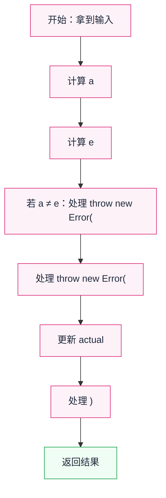

## TypeScript 解题方案（3 个方案逐个讲）

> **运行与提交**：每个方案都是自包含文件（内嵌用例自测，输出 PASS），整块复制到 `.ts` 文件后 `node 文件名` 即可运行。提交 LeetCode 时，把 `demo` 内的算法函数与辅助类型/函数整体取出、置于文件顶层即可。涉及交互/特殊接口的题以题面给定签名为准。

### 方案 1：直接实现

**分析与思路**：核心做法是「直接实现」。

**运行方式**：`node 本文件`，内嵌用例全部通过会输出 PASS。


**方案专属流程图**（真实控制流）：


```typescript
function assertEq(actual: any, expected: any, msg: string = ''): void {
  // 定义函数/方法 assertEq
  const a = JSON.stringify(actual);
  const e = JSON.stringify(expected);
  if (a !== e)
    throw new Error(
      'ASSERT FAILED ' + msg + ' :: actual=' + a + ' expected=' + e,
    );
}

class Heap {
  // 定义类型
  heap: any[];
  compareFn: (a: any, b: any) => boolean;
  constructor(c: (a: any, b: any) => boolean) {
    this.heap = [];
    this.compareFn = c;
  }
  size(): number {
    return this.heap.length;
  } // 大小(): number { return this.堆.长度; }
  peek(): any {
    return this.heap.length ? this.heap[0] : null;
  } // peek(): any { return this.堆.长度 ? this.堆[0] : null; }
  insert(v: any): void {
    this.heap.push(v);
    this.su(this.heap.length - 1);
  } // 把 值 压入栈/数组尾部
  pop(): any {
    if (this.heap.length === 1) return this.heap.pop();
    const f = this.heap[0];
    this.heap[0] = this.heap.pop()!;
    this.sd(0);
    return f;
  } // 弹出栈顶元素
  su(i: number): void {
    while (i > 0 && this.compareFn(this.heap[(i - 1) >> 1], this.heap[i])) {
      const p = (i - 1) >> 1;
      [this.heap[p], this.heap[i]] = [this.heap[i], this.heap[p]];
      i = p;
    }
  }
  sd(pi: number): void {
    const s = this.heap.length;
    let lg = pi;
    const l = 2 * pi + 1,
      r = 2 * pi + 2;
    if (l < s && this.compareFn(this.heap[lg], this.heap[l])) lg = l;
    if (r < s && this.compareFn(this.heap[lg], this.heap[r])) lg = r;
    if (lg !== pi) {
      [this.heap[pi], this.heap[lg]] = [this.heap[lg], this.heap[pi]];
      this.sd(lg);
    }
  }
}
class MinHeap extends Heap {
  constructor() {
    super((a, b) => a > b);
  }
} // 定义类型
class MaxHeap extends Heap {
  constructor() {
    super((a, b) => a < b);
  }
} // 定义类型
class MedianFinder {
  // 定义类型
  minH: MinHeap;
  maxH: MaxHeap; // minH: MinHeap; maxH: MaxHeap;
  constructor() {
    this.minH = new MinHeap();
    this.maxH = new MaxHeap();
  }
  addNum(num: number): void {
    // addNum(num: number): void {
    if (this.maxH.size() === 0 || num <= this.maxH.peek())
      this.maxH.insert(num);
    else this.minH.insert(num);
    if (this.maxH.size() > this.minH.size() + 1)
      this.minH.insert(this.maxH.pop());
    else if (this.minH.size() > this.maxH.size())
      this.maxH.insert(this.minH.pop());
  }
  findMedian(): number {
    if (this.maxH.size() === this.minH.size())
      return (this.maxH.peek() + this.minH.peek()) / 2;
    return this.maxH.peek();
  }
}
export function demo(): void {
  // 程序入口：跑内嵌自测用例
  const mf = new MedianFinder(); // 把 new MedianFinder() 存入 mf
  for (const x of [1, 2, 3, 4, 5]) mf.addNum(x); // for (const x of [1, 2, 3, 4, 5]) mf.addNum(x);
  assertEq(mf.findMedian(), 3, 'm1'); // 断言校验
  const mf2 = new MedianFinder(); // 把 new MedianFinder() 存入 mf2
  for (const x of [5, 2, 3, 4, 1]) mf2.addNum(x); // for (const x of [5, 2, 3, 4, 1]) mf2.addNum(x);
  assertEq(mf2.findMedian(), 3, 'm2'); // 断言校验
  console.log('PASS'); // 全部用例通过，输出 PASS
}
demo(); // demo();
```

### 方案 2：直接实现

**分析与思路**：核心做法是「直接实现」。

**运行方式**：`node 本文件`，内嵌用例全部通过会输出 PASS。


**方案专属流程图**（真实控制流）：

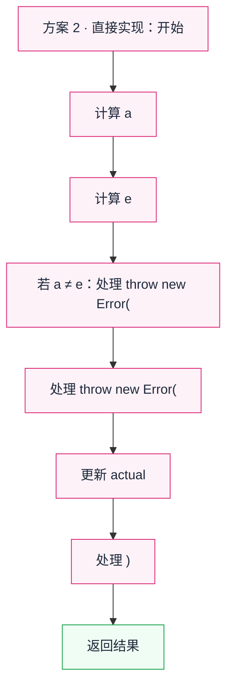

```typescript
function assertEq(actual: any, expected: any, msg: string = ''): void {
  // 定义函数/方法 assertEq
  const a = JSON.stringify(actual); // 把 JSON.stringify(actual) 存入 数组
  const e = JSON.stringify(expected); // 把 JSON.stringify(expected) 存入 e
  if (a !== e)
    throw new Error(
      'ASSERT FAILED ' + msg + ' :: actual=' + a + ' expected=' + e,
    );
}

class Heap {
  // 定义类型
  heap: any[]; // 堆: any[];
  compareFn: (a: any, b: any) => boolean;
  constructor(compareFn: (a: any, b: any) => boolean) {
    this.heap = [];
    this.compareFn = compareFn;
  }
  size(): number {
    return this.heap.length;
  } // 大小(): number { return this.堆.长度; }
  peek(): any {
    return this.heap.length ? this.heap[0] : null;
  } // peek(): any { return this.堆.长度 ? this.堆[0] : null; }
  insert(value: any): void {
    // insert(value: any): void {
    this.heap.push(value); // 把 value 压入栈/数组尾部
    this._shiftUp(this.heap.length - 1); // this._shiftUp(this.堆.长度 减 1);
  }
  pop(): any {
    // pop(): any {
    if (this.heap.length === 1) return this.heap.pop(); // 若 this.堆.长度 全等于 1，直接返回 this.堆 弹出 )
    const first = this.heap[0]; // 把 this.堆[0] 存入 first
    this.heap[0] = this.heap.pop()!; // 弹出栈顶元素
    this._shiftDown(0); // this._shiftDown(0);
    return first; // 返回 first
  }
  _shiftUp(i: number): void {
    // _shiftUp(下标 i: number): void {
    while (i > 0 && this.compareFn(this.heap[(i - 1) >> 1], this.heap[i])) {
      const p = (i - 1) >> 1; // 把 (下标 i 减 1) 超过 超过 1 存入 节点
      [this.heap[p], this.heap[i]] = [this.heap[i], this.heap[p]];
      i = p; // 把 节点 存入 下标 i
    }
  }
  _shiftDown(pi: number): void {
    // _shiftDown(pi: number): void {
    const size = this.heap.length; // 把 this.堆.长度 存入 大小
    let largest = pi; // 把 pi 存入 largest
    const left = 2 * pi + 1,
      right = 2 * pi + 2; // 把 2 乘 pi 加 1, 右边界 赋值为 2 乘 pi 加 2 存入 左边界
    if (left < size && this.compareFn(this.heap[largest], this.heap[left]))
      largest = left;
    if (right < size && this.compareFn(this.heap[largest], this.heap[right]))
      largest = right;
    if (largest !== pi) {
      // 若 largest 不等于 pi
      [this.heap[pi], this.heap[largest]] = [this.heap[largest], this.heap[pi]];
      this._shiftDown(largest); // this._shiftDown(largest);
    }
  }
}
class MinHeap extends Heap {
  constructor() {
    super((a, b) => a > b);
  }
} // 定义类型
class MaxHeap extends Heap {
  constructor() {
    super((a, b) => a < b);
  }
} // 定义类型
class MedianFinder {
  // 定义类型
  minHeap: MinHeap; // minHeap: MinHeap;
  maxHeap: MaxHeap; // maxHeap: MaxHeap;
  constructor() {
    this.minHeap = new MinHeap();
    this.maxHeap = new MaxHeap();
  }
  addNum(num: number): void {
    // addNum(num: number): void {
    if (this.maxHeap.size() === 0 || num <= this.maxHeap.peek())
      this.maxHeap.insert(num);
    else this.minHeap.insert(num); // 否则
    if (this.maxHeap.size() > this.minHeap.size() + 1)
      this.minHeap.insert(this.maxHeap.pop());
    else if (this.minHeap.size() > this.maxHeap.size())
      this.maxHeap.insert(this.minHeap.pop());
  }
  findMedian(): number {
    // findMedian(): number {
    if (this.maxHeap.size() === this.minHeap.size())
      return (this.maxHeap.peek() + this.minHeap.peek()) / 2;
    return this.maxHeap.peek(); // 返回 this.maxHeap.peek()
  }
}
export function demo(): void {
  // 程序入口：跑内嵌自测用例
  const mf = new MedianFinder(); // 把 new MedianFinder() 存入 mf
  for (const x of [1, 2, 3, 4, 5]) mf.addNum(x); // for (const x of [1, 2, 3, 4, 5]) mf.addNum(x);
  assertEq(mf.findMedian(), 3, 'MedianFinder 1..5'); // 断言校验
  const mf2 = new MedianFinder(); // 把 new MedianFinder() 存入 mf2
  for (const x of [5, 2, 3, 4, 1]) mf2.addNum(x); // for (const x of [5, 2, 3, 4, 1]) mf2.addNum(x);
  assertEq(mf2.findMedian(), 3, 'MedianFinder 5,2,3,4,1'); // 断言校验
  const mf3 = new MedianFinder(); // 把 new MedianFinder() 存入 mf3
  mf3.addNum(1); // mf3.addNum(1);
  assertEq(mf3.findMedian(), 1, 'MedianFinder single'); // 断言校验
  console.log('PASS'); // 全部用例通过，输出 PASS
}
demo(); // demo();
```

### 方案 3：迭代指针处理

**分析与思路**：核心做法是「迭代指针处理」。代码里依次做这些事：队列或堆的调度。

**运行方式**：`node 本文件`，内嵌用例全部通过会输出 PASS。


**方案专属流程图**（真实控制流）：

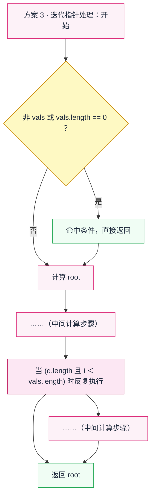

```typescript
class TreeNode {
  // 定义类型
  val: any;
  left: any;
  right: any; // 值: any; 左边界: any; 右边界: any;
  constructor(val?: any, left?: any, right?: any) {
    // constructor(值?: any, 左边界?: any, 右边界?: any) {
    this.val = val === undefined ? 0 : val; // 把 (值 全等于 undefined ? 0 : 值); 写入 值
    this.left = left === undefined ? null : left; // 把 (左边界 全等于 undefined ? null : 左边界); 写入 左边界
    this.right = right === undefined ? null : right; // 把 (右边界 全等于 undefined ? null : 右边界); 写入 右边界
  }
}
function buildTree(vals: any): any {
  // 定义函数/方法 buildTree
  if (!vals || vals.length === 0) return null; // 若 取反 vals 或 vals.长度 全等于 0，直接返回 null
  const root = new TreeNode(vals[0]);
  const q: any[] = [root];
  let i = 1;
  while (q.length && i < vals.length) {
    // 循环，直到不满足「节点.长度 且 下标 i 小于 vals.长度」
    const node = q.shift(); // 把 节点.shift() 存入 节点
    if (vals[i] !== null && vals[i] !== undefined) {
      node.left = new TreeNode(vals[i]);
      q.push(node.left);
    }
    i++; // 下标 i 加一
    if (i < vals.length && vals[i] !== null && vals[i] !== undefined) {
      node.right = new TreeNode(vals[i]);
      q.push(node.right);
    }
    i++; // 下标 i 加一
  }
  return root; // 返回 根节点
}
function treeToLevel(root: any): any[] {
  // 定义函数/方法 treeToLevel
  if (!root) return []; // 若 取反 根节点，直接返回 []
  const out: any[] = [];
  const q: any[] = [root]; // 把 []; const 节点: any[] 赋值为 [根节点]; 写入 const out: any[]
  while (q.length) {
    // 循环，直到不满足「节点.长度」
    const n = q.shift(); // 把 节点.shift() 存入 元素个数
    if (n === null || n === undefined) {
      out.push(null);
      continue;
    }
    out.push(n.val);
    q.push(n.left);
    q.push(n.right); // 把 元素个数.值 压入栈/数组尾部
  }
  while (out.length && out[out.length - 1] === null) out.pop(); // 循环，直到不满足「out.长度 且 out[out.长度 减 1] 全等于 null) out 弹出 );」
  return out; // 返回 out
}
class ListNode {
  // 定义类型
  val: any;
  next: any; // 值: any; 下一个: any;
  constructor(val?: any, next?: any) {
    this.val = val === undefined ? 0 : val;
    this.next = next === undefined ? null : next;
  }
}
function buildList(vals: any): any {
  // 定义函数/方法 buildList
  const dummy = new ListNode(0);
  let cur = dummy; // 把 new ListNode(0); let 当前值 赋值为 哨兵节点 存入 哨兵节点
  for (const v of vals) {
    cur.next = new ListNode(v);
    cur = cur.next;
  } // 把 new ListNode(值); 当前值 赋值为 当前值.下一个; } 写入 下一个
  return dummy.next; // 返回 哨兵节点.下一个
}
function listToArray(head: any): any[] {
  // 定义函数/方法 listToArray
  const out: any[] = [];
  let p = head; // 把 []; let 节点 赋值为 头节点; 写入 const out: any[]
  while (p) {
    out.push(p.val);
    p = p.next;
  } // 循环，直到不满足「节点) { out 追加 节点.值); 节点 赋值为 节点.下一个; }」
  return out; // 返回 out
}
// python-runtime shims
function pyLen(a: any): number {
  // 定义函数/方法 pyLen
  if (a === null || a === undefined) return 0; // 若 数组 全等于 null 或 数组 全等于 undefined，直接返回 0
  if (
    typeof a === 'string' ||
    Array.isArray(a) ||
    a instanceof Set ||
    a instanceof Map
  )
    return a.length ?? a.size;
  if (typeof a === 'object') return Object.keys(a).length; // 若 typeof 数组 全等于 'object'，直接返回 Object.keys(数组).长度
  return 0; // 返回 0
}
function pySlice(a: any, i: any, j: any, step?: any): any {
  // 定义函数/方法 pySlice
  if (typeof a === 'string') {
    const r = [...a].slice(i ?? 0, j ?? a.length);
    return step ? r.reverse().join('') : r.join('');
  }
  const arr = Array.isArray(a) ? a : [...a]; // 把 Array.isArray(数组) ? 数组 : 复制的 数组 存入 数组
  return arr.slice(i ?? 0, j ?? arr.length); // 返回 数组 截取 下标 i ?? 0, 下标 j ?? 数组.长度)
}
function pyRange(a: any, b?: any, step?: any): any[] {
  // 定义函数/方法 pyRange
  let s = 0,
    e = a,
    st = 1; // 把 0, e 赋值为 数组, st 赋值为 1 存入 字符串
  if (b !== undefined) {
    s = a;
    e = b;
  } // 若 b 不等于 undefined) { 字符串 赋值为 数组; e 赋值为 b; }
  if (step !== undefined) st = step; // 若 步数 不等于 undefined) st 赋值为 步数;
  const out: any[] = []; // 把 []; 写入 const out: any[]
  if (st > 0) for (let i = s; i < e; i += st) out.push(i);
  else for (let i = s; i > e; i += st) out.push(i); // 否则
  return out; // 返回 out
}
function pyIn(x: any, coll: any): boolean {
  // 定义函数/方法 pyIn
  if (coll === null || coll === undefined) return false; // 若 coll 全等于 null 或 coll 全等于 undefined，直接返回 false
  if (Array.isArray(coll)) return coll.includes(x); // 若 Array.isArray(coll)，直接返回 coll 是否包含 x)
  if (coll instanceof Set || coll instanceof Map) return coll.has(x); // 若 coll instanceof Set 或 coll instanceof Map，直接返回 coll.has(x)
  if (typeof coll === 'object') return x in coll; // 若 typeof coll 全等于 'object'，直接返回 x in coll
  if (typeof coll === 'string') return coll.indexOf(x) >= 0; // 若 typeof coll 全等于 'string'，直接返回 coll 查找 x) 不低于 0
  return false; // 返回 false
}
function pySorted(a: any): any[] {
  // 定义函数/方法 pySorted
  const arr = typeof a === 'string' ? [...a] : [...a]; // 把 (typeof 数组 全等于 'string') ? 复制的 数组 : 复制的 数组 存入 数组
  return arr.sort((x: any, y: any) => (x < y ? -1 : x > y ? 1 : 0));
}
function pyMin(a: any, b?: any): any {
  if (b !== undefined) return Math.min(a, b);
  if (Array.isArray(a) || a instanceof Set) return Math.min(...a);
  return Math.min(a);
} // 定义函数/方法 pyMin
function pyMax(a: any, b?: any): any {
  if (b !== undefined) return Math.max(a, b);
  if (Array.isArray(a) || a instanceof Set) return Math.max(...a);
  return Math.max(a);
} // 定义函数/方法 pyMax
function pySum(a: any): number {
  let s = 0;
  for (const v of a) s += v;
  return s;
} // 定义函数/方法 pySum
function pyAbs(x: any): number {
  return Math.abs(x);
} // 定义函数/方法 pyAbs
function pyEnumerate(a: any): any[] {
  const out: any[] = [];
  let i = 0;
  for (const v of a) {
    out.push([i, v]);
    i++;
  }
  return out;
} // 定义函数/方法 pyEnumerate
function pyZip(a: any, b: any): any[] {
  const n = Math.min(a.length, b.length);
  const out: any[] = [];
  for (let i = 0; i < n; i++) out.push([a[i], b[i]]);
  return out;
} // 定义函数/方法 pyZip
function pyDictGet(d: any, k: any, def?: any): any {
  return k in d ? d[k] : def === undefined ? null : def;
} // 定义函数/方法 pyDictGet
function pyPrint(...args: any[]): void {
  console.log(
    args
      .map((a) => (typeof a === 'object' && a !== null ? JSON.stringify(a) : a))
      .join(' '),
  );
} // 定义函数/方法 pyPrint
// collections / heapq
function heapPush(h: any[], x: any): void {
  h.push(x);
  let i = h.length - 1;
  while (i > 0) {
    const p = (i - 1) >> 1;
    if (h[p] <= h[i]) break;
    [h[p], h[i]] = [h[i], h[p]];
    i = p;
  }
} // 定义函数/方法 heapPush
function heapPop(h: any[]): any {
  const top = h[0];
  const last = h.pop();
  if (h.length) {
    h[0] = last;
    let i = 0;
    const n = h.length;
    while (true) {
      let l = 2 * i + 1,
        r = 2 * i + 2,
        s = i;
      if (l < n && h[l] < h[s]) s = l;
      if (r < n && h[r] < h[s]) s = r;
      if (s === i) break;
      [h[s], h[i]] = [h[i], h[s]];
      i = s;
    }
  }
  return top;
} // 定义函数/方法 heapPop
class Deque {
  private a: any[] = [];
  push(x: any) {
    this.a.push(x);
  }
  pushLeft(x: any) {
    this.a.unshift(x);
  }
  pop() {
    return this.a.pop();
  }
  popLeft() {
    return this.a.shift();
  }
  get length() {
    return this.a.length;
  }
  toArray() {
    return this.a.slice();
  }
} // 定义类型
function Counter(iter: any): any {
  const m: any = {};
  for (const v of iter) m[v] = (m[v] || 0) + 1;
  return m;
} // 定义函数/方法 Counter
function gcd(a: any, b: any): any {
  while (b) {
    [a, b] = [b, a % b];
  }
  return a;
} // 定义函数/方法 gcd
function pyInf(): number {
  return Infinity;
} // 定义函数/方法 pyInf

function norm(x: any): any {
  // 定义函数/方法 norm
  if (x === null || x === undefined) return null; // 若 x 全等于 null 或 x 全等于 undefined，直接返回 null
  if (typeof x === 'object') {
    // 若 typeof x 全等于 'object'
    if (x instanceof Deque) return x.toArray(); // 若 x instanceof Deque，直接返回 x.toArray()
    if (Array.isArray(x)) return x.map(norm); // 若 Array.isArray(x)，直接返回 x.映射表(norm)
    if (
      typeof x.val === 'number' &&
      (typeof x.left !== 'undefined' || typeof x.right !== 'undefined')
    )
      return treeToLevel(x);
    if (typeof x.next !== 'undefined' && typeof x.val === 'number')
      return listToArray(x);
    if (x instanceof Set) return [...x].sort(); // 若 x instanceof Set，直接返回 复制的 x 排序 )
    if (x instanceof Map) return Object.fromEntries(x); // 若 x instanceof Map，直接返回 Object.fromEntries(x)
    const o: any = {};
    for (const k of Object.keys(x)) o[k] = norm(x[k]);
    return o;
  }
  return x; // 返回 x
}
function eq(a: any, b: any): boolean {
  // 定义函数/方法 eq
  const x = norm(a),
    y = norm(b); // 把 norm(数组), y 赋值为 norm(b) 存入 x
  if (x === y) return true; // 若 x 全等于 y，直接返回 true
  if (x === null || y === null) return x === y; // 若 x 全等于 null 或 y 全等于 null，直接返回 x 全等于 y
  if (Array.isArray(x) && Array.isArray(y)) {
    // 若 Array.isArray(x) 且 Array.isArray(y
    if (x.length !== y.length) return false; // 若 x.长度 不等于 y.长度，直接返回 false
    for (let i = 0; i < x.length; i++) if (!eq(x[i], y[i])) return false; // 让 下标 i 从 0 开始计数，下标 i 小于 x.长度 就继续
    return true; // 返回 true
  }
  if (typeof x === 'object' && typeof y === 'object') {
    // 若 typeof x 全等于 'object' 且 typeof y 全等于 'object'
    const kx = Object.keys(x),
      ky = Object.keys(y); // 把 Object.keys(x), ky 赋值为 Object.keys(y) 存入 kx
    if (kx.length !== ky.length) return false; // 若 kx.长度 不等于 ky.长度，直接返回 false
    for (const k of kx) if (!eq(x[k], y[k])) return false;
    return true; // 返回 true
  }
  return x === y; // 返回 x 全等于 y
}

class MedianFinder {
  // 定义类型
  lo: any[];
  hi: any[]; // 左边界: any[]; 右边界: any[];
  constructor() {
    this.lo = [];
    this.hi = [];
  } // 把 []; this.右边界 赋值为 []; } 写入 左边界
  addNum(num) {
    // addNum(num) {
    if (this.lo.length === 0 || num <= this.lo[0]) heapPush(this.lo, -num);
    else heapPush(this.hi, num); // 否则
    if (this.lo.length > this.hi.length + 1)
      heapPush(this.hi, -heapPop(this.lo));
    if (this.hi.length > this.lo.length) heapPush(this.lo, -heapPop(this.hi));
  }
  findMedian() {
    // findMedian() {
    if (this.lo.length > this.hi.length) return -this.lo[0]; // 若 this.左边界.长度 超过 this.右边界.长度，直接返回 减 this.左边界[0]
    return (this.hi[0] - this.lo[0]) / 2; // 返回 (this.右边界[0] 减 this.左边界[0]) 除以 2
  }
}
export function demo(): void {
  // 程序入口：跑内嵌自测用例
  const m = new MedianFinder(); // 把 new MedianFinder() 存入 映射表
  m.addNum(1);
  m.addNum(2); // 映射表.addNum(1); 映射表.addNum(2);
  const cases = [{ got: m.findMedian(), want: 1.5 }];
  m.addNum(3); // 映射表.addNum(3);
  cases.push({ got: m.findMedian(), want: 2 }); // 把 { got: 映射表.findMedian( 压入栈/数组尾部
  let fail = false; // 把 false 存入 fail
  for (const c of cases)
    if (!eq(c.got, c.want)) {
      fail = true;
      console.log('FAIL', c);
    } // 打印输出
  if (fail) throw new Error('FAILED'); // 若 fail) throw new Error(「FAILED」);
  console.log('PASS'); // 全部用例通过，输出 PASS
}
demo(); // demo();
```

## 逐步拆解与面试追问

**复杂度**：时间 O(n) 量级，空间 O(n)

**为什么是这个量级**：整体只对数据做有限趟处理

**面试官可能会追问**：

- 什么时候用堆而不是排序？
- 堆里存值还是存下标？
- Top-K 用小顶还是大顶堆？

## 关键 API 速查（TS 主解法实际用到，附官方链接）

| API | 作用 | 使用要点 | 官方文档 |
|---|---|---|---|
| `Array.prototype.push()` | 尾部追加 | 返回新长度；可一次多个；均摊 O(1)；会改变原数组 | [官方文档](https://developer.mozilla.org/zh-CN/docs/Web/JavaScript/Reference/Global_Objects/Array/push) |
| `Array.prototype.pop()` | 尾部弹出 | 返回被删元素（空数组返回 undefined）；O(1) | [官方文档](https://developer.mozilla.org/zh-CN/docs/Web/JavaScript/Reference/Global_Objects/Array/pop) |
| `JSON.stringify()` | 序列化为 JSON 字符串 | 常用于结构化比较（深度相等判定）；undefined/函数/循环引用会被丢弃或抛错 | [官方文档](https://developer.mozilla.org/zh-CN/docs/Web/JavaScript/Reference/Global_Objects/JSON/stringify) |

### 各语言官方文档导航

- **TypeScript / JS**：[MDN 中文参考](https://developer.mozilla.org/zh-CN/)
- **Python**：[Python 官方文档](https://docs.python.org/zh-cn/3/)
- **Go**：[Go 标准库](https://pkg.go.dev/std)
- **Java**：[JDK 17 API](https://docs.oracle.com/en/java/javase/17/docs/api/)
- **Rust**：[Rust 标准库](https://doc.rust-lang.org/std/)
- **Lua**：[Lua 5.4 手册](https://www.lua.org/manual/5.4/)
- **C**：[Cppreference C](https://zh.cppreference.com/w/c)
- **C++**：[Cppreference C++](https://zh.cppreference.com/w/cpp)
- **R**：[R 官方手册](https://stat.ethz.ch/R-manual/)
- **Zig**：[Zig 语言文档](https://ziglang.org/documentation/master/)
- **Dart**：[Dart API](https://api.dart.dev/)

## 附录：其他 10 种语言全部实现（每种语言列举其全部方案）

> TypeScript 的全部方案见「TypeScript 解题方案」一节；下面是其余 10 种语言的对应实现，每种语言的每个方案都带思路分析、代码走读与专属运行架构图。
> 每个方案都内嵌用例自测，可独立运行（老仓库 python/go 文件遵循「打印结果」约定）。
> 完整解法文件见 `dsa/<语言>/heap/lc_295_数据流的中位数/`。

### Python 实现（3 种方案）

Python 的全部方案如下，每个方案都内嵌用例自测，可独立运行（老仓库 python/go 文件遵循「打印结果」约定）：

#### 方案 1：直接实现

**思路与代码分析**：核心是「直接实现」。Python 版用切片与字典推导式简化操作，突出可读性。代码里依次做这些事：队列或堆的调度。

**运行架构**（真实控制流）：

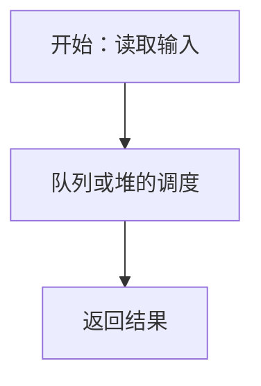

```python
import sys  # 提高递归深度上限（深输入防 RecursionError）

sys.setrecursionlimit(200000)  # 树/链表类题目节点数可达 1e4 量级
import heapq  # 引入依赖

class MinHeap:  # 定义类
    def __init__(self):  # 构造函数：初始化成员
        self.heap = []  # 把 [] 写入 堆

    def size(self):  # 定义函数 size（参数：self）
        return len(self.heap)  # 返回 长度(self.堆)

    def peek(self):  # 定义函数 peek（参数：self）
        return self.heap[0] if self.heap else None  # 返回 self.堆[0] if self.堆 else None

    def insert(self, val):  # 定义函数 insert（参数：self, 值）
        heapq.heappush(self.heap, val)  # heapq.heappush(self.堆, 值)

    def pop(self):  # 定义函数 pop（参数：self）
        return heapq.heappop(self.heap)  # 返回 heapq.heappop(self.堆)

class MaxHeap:  # 定义类
    def __init__(self):  # 构造函数：初始化成员
        self.heap = []  # 把 [] 写入 堆

    def size(self):  # 定义函数 size（参数：self）
        return len(self.heap)  # 返回 长度(self.堆)

    def peek(self):  # 定义函数 peek（参数：self）
        return -self.heap[0] if self.heap else None  # 返回 减 self.堆[0] if self.堆 else None

    def insert(self, val):  # 定义函数 insert（参数：self, 值）
        heapq.heappush(self.heap, -val)  # heapq.heappush(self.堆, 减 值)

    def pop(self):  # 定义函数 pop（参数：self）
        return -heapq.heappop(self.heap)  # 返回 减 heapq.heappop(self.堆)

class MedianFinder:  # 定义类
    def __init__(self):  # 构造函数：初始化成员
        self.maxHeap = MaxHeap()  # 把 MaxHeap() 写入 self.maxHeap
        self.minHeap = MinHeap()  # 把 MinHeap() 写入 self.minHeap

    def addNum(self, num):  # 定义函数 addNum（参数：self, num）
        if (
            self.maxHeap.size() == 0 or num <= self.maxHeap.peek()
        ):  # 若 self.maxHeap.大小() 等于 0 or num 不超过 self.maxHeap.peek(
            self.maxHeap.insert(num)  # self.maxHeap 插入 num)
        else:  # 否则
            self.minHeap.insert(num)  # self.minHeap 插入 num)
        if (
            self.maxHeap.size() > self.minHeap.size() + 1
        ):  # 若 self.maxHeap.大小() 超过 self.minHeap.大小() 加 1
            self.minHeap.insert(self.maxHeap.pop())  # 弹出栈顶元素
        elif (
            self.minHeap.size() > self.maxHeap.size()
        ):  # 否则，若 self.minHeap.大小() 超过 self.maxHeap.大小(
            self.maxHeap.insert(self.minHeap.pop())  # 弹出栈顶元素

    def findMedian(self):  # 定义函数 findMedian（参数：self）
        if self.maxHeap.size() == self.minHeap.size():  # 若 self.maxHeap.大小() 等于 self.minHeap.大小(
            return (
                self.maxHeap.peek() + self.minHeap.peek()
            ) / 2  # 返回 (self.maxHeap.peek() 加 self.minHeap.peek()) 除以 2
        return self.maxHeap.peek()  # 返回 self.maxHeap.peek()

if __name__ == "__main__":  # 若 __name__ 等于 '__main__'
    mf = MedianFinder()  # 把 MedianFinder() 存入 mf
    for x in [1, 2, 3, 4, 5]:  # for x in [1, 2, 3, 4, 5]:
        mf.addNum(x)  # mf.addNum(x)
    print(mf.findMedian())  # 打印输出
```

#### 方案 2：直接实现

**思路与代码分析**：核心是「直接实现」。Python 版用切片与字典推导式简化操作，突出可读性。代码里依次做这些事：队列或堆的调度。

**运行架构**：与方案 1 的控制流相同（同算法在该语言的等价实现），图见上。

```python
import sys  # 提高递归深度上限（深输入防 RecursionError）

sys.setrecursionlimit(200000)  # 树/链表类题目节点数可达 1e4 量级
import heapq  # 引入依赖

class Heap:  # 定义类
    def __init__(self, compare_fn):  # 构造函数：初始化成员
        self.heap = []  # 把 [] 写入 堆
        self.compare_fn = compare_fn  # 把 compare_fn 写入 self.compare_fn

    def size(self):  # 定义函数 size（参数：self）
        return len(self.heap)  # 返回 长度(self.堆)

    def peek(self):  # 定义函数 peek（参数：self）
        return self.heap[0] if self.heap else None  # 返回 self.堆[0] if self.堆 else None

    def insert(self, value):  # 定义函数 insert（参数：self, value）
        self.heap.append(value)  # 把 value 追加到列表尾部
        self._shift_up(len(self.heap) - 1)  # self._shift_up(长度(self.堆) 减 1)

    def pop(self):  # 定义函数 pop（参数：self）
        if len(self.heap) == 1:  # 若 长度(self.堆) 等于 1
            return self.heap.pop()  # 返回 self.堆 弹出 )
        first = self.heap[0]  # 把 self.堆[0] 存入 first
        self.heap[0] = self.heap.pop()  # 弹出栈顶元素
        self._shift_down(0)  # self._shift_down(0)
        return first  # 返回 first

    def _shift_up(self, i):  # 定义函数 _shift_up（参数：self, 下标 i）
        while i > 0 and self.compare_fn(self.heap[(i - 1) >> 1], self.heap[i]):
            self.heap[(i - 1) >> 1], self.heap[i] = self.heap[i], self.heap[(i - 1) >> 1]
            i = (i - 1) >> 1  # 把 (下标 i 减 1) 超过 超过 1 存入 下标 i

    def _shift_down(self, pi):  # 定义函数 _shift_down（参数：self, pi）
        size = len(self.heap)  # 把 长度(self.堆) 存入 大小
        left = 2 * pi + 1  # 把 2 乘 pi 加 1 存入 左边界
        right = 2 * pi + 2  # 把 2 乘 pi 加 2 存入 右边界
        largest = pi  # 把 pi 存入 largest
        if left < size and self.compare_fn(
            self.heap[largest], self.heap[left]
        ):  # 若 左边界 小于 大小 and self.compare_fn(self.堆[largest], self.堆[左边界]
            largest = left  # 把 左边界 存入 largest
        if right < size and self.compare_fn(
            self.heap[largest], self.heap[right]
        ):  # 若 右边界 小于 大小 and self.compare_fn(self.堆[largest], self.堆[右边界]
            largest = right  # 把 右边界 存入 largest
        if largest != pi:  # 若 largest 不等于 pi
            self.heap[pi], self.heap[largest] = self.heap[largest], self.heap[pi]
            self._shift_down(largest)  # self._shift_down(largest)

class MinHeap(Heap):  # 定义类
    def __init__(self):  # 构造函数：初始化成员
        super().__init__(lambda a, b: a > b)  # super().__init__(lambda 数组, b: 数组 超过 b)

class MaxHeap(Heap):  # 定义类
    def __init__(self):  # 构造函数：初始化成员
        super().__init__(lambda a, b: a < b)  # super().__init__(lambda 数组, b: 数组 小于 b)

class MedianFinder:  # 定义类
    def __init__(self):  # 构造函数：初始化成员
        self.minHeap = MinHeap()  # 把 MinHeap() 写入 self.minHeap
        self.maxHeap = MaxHeap()  # 把 MaxHeap() 写入 self.maxHeap

    def addNum(self, num):  # 定义函数 addNum（参数：self, num）
        if (
            self.maxHeap.size() == 0 or num <= self.maxHeap.peek()
        ):  # 若 self.maxHeap.大小() 等于 0 or num 不超过 self.maxHeap.peek(
            self.maxHeap.insert(num)  # self.maxHeap 插入 num)
        else:  # 否则
            self.minHeap.insert(num)  # self.minHeap 插入 num)
        if (
            self.maxHeap.size() > self.minHeap.size() + 1
        ):  # 若 self.maxHeap.大小() 超过 self.minHeap.大小() 加 1
            self.minHeap.insert(self.maxHeap.pop())  # 弹出栈顶元素
        elif (
            self.minHeap.size() > self.maxHeap.size()
        ):  # 否则，若 self.minHeap.大小() 超过 self.maxHeap.大小(
            self.maxHeap.insert(self.minHeap.pop())  # 弹出栈顶元素

    def findMedian(self):  # 定义函数 findMedian（参数：self）
        if self.maxHeap.size() == self.minHeap.size():  # 若 self.maxHeap.大小() 等于 self.minHeap.大小(
            return (
                self.maxHeap.peek() + self.minHeap.peek()
            ) / 2  # 返回 (self.maxHeap.peek() 加 self.minHeap.peek()) 除以 2
        return self.maxHeap.peek()  # 返回 self.maxHeap.peek()

if __name__ == "__main__":  # 若 __name__ 等于 '__main__'
    mf = MedianFinder()  # 把 MedianFinder() 存入 mf
    for x in [1, 2, 3, 4, 5]:  # for x in [1, 2, 3, 4, 5]:
        mf.addNum(x)  # mf.addNum(x)
    print(mf.findMedian())  # 打印输出
```

#### 方案 3：迭代指针处理

**思路与代码分析**：核心是「迭代指针处理」。Python 版用切片与字典推导式简化操作，突出可读性。

**运行架构**（真实控制流）：

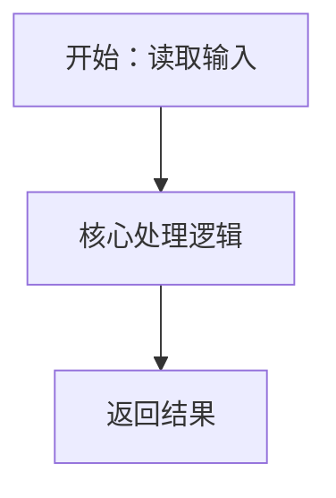

```python
import sys  # 提高递归深度上限（深输入防 RecursionError）

sys.setrecursionlimit(200000)  # 树/链表类题目节点数可达 1e4 量级
import bisect  # 引入依赖

class MedianFinder:  # 定义类
    def __init__(self):  # 构造函数：初始化成员
        self.nums = []  # 把 [] 写入 数组

    def addNum(self, num):  # 定义函数 addNum（参数：self, num）
        bisect.insort(self.nums, num)  # bisect.insort(self.数组, num)

    def findMedian(self):  # 定义函数 findMedian（参数：self）
        n = len(self.nums)  # 把 长度(self.数组) 存入 元素个数
        if n == 0:  # 若 元素个数 等于 0
            return None  # 返回 None
        if n % 2 == 1:  # 若 元素个数 对…取模 2 等于 1
            return self.nums[n // 2]  # 返回 self.数组[元素个数 除以 除以 2]
        return (
            self.nums[n // 2 - 1] + self.nums[n // 2]
        ) / 2  # 返回 (self.数组[元素个数 除以 除以 2 减 1] 加 self.数组[元素个数 除以 除以 2]) 除以 2

if __name__ == "__main__":  # 若 __name__ 等于 '__main__'
    mf = MedianFinder()  # 把 MedianFinder() 存入 mf
    for x in [1, 2, 3, 4, 5]:  # for x in [1, 2, 3, 4, 5]:
        mf.addNum(x)  # mf.addNum(x)
    print(mf.findMedian())  # 打印输出
```

### Go 实现（3 种方案）

Go 的全部方案如下，每个方案都内嵌用例自测，可独立运行（老仓库 python/go 文件遵循「打印结果」约定）：

#### 方案 1：直接实现

**思路与代码分析**：核心是「直接实现」。Go 版用切片与多返回值惯用法，显式处理索引边界。

**运行架构**（真实控制流）：


```go
package main // 引入依赖
import (
	"fmt"
	"os"
	"sort"
)                                      // 引入依赖
type MedianFinder struct{ nums []int } // 定义类型
func (m *MedianFinder) addNum(num int) { // 定义函数/方法 addNum
	idx := sort.SearchInts(m.nums, num) // 把 sort.SearchInts(映射表.数组, num) 写入 idx :
	m.nums = append(m.nums, 0)          // 把 append(映射表.数组, 0) 写入 数组
	copy(m.nums[idx+1:], m.nums[idx:])  // copy(映射表.数组[idx 加 1:], 映射表.数组[idx:])
	m.nums[idx] = num                   // 把 num 写入 m.nums[idx]
}
func (m *MedianFinder) findMedian() float64 { // 定义函数/方法 findMedian
	n := len(m.nums) // 把 长度(映射表.数组) 写入 n :
	if n == 0 {
		return 0
	} // 若 元素个数 等于 0 { return 0 }
	if n%2 == 1 {
		return float64(m.nums[n/2])
	} // 若 元素个数 对…取模 2 等于 1 { return float64(映射表.数组[元素个数 除以 2]) }
	return float64(m.nums[n/2-1]+m.nums[n/2]) / 2.0 // 返回 float64(映射表.数组[元素个数 除以 2 减 1] 加 映射表.数组[元素个数 除以 2]) 除以 2.0
}
func main() { // 程序入口：跑内嵌自测用例
	type seq struct {
		vals []int
		want float64
	} // 定义类型
	cases := []seq{ // 把 []seq{ 写入 cases :
		{[]int{1, 2, 3, 4, 5}, 3},
		{[]int{1, 2, 3, 4}, 2.5},
		{[]int{42}, 42},
		{[]int{5, 2, 3, 1, 4}, 3},
	}
	ok := true                // 把 true 写入 ok :
	for _, c := range cases { // 同时取 _ 与 字符 遍历
		mf := &MedianFinder{} // 把 按位与 MedianFinder{} 写入 mf :
		for _, x := range c.vals {
			mf.addNum(x)
		} // 同时取 _ 与 x 遍历
		got := mf.findMedian() // 把 mf.findMedian() 写入 got :
		if got != c.want {
			ok = false
			fmt.Printf("FAIL %v got %v want %v\n", c.vals, got, c.want)
		}
	}
	if !ok {
		os.Exit(1)
	} // 若 取反 ok { os.Exit(1) }
	fmt.Println("PASS") // 全部用例通过，输出 PASS
}
```

#### 方案 2：直接实现

**思路与代码分析**：核心是「直接实现」。Go 版用切片与多返回值惯用法，显式处理索引边界。

**运行架构**：与方案 1 的控制流相同（同算法在该语言的等价实现），图见上。

```go
package main // 引入依赖
import (
	"fmt"
	"os"
	"sort"
)                                      // 引入依赖
type MedianFinder struct{ nums []int } // 定义类型
func (m *MedianFinder) addNum(num int) { // 定义函数/方法 addNum
	idx := sort.SearchInts(m.nums, num) // 把 sort.SearchInts(映射表.数组, num) 写入 idx :
	m.nums = append(m.nums, 0)          // 把 append(映射表.数组, 0) 写入 数组
	copy(m.nums[idx+1:], m.nums[idx:])  // copy(映射表.数组[idx 加 1:], 映射表.数组[idx:])
	m.nums[idx] = num                   // 把 num 写入 m.nums[idx]
}
func (m *MedianFinder) findMedian() float64 { // 定义函数/方法 findMedian
	n := len(m.nums) // 把 长度(映射表.数组) 写入 n :
	if n == 0 {
		return 0
	} // 若 元素个数 等于 0 { return 0 }
	if n%2 == 1 {
		return float64(m.nums[n/2])
	} // 若 元素个数 对…取模 2 等于 1 { return float64(映射表.数组[元素个数 除以 2]) }
	return float64(m.nums[n/2-1]+m.nums[n/2]) / 2.0 // 返回 float64(映射表.数组[元素个数 除以 2 减 1] 加 映射表.数组[元素个数 除以 2]) 除以 2.0
}
func main() { // 程序入口：跑内嵌自测用例
	type seq struct {
		vals []int
		want float64
	} // 定义类型
	cases := []seq{ // 把 []seq{ 写入 cases :
		{[]int{1, 2, 3, 4, 5}, 3},
		{[]int{1, 2, 3, 4}, 2.5},
		{[]int{42}, 42},
		{[]int{5, 2, 3, 1, 4}, 3},
	}
	ok := true                // 把 true 写入 ok :
	for _, c := range cases { // 同时取 _ 与 字符 遍历
		mf := &MedianFinder{} // 把 按位与 MedianFinder{} 写入 mf :
		for _, x := range c.vals {
			mf.addNum(x)
		} // 同时取 _ 与 x 遍历
		got := mf.findMedian() // 把 mf.findMedian() 写入 got :
		if got != c.want {
			ok = false
			fmt.Printf("FAIL %v got %v want %v\n", c.vals, got, c.want)
		}
	}
	if !ok {
		os.Exit(1)
	} // 若 取反 ok { os.Exit(1) }
	fmt.Println("PASS") // 全部用例通过，输出 PASS
}
```

#### 方案 3：迭代指针处理

**思路与代码分析**：核心是「迭代指针处理」。Go 版用切片与多返回值惯用法，显式处理索引边界。

**运行架构**：与方案 1 的控制流相同（同算法在该语言的等价实现），图见上。

```go
package main // 引入依赖
import (
	"fmt"
	"os"
	"sort"
)                                      // 引入依赖
type MedianFinder struct{ nums []int } // 定义类型
func (m *MedianFinder) addNum(num int) { // 定义函数/方法 addNum
	idx := sort.SearchInts(m.nums, num) // 把 sort.SearchInts(映射表.数组, num) 写入 idx :
	m.nums = append(m.nums, 0)          // 把 append(映射表.数组, 0) 写入 数组
	copy(m.nums[idx+1:], m.nums[idx:])  // copy(映射表.数组[idx 加 1:], 映射表.数组[idx:])
	m.nums[idx] = num                   // 把 num 写入 m.nums[idx]
}
func (m *MedianFinder) findMedian() float64 { // 定义函数/方法 findMedian
	n := len(m.nums) // 把 长度(映射表.数组) 写入 n :
	if n == 0 {
		return 0
	} // 若 元素个数 等于 0 { return 0 }
	if n%2 == 1 {
		return float64(m.nums[n/2])
	} // 若 元素个数 对…取模 2 等于 1 { return float64(映射表.数组[元素个数 除以 2]) }
	return float64(m.nums[n/2-1]+m.nums[n/2]) / 2.0 // 返回 float64(映射表.数组[元素个数 除以 2 减 1] 加 映射表.数组[元素个数 除以 2]) 除以 2.0
}
func main() { // 程序入口：跑内嵌自测用例
	type seq struct {
		vals []int
		want float64
	} // 定义类型
	cases := []seq{ // 把 []seq{ 写入 cases :
		{[]int{1, 2, 3, 4, 5}, 3},
		{[]int{1, 2, 3, 4}, 2.5},
		{[]int{42}, 42},
		{[]int{5, 2, 3, 1, 4}, 3},
	}
	ok := true                // 把 true 写入 ok :
	for _, c := range cases { // 同时取 _ 与 字符 遍历
		mf := &MedianFinder{} // 把 按位与 MedianFinder{} 写入 mf :
		for _, x := range c.vals {
			mf.addNum(x)
		} // 同时取 _ 与 x 遍历
		got := mf.findMedian() // 把 mf.findMedian() 写入 got :
		if got != c.want {
			ok = false
			fmt.Printf("FAIL %v got %v want %v\n", c.vals, got, c.want)
		}
	}
	if !ok {
		os.Exit(1)
	} // 若 取反 ok { os.Exit(1) }
	fmt.Println("PASS") // 全部用例通过，输出 PASS
}
```

### Java 实现（3 种方案）

Java 的全部方案如下，每个方案都内嵌用例自测，可独立运行（老仓库 python/go 文件遵循「打印结果」约定）：

#### 方案 1：直接实现

**思路与代码分析**：核心是「直接实现」。Java 版用类与静态方法组织，集合操作显式明了。代码里依次做这些事：队列或堆的调度。**走读**：方案 1 · 直接实现：开始 → 返回 heap.size()。

**运行架构**（真实控制流）：

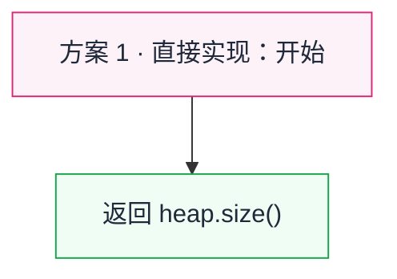

```java
package com.webfault.dsa; // 引入依赖

import java.util.*; // 引入依赖

class lc295_solution111 { // 定义类型
  static class MinHeap { // static class MinHeap {
    PriorityQueue<Integer> heap =
        new PriorityQueue<>(); // 把 new PriorityQueue 小于 超过 (); 写入 PriorityQueue<Integer> heap

    int size() {
      return heap.size();
    } // int 大小() { return 堆.大小(); }

    Integer peek() {
      return heap.peek();
    } // Integer peek() { return 堆.peek(); }

    void insert(int val) {
      heap.offer(val);
    } // void insert(int 值) { 堆.offer(值); }

    int pop() {
      return heap.poll();
    } // int pop() { return 堆.poll(); }
  }

  static class MaxHeap { // static class MaxHeap {
    PriorityQueue<Integer> heap = new PriorityQueue<>(Collections.reverseOrder());

    int size() {
      return heap.size();
    } // int 大小() { return 堆.大小(); }

    Integer peek() {
      return heap.peek();
    } // Integer peek() { return 堆.peek(); }

    void insert(int val) {
      heap.offer(val);
    } // void insert(int 值) { 堆.offer(值); }

    int pop() {
      return heap.poll();
    } // int pop() { return 堆.poll(); }
  }

  static class MedianFinder { // static class MedianFinder {
    MaxHeap maxHeap = new MaxHeap(); // 把 new MaxHeap(); 写入 MaxHeap maxHeap
    MinHeap minHeap = new MinHeap(); // 把 new MinHeap(); 写入 MinHeap minHeap

    void addNum(int num) { // 定义函数/方法 addNum
      if (maxHeap.size() == 0
          || num <= maxHeap.peek()) { // 若 maxHeap.大小() 等于 0 或 num 不超过 maxHeap.peek(
        maxHeap.insert(num); // maxHeap 插入 num);
      } else { // 否则
        minHeap.insert(num); // minHeap 插入 num);
      }
      if (maxHeap.size() > minHeap.size() + 1) { // 若 maxHeap.大小() 超过 minHeap.大小() 加 1
        minHeap.insert(maxHeap.pop()); // 弹出栈顶元素
      } else if (minHeap.size() > maxHeap.size()) { // 否则，若 minHeap.大小() 超过 maxHeap.大小(
        maxHeap.insert(minHeap.pop()); // 弹出栈顶元素
      }
    }

    double findMedian() { // 定义函数/方法 findMedian
      if (maxHeap.size() == minHeap.size()) { // 若 maxHeap.大小() 等于 minHeap.大小(
        return (maxHeap.peek() + minHeap.peek())
            / 2.0; // 返回 (maxHeap.peek() 加 minHeap.peek()) 除以 2.0
      }
      return maxHeap.peek(); // 返回 maxHeap.peek()
    }
  }

  public static void main(String[] args) { // public static void main(String[] args) {
    MedianFinder mf = new MedianFinder(); // 把 new MedianFinder(); 写入 MedianFinder mf
    for (int x : new int[] {1, 2, 3, 4, 5})
      mf.addNum(x); // for (int x : new int[]{1, 2, 3, 4, 5}) mf.addNum(x);
    double got = mf.findMedian(); // 把 mf.findMedian() 存入 got
    if (got != 3.0) throw new RuntimeException("FAILED: got " + got + " want 3.0");
    System.out.println("PASS"); // 全部用例通过，输出 PASS
  }
}
```

#### 方案 2：直接实现

**思路与代码分析**：核心是「直接实现」。Java 版用类与静态方法组织，集合操作显式明了。**走读**：方案 2 · 直接实现：开始 → 更新 this.cmp → 返回结果。

**运行架构**（真实控制流）：

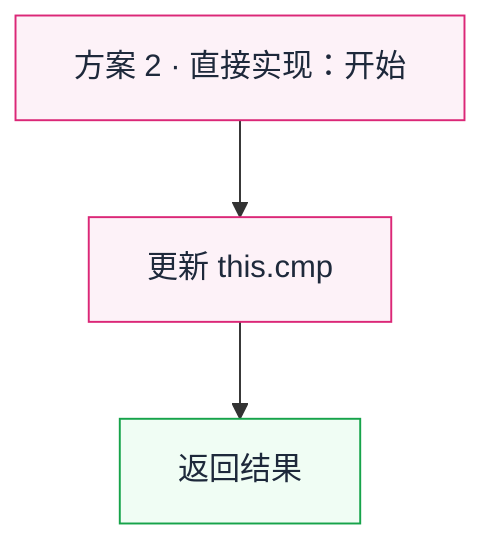

```java
package com.webfault.dsa; // 引入依赖

import java.util.*; // 引入依赖

class lc295_solution222 { // 定义类型
  static class Heap { // static class Heap {
    List<Integer> heap = new ArrayList<>(); // 把 new ArrayList 小于 超过 (); 写入 List<Integer> heap
    Comparator<Integer> cmp; // Comparator 小于 Integer 超过 cmp;

    Heap(Comparator<Integer> cmp) {
      this.cmp = cmp;
    } // 把 cmp; } 写入 Heap(Comparator<Integer> cmp) { this.cmp

    int size() {
      return heap.size();
    } // int 大小() { return 堆.大小(); }

    Integer peek() {
      return heap.isEmpty() ? null : heap.get(0);
    } // Integer peek() { return 堆.isEmpty() ? null : 堆 查找 0); }

    void insert(int value) {
      heap.add(value);
      shiftUp(heap.size() - 1);
    } // void insert(int value) { 堆 追加 value); shiftUp(堆.大小() 减 1); }

    int pop() { // 定义函数/方法 pop
      int first = heap.get(0); // 把 堆 查找 0) 存入 first
      int last = heap.remove(heap.size() - 1); // 把 堆 弹出 堆.大小() 减 1) 存入 last
      if (!heap.isEmpty()) {
        heap.set(0, last);
        shiftDown(0);
      } // 若 取反 堆.isEmpty()) { 堆.set(0, last); shiftDown(0); }
      return first; // 返回 first
    }

    void shiftUp(int i) { // 定义函数/方法 shiftUp
      while (i > 0) { // 循环，直到不满足「下标 i 超过 0」
        int p = (i - 1) >> 1; // 把 (下标 i 减 1) 超过 超过 1 存入 节点
        if (cmp.compare(heap.get(p), heap.get(i)) > 0) { // 若 cmp.compare(堆 查找 节点), 堆 查找 下标 i)) 超过 0
          Collections.swap(heap, p, i); // Collections.交换 堆, 节点, 下标 i);
          i = p; // 把 节点; 写入 下标 i
        } else break; // 否则
      }
    }

    void shiftDown(int pi) { // 定义函数/方法 shiftDown
      int size = heap.size(); // 把 堆.大小() 存入 大小
      while (true) { // 循环，直到不满足「true」
        int left = 2 * pi + 1,
            right = 2 * pi + 2,
            largest = pi; // 把 2 乘 pi 加 1, 右边界 赋值为 2 乘 pi 加 2, largest 赋值为 pi 存入 左边界
        if (left < size && cmp.compare(heap.get(largest), heap.get(left)) > 0) largest = left;
        if (right < size && cmp.compare(heap.get(largest), heap.get(right)) > 0) largest = right;
        if (largest != pi) {
          Collections.swap(heap, pi, largest);
          pi = largest;
        } else break; // 否则
      }
    }
  }

  static class MinHeap extends Heap { // static class MinHeap extends Heap {
    MinHeap() {
      super((a, b) -> Integer.compare(a, b));
    } // MinHeap() { super((数组, b) 减 超过 Integer.compare(数组, b)); }
  }

  static class MaxHeap extends Heap { // static class MaxHeap extends Heap {
    MaxHeap() {
      super((a, b) -> Integer.compare(b, a));
    } // MaxHeap() { super((数组, b) 减 超过 Integer.compare(b, 数组)); }
  }

  static class MedianFinder { // static class MedianFinder {
    MinHeap minHeap = new MinHeap(); // 把 new MinHeap(); 写入 MinHeap minHeap
    MaxHeap maxHeap = new MaxHeap(); // 把 new MaxHeap(); 写入 MaxHeap maxHeap

    void addNum(int num) { // 定义函数/方法 addNum
      if (maxHeap.size() == 0
          || num <= maxHeap.peek()) { // 若 maxHeap.大小() 等于 0 或 num 不超过 maxHeap.peek(
        maxHeap.insert(num); // maxHeap 插入 num);
      } else { // 否则
        minHeap.insert(num); // minHeap 插入 num);
      }
      if (maxHeap.size() > minHeap.size() + 1) { // 若 maxHeap.大小() 超过 minHeap.大小() 加 1
        minHeap.insert(maxHeap.pop()); // 弹出栈顶元素
      } else if (minHeap.size() > maxHeap.size()) { // 否则，若 minHeap.大小() 超过 maxHeap.大小(
        maxHeap.insert(minHeap.pop()); // 弹出栈顶元素
      }
    }

    double findMedian() { // 定义函数/方法 findMedian
      if (maxHeap.size() == minHeap.size()) { // 若 maxHeap.大小() 等于 minHeap.大小(
        return (maxHeap.peek() + minHeap.peek())
            / 2.0; // 返回 (maxHeap.peek() 加 minHeap.peek()) 除以 2.0
      }
      return maxHeap.peek(); // 返回 maxHeap.peek()
    }
  }

  public static void main(String[] args) { // public static void main(String[] args) {
    MedianFinder mf = new MedianFinder(); // 把 new MedianFinder(); 写入 MedianFinder mf
    for (int x : new int[] {1, 2, 3, 4, 5})
      mf.addNum(x); // for (int x : new int[]{1, 2, 3, 4, 5}) mf.addNum(x);
    double got = mf.findMedian(); // 把 mf.findMedian() 存入 got
    if (got != 3.0) throw new RuntimeException("FAILED: got " + got + " want 3.0");
    System.out.println("PASS"); // 全部用例通过，输出 PASS
  }
}
```

#### 方案 3：迭代指针处理

**思路与代码分析**：核心是「迭代指针处理」。Java 版用类与静态方法组织，集合操作显式明了。**走读**：方案 3 · 迭代指针处理：开始 → 更新 i → 若 i ＜ 0：更新 i → 调用 nums.add(i, num) → 返回结果。

**运行架构**（真实控制流）：

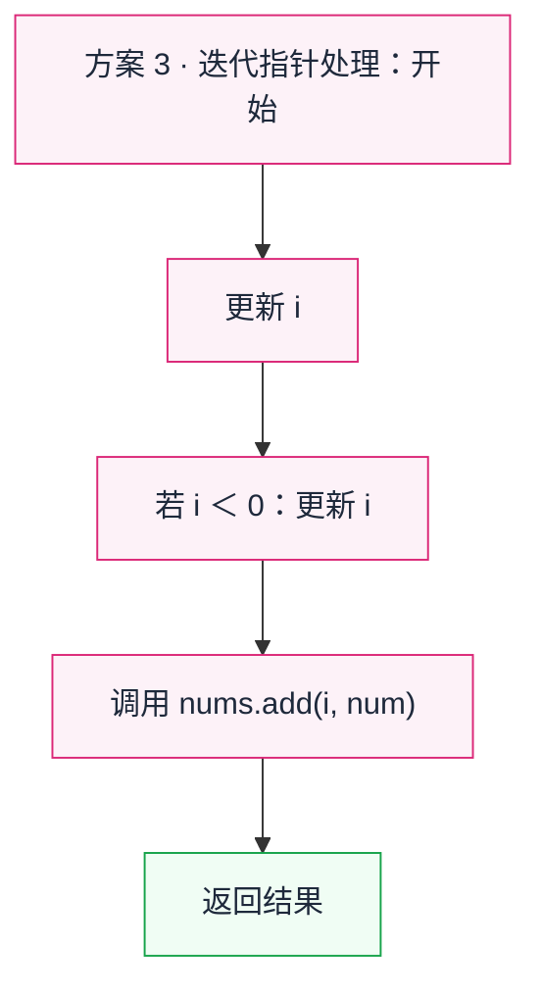

```java
package com.webfault.dsa; // 引入依赖

import java.util.*; // 引入依赖

class lc295_solution333 { // 定义类型
  static class MedianFinder { // static class MedianFinder {
    List<Integer> nums = new ArrayList<>(); // 把 new ArrayList 小于 超过 (); 写入 List<Integer> nums

    void addNum(int num) { // 定义函数/方法 addNum
      int i = Collections.binarySearch(nums, num); // 把 Collections.binarySearch(数组, num) 存入 下标 i
      if (i < 0) i = -i - 1; // 若 下标 i 小于 0) 下标 i 赋值为 减 下标 i 减 1;
      nums.add(i, num); // 数组 追加 下标 i, num);
    }

    Double findMedian() { // 定义函数/方法 findMedian
      int n = nums.size(); // 把 数组.大小() 存入 元素个数
      if (n == 0) return null; // 若 元素个数 等于 0，直接返回 null
      if (n % 2 == 1)
        return (double) nums.get(n / 2); // 若 元素个数 对…取模 2 等于 1，直接返回 (double) 数组 查找 元素个数 除以 2)
      return (nums.get(n / 2 - 1) + nums.get(n / 2))
          / 2.0; // 返回 (数组 查找 元素个数 除以 2 减 1) 加 数组 查找 元素个数 除以 2)) 除以 2.0
    }
  }

  public static void main(String[] args) { // public static void main(String[] args) {
    MedianFinder mf = new MedianFinder(); // 把 new MedianFinder(); 写入 MedianFinder mf
    for (int x : new int[] {1, 2, 3, 4, 5})
      mf.addNum(x); // for (int x : new int[]{1, 2, 3, 4, 5}) mf.addNum(x);
    Double got = mf.findMedian(); // 把 mf.findMedian(); 写入 Double got
    if (got == null || got != 3.0) throw new RuntimeException("FAILED: got " + got + " want 3.0");
    System.out.println("PASS"); // 全部用例通过，输出 PASS
  }
}
```

### Rust 实现（3 种方案）

Rust 的全部方案如下，每个方案都内嵌用例自测，可独立运行（老仓库 python/go 文件遵循「打印结果」约定）：

#### 方案 1：直接实现

**思路与代码分析**：核心是「直接实现」。Rust 版用所有权移动与切片借用改写同一逻辑，注意 Option 与引用边界。**走读**：方案 1 · 直接实现：开始 → 处理 MedianFinder → 处理 max_h: BinaryHeap::new(), → 处理 min_h: BinaryHeap::new(), → 返回结果。

**运行架构**（真实控制流）：

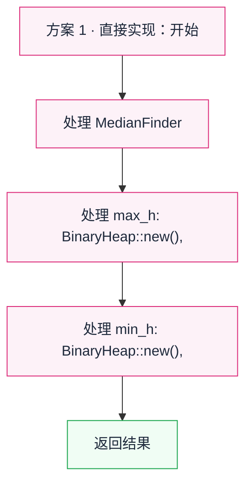

```rust
// LeetCode 295. 数据流的中位数 — Rust 版（方案1）
use std::collections::BinaryHeap; // 引入依赖
struct MedianFinder {
    max_h: BinaryHeap<i32>,
    min_h: std::collections::BinaryHeap<std::cmp::Reverse<i32>>,
} // 定义类型
impl MedianFinder {
    // 实现块
    fn new() -> Self {
        MedianFinder {
            max_h: BinaryHeap::new(),
            min_h: BinaryHeap::new(),
        }
    } // 定义函数/方法 new
    fn add_num(&mut self, num: i32) {
        // 定义函数/方法 add_num
        if self.max_h.is_empty() || num <= *self.max_h.peek().unwrap() {
            // 若 self.max_h 是否为空 或 num 不超过 乘 self.max_h.peek().unwrap(
            self.max_h.push(num); // 把 num 压入栈/数组尾部
        } else {
            // 否则
            self.min_h.push(std::cmp::Reverse(num)); // 把 std::cmp::Reverse(num 压入栈/数组尾部
        }
        // 平衡：max_h 与 min_h 最多差 1，且 max_h 可以多 1
        if self.max_h.len() > self.min_h.len() + 1 {
            // 若 self.max_h.长度() 超过 self.min_h.长度() 加 1
            let v = self.max_h.pop().unwrap(); // 把 self.max_h 弹出 ).unwrap() 存入 值
            self.min_h.push(std::cmp::Reverse(v)); // 把 std::cmp::Reverse(值 压入栈/数组尾部
        } else if self.min_h.len() > self.max_h.len() {
            // 否则，若 self.min_h.长度() 超过 self.max_h.长度(
            let std::cmp::Reverse(v) = self.min_h.pop().unwrap(); // 弹出栈顶元素
            self.max_h.push(v); // 把 值 压入栈/数组尾部
        }
    }
    fn find_median(&self) -> f64 {
        // 定义函数/方法 find_median
        if self.max_h.len() == self.min_h.len() {
            // 若 self.max_h.长度() 等于 self.min_h.长度(
            (*self.max_h.peek().unwrap() as f64 + self.min_h.peek().unwrap().0 as f64) / 2.0
        } else {
            // 否则
            *self.max_h.peek().unwrap() as f64
        }
    }
}
fn main() {
    // 程序入口：跑内嵌自测用例
    let mut mf = MedianFinder::new(); // 把 MedianFinder::new(); 写入 let mut mf
    for x in [1, 2, 3, 4, 5] {
        mf.add_num(x);
    } // for x in [1, 2, 3, 4, 5] { mf.add_num(x); }
    assert_eq!(mf.find_median(), 3.0); // 断言校验
    let mut mf2 = MedianFinder::new(); // 把 MedianFinder::new(); 写入 let mut mf2
    mf2.add_num(1); // mf2.add_num(1);
    mf2.add_num(2); // mf2.add_num(2);
    assert_eq!(mf2.find_median(), 1.5); // 断言校验
    mf2.add_num(3); // mf2.add_num(3);
    assert_eq!(mf2.find_median(), 2.0); // 断言校验
    println!("PASS"); // 全部用例通过，输出 PASS
}
```

#### 方案 2：直接实现

**思路与代码分析**：核心是「直接实现」。Rust 版用所有权移动与切片借用改写同一逻辑，注意 Option 与引用边界。**走读**：方案 2 · 直接实现：开始 → 处理 MedianFinder → 处理 max_h: BinaryHeap::new(), → 处理 min_h: BinaryHeap::new(), → 返回结果。

**运行架构**（真实控制流）：


```rust
// LeetCode 295. 数据流的中位数 — Rust 版（方案2）
use std::collections::BinaryHeap; // 引入依赖
struct MedianFinder {
    max_h: BinaryHeap<i32>,
    min_h: std::collections::BinaryHeap<std::cmp::Reverse<i32>>,
} // 定义类型
impl MedianFinder {
    // 实现块
    fn new() -> Self {
        MedianFinder {
            max_h: BinaryHeap::new(),
            min_h: BinaryHeap::new(),
        }
    } // 定义函数/方法 new
    fn add_num(&mut self, num: i32) {
        // 定义函数/方法 add_num
        if self.max_h.is_empty() || num <= *self.max_h.peek().unwrap() {
            // 若 self.max_h 是否为空 或 num 不超过 乘 self.max_h.peek().unwrap(
            self.max_h.push(num); // 把 num 压入栈/数组尾部
        } else {
            // 否则
            self.min_h.push(std::cmp::Reverse(num)); // 把 std::cmp::Reverse(num 压入栈/数组尾部
        }
        // 平衡：max_h 与 min_h 最多差 1，且 max_h 可以多 1
        if self.max_h.len() > self.min_h.len() + 1 {
            // 若 self.max_h.长度() 超过 self.min_h.长度() 加 1
            let v = self.max_h.pop().unwrap(); // 把 self.max_h 弹出 ).unwrap() 存入 值
            self.min_h.push(std::cmp::Reverse(v)); // 把 std::cmp::Reverse(值 压入栈/数组尾部
        } else if self.min_h.len() > self.max_h.len() {
            // 否则，若 self.min_h.长度() 超过 self.max_h.长度(
            let std::cmp::Reverse(v) = self.min_h.pop().unwrap(); // 弹出栈顶元素
            self.max_h.push(v); // 把 值 压入栈/数组尾部
        }
    }
    fn find_median(&self) -> f64 {
        // 定义函数/方法 find_median
        if self.max_h.len() == self.min_h.len() {
            // 若 self.max_h.长度() 等于 self.min_h.长度(
            (*self.max_h.peek().unwrap() as f64 + self.min_h.peek().unwrap().0 as f64) / 2.0
        } else {
            // 否则
            *self.max_h.peek().unwrap() as f64
        }
    }
}
fn main() {
    // 程序入口：跑内嵌自测用例
    let mut mf = MedianFinder::new(); // 把 MedianFinder::new(); 写入 let mut mf
    for x in [1, 2, 3, 4, 5] {
        mf.add_num(x);
    } // for x in [1, 2, 3, 4, 5] { mf.add_num(x); }
    assert_eq!(mf.find_median(), 3.0); // 断言校验
    let mut mf2 = MedianFinder::new(); // 把 MedianFinder::new(); 写入 let mut mf2
    mf2.add_num(1); // mf2.add_num(1);
    mf2.add_num(2); // mf2.add_num(2);
    assert_eq!(mf2.find_median(), 1.5); // 断言校验
    mf2.add_num(3); // mf2.add_num(3);
    assert_eq!(mf2.find_median(), 2.0); // 断言校验
    println!("PASS"); // 全部用例通过，输出 PASS
}
```

#### 方案 3：迭代指针处理

**思路与代码分析**：核心是「迭代指针处理」。Rust 版用所有权移动与切片借用改写同一逻辑，注意 Option 与引用边界。**走读**：方案 3 · 迭代指针处理：开始 → 处理 MedianFinder → 处理 max_h: BinaryHeap::new(), → 处理 min_h: BinaryHeap::new(), → 返回结果。

**运行架构**（真实控制流）：

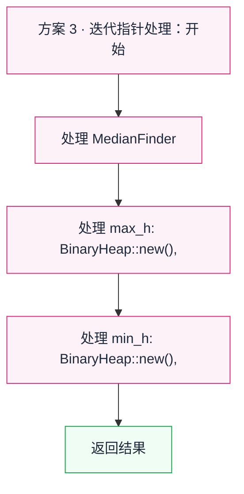

```rust
// LeetCode 295. 数据流的中位数 — Rust 版（方案3）
use std::collections::BinaryHeap; // 引入依赖
struct MedianFinder {
    max_h: BinaryHeap<i32>,
    min_h: std::collections::BinaryHeap<std::cmp::Reverse<i32>>,
} // 定义类型
impl MedianFinder {
    // 实现块
    fn new() -> Self {
        MedianFinder {
            max_h: BinaryHeap::new(),
            min_h: BinaryHeap::new(),
        }
    } // 定义函数/方法 new
    fn add_num(&mut self, num: i32) {
        // 定义函数/方法 add_num
        if self.max_h.is_empty() || num <= *self.max_h.peek().unwrap() {
            // 若 self.max_h 是否为空 或 num 不超过 乘 self.max_h.peek().unwrap(
            self.max_h.push(num); // 把 num 压入栈/数组尾部
        } else {
            // 否则
            self.min_h.push(std::cmp::Reverse(num)); // 把 std::cmp::Reverse(num 压入栈/数组尾部
        }
        // 平衡：max_h 与 min_h 最多差 1，且 max_h 可以多 1
        if self.max_h.len() > self.min_h.len() + 1 {
            // 若 self.max_h.长度() 超过 self.min_h.长度() 加 1
            let v = self.max_h.pop().unwrap(); // 把 self.max_h 弹出 ).unwrap() 存入 值
            self.min_h.push(std::cmp::Reverse(v)); // 把 std::cmp::Reverse(值 压入栈/数组尾部
        } else if self.min_h.len() > self.max_h.len() {
            // 否则，若 self.min_h.长度() 超过 self.max_h.长度(
            let std::cmp::Reverse(v) = self.min_h.pop().unwrap(); // 弹出栈顶元素
            self.max_h.push(v); // 把 值 压入栈/数组尾部
        }
    }
    fn find_median(&self) -> f64 {
        // 定义函数/方法 find_median
        if self.max_h.len() == self.min_h.len() {
            // 若 self.max_h.长度() 等于 self.min_h.长度(
            (*self.max_h.peek().unwrap() as f64 + self.min_h.peek().unwrap().0 as f64) / 2.0
        } else {
            // 否则
            *self.max_h.peek().unwrap() as f64
        }
    }
}
fn main() {
    // 程序入口：跑内嵌自测用例
    let mut mf = MedianFinder::new(); // 把 MedianFinder::new(); 写入 let mut mf
    for x in [1, 2, 3, 4, 5] {
        mf.add_num(x);
    } // for x in [1, 2, 3, 4, 5] { mf.add_num(x); }
    assert_eq!(mf.find_median(), 3.0); // 断言校验
    let mut mf2 = MedianFinder::new(); // 把 MedianFinder::new(); 写入 let mut mf2
    mf2.add_num(1); // mf2.add_num(1);
    mf2.add_num(2); // mf2.add_num(2);
    assert_eq!(mf2.find_median(), 1.5); // 断言校验
    mf2.add_num(3); // mf2.add_num(3);
    assert_eq!(mf2.find_median(), 2.0); // 断言校验
    println!("PASS"); // 全部用例通过，输出 PASS
}
```

### Lua 实现（3 种方案）

Lua 的全部方案如下，每个方案都内嵌用例自测，可独立运行（老仓库 python/go 文件遵循「打印结果」约定）：

#### 方案 1：直接实现

**思路与代码分析**：核心是「直接实现」。Lua 版用表与 ipairs 遍历，注意 ipairs 遇 nil 即停的语义。**走读**：方案 1 · 直接实现：开始 → 更新 1] → 更新 i → 当 i ＞ 1 do 时反复执行 → 更新 p → 处理 if not less(h[i], h[p]) then → 跳出循环（break） → 更新 h[p] → 更新 i → 返回结果。

**运行架构**（真实控制流）：


```lua
-- LeetCode 295. 数据流的中位数 — Lua 版（方案1）
local MedianFinder = {} -- 把 {} 写入 local MedianFinder
MedianFinder.__index = MedianFinder -- 把 MedianFinder 写入 MedianFinder.__index
function MedianFinder.new() -- function MedianFinder.new()
	return setmetatable({ maxh = {}, minh = {} }, MedianFinder) -- 返回 setmetatable({maxh 赋值为 {}, minh 赋值为 {}}, MedianFinder)
end -- 终点
local function hpush(h, v, less) -- local function hpush(h, 值, less)
	h[#h + 1] = v -- 把 值 写入 h[#h + 1]
	local i = #h -- 把 #h 写入 local i
	while i > 1 do -- while 下标 i 超过 1 do
		local p = i // 2 -- 把 下标 i 写入 local p
		if not less(h[i], h[p]) then
			break
		end -- 若 not less(h[下标 i], h[节点]) then break 终点
		h[i], h[p] = h[p], h[i] -- 把 h[节点], h[下标 i] 写入 h[i], h[p]
		i = p -- 把 节点 存入 下标 i
	end -- 终点
end -- 终点
local function hpop(h, less) -- local function hpop(h, less)
	local top = h[1] -- 把 h[1] 写入 local top
	h[1] = h[#h] -- 把 h[#h] 写入 h[1]
	h[#h] = nil -- 把 nil 写入 h[#h]
	local i, n = 1, #h -- 把 1, #h 写入 local i, n
	while true do -- while true do
		local l, r, m = 2 * i, 2 * i + 1, i -- 把 2 乘 下标 i, 2 乘 下标 i 加 1, 下标 i 写入 local l, r, m
		if l <= n and less(h[l], h[m]) then
			m = l
		end -- 若 左指针 不超过 元素个数 and less(h[左指针], h[映射表]) then 映射表 赋值为 左指针 终点
		if r <= n and less(h[r], h[m]) then
			m = r
		end -- 若 右指针 不超过 元素个数 and less(h[右指针], h[映射表]) then 映射表 赋值为 右指针 终点
		if m == i then
			break
		end -- 若 映射表 等于 下标 i then break 终点
		h[i], h[m] = h[m], h[i] -- 把 h[映射表], h[下标 i] 写入 h[i], h[m]
		i = m -- 把 映射表 存入 下标 i
	end -- 终点
	return top -- 返回 top
end -- 终点
function MedianFinder:add_num(num) -- function MedianFinder:add_num(num)
	if #self.maxh == 0 or num <= self.maxh[1] then -- 若 #self.maxh 等于 0 or num 不超过 self.maxh[1] then
		hpush(self.maxh, num, function(a, b)
			return a > b
		end) -- hpush(self.maxh, num, function(数组, b) return 数组 超过 b 终点)
	else -- 否则
		hpush(self.minh, num, function(a, b)
			return a < b
		end) -- hpush(self.minh, num, function(数组, b) return 数组 小于 b 终点)
	end -- 终点
	if #self.maxh > #self.minh + 1 then -- 若 #self.maxh 超过 #self.minh 加 1 then
		hpush(
			self.minh,
			hpop(self.maxh, function(a, b)
				return a > b
			end),
			function(a, b)
				return a < b
			end
		)
	elseif #self.minh > #self.maxh then -- elseif #self.minh 超过 #self.maxh then
		hpush(
			self.maxh,
			hpop(self.minh, function(a, b)
				return a < b
			end),
			function(a, b)
				return a > b
			end
		)
	end -- 终点
end -- 终点
function MedianFinder:find_median() -- function MedianFinder:find_median()
	if #self.maxh == #self.minh then -- 若 #self.maxh 等于 #self.minh then
		return (self.maxh[1] + self.minh[1]) / 2 -- 返回 (self.maxh[1] 加 self.minh[1]) 除以 2
	end -- 终点
	return self.maxh[1] -- 返回 self.maxh[1]
end -- 终点
local mf = MedianFinder.new() -- 把 MedianFinder.new() 写入 local mf
for _, x in ipairs({ 1, 2, 3, 4, 5 }) do
	mf:add_num(x)
end -- 遍历取 x
assert(mf:find_median() == 3) -- 断言校验
local mf2 = MedianFinder.new() -- 把 MedianFinder.new() 写入 local mf2
mf2:add_num(1)
mf2:add_num(2) -- mf2:add_num(1); mf2:add_num(2)
assert(mf2:find_median() == 1.5) -- 断言校验
mf2:add_num(3) -- mf2:add_num(3)
assert(mf2:find_median() == 2) -- 断言校验
print("PASS") -- 全部用例通过，输出 PASS
```

#### 方案 2：直接实现

**思路与代码分析**：核心是「直接实现」。Lua 版用表与 ipairs 遍历，注意 ipairs 遇 nil 即停的语义。**走读**：方案 2 · 直接实现：开始 → 更新 1] → 更新 i → 当 i ＞ 1 do 时反复执行 → 更新 p → 处理 if not less(h[i], h[p]) then → 跳出循环（break） → 更新 h[p] → 更新 i → 返回结果。

**运行架构**（真实控制流）：

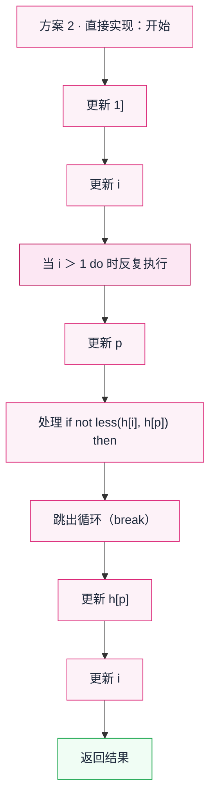

```lua
-- LeetCode 295. 数据流的中位数 — Lua 版（方案2）
local MedianFinder = {} -- 把 {} 写入 local MedianFinder
MedianFinder.__index = MedianFinder -- 把 MedianFinder 写入 MedianFinder.__index
function MedianFinder.new() -- function MedianFinder.new()
	return setmetatable({ maxh = {}, minh = {} }, MedianFinder) -- 返回 setmetatable({maxh 赋值为 {}, minh 赋值为 {}}, MedianFinder)
end -- 终点
local function hpush(h, v, less) -- local function hpush(h, 值, less)
	h[#h + 1] = v -- 把 值 写入 h[#h + 1]
	local i = #h -- 把 #h 写入 local i
	while i > 1 do -- while 下标 i 超过 1 do
		local p = i // 2 -- 把 下标 i 写入 local p
		if not less(h[i], h[p]) then
			break
		end -- 若 not less(h[下标 i], h[节点]) then break 终点
		h[i], h[p] = h[p], h[i] -- 把 h[节点], h[下标 i] 写入 h[i], h[p]
		i = p -- 把 节点 存入 下标 i
	end -- 终点
end -- 终点
local function hpop(h, less) -- local function hpop(h, less)
	local top = h[1] -- 把 h[1] 写入 local top
	h[1] = h[#h] -- 把 h[#h] 写入 h[1]
	h[#h] = nil -- 把 nil 写入 h[#h]
	local i, n = 1, #h -- 把 1, #h 写入 local i, n
	while true do -- while true do
		local l, r, m = 2 * i, 2 * i + 1, i -- 把 2 乘 下标 i, 2 乘 下标 i 加 1, 下标 i 写入 local l, r, m
		if l <= n and less(h[l], h[m]) then
			m = l
		end -- 若 左指针 不超过 元素个数 and less(h[左指针], h[映射表]) then 映射表 赋值为 左指针 终点
		if r <= n and less(h[r], h[m]) then
			m = r
		end -- 若 右指针 不超过 元素个数 and less(h[右指针], h[映射表]) then 映射表 赋值为 右指针 终点
		if m == i then
			break
		end -- 若 映射表 等于 下标 i then break 终点
		h[i], h[m] = h[m], h[i] -- 把 h[映射表], h[下标 i] 写入 h[i], h[m]
		i = m -- 把 映射表 存入 下标 i
	end -- 终点
	return top -- 返回 top
end -- 终点
function MedianFinder:add_num(num) -- function MedianFinder:add_num(num)
	if #self.maxh == 0 or num <= self.maxh[1] then -- 若 #self.maxh 等于 0 or num 不超过 self.maxh[1] then
		hpush(self.maxh, num, function(a, b)
			return a > b
		end) -- hpush(self.maxh, num, function(数组, b) return 数组 超过 b 终点)
	else -- 否则
		hpush(self.minh, num, function(a, b)
			return a < b
		end) -- hpush(self.minh, num, function(数组, b) return 数组 小于 b 终点)
	end -- 终点
	if #self.maxh > #self.minh + 1 then -- 若 #self.maxh 超过 #self.minh 加 1 then
		hpush(
			self.minh,
			hpop(self.maxh, function(a, b)
				return a > b
			end),
			function(a, b)
				return a < b
			end
		)
	elseif #self.minh > #self.maxh then -- elseif #self.minh 超过 #self.maxh then
		hpush(
			self.maxh,
			hpop(self.minh, function(a, b)
				return a < b
			end),
			function(a, b)
				return a > b
			end
		)
	end -- 终点
end -- 终点
function MedianFinder:find_median() -- function MedianFinder:find_median()
	if #self.maxh == #self.minh then -- 若 #self.maxh 等于 #self.minh then
		return (self.maxh[1] + self.minh[1]) / 2 -- 返回 (self.maxh[1] 加 self.minh[1]) 除以 2
	end -- 终点
	return self.maxh[1] -- 返回 self.maxh[1]
end -- 终点
local mf = MedianFinder.new() -- 把 MedianFinder.new() 写入 local mf
for _, x in ipairs({ 1, 2, 3, 4, 5 }) do
	mf:add_num(x)
end -- 遍历取 x
assert(mf:find_median() == 3) -- 断言校验
local mf2 = MedianFinder.new() -- 把 MedianFinder.new() 写入 local mf2
mf2:add_num(1)
mf2:add_num(2) -- mf2:add_num(1); mf2:add_num(2)
assert(mf2:find_median() == 1.5) -- 断言校验
mf2:add_num(3) -- mf2:add_num(3)
assert(mf2:find_median() == 2) -- 断言校验
print("PASS") -- 全部用例通过，输出 PASS
```

#### 方案 3：迭代指针处理

**思路与代码分析**：核心是「迭代指针处理」。Lua 版用表与 ipairs 遍历，注意 ipairs 遇 nil 即停的语义。**走读**：方案 3 · 迭代指针处理：开始 → 更新 1] → 更新 i → 当 i ＞ 1 do 时反复执行 → 更新 p → 处理 if not less(h[i], h[p]) then → 跳出循环（break） → 更新 h[p] → 更新 i → 返回结果。

**运行架构**（真实控制流）：

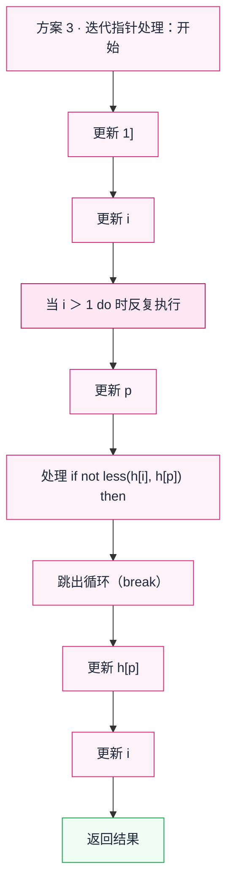

```lua
-- LeetCode 295. 数据流的中位数 — Lua 版（方案3）
local MedianFinder = {} -- 把 {} 写入 local MedianFinder
MedianFinder.__index = MedianFinder -- 把 MedianFinder 写入 MedianFinder.__index
function MedianFinder.new() -- function MedianFinder.new()
	return setmetatable({ maxh = {}, minh = {} }, MedianFinder) -- 返回 setmetatable({maxh 赋值为 {}, minh 赋值为 {}}, MedianFinder)
end -- 终点
local function hpush(h, v, less) -- local function hpush(h, 值, less)
	h[#h + 1] = v -- 把 值 写入 h[#h + 1]
	local i = #h -- 把 #h 写入 local i
	while i > 1 do -- while 下标 i 超过 1 do
		local p = i // 2 -- 把 下标 i 写入 local p
		if not less(h[i], h[p]) then
			break
		end -- 若 not less(h[下标 i], h[节点]) then break 终点
		h[i], h[p] = h[p], h[i] -- 把 h[节点], h[下标 i] 写入 h[i], h[p]
		i = p -- 把 节点 存入 下标 i
	end -- 终点
end -- 终点
local function hpop(h, less) -- local function hpop(h, less)
	local top = h[1] -- 把 h[1] 写入 local top
	h[1] = h[#h] -- 把 h[#h] 写入 h[1]
	h[#h] = nil -- 把 nil 写入 h[#h]
	local i, n = 1, #h -- 把 1, #h 写入 local i, n
	while true do -- while true do
		local l, r, m = 2 * i, 2 * i + 1, i -- 把 2 乘 下标 i, 2 乘 下标 i 加 1, 下标 i 写入 local l, r, m
		if l <= n and less(h[l], h[m]) then
			m = l
		end -- 若 左指针 不超过 元素个数 and less(h[左指针], h[映射表]) then 映射表 赋值为 左指针 终点
		if r <= n and less(h[r], h[m]) then
			m = r
		end -- 若 右指针 不超过 元素个数 and less(h[右指针], h[映射表]) then 映射表 赋值为 右指针 终点
		if m == i then
			break
		end -- 若 映射表 等于 下标 i then break 终点
		h[i], h[m] = h[m], h[i] -- 把 h[映射表], h[下标 i] 写入 h[i], h[m]
		i = m -- 把 映射表 存入 下标 i
	end -- 终点
	return top -- 返回 top
end -- 终点
function MedianFinder:add_num(num) -- function MedianFinder:add_num(num)
	if #self.maxh == 0 or num <= self.maxh[1] then -- 若 #self.maxh 等于 0 or num 不超过 self.maxh[1] then
		hpush(self.maxh, num, function(a, b)
			return a > b
		end) -- hpush(self.maxh, num, function(数组, b) return 数组 超过 b 终点)
	else -- 否则
		hpush(self.minh, num, function(a, b)
			return a < b
		end) -- hpush(self.minh, num, function(数组, b) return 数组 小于 b 终点)
	end -- 终点
	if #self.maxh > #self.minh + 1 then -- 若 #self.maxh 超过 #self.minh 加 1 then
		hpush(
			self.minh,
			hpop(self.maxh, function(a, b)
				return a > b
			end),
			function(a, b)
				return a < b
			end
		)
	elseif #self.minh > #self.maxh then -- elseif #self.minh 超过 #self.maxh then
		hpush(
			self.maxh,
			hpop(self.minh, function(a, b)
				return a < b
			end),
			function(a, b)
				return a > b
			end
		)
	end -- 终点
end -- 终点
function MedianFinder:find_median() -- function MedianFinder:find_median()
	if #self.maxh == #self.minh then -- 若 #self.maxh 等于 #self.minh then
		return (self.maxh[1] + self.minh[1]) / 2 -- 返回 (self.maxh[1] 加 self.minh[1]) 除以 2
	end -- 终点
	return self.maxh[1] -- 返回 self.maxh[1]
end -- 终点
local mf = MedianFinder.new() -- 把 MedianFinder.new() 写入 local mf
for _, x in ipairs({ 1, 2, 3, 4, 5 }) do
	mf:add_num(x)
end -- 遍历取 x
assert(mf:find_median() == 3) -- 断言校验
local mf2 = MedianFinder.new() -- 把 MedianFinder.new() 写入 local mf2
mf2:add_num(1)
mf2:add_num(2) -- mf2:add_num(1); mf2:add_num(2)
assert(mf2:find_median() == 1.5) -- 断言校验
mf2:add_num(3) -- mf2:add_num(3)
assert(mf2:find_median() == 2) -- 断言校验
print("PASS") -- 全部用例通过，输出 PASS
```

### C 实现（3 种方案）

C 的全部方案如下，每个方案都内嵌用例自测，可独立运行（老仓库 python/go 文件遵循「打印结果」约定）：

#### 方案 1：直接实现

**思路与代码分析**：核心是「直接实现」。C 版手动管理下标与内存，循环边界全部显式写出。**走读**：方案 1 · 直接实现：开始 → 若 nmax == 0 或 num ≤ maxh[1]：调用 push_maxh(num) → 调用 push_maxh(num) → 调用 push_minh(num) → 若 nmax ＞ nmin + 1：调用 push_minh(pop_maxh()) → 调用 push_minh(pop_maxh()) → 调用 push_maxh(pop_minh()) → 返回结果。

**运行架构**（真实控制流）：

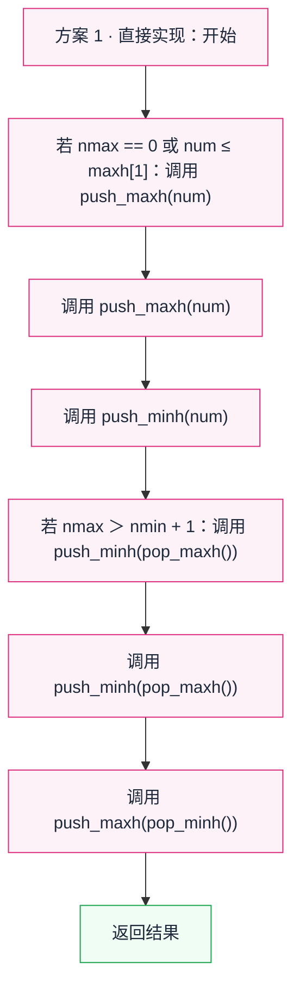

```c
/* LeetCode 295. 数据流的中位数 — C 版（方案1） */
#include <stdio.h> // 引入头文件
/* 双堆：maxh 大根堆（存较小半），minh 小根堆（存较大半） */
static int maxh[8192], minhd[8192]; // static int maxh[8192], minhd[8192];
static int nmax, nmin;              // static int nmax, nmin;
static void push_maxh(int v) {      // 定义函数/方法 push_maxh
    maxh[++nmax] = v;               // 把 值; 写入 maxh[++nmax]
    int i = nmax;                   // 把 nmax 存入 下标 i
    while (i > 1 && maxh[i] > maxh[i / 2]) {
        int t = maxh[i];
        maxh[i] = maxh[i / 2];
        maxh[i / 2] = t;
        i /= 2;
    }
}
static void push_minh(int v) { // 定义函数/方法 push_minh
    minhd[++nmin] = v;         // 把 值; 写入 minhd[++nmin]
    int i = nmin;              // 把 nmin 存入 下标 i
    while (i > 1 && minhd[i] < minhd[i / 2]) {
        int t = minhd[i];
        minhd[i] = minhd[i / 2];
        minhd[i / 2] = t;
        i /= 2;
    }
}
static int pop_maxh(void) { // 定义函数/方法 pop_maxh
    int top = maxh[1];      // 把 maxh[1] 存入 top
    maxh[1] = maxh[nmax--]; // 把 maxh[nmax 减一 ]; 写入 maxh[1]
    int i = 1;              // 把 1 存入 下标 i
    while (1) {             // 循环，直到不满足「1」
        int l = 2 * i, r = 2 * i + 1,
            m = i; // 把 2 乘 下标 i, 右指针 赋值为 2 乘 下标 i 加 1, 映射表 赋值为 下标 i 存入 左指针
        if (l <= nmax && maxh[l] > maxh[m])
            m = l; // 若 左指针 不超过 nmax 且 maxh[左指针] 超过 maxh[映射表]) 映射表 赋值为 左指针;
        if (r <= nmax && maxh[r] > maxh[m])
            m = r; // 若 右指针 不超过 nmax 且 maxh[右指针] 超过 maxh[映射表]) 映射表 赋值为 右指针;
        if (m == i)
            break; // 若 映射表 等于 下标 i) break;
        int t = maxh[i];
        maxh[i] = maxh[m];
        maxh[m] = t;
        i = m;
    }
    return top; // 返回 top
}
static int pop_minh(void) {   // 定义函数/方法 pop_minh
    int top = minhd[1];       // 把 minhd[1] 存入 top
    minhd[1] = minhd[nmin--]; // 把 minhd[nmin 减一 ]; 写入 minhd[1]
    int i = 1;                // 把 1 存入 下标 i
    while (1) {               // 循环，直到不满足「1」
        int l = 2 * i, r = 2 * i + 1,
            m = i; // 把 2 乘 下标 i, 右指针 赋值为 2 乘 下标 i 加 1, 映射表 赋值为 下标 i 存入 左指针
        if (l <= nmin && minhd[l] < minhd[m])
            m = l; // 若 左指针 不超过 nmin 且 minhd[左指针] 小于 minhd[映射表]) 映射表 赋值为 左指针;
        if (r <= nmin && minhd[r] < minhd[m])
            m = r; // 若 右指针 不超过 nmin 且 minhd[右指针] 小于 minhd[映射表]) 映射表 赋值为 右指针;
        if (m == i)
            break; // 若 映射表 等于 下标 i) break;
        int t = minhd[i];
        minhd[i] = minhd[m];
        minhd[m] = t;
        i = m;
    }
    return top; // 返回 top
}
static void mf_add(int num) { // 定义函数/方法 mf_add
    if (nmax == 0 || num <= maxh[1])
        push_maxh(num); // 若 nmax 等于 0 或 num 不超过 maxh[1]) push_maxh(num);
    else
        push_minh(num); // 否则
    if (nmax > nmin + 1)
        push_minh(pop_maxh()); // 若 nmax 超过 nmin 加 1) push_minh(pop_maxh());
    else if (nmin > nmax)
        push_maxh(pop_minh()); // 否则，若 nmin 超过 nmax) push_maxh(pop_minh());
}
static double mf_median(void) { // 定义函数/方法 mf_median
    if (nmax == nmin)
        return (maxh[1] + minhd[1]) / 2.0; // 若 nmax 等于 nmin，直接返回 (maxh[1] 加 minhd[1]) 除以 2.0
    return maxh[1];                        // 返回 maxh[1]
}
int main(void) {                // 程序入口：跑内嵌自测用例
    nmax = nmin = 0;            // 把 nmin 赋值为 0; 写入 nmax
    int xs[] = {1, 2, 3, 4, 5}; // 把 {1, 2, 3, 4, 5}; 写入 int xs[]
    for (int i = 0; i < 5; i++)
        mf_add(xs[i]); // 让 下标 i 从 0 开始计数，下标 i 小于 5 就继续
    if (mf_median() != 3.0) {
        printf("FAIL 1\n");
        return 1;
    }                // 若 mf_median() 不等于 3.0) { 输出「FAIL 1 」); return 1; }
    nmax = nmin = 0; // 把 nmin 赋值为 0; 写入 nmax
    mf_add(1);
    mf_add(2); // mf_add(1); mf_add(2);
    if (mf_median() != 1.5) {
        printf("FAIL 2\n");
        return 1;
    }          // 若 mf_median() 不等于 1.5) { 输出「FAIL 2 」); return 1; }
    mf_add(3); // mf_add(3);
    if (mf_median() != 2.0) {
        printf("FAIL 3\n");
        return 1;
    }                 // 若 mf_median() 不等于 2.0) { 输出「FAIL 3 」); return 1; }
    printf("PASS\n"); // 全部用例通过，输出 PASS
    return 0;         // 返回 0
}
```

#### 方案 2：直接实现

**思路与代码分析**：核心是「直接实现」。C 版手动管理下标与内存，循环边界全部显式写出。**走读**：方案 2 · 直接实现：开始 → 若 nmax == 0 或 num ≤ maxh[1]：调用 push_maxh(num) → 调用 push_maxh(num) → 调用 push_minh(num) → 若 nmax ＞ nmin + 1：调用 push_minh(pop_maxh()) → 调用 push_minh(pop_maxh()) → 调用 push_maxh(pop_minh()) → 返回结果。

**运行架构**（真实控制流）：


```c
/* LeetCode 295. 数据流的中位数 — C 版（方案2） */
#include <stdio.h> // 引入头文件
/* 双堆：maxh 大根堆（存较小半），minh 小根堆（存较大半） */
static int maxh[8192], minhd[8192]; // static int maxh[8192], minhd[8192];
static int nmax, nmin;              // static int nmax, nmin;
static void push_maxh(int v) {      // 定义函数/方法 push_maxh
    maxh[++nmax] = v;               // 把 值; 写入 maxh[++nmax]
    int i = nmax;                   // 把 nmax 存入 下标 i
    while (i > 1 && maxh[i] > maxh[i / 2]) {
        int t = maxh[i];
        maxh[i] = maxh[i / 2];
        maxh[i / 2] = t;
        i /= 2;
    }
}
static void push_minh(int v) { // 定义函数/方法 push_minh
    minhd[++nmin] = v;         // 把 值; 写入 minhd[++nmin]
    int i = nmin;              // 把 nmin 存入 下标 i
    while (i > 1 && minhd[i] < minhd[i / 2]) {
        int t = minhd[i];
        minhd[i] = minhd[i / 2];
        minhd[i / 2] = t;
        i /= 2;
    }
}
static int pop_maxh(void) { // 定义函数/方法 pop_maxh
    int top = maxh[1];      // 把 maxh[1] 存入 top
    maxh[1] = maxh[nmax--]; // 把 maxh[nmax 减一 ]; 写入 maxh[1]
    int i = 1;              // 把 1 存入 下标 i
    while (1) {             // 循环，直到不满足「1」
        int l = 2 * i, r = 2 * i + 1,
            m = i; // 把 2 乘 下标 i, 右指针 赋值为 2 乘 下标 i 加 1, 映射表 赋值为 下标 i 存入 左指针
        if (l <= nmax && maxh[l] > maxh[m])
            m = l; // 若 左指针 不超过 nmax 且 maxh[左指针] 超过 maxh[映射表]) 映射表 赋值为 左指针;
        if (r <= nmax && maxh[r] > maxh[m])
            m = r; // 若 右指针 不超过 nmax 且 maxh[右指针] 超过 maxh[映射表]) 映射表 赋值为 右指针;
        if (m == i)
            break; // 若 映射表 等于 下标 i) break;
        int t = maxh[i];
        maxh[i] = maxh[m];
        maxh[m] = t;
        i = m;
    }
    return top; // 返回 top
}
static int pop_minh(void) {   // 定义函数/方法 pop_minh
    int top = minhd[1];       // 把 minhd[1] 存入 top
    minhd[1] = minhd[nmin--]; // 把 minhd[nmin 减一 ]; 写入 minhd[1]
    int i = 1;                // 把 1 存入 下标 i
    while (1) {               // 循环，直到不满足「1」
        int l = 2 * i, r = 2 * i + 1,
            m = i; // 把 2 乘 下标 i, 右指针 赋值为 2 乘 下标 i 加 1, 映射表 赋值为 下标 i 存入 左指针
        if (l <= nmin && minhd[l] < minhd[m])
            m = l; // 若 左指针 不超过 nmin 且 minhd[左指针] 小于 minhd[映射表]) 映射表 赋值为 左指针;
        if (r <= nmin && minhd[r] < minhd[m])
            m = r; // 若 右指针 不超过 nmin 且 minhd[右指针] 小于 minhd[映射表]) 映射表 赋值为 右指针;
        if (m == i)
            break; // 若 映射表 等于 下标 i) break;
        int t = minhd[i];
        minhd[i] = minhd[m];
        minhd[m] = t;
        i = m;
    }
    return top; // 返回 top
}
static void mf_add(int num) { // 定义函数/方法 mf_add
    if (nmax == 0 || num <= maxh[1])
        push_maxh(num); // 若 nmax 等于 0 或 num 不超过 maxh[1]) push_maxh(num);
    else
        push_minh(num); // 否则
    if (nmax > nmin + 1)
        push_minh(pop_maxh()); // 若 nmax 超过 nmin 加 1) push_minh(pop_maxh());
    else if (nmin > nmax)
        push_maxh(pop_minh()); // 否则，若 nmin 超过 nmax) push_maxh(pop_minh());
}
static double mf_median(void) { // 定义函数/方法 mf_median
    if (nmax == nmin)
        return (maxh[1] + minhd[1]) / 2.0; // 若 nmax 等于 nmin，直接返回 (maxh[1] 加 minhd[1]) 除以 2.0
    return maxh[1];                        // 返回 maxh[1]
}
int main(void) {                // 程序入口：跑内嵌自测用例
    nmax = nmin = 0;            // 把 nmin 赋值为 0; 写入 nmax
    int xs[] = {1, 2, 3, 4, 5}; // 把 {1, 2, 3, 4, 5}; 写入 int xs[]
    for (int i = 0; i < 5; i++)
        mf_add(xs[i]); // 让 下标 i 从 0 开始计数，下标 i 小于 5 就继续
    if (mf_median() != 3.0) {
        printf("FAIL 1\n");
        return 1;
    }                // 若 mf_median() 不等于 3.0) { 输出「FAIL 1 」); return 1; }
    nmax = nmin = 0; // 把 nmin 赋值为 0; 写入 nmax
    mf_add(1);
    mf_add(2); // mf_add(1); mf_add(2);
    if (mf_median() != 1.5) {
        printf("FAIL 2\n");
        return 1;
    }          // 若 mf_median() 不等于 1.5) { 输出「FAIL 2 」); return 1; }
    mf_add(3); // mf_add(3);
    if (mf_median() != 2.0) {
        printf("FAIL 3\n");
        return 1;
    }                 // 若 mf_median() 不等于 2.0) { 输出「FAIL 3 」); return 1; }
    printf("PASS\n"); // 全部用例通过，输出 PASS
    return 0;         // 返回 0
}
```

#### 方案 3：迭代指针处理

**思路与代码分析**：核心是「迭代指针处理」。C 版手动管理下标与内存，循环边界全部显式写出。**走读**：方案 3 · 迭代指针处理：开始 → 若 nmax == 0 或 num ≤ maxh[1]：调用 push_maxh(num) → 调用 push_maxh(num) → 调用 push_minh(num) → 若 nmax ＞ nmin + 1：调用 push_minh(pop_maxh()) → 调用 push_minh(pop_maxh()) → 调用 push_maxh(pop_minh()) → 返回结果。

**运行架构**（真实控制流）：

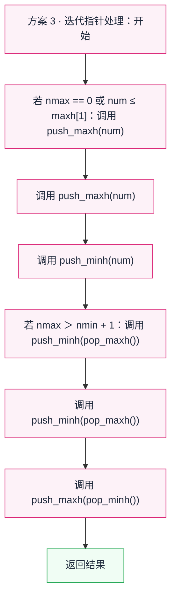

```c
/* LeetCode 295. 数据流的中位数 — C 版（方案3） */
#include <stdio.h> // 引入头文件
/* 双堆：maxh 大根堆（存较小半），minh 小根堆（存较大半） */
static int maxh[8192], minhd[8192]; // static int maxh[8192], minhd[8192];
static int nmax, nmin;              // static int nmax, nmin;
static void push_maxh(int v) {      // 定义函数/方法 push_maxh
    maxh[++nmax] = v;               // 把 值; 写入 maxh[++nmax]
    int i = nmax;                   // 把 nmax 存入 下标 i
    while (i > 1 && maxh[i] > maxh[i / 2]) {
        int t = maxh[i];
        maxh[i] = maxh[i / 2];
        maxh[i / 2] = t;
        i /= 2;
    }
}
static void push_minh(int v) { // 定义函数/方法 push_minh
    minhd[++nmin] = v;         // 把 值; 写入 minhd[++nmin]
    int i = nmin;              // 把 nmin 存入 下标 i
    while (i > 1 && minhd[i] < minhd[i / 2]) {
        int t = minhd[i];
        minhd[i] = minhd[i / 2];
        minhd[i / 2] = t;
        i /= 2;
    }
}
static int pop_maxh(void) { // 定义函数/方法 pop_maxh
    int top = maxh[1];      // 把 maxh[1] 存入 top
    maxh[1] = maxh[nmax--]; // 把 maxh[nmax 减一 ]; 写入 maxh[1]
    int i = 1;              // 把 1 存入 下标 i
    while (1) {             // 循环，直到不满足「1」
        int l = 2 * i, r = 2 * i + 1,
            m = i; // 把 2 乘 下标 i, 右指针 赋值为 2 乘 下标 i 加 1, 映射表 赋值为 下标 i 存入 左指针
        if (l <= nmax && maxh[l] > maxh[m])
            m = l; // 若 左指针 不超过 nmax 且 maxh[左指针] 超过 maxh[映射表]) 映射表 赋值为 左指针;
        if (r <= nmax && maxh[r] > maxh[m])
            m = r; // 若 右指针 不超过 nmax 且 maxh[右指针] 超过 maxh[映射表]) 映射表 赋值为 右指针;
        if (m == i)
            break; // 若 映射表 等于 下标 i) break;
        int t = maxh[i];
        maxh[i] = maxh[m];
        maxh[m] = t;
        i = m;
    }
    return top; // 返回 top
}
static int pop_minh(void) {   // 定义函数/方法 pop_minh
    int top = minhd[1];       // 把 minhd[1] 存入 top
    minhd[1] = minhd[nmin--]; // 把 minhd[nmin 减一 ]; 写入 minhd[1]
    int i = 1;                // 把 1 存入 下标 i
    while (1) {               // 循环，直到不满足「1」
        int l = 2 * i, r = 2 * i + 1,
            m = i; // 把 2 乘 下标 i, 右指针 赋值为 2 乘 下标 i 加 1, 映射表 赋值为 下标 i 存入 左指针
        if (l <= nmin && minhd[l] < minhd[m])
            m = l; // 若 左指针 不超过 nmin 且 minhd[左指针] 小于 minhd[映射表]) 映射表 赋值为 左指针;
        if (r <= nmin && minhd[r] < minhd[m])
            m = r; // 若 右指针 不超过 nmin 且 minhd[右指针] 小于 minhd[映射表]) 映射表 赋值为 右指针;
        if (m == i)
            break; // 若 映射表 等于 下标 i) break;
        int t = minhd[i];
        minhd[i] = minhd[m];
        minhd[m] = t;
        i = m;
    }
    return top; // 返回 top
}
static void mf_add(int num) { // 定义函数/方法 mf_add
    if (nmax == 0 || num <= maxh[1])
        push_maxh(num); // 若 nmax 等于 0 或 num 不超过 maxh[1]) push_maxh(num);
    else
        push_minh(num); // 否则
    if (nmax > nmin + 1)
        push_minh(pop_maxh()); // 若 nmax 超过 nmin 加 1) push_minh(pop_maxh());
    else if (nmin > nmax)
        push_maxh(pop_minh()); // 否则，若 nmin 超过 nmax) push_maxh(pop_minh());
}
static double mf_median(void) { // 定义函数/方法 mf_median
    if (nmax == nmin)
        return (maxh[1] + minhd[1]) / 2.0; // 若 nmax 等于 nmin，直接返回 (maxh[1] 加 minhd[1]) 除以 2.0
    return maxh[1];                        // 返回 maxh[1]
}
int main(void) {                // 程序入口：跑内嵌自测用例
    nmax = nmin = 0;            // 把 nmin 赋值为 0; 写入 nmax
    int xs[] = {1, 2, 3, 4, 5}; // 把 {1, 2, 3, 4, 5}; 写入 int xs[]
    for (int i = 0; i < 5; i++)
        mf_add(xs[i]); // 让 下标 i 从 0 开始计数，下标 i 小于 5 就继续
    if (mf_median() != 3.0) {
        printf("FAIL 1\n");
        return 1;
    }                // 若 mf_median() 不等于 3.0) { 输出「FAIL 1 」); return 1; }
    nmax = nmin = 0; // 把 nmin 赋值为 0; 写入 nmax
    mf_add(1);
    mf_add(2); // mf_add(1); mf_add(2);
    if (mf_median() != 1.5) {
        printf("FAIL 2\n");
        return 1;
    }          // 若 mf_median() 不等于 1.5) { 输出「FAIL 2 」); return 1; }
    mf_add(3); // mf_add(3);
    if (mf_median() != 2.0) {
        printf("FAIL 3\n");
        return 1;
    }                 // 若 mf_median() 不等于 2.0) { 输出「FAIL 3 」); return 1; }
    printf("PASS\n"); // 全部用例通过，输出 PASS
    return 0;         // 返回 0
}
```

### C++ 实现（3 种方案）

C++ 的全部方案如下，每个方案都内嵌用例自测，可独立运行（老仓库 python/go 文件遵循「打印结果」约定）：

#### 方案 1：直接实现

**思路与代码分析**：核心是「直接实现」。C++ 版用 STL 容器与迭代器，减少手写下标错误。代码里依次做这些事：栈的后进先出操作。**走读**：方案 1 · 直接实现：开始 → 若 maxH.empty() 或 num ≤ maxH.top()：向 maxH 追加记录 → 向 maxH 追加记录 → 向 minH 追加记录 → 若 maxH.size() ＞ minH.size() + 1 则： → 向 minH 追加记录 → 从 maxH 弹出 → 向 maxH 追加记录 → 从 minH 弹出 → 返回结果。

**运行架构**（真实控制流）：

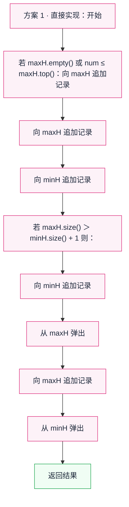

```cpp
// LeetCode 295. 数据流的中位数 — C++ 版（方案1）
#include <cassert>                 // 引入头文件
#include <cstdio>                  // 引入头文件
#include <iostream>                // 引入头文件
#include <queue>                   // 引入头文件
struct MedianFinder {              // 定义类型
    std::priority_queue<int> maxH; // std::priority_queue 小于 int 超过 maxH;
    std::priority_queue<int, std::vector<int>, std::greater<int>> minH;
    void addNum(int num) { // 定义函数/方法 addNum
        if (maxH.empty() || num <= maxH.top())
            maxH.push(num); // 若 maxH 是否为空 或 num 不超过 maxH.top()) maxH 追加 num);
        else
            minH.push(num); // 否则
        if (maxH.size() > minH.size() + 1) {
            minH.push(maxH.top());
            maxH.pop();
        } else if (minH.size() > maxH.size()) {
            maxH.push(minH.top());
            minH.pop();
        }
    }
    double findMedian() const { // double findMedian() const {
        if (maxH.size() == minH.size())
            return (maxH.top() + minH.top()) / 2.0;
        return maxH.top(); // 返回 maxH.top()
    }
};
int main() {         // 程序入口：跑内嵌自测用例
    MedianFinder mf; // MedianFinder mf;
    for (int x : {1, 2, 3, 4, 5})
        mf.addNum(x);                 // for (int x : {1, 2, 3, 4, 5}) mf.addNum(x);
    assert(mf.findMedian() == 3.0);   // 断言校验
    MedianFinder mf2;                 // MedianFinder mf2;
    mf2.addNum(1);                    // mf2.addNum(1);
    mf2.addNum(2);                    // mf2.addNum(2);
    assert(mf2.findMedian() == 1.5);  // 断言校验
    mf2.addNum(3);                    // mf2.addNum(3);
    assert(mf2.findMedian() == 2.0);  // 断言校验
    std::cout << "PASS" << std::endl; // 全部用例通过，输出 PASS
    return 0;                         // 返回 0
}
```

#### 方案 2：直接实现

**思路与代码分析**：核心是「直接实现」。C++ 版用 STL 容器与迭代器，减少手写下标错误。代码里依次做这些事：栈的后进先出操作。**走读**：方案 2 · 直接实现：开始 → 若 maxH.empty() 或 num ≤ maxH.top()：向 maxH 追加记录 → 向 maxH 追加记录 → 向 minH 追加记录 → 若 maxH.size() ＞ minH.size() + 1 则： → 向 minH 追加记录 → 从 maxH 弹出 → 向 maxH 追加记录 → 从 minH 弹出 → 返回结果。

**运行架构**（真实控制流）：

```mermaid
graph TD
    N0["方案 2 · 直接实现：开始"]
    N1["若 maxH.empty() 或 num ≤ maxH.top()：向 maxH 追加记录"]
    N2["向 maxH 追加记录"]
    N3["向 minH 追加记录"]
    N4["若 maxH.size() ＞ minH.size() + 1 则："]
    N5["向 minH 追加记录"]
    N6["从 maxH 弹出"]
    N7["向 maxH 追加记录"]
    N8["从 minH 弹出"]
    N9["返回结果"]
    N0 --> N1
    N1 --> N2
    N2 --> N3
    N3 --> N4
    N4 --> N5
    N5 --> N6
    N6 --> N7
    N7 --> N8
    N8 --> N9
    classDef n fill:#fdf2f8,stroke:#db2777,color:#1e293b;
    classDef lp fill:#fce7f3,stroke:#be185d,color:#1e293b;
    classDef dc fill:#fef9c3,stroke:#ca8a04,color:#1e293b;
    classDef tm fill:#f0fdf4,stroke:#16a34a,color:#1e293b;
    class N0,N1,N2,N3,N4,N5,N6,N7,N8 n;
    class N9 tm;
```

```cpp
// LeetCode 295. 数据流的中位数 — C++ 版（方案2）
#include <cassert>                 // 引入头文件
#include <cstdio>                  // 引入头文件
#include <iostream>                // 引入头文件
#include <queue>                   // 引入头文件
struct MedianFinder {              // 定义类型
    std::priority_queue<int> maxH; // std::priority_queue 小于 int 超过 maxH;
    std::priority_queue<int, std::vector<int>, std::greater<int>> minH;
    void addNum(int num) { // 定义函数/方法 addNum
        if (maxH.empty() || num <= maxH.top())
            maxH.push(num); // 若 maxH 是否为空 或 num 不超过 maxH.top()) maxH 追加 num);
        else
            minH.push(num); // 否则
        if (maxH.size() > minH.size() + 1) {
            minH.push(maxH.top());
            maxH.pop();
        } else if (minH.size() > maxH.size()) {
            maxH.push(minH.top());
            minH.pop();
        }
    }
    double findMedian() const { // double findMedian() const {
        if (maxH.size() == minH.size())
            return (maxH.top() + minH.top()) / 2.0;
        return maxH.top(); // 返回 maxH.top()
    }
};
int main() {         // 程序入口：跑内嵌自测用例
    MedianFinder mf; // MedianFinder mf;
    for (int x : {1, 2, 3, 4, 5})
        mf.addNum(x);                 // for (int x : {1, 2, 3, 4, 5}) mf.addNum(x);
    assert(mf.findMedian() == 3.0);   // 断言校验
    MedianFinder mf2;                 // MedianFinder mf2;
    mf2.addNum(1);                    // mf2.addNum(1);
    mf2.addNum(2);                    // mf2.addNum(2);
    assert(mf2.findMedian() == 1.5);  // 断言校验
    mf2.addNum(3);                    // mf2.addNum(3);
    assert(mf2.findMedian() == 2.0);  // 断言校验
    std::cout << "PASS" << std::endl; // 全部用例通过，输出 PASS
    return 0;                         // 返回 0
}
```

#### 方案 3：迭代指针处理

**思路与代码分析**：核心是「迭代指针处理」。C++ 版用 STL 容器与迭代器，减少手写下标错误。代码里依次做这些事：栈的后进先出操作。**走读**：方案 3 · 迭代指针处理：开始 → 若 maxH.empty() 或 num ≤ maxH.top()：向 maxH 追加记录 → 向 maxH 追加记录 → 向 minH 追加记录 → 若 maxH.size() ＞ minH.size() + 1 则： → 向 minH 追加记录 → 从 maxH 弹出 → 向 maxH 追加记录 → 从 minH 弹出 → 返回结果。

**运行架构**（真实控制流）：

```mermaid
graph TD
    N0["方案 3 · 迭代指针处理：开始"]
    N1["若 maxH.empty() 或 num ≤ maxH.top()：向 maxH 追加记录"]
    N2["向 maxH 追加记录"]
    N3["向 minH 追加记录"]
    N4["若 maxH.size() ＞ minH.size() + 1 则："]
    N5["向 minH 追加记录"]
    N6["从 maxH 弹出"]
    N7["向 maxH 追加记录"]
    N8["从 minH 弹出"]
    N9["返回结果"]
    N0 --> N1
    N1 --> N2
    N2 --> N3
    N3 --> N4
    N4 --> N5
    N5 --> N6
    N6 --> N7
    N7 --> N8
    N8 --> N9
    classDef n fill:#fdf2f8,stroke:#db2777,color:#1e293b;
    classDef lp fill:#fce7f3,stroke:#be185d,color:#1e293b;
    classDef dc fill:#fef9c3,stroke:#ca8a04,color:#1e293b;
    classDef tm fill:#f0fdf4,stroke:#16a34a,color:#1e293b;
    class N0,N1,N2,N3,N4,N5,N6,N7,N8 n;
    class N9 tm;
```

```cpp
// LeetCode 295. 数据流的中位数 — C++ 版（方案3）
#include <cassert>                 // 引入头文件
#include <cstdio>                  // 引入头文件
#include <iostream>                // 引入头文件
#include <queue>                   // 引入头文件
struct MedianFinder {              // 定义类型
    std::priority_queue<int> maxH; // std::priority_queue 小于 int 超过 maxH;
    std::priority_queue<int, std::vector<int>, std::greater<int>> minH;
    void addNum(int num) { // 定义函数/方法 addNum
        if (maxH.empty() || num <= maxH.top())
            maxH.push(num); // 若 maxH 是否为空 或 num 不超过 maxH.top()) maxH 追加 num);
        else
            minH.push(num); // 否则
        if (maxH.size() > minH.size() + 1) {
            minH.push(maxH.top());
            maxH.pop();
        } else if (minH.size() > maxH.size()) {
            maxH.push(minH.top());
            minH.pop();
        }
    }
    double findMedian() const { // double findMedian() const {
        if (maxH.size() == minH.size())
            return (maxH.top() + minH.top()) / 2.0;
        return maxH.top(); // 返回 maxH.top()
    }
};
int main() {         // 程序入口：跑内嵌自测用例
    MedianFinder mf; // MedianFinder mf;
    for (int x : {1, 2, 3, 4, 5})
        mf.addNum(x);                 // for (int x : {1, 2, 3, 4, 5}) mf.addNum(x);
    assert(mf.findMedian() == 3.0);   // 断言校验
    MedianFinder mf2;                 // MedianFinder mf2;
    mf2.addNum(1);                    // mf2.addNum(1);
    mf2.addNum(2);                    // mf2.addNum(2);
    assert(mf2.findMedian() == 1.5);  // 断言校验
    mf2.addNum(3);                    // mf2.addNum(3);
    assert(mf2.findMedian() == 2.0);  // 断言校验
    std::cout << "PASS" << std::endl; // 全部用例通过，输出 PASS
    return 0;                         // 返回 0
}
```

### R 实现（3 种方案）

R 的全部方案如下，每个方案都内嵌用例自测，可独立运行（老仓库 python/go 文件遵循「打印结果」约定）：

#### 方案 1：直接实现

**思路与代码分析**：核心是「直接实现」。R 版用向量化思维与 1 起始下标，注意 1:n 的降序陷阱。**走读**：方案 1 · 直接实现：开始 → 更新 new.env(parent → 处理 e$low ＜- integer(0) → 处理 e$add_num ＜- function(num) → 处理 e$low ＜＜- sort(c(e$low, num) → 处理 e$find_median ＜- function() → 处理 n ＜- length(e$low) → 命中条件，直接返回 → 若 n%%2 == 1：处理 e$low[(n + 1)/2] else (e$low → 处理 e$low[(n + 1)/2] else (e$low → 处理 e。

**运行架构**（真实控制流）：

```mermaid
graph TD
    N0["方案 1 · 直接实现：开始"]
    N1["更新 new.env(parent"]
    N2["处理 e$low ＜- integer(0)"]
    N3["处理 e$add_num ＜- function(num)"]
    N4["处理 e$low ＜＜- sort(c(e$low, num)"]
    N5["处理 e$find_median ＜- function()"]
    N6["处理 n ＜- length(e$low)"]
    N7{"n == 0 ？"}
    N8["命中条件，直接返回"]
    N9["若 n%%2 == 1：处理 e$low[(n + 1)/2] else (e$low"]
    N10["处理 e$low[(n + 1)/2] else (e$low"]
    N11["处理 e"]
    N0 --> N1
    N1 --> N2
    N2 --> N3
    N3 --> N4
    N4 --> N5
    N5 --> N6
    N6 --> N7
    N7 -- 是 --> N8
    N7 -- 否 --> N9
    N9 --> N10
    N10 --> N11
    classDef n fill:#fdf2f8,stroke:#db2777,color:#1e293b;
    classDef lp fill:#fce7f3,stroke:#be185d,color:#1e293b;
    classDef dc fill:#fef9c3,stroke:#ca8a04,color:#1e293b;
    classDef tm fill:#f0fdf4,stroke:#16a34a,color:#1e293b;
    class N0,N1,N2,N3,N4,N5,N6,N9,N10,N11 n;
    class N7 dc;
    class N8 tm;
```

```r
# 版（方案1） 定义函数 MedianFinder（参数：无）
MedianFinder <- function() {
    e <- new.env(parent = emptyenv())  # 把 new.env(parent 赋值为 emptyenv()) 存入 e
    e$low <- integer(0)  # 排序数组模拟双堆（有序插入）
    e$add_num <- function(num) {
        # 把 function(num) { 存入 e$add_num
        e$low <<- sort(c(e$low, num))  # e$low 小于 小于 减 sort(字符(e$low, num))
    }
    e$find_median <- function() {
        # 把 function() { 存入 e$find_median
        n <- length(e$low)  # 把 长度(e$low) 存入 元素个数
        if (n == 0)
            return(NA)  # 若 元素个数 等于 0) return(NA
        if (n%%2 == 1)
            e$low[(n + 1)/2] else (e$low[n/2] + e$low[n/2 + 1])/2
    }
    e
}
mf <- MedianFinder()  # 把 MedianFinder() 存入 mf
for (x in c(1, 2, 3, 4, 5)) mf$add_num(x)  # for (x in 字符(1, 2, 3, 4, 5)) mf$add_num(x)
stopifnot(mf$find_median() == 3)  # 断言校验
mf2 <- MedianFinder()  # 把 MedianFinder() 存入 mf2
mf2$add_num(1)
mf2$add_num(2)  # mf2$add_num(1); mf2$add_num(2)
stopifnot(mf2$find_median() == 1.5)  # 断言校验
mf2$add_num(3)  # mf2$add_num(3)
stopifnot(mf2$find_median() == 2)  # 断言校验
cat("PASS\n")  # 全部用例通过，输出 PASS
```

#### 方案 2：直接实现

**思路与代码分析**：核心是「直接实现」。R 版用向量化思维与 1 起始下标，注意 1:n 的降序陷阱。**走读**：方案 2 · 直接实现：开始 → 更新 new.env(parent → 处理 e$low ＜- integer(0) → 处理 e$add_num ＜- function(num) → 处理 e$low ＜＜- sort(c(e$low, num) → 处理 e$find_median ＜- function() → 处理 n ＜- length(e$low) → 命中条件，直接返回 → 若 n%%2 == 1：处理 e$low[(n + 1)/2] else (e$low → 处理 e$low[(n + 1)/2] else (e$low → 处理 e。

**运行架构**（真实控制流）：

```mermaid
graph TD
    N0["方案 2 · 直接实现：开始"]
    N1["更新 new.env(parent"]
    N2["处理 e$low ＜- integer(0)"]
    N3["处理 e$add_num ＜- function(num)"]
    N4["处理 e$low ＜＜- sort(c(e$low, num)"]
    N5["处理 e$find_median ＜- function()"]
    N6["处理 n ＜- length(e$low)"]
    N7{"n == 0 ？"}
    N8["命中条件，直接返回"]
    N9["若 n%%2 == 1：处理 e$low[(n + 1)/2] else (e$low"]
    N10["处理 e$low[(n + 1)/2] else (e$low"]
    N11["处理 e"]
    N0 --> N1
    N1 --> N2
    N2 --> N3
    N3 --> N4
    N4 --> N5
    N5 --> N6
    N6 --> N7
    N7 -- 是 --> N8
    N7 -- 否 --> N9
    N9 --> N10
    N10 --> N11
    classDef n fill:#fdf2f8,stroke:#db2777,color:#1e293b;
    classDef lp fill:#fce7f3,stroke:#be185d,color:#1e293b;
    classDef dc fill:#fef9c3,stroke:#ca8a04,color:#1e293b;
    classDef tm fill:#f0fdf4,stroke:#16a34a,color:#1e293b;
    class N0,N1,N2,N3,N4,N5,N6,N9,N10,N11 n;
    class N7 dc;
    class N8 tm;
```

```r
# 版（方案2） 定义函数 MedianFinder（参数：无）
MedianFinder <- function() {
    e <- new.env(parent = emptyenv())  # 把 new.env(parent 赋值为 emptyenv()) 存入 e
    e$low <- integer(0)  # 排序数组模拟双堆（有序插入）
    e$add_num <- function(num) {
        # 把 function(num) { 存入 e$add_num
        e$low <<- sort(c(e$low, num))  # e$low 小于 小于 减 sort(字符(e$low, num))
    }
    e$find_median <- function() {
        # 把 function() { 存入 e$find_median
        n <- length(e$low)  # 把 长度(e$low) 存入 元素个数
        if (n == 0)
            return(NA)  # 若 元素个数 等于 0) return(NA
        if (n%%2 == 1)
            e$low[(n + 1)/2] else (e$low[n/2] + e$low[n/2 + 1])/2
    }
    e
}
mf <- MedianFinder()  # 把 MedianFinder() 存入 mf
for (x in c(1, 2, 3, 4, 5)) mf$add_num(x)  # for (x in 字符(1, 2, 3, 4, 5)) mf$add_num(x)
stopifnot(mf$find_median() == 3)  # 断言校验
mf2 <- MedianFinder()  # 把 MedianFinder() 存入 mf2
mf2$add_num(1)
mf2$add_num(2)  # mf2$add_num(1); mf2$add_num(2)
stopifnot(mf2$find_median() == 1.5)  # 断言校验
mf2$add_num(3)  # mf2$add_num(3)
stopifnot(mf2$find_median() == 2)  # 断言校验
cat("PASS\n")  # 全部用例通过，输出 PASS
```

#### 方案 3：迭代指针处理

**思路与代码分析**：核心是「迭代指针处理」。R 版用向量化思维与 1 起始下标，注意 1:n 的降序陷阱。**走读**：方案 3 · 迭代指针处理：开始 → 更新 new.env(parent → 处理 e$low ＜- integer(0) → 处理 e$add_num ＜- function(num) → 处理 e$low ＜＜- sort(c(e$low, num) → 处理 e$find_median ＜- function() → 处理 n ＜- length(e$low) → 命中条件，直接返回 → 若 n%%2 == 1：处理 e$low[(n + 1)/2] else (e$low → 处理 e$low[(n + 1)/2] else (e$low → 处理 e。

**运行架构**（真实控制流）：

```mermaid
graph TD
    N0["方案 3 · 迭代指针处理：开始"]
    N1["更新 new.env(parent"]
    N2["处理 e$low ＜- integer(0)"]
    N3["处理 e$add_num ＜- function(num)"]
    N4["处理 e$low ＜＜- sort(c(e$low, num)"]
    N5["处理 e$find_median ＜- function()"]
    N6["处理 n ＜- length(e$low)"]
    N7{"n == 0 ？"}
    N8["命中条件，直接返回"]
    N9["若 n%%2 == 1：处理 e$low[(n + 1)/2] else (e$low"]
    N10["处理 e$low[(n + 1)/2] else (e$low"]
    N11["处理 e"]
    N0 --> N1
    N1 --> N2
    N2 --> N3
    N3 --> N4
    N4 --> N5
    N5 --> N6
    N6 --> N7
    N7 -- 是 --> N8
    N7 -- 否 --> N9
    N9 --> N10
    N10 --> N11
    classDef n fill:#fdf2f8,stroke:#db2777,color:#1e293b;
    classDef lp fill:#fce7f3,stroke:#be185d,color:#1e293b;
    classDef dc fill:#fef9c3,stroke:#ca8a04,color:#1e293b;
    classDef tm fill:#f0fdf4,stroke:#16a34a,color:#1e293b;
    class N0,N1,N2,N3,N4,N5,N6,N9,N10,N11 n;
    class N7 dc;
    class N8 tm;
```

```r
# 版（方案3） 定义函数 MedianFinder（参数：无）
MedianFinder <- function() {
    e <- new.env(parent = emptyenv())  # 把 new.env(parent 赋值为 emptyenv()) 存入 e
    e$low <- integer(0)  # 排序数组模拟双堆（有序插入）
    e$add_num <- function(num) {
        # 把 function(num) { 存入 e$add_num
        e$low <<- sort(c(e$low, num))  # e$low 小于 小于 减 sort(字符(e$low, num))
    }
    e$find_median <- function() {
        # 把 function() { 存入 e$find_median
        n <- length(e$low)  # 把 长度(e$low) 存入 元素个数
        if (n == 0)
            return(NA)  # 若 元素个数 等于 0) return(NA
        if (n%%2 == 1)
            e$low[(n + 1)/2] else (e$low[n/2] + e$low[n/2 + 1])/2
    }
    e
}
mf <- MedianFinder()  # 把 MedianFinder() 存入 mf
for (x in c(1, 2, 3, 4, 5)) mf$add_num(x)  # for (x in 字符(1, 2, 3, 4, 5)) mf$add_num(x)
stopifnot(mf$find_median() == 3)  # 断言校验
mf2 <- MedianFinder()  # 把 MedianFinder() 存入 mf2
mf2$add_num(1)
mf2$add_num(2)  # mf2$add_num(1); mf2$add_num(2)
stopifnot(mf2$find_median() == 1.5)  # 断言校验
mf2$add_num(3)  # mf2$add_num(3)
stopifnot(mf2$find_median() == 2)  # 断言校验
cat("PASS\n")  # 全部用例通过，输出 PASS
```

### Zig 实现（3 种方案）

Zig 的全部方案如下，每个方案都内嵌用例自测，可独立运行（老仓库 python/go 文件遵循「打印结果」约定）：

#### 方案 1：直接实现

**思路与代码分析**：核心是「直接实现」。Zig 版显式分配与清零，整型边界处理严格。**走读**：方案 1 · 直接实现：开始 → 返回 .。

**运行架构**（真实控制流）：

```mermaid
graph TD
    N0["方案 1 · 直接实现：开始"]
    N1["返回 ."]
    N0 --> N1
    classDef n fill:#fdf2f8,stroke:#db2777,color:#1e293b;
    classDef lp fill:#fce7f3,stroke:#be185d,color:#1e293b;
    classDef dc fill:#fef9c3,stroke:#ca8a04,color:#1e293b;
    classDef tm fill:#f0fdf4,stroke:#16a34a,color:#1e293b;
    class N0 n;
    class N1 tm;
```

```zig
// LeetCode 295. 数据流的中位数 — Zig 版（方案1）
const std = @import("std"); // 把 @import(「std」) 存入 std
const MedianFinder = struct { // 把 struct { 存入 MedianFinder
    // 有序数组模拟（等价双堆语义）
    items: std.ArrayList(i32),
    fn init(alloc: std.mem.Allocator) MedianFinder { // 定义函数/方法 init
        return .{ .items = std.ArrayList(i32).init(alloc) }; // 返回 { .items 赋值为 std.ArrayList(i32).init(alloc) }
    }
    fn addNum(self: *MedianFinder, num: i32) void { // 定义函数/方法 addNum
        var pos: usize = 0; // 把 0; 写入 var pos: usize
        while (pos < self.items.items.len and self.items.items[pos] < num) pos += 1;
        self.items.insert(pos, num) catch unreachable; // self.items 插入 pos, num) catch unreachable;
    }
    fn findMedian(self: *const MedianFinder) f64 { // 定义函数/方法 findMedian
        const n = self.items.items.len; // 把 self.items.items.长度 存入 元素个数
        if (n % 2 == 1) return @floatFromInt(self.items.items[n / 2]);
        return (@as(f64, @floatFromInt(self.items.items[n / 2 - 1])) + @as(f64, @floatFromInt(self.items.items[n / 2]))) / 2.0;
    }
};
pub fn main() !void { // 程序入口：跑内嵌自测用例
    var arena = std.heap.ArenaAllocator.init(std.heap.page_allocator); // 把 std.堆.ArenaAllocator.init(std.堆.page_allocator) 存入 arena
    defer arena.deinit(); // defer arena.deinit();
    var mf = MedianFinder.init(arena.allocator()); // 把 MedianFinder.init(arena.allocator()) 存入 mf
    for ([_]i32{ 1, 2, 3, 4, 5 }) |x| mf.addNum(x); // for ([_]i32{ 1, 2, 3, 4, 5 }) 按位或 x 按位或 mf.addNum(x);
    if (mf.findMedian() != 3.0) return error.TestFailed; // 若 mf.findMedian() 不等于 3.0，直接返回 error.TestFailed
    var mf2 = MedianFinder.init(arena.allocator()); // 把 MedianFinder.init(arena.allocator()) 存入 mf2
    mf2.addNum(1); // mf2.addNum(1);
    mf2.addNum(2); // mf2.addNum(2);
    if (mf2.findMedian() != 1.5) return error.TestFailed; // 若 mf2.findMedian() 不等于 1.5，直接返回 error.TestFailed
    mf2.addNum(3); // mf2.addNum(3);
    if (mf2.findMedian() != 2.0) return error.TestFailed; // 若 mf2.findMedian() 不等于 2.0，直接返回 error.TestFailed
    std.debug.print("PASS\n", .{}); // 全部用例通过，输出 PASS
}
```

#### 方案 2：直接实现

**思路与代码分析**：核心是「直接实现」。Zig 版显式分配与清零，整型边界处理严格。**走读**：方案 2 · 直接实现：开始 → 返回 .。

**运行架构**（真实控制流）：

```mermaid
graph TD
    N0["方案 2 · 直接实现：开始"]
    N1["返回 ."]
    N0 --> N1
    classDef n fill:#fdf2f8,stroke:#db2777,color:#1e293b;
    classDef lp fill:#fce7f3,stroke:#be185d,color:#1e293b;
    classDef dc fill:#fef9c3,stroke:#ca8a04,color:#1e293b;
    classDef tm fill:#f0fdf4,stroke:#16a34a,color:#1e293b;
    class N0 n;
    class N1 tm;
```

```zig
// LeetCode 295. 数据流的中位数 — Zig 版（方案2）
const std = @import("std"); // 把 @import(「std」) 存入 std
const MedianFinder = struct { // 把 struct { 存入 MedianFinder
    // 有序数组模拟（等价双堆语义）
    items: std.ArrayList(i32),
    fn init(alloc: std.mem.Allocator) MedianFinder { // 定义函数/方法 init
        return .{ .items = std.ArrayList(i32).init(alloc) }; // 返回 { .items 赋值为 std.ArrayList(i32).init(alloc) }
    }
    fn addNum(self: *MedianFinder, num: i32) void { // 定义函数/方法 addNum
        var pos: usize = 0; // 把 0; 写入 var pos: usize
        while (pos < self.items.items.len and self.items.items[pos] < num) pos += 1;
        self.items.insert(pos, num) catch unreachable; // self.items 插入 pos, num) catch unreachable;
    }
    fn findMedian(self: *const MedianFinder) f64 { // 定义函数/方法 findMedian
        const n = self.items.items.len; // 把 self.items.items.长度 存入 元素个数
        if (n % 2 == 1) return @floatFromInt(self.items.items[n / 2]);
        return (@as(f64, @floatFromInt(self.items.items[n / 2 - 1])) + @as(f64, @floatFromInt(self.items.items[n / 2]))) / 2.0;
    }
};
pub fn main() !void { // 程序入口：跑内嵌自测用例
    var arena = std.heap.ArenaAllocator.init(std.heap.page_allocator); // 把 std.堆.ArenaAllocator.init(std.堆.page_allocator) 存入 arena
    defer arena.deinit(); // defer arena.deinit();
    var mf = MedianFinder.init(arena.allocator()); // 把 MedianFinder.init(arena.allocator()) 存入 mf
    for ([_]i32{ 1, 2, 3, 4, 5 }) |x| mf.addNum(x); // for ([_]i32{ 1, 2, 3, 4, 5 }) 按位或 x 按位或 mf.addNum(x);
    if (mf.findMedian() != 3.0) return error.TestFailed; // 若 mf.findMedian() 不等于 3.0，直接返回 error.TestFailed
    var mf2 = MedianFinder.init(arena.allocator()); // 把 MedianFinder.init(arena.allocator()) 存入 mf2
    mf2.addNum(1); // mf2.addNum(1);
    mf2.addNum(2); // mf2.addNum(2);
    if (mf2.findMedian() != 1.5) return error.TestFailed; // 若 mf2.findMedian() 不等于 1.5，直接返回 error.TestFailed
    mf2.addNum(3); // mf2.addNum(3);
    if (mf2.findMedian() != 2.0) return error.TestFailed; // 若 mf2.findMedian() 不等于 2.0，直接返回 error.TestFailed
    std.debug.print("PASS\n", .{}); // 全部用例通过，输出 PASS
}
```

#### 方案 3：迭代指针处理

**思路与代码分析**：核心是「迭代指针处理」。Zig 版显式分配与清零，整型边界处理严格。**走读**：方案 3 · 迭代指针处理：开始 → 返回 .。

**运行架构**（真实控制流）：

```mermaid
graph TD
    N0["方案 3 · 迭代指针处理：开始"]
    N1["返回 ."]
    N0 --> N1
    classDef n fill:#fdf2f8,stroke:#db2777,color:#1e293b;
    classDef lp fill:#fce7f3,stroke:#be185d,color:#1e293b;
    classDef dc fill:#fef9c3,stroke:#ca8a04,color:#1e293b;
    classDef tm fill:#f0fdf4,stroke:#16a34a,color:#1e293b;
    class N0 n;
    class N1 tm;
```

```zig
// LeetCode 295. 数据流的中位数 — Zig 版（方案3）
const std = @import("std"); // 把 @import(「std」) 存入 std
const MedianFinder = struct { // 把 struct { 存入 MedianFinder
    // 有序数组模拟（等价双堆语义）
    items: std.ArrayList(i32),
    fn init(alloc: std.mem.Allocator) MedianFinder { // 定义函数/方法 init
        return .{ .items = std.ArrayList(i32).init(alloc) }; // 返回 { .items 赋值为 std.ArrayList(i32).init(alloc) }
    }
    fn addNum(self: *MedianFinder, num: i32) void { // 定义函数/方法 addNum
        var pos: usize = 0; // 把 0; 写入 var pos: usize
        while (pos < self.items.items.len and self.items.items[pos] < num) pos += 1;
        self.items.insert(pos, num) catch unreachable; // self.items 插入 pos, num) catch unreachable;
    }
    fn findMedian(self: *const MedianFinder) f64 { // 定义函数/方法 findMedian
        const n = self.items.items.len; // 把 self.items.items.长度 存入 元素个数
        if (n % 2 == 1) return @floatFromInt(self.items.items[n / 2]);
        return (@as(f64, @floatFromInt(self.items.items[n / 2 - 1])) + @as(f64, @floatFromInt(self.items.items[n / 2]))) / 2.0;
    }
};
pub fn main() !void { // 程序入口：跑内嵌自测用例
    var arena = std.heap.ArenaAllocator.init(std.heap.page_allocator); // 把 std.堆.ArenaAllocator.init(std.堆.page_allocator) 存入 arena
    defer arena.deinit(); // defer arena.deinit();
    var mf = MedianFinder.init(arena.allocator()); // 把 MedianFinder.init(arena.allocator()) 存入 mf
    for ([_]i32{ 1, 2, 3, 4, 5 }) |x| mf.addNum(x); // for ([_]i32{ 1, 2, 3, 4, 5 }) 按位或 x 按位或 mf.addNum(x);
    if (mf.findMedian() != 3.0) return error.TestFailed; // 若 mf.findMedian() 不等于 3.0，直接返回 error.TestFailed
    var mf2 = MedianFinder.init(arena.allocator()); // 把 MedianFinder.init(arena.allocator()) 存入 mf2
    mf2.addNum(1); // mf2.addNum(1);
    mf2.addNum(2); // mf2.addNum(2);
    if (mf2.findMedian() != 1.5) return error.TestFailed; // 若 mf2.findMedian() 不等于 1.5，直接返回 error.TestFailed
    mf2.addNum(3); // mf2.addNum(3);
    if (mf2.findMedian() != 2.0) return error.TestFailed; // 若 mf2.findMedian() 不等于 2.0，直接返回 error.TestFailed
    std.debug.print("PASS\n", .{}); // 全部用例通过，输出 PASS
}
```

### Dart 实现（3 种方案）

Dart 的全部方案如下，每个方案都内嵌用例自测，可独立运行（老仓库 python/go 文件遵循「打印结果」约定）：

#### 方案 1：直接实现

**思路与代码分析**：核心是「直接实现」。Dart 版用可空类型标注与集合方法，注意空安全。**走读**：方案 1 · 直接实现：开始 → 计算 pos → 当 (pos ＜ _items.length 且 _items[pos] ＜ num) 时反复执行 → 处理 pos++ → 调用 _items.insert(pos, num) → 返回结果。

**运行架构**（真实控制流）：

```mermaid
graph TD
    N0["方案 1 · 直接实现：开始"]
    N1["计算 pos"]
    N2["当 (pos ＜ _items.length 且 _items[pos] ＜ num) 时反复执行"]
    N3["处理 pos++"]
    N4["调用 _items.insert(pos, num)"]
    N5["返回结果"]
    N0 --> N1
    N1 --> N2
    N2 --> N3
    N3 -- 下一轮 --> N2
    N2 --> N4
    N4 --> N5
    classDef n fill:#fdf2f8,stroke:#db2777,color:#1e293b;
    classDef lp fill:#fce7f3,stroke:#be185d,color:#1e293b;
    classDef dc fill:#fef9c3,stroke:#ca8a04,color:#1e293b;
    classDef tm fill:#f0fdf4,stroke:#16a34a,color:#1e293b;
    class N0,N1,N3,N4 n;
    class N2 lp;
    class N5 tm;
```

```dart
// LeetCode 295. 数据流的中位数 — Dart 版（方案1）
class MedianFinder {
  // 定义类型
  final List<int> _items = []; // 把 []; 写入 final List<int> _items
  void addNum(int num) {
    // 定义函数/方法 addNum
    var pos = 0; // 把 0 存入 pos
    while (pos < _items.length && _items[pos] < num) {
      // 循环，直到不满足「pos 小于 _items.长度 且 _items[pos] 小于 num」
      pos++; // pos 加一
    }
    _items.insert(pos, num); // _items 插入 pos, num);
  }

  double findMedian() {
    // 定义函数/方法 findMedian
    final n = _items.length; // 把 _items.长度 存入 元素个数
    if (n % 2 == 1)
      return _items[n ~/ 2]
          .toDouble(); // 若 元素个数 对…取模 2 等于 1，直接返回 _items[元素个数 ~ 除以 2].toDouble()
    return (_items[n ~/ 2 - 1] + _items[n ~/ 2]) /
        2; // 返回 (_items[元素个数 ~ 除以 2 减 1] 加 _items[元素个数 ~ 除以 2]) 除以 2
  }
}

void main() {
  // 程序入口：跑内嵌自测用例
  final mf = MedianFinder(); // 把 MedianFinder() 存入 mf
  for (final x in [1, 2, 3, 4, 5]) {
    // for (final x in [1, 2, 3, 4, 5]) {
    mf.addNum(x); // mf.addNum(x);
  }
  if (mf.findMedian() != 3.0)
    throw StateError(
      'c1',
    ); // 若 mf.findMedian() 不等于 3.0) throw StateError('c1');
  final mf2 = MedianFinder(); // 把 MedianFinder() 存入 mf2
  mf2.addNum(1); // mf2.addNum(1);
  mf2.addNum(2); // mf2.addNum(2);
  if (mf2.findMedian() != 1.5)
    throw StateError(
      'c2',
    ); // 若 mf2.findMedian() 不等于 1.5) throw StateError('c2');
  mf2.addNum(3); // mf2.addNum(3);
  if (mf2.findMedian() != 2.0)
    throw StateError(
      'c3',
    ); // 若 mf2.findMedian() 不等于 2.0) throw StateError('c3');
  print('PASS'); // 全部用例通过，输出 PASS
}
```

#### 方案 2：直接实现

**思路与代码分析**：核心是「直接实现」。Dart 版用可空类型标注与集合方法，注意空安全。**走读**：方案 2 · 直接实现：开始 → 计算 pos → 当 (pos ＜ _items.length 且 _items[pos] ＜ num) 时反复执行 → 处理 pos++ → 调用 _items.insert(pos, num) → 返回结果。

**运行架构**（真实控制流）：

```mermaid
graph TD
    N0["方案 2 · 直接实现：开始"]
    N1["计算 pos"]
    N2["当 (pos ＜ _items.length 且 _items[pos] ＜ num) 时反复执行"]
    N3["处理 pos++"]
    N4["调用 _items.insert(pos, num)"]
    N5["返回结果"]
    N0 --> N1
    N1 --> N2
    N2 --> N3
    N3 -- 下一轮 --> N2
    N2 --> N4
    N4 --> N5
    classDef n fill:#fdf2f8,stroke:#db2777,color:#1e293b;
    classDef lp fill:#fce7f3,stroke:#be185d,color:#1e293b;
    classDef dc fill:#fef9c3,stroke:#ca8a04,color:#1e293b;
    classDef tm fill:#f0fdf4,stroke:#16a34a,color:#1e293b;
    class N0,N1,N3,N4 n;
    class N2 lp;
    class N5 tm;
```

```dart
// LeetCode 295. 数据流的中位数 — Dart 版（方案2）
class MedianFinder {
  // 定义类型
  final List<int> _items = []; // 把 []; 写入 final List<int> _items
  void addNum(int num) {
    // 定义函数/方法 addNum
    var pos = 0; // 把 0 存入 pos
    while (pos < _items.length && _items[pos] < num) {
      // 循环，直到不满足「pos 小于 _items.长度 且 _items[pos] 小于 num」
      pos++; // pos 加一
    }
    _items.insert(pos, num); // _items 插入 pos, num);
  }

  double findMedian() {
    // 定义函数/方法 findMedian
    final n = _items.length; // 把 _items.长度 存入 元素个数
    if (n % 2 == 1)
      return _items[n ~/ 2]
          .toDouble(); // 若 元素个数 对…取模 2 等于 1，直接返回 _items[元素个数 ~ 除以 2].toDouble()
    return (_items[n ~/ 2 - 1] + _items[n ~/ 2]) /
        2; // 返回 (_items[元素个数 ~ 除以 2 减 1] 加 _items[元素个数 ~ 除以 2]) 除以 2
  }
}

void main() {
  // 程序入口：跑内嵌自测用例
  final mf = MedianFinder(); // 把 MedianFinder() 存入 mf
  for (final x in [1, 2, 3, 4, 5]) {
    // for (final x in [1, 2, 3, 4, 5]) {
    mf.addNum(x); // mf.addNum(x);
  }
  if (mf.findMedian() != 3.0)
    throw StateError(
      'c1',
    ); // 若 mf.findMedian() 不等于 3.0) throw StateError('c1');
  final mf2 = MedianFinder(); // 把 MedianFinder() 存入 mf2
  mf2.addNum(1); // mf2.addNum(1);
  mf2.addNum(2); // mf2.addNum(2);
  if (mf2.findMedian() != 1.5)
    throw StateError(
      'c2',
    ); // 若 mf2.findMedian() 不等于 1.5) throw StateError('c2');
  mf2.addNum(3); // mf2.addNum(3);
  if (mf2.findMedian() != 2.0)
    throw StateError(
      'c3',
    ); // 若 mf2.findMedian() 不等于 2.0) throw StateError('c3');
  print('PASS'); // 全部用例通过，输出 PASS
}
```

#### 方案 3：迭代指针处理

**思路与代码分析**：核心是「迭代指针处理」。Dart 版用可空类型标注与集合方法，注意空安全。**走读**：方案 3 · 迭代指针处理：开始 → 计算 pos → 当 (pos ＜ _items.length 且 _items[pos] ＜ num) 时反复执行 → 处理 pos++ → 调用 _items.insert(pos, num) → 返回结果。

**运行架构**（真实控制流）：

```mermaid
graph TD
    N0["方案 3 · 迭代指针处理：开始"]
    N1["计算 pos"]
    N2["当 (pos ＜ _items.length 且 _items[pos] ＜ num) 时反复执行"]
    N3["处理 pos++"]
    N4["调用 _items.insert(pos, num)"]
    N5["返回结果"]
    N0 --> N1
    N1 --> N2
    N2 --> N3
    N3 -- 下一轮 --> N2
    N2 --> N4
    N4 --> N5
    classDef n fill:#fdf2f8,stroke:#db2777,color:#1e293b;
    classDef lp fill:#fce7f3,stroke:#be185d,color:#1e293b;
    classDef dc fill:#fef9c3,stroke:#ca8a04,color:#1e293b;
    classDef tm fill:#f0fdf4,stroke:#16a34a,color:#1e293b;
    class N0,N1,N3,N4 n;
    class N2 lp;
    class N5 tm;
```

```dart
// LeetCode 295. 数据流的中位数 — Dart 版（方案3）
class MedianFinder {
  // 定义类型
  final List<int> _items = []; // 把 []; 写入 final List<int> _items
  void addNum(int num) {
    // 定义函数/方法 addNum
    var pos = 0; // 把 0 存入 pos
    while (pos < _items.length && _items[pos] < num) {
      // 循环，直到不满足「pos 小于 _items.长度 且 _items[pos] 小于 num」
      pos++; // pos 加一
    }
    _items.insert(pos, num); // _items 插入 pos, num);
  }

  double findMedian() {
    // 定义函数/方法 findMedian
    final n = _items.length; // 把 _items.长度 存入 元素个数
    if (n % 2 == 1)
      return _items[n ~/ 2]
          .toDouble(); // 若 元素个数 对…取模 2 等于 1，直接返回 _items[元素个数 ~ 除以 2].toDouble()
    return (_items[n ~/ 2 - 1] + _items[n ~/ 2]) /
        2; // 返回 (_items[元素个数 ~ 除以 2 减 1] 加 _items[元素个数 ~ 除以 2]) 除以 2
  }
}

void main() {
  // 程序入口：跑内嵌自测用例
  final mf = MedianFinder(); // 把 MedianFinder() 存入 mf
  for (final x in [1, 2, 3, 4, 5]) {
    // for (final x in [1, 2, 3, 4, 5]) {
    mf.addNum(x); // mf.addNum(x);
  }
  if (mf.findMedian() != 3.0)
    throw StateError(
      'c1',
    ); // 若 mf.findMedian() 不等于 3.0) throw StateError('c1');
  final mf2 = MedianFinder(); // 把 MedianFinder() 存入 mf2
  mf2.addNum(1); // mf2.addNum(1);
  mf2.addNum(2); // mf2.addNum(2);
  if (mf2.findMedian() != 1.5)
    throw StateError(
      'c2',
    ); // 若 mf2.findMedian() 不等于 1.5) throw StateError('c2');
  mf2.addNum(3); // mf2.addNum(3);
  if (mf2.findMedian() != 2.0)
    throw StateError(
      'c3',
    ); // 若 mf2.findMedian() 不等于 2.0) throw StateError('c3');
  print('PASS'); // 全部用例通过，输出 PASS
}
```

---

## 内容总结

- **数据流的中位数**（堆 · Hard）：共 3 个方案，主线思路「直接实现」；时间 O(n) 量级；动画演示堆上浮过程，附录给出 11 种语言 × 全部方案的可运行实现。
- 来源博客：[https://blog.csdn.net/tyro_java/article/details/145344649](https://blog.csdn.net/tyro_java/article/details/145344649)
- 导航：[📋 总目录](../) ｜ [← 149 合并k个升序链表](../149_合并k个升序链表/) ｜ [151 将矩阵按对角线排序 →](../151_将矩阵按对角线排序/)
