# 151 · 将矩阵按对角线排序（第八阶段 · 矩阵与图 · Medium）

> **难度**：⭐⭐ Medium ｜ **专题**：矩阵
> **学习定位**：第八阶段 · 矩阵与图第 151 篇 ｜ **解法数**：2
> **内容总结**：**将矩阵按对角线排序**（矩阵 · Medium）：共 2 个方案，主线思路「模拟」；时间 O(n²)（两层嵌套扫描）；动画演示广度优先波纹过程，附录给出 11 种语言 × 全部方案的可运行实现。

---

## 题目描述

矩阵对角线 是一条从矩阵最上面行或者最左侧列中的某个元素开始的对角线，沿右下方向一直到矩阵末尾的元素。例如，矩阵 `mat` 有 `6` 行 `3` 列，从 `mat[2][0]` 开始的 矩阵对角线 将会经过 `mat[2][0]`、`mat[3][1]` 和 `mat[4][2]` 。

给你一个 `m  n` 的整数矩阵 `mat` ，请你将同一条 矩阵对角线 上的元素按升序排序后，返回排好序的矩阵。

**用例（来自原题）**：

**示例 1**

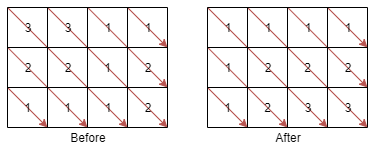

```text
输入：mat = [[3,3,1,1],[2,2,1,2],[1,1,1,2]]
输出：[[1,1,1,1],[1,2,2,2],[1,2,3,3]]
```

**示例 2**

```text
输入：mat = [[11,25,66,1,69,7],[23,55,17,45,15,52],[75,31,36,44,58,8],[22,27,33,25,68,4],[84,28,14,11,5,50]]
输出：[[5,17,4,1,52,7],[11,11,25,45,8,69],[14,23,25,44,58,15],[22,27,31,36,50,66],[84,28,75,33,55,68]]
```
> ✅ **官方验证**：全部 TypeScript 解法已通过 leetcode.cn 官方示例用例验证（自动注入运行，全部 PASS）。题面与 [leetcode.cn 官方](https://leetcode.cn/problems/sort-the-matrix-diagonally/)一致，示例配图取自官方题面。

**数据范围与注意事项**：

- `m == mat.length`
- `n == mat[i].length`
- `1 <= m, n <= 100`
- `1 <= mat[i][j] <= 100`
- **易错点**：行列别写反；旋转类问题先在纸上走一遍下标变换。

## 题目分析

**场景是什么**：二维网格同时考验下标变换与边界控制，对应真实开发里的棋盘、图像像素处理。本题就是该场景的 Medium 级练习，主线做法是「模拟」。

**主线怎么解**：把主解法从头到尾过一遍，它其实在依次做这几件事：哈希结构做计数或查重 → 先排序再处理 → 双重循环遍历 → 队列或堆的调度。

## 解题思路

**方案对比**（共 2 个方案，由浅入深）：

| 方案 | 时间复杂度 | 空间复杂度 |
|---|---|---|
| 方案 1 · 模拟 | O(n²)（两层嵌套扫描） | O(1) 到 O(n) |
| 方案 2 · 优化版 | O(n²)（两层嵌套扫描） | O(1) 到 O(n) |

**由浅入深的路径**：模拟 → 优化版；每往右一步，都在补上一步的短板。

**方案间的取舍**：方案 1（模拟）；方案 2（优化版）。数据规模小、可读性优先时选靠前的方案；规模大、性能优先时选靠后的方案。

**怎么读这一篇**：

- 🐣 **新手路线**：把「题目描述」的示例 1 在纸上手推一遍 → 读方案 1（最直观的写法）与它的代码走读 → 按「运行方式」本地跑通看 PASS → 回头对比方案 2 之后的写法差在哪
- 🦅 **大佬路线**：直接锁定最优方案 1（模拟，O(n²)（两层嵌套扫描））→ 跳读该方案代码与走读 → 用「逐步拆解与面试追问」补齐复杂度推导与边界追问

### 动态算法图（广度优先波纹，GIF 自动循环）


动画演示矩阵专题里广度优先波纹的典型过程；每个方案在「TypeScript 解题方案」一节还配了专属动画与专属流程图。

### 主解法流程图（真实控制流）


## TypeScript 解题方案（2 个方案逐个讲）

> **运行与提交**：每个方案都是自包含文件（内嵌用例自测，输出 PASS），整块复制到 `.ts` 文件后 `node 文件名` 即可运行。提交 LeetCode 时，把 `demo` 内的算法函数与辅助类型/函数整体取出、置于文件顶层即可。涉及交互/特殊接口的题以题面给定签名为准。

### 方案 1：模拟

**分析与思路**：核心做法是「模拟」。代码里依次做这些事：哈希结构做计数或查重；先排序再处理；双重循环遍历；队列或堆的调度。

**运行方式**：`node 本文件`，内嵌用例全部通过会输出 PASS。

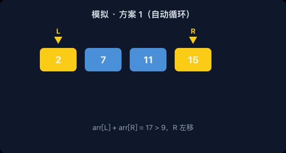

**方案专属流程图**（真实控制流）：


```typescript
/**
 ** LeetCode 1329. 将矩阵按对角线排序
 ** 方案：1 ) 方案1：模拟
 ** 来源：https://blog.csdn.net/tyro_java/article/details/145381786
 */

export function diagonalSort(mat: number[][]): number[][] {
  // 定义函数/方法 diagonalSort
  const rows = mat.length; // 把 mat.长度 存入 行数
  const cols = mat[0].length; // 把 mat[0].长度 存入 列数
  const diags: Map<number, number[]> = new Map(); // 把 new Map(); 写入 const diags: Map<number, number[]>
  for (let r = 0; r < rows; r++) {
    // 让 右指针 从 0 开始计数，右指针 小于 行数 就继续
    for (let c = 0; c < cols; c++) {
      // 让 字符 从 0 开始计数，字符 小于 列数 就继续
      const key = r - c; // 把 右指针 减 字符 存入 key
      if (!diags.has(key)) diags.set(key, []); // 若 取反 diags.has(key)) diags.set(key, []);
      diags.get(key)!.push(mat[r][c]); // 把 mat[右指针][字符] 压入栈/数组尾部
    }
  }
  for (const arr of diags.values()) arr.sort((a, b) => a - b);
  for (let r = 0; r < rows; r++) {
    // 让 右指针 从 0 开始计数，右指针 小于 行数 就继续
    for (let c = 0; c < cols; c++) {
      // 让 字符 从 0 开始计数，字符 小于 列数 就继续
      const key = r - c; // 把 右指针 减 字符 存入 key
      mat[r][c] = diags.get(key)!.shift()!; // 取出队首元素
    }
  }
  return mat; // 返回 mat
}

export function demo(): void {
  // 程序入口：跑内嵌自测用例
  const m = [
    [3, 3, 1, 1],
    [2, 2, 1, 2],
    [1, 1, 1, 2],
  ]; // 把 [[3, 3, 1, 1], [2, 2, 1, 2], [1, 1, 1, 2]] 存入 映射表
  const got = diagonalSort(m.map((r) => r.slice()));
  const exp = [
    [1, 1, 1, 1],
    [1, 2, 2, 2],
    [1, 2, 3, 3],
  ]; // 把 [[1, 1, 1, 1], [1, 2, 2, 2], [1, 2, 3, 3]] 存入 exp
  if (JSON.stringify(got) !== JSON.stringify(exp)) {
    // 若 JSON.stringify(got) 不等于 JSON.stringify(exp
    throw new Error('FAILED: ' + JSON.stringify(got)); // throw new Error(「FAILED: 」 加 JSON.stringify(got));
  }
  console.log('PASS'); // 全部用例通过，输出 PASS
}

demo(); // demo();
```

### 方案 2：优化版

**分析与思路**：核心做法是「优化版」。代码里依次做这些事：哈希结构做计数或查重；先排序再处理；双重循环遍历；队列或堆的调度。

**运行方式**：`node 本文件`，内嵌用例全部通过会输出 PASS。

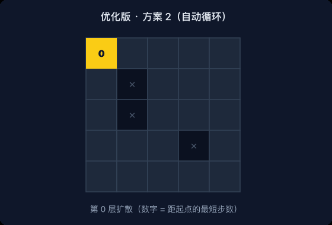

**方案专属流程图**（真实控制流）：

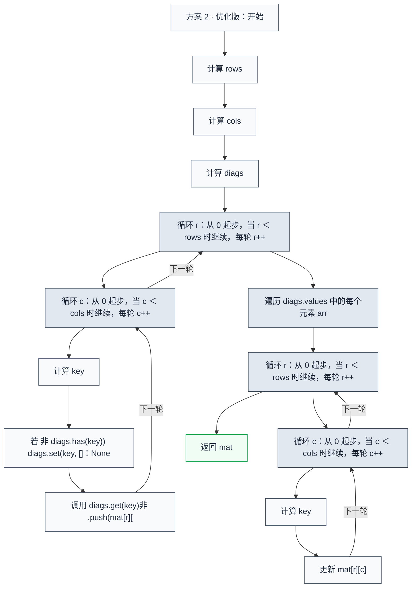

```typescript
/**
 ** LeetCode 1329. 将矩阵按对角线排序
 ** 方案：2 ) 方案2：优化版
 ** 来源：https://blog.csdn.net/tyro_java/article/details/145381786
 */

export function diagonalSort(mat: number[][]): number[][] {
  // 定义函数/方法 diagonalSort
  const rows = mat.length; // 把 mat.长度 存入 行数
  const cols = mat[0].length; // 把 mat[0].长度 存入 列数
  const diags: Map<number, number[]> = new Map(); // 把 new Map(); 写入 const diags: Map<number, number[]>
  for (let r = 0; r < rows; r++) {
    // 让 右指针 从 0 开始计数，右指针 小于 行数 就继续
    for (let c = 0; c < cols; c++) {
      // 让 字符 从 0 开始计数，字符 小于 列数 就继续
      const key = r - c; // 把 右指针 减 字符 存入 key
      if (!diags.has(key)) diags.set(key, []); // 若 取反 diags.has(key)) diags.set(key, []);
      diags.get(key)!.push(mat[r][c]); // 把 mat[右指针][字符] 压入栈/数组尾部
    }
  }
  for (const arr of diags.values()) arr.sort((a, b) => a - b);
  for (let r = 0; r < rows; r++) {
    // 让 右指针 从 0 开始计数，右指针 小于 行数 就继续
    for (let c = 0; c < cols; c++) {
      // 让 字符 从 0 开始计数，字符 小于 列数 就继续
      const key = r - c; // 把 右指针 减 字符 存入 key
      mat[r][c] = diags.get(key)!.shift()!; // 取出队首元素
    }
  }
  return mat; // 返回 mat
}

export function demo(): void {
  // 程序入口：跑内嵌自测用例
  const m = [
    [3, 3, 1, 1],
    [2, 2, 1, 2],
    [1, 1, 1, 2],
  ]; // 把 [[3, 3, 1, 1], [2, 2, 1, 2], [1, 1, 1, 2]] 存入 映射表
  const got = diagonalSort(m.map((r) => r.slice()));
  const exp = [
    [1, 1, 1, 1],
    [1, 2, 2, 2],
    [1, 2, 3, 3],
  ]; // 把 [[1, 1, 1, 1], [1, 2, 2, 2], [1, 2, 3, 3]] 存入 exp
  if (JSON.stringify(got) !== JSON.stringify(exp)) {
    // 若 JSON.stringify(got) 不等于 JSON.stringify(exp
    throw new Error('FAILED: ' + JSON.stringify(got)); // throw new Error(「FAILED: 」 加 JSON.stringify(got));
  }
  console.log('PASS'); // 全部用例通过，输出 PASS
}

demo(); // demo();
```

## 逐步拆解与面试追问

**复杂度**：时间 O(n²)（两层嵌套扫描），空间 O(1) 到 O(n)

**为什么是这个量级**：外层定起点、内层扫终点，n 个起点各扫 n 次

**面试官可能会追问**：

- 能否原地标记？
- 边界遍历的顺序怎么不出错？
- 旋转类问题能否一次循环完成？

## 关键 API 速查（TS 主解法实际用到，附官方链接）

| API | 作用 | 使用要点 | 官方文档 |
|---|---|---|---|
| `Map` | 哈希表：任意类型键值对 | set(k,v) 存、get(k) 取（不存在返回 undefined）、has(k) 判存在、delete(k) 删；增删查均摊 O(1)；键顺序为插入序；键必须用引用区分（对象键按身份） | [官方文档](https://developer.mozilla.org/zh-CN/docs/Web/JavaScript/Reference/Global_Objects/Map) |
| `Array.prototype.sort()` | 原地排序 | 默认按字符串 Unicode 序（10 会排在 2 前），数字必须传 (a,b)=>a-b；V8 用 TimSort，稳定，O(n log n)；返回原数组引用 | [官方文档](https://developer.mozilla.org/zh-CN/docs/Web/JavaScript/Reference/Global_Objects/Array/sort) |
| `Array.prototype.map()` | 逐元素映射为新数组 | 回调 (v,i,arr)；返回等长新数组，不改变原数组；稀疏位跳过；链式调用注意中间数组开销 | [官方文档](https://developer.mozilla.org/zh-CN/docs/Web/JavaScript/Reference/Global_Objects/Array/map) |
| `Array.prototype.push()` | 尾部追加 | 返回新长度；可一次多个；均摊 O(1)；会改变原数组 | [官方文档](https://developer.mozilla.org/zh-CN/docs/Web/JavaScript/Reference/Global_Objects/Array/push) |
| `Array.prototype.shift()` | 头部取出 | O(n)（后续元素整体前移）；大量头部操作请用链表或双端结构 | [官方文档](https://developer.mozilla.org/zh-CN/docs/Web/JavaScript/Reference/Global_Objects/Array/shift) |
| `Array/String slice()` | 切片（不改原数组） | slice(start,end) 含头不含尾；负数从尾计；常用于复制数组（slice()） | [官方文档](https://developer.mozilla.org/zh-CN/docs/Web/JavaScript/Reference/Global_Objects/Array/slice) |
| `JSON.stringify()` | 序列化为 JSON 字符串 | 常用于结构化比较（深度相等判定）；undefined/函数/循环引用会被丢弃或抛错 | [官方文档](https://developer.mozilla.org/zh-CN/docs/Web/JavaScript/Reference/Global_Objects/JSON/stringify) |

### 各语言官方文档导航

- **TypeScript / JS**：[MDN 中文参考](https://developer.mozilla.org/zh-CN/)
- **Python**：[Python 官方文档](https://docs.python.org/zh-cn/3/)
- **Go**：[Go 标准库](https://pkg.go.dev/std)
- **Java**：[JDK 17 API](https://docs.oracle.com/en/java/javase/17/docs/api/)
- **Rust**：[Rust 标准库](https://doc.rust-lang.org/std/)
- **Lua**：[Lua 5.4 手册](https://www.lua.org/manual/5.4/)
- **C**：[Cppreference C](https://zh.cppreference.com/w/c)
- **C++**：[Cppreference C++](https://zh.cppreference.com/w/cpp)
- **R**：[R 官方手册](https://stat.ethz.ch/R-manual/)
- **Zig**：[Zig 语言文档](https://ziglang.org/documentation/master/)
- **Dart**：[Dart API](https://api.dart.dev/)

## 附录：其他 10 种语言全部实现（每种语言列举其全部方案）

> TypeScript 的全部方案见「TypeScript 解题方案」一节；下面是其余 10 种语言的对应实现，每种语言的每个方案都带思路分析、代码走读与专属运行架构图。
> 每个方案都内嵌用例自测，可独立运行（老仓库 python/go 文件遵循「打印结果」约定）。
> 完整解法文件见 `dsa/<语言>/matrix/lc_1329_将矩阵按对角线排序/`。

### Python 实现（2 种方案）

Python 的全部方案如下，每个方案都内嵌用例自测，可独立运行（老仓库 python/go 文件遵循「打印结果」约定）：

#### 方案 1：模拟

**思路与代码分析**：核心是「模拟」。Python 版用切片与字典推导式简化操作，突出可读性。代码里依次做这些事：哈希结构做计数或查重；队列或堆的调度。**走读**：方案 1 · 模拟：开始 → 处理 from collections import defa → 更新 diagonals → 更新 cols → 循环 r：从 0 到 rows 前 → 循环 c：从 0 到 cols 前 → 调用 heapq.heappush( → 处理 diagonals[r - c], mat[r][c] → 处理 ) → 循环 r：从 0 到 rows 前 → 循环 c：从 0 到 cols 前 → 更新 mat[r][c] → 处理 diagonals[r - c] → 处理 ) → 返回 mat。

**运行架构**（真实控制流）：


```python
import sys  # 提高递归深度上限（深输入防 RecursionError）

sys.setrecursionlimit(200000)  # 树/链表类题目节点数可达 1e4 量级

def diagonalSort(mat):  # 定义函数 diagonalSort（参数：mat）
    from collections import defaultdict  # from collections import defaultdict
    import heapq  # 引入依赖

    diagonals = defaultdict(list)  # 把 defaultdict(列表) 存入 diagonals
    rows, cols = len(mat), len(mat[0])  # 把 长度(mat), 长度(mat[0]) 写入 rows, cols
    for r in range(rows):  # 让 右指针 从 行数 遍历
        for c in range(cols):  # 让 字符 从 列数 遍历
            heapq.heappush(
                diagonals[r - c], mat[r][c]
            )  # heapq.heappush(diagonals[右指针 减 字符], mat[右指针][字符])
    for r in range(rows):  # 让 右指针 从 行数 遍历
        for c in range(cols):  # 让 字符 从 列数 遍历
            mat[r][c] = heapq.heappop(
                diagonals[r - c]
            )  # 把 heapq.heappop(diagonals[右指针 减 字符]) 写入 mat[r][c]
    return mat  # 返回 mat

if __name__ == "__main__":  # 若 __name__ 等于 '__main__'
    mat = [[3, 3, 1, 1], [2, 2, 1, 2], [1, 1, 1, 2]]  # 把 [[3, 3, 1, 1], [2, 2, 1, 2], [1, 1, 1, 2]] 存入 mat
    print(diagonalSort(mat))  # 打印输出
```

#### 方案 2：优化版

**思路与代码分析**：核心是「优化版」。Python 版用切片与字典推导式简化操作，突出可读性。代码里依次做这些事：哈希结构做计数或查重；队列或堆的调度。**走读**：方案 2 · 优化版：开始 → 处理 from collections import defa → 更新 diagonals → 更新 cols → 循环 r：从 0 到 rows 前 → 循环 c：从 0 到 cols 前 → 调用 heapq.heappush( → 处理 diagonals[r - c], mat[r][c] → 处理 ) → 循环 r：从 0 到 rows 前 → 循环 c：从 0 到 cols 前 → 更新 mat[r][c] → 处理 diagonals[r - c] → 处理 ) → 返回 mat。

**运行架构**（真实控制流）：

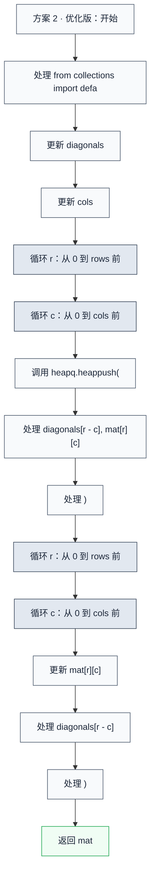

```python
import sys  # 提高递归深度上限（深输入防 RecursionError）

sys.setrecursionlimit(200000)  # 树/链表类题目节点数可达 1e4 量级

def diagonalSort(mat):  # 定义函数 diagonalSort（参数：mat）
    from collections import defaultdict  # from collections import defaultdict
    import heapq  # 引入依赖

    diagonals = defaultdict(list)  # 把 defaultdict(列表) 存入 diagonals
    rows, cols = len(mat), len(mat[0])  # 把 长度(mat), 长度(mat[0]) 写入 rows, cols
    for r in range(rows):  # 让 右指针 从 行数 遍历
        for c in range(cols):  # 让 字符 从 列数 遍历
            heapq.heappush(
                diagonals[r - c], mat[r][c]
            )  # heapq.heappush(diagonals[右指针 减 字符], mat[右指针][字符])
    for r in range(rows):  # 让 右指针 从 行数 遍历
        for c in range(cols):  # 让 字符 从 列数 遍历
            mat[r][c] = heapq.heappop(
                diagonals[r - c]
            )  # 把 heapq.heappop(diagonals[右指针 减 字符]) 写入 mat[r][c]
    return mat  # 返回 mat

if __name__ == "__main__":  # 若 __name__ 等于 '__main__'
    mat = [[3, 3, 1, 1], [2, 2, 1, 2], [1, 1, 1, 2]]  # 把 [[3, 3, 1, 1], [2, 2, 1, 2], [1, 1, 1, 2]] 存入 mat
    print(diagonalSort(mat))  # 打印输出
```

### Go 实现（2 种方案）

Go 的全部方案如下，每个方案都内嵌用例自测，可独立运行（老仓库 python/go 文件遵循「打印结果」约定）：

#### 方案 1：模拟

**思路与代码分析**：核心是「模拟」。Go 版用切片与多返回值惯用法，显式处理索引边界。代码里依次做这些事：哈希结构做计数或查重。**走读**：方案 1 · 模拟：开始 → 更新 : → 返回 mat → 遍历循环 → 遍历循环 → 遍历 diagonals 的下标与元素 k → 遍历循环 → 遍历循环 → 返回 mat。

**运行架构**（真实控制流）：

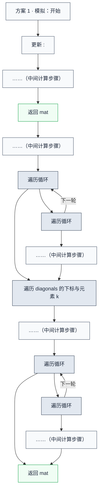

```go
package main // 引入依赖

import (
	"fmt"
	"os"
	"reflect"
	"sort"
) // 引入依赖

func diagonalSort(mat [][]int) [][]int { // 定义函数/方法 diagonalSort
	rows := len(mat) // 把 长度(mat) 写入 rows :
	if rows == 0 {   // 若 行数 等于 0
		return mat // 返回 mat
	}
	cols := len(mat[0])          // 把 长度(mat[0]) 写入 cols :
	diagonals := map[int][]int{} // 把 映射表[int][]int{} 写入 diagonals :
	for r := 0; r < rows; r++ {  // 让 右指针 从 0 开始计数
		for c := 0; c < cols; c++ { // 让 字符 从 0 开始计数
			diagonals[r-c] = append(diagonals[r-c], mat[r][c])
		}
	}
	for k := range diagonals { // 把 range diagonals { 写入 for k :
		sort.Ints(diagonals[k]) // sort.Ints(diagonals[下标 k])
	}
	idx := map[int]int{}        // 把 映射表[int]int{} 写入 idx :
	for r := 0; r < rows; r++ { // 让 右指针 从 0 开始计数
		for c := 0; c < cols; c++ { // 让 字符 从 0 开始计数
			d := r - c                       // 把 右指针 减 字符 写入 d :
			mat[r][c] = diagonals[d][idx[d]] // 把 diagonals[d][idx[d]] 写入 mat[r][c]
			idx[d]++                         // idx[d] 加一
		}
	}
	return mat // 返回 mat
}

func main() { // 程序入口：跑内嵌自测用例
	cases := []struct { // 把 []struct { 写入 cases :
		in   [][]int // in [][]int
		want [][]int // want [][]int
	}{ // }{
		{
			[][]int{{3, 3, 1, 1}, {2, 2, 1, 2}, {1, 1, 1, 2}},
			[][]int{{1, 1, 1, 1}, {1, 2, 2, 2}, {1, 2, 3, 3}},
		},
		{
			[][]int{{1, 2}, {3, 4}},
			[][]int{{1, 2}, {3, 4}},
		},
	}
	ok := true                // 把 true 写入 ok :
	for _, c := range cases { // 同时取 _ 与 字符 遍历
		// copy input to avoid mutation affecting nothing (already fresh each case)
		got := diagonalSort(c.in)            // 把 diagonalSort(字符.in) 写入 got :
		if !reflect.DeepEqual(got, c.want) { // 若 取反 reflect.DeepEqual(got, 字符.want
			ok = false                                                          // 把 false 写入 ok
			fmt.Printf("FAIL diagonalSort(%v)=%v want %v\n", c.in, got, c.want) // 打印输出
		}
	}
	if !ok { // 若 取反 ok
		os.Exit(1) // os.Exit(1)
	}
	fmt.Println("PASS") // 全部用例通过，输出 PASS
}
```

#### 方案 2：优化版

**思路与代码分析**：核心是「优化版」。Go 版用切片与多返回值惯用法，显式处理索引边界。代码里依次做这些事：哈希结构做计数或查重。**走读**：方案 2 · 优化版：开始 → 更新 : → 返回 mat → 遍历循环 → 遍历循环 → 遍历 diagonals 的下标与元素 k → 遍历循环 → 遍历循环 → 返回 mat。

**运行架构**（真实控制流）：


```go
package main // 引入依赖

import (
	"fmt"
	"os"
	"reflect"
	"sort"
) // 引入依赖

func diagonalSort(mat [][]int) [][]int { // 定义函数/方法 diagonalSort
	rows := len(mat) // 把 长度(mat) 写入 rows :
	if rows == 0 {   // 若 行数 等于 0
		return mat // 返回 mat
	}
	cols := len(mat[0])          // 把 长度(mat[0]) 写入 cols :
	diagonals := map[int][]int{} // 把 映射表[int][]int{} 写入 diagonals :
	for r := 0; r < rows; r++ {  // 让 右指针 从 0 开始计数
		for c := 0; c < cols; c++ { // 让 字符 从 0 开始计数
			diagonals[r-c] = append(diagonals[r-c], mat[r][c])
		}
	}
	for k := range diagonals { // 把 range diagonals { 写入 for k :
		sort.Ints(diagonals[k]) // sort.Ints(diagonals[下标 k])
	}
	idx := map[int]int{}        // 把 映射表[int]int{} 写入 idx :
	for r := 0; r < rows; r++ { // 让 右指针 从 0 开始计数
		for c := 0; c < cols; c++ { // 让 字符 从 0 开始计数
			d := r - c                       // 把 右指针 减 字符 写入 d :
			mat[r][c] = diagonals[d][idx[d]] // 把 diagonals[d][idx[d]] 写入 mat[r][c]
			idx[d]++                         // idx[d] 加一
		}
	}
	return mat // 返回 mat
}

func main() { // 程序入口：跑内嵌自测用例
	cases := []struct { // 把 []struct { 写入 cases :
		in   [][]int // in [][]int
		want [][]int // want [][]int
	}{ // }{
		{
			[][]int{{3, 3, 1, 1}, {2, 2, 1, 2}, {1, 1, 1, 2}},
			[][]int{{1, 1, 1, 1}, {1, 2, 2, 2}, {1, 2, 3, 3}},
		},
		{
			[][]int{{1, 2}, {3, 4}},
			[][]int{{1, 2}, {3, 4}},
		},
	}
	ok := true                // 把 true 写入 ok :
	for _, c := range cases { // 同时取 _ 与 字符 遍历
		got := diagonalSort(c.in)            // 把 diagonalSort(字符.in) 写入 got :
		if !reflect.DeepEqual(got, c.want) { // 若 取反 reflect.DeepEqual(got, 字符.want
			ok = false                                                          // 把 false 写入 ok
			fmt.Printf("FAIL diagonalSort(%v)=%v want %v\n", c.in, got, c.want) // 打印输出
		}
	}
	if !ok { // 若 取反 ok
		os.Exit(1) // os.Exit(1)
	}
	fmt.Println("PASS") // 全部用例通过，输出 PASS
}
```

### Java 实现（2 种方案）

Java 的全部方案如下，每个方案都内嵌用例自测，可独立运行（老仓库 python/go 文件遵循「打印结果」约定）：

#### 方案 1：模拟

**思路与代码分析**：核心是「模拟」。Java 版用类与静态方法组织，集合操作显式明了。代码里依次做这些事：先排序再处理；双重循环遍历。**走读**：方案 1 · 模拟：开始 → 更新 n → 遍历循环 → 遍历循环 → 遍历循环 → 遍历循环 → 遍历循环 → 遍历循环 → 返回 mat。

**运行架构**（真实控制流）：

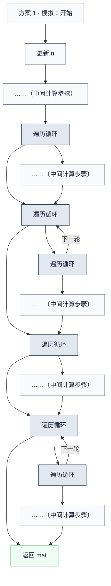

```java
package com.webfault.dsa; // 引入依赖

import java.util.*; // 引入依赖

class lc1329_solution111 { // 定义类型
  public int[][] diagonalSort(int[][] mat) { // 定义函数/方法 diagonalSort
    int n = mat.length; // 把 mat.长度 存入 元素个数
    int m = mat[0].length; // 把 mat[0].长度 存入 映射表
    List<List<Integer>> diag =
        new ArrayList<>(); // 把 new ArrayList 小于 超过 (); 写入 List<List<Integer>> diag
    for (int i = 0; i < m + n - 1; i++) { // 让 下标 i 从 0 开始计数，下标 i 小于 映射表 加 元素个数 减 1 就继续
      diag.add(new ArrayList<>()); // diag 追加 new ArrayList 小于 超过 ());
    }
    for (int i = 0; i < n; i++) { // 让 下标 i 从 0 开始计数，下标 i 小于 元素个数 就继续
      for (int j = 0; j < m; j++) { // 让 下标 j 从 0 开始计数，下标 j 小于 映射表 就继续
        diag.get(i - j + m - 1)
            .add(mat[i][j]); // diag 查找 下标 i 减 下标 j 加 映射表 减 1) 追加 mat[下标 i][下标 j]);
      }
    }
    for (List<Integer> d : diag) { // for (List 小于 Integer 超过 d : diag) {
      Collections.sort(d); // 排序
    }
    for (int i = 0; i < n; i++) { // 让 下标 i 从 0 开始计数，下标 i 小于 元素个数 就继续
      for (int j = 0; j < m; j++) { // 让 下标 j 从 0 开始计数，下标 j 小于 映射表 就继续
        mat[i][j] =
            diag.get(i - j + m - 1).get(0); // 把 diag 查找 下标 i 减 下标 j 加 映射表 减 1) 查找 0); 写入 mat[i][j]
        diag.get(i - j + m - 1).remove(0); // diag 查找 下标 i 减 下标 j 加 映射表 减 1) 弹出 0);
      }
    }
    return mat; // 返回 mat
  }

  public static void main(String[] args) { // public static void main(String[] args) {
    lc1329_solution111 s =
        new lc1329_solution111(); // 把 new lc1329_solution111(); 写入 lc1329_solution111 s
    int[][][] tests = { // 把 { 写入 int[][][] tests
      {{3, 3, 1, 1}, {2, 2, 1, 2}, {1, 1, 1, 2}},
      {{10, 6, 8}, {15, 11, 7}, {14, 5, 12}},
      {{5}} // { {5} }
    };
    int[][][] wants = { // 把 { 写入 int[][][] wants
      {{1, 1, 1, 1}, {1, 2, 2, 2}, {1, 2, 3, 3}},
      {{10, 6, 8}, {5, 11, 7}, {14, 15, 12}},
      {{5}} // { {5} }
    };
    boolean ok = true; // 把 true; 写入 boolean ok
    for (int t = 0; t < tests.length; t++) { // 让 另一字符串 从 0 开始计数，另一字符串 小于 tests.长度 就继续
      int[][] got = s.diagonalSort(tests[t]); // 把 字符串.diagonalSort(tests[另一字符串]); 写入 int[][] got
      if (!Arrays.deepEquals(got, wants[t])) { // 若 取反 Arrays.deepEquals(got, wants[另一字符串]
        ok = false; // 把 false; 写入 ok
        System.out.println(
            "FAIL diagonalSort case "
                + t
                + " got "
                + Arrays.deepToString(got)
                + " want "
                + Arrays.deepToString(wants[t])); // 打印输出
      }
    }
    if (!ok) throw new RuntimeException("FAILED"); // 若 取反 ok) throw new RuntimeException(「FAILED」);
    System.out.println("PASS"); // 全部用例通过，输出 PASS
  }
}
```

#### 方案 2：优化版

**思路与代码分析**：核心是「优化版」。Java 版用类与静态方法组织，集合操作显式明了。代码里依次做这些事：先排序再处理；双重循环遍历。**走读**：方案 2 · 优化版：开始 → 更新 m → 更新 n → 遍历循环 → 更新 left_i → 更新 left_j → 更新 right_i → 更新 right_j → 更新 len → 更新 a → 遍历循环 → 更新 a[i] → 排序整理 → 遍历循环 → 更新 i] → 返回 mat。

**运行架构**（真实控制流）：

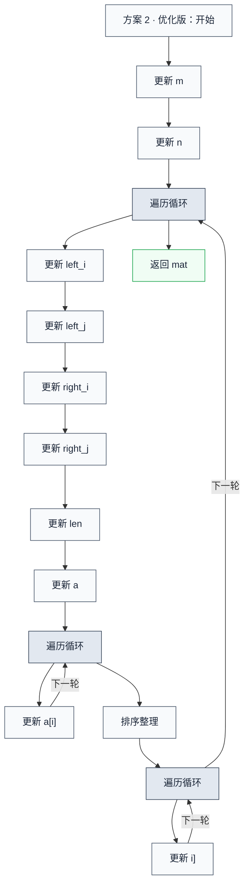

```java
package com.webfault.dsa; // 引入依赖

import java.util.*; // 引入依赖

class lc1329_solution222 { // 定义类型
  public int[][] diagonalSort(int[][] mat) { // 定义函数/方法 diagonalSort
    int m = mat.length; // 把 mat.长度 存入 映射表
    int n = mat[0].length; // 把 mat[0].长度 存入 元素个数
    for (int k = 1 - n; k < m; k++) { // 让 下标 k 从 1 减 元素个数 开始计数，下标 k 小于 映射表 就继续
      int left_i = Math.max(0, k); // 把 Math.取较大值 0, 下标 k) 存入 left_i
      int left_j = Math.max(0, -k); // 把 Math.取较大值 0, 减 下标 k) 存入 left_j
      int right_i = Math.min(m - 1, n - 1 + k); // 把 Math.取较小值 映射表 减 1, 元素个数 减 1 加 下标 k) 存入 right_i
      int right_j = Math.min(m - 1 - k, n - 1); // 把 Math.取较小值 映射表 减 1 减 下标 k, 元素个数 减 1) 存入 right_j
      int len = right_i - left_i + 1; // 把 right_i 减 left_i 加 1 存入 长度
      int[] a = new int[len]; // 把 new int[长度]; 写入 int[] a
      for (int i = 0; i < len; i++) { // 让 下标 i 从 0 开始计数，下标 i 小于 长度 就继续
        a[i] = mat[left_i + i][left_j + i]; // 把 mat[left_i 加 下标 i][left_j 加 下标 i]; 写入 a[i]
      }
      Arrays.sort(a); // 排序
      for (int i = 0; i < len; i++) { // 让 下标 i 从 0 开始计数，下标 i 小于 长度 就继续
        mat[left_i + i][left_j + i] = a[i]; // 把 数组[下标 i]; 写入 mat[left_i + i][left_j + i]
      }
    }
    return mat; // 返回 mat
  }

  public static void main(String[] args) { // public static void main(String[] args) {
    lc1329_solution222 s =
        new lc1329_solution222(); // 把 new lc1329_solution222(); 写入 lc1329_solution222 s
    int[][][] tests = { // 把 { 写入 int[][][] tests
      {{3, 3, 1, 1}, {2, 2, 1, 2}, {1, 1, 1, 2}},
      {{10, 6, 8}, {15, 11, 7}, {14, 5, 12}},
      {{5}} // { {5} }
    };
    int[][][] wants = { // 把 { 写入 int[][][] wants
      {{1, 1, 1, 1}, {1, 2, 2, 2}, {1, 2, 3, 3}},
      {{10, 6, 8}, {5, 11, 7}, {14, 15, 12}},
      {{5}} // { {5} }
    };
    boolean ok = true; // 把 true; 写入 boolean ok
    for (int t = 0; t < tests.length; t++) { // 让 另一字符串 从 0 开始计数，另一字符串 小于 tests.长度 就继续
      int[][] got = s.diagonalSort(tests[t]); // 把 字符串.diagonalSort(tests[另一字符串]); 写入 int[][] got
      if (!Arrays.deepEquals(got, wants[t])) { // 若 取反 Arrays.deepEquals(got, wants[另一字符串]
        ok = false; // 把 false; 写入 ok
        System.out.println(
            "FAIL diagonalSort case "
                + t
                + " got "
                + Arrays.deepToString(got)
                + " want "
                + Arrays.deepToString(wants[t])); // 打印输出
      }
    }
    if (!ok) throw new RuntimeException("FAILED"); // 若 取反 ok) throw new RuntimeException(「FAILED」);
    System.out.println("PASS"); // 全部用例通过，输出 PASS
  }
}
```

### Rust 实现（2 种方案）

Rust 的全部方案如下，每个方案都内嵌用例自测，可独立运行（老仓库 python/go 文件遵循「打印结果」约定）：

#### 方案 1：模拟

**思路与代码分析**：核心是「模拟」。Rust 版用所有权移动与切片借用改写同一逻辑，注意 Option 与引用边界。代码里依次做这些事：哈希结构做计数或查重；先排序再处理。**走读**：方案 1 · 模拟：开始 → 计算 rows → 遍历 0..rows 中的每个元素 r → 遍历 0..cols 中的每个元素 c → 遍历 diags.values_mut() 中的每个元素 arr → 遍历 0..rows 中的每个元素 r → 遍历 0..cols 中的每个元素 c → 返回结果。

**运行架构**（真实控制流）：

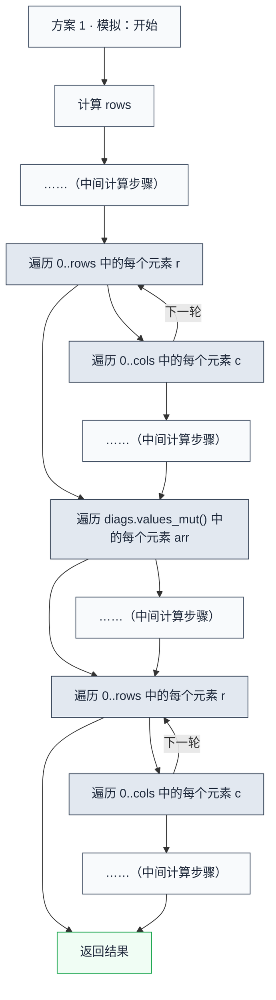

```rust
// LeetCode 1329. 将矩阵按对角线排序 — Rust 版
use std::collections::{HashMap, VecDeque}; // 引入依赖

// 方案1：模拟 —— 按 r-c 分组收集对角线，升序排序后按 shift（取队首）写回
fn diagonal_sort(mat: &mut Vec<Vec<i32>>) {
    // 定义函数/方法 diagonal_sort
    let rows = mat.len(); // 把 mat.长度() 存入 行数
    let cols = mat[0].len(); // 把 mat[0].长度() 存入 列数
    let mut diags: HashMap<i32, VecDeque<i32>> = HashMap::new();
    for r in 0..rows {
        // 逐个取出 0 的元素（右指针）
        for c in 0..cols {
            // 逐个取出 0 的元素（字符）
            diags // diags
                .entry(r as i32 - c as i32) // entry(右指针 as i32 减 字符 as i32)
                .or_default() // or_default()
                .push_back(mat[r][c]); // 追加 mat[右指针][字符]);
        }
    }
    for arr in diags.values_mut() {
        // 逐个取出 diags 的元素（数组）
        let mut v: Vec<i32> = arr.drain(..).collect(); // 把 数组.drain(..).collect(); 写入 let mut v: Vec<i32>
        v.sort(); // 排序
        *arr = v.into();
    }
    for r in 0..rows {
        // 逐个取出 0 的元素（右指针）
        for c in 0..cols {
            // 逐个取出 0 的元素（字符）
            mat[r][c] = diags // 把 diags 写入 mat[r][c]
                .get_mut(&(r as i32 - c as i32)) // get_mut( 按位与 (右指针 as i32 减 字符 as i32))
                .unwrap() // unwrap()
                .pop_front() // pop_front()
                .unwrap(); // unwrap();
        }
    }
}

fn main() {
    // 程序入口：跑内嵌自测用例
    // 与 TS 事实源内嵌用例一致
    let mut m = vec![vec![3, 3, 1, 1], vec![2, 2, 1, 2], vec![1, 1, 1, 2]];
    let exp = vec![vec![1, 1, 1, 1], vec![1, 2, 2, 2], vec![1, 2, 3, 3]];
    diagonal_sort(&mut m); // diagonal_sort( 按位与 mut 映射表);
    assert_eq!(m, exp, "FAILED: got {:?}", m); // 断言校验
    println!("PASS"); // 全部用例通过，输出 PASS
}
```

#### 方案 2：优化版

**思路与代码分析**：核心是「优化版」。Rust 版用所有权移动与切片借用改写同一逻辑，注意 Option 与引用边界。代码里依次做这些事：哈希结构做计数或查重；先排序再处理。**走读**：方案 2 · 优化版：开始 → 计算 rows → 遍历 0..rows 中的每个元素 r → 遍历 0..cols 中的每个元素 c → 遍历 diags.values_mut() 中的每个元素 arr → 遍历 0..rows 中的每个元素 r → 遍历 0..cols 中的每个元素 c → 返回结果。

**运行架构**（真实控制流）：

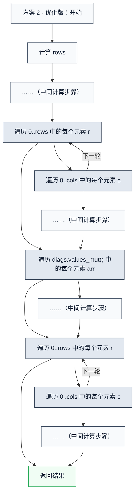

```rust
// LeetCode 1329. 将矩阵按对角线排序 — Rust 版
use std::collections::{HashMap, VecDeque}; // 引入依赖

// 方案2：优化版 —— 按 r-c 分组收集对角线，升序排序后按 shift（取队首）写回
fn diagonal_sort(mat: &mut Vec<Vec<i32>>) {
    // 定义函数/方法 diagonal_sort
    let rows = mat.len(); // 把 mat.长度() 存入 行数
    let cols = mat[0].len(); // 把 mat[0].长度() 存入 列数
    let mut diags: HashMap<i32, VecDeque<i32>> = HashMap::new();
    for r in 0..rows {
        // 逐个取出 0 的元素（右指针）
        for c in 0..cols {
            // 逐个取出 0 的元素（字符）
            diags // diags
                .entry(r as i32 - c as i32) // entry(右指针 as i32 减 字符 as i32)
                .or_default() // or_default()
                .push_back(mat[r][c]); // 追加 mat[右指针][字符]);
        }
    }
    for arr in diags.values_mut() {
        // 逐个取出 diags 的元素（数组）
        let mut v: Vec<i32> = arr.drain(..).collect(); // 把 数组.drain(..).collect(); 写入 let mut v: Vec<i32>
        v.sort(); // 排序
        *arr = v.into();
    }
    for r in 0..rows {
        // 逐个取出 0 的元素（右指针）
        for c in 0..cols {
            // 逐个取出 0 的元素（字符）
            mat[r][c] = diags // 把 diags 写入 mat[r][c]
                .get_mut(&(r as i32 - c as i32)) // get_mut( 按位与 (右指针 as i32 减 字符 as i32))
                .unwrap() // unwrap()
                .pop_front() // pop_front()
                .unwrap(); // unwrap();
        }
    }
}

fn main() {
    // 程序入口：跑内嵌自测用例
    // 与 TS 事实源内嵌用例一致
    let mut m = vec![vec![3, 3, 1, 1], vec![2, 2, 1, 2], vec![1, 1, 1, 2]];
    let exp = vec![vec![1, 1, 1, 1], vec![1, 2, 2, 2], vec![1, 2, 3, 3]];
    diagonal_sort(&mut m); // diagonal_sort( 按位与 mut 映射表);
    assert_eq!(m, exp, "FAILED: got {:?}", m); // 断言校验
    println!("PASS"); // 全部用例通过，输出 PASS
}
```

### Lua 实现（2 种方案）

Lua 的全部方案如下，每个方案都内嵌用例自测，可独立运行（老仓库 python/go 文件遵循「打印结果」约定）：

#### 方案 1：模拟

**思路与代码分析**：核心是「模拟」。Lua 版用表与 ipairs 遍历，注意 ipairs 遇 nil 即停的语义。代码里依次做这些事：先排序再处理。**走读**：方案 1 · 模拟：开始 → 更新 cols → 循环 r：从 1 到 rows do → 循环 c：从 1 到 cols do → 遍历 pairs(diags) do 中的每个元素 arr → 循环 r：从 1 到 rows do → 循环 c：从 1 到 cols do → 返回 mat。

**运行架构**（真实控制流）：

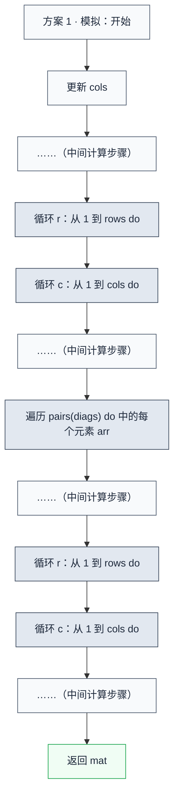

```lua
-- LeetCode 1329. 将矩阵按对角线排序 — Lua 版

-- 方案1：模拟 —— 按 r-c 分组收集对角线（1 基下标偏移相同），升序排序，写回时按 shift 取队首
local function diagonal_sort(mat) -- local function diagonal_sort(mat)
	local rows, cols = #mat, #mat[1] -- 把 #mat, #mat[1] 写入 local rows, cols
	local diags = {} -- 把 {} 写入 local diags
	for r = 1, rows do -- 让 右指针 从 1 走到 行数（Lua 1 基）
		for c = 1, cols do -- 让 字符 从 1 走到 列数（Lua 1 基）
			local key = r - c -- 把 右指针 减 字符 写入 local key
			if not diags[key] then
				diags[key] = {}
			end -- 若 not diags[key] then diags[key] 赋值为 {} 终点
			diags[key][#diags[key] + 1] = mat[r][c] -- 把 mat[右指针][字符] 写入 diags[key][#diags[key] + 1]
		end -- 终点
	end -- 终点
	for _, arr in pairs(diags) do -- 遍历取 数组
		table.sort(arr) -- 排序
	end -- 终点
	local pos = {} -- 把 {} 写入 local pos
	for r = 1, rows do -- 让 右指针 从 1 走到 行数（Lua 1 基）
		for c = 1, cols do -- 让 字符 从 1 走到 列数（Lua 1 基）
			local key = r - c -- 把 右指针 减 字符 写入 local key
			if not pos[key] then
				pos[key] = 1
			end -- 若 not pos[key] then pos[key] 赋值为 1 终点
			mat[r][c] = diags[key][pos[key]] -- 把 diags[key][pos[key]] 写入 mat[r][c]
			pos[key] = pos[key] + 1 -- 把 pos[key] 加 1 写入 pos[key]
		end -- 终点
	end -- 终点
	return mat -- 返回 mat
end -- 终点

-- 深拷贝（等价于 TS 的 m.map(r => r.slice())）
local function clone_matrix(m) -- local function clone_matrix(映射表)
	local out = {} -- 把 {} 写入 local out
	for i = 1, #m do -- 把 1, #映射表 do 写入 for i
		local row = {} -- 把 {} 写入 local row
		for j = 1, #m[i] do
			row[j] = m[i][j]
		end -- 把 1, #映射表[下标 i] do row[下标 j] 赋值为 映射表[下标 i][下标 j] 终点 写入 for j
		out[i] = row -- 把 row 写入 out[i]
	end -- 终点
	return out -- 返回 out
end -- 终点

local function eq_matrix(a, b) -- local function eq_matrix(数组, b)
	if #a ~= #b then
		return false
	end -- 若 #数组 ~ 赋值为 #b then return false 终点
	for i = 1, #a do -- 把 1, #数组 do 写入 for i
		if #a[i] ~= #b[i] then
			return false
		end -- 若 #数组[下标 i] ~ 赋值为 #b[下标 i] then return false 终点
		for j = 1, #a[i] do -- 把 1, #数组[下标 i] do 写入 for j
			if a[i][j] ~= b[i][j] then
				return false
			end -- 若 数组[下标 i][下标 j] ~ 赋值为 b[下标 i][下标 j] then return false 终点
		end -- 终点
	end -- 终点
	return true -- 返回 true
end -- 终点

-- 自测：与 TS 事实源内嵌用例一致
local m = { { 3, 3, 1, 1 }, { 2, 2, 1, 2 }, { 1, 1, 1, 2 } } -- 把 {{3, 3, 1, 1}, {2, 2, 1, 2}, {1, 1, 1, 2}} 写入 local m
local got = diagonal_sort(clone_matrix(m)) -- 把 diagonal_sort(clone_matrix(映射表)) 写入 local got
local exp = { { 1, 1, 1, 1 }, { 1, 2, 2, 2 }, { 1, 2, 3, 3 } } -- 把 {{1, 1, 1, 1}, {1, 2, 2, 2}, {1, 2, 3, 3}} 写入 local exp
assert(eq_matrix(got, exp), "FAILED") -- 断言校验
print("PASS") -- 全部用例通过，输出 PASS
```

#### 方案 2：优化版

**思路与代码分析**：核心是「优化版」。Lua 版用表与 ipairs 遍历，注意 ipairs 遇 nil 即停的语义。代码里依次做这些事：先排序再处理。**走读**：方案 2 · 优化版：开始 → 更新 cols → 循环 r：从 1 到 rows do → 循环 c：从 1 到 cols do → 遍历 pairs(diags) do 中的每个元素 arr → 循环 r：从 1 到 rows do → 循环 c：从 1 到 cols do → 返回 mat。

**运行架构**（真实控制流）：

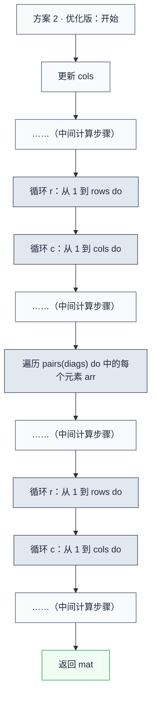

```lua
-- LeetCode 1329. 将矩阵按对角线排序 — Lua 版

-- 方案2：优化版 —— 按 r-c 分组收集对角线（1 基下标偏移相同），升序排序，写回时按 shift 取队首
local function diagonal_sort(mat) -- local function diagonal_sort(mat)
	local rows, cols = #mat, #mat[1] -- 把 #mat, #mat[1] 写入 local rows, cols
	local diags = {} -- 把 {} 写入 local diags
	for r = 1, rows do -- 让 右指针 从 1 走到 行数（Lua 1 基）
		for c = 1, cols do -- 让 字符 从 1 走到 列数（Lua 1 基）
			local key = r - c -- 把 右指针 减 字符 写入 local key
			if not diags[key] then
				diags[key] = {}
			end -- 若 not diags[key] then diags[key] 赋值为 {} 终点
			diags[key][#diags[key] + 1] = mat[r][c] -- 把 mat[右指针][字符] 写入 diags[key][#diags[key] + 1]
		end -- 终点
	end -- 终点
	for _, arr in pairs(diags) do -- 遍历取 数组
		table.sort(arr) -- 排序
	end -- 终点
	local pos = {} -- 把 {} 写入 local pos
	for r = 1, rows do -- 让 右指针 从 1 走到 行数（Lua 1 基）
		for c = 1, cols do -- 让 字符 从 1 走到 列数（Lua 1 基）
			local key = r - c -- 把 右指针 减 字符 写入 local key
			if not pos[key] then
				pos[key] = 1
			end -- 若 not pos[key] then pos[key] 赋值为 1 终点
			mat[r][c] = diags[key][pos[key]] -- 把 diags[key][pos[key]] 写入 mat[r][c]
			pos[key] = pos[key] + 1 -- 把 pos[key] 加 1 写入 pos[key]
		end -- 终点
	end -- 终点
	return mat -- 返回 mat
end -- 终点

-- 深拷贝（等价于 TS 的 m.map(r => r.slice())）
local function clone_matrix(m) -- local function clone_matrix(映射表)
	local out = {} -- 把 {} 写入 local out
	for i = 1, #m do -- 把 1, #映射表 do 写入 for i
		local row = {} -- 把 {} 写入 local row
		for j = 1, #m[i] do
			row[j] = m[i][j]
		end -- 把 1, #映射表[下标 i] do row[下标 j] 赋值为 映射表[下标 i][下标 j] 终点 写入 for j
		out[i] = row -- 把 row 写入 out[i]
	end -- 终点
	return out -- 返回 out
end -- 终点

local function eq_matrix(a, b) -- local function eq_matrix(数组, b)
	if #a ~= #b then
		return false
	end -- 若 #数组 ~ 赋值为 #b then return false 终点
	for i = 1, #a do -- 把 1, #数组 do 写入 for i
		if #a[i] ~= #b[i] then
			return false
		end -- 若 #数组[下标 i] ~ 赋值为 #b[下标 i] then return false 终点
		for j = 1, #a[i] do -- 把 1, #数组[下标 i] do 写入 for j
			if a[i][j] ~= b[i][j] then
				return false
			end -- 若 数组[下标 i][下标 j] ~ 赋值为 b[下标 i][下标 j] then return false 终点
		end -- 终点
	end -- 终点
	return true -- 返回 true
end -- 终点

-- 自测：与 TS 事实源内嵌用例一致
local m = { { 3, 3, 1, 1 }, { 2, 2, 1, 2 }, { 1, 1, 1, 2 } } -- 把 {{3, 3, 1, 1}, {2, 2, 1, 2}, {1, 1, 1, 2}} 写入 local m
local got = diagonal_sort(clone_matrix(m)) -- 把 diagonal_sort(clone_matrix(映射表)) 写入 local got
local exp = { { 1, 1, 1, 1 }, { 1, 2, 2, 2 }, { 1, 2, 3, 3 } } -- 把 {{1, 1, 1, 1}, {1, 2, 2, 2}, {1, 2, 3, 3}} 写入 local exp
assert(eq_matrix(got, exp), "FAILED") -- 断言校验
print("PASS") -- 全部用例通过，输出 PASS
```

### C 实现（2 种方案）

C 的全部方案如下，每个方案都内嵌用例自测，可独立运行（老仓库 python/go 文件遵循「打印结果」约定）：

#### 方案 1：模拟

**思路与代码分析**：核心是「模拟」。C 版手动管理下标与内存，循环边界全部显式写出。代码里依次做这些事：双重循环遍历。**走读**：方案 1 · 模拟：开始 → 处理 int buf[MAXR + MAXC] → 遍历循环 → 遍历循环 → 遍历循环 → 返回结果。

**运行架构**（真实控制流）：

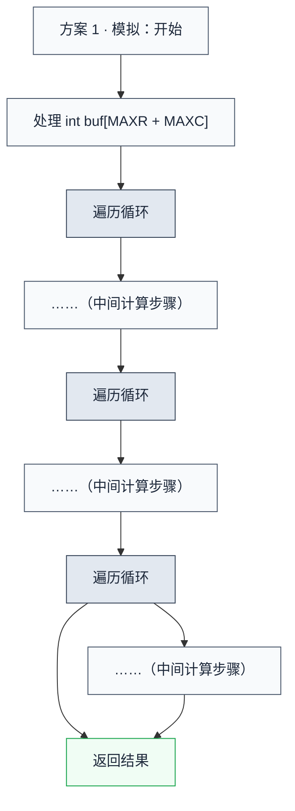

```c
* LeetCode 1329. 将矩阵按对角线排序 — C 版 */
#include <stdio.h>  // 引入头文件
#include <stdlib.h> // 引入头文件

#define MAXR 8 // #define MAXR 8
#define MAXC 8 // #define MAXC 8

static int cmp_int(const void *a, const void *b) { // 定义函数/方法 cmp_int
    int x = *(const int *)a,
        y = *(const int *)b;  // 把 乘 (const int 乘 )数组, y 赋值为 乘 (const int 乘 )b 存入 x
    return (x > y) - (x < y); // 返回 (x 超过 y) 减 (x 小于 y)
}

/* 方案1：模拟 —— 与 TS 事实源一致：按 r-c 分组收集对角线，升序排序，按原顺序写回（shift 取最小值）。
 * C 无内建哈希表，按对角线编号 d = r-c 从 -(cols-1) 到 rows-1 逐条收集。 */
static void diagonal_sort(int rows, int cols, int mat[][MAXC]) { // 定义函数/方法 diagonal_sort
    int buf[MAXR + MAXC];                                        // int buf[MAXR 加 MAXC];
    for (int d = -(cols - 1); d <= rows - 1;
         d++) {      // 让 d 从 减 (列数 减 1) 开始计数，d 不超过 行数 减 1 就继续
        int cnt = 0; // 把 0 存入 计数
        int r0 = d > 0 ? d : 0;           // 把 d 超过 0 ? d : 0 存入 r0
        for (int r = r0; r < rows; r++) { // 让 右指针 从 r0 开始计数，右指针 小于 行数 就继续
            int c = r - d;                // 把 右指针 减 d 存入 字符
            if (c < 0 || c >= cols)
                continue;           // 若 字符 小于 0 或 字符 不低于 列数) continue;
            buf[cnt++] = mat[r][c]; // 把 mat[右指针][字符]; 写入 buf[cnt++]
        }
        qsort(buf, (size_t)cnt, sizeof(int), cmp_int); // qsort(buf, (size_t)计数, sizeof(int), cmp_int);
        int k = 0;                                     // 把 0 存入 下标 k
        for (int r = r0; r < rows; r++) { // 让 右指针 从 r0 开始计数，右指针 小于 行数 就继续
            int c = r - d;                // 把 右指针 减 d 存入 字符
            if (c < 0 || c >= cols)
                continue;         // 若 字符 小于 0 或 字符 不低于 列数) continue;
            mat[r][c] = buf[k++]; // 把 buf[下标 k 加一 ]; 写入 mat[r][c]
        }
    }
}

int main(void) { // 程序入口：跑内嵌自测用例
    /* 与 TS 事实源内嵌用例一致 */
    int mat[MAXR][MAXC] = {{3, 3, 1, 1}, {2, 2, 1, 2}, {1, 1, 1, 2}};
    int exp[MAXR][MAXC] = {{1, 1, 1, 1}, {1, 2, 2, 2}, {1, 2, 3, 3}};
    int rows = 3, cols = 4;              // 把 3, 列数 赋值为 4 存入 行数
    diagonal_sort(rows, cols, mat);      // diagonal_sort(行数, 列数, mat);
    for (int i = 0; i < rows; i++) {     // 让 下标 i 从 0 开始计数，下标 i 小于 行数 就继续
        for (int j = 0; j < cols; j++) { // 让 下标 j 从 0 开始计数，下标 j 小于 列数 就继续
            if (mat[i][j] != exp[i][j]) { // 若 mat[下标 i][下标 j] 不等于 exp[下标 i][下标 j]
                printf("FAILED at (%d,%d): got %d want %d\n", i, j, mat[i][j], exp[i][j]); // 打印输出
                return 1;                                                                  // 返回 1
            }
        }
    }
    printf("PASS\n"); // 全部用例通过，输出 PASS
    return 0;         // 返回 0
}
```

#### 方案 2：优化版

**思路与代码分析**：核心是「优化版」。C 版手动管理下标与内存，循环边界全部显式写出。代码里依次做这些事：双重循环遍历。**走读**：方案 2 · 优化版：开始 → 处理 int buf[MAXR + MAXC] → 遍历循环 → 遍历循环 → 遍历循环 → 返回结果。

**运行架构**（真实控制流）：

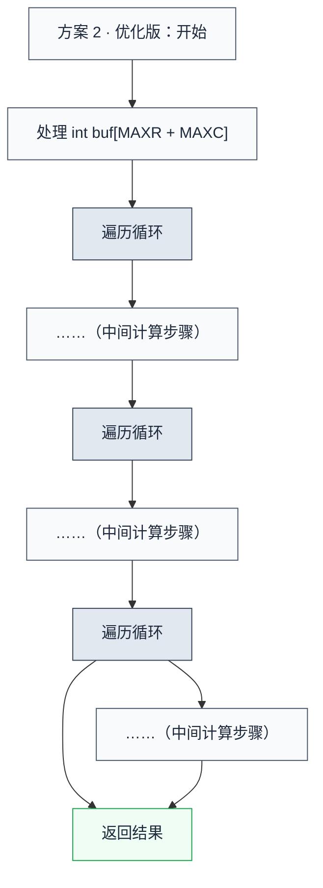

```c
* LeetCode 1329. 将矩阵按对角线排序 — C 版 */
#include <stdio.h>  // 引入头文件
#include <stdlib.h> // 引入头文件

#define MAXR 8 // #define MAXR 8
#define MAXC 8 // #define MAXC 8

static int cmp_int(const void *a, const void *b) { // 定义函数/方法 cmp_int
    int x = *(const int *)a,
        y = *(const int *)b;  // 把 乘 (const int 乘 )数组, y 赋值为 乘 (const int 乘 )b 存入 x
    return (x > y) - (x < y); // 返回 (x 超过 y) 减 (x 小于 y)
}

/* 方案2：优化版 —— 与 TS 事实源一致：按 r-c 分组收集对角线，升序排序，按原顺序写回（shift 取最小值）。
 * C 无内建哈希表，按对角线编号 d = r-c 从 -(cols-1) 到 rows-1 逐条收集。 */
static void diagonal_sort(int rows, int cols, int mat[][MAXC]) { // 定义函数/方法 diagonal_sort
    int buf[MAXR + MAXC];                                        // int buf[MAXR 加 MAXC];
    for (int d = -(cols - 1); d <= rows - 1;
         d++) {      // 让 d 从 减 (列数 减 1) 开始计数，d 不超过 行数 减 1 就继续
        int cnt = 0; // 把 0 存入 计数
        int r0 = d > 0 ? d : 0;           // 把 d 超过 0 ? d : 0 存入 r0
        for (int r = r0; r < rows; r++) { // 让 右指针 从 r0 开始计数，右指针 小于 行数 就继续
            int c = r - d;                // 把 右指针 减 d 存入 字符
            if (c < 0 || c >= cols)
                continue;           // 若 字符 小于 0 或 字符 不低于 列数) continue;
            buf[cnt++] = mat[r][c]; // 把 mat[右指针][字符]; 写入 buf[cnt++]
        }
        qsort(buf, (size_t)cnt, sizeof(int), cmp_int); // qsort(buf, (size_t)计数, sizeof(int), cmp_int);
        int k = 0;                                     // 把 0 存入 下标 k
        for (int r = r0; r < rows; r++) { // 让 右指针 从 r0 开始计数，右指针 小于 行数 就继续
            int c = r - d;                // 把 右指针 减 d 存入 字符
            if (c < 0 || c >= cols)
                continue;         // 若 字符 小于 0 或 字符 不低于 列数) continue;
            mat[r][c] = buf[k++]; // 把 buf[下标 k 加一 ]; 写入 mat[r][c]
        }
    }
}

int main(void) { // 程序入口：跑内嵌自测用例
    /* 与 TS 事实源内嵌用例一致 */
    int mat[MAXR][MAXC] = {{3, 3, 1, 1}, {2, 2, 1, 2}, {1, 1, 1, 2}};
    int exp[MAXR][MAXC] = {{1, 1, 1, 1}, {1, 2, 2, 2}, {1, 2, 3, 3}};
    int rows = 3, cols = 4;              // 把 3, 列数 赋值为 4 存入 行数
    diagonal_sort(rows, cols, mat);      // diagonal_sort(行数, 列数, mat);
    for (int i = 0; i < rows; i++) {     // 让 下标 i 从 0 开始计数，下标 i 小于 行数 就继续
        for (int j = 0; j < cols; j++) { // 让 下标 j 从 0 开始计数，下标 j 小于 列数 就继续
            if (mat[i][j] != exp[i][j]) { // 若 mat[下标 i][下标 j] 不等于 exp[下标 i][下标 j]
                printf("FAILED at (%d,%d): got %d want %d\n", i, j, mat[i][j], exp[i][j]); // 打印输出
                return 1;                                                                  // 返回 1
            }
        }
    }
    printf("PASS\n"); // 全部用例通过，输出 PASS
    return 0;         // 返回 0
}
```

### C++ 实现（2 种方案）

C++ 的全部方案如下，每个方案都内嵌用例自测，可独立运行（老仓库 python/go 文件遵循「打印结果」约定）：

#### 方案 1：模拟

**思路与代码分析**：核心是「模拟」。C++ 版用 STL 容器与迭代器，减少手写下标错误。代码里依次做这些事：双重循环遍历。**走读**：方案 1 · 模拟：开始 → 更新 rows → 更新 cols → 处理 std::map＜int, std::vector＜in → 遍历循环 → 遍历循环 → 处理 diags[static_cast＜int＞(r) - → 遍历循环 → 处理 std::sort(kv.second.begin(), → 处理 std::map＜int, size_t＞ pos → 遍历循环 → 遍历循环 → 更新 key → 更新 mat[r][c] → 返回 mat。

**运行架构**（真实控制流）：

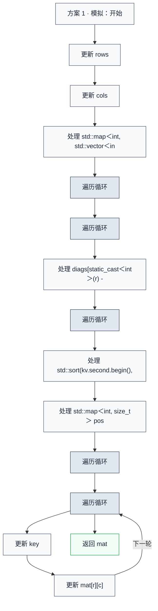

```cpp
// LeetCode 1329. 将矩阵按对角线排序 — C++ 版
#include <algorithm> // 引入头文件
#include <cassert>   // 引入头文件
#include <iostream>  // 引入头文件
#include <map>       // 引入头文件
#include <vector>    // 引入头文件

using Matrix = std::vector<std::vector<int>>; // 引入依赖

// 方案1：模拟 —— 按 r-c 分组收集对角线，升序排序，写回时按 shift（取队首）取值
// 按值传参等价于 TS 事实源中 m.map(r => r.slice()) 的深拷贝
Matrix diagonalSort(Matrix mat) { // 定义函数/方法 diagonalSort
    size_t rows = mat.size(),
           cols = mat[0].size(); // 把 mat.大小(), 列数 赋值为 mat[0].大小(); 写入 size_t rows
    std::map<int, std::vector<int>> diags; // std::映射表 小于 int, std::vector 小于 int 超过 超过 diags;
    for (size_t r = 0; r < rows; ++r) // 让 右指针 从 0 开始计数，右指针 小于 行数 就继续
        for (size_t c = 0; c < cols; ++c) // 让 字符 从 0 开始计数，字符 小于 列数 就继续
            diags[static_cast<int>(r) - static_cast<int>(c)].push_back(mat[r][c]);
    for (auto &kv : diags)                             // 逐个取出 diags 的元素（kv）
        std::sort(kv.second.begin(), kv.second.end()); // std::sort(kv.second 迭代位置 , kv.second.终点());
    std::map<int, size_t> pos;                         // std::映射表 小于 int, size_t 超过 pos;
    for (size_t r = 0; r < rows; ++r) // 让 右指针 从 0 开始计数，右指针 小于 行数 就继续
        for (size_t c = 0; c < cols; ++c) { // 让 字符 从 0 开始计数，字符 小于 列数 就继续
            int key = static_cast<int>(r) - static_cast<int>(c);
            mat[r][c] = diags[key][pos[key]++]; // 把 diags[key][pos[key] 加一 ]; 写入 mat[r][c]
        }
    return mat; // 返回 mat
}

int main() { // 程序入口：跑内嵌自测用例
    // 与 TS 事实源内嵌用例一致
    Matrix m = {{3, 3, 1, 1},
                {2, 2, 1, 2},
                {1, 1, 1, 2}}; // 把 {{3, 3, 1, 1}, {2, 2, 1, 2}, {1, 1, 1, 2}}; 写入 Matrix m
    Matrix exp = {{1, 1, 1, 1},
                  {1, 2, 2, 2},
                  {1, 2, 3, 3}};      // 把 {{1, 1, 1, 1}, {1, 2, 2, 2}, {1, 2, 3, 3}}; 写入 Matrix exp
    Matrix got = diagonalSort(m);     // 把 diagonalSort(映射表); 写入 Matrix got
    assert(got == exp && "FAILED");   // 断言校验
    std::cout << "PASS" << std::endl; // 全部用例通过，输出 PASS
    return 0;                         // 返回 0
}
```

#### 方案 2：优化版

**思路与代码分析**：核心是「优化版」。C++ 版用 STL 容器与迭代器，减少手写下标错误。代码里依次做这些事：双重循环遍历。**走读**：方案 2 · 优化版：开始 → 更新 rows → 更新 cols → 处理 std::map＜int, std::vector＜in → 遍历循环 → 遍历循环 → 处理 diags[static_cast＜int＞(r) - → 遍历循环 → 处理 std::sort(kv.second.begin(), → 处理 std::map＜int, size_t＞ pos → 遍历循环 → 遍历循环 → 更新 key → 更新 mat[r][c] → 返回 mat。

**运行架构**（真实控制流）：

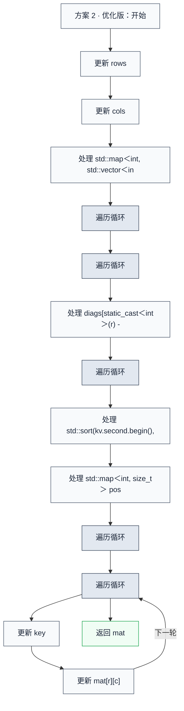

```cpp
// LeetCode 1329. 将矩阵按对角线排序 — C++ 版
#include <algorithm> // 引入头文件
#include <cassert>   // 引入头文件
#include <iostream>  // 引入头文件
#include <map>       // 引入头文件
#include <vector>    // 引入头文件

using Matrix = std::vector<std::vector<int>>; // 引入依赖

// 方案2：优化版 —— 按 r-c 分组收集对角线，升序排序，写回时按 shift（取队首）取值
// 按值传参等价于 TS 事实源中 m.map(r => r.slice()) 的深拷贝
Matrix diagonalSort(Matrix mat) { // 定义函数/方法 diagonalSort
    size_t rows = mat.size(),
           cols = mat[0].size(); // 把 mat.大小(), 列数 赋值为 mat[0].大小(); 写入 size_t rows
    std::map<int, std::vector<int>> diags; // std::映射表 小于 int, std::vector 小于 int 超过 超过 diags;
    for (size_t r = 0; r < rows; ++r) // 让 右指针 从 0 开始计数，右指针 小于 行数 就继续
        for (size_t c = 0; c < cols; ++c) // 让 字符 从 0 开始计数，字符 小于 列数 就继续
            diags[static_cast<int>(r) - static_cast<int>(c)].push_back(mat[r][c]);
    for (auto &kv : diags)                             // 逐个取出 diags 的元素（kv）
        std::sort(kv.second.begin(), kv.second.end()); // std::sort(kv.second 迭代位置 , kv.second.终点());
    std::map<int, size_t> pos;                         // std::映射表 小于 int, size_t 超过 pos;
    for (size_t r = 0; r < rows; ++r) // 让 右指针 从 0 开始计数，右指针 小于 行数 就继续
        for (size_t c = 0; c < cols; ++c) { // 让 字符 从 0 开始计数，字符 小于 列数 就继续
            int key = static_cast<int>(r) - static_cast<int>(c);
            mat[r][c] = diags[key][pos[key]++]; // 把 diags[key][pos[key] 加一 ]; 写入 mat[r][c]
        }
    return mat; // 返回 mat
}

int main() { // 程序入口：跑内嵌自测用例
    // 与 TS 事实源内嵌用例一致
    Matrix m = {{3, 3, 1, 1},
                {2, 2, 1, 2},
                {1, 1, 1, 2}}; // 把 {{3, 3, 1, 1}, {2, 2, 1, 2}, {1, 1, 1, 2}}; 写入 Matrix m
    Matrix exp = {{1, 1, 1, 1},
                  {1, 2, 2, 2},
                  {1, 2, 3, 3}};      // 把 {{1, 1, 1, 1}, {1, 2, 2, 2}, {1, 2, 3, 3}}; 写入 Matrix exp
    Matrix got = diagonalSort(m);     // 把 diagonalSort(映射表); 写入 Matrix got
    assert(got == exp && "FAILED");   // 断言校验
    std::cout << "PASS" << std::endl; // 全部用例通过，输出 PASS
    return 0;                         // 返回 0
}
```

### R 实现（2 种方案）

R 的全部方案如下，每个方案都内嵌用例自测，可独立运行（老仓库 python/go 文件遵循「打印结果」约定）：

#### 方案 1：模拟

**思路与代码分析**：核心是「模拟」。R 版用向量化思维与 1 起始下标，注意 1:n 的降序陷阱。代码里依次做这些事：双重循环遍历。**走读**：方案 1 · 模拟：开始 → 处理 rows ＜- length(mat) → 循环 r：遍历 seq_len(rows) → 循环 c：遍历 seq_len(cols) → 循环 k：遍历 seq_along(diags)) diags[[k]] <- sort(diags[[k]] → 循环 r：遍历 seq_len(rows) → 循环 c：遍历 seq_len(cols) → 返回结果。

**运行架构**（真实控制流）：

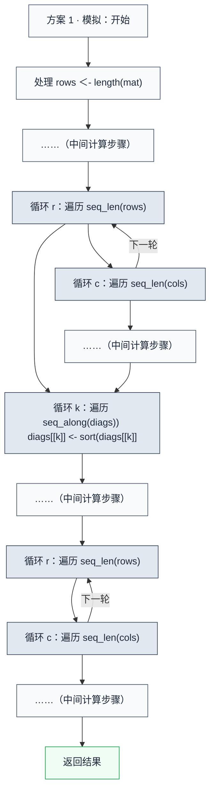

```r
# R 版
# 方案1：模拟 —— 按 r-c 分组收集对角线（偏移 +cols 转为 1 基列表下标），升序排序， 写回时按
# shift（取队首）取值；R 传值拷贝等价于 TS 的 m.map(r => r.slice()) 定义函数 diagonal_sort（参数：mat）
diagonal_sort <- function(mat) {
    rows <- length(mat)  # 把 长度(mat) 存入 行数
    cols <- length(mat[[1]])  # 把 长度(mat[[1]]) 存入 列数
    diags <- vector("list", rows + cols - 1L)  # 预分配：避免 [[key]] 读缺失下标报错
    for (r in seq_len(rows)) {
        # for (右指针 in seq_len(行数)) { for (字符 in seq_len(列数)) {
        for (c in seq_len(cols)) {
            key <- (r - 1L) - (c - 1L) + cols  # = r - c + cols，恒 >= 1
            diags[[key]] <- c(diags[[key]], mat[[r]][c])  # 把 字符(diags[[key]], mat[[右指针]][字符]) 存入 diags[[key]]
        }
    }
    for (k in seq_along(diags)) diags[[k]] <- sort(diags[[k]])
    pos <- integer(rows + cols)  # 全 0 初始化
    for (r in seq_len(rows)) {
        # for (右指针 in seq_len(行数)) { for (字符 in seq_len(列数)) {
        for (c in seq_len(cols)) {
            key <- (r - 1L) - (c - 1L) + cols  # 把 (右指针 减 1L) 减 (字符 减 1L) 加 列数 存入 key
            pos[key] <- pos[key] + 1L  # 把 pos[key] 加 1L 存入 pos[key]
            mat[[r]][c] <- diags[[key]][pos[key]]  # 把 diags[[key]][pos[key]] 存入 mat[[r]][c]
        }
    }
    mat  # mat
}
eq_matrix <- function(a, b) {
    # 定义函数 eq_matrix（参数：数组, b）
    if (length(a) != length(b))
        return(FALSE)  # 若 长度(数组) 不等于 长度(b)) return(FALSE
    for (i in seq_along(a)) {
        # for (下标 i in seq_along(数组)) {
        if (length(a[[i]]) != length(b[[i]]))
            return(FALSE)  # 若 长度(数组[[下标 i]]) 不等于 长度(b[[下标 i]])) return(FALSE
        if (!all(a[[i]] == b[[i]]))
            return(FALSE)  # 若 取反 all(数组[[下标 i]] 等于 b[[下标 i]])) return(FALSE
    }
    TRUE  # TRUE
}
# 自测：与 TS 事实源内嵌用例一致
m <- list(c(3L, 3L, 1L, 1L), c(2L, 2L, 1L, 2L), c(1L, 1L, 1L, 2L))
got <- diagonal_sort(m)  # 把 diagonal_sort(映射表) 存入 got
exp <- list(c(1L, 1L, 1L, 1L), c(1L, 2L, 2L, 2L), c(1L, 2L, 3L, 3L))
stopifnot(eq_matrix(got, exp))  # 断言校验
cat("PASS\n")  # 全部用例通过，输出 PASS
```

#### 方案 2：优化版

**思路与代码分析**：核心是「优化版」。R 版用向量化思维与 1 起始下标，注意 1:n 的降序陷阱。代码里依次做这些事：双重循环遍历。**走读**：方案 2 · 优化版：开始 → 处理 rows ＜- length(mat) → 循环 r：遍历 seq_len(rows) → 循环 c：遍历 seq_len(cols) → 循环 k：遍历 seq_along(diags)) diags[[k]] <- sort(diags[[k]] → 循环 r：遍历 seq_len(rows) → 循环 c：遍历 seq_len(cols) → 返回结果。

**运行架构**（真实控制流）：

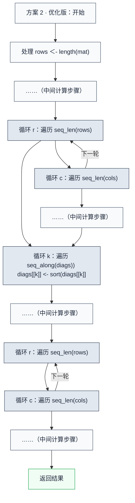

```r
# R 版
# 方案2：优化版 —— 按 r-c 分组收集对角线（偏移 +cols 转为 1 基列表下标），升序排序， 写回时按
# shift（取队首）取值；R 传值拷贝等价于 TS 的 m.map(r => r.slice()) 定义函数 diagonal_sort（参数：mat）
diagonal_sort <- function(mat) {
    rows <- length(mat)  # 把 长度(mat) 存入 行数
    cols <- length(mat[[1]])  # 把 长度(mat[[1]]) 存入 列数
    diags <- vector("list", rows + cols - 1L)  # 预分配：避免 [[key]] 读缺失下标报错
    for (r in seq_len(rows)) {
        # for (右指针 in seq_len(行数)) { for (字符 in seq_len(列数)) {
        for (c in seq_len(cols)) {
            key <- (r - 1L) - (c - 1L) + cols  # = r - c + cols，恒 >= 1
            diags[[key]] <- c(diags[[key]], mat[[r]][c])  # 把 字符(diags[[key]], mat[[右指针]][字符]) 存入 diags[[key]]
        }
    }
    for (k in seq_along(diags)) diags[[k]] <- sort(diags[[k]])
    pos <- integer(rows + cols)  # 全 0 初始化
    for (r in seq_len(rows)) {
        # for (右指针 in seq_len(行数)) { for (字符 in seq_len(列数)) {
        for (c in seq_len(cols)) {
            key <- (r - 1L) - (c - 1L) + cols  # 把 (右指针 减 1L) 减 (字符 减 1L) 加 列数 存入 key
            pos[key] <- pos[key] + 1L  # 把 pos[key] 加 1L 存入 pos[key]
            mat[[r]][c] <- diags[[key]][pos[key]]  # 把 diags[[key]][pos[key]] 存入 mat[[r]][c]
        }
    }
    mat  # mat
}
eq_matrix <- function(a, b) {
    # 定义函数 eq_matrix（参数：数组, b）
    if (length(a) != length(b))
        return(FALSE)  # 若 长度(数组) 不等于 长度(b)) return(FALSE
    for (i in seq_along(a)) {
        # for (下标 i in seq_along(数组)) {
        if (length(a[[i]]) != length(b[[i]]))
            return(FALSE)  # 若 长度(数组[[下标 i]]) 不等于 长度(b[[下标 i]])) return(FALSE
        if (!all(a[[i]] == b[[i]]))
            return(FALSE)  # 若 取反 all(数组[[下标 i]] 等于 b[[下标 i]])) return(FALSE
    }
    TRUE  # TRUE
}
# 自测：与 TS 事实源内嵌用例一致
m <- list(c(3L, 3L, 1L, 1L), c(2L, 2L, 1L, 2L), c(1L, 1L, 1L, 2L))
got <- diagonal_sort(m)  # 把 diagonal_sort(映射表) 存入 got
exp <- list(c(1L, 1L, 1L, 1L), c(1L, 2L, 2L, 2L), c(1L, 2L, 3L, 3L))
stopifnot(eq_matrix(got, exp))  # 断言校验
cat("PASS\n")  # 全部用例通过，输出 PASS
```

### Zig 实现（2 种方案）

Zig 的全部方案如下，每个方案都内嵌用例自测，可独立运行（老仓库 python/go 文件遵循「打印结果」约定）：

#### 方案 1：模拟

**思路与代码分析**：核心是「模拟」。Zig 版显式分配与清零，整型边界处理严格。代码里依次做这些事：单循环线性扫描。**走读**：方案 1 · 模拟：开始 → 计算 m → 遍历集合元素 → 更新 m[i] → 返回 m。

**运行架构**（真实控制流）：

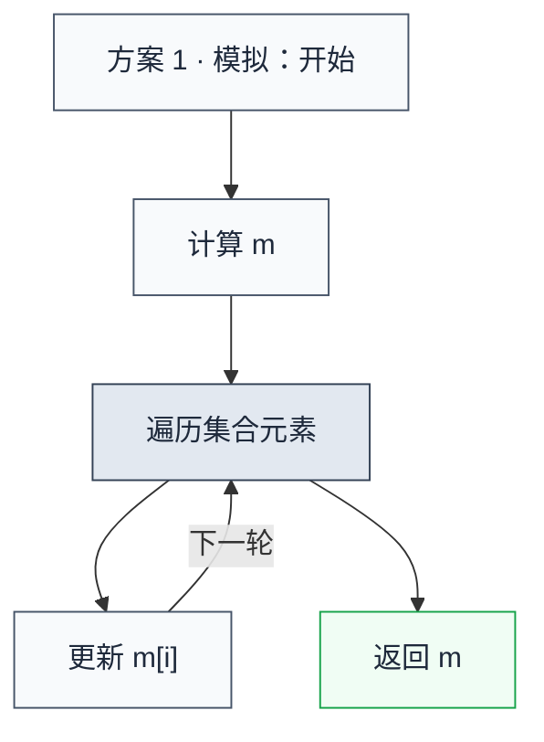

```zig
// LeetCode 1329. 将矩阵按对角线排序 — Zig 版
const std = @import("std"); // 把 @import(「std」) 存入 std

// 方案1：模拟 —— 与 TS 事实源一致：按 r-c 分组收集对角线，升序排序，按原顺序写回（shift 取最小值）。
// Zig 无内建哈希表，按对角线编号 d = r-c 从 -(cols-1) 到 rows-1 逐条收集。
fn diagonalSort(allocator: std.mem.Allocator, mat: [][]i32) !void { // 定义函数/方法 diagonalSort
    const rows = mat.len; // 把 mat.长度 存入 行数
    const cols = mat[0].len; // 把 mat[0].长度 存入 列数
    const ris: isize = @intCast(rows); // 把 @intCast(行数); 写入 const ris: isize
    const cis: isize = @intCast(cols); // 把 @intCast(列数); 写入 const cis: isize
    var buf = try std.ArrayList(i32).initCapacity(allocator, rows + cols);
    defer buf.deinit(); // defer buf.deinit();
    const dmin = -(@as(isize, @intCast(cols)) - 1); // 把 减 (@as(isize, @intCast(列数)) 减 1) 存入 dmin
    const dmax = @as(isize, @intCast(rows)) - 1; // 把 @as(isize, @intCast(行数)) 减 1 存入 dmax
    var d: isize = dmin; // 把 dmin; 写入 var d: isize
    while (d <= dmax) : (d += 1) { // 循环，直到不满足「d 不超过 dmax) : (d 累加 1」
        buf.clearRetainingCapacity(); // buf.clearRetainingCapacity();
        const r0: isize = if (d > 0) d else 0; // 把 if (d 超过 0) d else 0; 写入 const r0: isize
        var r = r0; // 把 r0 存入 右指针
        while (r < ris) : (r += 1) { // 循环，直到不满足「右指针 小于 ris) : (右指针 累加 1」
            const c = r - d; // 把 右指针 减 d 存入 字符
            if (c < 0 or c >= cis) continue; // 若 字符 小于 0 or 字符 不低于 cis) continue;
            try buf.append(mat[@intCast(r)][@intCast(c)]); // 把 mat[@intCast(右指针 追加到列表尾部
        }
        std.sort.block(i32, buf.items, {}, std.sort.asc(i32)); // std.sort.block(i32, buf.items, {}, std.sort.asc(i32));
        var k: usize = 0; // 把 0; 写入 var k: usize
        r = r0; // 把 r0; 写入 右指针
        while (r < ris) : (r += 1) { // 循环，直到不满足「右指针 小于 ris) : (右指针 累加 1」
            const c = r - d; // 把 右指针 减 d 存入 字符
            if (c < 0 or c >= cis) continue; // 若 字符 小于 0 or 字符 不低于 cis) continue;
            mat[@intCast(r)][@intCast(c)] = buf.items[k]; // 把 buf.items[下标 k]; 写入 mat[@intCast(r)][@intCast(c)]
            k += 1; // 下标 k累加 1
        }
    }
}

fn matFromRows(allocator: std.mem.Allocator, rows: []const []const i32) ![][]i32 { // 定义函数/方法 matFromRows
    const m = try allocator.alloc([]i32, rows.len); // 把 try allocator.alloc([]i32, 行数.长度) 存入 映射表
    for (rows, 0..) |row, i| { // for (行数, 0..) 按位或 row, 下标 i 按位或 {
        m[i] = try allocator.dupe(i32, row); // 把 try allocator.dupe(i32, row); 写入 m[i]
    }
    return m; // 返回 映射表
}

fn eqMatrix(a: []const []i32, b: []const []const i32) bool { // 定义函数/方法 eqMatrix
    if (a.len != b.len) return false; // 若 数组.长度 不等于 b.长度，直接返回 false
    for (a, 0..) |row, i| { // for (数组, 0..) 按位或 row, 下标 i 按位或 {
        if (row.len != b[i].len) return false; // 若 row.长度 不等于 b[下标 i].长度，直接返回 false
        for (row, 0..) |v, j| { // for (row, 0..) 按位或 值, 下标 j 按位或 {
            if (v != b[i][j]) return false; // 若 值 不等于 b[下标 i][下标 j]，直接返回 false
        }
    }
    return true; // 返回 true
}

pub fn main() !void { // 程序入口：跑内嵌自测用例
    var arena = std.heap.ArenaAllocator.init(std.heap.page_allocator); // 把 std.堆.ArenaAllocator.init(std.堆.page_allocator) 存入 arena
    defer arena.deinit(); // defer arena.deinit();
    const allocator = arena.allocator(); // 把 arena.allocator() 存入 allocator

    // 与 TS 事实源内嵌用例一致（输入深拷贝后排序，等价于 m.map(r => r.slice())）
    const src = [_][]const i32{ &.{ 3, 3, 1, 1 }, &.{ 2, 2, 1, 2 }, &.{ 1, 1, 1, 2 } };
    const exp = [_][]const i32{ &.{ 1, 1, 1, 1 }, &.{ 1, 2, 2, 2 }, &.{ 1, 2, 3, 3 } };
    const mat = try matFromRows(allocator, &src); // 把 try matFromRows(allocator, 按位与 src) 存入 mat
    try diagonalSort(allocator, mat); // try diagonalSort(allocator, mat);
    if (!eqMatrix(mat, &exp)) return error.TestFailed; // 若 取反 eqMatrix(mat, 按位与 exp)，直接返回 error.TestFailed
    std.debug.print("PASS\n", .{}); // 全部用例通过，输出 PASS
}
```

#### 方案 2：优化版

**思路与代码分析**：核心是「优化版」。Zig 版显式分配与清零，整型边界处理严格。代码里依次做这些事：单循环线性扫描。**走读**：方案 2 · 优化版：开始 → 计算 m → 遍历集合元素 → 更新 m[i] → 返回 m。

**运行架构**（真实控制流）：

```mermaid
graph TD
    N0["方案 2 · 优化版：开始"]
    N1["计算 m"]
    N2["遍历集合元素"]
    N3["更新 m[i]"]
    N4["返回 m"]
    N0 --> N1
    N1 --> N2
    N2 --> N3
    N3 -- 下一轮 --> N2
    N2 --> N4
    classDef n fill:#f8fafc,stroke:#475569,color:#1e293b;
    classDef lp fill:#e2e8f0,stroke:#334155,color:#1e293b;
    classDef dc fill:#fef9c3,stroke:#ca8a04,color:#1e293b;
    classDef tm fill:#f0fdf4,stroke:#16a34a,color:#1e293b;
    class N0,N1,N3 n;
    class N2 lp;
    class N4 tm;
```

```zig
// LeetCode 1329. 将矩阵按对角线排序 — Zig 版
const std = @import("std"); // 把 @import(「std」) 存入 std

// 方案2：优化版 —— 与 TS 事实源一致：按 r-c 分组收集对角线，升序排序，按原顺序写回（shift 取最小值）。
// Zig 无内建哈希表，按对角线编号 d = r-c 从 -(cols-1) 到 rows-1 逐条收集。
fn diagonalSort(allocator: std.mem.Allocator, mat: [][]i32) !void { // 定义函数/方法 diagonalSort
    const rows = mat.len; // 把 mat.长度 存入 行数
    const cols = mat[0].len; // 把 mat[0].长度 存入 列数
    const ris: isize = @intCast(rows); // 把 @intCast(行数); 写入 const ris: isize
    const cis: isize = @intCast(cols); // 把 @intCast(列数); 写入 const cis: isize
    var buf = try std.ArrayList(i32).initCapacity(allocator, rows + cols);
    defer buf.deinit(); // defer buf.deinit();
    const dmin = -(@as(isize, @intCast(cols)) - 1); // 把 减 (@as(isize, @intCast(列数)) 减 1) 存入 dmin
    const dmax = @as(isize, @intCast(rows)) - 1; // 把 @as(isize, @intCast(行数)) 减 1 存入 dmax
    var d: isize = dmin; // 把 dmin; 写入 var d: isize
    while (d <= dmax) : (d += 1) { // 循环，直到不满足「d 不超过 dmax) : (d 累加 1」
        buf.clearRetainingCapacity(); // buf.clearRetainingCapacity();
        const r0: isize = if (d > 0) d else 0; // 把 if (d 超过 0) d else 0; 写入 const r0: isize
        var r = r0; // 把 r0 存入 右指针
        while (r < ris) : (r += 1) { // 循环，直到不满足「右指针 小于 ris) : (右指针 累加 1」
            const c = r - d; // 把 右指针 减 d 存入 字符
            if (c < 0 or c >= cis) continue; // 若 字符 小于 0 or 字符 不低于 cis) continue;
            try buf.append(mat[@intCast(r)][@intCast(c)]); // 把 mat[@intCast(右指针 追加到列表尾部
        }
        std.sort.block(i32, buf.items, {}, std.sort.asc(i32)); // std.sort.block(i32, buf.items, {}, std.sort.asc(i32));
        var k: usize = 0; // 把 0; 写入 var k: usize
        r = r0; // 把 r0; 写入 右指针
        while (r < ris) : (r += 1) { // 循环，直到不满足「右指针 小于 ris) : (右指针 累加 1」
            const c = r - d; // 把 右指针 减 d 存入 字符
            if (c < 0 or c >= cis) continue; // 若 字符 小于 0 or 字符 不低于 cis) continue;
            mat[@intCast(r)][@intCast(c)] = buf.items[k]; // 把 buf.items[下标 k]; 写入 mat[@intCast(r)][@intCast(c)]
            k += 1; // 下标 k累加 1
        }
    }
}

fn matFromRows(allocator: std.mem.Allocator, rows: []const []const i32) ![][]i32 { // 定义函数/方法 matFromRows
    const m = try allocator.alloc([]i32, rows.len); // 把 try allocator.alloc([]i32, 行数.长度) 存入 映射表
    for (rows, 0..) |row, i| { // for (行数, 0..) 按位或 row, 下标 i 按位或 {
        m[i] = try allocator.dupe(i32, row); // 把 try allocator.dupe(i32, row); 写入 m[i]
    }
    return m; // 返回 映射表
}

fn eqMatrix(a: []const []i32, b: []const []const i32) bool { // 定义函数/方法 eqMatrix
    if (a.len != b.len) return false; // 若 数组.长度 不等于 b.长度，直接返回 false
    for (a, 0..) |row, i| { // for (数组, 0..) 按位或 row, 下标 i 按位或 {
        if (row.len != b[i].len) return false; // 若 row.长度 不等于 b[下标 i].长度，直接返回 false
        for (row, 0..) |v, j| { // for (row, 0..) 按位或 值, 下标 j 按位或 {
            if (v != b[i][j]) return false; // 若 值 不等于 b[下标 i][下标 j]，直接返回 false
        }
    }
    return true; // 返回 true
}

pub fn main() !void { // 程序入口：跑内嵌自测用例
    var arena = std.heap.ArenaAllocator.init(std.heap.page_allocator); // 把 std.堆.ArenaAllocator.init(std.堆.page_allocator) 存入 arena
    defer arena.deinit(); // defer arena.deinit();
    const allocator = arena.allocator(); // 把 arena.allocator() 存入 allocator

    // 与 TS 事实源内嵌用例一致（输入深拷贝后排序，等价于 m.map(r => r.slice())）
    const src = [_][]const i32{ &.{ 3, 3, 1, 1 }, &.{ 2, 2, 1, 2 }, &.{ 1, 1, 1, 2 } };
    const exp = [_][]const i32{ &.{ 1, 1, 1, 1 }, &.{ 1, 2, 2, 2 }, &.{ 1, 2, 3, 3 } };
    const mat = try matFromRows(allocator, &src); // 把 try matFromRows(allocator, 按位与 src) 存入 mat
    try diagonalSort(allocator, mat); // try diagonalSort(allocator, mat);
    if (!eqMatrix(mat, &exp)) return error.TestFailed; // 若 取反 eqMatrix(mat, 按位与 exp)，直接返回 error.TestFailed
    std.debug.print("PASS\n", .{}); // 全部用例通过，输出 PASS
}
```

### Dart 实现（2 种方案）

Dart 的全部方案如下，每个方案都内嵌用例自测，可独立运行（老仓库 python/go 文件遵循「打印结果」约定）：

#### 方案 1：模拟

**思路与代码分析**：核心是「模拟」。Dart 版用可空类型标注与集合方法，注意空安全。代码里依次做这些事：先排序再处理；双重循环遍历。**走读**：方案 1 · 模拟：开始 → 更新 rows → 更新 cols → 更新 diags → 遍历循环 → 遍历循环 → 更新 () → 遍历循环 → 排序整理 → 更新 pos → 遍历循环 → 遍历循环 → 更新 key → 更新 p → 更新 mat[r][c] → 返回 mat。

**运行架构**（真实控制流）：

```mermaid
graph TD
    N0["方案 1 · 模拟：开始"]
    N1["更新 rows"]
    N2["更新 cols"]
    N3["更新 diags"]
    N4["遍历循环"]
    N5["遍历循环"]
    N6["更新 ()"]
    N7["遍历循环"]
    N8["排序整理"]
    N9["更新 pos"]
    N10["遍历循环"]
    N11["遍历循环"]
    N12["更新 key"]
    N13["更新 p"]
    N14["更新 mat[r][c]"]
    N15["返回 mat"]
    N0 --> N1
    N1 --> N2
    N2 --> N3
    N3 --> N4
    N4 --> N5
    N5 --> N6
    N6 -- 下一轮 --> N5
    N5 -- 下一轮 --> N4
    N4 --> N7
    N7 --> N8
    N8 -- 下一轮 --> N7
    N7 --> N9
    N9 --> N10
    N10 --> N11
    N11 --> N12
    N12 --> N13
    N13 --> N14
    N14 -- 下一轮 --> N11
    N11 -- 下一轮 --> N10
    N10 --> N15
    classDef n fill:#f8fafc,stroke:#475569,color:#1e293b;
    classDef lp fill:#e2e8f0,stroke:#334155,color:#1e293b;
    classDef dc fill:#fef9c3,stroke:#ca8a04,color:#1e293b;
    classDef tm fill:#f0fdf4,stroke:#16a34a,color:#1e293b;
    class N0,N1,N2,N3,N6,N8,N9,N12,N13,N14 n;
    class N4,N5,N7,N10,N11 lp;
    class N15 tm;
```

```dart
// LeetCode 1329. 将矩阵按对角线排序 — Dart 版

/// 方案1：模拟 —— 按 r-c 分组收集对角线，升序排序，写回时按 shift（取队首）取值
List<List<int>> diagonalSort(List<List<int>> mat) {
  // 定义函数/方法 diagonalSort
  final rows = mat.length,
      cols = mat[0].length; // 把 mat.长度, 列数 赋值为 mat[0].长度 存入 行数
  final diags = <int, List<int>>{}; // 把 小于 int, List 小于 int 超过 超过 {} 存入 diags
  for (var r = 0; r < rows; r++) {
    // 让 右指针 从 0 开始计数，右指针 小于 行数 就继续
    for (var c = 0; c < cols; c++) {
      // 让 字符 从 0 开始计数，字符 小于 列数 就继续
      diags.putIfAbsent(r - c, () => <int>[]).add(mat[r][c]);
    }
  }
  for (final arr in diags.values) {
    // for (final 数组 in diags.values) {
    arr.sort(); // 排序
  }
  final pos = <int, int>{}; // 把 小于 int, int 超过 {} 存入 pos
  for (var r = 0; r < rows; r++) {
    // 让 右指针 从 0 开始计数，右指针 小于 行数 就继续
    for (var c = 0; c < cols; c++) {
      // 让 字符 从 0 开始计数，字符 小于 列数 就继续
      final key = r - c; // 把 右指针 减 字符 存入 key
      final p = pos.update(key, (v) => v + 1, ifAbsent: () => 0);
      mat[r][c] = diags[key]![p]; // 把 diags[key]取反 [节点]; 写入 mat[r][c]
    }
  }
  return mat; // 返回 mat
}

bool eqMatrix(List<List<int>> a, List<List<int>> b) {
  // 定义函数/方法 eqMatrix
  if (a.length != b.length) return false; // 若 数组.长度 不等于 b.长度，直接返回 false
  for (var i = 0; i < a.length; i++) {
    // 让 下标 i 从 0 开始计数，下标 i 小于 数组.长度 就继续
    if (a[i].length != b[i].length)
      return false; // 若 数组[下标 i].长度 不等于 b[下标 i].长度，直接返回 false
    for (var j = 0; j < a[i].length; j++) {
      // 让 下标 j 从 0 开始计数，下标 j 小于 数组[下标 i].长度 就继续
      if (a[i][j] != b[i][j])
        return false; // 若 数组[下标 i][下标 j] 不等于 b[下标 i][下标 j]，直接返回 false
    }
  }
  return true; // 返回 true
}

void main() {
  // 程序入口：跑内嵌自测用例
  // 与 TS 事实源内嵌用例一致（输入深拷贝，等价于 m.map(r => r.slice())）
  final m = <List<int>>[
    [3, 3, 1, 1],
    [2, 2, 1, 2],
    [1, 1, 1, 2],
  ];
  final input = m.map((r) => r.toList()).toList();
  final exp = <List<int>>[
    [1, 1, 1, 1],
    [1, 2, 2, 2],
    [1, 2, 3, 3],
  ];
  final got = diagonalSort(input); // 把 diagonalSort(input) 存入 got
  if (!eqMatrix(got, exp)) {
    // 若 取反 eqMatrix(got, exp
    throw StateError('FAILED'); // throw StateError('FAILED');
  }
  print('PASS'); // 全部用例通过，输出 PASS
}
```

#### 方案 2：优化版

**思路与代码分析**：核心是「优化版」。Dart 版用可空类型标注与集合方法，注意空安全。代码里依次做这些事：先排序再处理；双重循环遍历。**走读**：方案 2 · 优化版：开始 → 更新 rows → 更新 cols → 更新 diags → 遍历循环 → 遍历循环 → 更新 () → 遍历循环 → 排序整理 → 更新 pos → 遍历循环 → 遍历循环 → 更新 key → 更新 p → 更新 mat[r][c] → 返回 mat。

**运行架构**（真实控制流）：

```mermaid
graph TD
    N0["方案 2 · 优化版：开始"]
    N1["更新 rows"]
    N2["更新 cols"]
    N3["更新 diags"]
    N4["遍历循环"]
    N5["遍历循环"]
    N6["更新 ()"]
    N7["遍历循环"]
    N8["排序整理"]
    N9["更新 pos"]
    N10["遍历循环"]
    N11["遍历循环"]
    N12["更新 key"]
    N13["更新 p"]
    N14["更新 mat[r][c]"]
    N15["返回 mat"]
    N0 --> N1
    N1 --> N2
    N2 --> N3
    N3 --> N4
    N4 --> N5
    N5 --> N6
    N6 -- 下一轮 --> N5
    N5 -- 下一轮 --> N4
    N4 --> N7
    N7 --> N8
    N8 -- 下一轮 --> N7
    N7 --> N9
    N9 --> N10
    N10 --> N11
    N11 --> N12
    N12 --> N13
    N13 --> N14
    N14 -- 下一轮 --> N11
    N11 -- 下一轮 --> N10
    N10 --> N15
    classDef n fill:#f8fafc,stroke:#475569,color:#1e293b;
    classDef lp fill:#e2e8f0,stroke:#334155,color:#1e293b;
    classDef dc fill:#fef9c3,stroke:#ca8a04,color:#1e293b;
    classDef tm fill:#f0fdf4,stroke:#16a34a,color:#1e293b;
    class N0,N1,N2,N3,N6,N8,N9,N12,N13,N14 n;
    class N4,N5,N7,N10,N11 lp;
    class N15 tm;
```

```dart
// LeetCode 1329. 将矩阵按对角线排序 — Dart 版

/// 方案2：优化版 —— 按 r-c 分组收集对角线，升序排序，写回时按 shift（取队首）取值
List<List<int>> diagonalSort(List<List<int>> mat) {
  // 定义函数/方法 diagonalSort
  final rows = mat.length,
      cols = mat[0].length; // 把 mat.长度, 列数 赋值为 mat[0].长度 存入 行数
  final diags = <int, List<int>>{}; // 把 小于 int, List 小于 int 超过 超过 {} 存入 diags
  for (var r = 0; r < rows; r++) {
    // 让 右指针 从 0 开始计数，右指针 小于 行数 就继续
    for (var c = 0; c < cols; c++) {
      // 让 字符 从 0 开始计数，字符 小于 列数 就继续
      diags.putIfAbsent(r - c, () => <int>[]).add(mat[r][c]);
    }
  }
  for (final arr in diags.values) {
    // for (final 数组 in diags.values) {
    arr.sort(); // 排序
  }
  final pos = <int, int>{}; // 把 小于 int, int 超过 {} 存入 pos
  for (var r = 0; r < rows; r++) {
    // 让 右指针 从 0 开始计数，右指针 小于 行数 就继续
    for (var c = 0; c < cols; c++) {
      // 让 字符 从 0 开始计数，字符 小于 列数 就继续
      final key = r - c; // 把 右指针 减 字符 存入 key
      final p = pos.update(key, (v) => v + 1, ifAbsent: () => 0);
      mat[r][c] = diags[key]![p]; // 把 diags[key]取反 [节点]; 写入 mat[r][c]
    }
  }
  return mat; // 返回 mat
}

bool eqMatrix(List<List<int>> a, List<List<int>> b) {
  // 定义函数/方法 eqMatrix
  if (a.length != b.length) return false; // 若 数组.长度 不等于 b.长度，直接返回 false
  for (var i = 0; i < a.length; i++) {
    // 让 下标 i 从 0 开始计数，下标 i 小于 数组.长度 就继续
    if (a[i].length != b[i].length)
      return false; // 若 数组[下标 i].长度 不等于 b[下标 i].长度，直接返回 false
    for (var j = 0; j < a[i].length; j++) {
      // 让 下标 j 从 0 开始计数，下标 j 小于 数组[下标 i].长度 就继续
      if (a[i][j] != b[i][j])
        return false; // 若 数组[下标 i][下标 j] 不等于 b[下标 i][下标 j]，直接返回 false
    }
  }
  return true; // 返回 true
}

void main() {
  // 程序入口：跑内嵌自测用例
  // 与 TS 事实源内嵌用例一致（输入深拷贝，等价于 m.map(r => r.slice())）
  final m = <List<int>>[
    [3, 3, 1, 1],
    [2, 2, 1, 2],
    [1, 1, 1, 2],
  ];
  final input = m.map((r) => r.toList()).toList();
  final exp = <List<int>>[
    [1, 1, 1, 1],
    [1, 2, 2, 2],
    [1, 2, 3, 3],
  ];
  final got = diagonalSort(input); // 把 diagonalSort(input) 存入 got
  if (!eqMatrix(got, exp)) {
    // 若 取反 eqMatrix(got, exp
    throw StateError('FAILED'); // throw StateError('FAILED');
  }
  print('PASS'); // 全部用例通过，输出 PASS
}
```

---

## 内容总结

- **将矩阵按对角线排序**（矩阵 · Medium）：共 2 个方案，主线思路「模拟」；时间 O(n²)（两层嵌套扫描）；动画演示广度优先波纹过程，附录给出 11 种语言 × 全部方案的可运行实现。
- 来源博客：[https://blog.csdn.net/tyro_java/article/details/145381786](https://blog.csdn.net/tyro_java/article/details/145381786)
- 导航：[📋 总目录](../) ｜ [← 150 数据流的中位数](../150_数据流的中位数/) ｜ [152 克隆图 →](../152_克隆图/)
