# 152 · 克隆图（第八阶段 · 矩阵与图 · Medium）

> **难度**：⭐⭐ Medium ｜ **专题**：图
> **学习定位**：第八阶段 · 矩阵与图第 152 篇 ｜ **解法数**：7
> **内容总结**：**克隆图**（图 · Medium）：共 7 个方案，主线思路「方案1（BFS，visited 以节点对象为键）」；时间 O(n²)（两层嵌套扫描）；动画演示广度优先波纹过程，附录给出 11 种语言 × 全部方案的可运行实现。

---

## 题目描述

给你无向 连通 图中一个节点的引用，请你返回该图的 深拷贝（克隆）。

图中的每个节点都包含它的值 `val`（`int`） 和其邻居的列表（`list[Node]`）。

class Node {
 public int val;
 public List neighbors;
}

测试用例格式：

简单起见，每个节点的值都和它的索引相同。例如，第一个节点值为 1（`val = 1`），第二个节点值为 2（`val = 2`），以此类推。该图在测试用例中使用邻接列表表示。

邻接列表 是用于表示有限图的无序列表的集合。每个列表都描述了图中节点的邻居集。

给定节点将始终是图中的第一个节点（值为 1）。你必须将 给定节点的拷贝 作为对克隆图的引用返回。

- 主函数签名：`function cloneGraph(node: Node | null): Node | null`

**用例（来自原题）**：

**示例 1**

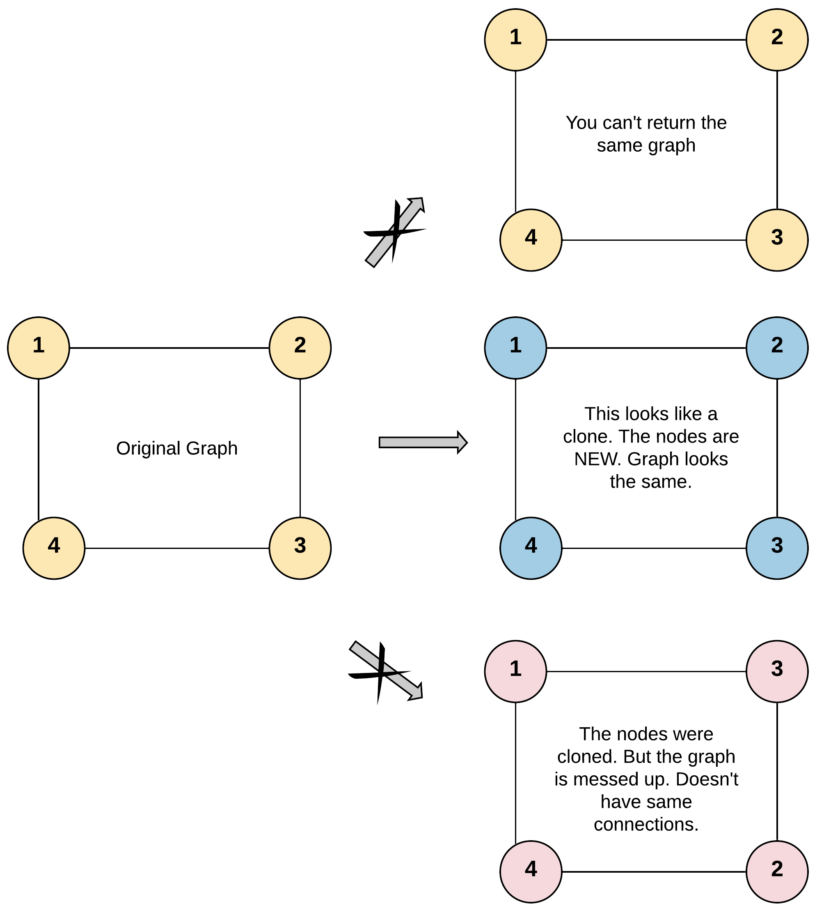

```text
输入：adjList = [[2,4],[1,3],[2,4],[1,3]]
输出：[[2,4],[1,3],[2,4],[1,3]]
```

解释：图中有 4 个节点。 节点 1 的值是 1，它有两个邻居：节点 2 和 4 。 节点 2 的值是 2，它有两个邻居：节点 1 和 3 。 节点 3 的值是 3，它有两个邻居：节点 2 和 4 。 节点 4 的值是 4，它有两个邻居：节点 1 和 3 。

**示例 2**

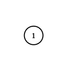

```text
输入：adjList = [[]]
输出：[[]]
```

解释：输入包含一个空列表。该图仅仅只有一个值为 1 的节点，它没有任何邻居。

**示例 3**

```text
输入：adjList = []
输出：[]
```

解释：这个图是空的，它不含任何节点。
> 题面与 [leetcode.cn 官方](https://leetcode.cn/problems/clone-graph/)一致，示例配图取自官方题面。

**数据范围与注意事项**：

- 这张图中的节点数在 `[0, 100]` 之间。
- `1 <= Node.val <= 100`
- 每个节点值 `Node.val` 都是唯一的，
- 图中没有重复的边，也没有自环。
- 图是连通图，你可以从给定节点访问到所有节点。
- **易错点**：访问标记要在入队时打而不是出队时，否则同一节点会重复入队。

## 题目分析

**场景是什么**：图描述多对多关系，这类题练的是搜索与连通性，对应真实开发里的社交关系、依赖解析。本题就是该场景的 Medium 级练习，主线做法是「方案1（BFS，visited 以节点对象为键）」。

**主线怎么解**：把主解法从头到尾过一遍，它其实在依次做这几件事：哈希结构做计数或查重 → 单循环线性扫描 → 队列或堆的调度。

## 解题思路

**方案对比**（共 7 个方案，由浅入深）：

| 方案 | 时间复杂度 | 空间复杂度 |
|---|---|---|
| 方案 1 · 方案1（BFS，visited 以节点对象为键） | O(n²)（两层嵌套扫描） | O(1) 到 O(n) |
| 方案 2 · 方案2（DFS 递归，visited 以节点对象为键） | O(n)（单趟线性扫描） | O(1) 到 O(n)（视辅助结构） |
| 方案 3 · 方案3（DFS 递归，visited 以节点对象为键） | O(n)（单趟线性扫描） | O(1) 到 O(n)（视辅助结构） |
| 方案 4 · 方案4（BFS，visited 以节点对象为键） | O(n²)（两层嵌套扫描） | O(1) 到 O(n) |
| 方案 5 · 方案5（BFS，visited 以节点对象为键） | O(n²)（两层嵌套扫描） | O(1) 到 O(n) |
| 方案 6 · 方案6（BFS，visited 以节点对象为键） | O(n²)（两层嵌套扫描） | O(1) 到 O(n) |
| 方案 7 · 方案7（BFS，visited 以节点对象为键） | O(n²)（两层嵌套扫描） | O(1) 到 O(n) |

**由浅入深的路径**：方案1（BFS，visited 以节点对象为键） → 方案2（DFS 递归，visited 以节点对象为键） → 方案3（DFS 递归，visited 以节点对象为键） → 方案4（BFS，visited 以节点对象为键） → 方案5（BFS，visited 以节点对象为键） → 方案6（BFS，visited 以节点对象为键） → 方案7（BFS，visited 以节点对象为键）；每往右一步，都在补上一步的短板。

**方案间的取舍**：方案 1（方案1（BFS，visited 以节点对象为键））；方案 2（方案2（DFS 递归，visited 以节点对象为键））；方案 3（方案3（DFS 递归，visited 以节点对象为键））；方案 4（方案4（BFS，visited 以节点对象为键））；方案 5（方案5（BFS，visited 以节点对象为键））；方案 6（方案6（BFS，visited 以节点对象为键））；方案 7（方案7（BFS，visited 以节点对象为键））。数据规模小、可读性优先时选靠前的方案；规模大、性能优先时选靠后的方案。

**怎么读这一篇**：

- 🐣 **新手路线**：把「题目描述」的示例 1 在纸上手推一遍 → 读方案 1（最直观的写法）与它的代码走读 → 按「运行方式」本地跑通看 PASS → 回头对比方案 2 之后的写法差在哪
- 🦅 **大佬路线**：直接锁定最优方案 2（方案2（DFS 递归，visited 以节点对象为键），O(n)（单趟线性扫描））→ 跳读该方案代码与走读 → 用「逐步拆解与面试追问」补齐复杂度推导与边界追问

### 动态算法图（广度优先波纹，GIF 自动循环）


动画演示图专题里广度优先波纹的典型过程；每个方案在「TypeScript 解题方案」一节还配了专属动画与专属流程图。

### 主解法流程图（真实控制流）

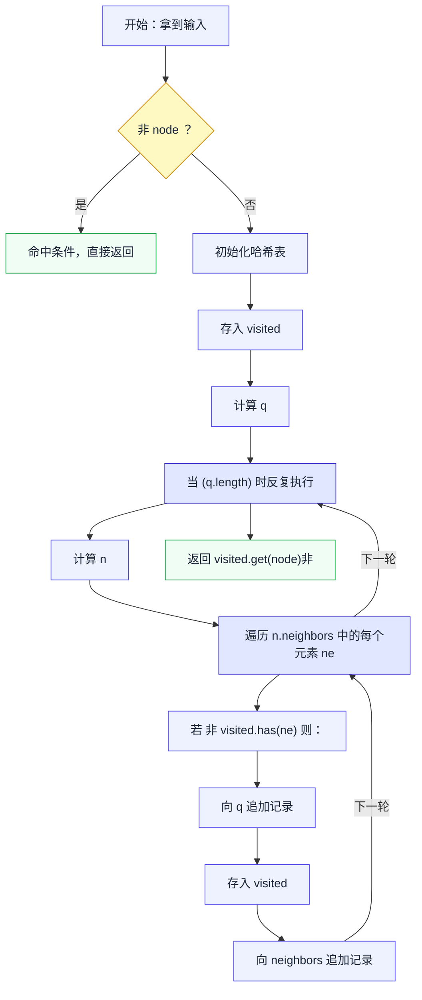

## TypeScript 解题方案（7 个方案逐个讲）

> **运行与提交**：每个方案都是自包含文件（内嵌用例自测，输出 PASS），整块复制到 `.ts` 文件后 `node 文件名` 即可运行。提交 LeetCode 时，把 `demo` 内的算法函数与辅助类型/函数整体取出、置于文件顶层即可。涉及交互/特殊接口的题以题面给定签名为准。

### 方案 1：方案1（BFS，visited 以节点对象为键）

**分析与思路**：核心做法是「方案1（BFS，visited 以节点对象为键）」。代码里依次做这些事：哈希结构做计数或查重；单循环线性扫描；队列或堆的调度。

**运行方式**：`node 本文件`，内嵌用例全部通过会输出 PASS。

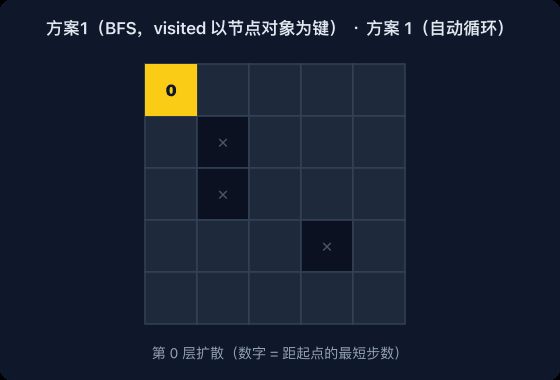

**方案专属流程图**（真实控制流）：


```typescript
/**
 ** LeetCode 133. 克隆图
 ** 来源：https://blog.csdn.net/tyro_java/article/details/133986698
 ** 方案：方案1（BFS，visited 以节点对象为键）
 */

class Node {
  // 定义类型
  val: number; // 值: number;
  neighbors: Node[]; // neighbors: Node[];
  constructor(val: number = 0, neighbors?: Node[]) {
    // 把 0, neighbors?: Node[]) { 写入 constructor(val: number
    this.val = val; // 把 值; 写入 值
    this.neighbors = neighbors !== undefined ? neighbors : [];
  }
}

function cloneGraph(node: Node | null): Node | null {
  // 定义函数/方法 cloneGraph
  if (!node) return null; // 若 取反 节点，直接返回 null
  const visited = new Map<Node, Node>(); // 把 new Map 小于 Node, Node 超过 () 存入 已访问集合
  visited.set(node, new Node(node.val)); // 已访问集合.set(节点, new Node(节点.值));
  const q: Node[] = [node]; // 把 [节点]; 写入 const q: Node[]
  while (q.length) {
    // 循环，直到不满足「节点.长度」
    const n = q.shift()!; // 把 节点.shift()取反 存入 元素个数
    for (const ne of n.neighbors) {
      // for (const ne of 元素个数.neighbors) {
      if (!visited.has(ne)) {
        // 若 取反 已访问集合.has(ne
        q.push(ne); // 把 ne 压入栈/数组尾部
        visited.set(ne, new Node(ne.val)); // 已访问集合.set(ne, new Node(ne.值));
      }
      visited.get(n)!.neighbors.push(visited.get(ne)!); // 把 已访问集合 查找 ne 压入栈/数组尾部
    }
  }
  return visited.get(node)!; // 返回 已访问集合 查找 节点)取反
}

function buildGraph(adj: number[][]): Node {
  // 定义函数/方法 buildGraph
  const nodes = new Map<number, Node>(); // 把 new Map 小于 number, Node 超过 () 存入 nodes
  for (let i = 1; i <= adj.length; i++) nodes.set(i, new Node(i)); // 让 下标 i 从 1 开始计数，下标 i 不超过 邻接表.长度 就继续
  let idx = 1; // 把 1 存入 idx
  for (const nbrs of adj) {
    // for (const nbrs of 邻接表) {
    for (const nb of nbrs) nodes.get(idx)!.neighbors.push(nodes.get(nb)!); // 把 nodes 查找 nb 压入栈/数组尾部
    idx++; // idx 加一
  }
  return nodes.get(1)!; // 返回 nodes 查找 1)取反
}

function signature(node: Node): Record<number, number[]> {
  // 定义函数/方法 signature
  const vis: Record<number, number[]> = {}; // 把 {}; 写入 const vis: Record<number, number[]>
  function dfs(n: Node) {
    // 定义函数/方法 dfs
    if (n.val in vis) return; // 若 元素个数.值 in vis) return;
    vis[n.val] = n.neighbors.map((x) => x.val).sort((a, b) => a - b);
    for (const x of n.neighbors) dfs(x); // for (const x of 元素个数.neighbors) dfs(x);
  }
  dfs(node); // dfs(节点);
  return vis; // 返回 vis
}

export function demo(): void {
  // 程序入口：跑内嵌自测用例
  const root = buildGraph([
    [2, 4],
    [1, 3],
    [2, 4],
    [1, 3],
  ]); // ]);
  const cloned = cloneGraph(root); // 把 cloneGraph(根节点) 存入 cloned
  if (!cloned) throw new Error('cloneGraph returned null'); // 若 取反 cloned) throw new Error(「cloneGraph returned null」);
  if (cloned === root) throw new Error('not a deep copy (same object)');
  const sig = signature(cloned); // 把 signature(cloned) 存入 sig
  const expected: Record<number, number[]> = {
    // 把 { 写入 const expected: Record<number, number[]>
    1: [2, 4],
    2: [1, 3],
    3: [2, 4],
    4: [1, 3],
  };
  for (const k of [1, 2, 3, 4]) {
    // for (const 下标 k of [1, 2, 3, 4]) {
    const a = sig[k]; // 把 sig[下标 k] 存入 数组
    const b = expected[k]; // 把 expected[下标 k] 存入 b
    if (!a || a.length !== b.length || a.some((v, i) => v !== b[i]))
      throw new Error('signature mismatch at ' + k); // throw new Error(「signature mismatch at 」 加 下标 k);
  }
  console.log('PASS'); // 全部用例通过，输出 PASS
}

demo(); // demo();
```

### 方案 2：方案2（DFS 递归，visited 以节点对象为键）

**分析与思路**：核心做法是「方案2（DFS 递归，visited 以节点对象为键）」。代码里依次做这些事：哈希结构做计数或查重；单循环线性扫描。

**运行方式**：`node 本文件`，内嵌用例全部通过会输出 PASS。


**方案专属流程图**（真实控制流）：

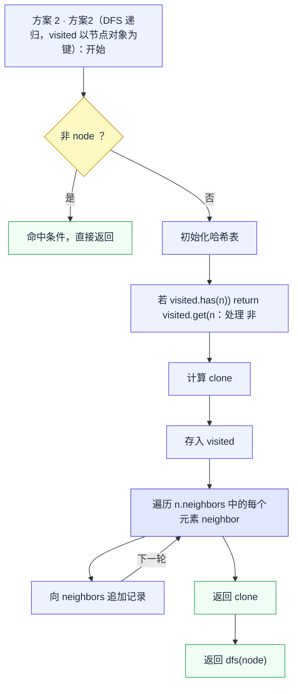

```typescript
/**
 ** LeetCode 133. 克隆图
 ** 方案：方案2（DFS 递归，visited 以节点对象为键）
 */

class Node {
  // 定义类型
  val: number; // 值: number;
  neighbors: Node[]; // neighbors: Node[];
  constructor(val: number = 0, neighbors?: Node[]) {
    // 把 0, neighbors?: Node[]) { 写入 constructor(val: number
    this.val = val; // 把 值; 写入 值
    this.neighbors = neighbors !== undefined ? neighbors : [];
  }
}

function cloneGraph(node: Node | null): Node | null {
  // 定义函数/方法 cloneGraph
  if (!node) return null; // 若 取反 节点，直接返回 null
  const visited = new Map<Node, Node>(); // 把 new Map 小于 Node, Node 超过 () 存入 已访问集合
  function dfs(n: Node): Node {
    // 定义函数/方法 dfs
    if (visited.has(n)) return visited.get(n)!; // 若 已访问集合.has(元素个数)，直接返回 已访问集合 查找 元素个数)取反
    const clone = new Node(n.val); // 把 new Node(元素个数.值) 存入 clone
    visited.set(n, clone); // 已访问集合.set(元素个数, clone);
    for (const neighbor of n.neighbors) {
      // for (const neighbor of 元素个数.neighbors) {
      clone.neighbors.push(dfs(neighbor)); // 把 dfs(neighbor 压入栈/数组尾部
    }
    return clone; // 返回 clone
  }
  return dfs(node); // 返回 dfs(节点)
}

function buildGraph(adj: number[][]): Node {
  // 定义函数/方法 buildGraph
  const nodes = new Map<number, Node>(); // 把 new Map 小于 number, Node 超过 () 存入 nodes
  for (let i = 1; i <= adj.length; i++) nodes.set(i, new Node(i)); // 让 下标 i 从 1 开始计数，下标 i 不超过 邻接表.长度 就继续
  let idx = 1; // 把 1 存入 idx
  for (const nbrs of adj) {
    // for (const nbrs of 邻接表) {
    for (const nb of nbrs) nodes.get(idx)!.neighbors.push(nodes.get(nb)!); // 把 nodes 查找 nb 压入栈/数组尾部
    idx++; // idx 加一
  }
  return nodes.get(1)!; // 返回 nodes 查找 1)取反
}

function signature(node: Node): Record<number, number[]> {
  // 定义函数/方法 signature
  const vis: Record<number, number[]> = {}; // 把 {}; 写入 const vis: Record<number, number[]>
  function dfs(n: Node) {
    // 定义函数/方法 dfs
    if (n.val in vis) return; // 若 元素个数.值 in vis) return;
    vis[n.val] = n.neighbors.map((x) => x.val).sort((a, b) => a - b);
    for (const x of n.neighbors) dfs(x); // for (const x of 元素个数.neighbors) dfs(x);
  }
  dfs(node); // dfs(节点);
  return vis; // 返回 vis
}

export function demo(): void {
  // 程序入口：跑内嵌自测用例
  const root = buildGraph([
    [2, 4],
    [1, 3],
    [2, 4],
    [1, 3],
  ]); // ]);
  const cloned = cloneGraph(root); // 把 cloneGraph(根节点) 存入 cloned
  if (!cloned) throw new Error('cloneGraph returned null'); // 若 取反 cloned) throw new Error(「cloneGraph returned null」);
  if (cloned === root) throw new Error('not a deep copy (same object)');
  const sig = signature(cloned); // 把 signature(cloned) 存入 sig
  const expected: Record<number, number[]> = {
    // 把 { 写入 const expected: Record<number, number[]>
    1: [2, 4],
    2: [1, 3],
    3: [2, 4],
    4: [1, 3],
  };
  for (const k of [1, 2, 3, 4]) {
    // for (const 下标 k of [1, 2, 3, 4]) {
    const a = sig[k]; // 把 sig[下标 k] 存入 数组
    const b = expected[k]; // 把 expected[下标 k] 存入 b
    if (!a || a.length !== b.length || a.some((v, i) => v !== b[i]))
      throw new Error('signature mismatch at ' + k); // throw new Error(「signature mismatch at 」 加 下标 k);
  }
  console.log('PASS'); // 全部用例通过，输出 PASS
}

demo(); // demo();
```

### 方案 3：方案3（DFS 递归，visited 以节点对象为键）

**分析与思路**：核心做法是「方案3（DFS 递归，visited 以节点对象为键）」。代码里依次做这些事：哈希结构做计数或查重；单循环线性扫描。

**运行方式**：`node 本文件`，内嵌用例全部通过会输出 PASS。


**方案专属流程图**（真实控制流）：


```typescript
/**
 ** LeetCode 133. 克隆图
 ** 方案：方案3（DFS 递归，visited 以节点对象为键）
 */

class Node {
  // 定义类型
  val: number; // 值: number;
  neighbors: Node[]; // neighbors: Node[];
  constructor(val: number = 0, neighbors?: Node[]) {
    // 把 0, neighbors?: Node[]) { 写入 constructor(val: number
    this.val = val; // 把 值; 写入 值
    this.neighbors = neighbors !== undefined ? neighbors : [];
  }
}

function cloneGraph(node: Node | null): Node | null {
  // 定义函数/方法 cloneGraph
  if (!node) return null; // 若 取反 节点，直接返回 null
  const visited = new Map<Node, Node>(); // 把 new Map 小于 Node, Node 超过 () 存入 已访问集合
  function dfs(n: Node): Node {
    // 定义函数/方法 dfs
    if (visited.has(n)) return visited.get(n)!; // 若 已访问集合.has(元素个数)，直接返回 已访问集合 查找 元素个数)取反
    const clone = new Node(n.val); // 把 new Node(元素个数.值) 存入 clone
    visited.set(n, clone); // 已访问集合.set(元素个数, clone);
    for (const neighbor of n.neighbors) {
      // for (const neighbor of 元素个数.neighbors) {
      clone.neighbors.push(dfs(neighbor)); // 把 dfs(neighbor 压入栈/数组尾部
    }
    return clone; // 返回 clone
  }
  return dfs(node); // 返回 dfs(节点)
}

function buildGraph(adj: number[][]): Node {
  // 定义函数/方法 buildGraph
  const nodes = new Map<number, Node>(); // 把 new Map 小于 number, Node 超过 () 存入 nodes
  for (let i = 1; i <= adj.length; i++) nodes.set(i, new Node(i)); // 让 下标 i 从 1 开始计数，下标 i 不超过 邻接表.长度 就继续
  let idx = 1; // 把 1 存入 idx
  for (const nbrs of adj) {
    // for (const nbrs of 邻接表) {
    for (const nb of nbrs) nodes.get(idx)!.neighbors.push(nodes.get(nb)!); // 把 nodes 查找 nb 压入栈/数组尾部
    idx++; // idx 加一
  }
  return nodes.get(1)!; // 返回 nodes 查找 1)取反
}

function signature(node: Node): Record<number, number[]> {
  // 定义函数/方法 signature
  const vis: Record<number, number[]> = {}; // 把 {}; 写入 const vis: Record<number, number[]>
  function dfs(n: Node) {
    // 定义函数/方法 dfs
    if (n.val in vis) return; // 若 元素个数.值 in vis) return;
    vis[n.val] = n.neighbors.map((x) => x.val).sort((a, b) => a - b);
    for (const x of n.neighbors) dfs(x); // for (const x of 元素个数.neighbors) dfs(x);
  }
  dfs(node); // dfs(节点);
  return vis; // 返回 vis
}

export function demo(): void {
  // 程序入口：跑内嵌自测用例
  const root = buildGraph([
    [2, 4],
    [1, 3],
    [2, 4],
    [1, 3],
  ]); // ]);
  const cloned = cloneGraph(root); // 把 cloneGraph(根节点) 存入 cloned
  if (!cloned) throw new Error('cloneGraph returned null'); // 若 取反 cloned) throw new Error(「cloneGraph returned null」);
  if (cloned === root) throw new Error('not a deep copy (same object)');
  const sig = signature(cloned); // 把 signature(cloned) 存入 sig
  const expected: Record<number, number[]> = {
    // 把 { 写入 const expected: Record<number, number[]>
    1: [2, 4],
    2: [1, 3],
    3: [2, 4],
    4: [1, 3],
  };
  for (const k of [1, 2, 3, 4]) {
    // for (const 下标 k of [1, 2, 3, 4]) {
    const a = sig[k]; // 把 sig[下标 k] 存入 数组
    const b = expected[k]; // 把 expected[下标 k] 存入 b
    if (!a || a.length !== b.length || a.some((v, i) => v !== b[i]))
      throw new Error('signature mismatch at ' + k); // throw new Error(「signature mismatch at 」 加 下标 k);
  }
  console.log('PASS'); // 全部用例通过，输出 PASS
}

demo(); // demo();
```

### 方案 4：方案4（BFS，visited 以节点对象为键）

**分析与思路**：核心做法是「方案4（BFS，visited 以节点对象为键）」。代码里依次做这些事：哈希结构做计数或查重；单循环线性扫描；队列或堆的调度。

**运行方式**：`node 本文件`，内嵌用例全部通过会输出 PASS。


**方案专属流程图**（真实控制流）：


```typescript
/**
 ** LeetCode 133. 克隆图
 ** 来源：https://blog.csdn.net/tyro_java/article/details/133986698
 ** 方案：方案4（BFS，visited 以节点对象为键）
 */

class Node {
  // 定义类型
  val: number; // 值: number;
  neighbors: Node[]; // neighbors: Node[];
  constructor(val: number = 0, neighbors?: Node[]) {
    // 把 0, neighbors?: Node[]) { 写入 constructor(val: number
    this.val = val; // 把 值; 写入 值
    this.neighbors = neighbors !== undefined ? neighbors : [];
  }
}

function cloneGraph(node: Node | null): Node | null {
  // 定义函数/方法 cloneGraph
  if (!node) return null; // 若 取反 节点，直接返回 null
  const visited = new Map<Node, Node>(); // 把 new Map 小于 Node, Node 超过 () 存入 已访问集合
  visited.set(node, new Node(node.val)); // 已访问集合.set(节点, new Node(节点.值));
  const q: Node[] = [node]; // 把 [节点]; 写入 const q: Node[]
  while (q.length) {
    // 循环，直到不满足「节点.长度」
    const n = q.shift()!; // 把 节点.shift()取反 存入 元素个数
    for (const ne of n.neighbors) {
      // for (const ne of 元素个数.neighbors) {
      if (!visited.has(ne)) {
        // 若 取反 已访问集合.has(ne
        q.push(ne); // 把 ne 压入栈/数组尾部
        visited.set(ne, new Node(ne.val)); // 已访问集合.set(ne, new Node(ne.值));
      }
      visited.get(n)!.neighbors.push(visited.get(ne)!); // 把 已访问集合 查找 ne 压入栈/数组尾部
    }
  }
  return visited.get(node)!; // 返回 已访问集合 查找 节点)取反
}

function buildGraph(adj: number[][]): Node {
  // 定义函数/方法 buildGraph
  const nodes = new Map<number, Node>(); // 把 new Map 小于 number, Node 超过 () 存入 nodes
  for (let i = 1; i <= adj.length; i++) nodes.set(i, new Node(i)); // 让 下标 i 从 1 开始计数，下标 i 不超过 邻接表.长度 就继续
  let idx = 1; // 把 1 存入 idx
  for (const nbrs of adj) {
    // for (const nbrs of 邻接表) {
    for (const nb of nbrs) nodes.get(idx)!.neighbors.push(nodes.get(nb)!); // 把 nodes 查找 nb 压入栈/数组尾部
    idx++; // idx 加一
  }
  return nodes.get(1)!; // 返回 nodes 查找 1)取反
}

function signature(node: Node): Record<number, number[]> {
  // 定义函数/方法 signature
  const vis: Record<number, number[]> = {}; // 把 {}; 写入 const vis: Record<number, number[]>
  function dfs(n: Node) {
    // 定义函数/方法 dfs
    if (n.val in vis) return; // 若 元素个数.值 in vis) return;
    vis[n.val] = n.neighbors.map((x) => x.val).sort((a, b) => a - b);
    for (const x of n.neighbors) dfs(x); // for (const x of 元素个数.neighbors) dfs(x);
  }
  dfs(node); // dfs(节点);
  return vis; // 返回 vis
}

export function demo(): void {
  // 程序入口：跑内嵌自测用例
  const root = buildGraph([
    [2, 4],
    [1, 3],
    [2, 4],
    [1, 3],
  ]); // ]);
  const cloned = cloneGraph(root); // 把 cloneGraph(根节点) 存入 cloned
  if (!cloned) throw new Error('cloneGraph returned null'); // 若 取反 cloned) throw new Error(「cloneGraph returned null」);
  if (cloned === root) throw new Error('not a deep copy (same object)');
  const sig = signature(cloned); // 把 signature(cloned) 存入 sig
  const expected: Record<number, number[]> = {
    // 把 { 写入 const expected: Record<number, number[]>
    1: [2, 4],
    2: [1, 3],
    3: [2, 4],
    4: [1, 3],
  };
  for (const k of [1, 2, 3, 4]) {
    // for (const 下标 k of [1, 2, 3, 4]) {
    const a = sig[k]; // 把 sig[下标 k] 存入 数组
    const b = expected[k]; // 把 expected[下标 k] 存入 b
    if (!a || a.length !== b.length || a.some((v, i) => v !== b[i]))
      throw new Error('signature mismatch at ' + k); // throw new Error(「signature mismatch at 」 加 下标 k);
  }
  console.log('PASS'); // 全部用例通过，输出 PASS
}

demo(); // demo();
```

### 方案 5：方案5（BFS，visited 以节点对象为键）

**分析与思路**：核心做法是「方案5（BFS，visited 以节点对象为键）」。代码里依次做这些事：哈希结构做计数或查重；单循环线性扫描；队列或堆的调度。

**运行方式**：`node 本文件`，内嵌用例全部通过会输出 PASS。


**方案专属流程图**（真实控制流）：

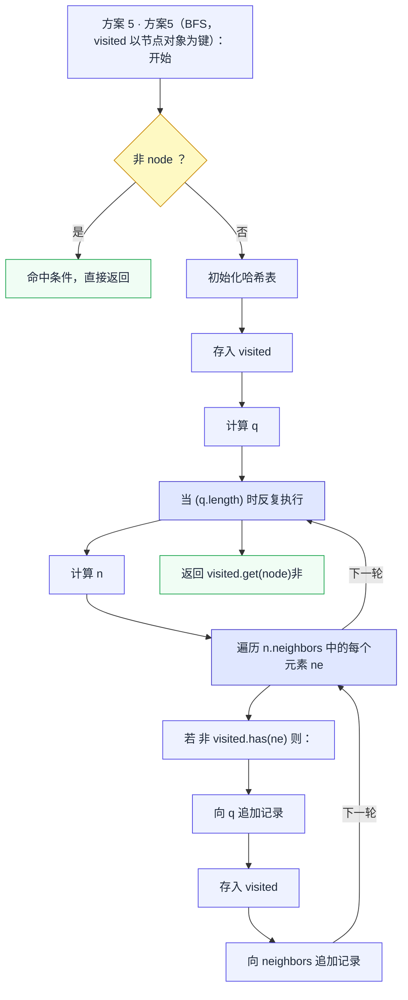

```typescript
/**
 ** LeetCode 133. 克隆图
 ** 来源：https://blog.csdn.net/tyro_java/article/details/133986698
 ** 方案：方案5（BFS，visited 以节点对象为键）
 */

class Node {
  // 定义类型
  val: number; // 值: number;
  neighbors: Node[]; // neighbors: Node[];
  constructor(val: number = 0, neighbors?: Node[]) {
    // 把 0, neighbors?: Node[]) { 写入 constructor(val: number
    this.val = val; // 把 值; 写入 值
    this.neighbors = neighbors !== undefined ? neighbors : [];
  }
}

function cloneGraph(node: Node | null): Node | null {
  // 定义函数/方法 cloneGraph
  if (!node) return null; // 若 取反 节点，直接返回 null
  const visited = new Map<Node, Node>(); // 把 new Map 小于 Node, Node 超过 () 存入 已访问集合
  visited.set(node, new Node(node.val)); // 已访问集合.set(节点, new Node(节点.值));
  const q: Node[] = [node]; // 把 [节点]; 写入 const q: Node[]
  while (q.length) {
    // 循环，直到不满足「节点.长度」
    const n = q.shift()!; // 把 节点.shift()取反 存入 元素个数
    for (const ne of n.neighbors) {
      // for (const ne of 元素个数.neighbors) {
      if (!visited.has(ne)) {
        // 若 取反 已访问集合.has(ne
        q.push(ne); // 把 ne 压入栈/数组尾部
        visited.set(ne, new Node(ne.val)); // 已访问集合.set(ne, new Node(ne.值));
      }
      visited.get(n)!.neighbors.push(visited.get(ne)!); // 把 已访问集合 查找 ne 压入栈/数组尾部
    }
  }
  return visited.get(node)!; // 返回 已访问集合 查找 节点)取反
}

function buildGraph(adj: number[][]): Node {
  // 定义函数/方法 buildGraph
  const nodes = new Map<number, Node>(); // 把 new Map 小于 number, Node 超过 () 存入 nodes
  for (let i = 1; i <= adj.length; i++) nodes.set(i, new Node(i)); // 让 下标 i 从 1 开始计数，下标 i 不超过 邻接表.长度 就继续
  let idx = 1; // 把 1 存入 idx
  for (const nbrs of adj) {
    // for (const nbrs of 邻接表) {
    for (const nb of nbrs) nodes.get(idx)!.neighbors.push(nodes.get(nb)!); // 把 nodes 查找 nb 压入栈/数组尾部
    idx++; // idx 加一
  }
  return nodes.get(1)!; // 返回 nodes 查找 1)取反
}

function signature(node: Node): Record<number, number[]> {
  // 定义函数/方法 signature
  const vis: Record<number, number[]> = {}; // 把 {}; 写入 const vis: Record<number, number[]>
  function dfs(n: Node) {
    // 定义函数/方法 dfs
    if (n.val in vis) return; // 若 元素个数.值 in vis) return;
    vis[n.val] = n.neighbors.map((x) => x.val).sort((a, b) => a - b);
    for (const x of n.neighbors) dfs(x); // for (const x of 元素个数.neighbors) dfs(x);
  }
  dfs(node); // dfs(节点);
  return vis; // 返回 vis
}

export function demo(): void {
  // 程序入口：跑内嵌自测用例
  const root = buildGraph([
    [2, 4],
    [1, 3],
    [2, 4],
    [1, 3],
  ]); // ]);
  const cloned = cloneGraph(root); // 把 cloneGraph(根节点) 存入 cloned
  if (!cloned) throw new Error('cloneGraph returned null'); // 若 取反 cloned) throw new Error(「cloneGraph returned null」);
  if (cloned === root) throw new Error('not a deep copy (same object)');
  const sig = signature(cloned); // 把 signature(cloned) 存入 sig
  const expected: Record<number, number[]> = {
    // 把 { 写入 const expected: Record<number, number[]>
    1: [2, 4],
    2: [1, 3],
    3: [2, 4],
    4: [1, 3],
  };
  for (const k of [1, 2, 3, 4]) {
    // for (const 下标 k of [1, 2, 3, 4]) {
    const a = sig[k]; // 把 sig[下标 k] 存入 数组
    const b = expected[k]; // 把 expected[下标 k] 存入 b
    if (!a || a.length !== b.length || a.some((v, i) => v !== b[i]))
      throw new Error('signature mismatch at ' + k); // throw new Error(「signature mismatch at 」 加 下标 k);
  }
  console.log('PASS'); // 全部用例通过，输出 PASS
}

demo(); // demo();
```

### 方案 6：方案6（BFS，visited 以节点对象为键）

**分析与思路**：核心做法是「方案6（BFS，visited 以节点对象为键）」。代码里依次做这些事：哈希结构做计数或查重；单循环线性扫描；队列或堆的调度。

**运行方式**：`node 本文件`，内嵌用例全部通过会输出 PASS。


**方案专属流程图**（真实控制流）：


```typescript
/**
 ** LeetCode 133. 克隆图
 ** 来源：https://blog.csdn.net/tyro_java/article/details/133986698
 ** 方案：方案6（BFS，visited 以节点对象为键）
 */

class Node {
  // 定义类型
  val: number; // 值: number;
  neighbors: Node[]; // neighbors: Node[];
  constructor(val: number = 0, neighbors?: Node[]) {
    // 把 0, neighbors?: Node[]) { 写入 constructor(val: number
    this.val = val; // 把 值; 写入 值
    this.neighbors = neighbors !== undefined ? neighbors : [];
  }
}

function cloneGraph(node: Node | null): Node | null {
  // 定义函数/方法 cloneGraph
  if (!node) return null; // 若 取反 节点，直接返回 null
  const visited = new Map<Node, Node>(); // 把 new Map 小于 Node, Node 超过 () 存入 已访问集合
  visited.set(node, new Node(node.val)); // 已访问集合.set(节点, new Node(节点.值));
  const q: Node[] = [node]; // 把 [节点]; 写入 const q: Node[]
  while (q.length) {
    // 循环，直到不满足「节点.长度」
    const n = q.shift()!; // 把 节点.shift()取反 存入 元素个数
    for (const ne of n.neighbors) {
      // for (const ne of 元素个数.neighbors) {
      if (!visited.has(ne)) {
        // 若 取反 已访问集合.has(ne
        q.push(ne); // 把 ne 压入栈/数组尾部
        visited.set(ne, new Node(ne.val)); // 已访问集合.set(ne, new Node(ne.值));
      }
      visited.get(n)!.neighbors.push(visited.get(ne)!); // 把 已访问集合 查找 ne 压入栈/数组尾部
    }
  }
  return visited.get(node)!; // 返回 已访问集合 查找 节点)取反
}

function buildGraph(adj: number[][]): Node {
  // 定义函数/方法 buildGraph
  const nodes = new Map<number, Node>(); // 把 new Map 小于 number, Node 超过 () 存入 nodes
  for (let i = 1; i <= adj.length; i++) nodes.set(i, new Node(i)); // 让 下标 i 从 1 开始计数，下标 i 不超过 邻接表.长度 就继续
  let idx = 1; // 把 1 存入 idx
  for (const nbrs of adj) {
    // for (const nbrs of 邻接表) {
    for (const nb of nbrs) nodes.get(idx)!.neighbors.push(nodes.get(nb)!); // 把 nodes 查找 nb 压入栈/数组尾部
    idx++; // idx 加一
  }
  return nodes.get(1)!; // 返回 nodes 查找 1)取反
}

function signature(node: Node): Record<number, number[]> {
  // 定义函数/方法 signature
  const vis: Record<number, number[]> = {}; // 把 {}; 写入 const vis: Record<number, number[]>
  function dfs(n: Node) {
    // 定义函数/方法 dfs
    if (n.val in vis) return; // 若 元素个数.值 in vis) return;
    vis[n.val] = n.neighbors.map((x) => x.val).sort((a, b) => a - b);
    for (const x of n.neighbors) dfs(x); // for (const x of 元素个数.neighbors) dfs(x);
  }
  dfs(node); // dfs(节点);
  return vis; // 返回 vis
}

export function demo(): void {
  // 程序入口：跑内嵌自测用例
  const root = buildGraph([
    [2, 4],
    [1, 3],
    [2, 4],
    [1, 3],
  ]); // ]);
  const cloned = cloneGraph(root); // 把 cloneGraph(根节点) 存入 cloned
  if (!cloned) throw new Error('cloneGraph returned null'); // 若 取反 cloned) throw new Error(「cloneGraph returned null」);
  if (cloned === root) throw new Error('not a deep copy (same object)');
  const sig = signature(cloned); // 把 signature(cloned) 存入 sig
  const expected: Record<number, number[]> = {
    // 把 { 写入 const expected: Record<number, number[]>
    1: [2, 4],
    2: [1, 3],
    3: [2, 4],
    4: [1, 3],
  };
  for (const k of [1, 2, 3, 4]) {
    // for (const 下标 k of [1, 2, 3, 4]) {
    const a = sig[k]; // 把 sig[下标 k] 存入 数组
    const b = expected[k]; // 把 expected[下标 k] 存入 b
    if (!a || a.length !== b.length || a.some((v, i) => v !== b[i]))
      throw new Error('signature mismatch at ' + k); // throw new Error(「signature mismatch at 」 加 下标 k);
  }
  console.log('PASS'); // 全部用例通过，输出 PASS
}

demo(); // demo();
```

### 方案 7：方案7（BFS，visited 以节点对象为键）

**分析与思路**：核心做法是「方案7（BFS，visited 以节点对象为键）」。代码里依次做这些事：哈希结构做计数或查重；单循环线性扫描；队列或堆的调度。

**运行方式**：`node 本文件`，内嵌用例全部通过会输出 PASS。

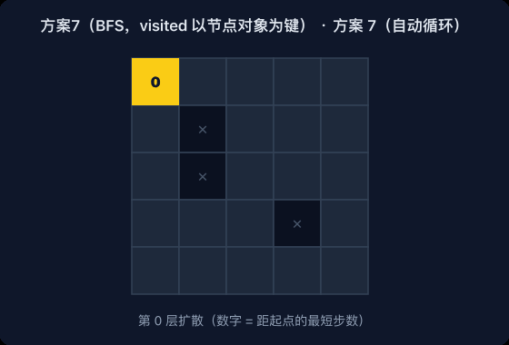

**方案专属流程图**（真实控制流）：


```typescript
/**
 ** LeetCode 133. 克隆图
 ** 来源：https://blog.csdn.net/tyro_java/article/details/133986698
 ** 方案：方案7（BFS，visited 以节点对象为键）
 */

class Node {
  // 定义类型
  val: number; // 值: number;
  neighbors: Node[]; // neighbors: Node[];
  constructor(val: number = 0, neighbors?: Node[]) {
    // 把 0, neighbors?: Node[]) { 写入 constructor(val: number
    this.val = val; // 把 值; 写入 值
    this.neighbors = neighbors !== undefined ? neighbors : [];
  }
}

function cloneGraph(node: Node | null): Node | null {
  // 定义函数/方法 cloneGraph
  if (!node) return null; // 若 取反 节点，直接返回 null
  const visited = new Map<Node, Node>(); // 把 new Map 小于 Node, Node 超过 () 存入 已访问集合
  visited.set(node, new Node(node.val)); // 已访问集合.set(节点, new Node(节点.值));
  const q: Node[] = [node]; // 把 [节点]; 写入 const q: Node[]
  while (q.length) {
    // 循环，直到不满足「节点.长度」
    const n = q.shift()!; // 把 节点.shift()取反 存入 元素个数
    for (const ne of n.neighbors) {
      // for (const ne of 元素个数.neighbors) {
      if (!visited.has(ne)) {
        // 若 取反 已访问集合.has(ne
        q.push(ne); // 把 ne 压入栈/数组尾部
        visited.set(ne, new Node(ne.val)); // 已访问集合.set(ne, new Node(ne.值));
      }
      visited.get(n)!.neighbors.push(visited.get(ne)!); // 把 已访问集合 查找 ne 压入栈/数组尾部
    }
  }
  return visited.get(node)!; // 返回 已访问集合 查找 节点)取反
}

function buildGraph(adj: number[][]): Node {
  // 定义函数/方法 buildGraph
  const nodes = new Map<number, Node>(); // 把 new Map 小于 number, Node 超过 () 存入 nodes
  for (let i = 1; i <= adj.length; i++) nodes.set(i, new Node(i)); // 让 下标 i 从 1 开始计数，下标 i 不超过 邻接表.长度 就继续
  let idx = 1; // 把 1 存入 idx
  for (const nbrs of adj) {
    // for (const nbrs of 邻接表) {
    for (const nb of nbrs) nodes.get(idx)!.neighbors.push(nodes.get(nb)!); // 把 nodes 查找 nb 压入栈/数组尾部
    idx++; // idx 加一
  }
  return nodes.get(1)!; // 返回 nodes 查找 1)取反
}

function signature(node: Node): Record<number, number[]> {
  // 定义函数/方法 signature
  const vis: Record<number, number[]> = {}; // 把 {}; 写入 const vis: Record<number, number[]>
  function dfs(n: Node) {
    // 定义函数/方法 dfs
    if (n.val in vis) return; // 若 元素个数.值 in vis) return;
    vis[n.val] = n.neighbors.map((x) => x.val).sort((a, b) => a - b);
    for (const x of n.neighbors) dfs(x); // for (const x of 元素个数.neighbors) dfs(x);
  }
  dfs(node); // dfs(节点);
  return vis; // 返回 vis
}

export function demo(): void {
  // 程序入口：跑内嵌自测用例
  const root = buildGraph([
    [2, 4],
    [1, 3],
    [2, 4],
    [1, 3],
  ]); // ]);
  const cloned = cloneGraph(root); // 把 cloneGraph(根节点) 存入 cloned
  if (!cloned) throw new Error('cloneGraph returned null'); // 若 取反 cloned) throw new Error(「cloneGraph returned null」);
  if (cloned === root) throw new Error('not a deep copy (same object)');
  const sig = signature(cloned); // 把 signature(cloned) 存入 sig
  const expected: Record<number, number[]> = {
    // 把 { 写入 const expected: Record<number, number[]>
    1: [2, 4],
    2: [1, 3],
    3: [2, 4],
    4: [1, 3],
  };
  for (const k of [1, 2, 3, 4]) {
    // for (const 下标 k of [1, 2, 3, 4]) {
    const a = sig[k]; // 把 sig[下标 k] 存入 数组
    const b = expected[k]; // 把 expected[下标 k] 存入 b
    if (!a || a.length !== b.length || a.some((v, i) => v !== b[i]))
      throw new Error('signature mismatch at ' + k); // throw new Error(「signature mismatch at 」 加 下标 k);
  }
  console.log('PASS'); // 全部用例通过，输出 PASS
}

demo(); // demo();
```

## 逐步拆解与面试追问

**复杂度**：时间 O(n²)（两层嵌套扫描），空间 O(1) 到 O(n)

**为什么是这个量级**：外层定起点、内层扫终点，n 个起点各扫 n 次

**面试官可能会追问**：

- 广度优先与深度优先各适合什么问题？
- 如何去重避免死循环？
- 带权图为什么默认不用广度优先？

## 关键 API 速查（TS 主解法实际用到，附官方链接）

| API | 作用 | 使用要点 | 官方文档 |
|---|---|---|---|
| `Map` | 哈希表：任意类型键值对 | set(k,v) 存、get(k) 取（不存在返回 undefined）、has(k) 判存在、delete(k) 删；增删查均摊 O(1)；键顺序为插入序；键必须用引用区分（对象键按身份） | [官方文档](https://developer.mozilla.org/zh-CN/docs/Web/JavaScript/Reference/Global_Objects/Map) |
| `Array.prototype.sort()` | 原地排序 | 默认按字符串 Unicode 序（10 会排在 2 前），数字必须传 (a,b)=>a-b；V8 用 TimSort，稳定，O(n log n)；返回原数组引用 | [官方文档](https://developer.mozilla.org/zh-CN/docs/Web/JavaScript/Reference/Global_Objects/Array/sort) |
| `Array.prototype.map()` | 逐元素映射为新数组 | 回调 (v,i,arr)；返回等长新数组，不改变原数组；稀疏位跳过；链式调用注意中间数组开销 | [官方文档](https://developer.mozilla.org/zh-CN/docs/Web/JavaScript/Reference/Global_Objects/Array/map) |
| `Array.prototype.push()` | 尾部追加 | 返回新长度；可一次多个；均摊 O(1)；会改变原数组 | [官方文档](https://developer.mozilla.org/zh-CN/docs/Web/JavaScript/Reference/Global_Objects/Array/push) |
| `Array.prototype.shift()` | 头部取出 | O(n)（后续元素整体前移）；大量头部操作请用链表或双端结构 | [官方文档](https://developer.mozilla.org/zh-CN/docs/Web/JavaScript/Reference/Global_Objects/Array/shift) |

### 各语言官方文档导航

- **TypeScript / JS**：[MDN 中文参考](https://developer.mozilla.org/zh-CN/)
- **Python**：[Python 官方文档](https://docs.python.org/zh-cn/3/)
- **Go**：[Go 标准库](https://pkg.go.dev/std)
- **Java**：[JDK 17 API](https://docs.oracle.com/en/java/javase/17/docs/api/)
- **Rust**：[Rust 标准库](https://doc.rust-lang.org/std/)
- **Lua**：[Lua 5.4 手册](https://www.lua.org/manual/5.4/)
- **C**：[Cppreference C](https://zh.cppreference.com/w/c)
- **C++**：[Cppreference C++](https://zh.cppreference.com/w/cpp)
- **R**：[R 官方手册](https://stat.ethz.ch/R-manual/)
- **Zig**：[Zig 语言文档](https://ziglang.org/documentation/master/)
- **Dart**：[Dart API](https://api.dart.dev/)

## 附录：其他 10 种语言全部实现（每种语言列举其全部方案）

> TypeScript 的全部方案见「TypeScript 解题方案」一节；下面是其余 10 种语言的对应实现，每种语言的每个方案都带思路分析、代码走读与专属运行架构图。
> 每个方案都内嵌用例自测，可独立运行（老仓库 python/go 文件遵循「打印结果」约定）。
> 完整解法文件见 `dsa/<语言>/graph/lc_133_克隆图/`。

### Python 实现（7 种方案）

Python 的全部方案如下，每个方案都内嵌用例自测，可独立运行（老仓库 python/go 文件遵循「打印结果」约定）：

#### 方案 1：方案1（BFS，visited 以节点对象为键）

**思路与代码分析**：核心是「方案1（BFS，visited 以节点对象为键）」。Python 版用切片与字典推导式简化操作，突出可读性。**走读**：方案 1 · 方案1（BFS，visited 以节点对象为键）：开始 → 命中条件，直接返回 → 更新 visited → 更新 visited[node] → 更新 q → 当 q: 时反复执行 → 从 q 弹出 → 遍历 n.neighbors: 中的每个元素 ne → 若 ne not in visited：向 q 追加记录 → 向 q 追加记录 → 更新 visited[ne] → 向 neighbors 追加记录 → 返回 visited[node]。

**运行架构**（真实控制流）：


```python
import sys  # 提高递归深度上限（深输入防 RecursionError）

sys.setrecursionlimit(200000)  # 树/链表类题目节点数可达 1e4 量级

class Node:  # 定义类
    def __init__(self, val=0, neighbors=None):  # 构造函数：初始化成员
        self.val = val  # 把 值 写入 值
        self.neighbors = neighbors if neighbors is not None else []

def cloneGraph(node):  # 定义函数 cloneGraph（参数：节点）
    if not node:  # 若 not 节点
        return None  # 返回 None
    visited = {}  # 把 {} 存入 已访问集合
    visited[node] = Node(node.val)  # 把 Node(节点.值) 写入 visited[node]
    q = [node]  # 把 [节点] 存入 节点
    while q:  # 循环，直到不满足「节点」
        n = q.pop(0)  # 把 节点 弹出 0) 存入 元素个数
        for ne in n.neighbors:  # 逐个取出 元素个数 的元素（ne）
            if ne not in visited:  # 若 ne not in 已访问集合
                q.append(ne)  # 把 ne 追加到列表尾部
                visited[ne] = Node(ne.val)  # 把 Node(ne.值) 写入 visited[ne]
            visited[n].neighbors.append(visited[ne])  # 把 已访问集合[ne] 追加到列表尾部
    return visited[node]  # 返回 已访问集合[节点]

if __name__ == "__main__":  # 若 __name__ 等于 '__main__'
    n1 = Node(1)  # 把 Node(1) 存入 n1
    n2 = Node(2)  # 把 Node(2) 存入 n2
    n3 = Node(3)  # 把 Node(3) 存入 n3
    n4 = Node(4)  # 把 Node(4) 存入 n4
    n1.neighbors = [n2, n4]  # 把 [n2, n4] 写入 n1.neighbors
    n2.neighbors = [n1, n3]  # 把 [n1, n3] 写入 n2.neighbors
    n3.neighbors = [n2, n4]  # 把 [n2, n4] 写入 n3.neighbors
    n4.neighbors = [n1, n3]  # 把 [n1, n3] 写入 n4.neighbors
    c = cloneGraph(n1)  # 把 cloneGraph(n1) 存入 字符
    print(c.val, [x.val for x in c.neighbors])  # 打印输出
```

#### 方案 2：方案2（DFS 递归，visited 以节点对象为键）

**思路与代码分析**：核心是「方案2（DFS 递归，visited 以节点对象为键）」。Python 版用切片与字典推导式简化操作，突出可读性。**走读**：方案 2 · 方案2（DFS 递归，visited 以节点对象为键）：开始 → 命中条件，直接返回 → 更新 visited → 命中条件，直接返回 → 更新 clone → 更新 visited[n] → 遍历 n.neighbors: 中的每个元素 neighbor → 向 neighbors 追加记录 → 返回 clone → 返回 dfs(node)。

**运行架构**（真实控制流）：


```python
import sys  # 提高递归深度上限（深输入防 RecursionError）

sys.setrecursionlimit(200000)  # 树/链表类题目节点数可达 1e4 量级

class Node:  # 定义类
    def __init__(self, val=0, neighbors=None):  # 构造函数：初始化成员
        self.val = val  # 把 值 写入 值
        self.neighbors = neighbors if neighbors is not None else []

def cloneGraph(node):  # 定义函数 cloneGraph（参数：节点）
    if not node:  # 若 not 节点
        return None  # 返回 None
    visited = {}  # 把 {} 存入 已访问集合

    def dfs(n):  # 定义函数 dfs（参数：元素个数）
        if n in visited:  # 若 元素个数 in 已访问集合
            return visited[n]  # 返回 已访问集合[元素个数]
        clone = Node(n.val)  # 把 Node(元素个数.值) 存入 clone
        visited[n] = clone  # 把 clone 写入 visited[n]
        for neighbor in n.neighbors:  # 逐个取出 元素个数 的元素（neighbor）
            clone.neighbors.append(dfs(neighbor))  # 把 dfs(neighbor 追加到列表尾部
        return clone  # 返回 clone

    return dfs(node)  # 返回 dfs(节点)

def build_graph(adj):  # 定义函数 build_graph（参数：邻接表）
    # adj: list of lists (1-indexed values)
    nodes = {i: Node(i) for i in range(1, len(adj) + 1)}
    for i, nbrs in enumerate(adj, start=1):  # 同时取 下标 i 与 nbrs 遍历
        for nb in nbrs:  # 逐个取出 nbrs 的元素（nb）
            nodes[i].neighbors.append(nodes[nb])  # 把 nodes[nb] 追加到列表尾部
    return nodes[1]  # 返回 nodes[1]

def graph_signature(node):  # 定义函数 graph_signature（参数：节点）
    visited = {}  # 把 {} 存入 已访问集合

    def dfs(n):  # 定义函数 dfs（参数：元素个数）
        if n.val in visited:  # 若 元素个数.值 in 已访问集合
            return  # return
        visited[n.val] = sorted(
            x.val for x in n.neighbors
        )  # 把 sorted(x.值 for x in 元素个数.neighbors) 写入 visited[n.val]
        for x in n.neighbors:  # 逐个取出 元素个数 的元素（x）
            dfs(x)  # dfs(x)

    dfs(node)  # dfs(节点)
    return visited  # 返回 已访问集合

if __name__ == "__main__":  # 若 __name__ 等于 '__main__'
    root = build_graph(
        [[2, 4], [1, 3], [2, 4], [1, 3]]
    )  # 把 build_graph([[2, 4], [1, 3], [2, 4], [1, 3]]) 存入 根节点
    cloned = cloneGraph(root)  # 把 cloneGraph(根节点) 存入 cloned
    print(graph_signature(cloned))  # 打印输出
```

#### 方案 3：方案3（DFS 递归，visited 以节点对象为键）

**思路与代码分析**：核心是「方案3（DFS 递归，visited 以节点对象为键）」。Python 版用切片与字典推导式简化操作，突出可读性。**走读**：方案 3 · 方案3（DFS 递归，visited 以节点对象为键）：开始 → 命中条件，直接返回 → 更新 visited → 命中条件，直接返回 → 更新 clone → 更新 visited[n] → 遍历 n.neighbors: 中的每个元素 neighbor → 向 neighbors 追加记录 → 返回 clone → 返回 dfs(node)。

**运行架构**（真实控制流）：

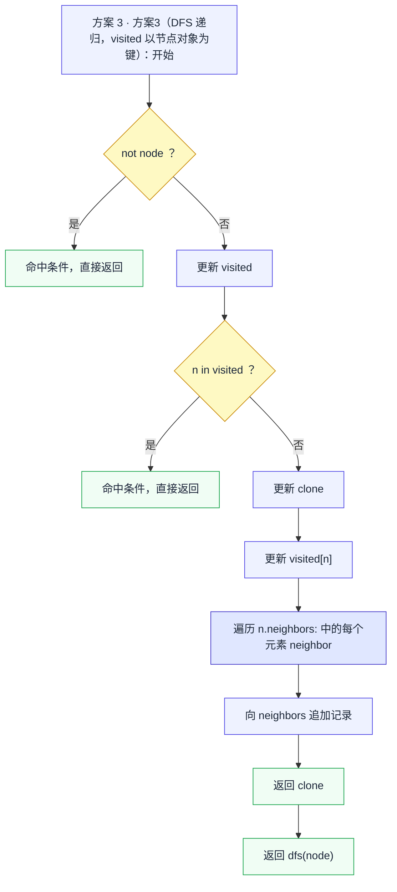

```python
import sys  # 提高递归深度上限（深输入防 RecursionError）

sys.setrecursionlimit(200000)  # 树/链表类题目节点数可达 1e4 量级

class Node:  # 定义类
    def __init__(self, val=0, neighbors=None):  # 构造函数：初始化成员
        self.val = val  # 把 值 写入 值
        self.neighbors = neighbors if neighbors is not None else []

def cloneGraph(node):  # 定义函数 cloneGraph（参数：节点）
    if not node:  # 若 not 节点
        return None  # 返回 None
    visited = {}  # 把 {} 存入 已访问集合

    def dfs(n):  # 定义函数 dfs（参数：元素个数）
        if n in visited:  # 若 元素个数 in 已访问集合
            return visited[n]  # 返回 已访问集合[元素个数]
        clone = Node(n.val)  # 把 Node(元素个数.值) 存入 clone
        visited[n] = clone  # 把 clone 写入 visited[n]
        for neighbor in n.neighbors:  # 逐个取出 元素个数 的元素（neighbor）
            clone.neighbors.append(dfs(neighbor))  # 把 dfs(neighbor 追加到列表尾部
        return clone  # 返回 clone

    return dfs(node)  # 返回 dfs(节点)

def build_graph(adj):  # 定义函数 build_graph（参数：邻接表）
    # adj: list of lists (1-indexed values)
    nodes = {i: Node(i) for i in range(1, len(adj) + 1)}
    for i, nbrs in enumerate(adj, start=1):  # 同时取 下标 i 与 nbrs 遍历
        for nb in nbrs:  # 逐个取出 nbrs 的元素（nb）
            nodes[i].neighbors.append(nodes[nb])  # 把 nodes[nb] 追加到列表尾部
    return nodes[1]  # 返回 nodes[1]

def graph_signature(node):  # 定义函数 graph_signature（参数：节点）
    visited = {}  # 把 {} 存入 已访问集合

    def dfs(n):  # 定义函数 dfs（参数：元素个数）
        if n.val in visited:  # 若 元素个数.值 in 已访问集合
            return  # return
        visited[n.val] = sorted(
            x.val for x in n.neighbors
        )  # 把 sorted(x.值 for x in 元素个数.neighbors) 写入 visited[n.val]
        for x in n.neighbors:  # 逐个取出 元素个数 的元素（x）
            dfs(x)  # dfs(x)

    dfs(node)  # dfs(节点)
    return visited  # 返回 已访问集合

if __name__ == "__main__":  # 若 __name__ 等于 '__main__'
    root = build_graph(
        [[2, 4], [1, 3], [2, 4], [1, 3]]
    )  # 把 build_graph([[2, 4], [1, 3], [2, 4], [1, 3]]) 存入 根节点
    cloned = cloneGraph(root)  # 把 cloneGraph(根节点) 存入 cloned
    print(graph_signature(cloned))  # 打印输出
```

#### 方案 4：方案4（BFS，visited 以节点对象为键）

**思路与代码分析**：核心是「方案4（BFS，visited 以节点对象为键）」。Python 版用切片与字典推导式简化操作，突出可读性。**走读**：方案 4 · 方案4（BFS，visited 以节点对象为键）：开始 → 命中条件，直接返回 → 更新 visited → 更新 visited[node] → 更新 q → 当 q: 时反复执行 → 从 q 弹出 → 遍历 n.neighbors: 中的每个元素 ne → 若 ne not in visited：向 q 追加记录 → 向 q 追加记录 → 更新 visited[ne] → 向 neighbors 追加记录 → 返回 visited[node]。

**运行架构**（真实控制流）：


```python
import sys  # 提高递归深度上限（深输入防 RecursionError）

sys.setrecursionlimit(200000)  # 树/链表类题目节点数可达 1e4 量级

class Node:  # 定义类
    def __init__(self, val=0, neighbors=None):  # 构造函数：初始化成员
        self.val = val  # 把 值 写入 值
        self.neighbors = neighbors if neighbors is not None else []

def cloneGraph(node):  # 定义函数 cloneGraph（参数：节点）
    if not node:  # 若 not 节点
        return None  # 返回 None
    visited = {}  # 把 {} 存入 已访问集合
    visited[node] = Node(node.val)  # 把 Node(节点.值) 写入 visited[node]
    q = [node]  # 把 [节点] 存入 节点
    while q:  # 循环，直到不满足「节点」
        n = q.pop(0)  # 把 节点 弹出 0) 存入 元素个数
        for ne in n.neighbors:  # 逐个取出 元素个数 的元素（ne）
            if ne not in visited:  # 若 ne not in 已访问集合
                q.append(ne)  # 把 ne 追加到列表尾部
                visited[ne] = Node(ne.val)  # 把 Node(ne.值) 写入 visited[ne]
            visited[n].neighbors.append(visited[ne])  # 把 已访问集合[ne] 追加到列表尾部
    return visited[node]  # 返回 已访问集合[节点]

if __name__ == "__main__":  # 若 __name__ 等于 '__main__'
    n1 = Node(1)  # 把 Node(1) 存入 n1
    n2 = Node(2)  # 把 Node(2) 存入 n2
    n3 = Node(3)  # 把 Node(3) 存入 n3
    n4 = Node(4)  # 把 Node(4) 存入 n4
    n1.neighbors = [n2, n4]  # 把 [n2, n4] 写入 n1.neighbors
    n2.neighbors = [n1, n3]  # 把 [n1, n3] 写入 n2.neighbors
    n3.neighbors = [n2, n4]  # 把 [n2, n4] 写入 n3.neighbors
    n4.neighbors = [n1, n3]  # 把 [n1, n3] 写入 n4.neighbors
    c = cloneGraph(n1)  # 把 cloneGraph(n1) 存入 字符
    print(c.val, [x.val for x in c.neighbors])  # 打印输出
```

#### 方案 5：方案5（BFS，visited 以节点对象为键）

**思路与代码分析**：核心是「方案5（BFS，visited 以节点对象为键）」。Python 版用切片与字典推导式简化操作，突出可读性。**走读**：方案 5 · 方案5（BFS，visited 以节点对象为键）：开始 → 命中条件，直接返回 → 更新 visited → 更新 visited[node] → 更新 q → 当 q: 时反复执行 → 从 q 弹出 → 遍历 n.neighbors: 中的每个元素 ne → 若 ne not in visited：向 q 追加记录 → 向 q 追加记录 → 更新 visited[ne] → 向 neighbors 追加记录 → 返回 visited[node]。

**运行架构**（真实控制流）：

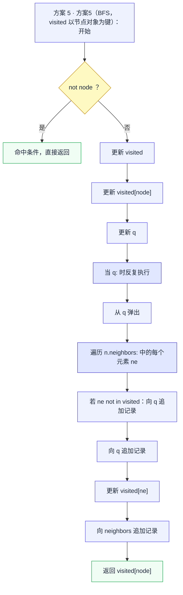

```python
import sys  # 提高递归深度上限（深输入防 RecursionError）

sys.setrecursionlimit(200000)  # 树/链表类题目节点数可达 1e4 量级

class Node:  # 定义类
    def __init__(self, val=0, neighbors=None):  # 构造函数：初始化成员
        self.val = val  # 把 值 写入 值
        self.neighbors = neighbors if neighbors is not None else []

def cloneGraph(node):  # 定义函数 cloneGraph（参数：节点）
    if not node:  # 若 not 节点
        return None  # 返回 None
    visited = {}  # 把 {} 存入 已访问集合
    visited[node] = Node(node.val)  # 把 Node(节点.值) 写入 visited[node]
    q = [node]  # 把 [节点] 存入 节点
    while q:  # 循环，直到不满足「节点」
        n = q.pop(0)  # 把 节点 弹出 0) 存入 元素个数
        for ne in n.neighbors:  # 逐个取出 元素个数 的元素（ne）
            if ne not in visited:  # 若 ne not in 已访问集合
                q.append(ne)  # 把 ne 追加到列表尾部
                visited[ne] = Node(ne.val)  # 把 Node(ne.值) 写入 visited[ne]
            visited[n].neighbors.append(visited[ne])  # 把 已访问集合[ne] 追加到列表尾部
    return visited[node]  # 返回 已访问集合[节点]

if __name__ == "__main__":  # 若 __name__ 等于 '__main__'
    n1 = Node(1)  # 把 Node(1) 存入 n1
    n2 = Node(2)  # 把 Node(2) 存入 n2
    n3 = Node(3)  # 把 Node(3) 存入 n3
    n4 = Node(4)  # 把 Node(4) 存入 n4
    n1.neighbors = [n2, n4]  # 把 [n2, n4] 写入 n1.neighbors
    n2.neighbors = [n1, n3]  # 把 [n1, n3] 写入 n2.neighbors
    n3.neighbors = [n2, n4]  # 把 [n2, n4] 写入 n3.neighbors
    n4.neighbors = [n1, n3]  # 把 [n1, n3] 写入 n4.neighbors
    c = cloneGraph(n1)  # 把 cloneGraph(n1) 存入 字符
    print(c.val, [x.val for x in c.neighbors])  # 打印输出
```

#### 方案 6：方案6（BFS，visited 以节点对象为键）

**思路与代码分析**：核心是「方案6（BFS，visited 以节点对象为键）」。Python 版用切片与字典推导式简化操作，突出可读性。**走读**：方案 6 · 方案6（BFS，visited 以节点对象为键）：开始 → 命中条件，直接返回 → 更新 visited → 更新 visited[node] → 更新 q → 当 q: 时反复执行 → 从 q 弹出 → 遍历 n.neighbors: 中的每个元素 ne → 若 ne not in visited：向 q 追加记录 → 向 q 追加记录 → 更新 visited[ne] → 向 neighbors 追加记录 → 返回 visited[node]。

**运行架构**（真实控制流）：


```python
import sys  # 提高递归深度上限（深输入防 RecursionError）

sys.setrecursionlimit(200000)  # 树/链表类题目节点数可达 1e4 量级

class Node:  # 定义类
    def __init__(self, val=0, neighbors=None):  # 构造函数：初始化成员
        self.val = val  # 把 值 写入 值
        self.neighbors = neighbors if neighbors is not None else []

def cloneGraph(node):  # 定义函数 cloneGraph（参数：节点）
    if not node:  # 若 not 节点
        return None  # 返回 None
    visited = {}  # 把 {} 存入 已访问集合
    visited[node] = Node(node.val)  # 把 Node(节点.值) 写入 visited[node]
    q = [node]  # 把 [节点] 存入 节点
    while q:  # 循环，直到不满足「节点」
        n = q.pop(0)  # 把 节点 弹出 0) 存入 元素个数
        for ne in n.neighbors:  # 逐个取出 元素个数 的元素（ne）
            if ne not in visited:  # 若 ne not in 已访问集合
                q.append(ne)  # 把 ne 追加到列表尾部
                visited[ne] = Node(ne.val)  # 把 Node(ne.值) 写入 visited[ne]
            visited[n].neighbors.append(visited[ne])  # 把 已访问集合[ne] 追加到列表尾部
    return visited[node]  # 返回 已访问集合[节点]

if __name__ == "__main__":  # 若 __name__ 等于 '__main__'
    n1 = Node(1)  # 把 Node(1) 存入 n1
    n2 = Node(2)  # 把 Node(2) 存入 n2
    n3 = Node(3)  # 把 Node(3) 存入 n3
    n4 = Node(4)  # 把 Node(4) 存入 n4
    n1.neighbors = [n2, n4]  # 把 [n2, n4] 写入 n1.neighbors
    n2.neighbors = [n1, n3]  # 把 [n1, n3] 写入 n2.neighbors
    n3.neighbors = [n2, n4]  # 把 [n2, n4] 写入 n3.neighbors
    n4.neighbors = [n1, n3]  # 把 [n1, n3] 写入 n4.neighbors
    c = cloneGraph(n1)  # 把 cloneGraph(n1) 存入 字符
    print(c.val, [x.val for x in c.neighbors])  # 打印输出
```

#### 方案 7：方案7（BFS，visited 以节点对象为键）

**思路与代码分析**：核心是「方案7（BFS，visited 以节点对象为键）」。Python 版用切片与字典推导式简化操作，突出可读性。**走读**：方案 7 · 方案7（BFS，visited 以节点对象为键）：开始 → 命中条件，直接返回 → 更新 visited → 更新 visited[node] → 更新 q → 当 q: 时反复执行 → 从 q 弹出 → 遍历 n.neighbors: 中的每个元素 ne → 若 ne not in visited：向 q 追加记录 → 向 q 追加记录 → 更新 visited[ne] → 向 neighbors 追加记录 → 返回 visited[node]。

**运行架构**（真实控制流）：

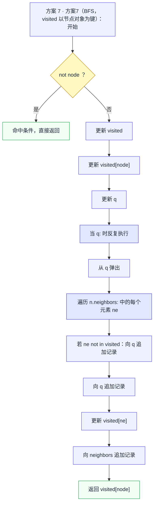

```python
import sys  # 提高递归深度上限（深输入防 RecursionError）

sys.setrecursionlimit(200000)  # 树/链表类题目节点数可达 1e4 量级

class Node:  # 定义类
    def __init__(self, val=0, neighbors=None):  # 构造函数：初始化成员
        self.val = val  # 把 值 写入 值
        self.neighbors = neighbors if neighbors is not None else []

def cloneGraph(node):  # 定义函数 cloneGraph（参数：节点）
    if not node:  # 若 not 节点
        return None  # 返回 None
    visited = {}  # 把 {} 存入 已访问集合
    visited[node] = Node(node.val)  # 把 Node(节点.值) 写入 visited[node]
    q = [node]  # 把 [节点] 存入 节点
    while q:  # 循环，直到不满足「节点」
        n = q.pop(0)  # 把 节点 弹出 0) 存入 元素个数
        for ne in n.neighbors:  # 逐个取出 元素个数 的元素（ne）
            if ne not in visited:  # 若 ne not in 已访问集合
                q.append(ne)  # 把 ne 追加到列表尾部
                visited[ne] = Node(ne.val)  # 把 Node(ne.值) 写入 visited[ne]
            visited[n].neighbors.append(visited[ne])  # 把 已访问集合[ne] 追加到列表尾部
    return visited[node]  # 返回 已访问集合[节点]

if __name__ == "__main__":  # 若 __name__ 等于 '__main__'
    n1 = Node(1)  # 把 Node(1) 存入 n1
    n2 = Node(2)  # 把 Node(2) 存入 n2
    n3 = Node(3)  # 把 Node(3) 存入 n3
    n4 = Node(4)  # 把 Node(4) 存入 n4
    n1.neighbors = [n2, n4]  # 把 [n2, n4] 写入 n1.neighbors
    n2.neighbors = [n1, n3]  # 把 [n1, n3] 写入 n2.neighbors
    n3.neighbors = [n2, n4]  # 把 [n2, n4] 写入 n3.neighbors
    n4.neighbors = [n1, n3]  # 把 [n1, n3] 写入 n4.neighbors
    c = cloneGraph(n1)  # 把 cloneGraph(n1) 存入 字符
    print(c.val, [x.val for x in c.neighbors])  # 打印输出
```

### Go 实现（7 种方案）

Go 的全部方案如下，每个方案都内嵌用例自测，可独立运行（老仓库 python/go 文件遵循「打印结果」约定）：

#### 方案 1：方案1（BFS，visited 以节点对象为键）

**思路与代码分析**：核心是「方案1（BFS，visited 以节点对象为键）」。Go 版用切片与多返回值惯用法，显式处理索引边界。代码里依次做这些事：哈希结构做计数或查重。**走读**：方案 1 · 方案1（BFS，visited 以节点对象为键）：开始 → 处理 if node == nil → 返回 nil → 更新 : → 更新 visited[node] → 更新 : → 遍历循环 → 更新 : → 更新 queue → 遍历 n.Neighbors 的下标与元素 ne → 处理 if _, ok := visited[ne]; 非 ok → 更新 queue → 更新 visited[ne] → 更新 visited[n].Neighbors → 返回 visited[node]。

**运行架构**（真实控制流）：


```go
package main // 引入依赖

import (
	"fmt"  // 「fmt」
	"os"   // 「os」
	"sort" // 「sort」
)

// Node 对应 python ref 中的 Node
type Node struct { // 定义类型
	Val       int     // Val int
	Neighbors []*Node // Neighbors [] 乘 Node
}

// cloneGraph 忠实翻译 python ref（BFS，队列 pop(0) 语义）
func cloneGraph(node *Node) *Node { // 定义函数/方法 cloneGraph
	if node == nil { // 若 节点 等于 nil
		return nil // 返回 nil
	}
	visited := make(map[*Node]*Node)     // 把 make(映射表[ 乘 Node] 乘 Node) 写入 visited :
	visited[node] = &Node{Val: node.Val} // 把 按位与 Node{Val: 节点.Val} 写入 visited[node]
	queue := []*Node{node}               // 把 [] 乘 Node{节点} 写入 queue :
	for len(queue) > 0 {                 // for 长度(队列) 超过 0 {
		n := queue[0]                    // 把 队列[0] 写入 n :
		queue = queue[1:]                // 把 队列[1:] 写入 队列
		for _, ne := range n.Neighbors { // 同时取 _ 与 ne 遍历
			if _, ok := visited[ne]; !ok { // 若 _, ok : 赋值为 已访问集合[ne]; 取反 ok
				queue = append(queue, ne)        // 把 append(队列, ne) 写入 队列
				visited[ne] = &Node{Val: ne.Val} // 把 按位与 Node{Val: ne.Val} 写入 visited[ne]
			}
			visited[n].Neighbors = append(visited[n].Neighbors, visited[ne])
		}
	}
	return visited[node] // 返回 已访问集合[节点]
}

// buildGraph 由邻接表（1-indexed）构图，返回 1 号节点
func buildGraph(adj [][]int) *Node { // 定义函数/方法 buildGraph
	if len(adj) == 0 { // 若 长度(邻接表) 等于 0
		return nil // 返回 nil
	}
	nodes := make([]*Node, len(adj)+1) // 把 make([] 乘 Node, 长度(邻接表) 加 1) 写入 nodes :
	for i := 1; i <= len(adj); i++ {   // 让 下标 i 从 1 开始计数
		nodes[i] = &Node{Val: i} // 把 按位与 Node{Val: 下标 i} 写入 nodes[i]
	}
	for i, nbrs := range adj { // 同时取 下标 i 与 nbrs 遍历
		for _, nb := range nbrs { // 同时取 _ 与 nb 遍历
			nodes[i+1].Neighbors = append(nodes[i+1].Neighbors, nodes[nb])
		}
	}
	return nodes[1] // 返回 nodes[1]
}

// graphSignature 对应 python ref 的 graph_signature
func graphSignature(node *Node) map[int][]int { // 定义函数/方法 graphSignature
	visited := make(map[int][]int) // 把 make(映射表[int][]int) 写入 visited :
	var dfs func(n *Node)          // var dfs func(元素个数 乘 Node)
	dfs = func(n *Node) {          // 把 func(元素个数 乘 Node) { 写入 dfs
		if _, ok := visited[n.Val]; ok { // 若 _, ok : 赋值为 已访问集合[元素个数.Val]; ok
			return // return
		}
		vals := make([]int, 0, len(n.Neighbors)) // 把 make([]int, 0, 长度(元素个数.Neighbors)) 写入 vals :
		for _, x := range n.Neighbors {          // 同时取 _ 与 x 遍历
			vals = append(vals, x.Val) // 把 append(vals, x.Val) 写入 vals
		}
		sort.Ints(vals)                 // sort.Ints(vals)
		visited[n.Val] = vals           // 把 vals 写入 visited[n.Val]
		for _, x := range n.Neighbors { // 同时取 _ 与 x 遍历
			dfs(x) // dfs(x)
		}
	}
	if node != nil { // 若 节点 不等于 nil
		dfs(node) // dfs(节点)
	}
	return visited // 返回 已访问集合
}

func sigEqual(a, b map[int][]int) bool { // 定义函数/方法 sigEqual
	if len(a) != len(b) { // 定义函数/方法 len
		return false // 返回 false
	}
	for k, va := range a { // 同时取 下标 k 与 va 遍历
		vb, ok := b[k]                 // 把 b[下标 k] 写入 vb, ok :
		if !ok || len(va) != len(vb) { // 若 取反 ok 或 长度(va) 不等于 长度(vb
			return false // 返回 false
		}
		for i := range va { // 把 range va { 写入 for i :
			if va[i] != vb[i] { // 若 va[下标 i] 不等于 vb[下标 i]
				return false // 返回 false
			}
		}
	}
	return true // 返回 true
}

func main() { // 程序入口：跑内嵌自测用例
	ok := true // 把 true 写入 ok :

	// case1 normal: [[2,4],[1,3],[2,4],[1,3]] -> want {1:[2,4],2:[1,3],3:[2,4],4:[1,3]}
	c1 := cloneGraph(buildGraph([][]int{{2, 4}, {1, 3}, {2, 4}, {1, 3}}))
	want1 := map[int][]int{1: {2, 4}, 2: {1, 3}, 3: {2, 4}, 4: {1, 3}}
	if got := graphSignature(c1); !sigEqual(got, want1) { // 若 got : 赋值为 graphSignature(c1); 取反 sigEqual(got, want1
		ok = false                                            // 把 false 写入 ok
		fmt.Printf("FAIL case1 got %v want %v\n", got, want1) // 打印输出
	}

	// case2 boundary: 单节点无邻居 [[]] -> want {1:[]}
	c2 := cloneGraph(buildGraph([][]int{{}}))             // 把 cloneGraph(buildGraph([][]int{{}})) 写入 c2 :
	want2 := map[int][]int{1: {}}                         // 把 映射表[int][]int{1: {}} 写入 want2 :
	if got := graphSignature(c2); !sigEqual(got, want2) { // 若 got : 赋值为 graphSignature(c2); 取反 sigEqual(got, want2
		ok = false                                            // 把 false 写入 ok
		fmt.Printf("FAIL case2 got %v want %v\n", got, want2) // 打印输出
	}

	// case3 boundary: 两节点互连 [[2],[1]] -> want {1:[2],2:[1]}
	c3 := cloneGraph(buildGraph([][]int{{2}, {1}}))       // 把 cloneGraph(buildGraph([][]int{{2}, {1}})) 写入 c3 :
	want3 := map[int][]int{1: {2}, 2: {1}}                // 把 映射表[int][]int{1: {2}, 2: {1}} 写入 want3 :
	if got := graphSignature(c3); !sigEqual(got, want3) { // 若 got : 赋值为 graphSignature(c3); 取反 sigEqual(got, want3
		ok = false                                            // 把 false 写入 ok
		fmt.Printf("FAIL case3 got %v want %v\n", got, want3) // 打印输出
	}

	// case4 boundary: 空图 nil -> nil
	if cloneGraph(nil) != nil { // 若 cloneGraph(nil) 不等于 nil
		ok = false                                       // 把 false 写入 ok
		fmt.Println("FAIL case4 cloneGraph(nil) != nil") // 打印输出
	}

	if !ok { // 若 取反 ok
		os.Exit(1) // os.Exit(1)
	}
	fmt.Println("PASS") // 全部用例通过，输出 PASS
}
```

#### 方案 2：方案2（DFS 递归，visited 以节点对象为键）

**思路与代码分析**：核心是「方案2（DFS 递归，visited 以节点对象为键）」。Go 版用切片与多返回值惯用法，显式处理索引边界。代码里依次做这些事：哈希结构做计数或查重。**走读**：方案 2 · 方案2（DFS 递归，visited 以节点对象为键）：开始 → 处理 if node == nil → 返回 nil → 更新 : → 计算 dfs → 更新 dfs → 处理 if c, ok := visited[n]; ok → 返回 c → 更新 : → 更新 visited[n] → 遍历 n.Neighbors 的下标与元素 neighbor → 更新 clone.Neighbors → 返回 clone → 返回 dfs(node)。

**运行架构**（真实控制流）：

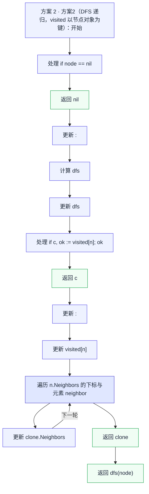

```go
package main // 引入依赖

import (
	"fmt"  // 「fmt」
	"os"   // 「os」
	"sort" // 「sort」
)

// Node 对应 python ref 中的 Node
type Node struct { // 定义类型
	Val       int     // Val int
	Neighbors []*Node // Neighbors [] 乘 Node
}

// cloneGraph 忠实翻译 python ref（DFS 递归）
func cloneGraph(node *Node) *Node { // 定义函数/方法 cloneGraph
	if node == nil { // 若 节点 等于 nil
		return nil // 返回 nil
	}
	visited := make(map[*Node]*Node) // 把 make(映射表[ 乘 Node] 乘 Node) 写入 visited :
	var dfs func(n *Node) *Node      // var dfs func(元素个数 乘 Node) 乘 Node
	dfs = func(n *Node) *Node {      // 把 func(元素个数 乘 Node) 乘 Node { 写入 dfs
		if c, ok := visited[n]; ok { // 若 字符, ok : 赋值为 已访问集合[元素个数]; ok
			return c // 返回 字符
		}
		clone := &Node{Val: n.Val}             // 把 按位与 Node{Val: 元素个数.Val} 写入 clone :
		visited[n] = clone                     // 把 clone 写入 visited[n]
		for _, neighbor := range n.Neighbors { // 同时取 _ 与 neighbor 遍历
			clone.Neighbors = append(clone.Neighbors, dfs(neighbor)) // 把 append(clone.Neighbors, dfs(neighbor)) 写入 clone.Neighbors
		}
		return clone // 返回 clone
	}
	return dfs(node) // 定义函数/方法 dfs
}

// buildGraph 由邻接表（1-indexed）构图，返回 1 号节点
func buildGraph(adj [][]int) *Node { // 定义函数/方法 buildGraph
	if len(adj) == 0 { // 若 长度(邻接表) 等于 0
		return nil // 返回 nil
	}
	nodes := make([]*Node, len(adj)+1) // 把 make([] 乘 Node, 长度(邻接表) 加 1) 写入 nodes :
	for i := 1; i <= len(adj); i++ {   // 让 下标 i 从 1 开始计数
		nodes[i] = &Node{Val: i} // 把 按位与 Node{Val: 下标 i} 写入 nodes[i]
	}
	for i, nbrs := range adj { // 同时取 下标 i 与 nbrs 遍历
		for _, nb := range nbrs { // 同时取 _ 与 nb 遍历
			nodes[i+1].Neighbors = append(nodes[i+1].Neighbors, nodes[nb])
		}
	}
	return nodes[1] // 返回 nodes[1]
}

// graphSignature 对应 python ref 的 graph_signature
func graphSignature(node *Node) map[int][]int { // 定义函数/方法 graphSignature
	visited := make(map[int][]int) // 把 make(映射表[int][]int) 写入 visited :
	var dfs func(n *Node)          // var dfs func(元素个数 乘 Node)
	dfs = func(n *Node) {          // 把 func(元素个数 乘 Node) { 写入 dfs
		if _, ok := visited[n.Val]; ok { // 若 _, ok : 赋值为 已访问集合[元素个数.Val]; ok
			return // return
		}
		vals := make([]int, 0, len(n.Neighbors)) // 把 make([]int, 0, 长度(元素个数.Neighbors)) 写入 vals :
		for _, x := range n.Neighbors {          // 同时取 _ 与 x 遍历
			vals = append(vals, x.Val) // 把 append(vals, x.Val) 写入 vals
		}
		sort.Ints(vals)                 // sort.Ints(vals)
		visited[n.Val] = vals           // 把 vals 写入 visited[n.Val]
		for _, x := range n.Neighbors { // 同时取 _ 与 x 遍历
			dfs(x) // dfs(x)
		}
	}
	if node != nil { // 若 节点 不等于 nil
		dfs(node) // dfs(节点)
	}
	return visited // 返回 已访问集合
}

func sigEqual(a, b map[int][]int) bool { // 定义函数/方法 sigEqual
	if len(a) != len(b) { // 定义函数/方法 len
		return false // 返回 false
	}
	for k, va := range a { // 同时取 下标 k 与 va 遍历
		vb, ok := b[k]                 // 把 b[下标 k] 写入 vb, ok :
		if !ok || len(va) != len(vb) { // 若 取反 ok 或 长度(va) 不等于 长度(vb
			return false // 返回 false
		}
		for i := range va { // 把 range va { 写入 for i :
			if va[i] != vb[i] { // 若 va[下标 i] 不等于 vb[下标 i]
				return false // 返回 false
			}
		}
	}
	return true // 返回 true
}

func main() { // 程序入口：跑内嵌自测用例
	ok := true // 把 true 写入 ok :

	// case1 normal: [[2,4],[1,3],[2,4],[1,3]] -> want {1:[2,4],2:[1,3],3:[2,4],4:[1,3]}
	c1 := cloneGraph(buildGraph([][]int{{2, 4}, {1, 3}, {2, 4}, {1, 3}}))
	want1 := map[int][]int{1: {2, 4}, 2: {1, 3}, 3: {2, 4}, 4: {1, 3}}
	if got := graphSignature(c1); !sigEqual(got, want1) { // 若 got : 赋值为 graphSignature(c1); 取反 sigEqual(got, want1
		ok = false                                            // 把 false 写入 ok
		fmt.Printf("FAIL case1 got %v want %v\n", got, want1) // 打印输出
	}

	// case2 boundary: 单节点无邻居 [[]] -> want {1:[]}
	c2 := cloneGraph(buildGraph([][]int{{}}))             // 把 cloneGraph(buildGraph([][]int{{}})) 写入 c2 :
	want2 := map[int][]int{1: {}}                         // 把 映射表[int][]int{1: {}} 写入 want2 :
	if got := graphSignature(c2); !sigEqual(got, want2) { // 若 got : 赋值为 graphSignature(c2); 取反 sigEqual(got, want2
		ok = false                                            // 把 false 写入 ok
		fmt.Printf("FAIL case2 got %v want %v\n", got, want2) // 打印输出
	}

	// case3 boundary: 两节点互连 [[2],[1]] -> want {1:[2],2:[1]}
	c3 := cloneGraph(buildGraph([][]int{{2}, {1}}))       // 把 cloneGraph(buildGraph([][]int{{2}, {1}})) 写入 c3 :
	want3 := map[int][]int{1: {2}, 2: {1}}                // 把 映射表[int][]int{1: {2}, 2: {1}} 写入 want3 :
	if got := graphSignature(c3); !sigEqual(got, want3) { // 若 got : 赋值为 graphSignature(c3); 取反 sigEqual(got, want3
		ok = false                                            // 把 false 写入 ok
		fmt.Printf("FAIL case3 got %v want %v\n", got, want3) // 打印输出
	}

	// case4 boundary: 空图 nil -> nil
	if cloneGraph(nil) != nil { // 若 cloneGraph(nil) 不等于 nil
		ok = false                                       // 把 false 写入 ok
		fmt.Println("FAIL case4 cloneGraph(nil) != nil") // 打印输出
	}

	if !ok { // 若 取反 ok
		os.Exit(1) // os.Exit(1)
	}
	fmt.Println("PASS") // 全部用例通过，输出 PASS
}
```

#### 方案 3：方案3（DFS 递归，visited 以节点对象为键）

**思路与代码分析**：核心是「方案3（DFS 递归，visited 以节点对象为键）」。Go 版用切片与多返回值惯用法，显式处理索引边界。代码里依次做这些事：哈希结构做计数或查重。**走读**：方案 3 · 方案3（DFS 递归，visited 以节点对象为键）：开始 → 处理 if node == nil → 返回 nil → 更新 : → 计算 dfs → 更新 dfs → 处理 if c, ok := visited[n]; ok → 返回 c → 更新 : → 更新 visited[n] → 遍历 n.Neighbors 的下标与元素 neighbor → 更新 clone.Neighbors → 返回 clone → 返回 dfs(node)。

**运行架构**（真实控制流）：


```go
package main // 引入依赖

import (
	"fmt"  // 「fmt」
	"os"   // 「os」
	"sort" // 「sort」
)

// Node 对应 python ref 中的 Node
type Node struct { // 定义类型
	Val       int     // Val int
	Neighbors []*Node // Neighbors [] 乘 Node
}

// cloneGraph 忠实翻译 python ref（DFS 递归）
func cloneGraph(node *Node) *Node { // 定义函数/方法 cloneGraph
	if node == nil { // 若 节点 等于 nil
		return nil // 返回 nil
	}
	visited := make(map[*Node]*Node) // 把 make(映射表[ 乘 Node] 乘 Node) 写入 visited :
	var dfs func(n *Node) *Node      // var dfs func(元素个数 乘 Node) 乘 Node
	dfs = func(n *Node) *Node {      // 把 func(元素个数 乘 Node) 乘 Node { 写入 dfs
		if c, ok := visited[n]; ok { // 若 字符, ok : 赋值为 已访问集合[元素个数]; ok
			return c // 返回 字符
		}
		clone := &Node{Val: n.Val}             // 把 按位与 Node{Val: 元素个数.Val} 写入 clone :
		visited[n] = clone                     // 把 clone 写入 visited[n]
		for _, neighbor := range n.Neighbors { // 同时取 _ 与 neighbor 遍历
			clone.Neighbors = append(clone.Neighbors, dfs(neighbor)) // 把 append(clone.Neighbors, dfs(neighbor)) 写入 clone.Neighbors
		}
		return clone // 返回 clone
	}
	return dfs(node) // 定义函数/方法 dfs
}

// buildGraph 由邻接表（1-indexed）构图，返回 1 号节点
func buildGraph(adj [][]int) *Node { // 定义函数/方法 buildGraph
	if len(adj) == 0 { // 若 长度(邻接表) 等于 0
		return nil // 返回 nil
	}
	nodes := make([]*Node, len(adj)+1) // 把 make([] 乘 Node, 长度(邻接表) 加 1) 写入 nodes :
	for i := 1; i <= len(adj); i++ {   // 让 下标 i 从 1 开始计数
		nodes[i] = &Node{Val: i} // 把 按位与 Node{Val: 下标 i} 写入 nodes[i]
	}
	for i, nbrs := range adj { // 同时取 下标 i 与 nbrs 遍历
		for _, nb := range nbrs { // 同时取 _ 与 nb 遍历
			nodes[i+1].Neighbors = append(nodes[i+1].Neighbors, nodes[nb])
		}
	}
	return nodes[1] // 返回 nodes[1]
}

// graphSignature 对应 python ref 的 graph_signature
func graphSignature(node *Node) map[int][]int { // 定义函数/方法 graphSignature
	visited := make(map[int][]int) // 把 make(映射表[int][]int) 写入 visited :
	var dfs func(n *Node)          // var dfs func(元素个数 乘 Node)
	dfs = func(n *Node) {          // 把 func(元素个数 乘 Node) { 写入 dfs
		if _, ok := visited[n.Val]; ok { // 若 _, ok : 赋值为 已访问集合[元素个数.Val]; ok
			return // return
		}
		vals := make([]int, 0, len(n.Neighbors)) // 把 make([]int, 0, 长度(元素个数.Neighbors)) 写入 vals :
		for _, x := range n.Neighbors {          // 同时取 _ 与 x 遍历
			vals = append(vals, x.Val) // 把 append(vals, x.Val) 写入 vals
		}
		sort.Ints(vals)                 // sort.Ints(vals)
		visited[n.Val] = vals           // 把 vals 写入 visited[n.Val]
		for _, x := range n.Neighbors { // 同时取 _ 与 x 遍历
			dfs(x) // dfs(x)
		}
	}
	if node != nil { // 若 节点 不等于 nil
		dfs(node) // dfs(节点)
	}
	return visited // 返回 已访问集合
}

func sigEqual(a, b map[int][]int) bool { // 定义函数/方法 sigEqual
	if len(a) != len(b) { // 定义函数/方法 len
		return false // 返回 false
	}
	for k, va := range a { // 同时取 下标 k 与 va 遍历
		vb, ok := b[k]                 // 把 b[下标 k] 写入 vb, ok :
		if !ok || len(va) != len(vb) { // 若 取反 ok 或 长度(va) 不等于 长度(vb
			return false // 返回 false
		}
		for i := range va { // 把 range va { 写入 for i :
			if va[i] != vb[i] { // 若 va[下标 i] 不等于 vb[下标 i]
				return false // 返回 false
			}
		}
	}
	return true // 返回 true
}

func main() { // 程序入口：跑内嵌自测用例
	ok := true // 把 true 写入 ok :

	// case1 normal: [[2,4],[1,3],[2,4],[1,3]] -> want {1:[2,4],2:[1,3],3:[2,4],4:[1,3]}
	c1 := cloneGraph(buildGraph([][]int{{2, 4}, {1, 3}, {2, 4}, {1, 3}}))
	want1 := map[int][]int{1: {2, 4}, 2: {1, 3}, 3: {2, 4}, 4: {1, 3}}
	if got := graphSignature(c1); !sigEqual(got, want1) { // 若 got : 赋值为 graphSignature(c1); 取反 sigEqual(got, want1
		ok = false                                            // 把 false 写入 ok
		fmt.Printf("FAIL case1 got %v want %v\n", got, want1) // 打印输出
	}

	// case2 boundary: 单节点无邻居 [[]] -> want {1:[]}
	c2 := cloneGraph(buildGraph([][]int{{}}))             // 把 cloneGraph(buildGraph([][]int{{}})) 写入 c2 :
	want2 := map[int][]int{1: {}}                         // 把 映射表[int][]int{1: {}} 写入 want2 :
	if got := graphSignature(c2); !sigEqual(got, want2) { // 若 got : 赋值为 graphSignature(c2); 取反 sigEqual(got, want2
		ok = false                                            // 把 false 写入 ok
		fmt.Printf("FAIL case2 got %v want %v\n", got, want2) // 打印输出
	}

	// case3 boundary: 两节点互连 [[2],[1]] -> want {1:[2],2:[1]}
	c3 := cloneGraph(buildGraph([][]int{{2}, {1}}))       // 把 cloneGraph(buildGraph([][]int{{2}, {1}})) 写入 c3 :
	want3 := map[int][]int{1: {2}, 2: {1}}                // 把 映射表[int][]int{1: {2}, 2: {1}} 写入 want3 :
	if got := graphSignature(c3); !sigEqual(got, want3) { // 若 got : 赋值为 graphSignature(c3); 取反 sigEqual(got, want3
		ok = false                                            // 把 false 写入 ok
		fmt.Printf("FAIL case3 got %v want %v\n", got, want3) // 打印输出
	}

	// case4 boundary: 空图 nil -> nil
	if cloneGraph(nil) != nil { // 若 cloneGraph(nil) 不等于 nil
		ok = false                                       // 把 false 写入 ok
		fmt.Println("FAIL case4 cloneGraph(nil) != nil") // 打印输出
	}

	if !ok { // 若 取反 ok
		os.Exit(1) // os.Exit(1)
	}
	fmt.Println("PASS") // 全部用例通过，输出 PASS
}
```

#### 方案 4：方案4（BFS，visited 以节点对象为键）

**思路与代码分析**：核心是「方案4（BFS，visited 以节点对象为键）」。Go 版用切片与多返回值惯用法，显式处理索引边界。代码里依次做这些事：哈希结构做计数或查重。**走读**：方案 4 · 方案4（BFS，visited 以节点对象为键）：开始 → 处理 if node == nil → 返回 nil → 更新 : → 更新 visited[node] → 更新 : → 遍历循环 → 更新 : → 更新 queue → 遍历 n.Neighbors 的下标与元素 ne → 处理 if _, ok := visited[ne]; 非 ok → 更新 queue → 更新 visited[ne] → 更新 visited[n].Neighbors → 返回 visited[node]。

**运行架构**（真实控制流）：


```go
package main // 引入依赖

import (
	"fmt"  // 「fmt」
	"os"   // 「os」
	"sort" // 「sort」
)

// Node 对应 python ref 中的 Node
type Node struct { // 定义类型
	Val       int     // Val int
	Neighbors []*Node // Neighbors [] 乘 Node
}

// cloneGraph 忠实翻译 python ref（BFS，队列 pop(0) 语义）
func cloneGraph(node *Node) *Node { // 定义函数/方法 cloneGraph
	if node == nil { // 若 节点 等于 nil
		return nil // 返回 nil
	}
	visited := make(map[*Node]*Node)     // 把 make(映射表[ 乘 Node] 乘 Node) 写入 visited :
	visited[node] = &Node{Val: node.Val} // 把 按位与 Node{Val: 节点.Val} 写入 visited[node]
	queue := []*Node{node}               // 把 [] 乘 Node{节点} 写入 queue :
	for len(queue) > 0 {                 // for 长度(队列) 超过 0 {
		n := queue[0]                    // 把 队列[0] 写入 n :
		queue = queue[1:]                // 把 队列[1:] 写入 队列
		for _, ne := range n.Neighbors { // 同时取 _ 与 ne 遍历
			if _, ok := visited[ne]; !ok { // 若 _, ok : 赋值为 已访问集合[ne]; 取反 ok
				queue = append(queue, ne)        // 把 append(队列, ne) 写入 队列
				visited[ne] = &Node{Val: ne.Val} // 把 按位与 Node{Val: ne.Val} 写入 visited[ne]
			}
			visited[n].Neighbors = append(visited[n].Neighbors, visited[ne])
		}
	}
	return visited[node] // 返回 已访问集合[节点]
}

// buildGraph 由邻接表（1-indexed）构图，返回 1 号节点
func buildGraph(adj [][]int) *Node { // 定义函数/方法 buildGraph
	if len(adj) == 0 { // 若 长度(邻接表) 等于 0
		return nil // 返回 nil
	}
	nodes := make([]*Node, len(adj)+1) // 把 make([] 乘 Node, 长度(邻接表) 加 1) 写入 nodes :
	for i := 1; i <= len(adj); i++ {   // 让 下标 i 从 1 开始计数
		nodes[i] = &Node{Val: i} // 把 按位与 Node{Val: 下标 i} 写入 nodes[i]
	}
	for i, nbrs := range adj { // 同时取 下标 i 与 nbrs 遍历
		for _, nb := range nbrs { // 同时取 _ 与 nb 遍历
			nodes[i+1].Neighbors = append(nodes[i+1].Neighbors, nodes[nb])
		}
	}
	return nodes[1] // 返回 nodes[1]
}

// graphSignature 对应 python ref 的 graph_signature
func graphSignature(node *Node) map[int][]int { // 定义函数/方法 graphSignature
	visited := make(map[int][]int) // 把 make(映射表[int][]int) 写入 visited :
	var dfs func(n *Node)          // var dfs func(元素个数 乘 Node)
	dfs = func(n *Node) {          // 把 func(元素个数 乘 Node) { 写入 dfs
		if _, ok := visited[n.Val]; ok { // 若 _, ok : 赋值为 已访问集合[元素个数.Val]; ok
			return // return
		}
		vals := make([]int, 0, len(n.Neighbors)) // 把 make([]int, 0, 长度(元素个数.Neighbors)) 写入 vals :
		for _, x := range n.Neighbors {          // 同时取 _ 与 x 遍历
			vals = append(vals, x.Val) // 把 append(vals, x.Val) 写入 vals
		}
		sort.Ints(vals)                 // sort.Ints(vals)
		visited[n.Val] = vals           // 把 vals 写入 visited[n.Val]
		for _, x := range n.Neighbors { // 同时取 _ 与 x 遍历
			dfs(x) // dfs(x)
		}
	}
	if node != nil { // 若 节点 不等于 nil
		dfs(node) // dfs(节点)
	}
	return visited // 返回 已访问集合
}

func sigEqual(a, b map[int][]int) bool { // 定义函数/方法 sigEqual
	if len(a) != len(b) { // 定义函数/方法 len
		return false // 返回 false
	}
	for k, va := range a { // 同时取 下标 k 与 va 遍历
		vb, ok := b[k]                 // 把 b[下标 k] 写入 vb, ok :
		if !ok || len(va) != len(vb) { // 若 取反 ok 或 长度(va) 不等于 长度(vb
			return false // 返回 false
		}
		for i := range va { // 把 range va { 写入 for i :
			if va[i] != vb[i] { // 若 va[下标 i] 不等于 vb[下标 i]
				return false // 返回 false
			}
		}
	}
	return true // 返回 true
}

func main() { // 程序入口：跑内嵌自测用例
	ok := true // 把 true 写入 ok :

	// case1 normal: [[2,4],[1,3],[2,4],[1,3]] -> want {1:[2,4],2:[1,3],3:[2,4],4:[1,3]}
	c1 := cloneGraph(buildGraph([][]int{{2, 4}, {1, 3}, {2, 4}, {1, 3}}))
	want1 := map[int][]int{1: {2, 4}, 2: {1, 3}, 3: {2, 4}, 4: {1, 3}}
	if got := graphSignature(c1); !sigEqual(got, want1) { // 若 got : 赋值为 graphSignature(c1); 取反 sigEqual(got, want1
		ok = false                                            // 把 false 写入 ok
		fmt.Printf("FAIL case1 got %v want %v\n", got, want1) // 打印输出
	}

	// case2 boundary: 单节点无邻居 [[]] -> want {1:[]}
	c2 := cloneGraph(buildGraph([][]int{{}}))             // 把 cloneGraph(buildGraph([][]int{{}})) 写入 c2 :
	want2 := map[int][]int{1: {}}                         // 把 映射表[int][]int{1: {}} 写入 want2 :
	if got := graphSignature(c2); !sigEqual(got, want2) { // 若 got : 赋值为 graphSignature(c2); 取反 sigEqual(got, want2
		ok = false                                            // 把 false 写入 ok
		fmt.Printf("FAIL case2 got %v want %v\n", got, want2) // 打印输出
	}

	// case3 boundary: 两节点互连 [[2],[1]] -> want {1:[2],2:[1]}
	c3 := cloneGraph(buildGraph([][]int{{2}, {1}}))       // 把 cloneGraph(buildGraph([][]int{{2}, {1}})) 写入 c3 :
	want3 := map[int][]int{1: {2}, 2: {1}}                // 把 映射表[int][]int{1: {2}, 2: {1}} 写入 want3 :
	if got := graphSignature(c3); !sigEqual(got, want3) { // 若 got : 赋值为 graphSignature(c3); 取反 sigEqual(got, want3
		ok = false                                            // 把 false 写入 ok
		fmt.Printf("FAIL case3 got %v want %v\n", got, want3) // 打印输出
	}

	// case4 boundary: 空图 nil -> nil
	if cloneGraph(nil) != nil { // 若 cloneGraph(nil) 不等于 nil
		ok = false                                       // 把 false 写入 ok
		fmt.Println("FAIL case4 cloneGraph(nil) != nil") // 打印输出
	}

	if !ok { // 若 取反 ok
		os.Exit(1) // os.Exit(1)
	}
	fmt.Println("PASS") // 全部用例通过，输出 PASS
}
```

#### 方案 5：方案5（BFS，visited 以节点对象为键）

**思路与代码分析**：核心是「方案5（BFS，visited 以节点对象为键）」。Go 版用切片与多返回值惯用法，显式处理索引边界。代码里依次做这些事：哈希结构做计数或查重。**走读**：方案 5 · 方案5（BFS，visited 以节点对象为键）：开始 → 处理 if node == nil → 返回 nil → 更新 : → 更新 visited[node] → 更新 : → 遍历循环 → 更新 : → 更新 queue → 遍历 n.Neighbors 的下标与元素 ne → 处理 if _, ok := visited[ne]; 非 ok → 更新 queue → 更新 visited[ne] → 更新 visited[n].Neighbors → 返回 visited[node]。

**运行架构**（真实控制流）：

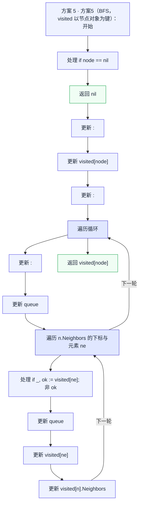

```go
package main // 引入依赖

import (
	"fmt"  // 「fmt」
	"os"   // 「os」
	"sort" // 「sort」
)

// Node 对应 python ref 中的 Node
type Node struct { // 定义类型
	Val       int     // Val int
	Neighbors []*Node // Neighbors [] 乘 Node
}

// cloneGraph 忠实翻译 python ref（BFS，队列 pop(0) 语义）
func cloneGraph(node *Node) *Node { // 定义函数/方法 cloneGraph
	if node == nil { // 若 节点 等于 nil
		return nil // 返回 nil
	}
	visited := make(map[*Node]*Node)     // 把 make(映射表[ 乘 Node] 乘 Node) 写入 visited :
	visited[node] = &Node{Val: node.Val} // 把 按位与 Node{Val: 节点.Val} 写入 visited[node]
	queue := []*Node{node}               // 把 [] 乘 Node{节点} 写入 queue :
	for len(queue) > 0 {                 // for 长度(队列) 超过 0 {
		n := queue[0]                    // 把 队列[0] 写入 n :
		queue = queue[1:]                // 把 队列[1:] 写入 队列
		for _, ne := range n.Neighbors { // 同时取 _ 与 ne 遍历
			if _, ok := visited[ne]; !ok { // 若 _, ok : 赋值为 已访问集合[ne]; 取反 ok
				queue = append(queue, ne)        // 把 append(队列, ne) 写入 队列
				visited[ne] = &Node{Val: ne.Val} // 把 按位与 Node{Val: ne.Val} 写入 visited[ne]
			}
			visited[n].Neighbors = append(visited[n].Neighbors, visited[ne])
		}
	}
	return visited[node] // 返回 已访问集合[节点]
}

// buildGraph 由邻接表（1-indexed）构图，返回 1 号节点
func buildGraph(adj [][]int) *Node { // 定义函数/方法 buildGraph
	if len(adj) == 0 { // 若 长度(邻接表) 等于 0
		return nil // 返回 nil
	}
	nodes := make([]*Node, len(adj)+1) // 把 make([] 乘 Node, 长度(邻接表) 加 1) 写入 nodes :
	for i := 1; i <= len(adj); i++ {   // 让 下标 i 从 1 开始计数
		nodes[i] = &Node{Val: i} // 把 按位与 Node{Val: 下标 i} 写入 nodes[i]
	}
	for i, nbrs := range adj { // 同时取 下标 i 与 nbrs 遍历
		for _, nb := range nbrs { // 同时取 _ 与 nb 遍历
			nodes[i+1].Neighbors = append(nodes[i+1].Neighbors, nodes[nb])
		}
	}
	return nodes[1] // 返回 nodes[1]
}

// graphSignature 对应 python ref 的 graph_signature
func graphSignature(node *Node) map[int][]int { // 定义函数/方法 graphSignature
	visited := make(map[int][]int) // 把 make(映射表[int][]int) 写入 visited :
	var dfs func(n *Node)          // var dfs func(元素个数 乘 Node)
	dfs = func(n *Node) {          // 把 func(元素个数 乘 Node) { 写入 dfs
		if _, ok := visited[n.Val]; ok { // 若 _, ok : 赋值为 已访问集合[元素个数.Val]; ok
			return // return
		}
		vals := make([]int, 0, len(n.Neighbors)) // 把 make([]int, 0, 长度(元素个数.Neighbors)) 写入 vals :
		for _, x := range n.Neighbors {          // 同时取 _ 与 x 遍历
			vals = append(vals, x.Val) // 把 append(vals, x.Val) 写入 vals
		}
		sort.Ints(vals)                 // sort.Ints(vals)
		visited[n.Val] = vals           // 把 vals 写入 visited[n.Val]
		for _, x := range n.Neighbors { // 同时取 _ 与 x 遍历
			dfs(x) // dfs(x)
		}
	}
	if node != nil { // 若 节点 不等于 nil
		dfs(node) // dfs(节点)
	}
	return visited // 返回 已访问集合
}

func sigEqual(a, b map[int][]int) bool { // 定义函数/方法 sigEqual
	if len(a) != len(b) { // 定义函数/方法 len
		return false // 返回 false
	}
	for k, va := range a { // 同时取 下标 k 与 va 遍历
		vb, ok := b[k]                 // 把 b[下标 k] 写入 vb, ok :
		if !ok || len(va) != len(vb) { // 若 取反 ok 或 长度(va) 不等于 长度(vb
			return false // 返回 false
		}
		for i := range va { // 把 range va { 写入 for i :
			if va[i] != vb[i] { // 若 va[下标 i] 不等于 vb[下标 i]
				return false // 返回 false
			}
		}
	}
	return true // 返回 true
}

func main() { // 程序入口：跑内嵌自测用例
	ok := true // 把 true 写入 ok :

	// case1 normal: [[2,4],[1,3],[2,4],[1,3]] -> want {1:[2,4],2:[1,3],3:[2,4],4:[1,3]}
	c1 := cloneGraph(buildGraph([][]int{{2, 4}, {1, 3}, {2, 4}, {1, 3}}))
	want1 := map[int][]int{1: {2, 4}, 2: {1, 3}, 3: {2, 4}, 4: {1, 3}}
	if got := graphSignature(c1); !sigEqual(got, want1) { // 若 got : 赋值为 graphSignature(c1); 取反 sigEqual(got, want1
		ok = false                                            // 把 false 写入 ok
		fmt.Printf("FAIL case1 got %v want %v\n", got, want1) // 打印输出
	}

	// case2 boundary: 单节点无邻居 [[]] -> want {1:[]}
	c2 := cloneGraph(buildGraph([][]int{{}}))             // 把 cloneGraph(buildGraph([][]int{{}})) 写入 c2 :
	want2 := map[int][]int{1: {}}                         // 把 映射表[int][]int{1: {}} 写入 want2 :
	if got := graphSignature(c2); !sigEqual(got, want2) { // 若 got : 赋值为 graphSignature(c2); 取反 sigEqual(got, want2
		ok = false                                            // 把 false 写入 ok
		fmt.Printf("FAIL case2 got %v want %v\n", got, want2) // 打印输出
	}

	// case3 boundary: 两节点互连 [[2],[1]] -> want {1:[2],2:[1]}
	c3 := cloneGraph(buildGraph([][]int{{2}, {1}}))       // 把 cloneGraph(buildGraph([][]int{{2}, {1}})) 写入 c3 :
	want3 := map[int][]int{1: {2}, 2: {1}}                // 把 映射表[int][]int{1: {2}, 2: {1}} 写入 want3 :
	if got := graphSignature(c3); !sigEqual(got, want3) { // 若 got : 赋值为 graphSignature(c3); 取反 sigEqual(got, want3
		ok = false                                            // 把 false 写入 ok
		fmt.Printf("FAIL case3 got %v want %v\n", got, want3) // 打印输出
	}

	// case4 boundary: 空图 nil -> nil
	if cloneGraph(nil) != nil { // 若 cloneGraph(nil) 不等于 nil
		ok = false                                       // 把 false 写入 ok
		fmt.Println("FAIL case4 cloneGraph(nil) != nil") // 打印输出
	}

	if !ok { // 若 取反 ok
		os.Exit(1) // os.Exit(1)
	}
	fmt.Println("PASS") // 全部用例通过，输出 PASS
}
```

#### 方案 6：方案6（BFS，visited 以节点对象为键）

**思路与代码分析**：核心是「方案6（BFS，visited 以节点对象为键）」。Go 版用切片与多返回值惯用法，显式处理索引边界。代码里依次做这些事：哈希结构做计数或查重。**走读**：方案 6 · 方案6（BFS，visited 以节点对象为键）：开始 → 处理 if node == nil → 返回 nil → 更新 : → 更新 visited[node] → 更新 : → 遍历循环 → 更新 : → 更新 queue → 遍历 n.Neighbors 的下标与元素 ne → 处理 if _, ok := visited[ne]; 非 ok → 更新 queue → 更新 visited[ne] → 更新 visited[n].Neighbors → 返回 visited[node]。

**运行架构**（真实控制流）：

```mermaid
graph TD
    N0["方案 6 · 方案6（BFS，visited 以节点对象为键）：开始"]
    N1["处理 if node == nil"]
    N2["返回 nil"]
    N3["更新 :"]
    N4["更新 visited[node]"]
    N5["更新 :"]
    N6["遍历循环"]
    N7["更新 :"]
    N8["更新 queue"]
    N9["遍历 n.Neighbors 的下标与元素 ne"]
    N10["处理 if _, ok := visited[ne]; 非 ok"]
    N11["更新 queue"]
    N12["更新 visited[ne]"]
    N13["更新 visited[n].Neighbors"]
    N14["返回 visited[node]"]
    N0 --> N1
    N1 --> N2
    N2 --> N3
    N3 --> N4
    N4 --> N5
    N5 --> N6
    N6 --> N7
    N7 --> N8
    N8 --> N9
    N9 --> N10
    N10 --> N11
    N11 --> N12
    N12 --> N13
    N13 -- 下一轮 --> N9
    N9 -- 下一轮 --> N6
    N6 --> N14
    classDef n fill:#eef2ff,stroke:#4f46e5,color:#1e293b;
    classDef lp fill:#e0e7ff,stroke:#4338ca,color:#1e293b;
    classDef dc fill:#fef9c3,stroke:#ca8a04,color:#1e293b;
    classDef tm fill:#f0fdf4,stroke:#16a34a,color:#1e293b;
    class N0,N1,N3,N4,N5,N7,N8,N10,N11,N12,N13 n;
    class N6,N9 lp;
    class N2,N14 tm;
```

```go
package main // 引入依赖

import (
	"fmt"  // 「fmt」
	"os"   // 「os」
	"sort" // 「sort」
)

// Node 对应 python ref 中的 Node
type Node struct { // 定义类型
	Val       int     // Val int
	Neighbors []*Node // Neighbors [] 乘 Node
}

// cloneGraph 忠实翻译 python ref（BFS，队列 pop(0) 语义）
func cloneGraph(node *Node) *Node { // 定义函数/方法 cloneGraph
	if node == nil { // 若 节点 等于 nil
		return nil // 返回 nil
	}
	visited := make(map[*Node]*Node)     // 把 make(映射表[ 乘 Node] 乘 Node) 写入 visited :
	visited[node] = &Node{Val: node.Val} // 把 按位与 Node{Val: 节点.Val} 写入 visited[node]
	queue := []*Node{node}               // 把 [] 乘 Node{节点} 写入 queue :
	for len(queue) > 0 {                 // for 长度(队列) 超过 0 {
		n := queue[0]                    // 把 队列[0] 写入 n :
		queue = queue[1:]                // 把 队列[1:] 写入 队列
		for _, ne := range n.Neighbors { // 同时取 _ 与 ne 遍历
			if _, ok := visited[ne]; !ok { // 若 _, ok : 赋值为 已访问集合[ne]; 取反 ok
				queue = append(queue, ne)        // 把 append(队列, ne) 写入 队列
				visited[ne] = &Node{Val: ne.Val} // 把 按位与 Node{Val: ne.Val} 写入 visited[ne]
			}
			visited[n].Neighbors = append(visited[n].Neighbors, visited[ne])
		}
	}
	return visited[node] // 返回 已访问集合[节点]
}

// buildGraph 由邻接表（1-indexed）构图，返回 1 号节点
func buildGraph(adj [][]int) *Node { // 定义函数/方法 buildGraph
	if len(adj) == 0 { // 若 长度(邻接表) 等于 0
		return nil // 返回 nil
	}
	nodes := make([]*Node, len(adj)+1) // 把 make([] 乘 Node, 长度(邻接表) 加 1) 写入 nodes :
	for i := 1; i <= len(adj); i++ {   // 让 下标 i 从 1 开始计数
		nodes[i] = &Node{Val: i} // 把 按位与 Node{Val: 下标 i} 写入 nodes[i]
	}
	for i, nbrs := range adj { // 同时取 下标 i 与 nbrs 遍历
		for _, nb := range nbrs { // 同时取 _ 与 nb 遍历
			nodes[i+1].Neighbors = append(nodes[i+1].Neighbors, nodes[nb])
		}
	}
	return nodes[1] // 返回 nodes[1]
}

// graphSignature 对应 python ref 的 graph_signature
func graphSignature(node *Node) map[int][]int { // 定义函数/方法 graphSignature
	visited := make(map[int][]int) // 把 make(映射表[int][]int) 写入 visited :
	var dfs func(n *Node)          // var dfs func(元素个数 乘 Node)
	dfs = func(n *Node) {          // 把 func(元素个数 乘 Node) { 写入 dfs
		if _, ok := visited[n.Val]; ok { // 若 _, ok : 赋值为 已访问集合[元素个数.Val]; ok
			return // return
		}
		vals := make([]int, 0, len(n.Neighbors)) // 把 make([]int, 0, 长度(元素个数.Neighbors)) 写入 vals :
		for _, x := range n.Neighbors {          // 同时取 _ 与 x 遍历
			vals = append(vals, x.Val) // 把 append(vals, x.Val) 写入 vals
		}
		sort.Ints(vals)                 // sort.Ints(vals)
		visited[n.Val] = vals           // 把 vals 写入 visited[n.Val]
		for _, x := range n.Neighbors { // 同时取 _ 与 x 遍历
			dfs(x) // dfs(x)
		}
	}
	if node != nil { // 若 节点 不等于 nil
		dfs(node) // dfs(节点)
	}
	return visited // 返回 已访问集合
}

func sigEqual(a, b map[int][]int) bool { // 定义函数/方法 sigEqual
	if len(a) != len(b) { // 定义函数/方法 len
		return false // 返回 false
	}
	for k, va := range a { // 同时取 下标 k 与 va 遍历
		vb, ok := b[k]                 // 把 b[下标 k] 写入 vb, ok :
		if !ok || len(va) != len(vb) { // 若 取反 ok 或 长度(va) 不等于 长度(vb
			return false // 返回 false
		}
		for i := range va { // 把 range va { 写入 for i :
			if va[i] != vb[i] { // 若 va[下标 i] 不等于 vb[下标 i]
				return false // 返回 false
			}
		}
	}
	return true // 返回 true
}

func main() { // 程序入口：跑内嵌自测用例
	ok := true // 把 true 写入 ok :

	// case1 normal: [[2,4],[1,3],[2,4],[1,3]] -> want {1:[2,4],2:[1,3],3:[2,4],4:[1,3]}
	c1 := cloneGraph(buildGraph([][]int{{2, 4}, {1, 3}, {2, 4}, {1, 3}}))
	want1 := map[int][]int{1: {2, 4}, 2: {1, 3}, 3: {2, 4}, 4: {1, 3}}
	if got := graphSignature(c1); !sigEqual(got, want1) { // 若 got : 赋值为 graphSignature(c1); 取反 sigEqual(got, want1
		ok = false                                            // 把 false 写入 ok
		fmt.Printf("FAIL case1 got %v want %v\n", got, want1) // 打印输出
	}

	// case2 boundary: 单节点无邻居 [[]] -> want {1:[]}
	c2 := cloneGraph(buildGraph([][]int{{}}))             // 把 cloneGraph(buildGraph([][]int{{}})) 写入 c2 :
	want2 := map[int][]int{1: {}}                         // 把 映射表[int][]int{1: {}} 写入 want2 :
	if got := graphSignature(c2); !sigEqual(got, want2) { // 若 got : 赋值为 graphSignature(c2); 取反 sigEqual(got, want2
		ok = false                                            // 把 false 写入 ok
		fmt.Printf("FAIL case2 got %v want %v\n", got, want2) // 打印输出
	}

	// case3 boundary: 两节点互连 [[2],[1]] -> want {1:[2],2:[1]}
	c3 := cloneGraph(buildGraph([][]int{{2}, {1}}))       // 把 cloneGraph(buildGraph([][]int{{2}, {1}})) 写入 c3 :
	want3 := map[int][]int{1: {2}, 2: {1}}                // 把 映射表[int][]int{1: {2}, 2: {1}} 写入 want3 :
	if got := graphSignature(c3); !sigEqual(got, want3) { // 若 got : 赋值为 graphSignature(c3); 取反 sigEqual(got, want3
		ok = false                                            // 把 false 写入 ok
		fmt.Printf("FAIL case3 got %v want %v\n", got, want3) // 打印输出
	}

	// case4 boundary: 空图 nil -> nil
	if cloneGraph(nil) != nil { // 若 cloneGraph(nil) 不等于 nil
		ok = false                                       // 把 false 写入 ok
		fmt.Println("FAIL case4 cloneGraph(nil) != nil") // 打印输出
	}

	if !ok { // 若 取反 ok
		os.Exit(1) // os.Exit(1)
	}
	fmt.Println("PASS") // 全部用例通过，输出 PASS
}
```

#### 方案 7：方案7（BFS，visited 以节点对象为键）

**思路与代码分析**：核心是「方案7（BFS，visited 以节点对象为键）」。Go 版用切片与多返回值惯用法，显式处理索引边界。代码里依次做这些事：哈希结构做计数或查重。**走读**：方案 7 · 方案7（BFS，visited 以节点对象为键）：开始 → 处理 if node == nil → 返回 nil → 更新 : → 更新 visited[node] → 更新 : → 遍历循环 → 更新 : → 更新 queue → 遍历 n.Neighbors 的下标与元素 ne → 处理 if _, ok := visited[ne]; 非 ok → 更新 queue → 更新 visited[ne] → 更新 visited[n].Neighbors → 返回 visited[node]。

**运行架构**（真实控制流）：

```mermaid
graph TD
    N0["方案 7 · 方案7（BFS，visited 以节点对象为键）：开始"]
    N1["处理 if node == nil"]
    N2["返回 nil"]
    N3["更新 :"]
    N4["更新 visited[node]"]
    N5["更新 :"]
    N6["遍历循环"]
    N7["更新 :"]
    N8["更新 queue"]
    N9["遍历 n.Neighbors 的下标与元素 ne"]
    N10["处理 if _, ok := visited[ne]; 非 ok"]
    N11["更新 queue"]
    N12["更新 visited[ne]"]
    N13["更新 visited[n].Neighbors"]
    N14["返回 visited[node]"]
    N0 --> N1
    N1 --> N2
    N2 --> N3
    N3 --> N4
    N4 --> N5
    N5 --> N6
    N6 --> N7
    N7 --> N8
    N8 --> N9
    N9 --> N10
    N10 --> N11
    N11 --> N12
    N12 --> N13
    N13 -- 下一轮 --> N9
    N9 -- 下一轮 --> N6
    N6 --> N14
    classDef n fill:#eef2ff,stroke:#4f46e5,color:#1e293b;
    classDef lp fill:#e0e7ff,stroke:#4338ca,color:#1e293b;
    classDef dc fill:#fef9c3,stroke:#ca8a04,color:#1e293b;
    classDef tm fill:#f0fdf4,stroke:#16a34a,color:#1e293b;
    class N0,N1,N3,N4,N5,N7,N8,N10,N11,N12,N13 n;
    class N6,N9 lp;
    class N2,N14 tm;
```

```go
package main // 引入依赖

import (
	"fmt"  // 「fmt」
	"os"   // 「os」
	"sort" // 「sort」
)

// Node 对应 python ref 中的 Node
type Node struct { // 定义类型
	Val       int     // Val int
	Neighbors []*Node // Neighbors [] 乘 Node
}

// cloneGraph 忠实翻译 python ref（BFS，队列 pop(0) 语义）
func cloneGraph(node *Node) *Node { // 定义函数/方法 cloneGraph
	if node == nil { // 若 节点 等于 nil
		return nil // 返回 nil
	}
	visited := make(map[*Node]*Node)     // 把 make(映射表[ 乘 Node] 乘 Node) 写入 visited :
	visited[node] = &Node{Val: node.Val} // 把 按位与 Node{Val: 节点.Val} 写入 visited[node]
	queue := []*Node{node}               // 把 [] 乘 Node{节点} 写入 queue :
	for len(queue) > 0 {                 // for 长度(队列) 超过 0 {
		n := queue[0]                    // 把 队列[0] 写入 n :
		queue = queue[1:]                // 把 队列[1:] 写入 队列
		for _, ne := range n.Neighbors { // 同时取 _ 与 ne 遍历
			if _, ok := visited[ne]; !ok { // 若 _, ok : 赋值为 已访问集合[ne]; 取反 ok
				queue = append(queue, ne)        // 把 append(队列, ne) 写入 队列
				visited[ne] = &Node{Val: ne.Val} // 把 按位与 Node{Val: ne.Val} 写入 visited[ne]
			}
			visited[n].Neighbors = append(visited[n].Neighbors, visited[ne])
		}
	}
	return visited[node] // 返回 已访问集合[节点]
}

// buildGraph 由邻接表（1-indexed）构图，返回 1 号节点
func buildGraph(adj [][]int) *Node { // 定义函数/方法 buildGraph
	if len(adj) == 0 { // 若 长度(邻接表) 等于 0
		return nil // 返回 nil
	}
	nodes := make([]*Node, len(adj)+1) // 把 make([] 乘 Node, 长度(邻接表) 加 1) 写入 nodes :
	for i := 1; i <= len(adj); i++ {   // 让 下标 i 从 1 开始计数
		nodes[i] = &Node{Val: i} // 把 按位与 Node{Val: 下标 i} 写入 nodes[i]
	}
	for i, nbrs := range adj { // 同时取 下标 i 与 nbrs 遍历
		for _, nb := range nbrs { // 同时取 _ 与 nb 遍历
			nodes[i+1].Neighbors = append(nodes[i+1].Neighbors, nodes[nb])
		}
	}
	return nodes[1] // 返回 nodes[1]
}

// graphSignature 对应 python ref 的 graph_signature
func graphSignature(node *Node) map[int][]int { // 定义函数/方法 graphSignature
	visited := make(map[int][]int) // 把 make(映射表[int][]int) 写入 visited :
	var dfs func(n *Node)          // var dfs func(元素个数 乘 Node)
	dfs = func(n *Node) {          // 把 func(元素个数 乘 Node) { 写入 dfs
		if _, ok := visited[n.Val]; ok { // 若 _, ok : 赋值为 已访问集合[元素个数.Val]; ok
			return // return
		}
		vals := make([]int, 0, len(n.Neighbors)) // 把 make([]int, 0, 长度(元素个数.Neighbors)) 写入 vals :
		for _, x := range n.Neighbors {          // 同时取 _ 与 x 遍历
			vals = append(vals, x.Val) // 把 append(vals, x.Val) 写入 vals
		}
		sort.Ints(vals)                 // sort.Ints(vals)
		visited[n.Val] = vals           // 把 vals 写入 visited[n.Val]
		for _, x := range n.Neighbors { // 同时取 _ 与 x 遍历
			dfs(x) // dfs(x)
		}
	}
	if node != nil { // 若 节点 不等于 nil
		dfs(node) // dfs(节点)
	}
	return visited // 返回 已访问集合
}

func sigEqual(a, b map[int][]int) bool { // 定义函数/方法 sigEqual
	if len(a) != len(b) { // 定义函数/方法 len
		return false // 返回 false
	}
	for k, va := range a { // 同时取 下标 k 与 va 遍历
		vb, ok := b[k]                 // 把 b[下标 k] 写入 vb, ok :
		if !ok || len(va) != len(vb) { // 若 取反 ok 或 长度(va) 不等于 长度(vb
			return false // 返回 false
		}
		for i := range va { // 把 range va { 写入 for i :
			if va[i] != vb[i] { // 若 va[下标 i] 不等于 vb[下标 i]
				return false // 返回 false
			}
		}
	}
	return true // 返回 true
}

func main() { // 程序入口：跑内嵌自测用例
	ok := true // 把 true 写入 ok :

	// case1 normal: [[2,4],[1,3],[2,4],[1,3]] -> want {1:[2,4],2:[1,3],3:[2,4],4:[1,3]}
	c1 := cloneGraph(buildGraph([][]int{{2, 4}, {1, 3}, {2, 4}, {1, 3}}))
	want1 := map[int][]int{1: {2, 4}, 2: {1, 3}, 3: {2, 4}, 4: {1, 3}}
	if got := graphSignature(c1); !sigEqual(got, want1) { // 若 got : 赋值为 graphSignature(c1); 取反 sigEqual(got, want1
		ok = false                                            // 把 false 写入 ok
		fmt.Printf("FAIL case1 got %v want %v\n", got, want1) // 打印输出
	}

	// case2 boundary: 单节点无邻居 [[]] -> want {1:[]}
	c2 := cloneGraph(buildGraph([][]int{{}}))             // 把 cloneGraph(buildGraph([][]int{{}})) 写入 c2 :
	want2 := map[int][]int{1: {}}                         // 把 映射表[int][]int{1: {}} 写入 want2 :
	if got := graphSignature(c2); !sigEqual(got, want2) { // 若 got : 赋值为 graphSignature(c2); 取反 sigEqual(got, want2
		ok = false                                            // 把 false 写入 ok
		fmt.Printf("FAIL case2 got %v want %v\n", got, want2) // 打印输出
	}

	// case3 boundary: 两节点互连 [[2],[1]] -> want {1:[2],2:[1]}
	c3 := cloneGraph(buildGraph([][]int{{2}, {1}}))       // 把 cloneGraph(buildGraph([][]int{{2}, {1}})) 写入 c3 :
	want3 := map[int][]int{1: {2}, 2: {1}}                // 把 映射表[int][]int{1: {2}, 2: {1}} 写入 want3 :
	if got := graphSignature(c3); !sigEqual(got, want3) { // 若 got : 赋值为 graphSignature(c3); 取反 sigEqual(got, want3
		ok = false                                            // 把 false 写入 ok
		fmt.Printf("FAIL case3 got %v want %v\n", got, want3) // 打印输出
	}

	// case4 boundary: 空图 nil -> nil
	if cloneGraph(nil) != nil { // 若 cloneGraph(nil) 不等于 nil
		ok = false                                       // 把 false 写入 ok
		fmt.Println("FAIL case4 cloneGraph(nil) != nil") // 打印输出
	}

	if !ok { // 若 取反 ok
		os.Exit(1) // os.Exit(1)
	}
	fmt.Println("PASS") // 全部用例通过，输出 PASS
}
```

### Java 实现（7 种方案）

Java 的全部方案如下，每个方案都内嵌用例自测，可独立运行（老仓库 python/go 文件遵循「打印结果」约定）：

#### 方案 1：方案1（BFS，visited 以节点对象为键）

**思路与代码分析**：核心是「方案1（BFS，visited 以节点对象为键）」。Java 版用类与静态方法组织，集合操作显式明了。**走读**：方案 1 · 方案1（BFS，visited 以节点对象为键）：开始 → 更新 val → 返回结果。

**运行架构**（真实控制流）：

```mermaid
graph TD
    N0["方案 1 · 方案1（BFS，visited 以节点对象为键）：开始"]
    N1["更新 val"]
    N2["返回结果"]
    N0 --> N1
    N1 --> N2
    classDef n fill:#eef2ff,stroke:#4f46e5,color:#1e293b;
    classDef lp fill:#e0e7ff,stroke:#4338ca,color:#1e293b;
    classDef dc fill:#fef9c3,stroke:#ca8a04,color:#1e293b;
    classDef tm fill:#f0fdf4,stroke:#16a34a,color:#1e293b;
    class N0,N1 n;
    class N2 tm;
```

```java
package com.webfault.dsa; // 引入依赖

import java.util.*; // 引入依赖

class lc133_solution11 { // 定义类型
  static class Node { // static class Node {
    int val; // int 值;
    List<Node> neighbors = new ArrayList<>(); // 把 new ArrayList 小于 超过 (); 写入 List<Node> neighbors

    Node(int v) {
      val = v;
    } // 把 值; } 写入 Node(int v) { val
  }

  public Node cloneGraph(Node node) { // 定义函数/方法 cloneGraph
    if (node == null) return null; // 若 节点 等于 null，直接返回 null
    Map<Node, Node> visited = new HashMap<>(); // 把 new HashMap 小于 超过 (); 写入 Map<Node, Node> visited
    visited.put(node, new Node(node.val)); // 已访问集合.put(节点, new Node(节点.值));
    Queue<Node> q = new LinkedList<>(); // 把 new LinkedList 小于 超过 (); 写入 Queue<Node> q
    q.offer(node); // 节点.offer(节点);
    while (!q.isEmpty()) { // 循环，直到不满足「取反 节点.isEmpty(」
      Node n = q.poll(); // 把 节点.poll(); 写入 Node n
      for (Node ne : n.neighbors) { // for (Node ne : 元素个数.neighbors) {
        if (!visited.containsKey(ne)) { // 若 取反 已访问集合.containsKey(ne
          q.offer(ne); // 节点.offer(ne);
          visited.put(ne, new Node(ne.val)); // 已访问集合.put(ne, new Node(ne.值));
        }
        visited.get(n).neighbors.add(visited.get(ne)); // 已访问集合 查找 元素个数).neighbors 追加 已访问集合 查找 ne));
      }
    }
    return visited.get(node); // 返回 已访问集合 查找 节点)
  }

  static Map<Integer, List<Integer>> signature(Node node) {
    Map<Integer, List<Integer>> sig =
        new HashMap<>(); // 把 new HashMap 小于 超过 (); 写入 Map<Integer, List<Integer>> sig
    Set<Integer> seen = new HashSet<>(); // 把 new HashSet 小于 超过 (); 写入 Set<Integer> seen
    sigDfs(node, sig, seen); // sigDfs(节点, sig, 已见集合);
    return sig; // 返回 sig
  }

  static void sigDfs(Node n, Map<Integer, List<Integer>> sig, Set<Integer> seen) { // 定义函数/方法 sigDfs
    if (seen.contains(n.val)) return; // 若 已见集合 是否包含 元素个数.值)) return;
    seen.add(n.val); // 已见集合 追加 元素个数.值);
    List<Integer> nb = new ArrayList<>(); // 把 new ArrayList 小于 超过 (); 写入 List<Integer> nb
    for (Node x : n.neighbors) nb.add(x.val); // for (Node x : 元素个数.neighbors) nb 追加 x.值);
    Collections.sort(nb); // 排序
    sig.put(n.val, nb); // sig.put(元素个数.值, nb);
    for (Node x : n.neighbors)
      sigDfs(x, sig, seen); // for (Node x : 元素个数.neighbors) sigDfs(x, sig, 已见集合);
  }

  public static void main(String[] args) { // public static void main(String[] args) {
    Node n1 = new Node(1), n2 = new Node(2), n3 = new Node(3), n4 = new Node(4);
    n1.neighbors = Arrays.asList(n2, n4); // 把 Arrays.asList(n2, n4); 写入 n1.neighbors
    n2.neighbors = Arrays.asList(n1, n3); // 把 Arrays.asList(n1, n3); 写入 n2.neighbors
    n3.neighbors = Arrays.asList(n2, n4); // 把 Arrays.asList(n2, n4); 写入 n3.neighbors
    n4.neighbors = Arrays.asList(n1, n3); // 把 Arrays.asList(n1, n3); 写入 n4.neighbors
    lc133_solution11 s = new lc133_solution11(); // 把 new lc133_solution11(); 写入 lc133_solution11 s
    Node c = s.cloneGraph(n1); // 把 字符串.cloneGraph(n1); 写入 Node c
    Map<Integer, List<Integer>> got =
        signature(c); // 把 signature(字符); 写入 Map<Integer, List<Integer>> got
    Map<Integer, List<Integer>> want =
        new HashMap<>(); // 把 new HashMap 小于 超过 (); 写入 Map<Integer, List<Integer>> want
    want.put(1, Arrays.asList(2, 4)); // want.put(1, Arrays.asList(2, 4));
    want.put(2, Arrays.asList(1, 3)); // want.put(2, Arrays.asList(1, 3));
    want.put(3, Arrays.asList(2, 4)); // want.put(3, Arrays.asList(2, 4));
    want.put(4, Arrays.asList(1, 3)); // want.put(4, Arrays.asList(1, 3));
    if (!got.equals(want)) { // 若 取反 got.equals(want
      System.out.println("FAIL got " + got); // 打印输出
      throw new RuntimeException("FAILED"); // throw new RuntimeException(「FAILED」);
    }
    System.out.println("PASS"); // 全部用例通过，输出 PASS
  }
}
```

#### 方案 2：方案2（DFS 递归，visited 以节点对象为键）

**思路与代码分析**：核心是「方案2（DFS 递归，visited 以节点对象为键）」。Java 版用类与静态方法组织，集合操作显式明了。**走读**：方案 2 · 方案2（DFS 递归，visited 以节点对象为键）：开始 → 更新 val → 返回结果。

**运行架构**（真实控制流）：

```mermaid
graph TD
    N0["方案 2 · 方案2（DFS 递归，visited 以节点对象为键）：开始"]
    N1["更新 val"]
    N2["返回结果"]
    N0 --> N1
    N1 --> N2
    classDef n fill:#eef2ff,stroke:#4f46e5,color:#1e293b;
    classDef lp fill:#e0e7ff,stroke:#4338ca,color:#1e293b;
    classDef dc fill:#fef9c3,stroke:#ca8a04,color:#1e293b;
    classDef tm fill:#f0fdf4,stroke:#16a34a,color:#1e293b;
    class N0,N1 n;
    class N2 tm;
```

```java
package com.webfault.dsa; // 引入依赖

import java.util.*; // 引入依赖

class lc133_solution22 { // 定义类型
  static class Node { // static class Node {
    int val; // int 值;
    List<Node> neighbors = new ArrayList<>(); // 把 new ArrayList 小于 超过 (); 写入 List<Node> neighbors

    Node(int v) {
      val = v;
    } // 把 值; } 写入 Node(int v) { val
  }

  public Node cloneGraph(Node node) { // 定义函数/方法 cloneGraph
    if (node == null) return null; // 若 节点 等于 null，直接返回 null
    Map<Node, Node> visited = new HashMap<>(); // 把 new HashMap 小于 超过 (); 写入 Map<Node, Node> visited
    return dfs(node, visited); // 返回 dfs(节点, 已访问集合)
  }

  private Node dfs(Node n, Map<Node, Node> visited) { // 定义函数/方法 dfs
    if (visited.containsKey(n))
      return visited.get(n); // 若 已访问集合.containsKey(元素个数)，直接返回 已访问集合 查找 元素个数)
    Node clone = new Node(n.val); // 把 new Node(元素个数.值); 写入 Node clone
    visited.put(n, clone); // 已访问集合.put(元素个数, clone);
    for (Node ne : n.neighbors) { // for (Node ne : 元素个数.neighbors) {
      clone.neighbors.add(dfs(ne, visited)); // clone.neighbors 追加 dfs(ne, 已访问集合));
    }
    return clone; // 返回 clone
  }

  static Map<Integer, List<Integer>> signature(Node node) {
    Map<Integer, List<Integer>> sig =
        new HashMap<>(); // 把 new HashMap 小于 超过 (); 写入 Map<Integer, List<Integer>> sig
    Set<Integer> seen = new HashSet<>(); // 把 new HashSet 小于 超过 (); 写入 Set<Integer> seen
    sigDfs(node, sig, seen); // sigDfs(节点, sig, 已见集合);
    return sig; // 返回 sig
  }

  static void sigDfs(Node n, Map<Integer, List<Integer>> sig, Set<Integer> seen) { // 定义函数/方法 sigDfs
    if (seen.contains(n.val)) return; // 若 已见集合 是否包含 元素个数.值)) return;
    seen.add(n.val); // 已见集合 追加 元素个数.值);
    List<Integer> nb = new ArrayList<>(); // 把 new ArrayList 小于 超过 (); 写入 List<Integer> nb
    for (Node x : n.neighbors) nb.add(x.val); // for (Node x : 元素个数.neighbors) nb 追加 x.值);
    Collections.sort(nb); // 排序
    sig.put(n.val, nb); // sig.put(元素个数.值, nb);
    for (Node x : n.neighbors)
      sigDfs(x, sig, seen); // for (Node x : 元素个数.neighbors) sigDfs(x, sig, 已见集合);
  }

  public static void main(String[] args) { // public static void main(String[] args) {
    Node n1 = new Node(1), n2 = new Node(2), n3 = new Node(3), n4 = new Node(4);
    n1.neighbors = Arrays.asList(n2, n4); // 把 Arrays.asList(n2, n4); 写入 n1.neighbors
    n2.neighbors = Arrays.asList(n1, n3); // 把 Arrays.asList(n1, n3); 写入 n2.neighbors
    n3.neighbors = Arrays.asList(n2, n4); // 把 Arrays.asList(n2, n4); 写入 n3.neighbors
    n4.neighbors = Arrays.asList(n1, n3); // 把 Arrays.asList(n1, n3); 写入 n4.neighbors
    lc133_solution22 s = new lc133_solution22(); // 把 new lc133_solution22(); 写入 lc133_solution22 s
    Node c = s.cloneGraph(n1); // 把 字符串.cloneGraph(n1); 写入 Node c
    Map<Integer, List<Integer>> got =
        signature(c); // 把 signature(字符); 写入 Map<Integer, List<Integer>> got
    Map<Integer, List<Integer>> want =
        new HashMap<>(); // 把 new HashMap 小于 超过 (); 写入 Map<Integer, List<Integer>> want
    want.put(1, Arrays.asList(2, 4)); // want.put(1, Arrays.asList(2, 4));
    want.put(2, Arrays.asList(1, 3)); // want.put(2, Arrays.asList(1, 3));
    want.put(3, Arrays.asList(2, 4)); // want.put(3, Arrays.asList(2, 4));
    want.put(4, Arrays.asList(1, 3)); // want.put(4, Arrays.asList(1, 3));
    if (!got.equals(want)) { // 若 取反 got.equals(want
      System.out.println("FAIL got " + got); // 打印输出
      throw new RuntimeException("FAILED"); // throw new RuntimeException(「FAILED」);
    }
    System.out.println("PASS"); // 全部用例通过，输出 PASS
  }
}
```

#### 方案 3：方案3（DFS 递归，visited 以节点对象为键）

**思路与代码分析**：核心是「方案3（DFS 递归，visited 以节点对象为键）」。Java 版用类与静态方法组织，集合操作显式明了。**走读**：方案 3 · 方案3（DFS 递归，visited 以节点对象为键）：开始 → 更新 val → 返回结果。

**运行架构**（真实控制流）：

```mermaid
graph TD
    N0["方案 3 · 方案3（DFS 递归，visited 以节点对象为键）：开始"]
    N1["更新 val"]
    N2["返回结果"]
    N0 --> N1
    N1 --> N2
    classDef n fill:#eef2ff,stroke:#4f46e5,color:#1e293b;
    classDef lp fill:#e0e7ff,stroke:#4338ca,color:#1e293b;
    classDef dc fill:#fef9c3,stroke:#ca8a04,color:#1e293b;
    classDef tm fill:#f0fdf4,stroke:#16a34a,color:#1e293b;
    class N0,N1 n;
    class N2 tm;
```

```java
package com.webfault.dsa; // 引入依赖

import java.util.*; // 引入依赖

class lc133_solution33 { // 定义类型
  static class Node { // static class Node {
    int val; // int 值;
    List<Node> neighbors = new ArrayList<>(); // 把 new ArrayList 小于 超过 (); 写入 List<Node> neighbors

    Node(int v) {
      val = v;
    } // 把 值; } 写入 Node(int v) { val
  }

  public Node cloneGraph(Node node) { // 定义函数/方法 cloneGraph
    if (node == null) return null; // 若 节点 等于 null，直接返回 null
    Map<Node, Node> visited = new HashMap<>(); // 把 new HashMap 小于 超过 (); 写入 Map<Node, Node> visited
    return dfs(node, visited); // 返回 dfs(节点, 已访问集合)
  }

  private Node dfs(Node n, Map<Node, Node> visited) { // 定义函数/方法 dfs
    if (visited.containsKey(n))
      return visited.get(n); // 若 已访问集合.containsKey(元素个数)，直接返回 已访问集合 查找 元素个数)
    Node clone = new Node(n.val); // 把 new Node(元素个数.值); 写入 Node clone
    visited.put(n, clone); // 已访问集合.put(元素个数, clone);
    for (Node ne : n.neighbors) { // for (Node ne : 元素个数.neighbors) {
      clone.neighbors.add(dfs(ne, visited)); // clone.neighbors 追加 dfs(ne, 已访问集合));
    }
    return clone; // 返回 clone
  }

  static Map<Integer, List<Integer>> signature(Node node) {
    Map<Integer, List<Integer>> sig =
        new HashMap<>(); // 把 new HashMap 小于 超过 (); 写入 Map<Integer, List<Integer>> sig
    Set<Integer> seen = new HashSet<>(); // 把 new HashSet 小于 超过 (); 写入 Set<Integer> seen
    sigDfs(node, sig, seen); // sigDfs(节点, sig, 已见集合);
    return sig; // 返回 sig
  }

  static void sigDfs(Node n, Map<Integer, List<Integer>> sig, Set<Integer> seen) { // 定义函数/方法 sigDfs
    if (seen.contains(n.val)) return; // 若 已见集合 是否包含 元素个数.值)) return;
    seen.add(n.val); // 已见集合 追加 元素个数.值);
    List<Integer> nb = new ArrayList<>(); // 把 new ArrayList 小于 超过 (); 写入 List<Integer> nb
    for (Node x : n.neighbors) nb.add(x.val); // for (Node x : 元素个数.neighbors) nb 追加 x.值);
    Collections.sort(nb); // 排序
    sig.put(n.val, nb); // sig.put(元素个数.值, nb);
    for (Node x : n.neighbors)
      sigDfs(x, sig, seen); // for (Node x : 元素个数.neighbors) sigDfs(x, sig, 已见集合);
  }

  public static void main(String[] args) { // public static void main(String[] args) {
    Node n1 = new Node(1), n2 = new Node(2), n3 = new Node(3), n4 = new Node(4);
    n1.neighbors = Arrays.asList(n2, n4); // 把 Arrays.asList(n2, n4); 写入 n1.neighbors
    n2.neighbors = Arrays.asList(n1, n3); // 把 Arrays.asList(n1, n3); 写入 n2.neighbors
    n3.neighbors = Arrays.asList(n2, n4); // 把 Arrays.asList(n2, n4); 写入 n3.neighbors
    n4.neighbors = Arrays.asList(n1, n3); // 把 Arrays.asList(n1, n3); 写入 n4.neighbors
    lc133_solution33 s = new lc133_solution33(); // 把 new lc133_solution33(); 写入 lc133_solution33 s
    Node c = s.cloneGraph(n1); // 把 字符串.cloneGraph(n1); 写入 Node c
    Map<Integer, List<Integer>> got =
        signature(c); // 把 signature(字符); 写入 Map<Integer, List<Integer>> got
    Map<Integer, List<Integer>> want =
        new HashMap<>(); // 把 new HashMap 小于 超过 (); 写入 Map<Integer, List<Integer>> want
    want.put(1, Arrays.asList(2, 4)); // want.put(1, Arrays.asList(2, 4));
    want.put(2, Arrays.asList(1, 3)); // want.put(2, Arrays.asList(1, 3));
    want.put(3, Arrays.asList(2, 4)); // want.put(3, Arrays.asList(2, 4));
    want.put(4, Arrays.asList(1, 3)); // want.put(4, Arrays.asList(1, 3));
    if (!got.equals(want)) { // 若 取反 got.equals(want
      System.out.println("FAIL got " + got); // 打印输出
      throw new RuntimeException("FAILED"); // throw new RuntimeException(「FAILED」);
    }
    System.out.println("PASS"); // 全部用例通过，输出 PASS
  }
}
```

#### 方案 4：方案4（BFS，visited 以节点对象为键）

**思路与代码分析**：核心是「方案4（BFS，visited 以节点对象为键）」。Java 版用类与静态方法组织，集合操作显式明了。**走读**：方案 4 · 方案4（BFS，visited 以节点对象为键）：开始 → 更新 val → 返回结果。

**运行架构**（真实控制流）：

```mermaid
graph TD
    N0["方案 4 · 方案4（BFS，visited 以节点对象为键）：开始"]
    N1["更新 val"]
    N2["返回结果"]
    N0 --> N1
    N1 --> N2
    classDef n fill:#eef2ff,stroke:#4f46e5,color:#1e293b;
    classDef lp fill:#e0e7ff,stroke:#4338ca,color:#1e293b;
    classDef dc fill:#fef9c3,stroke:#ca8a04,color:#1e293b;
    classDef tm fill:#f0fdf4,stroke:#16a34a,color:#1e293b;
    class N0,N1 n;
    class N2 tm;
```

```java
package com.webfault.dsa; // 引入依赖

import java.util.*; // 引入依赖

class lc133_solution411 { // 定义类型
  static class Node { // static class Node {
    int val; // int 值;
    List<Node> neighbors = new ArrayList<>(); // 把 new ArrayList 小于 超过 (); 写入 List<Node> neighbors

    Node(int v) {
      val = v;
    } // 把 值; } 写入 Node(int v) { val
  }

  public Node cloneGraph(Node node) { // 定义函数/方法 cloneGraph
    if (node == null) return null; // 若 节点 等于 null，直接返回 null
    Map<Node, Node> visited = new HashMap<>(); // 把 new HashMap 小于 超过 (); 写入 Map<Node, Node> visited
    visited.put(node, new Node(node.val)); // 已访问集合.put(节点, new Node(节点.值));
    Queue<Node> q = new LinkedList<>(); // 把 new LinkedList 小于 超过 (); 写入 Queue<Node> q
    q.offer(node); // 节点.offer(节点);
    while (!q.isEmpty()) { // 循环，直到不满足「取反 节点.isEmpty(」
      Node n = q.poll(); // 把 节点.poll(); 写入 Node n
      for (Node ne : n.neighbors) { // for (Node ne : 元素个数.neighbors) {
        if (!visited.containsKey(ne)) { // 若 取反 已访问集合.containsKey(ne
          q.offer(ne); // 节点.offer(ne);
          visited.put(ne, new Node(ne.val)); // 已访问集合.put(ne, new Node(ne.值));
        }
        visited.get(n).neighbors.add(visited.get(ne)); // 已访问集合 查找 元素个数).neighbors 追加 已访问集合 查找 ne));
      }
    }
    return visited.get(node); // 返回 已访问集合 查找 节点)
  }

  static Map<Integer, List<Integer>> signature(Node node) {
    Map<Integer, List<Integer>> sig =
        new HashMap<>(); // 把 new HashMap 小于 超过 (); 写入 Map<Integer, List<Integer>> sig
    Set<Integer> seen = new HashSet<>(); // 把 new HashSet 小于 超过 (); 写入 Set<Integer> seen
    sigDfs(node, sig, seen); // sigDfs(节点, sig, 已见集合);
    return sig; // 返回 sig
  }

  static void sigDfs(Node n, Map<Integer, List<Integer>> sig, Set<Integer> seen) { // 定义函数/方法 sigDfs
    if (seen.contains(n.val)) return; // 若 已见集合 是否包含 元素个数.值)) return;
    seen.add(n.val); // 已见集合 追加 元素个数.值);
    List<Integer> nb = new ArrayList<>(); // 把 new ArrayList 小于 超过 (); 写入 List<Integer> nb
    for (Node x : n.neighbors) nb.add(x.val); // for (Node x : 元素个数.neighbors) nb 追加 x.值);
    Collections.sort(nb); // 排序
    sig.put(n.val, nb); // sig.put(元素个数.值, nb);
    for (Node x : n.neighbors)
      sigDfs(x, sig, seen); // for (Node x : 元素个数.neighbors) sigDfs(x, sig, 已见集合);
  }

  public static void main(String[] args) { // public static void main(String[] args) {
    Node n1 = new Node(1), n2 = new Node(2), n3 = new Node(3), n4 = new Node(4);
    n1.neighbors = Arrays.asList(n2, n4); // 把 Arrays.asList(n2, n4); 写入 n1.neighbors
    n2.neighbors = Arrays.asList(n1, n3); // 把 Arrays.asList(n1, n3); 写入 n2.neighbors
    n3.neighbors = Arrays.asList(n2, n4); // 把 Arrays.asList(n2, n4); 写入 n3.neighbors
    n4.neighbors = Arrays.asList(n1, n3); // 把 Arrays.asList(n1, n3); 写入 n4.neighbors
    lc133_solution411 s =
        new lc133_solution411(); // 把 new lc133_solution411(); 写入 lc133_solution411 s
    Node c = s.cloneGraph(n1); // 把 字符串.cloneGraph(n1); 写入 Node c
    Map<Integer, List<Integer>> got =
        signature(c); // 把 signature(字符); 写入 Map<Integer, List<Integer>> got
    Map<Integer, List<Integer>> want =
        new HashMap<>(); // 把 new HashMap 小于 超过 (); 写入 Map<Integer, List<Integer>> want
    want.put(1, Arrays.asList(2, 4)); // want.put(1, Arrays.asList(2, 4));
    want.put(2, Arrays.asList(1, 3)); // want.put(2, Arrays.asList(1, 3));
    want.put(3, Arrays.asList(2, 4)); // want.put(3, Arrays.asList(2, 4));
    want.put(4, Arrays.asList(1, 3)); // want.put(4, Arrays.asList(1, 3));
    if (!got.equals(want)) { // 若 取反 got.equals(want
      System.out.println("FAIL got " + got); // 打印输出
      throw new RuntimeException("FAILED"); // throw new RuntimeException(「FAILED」);
    }
    System.out.println("PASS"); // 全部用例通过，输出 PASS
  }
}
```

#### 方案 5：方案5（BFS，visited 以节点对象为键）

**思路与代码分析**：核心是「方案5（BFS，visited 以节点对象为键）」。Java 版用类与静态方法组织，集合操作显式明了。**走读**：方案 5 · 方案5（BFS，visited 以节点对象为键）：开始 → 更新 val → 返回结果。

**运行架构**（真实控制流）：

```mermaid
graph TD
    N0["方案 5 · 方案5（BFS，visited 以节点对象为键）：开始"]
    N1["更新 val"]
    N2["返回结果"]
    N0 --> N1
    N1 --> N2
    classDef n fill:#eef2ff,stroke:#4f46e5,color:#1e293b;
    classDef lp fill:#e0e7ff,stroke:#4338ca,color:#1e293b;
    classDef dc fill:#fef9c3,stroke:#ca8a04,color:#1e293b;
    classDef tm fill:#f0fdf4,stroke:#16a34a,color:#1e293b;
    class N0,N1 n;
    class N2 tm;
```

```java
package com.webfault.dsa; // 引入依赖

import java.util.*; // 引入依赖

class lc133_solution522 { // 定义类型
  static class Node { // static class Node {
    int val; // int 值;
    List<Node> neighbors = new ArrayList<>(); // 把 new ArrayList 小于 超过 (); 写入 List<Node> neighbors

    Node(int v) {
      val = v;
    } // 把 值; } 写入 Node(int v) { val
  }

  public Node cloneGraph(Node node) { // 定义函数/方法 cloneGraph
    if (node == null) return null; // 若 节点 等于 null，直接返回 null
    Map<Node, Node> visited = new HashMap<>(); // 把 new HashMap 小于 超过 (); 写入 Map<Node, Node> visited
    visited.put(node, new Node(node.val)); // 已访问集合.put(节点, new Node(节点.值));
    Queue<Node> q = new LinkedList<>(); // 把 new LinkedList 小于 超过 (); 写入 Queue<Node> q
    q.offer(node); // 节点.offer(节点);
    while (!q.isEmpty()) { // 循环，直到不满足「取反 节点.isEmpty(」
      Node n = q.poll(); // 把 节点.poll(); 写入 Node n
      for (Node ne : n.neighbors) { // for (Node ne : 元素个数.neighbors) {
        if (!visited.containsKey(ne)) { // 若 取反 已访问集合.containsKey(ne
          q.offer(ne); // 节点.offer(ne);
          visited.put(ne, new Node(ne.val)); // 已访问集合.put(ne, new Node(ne.值));
        }
        visited.get(n).neighbors.add(visited.get(ne)); // 已访问集合 查找 元素个数).neighbors 追加 已访问集合 查找 ne));
      }
    }
    return visited.get(node); // 返回 已访问集合 查找 节点)
  }

  static Map<Integer, List<Integer>> signature(Node node) {
    Map<Integer, List<Integer>> sig =
        new HashMap<>(); // 把 new HashMap 小于 超过 (); 写入 Map<Integer, List<Integer>> sig
    Set<Integer> seen = new HashSet<>(); // 把 new HashSet 小于 超过 (); 写入 Set<Integer> seen
    sigDfs(node, sig, seen); // sigDfs(节点, sig, 已见集合);
    return sig; // 返回 sig
  }

  static void sigDfs(Node n, Map<Integer, List<Integer>> sig, Set<Integer> seen) { // 定义函数/方法 sigDfs
    if (seen.contains(n.val)) return; // 若 已见集合 是否包含 元素个数.值)) return;
    seen.add(n.val); // 已见集合 追加 元素个数.值);
    List<Integer> nb = new ArrayList<>(); // 把 new ArrayList 小于 超过 (); 写入 List<Integer> nb
    for (Node x : n.neighbors) nb.add(x.val); // for (Node x : 元素个数.neighbors) nb 追加 x.值);
    Collections.sort(nb); // 排序
    sig.put(n.val, nb); // sig.put(元素个数.值, nb);
    for (Node x : n.neighbors)
      sigDfs(x, sig, seen); // for (Node x : 元素个数.neighbors) sigDfs(x, sig, 已见集合);
  }

  public static void main(String[] args) { // public static void main(String[] args) {
    Node n1 = new Node(1), n2 = new Node(2), n3 = new Node(3), n4 = new Node(4);
    n1.neighbors = Arrays.asList(n2, n4); // 把 Arrays.asList(n2, n4); 写入 n1.neighbors
    n2.neighbors = Arrays.asList(n1, n3); // 把 Arrays.asList(n1, n3); 写入 n2.neighbors
    n3.neighbors = Arrays.asList(n2, n4); // 把 Arrays.asList(n2, n4); 写入 n3.neighbors
    n4.neighbors = Arrays.asList(n1, n3); // 把 Arrays.asList(n1, n3); 写入 n4.neighbors
    lc133_solution522 s =
        new lc133_solution522(); // 把 new lc133_solution522(); 写入 lc133_solution522 s
    Node c = s.cloneGraph(n1); // 把 字符串.cloneGraph(n1); 写入 Node c
    Map<Integer, List<Integer>> got =
        signature(c); // 把 signature(字符); 写入 Map<Integer, List<Integer>> got
    Map<Integer, List<Integer>> want =
        new HashMap<>(); // 把 new HashMap 小于 超过 (); 写入 Map<Integer, List<Integer>> want
    want.put(1, Arrays.asList(2, 4)); // want.put(1, Arrays.asList(2, 4));
    want.put(2, Arrays.asList(1, 3)); // want.put(2, Arrays.asList(1, 3));
    want.put(3, Arrays.asList(2, 4)); // want.put(3, Arrays.asList(2, 4));
    want.put(4, Arrays.asList(1, 3)); // want.put(4, Arrays.asList(1, 3));
    if (!got.equals(want)) { // 若 取反 got.equals(want
      System.out.println("FAIL got " + got); // 打印输出
      throw new RuntimeException("FAILED"); // throw new RuntimeException(「FAILED」);
    }
    System.out.println("PASS"); // 全部用例通过，输出 PASS
  }
}
```

#### 方案 6：方案6（BFS，visited 以节点对象为键）

**思路与代码分析**：核心是「方案6（BFS，visited 以节点对象为键）」。Java 版用类与静态方法组织，集合操作显式明了。**走读**：方案 6 · 方案6（BFS，visited 以节点对象为键）：开始 → 更新 val → 返回结果。

**运行架构**（真实控制流）：

```mermaid
graph TD
    N0["方案 6 · 方案6（BFS，visited 以节点对象为键）：开始"]
    N1["更新 val"]
    N2["返回结果"]
    N0 --> N1
    N1 --> N2
    classDef n fill:#eef2ff,stroke:#4f46e5,color:#1e293b;
    classDef lp fill:#e0e7ff,stroke:#4338ca,color:#1e293b;
    classDef dc fill:#fef9c3,stroke:#ca8a04,color:#1e293b;
    classDef tm fill:#f0fdf4,stroke:#16a34a,color:#1e293b;
    class N0,N1 n;
    class N2 tm;
```

```java
package com.webfault.dsa; // 引入依赖

import java.util.*; // 引入依赖

class lc133_solution611 { // 定义类型
  static class Node { // static class Node {
    int val; // int 值;
    List<Node> neighbors = new ArrayList<>(); // 把 new ArrayList 小于 超过 (); 写入 List<Node> neighbors

    Node(int v) {
      val = v;
    } // 把 值; } 写入 Node(int v) { val
  }

  public Node cloneGraph(Node node) { // 定义函数/方法 cloneGraph
    if (node == null) return null; // 若 节点 等于 null，直接返回 null
    Map<Node, Node> visited = new HashMap<>(); // 把 new HashMap 小于 超过 (); 写入 Map<Node, Node> visited
    visited.put(node, new Node(node.val)); // 已访问集合.put(节点, new Node(节点.值));
    Queue<Node> q = new LinkedList<>(); // 把 new LinkedList 小于 超过 (); 写入 Queue<Node> q
    q.offer(node); // 节点.offer(节点);
    while (!q.isEmpty()) { // 循环，直到不满足「取反 节点.isEmpty(」
      Node n = q.poll(); // 把 节点.poll(); 写入 Node n
      for (Node ne : n.neighbors) { // for (Node ne : 元素个数.neighbors) {
        if (!visited.containsKey(ne)) { // 若 取反 已访问集合.containsKey(ne
          q.offer(ne); // 节点.offer(ne);
          visited.put(ne, new Node(ne.val)); // 已访问集合.put(ne, new Node(ne.值));
        }
        visited.get(n).neighbors.add(visited.get(ne)); // 已访问集合 查找 元素个数).neighbors 追加 已访问集合 查找 ne));
      }
    }
    return visited.get(node); // 返回 已访问集合 查找 节点)
  }

  static Map<Integer, List<Integer>> signature(Node node) {
    Map<Integer, List<Integer>> sig =
        new HashMap<>(); // 把 new HashMap 小于 超过 (); 写入 Map<Integer, List<Integer>> sig
    Set<Integer> seen = new HashSet<>(); // 把 new HashSet 小于 超过 (); 写入 Set<Integer> seen
    sigDfs(node, sig, seen); // sigDfs(节点, sig, 已见集合);
    return sig; // 返回 sig
  }

  static void sigDfs(Node n, Map<Integer, List<Integer>> sig, Set<Integer> seen) { // 定义函数/方法 sigDfs
    if (seen.contains(n.val)) return; // 若 已见集合 是否包含 元素个数.值)) return;
    seen.add(n.val); // 已见集合 追加 元素个数.值);
    List<Integer> nb = new ArrayList<>(); // 把 new ArrayList 小于 超过 (); 写入 List<Integer> nb
    for (Node x : n.neighbors) nb.add(x.val); // for (Node x : 元素个数.neighbors) nb 追加 x.值);
    Collections.sort(nb); // 排序
    sig.put(n.val, nb); // sig.put(元素个数.值, nb);
    for (Node x : n.neighbors)
      sigDfs(x, sig, seen); // for (Node x : 元素个数.neighbors) sigDfs(x, sig, 已见集合);
  }

  public static void main(String[] args) { // public static void main(String[] args) {
    Node n1 = new Node(1), n2 = new Node(2), n3 = new Node(3), n4 = new Node(4);
    n1.neighbors = Arrays.asList(n2, n4); // 把 Arrays.asList(n2, n4); 写入 n1.neighbors
    n2.neighbors = Arrays.asList(n1, n3); // 把 Arrays.asList(n1, n3); 写入 n2.neighbors
    n3.neighbors = Arrays.asList(n2, n4); // 把 Arrays.asList(n2, n4); 写入 n3.neighbors
    n4.neighbors = Arrays.asList(n1, n3); // 把 Arrays.asList(n1, n3); 写入 n4.neighbors
    lc133_solution611 s =
        new lc133_solution611(); // 把 new lc133_solution611(); 写入 lc133_solution611 s
    Node c = s.cloneGraph(n1); // 把 字符串.cloneGraph(n1); 写入 Node c
    Map<Integer, List<Integer>> got =
        signature(c); // 把 signature(字符); 写入 Map<Integer, List<Integer>> got
    Map<Integer, List<Integer>> want =
        new HashMap<>(); // 把 new HashMap 小于 超过 (); 写入 Map<Integer, List<Integer>> want
    want.put(1, Arrays.asList(2, 4)); // want.put(1, Arrays.asList(2, 4));
    want.put(2, Arrays.asList(1, 3)); // want.put(2, Arrays.asList(1, 3));
    want.put(3, Arrays.asList(2, 4)); // want.put(3, Arrays.asList(2, 4));
    want.put(4, Arrays.asList(1, 3)); // want.put(4, Arrays.asList(1, 3));
    if (!got.equals(want)) { // 若 取反 got.equals(want
      System.out.println("FAIL got " + got); // 打印输出
      throw new RuntimeException("FAILED"); // throw new RuntimeException(「FAILED」);
    }
    System.out.println("PASS"); // 全部用例通过，输出 PASS
  }
}
```

#### 方案 7：方案7（BFS，visited 以节点对象为键）

**思路与代码分析**：核心是「方案7（BFS，visited 以节点对象为键）」。Java 版用类与静态方法组织，集合操作显式明了。**走读**：方案 7 · 方案7（BFS，visited 以节点对象为键）：开始 → 更新 val → 返回结果。

**运行架构**（真实控制流）：

```mermaid
graph TD
    N0["方案 7 · 方案7（BFS，visited 以节点对象为键）：开始"]
    N1["更新 val"]
    N2["返回结果"]
    N0 --> N1
    N1 --> N2
    classDef n fill:#eef2ff,stroke:#4f46e5,color:#1e293b;
    classDef lp fill:#e0e7ff,stroke:#4338ca,color:#1e293b;
    classDef dc fill:#fef9c3,stroke:#ca8a04,color:#1e293b;
    classDef tm fill:#f0fdf4,stroke:#16a34a,color:#1e293b;
    class N0,N1 n;
    class N2 tm;
```

```java
package com.webfault.dsa; // 引入依赖

import java.util.*; // 引入依赖

class lc133_solution722 { // 定义类型
  static class Node { // static class Node {
    int val; // int 值;
    List<Node> neighbors = new ArrayList<>(); // 把 new ArrayList 小于 超过 (); 写入 List<Node> neighbors

    Node(int v) {
      val = v;
    } // 把 值; } 写入 Node(int v) { val
  }

  public Node cloneGraph(Node node) { // 定义函数/方法 cloneGraph
    if (node == null) return null; // 若 节点 等于 null，直接返回 null
    Map<Node, Node> visited = new HashMap<>(); // 把 new HashMap 小于 超过 (); 写入 Map<Node, Node> visited
    visited.put(node, new Node(node.val)); // 已访问集合.put(节点, new Node(节点.值));
    Queue<Node> q = new LinkedList<>(); // 把 new LinkedList 小于 超过 (); 写入 Queue<Node> q
    q.offer(node); // 节点.offer(节点);
    while (!q.isEmpty()) { // 循环，直到不满足「取反 节点.isEmpty(」
      Node n = q.poll(); // 把 节点.poll(); 写入 Node n
      for (Node ne : n.neighbors) { // for (Node ne : 元素个数.neighbors) {
        if (!visited.containsKey(ne)) { // 若 取反 已访问集合.containsKey(ne
          q.offer(ne); // 节点.offer(ne);
          visited.put(ne, new Node(ne.val)); // 已访问集合.put(ne, new Node(ne.值));
        }
        visited.get(n).neighbors.add(visited.get(ne)); // 已访问集合 查找 元素个数).neighbors 追加 已访问集合 查找 ne));
      }
    }
    return visited.get(node); // 返回 已访问集合 查找 节点)
  }

  static Map<Integer, List<Integer>> signature(Node node) {
    Map<Integer, List<Integer>> sig =
        new HashMap<>(); // 把 new HashMap 小于 超过 (); 写入 Map<Integer, List<Integer>> sig
    Set<Integer> seen = new HashSet<>(); // 把 new HashSet 小于 超过 (); 写入 Set<Integer> seen
    sigDfs(node, sig, seen); // sigDfs(节点, sig, 已见集合);
    return sig; // 返回 sig
  }

  static void sigDfs(Node n, Map<Integer, List<Integer>> sig, Set<Integer> seen) { // 定义函数/方法 sigDfs
    if (seen.contains(n.val)) return; // 若 已见集合 是否包含 元素个数.值)) return;
    seen.add(n.val); // 已见集合 追加 元素个数.值);
    List<Integer> nb = new ArrayList<>(); // 把 new ArrayList 小于 超过 (); 写入 List<Integer> nb
    for (Node x : n.neighbors) nb.add(x.val); // for (Node x : 元素个数.neighbors) nb 追加 x.值);
    Collections.sort(nb); // 排序
    sig.put(n.val, nb); // sig.put(元素个数.值, nb);
    for (Node x : n.neighbors)
      sigDfs(x, sig, seen); // for (Node x : 元素个数.neighbors) sigDfs(x, sig, 已见集合);
  }

  public static void main(String[] args) { // public static void main(String[] args) {
    Node n1 = new Node(1), n2 = new Node(2), n3 = new Node(3), n4 = new Node(4);
    n1.neighbors = Arrays.asList(n2, n4); // 把 Arrays.asList(n2, n4); 写入 n1.neighbors
    n2.neighbors = Arrays.asList(n1, n3); // 把 Arrays.asList(n1, n3); 写入 n2.neighbors
    n3.neighbors = Arrays.asList(n2, n4); // 把 Arrays.asList(n2, n4); 写入 n3.neighbors
    n4.neighbors = Arrays.asList(n1, n3); // 把 Arrays.asList(n1, n3); 写入 n4.neighbors
    lc133_solution722 s =
        new lc133_solution722(); // 把 new lc133_solution722(); 写入 lc133_solution722 s
    Node c = s.cloneGraph(n1); // 把 字符串.cloneGraph(n1); 写入 Node c
    Map<Integer, List<Integer>> got =
        signature(c); // 把 signature(字符); 写入 Map<Integer, List<Integer>> got
    Map<Integer, List<Integer>> want =
        new HashMap<>(); // 把 new HashMap 小于 超过 (); 写入 Map<Integer, List<Integer>> want
    want.put(1, Arrays.asList(2, 4)); // want.put(1, Arrays.asList(2, 4));
    want.put(2, Arrays.asList(1, 3)); // want.put(2, Arrays.asList(1, 3));
    want.put(3, Arrays.asList(2, 4)); // want.put(3, Arrays.asList(2, 4));
    want.put(4, Arrays.asList(1, 3)); // want.put(4, Arrays.asList(1, 3));
    if (!got.equals(want)) { // 若 取反 got.equals(want
      System.out.println("FAIL got " + got); // 打印输出
      throw new RuntimeException("FAILED"); // throw new RuntimeException(「FAILED」);
    }
    System.out.println("PASS"); // 全部用例通过，输出 PASS
  }
}
```

### Rust 实现（7 种方案）

Rust 的全部方案如下，每个方案都内嵌用例自测，可独立运行（老仓库 python/go 文件遵循「打印结果」约定）：

#### 方案 1：方案1（BFS，visited 以节点对象为键）

**思路与代码分析**：核心是「方案1（BFS，visited 以节点对象为键）」。Rust 版用所有权移动与切片借用改写同一逻辑，注意 Option 与引用边界。代码里依次做这些事：哈希结构做计数或查重。**走读**：方案 1 · 方案1（BFS，visited 以节点对象为键）：开始 → 计算 v → 返回  → 遍历 &nbrs 中的每个元素 x。

**运行架构**（真实控制流）：

```mermaid
graph TD
    N0["方案 1 · 方案1（BFS，visited 以节点对象为键）：开始"]
    N1["计算 v"]
    D1["……（中间计算步骤）"]
    N3["返回 "]
    D2["……（中间计算步骤）"]
    N13["遍历 &nbrs 中的每个元素 x"]
    Dend["……（中间计算步骤）"]
    N0 --> N1
    N1 --> D1
    D1 --> N3
    N3 --> D2
    D2 --> N13
    N13 --> Dend
    classDef n fill:#eef2ff,stroke:#4f46e5,color:#1e293b;
    classDef lp fill:#e0e7ff,stroke:#4338ca,color:#1e293b;
    classDef dc fill:#fef9c3,stroke:#ca8a04,color:#1e293b;
    classDef tm fill:#f0fdf4,stroke:#16a34a,color:#1e293b;
    class N0,N1,D1,D2,Dend n;
    class N13 lp;
    class N3 tm;
```

```rust
// LeetCode 133. 克隆图 — Rust 版

// 方案1（BFS，visited 以节点对象为键）
use std::cell::RefCell; // 引入依赖
use std::collections::{HashMap, VecDeque}; // 引入依赖
use std::rc::Rc; // 引入依赖

#[derive(Debug)]
struct Node {
    // 定义类型
    val: i32,
    neighbors: Vec<Rc<RefCell<Node>>>,
}

type P = Rc<RefCell<Node>>; // 定义类型

fn new_node(val: i32) -> P {
    // 定义函数/方法 new_node
    Rc::new(RefCell::new(Node {
        // Rc::new(RefCell::new(Node {
        val,
        neighbors: Vec::new(),
    })) // }))
}

fn clone_graph(node: Option<P>) -> Option<P> {
    // 定义函数/方法 clone_graph
    let node = node?; // 把 节点? 存入 节点
                      // visited 以节点对象（Rc 指针地址）为键
    let mut visited: HashMap<usize, P> = HashMap::new(); // 把 HashMap::new(); 写入 let mut visited: HashMap<usize, P>
    visited.insert(Rc::as_ptr(&node) as usize, new_node(node.borrow().val));
    let mut q: VecDeque<P> = VecDeque::new(); // 把 VecDeque::new(); 写入 let mut q: VecDeque<P>
    q.push_back(node.clone()); // 节点 追加 节点.clone());
    while let Some(n) = q.pop_front() {
        // 边取边处理，取空即停
        let nbrs = n.borrow().neighbors.clone(); // 把 元素个数.borrow().neighbors.clone() 存入 nbrs
        let nclone = visited // 把 已访问集合 存入 nclone
            .get(&(Rc::as_ptr(&n) as usize)) // 查找 按位与 (Rc::as_ptr( 按位与 元素个数) as usize))
            .cloned() // cloned()
            .expect("current node must be visited"); // expect(「current 节点 must be 已访问集合」);
        for ne in &nbrs {
            // 逐个取出 nbrs 的元素（ne）
            let key = Rc::as_ptr(ne) as usize; // 把 Rc::as_ptr(ne) as usize 存入 key
            if !visited.contains_key(&key) {
                // 若 取反 已访问集合.contains_key( 按位与 key
                q.push_back(ne.clone()); // 节点 追加 ne.clone());
                visited.insert(key, new_node(ne.borrow().val)); // 已访问集合 插入 key, new_node(ne.borrow().值));
            }
            let neclone = visited // 把 已访问集合 存入 neclone
                .get(&key) // 查找 按位与 key)
                .cloned() // cloned()
                .expect("neighbor must be visited"); // expect(「neighbor must be 已访问集合」);
            nclone.borrow_mut().neighbors.push(neclone); // 把 neclone 压入栈/数组尾部
        }
    }
    Some(
        visited // 已访问集合
            .get(&(Rc::as_ptr(&node) as usize)) // 查找 按位与 (Rc::as_ptr( 按位与 节点) as usize))
            .cloned() // cloned()
            .expect("root must be visited"),
    )
}

fn build_graph(adj: &[&[i32]]) -> P {
    // 定义函数/方法 build_graph
    let n = adj.len(); // 把 邻接表.长度() 存入 元素个数
    let mut nodes: Vec<P> = Vec::with_capacity(n + 1); // 把 Vec::with_capacity(元素个数 加 1); 写入 let mut nodes: Vec<P>
    nodes.push(new_node(0)); // 占位，下标从 1 开始
    for i in 1..=n {
        // 逐个取出 1 的元素（下标 i）
        nodes.push(new_node(i as i32)); // 把 new_node(下标 i as i32 压入栈/数组尾部
    }
    for (idx, nbrs) in adj.iter().enumerate() {
        // for (idx, nbrs) in 邻接表.iter().enumerate() {
        for &nb in nbrs.iter() {
            // for 按位与 nb in nbrs.iter() {
            let target = nodes[nb as usize].clone(); // 把 nodes[nb as usize].clone() 存入 目标值
            nodes[idx + 1].borrow_mut().neighbors.push(target); // 把 目标值 压入栈/数组尾部
        }
    }
    nodes[1].clone() // nodes[1].clone()
}

// 收集签名：每个节点的邻居值列表（排序后），按节点 val 键控
fn signature(root: &P) -> HashMap<i32, Vec<i32>> {
    // 定义函数/方法 signature
    fn dfs(n: &P, vis: &mut HashMap<i32, Vec<i32>>) {
        // 定义函数/方法 dfs
        let v = n.borrow().val; // 把 元素个数.borrow().值 存入 值
        if vis.contains_key(&v) {
            // 若 vis.contains_key( 按位与 值
            return; // return;
        }
        let mut vals: Vec<i32> = n // 把 元素个数 写入 let mut vals: Vec<i32>
            .borrow() // borrow()
            .neighbors // neighbors
            .iter() // iter()
            .map(|x| x.borrow().val) // 映射表( 按位或 x 按位或 x.borrow().值)
            .collect(); // collect();
        vals.sort_unstable(); // vals.sort_unstable();
        vis.insert(v, vals); // vis 插入 值, vals);
        let nbrs = n.borrow().neighbors.clone(); // 把 元素个数.borrow().neighbors.clone() 存入 nbrs
        for x in &nbrs {
            // 逐个取出 nbrs 的元素（x）
            dfs(x, vis); // dfs(x, vis);
        }
    }
    let mut vis = HashMap::new(); // 把 HashMap::new(); 写入 let mut vis
    dfs(root, &mut vis); // dfs(根节点, 按位与 mut vis);
    vis // vis
}

fn main() {
    // 程序入口：跑内嵌自测用例
    let adj: [&[i32]; 4] = [&[2, 4], &[1, 3], &[2, 4], &[1, 3]];
    let root = build_graph(&adj); // 把 build_graph( 按位与 邻接表) 存入 根节点
    let cloned = clone_graph(Some(root.clone())).expect("cloneGraph returned null");
    assert!(!Rc::ptr_eq(&root, &cloned), "not a deep copy (same object)"); // 断言校验
    let sig = signature(&cloned); // 把 signature( 按位与 cloned) 存入 sig
    let expected: [(i32, Vec<i32>); 4] = [
        (1, vec![2, 4]),
        (2, vec![1, 3]),
        (3, vec![2, 4]),
        (4, vec![1, 3]),
    ];
    for (k, b) in &expected {
        // for (下标 k, b) in 按位与 expected {
        let a = sig // 把 sig 存入 数组
            .get(k) // 查找 下标 k)
            .unwrap_or_else(|| panic!("signature missing at {}", k));
        assert_eq!(a, b, "signature mismatch at {}", k); // 断言校验
    }
    println!("PASS"); // 全部用例通过，输出 PASS
}
```

#### 方案 2：方案2（DFS 递归，visited 以节点对象为键）

**思路与代码分析**：核心是「方案2（DFS 递归，visited 以节点对象为键）」。Rust 版用所有权移动与切片借用改写同一逻辑，注意 Option 与引用边界。代码里依次做这些事：哈希结构做计数或查重。**走读**：方案 2 · 方案2（DFS 递归，visited 以节点对象为键）：开始 → 计算 v → 返回  → 遍历 &nbrs 中的每个元素 x。

**运行架构**（真实控制流）：

```mermaid
graph TD
    N0["方案 2 · 方案2（DFS 递归，visited 以节点对象为键）：开始"]
    N1["计算 v"]
    D1["……（中间计算步骤）"]
    N3["返回 "]
    D2["……（中间计算步骤）"]
    N13["遍历 &nbrs 中的每个元素 x"]
    Dend["……（中间计算步骤）"]
    N0 --> N1
    N1 --> D1
    D1 --> N3
    N3 --> D2
    D2 --> N13
    N13 --> Dend
    classDef n fill:#eef2ff,stroke:#4f46e5,color:#1e293b;
    classDef lp fill:#e0e7ff,stroke:#4338ca,color:#1e293b;
    classDef dc fill:#fef9c3,stroke:#ca8a04,color:#1e293b;
    classDef tm fill:#f0fdf4,stroke:#16a34a,color:#1e293b;
    class N0,N1,D1,D2,Dend n;
    class N13 lp;
    class N3 tm;
```

```rust
// LeetCode 133. 克隆图 — Rust 版

// 方案2（DFS 递归，visited 以节点对象为键）
use std::cell::RefCell; // 引入依赖
use std::collections::HashMap; // 引入依赖
use std::rc::Rc; // 引入依赖

#[derive(Debug)]
struct Node {
    // 定义类型
    val: i32,
    neighbors: Vec<Rc<RefCell<Node>>>,
}

type P = Rc<RefCell<Node>>; // 定义类型

fn new_node(val: i32) -> P {
    // 定义函数/方法 new_node
    Rc::new(RefCell::new(Node {
        // Rc::new(RefCell::new(Node {
        val,
        neighbors: Vec::new(),
    })) // }))
}

fn clone_graph(node: Option<P>) -> Option<P> {
    // 定义函数/方法 clone_graph
    let node = node?; // 把 节点? 存入 节点
                      // visited 以节点对象（Rc 指针地址）为键
    let mut visited: HashMap<usize, P> = HashMap::new(); // 把 HashMap::new(); 写入 let mut visited: HashMap<usize, P>
    fn dfs(n: &P, visited: &mut HashMap<usize, P>) -> P {
        // 定义函数/方法 dfs
        let key = Rc::as_ptr(n) as usize; // 把 Rc::as_ptr(元素个数) as usize 存入 key
        if let Some(c) = visited.get(&key) {
            // 若 let Some(字符) 赋值为 已访问集合 查找 按位与 key
            return c.clone(); // 返回 字符.clone()
        }
        let clone = new_node(n.borrow().val); // 把 new_node(元素个数.borrow().值) 存入 clone
        visited.insert(key, clone.clone()); // 已访问集合 插入 key, clone.clone());
        let nbrs = n.borrow().neighbors.clone(); // 把 元素个数.borrow().neighbors.clone() 存入 nbrs
        for neighbor in &nbrs {
            // 逐个取出 nbrs 的元素（neighbor）
            clone.borrow_mut().neighbors.push(dfs(neighbor, visited)); // 把 dfs(neighbor, 已访问集合 压入栈/数组尾部
        }
        clone // clone
    }
    Some(dfs(&node, &mut visited)) // Some(dfs( 按位与 节点, 按位与 mut 已访问集合))
}

fn build_graph(adj: &[&[i32]]) -> P {
    // 定义函数/方法 build_graph
    let n = adj.len(); // 把 邻接表.长度() 存入 元素个数
    let mut nodes: Vec<P> = Vec::with_capacity(n + 1); // 把 Vec::with_capacity(元素个数 加 1); 写入 let mut nodes: Vec<P>
    nodes.push(new_node(0)); // 占位，下标从 1 开始
    for i in 1..=n {
        // 逐个取出 1 的元素（下标 i）
        nodes.push(new_node(i as i32)); // 把 new_node(下标 i as i32 压入栈/数组尾部
    }
    for (idx, nbrs) in adj.iter().enumerate() {
        // for (idx, nbrs) in 邻接表.iter().enumerate() {
        for &nb in nbrs.iter() {
            // for 按位与 nb in nbrs.iter() {
            let target = nodes[nb as usize].clone(); // 把 nodes[nb as usize].clone() 存入 目标值
            nodes[idx + 1].borrow_mut().neighbors.push(target); // 把 目标值 压入栈/数组尾部
        }
    }
    nodes[1].clone() // nodes[1].clone()
}

// 收集签名：每个节点的邻居值列表（排序后），按节点 val 键控
fn signature(root: &P) -> HashMap<i32, Vec<i32>> {
    // 定义函数/方法 signature
    fn dfs(n: &P, vis: &mut HashMap<i32, Vec<i32>>) {
        // 定义函数/方法 dfs
        let v = n.borrow().val; // 把 元素个数.borrow().值 存入 值
        if vis.contains_key(&v) {
            // 若 vis.contains_key( 按位与 值
            return; // return;
        }
        let mut vals: Vec<i32> = n // 把 元素个数 写入 let mut vals: Vec<i32>
            .borrow() // borrow()
            .neighbors // neighbors
            .iter() // iter()
            .map(|x| x.borrow().val) // 映射表( 按位或 x 按位或 x.borrow().值)
            .collect(); // collect();
        vals.sort_unstable(); // vals.sort_unstable();
        vis.insert(v, vals); // vis 插入 值, vals);
        let nbrs = n.borrow().neighbors.clone(); // 把 元素个数.borrow().neighbors.clone() 存入 nbrs
        for x in &nbrs {
            // 逐个取出 nbrs 的元素（x）
            dfs(x, vis); // dfs(x, vis);
        }
    }
    let mut vis = HashMap::new(); // 把 HashMap::new(); 写入 let mut vis
    dfs(root, &mut vis); // dfs(根节点, 按位与 mut vis);
    vis // vis
}

fn main() {
    // 程序入口：跑内嵌自测用例
    let adj: [&[i32]; 4] = [&[2, 4], &[1, 3], &[2, 4], &[1, 3]];
    let root = build_graph(&adj); // 把 build_graph( 按位与 邻接表) 存入 根节点
    let cloned = clone_graph(Some(root.clone())).expect("cloneGraph returned null");
    assert!(!Rc::ptr_eq(&root, &cloned), "not a deep copy (same object)"); // 断言校验
    let sig = signature(&cloned); // 把 signature( 按位与 cloned) 存入 sig
    let expected: [(i32, Vec<i32>); 4] = [
        (1, vec![2, 4]),
        (2, vec![1, 3]),
        (3, vec![2, 4]),
        (4, vec![1, 3]),
    ];
    for (k, b) in &expected {
        // for (下标 k, b) in 按位与 expected {
        let a = sig // 把 sig 存入 数组
            .get(k) // 查找 下标 k)
            .unwrap_or_else(|| panic!("signature missing at {}", k));
        assert_eq!(a, b, "signature mismatch at {}", k); // 断言校验
    }
    println!("PASS"); // 全部用例通过，输出 PASS
}
```

#### 方案 3：方案3（DFS 递归，visited 以节点对象为键）

**思路与代码分析**：核心是「方案3（DFS 递归，visited 以节点对象为键）」。Rust 版用所有权移动与切片借用改写同一逻辑，注意 Option 与引用边界。代码里依次做这些事：哈希结构做计数或查重。**走读**：方案 3 · 方案3（DFS 递归，visited 以节点对象为键）：开始 → 计算 v → 返回  → 遍历 &nbrs 中的每个元素 x。

**运行架构**（真实控制流）：

```mermaid
graph TD
    N0["方案 3 · 方案3（DFS 递归，visited 以节点对象为键）：开始"]
    N1["计算 v"]
    D1["……（中间计算步骤）"]
    N3["返回 "]
    D2["……（中间计算步骤）"]
    N13["遍历 &nbrs 中的每个元素 x"]
    Dend["……（中间计算步骤）"]
    N0 --> N1
    N1 --> D1
    D1 --> N3
    N3 --> D2
    D2 --> N13
    N13 --> Dend
    classDef n fill:#eef2ff,stroke:#4f46e5,color:#1e293b;
    classDef lp fill:#e0e7ff,stroke:#4338ca,color:#1e293b;
    classDef dc fill:#fef9c3,stroke:#ca8a04,color:#1e293b;
    classDef tm fill:#f0fdf4,stroke:#16a34a,color:#1e293b;
    class N0,N1,D1,D2,Dend n;
    class N13 lp;
    class N3 tm;
```

```rust
// LeetCode 133. 克隆图 — Rust 版

// 方案3（DFS 递归，visited 以节点对象为键）
use std::cell::RefCell; // 引入依赖
use std::collections::HashMap; // 引入依赖
use std::rc::Rc; // 引入依赖

#[derive(Debug)]
struct Node {
    // 定义类型
    val: i32,
    neighbors: Vec<Rc<RefCell<Node>>>,
}

type P = Rc<RefCell<Node>>; // 定义类型

fn new_node(val: i32) -> P {
    // 定义函数/方法 new_node
    Rc::new(RefCell::new(Node {
        // Rc::new(RefCell::new(Node {
        val,
        neighbors: Vec::new(),
    })) // }))
}

fn clone_graph(node: Option<P>) -> Option<P> {
    // 定义函数/方法 clone_graph
    let node = node?; // 把 节点? 存入 节点
                      // visited 以节点对象（Rc 指针地址）为键
    let mut visited: HashMap<usize, P> = HashMap::new(); // 把 HashMap::new(); 写入 let mut visited: HashMap<usize, P>
    fn dfs(n: &P, visited: &mut HashMap<usize, P>) -> P {
        // 定义函数/方法 dfs
        let key = Rc::as_ptr(n) as usize; // 把 Rc::as_ptr(元素个数) as usize 存入 key
        if let Some(c) = visited.get(&key) {
            // 若 let Some(字符) 赋值为 已访问集合 查找 按位与 key
            return c.clone(); // 返回 字符.clone()
        }
        let clone = new_node(n.borrow().val); // 把 new_node(元素个数.borrow().值) 存入 clone
        visited.insert(key, clone.clone()); // 已访问集合 插入 key, clone.clone());
        let nbrs = n.borrow().neighbors.clone(); // 把 元素个数.borrow().neighbors.clone() 存入 nbrs
        for neighbor in &nbrs {
            // 逐个取出 nbrs 的元素（neighbor）
            clone.borrow_mut().neighbors.push(dfs(neighbor, visited)); // 把 dfs(neighbor, 已访问集合 压入栈/数组尾部
        }
        clone // clone
    }
    Some(dfs(&node, &mut visited)) // Some(dfs( 按位与 节点, 按位与 mut 已访问集合))
}

fn build_graph(adj: &[&[i32]]) -> P {
    // 定义函数/方法 build_graph
    let n = adj.len(); // 把 邻接表.长度() 存入 元素个数
    let mut nodes: Vec<P> = Vec::with_capacity(n + 1); // 把 Vec::with_capacity(元素个数 加 1); 写入 let mut nodes: Vec<P>
    nodes.push(new_node(0)); // 占位，下标从 1 开始
    for i in 1..=n {
        // 逐个取出 1 的元素（下标 i）
        nodes.push(new_node(i as i32)); // 把 new_node(下标 i as i32 压入栈/数组尾部
    }
    for (idx, nbrs) in adj.iter().enumerate() {
        // for (idx, nbrs) in 邻接表.iter().enumerate() {
        for &nb in nbrs.iter() {
            // for 按位与 nb in nbrs.iter() {
            let target = nodes[nb as usize].clone(); // 把 nodes[nb as usize].clone() 存入 目标值
            nodes[idx + 1].borrow_mut().neighbors.push(target); // 把 目标值 压入栈/数组尾部
        }
    }
    nodes[1].clone() // nodes[1].clone()
}

// 收集签名：每个节点的邻居值列表（排序后），按节点 val 键控
fn signature(root: &P) -> HashMap<i32, Vec<i32>> {
    // 定义函数/方法 signature
    fn dfs(n: &P, vis: &mut HashMap<i32, Vec<i32>>) {
        // 定义函数/方法 dfs
        let v = n.borrow().val; // 把 元素个数.borrow().值 存入 值
        if vis.contains_key(&v) {
            // 若 vis.contains_key( 按位与 值
            return; // return;
        }
        let mut vals: Vec<i32> = n // 把 元素个数 写入 let mut vals: Vec<i32>
            .borrow() // borrow()
            .neighbors // neighbors
            .iter() // iter()
            .map(|x| x.borrow().val) // 映射表( 按位或 x 按位或 x.borrow().值)
            .collect(); // collect();
        vals.sort_unstable(); // vals.sort_unstable();
        vis.insert(v, vals); // vis 插入 值, vals);
        let nbrs = n.borrow().neighbors.clone(); // 把 元素个数.borrow().neighbors.clone() 存入 nbrs
        for x in &nbrs {
            // 逐个取出 nbrs 的元素（x）
            dfs(x, vis); // dfs(x, vis);
        }
    }
    let mut vis = HashMap::new(); // 把 HashMap::new(); 写入 let mut vis
    dfs(root, &mut vis); // dfs(根节点, 按位与 mut vis);
    vis // vis
}

fn main() {
    // 程序入口：跑内嵌自测用例
    let adj: [&[i32]; 4] = [&[2, 4], &[1, 3], &[2, 4], &[1, 3]];
    let root = build_graph(&adj); // 把 build_graph( 按位与 邻接表) 存入 根节点
    let cloned = clone_graph(Some(root.clone())).expect("cloneGraph returned null");
    assert!(!Rc::ptr_eq(&root, &cloned), "not a deep copy (same object)"); // 断言校验
    let sig = signature(&cloned); // 把 signature( 按位与 cloned) 存入 sig
    let expected: [(i32, Vec<i32>); 4] = [
        (1, vec![2, 4]),
        (2, vec![1, 3]),
        (3, vec![2, 4]),
        (4, vec![1, 3]),
    ];
    for (k, b) in &expected {
        // for (下标 k, b) in 按位与 expected {
        let a = sig // 把 sig 存入 数组
            .get(k) // 查找 下标 k)
            .unwrap_or_else(|| panic!("signature missing at {}", k));
        assert_eq!(a, b, "signature mismatch at {}", k); // 断言校验
    }
    println!("PASS"); // 全部用例通过，输出 PASS
}
```

#### 方案 4：方案4（BFS，visited 以节点对象为键）

**思路与代码分析**：核心是「方案4（BFS，visited 以节点对象为键）」。Rust 版用所有权移动与切片借用改写同一逻辑，注意 Option 与引用边界。代码里依次做这些事：哈希结构做计数或查重。**走读**：方案 4 · 方案4（BFS，visited 以节点对象为键）：开始 → 计算 v → 返回  → 遍历 &nbrs 中的每个元素 x。

**运行架构**（真实控制流）：

```mermaid
graph TD
    N0["方案 4 · 方案4（BFS，visited 以节点对象为键）：开始"]
    N1["计算 v"]
    D1["……（中间计算步骤）"]
    N3["返回 "]
    D2["……（中间计算步骤）"]
    N13["遍历 &nbrs 中的每个元素 x"]
    Dend["……（中间计算步骤）"]
    N0 --> N1
    N1 --> D1
    D1 --> N3
    N3 --> D2
    D2 --> N13
    N13 --> Dend
    classDef n fill:#eef2ff,stroke:#4f46e5,color:#1e293b;
    classDef lp fill:#e0e7ff,stroke:#4338ca,color:#1e293b;
    classDef dc fill:#fef9c3,stroke:#ca8a04,color:#1e293b;
    classDef tm fill:#f0fdf4,stroke:#16a34a,color:#1e293b;
    class N0,N1,D1,D2,Dend n;
    class N13 lp;
    class N3 tm;
```

```rust
// LeetCode 133. 克隆图 — Rust 版

// 方案4（BFS，visited 以节点对象为键）
use std::cell::RefCell; // 引入依赖
use std::collections::{HashMap, VecDeque}; // 引入依赖
use std::rc::Rc; // 引入依赖

#[derive(Debug)]
struct Node {
    // 定义类型
    val: i32,
    neighbors: Vec<Rc<RefCell<Node>>>,
}

type P = Rc<RefCell<Node>>; // 定义类型

fn new_node(val: i32) -> P {
    // 定义函数/方法 new_node
    Rc::new(RefCell::new(Node {
        // Rc::new(RefCell::new(Node {
        val,
        neighbors: Vec::new(),
    })) // }))
}

fn clone_graph(node: Option<P>) -> Option<P> {
    // 定义函数/方法 clone_graph
    let node = node?; // 把 节点? 存入 节点
                      // visited 以节点对象（Rc 指针地址）为键
    let mut visited: HashMap<usize, P> = HashMap::new(); // 把 HashMap::new(); 写入 let mut visited: HashMap<usize, P>
    visited.insert(Rc::as_ptr(&node) as usize, new_node(node.borrow().val));
    let mut q: VecDeque<P> = VecDeque::new(); // 把 VecDeque::new(); 写入 let mut q: VecDeque<P>
    q.push_back(node.clone()); // 节点 追加 节点.clone());
    while let Some(n) = q.pop_front() {
        // 边取边处理，取空即停
        let nbrs = n.borrow().neighbors.clone(); // 把 元素个数.borrow().neighbors.clone() 存入 nbrs
        let nclone = visited // 把 已访问集合 存入 nclone
            .get(&(Rc::as_ptr(&n) as usize)) // 查找 按位与 (Rc::as_ptr( 按位与 元素个数) as usize))
            .cloned() // cloned()
            .expect("current node must be visited"); // expect(「current 节点 must be 已访问集合」);
        for ne in &nbrs {
            // 逐个取出 nbrs 的元素（ne）
            let key = Rc::as_ptr(ne) as usize; // 把 Rc::as_ptr(ne) as usize 存入 key
            if !visited.contains_key(&key) {
                // 若 取反 已访问集合.contains_key( 按位与 key
                q.push_back(ne.clone()); // 节点 追加 ne.clone());
                visited.insert(key, new_node(ne.borrow().val)); // 已访问集合 插入 key, new_node(ne.borrow().值));
            }
            let neclone = visited // 把 已访问集合 存入 neclone
                .get(&key) // 查找 按位与 key)
                .cloned() // cloned()
                .expect("neighbor must be visited"); // expect(「neighbor must be 已访问集合」);
            nclone.borrow_mut().neighbors.push(neclone); // 把 neclone 压入栈/数组尾部
        }
    }
    Some(
        visited // 已访问集合
            .get(&(Rc::as_ptr(&node) as usize)) // 查找 按位与 (Rc::as_ptr( 按位与 节点) as usize))
            .cloned() // cloned()
            .expect("root must be visited"),
    )
}

fn build_graph(adj: &[&[i32]]) -> P {
    // 定义函数/方法 build_graph
    let n = adj.len(); // 把 邻接表.长度() 存入 元素个数
    let mut nodes: Vec<P> = Vec::with_capacity(n + 1); // 把 Vec::with_capacity(元素个数 加 1); 写入 let mut nodes: Vec<P>
    nodes.push(new_node(0)); // 占位，下标从 1 开始
    for i in 1..=n {
        // 逐个取出 1 的元素（下标 i）
        nodes.push(new_node(i as i32)); // 把 new_node(下标 i as i32 压入栈/数组尾部
    }
    for (idx, nbrs) in adj.iter().enumerate() {
        // for (idx, nbrs) in 邻接表.iter().enumerate() {
        for &nb in nbrs.iter() {
            // for 按位与 nb in nbrs.iter() {
            let target = nodes[nb as usize].clone(); // 把 nodes[nb as usize].clone() 存入 目标值
            nodes[idx + 1].borrow_mut().neighbors.push(target); // 把 目标值 压入栈/数组尾部
        }
    }
    nodes[1].clone() // nodes[1].clone()
}

// 收集签名：每个节点的邻居值列表（排序后），按节点 val 键控
fn signature(root: &P) -> HashMap<i32, Vec<i32>> {
    // 定义函数/方法 signature
    fn dfs(n: &P, vis: &mut HashMap<i32, Vec<i32>>) {
        // 定义函数/方法 dfs
        let v = n.borrow().val; // 把 元素个数.borrow().值 存入 值
        if vis.contains_key(&v) {
            // 若 vis.contains_key( 按位与 值
            return; // return;
        }
        let mut vals: Vec<i32> = n // 把 元素个数 写入 let mut vals: Vec<i32>
            .borrow() // borrow()
            .neighbors // neighbors
            .iter() // iter()
            .map(|x| x.borrow().val) // 映射表( 按位或 x 按位或 x.borrow().值)
            .collect(); // collect();
        vals.sort_unstable(); // vals.sort_unstable();
        vis.insert(v, vals); // vis 插入 值, vals);
        let nbrs = n.borrow().neighbors.clone(); // 把 元素个数.borrow().neighbors.clone() 存入 nbrs
        for x in &nbrs {
            // 逐个取出 nbrs 的元素（x）
            dfs(x, vis); // dfs(x, vis);
        }
    }
    let mut vis = HashMap::new(); // 把 HashMap::new(); 写入 let mut vis
    dfs(root, &mut vis); // dfs(根节点, 按位与 mut vis);
    vis // vis
}

fn main() {
    // 程序入口：跑内嵌自测用例
    let adj: [&[i32]; 4] = [&[2, 4], &[1, 3], &[2, 4], &[1, 3]];
    let root = build_graph(&adj); // 把 build_graph( 按位与 邻接表) 存入 根节点
    let cloned = clone_graph(Some(root.clone())).expect("cloneGraph returned null");
    assert!(!Rc::ptr_eq(&root, &cloned), "not a deep copy (same object)"); // 断言校验
    let sig = signature(&cloned); // 把 signature( 按位与 cloned) 存入 sig
    let expected: [(i32, Vec<i32>); 4] = [
        (1, vec![2, 4]),
        (2, vec![1, 3]),
        (3, vec![2, 4]),
        (4, vec![1, 3]),
    ];
    for (k, b) in &expected {
        // for (下标 k, b) in 按位与 expected {
        let a = sig // 把 sig 存入 数组
            .get(k) // 查找 下标 k)
            .unwrap_or_else(|| panic!("signature missing at {}", k));
        assert_eq!(a, b, "signature mismatch at {}", k); // 断言校验
    }
    println!("PASS"); // 全部用例通过，输出 PASS
}
```

#### 方案 5：方案5（BFS，visited 以节点对象为键）

**思路与代码分析**：核心是「方案5（BFS，visited 以节点对象为键）」。Rust 版用所有权移动与切片借用改写同一逻辑，注意 Option 与引用边界。代码里依次做这些事：哈希结构做计数或查重。**走读**：方案 5 · 方案5（BFS，visited 以节点对象为键）：开始 → 计算 v → 返回  → 遍历 &nbrs 中的每个元素 x。

**运行架构**（真实控制流）：

```mermaid
graph TD
    N0["方案 5 · 方案5（BFS，visited 以节点对象为键）：开始"]
    N1["计算 v"]
    D1["……（中间计算步骤）"]
    N3["返回 "]
    D2["……（中间计算步骤）"]
    N13["遍历 &nbrs 中的每个元素 x"]
    Dend["……（中间计算步骤）"]
    N0 --> N1
    N1 --> D1
    D1 --> N3
    N3 --> D2
    D2 --> N13
    N13 --> Dend
    classDef n fill:#eef2ff,stroke:#4f46e5,color:#1e293b;
    classDef lp fill:#e0e7ff,stroke:#4338ca,color:#1e293b;
    classDef dc fill:#fef9c3,stroke:#ca8a04,color:#1e293b;
    classDef tm fill:#f0fdf4,stroke:#16a34a,color:#1e293b;
    class N0,N1,D1,D2,Dend n;
    class N13 lp;
    class N3 tm;
```

```rust
// LeetCode 133. 克隆图 — Rust 版

// 方案5（BFS，visited 以节点对象为键）
use std::cell::RefCell; // 引入依赖
use std::collections::{HashMap, VecDeque}; // 引入依赖
use std::rc::Rc; // 引入依赖

#[derive(Debug)]
struct Node {
    // 定义类型
    val: i32,
    neighbors: Vec<Rc<RefCell<Node>>>,
}

type P = Rc<RefCell<Node>>; // 定义类型

fn new_node(val: i32) -> P {
    // 定义函数/方法 new_node
    Rc::new(RefCell::new(Node {
        // Rc::new(RefCell::new(Node {
        val,
        neighbors: Vec::new(),
    })) // }))
}

fn clone_graph(node: Option<P>) -> Option<P> {
    // 定义函数/方法 clone_graph
    let node = node?; // 把 节点? 存入 节点
                      // visited 以节点对象（Rc 指针地址）为键
    let mut visited: HashMap<usize, P> = HashMap::new(); // 把 HashMap::new(); 写入 let mut visited: HashMap<usize, P>
    visited.insert(Rc::as_ptr(&node) as usize, new_node(node.borrow().val));
    let mut q: VecDeque<P> = VecDeque::new(); // 把 VecDeque::new(); 写入 let mut q: VecDeque<P>
    q.push_back(node.clone()); // 节点 追加 节点.clone());
    while let Some(n) = q.pop_front() {
        // 边取边处理，取空即停
        let nbrs = n.borrow().neighbors.clone(); // 把 元素个数.borrow().neighbors.clone() 存入 nbrs
        let nclone = visited // 把 已访问集合 存入 nclone
            .get(&(Rc::as_ptr(&n) as usize)) // 查找 按位与 (Rc::as_ptr( 按位与 元素个数) as usize))
            .cloned() // cloned()
            .expect("current node must be visited"); // expect(「current 节点 must be 已访问集合」);
        for ne in &nbrs {
            // 逐个取出 nbrs 的元素（ne）
            let key = Rc::as_ptr(ne) as usize; // 把 Rc::as_ptr(ne) as usize 存入 key
            if !visited.contains_key(&key) {
                // 若 取反 已访问集合.contains_key( 按位与 key
                q.push_back(ne.clone()); // 节点 追加 ne.clone());
                visited.insert(key, new_node(ne.borrow().val)); // 已访问集合 插入 key, new_node(ne.borrow().值));
            }
            let neclone = visited // 把 已访问集合 存入 neclone
                .get(&key) // 查找 按位与 key)
                .cloned() // cloned()
                .expect("neighbor must be visited"); // expect(「neighbor must be 已访问集合」);
            nclone.borrow_mut().neighbors.push(neclone); // 把 neclone 压入栈/数组尾部
        }
    }
    Some(
        visited // 已访问集合
            .get(&(Rc::as_ptr(&node) as usize)) // 查找 按位与 (Rc::as_ptr( 按位与 节点) as usize))
            .cloned() // cloned()
            .expect("root must be visited"),
    )
}

fn build_graph(adj: &[&[i32]]) -> P {
    // 定义函数/方法 build_graph
    let n = adj.len(); // 把 邻接表.长度() 存入 元素个数
    let mut nodes: Vec<P> = Vec::with_capacity(n + 1); // 把 Vec::with_capacity(元素个数 加 1); 写入 let mut nodes: Vec<P>
    nodes.push(new_node(0)); // 占位，下标从 1 开始
    for i in 1..=n {
        // 逐个取出 1 的元素（下标 i）
        nodes.push(new_node(i as i32)); // 把 new_node(下标 i as i32 压入栈/数组尾部
    }
    for (idx, nbrs) in adj.iter().enumerate() {
        // for (idx, nbrs) in 邻接表.iter().enumerate() {
        for &nb in nbrs.iter() {
            // for 按位与 nb in nbrs.iter() {
            let target = nodes[nb as usize].clone(); // 把 nodes[nb as usize].clone() 存入 目标值
            nodes[idx + 1].borrow_mut().neighbors.push(target); // 把 目标值 压入栈/数组尾部
        }
    }
    nodes[1].clone() // nodes[1].clone()
}

// 收集签名：每个节点的邻居值列表（排序后），按节点 val 键控
fn signature(root: &P) -> HashMap<i32, Vec<i32>> {
    // 定义函数/方法 signature
    fn dfs(n: &P, vis: &mut HashMap<i32, Vec<i32>>) {
        // 定义函数/方法 dfs
        let v = n.borrow().val; // 把 元素个数.borrow().值 存入 值
        if vis.contains_key(&v) {
            // 若 vis.contains_key( 按位与 值
            return; // return;
        }
        let mut vals: Vec<i32> = n // 把 元素个数 写入 let mut vals: Vec<i32>
            .borrow() // borrow()
            .neighbors // neighbors
            .iter() // iter()
            .map(|x| x.borrow().val) // 映射表( 按位或 x 按位或 x.borrow().值)
            .collect(); // collect();
        vals.sort_unstable(); // vals.sort_unstable();
        vis.insert(v, vals); // vis 插入 值, vals);
        let nbrs = n.borrow().neighbors.clone(); // 把 元素个数.borrow().neighbors.clone() 存入 nbrs
        for x in &nbrs {
            // 逐个取出 nbrs 的元素（x）
            dfs(x, vis); // dfs(x, vis);
        }
    }
    let mut vis = HashMap::new(); // 把 HashMap::new(); 写入 let mut vis
    dfs(root, &mut vis); // dfs(根节点, 按位与 mut vis);
    vis // vis
}

fn main() {
    // 程序入口：跑内嵌自测用例
    let adj: [&[i32]; 4] = [&[2, 4], &[1, 3], &[2, 4], &[1, 3]];
    let root = build_graph(&adj); // 把 build_graph( 按位与 邻接表) 存入 根节点
    let cloned = clone_graph(Some(root.clone())).expect("cloneGraph returned null");
    assert!(!Rc::ptr_eq(&root, &cloned), "not a deep copy (same object)"); // 断言校验
    let sig = signature(&cloned); // 把 signature( 按位与 cloned) 存入 sig
    let expected: [(i32, Vec<i32>); 4] = [
        (1, vec![2, 4]),
        (2, vec![1, 3]),
        (3, vec![2, 4]),
        (4, vec![1, 3]),
    ];
    for (k, b) in &expected {
        // for (下标 k, b) in 按位与 expected {
        let a = sig // 把 sig 存入 数组
            .get(k) // 查找 下标 k)
            .unwrap_or_else(|| panic!("signature missing at {}", k));
        assert_eq!(a, b, "signature mismatch at {}", k); // 断言校验
    }
    println!("PASS"); // 全部用例通过，输出 PASS
}
```

#### 方案 6：方案6（BFS，visited 以节点对象为键）

**思路与代码分析**：核心是「方案6（BFS，visited 以节点对象为键）」。Rust 版用所有权移动与切片借用改写同一逻辑，注意 Option 与引用边界。代码里依次做这些事：哈希结构做计数或查重。**走读**：方案 6 · 方案6（BFS，visited 以节点对象为键）：开始 → 计算 v → 返回  → 遍历 &nbrs 中的每个元素 x。

**运行架构**（真实控制流）：

```mermaid
graph TD
    N0["方案 6 · 方案6（BFS，visited 以节点对象为键）：开始"]
    N1["计算 v"]
    D1["……（中间计算步骤）"]
    N3["返回 "]
    D2["……（中间计算步骤）"]
    N13["遍历 &nbrs 中的每个元素 x"]
    Dend["……（中间计算步骤）"]
    N0 --> N1
    N1 --> D1
    D1 --> N3
    N3 --> D2
    D2 --> N13
    N13 --> Dend
    classDef n fill:#eef2ff,stroke:#4f46e5,color:#1e293b;
    classDef lp fill:#e0e7ff,stroke:#4338ca,color:#1e293b;
    classDef dc fill:#fef9c3,stroke:#ca8a04,color:#1e293b;
    classDef tm fill:#f0fdf4,stroke:#16a34a,color:#1e293b;
    class N0,N1,D1,D2,Dend n;
    class N13 lp;
    class N3 tm;
```

```rust
// LeetCode 133. 克隆图 — Rust 版

// 方案6（BFS，visited 以节点对象为键）
use std::cell::RefCell; // 引入依赖
use std::collections::{HashMap, VecDeque}; // 引入依赖
use std::rc::Rc; // 引入依赖

#[derive(Debug)]
struct Node {
    // 定义类型
    val: i32,
    neighbors: Vec<Rc<RefCell<Node>>>,
}

type P = Rc<RefCell<Node>>; // 定义类型

fn new_node(val: i32) -> P {
    // 定义函数/方法 new_node
    Rc::new(RefCell::new(Node {
        // Rc::new(RefCell::new(Node {
        val,
        neighbors: Vec::new(),
    })) // }))
}

fn clone_graph(node: Option<P>) -> Option<P> {
    // 定义函数/方法 clone_graph
    let node = node?; // 把 节点? 存入 节点
                      // visited 以节点对象（Rc 指针地址）为键
    let mut visited: HashMap<usize, P> = HashMap::new(); // 把 HashMap::new(); 写入 let mut visited: HashMap<usize, P>
    visited.insert(Rc::as_ptr(&node) as usize, new_node(node.borrow().val));
    let mut q: VecDeque<P> = VecDeque::new(); // 把 VecDeque::new(); 写入 let mut q: VecDeque<P>
    q.push_back(node.clone()); // 节点 追加 节点.clone());
    while let Some(n) = q.pop_front() {
        // 边取边处理，取空即停
        let nbrs = n.borrow().neighbors.clone(); // 把 元素个数.borrow().neighbors.clone() 存入 nbrs
        let nclone = visited // 把 已访问集合 存入 nclone
            .get(&(Rc::as_ptr(&n) as usize)) // 查找 按位与 (Rc::as_ptr( 按位与 元素个数) as usize))
            .cloned() // cloned()
            .expect("current node must be visited"); // expect(「current 节点 must be 已访问集合」);
        for ne in &nbrs {
            // 逐个取出 nbrs 的元素（ne）
            let key = Rc::as_ptr(ne) as usize; // 把 Rc::as_ptr(ne) as usize 存入 key
            if !visited.contains_key(&key) {
                // 若 取反 已访问集合.contains_key( 按位与 key
                q.push_back(ne.clone()); // 节点 追加 ne.clone());
                visited.insert(key, new_node(ne.borrow().val)); // 已访问集合 插入 key, new_node(ne.borrow().值));
            }
            let neclone = visited // 把 已访问集合 存入 neclone
                .get(&key) // 查找 按位与 key)
                .cloned() // cloned()
                .expect("neighbor must be visited"); // expect(「neighbor must be 已访问集合」);
            nclone.borrow_mut().neighbors.push(neclone); // 把 neclone 压入栈/数组尾部
        }
    }
    Some(
        visited // 已访问集合
            .get(&(Rc::as_ptr(&node) as usize)) // 查找 按位与 (Rc::as_ptr( 按位与 节点) as usize))
            .cloned() // cloned()
            .expect("root must be visited"),
    )
}

fn build_graph(adj: &[&[i32]]) -> P {
    // 定义函数/方法 build_graph
    let n = adj.len(); // 把 邻接表.长度() 存入 元素个数
    let mut nodes: Vec<P> = Vec::with_capacity(n + 1); // 把 Vec::with_capacity(元素个数 加 1); 写入 let mut nodes: Vec<P>
    nodes.push(new_node(0)); // 占位，下标从 1 开始
    for i in 1..=n {
        // 逐个取出 1 的元素（下标 i）
        nodes.push(new_node(i as i32)); // 把 new_node(下标 i as i32 压入栈/数组尾部
    }
    for (idx, nbrs) in adj.iter().enumerate() {
        // for (idx, nbrs) in 邻接表.iter().enumerate() {
        for &nb in nbrs.iter() {
            // for 按位与 nb in nbrs.iter() {
            let target = nodes[nb as usize].clone(); // 把 nodes[nb as usize].clone() 存入 目标值
            nodes[idx + 1].borrow_mut().neighbors.push(target); // 把 目标值 压入栈/数组尾部
        }
    }
    nodes[1].clone() // nodes[1].clone()
}

// 收集签名：每个节点的邻居值列表（排序后），按节点 val 键控
fn signature(root: &P) -> HashMap<i32, Vec<i32>> {
    // 定义函数/方法 signature
    fn dfs(n: &P, vis: &mut HashMap<i32, Vec<i32>>) {
        // 定义函数/方法 dfs
        let v = n.borrow().val; // 把 元素个数.borrow().值 存入 值
        if vis.contains_key(&v) {
            // 若 vis.contains_key( 按位与 值
            return; // return;
        }
        let mut vals: Vec<i32> = n // 把 元素个数 写入 let mut vals: Vec<i32>
            .borrow() // borrow()
            .neighbors // neighbors
            .iter() // iter()
            .map(|x| x.borrow().val) // 映射表( 按位或 x 按位或 x.borrow().值)
            .collect(); // collect();
        vals.sort_unstable(); // vals.sort_unstable();
        vis.insert(v, vals); // vis 插入 值, vals);
        let nbrs = n.borrow().neighbors.clone(); // 把 元素个数.borrow().neighbors.clone() 存入 nbrs
        for x in &nbrs {
            // 逐个取出 nbrs 的元素（x）
            dfs(x, vis); // dfs(x, vis);
        }
    }
    let mut vis = HashMap::new(); // 把 HashMap::new(); 写入 let mut vis
    dfs(root, &mut vis); // dfs(根节点, 按位与 mut vis);
    vis // vis
}

fn main() {
    // 程序入口：跑内嵌自测用例
    let adj: [&[i32]; 4] = [&[2, 4], &[1, 3], &[2, 4], &[1, 3]];
    let root = build_graph(&adj); // 把 build_graph( 按位与 邻接表) 存入 根节点
    let cloned = clone_graph(Some(root.clone())).expect("cloneGraph returned null");
    assert!(!Rc::ptr_eq(&root, &cloned), "not a deep copy (same object)"); // 断言校验
    let sig = signature(&cloned); // 把 signature( 按位与 cloned) 存入 sig
    let expected: [(i32, Vec<i32>); 4] = [
        (1, vec![2, 4]),
        (2, vec![1, 3]),
        (3, vec![2, 4]),
        (4, vec![1, 3]),
    ];
    for (k, b) in &expected {
        // for (下标 k, b) in 按位与 expected {
        let a = sig // 把 sig 存入 数组
            .get(k) // 查找 下标 k)
            .unwrap_or_else(|| panic!("signature missing at {}", k));
        assert_eq!(a, b, "signature mismatch at {}", k); // 断言校验
    }
    println!("PASS"); // 全部用例通过，输出 PASS
}
```

#### 方案 7：方案7（BFS，visited 以节点对象为键）

**思路与代码分析**：核心是「方案7（BFS，visited 以节点对象为键）」。Rust 版用所有权移动与切片借用改写同一逻辑，注意 Option 与引用边界。代码里依次做这些事：哈希结构做计数或查重。**走读**：方案 7 · 方案7（BFS，visited 以节点对象为键）：开始 → 计算 v → 返回  → 遍历 &nbrs 中的每个元素 x。

**运行架构**（真实控制流）：

```mermaid
graph TD
    N0["方案 7 · 方案7（BFS，visited 以节点对象为键）：开始"]
    N1["计算 v"]
    D1["……（中间计算步骤）"]
    N3["返回 "]
    D2["……（中间计算步骤）"]
    N13["遍历 &nbrs 中的每个元素 x"]
    Dend["……（中间计算步骤）"]
    N0 --> N1
    N1 --> D1
    D1 --> N3
    N3 --> D2
    D2 --> N13
    N13 --> Dend
    classDef n fill:#eef2ff,stroke:#4f46e5,color:#1e293b;
    classDef lp fill:#e0e7ff,stroke:#4338ca,color:#1e293b;
    classDef dc fill:#fef9c3,stroke:#ca8a04,color:#1e293b;
    classDef tm fill:#f0fdf4,stroke:#16a34a,color:#1e293b;
    class N0,N1,D1,D2,Dend n;
    class N13 lp;
    class N3 tm;
```

```rust
// LeetCode 133. 克隆图 — Rust 版

// 方案7（BFS，visited 以节点对象为键）
use std::cell::RefCell; // 引入依赖
use std::collections::{HashMap, VecDeque}; // 引入依赖
use std::rc::Rc; // 引入依赖

#[derive(Debug)]
struct Node {
    // 定义类型
    val: i32,
    neighbors: Vec<Rc<RefCell<Node>>>,
}

type P = Rc<RefCell<Node>>; // 定义类型

fn new_node(val: i32) -> P {
    // 定义函数/方法 new_node
    Rc::new(RefCell::new(Node {
        // Rc::new(RefCell::new(Node {
        val,
        neighbors: Vec::new(),
    })) // }))
}

fn clone_graph(node: Option<P>) -> Option<P> {
    // 定义函数/方法 clone_graph
    let node = node?; // 把 节点? 存入 节点
                      // visited 以节点对象（Rc 指针地址）为键
    let mut visited: HashMap<usize, P> = HashMap::new(); // 把 HashMap::new(); 写入 let mut visited: HashMap<usize, P>
    visited.insert(Rc::as_ptr(&node) as usize, new_node(node.borrow().val));
    let mut q: VecDeque<P> = VecDeque::new(); // 把 VecDeque::new(); 写入 let mut q: VecDeque<P>
    q.push_back(node.clone()); // 节点 追加 节点.clone());
    while let Some(n) = q.pop_front() {
        // 边取边处理，取空即停
        let nbrs = n.borrow().neighbors.clone(); // 把 元素个数.borrow().neighbors.clone() 存入 nbrs
        let nclone = visited // 把 已访问集合 存入 nclone
            .get(&(Rc::as_ptr(&n) as usize)) // 查找 按位与 (Rc::as_ptr( 按位与 元素个数) as usize))
            .cloned() // cloned()
            .expect("current node must be visited"); // expect(「current 节点 must be 已访问集合」);
        for ne in &nbrs {
            // 逐个取出 nbrs 的元素（ne）
            let key = Rc::as_ptr(ne) as usize; // 把 Rc::as_ptr(ne) as usize 存入 key
            if !visited.contains_key(&key) {
                // 若 取反 已访问集合.contains_key( 按位与 key
                q.push_back(ne.clone()); // 节点 追加 ne.clone());
                visited.insert(key, new_node(ne.borrow().val)); // 已访问集合 插入 key, new_node(ne.borrow().值));
            }
            let neclone = visited // 把 已访问集合 存入 neclone
                .get(&key) // 查找 按位与 key)
                .cloned() // cloned()
                .expect("neighbor must be visited"); // expect(「neighbor must be 已访问集合」);
            nclone.borrow_mut().neighbors.push(neclone); // 把 neclone 压入栈/数组尾部
        }
    }
    Some(
        visited // 已访问集合
            .get(&(Rc::as_ptr(&node) as usize)) // 查找 按位与 (Rc::as_ptr( 按位与 节点) as usize))
            .cloned() // cloned()
            .expect("root must be visited"),
    )
}

fn build_graph(adj: &[&[i32]]) -> P {
    // 定义函数/方法 build_graph
    let n = adj.len(); // 把 邻接表.长度() 存入 元素个数
    let mut nodes: Vec<P> = Vec::with_capacity(n + 1); // 把 Vec::with_capacity(元素个数 加 1); 写入 let mut nodes: Vec<P>
    nodes.push(new_node(0)); // 占位，下标从 1 开始
    for i in 1..=n {
        // 逐个取出 1 的元素（下标 i）
        nodes.push(new_node(i as i32)); // 把 new_node(下标 i as i32 压入栈/数组尾部
    }
    for (idx, nbrs) in adj.iter().enumerate() {
        // for (idx, nbrs) in 邻接表.iter().enumerate() {
        for &nb in nbrs.iter() {
            // for 按位与 nb in nbrs.iter() {
            let target = nodes[nb as usize].clone(); // 把 nodes[nb as usize].clone() 存入 目标值
            nodes[idx + 1].borrow_mut().neighbors.push(target); // 把 目标值 压入栈/数组尾部
        }
    }
    nodes[1].clone() // nodes[1].clone()
}

// 收集签名：每个节点的邻居值列表（排序后），按节点 val 键控
fn signature(root: &P) -> HashMap<i32, Vec<i32>> {
    // 定义函数/方法 signature
    fn dfs(n: &P, vis: &mut HashMap<i32, Vec<i32>>) {
        // 定义函数/方法 dfs
        let v = n.borrow().val; // 把 元素个数.borrow().值 存入 值
        if vis.contains_key(&v) {
            // 若 vis.contains_key( 按位与 值
            return; // return;
        }
        let mut vals: Vec<i32> = n // 把 元素个数 写入 let mut vals: Vec<i32>
            .borrow() // borrow()
            .neighbors // neighbors
            .iter() // iter()
            .map(|x| x.borrow().val) // 映射表( 按位或 x 按位或 x.borrow().值)
            .collect(); // collect();
        vals.sort_unstable(); // vals.sort_unstable();
        vis.insert(v, vals); // vis 插入 值, vals);
        let nbrs = n.borrow().neighbors.clone(); // 把 元素个数.borrow().neighbors.clone() 存入 nbrs
        for x in &nbrs {
            // 逐个取出 nbrs 的元素（x）
            dfs(x, vis); // dfs(x, vis);
        }
    }
    let mut vis = HashMap::new(); // 把 HashMap::new(); 写入 let mut vis
    dfs(root, &mut vis); // dfs(根节点, 按位与 mut vis);
    vis // vis
}

fn main() {
    // 程序入口：跑内嵌自测用例
    let adj: [&[i32]; 4] = [&[2, 4], &[1, 3], &[2, 4], &[1, 3]];
    let root = build_graph(&adj); // 把 build_graph( 按位与 邻接表) 存入 根节点
    let cloned = clone_graph(Some(root.clone())).expect("cloneGraph returned null");
    assert!(!Rc::ptr_eq(&root, &cloned), "not a deep copy (same object)"); // 断言校验
    let sig = signature(&cloned); // 把 signature( 按位与 cloned) 存入 sig
    let expected: [(i32, Vec<i32>); 4] = [
        (1, vec![2, 4]),
        (2, vec![1, 3]),
        (3, vec![2, 4]),
        (4, vec![1, 3]),
    ];
    for (k, b) in &expected {
        // for (下标 k, b) in 按位与 expected {
        let a = sig // 把 sig 存入 数组
            .get(k) // 查找 下标 k)
            .unwrap_or_else(|| panic!("signature missing at {}", k));
        assert_eq!(a, b, "signature mismatch at {}", k); // 断言校验
    }
    println!("PASS"); // 全部用例通过，输出 PASS
}
```

### Lua 实现（7 种方案）

Lua 的全部方案如下，每个方案都内嵌用例自测，可独立运行（老仓库 python/go 文件遵循「打印结果」约定）：

#### 方案 1：方案1（BFS，visited 以节点对象为键）

**思路与代码分析**：核心是「方案1（BFS，visited 以节点对象为键）」。Lua 版用表与 ipairs 遍历，注意 ipairs 遇 nil 即停的语义。**走读**：方案 1 · 方案1（BFS，visited 以节点对象为键）：开始 → 返回 。

**运行架构**（真实控制流）：

```mermaid
graph TD
    N0["方案 1 · 方案1（BFS，visited 以节点对象为键）：开始"]
    N1["返回 "]
    N0 --> N1
    classDef n fill:#eef2ff,stroke:#4f46e5,color:#1e293b;
    classDef lp fill:#e0e7ff,stroke:#4338ca,color:#1e293b;
    classDef dc fill:#fef9c3,stroke:#ca8a04,color:#1e293b;
    classDef tm fill:#f0fdf4,stroke:#16a34a,color:#1e293b;
    class N0 n;
    class N1 tm;
```

```lua
-- LeetCode 133. 克隆图 — Lua 版

-- 方案1（BFS，visited 以节点对象为键）
local function new_node(val) -- local function new_node(值)
	return { val = val, neighbors = {} } -- 返回 { 值 赋值为 值, neighbors 赋值为 {} }
end -- 终点

local function clone_graph(node) -- local function clone_graph(节点)
	if not node then
		return nil
	end -- 若 not 节点 then return nil 终点
	local visited = {} -- table 自身可作键，等价于 TS 的 Map<Node, Node>
	visited[node] = new_node(node.val) -- 把 new_node(节点.值) 写入 visited[node]
	local q = { node } -- 把 { 节点 } 写入 local q
	local head = 1 -- 把 1 写入 local head
	while head <= #q do -- 把 #节点 do 写入 while head <
		local n = q[head] -- 把 节点[头节点] 写入 local n
		head = head + 1 -- 把 头节点 加 1 存入 头节点
		for _, ne in ipairs(n.neighbors) do -- 遍历取 ne
			if visited[ne] == nil then -- 若 已访问集合[ne] 等于 nil then
				q[#q + 1] = ne -- 把 ne 写入 q[#q + 1]
				visited[ne] = new_node(ne.val) -- 把 new_node(ne.值) 写入 visited[ne]
			end -- 终点
			table.insert(visited[n].neighbors, visited[ne]) -- table 插入 已访问集合[元素个数].neighbors, 已访问集合[ne])
		end -- 终点
	end -- 终点
	return visited[node] -- 返回 已访问集合[节点]
end -- 终点

local function build_graph(adj) -- local function build_graph(邻接表)
	local nodes = {} -- 把 {} 写入 local nodes
	for i = 1, #adj do
		nodes[i] = new_node(i)
	end -- 把 1, #邻接表 do nodes[下标 i] 赋值为 new_node(下标 i) 终点 写入 for i
	for idx, nbrs in ipairs(adj) do -- 遍历取 nbrs
		for _, nb in ipairs(nbrs) do -- 遍历取 nb
			table.insert(nodes[idx].neighbors, nodes[nb]) -- table 插入 nodes[idx].neighbors, nodes[nb])
		end -- 终点
	end -- 终点
	return nodes[1] -- 返回 nodes[1]
end -- 终点

-- 收集签名：每个节点的邻居值列表（排序后），按节点 val 键控
local function signature(node) -- local function signature(节点)
	local vis = {} -- 把 {} 写入 local vis
	local function dfs(n) -- local function dfs(元素个数)
		if vis[n.val] then
			return
		end -- 若 vis[元素个数.值] then return 终点
		local vals = {} -- 把 {} 写入 local vals
		for _, x in ipairs(n.neighbors) do
			vals[#vals + 1] = x.val
		end -- 遍历取 x
		table.sort(vals) -- 排序
		vis[n.val] = vals -- 把 vals 写入 vis[n.val]
		for _, x in ipairs(n.neighbors) do
			dfs(x)
		end -- 遍历取 x
	end -- 终点
	dfs(node) -- dfs(节点)
	return vis -- 返回 vis
end -- 终点

local root = build_graph({ { 2, 4 }, { 1, 3 }, { 2, 4 }, { 1, 3 } })
local cloned = clone_graph(root) -- 把 clone_graph(根节点) 写入 local cloned
assert(cloned ~= nil, "cloneGraph returned null") -- 断言校验
assert(cloned ~= root, "not a deep copy (same object)") -- 断言校验
local sig = signature(cloned) -- 把 signature(cloned) 写入 local sig
local expected = { { 2, 4 }, { 1, 3 }, { 2, 4 }, { 1, 3 } }
for k = 1, 4 do -- 让 下标 k 从 1 走到 4（Lua 1 基）
	local a = sig[k] -- 把 sig[下标 k] 写入 local a
	assert(a ~= nil, "signature mismatch at " .. k) -- 断言校验
	assert(#a == #expected[k], "signature mismatch at " .. k) -- 断言校验
	for i = 1, #expected[k] do -- 把 1, #expected[下标 k] do 写入 for i
		assert(a[i] == expected[k][i], "signature mismatch at " .. k) -- 断言校验
	end -- 终点
end -- 终点
print("PASS") -- 全部用例通过，输出 PASS
```

#### 方案 2：方案2（DFS 递归，visited 以节点对象为键）

**思路与代码分析**：核心是「方案2（DFS 递归，visited 以节点对象为键）」。Lua 版用表与 ipairs 遍历，注意 ipairs 遇 nil 即停的语义。**走读**：方案 2 · 方案2（DFS 递归，visited 以节点对象为键）：开始 → 返回 。

**运行架构**（真实控制流）：

```mermaid
graph TD
    N0["方案 2 · 方案2（DFS 递归，visited 以节点对象为键）：开始"]
    N1["返回 "]
    N0 --> N1
    classDef n fill:#eef2ff,stroke:#4f46e5,color:#1e293b;
    classDef lp fill:#e0e7ff,stroke:#4338ca,color:#1e293b;
    classDef dc fill:#fef9c3,stroke:#ca8a04,color:#1e293b;
    classDef tm fill:#f0fdf4,stroke:#16a34a,color:#1e293b;
    class N0 n;
    class N1 tm;
```

```lua
-- LeetCode 133. 克隆图 — Lua 版

-- 方案2（DFS 递归，visited 以节点对象为键）
local function new_node(val) -- local function new_node(值)
	return { val = val, neighbors = {} } -- 返回 { 值 赋值为 值, neighbors 赋值为 {} }
end -- 终点

local function clone_graph(node) -- local function clone_graph(节点)
	if not node then
		return nil
	end -- 若 not 节点 then return nil 终点
	local visited = {} -- table 自身可作键，等价于 TS 的 Map<Node, Node>
	local function dfs(n) -- local function dfs(元素个数)
		local hit = visited[n] -- 把 已访问集合[元素个数] 写入 local hit
		if hit then
			return hit
		end -- 若 hit then return hit 终点
		local clone = new_node(n.val) -- 把 new_node(元素个数.值) 写入 local clone
		visited[n] = clone -- 把 clone 写入 visited[n]
		for _, neighbor in ipairs(n.neighbors) do -- 遍历取 neighbor
			table.insert(clone.neighbors, dfs(neighbor)) -- table 插入 clone.neighbors, dfs(neighbor))
		end -- 终点
		return clone -- 返回 clone
	end -- 终点
	return dfs(node) -- 返回 dfs(节点)
end -- 终点

local function build_graph(adj) -- local function build_graph(邻接表)
	local nodes = {} -- 把 {} 写入 local nodes
	for i = 1, #adj do
		nodes[i] = new_node(i)
	end -- 把 1, #邻接表 do nodes[下标 i] 赋值为 new_node(下标 i) 终点 写入 for i
	for idx, nbrs in ipairs(adj) do -- 遍历取 nbrs
		for _, nb in ipairs(nbrs) do -- 遍历取 nb
			table.insert(nodes[idx].neighbors, nodes[nb]) -- table 插入 nodes[idx].neighbors, nodes[nb])
		end -- 终点
	end -- 终点
	return nodes[1] -- 返回 nodes[1]
end -- 终点

-- 收集签名：每个节点的邻居值列表（排序后），按节点 val 键控
local function signature(node) -- local function signature(节点)
	local vis = {} -- 把 {} 写入 local vis
	local function dfs(n) -- local function dfs(元素个数)
		if vis[n.val] then
			return
		end -- 若 vis[元素个数.值] then return 终点
		local vals = {} -- 把 {} 写入 local vals
		for _, x in ipairs(n.neighbors) do
			vals[#vals + 1] = x.val
		end -- 遍历取 x
		table.sort(vals) -- 排序
		vis[n.val] = vals -- 把 vals 写入 vis[n.val]
		for _, x in ipairs(n.neighbors) do
			dfs(x)
		end -- 遍历取 x
	end -- 终点
	dfs(node) -- dfs(节点)
	return vis -- 返回 vis
end -- 终点

local root = build_graph({ { 2, 4 }, { 1, 3 }, { 2, 4 }, { 1, 3 } })
local cloned = clone_graph(root) -- 把 clone_graph(根节点) 写入 local cloned
assert(cloned ~= nil, "cloneGraph returned null") -- 断言校验
assert(cloned ~= root, "not a deep copy (same object)") -- 断言校验
local sig = signature(cloned) -- 把 signature(cloned) 写入 local sig
local expected = { { 2, 4 }, { 1, 3 }, { 2, 4 }, { 1, 3 } }
for k = 1, 4 do -- 让 下标 k 从 1 走到 4（Lua 1 基）
	local a = sig[k] -- 把 sig[下标 k] 写入 local a
	assert(a ~= nil, "signature mismatch at " .. k) -- 断言校验
	assert(#a == #expected[k], "signature mismatch at " .. k) -- 断言校验
	for i = 1, #expected[k] do -- 把 1, #expected[下标 k] do 写入 for i
		assert(a[i] == expected[k][i], "signature mismatch at " .. k) -- 断言校验
	end -- 终点
end -- 终点
print("PASS") -- 全部用例通过，输出 PASS
```

#### 方案 3：方案3（DFS 递归，visited 以节点对象为键）

**思路与代码分析**：核心是「方案3（DFS 递归，visited 以节点对象为键）」。Lua 版用表与 ipairs 遍历，注意 ipairs 遇 nil 即停的语义。**走读**：方案 3 · 方案3（DFS 递归，visited 以节点对象为键）：开始 → 返回 。

**运行架构**（真实控制流）：

```mermaid
graph TD
    N0["方案 3 · 方案3（DFS 递归，visited 以节点对象为键）：开始"]
    N1["返回 "]
    N0 --> N1
    classDef n fill:#eef2ff,stroke:#4f46e5,color:#1e293b;
    classDef lp fill:#e0e7ff,stroke:#4338ca,color:#1e293b;
    classDef dc fill:#fef9c3,stroke:#ca8a04,color:#1e293b;
    classDef tm fill:#f0fdf4,stroke:#16a34a,color:#1e293b;
    class N0 n;
    class N1 tm;
```

```lua
-- LeetCode 133. 克隆图 — Lua 版

-- 方案3（DFS 递归，visited 以节点对象为键）
local function new_node(val) -- local function new_node(值)
	return { val = val, neighbors = {} } -- 返回 { 值 赋值为 值, neighbors 赋值为 {} }
end -- 终点

local function clone_graph(node) -- local function clone_graph(节点)
	if not node then
		return nil
	end -- 若 not 节点 then return nil 终点
	local visited = {} -- table 自身可作键，等价于 TS 的 Map<Node, Node>
	local function dfs(n) -- local function dfs(元素个数)
		local hit = visited[n] -- 把 已访问集合[元素个数] 写入 local hit
		if hit then
			return hit
		end -- 若 hit then return hit 终点
		local clone = new_node(n.val) -- 把 new_node(元素个数.值) 写入 local clone
		visited[n] = clone -- 把 clone 写入 visited[n]
		for _, neighbor in ipairs(n.neighbors) do -- 遍历取 neighbor
			table.insert(clone.neighbors, dfs(neighbor)) -- table 插入 clone.neighbors, dfs(neighbor))
		end -- 终点
		return clone -- 返回 clone
	end -- 终点
	return dfs(node) -- 返回 dfs(节点)
end -- 终点

local function build_graph(adj) -- local function build_graph(邻接表)
	local nodes = {} -- 把 {} 写入 local nodes
	for i = 1, #adj do
		nodes[i] = new_node(i)
	end -- 把 1, #邻接表 do nodes[下标 i] 赋值为 new_node(下标 i) 终点 写入 for i
	for idx, nbrs in ipairs(adj) do -- 遍历取 nbrs
		for _, nb in ipairs(nbrs) do -- 遍历取 nb
			table.insert(nodes[idx].neighbors, nodes[nb]) -- table 插入 nodes[idx].neighbors, nodes[nb])
		end -- 终点
	end -- 终点
	return nodes[1] -- 返回 nodes[1]
end -- 终点

-- 收集签名：每个节点的邻居值列表（排序后），按节点 val 键控
local function signature(node) -- local function signature(节点)
	local vis = {} -- 把 {} 写入 local vis
	local function dfs(n) -- local function dfs(元素个数)
		if vis[n.val] then
			return
		end -- 若 vis[元素个数.值] then return 终点
		local vals = {} -- 把 {} 写入 local vals
		for _, x in ipairs(n.neighbors) do
			vals[#vals + 1] = x.val
		end -- 遍历取 x
		table.sort(vals) -- 排序
		vis[n.val] = vals -- 把 vals 写入 vis[n.val]
		for _, x in ipairs(n.neighbors) do
			dfs(x)
		end -- 遍历取 x
	end -- 终点
	dfs(node) -- dfs(节点)
	return vis -- 返回 vis
end -- 终点

local root = build_graph({ { 2, 4 }, { 1, 3 }, { 2, 4 }, { 1, 3 } })
local cloned = clone_graph(root) -- 把 clone_graph(根节点) 写入 local cloned
assert(cloned ~= nil, "cloneGraph returned null") -- 断言校验
assert(cloned ~= root, "not a deep copy (same object)") -- 断言校验
local sig = signature(cloned) -- 把 signature(cloned) 写入 local sig
local expected = { { 2, 4 }, { 1, 3 }, { 2, 4 }, { 1, 3 } }
for k = 1, 4 do -- 让 下标 k 从 1 走到 4（Lua 1 基）
	local a = sig[k] -- 把 sig[下标 k] 写入 local a
	assert(a ~= nil, "signature mismatch at " .. k) -- 断言校验
	assert(#a == #expected[k], "signature mismatch at " .. k) -- 断言校验
	for i = 1, #expected[k] do -- 把 1, #expected[下标 k] do 写入 for i
		assert(a[i] == expected[k][i], "signature mismatch at " .. k) -- 断言校验
	end -- 终点
end -- 终点
print("PASS") -- 全部用例通过，输出 PASS
```

#### 方案 4：方案4（BFS，visited 以节点对象为键）

**思路与代码分析**：核心是「方案4（BFS，visited 以节点对象为键）」。Lua 版用表与 ipairs 遍历，注意 ipairs 遇 nil 即停的语义。**走读**：方案 4 · 方案4（BFS，visited 以节点对象为键）：开始 → 返回 。

**运行架构**（真实控制流）：

```mermaid
graph TD
    N0["方案 4 · 方案4（BFS，visited 以节点对象为键）：开始"]
    N1["返回 "]
    N0 --> N1
    classDef n fill:#eef2ff,stroke:#4f46e5,color:#1e293b;
    classDef lp fill:#e0e7ff,stroke:#4338ca,color:#1e293b;
    classDef dc fill:#fef9c3,stroke:#ca8a04,color:#1e293b;
    classDef tm fill:#f0fdf4,stroke:#16a34a,color:#1e293b;
    class N0 n;
    class N1 tm;
```

```lua
-- LeetCode 133. 克隆图 — Lua 版

-- 方案4（BFS，visited 以节点对象为键）
local function new_node(val) -- local function new_node(值)
	return { val = val, neighbors = {} } -- 返回 { 值 赋值为 值, neighbors 赋值为 {} }
end -- 终点

local function clone_graph(node) -- local function clone_graph(节点)
	if not node then
		return nil
	end -- 若 not 节点 then return nil 终点
	local visited = {} -- table 自身可作键，等价于 TS 的 Map<Node, Node>
	visited[node] = new_node(node.val) -- 把 new_node(节点.值) 写入 visited[node]
	local q = { node } -- 把 { 节点 } 写入 local q
	local head = 1 -- 把 1 写入 local head
	while head <= #q do -- 把 #节点 do 写入 while head <
		local n = q[head] -- 把 节点[头节点] 写入 local n
		head = head + 1 -- 把 头节点 加 1 存入 头节点
		for _, ne in ipairs(n.neighbors) do -- 遍历取 ne
			if visited[ne] == nil then -- 若 已访问集合[ne] 等于 nil then
				q[#q + 1] = ne -- 把 ne 写入 q[#q + 1]
				visited[ne] = new_node(ne.val) -- 把 new_node(ne.值) 写入 visited[ne]
			end -- 终点
			table.insert(visited[n].neighbors, visited[ne]) -- table 插入 已访问集合[元素个数].neighbors, 已访问集合[ne])
		end -- 终点
	end -- 终点
	return visited[node] -- 返回 已访问集合[节点]
end -- 终点

local function build_graph(adj) -- local function build_graph(邻接表)
	local nodes = {} -- 把 {} 写入 local nodes
	for i = 1, #adj do
		nodes[i] = new_node(i)
	end -- 把 1, #邻接表 do nodes[下标 i] 赋值为 new_node(下标 i) 终点 写入 for i
	for idx, nbrs in ipairs(adj) do -- 遍历取 nbrs
		for _, nb in ipairs(nbrs) do -- 遍历取 nb
			table.insert(nodes[idx].neighbors, nodes[nb]) -- table 插入 nodes[idx].neighbors, nodes[nb])
		end -- 终点
	end -- 终点
	return nodes[1] -- 返回 nodes[1]
end -- 终点

-- 收集签名：每个节点的邻居值列表（排序后），按节点 val 键控
local function signature(node) -- local function signature(节点)
	local vis = {} -- 把 {} 写入 local vis
	local function dfs(n) -- local function dfs(元素个数)
		if vis[n.val] then
			return
		end -- 若 vis[元素个数.值] then return 终点
		local vals = {} -- 把 {} 写入 local vals
		for _, x in ipairs(n.neighbors) do
			vals[#vals + 1] = x.val
		end -- 遍历取 x
		table.sort(vals) -- 排序
		vis[n.val] = vals -- 把 vals 写入 vis[n.val]
		for _, x in ipairs(n.neighbors) do
			dfs(x)
		end -- 遍历取 x
	end -- 终点
	dfs(node) -- dfs(节点)
	return vis -- 返回 vis
end -- 终点

local root = build_graph({ { 2, 4 }, { 1, 3 }, { 2, 4 }, { 1, 3 } })
local cloned = clone_graph(root) -- 把 clone_graph(根节点) 写入 local cloned
assert(cloned ~= nil, "cloneGraph returned null") -- 断言校验
assert(cloned ~= root, "not a deep copy (same object)") -- 断言校验
local sig = signature(cloned) -- 把 signature(cloned) 写入 local sig
local expected = { { 2, 4 }, { 1, 3 }, { 2, 4 }, { 1, 3 } }
for k = 1, 4 do -- 让 下标 k 从 1 走到 4（Lua 1 基）
	local a = sig[k] -- 把 sig[下标 k] 写入 local a
	assert(a ~= nil, "signature mismatch at " .. k) -- 断言校验
	assert(#a == #expected[k], "signature mismatch at " .. k) -- 断言校验
	for i = 1, #expected[k] do -- 把 1, #expected[下标 k] do 写入 for i
		assert(a[i] == expected[k][i], "signature mismatch at " .. k) -- 断言校验
	end -- 终点
end -- 终点
print("PASS") -- 全部用例通过，输出 PASS
```

#### 方案 5：方案5（BFS，visited 以节点对象为键）

**思路与代码分析**：核心是「方案5（BFS，visited 以节点对象为键）」。Lua 版用表与 ipairs 遍历，注意 ipairs 遇 nil 即停的语义。**走读**：方案 5 · 方案5（BFS，visited 以节点对象为键）：开始 → 返回 。

**运行架构**（真实控制流）：

```mermaid
graph TD
    N0["方案 5 · 方案5（BFS，visited 以节点对象为键）：开始"]
    N1["返回 "]
    N0 --> N1
    classDef n fill:#eef2ff,stroke:#4f46e5,color:#1e293b;
    classDef lp fill:#e0e7ff,stroke:#4338ca,color:#1e293b;
    classDef dc fill:#fef9c3,stroke:#ca8a04,color:#1e293b;
    classDef tm fill:#f0fdf4,stroke:#16a34a,color:#1e293b;
    class N0 n;
    class N1 tm;
```

```lua
-- LeetCode 133. 克隆图 — Lua 版

-- 方案5（BFS，visited 以节点对象为键）
local function new_node(val) -- local function new_node(值)
	return { val = val, neighbors = {} } -- 返回 { 值 赋值为 值, neighbors 赋值为 {} }
end -- 终点

local function clone_graph(node) -- local function clone_graph(节点)
	if not node then
		return nil
	end -- 若 not 节点 then return nil 终点
	local visited = {} -- table 自身可作键，等价于 TS 的 Map<Node, Node>
	visited[node] = new_node(node.val) -- 把 new_node(节点.值) 写入 visited[node]
	local q = { node } -- 把 { 节点 } 写入 local q
	local head = 1 -- 把 1 写入 local head
	while head <= #q do -- 把 #节点 do 写入 while head <
		local n = q[head] -- 把 节点[头节点] 写入 local n
		head = head + 1 -- 把 头节点 加 1 存入 头节点
		for _, ne in ipairs(n.neighbors) do -- 遍历取 ne
			if visited[ne] == nil then -- 若 已访问集合[ne] 等于 nil then
				q[#q + 1] = ne -- 把 ne 写入 q[#q + 1]
				visited[ne] = new_node(ne.val) -- 把 new_node(ne.值) 写入 visited[ne]
			end -- 终点
			table.insert(visited[n].neighbors, visited[ne]) -- table 插入 已访问集合[元素个数].neighbors, 已访问集合[ne])
		end -- 终点
	end -- 终点
	return visited[node] -- 返回 已访问集合[节点]
end -- 终点

local function build_graph(adj) -- local function build_graph(邻接表)
	local nodes = {} -- 把 {} 写入 local nodes
	for i = 1, #adj do
		nodes[i] = new_node(i)
	end -- 把 1, #邻接表 do nodes[下标 i] 赋值为 new_node(下标 i) 终点 写入 for i
	for idx, nbrs in ipairs(adj) do -- 遍历取 nbrs
		for _, nb in ipairs(nbrs) do -- 遍历取 nb
			table.insert(nodes[idx].neighbors, nodes[nb]) -- table 插入 nodes[idx].neighbors, nodes[nb])
		end -- 终点
	end -- 终点
	return nodes[1] -- 返回 nodes[1]
end -- 终点

-- 收集签名：每个节点的邻居值列表（排序后），按节点 val 键控
local function signature(node) -- local function signature(节点)
	local vis = {} -- 把 {} 写入 local vis
	local function dfs(n) -- local function dfs(元素个数)
		if vis[n.val] then
			return
		end -- 若 vis[元素个数.值] then return 终点
		local vals = {} -- 把 {} 写入 local vals
		for _, x in ipairs(n.neighbors) do
			vals[#vals + 1] = x.val
		end -- 遍历取 x
		table.sort(vals) -- 排序
		vis[n.val] = vals -- 把 vals 写入 vis[n.val]
		for _, x in ipairs(n.neighbors) do
			dfs(x)
		end -- 遍历取 x
	end -- 终点
	dfs(node) -- dfs(节点)
	return vis -- 返回 vis
end -- 终点

local root = build_graph({ { 2, 4 }, { 1, 3 }, { 2, 4 }, { 1, 3 } })
local cloned = clone_graph(root) -- 把 clone_graph(根节点) 写入 local cloned
assert(cloned ~= nil, "cloneGraph returned null") -- 断言校验
assert(cloned ~= root, "not a deep copy (same object)") -- 断言校验
local sig = signature(cloned) -- 把 signature(cloned) 写入 local sig
local expected = { { 2, 4 }, { 1, 3 }, { 2, 4 }, { 1, 3 } }
for k = 1, 4 do -- 让 下标 k 从 1 走到 4（Lua 1 基）
	local a = sig[k] -- 把 sig[下标 k] 写入 local a
	assert(a ~= nil, "signature mismatch at " .. k) -- 断言校验
	assert(#a == #expected[k], "signature mismatch at " .. k) -- 断言校验
	for i = 1, #expected[k] do -- 把 1, #expected[下标 k] do 写入 for i
		assert(a[i] == expected[k][i], "signature mismatch at " .. k) -- 断言校验
	end -- 终点
end -- 终点
print("PASS") -- 全部用例通过，输出 PASS
```

#### 方案 6：方案6（BFS，visited 以节点对象为键）

**思路与代码分析**：核心是「方案6（BFS，visited 以节点对象为键）」。Lua 版用表与 ipairs 遍历，注意 ipairs 遇 nil 即停的语义。**走读**：方案 6 · 方案6（BFS，visited 以节点对象为键）：开始 → 返回 。

**运行架构**（真实控制流）：

```mermaid
graph TD
    N0["方案 6 · 方案6（BFS，visited 以节点对象为键）：开始"]
    N1["返回 "]
    N0 --> N1
    classDef n fill:#eef2ff,stroke:#4f46e5,color:#1e293b;
    classDef lp fill:#e0e7ff,stroke:#4338ca,color:#1e293b;
    classDef dc fill:#fef9c3,stroke:#ca8a04,color:#1e293b;
    classDef tm fill:#f0fdf4,stroke:#16a34a,color:#1e293b;
    class N0 n;
    class N1 tm;
```

```lua
-- LeetCode 133. 克隆图 — Lua 版

-- 方案6（BFS，visited 以节点对象为键）
local function new_node(val) -- local function new_node(值)
	return { val = val, neighbors = {} } -- 返回 { 值 赋值为 值, neighbors 赋值为 {} }
end -- 终点

local function clone_graph(node) -- local function clone_graph(节点)
	if not node then
		return nil
	end -- 若 not 节点 then return nil 终点
	local visited = {} -- table 自身可作键，等价于 TS 的 Map<Node, Node>
	visited[node] = new_node(node.val) -- 把 new_node(节点.值) 写入 visited[node]
	local q = { node } -- 把 { 节点 } 写入 local q
	local head = 1 -- 把 1 写入 local head
	while head <= #q do -- 把 #节点 do 写入 while head <
		local n = q[head] -- 把 节点[头节点] 写入 local n
		head = head + 1 -- 把 头节点 加 1 存入 头节点
		for _, ne in ipairs(n.neighbors) do -- 遍历取 ne
			if visited[ne] == nil then -- 若 已访问集合[ne] 等于 nil then
				q[#q + 1] = ne -- 把 ne 写入 q[#q + 1]
				visited[ne] = new_node(ne.val) -- 把 new_node(ne.值) 写入 visited[ne]
			end -- 终点
			table.insert(visited[n].neighbors, visited[ne]) -- table 插入 已访问集合[元素个数].neighbors, 已访问集合[ne])
		end -- 终点
	end -- 终点
	return visited[node] -- 返回 已访问集合[节点]
end -- 终点

local function build_graph(adj) -- local function build_graph(邻接表)
	local nodes = {} -- 把 {} 写入 local nodes
	for i = 1, #adj do
		nodes[i] = new_node(i)
	end -- 把 1, #邻接表 do nodes[下标 i] 赋值为 new_node(下标 i) 终点 写入 for i
	for idx, nbrs in ipairs(adj) do -- 遍历取 nbrs
		for _, nb in ipairs(nbrs) do -- 遍历取 nb
			table.insert(nodes[idx].neighbors, nodes[nb]) -- table 插入 nodes[idx].neighbors, nodes[nb])
		end -- 终点
	end -- 终点
	return nodes[1] -- 返回 nodes[1]
end -- 终点

-- 收集签名：每个节点的邻居值列表（排序后），按节点 val 键控
local function signature(node) -- local function signature(节点)
	local vis = {} -- 把 {} 写入 local vis
	local function dfs(n) -- local function dfs(元素个数)
		if vis[n.val] then
			return
		end -- 若 vis[元素个数.值] then return 终点
		local vals = {} -- 把 {} 写入 local vals
		for _, x in ipairs(n.neighbors) do
			vals[#vals + 1] = x.val
		end -- 遍历取 x
		table.sort(vals) -- 排序
		vis[n.val] = vals -- 把 vals 写入 vis[n.val]
		for _, x in ipairs(n.neighbors) do
			dfs(x)
		end -- 遍历取 x
	end -- 终点
	dfs(node) -- dfs(节点)
	return vis -- 返回 vis
end -- 终点

local root = build_graph({ { 2, 4 }, { 1, 3 }, { 2, 4 }, { 1, 3 } })
local cloned = clone_graph(root) -- 把 clone_graph(根节点) 写入 local cloned
assert(cloned ~= nil, "cloneGraph returned null") -- 断言校验
assert(cloned ~= root, "not a deep copy (same object)") -- 断言校验
local sig = signature(cloned) -- 把 signature(cloned) 写入 local sig
local expected = { { 2, 4 }, { 1, 3 }, { 2, 4 }, { 1, 3 } }
for k = 1, 4 do -- 让 下标 k 从 1 走到 4（Lua 1 基）
	local a = sig[k] -- 把 sig[下标 k] 写入 local a
	assert(a ~= nil, "signature mismatch at " .. k) -- 断言校验
	assert(#a == #expected[k], "signature mismatch at " .. k) -- 断言校验
	for i = 1, #expected[k] do -- 把 1, #expected[下标 k] do 写入 for i
		assert(a[i] == expected[k][i], "signature mismatch at " .. k) -- 断言校验
	end -- 终点
end -- 终点
print("PASS") -- 全部用例通过，输出 PASS
```

#### 方案 7：方案7（BFS，visited 以节点对象为键）

**思路与代码分析**：核心是「方案7（BFS，visited 以节点对象为键）」。Lua 版用表与 ipairs 遍历，注意 ipairs 遇 nil 即停的语义。**走读**：方案 7 · 方案7（BFS，visited 以节点对象为键）：开始 → 返回 。

**运行架构**（真实控制流）：

```mermaid
graph TD
    N0["方案 7 · 方案7（BFS，visited 以节点对象为键）：开始"]
    N1["返回 "]
    N0 --> N1
    classDef n fill:#eef2ff,stroke:#4f46e5,color:#1e293b;
    classDef lp fill:#e0e7ff,stroke:#4338ca,color:#1e293b;
    classDef dc fill:#fef9c3,stroke:#ca8a04,color:#1e293b;
    classDef tm fill:#f0fdf4,stroke:#16a34a,color:#1e293b;
    class N0 n;
    class N1 tm;
```

```lua
-- LeetCode 133. 克隆图 — Lua 版

-- 方案7（BFS，visited 以节点对象为键）
local function new_node(val) -- local function new_node(值)
	return { val = val, neighbors = {} } -- 返回 { 值 赋值为 值, neighbors 赋值为 {} }
end -- 终点

local function clone_graph(node) -- local function clone_graph(节点)
	if not node then
		return nil
	end -- 若 not 节点 then return nil 终点
	local visited = {} -- table 自身可作键，等价于 TS 的 Map<Node, Node>
	visited[node] = new_node(node.val) -- 把 new_node(节点.值) 写入 visited[node]
	local q = { node } -- 把 { 节点 } 写入 local q
	local head = 1 -- 把 1 写入 local head
	while head <= #q do -- 把 #节点 do 写入 while head <
		local n = q[head] -- 把 节点[头节点] 写入 local n
		head = head + 1 -- 把 头节点 加 1 存入 头节点
		for _, ne in ipairs(n.neighbors) do -- 遍历取 ne
			if visited[ne] == nil then -- 若 已访问集合[ne] 等于 nil then
				q[#q + 1] = ne -- 把 ne 写入 q[#q + 1]
				visited[ne] = new_node(ne.val) -- 把 new_node(ne.值) 写入 visited[ne]
			end -- 终点
			table.insert(visited[n].neighbors, visited[ne]) -- table 插入 已访问集合[元素个数].neighbors, 已访问集合[ne])
		end -- 终点
	end -- 终点
	return visited[node] -- 返回 已访问集合[节点]
end -- 终点

local function build_graph(adj) -- local function build_graph(邻接表)
	local nodes = {} -- 把 {} 写入 local nodes
	for i = 1, #adj do
		nodes[i] = new_node(i)
	end -- 把 1, #邻接表 do nodes[下标 i] 赋值为 new_node(下标 i) 终点 写入 for i
	for idx, nbrs in ipairs(adj) do -- 遍历取 nbrs
		for _, nb in ipairs(nbrs) do -- 遍历取 nb
			table.insert(nodes[idx].neighbors, nodes[nb]) -- table 插入 nodes[idx].neighbors, nodes[nb])
		end -- 终点
	end -- 终点
	return nodes[1] -- 返回 nodes[1]
end -- 终点

-- 收集签名：每个节点的邻居值列表（排序后），按节点 val 键控
local function signature(node) -- local function signature(节点)
	local vis = {} -- 把 {} 写入 local vis
	local function dfs(n) -- local function dfs(元素个数)
		if vis[n.val] then
			return
		end -- 若 vis[元素个数.值] then return 终点
		local vals = {} -- 把 {} 写入 local vals
		for _, x in ipairs(n.neighbors) do
			vals[#vals + 1] = x.val
		end -- 遍历取 x
		table.sort(vals) -- 排序
		vis[n.val] = vals -- 把 vals 写入 vis[n.val]
		for _, x in ipairs(n.neighbors) do
			dfs(x)
		end -- 遍历取 x
	end -- 终点
	dfs(node) -- dfs(节点)
	return vis -- 返回 vis
end -- 终点

local root = build_graph({ { 2, 4 }, { 1, 3 }, { 2, 4 }, { 1, 3 } })
local cloned = clone_graph(root) -- 把 clone_graph(根节点) 写入 local cloned
assert(cloned ~= nil, "cloneGraph returned null") -- 断言校验
assert(cloned ~= root, "not a deep copy (same object)") -- 断言校验
local sig = signature(cloned) -- 把 signature(cloned) 写入 local sig
local expected = { { 2, 4 }, { 1, 3 }, { 2, 4 }, { 1, 3 } }
for k = 1, 4 do -- 让 下标 k 从 1 走到 4（Lua 1 基）
	local a = sig[k] -- 把 sig[下标 k] 写入 local a
	assert(a ~= nil, "signature mismatch at " .. k) -- 断言校验
	assert(#a == #expected[k], "signature mismatch at " .. k) -- 断言校验
	for i = 1, #expected[k] do -- 把 1, #expected[下标 k] do 写入 for i
		assert(a[i] == expected[k][i], "signature mismatch at " .. k) -- 断言校验
	end -- 终点
end -- 终点
print("PASS") -- 全部用例通过，输出 PASS
```

### C 实现（7 种方案）

C 的全部方案如下，每个方案都内嵌用例自测，可独立运行（老仓库 python/go 文件遵循「打印结果」约定）：

#### 方案 1：方案1（BFS，visited 以节点对象为键）

**思路与代码分析**：核心是「方案1（BFS，visited 以节点对象为键）」。C 版手动管理下标与内存，循环边界全部显式写出。代码里依次做这些事：双重循环遍历。**走读**：方案 1 · 方案1（BFS，visited 以节点对象为键）：开始 → 更新 vis[node->val].count → 遍历循环 → 遍历循环 → 当 (j ≥ 0 且 时反复执行 → 遍历循环 → 返回结果。

**运行架构**（真实控制流）：

```mermaid
graph TD
    N0["方案 1 · 方案1（BFS，visited 以节点对象为键）：开始"]
    N1["更新 vis[node->val].count"]
    N2["遍历循环"]
    D1["……（中间计算步骤）"]
    N6["遍历循环"]
    D2["……（中间计算步骤）"]
    N10["当 (j ≥ 0 且 时反复执行"]
    D3["……（中间计算步骤）"]
    N18["遍历循环"]
    D4["……（中间计算步骤）"]
    N22["返回结果"]
    N0 --> N1
    N1 --> N2
    N2 --> D1
    D1 --> N6
    N6 --> D2
    D2 --> N10
    N10 --> D3
    D3 --> N18
    N18 --> D4
    D4 --> N22
    classDef n fill:#eef2ff,stroke:#4f46e5,color:#1e293b;
    classDef lp fill:#e0e7ff,stroke:#4338ca,color:#1e293b;
    classDef dc fill:#fef9c3,stroke:#ca8a04,color:#1e293b;
    classDef tm fill:#f0fdf4,stroke:#16a34a,color:#1e293b;
    class N0,N1,D1,D2,D3,D4 n;
    class N2,N6,N10,N18 lp;
    class N22 tm;
```

```c
* LeetCode 133. 克隆图 — C 版 */
#include <stdio.h>  // 引入头文件
#include <stdlib.h> // 引入头文件

#define MAX_NODES 101 // #define MAX_NODES 101
#define MAX_DEGREE 16 // #define MAX_DEGREE 16

typedef struct GNode {                   // typedef struct GNode {
    int val;                             // int 值;
    struct GNode *neighbors[MAX_DEGREE]; // 定义类型
    int ncount;                          // int ncount;
} GNode;                                 // } GNode;

static GNode *new_node(int val) {              // static GNode 乘 new_node(int 值) {
    GNode *n = (GNode *)malloc(sizeof(GNode)); // 把 (GNode 乘 )malloc(sizeof(GNode)); 写入 GNode *n
    n->val = val;                              // 把 值; 写入 n->val
    n->ncount = 0;                             // 把 0; 写入 n->ncount
    return n;                                  // 返回 元素个数
}

/* visited：数组模拟 Map<Node*, Node*>（指针线性查找，测试规模小） */
typedef struct {            // typedef struct {
    GNode *orig[MAX_NODES]; // GNode 乘 orig[MAX_NODES];
    GNode *copy[MAX_NODES]; // GNode 乘 copy[MAX_NODES];
    int len;                // int 长度;
} VMap;                     // } VMap;

static GNode *vmap_get(const VMap *vm,
                       GNode *orig) { // static GNode 乘 vmap_get(const VMap 乘 vm, GNode 乘 orig) {
    for (int i = 0; i < vm->len; i++) // 让 下标 i 从 0 开始计数，下标 i 小于 vm 减 超过 长度 就继续
        if (vm->orig[i] == orig)
            return vm->copy[i]; // 若 vm 减 超过 orig[下标 i] 等于 orig，直接返回 vm 减 超过 copy[下标 i]
    return NULL;                // 返回 NULL
}

static void vmap_put(VMap *vm, GNode *orig, GNode *copy) { // 定义函数/方法 vmap_put
    vm->orig[vm->len] = orig;                              // 把 orig; 写入 vm->orig[vm->len]
    vm->copy[vm->len] = copy;                              // 把 copy; 写入 vm->copy[vm->len]
    vm->len++;                                             // vm 减 超过 长度 加一 ;
}

/* 方案1（BFS，visited 以节点对象为键） */
static GNode *clone_graph(GNode *node) { // static GNode 乘 clone_graph(GNode 乘 节点) {
    if (node == NULL)
        return NULL;                          // 若 节点 等于 NULL，直接返回 NULL
    VMap vm = {0};                            // 把 {0}; 写入 VMap vm
    vmap_put(&vm, node, new_node(node->val)); // vmap_put( 按位与 vm, 节点, new_node(节点 减 超过 值));
    GNode *q[MAX_NODES];                      // GNode 乘 节点[MAX_NODES];
    int head = 0, tail = 0;                   // 把 0, 尾节点 赋值为 0 存入 头节点
    q[tail++] = node;                         // 把 节点; 写入 q[tail++]
    while (head < tail) {                     // 循环，直到不满足「头节点 小于 尾节点」
        GNode *n = q[head++];                 // 把 节点[头节点 加一 ]; 写入 GNode *n
        GNode *nclone = vmap_get(&vm, n); // 把 vmap_get( 按位与 vm, 元素个数); 写入 GNode *nclone
        for (int i = 0; i < n->ncount;
             i++) { // 让 下标 i 从 0 开始计数，下标 i 小于 元素个数 减 超过 ncount 就继续
            GNode *ne = n->neighbors[i]; // 把 元素个数 减 超过 neighbors[下标 i]; 写入 GNode *ne
            if (vmap_get(&vm, ne) == NULL) {          // 若 vmap_get( 按位与 vm, ne) 等于 NULL
                q[tail++] = ne;                       // 把 ne; 写入 q[tail++]
                vmap_put(&vm, ne, new_node(ne->val)); // vmap_put( 按位与 vm, ne, new_node(ne 减 超过 值));
            }
            GNode *c = nclone; // 把 nclone; 写入 GNode *c
            c->neighbors[c->ncount++] =
                vmap_get(&vm, ne); // 把 vmap_get( 按位与 vm, ne); 写入 c->neighbors[c->ncount++]
        }
    }
    return vmap_get(&vm, node); // 返回 vmap_get( 按位与 vm, 节点)
}

typedef struct {          // typedef struct {
    int len;              // int 长度;
    int vals[MAX_DEGREE]; // int vals[MAX_DEGREE];
} Row;                    // } Row;

static GNode *build_graph(const Row *adj,
                          int n) { // static GNode 乘 build_graph(const Row 乘 邻接表, int 元素个数) {
    GNode *nodes[MAX_NODES] = {0}; // 把 {0}; 写入 GNode *nodes[MAX_NODES]
    for (int i = 1; i <= n; i++)
        nodes[i] = new_node(i); // 让 下标 i 从 1 开始计数，下标 i 不超过 元素个数 就继续
    for (int idx = 1; idx <= n; idx++) { // 让 idx 从 1 开始计数，idx 不超过 元素个数 就继续
        for (int k = 0; k < adj[idx - 1].len;
             k++) { // 让 下标 k 从 0 开始计数，下标 k 小于 邻接表[idx 减 1].长度 就继续
            nodes[idx]
                ->neighbors[nodes[idx]->ncount++] = // 把  写入 nodes[idx]->neighbors[nodes[idx]->ncount++]
                nodes[adj[idx - 1].vals[k]];        // nodes[邻接表[idx 减 1].vals[下标 k]];
        }
    }
    return nodes[1]; // 返回 nodes[1]
}

/* 收集签名：每个节点的邻居值列表（排序后），按节点 val 索引 */
typedef struct {                   // typedef struct {
    int count; /* -1 表示未访问 */ // int 计数; 除以 乘 减 1 表示未访问 乘 除以
    int vals[MAX_DEGREE];          // int vals[MAX_DEGREE];
} Sig;                             // } Sig;

static void signature(GNode *node, Sig vis[]) { // 定义函数/方法 signature
    vis[node->val].count = node->ncount;        // 把 节点 减 超过 ncount; 写入 计数
    for (int i = 0; i < node->ncount; i++) // 让 下标 i 从 0 开始计数，下标 i 小于 节点 减 超过 ncount 就继续
        vis[node->val].vals[i] =
            node->neighbors[i]
                ->val; // 把 节点 减 超过 neighbors[下标 i] 减 超过 值; 写入 vis[node->val].vals[i]
    /* 插入排序 */
    for (int i = 1; i < vis[node->val].count;
         i++) { // 让 下标 i 从 1 开始计数，下标 i 小于 vis[节点 减 超过 值].计数 就继续
        int key = vis[node->val].vals[i]; // 把 vis[节点 减 超过 值].vals[下标 i] 存入 key
        int j = i - 1;                    // 把 下标 i 减 1 存入 下标 j
        while (j >= 0 &&
               vis[node->val].vals[j] >
                   key) { // 循环，直到不满足「下标 j 不低于 0 且 vis[节点 减 超过 值].vals[下标 j] 超过 key」
            vis[node->val].vals[j + 1] =
                vis[node->val]
                    .vals[j]; // 把 vis[节点 减 超过 值].vals[下标 j]; 写入 vis[node->val].vals[j + 1]
            j--;              // 下标 j 减一
        }
        vis[node->val].vals[j + 1] = key; // 把 key; 写入 vis[node->val].vals[j + 1]
    }
    for (int i = 0; i < node->ncount; i++) // 让 下标 i 从 0 开始计数，下标 i 小于 节点 减 超过 ncount 就继续
        if (vis[node->neighbors[i]->val].count ==
            -1) // 若 vis[节点 减 超过 neighbors[下标 i] 减 超过 值].计数 等于 减 1
            signature(node->neighbors[i], vis); // signature(节点 减 超过 neighbors[下标 i], vis);
}

static void free_graph(GNode *node) { // 定义函数/方法 free_graph
    if (node == NULL)
        return; // 若 节点 等于 NULL) return;
    /* 先 BFS 收集全部节点（入队时标记），再统一释放，避免解引用已释放节点 */
    char seen[MAX_NODES] = {0};   // 把 {0}; 写入 char seen[MAX_NODES]
    GNode *order[MAX_NODES];      // GNode 乘 order[MAX_NODES];
    int cnt = 0, head = 0;        // 把 0, 头节点 赋值为 0 存入 计数
    seen[node->val] = 1;          // 把 1; 写入 seen[node->val]
    order[cnt++] = node;          // 把 节点; 写入 order[cnt++]
    while (head < cnt) {          // 循环，直到不满足「头节点 小于 计数」
        GNode *n = order[head++]; // 把 order[头节点 加一 ]; 写入 GNode *n
        for (int i = 0; i < n->ncount;
             i++) { // 让 下标 i 从 0 开始计数，下标 i 小于 元素个数 减 超过 ncount 就继续
            GNode *nb = n->neighbors[i]; // 把 元素个数 减 超过 neighbors[下标 i]; 写入 GNode *nb
            if (!seen[nb->val]) {        // 若 取反 已见集合[nb 减 超过 值]
                seen[nb->val] = 1;       // 把 1; 写入 seen[nb->val]
                order[cnt++] = nb;       // 把 nb; 写入 order[cnt++]
            }
        }
    }
    for (int i = 0; i < cnt; i++)
        free(order[i]); // 让 下标 i 从 0 开始计数，下标 i 小于 计数 就继续
}

int main(void) { // 程序入口：跑内嵌自测用例
    Row adj[4] = {{2, {2, 4}}, {2, {1, 3}}, {2, {2, 4}}, {2, {1, 3}}};
    GNode *root = build_graph(adj, 4);        // 把 build_graph(邻接表, 4); 写入 GNode *root
    GNode *cloned = clone_graph(root);        // 把 clone_graph(根节点); 写入 GNode *cloned
    if (cloned == NULL) {                     // 若 cloned 等于 NULL
        printf("cloneGraph returned null\n"); // 打印输出
        return 1;                             // 返回 1
    }
    if (cloned == root) {                          // 若 cloned 等于 根节点
        printf("not a deep copy (same object)\n"); // 打印输出
        return 1;                                  // 返回 1
    }
    Sig vis[MAX_NODES]; // Sig vis[MAX_NODES];
    for (int i = 0; i < MAX_NODES; i++)
        vis[i].count = -1;  // 让 下标 i 从 0 开始计数，下标 i 小于 MAX_NODES 就继续
    signature(cloned, vis); // signature(cloned, vis);
    Row expected[4] = {{2, {2, 4}}, {2, {1, 3}}, {2, {2, 4}}, {2, {1, 3}}};
    for (int k = 1; k <= 4; k++) { // 让 下标 k 从 1 开始计数，下标 k 不超过 4 就继续
        if (vis[k].count != expected[k - 1].len) { // 若 vis[下标 k].计数 不等于 expected[下标 k 减 1].长度
            printf("signature mismatch at %d\n", k); // 打印输出
            return 1;                                // 返回 1
        }
        for (int i = 0; i < expected[k - 1].len;
             i++) { // 让 下标 i 从 0 开始计数，下标 i 小于 expected[下标 k 减 1].长度 就继续
            if (vis[k].vals[i] !=
                expected[k - 1]
                    .vals[i]) { // 若 vis[下标 k].vals[下标 i] 不等于 expected[下标 k 减 1].vals[下标 i]
                printf("signature mismatch at %d\n", k); // 打印输出
                return 1;                                // 返回 1
            }
        }
    }
    free_graph(cloned); // free_graph(cloned);
    free_graph(root);   // free_graph(根节点);
    printf("PASS\n");   // 全部用例通过，输出 PASS
    return 0;           // 返回 0
}
```

#### 方案 2：方案2（DFS 递归，visited 以节点对象为键）

**思路与代码分析**：核心是「方案2（DFS 递归，visited 以节点对象为键）」。C 版手动管理下标与内存，循环边界全部显式写出。代码里依次做这些事：双重循环遍历。**走读**：方案 2 · 方案2（DFS 递归，visited 以节点对象为键）：开始 → 更新 vis[node->val].count → 遍历循环 → 遍历循环 → 当 (j ≥ 0 且 时反复执行 → 遍历循环 → 返回结果。

**运行架构**（真实控制流）：

```mermaid
graph TD
    N0["方案 2 · 方案2（DFS 递归，visited 以节点对象为键）：开始"]
    N1["更新 vis[node->val].count"]
    N2["遍历循环"]
    D1["……（中间计算步骤）"]
    N6["遍历循环"]
    D2["……（中间计算步骤）"]
    N10["当 (j ≥ 0 且 时反复执行"]
    D3["……（中间计算步骤）"]
    N18["遍历循环"]
    D4["……（中间计算步骤）"]
    N22["返回结果"]
    N0 --> N1
    N1 --> N2
    N2 --> D1
    D1 --> N6
    N6 --> D2
    D2 --> N10
    N10 --> D3
    D3 --> N18
    N18 --> D4
    D4 --> N22
    classDef n fill:#eef2ff,stroke:#4f46e5,color:#1e293b;
    classDef lp fill:#e0e7ff,stroke:#4338ca,color:#1e293b;
    classDef dc fill:#fef9c3,stroke:#ca8a04,color:#1e293b;
    classDef tm fill:#f0fdf4,stroke:#16a34a,color:#1e293b;
    class N0,N1,D1,D2,D3,D4 n;
    class N2,N6,N10,N18 lp;
    class N22 tm;
```

```c
* LeetCode 133. 克隆图 — C 版 */
#include <stdio.h>  // 引入头文件
#include <stdlib.h> // 引入头文件

#define MAX_NODES 101 // #define MAX_NODES 101
#define MAX_DEGREE 16 // #define MAX_DEGREE 16

typedef struct GNode {                   // typedef struct GNode {
    int val;                             // int 值;
    struct GNode *neighbors[MAX_DEGREE]; // 定义类型
    int ncount;                          // int ncount;
} GNode;                                 // } GNode;

static GNode *new_node(int val) {              // static GNode 乘 new_node(int 值) {
    GNode *n = (GNode *)malloc(sizeof(GNode)); // 把 (GNode 乘 )malloc(sizeof(GNode)); 写入 GNode *n
    n->val = val;                              // 把 值; 写入 n->val
    n->ncount = 0;                             // 把 0; 写入 n->ncount
    return n;                                  // 返回 元素个数
}

/* visited：数组模拟 Map<Node*, Node*>（指针线性查找，测试规模小） */
typedef struct {            // typedef struct {
    GNode *orig[MAX_NODES]; // GNode 乘 orig[MAX_NODES];
    GNode *copy[MAX_NODES]; // GNode 乘 copy[MAX_NODES];
    int len;                // int 长度;
} VMap;                     // } VMap;

static GNode *vmap_get(const VMap *vm,
                       GNode *orig) { // static GNode 乘 vmap_get(const VMap 乘 vm, GNode 乘 orig) {
    for (int i = 0; i < vm->len; i++) // 让 下标 i 从 0 开始计数，下标 i 小于 vm 减 超过 长度 就继续
        if (vm->orig[i] == orig)
            return vm->copy[i]; // 若 vm 减 超过 orig[下标 i] 等于 orig，直接返回 vm 减 超过 copy[下标 i]
    return NULL;                // 返回 NULL
}

static void vmap_put(VMap *vm, GNode *orig, GNode *copy) { // 定义函数/方法 vmap_put
    vm->orig[vm->len] = orig;                              // 把 orig; 写入 vm->orig[vm->len]
    vm->copy[vm->len] = copy;                              // 把 copy; 写入 vm->copy[vm->len]
    vm->len++;                                             // vm 减 超过 长度 加一 ;
}

/* 方案2（DFS 递归，visited 以节点对象为键） */
static GNode *dfs(GNode *n, VMap *visited) { // static GNode 乘 dfs(GNode 乘 元素个数, VMap 乘 已访问集合) {
    GNode *hit = vmap_get(visited, n); // 把 vmap_get(已访问集合, 元素个数); 写入 GNode *hit
    if (hit != NULL)
        return hit;                  // 若 hit 不等于 NULL，直接返回 hit
    GNode *clone = new_node(n->val); // 把 new_node(元素个数 减 超过 值); 写入 GNode *clone
    vmap_put(visited, n, clone);     // vmap_put(已访问集合, 元素个数, clone);
    for (int i = 0; i < n->ncount;
         i++) { // 让 下标 i 从 0 开始计数，下标 i 小于 元素个数 减 超过 ncount 就继续
        clone->neighbors[clone->ncount++] = dfs(n->neighbors[i], visited);
    }
    return clone; // 返回 clone
}

static GNode *clone_graph(GNode *node) { // static GNode 乘 clone_graph(GNode 乘 节点) {
    if (node == NULL)
        return NULL;            // 若 节点 等于 NULL，直接返回 NULL
    VMap visited = {0};         // 把 {0}; 写入 VMap visited
    return dfs(node, &visited); // 返回 dfs(节点, 按位与 已访问集合)
}

typedef struct {          // typedef struct {
    int len;              // int 长度;
    int vals[MAX_DEGREE]; // int vals[MAX_DEGREE];
} Row;                    // } Row;

static GNode *build_graph(const Row *adj,
                          int n) { // static GNode 乘 build_graph(const Row 乘 邻接表, int 元素个数) {
    GNode *nodes[MAX_NODES] = {0}; // 把 {0}; 写入 GNode *nodes[MAX_NODES]
    for (int i = 1; i <= n; i++)
        nodes[i] = new_node(i); // 让 下标 i 从 1 开始计数，下标 i 不超过 元素个数 就继续
    for (int idx = 1; idx <= n; idx++) { // 让 idx 从 1 开始计数，idx 不超过 元素个数 就继续
        for (int k = 0; k < adj[idx - 1].len;
             k++) { // 让 下标 k 从 0 开始计数，下标 k 小于 邻接表[idx 减 1].长度 就继续
            nodes[idx]
                ->neighbors[nodes[idx]->ncount++] = // 把  写入 nodes[idx]->neighbors[nodes[idx]->ncount++]
                nodes[adj[idx - 1].vals[k]];        // nodes[邻接表[idx 减 1].vals[下标 k]];
        }
    }
    return nodes[1]; // 返回 nodes[1]
}

/* 收集签名：每个节点的邻居值列表（排序后），按节点 val 索引 */
typedef struct {                   // typedef struct {
    int count; /* -1 表示未访问 */ // int 计数; 除以 乘 减 1 表示未访问 乘 除以
    int vals[MAX_DEGREE];          // int vals[MAX_DEGREE];
} Sig;                             // } Sig;

static void signature(GNode *node, Sig vis[]) { // 定义函数/方法 signature
    vis[node->val].count = node->ncount;        // 把 节点 减 超过 ncount; 写入 计数
    for (int i = 0; i < node->ncount; i++) // 让 下标 i 从 0 开始计数，下标 i 小于 节点 减 超过 ncount 就继续
        vis[node->val].vals[i] =
            node->neighbors[i]
                ->val; // 把 节点 减 超过 neighbors[下标 i] 减 超过 值; 写入 vis[node->val].vals[i]
    /* 插入排序 */
    for (int i = 1; i < vis[node->val].count;
         i++) { // 让 下标 i 从 1 开始计数，下标 i 小于 vis[节点 减 超过 值].计数 就继续
        int key = vis[node->val].vals[i]; // 把 vis[节点 减 超过 值].vals[下标 i] 存入 key
        int j = i - 1;                    // 把 下标 i 减 1 存入 下标 j
        while (j >= 0 &&
               vis[node->val].vals[j] >
                   key) { // 循环，直到不满足「下标 j 不低于 0 且 vis[节点 减 超过 值].vals[下标 j] 超过 key」
            vis[node->val].vals[j + 1] =
                vis[node->val]
                    .vals[j]; // 把 vis[节点 减 超过 值].vals[下标 j]; 写入 vis[node->val].vals[j + 1]
            j--;              // 下标 j 减一
        }
        vis[node->val].vals[j + 1] = key; // 把 key; 写入 vis[node->val].vals[j + 1]
    }
    for (int i = 0; i < node->ncount; i++) // 让 下标 i 从 0 开始计数，下标 i 小于 节点 减 超过 ncount 就继续
        if (vis[node->neighbors[i]->val].count ==
            -1) // 若 vis[节点 减 超过 neighbors[下标 i] 减 超过 值].计数 等于 减 1
            signature(node->neighbors[i], vis); // signature(节点 减 超过 neighbors[下标 i], vis);
}

static void free_graph(GNode *node) { // 定义函数/方法 free_graph
    if (node == NULL)
        return; // 若 节点 等于 NULL) return;
    /* 先 BFS 收集全部节点（入队时标记），再统一释放，避免解引用已释放节点 */
    char seen[MAX_NODES] = {0};   // 把 {0}; 写入 char seen[MAX_NODES]
    GNode *order[MAX_NODES];      // GNode 乘 order[MAX_NODES];
    int cnt = 0, head = 0;        // 把 0, 头节点 赋值为 0 存入 计数
    seen[node->val] = 1;          // 把 1; 写入 seen[node->val]
    order[cnt++] = node;          // 把 节点; 写入 order[cnt++]
    while (head < cnt) {          // 循环，直到不满足「头节点 小于 计数」
        GNode *n = order[head++]; // 把 order[头节点 加一 ]; 写入 GNode *n
        for (int i = 0; i < n->ncount;
             i++) { // 让 下标 i 从 0 开始计数，下标 i 小于 元素个数 减 超过 ncount 就继续
            GNode *nb = n->neighbors[i]; // 把 元素个数 减 超过 neighbors[下标 i]; 写入 GNode *nb
            if (!seen[nb->val]) {        // 若 取反 已见集合[nb 减 超过 值]
                seen[nb->val] = 1;       // 把 1; 写入 seen[nb->val]
                order[cnt++] = nb;       // 把 nb; 写入 order[cnt++]
            }
        }
    }
    for (int i = 0; i < cnt; i++)
        free(order[i]); // 让 下标 i 从 0 开始计数，下标 i 小于 计数 就继续
}

int main(void) { // 程序入口：跑内嵌自测用例
    Row adj[4] = {{2, {2, 4}}, {2, {1, 3}}, {2, {2, 4}}, {2, {1, 3}}};
    GNode *root = build_graph(adj, 4);        // 把 build_graph(邻接表, 4); 写入 GNode *root
    GNode *cloned = clone_graph(root);        // 把 clone_graph(根节点); 写入 GNode *cloned
    if (cloned == NULL) {                     // 若 cloned 等于 NULL
        printf("cloneGraph returned null\n"); // 打印输出
        return 1;                             // 返回 1
    }
    if (cloned == root) {                          // 若 cloned 等于 根节点
        printf("not a deep copy (same object)\n"); // 打印输出
        return 1;                                  // 返回 1
    }
    Sig vis[MAX_NODES]; // Sig vis[MAX_NODES];
    for (int i = 0; i < MAX_NODES; i++)
        vis[i].count = -1;  // 让 下标 i 从 0 开始计数，下标 i 小于 MAX_NODES 就继续
    signature(cloned, vis); // signature(cloned, vis);
    Row expected[4] = {{2, {2, 4}}, {2, {1, 3}}, {2, {2, 4}}, {2, {1, 3}}};
    for (int k = 1; k <= 4; k++) { // 让 下标 k 从 1 开始计数，下标 k 不超过 4 就继续
        if (vis[k].count != expected[k - 1].len) { // 若 vis[下标 k].计数 不等于 expected[下标 k 减 1].长度
            printf("signature mismatch at %d\n", k); // 打印输出
            return 1;                                // 返回 1
        }
        for (int i = 0; i < expected[k - 1].len;
             i++) { // 让 下标 i 从 0 开始计数，下标 i 小于 expected[下标 k 减 1].长度 就继续
            if (vis[k].vals[i] !=
                expected[k - 1]
                    .vals[i]) { // 若 vis[下标 k].vals[下标 i] 不等于 expected[下标 k 减 1].vals[下标 i]
                printf("signature mismatch at %d\n", k); // 打印输出
                return 1;                                // 返回 1
            }
        }
    }
    free_graph(cloned); // free_graph(cloned);
    free_graph(root);   // free_graph(根节点);
    printf("PASS\n");   // 全部用例通过，输出 PASS
    return 0;           // 返回 0
}
```

#### 方案 3：方案3（DFS 递归，visited 以节点对象为键）

**思路与代码分析**：核心是「方案3（DFS 递归，visited 以节点对象为键）」。C 版手动管理下标与内存，循环边界全部显式写出。代码里依次做这些事：双重循环遍历。**走读**：方案 3 · 方案3（DFS 递归，visited 以节点对象为键）：开始 → 更新 vis[node->val].count → 遍历循环 → 遍历循环 → 当 (j ≥ 0 且 时反复执行 → 遍历循环 → 返回结果。

**运行架构**（真实控制流）：

```mermaid
graph TD
    N0["方案 3 · 方案3（DFS 递归，visited 以节点对象为键）：开始"]
    N1["更新 vis[node->val].count"]
    N2["遍历循环"]
    D1["……（中间计算步骤）"]
    N6["遍历循环"]
    D2["……（中间计算步骤）"]
    N10["当 (j ≥ 0 且 时反复执行"]
    D3["……（中间计算步骤）"]
    N18["遍历循环"]
    D4["……（中间计算步骤）"]
    N22["返回结果"]
    N0 --> N1
    N1 --> N2
    N2 --> D1
    D1 --> N6
    N6 --> D2
    D2 --> N10
    N10 --> D3
    D3 --> N18
    N18 --> D4
    D4 --> N22
    classDef n fill:#eef2ff,stroke:#4f46e5,color:#1e293b;
    classDef lp fill:#e0e7ff,stroke:#4338ca,color:#1e293b;
    classDef dc fill:#fef9c3,stroke:#ca8a04,color:#1e293b;
    classDef tm fill:#f0fdf4,stroke:#16a34a,color:#1e293b;
    class N0,N1,D1,D2,D3,D4 n;
    class N2,N6,N10,N18 lp;
    class N22 tm;
```

```c
* LeetCode 133. 克隆图 — C 版 */
#include <stdio.h>  // 引入头文件
#include <stdlib.h> // 引入头文件

#define MAX_NODES 101 // #define MAX_NODES 101
#define MAX_DEGREE 16 // #define MAX_DEGREE 16

typedef struct GNode {                   // typedef struct GNode {
    int val;                             // int 值;
    struct GNode *neighbors[MAX_DEGREE]; // 定义类型
    int ncount;                          // int ncount;
} GNode;                                 // } GNode;

static GNode *new_node(int val) {              // static GNode 乘 new_node(int 值) {
    GNode *n = (GNode *)malloc(sizeof(GNode)); // 把 (GNode 乘 )malloc(sizeof(GNode)); 写入 GNode *n
    n->val = val;                              // 把 值; 写入 n->val
    n->ncount = 0;                             // 把 0; 写入 n->ncount
    return n;                                  // 返回 元素个数
}

/* visited：数组模拟 Map<Node*, Node*>（指针线性查找，测试规模小） */
typedef struct {            // typedef struct {
    GNode *orig[MAX_NODES]; // GNode 乘 orig[MAX_NODES];
    GNode *copy[MAX_NODES]; // GNode 乘 copy[MAX_NODES];
    int len;                // int 长度;
} VMap;                     // } VMap;

static GNode *vmap_get(const VMap *vm,
                       GNode *orig) { // static GNode 乘 vmap_get(const VMap 乘 vm, GNode 乘 orig) {
    for (int i = 0; i < vm->len; i++) // 让 下标 i 从 0 开始计数，下标 i 小于 vm 减 超过 长度 就继续
        if (vm->orig[i] == orig)
            return vm->copy[i]; // 若 vm 减 超过 orig[下标 i] 等于 orig，直接返回 vm 减 超过 copy[下标 i]
    return NULL;                // 返回 NULL
}

static void vmap_put(VMap *vm, GNode *orig, GNode *copy) { // 定义函数/方法 vmap_put
    vm->orig[vm->len] = orig;                              // 把 orig; 写入 vm->orig[vm->len]
    vm->copy[vm->len] = copy;                              // 把 copy; 写入 vm->copy[vm->len]
    vm->len++;                                             // vm 减 超过 长度 加一 ;
}

/* 方案3（DFS 递归，visited 以节点对象为键） */
static GNode *dfs(GNode *n, VMap *visited) { // static GNode 乘 dfs(GNode 乘 元素个数, VMap 乘 已访问集合) {
    GNode *hit = vmap_get(visited, n); // 把 vmap_get(已访问集合, 元素个数); 写入 GNode *hit
    if (hit != NULL)
        return hit;                  // 若 hit 不等于 NULL，直接返回 hit
    GNode *clone = new_node(n->val); // 把 new_node(元素个数 减 超过 值); 写入 GNode *clone
    vmap_put(visited, n, clone);     // vmap_put(已访问集合, 元素个数, clone);
    for (int i = 0; i < n->ncount;
         i++) { // 让 下标 i 从 0 开始计数，下标 i 小于 元素个数 减 超过 ncount 就继续
        clone->neighbors[clone->ncount++] = dfs(n->neighbors[i], visited);
    }
    return clone; // 返回 clone
}

static GNode *clone_graph(GNode *node) { // static GNode 乘 clone_graph(GNode 乘 节点) {
    if (node == NULL)
        return NULL;            // 若 节点 等于 NULL，直接返回 NULL
    VMap visited = {0};         // 把 {0}; 写入 VMap visited
    return dfs(node, &visited); // 返回 dfs(节点, 按位与 已访问集合)
}

typedef struct {          // typedef struct {
    int len;              // int 长度;
    int vals[MAX_DEGREE]; // int vals[MAX_DEGREE];
} Row;                    // } Row;

static GNode *build_graph(const Row *adj,
                          int n) { // static GNode 乘 build_graph(const Row 乘 邻接表, int 元素个数) {
    GNode *nodes[MAX_NODES] = {0}; // 把 {0}; 写入 GNode *nodes[MAX_NODES]
    for (int i = 1; i <= n; i++)
        nodes[i] = new_node(i); // 让 下标 i 从 1 开始计数，下标 i 不超过 元素个数 就继续
    for (int idx = 1; idx <= n; idx++) { // 让 idx 从 1 开始计数，idx 不超过 元素个数 就继续
        for (int k = 0; k < adj[idx - 1].len;
             k++) { // 让 下标 k 从 0 开始计数，下标 k 小于 邻接表[idx 减 1].长度 就继续
            nodes[idx]
                ->neighbors[nodes[idx]->ncount++] = // 把  写入 nodes[idx]->neighbors[nodes[idx]->ncount++]
                nodes[adj[idx - 1].vals[k]];        // nodes[邻接表[idx 减 1].vals[下标 k]];
        }
    }
    return nodes[1]; // 返回 nodes[1]
}

/* 收集签名：每个节点的邻居值列表（排序后），按节点 val 索引 */
typedef struct {                   // typedef struct {
    int count; /* -1 表示未访问 */ // int 计数; 除以 乘 减 1 表示未访问 乘 除以
    int vals[MAX_DEGREE];          // int vals[MAX_DEGREE];
} Sig;                             // } Sig;

static void signature(GNode *node, Sig vis[]) { // 定义函数/方法 signature
    vis[node->val].count = node->ncount;        // 把 节点 减 超过 ncount; 写入 计数
    for (int i = 0; i < node->ncount; i++) // 让 下标 i 从 0 开始计数，下标 i 小于 节点 减 超过 ncount 就继续
        vis[node->val].vals[i] =
            node->neighbors[i]
                ->val; // 把 节点 减 超过 neighbors[下标 i] 减 超过 值; 写入 vis[node->val].vals[i]
    /* 插入排序 */
    for (int i = 1; i < vis[node->val].count;
         i++) { // 让 下标 i 从 1 开始计数，下标 i 小于 vis[节点 减 超过 值].计数 就继续
        int key = vis[node->val].vals[i]; // 把 vis[节点 减 超过 值].vals[下标 i] 存入 key
        int j = i - 1;                    // 把 下标 i 减 1 存入 下标 j
        while (j >= 0 &&
               vis[node->val].vals[j] >
                   key) { // 循环，直到不满足「下标 j 不低于 0 且 vis[节点 减 超过 值].vals[下标 j] 超过 key」
            vis[node->val].vals[j + 1] =
                vis[node->val]
                    .vals[j]; // 把 vis[节点 减 超过 值].vals[下标 j]; 写入 vis[node->val].vals[j + 1]
            j--;              // 下标 j 减一
        }
        vis[node->val].vals[j + 1] = key; // 把 key; 写入 vis[node->val].vals[j + 1]
    }
    for (int i = 0; i < node->ncount; i++) // 让 下标 i 从 0 开始计数，下标 i 小于 节点 减 超过 ncount 就继续
        if (vis[node->neighbors[i]->val].count ==
            -1) // 若 vis[节点 减 超过 neighbors[下标 i] 减 超过 值].计数 等于 减 1
            signature(node->neighbors[i], vis); // signature(节点 减 超过 neighbors[下标 i], vis);
}

static void free_graph(GNode *node) { // 定义函数/方法 free_graph
    if (node == NULL)
        return; // 若 节点 等于 NULL) return;
    /* 先 BFS 收集全部节点（入队时标记），再统一释放，避免解引用已释放节点 */
    char seen[MAX_NODES] = {0};   // 把 {0}; 写入 char seen[MAX_NODES]
    GNode *order[MAX_NODES];      // GNode 乘 order[MAX_NODES];
    int cnt = 0, head = 0;        // 把 0, 头节点 赋值为 0 存入 计数
    seen[node->val] = 1;          // 把 1; 写入 seen[node->val]
    order[cnt++] = node;          // 把 节点; 写入 order[cnt++]
    while (head < cnt) {          // 循环，直到不满足「头节点 小于 计数」
        GNode *n = order[head++]; // 把 order[头节点 加一 ]; 写入 GNode *n
        for (int i = 0; i < n->ncount;
             i++) { // 让 下标 i 从 0 开始计数，下标 i 小于 元素个数 减 超过 ncount 就继续
            GNode *nb = n->neighbors[i]; // 把 元素个数 减 超过 neighbors[下标 i]; 写入 GNode *nb
            if (!seen[nb->val]) {        // 若 取反 已见集合[nb 减 超过 值]
                seen[nb->val] = 1;       // 把 1; 写入 seen[nb->val]
                order[cnt++] = nb;       // 把 nb; 写入 order[cnt++]
            }
        }
    }
    for (int i = 0; i < cnt; i++)
        free(order[i]); // 让 下标 i 从 0 开始计数，下标 i 小于 计数 就继续
}

int main(void) { // 程序入口：跑内嵌自测用例
    Row adj[4] = {{2, {2, 4}}, {2, {1, 3}}, {2, {2, 4}}, {2, {1, 3}}};
    GNode *root = build_graph(adj, 4);        // 把 build_graph(邻接表, 4); 写入 GNode *root
    GNode *cloned = clone_graph(root);        // 把 clone_graph(根节点); 写入 GNode *cloned
    if (cloned == NULL) {                     // 若 cloned 等于 NULL
        printf("cloneGraph returned null\n"); // 打印输出
        return 1;                             // 返回 1
    }
    if (cloned == root) {                          // 若 cloned 等于 根节点
        printf("not a deep copy (same object)\n"); // 打印输出
        return 1;                                  // 返回 1
    }
    Sig vis[MAX_NODES]; // Sig vis[MAX_NODES];
    for (int i = 0; i < MAX_NODES; i++)
        vis[i].count = -1;  // 让 下标 i 从 0 开始计数，下标 i 小于 MAX_NODES 就继续
    signature(cloned, vis); // signature(cloned, vis);
    Row expected[4] = {{2, {2, 4}}, {2, {1, 3}}, {2, {2, 4}}, {2, {1, 3}}};
    for (int k = 1; k <= 4; k++) { // 让 下标 k 从 1 开始计数，下标 k 不超过 4 就继续
        if (vis[k].count != expected[k - 1].len) { // 若 vis[下标 k].计数 不等于 expected[下标 k 减 1].长度
            printf("signature mismatch at %d\n", k); // 打印输出
            return 1;                                // 返回 1
        }
        for (int i = 0; i < expected[k - 1].len;
             i++) { // 让 下标 i 从 0 开始计数，下标 i 小于 expected[下标 k 减 1].长度 就继续
            if (vis[k].vals[i] !=
                expected[k - 1]
                    .vals[i]) { // 若 vis[下标 k].vals[下标 i] 不等于 expected[下标 k 减 1].vals[下标 i]
                printf("signature mismatch at %d\n", k); // 打印输出
                return 1;                                // 返回 1
            }
        }
    }
    free_graph(cloned); // free_graph(cloned);
    free_graph(root);   // free_graph(根节点);
    printf("PASS\n");   // 全部用例通过，输出 PASS
    return 0;           // 返回 0
}
```

#### 方案 4：方案4（BFS，visited 以节点对象为键）

**思路与代码分析**：核心是「方案4（BFS，visited 以节点对象为键）」。C 版手动管理下标与内存，循环边界全部显式写出。代码里依次做这些事：双重循环遍历。**走读**：方案 4 · 方案4（BFS，visited 以节点对象为键）：开始 → 更新 vis[node->val].count → 遍历循环 → 遍历循环 → 当 (j ≥ 0 且 时反复执行 → 遍历循环 → 返回结果。

**运行架构**（真实控制流）：

```mermaid
graph TD
    N0["方案 4 · 方案4（BFS，visited 以节点对象为键）：开始"]
    N1["更新 vis[node->val].count"]
    N2["遍历循环"]
    D1["……（中间计算步骤）"]
    N6["遍历循环"]
    D2["……（中间计算步骤）"]
    N10["当 (j ≥ 0 且 时反复执行"]
    D3["……（中间计算步骤）"]
    N18["遍历循环"]
    D4["……（中间计算步骤）"]
    N22["返回结果"]
    N0 --> N1
    N1 --> N2
    N2 --> D1
    D1 --> N6
    N6 --> D2
    D2 --> N10
    N10 --> D3
    D3 --> N18
    N18 --> D4
    D4 --> N22
    classDef n fill:#eef2ff,stroke:#4f46e5,color:#1e293b;
    classDef lp fill:#e0e7ff,stroke:#4338ca,color:#1e293b;
    classDef dc fill:#fef9c3,stroke:#ca8a04,color:#1e293b;
    classDef tm fill:#f0fdf4,stroke:#16a34a,color:#1e293b;
    class N0,N1,D1,D2,D3,D4 n;
    class N2,N6,N10,N18 lp;
    class N22 tm;
```

```c
* LeetCode 133. 克隆图 — C 版 */
#include <stdio.h>  // 引入头文件
#include <stdlib.h> // 引入头文件

#define MAX_NODES 101 // #define MAX_NODES 101
#define MAX_DEGREE 16 // #define MAX_DEGREE 16

typedef struct GNode {                   // typedef struct GNode {
    int val;                             // int 值;
    struct GNode *neighbors[MAX_DEGREE]; // 定义类型
    int ncount;                          // int ncount;
} GNode;                                 // } GNode;

static GNode *new_node(int val) {              // static GNode 乘 new_node(int 值) {
    GNode *n = (GNode *)malloc(sizeof(GNode)); // 把 (GNode 乘 )malloc(sizeof(GNode)); 写入 GNode *n
    n->val = val;                              // 把 值; 写入 n->val
    n->ncount = 0;                             // 把 0; 写入 n->ncount
    return n;                                  // 返回 元素个数
}

/* visited：数组模拟 Map<Node*, Node*>（指针线性查找，测试规模小） */
typedef struct {            // typedef struct {
    GNode *orig[MAX_NODES]; // GNode 乘 orig[MAX_NODES];
    GNode *copy[MAX_NODES]; // GNode 乘 copy[MAX_NODES];
    int len;                // int 长度;
} VMap;                     // } VMap;

static GNode *vmap_get(const VMap *vm,
                       GNode *orig) { // static GNode 乘 vmap_get(const VMap 乘 vm, GNode 乘 orig) {
    for (int i = 0; i < vm->len; i++) // 让 下标 i 从 0 开始计数，下标 i 小于 vm 减 超过 长度 就继续
        if (vm->orig[i] == orig)
            return vm->copy[i]; // 若 vm 减 超过 orig[下标 i] 等于 orig，直接返回 vm 减 超过 copy[下标 i]
    return NULL;                // 返回 NULL
}

static void vmap_put(VMap *vm, GNode *orig, GNode *copy) { // 定义函数/方法 vmap_put
    vm->orig[vm->len] = orig;                              // 把 orig; 写入 vm->orig[vm->len]
    vm->copy[vm->len] = copy;                              // 把 copy; 写入 vm->copy[vm->len]
    vm->len++;                                             // vm 减 超过 长度 加一 ;
}

/* 方案4（BFS，visited 以节点对象为键） */
static GNode *clone_graph(GNode *node) { // static GNode 乘 clone_graph(GNode 乘 节点) {
    if (node == NULL)
        return NULL;                          // 若 节点 等于 NULL，直接返回 NULL
    VMap vm = {0};                            // 把 {0}; 写入 VMap vm
    vmap_put(&vm, node, new_node(node->val)); // vmap_put( 按位与 vm, 节点, new_node(节点 减 超过 值));
    GNode *q[MAX_NODES];                      // GNode 乘 节点[MAX_NODES];
    int head = 0, tail = 0;                   // 把 0, 尾节点 赋值为 0 存入 头节点
    q[tail++] = node;                         // 把 节点; 写入 q[tail++]
    while (head < tail) {                     // 循环，直到不满足「头节点 小于 尾节点」
        GNode *n = q[head++];                 // 把 节点[头节点 加一 ]; 写入 GNode *n
        GNode *nclone = vmap_get(&vm, n); // 把 vmap_get( 按位与 vm, 元素个数); 写入 GNode *nclone
        for (int i = 0; i < n->ncount;
             i++) { // 让 下标 i 从 0 开始计数，下标 i 小于 元素个数 减 超过 ncount 就继续
            GNode *ne = n->neighbors[i]; // 把 元素个数 减 超过 neighbors[下标 i]; 写入 GNode *ne
            if (vmap_get(&vm, ne) == NULL) {          // 若 vmap_get( 按位与 vm, ne) 等于 NULL
                q[tail++] = ne;                       // 把 ne; 写入 q[tail++]
                vmap_put(&vm, ne, new_node(ne->val)); // vmap_put( 按位与 vm, ne, new_node(ne 减 超过 值));
            }
            GNode *c = nclone; // 把 nclone; 写入 GNode *c
            c->neighbors[c->ncount++] =
                vmap_get(&vm, ne); // 把 vmap_get( 按位与 vm, ne); 写入 c->neighbors[c->ncount++]
        }
    }
    return vmap_get(&vm, node); // 返回 vmap_get( 按位与 vm, 节点)
}

typedef struct {          // typedef struct {
    int len;              // int 长度;
    int vals[MAX_DEGREE]; // int vals[MAX_DEGREE];
} Row;                    // } Row;

static GNode *build_graph(const Row *adj,
                          int n) { // static GNode 乘 build_graph(const Row 乘 邻接表, int 元素个数) {
    GNode *nodes[MAX_NODES] = {0}; // 把 {0}; 写入 GNode *nodes[MAX_NODES]
    for (int i = 1; i <= n; i++)
        nodes[i] = new_node(i); // 让 下标 i 从 1 开始计数，下标 i 不超过 元素个数 就继续
    for (int idx = 1; idx <= n; idx++) { // 让 idx 从 1 开始计数，idx 不超过 元素个数 就继续
        for (int k = 0; k < adj[idx - 1].len;
             k++) { // 让 下标 k 从 0 开始计数，下标 k 小于 邻接表[idx 减 1].长度 就继续
            nodes[idx]
                ->neighbors[nodes[idx]->ncount++] = // 把  写入 nodes[idx]->neighbors[nodes[idx]->ncount++]
                nodes[adj[idx - 1].vals[k]];        // nodes[邻接表[idx 减 1].vals[下标 k]];
        }
    }
    return nodes[1]; // 返回 nodes[1]
}

/* 收集签名：每个节点的邻居值列表（排序后），按节点 val 索引 */
typedef struct {                   // typedef struct {
    int count; /* -1 表示未访问 */ // int 计数; 除以 乘 减 1 表示未访问 乘 除以
    int vals[MAX_DEGREE];          // int vals[MAX_DEGREE];
} Sig;                             // } Sig;

static void signature(GNode *node, Sig vis[]) { // 定义函数/方法 signature
    vis[node->val].count = node->ncount;        // 把 节点 减 超过 ncount; 写入 计数
    for (int i = 0; i < node->ncount; i++) // 让 下标 i 从 0 开始计数，下标 i 小于 节点 减 超过 ncount 就继续
        vis[node->val].vals[i] =
            node->neighbors[i]
                ->val; // 把 节点 减 超过 neighbors[下标 i] 减 超过 值; 写入 vis[node->val].vals[i]
    /* 插入排序 */
    for (int i = 1; i < vis[node->val].count;
         i++) { // 让 下标 i 从 1 开始计数，下标 i 小于 vis[节点 减 超过 值].计数 就继续
        int key = vis[node->val].vals[i]; // 把 vis[节点 减 超过 值].vals[下标 i] 存入 key
        int j = i - 1;                    // 把 下标 i 减 1 存入 下标 j
        while (j >= 0 &&
               vis[node->val].vals[j] >
                   key) { // 循环，直到不满足「下标 j 不低于 0 且 vis[节点 减 超过 值].vals[下标 j] 超过 key」
            vis[node->val].vals[j + 1] =
                vis[node->val]
                    .vals[j]; // 把 vis[节点 减 超过 值].vals[下标 j]; 写入 vis[node->val].vals[j + 1]
            j--;              // 下标 j 减一
        }
        vis[node->val].vals[j + 1] = key; // 把 key; 写入 vis[node->val].vals[j + 1]
    }
    for (int i = 0; i < node->ncount; i++) // 让 下标 i 从 0 开始计数，下标 i 小于 节点 减 超过 ncount 就继续
        if (vis[node->neighbors[i]->val].count ==
            -1) // 若 vis[节点 减 超过 neighbors[下标 i] 减 超过 值].计数 等于 减 1
            signature(node->neighbors[i], vis); // signature(节点 减 超过 neighbors[下标 i], vis);
}

static void free_graph(GNode *node) { // 定义函数/方法 free_graph
    if (node == NULL)
        return; // 若 节点 等于 NULL) return;
    /* 先 BFS 收集全部节点（入队时标记），再统一释放，避免解引用已释放节点 */
    char seen[MAX_NODES] = {0};   // 把 {0}; 写入 char seen[MAX_NODES]
    GNode *order[MAX_NODES];      // GNode 乘 order[MAX_NODES];
    int cnt = 0, head = 0;        // 把 0, 头节点 赋值为 0 存入 计数
    seen[node->val] = 1;          // 把 1; 写入 seen[node->val]
    order[cnt++] = node;          // 把 节点; 写入 order[cnt++]
    while (head < cnt) {          // 循环，直到不满足「头节点 小于 计数」
        GNode *n = order[head++]; // 把 order[头节点 加一 ]; 写入 GNode *n
        for (int i = 0; i < n->ncount;
             i++) { // 让 下标 i 从 0 开始计数，下标 i 小于 元素个数 减 超过 ncount 就继续
            GNode *nb = n->neighbors[i]; // 把 元素个数 减 超过 neighbors[下标 i]; 写入 GNode *nb
            if (!seen[nb->val]) {        // 若 取反 已见集合[nb 减 超过 值]
                seen[nb->val] = 1;       // 把 1; 写入 seen[nb->val]
                order[cnt++] = nb;       // 把 nb; 写入 order[cnt++]
            }
        }
    }
    for (int i = 0; i < cnt; i++)
        free(order[i]); // 让 下标 i 从 0 开始计数，下标 i 小于 计数 就继续
}

int main(void) { // 程序入口：跑内嵌自测用例
    Row adj[4] = {{2, {2, 4}}, {2, {1, 3}}, {2, {2, 4}}, {2, {1, 3}}};
    GNode *root = build_graph(adj, 4);        // 把 build_graph(邻接表, 4); 写入 GNode *root
    GNode *cloned = clone_graph(root);        // 把 clone_graph(根节点); 写入 GNode *cloned
    if (cloned == NULL) {                     // 若 cloned 等于 NULL
        printf("cloneGraph returned null\n"); // 打印输出
        return 1;                             // 返回 1
    }
    if (cloned == root) {                          // 若 cloned 等于 根节点
        printf("not a deep copy (same object)\n"); // 打印输出
        return 1;                                  // 返回 1
    }
    Sig vis[MAX_NODES]; // Sig vis[MAX_NODES];
    for (int i = 0; i < MAX_NODES; i++)
        vis[i].count = -1;  // 让 下标 i 从 0 开始计数，下标 i 小于 MAX_NODES 就继续
    signature(cloned, vis); // signature(cloned, vis);
    Row expected[4] = {{2, {2, 4}}, {2, {1, 3}}, {2, {2, 4}}, {2, {1, 3}}};
    for (int k = 1; k <= 4; k++) { // 让 下标 k 从 1 开始计数，下标 k 不超过 4 就继续
        if (vis[k].count != expected[k - 1].len) { // 若 vis[下标 k].计数 不等于 expected[下标 k 减 1].长度
            printf("signature mismatch at %d\n", k); // 打印输出
            return 1;                                // 返回 1
        }
        for (int i = 0; i < expected[k - 1].len;
             i++) { // 让 下标 i 从 0 开始计数，下标 i 小于 expected[下标 k 减 1].长度 就继续
            if (vis[k].vals[i] !=
                expected[k - 1]
                    .vals[i]) { // 若 vis[下标 k].vals[下标 i] 不等于 expected[下标 k 减 1].vals[下标 i]
                printf("signature mismatch at %d\n", k); // 打印输出
                return 1;                                // 返回 1
            }
        }
    }
    free_graph(cloned); // free_graph(cloned);
    free_graph(root);   // free_graph(根节点);
    printf("PASS\n");   // 全部用例通过，输出 PASS
    return 0;           // 返回 0
}
```

#### 方案 5：方案5（BFS，visited 以节点对象为键）

**思路与代码分析**：核心是「方案5（BFS，visited 以节点对象为键）」。C 版手动管理下标与内存，循环边界全部显式写出。代码里依次做这些事：双重循环遍历。**走读**：方案 5 · 方案5（BFS，visited 以节点对象为键）：开始 → 更新 vis[node->val].count → 遍历循环 → 遍历循环 → 当 (j ≥ 0 且 时反复执行 → 遍历循环 → 返回结果。

**运行架构**（真实控制流）：

```mermaid
graph TD
    N0["方案 5 · 方案5（BFS，visited 以节点对象为键）：开始"]
    N1["更新 vis[node->val].count"]
    N2["遍历循环"]
    D1["……（中间计算步骤）"]
    N6["遍历循环"]
    D2["……（中间计算步骤）"]
    N10["当 (j ≥ 0 且 时反复执行"]
    D3["……（中间计算步骤）"]
    N18["遍历循环"]
    D4["……（中间计算步骤）"]
    N22["返回结果"]
    N0 --> N1
    N1 --> N2
    N2 --> D1
    D1 --> N6
    N6 --> D2
    D2 --> N10
    N10 --> D3
    D3 --> N18
    N18 --> D4
    D4 --> N22
    classDef n fill:#eef2ff,stroke:#4f46e5,color:#1e293b;
    classDef lp fill:#e0e7ff,stroke:#4338ca,color:#1e293b;
    classDef dc fill:#fef9c3,stroke:#ca8a04,color:#1e293b;
    classDef tm fill:#f0fdf4,stroke:#16a34a,color:#1e293b;
    class N0,N1,D1,D2,D3,D4 n;
    class N2,N6,N10,N18 lp;
    class N22 tm;
```

```c
* LeetCode 133. 克隆图 — C 版 */
#include <stdio.h>  // 引入头文件
#include <stdlib.h> // 引入头文件

#define MAX_NODES 101 // #define MAX_NODES 101
#define MAX_DEGREE 16 // #define MAX_DEGREE 16

typedef struct GNode {                   // typedef struct GNode {
    int val;                             // int 值;
    struct GNode *neighbors[MAX_DEGREE]; // 定义类型
    int ncount;                          // int ncount;
} GNode;                                 // } GNode;

static GNode *new_node(int val) {              // static GNode 乘 new_node(int 值) {
    GNode *n = (GNode *)malloc(sizeof(GNode)); // 把 (GNode 乘 )malloc(sizeof(GNode)); 写入 GNode *n
    n->val = val;                              // 把 值; 写入 n->val
    n->ncount = 0;                             // 把 0; 写入 n->ncount
    return n;                                  // 返回 元素个数
}

/* visited：数组模拟 Map<Node*, Node*>（指针线性查找，测试规模小） */
typedef struct {            // typedef struct {
    GNode *orig[MAX_NODES]; // GNode 乘 orig[MAX_NODES];
    GNode *copy[MAX_NODES]; // GNode 乘 copy[MAX_NODES];
    int len;                // int 长度;
} VMap;                     // } VMap;

static GNode *vmap_get(const VMap *vm,
                       GNode *orig) { // static GNode 乘 vmap_get(const VMap 乘 vm, GNode 乘 orig) {
    for (int i = 0; i < vm->len; i++) // 让 下标 i 从 0 开始计数，下标 i 小于 vm 减 超过 长度 就继续
        if (vm->orig[i] == orig)
            return vm->copy[i]; // 若 vm 减 超过 orig[下标 i] 等于 orig，直接返回 vm 减 超过 copy[下标 i]
    return NULL;                // 返回 NULL
}

static void vmap_put(VMap *vm, GNode *orig, GNode *copy) { // 定义函数/方法 vmap_put
    vm->orig[vm->len] = orig;                              // 把 orig; 写入 vm->orig[vm->len]
    vm->copy[vm->len] = copy;                              // 把 copy; 写入 vm->copy[vm->len]
    vm->len++;                                             // vm 减 超过 长度 加一 ;
}

/* 方案5（BFS，visited 以节点对象为键） */
static GNode *clone_graph(GNode *node) { // static GNode 乘 clone_graph(GNode 乘 节点) {
    if (node == NULL)
        return NULL;                          // 若 节点 等于 NULL，直接返回 NULL
    VMap vm = {0};                            // 把 {0}; 写入 VMap vm
    vmap_put(&vm, node, new_node(node->val)); // vmap_put( 按位与 vm, 节点, new_node(节点 减 超过 值));
    GNode *q[MAX_NODES];                      // GNode 乘 节点[MAX_NODES];
    int head = 0, tail = 0;                   // 把 0, 尾节点 赋值为 0 存入 头节点
    q[tail++] = node;                         // 把 节点; 写入 q[tail++]
    while (head < tail) {                     // 循环，直到不满足「头节点 小于 尾节点」
        GNode *n = q[head++];                 // 把 节点[头节点 加一 ]; 写入 GNode *n
        GNode *nclone = vmap_get(&vm, n); // 把 vmap_get( 按位与 vm, 元素个数); 写入 GNode *nclone
        for (int i = 0; i < n->ncount;
             i++) { // 让 下标 i 从 0 开始计数，下标 i 小于 元素个数 减 超过 ncount 就继续
            GNode *ne = n->neighbors[i]; // 把 元素个数 减 超过 neighbors[下标 i]; 写入 GNode *ne
            if (vmap_get(&vm, ne) == NULL) {          // 若 vmap_get( 按位与 vm, ne) 等于 NULL
                q[tail++] = ne;                       // 把 ne; 写入 q[tail++]
                vmap_put(&vm, ne, new_node(ne->val)); // vmap_put( 按位与 vm, ne, new_node(ne 减 超过 值));
            }
            GNode *c = nclone; // 把 nclone; 写入 GNode *c
            c->neighbors[c->ncount++] =
                vmap_get(&vm, ne); // 把 vmap_get( 按位与 vm, ne); 写入 c->neighbors[c->ncount++]
        }
    }
    return vmap_get(&vm, node); // 返回 vmap_get( 按位与 vm, 节点)
}

typedef struct {          // typedef struct {
    int len;              // int 长度;
    int vals[MAX_DEGREE]; // int vals[MAX_DEGREE];
} Row;                    // } Row;

static GNode *build_graph(const Row *adj,
                          int n) { // static GNode 乘 build_graph(const Row 乘 邻接表, int 元素个数) {
    GNode *nodes[MAX_NODES] = {0}; // 把 {0}; 写入 GNode *nodes[MAX_NODES]
    for (int i = 1; i <= n; i++)
        nodes[i] = new_node(i); // 让 下标 i 从 1 开始计数，下标 i 不超过 元素个数 就继续
    for (int idx = 1; idx <= n; idx++) { // 让 idx 从 1 开始计数，idx 不超过 元素个数 就继续
        for (int k = 0; k < adj[idx - 1].len;
             k++) { // 让 下标 k 从 0 开始计数，下标 k 小于 邻接表[idx 减 1].长度 就继续
            nodes[idx]
                ->neighbors[nodes[idx]->ncount++] = // 把  写入 nodes[idx]->neighbors[nodes[idx]->ncount++]
                nodes[adj[idx - 1].vals[k]];        // nodes[邻接表[idx 减 1].vals[下标 k]];
        }
    }
    return nodes[1]; // 返回 nodes[1]
}

/* 收集签名：每个节点的邻居值列表（排序后），按节点 val 索引 */
typedef struct {                   // typedef struct {
    int count; /* -1 表示未访问 */ // int 计数; 除以 乘 减 1 表示未访问 乘 除以
    int vals[MAX_DEGREE];          // int vals[MAX_DEGREE];
} Sig;                             // } Sig;

static void signature(GNode *node, Sig vis[]) { // 定义函数/方法 signature
    vis[node->val].count = node->ncount;        // 把 节点 减 超过 ncount; 写入 计数
    for (int i = 0; i < node->ncount; i++) // 让 下标 i 从 0 开始计数，下标 i 小于 节点 减 超过 ncount 就继续
        vis[node->val].vals[i] =
            node->neighbors[i]
                ->val; // 把 节点 减 超过 neighbors[下标 i] 减 超过 值; 写入 vis[node->val].vals[i]
    /* 插入排序 */
    for (int i = 1; i < vis[node->val].count;
         i++) { // 让 下标 i 从 1 开始计数，下标 i 小于 vis[节点 减 超过 值].计数 就继续
        int key = vis[node->val].vals[i]; // 把 vis[节点 减 超过 值].vals[下标 i] 存入 key
        int j = i - 1;                    // 把 下标 i 减 1 存入 下标 j
        while (j >= 0 &&
               vis[node->val].vals[j] >
                   key) { // 循环，直到不满足「下标 j 不低于 0 且 vis[节点 减 超过 值].vals[下标 j] 超过 key」
            vis[node->val].vals[j + 1] =
                vis[node->val]
                    .vals[j]; // 把 vis[节点 减 超过 值].vals[下标 j]; 写入 vis[node->val].vals[j + 1]
            j--;              // 下标 j 减一
        }
        vis[node->val].vals[j + 1] = key; // 把 key; 写入 vis[node->val].vals[j + 1]
    }
    for (int i = 0; i < node->ncount; i++) // 让 下标 i 从 0 开始计数，下标 i 小于 节点 减 超过 ncount 就继续
        if (vis[node->neighbors[i]->val].count ==
            -1) // 若 vis[节点 减 超过 neighbors[下标 i] 减 超过 值].计数 等于 减 1
            signature(node->neighbors[i], vis); // signature(节点 减 超过 neighbors[下标 i], vis);
}

static void free_graph(GNode *node) { // 定义函数/方法 free_graph
    if (node == NULL)
        return; // 若 节点 等于 NULL) return;
    /* 先 BFS 收集全部节点（入队时标记），再统一释放，避免解引用已释放节点 */
    char seen[MAX_NODES] = {0};   // 把 {0}; 写入 char seen[MAX_NODES]
    GNode *order[MAX_NODES];      // GNode 乘 order[MAX_NODES];
    int cnt = 0, head = 0;        // 把 0, 头节点 赋值为 0 存入 计数
    seen[node->val] = 1;          // 把 1; 写入 seen[node->val]
    order[cnt++] = node;          // 把 节点; 写入 order[cnt++]
    while (head < cnt) {          // 循环，直到不满足「头节点 小于 计数」
        GNode *n = order[head++]; // 把 order[头节点 加一 ]; 写入 GNode *n
        for (int i = 0; i < n->ncount;
             i++) { // 让 下标 i 从 0 开始计数，下标 i 小于 元素个数 减 超过 ncount 就继续
            GNode *nb = n->neighbors[i]; // 把 元素个数 减 超过 neighbors[下标 i]; 写入 GNode *nb
            if (!seen[nb->val]) {        // 若 取反 已见集合[nb 减 超过 值]
                seen[nb->val] = 1;       // 把 1; 写入 seen[nb->val]
                order[cnt++] = nb;       // 把 nb; 写入 order[cnt++]
            }
        }
    }
    for (int i = 0; i < cnt; i++)
        free(order[i]); // 让 下标 i 从 0 开始计数，下标 i 小于 计数 就继续
}

int main(void) { // 程序入口：跑内嵌自测用例
    Row adj[4] = {{2, {2, 4}}, {2, {1, 3}}, {2, {2, 4}}, {2, {1, 3}}};
    GNode *root = build_graph(adj, 4);        // 把 build_graph(邻接表, 4); 写入 GNode *root
    GNode *cloned = clone_graph(root);        // 把 clone_graph(根节点); 写入 GNode *cloned
    if (cloned == NULL) {                     // 若 cloned 等于 NULL
        printf("cloneGraph returned null\n"); // 打印输出
        return 1;                             // 返回 1
    }
    if (cloned == root) {                          // 若 cloned 等于 根节点
        printf("not a deep copy (same object)\n"); // 打印输出
        return 1;                                  // 返回 1
    }
    Sig vis[MAX_NODES]; // Sig vis[MAX_NODES];
    for (int i = 0; i < MAX_NODES; i++)
        vis[i].count = -1;  // 让 下标 i 从 0 开始计数，下标 i 小于 MAX_NODES 就继续
    signature(cloned, vis); // signature(cloned, vis);
    Row expected[4] = {{2, {2, 4}}, {2, {1, 3}}, {2, {2, 4}}, {2, {1, 3}}};
    for (int k = 1; k <= 4; k++) { // 让 下标 k 从 1 开始计数，下标 k 不超过 4 就继续
        if (vis[k].count != expected[k - 1].len) { // 若 vis[下标 k].计数 不等于 expected[下标 k 减 1].长度
            printf("signature mismatch at %d\n", k); // 打印输出
            return 1;                                // 返回 1
        }
        for (int i = 0; i < expected[k - 1].len;
             i++) { // 让 下标 i 从 0 开始计数，下标 i 小于 expected[下标 k 减 1].长度 就继续
            if (vis[k].vals[i] !=
                expected[k - 1]
                    .vals[i]) { // 若 vis[下标 k].vals[下标 i] 不等于 expected[下标 k 减 1].vals[下标 i]
                printf("signature mismatch at %d\n", k); // 打印输出
                return 1;                                // 返回 1
            }
        }
    }
    free_graph(cloned); // free_graph(cloned);
    free_graph(root);   // free_graph(根节点);
    printf("PASS\n");   // 全部用例通过，输出 PASS
    return 0;           // 返回 0
}
```

#### 方案 6：方案6（BFS，visited 以节点对象为键）

**思路与代码分析**：核心是「方案6（BFS，visited 以节点对象为键）」。C 版手动管理下标与内存，循环边界全部显式写出。代码里依次做这些事：双重循环遍历。**走读**：方案 6 · 方案6（BFS，visited 以节点对象为键）：开始 → 更新 vis[node->val].count → 遍历循环 → 遍历循环 → 当 (j ≥ 0 且 时反复执行 → 遍历循环 → 返回结果。

**运行架构**（真实控制流）：

```mermaid
graph TD
    N0["方案 6 · 方案6（BFS，visited 以节点对象为键）：开始"]
    N1["更新 vis[node->val].count"]
    N2["遍历循环"]
    D1["……（中间计算步骤）"]
    N6["遍历循环"]
    D2["……（中间计算步骤）"]
    N10["当 (j ≥ 0 且 时反复执行"]
    D3["……（中间计算步骤）"]
    N18["遍历循环"]
    D4["……（中间计算步骤）"]
    N22["返回结果"]
    N0 --> N1
    N1 --> N2
    N2 --> D1
    D1 --> N6
    N6 --> D2
    D2 --> N10
    N10 --> D3
    D3 --> N18
    N18 --> D4
    D4 --> N22
    classDef n fill:#eef2ff,stroke:#4f46e5,color:#1e293b;
    classDef lp fill:#e0e7ff,stroke:#4338ca,color:#1e293b;
    classDef dc fill:#fef9c3,stroke:#ca8a04,color:#1e293b;
    classDef tm fill:#f0fdf4,stroke:#16a34a,color:#1e293b;
    class N0,N1,D1,D2,D3,D4 n;
    class N2,N6,N10,N18 lp;
    class N22 tm;
```

```c
* LeetCode 133. 克隆图 — C 版 */
#include <stdio.h>  // 引入头文件
#include <stdlib.h> // 引入头文件

#define MAX_NODES 101 // #define MAX_NODES 101
#define MAX_DEGREE 16 // #define MAX_DEGREE 16

typedef struct GNode {                   // typedef struct GNode {
    int val;                             // int 值;
    struct GNode *neighbors[MAX_DEGREE]; // 定义类型
    int ncount;                          // int ncount;
} GNode;                                 // } GNode;

static GNode *new_node(int val) {              // static GNode 乘 new_node(int 值) {
    GNode *n = (GNode *)malloc(sizeof(GNode)); // 把 (GNode 乘 )malloc(sizeof(GNode)); 写入 GNode *n
    n->val = val;                              // 把 值; 写入 n->val
    n->ncount = 0;                             // 把 0; 写入 n->ncount
    return n;                                  // 返回 元素个数
}

/* visited：数组模拟 Map<Node*, Node*>（指针线性查找，测试规模小） */
typedef struct {            // typedef struct {
    GNode *orig[MAX_NODES]; // GNode 乘 orig[MAX_NODES];
    GNode *copy[MAX_NODES]; // GNode 乘 copy[MAX_NODES];
    int len;                // int 长度;
} VMap;                     // } VMap;

static GNode *vmap_get(const VMap *vm,
                       GNode *orig) { // static GNode 乘 vmap_get(const VMap 乘 vm, GNode 乘 orig) {
    for (int i = 0; i < vm->len; i++) // 让 下标 i 从 0 开始计数，下标 i 小于 vm 减 超过 长度 就继续
        if (vm->orig[i] == orig)
            return vm->copy[i]; // 若 vm 减 超过 orig[下标 i] 等于 orig，直接返回 vm 减 超过 copy[下标 i]
    return NULL;                // 返回 NULL
}

static void vmap_put(VMap *vm, GNode *orig, GNode *copy) { // 定义函数/方法 vmap_put
    vm->orig[vm->len] = orig;                              // 把 orig; 写入 vm->orig[vm->len]
    vm->copy[vm->len] = copy;                              // 把 copy; 写入 vm->copy[vm->len]
    vm->len++;                                             // vm 减 超过 长度 加一 ;
}

/* 方案6（BFS，visited 以节点对象为键） */
static GNode *clone_graph(GNode *node) { // static GNode 乘 clone_graph(GNode 乘 节点) {
    if (node == NULL)
        return NULL;                          // 若 节点 等于 NULL，直接返回 NULL
    VMap vm = {0};                            // 把 {0}; 写入 VMap vm
    vmap_put(&vm, node, new_node(node->val)); // vmap_put( 按位与 vm, 节点, new_node(节点 减 超过 值));
    GNode *q[MAX_NODES];                      // GNode 乘 节点[MAX_NODES];
    int head = 0, tail = 0;                   // 把 0, 尾节点 赋值为 0 存入 头节点
    q[tail++] = node;                         // 把 节点; 写入 q[tail++]
    while (head < tail) {                     // 循环，直到不满足「头节点 小于 尾节点」
        GNode *n = q[head++];                 // 把 节点[头节点 加一 ]; 写入 GNode *n
        GNode *nclone = vmap_get(&vm, n); // 把 vmap_get( 按位与 vm, 元素个数); 写入 GNode *nclone
        for (int i = 0; i < n->ncount;
             i++) { // 让 下标 i 从 0 开始计数，下标 i 小于 元素个数 减 超过 ncount 就继续
            GNode *ne = n->neighbors[i]; // 把 元素个数 减 超过 neighbors[下标 i]; 写入 GNode *ne
            if (vmap_get(&vm, ne) == NULL) {          // 若 vmap_get( 按位与 vm, ne) 等于 NULL
                q[tail++] = ne;                       // 把 ne; 写入 q[tail++]
                vmap_put(&vm, ne, new_node(ne->val)); // vmap_put( 按位与 vm, ne, new_node(ne 减 超过 值));
            }
            GNode *c = nclone; // 把 nclone; 写入 GNode *c
            c->neighbors[c->ncount++] =
                vmap_get(&vm, ne); // 把 vmap_get( 按位与 vm, ne); 写入 c->neighbors[c->ncount++]
        }
    }
    return vmap_get(&vm, node); // 返回 vmap_get( 按位与 vm, 节点)
}

typedef struct {          // typedef struct {
    int len;              // int 长度;
    int vals[MAX_DEGREE]; // int vals[MAX_DEGREE];
} Row;                    // } Row;

static GNode *build_graph(const Row *adj,
                          int n) { // static GNode 乘 build_graph(const Row 乘 邻接表, int 元素个数) {
    GNode *nodes[MAX_NODES] = {0}; // 把 {0}; 写入 GNode *nodes[MAX_NODES]
    for (int i = 1; i <= n; i++)
        nodes[i] = new_node(i); // 让 下标 i 从 1 开始计数，下标 i 不超过 元素个数 就继续
    for (int idx = 1; idx <= n; idx++) { // 让 idx 从 1 开始计数，idx 不超过 元素个数 就继续
        for (int k = 0; k < adj[idx - 1].len;
             k++) { // 让 下标 k 从 0 开始计数，下标 k 小于 邻接表[idx 减 1].长度 就继续
            nodes[idx]
                ->neighbors[nodes[idx]->ncount++] = // 把  写入 nodes[idx]->neighbors[nodes[idx]->ncount++]
                nodes[adj[idx - 1].vals[k]];        // nodes[邻接表[idx 减 1].vals[下标 k]];
        }
    }
    return nodes[1]; // 返回 nodes[1]
}

/* 收集签名：每个节点的邻居值列表（排序后），按节点 val 索引 */
typedef struct {                   // typedef struct {
    int count; /* -1 表示未访问 */ // int 计数; 除以 乘 减 1 表示未访问 乘 除以
    int vals[MAX_DEGREE];          // int vals[MAX_DEGREE];
} Sig;                             // } Sig;

static void signature(GNode *node, Sig vis[]) { // 定义函数/方法 signature
    vis[node->val].count = node->ncount;        // 把 节点 减 超过 ncount; 写入 计数
    for (int i = 0; i < node->ncount; i++) // 让 下标 i 从 0 开始计数，下标 i 小于 节点 减 超过 ncount 就继续
        vis[node->val].vals[i] =
            node->neighbors[i]
                ->val; // 把 节点 减 超过 neighbors[下标 i] 减 超过 值; 写入 vis[node->val].vals[i]
    /* 插入排序 */
    for (int i = 1; i < vis[node->val].count;
         i++) { // 让 下标 i 从 1 开始计数，下标 i 小于 vis[节点 减 超过 值].计数 就继续
        int key = vis[node->val].vals[i]; // 把 vis[节点 减 超过 值].vals[下标 i] 存入 key
        int j = i - 1;                    // 把 下标 i 减 1 存入 下标 j
        while (j >= 0 &&
               vis[node->val].vals[j] >
                   key) { // 循环，直到不满足「下标 j 不低于 0 且 vis[节点 减 超过 值].vals[下标 j] 超过 key」
            vis[node->val].vals[j + 1] =
                vis[node->val]
                    .vals[j]; // 把 vis[节点 减 超过 值].vals[下标 j]; 写入 vis[node->val].vals[j + 1]
            j--;              // 下标 j 减一
        }
        vis[node->val].vals[j + 1] = key; // 把 key; 写入 vis[node->val].vals[j + 1]
    }
    for (int i = 0; i < node->ncount; i++) // 让 下标 i 从 0 开始计数，下标 i 小于 节点 减 超过 ncount 就继续
        if (vis[node->neighbors[i]->val].count ==
            -1) // 若 vis[节点 减 超过 neighbors[下标 i] 减 超过 值].计数 等于 减 1
            signature(node->neighbors[i], vis); // signature(节点 减 超过 neighbors[下标 i], vis);
}

static void free_graph(GNode *node) { // 定义函数/方法 free_graph
    if (node == NULL)
        return; // 若 节点 等于 NULL) return;
    /* 先 BFS 收集全部节点（入队时标记），再统一释放，避免解引用已释放节点 */
    char seen[MAX_NODES] = {0};   // 把 {0}; 写入 char seen[MAX_NODES]
    GNode *order[MAX_NODES];      // GNode 乘 order[MAX_NODES];
    int cnt = 0, head = 0;        // 把 0, 头节点 赋值为 0 存入 计数
    seen[node->val] = 1;          // 把 1; 写入 seen[node->val]
    order[cnt++] = node;          // 把 节点; 写入 order[cnt++]
    while (head < cnt) {          // 循环，直到不满足「头节点 小于 计数」
        GNode *n = order[head++]; // 把 order[头节点 加一 ]; 写入 GNode *n
        for (int i = 0; i < n->ncount;
             i++) { // 让 下标 i 从 0 开始计数，下标 i 小于 元素个数 减 超过 ncount 就继续
            GNode *nb = n->neighbors[i]; // 把 元素个数 减 超过 neighbors[下标 i]; 写入 GNode *nb
            if (!seen[nb->val]) {        // 若 取反 已见集合[nb 减 超过 值]
                seen[nb->val] = 1;       // 把 1; 写入 seen[nb->val]
                order[cnt++] = nb;       // 把 nb; 写入 order[cnt++]
            }
        }
    }
    for (int i = 0; i < cnt; i++)
        free(order[i]); // 让 下标 i 从 0 开始计数，下标 i 小于 计数 就继续
}

int main(void) { // 程序入口：跑内嵌自测用例
    Row adj[4] = {{2, {2, 4}}, {2, {1, 3}}, {2, {2, 4}}, {2, {1, 3}}};
    GNode *root = build_graph(adj, 4);        // 把 build_graph(邻接表, 4); 写入 GNode *root
    GNode *cloned = clone_graph(root);        // 把 clone_graph(根节点); 写入 GNode *cloned
    if (cloned == NULL) {                     // 若 cloned 等于 NULL
        printf("cloneGraph returned null\n"); // 打印输出
        return 1;                             // 返回 1
    }
    if (cloned == root) {                          // 若 cloned 等于 根节点
        printf("not a deep copy (same object)\n"); // 打印输出
        return 1;                                  // 返回 1
    }
    Sig vis[MAX_NODES]; // Sig vis[MAX_NODES];
    for (int i = 0; i < MAX_NODES; i++)
        vis[i].count = -1;  // 让 下标 i 从 0 开始计数，下标 i 小于 MAX_NODES 就继续
    signature(cloned, vis); // signature(cloned, vis);
    Row expected[4] = {{2, {2, 4}}, {2, {1, 3}}, {2, {2, 4}}, {2, {1, 3}}};
    for (int k = 1; k <= 4; k++) { // 让 下标 k 从 1 开始计数，下标 k 不超过 4 就继续
        if (vis[k].count != expected[k - 1].len) { // 若 vis[下标 k].计数 不等于 expected[下标 k 减 1].长度
            printf("signature mismatch at %d\n", k); // 打印输出
            return 1;                                // 返回 1
        }
        for (int i = 0; i < expected[k - 1].len;
             i++) { // 让 下标 i 从 0 开始计数，下标 i 小于 expected[下标 k 减 1].长度 就继续
            if (vis[k].vals[i] !=
                expected[k - 1]
                    .vals[i]) { // 若 vis[下标 k].vals[下标 i] 不等于 expected[下标 k 减 1].vals[下标 i]
                printf("signature mismatch at %d\n", k); // 打印输出
                return 1;                                // 返回 1
            }
        }
    }
    free_graph(cloned); // free_graph(cloned);
    free_graph(root);   // free_graph(根节点);
    printf("PASS\n");   // 全部用例通过，输出 PASS
    return 0;           // 返回 0
}
```

#### 方案 7：方案7（BFS，visited 以节点对象为键）

**思路与代码分析**：核心是「方案7（BFS，visited 以节点对象为键）」。C 版手动管理下标与内存，循环边界全部显式写出。代码里依次做这些事：双重循环遍历。**走读**：方案 7 · 方案7（BFS，visited 以节点对象为键）：开始 → 更新 vis[node->val].count → 遍历循环 → 遍历循环 → 当 (j ≥ 0 且 时反复执行 → 遍历循环 → 返回结果。

**运行架构**（真实控制流）：

```mermaid
graph TD
    N0["方案 7 · 方案7（BFS，visited 以节点对象为键）：开始"]
    N1["更新 vis[node->val].count"]
    N2["遍历循环"]
    D1["……（中间计算步骤）"]
    N6["遍历循环"]
    D2["……（中间计算步骤）"]
    N10["当 (j ≥ 0 且 时反复执行"]
    D3["……（中间计算步骤）"]
    N18["遍历循环"]
    D4["……（中间计算步骤）"]
    N22["返回结果"]
    N0 --> N1
    N1 --> N2
    N2 --> D1
    D1 --> N6
    N6 --> D2
    D2 --> N10
    N10 --> D3
    D3 --> N18
    N18 --> D4
    D4 --> N22
    classDef n fill:#eef2ff,stroke:#4f46e5,color:#1e293b;
    classDef lp fill:#e0e7ff,stroke:#4338ca,color:#1e293b;
    classDef dc fill:#fef9c3,stroke:#ca8a04,color:#1e293b;
    classDef tm fill:#f0fdf4,stroke:#16a34a,color:#1e293b;
    class N0,N1,D1,D2,D3,D4 n;
    class N2,N6,N10,N18 lp;
    class N22 tm;
```

```c
* LeetCode 133. 克隆图 — C 版 */
#include <stdio.h>  // 引入头文件
#include <stdlib.h> // 引入头文件

#define MAX_NODES 101 // #define MAX_NODES 101
#define MAX_DEGREE 16 // #define MAX_DEGREE 16

typedef struct GNode {                   // typedef struct GNode {
    int val;                             // int 值;
    struct GNode *neighbors[MAX_DEGREE]; // 定义类型
    int ncount;                          // int ncount;
} GNode;                                 // } GNode;

static GNode *new_node(int val) {              // static GNode 乘 new_node(int 值) {
    GNode *n = (GNode *)malloc(sizeof(GNode)); // 把 (GNode 乘 )malloc(sizeof(GNode)); 写入 GNode *n
    n->val = val;                              // 把 值; 写入 n->val
    n->ncount = 0;                             // 把 0; 写入 n->ncount
    return n;                                  // 返回 元素个数
}

/* visited：数组模拟 Map<Node*, Node*>（指针线性查找，测试规模小） */
typedef struct {            // typedef struct {
    GNode *orig[MAX_NODES]; // GNode 乘 orig[MAX_NODES];
    GNode *copy[MAX_NODES]; // GNode 乘 copy[MAX_NODES];
    int len;                // int 长度;
} VMap;                     // } VMap;

static GNode *vmap_get(const VMap *vm,
                       GNode *orig) { // static GNode 乘 vmap_get(const VMap 乘 vm, GNode 乘 orig) {
    for (int i = 0; i < vm->len; i++) // 让 下标 i 从 0 开始计数，下标 i 小于 vm 减 超过 长度 就继续
        if (vm->orig[i] == orig)
            return vm->copy[i]; // 若 vm 减 超过 orig[下标 i] 等于 orig，直接返回 vm 减 超过 copy[下标 i]
    return NULL;                // 返回 NULL
}

static void vmap_put(VMap *vm, GNode *orig, GNode *copy) { // 定义函数/方法 vmap_put
    vm->orig[vm->len] = orig;                              // 把 orig; 写入 vm->orig[vm->len]
    vm->copy[vm->len] = copy;                              // 把 copy; 写入 vm->copy[vm->len]
    vm->len++;                                             // vm 减 超过 长度 加一 ;
}

/* 方案7（BFS，visited 以节点对象为键） */
static GNode *clone_graph(GNode *node) { // static GNode 乘 clone_graph(GNode 乘 节点) {
    if (node == NULL)
        return NULL;                          // 若 节点 等于 NULL，直接返回 NULL
    VMap vm = {0};                            // 把 {0}; 写入 VMap vm
    vmap_put(&vm, node, new_node(node->val)); // vmap_put( 按位与 vm, 节点, new_node(节点 减 超过 值));
    GNode *q[MAX_NODES];                      // GNode 乘 节点[MAX_NODES];
    int head = 0, tail = 0;                   // 把 0, 尾节点 赋值为 0 存入 头节点
    q[tail++] = node;                         // 把 节点; 写入 q[tail++]
    while (head < tail) {                     // 循环，直到不满足「头节点 小于 尾节点」
        GNode *n = q[head++];                 // 把 节点[头节点 加一 ]; 写入 GNode *n
        GNode *nclone = vmap_get(&vm, n); // 把 vmap_get( 按位与 vm, 元素个数); 写入 GNode *nclone
        for (int i = 0; i < n->ncount;
             i++) { // 让 下标 i 从 0 开始计数，下标 i 小于 元素个数 减 超过 ncount 就继续
            GNode *ne = n->neighbors[i]; // 把 元素个数 减 超过 neighbors[下标 i]; 写入 GNode *ne
            if (vmap_get(&vm, ne) == NULL) {          // 若 vmap_get( 按位与 vm, ne) 等于 NULL
                q[tail++] = ne;                       // 把 ne; 写入 q[tail++]
                vmap_put(&vm, ne, new_node(ne->val)); // vmap_put( 按位与 vm, ne, new_node(ne 减 超过 值));
            }
            GNode *c = nclone; // 把 nclone; 写入 GNode *c
            c->neighbors[c->ncount++] =
                vmap_get(&vm, ne); // 把 vmap_get( 按位与 vm, ne); 写入 c->neighbors[c->ncount++]
        }
    }
    return vmap_get(&vm, node); // 返回 vmap_get( 按位与 vm, 节点)
}

typedef struct {          // typedef struct {
    int len;              // int 长度;
    int vals[MAX_DEGREE]; // int vals[MAX_DEGREE];
} Row;                    // } Row;

static GNode *build_graph(const Row *adj,
                          int n) { // static GNode 乘 build_graph(const Row 乘 邻接表, int 元素个数) {
    GNode *nodes[MAX_NODES] = {0}; // 把 {0}; 写入 GNode *nodes[MAX_NODES]
    for (int i = 1; i <= n; i++)
        nodes[i] = new_node(i); // 让 下标 i 从 1 开始计数，下标 i 不超过 元素个数 就继续
    for (int idx = 1; idx <= n; idx++) { // 让 idx 从 1 开始计数，idx 不超过 元素个数 就继续
        for (int k = 0; k < adj[idx - 1].len;
             k++) { // 让 下标 k 从 0 开始计数，下标 k 小于 邻接表[idx 减 1].长度 就继续
            nodes[idx]
                ->neighbors[nodes[idx]->ncount++] = // 把  写入 nodes[idx]->neighbors[nodes[idx]->ncount++]
                nodes[adj[idx - 1].vals[k]];        // nodes[邻接表[idx 减 1].vals[下标 k]];
        }
    }
    return nodes[1]; // 返回 nodes[1]
}

/* 收集签名：每个节点的邻居值列表（排序后），按节点 val 索引 */
typedef struct {                   // typedef struct {
    int count; /* -1 表示未访问 */ // int 计数; 除以 乘 减 1 表示未访问 乘 除以
    int vals[MAX_DEGREE];          // int vals[MAX_DEGREE];
} Sig;                             // } Sig;

static void signature(GNode *node, Sig vis[]) { // 定义函数/方法 signature
    vis[node->val].count = node->ncount;        // 把 节点 减 超过 ncount; 写入 计数
    for (int i = 0; i < node->ncount; i++) // 让 下标 i 从 0 开始计数，下标 i 小于 节点 减 超过 ncount 就继续
        vis[node->val].vals[i] =
            node->neighbors[i]
                ->val; // 把 节点 减 超过 neighbors[下标 i] 减 超过 值; 写入 vis[node->val].vals[i]
    /* 插入排序 */
    for (int i = 1; i < vis[node->val].count;
         i++) { // 让 下标 i 从 1 开始计数，下标 i 小于 vis[节点 减 超过 值].计数 就继续
        int key = vis[node->val].vals[i]; // 把 vis[节点 减 超过 值].vals[下标 i] 存入 key
        int j = i - 1;                    // 把 下标 i 减 1 存入 下标 j
        while (j >= 0 &&
               vis[node->val].vals[j] >
                   key) { // 循环，直到不满足「下标 j 不低于 0 且 vis[节点 减 超过 值].vals[下标 j] 超过 key」
            vis[node->val].vals[j + 1] =
                vis[node->val]
                    .vals[j]; // 把 vis[节点 减 超过 值].vals[下标 j]; 写入 vis[node->val].vals[j + 1]
            j--;              // 下标 j 减一
        }
        vis[node->val].vals[j + 1] = key; // 把 key; 写入 vis[node->val].vals[j + 1]
    }
    for (int i = 0; i < node->ncount; i++) // 让 下标 i 从 0 开始计数，下标 i 小于 节点 减 超过 ncount 就继续
        if (vis[node->neighbors[i]->val].count ==
            -1) // 若 vis[节点 减 超过 neighbors[下标 i] 减 超过 值].计数 等于 减 1
            signature(node->neighbors[i], vis); // signature(节点 减 超过 neighbors[下标 i], vis);
}

static void free_graph(GNode *node) { // 定义函数/方法 free_graph
    if (node == NULL)
        return; // 若 节点 等于 NULL) return;
    /* 先 BFS 收集全部节点（入队时标记），再统一释放，避免解引用已释放节点 */
    char seen[MAX_NODES] = {0};   // 把 {0}; 写入 char seen[MAX_NODES]
    GNode *order[MAX_NODES];      // GNode 乘 order[MAX_NODES];
    int cnt = 0, head = 0;        // 把 0, 头节点 赋值为 0 存入 计数
    seen[node->val] = 1;          // 把 1; 写入 seen[node->val]
    order[cnt++] = node;          // 把 节点; 写入 order[cnt++]
    while (head < cnt) {          // 循环，直到不满足「头节点 小于 计数」
        GNode *n = order[head++]; // 把 order[头节点 加一 ]; 写入 GNode *n
        for (int i = 0; i < n->ncount;
             i++) { // 让 下标 i 从 0 开始计数，下标 i 小于 元素个数 减 超过 ncount 就继续
            GNode *nb = n->neighbors[i]; // 把 元素个数 减 超过 neighbors[下标 i]; 写入 GNode *nb
            if (!seen[nb->val]) {        // 若 取反 已见集合[nb 减 超过 值]
                seen[nb->val] = 1;       // 把 1; 写入 seen[nb->val]
                order[cnt++] = nb;       // 把 nb; 写入 order[cnt++]
            }
        }
    }
    for (int i = 0; i < cnt; i++)
        free(order[i]); // 让 下标 i 从 0 开始计数，下标 i 小于 计数 就继续
}

int main(void) { // 程序入口：跑内嵌自测用例
    Row adj[4] = {{2, {2, 4}}, {2, {1, 3}}, {2, {2, 4}}, {2, {1, 3}}};
    GNode *root = build_graph(adj, 4);        // 把 build_graph(邻接表, 4); 写入 GNode *root
    GNode *cloned = clone_graph(root);        // 把 clone_graph(根节点); 写入 GNode *cloned
    if (cloned == NULL) {                     // 若 cloned 等于 NULL
        printf("cloneGraph returned null\n"); // 打印输出
        return 1;                             // 返回 1
    }
    if (cloned == root) {                          // 若 cloned 等于 根节点
        printf("not a deep copy (same object)\n"); // 打印输出
        return 1;                                  // 返回 1
    }
    Sig vis[MAX_NODES]; // Sig vis[MAX_NODES];
    for (int i = 0; i < MAX_NODES; i++)
        vis[i].count = -1;  // 让 下标 i 从 0 开始计数，下标 i 小于 MAX_NODES 就继续
    signature(cloned, vis); // signature(cloned, vis);
    Row expected[4] = {{2, {2, 4}}, {2, {1, 3}}, {2, {2, 4}}, {2, {1, 3}}};
    for (int k = 1; k <= 4; k++) { // 让 下标 k 从 1 开始计数，下标 k 不超过 4 就继续
        if (vis[k].count != expected[k - 1].len) { // 若 vis[下标 k].计数 不等于 expected[下标 k 减 1].长度
            printf("signature mismatch at %d\n", k); // 打印输出
            return 1;                                // 返回 1
        }
        for (int i = 0; i < expected[k - 1].len;
             i++) { // 让 下标 i 从 0 开始计数，下标 i 小于 expected[下标 k 减 1].长度 就继续
            if (vis[k].vals[i] !=
                expected[k - 1]
                    .vals[i]) { // 若 vis[下标 k].vals[下标 i] 不等于 expected[下标 k 减 1].vals[下标 i]
                printf("signature mismatch at %d\n", k); // 打印输出
                return 1;                                // 返回 1
            }
        }
    }
    free_graph(cloned); // free_graph(cloned);
    free_graph(root);   // free_graph(根节点);
    printf("PASS\n");   // 全部用例通过，输出 PASS
    return 0;           // 返回 0
}
```

### C++ 实现（7 种方案）

C++ 的全部方案如下，每个方案都内嵌用例自测，可独立运行（老仓库 python/go 文件遵循「打印结果」约定）：

#### 方案 1：方案1（BFS，visited 以节点对象为键）

**思路与代码分析**：核心是「方案1（BFS，visited 以节点对象为键）」。C++ 版用 STL 容器与迭代器，减少手写下标错误。代码里依次做这些事：单循环线性扫描；栈的后进先出操作。**走读**：方案 1 · 方案1（BFS，visited 以节点对象为键）：开始 → 命中条件，直接返回 → 处理 std::map＜Node *, Node *＞ vis → 当 (非 q.empty()) 时反复执行 → 遍历循环 → 返回 visited[node]。

**运行架构**（真实控制流）：

```mermaid
graph TD
    N0["方案 1 · 方案1（BFS，visited 以节点对象为键）：开始"]
    N1{"node == nullptr ？"}
    N2["命中条件，直接返回"]
    N3["处理 std::map＜Node *, Node *＞ vis"]
    D1["……（中间计算步骤）"]
    N7["当 (非 q.empty()) 时反复执行"]
    D2["……（中间计算步骤）"]
    N10["遍历循环"]
    D3["……（中间计算步骤）"]
    N16["返回 visited[node]"]
    N0 --> N1
    N1 -- 是 --> N2
    N1 -- 否 --> N3
    N10 -- 下一轮 --> N7
    N7 --> N16
    N2 --> N3
    N3 --> D1
    D1 --> N7
    N7 --> D2
    D2 --> N10
    N10 --> D3
    D3 --> N16
    classDef n fill:#eef2ff,stroke:#4f46e5,color:#1e293b;
    classDef lp fill:#e0e7ff,stroke:#4338ca,color:#1e293b;
    classDef dc fill:#fef9c3,stroke:#ca8a04,color:#1e293b;
    classDef tm fill:#f0fdf4,stroke:#16a34a,color:#1e293b;
    class N0,N3,D1,D2,D3 n;
    class N7,N10 lp;
    class N1 dc;
    class N2,N16 tm;
```

```cpp
// LeetCode 133. 克隆图 — C++ 版
#include <algorithm>  // 引入头文件
#include <cassert>    // 引入头文件
#include <functional> // 引入头文件
#include <iostream>   // 引入头文件
#include <map>        // 引入头文件
#include <queue>      // 引入头文件
#include <set>        // 引入头文件
#include <vector>     // 引入头文件

struct Node {                                  // 定义类型
    int val;                                   // int 值;
    std::vector<Node *> neighbors;             // std::vector 小于 Node 乘 超过 neighbors;
    explicit Node(int val_ = 0) : val(val_) {} // 把 0) : 值(val_) {} 写入 explicit Node(int val_
};

// 方案1（BFS，visited 以节点对象为键）
Node *cloneGraph(Node *node) { // Node 乘 cloneGraph(Node 乘 节点) {
    if (node == nullptr)
        return nullptr;                  // 若 节点 等于 nullptr，直接返回 nullptr
    std::map<Node *, Node *> visited;    // 以节点对象（指针）为键
    visited[node] = new Node(node->val); // 把 new Node(节点 减 超过 值); 写入 visited[node]
    std::queue<Node *> q;                // std::队列 小于 Node 乘 超过 节点;
    q.push(node);                        // 把 节点 压入栈/数组尾部
    while (!q.empty()) {                 // 循环，直到不满足「取反 节点.empty(」
        Node *n = q.front();             // 把 节点.front(); 写入 Node *n
        q.pop();                         // 弹出栈顶元素
        for (Node *ne : n->neighbors) {  // for (Node 乘 ne : 元素个数 减 超过 neighbors) {
            if (visited.find(ne) == visited.end()) { // 若 已访问集合 查找 ne) 等于 已访问集合.终点(
                q.push(ne);                          // 把 ne 压入栈/数组尾部
                visited[ne] = new Node(ne->val); // 把 new Node(ne 减 超过 值); 写入 visited[ne]
            }
            visited[n]->neighbors.push_back(
                visited[ne]); // 已访问集合[元素个数] 减 超过 neighbors 追加 已访问集合[ne]);
        }
    }
    return visited[node]; // 返回 已访问集合[节点]
}

Node *buildGraph(const std::vector<std::vector<int>> &adj) {
    std::vector<Node *> nodes; // std::vector 小于 Node 乘 超过 nodes;
    nodes.push_back(nullptr);  // 占位，下标从 1 开始
    for (int i = 1; i <= static_cast<int>(adj.size()); i++)
        nodes.push_back(new Node(i)); // nodes 追加 new Node(下标 i));
    for (int idx = 1; idx <= static_cast<int>(adj.size());
         idx++) // 让 idx 从 1 开始计数，idx 不超过 static_cast 小于 int 超过 (邻接表.大小()) 就继续
        for (int nb : adj[idx - 1])                     // for (int nb : 邻接表[idx 减 1])
            nodes[idx]->neighbors.push_back(nodes[nb]); // nodes[idx] 减 超过 neighbors 追加 nodes[nb]);
    return nodes[1];                                    // 返回 nodes[1]
}

// 收集签名：每个节点的邻居值列表（排序后），按节点 val 键控
std::map<int, std::vector<int>> signature(Node *node) {
    std::map<int, std::vector<int>> vis; // std::映射表 小于 int, std::vector 小于 int 超过 超过 vis;
    std::function<void(Node *)> dfs =
        [&](Node *n) { // 把 [ 按位与 ](Node 乘 元素个数) { 写入 std::function<void(Node *)> dfs
            if (vis.count(n->val))
                return;            // 若 vis.计数(元素个数 减 超过 值)) return;
            std::vector<int> vals; // std::vector 小于 int 超过 vals;
            for (Node *x : n->neighbors)
                vals.push_back(
                    x->val); // for (Node 乘 x : 元素个数 减 超过 neighbors) vals 追加 x 减 超过 值);
            std::sort(vals.begin(), vals.end()); // std::sort(vals 迭代位置 , vals.终点());
            vis[n->val] = vals;                  // 把 vals; 写入 vis[n->val]
            for (Node *x : n->neighbors)
                dfs(x); // for (Node 乘 x : 元素个数 减 超过 neighbors) dfs(x);
        };
    dfs(node);  // dfs(节点);
    return vis; // 返回 vis
}

void freeGraph(Node *node) { // 定义函数/方法 freeGraph
    if (node == nullptr)
        return; // 若 节点 等于 nullptr) return;
    // 先收集全部节点，再统一释放
    std::vector<Node *> order;                  // std::vector 小于 Node 乘 超过 order;
    std::set<Node *> seen;                      // std::set 小于 Node 乘 超过 已见集合;
    order.push_back(node);                      // order 追加 节点);
    seen.insert(node);                          // 已见集合 插入 节点);
    for (size_t i = 0; i < order.size(); i++) { // 让 下标 i 从 0 开始计数，下标 i 小于 order.大小() 就继续
        for (Node *nb : order[i]->neighbors) { // for (Node 乘 nb : order[下标 i] 减 超过 neighbors) {
            if (seen.insert(nb).second)
                order.push_back(nb); // 若 已见集合 插入 nb).second) order 追加 nb);
        }
    }
    for (Node *n : order)
        delete n; // for (Node 乘 元素个数 : order) delete 元素个数;
}

int main() { // 程序入口：跑内嵌自测用例
    Node *root = buildGraph({{2, 4}, {1, 3}, {2, 4}, {1, 3}});
    Node *cloned = cloneGraph(root);                         // 把 cloneGraph(根节点); 写入 Node *cloned
    assert(cloned != nullptr && "cloneGraph returned null"); // 断言校验
    assert(cloned != root && "not a deep copy (same object)"); // 断言校验
    auto sig = signature(cloned);                              // 把 signature(cloned) 存入 sig
    std::map<int, std::vector<int>> expected = {
        // 把 { 写入 std::map<int, std::vector<int>> expected
        {1, {2, 4}},
        {2, {1, 3}},
        {3, {2, 4}},
        {4, {1, 3}}};                 // {1, {2, 4}}, {2, {1, 3}}, {3, {2, 4}}, {4, {1, 3}}};
    for (const auto &kv : expected) { // 逐个取出 expected 的元素（kv）
        assert(sig.count(kv.first) && "signature mismatch");        // 断言校验
        assert(sig[kv.first] == kv.second && "signature mismatch"); // 断言校验
    }
    freeGraph(cloned);                // freeGraph(cloned);
    freeGraph(root);                  // freeGraph(根节点);
    std::cout << "PASS" << std::endl; // 全部用例通过，输出 PASS
    return 0;                         // 返回 0
}
```

#### 方案 2：方案2（DFS 递归，visited 以节点对象为键）

**思路与代码分析**：核心是「方案2（DFS 递归，visited 以节点对象为键）」。C++ 版用 STL 容器与迭代器，减少手写下标错误。代码里依次做这些事：单循环线性扫描。**走读**：方案 2 · 方案2（DFS 递归，visited 以节点对象为键）：开始 → 命中条件，直接返回 → 处理 std::map＜Node *, Node *＞ vis → 更新 dfs → 更新 it → 命中条件，直接返回 → 更新 *clone → 更新 visited[n] → 遍历循环 → 处理 clone-＞neighbors.push_back(d → 返回 clone → 返回 dfs(node)。

**运行架构**（真实控制流）：

```mermaid
graph TD
    N0["方案 2 · 方案2（DFS 递归，visited 以节点对象为键）：开始"]
    N1{"node == nullptr ？"}
    N2["命中条件，直接返回"]
    N3["处理 std::map＜Node *, Node *＞ vis"]
    N4["更新 dfs"]
    N5["更新 it"]
    N6{"it ≠ visited.end() ？"}
    N7["命中条件，直接返回"]
    N8["更新 *clone"]
    N9["更新 visited[n]"]
    N10["遍历循环"]
    N11["处理 clone-＞neighbors.push_back(d"]
    N12["返回 clone"]
    N13["返回 dfs(node)"]
    N0 --> N1
    N1 -- 是 --> N2
    N1 -- 否 --> N3
    N3 --> N4
    N4 --> N5
    N5 --> N6
    N6 -- 是 --> N7
    N6 -- 否 --> N8
    N8 --> N9
    N9 --> N10
    N10 --> N11
    N11 -- 下一轮 --> N10
    N10 --> N12
    N12 --> N13
    classDef n fill:#eef2ff,stroke:#4f46e5,color:#1e293b;
    classDef lp fill:#e0e7ff,stroke:#4338ca,color:#1e293b;
    classDef dc fill:#fef9c3,stroke:#ca8a04,color:#1e293b;
    classDef tm fill:#f0fdf4,stroke:#16a34a,color:#1e293b;
    class N0,N3,N4,N5,N8,N9,N11 n;
    class N10 lp;
    class N1,N6 dc;
    class N2,N7,N12,N13 tm;
```

```cpp
// LeetCode 133. 克隆图 — C++ 版
#include <algorithm>  // 引入头文件
#include <cassert>    // 引入头文件
#include <functional> // 引入头文件
#include <iostream>   // 引入头文件
#include <map>        // 引入头文件
#include <set>        // 引入头文件
#include <vector>     // 引入头文件

struct Node {                                  // 定义类型
    int val;                                   // int 值;
    std::vector<Node *> neighbors;             // std::vector 小于 Node 乘 超过 neighbors;
    explicit Node(int val_ = 0) : val(val_) {} // 把 0) : 值(val_) {} 写入 explicit Node(int val_
};

// 方案2（DFS 递归，visited 以节点对象为键）
Node *cloneGraph(Node *node) { // Node 乘 cloneGraph(Node 乘 节点) {
    if (node == nullptr)
        return nullptr;               // 若 节点 等于 nullptr，直接返回 nullptr
    std::map<Node *, Node *> visited; // 以节点对象（指针）为键
    std::function<Node *(Node *)> dfs = [&](Node *n) -> Node * {
        auto it = visited.find(n); // 把 已访问集合 查找 元素个数) 存入 it
        if (it != visited.end())
            return it->second; // 若 it 不等于 已访问集合.终点()，直接返回 it 减 超过 second
        Node *clone = new Node(n->val);       // 把 new Node(元素个数 减 超过 值); 写入 Node *clone
        visited[n] = clone;                   // 把 clone; 写入 visited[n]
        for (Node *neighbor : n->neighbors) { // for (Node 乘 neighbor : 元素个数 减 超过 neighbors) {
            clone->neighbors.push_back(dfs(neighbor)); // clone 减 超过 neighbors 追加 dfs(neighbor));
        }
        return clone; // 返回 clone
    };
    return dfs(node); // 返回 dfs(节点)
}

Node *buildGraph(const std::vector<std::vector<int>> &adj) {
    std::vector<Node *> nodes; // std::vector 小于 Node 乘 超过 nodes;
    nodes.push_back(nullptr);  // 占位，下标从 1 开始
    for (int i = 1; i <= static_cast<int>(adj.size()); i++)
        nodes.push_back(new Node(i)); // nodes 追加 new Node(下标 i));
    for (int idx = 1; idx <= static_cast<int>(adj.size());
         idx++) // 让 idx 从 1 开始计数，idx 不超过 static_cast 小于 int 超过 (邻接表.大小()) 就继续
        for (int nb : adj[idx - 1])                     // for (int nb : 邻接表[idx 减 1])
            nodes[idx]->neighbors.push_back(nodes[nb]); // nodes[idx] 减 超过 neighbors 追加 nodes[nb]);
    return nodes[1];                                    // 返回 nodes[1]
}

// 收集签名：每个节点的邻居值列表（排序后），按节点 val 键控
std::map<int, std::vector<int>> signature(Node *node) {
    std::map<int, std::vector<int>> vis; // std::映射表 小于 int, std::vector 小于 int 超过 超过 vis;
    std::function<void(Node *)> dfs =
        [&](Node *n) { // 把 [ 按位与 ](Node 乘 元素个数) { 写入 std::function<void(Node *)> dfs
            if (vis.count(n->val))
                return;            // 若 vis.计数(元素个数 减 超过 值)) return;
            std::vector<int> vals; // std::vector 小于 int 超过 vals;
            for (Node *x : n->neighbors)
                vals.push_back(
                    x->val); // for (Node 乘 x : 元素个数 减 超过 neighbors) vals 追加 x 减 超过 值);
            std::sort(vals.begin(), vals.end()); // std::sort(vals 迭代位置 , vals.终点());
            vis[n->val] = vals;                  // 把 vals; 写入 vis[n->val]
            for (Node *x : n->neighbors)
                dfs(x); // for (Node 乘 x : 元素个数 减 超过 neighbors) dfs(x);
        };
    dfs(node);  // dfs(节点);
    return vis; // 返回 vis
}

void freeGraph(Node *node) { // 定义函数/方法 freeGraph
    if (node == nullptr)
        return; // 若 节点 等于 nullptr) return;
    // 先收集全部节点，再统一释放
    std::vector<Node *> order;                  // std::vector 小于 Node 乘 超过 order;
    std::set<Node *> seen;                      // std::set 小于 Node 乘 超过 已见集合;
    order.push_back(node);                      // order 追加 节点);
    seen.insert(node);                          // 已见集合 插入 节点);
    for (size_t i = 0; i < order.size(); i++) { // 让 下标 i 从 0 开始计数，下标 i 小于 order.大小() 就继续
        for (Node *nb : order[i]->neighbors) { // for (Node 乘 nb : order[下标 i] 减 超过 neighbors) {
            if (seen.insert(nb).second)
                order.push_back(nb); // 若 已见集合 插入 nb).second) order 追加 nb);
        }
    }
    for (Node *n : order)
        delete n; // for (Node 乘 元素个数 : order) delete 元素个数;
}

int main() { // 程序入口：跑内嵌自测用例
    Node *root = buildGraph({{2, 4}, {1, 3}, {2, 4}, {1, 3}});
    Node *cloned = cloneGraph(root);                         // 把 cloneGraph(根节点); 写入 Node *cloned
    assert(cloned != nullptr && "cloneGraph returned null"); // 断言校验
    assert(cloned != root && "not a deep copy (same object)"); // 断言校验
    auto sig = signature(cloned);                              // 把 signature(cloned) 存入 sig
    std::map<int, std::vector<int>> expected = {
        // 把 { 写入 std::map<int, std::vector<int>> expected
        {1, {2, 4}},
        {2, {1, 3}},
        {3, {2, 4}},
        {4, {1, 3}}};                 // {1, {2, 4}}, {2, {1, 3}}, {3, {2, 4}}, {4, {1, 3}}};
    for (const auto &kv : expected) { // 逐个取出 expected 的元素（kv）
        assert(sig.count(kv.first) && "signature mismatch");        // 断言校验
        assert(sig[kv.first] == kv.second && "signature mismatch"); // 断言校验
    }
    freeGraph(cloned);                // freeGraph(cloned);
    freeGraph(root);                  // freeGraph(根节点);
    std::cout << "PASS" << std::endl; // 全部用例通过，输出 PASS
    return 0;                         // 返回 0
}
```

#### 方案 3：方案3（DFS 递归，visited 以节点对象为键）

**思路与代码分析**：核心是「方案3（DFS 递归，visited 以节点对象为键）」。C++ 版用 STL 容器与迭代器，减少手写下标错误。代码里依次做这些事：单循环线性扫描。**走读**：方案 3 · 方案3（DFS 递归，visited 以节点对象为键）：开始 → 命中条件，直接返回 → 处理 std::map＜Node *, Node *＞ vis → 更新 dfs → 更新 it → 命中条件，直接返回 → 更新 *clone → 更新 visited[n] → 遍历循环 → 处理 clone-＞neighbors.push_back(d → 返回 clone → 返回 dfs(node)。

**运行架构**（真实控制流）：

```mermaid
graph TD
    N0["方案 3 · 方案3（DFS 递归，visited 以节点对象为键）：开始"]
    N1{"node == nullptr ？"}
    N2["命中条件，直接返回"]
    N3["处理 std::map＜Node *, Node *＞ vis"]
    N4["更新 dfs"]
    N5["更新 it"]
    N6{"it ≠ visited.end() ？"}
    N7["命中条件，直接返回"]
    N8["更新 *clone"]
    N9["更新 visited[n]"]
    N10["遍历循环"]
    N11["处理 clone-＞neighbors.push_back(d"]
    N12["返回 clone"]
    N13["返回 dfs(node)"]
    N0 --> N1
    N1 -- 是 --> N2
    N1 -- 否 --> N3
    N3 --> N4
    N4 --> N5
    N5 --> N6
    N6 -- 是 --> N7
    N6 -- 否 --> N8
    N8 --> N9
    N9 --> N10
    N10 --> N11
    N11 -- 下一轮 --> N10
    N10 --> N12
    N12 --> N13
    classDef n fill:#eef2ff,stroke:#4f46e5,color:#1e293b;
    classDef lp fill:#e0e7ff,stroke:#4338ca,color:#1e293b;
    classDef dc fill:#fef9c3,stroke:#ca8a04,color:#1e293b;
    classDef tm fill:#f0fdf4,stroke:#16a34a,color:#1e293b;
    class N0,N3,N4,N5,N8,N9,N11 n;
    class N10 lp;
    class N1,N6 dc;
    class N2,N7,N12,N13 tm;
```

```cpp
// LeetCode 133. 克隆图 — C++ 版
#include <algorithm>  // 引入头文件
#include <cassert>    // 引入头文件
#include <functional> // 引入头文件
#include <iostream>   // 引入头文件
#include <map>        // 引入头文件
#include <set>        // 引入头文件
#include <vector>     // 引入头文件

struct Node {                                  // 定义类型
    int val;                                   // int 值;
    std::vector<Node *> neighbors;             // std::vector 小于 Node 乘 超过 neighbors;
    explicit Node(int val_ = 0) : val(val_) {} // 把 0) : 值(val_) {} 写入 explicit Node(int val_
};

// 方案3（DFS 递归，visited 以节点对象为键）
Node *cloneGraph(Node *node) { // Node 乘 cloneGraph(Node 乘 节点) {
    if (node == nullptr)
        return nullptr;               // 若 节点 等于 nullptr，直接返回 nullptr
    std::map<Node *, Node *> visited; // 以节点对象（指针）为键
    std::function<Node *(Node *)> dfs = [&](Node *n) -> Node * {
        auto it = visited.find(n); // 把 已访问集合 查找 元素个数) 存入 it
        if (it != visited.end())
            return it->second; // 若 it 不等于 已访问集合.终点()，直接返回 it 减 超过 second
        Node *clone = new Node(n->val);       // 把 new Node(元素个数 减 超过 值); 写入 Node *clone
        visited[n] = clone;                   // 把 clone; 写入 visited[n]
        for (Node *neighbor : n->neighbors) { // for (Node 乘 neighbor : 元素个数 减 超过 neighbors) {
            clone->neighbors.push_back(dfs(neighbor)); // clone 减 超过 neighbors 追加 dfs(neighbor));
        }
        return clone; // 返回 clone
    };
    return dfs(node); // 返回 dfs(节点)
}

Node *buildGraph(const std::vector<std::vector<int>> &adj) {
    std::vector<Node *> nodes; // std::vector 小于 Node 乘 超过 nodes;
    nodes.push_back(nullptr);  // 占位，下标从 1 开始
    for (int i = 1; i <= static_cast<int>(adj.size()); i++)
        nodes.push_back(new Node(i)); // nodes 追加 new Node(下标 i));
    for (int idx = 1; idx <= static_cast<int>(adj.size());
         idx++) // 让 idx 从 1 开始计数，idx 不超过 static_cast 小于 int 超过 (邻接表.大小()) 就继续
        for (int nb : adj[idx - 1])                     // for (int nb : 邻接表[idx 减 1])
            nodes[idx]->neighbors.push_back(nodes[nb]); // nodes[idx] 减 超过 neighbors 追加 nodes[nb]);
    return nodes[1];                                    // 返回 nodes[1]
}

// 收集签名：每个节点的邻居值列表（排序后），按节点 val 键控
std::map<int, std::vector<int>> signature(Node *node) {
    std::map<int, std::vector<int>> vis; // std::映射表 小于 int, std::vector 小于 int 超过 超过 vis;
    std::function<void(Node *)> dfs =
        [&](Node *n) { // 把 [ 按位与 ](Node 乘 元素个数) { 写入 std::function<void(Node *)> dfs
            if (vis.count(n->val))
                return;            // 若 vis.计数(元素个数 减 超过 值)) return;
            std::vector<int> vals; // std::vector 小于 int 超过 vals;
            for (Node *x : n->neighbors)
                vals.push_back(
                    x->val); // for (Node 乘 x : 元素个数 减 超过 neighbors) vals 追加 x 减 超过 值);
            std::sort(vals.begin(), vals.end()); // std::sort(vals 迭代位置 , vals.终点());
            vis[n->val] = vals;                  // 把 vals; 写入 vis[n->val]
            for (Node *x : n->neighbors)
                dfs(x); // for (Node 乘 x : 元素个数 减 超过 neighbors) dfs(x);
        };
    dfs(node);  // dfs(节点);
    return vis; // 返回 vis
}

void freeGraph(Node *node) { // 定义函数/方法 freeGraph
    if (node == nullptr)
        return; // 若 节点 等于 nullptr) return;
    // 先收集全部节点，再统一释放
    std::vector<Node *> order;                  // std::vector 小于 Node 乘 超过 order;
    std::set<Node *> seen;                      // std::set 小于 Node 乘 超过 已见集合;
    order.push_back(node);                      // order 追加 节点);
    seen.insert(node);                          // 已见集合 插入 节点);
    for (size_t i = 0; i < order.size(); i++) { // 让 下标 i 从 0 开始计数，下标 i 小于 order.大小() 就继续
        for (Node *nb : order[i]->neighbors) { // for (Node 乘 nb : order[下标 i] 减 超过 neighbors) {
            if (seen.insert(nb).second)
                order.push_back(nb); // 若 已见集合 插入 nb).second) order 追加 nb);
        }
    }
    for (Node *n : order)
        delete n; // for (Node 乘 元素个数 : order) delete 元素个数;
}

int main() { // 程序入口：跑内嵌自测用例
    Node *root = buildGraph({{2, 4}, {1, 3}, {2, 4}, {1, 3}});
    Node *cloned = cloneGraph(root);                         // 把 cloneGraph(根节点); 写入 Node *cloned
    assert(cloned != nullptr && "cloneGraph returned null"); // 断言校验
    assert(cloned != root && "not a deep copy (same object)"); // 断言校验
    auto sig = signature(cloned);                              // 把 signature(cloned) 存入 sig
    std::map<int, std::vector<int>> expected = {
        // 把 { 写入 std::map<int, std::vector<int>> expected
        {1, {2, 4}},
        {2, {1, 3}},
        {3, {2, 4}},
        {4, {1, 3}}};                 // {1, {2, 4}}, {2, {1, 3}}, {3, {2, 4}}, {4, {1, 3}}};
    for (const auto &kv : expected) { // 逐个取出 expected 的元素（kv）
        assert(sig.count(kv.first) && "signature mismatch");        // 断言校验
        assert(sig[kv.first] == kv.second && "signature mismatch"); // 断言校验
    }
    freeGraph(cloned);                // freeGraph(cloned);
    freeGraph(root);                  // freeGraph(根节点);
    std::cout << "PASS" << std::endl; // 全部用例通过，输出 PASS
    return 0;                         // 返回 0
}
```

#### 方案 4：方案4（BFS，visited 以节点对象为键）

**思路与代码分析**：核心是「方案4（BFS，visited 以节点对象为键）」。C++ 版用 STL 容器与迭代器，减少手写下标错误。代码里依次做这些事：单循环线性扫描；栈的后进先出操作。**走读**：方案 4 · 方案4（BFS，visited 以节点对象为键）：开始 → 命中条件，直接返回 → 处理 std::map＜Node *, Node *＞ vis → 当 (非 q.empty()) 时反复执行 → 遍历循环 → 返回 visited[node]。

**运行架构**（真实控制流）：

```mermaid
graph TD
    N0["方案 4 · 方案4（BFS，visited 以节点对象为键）：开始"]
    N1{"node == nullptr ？"}
    N2["命中条件，直接返回"]
    N3["处理 std::map＜Node *, Node *＞ vis"]
    D1["……（中间计算步骤）"]
    N7["当 (非 q.empty()) 时反复执行"]
    D2["……（中间计算步骤）"]
    N10["遍历循环"]
    D3["……（中间计算步骤）"]
    N16["返回 visited[node]"]
    N0 --> N1
    N1 -- 是 --> N2
    N1 -- 否 --> N3
    N10 -- 下一轮 --> N7
    N7 --> N16
    N2 --> N3
    N3 --> D1
    D1 --> N7
    N7 --> D2
    D2 --> N10
    N10 --> D3
    D3 --> N16
    classDef n fill:#eef2ff,stroke:#4f46e5,color:#1e293b;
    classDef lp fill:#e0e7ff,stroke:#4338ca,color:#1e293b;
    classDef dc fill:#fef9c3,stroke:#ca8a04,color:#1e293b;
    classDef tm fill:#f0fdf4,stroke:#16a34a,color:#1e293b;
    class N0,N3,D1,D2,D3 n;
    class N7,N10 lp;
    class N1 dc;
    class N2,N16 tm;
```

```cpp
// LeetCode 133. 克隆图 — C++ 版
#include <algorithm>  // 引入头文件
#include <cassert>    // 引入头文件
#include <functional> // 引入头文件
#include <iostream>   // 引入头文件
#include <map>        // 引入头文件
#include <queue>      // 引入头文件
#include <set>        // 引入头文件
#include <vector>     // 引入头文件

struct Node {                                  // 定义类型
    int val;                                   // int 值;
    std::vector<Node *> neighbors;             // std::vector 小于 Node 乘 超过 neighbors;
    explicit Node(int val_ = 0) : val(val_) {} // 把 0) : 值(val_) {} 写入 explicit Node(int val_
};

// 方案4（BFS，visited 以节点对象为键）
Node *cloneGraph(Node *node) { // Node 乘 cloneGraph(Node 乘 节点) {
    if (node == nullptr)
        return nullptr;                  // 若 节点 等于 nullptr，直接返回 nullptr
    std::map<Node *, Node *> visited;    // 以节点对象（指针）为键
    visited[node] = new Node(node->val); // 把 new Node(节点 减 超过 值); 写入 visited[node]
    std::queue<Node *> q;                // std::队列 小于 Node 乘 超过 节点;
    q.push(node);                        // 把 节点 压入栈/数组尾部
    while (!q.empty()) {                 // 循环，直到不满足「取反 节点.empty(」
        Node *n = q.front();             // 把 节点.front(); 写入 Node *n
        q.pop();                         // 弹出栈顶元素
        for (Node *ne : n->neighbors) {  // for (Node 乘 ne : 元素个数 减 超过 neighbors) {
            if (visited.find(ne) == visited.end()) { // 若 已访问集合 查找 ne) 等于 已访问集合.终点(
                q.push(ne);                          // 把 ne 压入栈/数组尾部
                visited[ne] = new Node(ne->val); // 把 new Node(ne 减 超过 值); 写入 visited[ne]
            }
            visited[n]->neighbors.push_back(
                visited[ne]); // 已访问集合[元素个数] 减 超过 neighbors 追加 已访问集合[ne]);
        }
    }
    return visited[node]; // 返回 已访问集合[节点]
}

Node *buildGraph(const std::vector<std::vector<int>> &adj) {
    std::vector<Node *> nodes; // std::vector 小于 Node 乘 超过 nodes;
    nodes.push_back(nullptr);  // 占位，下标从 1 开始
    for (int i = 1; i <= static_cast<int>(adj.size()); i++)
        nodes.push_back(new Node(i)); // nodes 追加 new Node(下标 i));
    for (int idx = 1; idx <= static_cast<int>(adj.size());
         idx++) // 让 idx 从 1 开始计数，idx 不超过 static_cast 小于 int 超过 (邻接表.大小()) 就继续
        for (int nb : adj[idx - 1])                     // for (int nb : 邻接表[idx 减 1])
            nodes[idx]->neighbors.push_back(nodes[nb]); // nodes[idx] 减 超过 neighbors 追加 nodes[nb]);
    return nodes[1];                                    // 返回 nodes[1]
}

// 收集签名：每个节点的邻居值列表（排序后），按节点 val 键控
std::map<int, std::vector<int>> signature(Node *node) {
    std::map<int, std::vector<int>> vis; // std::映射表 小于 int, std::vector 小于 int 超过 超过 vis;
    std::function<void(Node *)> dfs =
        [&](Node *n) { // 把 [ 按位与 ](Node 乘 元素个数) { 写入 std::function<void(Node *)> dfs
            if (vis.count(n->val))
                return;            // 若 vis.计数(元素个数 减 超过 值)) return;
            std::vector<int> vals; // std::vector 小于 int 超过 vals;
            for (Node *x : n->neighbors)
                vals.push_back(
                    x->val); // for (Node 乘 x : 元素个数 减 超过 neighbors) vals 追加 x 减 超过 值);
            std::sort(vals.begin(), vals.end()); // std::sort(vals 迭代位置 , vals.终点());
            vis[n->val] = vals;                  // 把 vals; 写入 vis[n->val]
            for (Node *x : n->neighbors)
                dfs(x); // for (Node 乘 x : 元素个数 减 超过 neighbors) dfs(x);
        };
    dfs(node);  // dfs(节点);
    return vis; // 返回 vis
}

void freeGraph(Node *node) { // 定义函数/方法 freeGraph
    if (node == nullptr)
        return; // 若 节点 等于 nullptr) return;
    // 先收集全部节点，再统一释放
    std::vector<Node *> order;                  // std::vector 小于 Node 乘 超过 order;
    std::set<Node *> seen;                      // std::set 小于 Node 乘 超过 已见集合;
    order.push_back(node);                      // order 追加 节点);
    seen.insert(node);                          // 已见集合 插入 节点);
    for (size_t i = 0; i < order.size(); i++) { // 让 下标 i 从 0 开始计数，下标 i 小于 order.大小() 就继续
        for (Node *nb : order[i]->neighbors) { // for (Node 乘 nb : order[下标 i] 减 超过 neighbors) {
            if (seen.insert(nb).second)
                order.push_back(nb); // 若 已见集合 插入 nb).second) order 追加 nb);
        }
    }
    for (Node *n : order)
        delete n; // for (Node 乘 元素个数 : order) delete 元素个数;
}

int main() { // 程序入口：跑内嵌自测用例
    Node *root = buildGraph({{2, 4}, {1, 3}, {2, 4}, {1, 3}});
    Node *cloned = cloneGraph(root);                         // 把 cloneGraph(根节点); 写入 Node *cloned
    assert(cloned != nullptr && "cloneGraph returned null"); // 断言校验
    assert(cloned != root && "not a deep copy (same object)"); // 断言校验
    auto sig = signature(cloned);                              // 把 signature(cloned) 存入 sig
    std::map<int, std::vector<int>> expected = {
        // 把 { 写入 std::map<int, std::vector<int>> expected
        {1, {2, 4}},
        {2, {1, 3}},
        {3, {2, 4}},
        {4, {1, 3}}};                 // {1, {2, 4}}, {2, {1, 3}}, {3, {2, 4}}, {4, {1, 3}}};
    for (const auto &kv : expected) { // 逐个取出 expected 的元素（kv）
        assert(sig.count(kv.first) && "signature mismatch");        // 断言校验
        assert(sig[kv.first] == kv.second && "signature mismatch"); // 断言校验
    }
    freeGraph(cloned);                // freeGraph(cloned);
    freeGraph(root);                  // freeGraph(根节点);
    std::cout << "PASS" << std::endl; // 全部用例通过，输出 PASS
    return 0;                         // 返回 0
}
```

#### 方案 5：方案5（BFS，visited 以节点对象为键）

**思路与代码分析**：核心是「方案5（BFS，visited 以节点对象为键）」。C++ 版用 STL 容器与迭代器，减少手写下标错误。代码里依次做这些事：单循环线性扫描；栈的后进先出操作。**走读**：方案 5 · 方案5（BFS，visited 以节点对象为键）：开始 → 命中条件，直接返回 → 处理 std::map＜Node *, Node *＞ vis → 当 (非 q.empty()) 时反复执行 → 遍历循环 → 返回 visited[node]。

**运行架构**（真实控制流）：

```mermaid
graph TD
    N0["方案 5 · 方案5（BFS，visited 以节点对象为键）：开始"]
    N1{"node == nullptr ？"}
    N2["命中条件，直接返回"]
    N3["处理 std::map＜Node *, Node *＞ vis"]
    D1["……（中间计算步骤）"]
    N7["当 (非 q.empty()) 时反复执行"]
    D2["……（中间计算步骤）"]
    N10["遍历循环"]
    D3["……（中间计算步骤）"]
    N16["返回 visited[node]"]
    N0 --> N1
    N1 -- 是 --> N2
    N1 -- 否 --> N3
    N10 -- 下一轮 --> N7
    N7 --> N16
    N2 --> N3
    N3 --> D1
    D1 --> N7
    N7 --> D2
    D2 --> N10
    N10 --> D3
    D3 --> N16
    classDef n fill:#eef2ff,stroke:#4f46e5,color:#1e293b;
    classDef lp fill:#e0e7ff,stroke:#4338ca,color:#1e293b;
    classDef dc fill:#fef9c3,stroke:#ca8a04,color:#1e293b;
    classDef tm fill:#f0fdf4,stroke:#16a34a,color:#1e293b;
    class N0,N3,D1,D2,D3 n;
    class N7,N10 lp;
    class N1 dc;
    class N2,N16 tm;
```

```cpp
// LeetCode 133. 克隆图 — C++ 版
#include <algorithm>  // 引入头文件
#include <cassert>    // 引入头文件
#include <functional> // 引入头文件
#include <iostream>   // 引入头文件
#include <map>        // 引入头文件
#include <queue>      // 引入头文件
#include <set>        // 引入头文件
#include <vector>     // 引入头文件

struct Node {                                  // 定义类型
    int val;                                   // int 值;
    std::vector<Node *> neighbors;             // std::vector 小于 Node 乘 超过 neighbors;
    explicit Node(int val_ = 0) : val(val_) {} // 把 0) : 值(val_) {} 写入 explicit Node(int val_
};

// 方案5（BFS，visited 以节点对象为键）
Node *cloneGraph(Node *node) { // Node 乘 cloneGraph(Node 乘 节点) {
    if (node == nullptr)
        return nullptr;                  // 若 节点 等于 nullptr，直接返回 nullptr
    std::map<Node *, Node *> visited;    // 以节点对象（指针）为键
    visited[node] = new Node(node->val); // 把 new Node(节点 减 超过 值); 写入 visited[node]
    std::queue<Node *> q;                // std::队列 小于 Node 乘 超过 节点;
    q.push(node);                        // 把 节点 压入栈/数组尾部
    while (!q.empty()) {                 // 循环，直到不满足「取反 节点.empty(」
        Node *n = q.front();             // 把 节点.front(); 写入 Node *n
        q.pop();                         // 弹出栈顶元素
        for (Node *ne : n->neighbors) {  // for (Node 乘 ne : 元素个数 减 超过 neighbors) {
            if (visited.find(ne) == visited.end()) { // 若 已访问集合 查找 ne) 等于 已访问集合.终点(
                q.push(ne);                          // 把 ne 压入栈/数组尾部
                visited[ne] = new Node(ne->val); // 把 new Node(ne 减 超过 值); 写入 visited[ne]
            }
            visited[n]->neighbors.push_back(
                visited[ne]); // 已访问集合[元素个数] 减 超过 neighbors 追加 已访问集合[ne]);
        }
    }
    return visited[node]; // 返回 已访问集合[节点]
}

Node *buildGraph(const std::vector<std::vector<int>> &adj) {
    std::vector<Node *> nodes; // std::vector 小于 Node 乘 超过 nodes;
    nodes.push_back(nullptr);  // 占位，下标从 1 开始
    for (int i = 1; i <= static_cast<int>(adj.size()); i++)
        nodes.push_back(new Node(i)); // nodes 追加 new Node(下标 i));
    for (int idx = 1; idx <= static_cast<int>(adj.size());
         idx++) // 让 idx 从 1 开始计数，idx 不超过 static_cast 小于 int 超过 (邻接表.大小()) 就继续
        for (int nb : adj[idx - 1])                     // for (int nb : 邻接表[idx 减 1])
            nodes[idx]->neighbors.push_back(nodes[nb]); // nodes[idx] 减 超过 neighbors 追加 nodes[nb]);
    return nodes[1];                                    // 返回 nodes[1]
}

// 收集签名：每个节点的邻居值列表（排序后），按节点 val 键控
std::map<int, std::vector<int>> signature(Node *node) {
    std::map<int, std::vector<int>> vis; // std::映射表 小于 int, std::vector 小于 int 超过 超过 vis;
    std::function<void(Node *)> dfs =
        [&](Node *n) { // 把 [ 按位与 ](Node 乘 元素个数) { 写入 std::function<void(Node *)> dfs
            if (vis.count(n->val))
                return;            // 若 vis.计数(元素个数 减 超过 值)) return;
            std::vector<int> vals; // std::vector 小于 int 超过 vals;
            for (Node *x : n->neighbors)
                vals.push_back(
                    x->val); // for (Node 乘 x : 元素个数 减 超过 neighbors) vals 追加 x 减 超过 值);
            std::sort(vals.begin(), vals.end()); // std::sort(vals 迭代位置 , vals.终点());
            vis[n->val] = vals;                  // 把 vals; 写入 vis[n->val]
            for (Node *x : n->neighbors)
                dfs(x); // for (Node 乘 x : 元素个数 减 超过 neighbors) dfs(x);
        };
    dfs(node);  // dfs(节点);
    return vis; // 返回 vis
}

void freeGraph(Node *node) { // 定义函数/方法 freeGraph
    if (node == nullptr)
        return; // 若 节点 等于 nullptr) return;
    // 先收集全部节点，再统一释放
    std::vector<Node *> order;                  // std::vector 小于 Node 乘 超过 order;
    std::set<Node *> seen;                      // std::set 小于 Node 乘 超过 已见集合;
    order.push_back(node);                      // order 追加 节点);
    seen.insert(node);                          // 已见集合 插入 节点);
    for (size_t i = 0; i < order.size(); i++) { // 让 下标 i 从 0 开始计数，下标 i 小于 order.大小() 就继续
        for (Node *nb : order[i]->neighbors) { // for (Node 乘 nb : order[下标 i] 减 超过 neighbors) {
            if (seen.insert(nb).second)
                order.push_back(nb); // 若 已见集合 插入 nb).second) order 追加 nb);
        }
    }
    for (Node *n : order)
        delete n; // for (Node 乘 元素个数 : order) delete 元素个数;
}

int main() { // 程序入口：跑内嵌自测用例
    Node *root = buildGraph({{2, 4}, {1, 3}, {2, 4}, {1, 3}});
    Node *cloned = cloneGraph(root);                         // 把 cloneGraph(根节点); 写入 Node *cloned
    assert(cloned != nullptr && "cloneGraph returned null"); // 断言校验
    assert(cloned != root && "not a deep copy (same object)"); // 断言校验
    auto sig = signature(cloned);                              // 把 signature(cloned) 存入 sig
    std::map<int, std::vector<int>> expected = {
        // 把 { 写入 std::map<int, std::vector<int>> expected
        {1, {2, 4}},
        {2, {1, 3}},
        {3, {2, 4}},
        {4, {1, 3}}};                 // {1, {2, 4}}, {2, {1, 3}}, {3, {2, 4}}, {4, {1, 3}}};
    for (const auto &kv : expected) { // 逐个取出 expected 的元素（kv）
        assert(sig.count(kv.first) && "signature mismatch");        // 断言校验
        assert(sig[kv.first] == kv.second && "signature mismatch"); // 断言校验
    }
    freeGraph(cloned);                // freeGraph(cloned);
    freeGraph(root);                  // freeGraph(根节点);
    std::cout << "PASS" << std::endl; // 全部用例通过，输出 PASS
    return 0;                         // 返回 0
}
```

#### 方案 6：方案6（BFS，visited 以节点对象为键）

**思路与代码分析**：核心是「方案6（BFS，visited 以节点对象为键）」。C++ 版用 STL 容器与迭代器，减少手写下标错误。代码里依次做这些事：单循环线性扫描；栈的后进先出操作。**走读**：方案 6 · 方案6（BFS，visited 以节点对象为键）：开始 → 命中条件，直接返回 → 处理 std::map＜Node *, Node *＞ vis → 当 (非 q.empty()) 时反复执行 → 遍历循环 → 返回 visited[node]。

**运行架构**（真实控制流）：

```mermaid
graph TD
    N0["方案 6 · 方案6（BFS，visited 以节点对象为键）：开始"]
    N1{"node == nullptr ？"}
    N2["命中条件，直接返回"]
    N3["处理 std::map＜Node *, Node *＞ vis"]
    D1["……（中间计算步骤）"]
    N7["当 (非 q.empty()) 时反复执行"]
    D2["……（中间计算步骤）"]
    N10["遍历循环"]
    D3["……（中间计算步骤）"]
    N16["返回 visited[node]"]
    N0 --> N1
    N1 -- 是 --> N2
    N1 -- 否 --> N3
    N10 -- 下一轮 --> N7
    N7 --> N16
    N2 --> N3
    N3 --> D1
    D1 --> N7
    N7 --> D2
    D2 --> N10
    N10 --> D3
    D3 --> N16
    classDef n fill:#eef2ff,stroke:#4f46e5,color:#1e293b;
    classDef lp fill:#e0e7ff,stroke:#4338ca,color:#1e293b;
    classDef dc fill:#fef9c3,stroke:#ca8a04,color:#1e293b;
    classDef tm fill:#f0fdf4,stroke:#16a34a,color:#1e293b;
    class N0,N3,D1,D2,D3 n;
    class N7,N10 lp;
    class N1 dc;
    class N2,N16 tm;
```

```cpp
// LeetCode 133. 克隆图 — C++ 版
#include <algorithm>  // 引入头文件
#include <cassert>    // 引入头文件
#include <functional> // 引入头文件
#include <iostream>   // 引入头文件
#include <map>        // 引入头文件
#include <queue>      // 引入头文件
#include <set>        // 引入头文件
#include <vector>     // 引入头文件

struct Node {                                  // 定义类型
    int val;                                   // int 值;
    std::vector<Node *> neighbors;             // std::vector 小于 Node 乘 超过 neighbors;
    explicit Node(int val_ = 0) : val(val_) {} // 把 0) : 值(val_) {} 写入 explicit Node(int val_
};

// 方案6（BFS，visited 以节点对象为键）
Node *cloneGraph(Node *node) { // Node 乘 cloneGraph(Node 乘 节点) {
    if (node == nullptr)
        return nullptr;                  // 若 节点 等于 nullptr，直接返回 nullptr
    std::map<Node *, Node *> visited;    // 以节点对象（指针）为键
    visited[node] = new Node(node->val); // 把 new Node(节点 减 超过 值); 写入 visited[node]
    std::queue<Node *> q;                // std::队列 小于 Node 乘 超过 节点;
    q.push(node);                        // 把 节点 压入栈/数组尾部
    while (!q.empty()) {                 // 循环，直到不满足「取反 节点.empty(」
        Node *n = q.front();             // 把 节点.front(); 写入 Node *n
        q.pop();                         // 弹出栈顶元素
        for (Node *ne : n->neighbors) {  // for (Node 乘 ne : 元素个数 减 超过 neighbors) {
            if (visited.find(ne) == visited.end()) { // 若 已访问集合 查找 ne) 等于 已访问集合.终点(
                q.push(ne);                          // 把 ne 压入栈/数组尾部
                visited[ne] = new Node(ne->val); // 把 new Node(ne 减 超过 值); 写入 visited[ne]
            }
            visited[n]->neighbors.push_back(
                visited[ne]); // 已访问集合[元素个数] 减 超过 neighbors 追加 已访问集合[ne]);
        }
    }
    return visited[node]; // 返回 已访问集合[节点]
}

Node *buildGraph(const std::vector<std::vector<int>> &adj) {
    std::vector<Node *> nodes; // std::vector 小于 Node 乘 超过 nodes;
    nodes.push_back(nullptr);  // 占位，下标从 1 开始
    for (int i = 1; i <= static_cast<int>(adj.size()); i++)
        nodes.push_back(new Node(i)); // nodes 追加 new Node(下标 i));
    for (int idx = 1; idx <= static_cast<int>(adj.size());
         idx++) // 让 idx 从 1 开始计数，idx 不超过 static_cast 小于 int 超过 (邻接表.大小()) 就继续
        for (int nb : adj[idx - 1])                     // for (int nb : 邻接表[idx 减 1])
            nodes[idx]->neighbors.push_back(nodes[nb]); // nodes[idx] 减 超过 neighbors 追加 nodes[nb]);
    return nodes[1];                                    // 返回 nodes[1]
}

// 收集签名：每个节点的邻居值列表（排序后），按节点 val 键控
std::map<int, std::vector<int>> signature(Node *node) {
    std::map<int, std::vector<int>> vis; // std::映射表 小于 int, std::vector 小于 int 超过 超过 vis;
    std::function<void(Node *)> dfs =
        [&](Node *n) { // 把 [ 按位与 ](Node 乘 元素个数) { 写入 std::function<void(Node *)> dfs
            if (vis.count(n->val))
                return;            // 若 vis.计数(元素个数 减 超过 值)) return;
            std::vector<int> vals; // std::vector 小于 int 超过 vals;
            for (Node *x : n->neighbors)
                vals.push_back(
                    x->val); // for (Node 乘 x : 元素个数 减 超过 neighbors) vals 追加 x 减 超过 值);
            std::sort(vals.begin(), vals.end()); // std::sort(vals 迭代位置 , vals.终点());
            vis[n->val] = vals;                  // 把 vals; 写入 vis[n->val]
            for (Node *x : n->neighbors)
                dfs(x); // for (Node 乘 x : 元素个数 减 超过 neighbors) dfs(x);
        };
    dfs(node);  // dfs(节点);
    return vis; // 返回 vis
}

void freeGraph(Node *node) { // 定义函数/方法 freeGraph
    if (node == nullptr)
        return; // 若 节点 等于 nullptr) return;
    // 先收集全部节点，再统一释放
    std::vector<Node *> order;                  // std::vector 小于 Node 乘 超过 order;
    std::set<Node *> seen;                      // std::set 小于 Node 乘 超过 已见集合;
    order.push_back(node);                      // order 追加 节点);
    seen.insert(node);                          // 已见集合 插入 节点);
    for (size_t i = 0; i < order.size(); i++) { // 让 下标 i 从 0 开始计数，下标 i 小于 order.大小() 就继续
        for (Node *nb : order[i]->neighbors) { // for (Node 乘 nb : order[下标 i] 减 超过 neighbors) {
            if (seen.insert(nb).second)
                order.push_back(nb); // 若 已见集合 插入 nb).second) order 追加 nb);
        }
    }
    for (Node *n : order)
        delete n; // for (Node 乘 元素个数 : order) delete 元素个数;
}

int main() { // 程序入口：跑内嵌自测用例
    Node *root = buildGraph({{2, 4}, {1, 3}, {2, 4}, {1, 3}});
    Node *cloned = cloneGraph(root);                         // 把 cloneGraph(根节点); 写入 Node *cloned
    assert(cloned != nullptr && "cloneGraph returned null"); // 断言校验
    assert(cloned != root && "not a deep copy (same object)"); // 断言校验
    auto sig = signature(cloned);                              // 把 signature(cloned) 存入 sig
    std::map<int, std::vector<int>> expected = {
        // 把 { 写入 std::map<int, std::vector<int>> expected
        {1, {2, 4}},
        {2, {1, 3}},
        {3, {2, 4}},
        {4, {1, 3}}};                 // {1, {2, 4}}, {2, {1, 3}}, {3, {2, 4}}, {4, {1, 3}}};
    for (const auto &kv : expected) { // 逐个取出 expected 的元素（kv）
        assert(sig.count(kv.first) && "signature mismatch");        // 断言校验
        assert(sig[kv.first] == kv.second && "signature mismatch"); // 断言校验
    }
    freeGraph(cloned);                // freeGraph(cloned);
    freeGraph(root);                  // freeGraph(根节点);
    std::cout << "PASS" << std::endl; // 全部用例通过，输出 PASS
    return 0;                         // 返回 0
}
```

#### 方案 7：方案7（BFS，visited 以节点对象为键）

**思路与代码分析**：核心是「方案7（BFS，visited 以节点对象为键）」。C++ 版用 STL 容器与迭代器，减少手写下标错误。代码里依次做这些事：单循环线性扫描；栈的后进先出操作。**走读**：方案 7 · 方案7（BFS，visited 以节点对象为键）：开始 → 命中条件，直接返回 → 处理 std::map＜Node *, Node *＞ vis → 当 (非 q.empty()) 时反复执行 → 遍历循环 → 返回 visited[node]。

**运行架构**（真实控制流）：

```mermaid
graph TD
    N0["方案 7 · 方案7（BFS，visited 以节点对象为键）：开始"]
    N1{"node == nullptr ？"}
    N2["命中条件，直接返回"]
    N3["处理 std::map＜Node *, Node *＞ vis"]
    D1["……（中间计算步骤）"]
    N7["当 (非 q.empty()) 时反复执行"]
    D2["……（中间计算步骤）"]
    N10["遍历循环"]
    D3["……（中间计算步骤）"]
    N16["返回 visited[node]"]
    N0 --> N1
    N1 -- 是 --> N2
    N1 -- 否 --> N3
    N10 -- 下一轮 --> N7
    N7 --> N16
    N2 --> N3
    N3 --> D1
    D1 --> N7
    N7 --> D2
    D2 --> N10
    N10 --> D3
    D3 --> N16
    classDef n fill:#eef2ff,stroke:#4f46e5,color:#1e293b;
    classDef lp fill:#e0e7ff,stroke:#4338ca,color:#1e293b;
    classDef dc fill:#fef9c3,stroke:#ca8a04,color:#1e293b;
    classDef tm fill:#f0fdf4,stroke:#16a34a,color:#1e293b;
    class N0,N3,D1,D2,D3 n;
    class N7,N10 lp;
    class N1 dc;
    class N2,N16 tm;
```

```cpp
// LeetCode 133. 克隆图 — C++ 版
#include <algorithm>  // 引入头文件
#include <cassert>    // 引入头文件
#include <functional> // 引入头文件
#include <iostream>   // 引入头文件
#include <map>        // 引入头文件
#include <queue>      // 引入头文件
#include <set>        // 引入头文件
#include <vector>     // 引入头文件

struct Node {                                  // 定义类型
    int val;                                   // int 值;
    std::vector<Node *> neighbors;             // std::vector 小于 Node 乘 超过 neighbors;
    explicit Node(int val_ = 0) : val(val_) {} // 把 0) : 值(val_) {} 写入 explicit Node(int val_
};

// 方案7（BFS，visited 以节点对象为键）
Node *cloneGraph(Node *node) { // Node 乘 cloneGraph(Node 乘 节点) {
    if (node == nullptr)
        return nullptr;                  // 若 节点 等于 nullptr，直接返回 nullptr
    std::map<Node *, Node *> visited;    // 以节点对象（指针）为键
    visited[node] = new Node(node->val); // 把 new Node(节点 减 超过 值); 写入 visited[node]
    std::queue<Node *> q;                // std::队列 小于 Node 乘 超过 节点;
    q.push(node);                        // 把 节点 压入栈/数组尾部
    while (!q.empty()) {                 // 循环，直到不满足「取反 节点.empty(」
        Node *n = q.front();             // 把 节点.front(); 写入 Node *n
        q.pop();                         // 弹出栈顶元素
        for (Node *ne : n->neighbors) {  // for (Node 乘 ne : 元素个数 减 超过 neighbors) {
            if (visited.find(ne) == visited.end()) { // 若 已访问集合 查找 ne) 等于 已访问集合.终点(
                q.push(ne);                          // 把 ne 压入栈/数组尾部
                visited[ne] = new Node(ne->val); // 把 new Node(ne 减 超过 值); 写入 visited[ne]
            }
            visited[n]->neighbors.push_back(
                visited[ne]); // 已访问集合[元素个数] 减 超过 neighbors 追加 已访问集合[ne]);
        }
    }
    return visited[node]; // 返回 已访问集合[节点]
}

Node *buildGraph(const std::vector<std::vector<int>> &adj) {
    std::vector<Node *> nodes; // std::vector 小于 Node 乘 超过 nodes;
    nodes.push_back(nullptr);  // 占位，下标从 1 开始
    for (int i = 1; i <= static_cast<int>(adj.size()); i++)
        nodes.push_back(new Node(i)); // nodes 追加 new Node(下标 i));
    for (int idx = 1; idx <= static_cast<int>(adj.size());
         idx++) // 让 idx 从 1 开始计数，idx 不超过 static_cast 小于 int 超过 (邻接表.大小()) 就继续
        for (int nb : adj[idx - 1])                     // for (int nb : 邻接表[idx 减 1])
            nodes[idx]->neighbors.push_back(nodes[nb]); // nodes[idx] 减 超过 neighbors 追加 nodes[nb]);
    return nodes[1];                                    // 返回 nodes[1]
}

// 收集签名：每个节点的邻居值列表（排序后），按节点 val 键控
std::map<int, std::vector<int>> signature(Node *node) {
    std::map<int, std::vector<int>> vis; // std::映射表 小于 int, std::vector 小于 int 超过 超过 vis;
    std::function<void(Node *)> dfs =
        [&](Node *n) { // 把 [ 按位与 ](Node 乘 元素个数) { 写入 std::function<void(Node *)> dfs
            if (vis.count(n->val))
                return;            // 若 vis.计数(元素个数 减 超过 值)) return;
            std::vector<int> vals; // std::vector 小于 int 超过 vals;
            for (Node *x : n->neighbors)
                vals.push_back(
                    x->val); // for (Node 乘 x : 元素个数 减 超过 neighbors) vals 追加 x 减 超过 值);
            std::sort(vals.begin(), vals.end()); // std::sort(vals 迭代位置 , vals.终点());
            vis[n->val] = vals;                  // 把 vals; 写入 vis[n->val]
            for (Node *x : n->neighbors)
                dfs(x); // for (Node 乘 x : 元素个数 减 超过 neighbors) dfs(x);
        };
    dfs(node);  // dfs(节点);
    return vis; // 返回 vis
}

void freeGraph(Node *node) { // 定义函数/方法 freeGraph
    if (node == nullptr)
        return; // 若 节点 等于 nullptr) return;
    // 先收集全部节点，再统一释放
    std::vector<Node *> order;                  // std::vector 小于 Node 乘 超过 order;
    std::set<Node *> seen;                      // std::set 小于 Node 乘 超过 已见集合;
    order.push_back(node);                      // order 追加 节点);
    seen.insert(node);                          // 已见集合 插入 节点);
    for (size_t i = 0; i < order.size(); i++) { // 让 下标 i 从 0 开始计数，下标 i 小于 order.大小() 就继续
        for (Node *nb : order[i]->neighbors) { // for (Node 乘 nb : order[下标 i] 减 超过 neighbors) {
            if (seen.insert(nb).second)
                order.push_back(nb); // 若 已见集合 插入 nb).second) order 追加 nb);
        }
    }
    for (Node *n : order)
        delete n; // for (Node 乘 元素个数 : order) delete 元素个数;
}

int main() { // 程序入口：跑内嵌自测用例
    Node *root = buildGraph({{2, 4}, {1, 3}, {2, 4}, {1, 3}});
    Node *cloned = cloneGraph(root);                         // 把 cloneGraph(根节点); 写入 Node *cloned
    assert(cloned != nullptr && "cloneGraph returned null"); // 断言校验
    assert(cloned != root && "not a deep copy (same object)"); // 断言校验
    auto sig = signature(cloned);                              // 把 signature(cloned) 存入 sig
    std::map<int, std::vector<int>> expected = {
        // 把 { 写入 std::map<int, std::vector<int>> expected
        {1, {2, 4}},
        {2, {1, 3}},
        {3, {2, 4}},
        {4, {1, 3}}};                 // {1, {2, 4}}, {2, {1, 3}}, {3, {2, 4}}, {4, {1, 3}}};
    for (const auto &kv : expected) { // 逐个取出 expected 的元素（kv）
        assert(sig.count(kv.first) && "signature mismatch");        // 断言校验
        assert(sig[kv.first] == kv.second && "signature mismatch"); // 断言校验
    }
    freeGraph(cloned);                // freeGraph(cloned);
    freeGraph(root);                  // freeGraph(根节点);
    std::cout << "PASS" << std::endl; // 全部用例通过，输出 PASS
    return 0;                         // 返回 0
}
```

### R 实现（7 种方案）

R 的全部方案如下，每个方案都内嵌用例自测，可独立运行（老仓库 python/go 文件遵循「打印结果」约定）：

#### 方案 1：方案1（BFS，visited 以节点对象为键）

**思路与代码分析**：核心是「方案1（BFS，visited 以节点对象为键）」。R 版用向量化思维与 1 起始下标，注意 1:n 的降序陷阱。**走读**：方案 1 · 方案1（BFS，visited 以节点对象为键）：开始 → 更新 new.env(parent → 处理 e$val ＜- val → 处理 e$neighbors ＜- list() → 处理 e → 返回结果。

**运行架构**（真实控制流）：

```mermaid
graph TD
    N0["方案 1 · 方案1（BFS，visited 以节点对象为键）：开始"]
    N1["更新 new.env(parent"]
    N2["处理 e$val ＜- val"]
    N3["处理 e$neighbors ＜- list()"]
    N4["处理 e"]
    N5["返回结果"]
    N0 --> N1
    N1 --> N2
    N2 --> N3
    N3 --> N4
    N4 --> N5
    classDef n fill:#eef2ff,stroke:#4f46e5,color:#1e293b;
    classDef lp fill:#e0e7ff,stroke:#4338ca,color:#1e293b;
    classDef dc fill:#fef9c3,stroke:#ca8a04,color:#1e293b;
    classDef tm fill:#f0fdf4,stroke:#16a34a,color:#1e293b;
    class N0,N1,N2,N3,N4 n;
    class N5 tm;
```

```r
# 方案1（BFS，visited 以节点对象为键） 节点用 environment 模拟（引用语义）；visited 用 (orig, copy) 对列表 +
# identical 判同一对象 定义函数 new_node（参数：值）
new_node <- function(val) {
    e <- new.env(parent = emptyenv())  # 把 new.env(parent 赋值为 emptyenv()) 存入 e
    e$val <- val  # 把 值 存入 e$val
    e$neighbors <- list()  # 把 列表() 存入 e$neighbors
    e
}
vmap_get <- function(vmap, orig) {
    # 定义函数 vmap_get（参数：vmap, orig） for (下标 i in seq_along(vmap)) {
    for (i in seq_along(vmap)) {
        if (identical(vmap[[i]]$orig, orig))
            return(vmap[[i]]$copy)
    }
    NULL  # NULL
}
vmap_put <- function(vmap, orig, copy) {
    # 定义函数 vmap_put（参数：vmap, orig, copy）
    vmap[[length(vmap) + 1L]] <- list(orig = orig, copy = copy)
    vmap  # vmap
}
clone_graph <- function(node) {
    # 定义函数 clone_graph（参数：节点）
    if (is.null(node))
        return(NULL)  # 若 is.null(节点)) return(NULL
    vmap <- list()  # 把 列表() 存入 vmap
    vmap <- vmap_put(vmap, node, new_node(node$val))  # 把 vmap_put(vmap, 节点, new_node(节点$值)) 存入 vmap
    q <- list(node)  # 把 列表(节点) 存入 节点
    head <- 1L  # 把 1L 存入 头节点
    while (head <= length(q)) {
        # 循环，直到不满足「头节点 不超过 长度(节点」
        n <- q[[head]]  # 把 节点[[头节点]] 存入 元素个数
        head <- head + 1L  # 把 头节点 加 1L 存入 头节点
        for (ne in n$neighbors) {
            # for (ne in 元素个数$neighbors) { 若 is.null(vmap_get(vmap, ne
            if (is.null(vmap_get(vmap, ne))) {
                q[[length(q) + 1L]] <- ne  # 节点[[长度(节点) 加 1L]] 小于 减 ne
                vmap <- vmap_put(vmap, ne, new_node(ne$val))  # 把 vmap_put(vmap, ne, new_node(ne$值)) 存入 vmap
            }
            nclone <- vmap_get(vmap, n)  # 把 vmap_get(vmap, 元素个数) 存入 nclone
            nclone$neighbors[[length(nclone$neighbors) + 1L]] <- vmap_get(vmap, ne)
        }
    }
    vmap_get(vmap, node)  # vmap_get(vmap, 节点)
}
build_graph <- function(adj) {
    # 定义函数 build_graph（参数：邻接表）
    nodes <- list()  # 把 列表() 存入 nodes
    for (i in seq_along(adj)) nodes[[i]] <- new_node(i)
    for (idx in seq_along(adj)) {
        # for (idx in seq_along(邻接表)) { for (nb in 邻接表[[idx]]) {
        for (nb in adj[[idx]]) {
            n <- nodes[[idx]]  # 把 nodes[[idx]] 存入 元素个数
            n$neighbors[[length(n$neighbors) + 1L]] <- nodes[[nb]]  # 元素个数$neighbors[[长度(元素个数$neighbors) 加 1L]] 小于 减 nodes[[nb]]
        }
    }
    nodes[[1]]  # nodes[[1]]
}
# 收集签名：每个节点的邻居值列表（排序后），按节点 val 键控 定义函数 signature（参数：节点）
signature <- function(node) {
    vis <- new.env(parent = emptyenv())  # 把 new.env(parent 赋值为 emptyenv()) 存入 vis
    dfs <- function(n) {
        # 定义函数 dfs（参数：元素个数）
        key <- as.character(n$val)  # 把 as.character(元素个数$值) 存入 key
        if (!is.null(vis[[key]]))
            return(invisible(NULL))  # 若 取反 is.null(vis[[key]])) return(invisible(NULL
        vis[[key]] <- sort(vapply(n$neighbors, function(x) x$val, integer(1)))
        for (x in n$neighbors) dfs(x)  # for (x in 元素个数$neighbors) dfs(x)
    }
    dfs(node)  # dfs(节点)
    vis  # vis
}
root <- build_graph(list(c(2L, 4L), c(1L, 3L), c(2L, 4L), c(1L, 3L)))
cloned <- clone_graph(root)  # 把 clone_graph(根节点) 存入 cloned
stopifnot(!is.null(cloned))  # cloneGraph returned null
stopifnot(!identical(cloned, root))  # 深拷贝检查（不同对象）
sig <- signature(cloned)  # 把 signature(cloned) 存入 sig
expected <- list(`1` = c(2L, 4L), `2` = c(1L, 3L), `3` = c(2L, 4L), `4` = c(1L, 3L))
for (k in as.character(1:4)) {
    # for (下标 k in as.character(1:4)) {
    a <- sig[[k]]  # 把 sig[[下标 k]] 存入 数组
    stopifnot(!is.null(a))  # signature mismatch
    stopifnot(identical(a, expected[[k]]))  # signature mismatch
}
cat("PASS\n")  # 全部用例通过，输出 PASS
```

#### 方案 2：方案2（DFS 递归，visited 以节点对象为键）

**思路与代码分析**：核心是「方案2（DFS 递归，visited 以节点对象为键）」。R 版用向量化思维与 1 起始下标，注意 1:n 的降序陷阱。**走读**：方案 2 · 方案2（DFS 递归，visited 以节点对象为键）：开始 → 更新 new.env(parent → 处理 e$val ＜- val → 处理 e$neighbors ＜- list() → 处理 e → 返回结果。

**运行架构**（真实控制流）：

```mermaid
graph TD
    N0["方案 2 · 方案2（DFS 递归，visited 以节点对象为键）：开始"]
    N1["更新 new.env(parent"]
    N2["处理 e$val ＜- val"]
    N3["处理 e$neighbors ＜- list()"]
    N4["处理 e"]
    N5["返回结果"]
    N0 --> N1
    N1 --> N2
    N2 --> N3
    N3 --> N4
    N4 --> N5
    classDef n fill:#eef2ff,stroke:#4f46e5,color:#1e293b;
    classDef lp fill:#e0e7ff,stroke:#4338ca,color:#1e293b;
    classDef dc fill:#fef9c3,stroke:#ca8a04,color:#1e293b;
    classDef tm fill:#f0fdf4,stroke:#16a34a,color:#1e293b;
    class N0,N1,N2,N3,N4 n;
    class N5 tm;
```

```r
# 方案2（DFS 递归，visited 以节点对象为键） 节点用 environment 模拟（引用语义）；visited 用 (orig, copy)
# 对列表 + identical 判同一对象 定义函数 new_node（参数：值）
new_node <- function(val) {
    e <- new.env(parent = emptyenv())  # 把 new.env(parent 赋值为 emptyenv()) 存入 e
    e$val <- val  # 把 值 存入 e$val
    e$neighbors <- list()  # 把 列表() 存入 e$neighbors
    e
}
vmap_get <- function(vmap, orig) {
    # 定义函数 vmap_get（参数：vmap, orig） for (下标 i in seq_along(vmap)) {
    for (i in seq_along(vmap)) {
        if (identical(vmap[[i]]$orig, orig))
            return(vmap[[i]]$copy)
    }
    NULL  # NULL
}
vmap_put <- function(vmap, orig, copy) {
    # 定义函数 vmap_put（参数：vmap, orig, copy）
    vmap[[length(vmap) + 1L]] <- list(orig = orig, copy = copy)
    vmap  # vmap
}
clone_graph <- function(node) {
    # 定义函数 clone_graph（参数：节点）
    if (is.null(node))
        return(NULL)  # 若 is.null(节点)) return(NULL
    vmap <- list()  # 把 列表() 存入 vmap
    dfs <- function(n) {
        # 定义函数 dfs（参数：元素个数）
        hit <- vmap_get(vmap, n)  # 把 vmap_get(vmap, 元素个数) 存入 hit
        if (!is.null(hit))
            return(hit)  # 若 取反 is.null(hit)) return(hit
        clone <- new_node(n$val)  # 把 new_node(元素个数$值) 存入 clone
        vmap <<- vmap_put(vmap, n, clone)  # `<<-` 闭包赋值
        for (neighbor in n$neighbors) {
            # for (neighbor in 元素个数$neighbors) {
            clone$neighbors[[length(clone$neighbors) + 1L]] <- dfs(neighbor)
        }
        clone  # clone
    }
    dfs(node)  # dfs(节点)
}
build_graph <- function(adj) {
    # 定义函数 build_graph（参数：邻接表）
    nodes <- list()  # 把 列表() 存入 nodes
    for (i in seq_along(adj)) nodes[[i]] <- new_node(i)
    for (idx in seq_along(adj)) {
        # for (idx in seq_along(邻接表)) { for (nb in 邻接表[[idx]]) {
        for (nb in adj[[idx]]) {
            n <- nodes[[idx]]  # 把 nodes[[idx]] 存入 元素个数
            n$neighbors[[length(n$neighbors) + 1L]] <- nodes[[nb]]  # 元素个数$neighbors[[长度(元素个数$neighbors) 加 1L]] 小于 减 nodes[[nb]]
        }
    }
    nodes[[1]]  # nodes[[1]]
}
# 收集签名：每个节点的邻居值列表（排序后），按节点 val 键控 定义函数 signature（参数：节点）
signature <- function(node) {
    vis <- new.env(parent = emptyenv())  # 把 new.env(parent 赋值为 emptyenv()) 存入 vis
    dfs <- function(n) {
        # 定义函数 dfs（参数：元素个数）
        key <- as.character(n$val)  # 把 as.character(元素个数$值) 存入 key
        if (!is.null(vis[[key]]))
            return(invisible(NULL))  # 若 取反 is.null(vis[[key]])) return(invisible(NULL
        vis[[key]] <- sort(vapply(n$neighbors, function(x) x$val, integer(1)))
        for (x in n$neighbors) dfs(x)  # for (x in 元素个数$neighbors) dfs(x)
    }
    dfs(node)  # dfs(节点)
    vis  # vis
}
root <- build_graph(list(c(2L, 4L), c(1L, 3L), c(2L, 4L), c(1L, 3L)))
cloned <- clone_graph(root)  # 把 clone_graph(根节点) 存入 cloned
stopifnot(!is.null(cloned))  # cloneGraph returned null
stopifnot(!identical(cloned, root))  # 深拷贝检查（不同对象）
sig <- signature(cloned)  # 把 signature(cloned) 存入 sig
expected <- list(`1` = c(2L, 4L), `2` = c(1L, 3L), `3` = c(2L, 4L), `4` = c(1L, 3L))
for (k in as.character(1:4)) {
    # for (下标 k in as.character(1:4)) {
    a <- sig[[k]]  # 把 sig[[下标 k]] 存入 数组
    stopifnot(!is.null(a))  # signature mismatch
    stopifnot(identical(a, expected[[k]]))  # signature mismatch
}
cat("PASS\n")  # 全部用例通过，输出 PASS
```

#### 方案 3：方案3（DFS 递归，visited 以节点对象为键）

**思路与代码分析**：核心是「方案3（DFS 递归，visited 以节点对象为键）」。R 版用向量化思维与 1 起始下标，注意 1:n 的降序陷阱。**走读**：方案 3 · 方案3（DFS 递归，visited 以节点对象为键）：开始 → 更新 new.env(parent → 处理 e$val ＜- val → 处理 e$neighbors ＜- list() → 处理 e → 返回结果。

**运行架构**（真实控制流）：

```mermaid
graph TD
    N0["方案 3 · 方案3（DFS 递归，visited 以节点对象为键）：开始"]
    N1["更新 new.env(parent"]
    N2["处理 e$val ＜- val"]
    N3["处理 e$neighbors ＜- list()"]
    N4["处理 e"]
    N5["返回结果"]
    N0 --> N1
    N1 --> N2
    N2 --> N3
    N3 --> N4
    N4 --> N5
    classDef n fill:#eef2ff,stroke:#4f46e5,color:#1e293b;
    classDef lp fill:#e0e7ff,stroke:#4338ca,color:#1e293b;
    classDef dc fill:#fef9c3,stroke:#ca8a04,color:#1e293b;
    classDef tm fill:#f0fdf4,stroke:#16a34a,color:#1e293b;
    class N0,N1,N2,N3,N4 n;
    class N5 tm;
```

```r
# 方案3（DFS 递归，visited 以节点对象为键） 节点用 environment 模拟（引用语义）；visited 用 (orig, copy)
# 对列表 + identical 判同一对象 定义函数 new_node（参数：值）
new_node <- function(val) {
    e <- new.env(parent = emptyenv())  # 把 new.env(parent 赋值为 emptyenv()) 存入 e
    e$val <- val  # 把 值 存入 e$val
    e$neighbors <- list()  # 把 列表() 存入 e$neighbors
    e
}
vmap_get <- function(vmap, orig) {
    # 定义函数 vmap_get（参数：vmap, orig） for (下标 i in seq_along(vmap)) {
    for (i in seq_along(vmap)) {
        if (identical(vmap[[i]]$orig, orig))
            return(vmap[[i]]$copy)
    }
    NULL  # NULL
}
vmap_put <- function(vmap, orig, copy) {
    # 定义函数 vmap_put（参数：vmap, orig, copy）
    vmap[[length(vmap) + 1L]] <- list(orig = orig, copy = copy)
    vmap  # vmap
}
clone_graph <- function(node) {
    # 定义函数 clone_graph（参数：节点）
    if (is.null(node))
        return(NULL)  # 若 is.null(节点)) return(NULL
    vmap <- list()  # 把 列表() 存入 vmap
    dfs <- function(n) {
        # 定义函数 dfs（参数：元素个数）
        hit <- vmap_get(vmap, n)  # 把 vmap_get(vmap, 元素个数) 存入 hit
        if (!is.null(hit))
            return(hit)  # 若 取反 is.null(hit)) return(hit
        clone <- new_node(n$val)  # 把 new_node(元素个数$值) 存入 clone
        vmap <<- vmap_put(vmap, n, clone)  # `<<-` 闭包赋值
        for (neighbor in n$neighbors) {
            # for (neighbor in 元素个数$neighbors) {
            clone$neighbors[[length(clone$neighbors) + 1L]] <- dfs(neighbor)
        }
        clone  # clone
    }
    dfs(node)  # dfs(节点)
}
build_graph <- function(adj) {
    # 定义函数 build_graph（参数：邻接表）
    nodes <- list()  # 把 列表() 存入 nodes
    for (i in seq_along(adj)) nodes[[i]] <- new_node(i)
    for (idx in seq_along(adj)) {
        # for (idx in seq_along(邻接表)) { for (nb in 邻接表[[idx]]) {
        for (nb in adj[[idx]]) {
            n <- nodes[[idx]]  # 把 nodes[[idx]] 存入 元素个数
            n$neighbors[[length(n$neighbors) + 1L]] <- nodes[[nb]]  # 元素个数$neighbors[[长度(元素个数$neighbors) 加 1L]] 小于 减 nodes[[nb]]
        }
    }
    nodes[[1]]  # nodes[[1]]
}
# 收集签名：每个节点的邻居值列表（排序后），按节点 val 键控 定义函数 signature（参数：节点）
signature <- function(node) {
    vis <- new.env(parent = emptyenv())  # 把 new.env(parent 赋值为 emptyenv()) 存入 vis
    dfs <- function(n) {
        # 定义函数 dfs（参数：元素个数）
        key <- as.character(n$val)  # 把 as.character(元素个数$值) 存入 key
        if (!is.null(vis[[key]]))
            return(invisible(NULL))  # 若 取反 is.null(vis[[key]])) return(invisible(NULL
        vis[[key]] <- sort(vapply(n$neighbors, function(x) x$val, integer(1)))
        for (x in n$neighbors) dfs(x)  # for (x in 元素个数$neighbors) dfs(x)
    }
    dfs(node)  # dfs(节点)
    vis  # vis
}
root <- build_graph(list(c(2L, 4L), c(1L, 3L), c(2L, 4L), c(1L, 3L)))
cloned <- clone_graph(root)  # 把 clone_graph(根节点) 存入 cloned
stopifnot(!is.null(cloned))  # cloneGraph returned null
stopifnot(!identical(cloned, root))  # 深拷贝检查（不同对象）
sig <- signature(cloned)  # 把 signature(cloned) 存入 sig
expected <- list(`1` = c(2L, 4L), `2` = c(1L, 3L), `3` = c(2L, 4L), `4` = c(1L, 3L))
for (k in as.character(1:4)) {
    # for (下标 k in as.character(1:4)) {
    a <- sig[[k]]  # 把 sig[[下标 k]] 存入 数组
    stopifnot(!is.null(a))  # signature mismatch
    stopifnot(identical(a, expected[[k]]))  # signature mismatch
}
cat("PASS\n")  # 全部用例通过，输出 PASS
```

#### 方案 4：方案4（BFS，visited 以节点对象为键）

**思路与代码分析**：核心是「方案4（BFS，visited 以节点对象为键）」。R 版用向量化思维与 1 起始下标，注意 1:n 的降序陷阱。**走读**：方案 4 · 方案4（BFS，visited 以节点对象为键）：开始 → 更新 new.env(parent → 处理 e$val ＜- val → 处理 e$neighbors ＜- list() → 处理 e → 返回结果。

**运行架构**（真实控制流）：

```mermaid
graph TD
    N0["方案 4 · 方案4（BFS，visited 以节点对象为键）：开始"]
    N1["更新 new.env(parent"]
    N2["处理 e$val ＜- val"]
    N3["处理 e$neighbors ＜- list()"]
    N4["处理 e"]
    N5["返回结果"]
    N0 --> N1
    N1 --> N2
    N2 --> N3
    N3 --> N4
    N4 --> N5
    classDef n fill:#eef2ff,stroke:#4f46e5,color:#1e293b;
    classDef lp fill:#e0e7ff,stroke:#4338ca,color:#1e293b;
    classDef dc fill:#fef9c3,stroke:#ca8a04,color:#1e293b;
    classDef tm fill:#f0fdf4,stroke:#16a34a,color:#1e293b;
    class N0,N1,N2,N3,N4 n;
    class N5 tm;
```

```r
# 方案4（BFS，visited 以节点对象为键） 节点用 environment 模拟（引用语义）；visited 用 (orig, copy) 对列表 +
# identical 判同一对象 定义函数 new_node（参数：值）
new_node <- function(val) {
    e <- new.env(parent = emptyenv())  # 把 new.env(parent 赋值为 emptyenv()) 存入 e
    e$val <- val  # 把 值 存入 e$val
    e$neighbors <- list()  # 把 列表() 存入 e$neighbors
    e
}
vmap_get <- function(vmap, orig) {
    # 定义函数 vmap_get（参数：vmap, orig） for (下标 i in seq_along(vmap)) {
    for (i in seq_along(vmap)) {
        if (identical(vmap[[i]]$orig, orig))
            return(vmap[[i]]$copy)
    }
    NULL  # NULL
}
vmap_put <- function(vmap, orig, copy) {
    # 定义函数 vmap_put（参数：vmap, orig, copy）
    vmap[[length(vmap) + 1L]] <- list(orig = orig, copy = copy)
    vmap  # vmap
}
clone_graph <- function(node) {
    # 定义函数 clone_graph（参数：节点）
    if (is.null(node))
        return(NULL)  # 若 is.null(节点)) return(NULL
    vmap <- list()  # 把 列表() 存入 vmap
    vmap <- vmap_put(vmap, node, new_node(node$val))  # 把 vmap_put(vmap, 节点, new_node(节点$值)) 存入 vmap
    q <- list(node)  # 把 列表(节点) 存入 节点
    head <- 1L  # 把 1L 存入 头节点
    while (head <= length(q)) {
        # 循环，直到不满足「头节点 不超过 长度(节点」
        n <- q[[head]]  # 把 节点[[头节点]] 存入 元素个数
        head <- head + 1L  # 把 头节点 加 1L 存入 头节点
        for (ne in n$neighbors) {
            # for (ne in 元素个数$neighbors) { 若 is.null(vmap_get(vmap, ne
            if (is.null(vmap_get(vmap, ne))) {
                q[[length(q) + 1L]] <- ne  # 节点[[长度(节点) 加 1L]] 小于 减 ne
                vmap <- vmap_put(vmap, ne, new_node(ne$val))  # 把 vmap_put(vmap, ne, new_node(ne$值)) 存入 vmap
            }
            nclone <- vmap_get(vmap, n)  # 把 vmap_get(vmap, 元素个数) 存入 nclone
            nclone$neighbors[[length(nclone$neighbors) + 1L]] <- vmap_get(vmap, ne)
        }
    }
    vmap_get(vmap, node)  # vmap_get(vmap, 节点)
}
build_graph <- function(adj) {
    # 定义函数 build_graph（参数：邻接表）
    nodes <- list()  # 把 列表() 存入 nodes
    for (i in seq_along(adj)) nodes[[i]] <- new_node(i)
    for (idx in seq_along(adj)) {
        # for (idx in seq_along(邻接表)) { for (nb in 邻接表[[idx]]) {
        for (nb in adj[[idx]]) {
            n <- nodes[[idx]]  # 把 nodes[[idx]] 存入 元素个数
            n$neighbors[[length(n$neighbors) + 1L]] <- nodes[[nb]]  # 元素个数$neighbors[[长度(元素个数$neighbors) 加 1L]] 小于 减 nodes[[nb]]
        }
    }
    nodes[[1]]  # nodes[[1]]
}
# 收集签名：每个节点的邻居值列表（排序后），按节点 val 键控 定义函数 signature（参数：节点）
signature <- function(node) {
    vis <- new.env(parent = emptyenv())  # 把 new.env(parent 赋值为 emptyenv()) 存入 vis
    dfs <- function(n) {
        # 定义函数 dfs（参数：元素个数）
        key <- as.character(n$val)  # 把 as.character(元素个数$值) 存入 key
        if (!is.null(vis[[key]]))
            return(invisible(NULL))  # 若 取反 is.null(vis[[key]])) return(invisible(NULL
        vis[[key]] <- sort(vapply(n$neighbors, function(x) x$val, integer(1)))
        for (x in n$neighbors) dfs(x)  # for (x in 元素个数$neighbors) dfs(x)
    }
    dfs(node)  # dfs(节点)
    vis  # vis
}
root <- build_graph(list(c(2L, 4L), c(1L, 3L), c(2L, 4L), c(1L, 3L)))
cloned <- clone_graph(root)  # 把 clone_graph(根节点) 存入 cloned
stopifnot(!is.null(cloned))  # cloneGraph returned null
stopifnot(!identical(cloned, root))  # 深拷贝检查（不同对象）
sig <- signature(cloned)  # 把 signature(cloned) 存入 sig
expected <- list(`1` = c(2L, 4L), `2` = c(1L, 3L), `3` = c(2L, 4L), `4` = c(1L, 3L))
for (k in as.character(1:4)) {
    # for (下标 k in as.character(1:4)) {
    a <- sig[[k]]  # 把 sig[[下标 k]] 存入 数组
    stopifnot(!is.null(a))  # signature mismatch
    stopifnot(identical(a, expected[[k]]))  # signature mismatch
}
cat("PASS\n")  # 全部用例通过，输出 PASS
```

#### 方案 5：方案5（BFS，visited 以节点对象为键）

**思路与代码分析**：核心是「方案5（BFS，visited 以节点对象为键）」。R 版用向量化思维与 1 起始下标，注意 1:n 的降序陷阱。**走读**：方案 5 · 方案5（BFS，visited 以节点对象为键）：开始 → 更新 new.env(parent → 处理 e$val ＜- val → 处理 e$neighbors ＜- list() → 处理 e → 返回结果。

**运行架构**（真实控制流）：

```mermaid
graph TD
    N0["方案 5 · 方案5（BFS，visited 以节点对象为键）：开始"]
    N1["更新 new.env(parent"]
    N2["处理 e$val ＜- val"]
    N3["处理 e$neighbors ＜- list()"]
    N4["处理 e"]
    N5["返回结果"]
    N0 --> N1
    N1 --> N2
    N2 --> N3
    N3 --> N4
    N4 --> N5
    classDef n fill:#eef2ff,stroke:#4f46e5,color:#1e293b;
    classDef lp fill:#e0e7ff,stroke:#4338ca,color:#1e293b;
    classDef dc fill:#fef9c3,stroke:#ca8a04,color:#1e293b;
    classDef tm fill:#f0fdf4,stroke:#16a34a,color:#1e293b;
    class N0,N1,N2,N3,N4 n;
    class N5 tm;
```

```r
# 方案5（BFS，visited 以节点对象为键） 节点用 environment 模拟（引用语义）；visited 用 (orig, copy) 对列表 +
# identical 判同一对象 定义函数 new_node（参数：值）
new_node <- function(val) {
    e <- new.env(parent = emptyenv())  # 把 new.env(parent 赋值为 emptyenv()) 存入 e
    e$val <- val  # 把 值 存入 e$val
    e$neighbors <- list()  # 把 列表() 存入 e$neighbors
    e
}
vmap_get <- function(vmap, orig) {
    # 定义函数 vmap_get（参数：vmap, orig） for (下标 i in seq_along(vmap)) {
    for (i in seq_along(vmap)) {
        if (identical(vmap[[i]]$orig, orig))
            return(vmap[[i]]$copy)
    }
    NULL  # NULL
}
vmap_put <- function(vmap, orig, copy) {
    # 定义函数 vmap_put（参数：vmap, orig, copy）
    vmap[[length(vmap) + 1L]] <- list(orig = orig, copy = copy)
    vmap  # vmap
}
clone_graph <- function(node) {
    # 定义函数 clone_graph（参数：节点）
    if (is.null(node))
        return(NULL)  # 若 is.null(节点)) return(NULL
    vmap <- list()  # 把 列表() 存入 vmap
    vmap <- vmap_put(vmap, node, new_node(node$val))  # 把 vmap_put(vmap, 节点, new_node(节点$值)) 存入 vmap
    q <- list(node)  # 把 列表(节点) 存入 节点
    head <- 1L  # 把 1L 存入 头节点
    while (head <= length(q)) {
        # 循环，直到不满足「头节点 不超过 长度(节点」
        n <- q[[head]]  # 把 节点[[头节点]] 存入 元素个数
        head <- head + 1L  # 把 头节点 加 1L 存入 头节点
        for (ne in n$neighbors) {
            # for (ne in 元素个数$neighbors) { 若 is.null(vmap_get(vmap, ne
            if (is.null(vmap_get(vmap, ne))) {
                q[[length(q) + 1L]] <- ne  # 节点[[长度(节点) 加 1L]] 小于 减 ne
                vmap <- vmap_put(vmap, ne, new_node(ne$val))  # 把 vmap_put(vmap, ne, new_node(ne$值)) 存入 vmap
            }
            nclone <- vmap_get(vmap, n)  # 把 vmap_get(vmap, 元素个数) 存入 nclone
            nclone$neighbors[[length(nclone$neighbors) + 1L]] <- vmap_get(vmap, ne)
        }
    }
    vmap_get(vmap, node)  # vmap_get(vmap, 节点)
}
build_graph <- function(adj) {
    # 定义函数 build_graph（参数：邻接表）
    nodes <- list()  # 把 列表() 存入 nodes
    for (i in seq_along(adj)) nodes[[i]] <- new_node(i)
    for (idx in seq_along(adj)) {
        # for (idx in seq_along(邻接表)) { for (nb in 邻接表[[idx]]) {
        for (nb in adj[[idx]]) {
            n <- nodes[[idx]]  # 把 nodes[[idx]] 存入 元素个数
            n$neighbors[[length(n$neighbors) + 1L]] <- nodes[[nb]]  # 元素个数$neighbors[[长度(元素个数$neighbors) 加 1L]] 小于 减 nodes[[nb]]
        }
    }
    nodes[[1]]  # nodes[[1]]
}
# 收集签名：每个节点的邻居值列表（排序后），按节点 val 键控 定义函数 signature（参数：节点）
signature <- function(node) {
    vis <- new.env(parent = emptyenv())  # 把 new.env(parent 赋值为 emptyenv()) 存入 vis
    dfs <- function(n) {
        # 定义函数 dfs（参数：元素个数）
        key <- as.character(n$val)  # 把 as.character(元素个数$值) 存入 key
        if (!is.null(vis[[key]]))
            return(invisible(NULL))  # 若 取反 is.null(vis[[key]])) return(invisible(NULL
        vis[[key]] <- sort(vapply(n$neighbors, function(x) x$val, integer(1)))
        for (x in n$neighbors) dfs(x)  # for (x in 元素个数$neighbors) dfs(x)
    }
    dfs(node)  # dfs(节点)
    vis  # vis
}
root <- build_graph(list(c(2L, 4L), c(1L, 3L), c(2L, 4L), c(1L, 3L)))
cloned <- clone_graph(root)  # 把 clone_graph(根节点) 存入 cloned
stopifnot(!is.null(cloned))  # cloneGraph returned null
stopifnot(!identical(cloned, root))  # 深拷贝检查（不同对象）
sig <- signature(cloned)  # 把 signature(cloned) 存入 sig
expected <- list(`1` = c(2L, 4L), `2` = c(1L, 3L), `3` = c(2L, 4L), `4` = c(1L, 3L))
for (k in as.character(1:4)) {
    # for (下标 k in as.character(1:4)) {
    a <- sig[[k]]  # 把 sig[[下标 k]] 存入 数组
    stopifnot(!is.null(a))  # signature mismatch
    stopifnot(identical(a, expected[[k]]))  # signature mismatch
}
cat("PASS\n")  # 全部用例通过，输出 PASS
```

#### 方案 6：方案6（BFS，visited 以节点对象为键）

**思路与代码分析**：核心是「方案6（BFS，visited 以节点对象为键）」。R 版用向量化思维与 1 起始下标，注意 1:n 的降序陷阱。**走读**：方案 6 · 方案6（BFS，visited 以节点对象为键）：开始 → 更新 new.env(parent → 处理 e$val ＜- val → 处理 e$neighbors ＜- list() → 处理 e → 返回结果。

**运行架构**（真实控制流）：

```mermaid
graph TD
    N0["方案 6 · 方案6（BFS，visited 以节点对象为键）：开始"]
    N1["更新 new.env(parent"]
    N2["处理 e$val ＜- val"]
    N3["处理 e$neighbors ＜- list()"]
    N4["处理 e"]
    N5["返回结果"]
    N0 --> N1
    N1 --> N2
    N2 --> N3
    N3 --> N4
    N4 --> N5
    classDef n fill:#eef2ff,stroke:#4f46e5,color:#1e293b;
    classDef lp fill:#e0e7ff,stroke:#4338ca,color:#1e293b;
    classDef dc fill:#fef9c3,stroke:#ca8a04,color:#1e293b;
    classDef tm fill:#f0fdf4,stroke:#16a34a,color:#1e293b;
    class N0,N1,N2,N3,N4 n;
    class N5 tm;
```

```r
# 方案6（BFS，visited 以节点对象为键） 节点用 environment 模拟（引用语义）；visited 用 (orig, copy) 对列表 +
# identical 判同一对象 定义函数 new_node（参数：值）
new_node <- function(val) {
    e <- new.env(parent = emptyenv())  # 把 new.env(parent 赋值为 emptyenv()) 存入 e
    e$val <- val  # 把 值 存入 e$val
    e$neighbors <- list()  # 把 列表() 存入 e$neighbors
    e
}
vmap_get <- function(vmap, orig) {
    # 定义函数 vmap_get（参数：vmap, orig） for (下标 i in seq_along(vmap)) {
    for (i in seq_along(vmap)) {
        if (identical(vmap[[i]]$orig, orig))
            return(vmap[[i]]$copy)
    }
    NULL  # NULL
}
vmap_put <- function(vmap, orig, copy) {
    # 定义函数 vmap_put（参数：vmap, orig, copy）
    vmap[[length(vmap) + 1L]] <- list(orig = orig, copy = copy)
    vmap  # vmap
}
clone_graph <- function(node) {
    # 定义函数 clone_graph（参数：节点）
    if (is.null(node))
        return(NULL)  # 若 is.null(节点)) return(NULL
    vmap <- list()  # 把 列表() 存入 vmap
    vmap <- vmap_put(vmap, node, new_node(node$val))  # 把 vmap_put(vmap, 节点, new_node(节点$值)) 存入 vmap
    q <- list(node)  # 把 列表(节点) 存入 节点
    head <- 1L  # 把 1L 存入 头节点
    while (head <= length(q)) {
        # 循环，直到不满足「头节点 不超过 长度(节点」
        n <- q[[head]]  # 把 节点[[头节点]] 存入 元素个数
        head <- head + 1L  # 把 头节点 加 1L 存入 头节点
        for (ne in n$neighbors) {
            # for (ne in 元素个数$neighbors) { 若 is.null(vmap_get(vmap, ne
            if (is.null(vmap_get(vmap, ne))) {
                q[[length(q) + 1L]] <- ne  # 节点[[长度(节点) 加 1L]] 小于 减 ne
                vmap <- vmap_put(vmap, ne, new_node(ne$val))  # 把 vmap_put(vmap, ne, new_node(ne$值)) 存入 vmap
            }
            nclone <- vmap_get(vmap, n)  # 把 vmap_get(vmap, 元素个数) 存入 nclone
            nclone$neighbors[[length(nclone$neighbors) + 1L]] <- vmap_get(vmap, ne)
        }
    }
    vmap_get(vmap, node)  # vmap_get(vmap, 节点)
}
build_graph <- function(adj) {
    # 定义函数 build_graph（参数：邻接表）
    nodes <- list()  # 把 列表() 存入 nodes
    for (i in seq_along(adj)) nodes[[i]] <- new_node(i)
    for (idx in seq_along(adj)) {
        # for (idx in seq_along(邻接表)) { for (nb in 邻接表[[idx]]) {
        for (nb in adj[[idx]]) {
            n <- nodes[[idx]]  # 把 nodes[[idx]] 存入 元素个数
            n$neighbors[[length(n$neighbors) + 1L]] <- nodes[[nb]]  # 元素个数$neighbors[[长度(元素个数$neighbors) 加 1L]] 小于 减 nodes[[nb]]
        }
    }
    nodes[[1]]  # nodes[[1]]
}
# 收集签名：每个节点的邻居值列表（排序后），按节点 val 键控 定义函数 signature（参数：节点）
signature <- function(node) {
    vis <- new.env(parent = emptyenv())  # 把 new.env(parent 赋值为 emptyenv()) 存入 vis
    dfs <- function(n) {
        # 定义函数 dfs（参数：元素个数）
        key <- as.character(n$val)  # 把 as.character(元素个数$值) 存入 key
        if (!is.null(vis[[key]]))
            return(invisible(NULL))  # 若 取反 is.null(vis[[key]])) return(invisible(NULL
        vis[[key]] <- sort(vapply(n$neighbors, function(x) x$val, integer(1)))
        for (x in n$neighbors) dfs(x)  # for (x in 元素个数$neighbors) dfs(x)
    }
    dfs(node)  # dfs(节点)
    vis  # vis
}
root <- build_graph(list(c(2L, 4L), c(1L, 3L), c(2L, 4L), c(1L, 3L)))
cloned <- clone_graph(root)  # 把 clone_graph(根节点) 存入 cloned
stopifnot(!is.null(cloned))  # cloneGraph returned null
stopifnot(!identical(cloned, root))  # 深拷贝检查（不同对象）
sig <- signature(cloned)  # 把 signature(cloned) 存入 sig
expected <- list(`1` = c(2L, 4L), `2` = c(1L, 3L), `3` = c(2L, 4L), `4` = c(1L, 3L))
for (k in as.character(1:4)) {
    # for (下标 k in as.character(1:4)) {
    a <- sig[[k]]  # 把 sig[[下标 k]] 存入 数组
    stopifnot(!is.null(a))  # signature mismatch
    stopifnot(identical(a, expected[[k]]))  # signature mismatch
}
cat("PASS\n")  # 全部用例通过，输出 PASS
```

#### 方案 7：方案7（BFS，visited 以节点对象为键）

**思路与代码分析**：核心是「方案7（BFS，visited 以节点对象为键）」。R 版用向量化思维与 1 起始下标，注意 1:n 的降序陷阱。**走读**：方案 7 · 方案7（BFS，visited 以节点对象为键）：开始 → 更新 new.env(parent → 处理 e$val ＜- val → 处理 e$neighbors ＜- list() → 处理 e → 返回结果。

**运行架构**（真实控制流）：

```mermaid
graph TD
    N0["方案 7 · 方案7（BFS，visited 以节点对象为键）：开始"]
    N1["更新 new.env(parent"]
    N2["处理 e$val ＜- val"]
    N3["处理 e$neighbors ＜- list()"]
    N4["处理 e"]
    N5["返回结果"]
    N0 --> N1
    N1 --> N2
    N2 --> N3
    N3 --> N4
    N4 --> N5
    classDef n fill:#eef2ff,stroke:#4f46e5,color:#1e293b;
    classDef lp fill:#e0e7ff,stroke:#4338ca,color:#1e293b;
    classDef dc fill:#fef9c3,stroke:#ca8a04,color:#1e293b;
    classDef tm fill:#f0fdf4,stroke:#16a34a,color:#1e293b;
    class N0,N1,N2,N3,N4 n;
    class N5 tm;
```

```r
# 方案7（BFS，visited 以节点对象为键） 节点用 environment 模拟（引用语义）；visited 用 (orig, copy) 对列表 +
# identical 判同一对象 定义函数 new_node（参数：值）
new_node <- function(val) {
    e <- new.env(parent = emptyenv())  # 把 new.env(parent 赋值为 emptyenv()) 存入 e
    e$val <- val  # 把 值 存入 e$val
    e$neighbors <- list()  # 把 列表() 存入 e$neighbors
    e
}
vmap_get <- function(vmap, orig) {
    # 定义函数 vmap_get（参数：vmap, orig） for (下标 i in seq_along(vmap)) {
    for (i in seq_along(vmap)) {
        if (identical(vmap[[i]]$orig, orig))
            return(vmap[[i]]$copy)
    }
    NULL  # NULL
}
vmap_put <- function(vmap, orig, copy) {
    # 定义函数 vmap_put（参数：vmap, orig, copy）
    vmap[[length(vmap) + 1L]] <- list(orig = orig, copy = copy)
    vmap  # vmap
}
clone_graph <- function(node) {
    # 定义函数 clone_graph（参数：节点）
    if (is.null(node))
        return(NULL)  # 若 is.null(节点)) return(NULL
    vmap <- list()  # 把 列表() 存入 vmap
    vmap <- vmap_put(vmap, node, new_node(node$val))  # 把 vmap_put(vmap, 节点, new_node(节点$值)) 存入 vmap
    q <- list(node)  # 把 列表(节点) 存入 节点
    head <- 1L  # 把 1L 存入 头节点
    while (head <= length(q)) {
        # 循环，直到不满足「头节点 不超过 长度(节点」
        n <- q[[head]]  # 把 节点[[头节点]] 存入 元素个数
        head <- head + 1L  # 把 头节点 加 1L 存入 头节点
        for (ne in n$neighbors) {
            # for (ne in 元素个数$neighbors) { 若 is.null(vmap_get(vmap, ne
            if (is.null(vmap_get(vmap, ne))) {
                q[[length(q) + 1L]] <- ne  # 节点[[长度(节点) 加 1L]] 小于 减 ne
                vmap <- vmap_put(vmap, ne, new_node(ne$val))  # 把 vmap_put(vmap, ne, new_node(ne$值)) 存入 vmap
            }
            nclone <- vmap_get(vmap, n)  # 把 vmap_get(vmap, 元素个数) 存入 nclone
            nclone$neighbors[[length(nclone$neighbors) + 1L]] <- vmap_get(vmap, ne)
        }
    }
    vmap_get(vmap, node)  # vmap_get(vmap, 节点)
}
build_graph <- function(adj) {
    # 定义函数 build_graph（参数：邻接表）
    nodes <- list()  # 把 列表() 存入 nodes
    for (i in seq_along(adj)) nodes[[i]] <- new_node(i)
    for (idx in seq_along(adj)) {
        # for (idx in seq_along(邻接表)) { for (nb in 邻接表[[idx]]) {
        for (nb in adj[[idx]]) {
            n <- nodes[[idx]]  # 把 nodes[[idx]] 存入 元素个数
            n$neighbors[[length(n$neighbors) + 1L]] <- nodes[[nb]]  # 元素个数$neighbors[[长度(元素个数$neighbors) 加 1L]] 小于 减 nodes[[nb]]
        }
    }
    nodes[[1]]  # nodes[[1]]
}
# 收集签名：每个节点的邻居值列表（排序后），按节点 val 键控 定义函数 signature（参数：节点）
signature <- function(node) {
    vis <- new.env(parent = emptyenv())  # 把 new.env(parent 赋值为 emptyenv()) 存入 vis
    dfs <- function(n) {
        # 定义函数 dfs（参数：元素个数）
        key <- as.character(n$val)  # 把 as.character(元素个数$值) 存入 key
        if (!is.null(vis[[key]]))
            return(invisible(NULL))  # 若 取反 is.null(vis[[key]])) return(invisible(NULL
        vis[[key]] <- sort(vapply(n$neighbors, function(x) x$val, integer(1)))
        for (x in n$neighbors) dfs(x)  # for (x in 元素个数$neighbors) dfs(x)
    }
    dfs(node)  # dfs(节点)
    vis  # vis
}
root <- build_graph(list(c(2L, 4L), c(1L, 3L), c(2L, 4L), c(1L, 3L)))
cloned <- clone_graph(root)  # 把 clone_graph(根节点) 存入 cloned
stopifnot(!is.null(cloned))  # cloneGraph returned null
stopifnot(!identical(cloned, root))  # 深拷贝检查（不同对象）
sig <- signature(cloned)  # 把 signature(cloned) 存入 sig
expected <- list(`1` = c(2L, 4L), `2` = c(1L, 3L), `3` = c(2L, 4L), `4` = c(1L, 3L))
for (k in as.character(1:4)) {
    # for (下标 k in as.character(1:4)) {
    a <- sig[[k]]  # 把 sig[[下标 k]] 存入 数组
    stopifnot(!is.null(a))  # signature mismatch
    stopifnot(identical(a, expected[[k]]))  # signature mismatch
}
cat("PASS\n")  # 全部用例通过，输出 PASS
```

### Zig 实现（7 种方案）

Zig 的全部方案如下，每个方案都内嵌用例自测，可独立运行（老仓库 python/go 文件遵循「打印结果」约定）：

#### 方案 1：方案1（BFS，visited 以节点对象为键）

**思路与代码分析**：核心是「方案1（BFS，visited 以节点对象为键）」。Zig 版显式分配与清零，整型边界处理严格。**走读**：方案 1 · 方案1（BFS，visited 以节点对象为键）：开始 → 计算 n → 更新 n.* → 返回 n。

**运行架构**（真实控制流）：

```mermaid
graph TD
    N0["方案 1 · 方案1（BFS，visited 以节点对象为键）：开始"]
    N1["计算 n"]
    N2["更新 n.*"]
    N3["返回 n"]
    N0 --> N1
    N1 --> N2
    N2 --> N3
    classDef n fill:#eef2ff,stroke:#4f46e5,color:#1e293b;
    classDef lp fill:#e0e7ff,stroke:#4338ca,color:#1e293b;
    classDef dc fill:#fef9c3,stroke:#ca8a04,color:#1e293b;
    classDef tm fill:#f0fdf4,stroke:#16a34a,color:#1e293b;
    class N0,N1,N2 n;
    class N3 tm;
```

```zig
// LeetCode 133. 克隆图 — Zig 版
const std = @import("std"); // 把 @import(「std」) 存入 std

const MAX_NODES = 101; // 把 101 存入 MAX_NODES
const MAX_DEGREE = 16; // 把 16 存入 MAX_DEGREE

const GNode = struct { // 把 struct { 存入 GNode
    val: i32 = 0,
    ncount: usize = 0,
    neighbors: [MAX_DEGREE]*GNode = undefined,
};

fn newNode(allocator: std.mem.Allocator, val: i32) !*GNode { // 定义函数/方法 newNode
    const n = try allocator.create(GNode); // 把 try allocator.create(GNode) 存入 元素个数
    n.* = .{ .val = val }; // 把 { .值 赋值为 值 }; 写入 n.*
    return n; // 返回 元素个数
}

// visited：数组模拟 Map<*GNode, *GNode>（指针线性查找，测试规模小）
const VMap = struct { // 把 struct { 存入 VMap
    orig: [MAX_NODES]*GNode = undefined,
    copy: [MAX_NODES]*GNode = undefined,
    len: usize = 0,

    fn get(self: *const VMap, o: *GNode) ?*GNode { // 定义函数/方法 get
        var i: usize = 0; // 把 0; 写入 var i: usize
        while (i < self.len) : (i += 1) { // 循环，直到不满足「下标 i 小于 self.长度) : (下标 i 累加 1」
            if (self.orig[i] == o) return self.copy[i]; // 若 self.orig[下标 i] 等于 o，直接返回 self.copy[下标 i]
        }
        return null; // 返回 null
    }

    fn put(self: *VMap, o: *GNode, c: *GNode) void { // 定义函数/方法 put
        self.orig[self.len] = o; // 把 o; 写入 self.orig[self.len]
        self.copy[self.len] = c; // 把 字符; 写入 self.copy[self.len]
        self.len += 1; // self.len累加 1
    }
};

// 方案1（BFS，visited 以节点对象为键）
fn cloneGraph(allocator: std.mem.Allocator, node: ?*GNode) !?*GNode { // 定义函数/方法 cloneGraph
    const root = node orelse return null; // 把 节点 orelse return null 存入 根节点
    var vm = VMap{}; // 把 VMap{} 存入 vm
    vm.put(root, try newNode(allocator, root.val)); // vm.put(根节点, try newNode(allocator, 根节点.值));
    var q: [MAX_NODES]*GNode = undefined; // 把 undefined; 写入 var q: [MAX_NODES]*GNode
    q[0] = root; // 把 根节点; 写入 q[0]
    var tail: usize = 1; // 把 1; 写入 var tail: usize
    var head: usize = 0; // 把 0; 写入 var head: usize
    while (head < tail) : (head += 1) { // 循环，直到不满足「头节点 小于 尾节点) : (头节点 累加 1」
        const n = q[head]; // 把 节点[头节点] 存入 元素个数
        const nclone = vm.get(n).?; // 把 vm 查找 元素个数).? 存入 nclone
        var i: usize = 0; // 把 0; 写入 var i: usize
        while (i < n.ncount) : (i += 1) { // 循环，直到不满足「下标 i 小于 元素个数.ncount) : (下标 i 累加 1」
            const ne = n.neighbors[i]; // 把 元素个数.neighbors[下标 i] 存入 ne
            if (vm.get(ne) == null) { // 若 vm 查找 ne) 等于 null
                q[tail] = ne; // 把 ne; 写入 q[tail]
                tail += 1; // 尾节点累加 1
                vm.put(ne, try newNode(allocator, ne.val)); // vm.put(ne, try newNode(allocator, ne.值));
            }
            nclone.neighbors[nclone.ncount] = vm.get(ne).?; // 把 vm 查找 ne).?; 写入 nclone.neighbors[nclone.ncount]
            nclone.ncount += 1; // nclone.ncount累加 1
        }
    }
    return vm.get(root).?; // 返回 vm 查找 根节点).?
}

fn buildGraph(allocator: std.mem.Allocator, adj: []const []const i32) !*GNode { // 定义函数/方法 buildGraph
    var nodes: [MAX_NODES]*GNode = undefined; // 把 undefined; 写入 var nodes: [MAX_NODES]*GNode
    var i: usize = 1; // 把 1; 写入 var i: usize
    while (i <= adj.len) : (i += 1) { // 循环，直到不满足「下标 i 不超过 邻接表.长度) : (下标 i 累加 1」
        nodes[i] = try newNode(allocator, @intCast(i)); // 把 try newNode(allocator, @intCast(下标 i)); 写入 nodes[i]
    }
    for (adj, 0..) |nbrs, idx| { // for (邻接表, 0..) 按位或 nbrs, idx 按位或 {
        for (nbrs) |nb| { // 逐个取出 nbrs 的元素（nb）
            const dst = nodes[idx + 1]; // 把 nodes[idx 加 1] 存入 dst
            dst.neighbors[dst.ncount] = nodes[@intCast(nb)]; // 把 nodes[@intCast(nb)]; 写入 dst.neighbors[dst.ncount]
            dst.ncount += 1; // dst.ncount累加 1
        }
    }
    return nodes[1]; // 返回 nodes[1]
}

// 收集签名：每个节点的邻居值列表（排序后），按节点 val 索引；count == -1 表示未访问
const Sig = struct { // 把 struct { 存入 Sig
    count: i32 = -1,
    vals: [MAX_DEGREE]i32 = undefined,
};

fn signature(node: *GNode, vis: *[MAX_NODES]Sig) void { // 定义函数/方法 signature
    const vi: usize = @intCast(node.val); // 把 @intCast(节点.值); 写入 const vi: usize
    vis[vi].count = @intCast(node.ncount); // 把 @intCast(节点.ncount); 写入 计数
    var i: usize = 0; // 把 0; 写入 var i: usize
    while (i < node.ncount) : (i += 1) { // 循环，直到不满足「下标 i 小于 节点.ncount) : (下标 i 累加 1」
        vis[vi].vals[i] = node.neighbors[i].val; // 把 节点.neighbors[下标 i].值; 写入 vis[vi].vals[i]
    }
    // 插入排序
    var a: usize = 1; // 把 1; 写入 var a: usize
    while (a < node.ncount) : (a += 1) { // 循环，直到不满足「数组 小于 节点.ncount) : (数组 累加 1」
        const key = vis[vi].vals[a]; // 把 vis[vi].vals[数组] 存入 key
        var j: usize = a; // 把 数组; 写入 var j: usize
        while (j > 0 and vis[vi].vals[j - 1] > key) : (j -= 1) {
            vis[vi].vals[j] = vis[vi].vals[j - 1]; // 把 vis[vi].vals[下标 j 减 1]; 写入 vis[vi].vals[j]
        }
        vis[vi].vals[j] = key; // 把 key; 写入 vis[vi].vals[j]
    }
    i = 0; // 把 0; 写入 下标 i
    while (i < node.ncount) : (i += 1) { // 循环，直到不满足「下标 i 小于 节点.ncount) : (下标 i 累加 1」
        if (vis[@intCast(node.neighbors[i].val)].count == -1) { // 若 vis[@intCast(节点.neighbors[下标 i].值)].计数 等于 减 1
            signature(node.neighbors[i], vis); // signature(节点.neighbors[下标 i], vis);
        }
    }
}

pub fn main() !void { // 程序入口：跑内嵌自测用例
    var arena = std.heap.ArenaAllocator.init(std.heap.page_allocator); // 把 std.堆.ArenaAllocator.init(std.堆.page_allocator) 存入 arena
    defer arena.deinit(); // defer arena.deinit();
    const allocator = arena.allocator(); // 把 arena.allocator() 存入 allocator

    const adj = [_][]const i32{ &.{ 2, 4 }, &.{ 1, 3 }, &.{ 2, 4 }, &.{ 1, 3 } };
    const root = try buildGraph(allocator, &adj); // 把 try buildGraph(allocator, 按位与 邻接表) 存入 根节点
    const cloned = (try cloneGraph(allocator, root)).?; // 把 (try cloneGraph(allocator, 根节点)).? 存入 cloned
    if (cloned == root) return error.NotDeepCopy; // not a deep copy (same object)

    var vis: [MAX_NODES]Sig = [_]Sig{.{}} ** MAX_NODES; // 把 [_]Sig{.{}} 乘 乘 MAX_NODES; 写入 var vis: [MAX_NODES]Sig
    signature(cloned, &vis); // signature(cloned, 按位与 vis);
    const expected = [_][2]i32{ .{ 2, 4 }, .{ 1, 3 }, .{ 2, 4 }, .{ 1, 3 } };
    var k: usize = 1; // 把 1; 写入 var k: usize
    while (k <= 4) : (k += 1) { // 循环，直到不满足「下标 k 不超过 4) : (下标 k 累加 1」
        if (vis[k].count != 2) return error.SignatureMismatch; // 若 vis[下标 k].计数 不等于 2，直接返回 error.SignatureMismatch
        var i: usize = 0; // 把 0; 写入 var i: usize
        while (i < 2) : (i += 1) { // 循环，直到不满足「下标 i 小于 2) : (下标 i 累加 1」
            if (vis[k].vals[i] != expected[k - 1][i]) return error.SignatureMismatch;
        }
    }
    std.debug.print("PASS\n", .{}); // 全部用例通过，输出 PASS
}
```

#### 方案 2：方案2（DFS 递归，visited 以节点对象为键）

**思路与代码分析**：核心是「方案2（DFS 递归，visited 以节点对象为键）」。Zig 版显式分配与清零，整型边界处理严格。**走读**：方案 2 · 方案2（DFS 递归，visited 以节点对象为键）：开始 → 计算 n → 更新 n.* → 返回 n。

**运行架构**（真实控制流）：

```mermaid
graph TD
    N0["方案 2 · 方案2（DFS 递归，visited 以节点对象为键）：开始"]
    N1["计算 n"]
    N2["更新 n.*"]
    N3["返回 n"]
    N0 --> N1
    N1 --> N2
    N2 --> N3
    classDef n fill:#eef2ff,stroke:#4f46e5,color:#1e293b;
    classDef lp fill:#e0e7ff,stroke:#4338ca,color:#1e293b;
    classDef dc fill:#fef9c3,stroke:#ca8a04,color:#1e293b;
    classDef tm fill:#f0fdf4,stroke:#16a34a,color:#1e293b;
    class N0,N1,N2 n;
    class N3 tm;
```

```zig
// LeetCode 133. 克隆图 — Zig 版
const std = @import("std"); // 把 @import(「std」) 存入 std

const MAX_NODES = 101; // 把 101 存入 MAX_NODES
const MAX_DEGREE = 16; // 把 16 存入 MAX_DEGREE

const GNode = struct { // 把 struct { 存入 GNode
    val: i32 = 0,
    ncount: usize = 0,
    neighbors: [MAX_DEGREE]*GNode = undefined,
};

fn newNode(allocator: std.mem.Allocator, val: i32) !*GNode { // 定义函数/方法 newNode
    const n = try allocator.create(GNode); // 把 try allocator.create(GNode) 存入 元素个数
    n.* = .{ .val = val }; // 把 { .值 赋值为 值 }; 写入 n.*
    return n; // 返回 元素个数
}

// visited：数组模拟 Map<*GNode, *GNode>（指针线性查找，测试规模小）
const VMap = struct { // 把 struct { 存入 VMap
    orig: [MAX_NODES]*GNode = undefined,
    copy: [MAX_NODES]*GNode = undefined,
    len: usize = 0,

    fn get(self: *const VMap, o: *GNode) ?*GNode { // 定义函数/方法 get
        var i: usize = 0; // 把 0; 写入 var i: usize
        while (i < self.len) : (i += 1) { // 循环，直到不满足「下标 i 小于 self.长度) : (下标 i 累加 1」
            if (self.orig[i] == o) return self.copy[i]; // 若 self.orig[下标 i] 等于 o，直接返回 self.copy[下标 i]
        }
        return null; // 返回 null
    }

    fn put(self: *VMap, o: *GNode, c: *GNode) void { // 定义函数/方法 put
        self.orig[self.len] = o; // 把 o; 写入 self.orig[self.len]
        self.copy[self.len] = c; // 把 字符; 写入 self.copy[self.len]
        self.len += 1; // self.len累加 1
    }
};

// 方案2（DFS 递归，visited 以节点对象为键）
fn dfsClone(allocator: std.mem.Allocator, n: *GNode, visited: *VMap) anyerror!*GNode { // 定义函数/方法 dfsClone
    if (visited.get(n)) |hit| return hit; // 若 已访问集合 查找 元素个数)) 按位或 hit 按位或 return hit;
    const clone = try newNode(allocator, n.val); // 把 try newNode(allocator, 元素个数.值) 存入 clone
    visited.put(n, clone); // 已访问集合.put(元素个数, clone);
    var i: usize = 0; // 把 0; 写入 var i: usize
    while (i < n.ncount) : (i += 1) { // 循环，直到不满足「下标 i 小于 元素个数.ncount) : (下标 i 累加 1」
        clone.neighbors[clone.ncount] = try dfsClone(allocator, n.neighbors[i], visited);
        clone.ncount += 1; // clone.ncount累加 1
    }
    return clone; // 返回 clone
}

fn cloneGraph(allocator: std.mem.Allocator, node: ?*GNode) !?*GNode { // 定义函数/方法 cloneGraph
    const root = node orelse return null; // 把 节点 orelse return null 存入 根节点
    var visited = VMap{}; // 把 VMap{} 存入 已访问集合
    return try dfsClone(allocator, root, &visited); // 返回 try dfsClone(allocator, 根节点, 按位与 已访问集合)
}

fn buildGraph(allocator: std.mem.Allocator, adj: []const []const i32) !*GNode { // 定义函数/方法 buildGraph
    var nodes: [MAX_NODES]*GNode = undefined; // 把 undefined; 写入 var nodes: [MAX_NODES]*GNode
    var i: usize = 1; // 把 1; 写入 var i: usize
    while (i <= adj.len) : (i += 1) { // 循环，直到不满足「下标 i 不超过 邻接表.长度) : (下标 i 累加 1」
        nodes[i] = try newNode(allocator, @intCast(i)); // 把 try newNode(allocator, @intCast(下标 i)); 写入 nodes[i]
    }
    for (adj, 0..) |nbrs, idx| { // for (邻接表, 0..) 按位或 nbrs, idx 按位或 {
        for (nbrs) |nb| { // 逐个取出 nbrs 的元素（nb）
            const dst = nodes[idx + 1]; // 把 nodes[idx 加 1] 存入 dst
            dst.neighbors[dst.ncount] = nodes[@intCast(nb)]; // 把 nodes[@intCast(nb)]; 写入 dst.neighbors[dst.ncount]
            dst.ncount += 1; // dst.ncount累加 1
        }
    }
    return nodes[1]; // 返回 nodes[1]
}

// 收集签名：每个节点的邻居值列表（排序后），按节点 val 索引；count == -1 表示未访问
const Sig = struct { // 把 struct { 存入 Sig
    count: i32 = -1,
    vals: [MAX_DEGREE]i32 = undefined,
};

fn signature(node: *GNode, vis: *[MAX_NODES]Sig) void { // 定义函数/方法 signature
    const vi: usize = @intCast(node.val); // 把 @intCast(节点.值); 写入 const vi: usize
    vis[vi].count = @intCast(node.ncount); // 把 @intCast(节点.ncount); 写入 计数
    var i: usize = 0; // 把 0; 写入 var i: usize
    while (i < node.ncount) : (i += 1) { // 循环，直到不满足「下标 i 小于 节点.ncount) : (下标 i 累加 1」
        vis[vi].vals[i] = node.neighbors[i].val; // 把 节点.neighbors[下标 i].值; 写入 vis[vi].vals[i]
    }
    // 插入排序
    var a: usize = 1; // 把 1; 写入 var a: usize
    while (a < node.ncount) : (a += 1) { // 循环，直到不满足「数组 小于 节点.ncount) : (数组 累加 1」
        const key = vis[vi].vals[a]; // 把 vis[vi].vals[数组] 存入 key
        var j: usize = a; // 把 数组; 写入 var j: usize
        while (j > 0 and vis[vi].vals[j - 1] > key) : (j -= 1) {
            vis[vi].vals[j] = vis[vi].vals[j - 1]; // 把 vis[vi].vals[下标 j 减 1]; 写入 vis[vi].vals[j]
        }
        vis[vi].vals[j] = key; // 把 key; 写入 vis[vi].vals[j]
    }
    i = 0; // 把 0; 写入 下标 i
    while (i < node.ncount) : (i += 1) { // 循环，直到不满足「下标 i 小于 节点.ncount) : (下标 i 累加 1」
        if (vis[@intCast(node.neighbors[i].val)].count == -1) { // 若 vis[@intCast(节点.neighbors[下标 i].值)].计数 等于 减 1
            signature(node.neighbors[i], vis); // signature(节点.neighbors[下标 i], vis);
        }
    }
}

pub fn main() !void { // 程序入口：跑内嵌自测用例
    var arena = std.heap.ArenaAllocator.init(std.heap.page_allocator); // 把 std.堆.ArenaAllocator.init(std.堆.page_allocator) 存入 arena
    defer arena.deinit(); // defer arena.deinit();
    const allocator = arena.allocator(); // 把 arena.allocator() 存入 allocator

    const adj = [_][]const i32{ &.{ 2, 4 }, &.{ 1, 3 }, &.{ 2, 4 }, &.{ 1, 3 } };
    const root = try buildGraph(allocator, &adj); // 把 try buildGraph(allocator, 按位与 邻接表) 存入 根节点
    const cloned = (try cloneGraph(allocator, root)).?; // 把 (try cloneGraph(allocator, 根节点)).? 存入 cloned
    if (cloned == root) return error.NotDeepCopy; // not a deep copy (same object)

    var vis: [MAX_NODES]Sig = [_]Sig{.{}} ** MAX_NODES; // 把 [_]Sig{.{}} 乘 乘 MAX_NODES; 写入 var vis: [MAX_NODES]Sig
    signature(cloned, &vis); // signature(cloned, 按位与 vis);
    const expected = [_][2]i32{ .{ 2, 4 }, .{ 1, 3 }, .{ 2, 4 }, .{ 1, 3 } };
    var k: usize = 1; // 把 1; 写入 var k: usize
    while (k <= 4) : (k += 1) { // 循环，直到不满足「下标 k 不超过 4) : (下标 k 累加 1」
        if (vis[k].count != 2) return error.SignatureMismatch; // 若 vis[下标 k].计数 不等于 2，直接返回 error.SignatureMismatch
        var i: usize = 0; // 把 0; 写入 var i: usize
        while (i < 2) : (i += 1) { // 循环，直到不满足「下标 i 小于 2) : (下标 i 累加 1」
            if (vis[k].vals[i] != expected[k - 1][i]) return error.SignatureMismatch;
        }
    }
    std.debug.print("PASS\n", .{}); // 全部用例通过，输出 PASS
}
```

#### 方案 3：方案3（DFS 递归，visited 以节点对象为键）

**思路与代码分析**：核心是「方案3（DFS 递归，visited 以节点对象为键）」。Zig 版显式分配与清零，整型边界处理严格。**走读**：方案 3 · 方案3（DFS 递归，visited 以节点对象为键）：开始 → 计算 n → 更新 n.* → 返回 n。

**运行架构**（真实控制流）：

```mermaid
graph TD
    N0["方案 3 · 方案3（DFS 递归，visited 以节点对象为键）：开始"]
    N1["计算 n"]
    N2["更新 n.*"]
    N3["返回 n"]
    N0 --> N1
    N1 --> N2
    N2 --> N3
    classDef n fill:#eef2ff,stroke:#4f46e5,color:#1e293b;
    classDef lp fill:#e0e7ff,stroke:#4338ca,color:#1e293b;
    classDef dc fill:#fef9c3,stroke:#ca8a04,color:#1e293b;
    classDef tm fill:#f0fdf4,stroke:#16a34a,color:#1e293b;
    class N0,N1,N2 n;
    class N3 tm;
```

```zig
// LeetCode 133. 克隆图 — Zig 版
const std = @import("std"); // 把 @import(「std」) 存入 std

const MAX_NODES = 101; // 把 101 存入 MAX_NODES
const MAX_DEGREE = 16; // 把 16 存入 MAX_DEGREE

const GNode = struct { // 把 struct { 存入 GNode
    val: i32 = 0,
    ncount: usize = 0,
    neighbors: [MAX_DEGREE]*GNode = undefined,
};

fn newNode(allocator: std.mem.Allocator, val: i32) !*GNode { // 定义函数/方法 newNode
    const n = try allocator.create(GNode); // 把 try allocator.create(GNode) 存入 元素个数
    n.* = .{ .val = val }; // 把 { .值 赋值为 值 }; 写入 n.*
    return n; // 返回 元素个数
}

// visited：数组模拟 Map<*GNode, *GNode>（指针线性查找，测试规模小）
const VMap = struct { // 把 struct { 存入 VMap
    orig: [MAX_NODES]*GNode = undefined,
    copy: [MAX_NODES]*GNode = undefined,
    len: usize = 0,

    fn get(self: *const VMap, o: *GNode) ?*GNode { // 定义函数/方法 get
        var i: usize = 0; // 把 0; 写入 var i: usize
        while (i < self.len) : (i += 1) { // 循环，直到不满足「下标 i 小于 self.长度) : (下标 i 累加 1」
            if (self.orig[i] == o) return self.copy[i]; // 若 self.orig[下标 i] 等于 o，直接返回 self.copy[下标 i]
        }
        return null; // 返回 null
    }

    fn put(self: *VMap, o: *GNode, c: *GNode) void { // 定义函数/方法 put
        self.orig[self.len] = o; // 把 o; 写入 self.orig[self.len]
        self.copy[self.len] = c; // 把 字符; 写入 self.copy[self.len]
        self.len += 1; // self.len累加 1
    }
};

// 方案3（DFS 递归，visited 以节点对象为键）
fn dfsClone(allocator: std.mem.Allocator, n: *GNode, visited: *VMap) anyerror!*GNode { // 定义函数/方法 dfsClone
    if (visited.get(n)) |hit| return hit; // 若 已访问集合 查找 元素个数)) 按位或 hit 按位或 return hit;
    const clone = try newNode(allocator, n.val); // 把 try newNode(allocator, 元素个数.值) 存入 clone
    visited.put(n, clone); // 已访问集合.put(元素个数, clone);
    var i: usize = 0; // 把 0; 写入 var i: usize
    while (i < n.ncount) : (i += 1) { // 循环，直到不满足「下标 i 小于 元素个数.ncount) : (下标 i 累加 1」
        clone.neighbors[clone.ncount] = try dfsClone(allocator, n.neighbors[i], visited);
        clone.ncount += 1; // clone.ncount累加 1
    }
    return clone; // 返回 clone
}

fn cloneGraph(allocator: std.mem.Allocator, node: ?*GNode) !?*GNode { // 定义函数/方法 cloneGraph
    const root = node orelse return null; // 把 节点 orelse return null 存入 根节点
    var visited = VMap{}; // 把 VMap{} 存入 已访问集合
    return try dfsClone(allocator, root, &visited); // 返回 try dfsClone(allocator, 根节点, 按位与 已访问集合)
}

fn buildGraph(allocator: std.mem.Allocator, adj: []const []const i32) !*GNode { // 定义函数/方法 buildGraph
    var nodes: [MAX_NODES]*GNode = undefined; // 把 undefined; 写入 var nodes: [MAX_NODES]*GNode
    var i: usize = 1; // 把 1; 写入 var i: usize
    while (i <= adj.len) : (i += 1) { // 循环，直到不满足「下标 i 不超过 邻接表.长度) : (下标 i 累加 1」
        nodes[i] = try newNode(allocator, @intCast(i)); // 把 try newNode(allocator, @intCast(下标 i)); 写入 nodes[i]
    }
    for (adj, 0..) |nbrs, idx| { // for (邻接表, 0..) 按位或 nbrs, idx 按位或 {
        for (nbrs) |nb| { // 逐个取出 nbrs 的元素（nb）
            const dst = nodes[idx + 1]; // 把 nodes[idx 加 1] 存入 dst
            dst.neighbors[dst.ncount] = nodes[@intCast(nb)]; // 把 nodes[@intCast(nb)]; 写入 dst.neighbors[dst.ncount]
            dst.ncount += 1; // dst.ncount累加 1
        }
    }
    return nodes[1]; // 返回 nodes[1]
}

// 收集签名：每个节点的邻居值列表（排序后），按节点 val 索引；count == -1 表示未访问
const Sig = struct { // 把 struct { 存入 Sig
    count: i32 = -1,
    vals: [MAX_DEGREE]i32 = undefined,
};

fn signature(node: *GNode, vis: *[MAX_NODES]Sig) void { // 定义函数/方法 signature
    const vi: usize = @intCast(node.val); // 把 @intCast(节点.值); 写入 const vi: usize
    vis[vi].count = @intCast(node.ncount); // 把 @intCast(节点.ncount); 写入 计数
    var i: usize = 0; // 把 0; 写入 var i: usize
    while (i < node.ncount) : (i += 1) { // 循环，直到不满足「下标 i 小于 节点.ncount) : (下标 i 累加 1」
        vis[vi].vals[i] = node.neighbors[i].val; // 把 节点.neighbors[下标 i].值; 写入 vis[vi].vals[i]
    }
    // 插入排序
    var a: usize = 1; // 把 1; 写入 var a: usize
    while (a < node.ncount) : (a += 1) { // 循环，直到不满足「数组 小于 节点.ncount) : (数组 累加 1」
        const key = vis[vi].vals[a]; // 把 vis[vi].vals[数组] 存入 key
        var j: usize = a; // 把 数组; 写入 var j: usize
        while (j > 0 and vis[vi].vals[j - 1] > key) : (j -= 1) {
            vis[vi].vals[j] = vis[vi].vals[j - 1]; // 把 vis[vi].vals[下标 j 减 1]; 写入 vis[vi].vals[j]
        }
        vis[vi].vals[j] = key; // 把 key; 写入 vis[vi].vals[j]
    }
    i = 0; // 把 0; 写入 下标 i
    while (i < node.ncount) : (i += 1) { // 循环，直到不满足「下标 i 小于 节点.ncount) : (下标 i 累加 1」
        if (vis[@intCast(node.neighbors[i].val)].count == -1) { // 若 vis[@intCast(节点.neighbors[下标 i].值)].计数 等于 减 1
            signature(node.neighbors[i], vis); // signature(节点.neighbors[下标 i], vis);
        }
    }
}

pub fn main() !void { // 程序入口：跑内嵌自测用例
    var arena = std.heap.ArenaAllocator.init(std.heap.page_allocator); // 把 std.堆.ArenaAllocator.init(std.堆.page_allocator) 存入 arena
    defer arena.deinit(); // defer arena.deinit();
    const allocator = arena.allocator(); // 把 arena.allocator() 存入 allocator

    const adj = [_][]const i32{ &.{ 2, 4 }, &.{ 1, 3 }, &.{ 2, 4 }, &.{ 1, 3 } };
    const root = try buildGraph(allocator, &adj); // 把 try buildGraph(allocator, 按位与 邻接表) 存入 根节点
    const cloned = (try cloneGraph(allocator, root)).?; // 把 (try cloneGraph(allocator, 根节点)).? 存入 cloned
    if (cloned == root) return error.NotDeepCopy; // not a deep copy (same object)

    var vis: [MAX_NODES]Sig = [_]Sig{.{}} ** MAX_NODES; // 把 [_]Sig{.{}} 乘 乘 MAX_NODES; 写入 var vis: [MAX_NODES]Sig
    signature(cloned, &vis); // signature(cloned, 按位与 vis);
    const expected = [_][2]i32{ .{ 2, 4 }, .{ 1, 3 }, .{ 2, 4 }, .{ 1, 3 } };
    var k: usize = 1; // 把 1; 写入 var k: usize
    while (k <= 4) : (k += 1) { // 循环，直到不满足「下标 k 不超过 4) : (下标 k 累加 1」
        if (vis[k].count != 2) return error.SignatureMismatch; // 若 vis[下标 k].计数 不等于 2，直接返回 error.SignatureMismatch
        var i: usize = 0; // 把 0; 写入 var i: usize
        while (i < 2) : (i += 1) { // 循环，直到不满足「下标 i 小于 2) : (下标 i 累加 1」
            if (vis[k].vals[i] != expected[k - 1][i]) return error.SignatureMismatch;
        }
    }
    std.debug.print("PASS\n", .{}); // 全部用例通过，输出 PASS
}
```

#### 方案 4：方案4（BFS，visited 以节点对象为键）

**思路与代码分析**：核心是「方案4（BFS，visited 以节点对象为键）」。Zig 版显式分配与清零，整型边界处理严格。**走读**：方案 4 · 方案4（BFS，visited 以节点对象为键）：开始 → 计算 n → 更新 n.* → 返回 n。

**运行架构**（真实控制流）：

```mermaid
graph TD
    N0["方案 4 · 方案4（BFS，visited 以节点对象为键）：开始"]
    N1["计算 n"]
    N2["更新 n.*"]
    N3["返回 n"]
    N0 --> N1
    N1 --> N2
    N2 --> N3
    classDef n fill:#eef2ff,stroke:#4f46e5,color:#1e293b;
    classDef lp fill:#e0e7ff,stroke:#4338ca,color:#1e293b;
    classDef dc fill:#fef9c3,stroke:#ca8a04,color:#1e293b;
    classDef tm fill:#f0fdf4,stroke:#16a34a,color:#1e293b;
    class N0,N1,N2 n;
    class N3 tm;
```

```zig
// LeetCode 133. 克隆图 — Zig 版
const std = @import("std"); // 把 @import(「std」) 存入 std

const MAX_NODES = 101; // 把 101 存入 MAX_NODES
const MAX_DEGREE = 16; // 把 16 存入 MAX_DEGREE

const GNode = struct { // 把 struct { 存入 GNode
    val: i32 = 0,
    ncount: usize = 0,
    neighbors: [MAX_DEGREE]*GNode = undefined,
};

fn newNode(allocator: std.mem.Allocator, val: i32) !*GNode { // 定义函数/方法 newNode
    const n = try allocator.create(GNode); // 把 try allocator.create(GNode) 存入 元素个数
    n.* = .{ .val = val }; // 把 { .值 赋值为 值 }; 写入 n.*
    return n; // 返回 元素个数
}

// visited：数组模拟 Map<*GNode, *GNode>（指针线性查找，测试规模小）
const VMap = struct { // 把 struct { 存入 VMap
    orig: [MAX_NODES]*GNode = undefined,
    copy: [MAX_NODES]*GNode = undefined,
    len: usize = 0,

    fn get(self: *const VMap, o: *GNode) ?*GNode { // 定义函数/方法 get
        var i: usize = 0; // 把 0; 写入 var i: usize
        while (i < self.len) : (i += 1) { // 循环，直到不满足「下标 i 小于 self.长度) : (下标 i 累加 1」
            if (self.orig[i] == o) return self.copy[i]; // 若 self.orig[下标 i] 等于 o，直接返回 self.copy[下标 i]
        }
        return null; // 返回 null
    }

    fn put(self: *VMap, o: *GNode, c: *GNode) void { // 定义函数/方法 put
        self.orig[self.len] = o; // 把 o; 写入 self.orig[self.len]
        self.copy[self.len] = c; // 把 字符; 写入 self.copy[self.len]
        self.len += 1; // self.len累加 1
    }
};

// 方案4（BFS，visited 以节点对象为键）
fn cloneGraph(allocator: std.mem.Allocator, node: ?*GNode) !?*GNode { // 定义函数/方法 cloneGraph
    const root = node orelse return null; // 把 节点 orelse return null 存入 根节点
    var vm = VMap{}; // 把 VMap{} 存入 vm
    vm.put(root, try newNode(allocator, root.val)); // vm.put(根节点, try newNode(allocator, 根节点.值));
    var q: [MAX_NODES]*GNode = undefined; // 把 undefined; 写入 var q: [MAX_NODES]*GNode
    q[0] = root; // 把 根节点; 写入 q[0]
    var tail: usize = 1; // 把 1; 写入 var tail: usize
    var head: usize = 0; // 把 0; 写入 var head: usize
    while (head < tail) : (head += 1) { // 循环，直到不满足「头节点 小于 尾节点) : (头节点 累加 1」
        const n = q[head]; // 把 节点[头节点] 存入 元素个数
        const nclone = vm.get(n).?; // 把 vm 查找 元素个数).? 存入 nclone
        var i: usize = 0; // 把 0; 写入 var i: usize
        while (i < n.ncount) : (i += 1) { // 循环，直到不满足「下标 i 小于 元素个数.ncount) : (下标 i 累加 1」
            const ne = n.neighbors[i]; // 把 元素个数.neighbors[下标 i] 存入 ne
            if (vm.get(ne) == null) { // 若 vm 查找 ne) 等于 null
                q[tail] = ne; // 把 ne; 写入 q[tail]
                tail += 1; // 尾节点累加 1
                vm.put(ne, try newNode(allocator, ne.val)); // vm.put(ne, try newNode(allocator, ne.值));
            }
            nclone.neighbors[nclone.ncount] = vm.get(ne).?; // 把 vm 查找 ne).?; 写入 nclone.neighbors[nclone.ncount]
            nclone.ncount += 1; // nclone.ncount累加 1
        }
    }
    return vm.get(root).?; // 返回 vm 查找 根节点).?
}

fn buildGraph(allocator: std.mem.Allocator, adj: []const []const i32) !*GNode { // 定义函数/方法 buildGraph
    var nodes: [MAX_NODES]*GNode = undefined; // 把 undefined; 写入 var nodes: [MAX_NODES]*GNode
    var i: usize = 1; // 把 1; 写入 var i: usize
    while (i <= adj.len) : (i += 1) { // 循环，直到不满足「下标 i 不超过 邻接表.长度) : (下标 i 累加 1」
        nodes[i] = try newNode(allocator, @intCast(i)); // 把 try newNode(allocator, @intCast(下标 i)); 写入 nodes[i]
    }
    for (adj, 0..) |nbrs, idx| { // for (邻接表, 0..) 按位或 nbrs, idx 按位或 {
        for (nbrs) |nb| { // 逐个取出 nbrs 的元素（nb）
            const dst = nodes[idx + 1]; // 把 nodes[idx 加 1] 存入 dst
            dst.neighbors[dst.ncount] = nodes[@intCast(nb)]; // 把 nodes[@intCast(nb)]; 写入 dst.neighbors[dst.ncount]
            dst.ncount += 1; // dst.ncount累加 1
        }
    }
    return nodes[1]; // 返回 nodes[1]
}

// 收集签名：每个节点的邻居值列表（排序后），按节点 val 索引；count == -1 表示未访问
const Sig = struct { // 把 struct { 存入 Sig
    count: i32 = -1,
    vals: [MAX_DEGREE]i32 = undefined,
};

fn signature(node: *GNode, vis: *[MAX_NODES]Sig) void { // 定义函数/方法 signature
    const vi: usize = @intCast(node.val); // 把 @intCast(节点.值); 写入 const vi: usize
    vis[vi].count = @intCast(node.ncount); // 把 @intCast(节点.ncount); 写入 计数
    var i: usize = 0; // 把 0; 写入 var i: usize
    while (i < node.ncount) : (i += 1) { // 循环，直到不满足「下标 i 小于 节点.ncount) : (下标 i 累加 1」
        vis[vi].vals[i] = node.neighbors[i].val; // 把 节点.neighbors[下标 i].值; 写入 vis[vi].vals[i]
    }
    // 插入排序
    var a: usize = 1; // 把 1; 写入 var a: usize
    while (a < node.ncount) : (a += 1) { // 循环，直到不满足「数组 小于 节点.ncount) : (数组 累加 1」
        const key = vis[vi].vals[a]; // 把 vis[vi].vals[数组] 存入 key
        var j: usize = a; // 把 数组; 写入 var j: usize
        while (j > 0 and vis[vi].vals[j - 1] > key) : (j -= 1) {
            vis[vi].vals[j] = vis[vi].vals[j - 1]; // 把 vis[vi].vals[下标 j 减 1]; 写入 vis[vi].vals[j]
        }
        vis[vi].vals[j] = key; // 把 key; 写入 vis[vi].vals[j]
    }
    i = 0; // 把 0; 写入 下标 i
    while (i < node.ncount) : (i += 1) { // 循环，直到不满足「下标 i 小于 节点.ncount) : (下标 i 累加 1」
        if (vis[@intCast(node.neighbors[i].val)].count == -1) { // 若 vis[@intCast(节点.neighbors[下标 i].值)].计数 等于 减 1
            signature(node.neighbors[i], vis); // signature(节点.neighbors[下标 i], vis);
        }
    }
}

pub fn main() !void { // 程序入口：跑内嵌自测用例
    var arena = std.heap.ArenaAllocator.init(std.heap.page_allocator); // 把 std.堆.ArenaAllocator.init(std.堆.page_allocator) 存入 arena
    defer arena.deinit(); // defer arena.deinit();
    const allocator = arena.allocator(); // 把 arena.allocator() 存入 allocator

    const adj = [_][]const i32{ &.{ 2, 4 }, &.{ 1, 3 }, &.{ 2, 4 }, &.{ 1, 3 } };
    const root = try buildGraph(allocator, &adj); // 把 try buildGraph(allocator, 按位与 邻接表) 存入 根节点
    const cloned = (try cloneGraph(allocator, root)).?; // 把 (try cloneGraph(allocator, 根节点)).? 存入 cloned
    if (cloned == root) return error.NotDeepCopy; // not a deep copy (same object)

    var vis: [MAX_NODES]Sig = [_]Sig{.{}} ** MAX_NODES; // 把 [_]Sig{.{}} 乘 乘 MAX_NODES; 写入 var vis: [MAX_NODES]Sig
    signature(cloned, &vis); // signature(cloned, 按位与 vis);
    const expected = [_][2]i32{ .{ 2, 4 }, .{ 1, 3 }, .{ 2, 4 }, .{ 1, 3 } };
    var k: usize = 1; // 把 1; 写入 var k: usize
    while (k <= 4) : (k += 1) { // 循环，直到不满足「下标 k 不超过 4) : (下标 k 累加 1」
        if (vis[k].count != 2) return error.SignatureMismatch; // 若 vis[下标 k].计数 不等于 2，直接返回 error.SignatureMismatch
        var i: usize = 0; // 把 0; 写入 var i: usize
        while (i < 2) : (i += 1) { // 循环，直到不满足「下标 i 小于 2) : (下标 i 累加 1」
            if (vis[k].vals[i] != expected[k - 1][i]) return error.SignatureMismatch;
        }
    }
    std.debug.print("PASS\n", .{}); // 全部用例通过，输出 PASS
}
```

#### 方案 5：方案5（BFS，visited 以节点对象为键）

**思路与代码分析**：核心是「方案5（BFS，visited 以节点对象为键）」。Zig 版显式分配与清零，整型边界处理严格。**走读**：方案 5 · 方案5（BFS，visited 以节点对象为键）：开始 → 计算 n → 更新 n.* → 返回 n。

**运行架构**（真实控制流）：

```mermaid
graph TD
    N0["方案 5 · 方案5（BFS，visited 以节点对象为键）：开始"]
    N1["计算 n"]
    N2["更新 n.*"]
    N3["返回 n"]
    N0 --> N1
    N1 --> N2
    N2 --> N3
    classDef n fill:#eef2ff,stroke:#4f46e5,color:#1e293b;
    classDef lp fill:#e0e7ff,stroke:#4338ca,color:#1e293b;
    classDef dc fill:#fef9c3,stroke:#ca8a04,color:#1e293b;
    classDef tm fill:#f0fdf4,stroke:#16a34a,color:#1e293b;
    class N0,N1,N2 n;
    class N3 tm;
```

```zig
// LeetCode 133. 克隆图 — Zig 版
const std = @import("std"); // 把 @import(「std」) 存入 std

const MAX_NODES = 101; // 把 101 存入 MAX_NODES
const MAX_DEGREE = 16; // 把 16 存入 MAX_DEGREE

const GNode = struct { // 把 struct { 存入 GNode
    val: i32 = 0,
    ncount: usize = 0,
    neighbors: [MAX_DEGREE]*GNode = undefined,
};

fn newNode(allocator: std.mem.Allocator, val: i32) !*GNode { // 定义函数/方法 newNode
    const n = try allocator.create(GNode); // 把 try allocator.create(GNode) 存入 元素个数
    n.* = .{ .val = val }; // 把 { .值 赋值为 值 }; 写入 n.*
    return n; // 返回 元素个数
}

// visited：数组模拟 Map<*GNode, *GNode>（指针线性查找，测试规模小）
const VMap = struct { // 把 struct { 存入 VMap
    orig: [MAX_NODES]*GNode = undefined,
    copy: [MAX_NODES]*GNode = undefined,
    len: usize = 0,

    fn get(self: *const VMap, o: *GNode) ?*GNode { // 定义函数/方法 get
        var i: usize = 0; // 把 0; 写入 var i: usize
        while (i < self.len) : (i += 1) { // 循环，直到不满足「下标 i 小于 self.长度) : (下标 i 累加 1」
            if (self.orig[i] == o) return self.copy[i]; // 若 self.orig[下标 i] 等于 o，直接返回 self.copy[下标 i]
        }
        return null; // 返回 null
    }

    fn put(self: *VMap, o: *GNode, c: *GNode) void { // 定义函数/方法 put
        self.orig[self.len] = o; // 把 o; 写入 self.orig[self.len]
        self.copy[self.len] = c; // 把 字符; 写入 self.copy[self.len]
        self.len += 1; // self.len累加 1
    }
};

// 方案5（BFS，visited 以节点对象为键）
fn cloneGraph(allocator: std.mem.Allocator, node: ?*GNode) !?*GNode { // 定义函数/方法 cloneGraph
    const root = node orelse return null; // 把 节点 orelse return null 存入 根节点
    var vm = VMap{}; // 把 VMap{} 存入 vm
    vm.put(root, try newNode(allocator, root.val)); // vm.put(根节点, try newNode(allocator, 根节点.值));
    var q: [MAX_NODES]*GNode = undefined; // 把 undefined; 写入 var q: [MAX_NODES]*GNode
    q[0] = root; // 把 根节点; 写入 q[0]
    var tail: usize = 1; // 把 1; 写入 var tail: usize
    var head: usize = 0; // 把 0; 写入 var head: usize
    while (head < tail) : (head += 1) { // 循环，直到不满足「头节点 小于 尾节点) : (头节点 累加 1」
        const n = q[head]; // 把 节点[头节点] 存入 元素个数
        const nclone = vm.get(n).?; // 把 vm 查找 元素个数).? 存入 nclone
        var i: usize = 0; // 把 0; 写入 var i: usize
        while (i < n.ncount) : (i += 1) { // 循环，直到不满足「下标 i 小于 元素个数.ncount) : (下标 i 累加 1」
            const ne = n.neighbors[i]; // 把 元素个数.neighbors[下标 i] 存入 ne
            if (vm.get(ne) == null) { // 若 vm 查找 ne) 等于 null
                q[tail] = ne; // 把 ne; 写入 q[tail]
                tail += 1; // 尾节点累加 1
                vm.put(ne, try newNode(allocator, ne.val)); // vm.put(ne, try newNode(allocator, ne.值));
            }
            nclone.neighbors[nclone.ncount] = vm.get(ne).?; // 把 vm 查找 ne).?; 写入 nclone.neighbors[nclone.ncount]
            nclone.ncount += 1; // nclone.ncount累加 1
        }
    }
    return vm.get(root).?; // 返回 vm 查找 根节点).?
}

fn buildGraph(allocator: std.mem.Allocator, adj: []const []const i32) !*GNode { // 定义函数/方法 buildGraph
    var nodes: [MAX_NODES]*GNode = undefined; // 把 undefined; 写入 var nodes: [MAX_NODES]*GNode
    var i: usize = 1; // 把 1; 写入 var i: usize
    while (i <= adj.len) : (i += 1) { // 循环，直到不满足「下标 i 不超过 邻接表.长度) : (下标 i 累加 1」
        nodes[i] = try newNode(allocator, @intCast(i)); // 把 try newNode(allocator, @intCast(下标 i)); 写入 nodes[i]
    }
    for (adj, 0..) |nbrs, idx| { // for (邻接表, 0..) 按位或 nbrs, idx 按位或 {
        for (nbrs) |nb| { // 逐个取出 nbrs 的元素（nb）
            const dst = nodes[idx + 1]; // 把 nodes[idx 加 1] 存入 dst
            dst.neighbors[dst.ncount] = nodes[@intCast(nb)]; // 把 nodes[@intCast(nb)]; 写入 dst.neighbors[dst.ncount]
            dst.ncount += 1; // dst.ncount累加 1
        }
    }
    return nodes[1]; // 返回 nodes[1]
}

// 收集签名：每个节点的邻居值列表（排序后），按节点 val 索引；count == -1 表示未访问
const Sig = struct { // 把 struct { 存入 Sig
    count: i32 = -1,
    vals: [MAX_DEGREE]i32 = undefined,
};

fn signature(node: *GNode, vis: *[MAX_NODES]Sig) void { // 定义函数/方法 signature
    const vi: usize = @intCast(node.val); // 把 @intCast(节点.值); 写入 const vi: usize
    vis[vi].count = @intCast(node.ncount); // 把 @intCast(节点.ncount); 写入 计数
    var i: usize = 0; // 把 0; 写入 var i: usize
    while (i < node.ncount) : (i += 1) { // 循环，直到不满足「下标 i 小于 节点.ncount) : (下标 i 累加 1」
        vis[vi].vals[i] = node.neighbors[i].val; // 把 节点.neighbors[下标 i].值; 写入 vis[vi].vals[i]
    }
    // 插入排序
    var a: usize = 1; // 把 1; 写入 var a: usize
    while (a < node.ncount) : (a += 1) { // 循环，直到不满足「数组 小于 节点.ncount) : (数组 累加 1」
        const key = vis[vi].vals[a]; // 把 vis[vi].vals[数组] 存入 key
        var j: usize = a; // 把 数组; 写入 var j: usize
        while (j > 0 and vis[vi].vals[j - 1] > key) : (j -= 1) {
            vis[vi].vals[j] = vis[vi].vals[j - 1]; // 把 vis[vi].vals[下标 j 减 1]; 写入 vis[vi].vals[j]
        }
        vis[vi].vals[j] = key; // 把 key; 写入 vis[vi].vals[j]
    }
    i = 0; // 把 0; 写入 下标 i
    while (i < node.ncount) : (i += 1) { // 循环，直到不满足「下标 i 小于 节点.ncount) : (下标 i 累加 1」
        if (vis[@intCast(node.neighbors[i].val)].count == -1) { // 若 vis[@intCast(节点.neighbors[下标 i].值)].计数 等于 减 1
            signature(node.neighbors[i], vis); // signature(节点.neighbors[下标 i], vis);
        }
    }
}

pub fn main() !void { // 程序入口：跑内嵌自测用例
    var arena = std.heap.ArenaAllocator.init(std.heap.page_allocator); // 把 std.堆.ArenaAllocator.init(std.堆.page_allocator) 存入 arena
    defer arena.deinit(); // defer arena.deinit();
    const allocator = arena.allocator(); // 把 arena.allocator() 存入 allocator

    const adj = [_][]const i32{ &.{ 2, 4 }, &.{ 1, 3 }, &.{ 2, 4 }, &.{ 1, 3 } };
    const root = try buildGraph(allocator, &adj); // 把 try buildGraph(allocator, 按位与 邻接表) 存入 根节点
    const cloned = (try cloneGraph(allocator, root)).?; // 把 (try cloneGraph(allocator, 根节点)).? 存入 cloned
    if (cloned == root) return error.NotDeepCopy; // not a deep copy (same object)

    var vis: [MAX_NODES]Sig = [_]Sig{.{}} ** MAX_NODES; // 把 [_]Sig{.{}} 乘 乘 MAX_NODES; 写入 var vis: [MAX_NODES]Sig
    signature(cloned, &vis); // signature(cloned, 按位与 vis);
    const expected = [_][2]i32{ .{ 2, 4 }, .{ 1, 3 }, .{ 2, 4 }, .{ 1, 3 } };
    var k: usize = 1; // 把 1; 写入 var k: usize
    while (k <= 4) : (k += 1) { // 循环，直到不满足「下标 k 不超过 4) : (下标 k 累加 1」
        if (vis[k].count != 2) return error.SignatureMismatch; // 若 vis[下标 k].计数 不等于 2，直接返回 error.SignatureMismatch
        var i: usize = 0; // 把 0; 写入 var i: usize
        while (i < 2) : (i += 1) { // 循环，直到不满足「下标 i 小于 2) : (下标 i 累加 1」
            if (vis[k].vals[i] != expected[k - 1][i]) return error.SignatureMismatch;
        }
    }
    std.debug.print("PASS\n", .{}); // 全部用例通过，输出 PASS
}
```

#### 方案 6：方案6（BFS，visited 以节点对象为键）

**思路与代码分析**：核心是「方案6（BFS，visited 以节点对象为键）」。Zig 版显式分配与清零，整型边界处理严格。**走读**：方案 6 · 方案6（BFS，visited 以节点对象为键）：开始 → 计算 n → 更新 n.* → 返回 n。

**运行架构**（真实控制流）：

```mermaid
graph TD
    N0["方案 6 · 方案6（BFS，visited 以节点对象为键）：开始"]
    N1["计算 n"]
    N2["更新 n.*"]
    N3["返回 n"]
    N0 --> N1
    N1 --> N2
    N2 --> N3
    classDef n fill:#eef2ff,stroke:#4f46e5,color:#1e293b;
    classDef lp fill:#e0e7ff,stroke:#4338ca,color:#1e293b;
    classDef dc fill:#fef9c3,stroke:#ca8a04,color:#1e293b;
    classDef tm fill:#f0fdf4,stroke:#16a34a,color:#1e293b;
    class N0,N1,N2 n;
    class N3 tm;
```

```zig
// LeetCode 133. 克隆图 — Zig 版
const std = @import("std"); // 把 @import(「std」) 存入 std

const MAX_NODES = 101; // 把 101 存入 MAX_NODES
const MAX_DEGREE = 16; // 把 16 存入 MAX_DEGREE

const GNode = struct { // 把 struct { 存入 GNode
    val: i32 = 0,
    ncount: usize = 0,
    neighbors: [MAX_DEGREE]*GNode = undefined,
};

fn newNode(allocator: std.mem.Allocator, val: i32) !*GNode { // 定义函数/方法 newNode
    const n = try allocator.create(GNode); // 把 try allocator.create(GNode) 存入 元素个数
    n.* = .{ .val = val }; // 把 { .值 赋值为 值 }; 写入 n.*
    return n; // 返回 元素个数
}

// visited：数组模拟 Map<*GNode, *GNode>（指针线性查找，测试规模小）
const VMap = struct { // 把 struct { 存入 VMap
    orig: [MAX_NODES]*GNode = undefined,
    copy: [MAX_NODES]*GNode = undefined,
    len: usize = 0,

    fn get(self: *const VMap, o: *GNode) ?*GNode { // 定义函数/方法 get
        var i: usize = 0; // 把 0; 写入 var i: usize
        while (i < self.len) : (i += 1) { // 循环，直到不满足「下标 i 小于 self.长度) : (下标 i 累加 1」
            if (self.orig[i] == o) return self.copy[i]; // 若 self.orig[下标 i] 等于 o，直接返回 self.copy[下标 i]
        }
        return null; // 返回 null
    }

    fn put(self: *VMap, o: *GNode, c: *GNode) void { // 定义函数/方法 put
        self.orig[self.len] = o; // 把 o; 写入 self.orig[self.len]
        self.copy[self.len] = c; // 把 字符; 写入 self.copy[self.len]
        self.len += 1; // self.len累加 1
    }
};

// 方案6（BFS，visited 以节点对象为键）
fn cloneGraph(allocator: std.mem.Allocator, node: ?*GNode) !?*GNode { // 定义函数/方法 cloneGraph
    const root = node orelse return null; // 把 节点 orelse return null 存入 根节点
    var vm = VMap{}; // 把 VMap{} 存入 vm
    vm.put(root, try newNode(allocator, root.val)); // vm.put(根节点, try newNode(allocator, 根节点.值));
    var q: [MAX_NODES]*GNode = undefined; // 把 undefined; 写入 var q: [MAX_NODES]*GNode
    q[0] = root; // 把 根节点; 写入 q[0]
    var tail: usize = 1; // 把 1; 写入 var tail: usize
    var head: usize = 0; // 把 0; 写入 var head: usize
    while (head < tail) : (head += 1) { // 循环，直到不满足「头节点 小于 尾节点) : (头节点 累加 1」
        const n = q[head]; // 把 节点[头节点] 存入 元素个数
        const nclone = vm.get(n).?; // 把 vm 查找 元素个数).? 存入 nclone
        var i: usize = 0; // 把 0; 写入 var i: usize
        while (i < n.ncount) : (i += 1) { // 循环，直到不满足「下标 i 小于 元素个数.ncount) : (下标 i 累加 1」
            const ne = n.neighbors[i]; // 把 元素个数.neighbors[下标 i] 存入 ne
            if (vm.get(ne) == null) { // 若 vm 查找 ne) 等于 null
                q[tail] = ne; // 把 ne; 写入 q[tail]
                tail += 1; // 尾节点累加 1
                vm.put(ne, try newNode(allocator, ne.val)); // vm.put(ne, try newNode(allocator, ne.值));
            }
            nclone.neighbors[nclone.ncount] = vm.get(ne).?; // 把 vm 查找 ne).?; 写入 nclone.neighbors[nclone.ncount]
            nclone.ncount += 1; // nclone.ncount累加 1
        }
    }
    return vm.get(root).?; // 返回 vm 查找 根节点).?
}

fn buildGraph(allocator: std.mem.Allocator, adj: []const []const i32) !*GNode { // 定义函数/方法 buildGraph
    var nodes: [MAX_NODES]*GNode = undefined; // 把 undefined; 写入 var nodes: [MAX_NODES]*GNode
    var i: usize = 1; // 把 1; 写入 var i: usize
    while (i <= adj.len) : (i += 1) { // 循环，直到不满足「下标 i 不超过 邻接表.长度) : (下标 i 累加 1」
        nodes[i] = try newNode(allocator, @intCast(i)); // 把 try newNode(allocator, @intCast(下标 i)); 写入 nodes[i]
    }
    for (adj, 0..) |nbrs, idx| { // for (邻接表, 0..) 按位或 nbrs, idx 按位或 {
        for (nbrs) |nb| { // 逐个取出 nbrs 的元素（nb）
            const dst = nodes[idx + 1]; // 把 nodes[idx 加 1] 存入 dst
            dst.neighbors[dst.ncount] = nodes[@intCast(nb)]; // 把 nodes[@intCast(nb)]; 写入 dst.neighbors[dst.ncount]
            dst.ncount += 1; // dst.ncount累加 1
        }
    }
    return nodes[1]; // 返回 nodes[1]
}

// 收集签名：每个节点的邻居值列表（排序后），按节点 val 索引；count == -1 表示未访问
const Sig = struct { // 把 struct { 存入 Sig
    count: i32 = -1,
    vals: [MAX_DEGREE]i32 = undefined,
};

fn signature(node: *GNode, vis: *[MAX_NODES]Sig) void { // 定义函数/方法 signature
    const vi: usize = @intCast(node.val); // 把 @intCast(节点.值); 写入 const vi: usize
    vis[vi].count = @intCast(node.ncount); // 把 @intCast(节点.ncount); 写入 计数
    var i: usize = 0; // 把 0; 写入 var i: usize
    while (i < node.ncount) : (i += 1) { // 循环，直到不满足「下标 i 小于 节点.ncount) : (下标 i 累加 1」
        vis[vi].vals[i] = node.neighbors[i].val; // 把 节点.neighbors[下标 i].值; 写入 vis[vi].vals[i]
    }
    // 插入排序
    var a: usize = 1; // 把 1; 写入 var a: usize
    while (a < node.ncount) : (a += 1) { // 循环，直到不满足「数组 小于 节点.ncount) : (数组 累加 1」
        const key = vis[vi].vals[a]; // 把 vis[vi].vals[数组] 存入 key
        var j: usize = a; // 把 数组; 写入 var j: usize
        while (j > 0 and vis[vi].vals[j - 1] > key) : (j -= 1) {
            vis[vi].vals[j] = vis[vi].vals[j - 1]; // 把 vis[vi].vals[下标 j 减 1]; 写入 vis[vi].vals[j]
        }
        vis[vi].vals[j] = key; // 把 key; 写入 vis[vi].vals[j]
    }
    i = 0; // 把 0; 写入 下标 i
    while (i < node.ncount) : (i += 1) { // 循环，直到不满足「下标 i 小于 节点.ncount) : (下标 i 累加 1」
        if (vis[@intCast(node.neighbors[i].val)].count == -1) { // 若 vis[@intCast(节点.neighbors[下标 i].值)].计数 等于 减 1
            signature(node.neighbors[i], vis); // signature(节点.neighbors[下标 i], vis);
        }
    }
}

pub fn main() !void { // 程序入口：跑内嵌自测用例
    var arena = std.heap.ArenaAllocator.init(std.heap.page_allocator); // 把 std.堆.ArenaAllocator.init(std.堆.page_allocator) 存入 arena
    defer arena.deinit(); // defer arena.deinit();
    const allocator = arena.allocator(); // 把 arena.allocator() 存入 allocator

    const adj = [_][]const i32{ &.{ 2, 4 }, &.{ 1, 3 }, &.{ 2, 4 }, &.{ 1, 3 } };
    const root = try buildGraph(allocator, &adj); // 把 try buildGraph(allocator, 按位与 邻接表) 存入 根节点
    const cloned = (try cloneGraph(allocator, root)).?; // 把 (try cloneGraph(allocator, 根节点)).? 存入 cloned
    if (cloned == root) return error.NotDeepCopy; // not a deep copy (same object)

    var vis: [MAX_NODES]Sig = [_]Sig{.{}} ** MAX_NODES; // 把 [_]Sig{.{}} 乘 乘 MAX_NODES; 写入 var vis: [MAX_NODES]Sig
    signature(cloned, &vis); // signature(cloned, 按位与 vis);
    const expected = [_][2]i32{ .{ 2, 4 }, .{ 1, 3 }, .{ 2, 4 }, .{ 1, 3 } };
    var k: usize = 1; // 把 1; 写入 var k: usize
    while (k <= 4) : (k += 1) { // 循环，直到不满足「下标 k 不超过 4) : (下标 k 累加 1」
        if (vis[k].count != 2) return error.SignatureMismatch; // 若 vis[下标 k].计数 不等于 2，直接返回 error.SignatureMismatch
        var i: usize = 0; // 把 0; 写入 var i: usize
        while (i < 2) : (i += 1) { // 循环，直到不满足「下标 i 小于 2) : (下标 i 累加 1」
            if (vis[k].vals[i] != expected[k - 1][i]) return error.SignatureMismatch;
        }
    }
    std.debug.print("PASS\n", .{}); // 全部用例通过，输出 PASS
}
```

#### 方案 7：方案7（BFS，visited 以节点对象为键）

**思路与代码分析**：核心是「方案7（BFS，visited 以节点对象为键）」。Zig 版显式分配与清零，整型边界处理严格。**走读**：方案 7 · 方案7（BFS，visited 以节点对象为键）：开始 → 计算 n → 更新 n.* → 返回 n。

**运行架构**（真实控制流）：

```mermaid
graph TD
    N0["方案 7 · 方案7（BFS，visited 以节点对象为键）：开始"]
    N1["计算 n"]
    N2["更新 n.*"]
    N3["返回 n"]
    N0 --> N1
    N1 --> N2
    N2 --> N3
    classDef n fill:#eef2ff,stroke:#4f46e5,color:#1e293b;
    classDef lp fill:#e0e7ff,stroke:#4338ca,color:#1e293b;
    classDef dc fill:#fef9c3,stroke:#ca8a04,color:#1e293b;
    classDef tm fill:#f0fdf4,stroke:#16a34a,color:#1e293b;
    class N0,N1,N2 n;
    class N3 tm;
```

```zig
// LeetCode 133. 克隆图 — Zig 版
const std = @import("std"); // 把 @import(「std」) 存入 std

const MAX_NODES = 101; // 把 101 存入 MAX_NODES
const MAX_DEGREE = 16; // 把 16 存入 MAX_DEGREE

const GNode = struct { // 把 struct { 存入 GNode
    val: i32 = 0,
    ncount: usize = 0,
    neighbors: [MAX_DEGREE]*GNode = undefined,
};

fn newNode(allocator: std.mem.Allocator, val: i32) !*GNode { // 定义函数/方法 newNode
    const n = try allocator.create(GNode); // 把 try allocator.create(GNode) 存入 元素个数
    n.* = .{ .val = val }; // 把 { .值 赋值为 值 }; 写入 n.*
    return n; // 返回 元素个数
}

// visited：数组模拟 Map<*GNode, *GNode>（指针线性查找，测试规模小）
const VMap = struct { // 把 struct { 存入 VMap
    orig: [MAX_NODES]*GNode = undefined,
    copy: [MAX_NODES]*GNode = undefined,
    len: usize = 0,

    fn get(self: *const VMap, o: *GNode) ?*GNode { // 定义函数/方法 get
        var i: usize = 0; // 把 0; 写入 var i: usize
        while (i < self.len) : (i += 1) { // 循环，直到不满足「下标 i 小于 self.长度) : (下标 i 累加 1」
            if (self.orig[i] == o) return self.copy[i]; // 若 self.orig[下标 i] 等于 o，直接返回 self.copy[下标 i]
        }
        return null; // 返回 null
    }

    fn put(self: *VMap, o: *GNode, c: *GNode) void { // 定义函数/方法 put
        self.orig[self.len] = o; // 把 o; 写入 self.orig[self.len]
        self.copy[self.len] = c; // 把 字符; 写入 self.copy[self.len]
        self.len += 1; // self.len累加 1
    }
};

// 方案7（BFS，visited 以节点对象为键）
fn cloneGraph(allocator: std.mem.Allocator, node: ?*GNode) !?*GNode { // 定义函数/方法 cloneGraph
    const root = node orelse return null; // 把 节点 orelse return null 存入 根节点
    var vm = VMap{}; // 把 VMap{} 存入 vm
    vm.put(root, try newNode(allocator, root.val)); // vm.put(根节点, try newNode(allocator, 根节点.值));
    var q: [MAX_NODES]*GNode = undefined; // 把 undefined; 写入 var q: [MAX_NODES]*GNode
    q[0] = root; // 把 根节点; 写入 q[0]
    var tail: usize = 1; // 把 1; 写入 var tail: usize
    var head: usize = 0; // 把 0; 写入 var head: usize
    while (head < tail) : (head += 1) { // 循环，直到不满足「头节点 小于 尾节点) : (头节点 累加 1」
        const n = q[head]; // 把 节点[头节点] 存入 元素个数
        const nclone = vm.get(n).?; // 把 vm 查找 元素个数).? 存入 nclone
        var i: usize = 0; // 把 0; 写入 var i: usize
        while (i < n.ncount) : (i += 1) { // 循环，直到不满足「下标 i 小于 元素个数.ncount) : (下标 i 累加 1」
            const ne = n.neighbors[i]; // 把 元素个数.neighbors[下标 i] 存入 ne
            if (vm.get(ne) == null) { // 若 vm 查找 ne) 等于 null
                q[tail] = ne; // 把 ne; 写入 q[tail]
                tail += 1; // 尾节点累加 1
                vm.put(ne, try newNode(allocator, ne.val)); // vm.put(ne, try newNode(allocator, ne.值));
            }
            nclone.neighbors[nclone.ncount] = vm.get(ne).?; // 把 vm 查找 ne).?; 写入 nclone.neighbors[nclone.ncount]
            nclone.ncount += 1; // nclone.ncount累加 1
        }
    }
    return vm.get(root).?; // 返回 vm 查找 根节点).?
}

fn buildGraph(allocator: std.mem.Allocator, adj: []const []const i32) !*GNode { // 定义函数/方法 buildGraph
    var nodes: [MAX_NODES]*GNode = undefined; // 把 undefined; 写入 var nodes: [MAX_NODES]*GNode
    var i: usize = 1; // 把 1; 写入 var i: usize
    while (i <= adj.len) : (i += 1) { // 循环，直到不满足「下标 i 不超过 邻接表.长度) : (下标 i 累加 1」
        nodes[i] = try newNode(allocator, @intCast(i)); // 把 try newNode(allocator, @intCast(下标 i)); 写入 nodes[i]
    }
    for (adj, 0..) |nbrs, idx| { // for (邻接表, 0..) 按位或 nbrs, idx 按位或 {
        for (nbrs) |nb| { // 逐个取出 nbrs 的元素（nb）
            const dst = nodes[idx + 1]; // 把 nodes[idx 加 1] 存入 dst
            dst.neighbors[dst.ncount] = nodes[@intCast(nb)]; // 把 nodes[@intCast(nb)]; 写入 dst.neighbors[dst.ncount]
            dst.ncount += 1; // dst.ncount累加 1
        }
    }
    return nodes[1]; // 返回 nodes[1]
}

// 收集签名：每个节点的邻居值列表（排序后），按节点 val 索引；count == -1 表示未访问
const Sig = struct { // 把 struct { 存入 Sig
    count: i32 = -1,
    vals: [MAX_DEGREE]i32 = undefined,
};

fn signature(node: *GNode, vis: *[MAX_NODES]Sig) void { // 定义函数/方法 signature
    const vi: usize = @intCast(node.val); // 把 @intCast(节点.值); 写入 const vi: usize
    vis[vi].count = @intCast(node.ncount); // 把 @intCast(节点.ncount); 写入 计数
    var i: usize = 0; // 把 0; 写入 var i: usize
    while (i < node.ncount) : (i += 1) { // 循环，直到不满足「下标 i 小于 节点.ncount) : (下标 i 累加 1」
        vis[vi].vals[i] = node.neighbors[i].val; // 把 节点.neighbors[下标 i].值; 写入 vis[vi].vals[i]
    }
    // 插入排序
    var a: usize = 1; // 把 1; 写入 var a: usize
    while (a < node.ncount) : (a += 1) { // 循环，直到不满足「数组 小于 节点.ncount) : (数组 累加 1」
        const key = vis[vi].vals[a]; // 把 vis[vi].vals[数组] 存入 key
        var j: usize = a; // 把 数组; 写入 var j: usize
        while (j > 0 and vis[vi].vals[j - 1] > key) : (j -= 1) {
            vis[vi].vals[j] = vis[vi].vals[j - 1]; // 把 vis[vi].vals[下标 j 减 1]; 写入 vis[vi].vals[j]
        }
        vis[vi].vals[j] = key; // 把 key; 写入 vis[vi].vals[j]
    }
    i = 0; // 把 0; 写入 下标 i
    while (i < node.ncount) : (i += 1) { // 循环，直到不满足「下标 i 小于 节点.ncount) : (下标 i 累加 1」
        if (vis[@intCast(node.neighbors[i].val)].count == -1) { // 若 vis[@intCast(节点.neighbors[下标 i].值)].计数 等于 减 1
            signature(node.neighbors[i], vis); // signature(节点.neighbors[下标 i], vis);
        }
    }
}

pub fn main() !void { // 程序入口：跑内嵌自测用例
    var arena = std.heap.ArenaAllocator.init(std.heap.page_allocator); // 把 std.堆.ArenaAllocator.init(std.堆.page_allocator) 存入 arena
    defer arena.deinit(); // defer arena.deinit();
    const allocator = arena.allocator(); // 把 arena.allocator() 存入 allocator

    const adj = [_][]const i32{ &.{ 2, 4 }, &.{ 1, 3 }, &.{ 2, 4 }, &.{ 1, 3 } };
    const root = try buildGraph(allocator, &adj); // 把 try buildGraph(allocator, 按位与 邻接表) 存入 根节点
    const cloned = (try cloneGraph(allocator, root)).?; // 把 (try cloneGraph(allocator, 根节点)).? 存入 cloned
    if (cloned == root) return error.NotDeepCopy; // not a deep copy (same object)

    var vis: [MAX_NODES]Sig = [_]Sig{.{}} ** MAX_NODES; // 把 [_]Sig{.{}} 乘 乘 MAX_NODES; 写入 var vis: [MAX_NODES]Sig
    signature(cloned, &vis); // signature(cloned, 按位与 vis);
    const expected = [_][2]i32{ .{ 2, 4 }, .{ 1, 3 }, .{ 2, 4 }, .{ 1, 3 } };
    var k: usize = 1; // 把 1; 写入 var k: usize
    while (k <= 4) : (k += 1) { // 循环，直到不满足「下标 k 不超过 4) : (下标 k 累加 1」
        if (vis[k].count != 2) return error.SignatureMismatch; // 若 vis[下标 k].计数 不等于 2，直接返回 error.SignatureMismatch
        var i: usize = 0; // 把 0; 写入 var i: usize
        while (i < 2) : (i += 1) { // 循环，直到不满足「下标 i 小于 2) : (下标 i 累加 1」
            if (vis[k].vals[i] != expected[k - 1][i]) return error.SignatureMismatch;
        }
    }
    std.debug.print("PASS\n", .{}); // 全部用例通过，输出 PASS
}
```

### Dart 实现（7 种方案）

Dart 的全部方案如下，每个方案都内嵌用例自测，可独立运行（老仓库 python/go 文件遵循「打印结果」约定）：

#### 方案 1：方案1（BFS，visited 以节点对象为键）

**思路与代码分析**：核心是「方案1（BFS，visited 以节点对象为键）」。Dart 版用可空类型标注与集合方法，注意空安全。代码里依次做这些事：先排序再处理；单循环线性扫描。**走读**：方案 1 · 方案1（BFS，visited 以节点对象为键）：开始 → 更新 vis → 处理 void dfs(GNode n) → 命中条件，直接返回 → 排序整理 → 遍历循环 → 调用 dfs(x) → 调用 dfs(node) → 返回 vis。

**运行架构**（真实控制流）：

```mermaid
graph TD
    N0["方案 1 · 方案1（BFS，visited 以节点对象为键）：开始"]
    N1["更新 vis"]
    N2["处理 void dfs(GNode n)"]
    N3{"vis.containsKey(n.val) ？"}
    N4["命中条件，直接返回"]
    N5["排序整理"]
    N6["遍历循环"]
    N7["调用 dfs(x)"]
    N8["调用 dfs(node)"]
    N9["返回 vis"]
    N0 --> N1
    N1 --> N2
    N2 --> N3
    N3 -- 是 --> N4
    N3 -- 否 --> N5
    N5 --> N6
    N6 --> N7
    N7 -- 下一轮 --> N6
    N6 --> N8
    N8 --> N9
    classDef n fill:#eef2ff,stroke:#4f46e5,color:#1e293b;
    classDef lp fill:#e0e7ff,stroke:#4338ca,color:#1e293b;
    classDef dc fill:#fef9c3,stroke:#ca8a04,color:#1e293b;
    classDef tm fill:#f0fdf4,stroke:#16a34a,color:#1e293b;
    class N0,N1,N2,N5,N7,N8 n;
    class N6 lp;
    class N3 dc;
    class N4,N9 tm;
```

```dart
// LeetCode 133. 克隆图 — Dart 版

class GNode {
  // 定义类型
  int val; // int 值;
  List<GNode> neighbors = []; // 把 []; 写入 List<GNode> neighbors
  GNode(this.val); // GNode(this.值);
}

/// 方案1（BFS，visited 以节点对象为键）
GNode? cloneGraph(GNode? node) {
  // GNode? cloneGraph(GNode? 节点) {
  if (node == null) return null; // 若 节点 等于 null，直接返回 null
  final visited = <GNode, GNode>{}; // Dart 默认按对象身份比较
  visited[node] = GNode(node.val); // 把 GNode(节点.值); 写入 visited[node]
  final q = <GNode>[node]; // 把 小于 GNode 超过 [节点] 存入 节点
  var head = 0; // 把 0 存入 头节点
  while (head < q.length) {
    // 循环，直到不满足「头节点 小于 节点.长度」
    final n = q[head++]; // 把 节点[头节点 加一 ] 存入 元素个数
    for (final ne in n.neighbors) {
      // for (final ne in 元素个数.neighbors) {
      if (!visited.containsKey(ne)) {
        // 若 取反 已访问集合.containsKey(ne
        q.add(ne); // 节点 追加 ne);
        visited[ne] = GNode(ne.val); // 把 GNode(ne.值); 写入 visited[ne]
      }
      visited[n]!.neighbors.add(
        visited[ne]!,
      ); // 已访问集合[元素个数]取反 .neighbors 追加 已访问集合[ne]取反 );
    }
  }
  return visited[node]; // 返回 已访问集合[节点]
}

GNode buildGraph(List<List<int>> adj) {
  // 定义函数/方法 buildGraph
  final nodes = <GNode>[GNode(0)]; // 占位，下标从 1 开始
  for (var i = 1; i <= adj.length; i++) {
    // 让 下标 i 从 1 开始计数，下标 i 不超过 邻接表.长度 就继续
    nodes.add(GNode(i)); // nodes 追加 GNode(下标 i));
  }
  for (var idx = 1; idx <= adj.length; idx++) {
    // 让 idx 从 1 开始计数，idx 不超过 邻接表.长度 就继续
    for (final nb in adj[idx - 1]) {
      // for (final nb in 邻接表[idx 减 1]) {
      nodes[idx].neighbors.add(
        nodes[nb],
      ); // nodes[idx].neighbors 追加 nodes[nb]);
    }
  }
  return nodes[1]; // 返回 nodes[1]
}

/// 收集签名：每个节点的邻居值列表（排序后），按节点 val 键控
Map<int, List<int>> signature(GNode node) {
  // Map 小于 int, List 小于 int 超过 超过 signature(GNode 节点) {
  final vis = <int, List<int>>{}; // 把 小于 int, List 小于 int 超过 超过 {} 存入 vis
  void dfs(GNode n) {
    // 定义函数/方法 dfs
    if (vis.containsKey(n.val)) return; // 若 vis.containsKey(元素个数.值)) return;
    vis[n.val] = n.neighbors.map((x) => x.val).toList()..sort();
    for (final x in n.neighbors) {
      // for (final x in 元素个数.neighbors) {
      dfs(x); // dfs(x);
    }
  }

  dfs(node); // dfs(节点);
  return vis; // 返回 vis
}

void main() {
  // 程序入口：跑内嵌自测用例
  final root = buildGraph([
    [2, 4],
    [1, 3],
    [2, 4],
    [1, 3],
  ]); // ]);
  final cloned = cloneGraph(root); // 把 cloneGraph(根节点) 存入 cloned
  if (cloned == null) throw StateError('cloneGraph returned null');
  if (identical(cloned, root))
    throw StateError('not a deep copy (same object)');
  final sig = signature(cloned); // 把 signature(cloned) 存入 sig
  const expected = {
    // 把 { 存入 expected
    1: [2, 4],
    2: [1, 3],
    3: [2, 4],
    4: [1, 3],
  };
  for (final k in [1, 2, 3, 4]) {
    // for (final 下标 k in [1, 2, 3, 4]) {
    final a = sig[k]; // 把 sig[下标 k] 存入 数组
    final b = expected[k]!; // 把 expected[下标 k]取反 存入 b
    if (a == null || a.length != b.length) {
      // 若 数组 等于 null 或 数组.长度 不等于 b.长度
      throw StateError(
        'signature mismatch at $k',
      ); // throw StateError('signature mismatch at $下标 k');
    }
    for (var i = 0; i < b.length; i++) {
      // 让 下标 i 从 0 开始计数，下标 i 小于 b.长度 就继续
      if (a[i] != b[i]) throw StateError('signature mismatch at $k');
    }
  }
  print('PASS'); // 全部用例通过，输出 PASS
}
```

#### 方案 2：方案2（DFS 递归，visited 以节点对象为键）

**思路与代码分析**：核心是「方案2（DFS 递归，visited 以节点对象为键）」。Dart 版用可空类型标注与集合方法，注意空安全。代码里依次做这些事：先排序再处理；单循环线性扫描。**走读**：方案 2 · 方案2（DFS 递归，visited 以节点对象为键）：开始 → 更新 vis → 处理 void dfs(GNode n) → 命中条件，直接返回 → 排序整理 → 遍历循环 → 调用 dfs(x) → 调用 dfs(node) → 返回 vis。

**运行架构**（真实控制流）：

```mermaid
graph TD
    N0["方案 2 · 方案2（DFS 递归，visited 以节点对象为键）：开始"]
    N1["更新 vis"]
    N2["处理 void dfs(GNode n)"]
    N3{"vis.containsKey(n.val) ？"}
    N4["命中条件，直接返回"]
    N5["排序整理"]
    N6["遍历循环"]
    N7["调用 dfs(x)"]
    N8["调用 dfs(node)"]
    N9["返回 vis"]
    N0 --> N1
    N1 --> N2
    N2 --> N3
    N3 -- 是 --> N4
    N3 -- 否 --> N5
    N5 --> N6
    N6 --> N7
    N7 -- 下一轮 --> N6
    N6 --> N8
    N8 --> N9
    classDef n fill:#eef2ff,stroke:#4f46e5,color:#1e293b;
    classDef lp fill:#e0e7ff,stroke:#4338ca,color:#1e293b;
    classDef dc fill:#fef9c3,stroke:#ca8a04,color:#1e293b;
    classDef tm fill:#f0fdf4,stroke:#16a34a,color:#1e293b;
    class N0,N1,N2,N5,N7,N8 n;
    class N6 lp;
    class N3 dc;
    class N4,N9 tm;
```

```dart
// LeetCode 133. 克隆图 — Dart 版

class GNode {
  // 定义类型
  int val; // int 值;
  List<GNode> neighbors = []; // 把 []; 写入 List<GNode> neighbors
  GNode(this.val); // GNode(this.值);
}

/// 方案2（DFS 递归，visited 以节点对象为键）
GNode? cloneGraph(GNode? node) {
  // GNode? cloneGraph(GNode? 节点) {
  if (node == null) return null; // 若 节点 等于 null，直接返回 null
  final visited = <GNode, GNode>{}; // Dart 默认按对象身份比较
  GNode dfs(GNode n) {
    // 定义函数/方法 dfs
    final hit = visited[n]; // 把 已访问集合[元素个数] 存入 hit
    if (hit != null) return hit; // 若 hit 不等于 null，直接返回 hit
    final clone = GNode(n.val); // 把 GNode(元素个数.值) 存入 clone
    visited[n] = clone; // 把 clone; 写入 visited[n]
    for (final neighbor in n.neighbors) {
      // for (final neighbor in 元素个数.neighbors) {
      clone.neighbors.add(dfs(neighbor)); // clone.neighbors 追加 dfs(neighbor));
    }
    return clone; // 返回 clone
  }

  return dfs(node); // 返回 dfs(节点)
}

GNode buildGraph(List<List<int>> adj) {
  // 定义函数/方法 buildGraph
  final nodes = <GNode>[GNode(0)]; // 占位，下标从 1 开始
  for (var i = 1; i <= adj.length; i++) {
    // 让 下标 i 从 1 开始计数，下标 i 不超过 邻接表.长度 就继续
    nodes.add(GNode(i)); // nodes 追加 GNode(下标 i));
  }
  for (var idx = 1; idx <= adj.length; idx++) {
    // 让 idx 从 1 开始计数，idx 不超过 邻接表.长度 就继续
    for (final nb in adj[idx - 1]) {
      // for (final nb in 邻接表[idx 减 1]) {
      nodes[idx].neighbors.add(
        nodes[nb],
      ); // nodes[idx].neighbors 追加 nodes[nb]);
    }
  }
  return nodes[1]; // 返回 nodes[1]
}

/// 收集签名：每个节点的邻居值列表（排序后），按节点 val 键控
Map<int, List<int>> signature(GNode node) {
  // Map 小于 int, List 小于 int 超过 超过 signature(GNode 节点) {
  final vis = <int, List<int>>{}; // 把 小于 int, List 小于 int 超过 超过 {} 存入 vis
  void dfs(GNode n) {
    // 定义函数/方法 dfs
    if (vis.containsKey(n.val)) return; // 若 vis.containsKey(元素个数.值)) return;
    vis[n.val] = n.neighbors.map((x) => x.val).toList()..sort();
    for (final x in n.neighbors) {
      // for (final x in 元素个数.neighbors) {
      dfs(x); // dfs(x);
    }
  }

  dfs(node); // dfs(节点);
  return vis; // 返回 vis
}

void main() {
  // 程序入口：跑内嵌自测用例
  final root = buildGraph([
    [2, 4],
    [1, 3],
    [2, 4],
    [1, 3],
  ]); // ]);
  final cloned = cloneGraph(root); // 把 cloneGraph(根节点) 存入 cloned
  if (cloned == null) throw StateError('cloneGraph returned null');
  if (identical(cloned, root))
    throw StateError('not a deep copy (same object)');
  final sig = signature(cloned); // 把 signature(cloned) 存入 sig
  const expected = {
    // 把 { 存入 expected
    1: [2, 4],
    2: [1, 3],
    3: [2, 4],
    4: [1, 3],
  };
  for (final k in [1, 2, 3, 4]) {
    // for (final 下标 k in [1, 2, 3, 4]) {
    final a = sig[k]; // 把 sig[下标 k] 存入 数组
    final b = expected[k]!; // 把 expected[下标 k]取反 存入 b
    if (a == null || a.length != b.length) {
      // 若 数组 等于 null 或 数组.长度 不等于 b.长度
      throw StateError(
        'signature mismatch at $k',
      ); // throw StateError('signature mismatch at $下标 k');
    }
    for (var i = 0; i < b.length; i++) {
      // 让 下标 i 从 0 开始计数，下标 i 小于 b.长度 就继续
      if (a[i] != b[i]) throw StateError('signature mismatch at $k');
    }
  }
  print('PASS'); // 全部用例通过，输出 PASS
}
```

#### 方案 3：方案3（DFS 递归，visited 以节点对象为键）

**思路与代码分析**：核心是「方案3（DFS 递归，visited 以节点对象为键）」。Dart 版用可空类型标注与集合方法，注意空安全。代码里依次做这些事：先排序再处理；单循环线性扫描。**走读**：方案 3 · 方案3（DFS 递归，visited 以节点对象为键）：开始 → 更新 vis → 处理 void dfs(GNode n) → 命中条件，直接返回 → 排序整理 → 遍历循环 → 调用 dfs(x) → 调用 dfs(node) → 返回 vis。

**运行架构**（真实控制流）：

```mermaid
graph TD
    N0["方案 3 · 方案3（DFS 递归，visited 以节点对象为键）：开始"]
    N1["更新 vis"]
    N2["处理 void dfs(GNode n)"]
    N3{"vis.containsKey(n.val) ？"}
    N4["命中条件，直接返回"]
    N5["排序整理"]
    N6["遍历循环"]
    N7["调用 dfs(x)"]
    N8["调用 dfs(node)"]
    N9["返回 vis"]
    N0 --> N1
    N1 --> N2
    N2 --> N3
    N3 -- 是 --> N4
    N3 -- 否 --> N5
    N5 --> N6
    N6 --> N7
    N7 -- 下一轮 --> N6
    N6 --> N8
    N8 --> N9
    classDef n fill:#eef2ff,stroke:#4f46e5,color:#1e293b;
    classDef lp fill:#e0e7ff,stroke:#4338ca,color:#1e293b;
    classDef dc fill:#fef9c3,stroke:#ca8a04,color:#1e293b;
    classDef tm fill:#f0fdf4,stroke:#16a34a,color:#1e293b;
    class N0,N1,N2,N5,N7,N8 n;
    class N6 lp;
    class N3 dc;
    class N4,N9 tm;
```

```dart
// LeetCode 133. 克隆图 — Dart 版

class GNode {
  // 定义类型
  int val; // int 值;
  List<GNode> neighbors = []; // 把 []; 写入 List<GNode> neighbors
  GNode(this.val); // GNode(this.值);
}

/// 方案3（DFS 递归，visited 以节点对象为键）
GNode? cloneGraph(GNode? node) {
  // GNode? cloneGraph(GNode? 节点) {
  if (node == null) return null; // 若 节点 等于 null，直接返回 null
  final visited = <GNode, GNode>{}; // Dart 默认按对象身份比较
  GNode dfs(GNode n) {
    // 定义函数/方法 dfs
    final hit = visited[n]; // 把 已访问集合[元素个数] 存入 hit
    if (hit != null) return hit; // 若 hit 不等于 null，直接返回 hit
    final clone = GNode(n.val); // 把 GNode(元素个数.值) 存入 clone
    visited[n] = clone; // 把 clone; 写入 visited[n]
    for (final neighbor in n.neighbors) {
      // for (final neighbor in 元素个数.neighbors) {
      clone.neighbors.add(dfs(neighbor)); // clone.neighbors 追加 dfs(neighbor));
    }
    return clone; // 返回 clone
  }

  return dfs(node); // 返回 dfs(节点)
}

GNode buildGraph(List<List<int>> adj) {
  // 定义函数/方法 buildGraph
  final nodes = <GNode>[GNode(0)]; // 占位，下标从 1 开始
  for (var i = 1; i <= adj.length; i++) {
    // 让 下标 i 从 1 开始计数，下标 i 不超过 邻接表.长度 就继续
    nodes.add(GNode(i)); // nodes 追加 GNode(下标 i));
  }
  for (var idx = 1; idx <= adj.length; idx++) {
    // 让 idx 从 1 开始计数，idx 不超过 邻接表.长度 就继续
    for (final nb in adj[idx - 1]) {
      // for (final nb in 邻接表[idx 减 1]) {
      nodes[idx].neighbors.add(
        nodes[nb],
      ); // nodes[idx].neighbors 追加 nodes[nb]);
    }
  }
  return nodes[1]; // 返回 nodes[1]
}

/// 收集签名：每个节点的邻居值列表（排序后），按节点 val 键控
Map<int, List<int>> signature(GNode node) {
  // Map 小于 int, List 小于 int 超过 超过 signature(GNode 节点) {
  final vis = <int, List<int>>{}; // 把 小于 int, List 小于 int 超过 超过 {} 存入 vis
  void dfs(GNode n) {
    // 定义函数/方法 dfs
    if (vis.containsKey(n.val)) return; // 若 vis.containsKey(元素个数.值)) return;
    vis[n.val] = n.neighbors.map((x) => x.val).toList()..sort();
    for (final x in n.neighbors) {
      // for (final x in 元素个数.neighbors) {
      dfs(x); // dfs(x);
    }
  }

  dfs(node); // dfs(节点);
  return vis; // 返回 vis
}

void main() {
  // 程序入口：跑内嵌自测用例
  final root = buildGraph([
    [2, 4],
    [1, 3],
    [2, 4],
    [1, 3],
  ]); // ]);
  final cloned = cloneGraph(root); // 把 cloneGraph(根节点) 存入 cloned
  if (cloned == null) throw StateError('cloneGraph returned null');
  if (identical(cloned, root))
    throw StateError('not a deep copy (same object)');
  final sig = signature(cloned); // 把 signature(cloned) 存入 sig
  const expected = {
    // 把 { 存入 expected
    1: [2, 4],
    2: [1, 3],
    3: [2, 4],
    4: [1, 3],
  };
  for (final k in [1, 2, 3, 4]) {
    // for (final 下标 k in [1, 2, 3, 4]) {
    final a = sig[k]; // 把 sig[下标 k] 存入 数组
    final b = expected[k]!; // 把 expected[下标 k]取反 存入 b
    if (a == null || a.length != b.length) {
      // 若 数组 等于 null 或 数组.长度 不等于 b.长度
      throw StateError(
        'signature mismatch at $k',
      ); // throw StateError('signature mismatch at $下标 k');
    }
    for (var i = 0; i < b.length; i++) {
      // 让 下标 i 从 0 开始计数，下标 i 小于 b.长度 就继续
      if (a[i] != b[i]) throw StateError('signature mismatch at $k');
    }
  }
  print('PASS'); // 全部用例通过，输出 PASS
}
```

#### 方案 4：方案4（BFS，visited 以节点对象为键）

**思路与代码分析**：核心是「方案4（BFS，visited 以节点对象为键）」。Dart 版用可空类型标注与集合方法，注意空安全。代码里依次做这些事：先排序再处理；单循环线性扫描。**走读**：方案 4 · 方案4（BFS，visited 以节点对象为键）：开始 → 更新 vis → 处理 void dfs(GNode n) → 命中条件，直接返回 → 排序整理 → 遍历循环 → 调用 dfs(x) → 调用 dfs(node) → 返回 vis。

**运行架构**（真实控制流）：

```mermaid
graph TD
    N0["方案 4 · 方案4（BFS，visited 以节点对象为键）：开始"]
    N1["更新 vis"]
    N2["处理 void dfs(GNode n)"]
    N3{"vis.containsKey(n.val) ？"}
    N4["命中条件，直接返回"]
    N5["排序整理"]
    N6["遍历循环"]
    N7["调用 dfs(x)"]
    N8["调用 dfs(node)"]
    N9["返回 vis"]
    N0 --> N1
    N1 --> N2
    N2 --> N3
    N3 -- 是 --> N4
    N3 -- 否 --> N5
    N5 --> N6
    N6 --> N7
    N7 -- 下一轮 --> N6
    N6 --> N8
    N8 --> N9
    classDef n fill:#eef2ff,stroke:#4f46e5,color:#1e293b;
    classDef lp fill:#e0e7ff,stroke:#4338ca,color:#1e293b;
    classDef dc fill:#fef9c3,stroke:#ca8a04,color:#1e293b;
    classDef tm fill:#f0fdf4,stroke:#16a34a,color:#1e293b;
    class N0,N1,N2,N5,N7,N8 n;
    class N6 lp;
    class N3 dc;
    class N4,N9 tm;
```

```dart
// LeetCode 133. 克隆图 — Dart 版

class GNode {
  // 定义类型
  int val; // int 值;
  List<GNode> neighbors = []; // 把 []; 写入 List<GNode> neighbors
  GNode(this.val); // GNode(this.值);
}

/// 方案4（BFS，visited 以节点对象为键）
GNode? cloneGraph(GNode? node) {
  // GNode? cloneGraph(GNode? 节点) {
  if (node == null) return null; // 若 节点 等于 null，直接返回 null
  final visited = <GNode, GNode>{}; // Dart 默认按对象身份比较
  visited[node] = GNode(node.val); // 把 GNode(节点.值); 写入 visited[node]
  final q = <GNode>[node]; // 把 小于 GNode 超过 [节点] 存入 节点
  var head = 0; // 把 0 存入 头节点
  while (head < q.length) {
    // 循环，直到不满足「头节点 小于 节点.长度」
    final n = q[head++]; // 把 节点[头节点 加一 ] 存入 元素个数
    for (final ne in n.neighbors) {
      // for (final ne in 元素个数.neighbors) {
      if (!visited.containsKey(ne)) {
        // 若 取反 已访问集合.containsKey(ne
        q.add(ne); // 节点 追加 ne);
        visited[ne] = GNode(ne.val); // 把 GNode(ne.值); 写入 visited[ne]
      }
      visited[n]!.neighbors.add(
        visited[ne]!,
      ); // 已访问集合[元素个数]取反 .neighbors 追加 已访问集合[ne]取反 );
    }
  }
  return visited[node]; // 返回 已访问集合[节点]
}

GNode buildGraph(List<List<int>> adj) {
  // 定义函数/方法 buildGraph
  final nodes = <GNode>[GNode(0)]; // 占位，下标从 1 开始
  for (var i = 1; i <= adj.length; i++) {
    // 让 下标 i 从 1 开始计数，下标 i 不超过 邻接表.长度 就继续
    nodes.add(GNode(i)); // nodes 追加 GNode(下标 i));
  }
  for (var idx = 1; idx <= adj.length; idx++) {
    // 让 idx 从 1 开始计数，idx 不超过 邻接表.长度 就继续
    for (final nb in adj[idx - 1]) {
      // for (final nb in 邻接表[idx 减 1]) {
      nodes[idx].neighbors.add(
        nodes[nb],
      ); // nodes[idx].neighbors 追加 nodes[nb]);
    }
  }
  return nodes[1]; // 返回 nodes[1]
}

/// 收集签名：每个节点的邻居值列表（排序后），按节点 val 键控
Map<int, List<int>> signature(GNode node) {
  // Map 小于 int, List 小于 int 超过 超过 signature(GNode 节点) {
  final vis = <int, List<int>>{}; // 把 小于 int, List 小于 int 超过 超过 {} 存入 vis
  void dfs(GNode n) {
    // 定义函数/方法 dfs
    if (vis.containsKey(n.val)) return; // 若 vis.containsKey(元素个数.值)) return;
    vis[n.val] = n.neighbors.map((x) => x.val).toList()..sort();
    for (final x in n.neighbors) {
      // for (final x in 元素个数.neighbors) {
      dfs(x); // dfs(x);
    }
  }

  dfs(node); // dfs(节点);
  return vis; // 返回 vis
}

void main() {
  // 程序入口：跑内嵌自测用例
  final root = buildGraph([
    [2, 4],
    [1, 3],
    [2, 4],
    [1, 3],
  ]); // ]);
  final cloned = cloneGraph(root); // 把 cloneGraph(根节点) 存入 cloned
  if (cloned == null) throw StateError('cloneGraph returned null');
  if (identical(cloned, root))
    throw StateError('not a deep copy (same object)');
  final sig = signature(cloned); // 把 signature(cloned) 存入 sig
  const expected = {
    // 把 { 存入 expected
    1: [2, 4],
    2: [1, 3],
    3: [2, 4],
    4: [1, 3],
  };
  for (final k in [1, 2, 3, 4]) {
    // for (final 下标 k in [1, 2, 3, 4]) {
    final a = sig[k]; // 把 sig[下标 k] 存入 数组
    final b = expected[k]!; // 把 expected[下标 k]取反 存入 b
    if (a == null || a.length != b.length) {
      // 若 数组 等于 null 或 数组.长度 不等于 b.长度
      throw StateError(
        'signature mismatch at $k',
      ); // throw StateError('signature mismatch at $下标 k');
    }
    for (var i = 0; i < b.length; i++) {
      // 让 下标 i 从 0 开始计数，下标 i 小于 b.长度 就继续
      if (a[i] != b[i]) throw StateError('signature mismatch at $k');
    }
  }
  print('PASS'); // 全部用例通过，输出 PASS
}
```

#### 方案 5：方案5（BFS，visited 以节点对象为键）

**思路与代码分析**：核心是「方案5（BFS，visited 以节点对象为键）」。Dart 版用可空类型标注与集合方法，注意空安全。代码里依次做这些事：先排序再处理；单循环线性扫描。**走读**：方案 5 · 方案5（BFS，visited 以节点对象为键）：开始 → 更新 vis → 处理 void dfs(GNode n) → 命中条件，直接返回 → 排序整理 → 遍历循环 → 调用 dfs(x) → 调用 dfs(node) → 返回 vis。

**运行架构**（真实控制流）：

```mermaid
graph TD
    N0["方案 5 · 方案5（BFS，visited 以节点对象为键）：开始"]
    N1["更新 vis"]
    N2["处理 void dfs(GNode n)"]
    N3{"vis.containsKey(n.val) ？"}
    N4["命中条件，直接返回"]
    N5["排序整理"]
    N6["遍历循环"]
    N7["调用 dfs(x)"]
    N8["调用 dfs(node)"]
    N9["返回 vis"]
    N0 --> N1
    N1 --> N2
    N2 --> N3
    N3 -- 是 --> N4
    N3 -- 否 --> N5
    N5 --> N6
    N6 --> N7
    N7 -- 下一轮 --> N6
    N6 --> N8
    N8 --> N9
    classDef n fill:#eef2ff,stroke:#4f46e5,color:#1e293b;
    classDef lp fill:#e0e7ff,stroke:#4338ca,color:#1e293b;
    classDef dc fill:#fef9c3,stroke:#ca8a04,color:#1e293b;
    classDef tm fill:#f0fdf4,stroke:#16a34a,color:#1e293b;
    class N0,N1,N2,N5,N7,N8 n;
    class N6 lp;
    class N3 dc;
    class N4,N9 tm;
```

```dart
// LeetCode 133. 克隆图 — Dart 版

class GNode {
  // 定义类型
  int val; // int 值;
  List<GNode> neighbors = []; // 把 []; 写入 List<GNode> neighbors
  GNode(this.val); // GNode(this.值);
}

/// 方案5（BFS，visited 以节点对象为键）
GNode? cloneGraph(GNode? node) {
  // GNode? cloneGraph(GNode? 节点) {
  if (node == null) return null; // 若 节点 等于 null，直接返回 null
  final visited = <GNode, GNode>{}; // Dart 默认按对象身份比较
  visited[node] = GNode(node.val); // 把 GNode(节点.值); 写入 visited[node]
  final q = <GNode>[node]; // 把 小于 GNode 超过 [节点] 存入 节点
  var head = 0; // 把 0 存入 头节点
  while (head < q.length) {
    // 循环，直到不满足「头节点 小于 节点.长度」
    final n = q[head++]; // 把 节点[头节点 加一 ] 存入 元素个数
    for (final ne in n.neighbors) {
      // for (final ne in 元素个数.neighbors) {
      if (!visited.containsKey(ne)) {
        // 若 取反 已访问集合.containsKey(ne
        q.add(ne); // 节点 追加 ne);
        visited[ne] = GNode(ne.val); // 把 GNode(ne.值); 写入 visited[ne]
      }
      visited[n]!.neighbors.add(
        visited[ne]!,
      ); // 已访问集合[元素个数]取反 .neighbors 追加 已访问集合[ne]取反 );
    }
  }
  return visited[node]; // 返回 已访问集合[节点]
}

GNode buildGraph(List<List<int>> adj) {
  // 定义函数/方法 buildGraph
  final nodes = <GNode>[GNode(0)]; // 占位，下标从 1 开始
  for (var i = 1; i <= adj.length; i++) {
    // 让 下标 i 从 1 开始计数，下标 i 不超过 邻接表.长度 就继续
    nodes.add(GNode(i)); // nodes 追加 GNode(下标 i));
  }
  for (var idx = 1; idx <= adj.length; idx++) {
    // 让 idx 从 1 开始计数，idx 不超过 邻接表.长度 就继续
    for (final nb in adj[idx - 1]) {
      // for (final nb in 邻接表[idx 减 1]) {
      nodes[idx].neighbors.add(
        nodes[nb],
      ); // nodes[idx].neighbors 追加 nodes[nb]);
    }
  }
  return nodes[1]; // 返回 nodes[1]
}

/// 收集签名：每个节点的邻居值列表（排序后），按节点 val 键控
Map<int, List<int>> signature(GNode node) {
  // Map 小于 int, List 小于 int 超过 超过 signature(GNode 节点) {
  final vis = <int, List<int>>{}; // 把 小于 int, List 小于 int 超过 超过 {} 存入 vis
  void dfs(GNode n) {
    // 定义函数/方法 dfs
    if (vis.containsKey(n.val)) return; // 若 vis.containsKey(元素个数.值)) return;
    vis[n.val] = n.neighbors.map((x) => x.val).toList()..sort();
    for (final x in n.neighbors) {
      // for (final x in 元素个数.neighbors) {
      dfs(x); // dfs(x);
    }
  }

  dfs(node); // dfs(节点);
  return vis; // 返回 vis
}

void main() {
  // 程序入口：跑内嵌自测用例
  final root = buildGraph([
    [2, 4],
    [1, 3],
    [2, 4],
    [1, 3],
  ]); // ]);
  final cloned = cloneGraph(root); // 把 cloneGraph(根节点) 存入 cloned
  if (cloned == null) throw StateError('cloneGraph returned null');
  if (identical(cloned, root))
    throw StateError('not a deep copy (same object)');
  final sig = signature(cloned); // 把 signature(cloned) 存入 sig
  const expected = {
    // 把 { 存入 expected
    1: [2, 4],
    2: [1, 3],
    3: [2, 4],
    4: [1, 3],
  };
  for (final k in [1, 2, 3, 4]) {
    // for (final 下标 k in [1, 2, 3, 4]) {
    final a = sig[k]; // 把 sig[下标 k] 存入 数组
    final b = expected[k]!; // 把 expected[下标 k]取反 存入 b
    if (a == null || a.length != b.length) {
      // 若 数组 等于 null 或 数组.长度 不等于 b.长度
      throw StateError(
        'signature mismatch at $k',
      ); // throw StateError('signature mismatch at $下标 k');
    }
    for (var i = 0; i < b.length; i++) {
      // 让 下标 i 从 0 开始计数，下标 i 小于 b.长度 就继续
      if (a[i] != b[i]) throw StateError('signature mismatch at $k');
    }
  }
  print('PASS'); // 全部用例通过，输出 PASS
}
```

#### 方案 6：方案6（BFS，visited 以节点对象为键）

**思路与代码分析**：核心是「方案6（BFS，visited 以节点对象为键）」。Dart 版用可空类型标注与集合方法，注意空安全。代码里依次做这些事：先排序再处理；单循环线性扫描。**走读**：方案 6 · 方案6（BFS，visited 以节点对象为键）：开始 → 更新 vis → 处理 void dfs(GNode n) → 命中条件，直接返回 → 排序整理 → 遍历循环 → 调用 dfs(x) → 调用 dfs(node) → 返回 vis。

**运行架构**（真实控制流）：

```mermaid
graph TD
    N0["方案 6 · 方案6（BFS，visited 以节点对象为键）：开始"]
    N1["更新 vis"]
    N2["处理 void dfs(GNode n)"]
    N3{"vis.containsKey(n.val) ？"}
    N4["命中条件，直接返回"]
    N5["排序整理"]
    N6["遍历循环"]
    N7["调用 dfs(x)"]
    N8["调用 dfs(node)"]
    N9["返回 vis"]
    N0 --> N1
    N1 --> N2
    N2 --> N3
    N3 -- 是 --> N4
    N3 -- 否 --> N5
    N5 --> N6
    N6 --> N7
    N7 -- 下一轮 --> N6
    N6 --> N8
    N8 --> N9
    classDef n fill:#eef2ff,stroke:#4f46e5,color:#1e293b;
    classDef lp fill:#e0e7ff,stroke:#4338ca,color:#1e293b;
    classDef dc fill:#fef9c3,stroke:#ca8a04,color:#1e293b;
    classDef tm fill:#f0fdf4,stroke:#16a34a,color:#1e293b;
    class N0,N1,N2,N5,N7,N8 n;
    class N6 lp;
    class N3 dc;
    class N4,N9 tm;
```

```dart
// LeetCode 133. 克隆图 — Dart 版

class GNode {
  // 定义类型
  int val; // int 值;
  List<GNode> neighbors = []; // 把 []; 写入 List<GNode> neighbors
  GNode(this.val); // GNode(this.值);
}

/// 方案6（BFS，visited 以节点对象为键）
GNode? cloneGraph(GNode? node) {
  // GNode? cloneGraph(GNode? 节点) {
  if (node == null) return null; // 若 节点 等于 null，直接返回 null
  final visited = <GNode, GNode>{}; // Dart 默认按对象身份比较
  visited[node] = GNode(node.val); // 把 GNode(节点.值); 写入 visited[node]
  final q = <GNode>[node]; // 把 小于 GNode 超过 [节点] 存入 节点
  var head = 0; // 把 0 存入 头节点
  while (head < q.length) {
    // 循环，直到不满足「头节点 小于 节点.长度」
    final n = q[head++]; // 把 节点[头节点 加一 ] 存入 元素个数
    for (final ne in n.neighbors) {
      // for (final ne in 元素个数.neighbors) {
      if (!visited.containsKey(ne)) {
        // 若 取反 已访问集合.containsKey(ne
        q.add(ne); // 节点 追加 ne);
        visited[ne] = GNode(ne.val); // 把 GNode(ne.值); 写入 visited[ne]
      }
      visited[n]!.neighbors.add(
        visited[ne]!,
      ); // 已访问集合[元素个数]取反 .neighbors 追加 已访问集合[ne]取反 );
    }
  }
  return visited[node]; // 返回 已访问集合[节点]
}

GNode buildGraph(List<List<int>> adj) {
  // 定义函数/方法 buildGraph
  final nodes = <GNode>[GNode(0)]; // 占位，下标从 1 开始
  for (var i = 1; i <= adj.length; i++) {
    // 让 下标 i 从 1 开始计数，下标 i 不超过 邻接表.长度 就继续
    nodes.add(GNode(i)); // nodes 追加 GNode(下标 i));
  }
  for (var idx = 1; idx <= adj.length; idx++) {
    // 让 idx 从 1 开始计数，idx 不超过 邻接表.长度 就继续
    for (final nb in adj[idx - 1]) {
      // for (final nb in 邻接表[idx 减 1]) {
      nodes[idx].neighbors.add(
        nodes[nb],
      ); // nodes[idx].neighbors 追加 nodes[nb]);
    }
  }
  return nodes[1]; // 返回 nodes[1]
}

/// 收集签名：每个节点的邻居值列表（排序后），按节点 val 键控
Map<int, List<int>> signature(GNode node) {
  // Map 小于 int, List 小于 int 超过 超过 signature(GNode 节点) {
  final vis = <int, List<int>>{}; // 把 小于 int, List 小于 int 超过 超过 {} 存入 vis
  void dfs(GNode n) {
    // 定义函数/方法 dfs
    if (vis.containsKey(n.val)) return; // 若 vis.containsKey(元素个数.值)) return;
    vis[n.val] = n.neighbors.map((x) => x.val).toList()..sort();
    for (final x in n.neighbors) {
      // for (final x in 元素个数.neighbors) {
      dfs(x); // dfs(x);
    }
  }

  dfs(node); // dfs(节点);
  return vis; // 返回 vis
}

void main() {
  // 程序入口：跑内嵌自测用例
  final root = buildGraph([
    [2, 4],
    [1, 3],
    [2, 4],
    [1, 3],
  ]); // ]);
  final cloned = cloneGraph(root); // 把 cloneGraph(根节点) 存入 cloned
  if (cloned == null) throw StateError('cloneGraph returned null');
  if (identical(cloned, root))
    throw StateError('not a deep copy (same object)');
  final sig = signature(cloned); // 把 signature(cloned) 存入 sig
  const expected = {
    // 把 { 存入 expected
    1: [2, 4],
    2: [1, 3],
    3: [2, 4],
    4: [1, 3],
  };
  for (final k in [1, 2, 3, 4]) {
    // for (final 下标 k in [1, 2, 3, 4]) {
    final a = sig[k]; // 把 sig[下标 k] 存入 数组
    final b = expected[k]!; // 把 expected[下标 k]取反 存入 b
    if (a == null || a.length != b.length) {
      // 若 数组 等于 null 或 数组.长度 不等于 b.长度
      throw StateError(
        'signature mismatch at $k',
      ); // throw StateError('signature mismatch at $下标 k');
    }
    for (var i = 0; i < b.length; i++) {
      // 让 下标 i 从 0 开始计数，下标 i 小于 b.长度 就继续
      if (a[i] != b[i]) throw StateError('signature mismatch at $k');
    }
  }
  print('PASS'); // 全部用例通过，输出 PASS
}
```

#### 方案 7：方案7（BFS，visited 以节点对象为键）

**思路与代码分析**：核心是「方案7（BFS，visited 以节点对象为键）」。Dart 版用可空类型标注与集合方法，注意空安全。代码里依次做这些事：先排序再处理；单循环线性扫描。**走读**：方案 7 · 方案7（BFS，visited 以节点对象为键）：开始 → 更新 vis → 处理 void dfs(GNode n) → 命中条件，直接返回 → 排序整理 → 遍历循环 → 调用 dfs(x) → 调用 dfs(node) → 返回 vis。

**运行架构**（真实控制流）：

```mermaid
graph TD
    N0["方案 7 · 方案7（BFS，visited 以节点对象为键）：开始"]
    N1["更新 vis"]
    N2["处理 void dfs(GNode n)"]
    N3{"vis.containsKey(n.val) ？"}
    N4["命中条件，直接返回"]
    N5["排序整理"]
    N6["遍历循环"]
    N7["调用 dfs(x)"]
    N8["调用 dfs(node)"]
    N9["返回 vis"]
    N0 --> N1
    N1 --> N2
    N2 --> N3
    N3 -- 是 --> N4
    N3 -- 否 --> N5
    N5 --> N6
    N6 --> N7
    N7 -- 下一轮 --> N6
    N6 --> N8
    N8 --> N9
    classDef n fill:#eef2ff,stroke:#4f46e5,color:#1e293b;
    classDef lp fill:#e0e7ff,stroke:#4338ca,color:#1e293b;
    classDef dc fill:#fef9c3,stroke:#ca8a04,color:#1e293b;
    classDef tm fill:#f0fdf4,stroke:#16a34a,color:#1e293b;
    class N0,N1,N2,N5,N7,N8 n;
    class N6 lp;
    class N3 dc;
    class N4,N9 tm;
```

```dart
// LeetCode 133. 克隆图 — Dart 版

class GNode {
  // 定义类型
  int val; // int 值;
  List<GNode> neighbors = []; // 把 []; 写入 List<GNode> neighbors
  GNode(this.val); // GNode(this.值);
}

/// 方案7（BFS，visited 以节点对象为键）
GNode? cloneGraph(GNode? node) {
  // GNode? cloneGraph(GNode? 节点) {
  if (node == null) return null; // 若 节点 等于 null，直接返回 null
  final visited = <GNode, GNode>{}; // Dart 默认按对象身份比较
  visited[node] = GNode(node.val); // 把 GNode(节点.值); 写入 visited[node]
  final q = <GNode>[node]; // 把 小于 GNode 超过 [节点] 存入 节点
  var head = 0; // 把 0 存入 头节点
  while (head < q.length) {
    // 循环，直到不满足「头节点 小于 节点.长度」
    final n = q[head++]; // 把 节点[头节点 加一 ] 存入 元素个数
    for (final ne in n.neighbors) {
      // for (final ne in 元素个数.neighbors) {
      if (!visited.containsKey(ne)) {
        // 若 取反 已访问集合.containsKey(ne
        q.add(ne); // 节点 追加 ne);
        visited[ne] = GNode(ne.val); // 把 GNode(ne.值); 写入 visited[ne]
      }
      visited[n]!.neighbors.add(
        visited[ne]!,
      ); // 已访问集合[元素个数]取反 .neighbors 追加 已访问集合[ne]取反 );
    }
  }
  return visited[node]; // 返回 已访问集合[节点]
}

GNode buildGraph(List<List<int>> adj) {
  // 定义函数/方法 buildGraph
  final nodes = <GNode>[GNode(0)]; // 占位，下标从 1 开始
  for (var i = 1; i <= adj.length; i++) {
    // 让 下标 i 从 1 开始计数，下标 i 不超过 邻接表.长度 就继续
    nodes.add(GNode(i)); // nodes 追加 GNode(下标 i));
  }
  for (var idx = 1; idx <= adj.length; idx++) {
    // 让 idx 从 1 开始计数，idx 不超过 邻接表.长度 就继续
    for (final nb in adj[idx - 1]) {
      // for (final nb in 邻接表[idx 减 1]) {
      nodes[idx].neighbors.add(
        nodes[nb],
      ); // nodes[idx].neighbors 追加 nodes[nb]);
    }
  }
  return nodes[1]; // 返回 nodes[1]
}

/// 收集签名：每个节点的邻居值列表（排序后），按节点 val 键控
Map<int, List<int>> signature(GNode node) {
  // Map 小于 int, List 小于 int 超过 超过 signature(GNode 节点) {
  final vis = <int, List<int>>{}; // 把 小于 int, List 小于 int 超过 超过 {} 存入 vis
  void dfs(GNode n) {
    // 定义函数/方法 dfs
    if (vis.containsKey(n.val)) return; // 若 vis.containsKey(元素个数.值)) return;
    vis[n.val] = n.neighbors.map((x) => x.val).toList()..sort();
    for (final x in n.neighbors) {
      // for (final x in 元素个数.neighbors) {
      dfs(x); // dfs(x);
    }
  }

  dfs(node); // dfs(节点);
  return vis; // 返回 vis
}

void main() {
  // 程序入口：跑内嵌自测用例
  final root = buildGraph([
    [2, 4],
    [1, 3],
    [2, 4],
    [1, 3],
  ]); // ]);
  final cloned = cloneGraph(root); // 把 cloneGraph(根节点) 存入 cloned
  if (cloned == null) throw StateError('cloneGraph returned null');
  if (identical(cloned, root))
    throw StateError('not a deep copy (same object)');
  final sig = signature(cloned); // 把 signature(cloned) 存入 sig
  const expected = {
    // 把 { 存入 expected
    1: [2, 4],
    2: [1, 3],
    3: [2, 4],
    4: [1, 3],
  };
  for (final k in [1, 2, 3, 4]) {
    // for (final 下标 k in [1, 2, 3, 4]) {
    final a = sig[k]; // 把 sig[下标 k] 存入 数组
    final b = expected[k]!; // 把 expected[下标 k]取反 存入 b
    if (a == null || a.length != b.length) {
      // 若 数组 等于 null 或 数组.长度 不等于 b.长度
      throw StateError(
        'signature mismatch at $k',
      ); // throw StateError('signature mismatch at $下标 k');
    }
    for (var i = 0; i < b.length; i++) {
      // 让 下标 i 从 0 开始计数，下标 i 小于 b.长度 就继续
      if (a[i] != b[i]) throw StateError('signature mismatch at $k');
    }
  }
  print('PASS'); // 全部用例通过，输出 PASS
}
```

---

## 内容总结

- **克隆图**（图 · Medium）：共 7 个方案，主线思路「方案1（BFS，visited 以节点对象为键）」；时间 O(n²)（两层嵌套扫描）；动画演示广度优先波纹过程，附录给出 11 种语言 × 全部方案的可运行实现。
- 来源博客：[https://blog.csdn.net/tyro_java/article/details/133986698](https://blog.csdn.net/tyro_java/article/details/133986698)
- 导航：[📋 总目录](../) ｜ [← 151 将矩阵按对角线排序](../151_将矩阵按对角线排序/) ｜ [153 太平洋大西洋水流问题 →](../153_太平洋大西洋水流问题/)
