# 153 · 太平洋大西洋水流问题（第八阶段 · 矩阵与图 · Medium）

> **难度**：⭐⭐ Medium ｜ **专题**：图
> **学习定位**：第八阶段 · 矩阵与图第 153 篇 ｜ **解法数**：3
> **内容总结**：**太平洋大西洋水流问题**（图 · Medium）：共 3 个方案，主线思路「方案1（DFS 反向流动，从海洋边界出发）」；时间 O(n²)（两层嵌套扫描）；动画演示广度优先波纹过程，附录给出 11 种语言 × 全部方案的可运行实现。

---

## 题目描述

有一个 `m × n` 的矩形岛屿，与 太平洋 和 大西洋 相邻。 「太平洋」 处于大陆的左边界和上边界，而 「大西洋」 处于大陆的右边界和下边界。

这个岛被分割成一个由若干方形单元格组成的网格。给定一个 `m x n` 的整数矩阵 `heights` ， `heights[r][c]` 表示坐标 `(r, c)` 上单元格 高于海平面的高度 。

岛上雨水较多，如果相邻单元格的高度 小于或等于 当前单元格的高度，雨水可以直接向北、南、东、西流向相邻单元格。水可以从海洋附近的任何单元格流入海洋。

返回网格坐标 `result` 的 2D 列表 ，其中 `result[i] = [r_i, c_i]` 表示雨水从单元格 `(ri, ci)` 流动 既可流向太平洋也可流向大西洋 。

- 主函数签名：`function pacificAtlantic(matrix: number[][] | null): number[][]`

**用例（来自原题）**：

**示例 1**

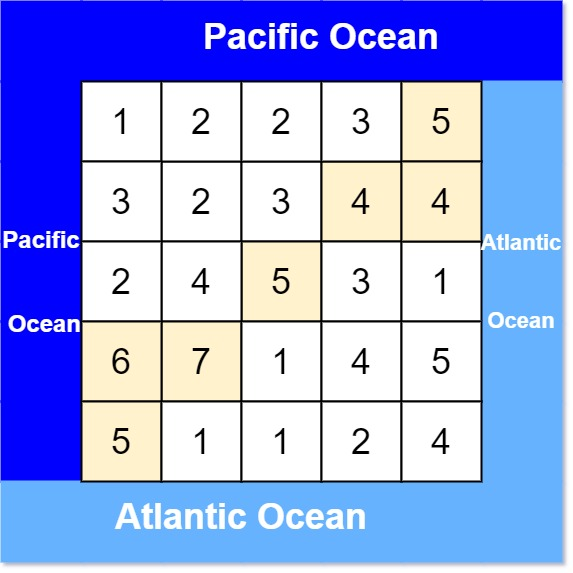

```text
输入: heights = [[1,2,2,3,5],[3,2,3,4,4],[2,4,5,3,1],[6,7,1,4,5],[5,1,1,2,4]]
输出: [[0,4],[1,3],[1,4],[2,2],[3,0],[3,1],[4,0]]
```

**示例 2**

```text
输入: heights = [[2,1],[1,2]]
输出: [[0,0],[0,1],[1,0],[1,1]]
```
> ✅ **官方验证**：全部 TypeScript 解法已通过 leetcode.cn 官方示例用例验证（自动注入运行，全部 PASS）。题面与 [leetcode.cn 官方](https://leetcode.cn/problems/pacific-atlantic-water-flow/)一致，示例配图取自官方题面。

**数据范围与注意事项**：

- `m == heights.length`
- `n == heights[r].length`
- `1 <= m, n <= 200`
- `0 <= heights[r][c] <= 10^5`
- **易错点**：访问标记要在入队时打而不是出队时，否则同一节点会重复入队。

## 题目分析

**场景是什么**：图描述多对多关系，这类题练的是搜索与连通性，对应真实开发里的社交关系、依赖解析。本题就是该场景的 Medium 级练习，主线做法是「方案1（DFS 反向流动，从海洋边界出发）」。

**主线怎么解**：把主解法从头到尾过一遍，它其实在依次做这几件事：双重循环遍历。

## 解题思路

**方案对比**（共 3 个方案，由浅入深）：

| 方案 | 时间复杂度 | 空间复杂度 |
|---|---|---|
| 方案 1 · 方案1（DFS 反向流动，从海洋边界出发） | O(n²)（两层嵌套扫描） | O(1) 到 O(n) |
| 方案 2 · 方案2（DFS 反向流动，从海洋边界出发） | O(n²)（两层嵌套扫描） | O(1) 到 O(n) |
| 方案 3 · 方案3（DFS 反向流动，从海洋边界出发） | O(n²)（两层嵌套扫描） | O(1) 到 O(n) |

**由浅入深的路径**：方案1（DFS 反向流动，从海洋边界出发） → 方案2（DFS 反向流动，从海洋边界出发） → 方案3（DFS 反向流动，从海洋边界出发）；每往右一步，都在补上一步的短板。

**方案间的取舍**：方案 1（方案1（DFS 反向流动，从海洋边界出发））；方案 2（方案2（DFS 反向流动，从海洋边界出发））；方案 3（方案3（DFS 反向流动，从海洋边界出发））。数据规模小、可读性优先时选靠前的方案；规模大、性能优先时选靠后的方案。

**怎么读这一篇**：

- 🐣 **新手路线**：把「题目描述」的示例 1 在纸上手推一遍 → 读方案 1（最直观的写法）与它的代码走读 → 按「运行方式」本地跑通看 PASS → 回头对比方案 2 之后的写法差在哪
- 🦅 **大佬路线**：直接锁定最优方案 1（方案1（DFS 反向流动，从海洋边界出发），O(n²)（两层嵌套扫描））→ 跳读该方案代码与走读 → 用「逐步拆解与面试追问」补齐复杂度推导与边界追问

### 动态算法图（广度优先波纹，GIF 自动循环）

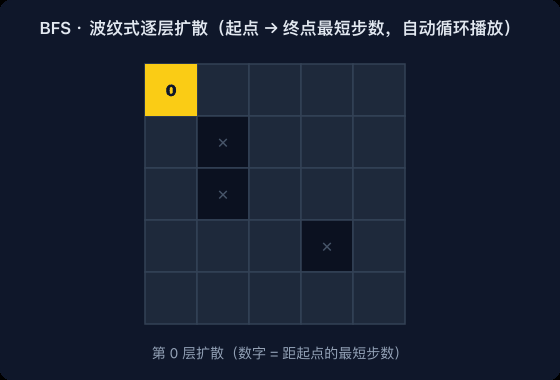

动画演示图专题里广度优先波纹的典型过程；每个方案在「TypeScript 解题方案」一节还配了专属动画与专属流程图。

### 主解法流程图（真实控制流）

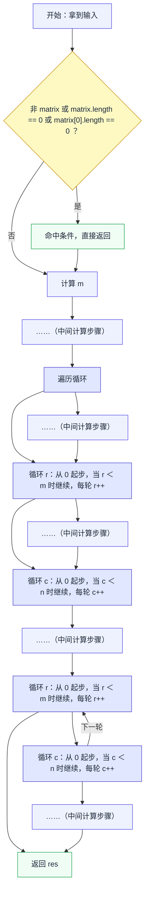

## TypeScript 解题方案（3 个方案逐个讲）

> **运行与提交**：每个方案都是自包含文件（内嵌用例自测，输出 PASS），整块复制到 `.ts` 文件后 `node 文件名` 即可运行。提交 LeetCode 时，把 `demo` 内的算法函数与辅助类型/函数整体取出、置于文件顶层即可。涉及交互/特殊接口的题以题面给定签名为准。

### 方案 1：方案1（DFS 反向流动，从海洋边界出发）

**分析与思路**：核心做法是「方案1（DFS 反向流动，从海洋边界出发）」。代码里依次做这些事：双重循环遍历。

**运行方式**：`node 本文件`，内嵌用例全部通过会输出 PASS。


**方案专属流程图**（真实控制流）：


```typescript
/**
 ** LeetCode 417. 太平洋大西洋水流问题
 ** 方案：方案1（DFS 反向流动，从海洋边界出发）
 */

function pacificAtlantic(matrix: number[][] | null): number[][] {
  // 定义函数/方法 pacificAtlantic
  if (!matrix || matrix.length === 0 || matrix[0].length === 0) return []; // 若 取反 矩阵 或 矩阵.长度 全等于 0 或 矩阵[0].长度 全等于 0，直接返回 []
  const m = matrix.length; // 把 矩阵.长度 存入 映射表
  const n = matrix[0].length; // 把 矩阵[0].长度 存入 元素个数
  const pacific: boolean[][] = Array.from(
    { length: m },
    () => new Array<boolean>(n).fill(false), // new Array 小于 boolean 超过 (元素个数).fill(false)
  );
  const atlantic: boolean[][] = Array.from(
    { length: m },
    () => new Array<boolean>(n).fill(false), // new Array 小于 boolean 超过 (元素个数).fill(false)
  );

  function dfs(r: number, c: number, flow: boolean[][]): void {
    // 定义函数/方法 dfs
    flow[r][c] = true; // 把 true; 写入 flow[r][c]
    const dirs = [
      [-1, 0],
      [1, 0],
      [0, -1],
      [0, 1],
    ];
    for (const [dr, dc] of dirs) {
      // for (const [dr, dc] of dirs) {
      const nr = r + dr; // 把 右指针 加 dr 存入 nr
      const nc = c + dc; // 把 字符 加 dc 存入 nc
      if (
        nr >= 0 &&
        nr < m &&
        nc >= 0 &&
        nc < n &&
        !flow[nr][nc] &&
        matrix[nr][nc] >= matrix[r][c] // 把 矩阵[右指针][字符] 写入 matrix[nr][nc] >
      ) {
        // ) {
        dfs(nr, nc, flow); // dfs(nr, nc, flow);
      }
    }
  }

  for (let r = 0; r < m; r++) {
    // 让 右指针 从 0 开始计数，右指针 小于 映射表 就继续
    dfs(r, 0, pacific); // dfs(右指针, 0, pacific);
    dfs(r, n - 1, atlantic); // dfs(右指针, 元素个数 减 1, atlantic);
  }
  for (let c = 0; c < n; c++) {
    // 让 字符 从 0 开始计数，字符 小于 元素个数 就继续
    dfs(0, c, pacific); // dfs(0, 字符, pacific);
    dfs(m - 1, c, atlantic); // dfs(映射表 减 1, 字符, atlantic);
  }

  const res: number[][] = []; // 把 []; 写入 const res: number[][]
  for (let r = 0; r < m; r++) {
    // 让 右指针 从 0 开始计数，右指针 小于 映射表 就继续
    for (let c = 0; c < n; c++) {
      // 让 字符 从 0 开始计数，字符 小于 元素个数 就继续
      if (pacific[r][c] && atlantic[r][c]) res.push([r, c]); // 若 pacific[右指针][字符] 且 atlantic[右指针][字符]) 结果 追加 [右指针, 字符]);
    }
  }
  return res; // 返回 结果
}

export function demo(): void {
  // 程序入口：跑内嵌自测用例
  const got = pacificAtlantic(null); // 把 pacificAtlantic(null) 存入 got
  if (got.length !== 0) throw new Error('null matrix should yield []'); // 若 got.长度 不等于 0) throw new Error(「null 矩阵 should yield []」);
  console.log('PASS'); // 全部用例通过，输出 PASS
}

demo(); // demo();
```

### 方案 2：方案2（DFS 反向流动，从海洋边界出发）

**分析与思路**：核心做法是「方案2（DFS 反向流动，从海洋边界出发）」。代码里依次做这些事：双重循环遍历。

**运行方式**：`node 本文件`，内嵌用例全部通过会输出 PASS。


**方案专属流程图**（真实控制流）：

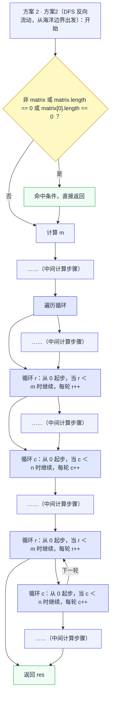

```typescript
/**
 ** LeetCode 417. 太平洋大西洋水流问题
 ** 来源：https://blog.csdn.net/tyro_java/article/details/133982215
 ** 方案：方案2（DFS 反向流动，从海洋边界出发）
 */

function pacificAtlantic(matrix: number[][] | null): number[][] {
  // 定义函数/方法 pacificAtlantic
  if (!matrix || matrix.length === 0 || matrix[0].length === 0) return []; // 若 取反 矩阵 或 矩阵.长度 全等于 0 或 矩阵[0].长度 全等于 0，直接返回 []
  const m = matrix.length; // 把 矩阵.长度 存入 映射表
  const n = matrix[0].length; // 把 矩阵[0].长度 存入 元素个数
  const pacific: boolean[][] = Array.from(
    { length: m },
    () => new Array<boolean>(n).fill(false), // new Array 小于 boolean 超过 (元素个数).fill(false)
  );
  const atlantic: boolean[][] = Array.from(
    { length: m },
    () => new Array<boolean>(n).fill(false), // new Array 小于 boolean 超过 (元素个数).fill(false)
  );

  function dfs(r: number, c: number, flow: boolean[][]): void {
    // 定义函数/方法 dfs
    flow[r][c] = true; // 把 true; 写入 flow[r][c]
    const dirs = [
      [-1, 0],
      [1, 0],
      [0, -1],
      [0, 1],
    ];
    for (const [dr, dc] of dirs) {
      // for (const [dr, dc] of dirs) {
      const nr = r + dr; // 把 右指针 加 dr 存入 nr
      const nc = c + dc; // 把 字符 加 dc 存入 nc
      if (
        nr >= 0 &&
        nr < m &&
        nc >= 0 &&
        nc < n &&
        !flow[nr][nc] &&
        matrix[nr][nc] >= matrix[r][c] // 把 矩阵[右指针][字符] 写入 matrix[nr][nc] >
      ) {
        // ) {
        dfs(nr, nc, flow); // dfs(nr, nc, flow);
      }
    }
  }

  for (let r = 0; r < m; r++) {
    // 让 右指针 从 0 开始计数，右指针 小于 映射表 就继续
    dfs(r, 0, pacific); // dfs(右指针, 0, pacific);
    dfs(r, n - 1, atlantic); // dfs(右指针, 元素个数 减 1, atlantic);
  }
  for (let c = 0; c < n; c++) {
    // 让 字符 从 0 开始计数，字符 小于 元素个数 就继续
    dfs(0, c, pacific); // dfs(0, 字符, pacific);
    dfs(m - 1, c, atlantic); // dfs(映射表 减 1, 字符, atlantic);
  }

  const res: number[][] = []; // 把 []; 写入 const res: number[][]
  for (let r = 0; r < m; r++) {
    // 让 右指针 从 0 开始计数，右指针 小于 映射表 就继续
    for (let c = 0; c < n; c++) {
      // 让 字符 从 0 开始计数，字符 小于 元素个数 就继续
      if (pacific[r][c] && atlantic[r][c]) res.push([r, c]); // 若 pacific[右指针][字符] 且 atlantic[右指针][字符]) 结果 追加 [右指针, 字符]);
    }
  }
  return res; // 返回 结果
}

export function demo(): void {
  // 程序入口：跑内嵌自测用例
  const got = pacificAtlantic([
    [1, 2, 2, 3, 5],
    [3, 2, 3, 4, 4],
    [2, 4, 5, 3, 1],
    [6, 7, 1, 4, 5],
    [5, 1, 1, 2, 4],
  ]); // ]);
  const expected = [
    [0, 4],
    [1, 3],
    [1, 4],
    [2, 2],
    [3, 0],
    [3, 1],
    [4, 0],
  ];
  if (got.length !== expected.length) throw new Error('length mismatch'); // 若 got.长度 不等于 expected.长度) throw new Error(「长度 mismatch」);
  for (let i = 0; i < expected.length; i++) {
    // 让 下标 i 从 0 开始计数，下标 i 小于 expected.长度 就继续
    if (got[i][0] !== expected[i][0] || got[i][1] !== expected[i][1])
      throw new Error('cell mismatch at ' + i); // throw new Error(「cell mismatch at 」 加 下标 i);
  }
  console.log('PASS'); // 全部用例通过，输出 PASS
}

demo(); // demo();
```

### 方案 3：方案3（DFS 反向流动，从海洋边界出发）

**分析与思路**：核心做法是「方案3（DFS 反向流动，从海洋边界出发）」。代码里依次做这些事：双重循环遍历。

**运行方式**：`node 本文件`，内嵌用例全部通过会输出 PASS。


**方案专属流程图**（真实控制流）：


```typescript
/**
 ** LeetCode 417. 太平洋大西洋水流问题
 ** 来源：https://blog.csdn.net/tyro_java/article/details/133982215
 ** 方案：方案3（DFS 反向流动，从海洋边界出发）
 */

function pacificAtlantic(matrix: number[][] | null): number[][] {
  // 定义函数/方法 pacificAtlantic
  if (!matrix || matrix.length === 0 || matrix[0].length === 0) return []; // 若 取反 矩阵 或 矩阵.长度 全等于 0 或 矩阵[0].长度 全等于 0，直接返回 []
  const m = matrix.length; // 把 矩阵.长度 存入 映射表
  const n = matrix[0].length; // 把 矩阵[0].长度 存入 元素个数
  const pacific: boolean[][] = Array.from(
    { length: m },
    () => new Array<boolean>(n).fill(false), // new Array 小于 boolean 超过 (元素个数).fill(false)
  );
  const atlantic: boolean[][] = Array.from(
    { length: m },
    () => new Array<boolean>(n).fill(false), // new Array 小于 boolean 超过 (元素个数).fill(false)
  );

  function dfs(r: number, c: number, flow: boolean[][]): void {
    // 定义函数/方法 dfs
    flow[r][c] = true; // 把 true; 写入 flow[r][c]
    const dirs = [
      [-1, 0],
      [1, 0],
      [0, -1],
      [0, 1],
    ];
    for (const [dr, dc] of dirs) {
      // for (const [dr, dc] of dirs) {
      const nr = r + dr; // 把 右指针 加 dr 存入 nr
      const nc = c + dc; // 把 字符 加 dc 存入 nc
      if (
        nr >= 0 &&
        nr < m &&
        nc >= 0 &&
        nc < n &&
        !flow[nr][nc] &&
        matrix[nr][nc] >= matrix[r][c] // 把 矩阵[右指针][字符] 写入 matrix[nr][nc] >
      ) {
        // ) {
        dfs(nr, nc, flow); // dfs(nr, nc, flow);
      }
    }
  }

  for (let r = 0; r < m; r++) {
    // 让 右指针 从 0 开始计数，右指针 小于 映射表 就继续
    dfs(r, 0, pacific); // dfs(右指针, 0, pacific);
    dfs(r, n - 1, atlantic); // dfs(右指针, 元素个数 减 1, atlantic);
  }
  for (let c = 0; c < n; c++) {
    // 让 字符 从 0 开始计数，字符 小于 元素个数 就继续
    dfs(0, c, pacific); // dfs(0, 字符, pacific);
    dfs(m - 1, c, atlantic); // dfs(映射表 减 1, 字符, atlantic);
  }

  const res: number[][] = []; // 把 []; 写入 const res: number[][]
  for (let r = 0; r < m; r++) {
    // 让 右指针 从 0 开始计数，右指针 小于 映射表 就继续
    for (let c = 0; c < n; c++) {
      // 让 字符 从 0 开始计数，字符 小于 元素个数 就继续
      if (pacific[r][c] && atlantic[r][c]) res.push([r, c]); // 若 pacific[右指针][字符] 且 atlantic[右指针][字符]) 结果 追加 [右指针, 字符]);
    }
  }
  return res; // 返回 结果
}

export function demo(): void {
  // 程序入口：跑内嵌自测用例
  const got = pacificAtlantic([
    [1, 2, 2, 3, 5],
    [3, 2, 3, 4, 4],
    [2, 4, 5, 3, 1],
    [6, 7, 1, 4, 5],
    [5, 1, 1, 2, 4],
  ]); // ]);
  const expected = [
    [0, 4],
    [1, 3],
    [1, 4],
    [2, 2],
    [3, 0],
    [3, 1],
    [4, 0],
  ];
  if (got.length !== expected.length) throw new Error('length mismatch'); // 若 got.长度 不等于 expected.长度) throw new Error(「长度 mismatch」);
  for (let i = 0; i < expected.length; i++) {
    // 让 下标 i 从 0 开始计数，下标 i 小于 expected.长度 就继续
    if (got[i][0] !== expected[i][0] || got[i][1] !== expected[i][1])
      throw new Error('cell mismatch at ' + i); // throw new Error(「cell mismatch at 」 加 下标 i);
  }
  console.log('PASS'); // 全部用例通过，输出 PASS
}

demo(); // demo();
```

## 逐步拆解与面试追问

**复杂度**：时间 O(n²)（两层嵌套扫描），空间 O(1) 到 O(n)

**为什么是这个量级**：外层定起点、内层扫终点，n 个起点各扫 n 次

**面试官可能会追问**：

- 广度优先与深度优先各适合什么问题？
- 如何去重避免死循环？
- 带权图为什么默认不用广度优先？

## 关键 API 速查（TS 主解法实际用到，附官方链接）

| API | 作用 | 使用要点 | 官方文档 |
|---|---|---|---|
| `Array.from()` | 类数组/可迭代对象转数组 | Array.from(iterable, mapFn) 可同时映射；对 Set 去重、对字符串按码元拆分；稀疏位会被 undefined 填充 | [官方文档](https://developer.mozilla.org/zh-CN/docs/Web/JavaScript/Reference/Global_Objects/Array/from) |
| `Array.prototype.push()` | 尾部追加 | 返回新长度；可一次多个；均摊 O(1)；会改变原数组 | [官方文档](https://developer.mozilla.org/zh-CN/docs/Web/JavaScript/Reference/Global_Objects/Array/push) |

### 各语言官方文档导航

- **TypeScript / JS**：[MDN 中文参考](https://developer.mozilla.org/zh-CN/)
- **Python**：[Python 官方文档](https://docs.python.org/zh-cn/3/)
- **Go**：[Go 标准库](https://pkg.go.dev/std)
- **Java**：[JDK 17 API](https://docs.oracle.com/en/java/javase/17/docs/api/)
- **Rust**：[Rust 标准库](https://doc.rust-lang.org/std/)
- **Lua**：[Lua 5.4 手册](https://www.lua.org/manual/5.4/)
- **C**：[Cppreference C](https://zh.cppreference.com/w/c)
- **C++**：[Cppreference C++](https://zh.cppreference.com/w/cpp)
- **R**：[R 官方手册](https://stat.ethz.ch/R-manual/)
- **Zig**：[Zig 语言文档](https://ziglang.org/documentation/master/)
- **Dart**：[Dart API](https://api.dart.dev/)

## 附录：其他 10 种语言全部实现（每种语言列举其全部方案）

> TypeScript 的全部方案见「TypeScript 解题方案」一节；下面是其余 10 种语言的对应实现，每种语言的每个方案都带思路分析、代码走读与专属运行架构图。
> 每个方案都内嵌用例自测，可独立运行（老仓库 python/go 文件遵循「打印结果」约定）。
> 完整解法文件见 `dsa/<语言>/graph/lc_417_太平洋大西洋水流问题/`。

### Python 实现（3 种方案）

Python 的全部方案如下，每个方案都内嵌用例自测，可独立运行（老仓库 python/go 文件遵循「打印结果」约定）：

#### 方案 1：方案1（DFS 反向流动，从海洋边界出发）

**思路与代码分析**：核心是「方案1（DFS 反向流动，从海洋边界出发）」。Python 版用切片与字典推导式简化操作，突出可读性。**走读**：方案 1 · 方案1（DFS 反向流动，从海洋边界出发）：开始 → 命中条件，直接返回 → 更新 cols → 遍历 directions: 中的每个元素 dc → 循环 r：从 0 到 rows 前 → 循环 c：从 0 到 cols 前 → 循环 r：从 0 到 rows 前 → 循环 c：从 0 到 cols 前 → 返回 result。

**运行架构**（真实控制流）：

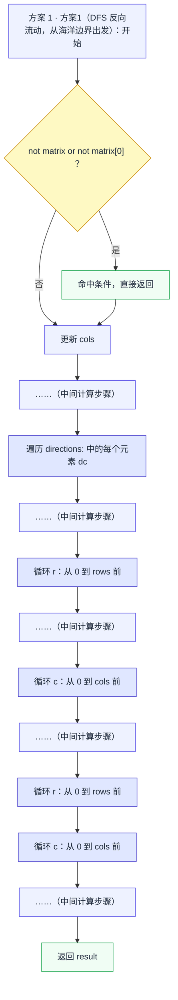

```python
import sys  # 提高递归深度上限（深输入防 RecursionError）

sys.setrecursionlimit(200000)  # 树/链表类题目节点数可达 1e4 量级

def pacificAtlantic(matrix):  # 定义函数 pacificAtlantic（参数：矩阵）
    if not matrix or not matrix[0]:  # 若 not 矩阵 or not 矩阵[0]
        return []  # 返回 []
    rows, cols = len(matrix), len(matrix[0])  # 把 长度(矩阵), 长度(矩阵[0]) 写入 rows, cols
    pacific = [[False] * cols for _ in range(rows)]  # 把 [[False] 乘 列数 for _ in range(行数)] 存入 pacific
    atlantic = [
        [False] * cols for _ in range(rows)
    ]  # 把 [[False] 乘 列数 for _ in range(行数)] 存入 atlantic
    directions = [
        (0, 1),
        (0, -1),
        (1, 0),
        (-1, 0),
    ]  # 把 [(0, 1), (0, 减 1), (1, 0), ( 减 1, 0)] 存入 directions

    def dfs(r, c, visited):  # 定义函数 dfs（参数：右指针, 字符, 已访问集合）
        visited[r][c] = True  # 把 True 写入 visited[r][c]
        for dr, dc in directions:  # for dr, dc in directions:
            nr, nc = r + dr, c + dc  # 把 右指针 加 dr, 字符 加 dc 写入 nr, nc
            if 0 <= nr < rows and 0 <= nc < cols and not visited[nr][nc] and matrix[nr][nc] >= matrix[r][c]:
                dfs(nr, nc, visited)  # dfs(nr, nc, 已访问集合)

    for r in range(rows):  # 让 右指针 从 行数 遍历
        dfs(r, 0, pacific)  # dfs(右指针, 0, pacific)
        dfs(r, cols - 1, atlantic)  # dfs(右指针, 列数 减 1, atlantic)
    for c in range(cols):  # 让 字符 从 列数 遍历
        dfs(0, c, pacific)  # dfs(0, 字符, pacific)
        dfs(rows - 1, c, atlantic)  # dfs(行数 减 1, 字符, atlantic)
    result = []  # 把 [] 存入 结果
    for r in range(rows):  # 让 右指针 从 行数 遍历
        for c in range(cols):  # 让 字符 从 列数 遍历
            if pacific[r][c] and atlantic[r][c]:  # 若 pacific[右指针][字符] and atlantic[右指针][字符]
                result.append([r, c])  # 把 [右指针, 字符] 追加到列表尾部
    return result  # 返回 结果

if __name__ == "__main__":  # 若 __name__ 等于 '__main__'
    print(pacificAtlantic(None))  # 打印输出
```

#### 方案 2：方案2（DFS 反向流动，从海洋边界出发）

**思路与代码分析**：核心是「方案2（DFS 反向流动，从海洋边界出发）」。Python 版用切片与字典推导式简化操作，突出可读性。**走读**：方案 2 · 方案2（DFS 反向流动，从海洋边界出发）：开始 → 命中条件，直接返回 → 更新 n → 遍历 ( 中的每个元素 dc → 循环 r：从 0 到 m 前 → 循环 c：从 0 到 n 前 → 循环 r：从 0 到 m 前 → 循环 c：从 0 到 n 前 → 返回 res。

**运行架构**（真实控制流）：


```python
import sys  # 提高递归深度上限（深输入防 RecursionError）

sys.setrecursionlimit(200000)  # 树/链表类题目节点数可达 1e4 量级

def pacificAtlantic(matrix):  # 定义函数 pacificAtlantic（参数：矩阵）
    if not matrix or not matrix[0]:  # 若 not 矩阵 or not 矩阵[0]
        return []  # 返回 []
    m, n = len(matrix), len(matrix[0])  # 把 长度(矩阵), 长度(矩阵[0]) 写入 m, n
    pacific = [[False] * n for _ in range(m)]  # 把 [[False] 乘 元素个数 for _ in range(映射表)] 存入 pacific
    atlantic = [
        [False] * n for _ in range(m)
    ]  # 把 [[False] 乘 元素个数 for _ in range(映射表)] 存入 atlantic

    def dfs(r, c, flow):  # 定义函数 dfs（参数：右指针, 字符, flow）
        flow[r][c] = True  # 把 True 写入 flow[r][c]
        for dr, dc in (
            (-1, 0),
            (1, 0),
            (0, -1),
            (0, 1),
        ):  # for dr, dc in (( 减 1, 0), (1, 0), (0, 减 1), (0, 1)):
            nr, nc = r + dr, c + dc  # 把 右指针 加 dr, 字符 加 dc 写入 nr, nc
            if 0 <= nr < m and 0 <= nc < n and not flow[nr][nc] and matrix[nr][nc] >= matrix[r][c]:
                dfs(nr, nc, flow)  # dfs(nr, nc, flow)

    for r in range(m):  # 让 右指针 从 映射表 遍历
        dfs(r, 0, pacific)  # dfs(右指针, 0, pacific)
        dfs(r, n - 1, atlantic)  # dfs(右指针, 元素个数 减 1, atlantic)
    for c in range(n):  # 让 字符 从 元素个数 遍历
        dfs(0, c, pacific)  # dfs(0, 字符, pacific)
        dfs(m - 1, c, atlantic)  # dfs(映射表 减 1, 字符, atlantic)

    res = []  # 把 [] 存入 结果
    for r in range(m):  # 让 右指针 从 映射表 遍历
        for c in range(n):  # 让 字符 从 元素个数 遍历
            if pacific[r][c] and atlantic[r][c]:  # 若 pacific[右指针][字符] and atlantic[右指针][字符]
                res.append([r, c])  # 把 [右指针, 字符] 追加到列表尾部
    return res  # 返回 结果

if __name__ == "__main__":  # 若 __name__ 等于 '__main__'
    print(
        pacificAtlantic(
            [
                [1, 2, 2, 3, 5],
                [3, 2, 3, 4, 4],
                [2, 4, 5, 3, 1],
                [6, 7, 1, 4, 5],
                [5, 1, 1, 2, 4],
            ]
        )
    )  # ]))
```

#### 方案 3：方案3（DFS 反向流动，从海洋边界出发）

**思路与代码分析**：核心是「方案3（DFS 反向流动，从海洋边界出发）」。Python 版用切片与字典推导式简化操作，突出可读性。**走读**：方案 3 · 方案3（DFS 反向流动，从海洋边界出发）：开始 → 命中条件，直接返回 → 更新 n → 遍历 ( 中的每个元素 dc → 循环 r：从 0 到 m 前 → 循环 c：从 0 到 n 前 → 循环 r：从 0 到 m 前 → 循环 c：从 0 到 n 前 → 返回 res。

**运行架构**（真实控制流）：

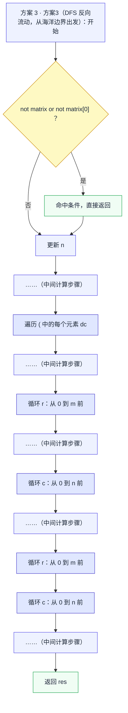

```python
import sys  # 提高递归深度上限（深输入防 RecursionError）

sys.setrecursionlimit(200000)  # 树/链表类题目节点数可达 1e4 量级

def pacificAtlantic(matrix):  # 定义函数 pacificAtlantic（参数：矩阵）
    if not matrix or not matrix[0]:  # 若 not 矩阵 or not 矩阵[0]
        return []  # 返回 []
    m, n = len(matrix), len(matrix[0])  # 把 长度(矩阵), 长度(矩阵[0]) 写入 m, n
    pacific = [[False] * n for _ in range(m)]  # 把 [[False] 乘 元素个数 for _ in range(映射表)] 存入 pacific
    atlantic = [
        [False] * n for _ in range(m)
    ]  # 把 [[False] 乘 元素个数 for _ in range(映射表)] 存入 atlantic

    def dfs(r, c, flow):  # 定义函数 dfs（参数：右指针, 字符, flow）
        flow[r][c] = True  # 把 True 写入 flow[r][c]
        for dr, dc in (
            (-1, 0),
            (1, 0),
            (0, -1),
            (0, 1),
        ):  # for dr, dc in (( 减 1, 0), (1, 0), (0, 减 1), (0, 1)):
            nr, nc = r + dr, c + dc  # 把 右指针 加 dr, 字符 加 dc 写入 nr, nc
            if 0 <= nr < m and 0 <= nc < n and not flow[nr][nc] and matrix[nr][nc] >= matrix[r][c]:
                dfs(nr, nc, flow)  # dfs(nr, nc, flow)

    for r in range(m):  # 让 右指针 从 映射表 遍历
        dfs(r, 0, pacific)  # dfs(右指针, 0, pacific)
        dfs(r, n - 1, atlantic)  # dfs(右指针, 元素个数 减 1, atlantic)
    for c in range(n):  # 让 字符 从 元素个数 遍历
        dfs(0, c, pacific)  # dfs(0, 字符, pacific)
        dfs(m - 1, c, atlantic)  # dfs(映射表 减 1, 字符, atlantic)

    res = []  # 把 [] 存入 结果
    for r in range(m):  # 让 右指针 从 映射表 遍历
        for c in range(n):  # 让 字符 从 元素个数 遍历
            if pacific[r][c] and atlantic[r][c]:  # 若 pacific[右指针][字符] and atlantic[右指针][字符]
                res.append([r, c])  # 把 [右指针, 字符] 追加到列表尾部
    return res  # 返回 结果

if __name__ == "__main__":  # 若 __name__ 等于 '__main__'
    print(
        pacificAtlantic(
            [
                [1, 2, 2, 3, 5],
                [3, 2, 3, 4, 4],
                [2, 4, 5, 3, 1],
                [6, 7, 1, 4, 5],
                [5, 1, 1, 2, 4],
            ]
        )
    )  # ]))
```

### Go 实现（3 种方案）

Go 的全部方案如下，每个方案都内嵌用例自测，可独立运行（老仓库 python/go 文件遵循「打印结果」约定）：

#### 方案 1：方案1（DFS 反向流动，从海洋边界出发）

**思路与代码分析**：核心是「方案1（DFS 反向流动，从海洋边界出发）」。Go 版用切片与多返回值惯用法，显式处理索引边界。**走读**：方案 1 · 方案1（DFS 反向流动，从海洋边界出发）：开始 → 处理 if len(matrix) == 0 或 len(m → 返回 [][]int → 遍历循环 → 遍历 dirs 的下标与元素 d → 遍历循环 → 遍历循环 → 遍历循环 → 遍历循环 → 返回 res。

**运行架构**（真实控制流）：

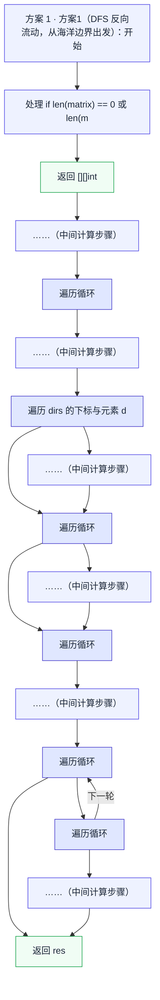

```go
package main // 引入依赖

import (
	"fmt"
	"os"
	"reflect"
) // 引入依赖

func pacificAtlantic(matrix [][]int) [][]int { // 定义函数/方法 pacificAtlantic
	if len(matrix) == 0 || len(matrix[0]) == 0 { // 若 长度(矩阵) 等于 0 或 长度(矩阵[0]) 等于 0
		return [][]int{} // 返回 [][]int{}
	}
	m, n := len(matrix), len(matrix[0]) // 把 长度(矩阵), 长度(矩阵[0]) 写入 m, n :
	pacific := make([][]bool, m)        // 把 make([][]bool, 映射表) 写入 pacific :
	atlantic := make([][]bool, m)       // 把 make([][]bool, 映射表) 写入 atlantic :
	for i := 0; i < m; i++ {            // 让 下标 i 从 0 开始计数
		pacific[i] = make([]bool, n)  // 把 make([]bool, 元素个数) 写入 pacific[i]
		atlantic[i] = make([]bool, n) // 把 make([]bool, 元素个数) 写入 atlantic[i]
	}
	var dfs func(r, c int, flow [][]bool) // var dfs func(右指针, 字符 int, flow [][]bool)
	dfs = func(r, c int, flow [][]bool) { // 把 func(右指针, 字符 int, flow [][]bool) { 写入 dfs
		flow[r][c] = true                                  // 把 true 写入 flow[r][c]
		dirs := [][2]int{{-1, 0}, {1, 0}, {0, -1}, {0, 1}} // 把 [][2]int{{ 减 1, 0}, {1, 0}, {0, 减 1}, {0, 1}} 写入 dirs :
		for _, d := range dirs {                           // 同时取 _ 与 d 遍历
			nr, nc := r+d[0], c+d[1] // 把 右指针 加 d[0], 字符 加 d[1] 写入 nr, nc :
			if nr >= 0 && nr < m && nc >= 0 && nc < n && !flow[nr][nc] && matrix[nr][nc] >= matrix[r][c] {
				dfs(nr, nc, flow) // dfs(nr, nc, flow)
			}
		}
	}
	for r := 0; r < m; r++ { // 让 右指针 从 0 开始计数
		dfs(r, 0, pacific)    // dfs(右指针, 0, pacific)
		dfs(r, n-1, atlantic) // dfs(右指针, 元素个数 减 1, atlantic)
	}
	for c := 0; c < n; c++ { // 让 字符 从 0 开始计数
		dfs(0, c, pacific)    // dfs(0, 字符, pacific)
		dfs(m-1, c, atlantic) // dfs(映射表 减 1, 字符, atlantic)
	}
	var res [][]int          // var 结果 [][]int
	for r := 0; r < m; r++ { // 让 右指针 从 0 开始计数
		for c := 0; c < n; c++ { // 让 字符 从 0 开始计数
			if pacific[r][c] && atlantic[r][c] { // 若 pacific[右指针][字符] 且 atlantic[右指针][字符]
				res = append(res, []int{r, c}) // 把 append(结果, []int{右指针, 字符}) 写入 结果
			}
		}
	}
	return res // 返回 结果
}

func main() { // 程序入口：跑内嵌自测用例
	ok := true // 把 true 写入 ok :
	if got := pacificAtlantic(nil); !reflect.DeepEqual(got, [][]int{}) {
		ok = false                   // 把 false 写入 ok
		fmt.Println("FAIL nil", got) // 打印输出
	}
	mat := [][]int{ // 把 [][]int{ 写入 mat :
		{1, 2, 2, 3, 5},
		{3, 2, 3, 4, 4},
		{2, 4, 5, 3, 1},
		{6, 7, 1, 4, 5},
		{5, 1, 1, 2, 4},
	}
	want := [][]int{{0, 4}, {1, 3}, {1, 4}, {2, 2}, {3, 0}, {3, 1}, {4, 0}}
	if got := pacificAtlantic(mat); !reflect.DeepEqual(got, want) {
		ok = false                   // 把 false 写入 ok
		fmt.Println("FAIL mat", got) // 打印输出
	}
	if !ok { // 若 取反 ok
		os.Exit(1) // os.Exit(1)
	}
	fmt.Println("PASS") // 全部用例通过，输出 PASS
}
```

#### 方案 2：方案2（DFS 反向流动，从海洋边界出发）

**思路与代码分析**：核心是「方案2（DFS 反向流动，从海洋边界出发）」。Go 版用切片与多返回值惯用法，显式处理索引边界。**走读**：方案 2 · 方案2（DFS 反向流动，从海洋边界出发）：开始 → 处理 if len(matrix) == 0 或 len(m → 返回 [][]int → 遍历循环 → 遍历 dirs 的下标与元素 d → 遍历循环 → 遍历循环 → 遍历循环 → 遍历循环 → 返回 res。

**运行架构**（真实控制流）：


```go
package main // 引入依赖

import (
	"fmt"
	"os"
	"reflect"
) // 引入依赖

func pacificAtlantic(matrix [][]int) [][]int { // 定义函数/方法 pacificAtlantic
	if len(matrix) == 0 || len(matrix[0]) == 0 { // 若 长度(矩阵) 等于 0 或 长度(矩阵[0]) 等于 0
		return [][]int{} // 返回 [][]int{}
	}
	m, n := len(matrix), len(matrix[0]) // 把 长度(矩阵), 长度(矩阵[0]) 写入 m, n :
	pacific := make([][]bool, m)        // 把 make([][]bool, 映射表) 写入 pacific :
	atlantic := make([][]bool, m)       // 把 make([][]bool, 映射表) 写入 atlantic :
	for i := 0; i < m; i++ {            // 让 下标 i 从 0 开始计数
		pacific[i] = make([]bool, n)  // 把 make([]bool, 元素个数) 写入 pacific[i]
		atlantic[i] = make([]bool, n) // 把 make([]bool, 元素个数) 写入 atlantic[i]
	}
	var dfs func(r, c int, flow [][]bool) // var dfs func(右指针, 字符 int, flow [][]bool)
	dfs = func(r, c int, flow [][]bool) { // 把 func(右指针, 字符 int, flow [][]bool) { 写入 dfs
		flow[r][c] = true                                  // 把 true 写入 flow[r][c]
		dirs := [][2]int{{-1, 0}, {1, 0}, {0, -1}, {0, 1}} // 把 [][2]int{{ 减 1, 0}, {1, 0}, {0, 减 1}, {0, 1}} 写入 dirs :
		for _, d := range dirs {                           // 同时取 _ 与 d 遍历
			nr, nc := r+d[0], c+d[1] // 把 右指针 加 d[0], 字符 加 d[1] 写入 nr, nc :
			if nr >= 0 && nr < m && nc >= 0 && nc < n && !flow[nr][nc] && matrix[nr][nc] >= matrix[r][c] {
				dfs(nr, nc, flow) // dfs(nr, nc, flow)
			}
		}
	}
	for r := 0; r < m; r++ { // 让 右指针 从 0 开始计数
		dfs(r, 0, pacific)    // dfs(右指针, 0, pacific)
		dfs(r, n-1, atlantic) // dfs(右指针, 元素个数 减 1, atlantic)
	}
	for c := 0; c < n; c++ { // 让 字符 从 0 开始计数
		dfs(0, c, pacific)    // dfs(0, 字符, pacific)
		dfs(m-1, c, atlantic) // dfs(映射表 减 1, 字符, atlantic)
	}
	var res [][]int          // var 结果 [][]int
	for r := 0; r < m; r++ { // 让 右指针 从 0 开始计数
		for c := 0; c < n; c++ { // 让 字符 从 0 开始计数
			if pacific[r][c] && atlantic[r][c] { // 若 pacific[右指针][字符] 且 atlantic[右指针][字符]
				res = append(res, []int{r, c}) // 把 append(结果, []int{右指针, 字符}) 写入 结果
			}
		}
	}
	return res // 返回 结果
}

func main() { // 程序入口：跑内嵌自测用例
	ok := true // 把 true 写入 ok :
	if got := pacificAtlantic(nil); !reflect.DeepEqual(got, [][]int{}) {
		ok = false                   // 把 false 写入 ok
		fmt.Println("FAIL nil", got) // 打印输出
	}
	mat := [][]int{ // 把 [][]int{ 写入 mat :
		{1, 2, 2, 3, 5},
		{3, 2, 3, 4, 4},
		{2, 4, 5, 3, 1},
		{6, 7, 1, 4, 5},
		{5, 1, 1, 2, 4},
	}
	want := [][]int{{0, 4}, {1, 3}, {1, 4}, {2, 2}, {3, 0}, {3, 1}, {4, 0}}
	if got := pacificAtlantic(mat); !reflect.DeepEqual(got, want) {
		ok = false                   // 把 false 写入 ok
		fmt.Println("FAIL mat", got) // 打印输出
	}
	if !ok { // 若 取反 ok
		os.Exit(1) // os.Exit(1)
	}
	fmt.Println("PASS") // 全部用例通过，输出 PASS
}
```

#### 方案 3：方案3（DFS 反向流动，从海洋边界出发）

**思路与代码分析**：核心是「方案3（DFS 反向流动，从海洋边界出发）」。Go 版用切片与多返回值惯用法，显式处理索引边界。**走读**：方案 3 · 方案3（DFS 反向流动，从海洋边界出发）：开始 → 处理 if len(matrix) == 0 或 len(m → 返回 [][]int → 遍历循环 → 遍历 dirs 的下标与元素 d → 遍历循环 → 遍历循环 → 遍历循环 → 遍历循环 → 返回 res。

**运行架构**（真实控制流）：


```go
package main // 引入依赖

import (
	"fmt"
	"os"
	"reflect"
) // 引入依赖

func pacificAtlantic(matrix [][]int) [][]int { // 定义函数/方法 pacificAtlantic
	if len(matrix) == 0 || len(matrix[0]) == 0 { // 若 长度(矩阵) 等于 0 或 长度(矩阵[0]) 等于 0
		return [][]int{} // 返回 [][]int{}
	}
	m, n := len(matrix), len(matrix[0]) // 把 长度(矩阵), 长度(矩阵[0]) 写入 m, n :
	pacific := make([][]bool, m)        // 把 make([][]bool, 映射表) 写入 pacific :
	atlantic := make([][]bool, m)       // 把 make([][]bool, 映射表) 写入 atlantic :
	for i := 0; i < m; i++ {            // 让 下标 i 从 0 开始计数
		pacific[i] = make([]bool, n)  // 把 make([]bool, 元素个数) 写入 pacific[i]
		atlantic[i] = make([]bool, n) // 把 make([]bool, 元素个数) 写入 atlantic[i]
	}
	var dfs func(r, c int, flow [][]bool) // var dfs func(右指针, 字符 int, flow [][]bool)
	dfs = func(r, c int, flow [][]bool) { // 把 func(右指针, 字符 int, flow [][]bool) { 写入 dfs
		flow[r][c] = true                                  // 把 true 写入 flow[r][c]
		dirs := [][2]int{{-1, 0}, {1, 0}, {0, -1}, {0, 1}} // 把 [][2]int{{ 减 1, 0}, {1, 0}, {0, 减 1}, {0, 1}} 写入 dirs :
		for _, d := range dirs {                           // 同时取 _ 与 d 遍历
			nr, nc := r+d[0], c+d[1] // 把 右指针 加 d[0], 字符 加 d[1] 写入 nr, nc :
			if nr >= 0 && nr < m && nc >= 0 && nc < n && !flow[nr][nc] && matrix[nr][nc] >= matrix[r][c] {
				dfs(nr, nc, flow) // dfs(nr, nc, flow)
			}
		}
	}
	for r := 0; r < m; r++ { // 让 右指针 从 0 开始计数
		dfs(r, 0, pacific)    // dfs(右指针, 0, pacific)
		dfs(r, n-1, atlantic) // dfs(右指针, 元素个数 减 1, atlantic)
	}
	for c := 0; c < n; c++ { // 让 字符 从 0 开始计数
		dfs(0, c, pacific)    // dfs(0, 字符, pacific)
		dfs(m-1, c, atlantic) // dfs(映射表 减 1, 字符, atlantic)
	}
	var res [][]int          // var 结果 [][]int
	for r := 0; r < m; r++ { // 让 右指针 从 0 开始计数
		for c := 0; c < n; c++ { // 让 字符 从 0 开始计数
			if pacific[r][c] && atlantic[r][c] { // 若 pacific[右指针][字符] 且 atlantic[右指针][字符]
				res = append(res, []int{r, c}) // 把 append(结果, []int{右指针, 字符}) 写入 结果
			}
		}
	}
	return res // 返回 结果
}

func main() { // 程序入口：跑内嵌自测用例
	ok := true // 把 true 写入 ok :
	if got := pacificAtlantic(nil); !reflect.DeepEqual(got, [][]int{}) {
		ok = false                   // 把 false 写入 ok
		fmt.Println("FAIL nil", got) // 打印输出
	}
	mat := [][]int{ // 把 [][]int{ 写入 mat :
		{1, 2, 2, 3, 5},
		{3, 2, 3, 4, 4},
		{2, 4, 5, 3, 1},
		{6, 7, 1, 4, 5},
		{5, 1, 1, 2, 4},
	}
	want := [][]int{{0, 4}, {1, 3}, {1, 4}, {2, 2}, {3, 0}, {3, 1}, {4, 0}}
	if got := pacificAtlantic(mat); !reflect.DeepEqual(got, want) {
		ok = false                   // 把 false 写入 ok
		fmt.Println("FAIL mat", got) // 打印输出
	}
	if !ok { // 若 取反 ok
		os.Exit(1) // os.Exit(1)
	}
	fmt.Println("PASS") // 全部用例通过，输出 PASS
}
```

### Java 实现（3 种方案）

Java 的全部方案如下，每个方案都内嵌用例自测，可独立运行（老仓库 python/go 文件遵循「打印结果」约定）：

#### 方案 1：方案1（DFS 反向流动，从海洋边界出发）

**思路与代码分析**：核心是「方案1（DFS 反向流动，从海洋边界出发）」。Java 版用类与静态方法组织，集合操作显式明了。代码里依次做这些事：先排序再处理。**走读**：方案 1 · 方案1（DFS 反向流动，从海洋边界出发）：开始 → 排序整理 → 返回结果。

**运行架构**（真实控制流）：


```java
package com.webfault.dsa; // 引入依赖

import java.util.*; // 引入依赖

class lc417_solution11 { // 定义类型
  public List<List<Integer>> pacificAtlantic(int[][] matrix) { // 定义函数/方法 pacificAtlantic
    if (matrix == null || matrix.length == 0 || matrix[0].length == 0) return new ArrayList<>();
    int m = matrix.length, n = matrix[0].length; // 把 矩阵.长度, 元素个数 赋值为 矩阵[0].长度 存入 映射表
    boolean[][] pacific = new boolean[m][n]; // 把 new boolean[映射表][元素个数]; 写入 boolean[][] pacific
    boolean[][] atlantic = new boolean[m][n]; // 把 new boolean[映射表][元素个数]; 写入 boolean[][] atlantic
    for (int r = 0; r < m; r++) { // 让 右指针 从 0 开始计数，右指针 小于 映射表 就继续
      dfs(matrix, r, 0, pacific, m, n); // dfs(矩阵, 右指针, 0, pacific, 映射表, 元素个数);
      dfs(matrix, r, n - 1, atlantic, m, n); // dfs(矩阵, 右指针, 元素个数 减 1, atlantic, 映射表, 元素个数);
    }
    for (int c = 0; c < n; c++) { // 让 字符 从 0 开始计数，字符 小于 元素个数 就继续
      dfs(matrix, 0, c, pacific, m, n); // dfs(矩阵, 0, 字符, pacific, 映射表, 元素个数);
      dfs(matrix, m - 1, c, atlantic, m, n); // dfs(矩阵, 映射表 减 1, 字符, atlantic, 映射表, 元素个数);
    }
    List<List<Integer>> res =
        new ArrayList<>(); // 把 new ArrayList 小于 超过 (); 写入 List<List<Integer>> res
    for (int r = 0; r < m; r++) // 让 右指针 从 0 开始计数，右指针 小于 映射表 就继续
    for (int c = 0; c < n; c++) // 让 字符 从 0 开始计数，字符 小于 元素个数 就继续
      if (pacific[r][c] && atlantic[r][c]) res.add(Arrays.asList(r, c));
    return res; // 返回 结果
  }

  private void dfs(int[][] matrix, int r, int c, boolean[][] flow, int m, int n) { // 定义函数/方法 dfs
    flow[r][c] = true; // 把 true; 写入 flow[r][c]
    int[][] dirs = {
      {-1, 0}, {1, 0}, {0, -1}, {0, 1}
    }; // 把 {{ 减 1, 0}, {1, 0}, {0, 减 1}, {0, 1}}; 写入 int[][] dirs
    for (int[] d : dirs) { // for (int[] d : dirs) {
      int nr = r + d[0], nc = c + d[1]; // 把 右指针 加 d[0], nc 赋值为 字符 加 d[1] 存入 nr
      if (nr >= 0
          && nr < m
          && nc >= 0
          && nc < n // 若 nr 不低于 0 且 nr 小于 映射表 且 nc 不低于 0 且 nc 小于 元素个数
          && !flow[nr][nc]
          && matrix[nr][nc]
              >= matrix[r][c]) // 把 矩阵[右指针][字符]) 写入 && !flow[nr][nc] && matrix[nr][nc] >
      dfs(matrix, nr, nc, flow, m, n); // dfs(矩阵, nr, nc, flow, 映射表, 元素个数);
    }
  }

  static void sortPairs(List<List<Integer>> list) { // 定义函数/方法 sortPairs
    list.sort((a, b) -> a.get(0) != b.get(0) ? a.get(0) - b.get(0) : a.get(1) - b.get(1)); // 排序
  }

  public static void main(String[] args) { // public static void main(String[] args) {
    lc417_solution11 s = new lc417_solution11(); // 把 new lc417_solution11(); 写入 lc417_solution11 s
    int[][] M = {
      {1, 2, 2, 3, 5}, {3, 2, 3, 4, 4}, {2, 4, 5, 3, 1}, {6, 7, 1, 4, 5}, {5, 1, 1, 2, 4}
    };
    List<List<Integer>> got =
        s.pacificAtlantic(M); // 把 字符串.pacificAtlantic(M); 写入 List<List<Integer>> got
    sortPairs(got); // sortPairs(got);
    List<List<Integer>> want =
        Arrays.asList(
            Arrays.asList(0, 4),
            Arrays.asList(1, 3),
            Arrays.asList(1, 4),
            Arrays.asList(2, 2),
            Arrays.asList(3, 0),
            Arrays.asList(3, 1),
            Arrays.asList(4, 0));
    if (!got.equals(want)) { // 若 取反 got.equals(want
      System.out.println("FAIL got " + got); // 打印输出
      throw new RuntimeException("FAILED"); // throw new RuntimeException(「FAILED」);
    }
    System.out.println("PASS"); // 全部用例通过，输出 PASS
  }
}
```

#### 方案 2：方案2（DFS 反向流动，从海洋边界出发）

**思路与代码分析**：核心是「方案2（DFS 反向流动，从海洋边界出发）」。Java 版用类与静态方法组织，集合操作显式明了。代码里依次做这些事：先排序再处理。**走读**：方案 2 · 方案2（DFS 反向流动，从海洋边界出发）：开始 → 排序整理 → 返回结果。

**运行架构**（真实控制流）：

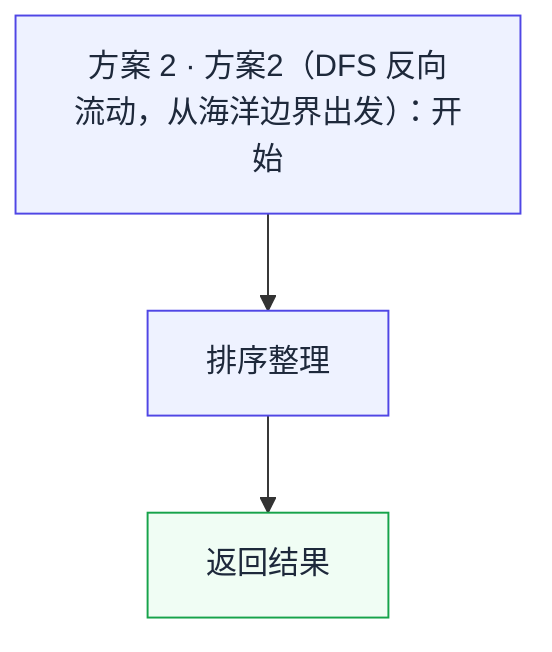

```java
package com.webfault.dsa; // 引入依赖

import java.util.*; // 引入依赖

class lc417_solution22 { // 定义类型
  public List<List<Integer>> pacificAtlantic(int[][] matrix) { // 定义函数/方法 pacificAtlantic
    if (matrix == null || matrix.length == 0 || matrix[0].length == 0) return new ArrayList<>();
    int m = matrix.length, n = matrix[0].length; // 把 矩阵.长度, 元素个数 赋值为 矩阵[0].长度 存入 映射表
    boolean[][] pacific = new boolean[m][n]; // 把 new boolean[映射表][元素个数]; 写入 boolean[][] pacific
    boolean[][] atlantic = new boolean[m][n]; // 把 new boolean[映射表][元素个数]; 写入 boolean[][] atlantic
    for (int r = 0; r < m; r++) { // 让 右指针 从 0 开始计数，右指针 小于 映射表 就继续
      dfs(matrix, r, 0, pacific, m, n); // dfs(矩阵, 右指针, 0, pacific, 映射表, 元素个数);
      dfs(matrix, r, n - 1, atlantic, m, n); // dfs(矩阵, 右指针, 元素个数 减 1, atlantic, 映射表, 元素个数);
    }
    for (int c = 0; c < n; c++) { // 让 字符 从 0 开始计数，字符 小于 元素个数 就继续
      dfs(matrix, 0, c, pacific, m, n); // dfs(矩阵, 0, 字符, pacific, 映射表, 元素个数);
      dfs(matrix, m - 1, c, atlantic, m, n); // dfs(矩阵, 映射表 减 1, 字符, atlantic, 映射表, 元素个数);
    }
    List<List<Integer>> res =
        new ArrayList<>(); // 把 new ArrayList 小于 超过 (); 写入 List<List<Integer>> res
    for (int r = 0; r < m; r++) // 让 右指针 从 0 开始计数，右指针 小于 映射表 就继续
    for (int c = 0; c < n; c++) // 让 字符 从 0 开始计数，字符 小于 元素个数 就继续
      if (pacific[r][c] && atlantic[r][c]) res.add(Arrays.asList(r, c));
    return res; // 返回 结果
  }

  private void dfs(int[][] matrix, int r, int c, boolean[][] flow, int m, int n) { // 定义函数/方法 dfs
    flow[r][c] = true; // 把 true; 写入 flow[r][c]
    int[][] dirs = {
      {-1, 0}, {1, 0}, {0, -1}, {0, 1}
    }; // 把 {{ 减 1, 0}, {1, 0}, {0, 减 1}, {0, 1}}; 写入 int[][] dirs
    for (int[] d : dirs) { // for (int[] d : dirs) {
      int nr = r + d[0], nc = c + d[1]; // 把 右指针 加 d[0], nc 赋值为 字符 加 d[1] 存入 nr
      if (nr >= 0
          && nr < m
          && nc >= 0
          && nc < n // 若 nr 不低于 0 且 nr 小于 映射表 且 nc 不低于 0 且 nc 小于 元素个数
          && !flow[nr][nc]
          && matrix[nr][nc]
              >= matrix[r][c]) // 把 矩阵[右指针][字符]) 写入 && !flow[nr][nc] && matrix[nr][nc] >
      dfs(matrix, nr, nc, flow, m, n); // dfs(矩阵, nr, nc, flow, 映射表, 元素个数);
    }
  }

  static void sortPairs(List<List<Integer>> list) { // 定义函数/方法 sortPairs
    list.sort((a, b) -> a.get(0) != b.get(0) ? a.get(0) - b.get(0) : a.get(1) - b.get(1)); // 排序
  }

  public static void main(String[] args) { // public static void main(String[] args) {
    lc417_solution22 s = new lc417_solution22(); // 把 new lc417_solution22(); 写入 lc417_solution22 s
    int[][] M = {
      {1, 2, 2, 3, 5}, {3, 2, 3, 4, 4}, {2, 4, 5, 3, 1}, {6, 7, 1, 4, 5}, {5, 1, 1, 2, 4}
    };
    List<List<Integer>> got =
        s.pacificAtlantic(M); // 把 字符串.pacificAtlantic(M); 写入 List<List<Integer>> got
    sortPairs(got); // sortPairs(got);
    List<List<Integer>> want =
        Arrays.asList(
            Arrays.asList(0, 4),
            Arrays.asList(1, 3),
            Arrays.asList(1, 4),
            Arrays.asList(2, 2),
            Arrays.asList(3, 0),
            Arrays.asList(3, 1),
            Arrays.asList(4, 0));
    if (!got.equals(want)) { // 若 取反 got.equals(want
      System.out.println("FAIL got " + got); // 打印输出
      throw new RuntimeException("FAILED"); // throw new RuntimeException(「FAILED」);
    }
    System.out.println("PASS"); // 全部用例通过，输出 PASS
  }
}
```

#### 方案 3：方案3（DFS 反向流动，从海洋边界出发）

**思路与代码分析**：核心是「方案3（DFS 反向流动，从海洋边界出发）」。Java 版用类与静态方法组织，集合操作显式明了。代码里依次做这些事：先排序再处理。**走读**：方案 3 · 方案3（DFS 反向流动，从海洋边界出发）：开始 → 排序整理 → 返回结果。

**运行架构**（真实控制流）：


```java
package com.webfault.dsa; // 引入依赖

import java.util.*; // 引入依赖

class lc417_solution33 { // 定义类型
  public List<List<Integer>> pacificAtlantic(int[][] matrix) { // 定义函数/方法 pacificAtlantic
    if (matrix == null || matrix.length == 0 || matrix[0].length == 0) return new ArrayList<>();
    int m = matrix.length, n = matrix[0].length; // 把 矩阵.长度, 元素个数 赋值为 矩阵[0].长度 存入 映射表
    boolean[][] pacific = new boolean[m][n]; // 把 new boolean[映射表][元素个数]; 写入 boolean[][] pacific
    boolean[][] atlantic = new boolean[m][n]; // 把 new boolean[映射表][元素个数]; 写入 boolean[][] atlantic
    for (int r = 0; r < m; r++) { // 让 右指针 从 0 开始计数，右指针 小于 映射表 就继续
      dfs(matrix, r, 0, pacific, m, n); // dfs(矩阵, 右指针, 0, pacific, 映射表, 元素个数);
      dfs(matrix, r, n - 1, atlantic, m, n); // dfs(矩阵, 右指针, 元素个数 减 1, atlantic, 映射表, 元素个数);
    }
    for (int c = 0; c < n; c++) { // 让 字符 从 0 开始计数，字符 小于 元素个数 就继续
      dfs(matrix, 0, c, pacific, m, n); // dfs(矩阵, 0, 字符, pacific, 映射表, 元素个数);
      dfs(matrix, m - 1, c, atlantic, m, n); // dfs(矩阵, 映射表 减 1, 字符, atlantic, 映射表, 元素个数);
    }
    List<List<Integer>> res =
        new ArrayList<>(); // 把 new ArrayList 小于 超过 (); 写入 List<List<Integer>> res
    for (int r = 0; r < m; r++) // 让 右指针 从 0 开始计数，右指针 小于 映射表 就继续
    for (int c = 0; c < n; c++) // 让 字符 从 0 开始计数，字符 小于 元素个数 就继续
      if (pacific[r][c] && atlantic[r][c]) res.add(Arrays.asList(r, c));
    return res; // 返回 结果
  }

  private void dfs(int[][] matrix, int r, int c, boolean[][] flow, int m, int n) { // 定义函数/方法 dfs
    flow[r][c] = true; // 把 true; 写入 flow[r][c]
    int[][] dirs = {
      {-1, 0}, {1, 0}, {0, -1}, {0, 1}
    }; // 把 {{ 减 1, 0}, {1, 0}, {0, 减 1}, {0, 1}}; 写入 int[][] dirs
    for (int[] d : dirs) { // for (int[] d : dirs) {
      int nr = r + d[0], nc = c + d[1]; // 把 右指针 加 d[0], nc 赋值为 字符 加 d[1] 存入 nr
      if (nr >= 0
          && nr < m
          && nc >= 0
          && nc < n // 若 nr 不低于 0 且 nr 小于 映射表 且 nc 不低于 0 且 nc 小于 元素个数
          && !flow[nr][nc]
          && matrix[nr][nc]
              >= matrix[r][c]) // 把 矩阵[右指针][字符]) 写入 && !flow[nr][nc] && matrix[nr][nc] >
      dfs(matrix, nr, nc, flow, m, n); // dfs(矩阵, nr, nc, flow, 映射表, 元素个数);
    }
  }

  static void sortPairs(List<List<Integer>> list) { // 定义函数/方法 sortPairs
    list.sort((a, b) -> a.get(0) != b.get(0) ? a.get(0) - b.get(0) : a.get(1) - b.get(1)); // 排序
  }

  public static void main(String[] args) { // public static void main(String[] args) {
    lc417_solution33 s = new lc417_solution33(); // 把 new lc417_solution33(); 写入 lc417_solution33 s
    int[][] M = {
      {1, 2, 2, 3, 5}, {3, 2, 3, 4, 4}, {2, 4, 5, 3, 1}, {6, 7, 1, 4, 5}, {5, 1, 1, 2, 4}
    };
    List<List<Integer>> got =
        s.pacificAtlantic(M); // 把 字符串.pacificAtlantic(M); 写入 List<List<Integer>> got
    sortPairs(got); // sortPairs(got);
    List<List<Integer>> want =
        Arrays.asList(
            Arrays.asList(0, 4),
            Arrays.asList(1, 3),
            Arrays.asList(1, 4),
            Arrays.asList(2, 2),
            Arrays.asList(3, 0),
            Arrays.asList(3, 1),
            Arrays.asList(4, 0));
    if (!got.equals(want)) { // 若 取反 got.equals(want
      System.out.println("FAIL got " + got); // 打印输出
      throw new RuntimeException("FAILED"); // throw new RuntimeException(「FAILED」);
    }
    System.out.println("PASS"); // 全部用例通过，输出 PASS
  }
}
```

### Rust 实现（3 种方案）

Rust 的全部方案如下，每个方案都内嵌用例自测，可独立运行（老仓库 python/go 文件遵循「打印结果」约定）：

#### 方案 1：方案1（DFS 反向流动，从海洋边界出发）

**思路与代码分析**：核心是「方案1（DFS 反向流动，从海洋边界出发）」。Rust 版用所有权移动与切片借用改写同一逻辑，注意 Option 与引用边界。代码里依次做这些事：单循环线性扫描。**走读**：方案 1 · 方案1（DFS 反向流动，从海洋边界出发）：开始 → 计算 matrix → 遍历循环 → 遍历 0..m 中的每个元素 r → 遍历 0..n 中的每个元素 c → 遍历 0..m 中的每个元素 r → 遍历 0..n 中的每个元素 c → 返回结果。

**运行架构**（真实控制流）：


```rust
// LeetCode 417. 太平洋大西洋水流问题 — Rust 版

// 方案1（DFS 反向流动，从海洋边界出发）
fn pacific_atlantic(matrix: Option<&Vec<Vec<i32>>>) -> Vec<(usize, usize)> {
    // 定义函数/方法 pacific_atlantic
    let matrix = match matrix {
        // 把 match 矩阵 { 存入 矩阵
        Some(m) if !m.is_empty() && !m[0].is_empty() => m,
        _ => return Vec::new(),
    };
    let m = matrix.len(); // 把 矩阵.长度() 存入 映射表
    let n = matrix[0].len(); // 把 矩阵[0].长度() 存入 元素个数
    let mut pacific = vec![vec![false; n]; m]; // 把 vec取反 [vec取反 [false; 元素个数]; 映射表]; 写入 let mut pacific
    let mut atlantic = vec![vec![false; n]; m]; // 把 vec取反 [vec取反 [false; 元素个数]; 映射表]; 写入 let mut atlantic

    fn dfs(matrix: &Vec<Vec<i32>>, flow: &mut Vec<Vec<bool>>, r: usize, c: usize) {
        // 定义函数/方法 dfs
        let (m, n) = (matrix.len(), matrix[0].len()); // 把 (矩阵.长度(), 矩阵[0].长度()); 写入 let (m, n)
        flow[r][c] = true; // 把 true; 写入 flow[r][c]
        let dirs: [(i64, i64); 4] = [(-1, 0), (1, 0), (0, -1), (0, 1)];
        for (dr, dc) in dirs {
            // for (dr, dc) in dirs {
            let nr = r as i64 + dr; // 把 右指针 as i64 加 dr 存入 nr
            let nc = c as i64 + dc; // 把 字符 as i64 加 dc 存入 nc
            if nr >= 0  // 若 nr 不低于 0
                && (nr as usize) < m  // 且 (nr as usize) 小于 映射表
                && nc >= 0  // 把 0 写入 && nc >
                && (nc as usize) < n  // 且 (nc as usize) 小于 元素个数
                && !flow[nr as usize][nc as usize]  // 且 取反 flow[nr as usize][nc as usize]
                && matrix[nr as usize][nc as usize] >= matrix[r][c]
            // 把 矩阵[右指针][字符] 写入 && matrix[nr as usize][nc as usize] >
            {
                dfs(matrix, flow, nr as usize, nc as usize); // dfs(矩阵, flow, nr as usize, nc as usize);
            }
        }
    }

    for r in 0..m {
        // 逐个取出 0 的元素（右指针）
        dfs(matrix, &mut pacific, r, 0); // dfs(矩阵, 按位与 mut pacific, 右指针, 0);
        dfs(matrix, &mut atlantic, r, n - 1); // dfs(矩阵, 按位与 mut atlantic, 右指针, 元素个数 减 1);
    }
    for c in 0..n {
        // 逐个取出 0 的元素（字符）
        dfs(matrix, &mut pacific, 0, c); // dfs(矩阵, 按位与 mut pacific, 0, 字符);
        dfs(matrix, &mut atlantic, m - 1, c); // dfs(矩阵, 按位与 mut atlantic, 映射表 减 1, 字符);
    }

    let mut res: Vec<(usize, usize)> = Vec::new(); // 把 Vec::new(); 写入 let mut res: Vec<(usize, usize)>
    for r in 0..m {
        // 逐个取出 0 的元素（右指针）
        for c in 0..n {
            // 逐个取出 0 的元素（字符）
            if pacific[r][c] && atlantic[r][c] {
                // 若 pacific[右指针][字符] 且 atlantic[右指针][字符]
                res.push((r, c)); // 把 (右指针, 字符 压入栈/数组尾部
            }
        }
    }
    res // 结果
}

fn main() {
    // 程序入口：跑内嵌自测用例
    // 空输入：null 矩阵应返回 []
    let got = pacific_atlantic(None); // 把 pacific_atlantic(None) 存入 got
    assert!(got.is_empty(), "null matrix should yield []"); // 断言校验
    println!("PASS"); // 全部用例通过，输出 PASS
}
```

#### 方案 2：方案2（DFS 反向流动，从海洋边界出发）

**思路与代码分析**：核心是「方案2（DFS 反向流动，从海洋边界出发）」。Rust 版用所有权移动与切片借用改写同一逻辑，注意 Option 与引用边界。代码里依次做这些事：单循环线性扫描。**走读**：方案 2 · 方案2（DFS 反向流动，从海洋边界出发）：开始 → 计算 matrix → 遍历循环 → 遍历 0..m 中的每个元素 r → 遍历 0..n 中的每个元素 c → 遍历 0..m 中的每个元素 r → 遍历 0..n 中的每个元素 c → 返回结果。

**运行架构**（真实控制流）：


```rust
// LeetCode 417. 太平洋大西洋水流问题 — Rust 版

// 方案2（DFS 反向流动，从海洋边界出发）
fn pacific_atlantic(matrix: Option<&Vec<Vec<i32>>>) -> Vec<(usize, usize)> {
    // 定义函数/方法 pacific_atlantic
    let matrix = match matrix {
        // 把 match 矩阵 { 存入 矩阵
        Some(m) if !m.is_empty() && !m[0].is_empty() => m,
        _ => return Vec::new(),
    };
    let m = matrix.len(); // 把 矩阵.长度() 存入 映射表
    let n = matrix[0].len(); // 把 矩阵[0].长度() 存入 元素个数
    let mut pacific = vec![vec![false; n]; m]; // 把 vec取反 [vec取反 [false; 元素个数]; 映射表]; 写入 let mut pacific
    let mut atlantic = vec![vec![false; n]; m]; // 把 vec取反 [vec取反 [false; 元素个数]; 映射表]; 写入 let mut atlantic

    fn dfs(matrix: &Vec<Vec<i32>>, flow: &mut Vec<Vec<bool>>, r: usize, c: usize) {
        // 定义函数/方法 dfs
        let (m, n) = (matrix.len(), matrix[0].len()); // 把 (矩阵.长度(), 矩阵[0].长度()); 写入 let (m, n)
        flow[r][c] = true; // 把 true; 写入 flow[r][c]
        let dirs: [(i64, i64); 4] = [(-1, 0), (1, 0), (0, -1), (0, 1)];
        for (dr, dc) in dirs {
            // for (dr, dc) in dirs {
            let nr = r as i64 + dr; // 把 右指针 as i64 加 dr 存入 nr
            let nc = c as i64 + dc; // 把 字符 as i64 加 dc 存入 nc
            if nr >= 0  // 若 nr 不低于 0
                && (nr as usize) < m  // 且 (nr as usize) 小于 映射表
                && nc >= 0  // 把 0 写入 && nc >
                && (nc as usize) < n  // 且 (nc as usize) 小于 元素个数
                && !flow[nr as usize][nc as usize]  // 且 取反 flow[nr as usize][nc as usize]
                && matrix[nr as usize][nc as usize] >= matrix[r][c]
            // 把 矩阵[右指针][字符] 写入 && matrix[nr as usize][nc as usize] >
            {
                dfs(matrix, flow, nr as usize, nc as usize); // dfs(矩阵, flow, nr as usize, nc as usize);
            }
        }
    }

    for r in 0..m {
        // 逐个取出 0 的元素（右指针）
        dfs(matrix, &mut pacific, r, 0); // dfs(矩阵, 按位与 mut pacific, 右指针, 0);
        dfs(matrix, &mut atlantic, r, n - 1); // dfs(矩阵, 按位与 mut atlantic, 右指针, 元素个数 减 1);
    }
    for c in 0..n {
        // 逐个取出 0 的元素（字符）
        dfs(matrix, &mut pacific, 0, c); // dfs(矩阵, 按位与 mut pacific, 0, 字符);
        dfs(matrix, &mut atlantic, m - 1, c); // dfs(矩阵, 按位与 mut atlantic, 映射表 减 1, 字符);
    }

    let mut res: Vec<(usize, usize)> = Vec::new(); // 把 Vec::new(); 写入 let mut res: Vec<(usize, usize)>
    for r in 0..m {
        // 逐个取出 0 的元素（右指针）
        for c in 0..n {
            // 逐个取出 0 的元素（字符）
            if pacific[r][c] && atlantic[r][c] {
                // 若 pacific[右指针][字符] 且 atlantic[右指针][字符]
                res.push((r, c)); // 把 (右指针, 字符 压入栈/数组尾部
            }
        }
    }
    res // 结果
}

fn main() {
    // 程序入口：跑内嵌自测用例
    let matrix = vec![
        vec![1, 2, 2, 3, 5],
        vec![3, 2, 3, 4, 4],
        vec![2, 4, 5, 3, 1],
        vec![6, 7, 1, 4, 5],
        vec![5, 1, 1, 2, 4],
    ];
    let got = pacific_atlantic(Some(&matrix)); // 把 pacific_atlantic(Some( 按位与 矩阵)) 存入 got
    let expected: [(usize, usize); 7] = [(0, 4), (1, 3), (1, 4), (2, 2), (3, 0), (3, 1), (4, 0)];
    assert_eq!(got.len(), expected.len(), "length mismatch"); // 断言校验
    for (i, (g, e)) in got.iter().zip(expected.iter()).enumerate() {
        assert_eq!(g, e, "cell mismatch at {}", i); // 断言校验
    }
    println!("PASS"); // 全部用例通过，输出 PASS
}
```

#### 方案 3：方案3（DFS 反向流动，从海洋边界出发）

**思路与代码分析**：核心是「方案3（DFS 反向流动，从海洋边界出发）」。Rust 版用所有权移动与切片借用改写同一逻辑，注意 Option 与引用边界。代码里依次做这些事：单循环线性扫描。**走读**：方案 3 · 方案3（DFS 反向流动，从海洋边界出发）：开始 → 计算 matrix → 遍历循环 → 遍历 0..m 中的每个元素 r → 遍历 0..n 中的每个元素 c → 遍历 0..m 中的每个元素 r → 遍历 0..n 中的每个元素 c → 返回结果。

**运行架构**（真实控制流）：

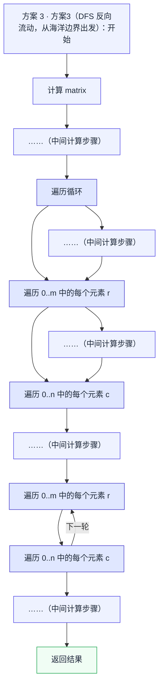

```rust
// LeetCode 417. 太平洋大西洋水流问题 — Rust 版

// 方案3（DFS 反向流动，从海洋边界出发）
fn pacific_atlantic(matrix: Option<&Vec<Vec<i32>>>) -> Vec<(usize, usize)> {
    // 定义函数/方法 pacific_atlantic
    let matrix = match matrix {
        // 把 match 矩阵 { 存入 矩阵
        Some(m) if !m.is_empty() && !m[0].is_empty() => m,
        _ => return Vec::new(),
    };
    let m = matrix.len(); // 把 矩阵.长度() 存入 映射表
    let n = matrix[0].len(); // 把 矩阵[0].长度() 存入 元素个数
    let mut pacific = vec![vec![false; n]; m]; // 把 vec取反 [vec取反 [false; 元素个数]; 映射表]; 写入 let mut pacific
    let mut atlantic = vec![vec![false; n]; m]; // 把 vec取反 [vec取反 [false; 元素个数]; 映射表]; 写入 let mut atlantic

    fn dfs(matrix: &Vec<Vec<i32>>, flow: &mut Vec<Vec<bool>>, r: usize, c: usize) {
        // 定义函数/方法 dfs
        let (m, n) = (matrix.len(), matrix[0].len()); // 把 (矩阵.长度(), 矩阵[0].长度()); 写入 let (m, n)
        flow[r][c] = true; // 把 true; 写入 flow[r][c]
        let dirs: [(i64, i64); 4] = [(-1, 0), (1, 0), (0, -1), (0, 1)];
        for (dr, dc) in dirs {
            // for (dr, dc) in dirs {
            let nr = r as i64 + dr; // 把 右指针 as i64 加 dr 存入 nr
            let nc = c as i64 + dc; // 把 字符 as i64 加 dc 存入 nc
            if nr >= 0  // 若 nr 不低于 0
                && (nr as usize) < m  // 且 (nr as usize) 小于 映射表
                && nc >= 0  // 把 0 写入 && nc >
                && (nc as usize) < n  // 且 (nc as usize) 小于 元素个数
                && !flow[nr as usize][nc as usize]  // 且 取反 flow[nr as usize][nc as usize]
                && matrix[nr as usize][nc as usize] >= matrix[r][c]
            // 把 矩阵[右指针][字符] 写入 && matrix[nr as usize][nc as usize] >
            {
                dfs(matrix, flow, nr as usize, nc as usize); // dfs(矩阵, flow, nr as usize, nc as usize);
            }
        }
    }

    for r in 0..m {
        // 逐个取出 0 的元素（右指针）
        dfs(matrix, &mut pacific, r, 0); // dfs(矩阵, 按位与 mut pacific, 右指针, 0);
        dfs(matrix, &mut atlantic, r, n - 1); // dfs(矩阵, 按位与 mut atlantic, 右指针, 元素个数 减 1);
    }
    for c in 0..n {
        // 逐个取出 0 的元素（字符）
        dfs(matrix, &mut pacific, 0, c); // dfs(矩阵, 按位与 mut pacific, 0, 字符);
        dfs(matrix, &mut atlantic, m - 1, c); // dfs(矩阵, 按位与 mut atlantic, 映射表 减 1, 字符);
    }

    let mut res: Vec<(usize, usize)> = Vec::new(); // 把 Vec::new(); 写入 let mut res: Vec<(usize, usize)>
    for r in 0..m {
        // 逐个取出 0 的元素（右指针）
        for c in 0..n {
            // 逐个取出 0 的元素（字符）
            if pacific[r][c] && atlantic[r][c] {
                // 若 pacific[右指针][字符] 且 atlantic[右指针][字符]
                res.push((r, c)); // 把 (右指针, 字符 压入栈/数组尾部
            }
        }
    }
    res // 结果
}

fn main() {
    // 程序入口：跑内嵌自测用例
    let matrix = vec![
        vec![1, 2, 2, 3, 5],
        vec![3, 2, 3, 4, 4],
        vec![2, 4, 5, 3, 1],
        vec![6, 7, 1, 4, 5],
        vec![5, 1, 1, 2, 4],
    ];
    let got = pacific_atlantic(Some(&matrix)); // 把 pacific_atlantic(Some( 按位与 矩阵)) 存入 got
    let expected: [(usize, usize); 7] = [(0, 4), (1, 3), (1, 4), (2, 2), (3, 0), (3, 1), (4, 0)];
    assert_eq!(got.len(), expected.len(), "length mismatch"); // 断言校验
    for (i, (g, e)) in got.iter().zip(expected.iter()).enumerate() {
        assert_eq!(g, e, "cell mismatch at {}", i); // 断言校验
    }
    println!("PASS"); // 全部用例通过，输出 PASS
}
```

### Lua 实现（3 种方案）

Lua 的全部方案如下，每个方案都内嵌用例自测，可独立运行（老仓库 python/go 文件遵循「打印结果」约定）：

#### 方案 1：方案1（DFS 反向流动，从海洋边界出发）

**思路与代码分析**：核心是「方案1（DFS 反向流动，从海洋边界出发）」。Lua 版用表与 ipairs 遍历，注意 ipairs 遇 nil 即停的语义。代码里依次做这些事：递归求解子问题。

**运行架构**（真实控制流）：

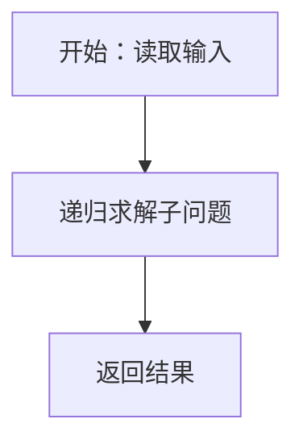

```lua
-- LeetCode 417. 太平洋大西洋水流问题 — Lua 版

-- 方案1（DFS 反向流动，从海洋边界出发）
local function pacific_atlantic(matrix) -- local function pacific_atlantic(矩阵)
	if not matrix or #matrix == 0 or #matrix[1] == 0 then
		return {}
	end -- 若 not 矩阵 or #矩阵 等于 0 or #矩阵[1] 等于 0 then return {} 终点
	local m, n = #matrix, #matrix[1] -- 把 #矩阵, #矩阵[1] 写入 local m, n
	local pacific, atlantic = {}, {} -- 把 {}, {} 写入 local pacific, atlantic
	for r = 1, m do -- 让 右指针 从 1 走到 映射表（Lua 1 基）
		pacific[r] = {} -- 把 {} 写入 pacific[r]
		atlantic[r] = {} -- 把 {} 写入 atlantic[r]
		for c = 1, n do -- 让 字符 从 1 走到 元素个数（Lua 1 基）
			pacific[r][c] = false -- 把 false 写入 pacific[r][c]
			atlantic[r][c] = false -- 把 false 写入 atlantic[r][c]
		end -- 终点
	end -- 终点

	local dirs = { { -1, 0 }, { 1, 0 }, { 0, -1 }, { 0, 1 } }
	local function dfs(r, c, flow) -- local function dfs(右指针, 字符, flow)
		flow[r][c] = true -- 把 true 写入 flow[r][c]
		for _, d in ipairs(dirs) do -- 遍历取 d
			local nr, nc = r + d[1], c + d[2] -- 把 右指针 加 d[1], 字符 加 d[2] 写入 local nr, nc
			if
				nr >= 1
				and nr <= m
				and nc >= 1
				and nc <= n -- 若 nr 不低于 1 and nr 不超过 映射表 and nc 不低于 1 and nc 不超过 元素个数
				and not flow[nr][nc] -- and not flow[nr][nc]
				and matrix[nr][nc] >= matrix[r][c]
			then -- 把 矩阵[右指针][字符] then 写入 and matrix[nr][nc] >
				dfs(nr, nc, flow) -- dfs(nr, nc, flow)
			end -- 终点
		end -- 终点
	end -- 终点

	for r = 1, m do -- 让 右指针 从 1 走到 映射表（Lua 1 基）
		dfs(r, 1, pacific) -- dfs(右指针, 1, pacific)
		dfs(r, n, atlantic) -- dfs(右指针, 元素个数, atlantic)
	end -- 终点
	for c = 1, n do -- 让 字符 从 1 走到 元素个数（Lua 1 基）
		dfs(1, c, pacific) -- dfs(1, 字符, pacific)
		dfs(m, c, atlantic) -- dfs(映射表, 字符, atlantic)
	end -- 终点

	local res = {} -- 把 {} 写入 local res
	for r = 1, m do -- 让 右指针 从 1 走到 映射表（Lua 1 基）
		for c = 1, n do -- 让 字符 从 1 走到 元素个数（Lua 1 基）
			if pacific[r][c] and atlantic[r][c] then -- 若 pacific[右指针][字符] and atlantic[右指针][字符] then
				res[#res + 1] = { r - 1, c - 1 } -- 转回 0 基坐标
			end -- 终点
		end -- 终点
	end -- 终点
	return res -- 返回 结果
end -- 终点

-- 空输入：null 矩阵应返回 []
local got = pacific_atlantic(nil) -- 把 pacific_atlantic(nil) 写入 local got
assert(#got == 0, "null matrix should yield []") -- 断言校验
print("PASS") -- 全部用例通过，输出 PASS
```

#### 方案 2：方案2（DFS 反向流动，从海洋边界出发）

**思路与代码分析**：核心是「方案2（DFS 反向流动，从海洋边界出发）」。Lua 版用表与 ipairs 遍历，注意 ipairs 遇 nil 即停的语义。代码里依次做这些事：递归求解子问题。

**运行架构**：与方案 1 的控制流相同（同算法在该语言的等价实现），图见上。

```lua
-- LeetCode 417. 太平洋大西洋水流问题 — Lua 版

-- 方案2（DFS 反向流动，从海洋边界出发）
local function pacific_atlantic(matrix) -- local function pacific_atlantic(矩阵)
	if not matrix or #matrix == 0 or #matrix[1] == 0 then
		return {}
	end -- 若 not 矩阵 or #矩阵 等于 0 or #矩阵[1] 等于 0 then return {} 终点
	local m, n = #matrix, #matrix[1] -- 把 #矩阵, #矩阵[1] 写入 local m, n
	local pacific, atlantic = {}, {} -- 把 {}, {} 写入 local pacific, atlantic
	for r = 1, m do -- 让 右指针 从 1 走到 映射表（Lua 1 基）
		pacific[r] = {} -- 把 {} 写入 pacific[r]
		atlantic[r] = {} -- 把 {} 写入 atlantic[r]
		for c = 1, n do -- 让 字符 从 1 走到 元素个数（Lua 1 基）
			pacific[r][c] = false -- 把 false 写入 pacific[r][c]
			atlantic[r][c] = false -- 把 false 写入 atlantic[r][c]
		end -- 终点
	end -- 终点

	local dirs = { { -1, 0 }, { 1, 0 }, { 0, -1 }, { 0, 1 } }
	local function dfs(r, c, flow) -- local function dfs(右指针, 字符, flow)
		flow[r][c] = true -- 把 true 写入 flow[r][c]
		for _, d in ipairs(dirs) do -- 遍历取 d
			local nr, nc = r + d[1], c + d[2] -- 把 右指针 加 d[1], 字符 加 d[2] 写入 local nr, nc
			if
				nr >= 1
				and nr <= m
				and nc >= 1
				and nc <= n -- 若 nr 不低于 1 and nr 不超过 映射表 and nc 不低于 1 and nc 不超过 元素个数
				and not flow[nr][nc] -- and not flow[nr][nc]
				and matrix[nr][nc] >= matrix[r][c]
			then -- 把 矩阵[右指针][字符] then 写入 and matrix[nr][nc] >
				dfs(nr, nc, flow) -- dfs(nr, nc, flow)
			end -- 终点
		end -- 终点
	end -- 终点

	for r = 1, m do -- 让 右指针 从 1 走到 映射表（Lua 1 基）
		dfs(r, 1, pacific) -- dfs(右指针, 1, pacific)
		dfs(r, n, atlantic) -- dfs(右指针, 元素个数, atlantic)
	end -- 终点
	for c = 1, n do -- 让 字符 从 1 走到 元素个数（Lua 1 基）
		dfs(1, c, pacific) -- dfs(1, 字符, pacific)
		dfs(m, c, atlantic) -- dfs(映射表, 字符, atlantic)
	end -- 终点

	local res = {} -- 把 {} 写入 local res
	for r = 1, m do -- 让 右指针 从 1 走到 映射表（Lua 1 基）
		for c = 1, n do -- 让 字符 从 1 走到 元素个数（Lua 1 基）
			if pacific[r][c] and atlantic[r][c] then -- 若 pacific[右指针][字符] and atlantic[右指针][字符] then
				res[#res + 1] = { r - 1, c - 1 } -- 转回 0 基坐标
			end -- 终点
		end -- 终点
	end -- 终点
	return res -- 返回 结果
end -- 终点

local got = pacific_atlantic({ -- 把 pacific_atlantic({ 写入 local got
	{ 1, 2, 2, 3, 5 },
	{ 3, 2, 3, 4, 4 },
	{ 2, 4, 5, 3, 1 },
	{ 6, 7, 1, 4, 5 },
	{ 5, 1, 1, 2, 4 },
}) -- })
local expected = { -- 把 { 写入 local expected
	{ 0, 4 },
	{ 1, 3 },
	{ 1, 4 },
	{ 2, 2 },
	{ 3, 0 },
	{ 3, 1 },
	{ 4, 0 },
}
assert(#got == #expected, "length mismatch") -- 断言校验
for i = 1, #expected do -- 把 1, #expected do 写入 for i
	assert(got[i][1] == expected[i][1] and got[i][2] == expected[i][2], "cell mismatch at " .. i) -- 「cell mismatch at 」 .. 下标 i)
end -- 终点
print("PASS") -- 全部用例通过，输出 PASS
```

#### 方案 3：方案3（DFS 反向流动，从海洋边界出发）

**思路与代码分析**：核心是「方案3（DFS 反向流动，从海洋边界出发）」。Lua 版用表与 ipairs 遍历，注意 ipairs 遇 nil 即停的语义。代码里依次做这些事：递归求解子问题。

**运行架构**：与方案 1 的控制流相同（同算法在该语言的等价实现），图见上。

```lua
-- LeetCode 417. 太平洋大西洋水流问题 — Lua 版

-- 方案3（DFS 反向流动，从海洋边界出发）
local function pacific_atlantic(matrix) -- local function pacific_atlantic(矩阵)
	if not matrix or #matrix == 0 or #matrix[1] == 0 then
		return {}
	end -- 若 not 矩阵 or #矩阵 等于 0 or #矩阵[1] 等于 0 then return {} 终点
	local m, n = #matrix, #matrix[1] -- 把 #矩阵, #矩阵[1] 写入 local m, n
	local pacific, atlantic = {}, {} -- 把 {}, {} 写入 local pacific, atlantic
	for r = 1, m do -- 让 右指针 从 1 走到 映射表（Lua 1 基）
		pacific[r] = {} -- 把 {} 写入 pacific[r]
		atlantic[r] = {} -- 把 {} 写入 atlantic[r]
		for c = 1, n do -- 让 字符 从 1 走到 元素个数（Lua 1 基）
			pacific[r][c] = false -- 把 false 写入 pacific[r][c]
			atlantic[r][c] = false -- 把 false 写入 atlantic[r][c]
		end -- 终点
	end -- 终点

	local dirs = { { -1, 0 }, { 1, 0 }, { 0, -1 }, { 0, 1 } }
	local function dfs(r, c, flow) -- local function dfs(右指针, 字符, flow)
		flow[r][c] = true -- 把 true 写入 flow[r][c]
		for _, d in ipairs(dirs) do -- 遍历取 d
			local nr, nc = r + d[1], c + d[2] -- 把 右指针 加 d[1], 字符 加 d[2] 写入 local nr, nc
			if
				nr >= 1
				and nr <= m
				and nc >= 1
				and nc <= n -- 若 nr 不低于 1 and nr 不超过 映射表 and nc 不低于 1 and nc 不超过 元素个数
				and not flow[nr][nc] -- and not flow[nr][nc]
				and matrix[nr][nc] >= matrix[r][c]
			then -- 把 矩阵[右指针][字符] then 写入 and matrix[nr][nc] >
				dfs(nr, nc, flow) -- dfs(nr, nc, flow)
			end -- 终点
		end -- 终点
	end -- 终点

	for r = 1, m do -- 让 右指针 从 1 走到 映射表（Lua 1 基）
		dfs(r, 1, pacific) -- dfs(右指针, 1, pacific)
		dfs(r, n, atlantic) -- dfs(右指针, 元素个数, atlantic)
	end -- 终点
	for c = 1, n do -- 让 字符 从 1 走到 元素个数（Lua 1 基）
		dfs(1, c, pacific) -- dfs(1, 字符, pacific)
		dfs(m, c, atlantic) -- dfs(映射表, 字符, atlantic)
	end -- 终点

	local res = {} -- 把 {} 写入 local res
	for r = 1, m do -- 让 右指针 从 1 走到 映射表（Lua 1 基）
		for c = 1, n do -- 让 字符 从 1 走到 元素个数（Lua 1 基）
			if pacific[r][c] and atlantic[r][c] then -- 若 pacific[右指针][字符] and atlantic[右指针][字符] then
				res[#res + 1] = { r - 1, c - 1 } -- 转回 0 基坐标
			end -- 终点
		end -- 终点
	end -- 终点
	return res -- 返回 结果
end -- 终点

local got = pacific_atlantic({ -- 把 pacific_atlantic({ 写入 local got
	{ 1, 2, 2, 3, 5 },
	{ 3, 2, 3, 4, 4 },
	{ 2, 4, 5, 3, 1 },
	{ 6, 7, 1, 4, 5 },
	{ 5, 1, 1, 2, 4 },
}) -- })
local expected = { -- 把 { 写入 local expected
	{ 0, 4 },
	{ 1, 3 },
	{ 1, 4 },
	{ 2, 2 },
	{ 3, 0 },
	{ 3, 1 },
	{ 4, 0 },
}
assert(#got == #expected, "length mismatch") -- 断言校验
for i = 1, #expected do -- 把 1, #expected do 写入 for i
	assert(got[i][1] == expected[i][1] and got[i][2] == expected[i][2], "cell mismatch at " .. i) -- 「cell mismatch at 」 .. 下标 i)
end -- 终点
print("PASS") -- 全部用例通过，输出 PASS
```

### C 实现（3 种方案）

C 的全部方案如下，每个方案都内嵌用例自测，可独立运行（老仓库 python/go 文件遵循「打印结果」约定）：

#### 方案 1：方案1（DFS 反向流动，从海洋边界出发）

**思路与代码分析**：核心是「方案1（DFS 反向流动，从海洋边界出发）」。C 版手动管理下标与内存，循环边界全部显式写出。代码里依次做这些事：单循环线性扫描。**走读**：方案 1 · 方案1（DFS 反向流动，从海洋边界出发）：开始 → 更新 flow[r][c] → 更新 dr[4] → 更新 dc[4] → 遍历循环 → 更新 nr → 更新 nc → 处理 if (nr ≥ 0 且 nr ＜ g_m 且 n → 更新 > → 调用 dfs(nr, nc, flow) → 返回结果。

**运行架构**（真实控制流）：

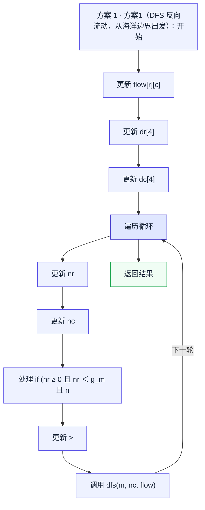

```c
* LeetCode 417. 太平洋大西洋水流问题 — C 版 */
#include <stdbool.h> // 引入头文件
#include <stdio.h>   // 引入头文件
#include <string.h>  // 引入头文件

#define MAXD 8 // #define MAXD 8

static int g_m, g_n;             // static int g_m, g_n;
static const int (*g_mat)[MAXD]; // static const int ( 乘 g_mat)[MAXD];

/* 方案1（DFS 反向流动，从海洋边界出发） */
static void dfs(int r, int c, bool flow[MAXD][MAXD]) { // 定义函数/方法 dfs
    flow[r][c] = true;                                 // 把 true; 写入 flow[r][c]
    static const int dr[4] = {-1, 1, 0, 0};            // 把 { 减 1, 1, 0, 0}; 写入 static const int dr[4]
    static const int dc[4] = {0, 0, -1, 1};            // 把 {0, 0, 减 1, 1}; 写入 static const int dc[4]
    for (int k = 0; k < 4; k++) { // 让 下标 k 从 0 开始计数，下标 k 小于 4 就继续
        int nr = r + dr[k];       // 把 右指针 加 dr[下标 k] 存入 nr
        int nc = c + dc[k];       // 把 字符 加 dc[下标 k] 存入 nc
        if (nr >= 0 && nr < g_m && nc >= 0 && nc < g_n && !flow[nr][nc] &&
            g_mat[nr][nc] >= g_mat[r][c]) { // 把 g_mat[右指针][字符]) { 写入 g_mat[nr][nc] >
            dfs(nr, nc, flow);              // dfs(nr, nc, flow);
        }
    }
}

/* 返回结果个数，res 按行优先填充 0 基坐标；mat 为 NULL 时返回 0 */
static int pacific_atlantic(const int (*mat)[MAXD], int m, int n,
                            int res[][2]) { // int 结果[][2]) {
    if (mat == NULL || m == 0 || n == 0)
        return 0; // 若 mat 等于 NULL 或 映射表 等于 0 或 元素个数 等于 0，直接返回 0
    g_m = m;      // 把 映射表; 写入 g_m
    g_n = n;      // 把 元素个数; 写入 g_n
    g_mat = mat;  // 把 mat; 写入 g_mat
    static bool pacific[MAXD][MAXD],
        atlantic[MAXD][MAXD];              // static bool pacific[MAXD][MAXD], atlantic[MAXD][MAXD];
    memset(pacific, 0, sizeof(pacific));   // memset(pacific, 0, sizeof(pacific));
    memset(atlantic, 0, sizeof(atlantic)); // memset(atlantic, 0, sizeof(atlantic));
    for (int r = 0; r < m; r++) { // 让 右指针 从 0 开始计数，右指针 小于 映射表 就继续
        dfs(r, 0, pacific);       // dfs(右指针, 0, pacific);
        dfs(r, n - 1, atlantic);  // dfs(右指针, 元素个数 减 1, atlantic);
    }
    for (int c = 0; c < n; c++) { // 让 字符 从 0 开始计数，字符 小于 元素个数 就继续
        dfs(0, c, pacific);       // dfs(0, 字符, pacific);
        dfs(m - 1, c, atlantic);  // dfs(映射表 减 1, 字符, atlantic);
    }
    int cnt = 0;                  // 把 0 存入 计数
    for (int r = 0; r < m; r++) { // 让 右指针 从 0 开始计数，右指针 小于 映射表 就继续
        for (int c = 0; c < n; c++) { // 让 字符 从 0 开始计数，字符 小于 元素个数 就继续
            if (pacific[r][c] && atlantic[r][c]) { // 若 pacific[右指针][字符] 且 atlantic[右指针][字符]
                res[cnt][0] = r;                   // 把 右指针; 写入 res[cnt][0]
                res[cnt][1] = c;                   // 把 字符; 写入 res[cnt][1]
                cnt++;                             // 计数 加一
            }
        }
    }
    return cnt; // 返回 计数
}

int main(void) { // 程序入口：跑内嵌自测用例
    /* 空输入：null 矩阵应返回 [] */
    int res[MAXD][2];                            // int 结果[MAXD][2];
    int got = pacific_atlantic(NULL, 5, 5, res); // 把 pacific_atlantic(NULL, 5, 5, 结果) 存入 got
    if (got != 0) {                              // 若 got 不等于 0
        printf("null matrix should yield []\n"); // 打印输出
        return 1;                                // 返回 1
    }
    printf("PASS\n"); // 全部用例通过，输出 PASS
    return 0;         // 返回 0
}
```

#### 方案 2：方案2（DFS 反向流动，从海洋边界出发）

**思路与代码分析**：核心是「方案2（DFS 反向流动，从海洋边界出发）」。C 版手动管理下标与内存，循环边界全部显式写出。代码里依次做这些事：单循环线性扫描。**走读**：方案 2 · 方案2（DFS 反向流动，从海洋边界出发）：开始 → 更新 flow[r][c] → 更新 dr[4] → 更新 dc[4] → 遍历循环 → 更新 nr → 更新 nc → 处理 if (nr ≥ 0 且 nr ＜ g_m 且 n → 更新 > → 调用 dfs(nr, nc, flow) → 返回结果。

**运行架构**（真实控制流）：


```c
* LeetCode 417. 太平洋大西洋水流问题 — C 版 */
#include <stdbool.h> // 引入头文件
#include <stdio.h>   // 引入头文件
#include <string.h>  // 引入头文件

#define MAXD 8 // #define MAXD 8

static int g_m, g_n;             // static int g_m, g_n;
static const int (*g_mat)[MAXD]; // static const int ( 乘 g_mat)[MAXD];

/* 方案2（DFS 反向流动，从海洋边界出发） */
static void dfs(int r, int c, bool flow[MAXD][MAXD]) { // 定义函数/方法 dfs
    flow[r][c] = true;                                 // 把 true; 写入 flow[r][c]
    static const int dr[4] = {-1, 1, 0, 0};            // 把 { 减 1, 1, 0, 0}; 写入 static const int dr[4]
    static const int dc[4] = {0, 0, -1, 1};            // 把 {0, 0, 减 1, 1}; 写入 static const int dc[4]
    for (int k = 0; k < 4; k++) { // 让 下标 k 从 0 开始计数，下标 k 小于 4 就继续
        int nr = r + dr[k];       // 把 右指针 加 dr[下标 k] 存入 nr
        int nc = c + dc[k];       // 把 字符 加 dc[下标 k] 存入 nc
        if (nr >= 0 && nr < g_m && nc >= 0 && nc < g_n && !flow[nr][nc] &&
            g_mat[nr][nc] >= g_mat[r][c]) { // 把 g_mat[右指针][字符]) { 写入 g_mat[nr][nc] >
            dfs(nr, nc, flow);              // dfs(nr, nc, flow);
        }
    }
}

/* 返回结果个数，res 按行优先填充 0 基坐标；mat 为 NULL 时返回 0 */
static int pacific_atlantic(const int (*mat)[MAXD], int m, int n,
                            int res[][2]) { // int 结果[][2]) {
    if (mat == NULL || m == 0 || n == 0)
        return 0; // 若 mat 等于 NULL 或 映射表 等于 0 或 元素个数 等于 0，直接返回 0
    g_m = m;      // 把 映射表; 写入 g_m
    g_n = n;      // 把 元素个数; 写入 g_n
    g_mat = mat;  // 把 mat; 写入 g_mat
    static bool pacific[MAXD][MAXD],
        atlantic[MAXD][MAXD];              // static bool pacific[MAXD][MAXD], atlantic[MAXD][MAXD];
    memset(pacific, 0, sizeof(pacific));   // memset(pacific, 0, sizeof(pacific));
    memset(atlantic, 0, sizeof(atlantic)); // memset(atlantic, 0, sizeof(atlantic));
    for (int r = 0; r < m; r++) { // 让 右指针 从 0 开始计数，右指针 小于 映射表 就继续
        dfs(r, 0, pacific);       // dfs(右指针, 0, pacific);
        dfs(r, n - 1, atlantic);  // dfs(右指针, 元素个数 减 1, atlantic);
    }
    for (int c = 0; c < n; c++) { // 让 字符 从 0 开始计数，字符 小于 元素个数 就继续
        dfs(0, c, pacific);       // dfs(0, 字符, pacific);
        dfs(m - 1, c, atlantic);  // dfs(映射表 减 1, 字符, atlantic);
    }
    int cnt = 0;                  // 把 0 存入 计数
    for (int r = 0; r < m; r++) { // 让 右指针 从 0 开始计数，右指针 小于 映射表 就继续
        for (int c = 0; c < n; c++) { // 让 字符 从 0 开始计数，字符 小于 元素个数 就继续
            if (pacific[r][c] && atlantic[r][c]) { // 若 pacific[右指针][字符] 且 atlantic[右指针][字符]
                res[cnt][0] = r;                   // 把 右指针; 写入 res[cnt][0]
                res[cnt][1] = c;                   // 把 字符; 写入 res[cnt][1]
                cnt++;                             // 计数 加一
            }
        }
    }
    return cnt; // 返回 计数
}

int main(void) { // 程序入口：跑内嵌自测用例
    int mat[MAXD][MAXD] = {
        // 把 { 写入 int mat[MAXD][MAXD]
        {1, 2, 2, 3, 5}, {3, 2, 3, 4, 4}, {2, 4, 5, 3, 1}, {6, 7, 1, 4, 5}, {5, 1, 1, 2, 4},
    };
    int res[MAXD * MAXD][2];                    // int 结果[MAXD 乘 MAXD][2];
    int got = pacific_atlantic(mat, 5, 5, res); // 把 pacific_atlantic(mat, 5, 5, 结果) 存入 got
    int expected[7][2] = {
        // 把 { 写入 int expected[7][2]
        {0, 4}, {1, 3}, {1, 4}, {2, 2}, {3, 0}, {3, 1}, {4, 0},
    };
    if (got != 7) {                               // 若 got 不等于 7
        printf("length mismatch: got %d\n", got); // 打印输出
        return 1;                                 // 返回 1
    }
    for (int i = 0; i < 7; i++) { // 让 下标 i 从 0 开始计数，下标 i 小于 7 就继续
        if (res[i][0] != expected[i][0] || res[i][1] != expected[i][1]) {
            printf("cell mismatch at %d: got (%d,%d) want (%d,%d)\n", i, res[i][0], res[i][1], expected[i][0],
                   expected[i][1]);
            return 1; // 返回 1
        }
    }
    printf("PASS\n"); // 全部用例通过，输出 PASS
    return 0;         // 返回 0
}
```

#### 方案 3：方案3（DFS 反向流动，从海洋边界出发）

**思路与代码分析**：核心是「方案3（DFS 反向流动，从海洋边界出发）」。C 版手动管理下标与内存，循环边界全部显式写出。代码里依次做这些事：单循环线性扫描。**走读**：方案 3 · 方案3（DFS 反向流动，从海洋边界出发）：开始 → 更新 flow[r][c] → 更新 dr[4] → 更新 dc[4] → 遍历循环 → 更新 nr → 更新 nc → 处理 if (nr ≥ 0 且 nr ＜ g_m 且 n → 更新 > → 调用 dfs(nr, nc, flow) → 返回结果。

**运行架构**（真实控制流）：

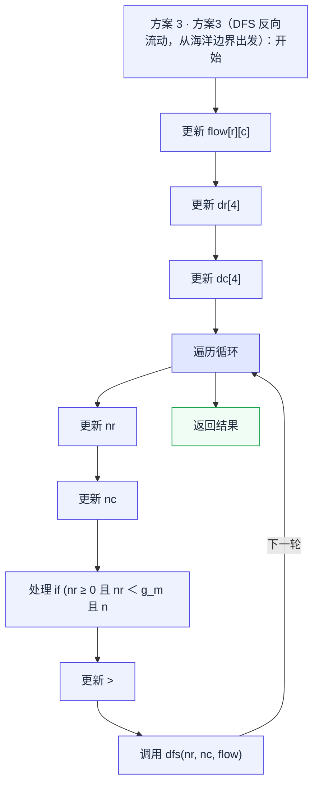

```c
* LeetCode 417. 太平洋大西洋水流问题 — C 版 */
#include <stdbool.h> // 引入头文件
#include <stdio.h>   // 引入头文件
#include <string.h>  // 引入头文件

#define MAXD 8 // #define MAXD 8

static int g_m, g_n;             // static int g_m, g_n;
static const int (*g_mat)[MAXD]; // static const int ( 乘 g_mat)[MAXD];

/* 方案3（DFS 反向流动，从海洋边界出发） */
static void dfs(int r, int c, bool flow[MAXD][MAXD]) { // 定义函数/方法 dfs
    flow[r][c] = true;                                 // 把 true; 写入 flow[r][c]
    static const int dr[4] = {-1, 1, 0, 0};            // 把 { 减 1, 1, 0, 0}; 写入 static const int dr[4]
    static const int dc[4] = {0, 0, -1, 1};            // 把 {0, 0, 减 1, 1}; 写入 static const int dc[4]
    for (int k = 0; k < 4; k++) { // 让 下标 k 从 0 开始计数，下标 k 小于 4 就继续
        int nr = r + dr[k];       // 把 右指针 加 dr[下标 k] 存入 nr
        int nc = c + dc[k];       // 把 字符 加 dc[下标 k] 存入 nc
        if (nr >= 0 && nr < g_m && nc >= 0 && nc < g_n && !flow[nr][nc] &&
            g_mat[nr][nc] >= g_mat[r][c]) { // 把 g_mat[右指针][字符]) { 写入 g_mat[nr][nc] >
            dfs(nr, nc, flow);              // dfs(nr, nc, flow);
        }
    }
}

/* 返回结果个数，res 按行优先填充 0 基坐标；mat 为 NULL 时返回 0 */
static int pacific_atlantic(const int (*mat)[MAXD], int m, int n,
                            int res[][2]) { // int 结果[][2]) {
    if (mat == NULL || m == 0 || n == 0)
        return 0; // 若 mat 等于 NULL 或 映射表 等于 0 或 元素个数 等于 0，直接返回 0
    g_m = m;      // 把 映射表; 写入 g_m
    g_n = n;      // 把 元素个数; 写入 g_n
    g_mat = mat;  // 把 mat; 写入 g_mat
    static bool pacific[MAXD][MAXD],
        atlantic[MAXD][MAXD];              // static bool pacific[MAXD][MAXD], atlantic[MAXD][MAXD];
    memset(pacific, 0, sizeof(pacific));   // memset(pacific, 0, sizeof(pacific));
    memset(atlantic, 0, sizeof(atlantic)); // memset(atlantic, 0, sizeof(atlantic));
    for (int r = 0; r < m; r++) { // 让 右指针 从 0 开始计数，右指针 小于 映射表 就继续
        dfs(r, 0, pacific);       // dfs(右指针, 0, pacific);
        dfs(r, n - 1, atlantic);  // dfs(右指针, 元素个数 减 1, atlantic);
    }
    for (int c = 0; c < n; c++) { // 让 字符 从 0 开始计数，字符 小于 元素个数 就继续
        dfs(0, c, pacific);       // dfs(0, 字符, pacific);
        dfs(m - 1, c, atlantic);  // dfs(映射表 减 1, 字符, atlantic);
    }
    int cnt = 0;                  // 把 0 存入 计数
    for (int r = 0; r < m; r++) { // 让 右指针 从 0 开始计数，右指针 小于 映射表 就继续
        for (int c = 0; c < n; c++) { // 让 字符 从 0 开始计数，字符 小于 元素个数 就继续
            if (pacific[r][c] && atlantic[r][c]) { // 若 pacific[右指针][字符] 且 atlantic[右指针][字符]
                res[cnt][0] = r;                   // 把 右指针; 写入 res[cnt][0]
                res[cnt][1] = c;                   // 把 字符; 写入 res[cnt][1]
                cnt++;                             // 计数 加一
            }
        }
    }
    return cnt; // 返回 计数
}

int main(void) { // 程序入口：跑内嵌自测用例
    int mat[MAXD][MAXD] = {
        // 把 { 写入 int mat[MAXD][MAXD]
        {1, 2, 2, 3, 5}, {3, 2, 3, 4, 4}, {2, 4, 5, 3, 1}, {6, 7, 1, 4, 5}, {5, 1, 1, 2, 4},
    };
    int res[MAXD * MAXD][2];                    // int 结果[MAXD 乘 MAXD][2];
    int got = pacific_atlantic(mat, 5, 5, res); // 把 pacific_atlantic(mat, 5, 5, 结果) 存入 got
    int expected[7][2] = {
        // 把 { 写入 int expected[7][2]
        {0, 4}, {1, 3}, {1, 4}, {2, 2}, {3, 0}, {3, 1}, {4, 0},
    };
    if (got != 7) {                               // 若 got 不等于 7
        printf("length mismatch: got %d\n", got); // 打印输出
        return 1;                                 // 返回 1
    }
    for (int i = 0; i < 7; i++) { // 让 下标 i 从 0 开始计数，下标 i 小于 7 就继续
        if (res[i][0] != expected[i][0] || res[i][1] != expected[i][1]) {
            printf("cell mismatch at %d: got (%d,%d) want (%d,%d)\n", i, res[i][0], res[i][1], expected[i][0],
                   expected[i][1]);
            return 1; // 返回 1
        }
    }
    printf("PASS\n"); // 全部用例通过，输出 PASS
    return 0;         // 返回 0
}
```

### C++ 实现（3 种方案）

C++ 的全部方案如下，每个方案都内嵌用例自测，可独立运行（老仓库 python/go 文件遵循「打印结果」约定）：

#### 方案 1：方案1（DFS 反向流动，从海洋边界出发）

**思路与代码分析**：核心是「方案1（DFS 反向流动，从海洋边界出发）」。C++ 版用 STL 容器与迭代器，减少手写下标错误。代码里依次做这些事：双重循环遍历。**走读**：方案 1 · 方案1（DFS 反向流动，从海洋边界出发）：开始 → 若 matrix == nullptr 或 matrix-＞empty(：处理 或 → 返回  → 遍历循环 → 遍历循环 → 遍历循环 → 遍历循环 → 遍历循环 → 返回 res。

**运行架构**（真实控制流）：

```mermaid
graph TD
    N0["方案 1 · 方案1（DFS 反向流动，从海洋边界出发）：开始"]
    N1["若 matrix == nullptr 或 matrix-＞empty(：处理 或"]
    D1["……（中间计算步骤）"]
    N3["返回 "]
    D2["……（中间计算步骤）"]
    N14["遍历循环"]
    D3["……（中间计算步骤）"]
    N20["遍历循环"]
    D4["……（中间计算步骤）"]
    N23["遍历循环"]
    D5["……（中间计算步骤）"]
    N27["遍历循环"]
    N28["遍历循环"]
    D6["……（中间计算步骤）"]
    N31["返回 res"]
    N0 --> N1
    N14 --> N20
    N20 --> N23
    N27 --> N28
    N1 --> D1
    D1 --> N3
    N3 --> D2
    D2 --> N14
    N14 --> D3
    D3 --> N20
    N20 --> D4
    D4 --> N23
    N23 --> D5
    D5 --> N27
    N28 --> D6
    D6 --> N31
    classDef n fill:#eef2ff,stroke:#4f46e5,color:#1e293b;
    classDef lp fill:#e0e7ff,stroke:#4338ca,color:#1e293b;
    classDef dc fill:#fef9c3,stroke:#ca8a04,color:#1e293b;
    classDef tm fill:#f0fdf4,stroke:#16a34a,color:#1e293b;
    class N0,N1,D1,D2,D3,D4,D5,D6 n;
    class N14,N20,N23,N27,N28 lp;
    class N3,N31 tm;
```

```cpp
// LeetCode 417. 太平洋大西洋水流问题 — C++ 版
#include <cassert>    // 引入头文件
#include <functional> // 引入头文件
#include <iostream>   // 引入头文件
#include <utility>    // 引入头文件
#include <vector>     // 引入头文件

using Cell = std::pair<int, int>; // 引入依赖

// 方案1（DFS 反向流动，从海洋边界出发）
std::vector<Cell> pacificAtlantic(const std::vector<std::vector<int>> *matrix) {
    if (matrix == nullptr || matrix->empty() ||
        (*matrix)[0].empty()) // 若 矩阵 等于 nullptr 或 矩阵 减 超过 empty() 或 ( 乘 矩阵)[0].empty(
        return {};            // 返回 {}
    const auto &mat = *matrix;            // 把 乘 矩阵; 写入 const auto &mat
    int m = static_cast<int>(mat.size()); // 把 static_cast 小于 int 超过 (mat.大小()) 存入 映射表
    int n = static_cast<int>(mat[0].size()); // 把 static_cast 小于 int 超过 (mat[0].大小()) 存入 元素个数
    std::vector<std::vector<bool>> pacific(m, std::vector<bool>(n, false));
    std::vector<std::vector<bool>> atlantic(m, std::vector<bool>(n, false));

    std::function<void(int, int, std::vector<std::vector<bool>> &)> dfs =
        [&](int r, int c, std::vector<std::vector<bool>> &flow) {
            flow[r][c] = true;               // 把 true; 写入 flow[r][c]
            const int dr[4] = {-1, 1, 0, 0}; // 把 { 减 1, 1, 0, 0}; 写入 const int dr[4]
            const int dc[4] = {0, 0, -1, 1}; // 把 {0, 0, 减 1, 1}; 写入 const int dc[4]
            for (int k = 0; k < 4; k++) {    // 让 下标 k 从 0 开始计数，下标 k 小于 4 就继续
                int nr = r + dr[k];          // 把 右指针 加 dr[下标 k] 存入 nr
                int nc = c + dc[k];          // 把 字符 加 dc[下标 k] 存入 nc
                if (nr >= 0 && nr < m && nc >= 0 && nc < n && !flow[nr][nc] &&
                    mat[nr][nc] >= mat[r][c]) { // 把 mat[右指针][字符]) { 写入 !flow[nr][nc] && mat[nr][nc] >
                    dfs(nr, nc, flow);          // dfs(nr, nc, flow);
                }
            }
        };

    for (int r = 0; r < m; r++) { // 让 右指针 从 0 开始计数，右指针 小于 映射表 就继续
        dfs(r, 0, pacific);       // dfs(右指针, 0, pacific);
        dfs(r, n - 1, atlantic);  // dfs(右指针, 元素个数 减 1, atlantic);
    }
    for (int c = 0; c < n; c++) { // 让 字符 从 0 开始计数，字符 小于 元素个数 就继续
        dfs(0, c, pacific);       // dfs(0, 字符, pacific);
        dfs(m - 1, c, atlantic);  // dfs(映射表 减 1, 字符, atlantic);
    }

    std::vector<Cell> res;          // std::vector 小于 Cell 超过 结果;
    for (int r = 0; r < m; r++)     // 让 右指针 从 0 开始计数，右指针 小于 映射表 就继续
        for (int c = 0; c < n; c++) // 让 字符 从 0 开始计数，字符 小于 元素个数 就继续
            if (pacific[r][c] && atlantic[r][c])
                res.emplace_back(r, c);
    return res; // 返回 结果
}

int main() { // 程序入口：跑内嵌自测用例
    // 空输入：null 矩阵应返回 []
    auto got = pacificAtlantic(nullptr);                  // 把 pacificAtlantic(nullptr) 存入 got
    assert(got.empty() && "null matrix should yield []"); // 断言校验
    std::cout << "PASS" << std::endl;                     // 全部用例通过，输出 PASS
    return 0;                                             // 返回 0
}
```

#### 方案 2：方案2（DFS 反向流动，从海洋边界出发）

**思路与代码分析**：核心是「方案2（DFS 反向流动，从海洋边界出发）」。C++ 版用 STL 容器与迭代器，减少手写下标错误。代码里依次做这些事：双重循环遍历。**走读**：方案 2 · 方案2（DFS 反向流动，从海洋边界出发）：开始 → 若 matrix == nullptr 或 matrix-＞empty(：处理 或 → 返回  → 遍历循环 → 遍历循环 → 遍历循环 → 遍历循环 → 遍历循环 → 返回 res。

**运行架构**（真实控制流）：

```mermaid
graph TD
    N0["方案 2 · 方案2（DFS 反向流动，从海洋边界出发）：开始"]
    N1["若 matrix == nullptr 或 matrix-＞empty(：处理 或"]
    D1["……（中间计算步骤）"]
    N3["返回 "]
    D2["……（中间计算步骤）"]
    N14["遍历循环"]
    D3["……（中间计算步骤）"]
    N20["遍历循环"]
    D4["……（中间计算步骤）"]
    N23["遍历循环"]
    D5["……（中间计算步骤）"]
    N27["遍历循环"]
    N28["遍历循环"]
    D6["……（中间计算步骤）"]
    N31["返回 res"]
    N0 --> N1
    N14 --> N20
    N20 --> N23
    N27 --> N28
    N1 --> D1
    D1 --> N3
    N3 --> D2
    D2 --> N14
    N14 --> D3
    D3 --> N20
    N20 --> D4
    D4 --> N23
    N23 --> D5
    D5 --> N27
    N28 --> D6
    D6 --> N31
    classDef n fill:#eef2ff,stroke:#4f46e5,color:#1e293b;
    classDef lp fill:#e0e7ff,stroke:#4338ca,color:#1e293b;
    classDef dc fill:#fef9c3,stroke:#ca8a04,color:#1e293b;
    classDef tm fill:#f0fdf4,stroke:#16a34a,color:#1e293b;
    class N0,N1,D1,D2,D3,D4,D5,D6 n;
    class N14,N20,N23,N27,N28 lp;
    class N3,N31 tm;
```

```cpp
// LeetCode 417. 太平洋大西洋水流问题 — C++ 版
#include <cassert>    // 引入头文件
#include <functional> // 引入头文件
#include <iostream>   // 引入头文件
#include <utility>    // 引入头文件
#include <vector>     // 引入头文件

using Cell = std::pair<int, int>; // 引入依赖

// 方案2（DFS 反向流动，从海洋边界出发）
std::vector<Cell> pacificAtlantic(const std::vector<std::vector<int>> *matrix) {
    if (matrix == nullptr || matrix->empty() ||
        (*matrix)[0].empty()) // 若 矩阵 等于 nullptr 或 矩阵 减 超过 empty() 或 ( 乘 矩阵)[0].empty(
        return {};            // 返回 {}
    const auto &mat = *matrix;            // 把 乘 矩阵; 写入 const auto &mat
    int m = static_cast<int>(mat.size()); // 把 static_cast 小于 int 超过 (mat.大小()) 存入 映射表
    int n = static_cast<int>(mat[0].size()); // 把 static_cast 小于 int 超过 (mat[0].大小()) 存入 元素个数
    std::vector<std::vector<bool>> pacific(m, std::vector<bool>(n, false));
    std::vector<std::vector<bool>> atlantic(m, std::vector<bool>(n, false));

    std::function<void(int, int, std::vector<std::vector<bool>> &)> dfs =
        [&](int r, int c, std::vector<std::vector<bool>> &flow) {
            flow[r][c] = true;               // 把 true; 写入 flow[r][c]
            const int dr[4] = {-1, 1, 0, 0}; // 把 { 减 1, 1, 0, 0}; 写入 const int dr[4]
            const int dc[4] = {0, 0, -1, 1}; // 把 {0, 0, 减 1, 1}; 写入 const int dc[4]
            for (int k = 0; k < 4; k++) {    // 让 下标 k 从 0 开始计数，下标 k 小于 4 就继续
                int nr = r + dr[k];          // 把 右指针 加 dr[下标 k] 存入 nr
                int nc = c + dc[k];          // 把 字符 加 dc[下标 k] 存入 nc
                if (nr >= 0 && nr < m && nc >= 0 && nc < n && !flow[nr][nc] &&
                    mat[nr][nc] >= mat[r][c]) { // 把 mat[右指针][字符]) { 写入 !flow[nr][nc] && mat[nr][nc] >
                    dfs(nr, nc, flow);          // dfs(nr, nc, flow);
                }
            }
        };

    for (int r = 0; r < m; r++) { // 让 右指针 从 0 开始计数，右指针 小于 映射表 就继续
        dfs(r, 0, pacific);       // dfs(右指针, 0, pacific);
        dfs(r, n - 1, atlantic);  // dfs(右指针, 元素个数 减 1, atlantic);
    }
    for (int c = 0; c < n; c++) { // 让 字符 从 0 开始计数，字符 小于 元素个数 就继续
        dfs(0, c, pacific);       // dfs(0, 字符, pacific);
        dfs(m - 1, c, atlantic);  // dfs(映射表 减 1, 字符, atlantic);
    }

    std::vector<Cell> res;          // std::vector 小于 Cell 超过 结果;
    for (int r = 0; r < m; r++)     // 让 右指针 从 0 开始计数，右指针 小于 映射表 就继续
        for (int c = 0; c < n; c++) // 让 字符 从 0 开始计数，字符 小于 元素个数 就继续
            if (pacific[r][c] && atlantic[r][c])
                res.emplace_back(r, c);
    return res; // 返回 结果
}

int main() { // 程序入口：跑内嵌自测用例
    std::vector<std::vector<int>> matrix = {
        // 把 { 写入 std::vector<std::vector<int>> matrix
        {1, 2, 2, 3, 5}, {3, 2, 3, 4, 4}, {2, 4, 5, 3, 1}, {6, 7, 1, 4, 5}, {5, 1, 1, 2, 4},
    };
    auto got = pacificAtlantic(&matrix); // 把 pacificAtlantic( 按位与 矩阵) 存入 got
    std::vector<Cell> expected = {
        // 把 { 写入 std::vector<Cell> expected
        {0, 4}, {1, 3}, {1, 4}, {2, 2}, {3, 0}, {3, 1}, {4, 0},
    };
    assert(got.size() == expected.size() && "length mismatch"); // 断言校验
    for (size_t i = 0; i < expected.size();
         i++) // 让 下标 i 从 0 开始计数，下标 i 小于 expected.大小() 就继续
        assert(got[i] == expected[i] && "cell mismatch"); // 断言校验
    std::cout << "PASS" << std::endl;                     // 全部用例通过，输出 PASS
    return 0;                                             // 返回 0
}
```

#### 方案 3：方案3（DFS 反向流动，从海洋边界出发）

**思路与代码分析**：核心是「方案3（DFS 反向流动，从海洋边界出发）」。C++ 版用 STL 容器与迭代器，减少手写下标错误。代码里依次做这些事：双重循环遍历。**走读**：方案 3 · 方案3（DFS 反向流动，从海洋边界出发）：开始 → 若 matrix == nullptr 或 matrix-＞empty(：处理 或 → 返回  → 遍历循环 → 遍历循环 → 遍历循环 → 遍历循环 → 遍历循环 → 返回 res。

**运行架构**（真实控制流）：

```mermaid
graph TD
    N0["方案 3 · 方案3（DFS 反向流动，从海洋边界出发）：开始"]
    N1["若 matrix == nullptr 或 matrix-＞empty(：处理 或"]
    D1["……（中间计算步骤）"]
    N3["返回 "]
    D2["……（中间计算步骤）"]
    N14["遍历循环"]
    D3["……（中间计算步骤）"]
    N20["遍历循环"]
    D4["……（中间计算步骤）"]
    N23["遍历循环"]
    D5["……（中间计算步骤）"]
    N27["遍历循环"]
    N28["遍历循环"]
    D6["……（中间计算步骤）"]
    N31["返回 res"]
    N0 --> N1
    N14 --> N20
    N20 --> N23
    N27 --> N28
    N1 --> D1
    D1 --> N3
    N3 --> D2
    D2 --> N14
    N14 --> D3
    D3 --> N20
    N20 --> D4
    D4 --> N23
    N23 --> D5
    D5 --> N27
    N28 --> D6
    D6 --> N31
    classDef n fill:#eef2ff,stroke:#4f46e5,color:#1e293b;
    classDef lp fill:#e0e7ff,stroke:#4338ca,color:#1e293b;
    classDef dc fill:#fef9c3,stroke:#ca8a04,color:#1e293b;
    classDef tm fill:#f0fdf4,stroke:#16a34a,color:#1e293b;
    class N0,N1,D1,D2,D3,D4,D5,D6 n;
    class N14,N20,N23,N27,N28 lp;
    class N3,N31 tm;
```

```cpp
// LeetCode 417. 太平洋大西洋水流问题 — C++ 版
#include <cassert>    // 引入头文件
#include <functional> // 引入头文件
#include <iostream>   // 引入头文件
#include <utility>    // 引入头文件
#include <vector>     // 引入头文件

using Cell = std::pair<int, int>; // 引入依赖

// 方案3（DFS 反向流动，从海洋边界出发）
std::vector<Cell> pacificAtlantic(const std::vector<std::vector<int>> *matrix) {
    if (matrix == nullptr || matrix->empty() ||
        (*matrix)[0].empty()) // 若 矩阵 等于 nullptr 或 矩阵 减 超过 empty() 或 ( 乘 矩阵)[0].empty(
        return {};            // 返回 {}
    const auto &mat = *matrix;            // 把 乘 矩阵; 写入 const auto &mat
    int m = static_cast<int>(mat.size()); // 把 static_cast 小于 int 超过 (mat.大小()) 存入 映射表
    int n = static_cast<int>(mat[0].size()); // 把 static_cast 小于 int 超过 (mat[0].大小()) 存入 元素个数
    std::vector<std::vector<bool>> pacific(m, std::vector<bool>(n, false));
    std::vector<std::vector<bool>> atlantic(m, std::vector<bool>(n, false));

    std::function<void(int, int, std::vector<std::vector<bool>> &)> dfs =
        [&](int r, int c, std::vector<std::vector<bool>> &flow) {
            flow[r][c] = true;               // 把 true; 写入 flow[r][c]
            const int dr[4] = {-1, 1, 0, 0}; // 把 { 减 1, 1, 0, 0}; 写入 const int dr[4]
            const int dc[4] = {0, 0, -1, 1}; // 把 {0, 0, 减 1, 1}; 写入 const int dc[4]
            for (int k = 0; k < 4; k++) {    // 让 下标 k 从 0 开始计数，下标 k 小于 4 就继续
                int nr = r + dr[k];          // 把 右指针 加 dr[下标 k] 存入 nr
                int nc = c + dc[k];          // 把 字符 加 dc[下标 k] 存入 nc
                if (nr >= 0 && nr < m && nc >= 0 && nc < n && !flow[nr][nc] &&
                    mat[nr][nc] >= mat[r][c]) { // 把 mat[右指针][字符]) { 写入 !flow[nr][nc] && mat[nr][nc] >
                    dfs(nr, nc, flow);          // dfs(nr, nc, flow);
                }
            }
        };

    for (int r = 0; r < m; r++) { // 让 右指针 从 0 开始计数，右指针 小于 映射表 就继续
        dfs(r, 0, pacific);       // dfs(右指针, 0, pacific);
        dfs(r, n - 1, atlantic);  // dfs(右指针, 元素个数 减 1, atlantic);
    }
    for (int c = 0; c < n; c++) { // 让 字符 从 0 开始计数，字符 小于 元素个数 就继续
        dfs(0, c, pacific);       // dfs(0, 字符, pacific);
        dfs(m - 1, c, atlantic);  // dfs(映射表 减 1, 字符, atlantic);
    }

    std::vector<Cell> res;          // std::vector 小于 Cell 超过 结果;
    for (int r = 0; r < m; r++)     // 让 右指针 从 0 开始计数，右指针 小于 映射表 就继续
        for (int c = 0; c < n; c++) // 让 字符 从 0 开始计数，字符 小于 元素个数 就继续
            if (pacific[r][c] && atlantic[r][c])
                res.emplace_back(r, c);
    return res; // 返回 结果
}

int main() { // 程序入口：跑内嵌自测用例
    std::vector<std::vector<int>> matrix = {
        // 把 { 写入 std::vector<std::vector<int>> matrix
        {1, 2, 2, 3, 5}, {3, 2, 3, 4, 4}, {2, 4, 5, 3, 1}, {6, 7, 1, 4, 5}, {5, 1, 1, 2, 4},
    };
    auto got = pacificAtlantic(&matrix); // 把 pacificAtlantic( 按位与 矩阵) 存入 got
    std::vector<Cell> expected = {
        // 把 { 写入 std::vector<Cell> expected
        {0, 4}, {1, 3}, {1, 4}, {2, 2}, {3, 0}, {3, 1}, {4, 0},
    };
    assert(got.size() == expected.size() && "length mismatch"); // 断言校验
    for (size_t i = 0; i < expected.size();
         i++) // 让 下标 i 从 0 开始计数，下标 i 小于 expected.大小() 就继续
        assert(got[i] == expected[i] && "cell mismatch"); // 断言校验
    std::cout << "PASS" << std::endl;                     // 全部用例通过，输出 PASS
    return 0;                                             // 返回 0
}
```

### R 实现（3 种方案）

R 的全部方案如下，每个方案都内嵌用例自测，可独立运行（老仓库 python/go 文件遵循「打印结果」约定）：

#### 方案 1：方案1（DFS 反向流动，从海洋边界出发）

**思路与代码分析**：核心是「方案1（DFS 反向流动，从海洋边界出发）」。R 版用向量化思维与 1 起始下标，注意 1:n 的降序陷阱。代码里依次做这些事：双重循环遍历。**走读**：方案 1 · 方案1（DFS 反向流动，从海洋边界出发）：开始 → 命中条件，直接返回 → 处理 m ＜- length(matrix_) → 循环 d：遍历 dirs → 循环 r：遍历 seq_len(m) → 循环 cc：遍历 seq_len(n) → 循环 r：遍历 seq_len(m) → 循环 cc：遍历 seq_len(n)。

**运行架构**（真实控制流）：

```mermaid
graph TD
    N0["方案 1 · 方案1（DFS 反向流动，从海洋边界出发）：开始"]
    N1{"is.null(matrix_) 或 length(matrix_) == 0 或 length(matrix_[[1]]) == 0 ？"}
    N2["命中条件，直接返回"]
    N3["处理 m ＜- length(matrix_)"]
    D1["……（中间计算步骤）"]
    N12["循环 d：遍历 dirs"]
    D2["……（中间计算步骤）"]
    N17["循环 r：遍历 seq_len(m)"]
    D3["……（中间计算步骤）"]
    N20["循环 cc：遍历 seq_len(n)"]
    D4["……（中间计算步骤）"]
    N24["循环 r：遍历 seq_len(m)"]
    N25["循环 cc：遍历 seq_len(n)"]
    Dend["……（中间计算步骤）"]
    N0 --> N1
    N1 -- 是 --> N2
    N1 -- 否 --> N3
    N12 --> N17
    N17 --> N20
    N24 --> N25
    N25 -- 下一轮 --> N24
    N2 --> N3
    N3 --> D1
    D1 --> N12
    N12 --> D2
    D2 --> N17
    N17 --> D3
    D3 --> N20
    N20 --> D4
    D4 --> N24
    N25 --> Dend
    classDef n fill:#eef2ff,stroke:#4f46e5,color:#1e293b;
    classDef lp fill:#e0e7ff,stroke:#4338ca,color:#1e293b;
    classDef dc fill:#fef9c3,stroke:#ca8a04,color:#1e293b;
    classDef tm fill:#f0fdf4,stroke:#16a34a,color:#1e293b;
    class N0,N3,D1,D2,D3,D4,Dend n;
    class N12,N17,N20,N24,N25 lp;
    class N1 dc;
    class N2 tm;
```

```r
# — R 版
# 方案1（DFS 反向流动，从海洋边界出发） 定义函数 pacific_atlantic（参数：matrix_）
pacific_atlantic <- function(matrix_) {
    if (is.null(matrix_) || length(matrix_) == 0 || length(matrix_[[1]]) == 0) {
        return(list())  # 返回 列表(
    }
    m <- length(matrix_)  # 把 长度(matrix_) 存入 映射表
    n <- length(matrix_[[1]])  # 把 长度(matrix_[[1]]) 存入 元素个数
    # R 为传值拷贝语义，用 environment 包装 flow 矩阵以便递归内更新
    penv <- new.env(parent = emptyenv())
    penv$flow <- matrix(FALSE, m, n)
    aenv <- new.env(parent = emptyenv())
    aenv$flow <- matrix(FALSE, m, n)
    dfs <- function(r, c, fenv) {
        # 定义函数 dfs（参数：右指针, 字符, fenv）
        fenv$flow[r, c] <- TRUE  # fenv$flow[右指针, 字符] 小于 减 TRUE
        dirs <- list(c(-1L, 0L), c(1L, 0L), c(0L, -1L), c(0L, 1L))
        for (d in dirs) {
            # for (d in dirs) {
            nr <- r + d[1L]  # 把 右指针 加 d[1L] 存入 nr
            nc <- c + d[2L]  # 把 字符 加 d[2L] 存入 nc
            if (nr >= 1 && nr <= m && nc >= 1 && nc <= n && !fenv$flow[nr, nc] && matrix_[[nr]][nc] >= matrix_[[r]][c]) {
                dfs(nr, nc, fenv)  # dfs(nr, nc, fenv)
            }
        }
    }
    for (r in seq_len(m)) {
        # for (右指针 in seq_len(映射表)) {
        dfs(r, 1L, penv)  # dfs(右指针, 1L, penv)
        dfs(r, n, aenv)  # dfs(右指针, 元素个数, aenv)
    }
    for (cc in seq_len(n)) {
        # for (cc in seq_len(元素个数)) {
        dfs(1L, cc, penv)  # dfs(1L, cc, penv)
        dfs(m, cc, aenv)  # dfs(映射表, cc, aenv)
    }
    res <- list()  # 把 列表() 存入 结果
    for (r in seq_len(m)) {
        # for (右指针 in seq_len(映射表)) { for (cc in seq_len(元素个数)) { 若 penv$flow[右指针, cc] 且
        # aenv$flow[右指针, cc]
        for (cc in seq_len(n)) {
            if (penv$flow[r, cc] && aenv$flow[r, cc]) {
                res[[length(res) + 1L]] <- c(r - 1L, cc - 1L)  # 转回 0 基坐标
            }
        }
    }
    res  # 结果
}
# 空输入：null 矩阵应返回 []
got <- pacific_atlantic(NULL)  # 把 pacific_atlantic(NULL) 存入 got
stopifnot(length(got) == 0)  # 断言校验
cat("PASS\n")  # 全部用例通过，输出 PASS
```

#### 方案 2：方案2（DFS 反向流动，从海洋边界出发）

**思路与代码分析**：核心是「方案2（DFS 反向流动，从海洋边界出发）」。R 版用向量化思维与 1 起始下标，注意 1:n 的降序陷阱。代码里依次做这些事：双重循环遍历。**走读**：方案 2 · 方案2（DFS 反向流动，从海洋边界出发）：开始 → 命中条件，直接返回 → 处理 m ＜- length(matrix_) → 循环 d：遍历 dirs → 循环 r：遍历 seq_len(m) → 循环 cc：遍历 seq_len(n) → 循环 r：遍历 seq_len(m) → 循环 cc：遍历 seq_len(n)。

**运行架构**（真实控制流）：

```mermaid
graph TD
    N0["方案 2 · 方案2（DFS 反向流动，从海洋边界出发）：开始"]
    N1{"is.null(matrix_) 或 length(matrix_) == 0 或 length(matrix_[[1]]) == 0 ？"}
    N2["命中条件，直接返回"]
    N3["处理 m ＜- length(matrix_)"]
    D1["……（中间计算步骤）"]
    N12["循环 d：遍历 dirs"]
    D2["……（中间计算步骤）"]
    N17["循环 r：遍历 seq_len(m)"]
    D3["……（中间计算步骤）"]
    N20["循环 cc：遍历 seq_len(n)"]
    D4["……（中间计算步骤）"]
    N24["循环 r：遍历 seq_len(m)"]
    N25["循环 cc：遍历 seq_len(n)"]
    Dend["……（中间计算步骤）"]
    N0 --> N1
    N1 -- 是 --> N2
    N1 -- 否 --> N3
    N12 --> N17
    N17 --> N20
    N24 --> N25
    N25 -- 下一轮 --> N24
    N2 --> N3
    N3 --> D1
    D1 --> N12
    N12 --> D2
    D2 --> N17
    N17 --> D3
    D3 --> N20
    N20 --> D4
    D4 --> N24
    N25 --> Dend
    classDef n fill:#eef2ff,stroke:#4f46e5,color:#1e293b;
    classDef lp fill:#e0e7ff,stroke:#4338ca,color:#1e293b;
    classDef dc fill:#fef9c3,stroke:#ca8a04,color:#1e293b;
    classDef tm fill:#f0fdf4,stroke:#16a34a,color:#1e293b;
    class N0,N3,D1,D2,D3,D4,Dend n;
    class N12,N17,N20,N24,N25 lp;
    class N1 dc;
    class N2 tm;
```

```r
# — R 版
# 方案2（DFS 反向流动，从海洋边界出发） 定义函数 pacific_atlantic（参数：matrix_）
pacific_atlantic <- function(matrix_) {
    if (is.null(matrix_) || length(matrix_) == 0 || length(matrix_[[1]]) == 0) {
        return(list())  # 返回 列表(
    }
    m <- length(matrix_)  # 把 长度(matrix_) 存入 映射表
    n <- length(matrix_[[1]])  # 把 长度(matrix_[[1]]) 存入 元素个数
    # R 为传值拷贝语义，用 environment 包装 flow 矩阵以便递归内更新
    penv <- new.env(parent = emptyenv())
    penv$flow <- matrix(FALSE, m, n)
    aenv <- new.env(parent = emptyenv())
    aenv$flow <- matrix(FALSE, m, n)
    dfs <- function(r, c, fenv) {
        # 定义函数 dfs（参数：右指针, 字符, fenv）
        fenv$flow[r, c] <- TRUE  # fenv$flow[右指针, 字符] 小于 减 TRUE
        dirs <- list(c(-1L, 0L), c(1L, 0L), c(0L, -1L), c(0L, 1L))
        for (d in dirs) {
            # for (d in dirs) {
            nr <- r + d[1L]  # 把 右指针 加 d[1L] 存入 nr
            nc <- c + d[2L]  # 把 字符 加 d[2L] 存入 nc
            if (nr >= 1 && nr <= m && nc >= 1 && nc <= n && !fenv$flow[nr, nc] && matrix_[[nr]][nc] >= matrix_[[r]][c]) {
                dfs(nr, nc, fenv)  # dfs(nr, nc, fenv)
            }
        }
    }
    for (r in seq_len(m)) {
        # for (右指针 in seq_len(映射表)) {
        dfs(r, 1L, penv)  # dfs(右指针, 1L, penv)
        dfs(r, n, aenv)  # dfs(右指针, 元素个数, aenv)
    }
    for (cc in seq_len(n)) {
        # for (cc in seq_len(元素个数)) {
        dfs(1L, cc, penv)  # dfs(1L, cc, penv)
        dfs(m, cc, aenv)  # dfs(映射表, cc, aenv)
    }
    res <- list()  # 把 列表() 存入 结果
    for (r in seq_len(m)) {
        # for (右指针 in seq_len(映射表)) { for (cc in seq_len(元素个数)) { 若 penv$flow[右指针, cc] 且
        # aenv$flow[右指针, cc]
        for (cc in seq_len(n)) {
            if (penv$flow[r, cc] && aenv$flow[r, cc]) {
                res[[length(res) + 1L]] <- c(r - 1L, cc - 1L)  # 转回 0 基坐标
            }
        }
    }
    res  # 结果
}
got <- pacific_atlantic(list(c(1L, 2L, 2L, 3L, 5L), c(3L, 2L, 3L, 4L, 4L), c(2L, 4L, 5L, 3L, 1L), c(6L, 7L, 1L,
    4L, 5L), c(5L, 1L, 1L, 2L, 4L)  # 字符(5L, 1L, 1L, 2L, 4L)
))
expected <- list(c(0L, 4L), c(1L, 3L), c(1L, 4L), c(2L, 2L), c(3L, 0L), c(3L, 1L), c(4L, 0L))
stopifnot(length(got) == length(expected))  # 断言校验
for (i in seq_along(expected)) {
    # for (下标 i in seq_along(expected)) {
    stopifnot(identical(got[[i]], expected[[i]]))  # 断言校验
}
cat("PASS\n")  # 全部用例通过，输出 PASS
```

#### 方案 3：方案3（DFS 反向流动，从海洋边界出发）

**思路与代码分析**：核心是「方案3（DFS 反向流动，从海洋边界出发）」。R 版用向量化思维与 1 起始下标，注意 1:n 的降序陷阱。代码里依次做这些事：双重循环遍历。**走读**：方案 3 · 方案3（DFS 反向流动，从海洋边界出发）：开始 → 命中条件，直接返回 → 处理 m ＜- length(matrix_) → 循环 d：遍历 dirs → 循环 r：遍历 seq_len(m) → 循环 cc：遍历 seq_len(n) → 循环 r：遍历 seq_len(m) → 循环 cc：遍历 seq_len(n)。

**运行架构**（真实控制流）：

```mermaid
graph TD
    N0["方案 3 · 方案3（DFS 反向流动，从海洋边界出发）：开始"]
    N1{"is.null(matrix_) 或 length(matrix_) == 0 或 length(matrix_[[1]]) == 0 ？"}
    N2["命中条件，直接返回"]
    N3["处理 m ＜- length(matrix_)"]
    D1["……（中间计算步骤）"]
    N12["循环 d：遍历 dirs"]
    D2["……（中间计算步骤）"]
    N17["循环 r：遍历 seq_len(m)"]
    D3["……（中间计算步骤）"]
    N20["循环 cc：遍历 seq_len(n)"]
    D4["……（中间计算步骤）"]
    N24["循环 r：遍历 seq_len(m)"]
    N25["循环 cc：遍历 seq_len(n)"]
    Dend["……（中间计算步骤）"]
    N0 --> N1
    N1 -- 是 --> N2
    N1 -- 否 --> N3
    N12 --> N17
    N17 --> N20
    N24 --> N25
    N25 -- 下一轮 --> N24
    N2 --> N3
    N3 --> D1
    D1 --> N12
    N12 --> D2
    D2 --> N17
    N17 --> D3
    D3 --> N20
    N20 --> D4
    D4 --> N24
    N25 --> Dend
    classDef n fill:#eef2ff,stroke:#4f46e5,color:#1e293b;
    classDef lp fill:#e0e7ff,stroke:#4338ca,color:#1e293b;
    classDef dc fill:#fef9c3,stroke:#ca8a04,color:#1e293b;
    classDef tm fill:#f0fdf4,stroke:#16a34a,color:#1e293b;
    class N0,N3,D1,D2,D3,D4,Dend n;
    class N12,N17,N20,N24,N25 lp;
    class N1 dc;
    class N2 tm;
```

```r
# — R 版
# 方案3（DFS 反向流动，从海洋边界出发） 定义函数 pacific_atlantic（参数：matrix_）
pacific_atlantic <- function(matrix_) {
    if (is.null(matrix_) || length(matrix_) == 0 || length(matrix_[[1]]) == 0) {
        return(list())  # 返回 列表(
    }
    m <- length(matrix_)  # 把 长度(matrix_) 存入 映射表
    n <- length(matrix_[[1]])  # 把 长度(matrix_[[1]]) 存入 元素个数
    # R 为传值拷贝语义，用 environment 包装 flow 矩阵以便递归内更新
    penv <- new.env(parent = emptyenv())
    penv$flow <- matrix(FALSE, m, n)
    aenv <- new.env(parent = emptyenv())
    aenv$flow <- matrix(FALSE, m, n)
    dfs <- function(r, c, fenv) {
        # 定义函数 dfs（参数：右指针, 字符, fenv）
        fenv$flow[r, c] <- TRUE  # fenv$flow[右指针, 字符] 小于 减 TRUE
        dirs <- list(c(-1L, 0L), c(1L, 0L), c(0L, -1L), c(0L, 1L))
        for (d in dirs) {
            # for (d in dirs) {
            nr <- r + d[1L]  # 把 右指针 加 d[1L] 存入 nr
            nc <- c + d[2L]  # 把 字符 加 d[2L] 存入 nc
            if (nr >= 1 && nr <= m && nc >= 1 && nc <= n && !fenv$flow[nr, nc] && matrix_[[nr]][nc] >= matrix_[[r]][c]) {
                dfs(nr, nc, fenv)  # dfs(nr, nc, fenv)
            }
        }
    }
    for (r in seq_len(m)) {
        # for (右指针 in seq_len(映射表)) {
        dfs(r, 1L, penv)  # dfs(右指针, 1L, penv)
        dfs(r, n, aenv)  # dfs(右指针, 元素个数, aenv)
    }
    for (cc in seq_len(n)) {
        # for (cc in seq_len(元素个数)) {
        dfs(1L, cc, penv)  # dfs(1L, cc, penv)
        dfs(m, cc, aenv)  # dfs(映射表, cc, aenv)
    }
    res <- list()  # 把 列表() 存入 结果
    for (r in seq_len(m)) {
        # for (右指针 in seq_len(映射表)) { for (cc in seq_len(元素个数)) { 若 penv$flow[右指针, cc] 且
        # aenv$flow[右指针, cc]
        for (cc in seq_len(n)) {
            if (penv$flow[r, cc] && aenv$flow[r, cc]) {
                res[[length(res) + 1L]] <- c(r - 1L, cc - 1L)  # 转回 0 基坐标
            }
        }
    }
    res  # 结果
}
got <- pacific_atlantic(list(c(1L, 2L, 2L, 3L, 5L), c(3L, 2L, 3L, 4L, 4L), c(2L, 4L, 5L, 3L, 1L), c(6L, 7L, 1L,
    4L, 5L), c(5L, 1L, 1L, 2L, 4L)  # 字符(5L, 1L, 1L, 2L, 4L)
))
expected <- list(c(0L, 4L), c(1L, 3L), c(1L, 4L), c(2L, 2L), c(3L, 0L), c(3L, 1L), c(4L, 0L))
stopifnot(length(got) == length(expected))  # 断言校验
for (i in seq_along(expected)) {
    # for (下标 i in seq_along(expected)) {
    stopifnot(identical(got[[i]], expected[[i]]))  # 断言校验
}
cat("PASS\n")  # 全部用例通过，输出 PASS
```

### Zig 实现（3 种方案）

Zig 的全部方案如下，每个方案都内嵌用例自测，可独立运行（老仓库 python/go 文件遵循「打印结果」约定）：

#### 方案 1：方案1（DFS 反向流动，从海洋边界出发）

**思路与代码分析**：核心是「方案1（DFS 反向流动，从海洋边界出发）」。Zig 版显式分配与清零，整型边界处理严格。**走读**：方案 1 · 方案1（DFS 反向流动，从海洋边界出发）：开始 → 计算 matrix → 命中条件，直接返回 → 当 (r ＜ m) : (r += 1) 时反复执行 → 当 (c ＜ n) : (c += 1) 时反复执行 → 当 (r ＜ m) : (r += 1) 时反复执行 → 当 (c ＜ n) : (c += 1) 时反复执行 → 返回 cnt。

**运行架构**（真实控制流）：

```mermaid
graph TD
    N0["方案 1 · 方案1（DFS 反向流动，从海洋边界出发）：开始"]
    N1["计算 matrix"]
    N2{"m == 0 or n == 0 ？"}
    N3["命中条件，直接返回"]
    D1["……（中间计算步骤）"]
    N12["当 (r ＜ m) : (r += 1) 时反复执行"]
    D2["……（中间计算步骤）"]
    N16["当 (c ＜ n) : (c += 1) 时反复执行"]
    D3["……（中间计算步骤）"]
    N21["当 (r ＜ m) : (r += 1) 时反复执行"]
    D4["……（中间计算步骤）"]
    N23["当 (c ＜ n) : (c += 1) 时反复执行"]
    D5["……（中间计算步骤）"]
    N27["返回 cnt"]
    N0 --> N1
    N1 --> N2
    N2 -- 是 --> N3
    N23 -- 下一轮 --> N21
    N21 --> N27
    N3 --> D1
    D1 --> N12
    N12 --> D2
    D2 --> N16
    N16 --> D3
    D3 --> N21
    N21 --> D4
    D4 --> N23
    N23 --> D5
    D5 --> N27
    classDef n fill:#eef2ff,stroke:#4f46e5,color:#1e293b;
    classDef lp fill:#e0e7ff,stroke:#4338ca,color:#1e293b;
    classDef dc fill:#fef9c3,stroke:#ca8a04,color:#1e293b;
    classDef tm fill:#f0fdf4,stroke:#16a34a,color:#1e293b;
    class N0,N1,D1,D2,D3,D4,D5 n;
    class N12,N16,N21,N23 lp;
    class N2 dc;
    class N3,N27 tm;
```

```zig
// LeetCode 417. 太平洋大西洋水流问题 — Zig 版
const std = @import("std"); // 把 @import(「std」) 存入 std

const MAXD = 8; // 把 8 存入 MAXD

var g_m: usize = 0; // 把 0; 写入 var g_m: usize
var g_n: usize = 0; // 把 0; 写入 var g_n: usize
var g_mat: []const []const i32 = &.{}; // 把 按位与 .{}; 写入 var g_mat: []const []const i32

// 方案1（DFS 反向流动，从海洋边界出发）
fn dfs(r: usize, c: usize, flow: *[MAXD][MAXD]bool) void { // 定义函数/方法 dfs
    flow[r][c] = true; // 把 true; 写入 flow[r][c]
    const dr = [_]isize{ -1, 1, 0, 0 }; // 把 [_]isize{ 减 1, 1, 0, 0 } 存入 dr
    const dc = [_]isize{ 0, 0, -1, 1 }; // 把 [_]isize{ 0, 0, 减 1, 1 } 存入 dc
    var k: usize = 0; // 把 0; 写入 var k: usize
    while (k < 4) : (k += 1) { // 循环，直到不满足「下标 k 小于 4) : (下标 k 累加 1」
        const nr = @as(isize, @intCast(r)) + dr[k]; // 把 @as(isize, @intCast(右指针)) 加 dr[下标 k] 存入 nr
        const nc = @as(isize, @intCast(c)) + dc[k]; // 把 @as(isize, @intCast(字符)) 加 dc[下标 k] 存入 nc
        if (nr >= 0 and nc >= 0) { // 若 nr 不低于 0 and nc 不低于 0
            const ur: usize = @intCast(nr); // 把 @intCast(nr); 写入 const ur: usize
            const uc: usize = @intCast(nc); // 把 @intCast(nc); 写入 const uc: usize
            if (ur < g_m and uc < g_n and !flow[ur][uc] and // 若 ur 小于 g_m and uc 小于 g_n and 取反 flow[ur][uc] and
                g_mat[ur][uc] >= g_mat[r][c]) // 把 g_mat[右指针][字符]) 写入 g_mat[ur][uc] >
            {
                dfs(ur, uc, flow); // dfs(ur, uc, flow);
            }
        }
    }
}

// 返回结果个数，res 按行优先填充 0 基坐标；mat 为 null 时返回 0
fn pacificAtlantic(
    mat: ?[]const []const i32,
    m: usize,
    n: usize,
    res: *[MAXD * MAXD][2]usize,
) usize { // ) usize {
    const matrix = mat orelse return 0; // 把 mat orelse return 0 存入 矩阵
    if (m == 0 or n == 0) return 0; // 若 映射表 等于 0 or 元素个数 等于 0，直接返回 0
    g_m = m; // 把 映射表; 写入 g_m
    g_n = n; // 把 元素个数; 写入 g_n
    g_mat = matrix; // 把 矩阵; 写入 g_mat
    var pacific: [MAXD][MAXD]bool = undefined; // 把 undefined; 写入 var pacific: [MAXD][MAXD]bool
    var atlantic: [MAXD][MAXD]bool = undefined; // 把 undefined; 写入 var atlantic: [MAXD][MAXD]bool
    @memset(&pacific, [1]bool{false} ** MAXD); // @memset( 按位与 pacific, [1]bool{false} 乘 乘 MAXD);
    @memset(&atlantic, [1]bool{false} ** MAXD); // @memset( 按位与 atlantic, [1]bool{false} 乘 乘 MAXD);

    var r: usize = 0; // 把 0; 写入 var r: usize
    while (r < m) : (r += 1) { // 循环，直到不满足「右指针 小于 映射表) : (右指针 累加 1」
        dfs(r, 0, &pacific); // dfs(右指针, 0, 按位与 pacific);
        dfs(r, n - 1, &atlantic); // dfs(右指针, 元素个数 减 1, 按位与 atlantic);
    }
    var c: usize = 0; // 把 0; 写入 var c: usize
    while (c < n) : (c += 1) { // 循环，直到不满足「字符 小于 元素个数) : (字符 累加 1」
        dfs(0, c, &pacific); // dfs(0, 字符, 按位与 pacific);
        dfs(m - 1, c, &atlantic); // dfs(映射表 减 1, 字符, 按位与 atlantic);
    }

    var cnt: usize = 0; // 把 0; 写入 var cnt: usize
    r = 0; // 把 0; 写入 右指针
    while (r < m) : (r += 1) { // 循环，直到不满足「右指针 小于 映射表) : (右指针 累加 1」
        c = 0; // 把 0; 写入 字符
        while (c < n) : (c += 1) { // 循环，直到不满足「字符 小于 元素个数) : (字符 累加 1」
            if (pacific[r][c] and atlantic[r][c]) { // 若 pacific[右指针][字符] and atlantic[右指针][字符]
                res[cnt] = .{ r, c }; // 把 { 右指针, 字符 }; 写入 res[cnt]
                cnt += 1; // 计数累加 1
            }
        }
    }
    return cnt; // 返回 计数
}

pub fn main() !void { // 程序入口：跑内嵌自测用例
    // 空输入：null 矩阵应返回 []
    var res: [MAXD * MAXD][2]usize = undefined; // 把 undefined; 写入 var res: [MAXD * MAXD][2]usize
    const got = pacificAtlantic(null, 5, 5, &res); // 把 pacificAtlantic(null, 5, 5, 按位与 结果) 存入 got
    if (got != 0) return error.NullMatrixShouldYieldEmpty; // 若 got 不等于 0，直接返回 error.NullMatrixShouldYieldEmpty
    std.debug.print("PASS\n", .{}); // 全部用例通过，输出 PASS
}
```

#### 方案 2：方案2（DFS 反向流动，从海洋边界出发）

**思路与代码分析**：核心是「方案2（DFS 反向流动，从海洋边界出发）」。Zig 版显式分配与清零，整型边界处理严格。**走读**：方案 2 · 方案2（DFS 反向流动，从海洋边界出发）：开始 → 更新 flow[r][c] → 计算 dr → 计算 dc → 计算 k → 当 (k ＜ 4) : (k += 1) 时反复执行 → 计算 nr → 计算 nc → 若 nr ≥ 0 and nc ≥ 0 则： → 计算 ur → 计算 uc → 处理 if (ur ＜ g_m and uc ＜ g_n an → 更新 > → 调用 dfs(ur, uc, flow) → 返回结果。

**运行架构**（真实控制流）：

```mermaid
graph TD
    N0["方案 2 · 方案2（DFS 反向流动，从海洋边界出发）：开始"]
    N1["更新 flow[r][c]"]
    N2["计算 dr"]
    N3["计算 dc"]
    N4["计算 k"]
    N5["当 (k ＜ 4) : (k += 1) 时反复执行"]
    N6["计算 nr"]
    N7["计算 nc"]
    N8["若 nr ≥ 0 and nc ≥ 0 则："]
    N9["计算 ur"]
    N10["计算 uc"]
    N11["处理 if (ur ＜ g_m and uc ＜ g_n an"]
    N12["更新 >"]
    N13["调用 dfs(ur, uc, flow)"]
    N14["返回结果"]
    N0 --> N1
    N1 --> N2
    N2 --> N3
    N3 --> N4
    N4 --> N5
    N5 --> N6
    N6 --> N7
    N7 --> N8
    N8 --> N9
    N9 --> N10
    N10 --> N11
    N11 --> N12
    N12 --> N13
    N13 -- 下一轮 --> N5
    N5 --> N14
    classDef n fill:#eef2ff,stroke:#4f46e5,color:#1e293b;
    classDef lp fill:#e0e7ff,stroke:#4338ca,color:#1e293b;
    classDef dc fill:#fef9c3,stroke:#ca8a04,color:#1e293b;
    classDef tm fill:#f0fdf4,stroke:#16a34a,color:#1e293b;
    class N0,N1,N2,N3,N4,N6,N7,N8,N9,N10,N11,N12,N13 n;
    class N5 lp;
    class N14 tm;
```

```zig
// LeetCode 417. 太平洋大西洋水流问题 — Zig 版
const std = @import("std"); // 把 @import(「std」) 存入 std

const MAXD = 8; // 把 8 存入 MAXD

var g_m: usize = 0; // 把 0; 写入 var g_m: usize
var g_n: usize = 0; // 把 0; 写入 var g_n: usize
var g_mat: []const []const i32 = &.{}; // 把 按位与 .{}; 写入 var g_mat: []const []const i32

// 方案2（DFS 反向流动，从海洋边界出发）
fn dfs(r: usize, c: usize, flow: *[MAXD][MAXD]bool) void { // 定义函数/方法 dfs
    flow[r][c] = true; // 把 true; 写入 flow[r][c]
    const dr = [_]isize{ -1, 1, 0, 0 }; // 把 [_]isize{ 减 1, 1, 0, 0 } 存入 dr
    const dc = [_]isize{ 0, 0, -1, 1 }; // 把 [_]isize{ 0, 0, 减 1, 1 } 存入 dc
    var k: usize = 0; // 把 0; 写入 var k: usize
    while (k < 4) : (k += 1) { // 循环，直到不满足「下标 k 小于 4) : (下标 k 累加 1」
        const nr = @as(isize, @intCast(r)) + dr[k]; // 把 @as(isize, @intCast(右指针)) 加 dr[下标 k] 存入 nr
        const nc = @as(isize, @intCast(c)) + dc[k]; // 把 @as(isize, @intCast(字符)) 加 dc[下标 k] 存入 nc
        if (nr >= 0 and nc >= 0) { // 若 nr 不低于 0 and nc 不低于 0
            const ur: usize = @intCast(nr); // 把 @intCast(nr); 写入 const ur: usize
            const uc: usize = @intCast(nc); // 把 @intCast(nc); 写入 const uc: usize
            if (ur < g_m and uc < g_n and !flow[ur][uc] and // 若 ur 小于 g_m and uc 小于 g_n and 取反 flow[ur][uc] and
                g_mat[ur][uc] >= g_mat[r][c]) // 把 g_mat[右指针][字符]) 写入 g_mat[ur][uc] >
            {
                dfs(ur, uc, flow); // dfs(ur, uc, flow);
            }
        }
    }
}

// 返回结果个数，res 按行优先填充 0 基坐标；mat 为 null 时返回 0
fn pacificAtlantic(
    mat: ?[]const []const i32,
    m: usize,
    n: usize,
    res: *[MAXD * MAXD][2]usize,
) usize { // ) usize {
    const matrix = mat orelse return 0; // 把 mat orelse return 0 存入 矩阵
    if (m == 0 or n == 0) return 0; // 若 映射表 等于 0 or 元素个数 等于 0，直接返回 0
    g_m = m; // 把 映射表; 写入 g_m
    g_n = n; // 把 元素个数; 写入 g_n
    g_mat = matrix; // 把 矩阵; 写入 g_mat
    var pacific: [MAXD][MAXD]bool = undefined; // 把 undefined; 写入 var pacific: [MAXD][MAXD]bool
    var atlantic: [MAXD][MAXD]bool = undefined; // 把 undefined; 写入 var atlantic: [MAXD][MAXD]bool
    @memset(&pacific, [1]bool{false} ** MAXD); // @memset( 按位与 pacific, [1]bool{false} 乘 乘 MAXD);
    @memset(&atlantic, [1]bool{false} ** MAXD); // @memset( 按位与 atlantic, [1]bool{false} 乘 乘 MAXD);

    var r: usize = 0; // 把 0; 写入 var r: usize
    while (r < m) : (r += 1) { // 循环，直到不满足「右指针 小于 映射表) : (右指针 累加 1」
        dfs(r, 0, &pacific); // dfs(右指针, 0, 按位与 pacific);
        dfs(r, n - 1, &atlantic); // dfs(右指针, 元素个数 减 1, 按位与 atlantic);
    }
    var c: usize = 0; // 把 0; 写入 var c: usize
    while (c < n) : (c += 1) { // 循环，直到不满足「字符 小于 元素个数) : (字符 累加 1」
        dfs(0, c, &pacific); // dfs(0, 字符, 按位与 pacific);
        dfs(m - 1, c, &atlantic); // dfs(映射表 减 1, 字符, 按位与 atlantic);
    }

    var cnt: usize = 0; // 把 0; 写入 var cnt: usize
    r = 0; // 把 0; 写入 右指针
    while (r < m) : (r += 1) { // 循环，直到不满足「右指针 小于 映射表) : (右指针 累加 1」
        c = 0; // 把 0; 写入 字符
        while (c < n) : (c += 1) { // 循环，直到不满足「字符 小于 元素个数) : (字符 累加 1」
            if (pacific[r][c] and atlantic[r][c]) { // 若 pacific[右指针][字符] and atlantic[右指针][字符]
                res[cnt] = .{ r, c }; // 把 { 右指针, 字符 }; 写入 res[cnt]
                cnt += 1; // 计数累加 1
            }
        }
    }
    return cnt; // 返回 计数
}

pub fn main() !void { // 程序入口：跑内嵌自测用例
    const mat = [_][]const i32{ // 把 [_][]const i32{ 存入 mat
        &.{ 1, 2, 2, 3, 5 },
        &.{ 3, 2, 3, 4, 4 },
        &.{ 2, 4, 5, 3, 1 },
        &.{ 6, 7, 1, 4, 5 },
        &.{ 5, 1, 1, 2, 4 },
    };
    var res: [MAXD * MAXD][2]usize = undefined; // 把 undefined; 写入 var res: [MAXD * MAXD][2]usize
    const got = pacificAtlantic(&mat, 5, 5, &res); // 把 pacificAtlantic( 按位与 mat, 5, 5, 按位与 结果) 存入 got
    const expected = [_][2]usize{ // 把 [_][2]usize{ 存入 expected
        .{ 0, 4 }, .{ 1, 3 }, .{ 1, 4 }, .{ 2, 2 }, .{ 3, 0 }, .{ 3, 1 }, .{ 4, 0 },
    };
    if (got != expected.len) return error.LengthMismatch; // 若 got 不等于 expected.长度，直接返回 error.LengthMismatch
    for (expected, 0..) |e, i| { // for (expected, 0..) 按位或 e, 下标 i 按位或 {
        if (res[i][0] != e[0] or res[i][1] != e[1]) return error.CellMismatch;
    }
    std.debug.print("PASS\n", .{}); // 全部用例通过，输出 PASS
}
```

#### 方案 3：方案3（DFS 反向流动，从海洋边界出发）

**思路与代码分析**：核心是「方案3（DFS 反向流动，从海洋边界出发）」。Zig 版显式分配与清零，整型边界处理严格。**走读**：方案 3 · 方案3（DFS 反向流动，从海洋边界出发）：开始 → 更新 flow[r][c] → 计算 dr → 计算 dc → 计算 k → 当 (k ＜ 4) : (k += 1) 时反复执行 → 计算 nr → 计算 nc → 若 nr ≥ 0 and nc ≥ 0 则： → 计算 ur → 计算 uc → 处理 if (ur ＜ g_m and uc ＜ g_n an → 更新 > → 调用 dfs(ur, uc, flow) → 返回结果。

**运行架构**（真实控制流）：

```mermaid
graph TD
    N0["方案 3 · 方案3（DFS 反向流动，从海洋边界出发）：开始"]
    N1["更新 flow[r][c]"]
    N2["计算 dr"]
    N3["计算 dc"]
    N4["计算 k"]
    N5["当 (k ＜ 4) : (k += 1) 时反复执行"]
    N6["计算 nr"]
    N7["计算 nc"]
    N8["若 nr ≥ 0 and nc ≥ 0 则："]
    N9["计算 ur"]
    N10["计算 uc"]
    N11["处理 if (ur ＜ g_m and uc ＜ g_n an"]
    N12["更新 >"]
    N13["调用 dfs(ur, uc, flow)"]
    N14["返回结果"]
    N0 --> N1
    N1 --> N2
    N2 --> N3
    N3 --> N4
    N4 --> N5
    N5 --> N6
    N6 --> N7
    N7 --> N8
    N8 --> N9
    N9 --> N10
    N10 --> N11
    N11 --> N12
    N12 --> N13
    N13 -- 下一轮 --> N5
    N5 --> N14
    classDef n fill:#eef2ff,stroke:#4f46e5,color:#1e293b;
    classDef lp fill:#e0e7ff,stroke:#4338ca,color:#1e293b;
    classDef dc fill:#fef9c3,stroke:#ca8a04,color:#1e293b;
    classDef tm fill:#f0fdf4,stroke:#16a34a,color:#1e293b;
    class N0,N1,N2,N3,N4,N6,N7,N8,N9,N10,N11,N12,N13 n;
    class N5 lp;
    class N14 tm;
```

```zig
// LeetCode 417. 太平洋大西洋水流问题 — Zig 版
const std = @import("std"); // 把 @import(「std」) 存入 std

const MAXD = 8; // 把 8 存入 MAXD

var g_m: usize = 0; // 把 0; 写入 var g_m: usize
var g_n: usize = 0; // 把 0; 写入 var g_n: usize
var g_mat: []const []const i32 = &.{}; // 把 按位与 .{}; 写入 var g_mat: []const []const i32

// 方案3（DFS 反向流动，从海洋边界出发）
fn dfs(r: usize, c: usize, flow: *[MAXD][MAXD]bool) void { // 定义函数/方法 dfs
    flow[r][c] = true; // 把 true; 写入 flow[r][c]
    const dr = [_]isize{ -1, 1, 0, 0 }; // 把 [_]isize{ 减 1, 1, 0, 0 } 存入 dr
    const dc = [_]isize{ 0, 0, -1, 1 }; // 把 [_]isize{ 0, 0, 减 1, 1 } 存入 dc
    var k: usize = 0; // 把 0; 写入 var k: usize
    while (k < 4) : (k += 1) { // 循环，直到不满足「下标 k 小于 4) : (下标 k 累加 1」
        const nr = @as(isize, @intCast(r)) + dr[k]; // 把 @as(isize, @intCast(右指针)) 加 dr[下标 k] 存入 nr
        const nc = @as(isize, @intCast(c)) + dc[k]; // 把 @as(isize, @intCast(字符)) 加 dc[下标 k] 存入 nc
        if (nr >= 0 and nc >= 0) { // 若 nr 不低于 0 and nc 不低于 0
            const ur: usize = @intCast(nr); // 把 @intCast(nr); 写入 const ur: usize
            const uc: usize = @intCast(nc); // 把 @intCast(nc); 写入 const uc: usize
            if (ur < g_m and uc < g_n and !flow[ur][uc] and // 若 ur 小于 g_m and uc 小于 g_n and 取反 flow[ur][uc] and
                g_mat[ur][uc] >= g_mat[r][c]) // 把 g_mat[右指针][字符]) 写入 g_mat[ur][uc] >
            {
                dfs(ur, uc, flow); // dfs(ur, uc, flow);
            }
        }
    }
}

// 返回结果个数，res 按行优先填充 0 基坐标；mat 为 null 时返回 0
fn pacificAtlantic(
    mat: ?[]const []const i32,
    m: usize,
    n: usize,
    res: *[MAXD * MAXD][2]usize,
) usize { // ) usize {
    const matrix = mat orelse return 0; // 把 mat orelse return 0 存入 矩阵
    if (m == 0 or n == 0) return 0; // 若 映射表 等于 0 or 元素个数 等于 0，直接返回 0
    g_m = m; // 把 映射表; 写入 g_m
    g_n = n; // 把 元素个数; 写入 g_n
    g_mat = matrix; // 把 矩阵; 写入 g_mat
    var pacific: [MAXD][MAXD]bool = undefined; // 把 undefined; 写入 var pacific: [MAXD][MAXD]bool
    var atlantic: [MAXD][MAXD]bool = undefined; // 把 undefined; 写入 var atlantic: [MAXD][MAXD]bool
    @memset(&pacific, [1]bool{false} ** MAXD); // @memset( 按位与 pacific, [1]bool{false} 乘 乘 MAXD);
    @memset(&atlantic, [1]bool{false} ** MAXD); // @memset( 按位与 atlantic, [1]bool{false} 乘 乘 MAXD);

    var r: usize = 0; // 把 0; 写入 var r: usize
    while (r < m) : (r += 1) { // 循环，直到不满足「右指针 小于 映射表) : (右指针 累加 1」
        dfs(r, 0, &pacific); // dfs(右指针, 0, 按位与 pacific);
        dfs(r, n - 1, &atlantic); // dfs(右指针, 元素个数 减 1, 按位与 atlantic);
    }
    var c: usize = 0; // 把 0; 写入 var c: usize
    while (c < n) : (c += 1) { // 循环，直到不满足「字符 小于 元素个数) : (字符 累加 1」
        dfs(0, c, &pacific); // dfs(0, 字符, 按位与 pacific);
        dfs(m - 1, c, &atlantic); // dfs(映射表 减 1, 字符, 按位与 atlantic);
    }

    var cnt: usize = 0; // 把 0; 写入 var cnt: usize
    r = 0; // 把 0; 写入 右指针
    while (r < m) : (r += 1) { // 循环，直到不满足「右指针 小于 映射表) : (右指针 累加 1」
        c = 0; // 把 0; 写入 字符
        while (c < n) : (c += 1) { // 循环，直到不满足「字符 小于 元素个数) : (字符 累加 1」
            if (pacific[r][c] and atlantic[r][c]) { // 若 pacific[右指针][字符] and atlantic[右指针][字符]
                res[cnt] = .{ r, c }; // 把 { 右指针, 字符 }; 写入 res[cnt]
                cnt += 1; // 计数累加 1
            }
        }
    }
    return cnt; // 返回 计数
}

pub fn main() !void { // 程序入口：跑内嵌自测用例
    const mat = [_][]const i32{ // 把 [_][]const i32{ 存入 mat
        &.{ 1, 2, 2, 3, 5 },
        &.{ 3, 2, 3, 4, 4 },
        &.{ 2, 4, 5, 3, 1 },
        &.{ 6, 7, 1, 4, 5 },
        &.{ 5, 1, 1, 2, 4 },
    };
    var res: [MAXD * MAXD][2]usize = undefined; // 把 undefined; 写入 var res: [MAXD * MAXD][2]usize
    const got = pacificAtlantic(&mat, 5, 5, &res); // 把 pacificAtlantic( 按位与 mat, 5, 5, 按位与 结果) 存入 got
    const expected = [_][2]usize{ // 把 [_][2]usize{ 存入 expected
        .{ 0, 4 }, .{ 1, 3 }, .{ 1, 4 }, .{ 2, 2 }, .{ 3, 0 }, .{ 3, 1 }, .{ 4, 0 },
    };
    if (got != expected.len) return error.LengthMismatch; // 若 got 不等于 expected.长度，直接返回 error.LengthMismatch
    for (expected, 0..) |e, i| { // for (expected, 0..) 按位或 e, 下标 i 按位或 {
        if (res[i][0] != e[0] or res[i][1] != e[1]) return error.CellMismatch;
    }
    std.debug.print("PASS\n", .{}); // 全部用例通过，输出 PASS
}
```

### Dart 实现（3 种方案）

Dart 的全部方案如下，每个方案都内嵌用例自测，可独立运行（老仓库 python/go 文件遵循「打印结果」约定）：

#### 方案 1：方案1（DFS 反向流动，从海洋边界出发）

**思路与代码分析**：核心是「方案1（DFS 反向流动，从海洋边界出发）」。Dart 版用可空类型标注与集合方法，注意空安全。代码里依次做这些事：双重循环遍历。**走读**：方案 1 · 方案1（DFS 反向流动，从海洋边界出发）：开始 → 命中条件，直接返回 → 更新 m → 遍历循环 → 遍历循环 → 遍历循环 → 遍历循环 → 遍历循环 → 返回 res。

**运行架构**（真实控制流）：

```mermaid
graph TD
    N0["方案 1 · 方案1（DFS 反向流动，从海洋边界出发）：开始"]
    N1{"matrix == null 或 matrix.isEmpty 或 matrix[0].isEmpty ？"}
    N2["命中条件，直接返回"]
    N3["更新 m"]
    D1["……（中间计算步骤）"]
    N15["遍历循环"]
    D2["……（中间计算步骤）"]
    N25["遍历循环"]
    D3["……（中间计算步骤）"]
    N28["遍历循环"]
    D4["……（中间计算步骤）"]
    N32["遍历循环"]
    N33["遍历循环"]
    D5["……（中间计算步骤）"]
    N39["返回 res"]
    N0 --> N1
    N1 -- 是 --> N2
    N1 -- 否 --> N3
    N15 --> N25
    N25 --> N28
    N32 --> N33
    N33 -- 下一轮 --> N32
    N32 --> N39
    N2 --> N3
    N3 --> D1
    D1 --> N15
    N15 --> D2
    D2 --> N25
    N25 --> D3
    D3 --> N28
    N28 --> D4
    D4 --> N32
    N33 --> D5
    D5 --> N39
    classDef n fill:#eef2ff,stroke:#4f46e5,color:#1e293b;
    classDef lp fill:#e0e7ff,stroke:#4338ca,color:#1e293b;
    classDef dc fill:#fef9c3,stroke:#ca8a04,color:#1e293b;
    classDef tm fill:#f0fdf4,stroke:#16a34a,color:#1e293b;
    class N0,N3,D1,D2,D3,D4,D5 n;
    class N15,N25,N28,N32,N33 lp;
    class N1 dc;
    class N2,N39 tm;
```

```dart
// LeetCode 417. 太平洋大西洋水流问题 — Dart 版

/// 方案1（DFS 反向流动，从海洋边界出发）
List<List<int>> pacificAtlantic(List<List<int>>? matrix) {
  // 定义函数/方法 pacificAtlantic
  if (matrix == null || matrix.isEmpty || matrix[0].isEmpty)
    return []; // 若 矩阵 等于 null 或 矩阵.isEmpty 或 矩阵[0].isEmpty，直接返回 []
  final m = matrix.length; // 把 矩阵.长度 存入 映射表
  final n = matrix[0].length; // 把 矩阵[0].长度 存入 元素个数
  final pacific = List.generate(m, (_) => List.filled(n, false));
  final atlantic = List.generate(m, (_) => List.filled(n, false));

  void dfs(int r, int c, List<List<bool>> flow) {
    // 定义函数/方法 dfs
    flow[r][c] = true; // 把 true; 写入 flow[r][c]
    const dirs = [
      [-1, 0],
      [1, 0],
      [0, -1],
      [0, 1],
    ];
    for (final d in dirs) {
      // for (final d in dirs) {
      final nr = r + d[0]; // 把 右指针 加 d[0] 存入 nr
      final nc = c + d[1]; // 把 字符 加 d[1] 存入 nc
      if (nr >= 0 &&
          nr < m &&
          nc >= 0 &&
          nc < n &&
          !flow[nr][nc] &&
          matrix[nr][nc] >= matrix[r][c]) {
        // 把 矩阵[右指针][字符]) { 写入 matrix[nr][nc] >
        dfs(nr, nc, flow); // dfs(nr, nc, flow);
      }
    }
  }

  for (var r = 0; r < m; r++) {
    // 让 右指针 从 0 开始计数，右指针 小于 映射表 就继续
    dfs(r, 0, pacific); // dfs(右指针, 0, pacific);
    dfs(r, n - 1, atlantic); // dfs(右指针, 元素个数 减 1, atlantic);
  }
  for (var c = 0; c < n; c++) {
    // 让 字符 从 0 开始计数，字符 小于 元素个数 就继续
    dfs(0, c, pacific); // dfs(0, 字符, pacific);
    dfs(m - 1, c, atlantic); // dfs(映射表 减 1, 字符, atlantic);
  }

  final res = <List<int>>[]; // 把 小于 List 小于 int 超过 超过 [] 存入 结果
  for (var r = 0; r < m; r++) {
    // 让 右指针 从 0 开始计数，右指针 小于 映射表 就继续
    for (var c = 0; c < n; c++) {
      // 让 字符 从 0 开始计数，字符 小于 元素个数 就继续
      if (pacific[r][c] && atlantic[r][c])
        res.add([
          r,
          c,
        ]); // 若 pacific[右指针][字符] 且 atlantic[右指针][字符]) 结果 追加 [右指针, 字符]);
    }
  }
  return res; // 返回 结果
}

void main() {
  // 程序入口：跑内嵌自测用例
  // 空输入：null 矩阵应返回 []
  final got = pacificAtlantic(null); // 把 pacificAtlantic(null) 存入 got
  if (got.isNotEmpty) throw StateError('null matrix should yield []');
  print('PASS'); // 全部用例通过，输出 PASS
}
```

#### 方案 2：方案2（DFS 反向流动，从海洋边界出发）

**思路与代码分析**：核心是「方案2（DFS 反向流动，从海洋边界出发）」。Dart 版用可空类型标注与集合方法，注意空安全。代码里依次做这些事：双重循环遍历。**走读**：方案 2 · 方案2（DFS 反向流动，从海洋边界出发）：开始 → 命中条件，直接返回 → 更新 m → 遍历循环 → 遍历循环 → 遍历循环 → 遍历循环 → 遍历循环 → 返回 res。

**运行架构**（真实控制流）：

```mermaid
graph TD
    N0["方案 2 · 方案2（DFS 反向流动，从海洋边界出发）：开始"]
    N1{"matrix == null 或 matrix.isEmpty 或 matrix[0].isEmpty ？"}
    N2["命中条件，直接返回"]
    N3["更新 m"]
    D1["……（中间计算步骤）"]
    N15["遍历循环"]
    D2["……（中间计算步骤）"]
    N25["遍历循环"]
    D3["……（中间计算步骤）"]
    N28["遍历循环"]
    D4["……（中间计算步骤）"]
    N32["遍历循环"]
    N33["遍历循环"]
    D5["……（中间计算步骤）"]
    N39["返回 res"]
    N0 --> N1
    N1 -- 是 --> N2
    N1 -- 否 --> N3
    N15 --> N25
    N25 --> N28
    N32 --> N33
    N33 -- 下一轮 --> N32
    N32 --> N39
    N2 --> N3
    N3 --> D1
    D1 --> N15
    N15 --> D2
    D2 --> N25
    N25 --> D3
    D3 --> N28
    N28 --> D4
    D4 --> N32
    N33 --> D5
    D5 --> N39
    classDef n fill:#eef2ff,stroke:#4f46e5,color:#1e293b;
    classDef lp fill:#e0e7ff,stroke:#4338ca,color:#1e293b;
    classDef dc fill:#fef9c3,stroke:#ca8a04,color:#1e293b;
    classDef tm fill:#f0fdf4,stroke:#16a34a,color:#1e293b;
    class N0,N3,D1,D2,D3,D4,D5 n;
    class N15,N25,N28,N32,N33 lp;
    class N1 dc;
    class N2,N39 tm;
```

```dart
// LeetCode 417. 太平洋大西洋水流问题 — Dart 版

/// 方案2（DFS 反向流动，从海洋边界出发）
List<List<int>> pacificAtlantic(List<List<int>>? matrix) {
  // 定义函数/方法 pacificAtlantic
  if (matrix == null || matrix.isEmpty || matrix[0].isEmpty)
    return []; // 若 矩阵 等于 null 或 矩阵.isEmpty 或 矩阵[0].isEmpty，直接返回 []
  final m = matrix.length; // 把 矩阵.长度 存入 映射表
  final n = matrix[0].length; // 把 矩阵[0].长度 存入 元素个数
  final pacific = List.generate(m, (_) => List.filled(n, false));
  final atlantic = List.generate(m, (_) => List.filled(n, false));

  void dfs(int r, int c, List<List<bool>> flow) {
    // 定义函数/方法 dfs
    flow[r][c] = true; // 把 true; 写入 flow[r][c]
    const dirs = [
      [-1, 0],
      [1, 0],
      [0, -1],
      [0, 1],
    ];
    for (final d in dirs) {
      // for (final d in dirs) {
      final nr = r + d[0]; // 把 右指针 加 d[0] 存入 nr
      final nc = c + d[1]; // 把 字符 加 d[1] 存入 nc
      if (nr >= 0 &&
          nr < m &&
          nc >= 0 &&
          nc < n &&
          !flow[nr][nc] &&
          matrix[nr][nc] >= matrix[r][c]) {
        // 把 矩阵[右指针][字符]) { 写入 matrix[nr][nc] >
        dfs(nr, nc, flow); // dfs(nr, nc, flow);
      }
    }
  }

  for (var r = 0; r < m; r++) {
    // 让 右指针 从 0 开始计数，右指针 小于 映射表 就继续
    dfs(r, 0, pacific); // dfs(右指针, 0, pacific);
    dfs(r, n - 1, atlantic); // dfs(右指针, 元素个数 减 1, atlantic);
  }
  for (var c = 0; c < n; c++) {
    // 让 字符 从 0 开始计数，字符 小于 元素个数 就继续
    dfs(0, c, pacific); // dfs(0, 字符, pacific);
    dfs(m - 1, c, atlantic); // dfs(映射表 减 1, 字符, atlantic);
  }

  final res = <List<int>>[]; // 把 小于 List 小于 int 超过 超过 [] 存入 结果
  for (var r = 0; r < m; r++) {
    // 让 右指针 从 0 开始计数，右指针 小于 映射表 就继续
    for (var c = 0; c < n; c++) {
      // 让 字符 从 0 开始计数，字符 小于 元素个数 就继续
      if (pacific[r][c] && atlantic[r][c])
        res.add([
          r,
          c,
        ]); // 若 pacific[右指针][字符] 且 atlantic[右指针][字符]) 结果 追加 [右指针, 字符]);
    }
  }
  return res; // 返回 结果
}

void main() {
  // 程序入口：跑内嵌自测用例
  final got = pacificAtlantic([
    [1, 2, 2, 3, 5],
    [3, 2, 3, 4, 4],
    [2, 4, 5, 3, 1],
    [6, 7, 1, 4, 5],
    [5, 1, 1, 2, 4],
  ]); // ]);
  const expected = [
    [0, 4],
    [1, 3],
    [1, 4],
    [2, 2],
    [3, 0],
    [3, 1],
    [4, 0],
  ];
  if (got.length != expected.length)
    throw StateError(
      'length mismatch',
    ); // 若 got.长度 不等于 expected.长度) throw StateError('长度 mismatch');
  for (var i = 0; i < expected.length; i++) {
    // 让 下标 i 从 0 开始计数，下标 i 小于 expected.长度 就继续
    if (got[i][0] != expected[i][0] || got[i][1] != expected[i][1]) {
      throw StateError(
        'cell mismatch at $i',
      ); // throw StateError('cell mismatch at $下标 i');
    }
  }
  print('PASS'); // 全部用例通过，输出 PASS
}
```

#### 方案 3：方案3（DFS 反向流动，从海洋边界出发）

**思路与代码分析**：核心是「方案3（DFS 反向流动，从海洋边界出发）」。Dart 版用可空类型标注与集合方法，注意空安全。代码里依次做这些事：双重循环遍历。**走读**：方案 3 · 方案3（DFS 反向流动，从海洋边界出发）：开始 → 命中条件，直接返回 → 更新 m → 遍历循环 → 遍历循环 → 遍历循环 → 遍历循环 → 遍历循环 → 返回 res。

**运行架构**（真实控制流）：

```mermaid
graph TD
    N0["方案 3 · 方案3（DFS 反向流动，从海洋边界出发）：开始"]
    N1{"matrix == null 或 matrix.isEmpty 或 matrix[0].isEmpty ？"}
    N2["命中条件，直接返回"]
    N3["更新 m"]
    D1["……（中间计算步骤）"]
    N15["遍历循环"]
    D2["……（中间计算步骤）"]
    N25["遍历循环"]
    D3["……（中间计算步骤）"]
    N28["遍历循环"]
    D4["……（中间计算步骤）"]
    N32["遍历循环"]
    N33["遍历循环"]
    D5["……（中间计算步骤）"]
    N39["返回 res"]
    N0 --> N1
    N1 -- 是 --> N2
    N1 -- 否 --> N3
    N15 --> N25
    N25 --> N28
    N32 --> N33
    N33 -- 下一轮 --> N32
    N32 --> N39
    N2 --> N3
    N3 --> D1
    D1 --> N15
    N15 --> D2
    D2 --> N25
    N25 --> D3
    D3 --> N28
    N28 --> D4
    D4 --> N32
    N33 --> D5
    D5 --> N39
    classDef n fill:#eef2ff,stroke:#4f46e5,color:#1e293b;
    classDef lp fill:#e0e7ff,stroke:#4338ca,color:#1e293b;
    classDef dc fill:#fef9c3,stroke:#ca8a04,color:#1e293b;
    classDef tm fill:#f0fdf4,stroke:#16a34a,color:#1e293b;
    class N0,N3,D1,D2,D3,D4,D5 n;
    class N15,N25,N28,N32,N33 lp;
    class N1 dc;
    class N2,N39 tm;
```

```dart
// LeetCode 417. 太平洋大西洋水流问题 — Dart 版

/// 方案3（DFS 反向流动，从海洋边界出发）
List<List<int>> pacificAtlantic(List<List<int>>? matrix) {
  // 定义函数/方法 pacificAtlantic
  if (matrix == null || matrix.isEmpty || matrix[0].isEmpty)
    return []; // 若 矩阵 等于 null 或 矩阵.isEmpty 或 矩阵[0].isEmpty，直接返回 []
  final m = matrix.length; // 把 矩阵.长度 存入 映射表
  final n = matrix[0].length; // 把 矩阵[0].长度 存入 元素个数
  final pacific = List.generate(m, (_) => List.filled(n, false));
  final atlantic = List.generate(m, (_) => List.filled(n, false));

  void dfs(int r, int c, List<List<bool>> flow) {
    // 定义函数/方法 dfs
    flow[r][c] = true; // 把 true; 写入 flow[r][c]
    const dirs = [
      [-1, 0],
      [1, 0],
      [0, -1],
      [0, 1],
    ];
    for (final d in dirs) {
      // for (final d in dirs) {
      final nr = r + d[0]; // 把 右指针 加 d[0] 存入 nr
      final nc = c + d[1]; // 把 字符 加 d[1] 存入 nc
      if (nr >= 0 &&
          nr < m &&
          nc >= 0 &&
          nc < n &&
          !flow[nr][nc] &&
          matrix[nr][nc] >= matrix[r][c]) {
        // 把 矩阵[右指针][字符]) { 写入 matrix[nr][nc] >
        dfs(nr, nc, flow); // dfs(nr, nc, flow);
      }
    }
  }

  for (var r = 0; r < m; r++) {
    // 让 右指针 从 0 开始计数，右指针 小于 映射表 就继续
    dfs(r, 0, pacific); // dfs(右指针, 0, pacific);
    dfs(r, n - 1, atlantic); // dfs(右指针, 元素个数 减 1, atlantic);
  }
  for (var c = 0; c < n; c++) {
    // 让 字符 从 0 开始计数，字符 小于 元素个数 就继续
    dfs(0, c, pacific); // dfs(0, 字符, pacific);
    dfs(m - 1, c, atlantic); // dfs(映射表 减 1, 字符, atlantic);
  }

  final res = <List<int>>[]; // 把 小于 List 小于 int 超过 超过 [] 存入 结果
  for (var r = 0; r < m; r++) {
    // 让 右指针 从 0 开始计数，右指针 小于 映射表 就继续
    for (var c = 0; c < n; c++) {
      // 让 字符 从 0 开始计数，字符 小于 元素个数 就继续
      if (pacific[r][c] && atlantic[r][c])
        res.add([
          r,
          c,
        ]); // 若 pacific[右指针][字符] 且 atlantic[右指针][字符]) 结果 追加 [右指针, 字符]);
    }
  }
  return res; // 返回 结果
}

void main() {
  // 程序入口：跑内嵌自测用例
  final got = pacificAtlantic([
    [1, 2, 2, 3, 5],
    [3, 2, 3, 4, 4],
    [2, 4, 5, 3, 1],
    [6, 7, 1, 4, 5],
    [5, 1, 1, 2, 4],
  ]); // ]);
  const expected = [
    [0, 4],
    [1, 3],
    [1, 4],
    [2, 2],
    [3, 0],
    [3, 1],
    [4, 0],
  ];
  if (got.length != expected.length)
    throw StateError(
      'length mismatch',
    ); // 若 got.长度 不等于 expected.长度) throw StateError('长度 mismatch');
  for (var i = 0; i < expected.length; i++) {
    // 让 下标 i 从 0 开始计数，下标 i 小于 expected.长度 就继续
    if (got[i][0] != expected[i][0] || got[i][1] != expected[i][1]) {
      throw StateError(
        'cell mismatch at $i',
      ); // throw StateError('cell mismatch at $下标 i');
    }
  }
  print('PASS'); // 全部用例通过，输出 PASS
}
```

---

## 内容总结

- **太平洋大西洋水流问题**（图 · Medium）：共 3 个方案，主线思路「方案1（DFS 反向流动，从海洋边界出发）」；时间 O(n²)（两层嵌套扫描）；动画演示广度优先波纹过程，附录给出 11 种语言 × 全部方案的可运行实现。
- 来源博客：[https://blog.csdn.net/tyro_java/article/details/133982215](https://blog.csdn.net/tyro_java/article/details/133982215)
- 导航：[📋 总目录](../) ｜ [← 152 克隆图](../152_克隆图/) ｜ [154 旋转矩阵 →](../154_旋转矩阵/)
