# 154 · 旋转矩阵（第八阶段 · 矩阵与图 · Medium）

> **难度**：⭐⭐ Medium ｜ **专题**：矩阵
> **学习定位**：第八阶段 · 矩阵与图第 154 篇 ｜ **解法数**：3
> **内容总结**：**旋转矩阵**（矩阵 · Medium）：共 3 个方案，主线思路「双重循环枚举」；时间 O(n²)（两层嵌套扫描）；动画演示广度优先波纹过程，附录给出 11 种语言 × 全部方案的可运行实现。

---

## 题目描述

给定一个 n × n 的二维矩阵 `matrix` 表示一个图像。请你将图像顺时针旋转 90 度。

你必须在 原地 旋转图像，这意味着你需要直接修改输入的二维矩阵。请不要 使用另一个矩阵来旋转图像。

- 主函数签名：`function rotate(matrix: number[][]): void`

**用例（来自原题）**：

**示例 1**

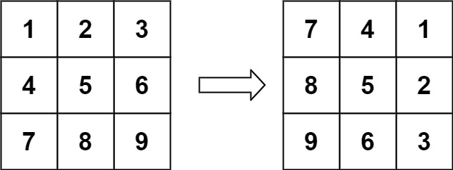

```text
输入：matrix = [[1,2,3],[4,5,6],[7,8,9]]
输出：[[7,4,1],[8,5,2],[9,6,3]]
```

**示例 2**

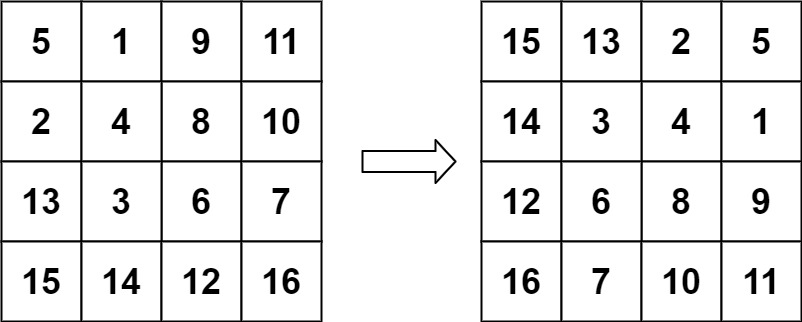

```text
输入：matrix = [[5,1,9,11],[2,4,8,10],[13,3,6,7],[15,14,12,16]]
输出：[[15,13,2,5],[14,3,4,1],[12,6,8,9],[16,7,10,11]]
```
> 题面与 [leetcode.cn 官方](https://leetcode.cn/problems/rotate-image/)一致，示例配图取自官方题面。

**数据范围与注意事项**：

- `n == matrix.length == matrix[i].length`
- `1 <= n <= 20`
- `-1000 <= matrix[i][j] <= 1000`
- **易错点**：行列别写反；旋转类问题先在纸上走一遍下标变换。

## 题目分析

**场景是什么**：二维网格同时考验下标变换与边界控制，对应真实开发里的棋盘、图像像素处理。本题就是该场景的 Medium 级练习，主线做法是「双重循环枚举」。

**主线怎么解**：把主解法从头到尾过一遍，它其实在依次做这几件事：双重循环遍历。

## 解题思路

**方案对比**（共 3 个方案，由浅入深）：

| 方案 | 时间复杂度 | 空间复杂度 |
|---|---|---|
| 方案 1 · 双重循环枚举 | O(n²)（两层嵌套扫描） | O(1) 到 O(n) |
| 方案 2 · 双重循环枚举 | O(n²)（两层嵌套扫描） | O(1) 到 O(n) |
| 方案 3 · 双重循环枚举 | O(n²)（两层嵌套扫描） | O(1) 到 O(n) |

**方案间的取舍**：方案 1（双重循环枚举）；方案 2（双重循环枚举）；方案 3（双重循环枚举）。数据规模小、可读性优先时选靠前的方案；规模大、性能优先时选靠后的方案。

**怎么读这一篇**：

- 🐣 **新手路线**：把「题目描述」的示例 1 在纸上手推一遍 → 读方案 1（最直观的写法）与它的代码走读 → 按「运行方式」本地跑通看 PASS → 回头对比方案 2 之后的写法差在哪
- 🦅 **大佬路线**：直接锁定最优方案 1（双重循环枚举，O(n²)（两层嵌套扫描））→ 跳读该方案代码与走读 → 用「逐步拆解与面试追问」补齐复杂度推导与边界追问

### 动态算法图（广度优先波纹，GIF 自动循环）


动画演示矩阵专题里广度优先波纹的典型过程；每个方案在「TypeScript 解题方案」一节还配了专属动画与专属流程图。

### 主解法流程图（真实控制流）

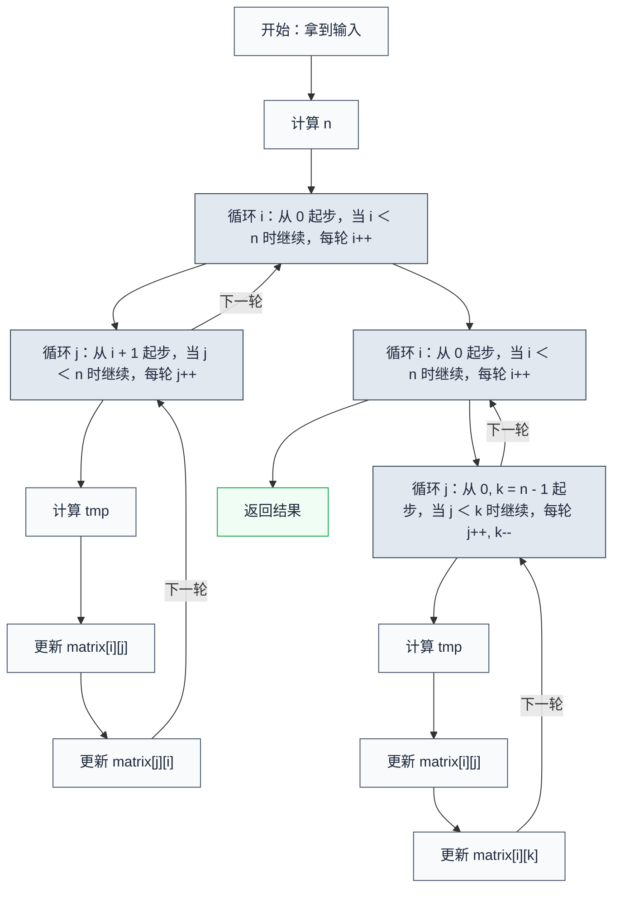

## TypeScript 解题方案（3 个方案逐个讲）

> **运行与提交**：每个方案都是自包含文件（内嵌用例自测，输出 PASS），整块复制到 `.ts` 文件后 `node 文件名` 即可运行。提交 LeetCode 时，把 `demo` 内的算法函数与辅助类型/函数整体取出、置于文件顶层即可。涉及交互/特殊接口的题以题面给定签名为准。

### 方案 1：双重循环枚举

**分析与思路**：核心做法是「双重循环枚举」。代码里依次做这些事：双重循环遍历。

**运行方式**：`node 本文件`，内嵌用例全部通过会输出 PASS。


**方案专属流程图**（真实控制流）：

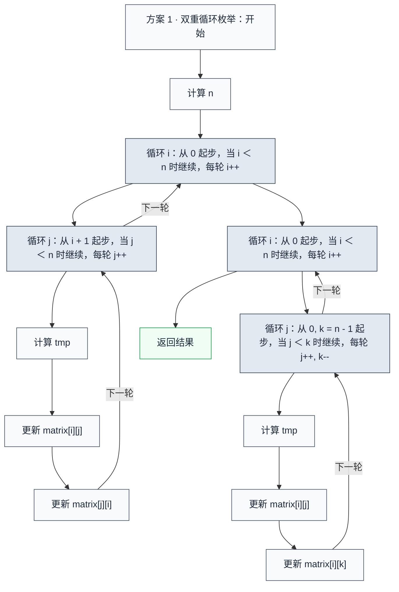

```typescript
/**
 ** LeetCode 48. 旋转矩阵
 ** 方案：方案1
 ** 来源：https://blog.csdn.net/tyro_java/article/details/134032039
 */

function rotate(matrix: number[][]): void {
  // 定义函数/方法 rotate
  const n = matrix.length; // 把 矩阵.长度 存入 元素个数
  for (let i = 0; i < n; i++) {
    // 让 下标 i 从 0 开始计数，下标 i 小于 元素个数 就继续
    for (let j = i + 1; j < n; j++) {
      // 让 下标 j 从 下标 i 加 1 开始计数，下标 j 小于 元素个数 就继续
      const tmp = matrix[i][j]; // 把 矩阵[下标 i][下标 j] 存入 临时变量
      matrix[i][j] = matrix[j][i]; // 把 矩阵[下标 j][下标 i]; 写入 matrix[i][j]
      matrix[j][i] = tmp; // 把 临时变量; 写入 matrix[j][i]
    }
  }
  for (let i = 0; i < n; i++) {
    // 让 下标 i 从 0 开始计数，下标 i 小于 元素个数 就继续
    for (let j = 0, k = n - 1; j < k; j++, k--) {
      // 让 下标 j 从 0, 下标 k 赋值为 元素个数 减 1 开始计数，下标 j 小于 下标 k 就继续
      const tmp = matrix[i][j]; // 把 矩阵[下标 i][下标 j] 存入 临时变量
      matrix[i][j] = matrix[i][k]; // 把 矩阵[下标 i][下标 k]; 写入 matrix[i][j]
      matrix[i][k] = tmp; // 把 临时变量; 写入 matrix[i][k]
    }
  }
}

function eqMatrix(a: number[][], b: number[][]): boolean {
  // 定义函数/方法 eqMatrix
  if (a.length !== b.length) return false; // 若 数组.长度 不等于 b.长度，直接返回 false
  for (let i = 0; i < a.length; i++) {
    // 让 下标 i 从 0 开始计数，下标 i 小于 数组.长度 就继续
    if (a[i].length !== b[i].length) return false; // 若 数组[下标 i].长度 不等于 b[下标 i].长度，直接返回 false
    for (let j = 0; j < a[i].length; j++) {
      // 让 下标 j 从 0 开始计数，下标 j 小于 数组[下标 i].长度 就继续
      if (a[i][j] !== b[i][j]) return false; // 若 数组[下标 i][下标 j] 不等于 b[下标 i][下标 j]，直接返回 false
    }
  }
  return true; // 返回 true
}

export function demo(): void {
  // 程序入口：跑内嵌自测用例
  const cases: [number[][], number[][]][] = [
    [
      [
        [1, 2, 3],
        [4, 5, 6],
        [7, 8, 9],
      ],
      [
        [7, 4, 1],
        [8, 5, 2],
        [9, 6, 3],
      ],
    ],
    [
      [
        [5, 1, 9, 11],
        [2, 4, 8, 10],
        [13, 3, 6, 7],
        [15, 14, 12, 16],
      ],
      [
        [15, 13, 2, 5],
        [14, 3, 4, 1],
        [12, 6, 8, 9],
        [16, 7, 10, 11],
      ],
    ],
  ];
  for (const [input, expected] of cases) {
    // for (const [input, expected] of cases) {
    rotate(input); // rotate(input);
    if (!eqMatrix(input, expected)) {
      // 若 取反 eqMatrix(input, expected
      throw new Error(
        'FAIL: got ' +
          JSON.stringify(input) +
          ' expected ' +
          JSON.stringify(expected),
      );
    }
  }
  console.log('PASS'); // 全部用例通过，输出 PASS
}

demo(); // demo();
```

### 方案 2：双重循环枚举

**分析与思路**：核心做法是「双重循环枚举」。代码里依次做这些事：双重循环遍历。

**运行方式**：`node 本文件`，内嵌用例全部通过会输出 PASS。


**方案专属流程图**（真实控制流）：


```typescript
/**
 ** LeetCode 48. 旋转矩阵
 ** 方案：方案1
 ** 来源：https://blog.csdn.net/tyro_java/article/details/134032039
 */

function rotate(matrix: number[][]): void {
  // 定义函数/方法 rotate
  const n = matrix.length; // 把 矩阵.长度 存入 元素个数
  for (let i = 0; i < Math.floor(n / 2); i++) {
    // 让 下标 i 从 0 开始计数，下标 i 小于 向下取整(元素个数 除以 2) 就继续
    const tmp = matrix[i]; // 把 矩阵[下标 i] 存入 临时变量
    matrix[i] = matrix[n - 1 - i]; // 把 矩阵[元素个数 减 1 减 下标 i]; 写入 matrix[i]
    matrix[n - 1 - i] = tmp; // 把 临时变量; 写入 matrix[n - 1 - i]
  }
  for (let i = 0; i < n; i++) {
    // 让 下标 i 从 0 开始计数，下标 i 小于 元素个数 就继续
    for (let j = 0; j < i; j++) {
      // 让 下标 j 从 0 开始计数，下标 j 小于 下标 i 就继续
      const tmp = matrix[i][j]; // 把 矩阵[下标 i][下标 j] 存入 临时变量
      matrix[i][j] = matrix[j][i]; // 把 矩阵[下标 j][下标 i]; 写入 matrix[i][j]
      matrix[j][i] = tmp; // 把 临时变量; 写入 matrix[j][i]
    }
  }
}

function eqMatrix(a: number[][], b: number[][]): boolean {
  // 定义函数/方法 eqMatrix
  if (a.length !== b.length) return false; // 若 数组.长度 不等于 b.长度，直接返回 false
  for (let i = 0; i < a.length; i++) {
    // 让 下标 i 从 0 开始计数，下标 i 小于 数组.长度 就继续
    if (a[i].length !== b[i].length) return false; // 若 数组[下标 i].长度 不等于 b[下标 i].长度，直接返回 false
    for (let j = 0; j < a[i].length; j++) {
      // 让 下标 j 从 0 开始计数，下标 j 小于 数组[下标 i].长度 就继续
      if (a[i][j] !== b[i][j]) return false; // 若 数组[下标 i][下标 j] 不等于 b[下标 i][下标 j]，直接返回 false
    }
  }
  return true; // 返回 true
}

export function demo(): void {
  // 程序入口：跑内嵌自测用例
  const cases: [number[][], number[][]][] = [
    [
      [
        [1, 2, 3],
        [4, 5, 6],
        [7, 8, 9],
      ],
      [
        [7, 4, 1],
        [8, 5, 2],
        [9, 6, 3],
      ],
    ],
    [
      [
        [5, 1, 9, 11],
        [2, 4, 8, 10],
        [13, 3, 6, 7],
        [15, 14, 12, 16],
      ],
      [
        [15, 13, 2, 5],
        [14, 3, 4, 1],
        [12, 6, 8, 9],
        [16, 7, 10, 11],
      ],
    ],
  ];
  for (const [input, expected] of cases) {
    // for (const [input, expected] of cases) {
    rotate(input); // rotate(input);
    if (!eqMatrix(input, expected)) {
      // 若 取反 eqMatrix(input, expected
      throw new Error(
        'FAIL: got ' +
          JSON.stringify(input) +
          ' expected ' +
          JSON.stringify(expected),
      );
    }
  }
  console.log('PASS'); // 全部用例通过，输出 PASS
}

demo(); // demo();
```

### 方案 3：双重循环枚举

**分析与思路**：核心做法是「双重循环枚举」。代码里依次做这些事：双重循环遍历。

**运行方式**：`node 本文件`，内嵌用例全部通过会输出 PASS。


**方案专属流程图**（真实控制流）：

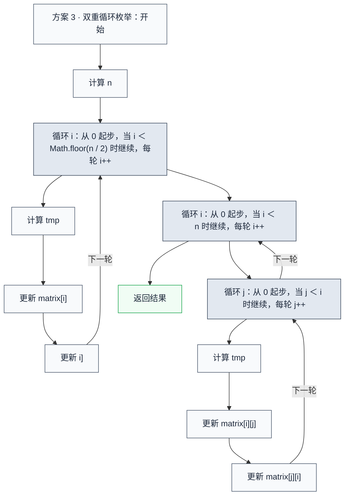

```typescript
/**
 ** LeetCode 48. 旋转矩阵
 ** 方案：方案1
 ** 来源：https://blog.csdn.net/tyro_java/article/details/134032039
 */

function rotate(matrix: number[][]): void {
  // 定义函数/方法 rotate
  const n = matrix.length; // 把 矩阵.长度 存入 元素个数
  for (let i = 0; i < Math.floor(n / 2); i++) {
    // 让 下标 i 从 0 开始计数，下标 i 小于 向下取整(元素个数 除以 2) 就继续
    const tmp = matrix[i]; // 把 矩阵[下标 i] 存入 临时变量
    matrix[i] = matrix[n - 1 - i]; // 把 矩阵[元素个数 减 1 减 下标 i]; 写入 matrix[i]
    matrix[n - 1 - i] = tmp; // 把 临时变量; 写入 matrix[n - 1 - i]
  }
  for (let i = 0; i < n; i++) {
    // 让 下标 i 从 0 开始计数，下标 i 小于 元素个数 就继续
    for (let j = 0; j < i; j++) {
      // 让 下标 j 从 0 开始计数，下标 j 小于 下标 i 就继续
      const tmp = matrix[i][j]; // 把 矩阵[下标 i][下标 j] 存入 临时变量
      matrix[i][j] = matrix[j][i]; // 把 矩阵[下标 j][下标 i]; 写入 matrix[i][j]
      matrix[j][i] = tmp; // 把 临时变量; 写入 matrix[j][i]
    }
  }
}

function eqMatrix(a: number[][], b: number[][]): boolean {
  // 定义函数/方法 eqMatrix
  if (a.length !== b.length) return false; // 若 数组.长度 不等于 b.长度，直接返回 false
  for (let i = 0; i < a.length; i++) {
    // 让 下标 i 从 0 开始计数，下标 i 小于 数组.长度 就继续
    if (a[i].length !== b[i].length) return false; // 若 数组[下标 i].长度 不等于 b[下标 i].长度，直接返回 false
    for (let j = 0; j < a[i].length; j++) {
      // 让 下标 j 从 0 开始计数，下标 j 小于 数组[下标 i].长度 就继续
      if (a[i][j] !== b[i][j]) return false; // 若 数组[下标 i][下标 j] 不等于 b[下标 i][下标 j]，直接返回 false
    }
  }
  return true; // 返回 true
}

export function demo(): void {
  // 程序入口：跑内嵌自测用例
  const cases: [number[][], number[][]][] = [
    [
      [
        [1, 2, 3],
        [4, 5, 6],
        [7, 8, 9],
      ],
      [
        [7, 4, 1],
        [8, 5, 2],
        [9, 6, 3],
      ],
    ],
    [
      [
        [5, 1, 9, 11],
        [2, 4, 8, 10],
        [13, 3, 6, 7],
        [15, 14, 12, 16],
      ],
      [
        [15, 13, 2, 5],
        [14, 3, 4, 1],
        [12, 6, 8, 9],
        [16, 7, 10, 11],
      ],
    ],
  ];
  for (const [input, expected] of cases) {
    // for (const [input, expected] of cases) {
    rotate(input); // rotate(input);
    if (!eqMatrix(input, expected)) {
      // 若 取反 eqMatrix(input, expected
      throw new Error(
        'FAIL: got ' +
          JSON.stringify(input) +
          ' expected ' +
          JSON.stringify(expected),
      );
    }
  }
  console.log('PASS'); // 全部用例通过，输出 PASS
}

demo(); // demo();
```

## 逐步拆解与面试追问

**复杂度**：时间 O(n²)（两层嵌套扫描），空间 O(1) 到 O(n)

**为什么是这个量级**：外层定起点、内层扫终点，n 个起点各扫 n 次

**面试官可能会追问**：

- 能否原地标记？
- 边界遍历的顺序怎么不出错？
- 旋转类问题能否一次循环完成？

## 关键 API 速查（TS 主解法实际用到，附官方链接）

| API | 作用 | 使用要点 | 官方文档 |
|---|---|---|---|
| `JSON.stringify()` | 序列化为 JSON 字符串 | 常用于结构化比较（深度相等判定）；undefined/函数/循环引用会被丢弃或抛错 | [官方文档](https://developer.mozilla.org/zh-CN/docs/Web/JavaScript/Reference/Global_Objects/JSON/stringify) |

### 各语言官方文档导航

- **TypeScript / JS**：[MDN 中文参考](https://developer.mozilla.org/zh-CN/)
- **Python**：[Python 官方文档](https://docs.python.org/zh-cn/3/)
- **Go**：[Go 标准库](https://pkg.go.dev/std)
- **Java**：[JDK 17 API](https://docs.oracle.com/en/java/javase/17/docs/api/)
- **Rust**：[Rust 标准库](https://doc.rust-lang.org/std/)
- **Lua**：[Lua 5.4 手册](https://www.lua.org/manual/5.4/)
- **C**：[Cppreference C](https://zh.cppreference.com/w/c)
- **C++**：[Cppreference C++](https://zh.cppreference.com/w/cpp)
- **R**：[R 官方手册](https://stat.ethz.ch/R-manual/)
- **Zig**：[Zig 语言文档](https://ziglang.org/documentation/master/)
- **Dart**：[Dart API](https://api.dart.dev/)

## 附录：其他 10 种语言全部实现（每种语言列举其全部方案）

> TypeScript 的全部方案见「TypeScript 解题方案」一节；下面是其余 10 种语言的对应实现，每种语言的每个方案都带思路分析、代码走读与专属运行架构图。
> 每个方案都内嵌用例自测，可独立运行（老仓库 python/go 文件遵循「打印结果」约定）。
> 完整解法文件见 `dsa/<语言>/matrix/lc_48_旋转矩阵/`。

### Python 实现（3 种方案）

Python 的全部方案如下，每个方案都内嵌用例自测，可独立运行（老仓库 python/go 文件遵循「打印结果」约定）：

#### 方案 1：双重循环枚举

**思路与代码分析**：核心是「双重循环枚举」。Python 版用切片与字典推导式简化操作，突出可读性。**走读**：方案 1 · 双重循环枚举：开始 → 更新 n → 循环 i：从 0 到 n 前 → 循环 j：从 i + 1 到 n 前 → 更新 matrix[j][i] → 循环 i：从 0 到 n 前 → 处理 matrix[i].reverse() → 返回结果。

**运行架构**（真实控制流）：

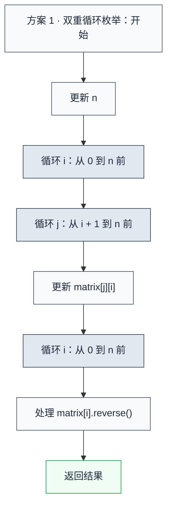

```python
import sys  # 提高递归深度上限（深输入防 RecursionError）

sys.setrecursionlimit(200000)  # 树/链表类题目节点数可达 1e4 量级

def rotate(matrix):  # 定义函数 rotate（参数：矩阵）
    n = len(matrix)  # 把 长度(矩阵) 存入 元素个数
    for i in range(n):  # 让 下标 i 从 元素个数 遍历
        for j in range(i + 1, n):  # 让 下标 j 从 下标 i 加 1 到 元素个数 遍历
            matrix[i][j], matrix[j][i] = matrix[j][i], matrix[i][j]
    for i in range(n):  # 让 下标 i 从 元素个数 遍历
        matrix[i].reverse()  # 反转

if __name__ == "__main__":  # 若 __name__ 等于 '__main__'
    matrix = [[1, 2, 3], [4, 5, 6], [7, 8, 9]]  # 把 [[1, 2, 3], [4, 5, 6], [7, 8, 9]] 存入 矩阵
    rotate(matrix)  # rotate(矩阵)
    print(matrix)  # [[7, 4, 1], [8, 5, 2], [9, 6, 3]]
```

#### 方案 2：双重循环枚举

**思路与代码分析**：核心是「双重循环枚举」。Python 版用切片与字典推导式简化操作，突出可读性。**走读**：方案 2 · 双重循环枚举：开始 → 更新 n → 循环 i：从 0 到 n // 2 前 → 循环 j：从 0 到 n 前 → 更新 1][j] → 循环 i：从 0 到 n 前 → 循环 j：从 0 到 i 前 → 更新 matrix[j][i] → 返回结果。

**运行架构**（真实控制流）：

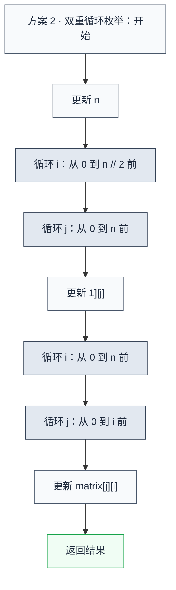

```python
import sys  # 提高递归深度上限（深输入防 RecursionError）

sys.setrecursionlimit(200000)  # 树/链表类题目节点数可达 1e4 量级

def rotate(matrix):  # 定义函数 rotate（参数：矩阵）
    n = len(matrix)  # 把 长度(矩阵) 存入 元素个数
    for i in range(n // 2):  # 让 下标 i 从 元素个数 除以 除以 2 遍历
        for j in range(n):  # 让 下标 j 从 元素个数 遍历
            matrix[i][j], matrix[n - i - 1][j] = matrix[n - i - 1][j], matrix[i][j]
    for i in range(n):  # 让 下标 i 从 元素个数 遍历
        for j in range(i):  # 让 下标 j 从 下标 i 遍历
            matrix[i][j], matrix[j][i] = matrix[j][i], matrix[i][j]

if __name__ == "__main__":  # 若 __name__ 等于 '__main__'
    matrix = [[1, 2, 3], [4, 5, 6], [7, 8, 9]]  # 把 [[1, 2, 3], [4, 5, 6], [7, 8, 9]] 存入 矩阵
    rotate(matrix)  # rotate(矩阵)
    print(matrix)  # 打印输出
```

#### 方案 3：双重循环枚举

**思路与代码分析**：核心是「双重循环枚举」。Python 版用切片与字典推导式简化操作，突出可读性。**走读**：方案 3 · 双重循环枚举：开始 → 更新 n → 循环 i：从 0 到 n // 2 前 → 循环 j：从 0 到 n 前 → 更新 1][j] → 循环 i：从 0 到 n 前 → 循环 j：从 0 到 i 前 → 更新 matrix[j][i] → 返回结果。

**运行架构**（真实控制流）：


```python
import sys  # 提高递归深度上限（深输入防 RecursionError）

sys.setrecursionlimit(200000)  # 树/链表类题目节点数可达 1e4 量级

def rotate(matrix):  # 定义函数 rotate（参数：矩阵）
    n = len(matrix)  # 把 长度(矩阵) 存入 元素个数
    for i in range(n // 2):  # 让 下标 i 从 元素个数 除以 除以 2 遍历
        for j in range(n):  # 让 下标 j 从 元素个数 遍历
            matrix[i][j], matrix[n - i - 1][j] = matrix[n - i - 1][j], matrix[i][j]
    for i in range(n):  # 让 下标 i 从 元素个数 遍历
        for j in range(i):  # 让 下标 j 从 下标 i 遍历
            matrix[i][j], matrix[j][i] = matrix[j][i], matrix[i][j]

if __name__ == "__main__":  # 若 __name__ 等于 '__main__'
    matrix = [[1, 2, 3], [4, 5, 6], [7, 8, 9]]  # 把 [[1, 2, 3], [4, 5, 6], [7, 8, 9]] 存入 矩阵
    rotate(matrix)  # rotate(矩阵)
    print(matrix)  # 打印输出
```

### Go 实现（3 种方案）

Go 的全部方案如下，每个方案都内嵌用例自测，可独立运行（老仓库 python/go 文件遵循「打印结果」约定）：

#### 方案 1：双重循环枚举

**思路与代码分析**：核心是「双重循环枚举」。Go 版用切片与多返回值惯用法，显式处理索引边界。**走读**：方案 1 · 双重循环枚举：开始 → 更新 : → 遍历循环 → 遍历循环 → 更新 matrix[j][i] → 遍历循环 → 遍历循环 → 更新 matrix[i][k] → 返回结果。

**运行架构**（真实控制流）：

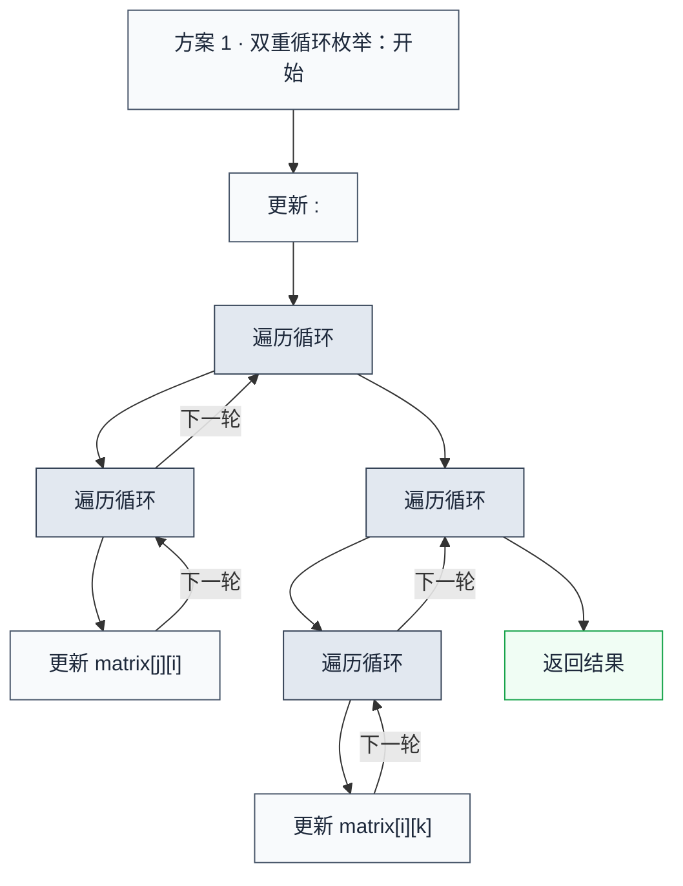

```go
package main // 引入依赖

import (
	"fmt" // 「fmt」
	"os"  // 「os」
)

func eqMatrix(a, b [][]int) bool { // 定义函数/方法 eqMatrix
	if len(a) != len(b) {
		return false
	} // 若 长度(数组) 不等于 长度(b) { return false }
	for i := range a { // 把 range 数组 { 写入 for i :
		if len(a[i]) != len(b[i]) {
			return false
		} // 若 长度(数组[下标 i]) 不等于 长度(b[下标 i]) { return false }
		for j := range a[i] { // 把 range 数组[下标 i] { 写入 for j :
			if a[i][j] != b[i][j] {
				return false
			} // 若 数组[下标 i][下标 j] 不等于 b[下标 i][下标 j] { return false }
		}
	}
	return true // 返回 true
}

func rotate(matrix [][]int) { // 定义函数/方法 rotate
	n := len(matrix)         // 把 长度(矩阵) 写入 n :
	for i := 0; i < n; i++ { // 让 下标 i 从 0 开始计数
		for j := i + 1; j < n; j++ { // 把 下标 i 加 1; 下标 j 小于 元素个数; 下标 j 加一 { 写入 for j :
			matrix[i][j], matrix[j][i] = matrix[j][i], matrix[i][j]
		}
	}
	for i := 0; i < n; i++ { // 让 下标 i 从 0 开始计数
		for j, k := 0, n-1; j < k; j, k = j+1, k-1 {
			matrix[i][j], matrix[i][k] = matrix[i][k], matrix[i][j]
		}
	}
}

func main() { // 程序入口：跑内嵌自测用例
	cases := [][2][][]int{ // 把 [][2][][]int{ 写入 cases :
		{{{1, 2, 3}, {4, 5, 6}, {7, 8, 9}}, {{7, 4, 1}, {8, 5, 2}, {9, 6, 3}}},
		{{{5, 1, 9, 11}, {2, 4, 8, 10}, {13, 3, 6, 7}, {15, 14, 12, 16}}, {{15, 13, 2, 5}, {14, 3, 4, 1}, {12, 6, 8, 9}, {16, 7, 10, 11}}},
	}
	for _, c := range cases { // 同时取 _ 与 字符 遍历
		input := c[0]                   // 把 字符[0] 写入 input :
		expected := c[1]                // 把 字符[1] 写入 expected :
		rotate(input)                   // rotate(input)
		if !eqMatrix(input, expected) { // 若 取反 eqMatrix(input, expected
			fmt.Printf("FAIL: got %v expected %v\n", input, expected) // 打印输出
			os.Exit(1)                                                // os.Exit(1)
		}
	}
	fmt.Println("PASS") // 全部用例通过，输出 PASS
}
```

#### 方案 2：双重循环枚举

**思路与代码分析**：核心是「双重循环枚举」。Go 版用切片与多返回值惯用法，显式处理索引边界。**走读**：方案 2 · 双重循环枚举：开始 → 更新 : → 遍历循环 → 更新 matrix[n-1-i] → 遍历循环 → 遍历循环 → 更新 matrix[j][i] → 返回结果。

**运行架构**（真实控制流）：


```go
package main // 引入依赖

import (
	"fmt" // 「fmt」
	"os"  // 「os」
)

func eqMatrix(a, b [][]int) bool { // 定义函数/方法 eqMatrix
	if len(a) != len(b) {
		return false
	} // 若 长度(数组) 不等于 长度(b) { return false }
	for i := range a { // 把 range 数组 { 写入 for i :
		if len(a[i]) != len(b[i]) {
			return false
		} // 若 长度(数组[下标 i]) 不等于 长度(b[下标 i]) { return false }
		for j := range a[i] { // 把 range 数组[下标 i] { 写入 for j :
			if a[i][j] != b[i][j] {
				return false
			} // 若 数组[下标 i][下标 j] 不等于 b[下标 i][下标 j] { return false }
		}
	}
	return true // 返回 true
}

func rotate(matrix [][]int) { // 定义函数/方法 rotate
	n := len(matrix)           // 把 长度(矩阵) 写入 n :
	for i := 0; i < n/2; i++ { // 让 下标 i 从 0 开始计数
		matrix[i], matrix[n-1-i] = matrix[n-1-i], matrix[i] // 把 矩阵[元素个数 减 1 减 下标 i], 矩阵[下标 i] 写入 matrix[i], matrix[n-1-i]
	}
	for i := 0; i < n; i++ { // 让 下标 i 从 0 开始计数
		for j := 0; j < i; j++ { // 让 下标 j 从 0 开始计数
			matrix[i][j], matrix[j][i] = matrix[j][i], matrix[i][j]
		}
	}
}

func main() { // 程序入口：跑内嵌自测用例
	cases := [][2][][]int{ // 把 [][2][][]int{ 写入 cases :
		{{{1, 2, 3}, {4, 5, 6}, {7, 8, 9}}, {{7, 4, 1}, {8, 5, 2}, {9, 6, 3}}},
		{{{5, 1, 9, 11}, {2, 4, 8, 10}, {13, 3, 6, 7}, {15, 14, 12, 16}}, {{15, 13, 2, 5}, {14, 3, 4, 1}, {12, 6, 8, 9}, {16, 7, 10, 11}}},
	}
	for _, c := range cases { // 同时取 _ 与 字符 遍历
		input := c[0]                   // 把 字符[0] 写入 input :
		expected := c[1]                // 把 字符[1] 写入 expected :
		rotate(input)                   // rotate(input)
		if !eqMatrix(input, expected) { // 若 取反 eqMatrix(input, expected
			fmt.Printf("FAIL: got %v expected %v\n", input, expected) // 打印输出
			os.Exit(1)                                                // os.Exit(1)
		}
	}
	fmt.Println("PASS") // 全部用例通过，输出 PASS
}
```

#### 方案 3：双重循环枚举

**思路与代码分析**：核心是「双重循环枚举」。Go 版用切片与多返回值惯用法，显式处理索引边界。**走读**：方案 3 · 双重循环枚举：开始 → 更新 : → 遍历循环 → 更新 matrix[n-1-i] → 遍历循环 → 遍历循环 → 更新 matrix[j][i] → 返回结果。

**运行架构**（真实控制流）：

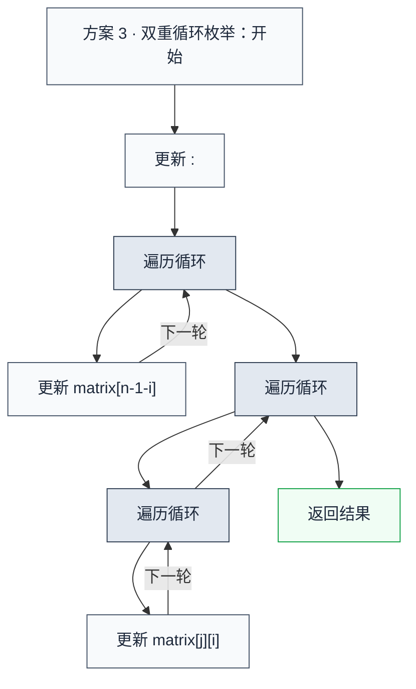

```go
package main // 引入依赖

import (
	"fmt" // 「fmt」
	"os"  // 「os」
)

func eqMatrix(a, b [][]int) bool { // 定义函数/方法 eqMatrix
	if len(a) != len(b) {
		return false
	} // 若 长度(数组) 不等于 长度(b) { return false }
	for i := range a { // 把 range 数组 { 写入 for i :
		if len(a[i]) != len(b[i]) {
			return false
		} // 若 长度(数组[下标 i]) 不等于 长度(b[下标 i]) { return false }
		for j := range a[i] { // 把 range 数组[下标 i] { 写入 for j :
			if a[i][j] != b[i][j] {
				return false
			} // 若 数组[下标 i][下标 j] 不等于 b[下标 i][下标 j] { return false }
		}
	}
	return true // 返回 true
}

func rotate(matrix [][]int) { // 定义函数/方法 rotate
	n := len(matrix)           // 把 长度(矩阵) 写入 n :
	for i := 0; i < n/2; i++ { // 让 下标 i 从 0 开始计数
		matrix[i], matrix[n-1-i] = matrix[n-1-i], matrix[i] // 把 矩阵[元素个数 减 1 减 下标 i], 矩阵[下标 i] 写入 matrix[i], matrix[n-1-i]
	}
	for i := 0; i < n; i++ { // 让 下标 i 从 0 开始计数
		for j := 0; j < i; j++ { // 让 下标 j 从 0 开始计数
			matrix[i][j], matrix[j][i] = matrix[j][i], matrix[i][j]
		}
	}
}

func main() { // 程序入口：跑内嵌自测用例
	cases := [][2][][]int{ // 把 [][2][][]int{ 写入 cases :
		{{{1, 2, 3}, {4, 5, 6}, {7, 8, 9}}, {{7, 4, 1}, {8, 5, 2}, {9, 6, 3}}},
		{{{5, 1, 9, 11}, {2, 4, 8, 10}, {13, 3, 6, 7}, {15, 14, 12, 16}}, {{15, 13, 2, 5}, {14, 3, 4, 1}, {12, 6, 8, 9}, {16, 7, 10, 11}}},
	}
	for _, c := range cases { // 同时取 _ 与 字符 遍历
		input := c[0]                   // 把 字符[0] 写入 input :
		expected := c[1]                // 把 字符[1] 写入 expected :
		rotate(input)                   // rotate(input)
		if !eqMatrix(input, expected) { // 若 取反 eqMatrix(input, expected
			fmt.Printf("FAIL: got %v expected %v\n", input, expected) // 打印输出
			os.Exit(1)                                                // os.Exit(1)
		}
	}
	fmt.Println("PASS") // 全部用例通过，输出 PASS
}
```

### Java 实现（3 种方案）

Java 的全部方案如下，每个方案都内嵌用例自测，可独立运行（老仓库 python/go 文件遵循「打印结果」约定）：

#### 方案 1：双重循环枚举

**思路与代码分析**：核心是「双重循环枚举」。Java 版用类与静态方法组织，集合操作显式明了。代码里依次做这些事：双重循环遍历。**走读**：方案 1 · 双重循环枚举：开始 → 更新 n → 遍历循环 → 遍历循环 → 更新 tmp → 更新 matrix[i][j] → 更新 matrix[j][i] → 遍历循环 → 遍历循环 → 处理 j ＜ k → 处理 j++, k--) → 更新 tmp → 更新 matrix[i][j] → 更新 matrix[i][k] → 返回结果。

**运行架构**（真实控制流）：

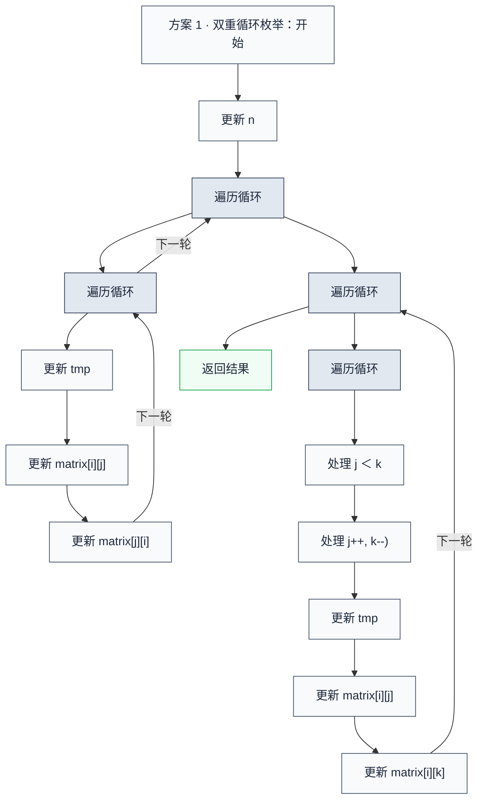

```java
package com.webfault.dsa; // 引入依赖

import java.util.*; // 引入依赖

class Solution { // 定义类型

  static void rotate(int[][] matrix) { // 定义函数/方法 rotate
    int n = matrix.length; // 把 矩阵.长度 存入 元素个数
    for (int i = 0; i < n; i++) { // 让 下标 i 从 0 开始计数，下标 i 小于 元素个数 就继续
      for (int j = i + 1; j < n; j++) { // 让 下标 j 从 下标 i 加 1 开始计数，下标 j 小于 元素个数 就继续
        int tmp = matrix[i][j]; // 把 矩阵[下标 i][下标 j] 存入 临时变量
        matrix[i][j] = matrix[j][i]; // 把 矩阵[下标 j][下标 i]; 写入 matrix[i][j]
        matrix[j][i] = tmp; // 把 临时变量; 写入 matrix[j][i]
      }
    }
    for (int i = 0; i < n; i++) { // 让 下标 i 从 0 开始计数，下标 i 小于 元素个数 就继续
      for (int j = 0, k = n - 1;
          j < k;
          j++, k--) { // 让 下标 j 从 0, 下标 k 赋值为 元素个数 减 1 开始计数，下标 j 小于 下标 k 就继续
        int tmp = matrix[i][j]; // 把 矩阵[下标 i][下标 j] 存入 临时变量
        matrix[i][j] = matrix[i][k]; // 把 矩阵[下标 i][下标 k]; 写入 matrix[i][j]
        matrix[i][k] = tmp; // 把 临时变量; 写入 matrix[i][k]
      }
    }
  }

  static boolean eqMatrix(int[][] a, int[][] b) { // 定义函数/方法 eqMatrix
    if (a.length != b.length) return false; // 若 数组.长度 不等于 b.长度，直接返回 false
    for (int i = 0; i < a.length; i++) { // 让 下标 i 从 0 开始计数，下标 i 小于 数组.长度 就继续
      if (a[i].length != b[i].length) return false; // 若 数组[下标 i].长度 不等于 b[下标 i].长度，直接返回 false
      for (int j = 0; j < a[i].length; j++) { // 让 下标 j 从 0 开始计数，下标 j 小于 数组[下标 i].长度 就继续
        if (a[i][j] != b[i][j]) return false; // 若 数组[下标 i][下标 j] 不等于 b[下标 i][下标 j]，直接返回 false
      }
    }
    return true; // 返回 true
  }

  public static void main(String[] args) { // public static void main(String[] args) {
    int[][][] inputs = { // 把 { 写入 int[][][] inputs
      {{1, 2, 3}, {4, 5, 6}, {7, 8, 9}},
      {{5, 1, 9, 11}, {2, 4, 8, 10}, {13, 3, 6, 7}, {15, 14, 12, 16}},
    };
    int[][][] expecteds = { // 把 { 写入 int[][][] expecteds
      {{7, 4, 1}, {8, 5, 2}, {9, 6, 3}},
      {{15, 13, 2, 5}, {14, 3, 4, 1}, {12, 6, 8, 9}, {16, 7, 10, 11}},
    };
    for (int k = 0; k < inputs.length; k++) { // 让 下标 k 从 0 开始计数，下标 k 小于 inputs.长度 就继续
      int[][] input = inputs[k]; // 把 inputs[下标 k]; 写入 int[][] input
      int[][] expected = expecteds[k]; // 把 expecteds[下标 k]; 写入 int[][] expected
      rotate(input); // rotate(input);
      if (!eqMatrix(input, expected)) { // 若 取反 eqMatrix(input, expected
        System.out.println("FAIL at case " + k); // 打印输出
        throw new RuntimeException(
            "self-check failed"); // throw new RuntimeException(「self 减 check failed」);
      }
    }
    System.out.println("PASS"); // 全部用例通过，输出 PASS
  }
}
```

#### 方案 2：双重循环枚举

**思路与代码分析**：核心是「双重循环枚举」。Java 版用类与静态方法组织，集合操作显式明了。代码里依次做这些事：双重循环遍历。**走读**：方案 2 · 双重循环枚举：开始 → 更新 n → 遍历循环 → 更新 tmp → 更新 matrix[i] → 更新 i] → 遍历循环 → 遍历循环 → 更新 tmp → 更新 matrix[i][j] → 更新 matrix[j][i] → 返回结果。

**运行架构**（真实控制流）：

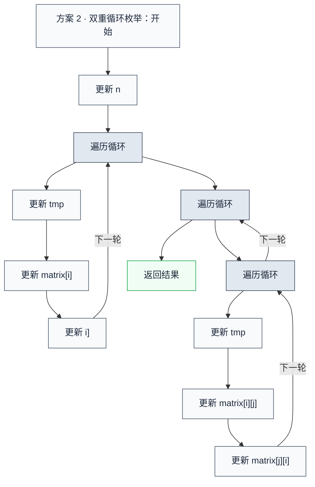

```java
package com.webfault.dsa; // 引入依赖

import java.util.*; // 引入依赖

class Solution { // 定义类型

  static void rotate(int[][] matrix) { // 定义函数/方法 rotate
    int n = matrix.length; // 把 矩阵.长度 存入 元素个数
    for (int i = 0; i < n / 2; i++) { // 让 下标 i 从 0 开始计数，下标 i 小于 元素个数 除以 2 就继续
      int[] tmp = matrix[i]; // 把 矩阵[下标 i]; 写入 int[] tmp
      matrix[i] = matrix[n - 1 - i]; // 把 矩阵[元素个数 减 1 减 下标 i]; 写入 matrix[i]
      matrix[n - 1 - i] = tmp; // 把 临时变量; 写入 matrix[n - 1 - i]
    }
    for (int i = 0; i < n; i++) { // 让 下标 i 从 0 开始计数，下标 i 小于 元素个数 就继续
      for (int j = 0; j < i; j++) { // 让 下标 j 从 0 开始计数，下标 j 小于 下标 i 就继续
        int tmp = matrix[i][j]; // 把 矩阵[下标 i][下标 j] 存入 临时变量
        matrix[i][j] = matrix[j][i]; // 把 矩阵[下标 j][下标 i]; 写入 matrix[i][j]
        matrix[j][i] = tmp; // 把 临时变量; 写入 matrix[j][i]
      }
    }
  }

  static boolean eqMatrix(int[][] a, int[][] b) { // 定义函数/方法 eqMatrix
    if (a.length != b.length) return false; // 若 数组.长度 不等于 b.长度，直接返回 false
    for (int i = 0; i < a.length; i++) { // 让 下标 i 从 0 开始计数，下标 i 小于 数组.长度 就继续
      if (a[i].length != b[i].length) return false; // 若 数组[下标 i].长度 不等于 b[下标 i].长度，直接返回 false
      for (int j = 0; j < a[i].length; j++) { // 让 下标 j 从 0 开始计数，下标 j 小于 数组[下标 i].长度 就继续
        if (a[i][j] != b[i][j]) return false; // 若 数组[下标 i][下标 j] 不等于 b[下标 i][下标 j]，直接返回 false
      }
    }
    return true; // 返回 true
  }

  public static void main(String[] args) { // public static void main(String[] args) {
    int[][][] inputs = { // 把 { 写入 int[][][] inputs
      {{1, 2, 3}, {4, 5, 6}, {7, 8, 9}},
      {{5, 1, 9, 11}, {2, 4, 8, 10}, {13, 3, 6, 7}, {15, 14, 12, 16}},
    };
    int[][][] expecteds = { // 把 { 写入 int[][][] expecteds
      {{7, 4, 1}, {8, 5, 2}, {9, 6, 3}},
      {{15, 13, 2, 5}, {14, 3, 4, 1}, {12, 6, 8, 9}, {16, 7, 10, 11}},
    };
    for (int k = 0; k < inputs.length; k++) { // 让 下标 k 从 0 开始计数，下标 k 小于 inputs.长度 就继续
      int[][] input = inputs[k]; // 把 inputs[下标 k]; 写入 int[][] input
      int[][] expected = expecteds[k]; // 把 expecteds[下标 k]; 写入 int[][] expected
      rotate(input); // rotate(input);
      if (!eqMatrix(input, expected)) { // 若 取反 eqMatrix(input, expected
        System.out.println("FAIL at case " + k); // 打印输出
        throw new RuntimeException(
            "self-check failed"); // throw new RuntimeException(「self 减 check failed」);
      }
    }
    System.out.println("PASS"); // 全部用例通过，输出 PASS
  }
}
```

#### 方案 3：双重循环枚举

**思路与代码分析**：核心是「双重循环枚举」。Java 版用类与静态方法组织，集合操作显式明了。代码里依次做这些事：双重循环遍历。**走读**：方案 3 · 双重循环枚举：开始 → 更新 n → 遍历循环 → 更新 tmp → 更新 matrix[i] → 更新 i] → 遍历循环 → 遍历循环 → 更新 tmp → 更新 matrix[i][j] → 更新 matrix[j][i] → 返回结果。

**运行架构**（真实控制流）：


```java
package com.webfault.dsa; // 引入依赖

import java.util.*; // 引入依赖

class Solution { // 定义类型

  static void rotate(int[][] matrix) { // 定义函数/方法 rotate
    int n = matrix.length; // 把 矩阵.长度 存入 元素个数
    for (int i = 0; i < n / 2; i++) { // 让 下标 i 从 0 开始计数，下标 i 小于 元素个数 除以 2 就继续
      int[] tmp = matrix[i]; // 把 矩阵[下标 i]; 写入 int[] tmp
      matrix[i] = matrix[n - 1 - i]; // 把 矩阵[元素个数 减 1 减 下标 i]; 写入 matrix[i]
      matrix[n - 1 - i] = tmp; // 把 临时变量; 写入 matrix[n - 1 - i]
    }
    for (int i = 0; i < n; i++) { // 让 下标 i 从 0 开始计数，下标 i 小于 元素个数 就继续
      for (int j = 0; j < i; j++) { // 让 下标 j 从 0 开始计数，下标 j 小于 下标 i 就继续
        int tmp = matrix[i][j]; // 把 矩阵[下标 i][下标 j] 存入 临时变量
        matrix[i][j] = matrix[j][i]; // 把 矩阵[下标 j][下标 i]; 写入 matrix[i][j]
        matrix[j][i] = tmp; // 把 临时变量; 写入 matrix[j][i]
      }
    }
  }

  static boolean eqMatrix(int[][] a, int[][] b) { // 定义函数/方法 eqMatrix
    if (a.length != b.length) return false; // 若 数组.长度 不等于 b.长度，直接返回 false
    for (int i = 0; i < a.length; i++) { // 让 下标 i 从 0 开始计数，下标 i 小于 数组.长度 就继续
      if (a[i].length != b[i].length) return false; // 若 数组[下标 i].长度 不等于 b[下标 i].长度，直接返回 false
      for (int j = 0; j < a[i].length; j++) { // 让 下标 j 从 0 开始计数，下标 j 小于 数组[下标 i].长度 就继续
        if (a[i][j] != b[i][j]) return false; // 若 数组[下标 i][下标 j] 不等于 b[下标 i][下标 j]，直接返回 false
      }
    }
    return true; // 返回 true
  }

  public static void main(String[] args) { // public static void main(String[] args) {
    int[][][] inputs = { // 把 { 写入 int[][][] inputs
      {{1, 2, 3}, {4, 5, 6}, {7, 8, 9}},
      {{5, 1, 9, 11}, {2, 4, 8, 10}, {13, 3, 6, 7}, {15, 14, 12, 16}},
    };
    int[][][] expecteds = { // 把 { 写入 int[][][] expecteds
      {{7, 4, 1}, {8, 5, 2}, {9, 6, 3}},
      {{15, 13, 2, 5}, {14, 3, 4, 1}, {12, 6, 8, 9}, {16, 7, 10, 11}},
    };
    for (int k = 0; k < inputs.length; k++) { // 让 下标 k 从 0 开始计数，下标 k 小于 inputs.长度 就继续
      int[][] input = inputs[k]; // 把 inputs[下标 k]; 写入 int[][] input
      int[][] expected = expecteds[k]; // 把 expecteds[下标 k]; 写入 int[][] expected
      rotate(input); // rotate(input);
      if (!eqMatrix(input, expected)) { // 若 取反 eqMatrix(input, expected
        System.out.println("FAIL at case " + k); // 打印输出
        throw new RuntimeException(
            "self-check failed"); // throw new RuntimeException(「self 减 check failed」);
      }
    }
    System.out.println("PASS"); // 全部用例通过，输出 PASS
  }
}
```

### Rust 实现（3 种方案）

Rust 的全部方案如下，每个方案都内嵌用例自测，可独立运行（老仓库 python/go 文件遵循「打印结果」约定）：

#### 方案 1：双重循环枚举

**思路与代码分析**：核心是「双重循环枚举」。Rust 版用所有权移动与切片借用改写同一逻辑，注意 Option 与引用边界。**走读**：方案 1 · 双重循环枚举：开始 → 计算 n → 遍历 0..n 中的每个元素 i → 遍历 (i + 1)..n 中的每个元素 j → 遍历 0..n 中的每个元素 i → 当 j ＜ k 时反复执行 → 返回结果。

**运行架构**（真实控制流）：

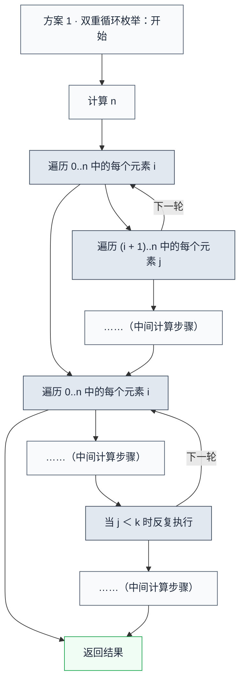

```rust
// LeetCode 48. 旋转矩阵 — Rust 版

// 方案1：先沿主对角线转置，再逐行左右翻转
fn rotate(matrix: &mut Vec<Vec<i32>>) {
    // 定义函数/方法 rotate
    let n = matrix.len(); // 把 矩阵.长度() 存入 元素个数
    for i in 0..n {
        // 逐个取出 0 的元素（下标 i）
        for j in (i + 1)..n {
            // for 下标 j in (下标 i 加 1)..元素个数 {
            let tmp = matrix[i][j]; // 把 矩阵[下标 i][下标 j] 存入 临时变量
            matrix[i][j] = matrix[j][i]; // 把 矩阵[下标 j][下标 i]; 写入 matrix[i][j]
            matrix[j][i] = tmp; // 把 临时变量; 写入 matrix[j][i]
        }
    }
    for i in 0..n {
        // 逐个取出 0 的元素（下标 i）
        let mut j = 0; // 把 0; 写入 let mut j
        let mut k = n - 1; // 把 元素个数 减 1; 写入 let mut k
        while j < k {
            // while 下标 j 小于 下标 k {
            let tmp = matrix[i][j]; // 把 矩阵[下标 i][下标 j] 存入 临时变量
            matrix[i][j] = matrix[i][k]; // 把 矩阵[下标 i][下标 k]; 写入 matrix[i][j]
            matrix[i][k] = tmp; // 把 临时变量; 写入 matrix[i][k]
            j += 1; // 下标 j累加 1
            k -= 1; // 下标 k累减 1
        }
    }
}

fn eq_matrix(a: &[Vec<i32>], b: &[Vec<i32>]) -> bool {
    // 定义函数/方法 eq_matrix
    if a.len() != b.len() {
        // 若 数组.长度() 不等于 b.长度(
        return false; // 返回 false
    }
    for i in 0..a.len() {
        // 逐个取出 0 的元素（下标 i）
        if a[i] != b[i] {
            // 若 数组[下标 i] 不等于 b[下标 i]
            return false; // 返回 false
        }
    }
    true // true
}

fn main() {
    // 程序入口：跑内嵌自测用例
    let mut cases: Vec<(Vec<Vec<i32>>, Vec<Vec<i32>>)> = vec![
        (
            vec![vec![1, 2, 3], vec![4, 5, 6], vec![7, 8, 9]],
            vec![vec![7, 4, 1], vec![8, 5, 2], vec![9, 6, 3]],
        ),
        (
            vec![
                vec![5, 1, 9, 11],
                vec![2, 4, 8, 10],
                vec![13, 3, 6, 7],
                vec![15, 14, 12, 16],
            ],
            vec![
                vec![15, 13, 2, 5],
                vec![14, 3, 4, 1],
                vec![12, 6, 8, 9],
                vec![16, 7, 10, 11],
            ],
        ),
    ];
    for (idx, (input, expected)) in cases.iter_mut().enumerate() {
        rotate(input); // rotate(input);
        assert!(eq_matrix(input, expected), "case {} failed", idx); // 断言校验
    }
    println!("PASS"); // 全部用例通过，输出 PASS
}
```

#### 方案 2：双重循环枚举

**思路与代码分析**：核心是「双重循环枚举」。Rust 版用所有权移动与切片借用改写同一逻辑，注意 Option 与引用边界。**走读**：方案 2 · 双重循环枚举：开始 → 计算 n → 遍历 0..(n / 2) 中的每个元素 i → 调用 matrix.swap(i, n - 1 - i) → 遍历 0..n 中的每个元素 i → 遍历 0..i 中的每个元素 j → 计算 tmp → 更新 matrix[i][j] → 更新 matrix[j][i] → 返回结果。

**运行架构**（真实控制流）：

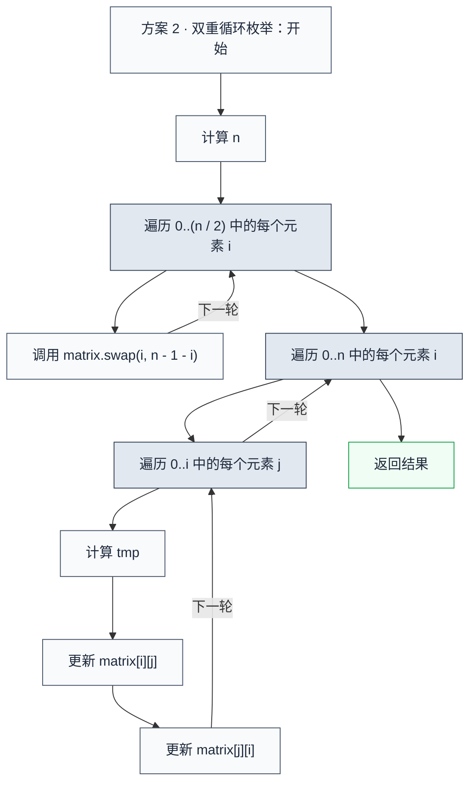

```rust
// LeetCode 48. 旋转矩阵 — Rust 版

// 方案2：先上下翻转行，再沿主对角线转置
fn rotate(matrix: &mut Vec<Vec<i32>>) {
    // 定义函数/方法 rotate
    let n = matrix.len(); // 把 矩阵.长度() 存入 元素个数
    for i in 0..(n / 2) {
        // 逐个取出 0 的元素（下标 i）
        matrix.swap(i, n - 1 - i); // 交换整行（等价于交换行引用）
    }
    for i in 0..n {
        // 逐个取出 0 的元素（下标 i）
        for j in 0..i {
            // 逐个取出 0 的元素（下标 j）
            let tmp = matrix[i][j]; // 把 矩阵[下标 i][下标 j] 存入 临时变量
            matrix[i][j] = matrix[j][i]; // 把 矩阵[下标 j][下标 i]; 写入 matrix[i][j]
            matrix[j][i] = tmp; // 把 临时变量; 写入 matrix[j][i]
        }
    }
}

fn eq_matrix(a: &[Vec<i32>], b: &[Vec<i32>]) -> bool {
    // 定义函数/方法 eq_matrix
    if a.len() != b.len() {
        // 若 数组.长度() 不等于 b.长度(
        return false; // 返回 false
    }
    for i in 0..a.len() {
        // 逐个取出 0 的元素（下标 i）
        if a[i] != b[i] {
            // 若 数组[下标 i] 不等于 b[下标 i]
            return false; // 返回 false
        }
    }
    true // true
}

fn main() {
    // 程序入口：跑内嵌自测用例
    let mut cases: Vec<(Vec<Vec<i32>>, Vec<Vec<i32>>)> = vec![
        (
            vec![vec![1, 2, 3], vec![4, 5, 6], vec![7, 8, 9]],
            vec![vec![7, 4, 1], vec![8, 5, 2], vec![9, 6, 3]],
        ),
        (
            vec![
                vec![5, 1, 9, 11],
                vec![2, 4, 8, 10],
                vec![13, 3, 6, 7],
                vec![15, 14, 12, 16],
            ],
            vec![
                vec![15, 13, 2, 5],
                vec![14, 3, 4, 1],
                vec![12, 6, 8, 9],
                vec![16, 7, 10, 11],
            ],
        ),
    ];
    for (idx, (input, expected)) in cases.iter_mut().enumerate() {
        rotate(input); // rotate(input);
        assert!(eq_matrix(input, expected), "case {} failed", idx); // 断言校验
    }
    println!("PASS"); // 全部用例通过，输出 PASS
}
```

#### 方案 3：双重循环枚举

**思路与代码分析**：核心是「双重循环枚举」。Rust 版用所有权移动与切片借用改写同一逻辑，注意 Option 与引用边界。**走读**：方案 3 · 双重循环枚举：开始 → 计算 n → 遍历 0..(n / 2) 中的每个元素 i → 调用 matrix.swap(i, n - 1 - i) → 遍历 0..n 中的每个元素 i → 遍历 0..i 中的每个元素 j → 计算 tmp → 更新 matrix[i][j] → 更新 matrix[j][i] → 返回结果。

**运行架构**（真实控制流）：


```rust
// LeetCode 48. 旋转矩阵 — Rust 版

// 方案3：先上下翻转行，再沿主对角线转置（与 TS 事实源 solution_3 一致）
fn rotate(matrix: &mut Vec<Vec<i32>>) {
    // 定义函数/方法 rotate
    let n = matrix.len(); // 把 矩阵.长度() 存入 元素个数
    for i in 0..(n / 2) {
        // 逐个取出 0 的元素（下标 i）
        matrix.swap(i, n - 1 - i); // 交换整行（等价于交换行引用）
    }
    for i in 0..n {
        // 逐个取出 0 的元素（下标 i）
        for j in 0..i {
            // 逐个取出 0 的元素（下标 j）
            let tmp = matrix[i][j]; // 把 矩阵[下标 i][下标 j] 存入 临时变量
            matrix[i][j] = matrix[j][i]; // 把 矩阵[下标 j][下标 i]; 写入 matrix[i][j]
            matrix[j][i] = tmp; // 把 临时变量; 写入 matrix[j][i]
        }
    }
}

fn eq_matrix(a: &[Vec<i32>], b: &[Vec<i32>]) -> bool {
    // 定义函数/方法 eq_matrix
    if a.len() != b.len() {
        // 若 数组.长度() 不等于 b.长度(
        return false; // 返回 false
    }
    for i in 0..a.len() {
        // 逐个取出 0 的元素（下标 i）
        if a[i] != b[i] {
            // 若 数组[下标 i] 不等于 b[下标 i]
            return false; // 返回 false
        }
    }
    true // true
}

fn main() {
    // 程序入口：跑内嵌自测用例
    let mut cases: Vec<(Vec<Vec<i32>>, Vec<Vec<i32>>)> = vec![
        (
            vec![vec![1, 2, 3], vec![4, 5, 6], vec![7, 8, 9]],
            vec![vec![7, 4, 1], vec![8, 5, 2], vec![9, 6, 3]],
        ),
        (
            vec![
                vec![5, 1, 9, 11],
                vec![2, 4, 8, 10],
                vec![13, 3, 6, 7],
                vec![15, 14, 12, 16],
            ],
            vec![
                vec![15, 13, 2, 5],
                vec![14, 3, 4, 1],
                vec![12, 6, 8, 9],
                vec![16, 7, 10, 11],
            ],
        ),
    ];
    for (idx, (input, expected)) in cases.iter_mut().enumerate() {
        rotate(input); // rotate(input);
        assert!(eq_matrix(input, expected), "case {} failed", idx); // 断言校验
    }
    println!("PASS"); // 全部用例通过，输出 PASS
}
```

### Lua 实现（3 种方案）

Lua 的全部方案如下，每个方案都内嵌用例自测，可独立运行（老仓库 python/go 文件遵循「打印结果」约定）：

#### 方案 1：双重循环枚举

**思路与代码分析**：核心是「双重循环枚举」。Lua 版用表与 ipairs 遍历，注意 ipairs 遇 nil 即停的语义。**走读**：方案 1 · 双重循环枚举：开始 → 更新 n → 循环 i：从 1 到 n do → 循环 j：从 i + 1 到 n do → 更新 matrix[j][i] → 循环 i：从 1 到 n do → 更新 k → 当 j ＜ k do 时反复执行 → 更新 matrix[i][k] → 更新 j → 更新 k → 返回结果。

**运行架构**（真实控制流）：

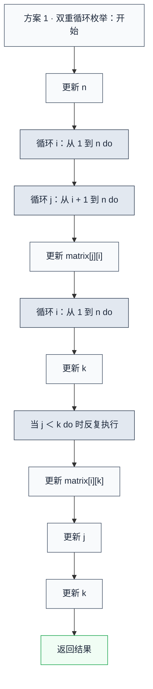

```lua
-- LeetCode 48. 旋转矩阵 — Lua 版

-- 方案1：先沿主对角线转置，再逐行左右翻转
local function rotate(matrix) -- local function rotate(矩阵)
	local n = #matrix -- 把 #矩阵 写入 local n
	for i = 1, n do -- 让 下标 i 从 1 走到 元素个数（Lua 1 基）
		for j = i + 1, n do -- 把 下标 i 加 1, 元素个数 do 写入 for j
			matrix[i][j], matrix[j][i] = matrix[j][i], matrix[i][j]
		end -- 终点
	end -- 终点
	for i = 1, n do -- 让 下标 i 从 1 走到 元素个数（Lua 1 基）
		local j, k = 1, n -- 把 1, 元素个数 写入 local j, k
		while j < k do -- while 下标 j 小于 下标 k do
			matrix[i][j], matrix[i][k] = matrix[i][k], matrix[i][j]
			j = j + 1 -- 把 下标 j 加 1 存入 下标 j
			k = k - 1 -- 把 下标 k 减 1 存入 下标 k
		end -- 终点
	end -- 终点
end -- 终点

local function eq_matrix(a, b) -- local function eq_matrix(数组, b)
	if #a ~= #b then
		return false
	end -- 若 #数组 ~ 赋值为 #b then return false 终点
	for i = 1, #a do -- 把 1, #数组 do 写入 for i
		if #a[i] ~= #b[i] then
			return false
		end -- 若 #数组[下标 i] ~ 赋值为 #b[下标 i] then return false 终点
		for j = 1, #a[i] do -- 把 1, #数组[下标 i] do 写入 for j
			if a[i][j] ~= b[i][j] then
				return false
			end -- 若 数组[下标 i][下标 j] ~ 赋值为 b[下标 i][下标 j] then return false 终点
		end -- 终点
	end -- 终点
	return true -- 返回 true
end -- 终点

-- 自测：与 TS 事实源内嵌用例一致（LeetCode 官方示例）
local cases = { -- 把 { 写入 local cases
	{ { { 1, 2, 3 }, { 4, 5, 6 }, { 7, 8, 9 } }, { { 7, 4, 1 }, { 8, 5, 2 }, { 9, 6, 3 } } },
	{
		{ { 5, 1, 9, 11 }, { 2, 4, 8, 10 }, { 13, 3, 6, 7 }, { 15, 14, 12, 16 } },
		{
			{ 15, 13, 2, 5 },
			{ 14, 3, 4, 1 },
			{ 12, 6, 8, 9 },
			{ 16, 7, 10, 11 },
		},
	},
}
for idx, t in ipairs(cases) do -- 遍历取 另一字符串
	rotate(t[1]) -- rotate(另一字符串[1])
	assert(eq_matrix(t[1], t[2]), string.format("case %d failed", idx)) -- 断言校验
end -- 终点
print("PASS") -- 全部用例通过，输出 PASS
```

#### 方案 2：双重循环枚举

**思路与代码分析**：核心是「双重循环枚举」。Lua 版用表与 ipairs 遍历，注意 ipairs 遇 nil 即停的语义。**走读**：方案 2 · 双重循环枚举：开始 → 更新 n → 循环 i：从 1 到 math.floor(n / 2) do → 更新 i] → 循环 i：从 1 到 n do → 循环 j：从 1 到 i - 1 do → 更新 matrix[j][i] → 返回结果。

**运行架构**（真实控制流）：

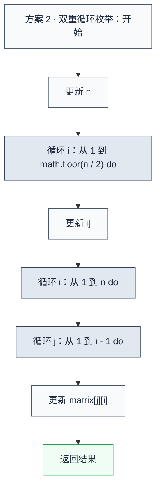

```lua
-- LeetCode 48. 旋转矩阵 — Lua 版

-- 方案2：先上下翻转行（交换行引用），再沿主对角线转置
local function rotate(matrix) -- local function rotate(矩阵)
	local n = #matrix -- 把 #矩阵 写入 local n
	for i = 1, math.floor(n / 2) do -- 让 下标 i 从 1 走到 math（Lua 1 基）
		matrix[i], matrix[n + 1 - i] = matrix[n + 1 - i], matrix[i]
	end -- 终点
	for i = 1, n do -- 让 下标 i 从 1 走到 元素个数（Lua 1 基）
		for j = 1, i - 1 do -- 让 下标 j 从 1 走到 下标 i（Lua 1 基）
			matrix[i][j], matrix[j][i] = matrix[j][i], matrix[i][j]
		end -- 终点
	end -- 终点
end -- 终点

local function eq_matrix(a, b) -- local function eq_matrix(数组, b)
	if #a ~= #b then
		return false
	end -- 若 #数组 ~ 赋值为 #b then return false 终点
	for i = 1, #a do -- 把 1, #数组 do 写入 for i
		if #a[i] ~= #b[i] then
			return false
		end -- 若 #数组[下标 i] ~ 赋值为 #b[下标 i] then return false 终点
		for j = 1, #a[i] do -- 把 1, #数组[下标 i] do 写入 for j
			if a[i][j] ~= b[i][j] then
				return false
			end -- 若 数组[下标 i][下标 j] ~ 赋值为 b[下标 i][下标 j] then return false 终点
		end -- 终点
	end -- 终点
	return true -- 返回 true
end -- 终点

-- 自测：与 TS 事实源内嵌用例一致（LeetCode 官方示例）
local cases = { -- 把 { 写入 local cases
	{ { { 1, 2, 3 }, { 4, 5, 6 }, { 7, 8, 9 } }, { { 7, 4, 1 }, { 8, 5, 2 }, { 9, 6, 3 } } },
	{
		{ { 5, 1, 9, 11 }, { 2, 4, 8, 10 }, { 13, 3, 6, 7 }, { 15, 14, 12, 16 } },
		{
			{ 15, 13, 2, 5 },
			{ 14, 3, 4, 1 },
			{ 12, 6, 8, 9 },
			{ 16, 7, 10, 11 },
		},
	},
}
for idx, t in ipairs(cases) do -- 遍历取 另一字符串
	rotate(t[1]) -- rotate(另一字符串[1])
	assert(eq_matrix(t[1], t[2]), string.format("case %d failed", idx)) -- 断言校验
end -- 终点
print("PASS") -- 全部用例通过，输出 PASS
```

#### 方案 3：双重循环枚举

**思路与代码分析**：核心是「双重循环枚举」。Lua 版用表与 ipairs 遍历，注意 ipairs 遇 nil 即停的语义。**走读**：方案 3 · 双重循环枚举：开始 → 更新 n → 循环 i：从 1 到 math.floor(n / 2) do → 更新 i] → 循环 i：从 1 到 n do → 循环 j：从 1 到 i - 1 do → 更新 matrix[j][i] → 返回结果。

**运行架构**（真实控制流）：

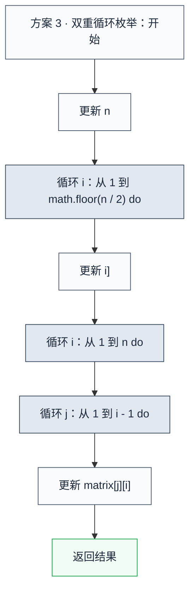

```lua
-- LeetCode 48. 旋转矩阵 — Lua 版

-- 方案3：先上下翻转行（交换行引用），再沿主对角线转置（与 TS 事实源 solution_3 一致）
local function rotate(matrix) -- local function rotate(矩阵)
	local n = #matrix -- 把 #矩阵 写入 local n
	for i = 1, math.floor(n / 2) do -- 让 下标 i 从 1 走到 math（Lua 1 基）
		matrix[i], matrix[n + 1 - i] = matrix[n + 1 - i], matrix[i]
	end -- 终点
	for i = 1, n do -- 让 下标 i 从 1 走到 元素个数（Lua 1 基）
		for j = 1, i - 1 do -- 让 下标 j 从 1 走到 下标 i（Lua 1 基）
			matrix[i][j], matrix[j][i] = matrix[j][i], matrix[i][j]
		end -- 终点
	end -- 终点
end -- 终点

local function eq_matrix(a, b) -- local function eq_matrix(数组, b)
	if #a ~= #b then
		return false
	end -- 若 #数组 ~ 赋值为 #b then return false 终点
	for i = 1, #a do -- 把 1, #数组 do 写入 for i
		if #a[i] ~= #b[i] then
			return false
		end -- 若 #数组[下标 i] ~ 赋值为 #b[下标 i] then return false 终点
		for j = 1, #a[i] do -- 把 1, #数组[下标 i] do 写入 for j
			if a[i][j] ~= b[i][j] then
				return false
			end -- 若 数组[下标 i][下标 j] ~ 赋值为 b[下标 i][下标 j] then return false 终点
		end -- 终点
	end -- 终点
	return true -- 返回 true
end -- 终点

-- 自测：与 TS 事实源内嵌用例一致（LeetCode 官方示例）
local cases = { -- 把 { 写入 local cases
	{ { { 1, 2, 3 }, { 4, 5, 6 }, { 7, 8, 9 } }, { { 7, 4, 1 }, { 8, 5, 2 }, { 9, 6, 3 } } },
	{
		{ { 5, 1, 9, 11 }, { 2, 4, 8, 10 }, { 13, 3, 6, 7 }, { 15, 14, 12, 16 } },
		{
			{ 15, 13, 2, 5 },
			{ 14, 3, 4, 1 },
			{ 12, 6, 8, 9 },
			{ 16, 7, 10, 11 },
		},
	},
}
for idx, t in ipairs(cases) do -- 遍历取 另一字符串
	rotate(t[1]) -- rotate(另一字符串[1])
	assert(eq_matrix(t[1], t[2]), string.format("case %d failed", idx)) -- 断言校验
end -- 终点
print("PASS") -- 全部用例通过，输出 PASS
```

### C 实现（3 种方案）

C 的全部方案如下，每个方案都内嵌用例自测，可独立运行（老仓库 python/go 文件遵循「打印结果」约定）：

#### 方案 1：双重循环枚举

**思路与代码分析**：核心是「双重循环枚举」。C 版手动管理下标与内存，循环边界全部显式写出。代码里依次做这些事：双重循环遍历。**走读**：方案 1 · 双重循环枚举：开始 → 遍历循环 → 遍历循环 → 更新 tmp → 更新 mat[i][j] → 更新 mat[j][i] → 遍历循环 → 遍历循环 → 处理 j++, k--) → 更新 tmp → 更新 mat[i][j] → 更新 mat[i][k] → 返回结果。

**运行架构**（真实控制流）：

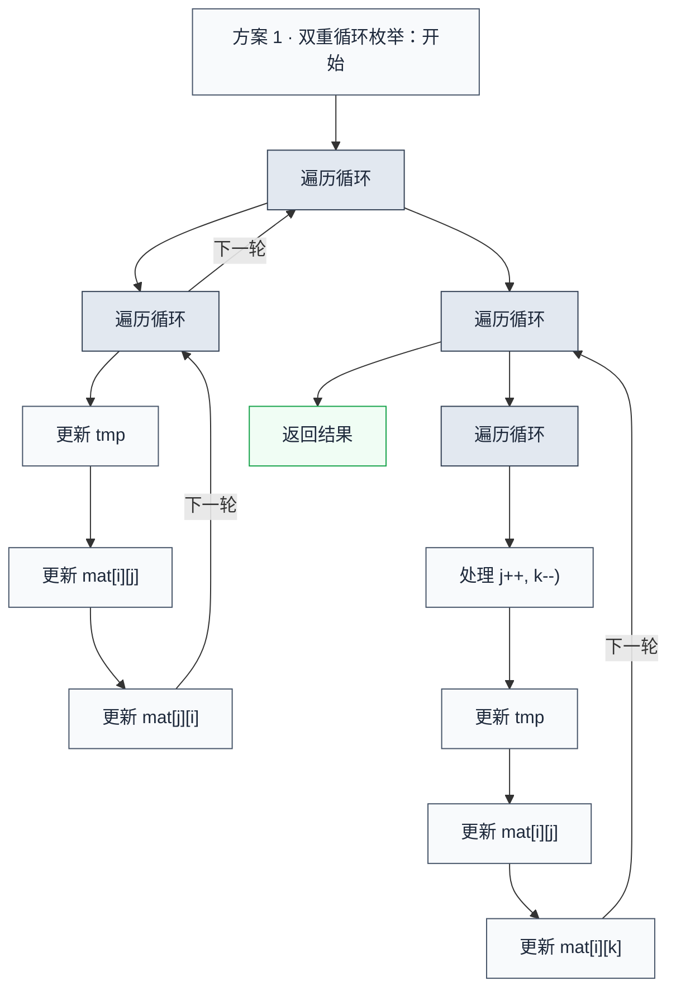

```c
* LeetCode 48. 旋转矩阵 — C 版 */
#include <stdio.h> // 引入头文件

#define MAXN 8 // #define MAXN 8

/* 方案1：先沿主对角线转置，再逐行左右翻转（原地修改） */
static void rotate(int n, int mat[MAXN][MAXN]) { // 定义函数/方法 rotate
    for (int i = 0; i < n; i++) { // 让 下标 i 从 0 开始计数，下标 i 小于 元素个数 就继续
        for (int j = i + 1; j < n; j++) { // 让 下标 j 从 下标 i 加 1 开始计数，下标 j 小于 元素个数 就继续
            int tmp = mat[i][j];   // 把 mat[下标 i][下标 j] 存入 临时变量
            mat[i][j] = mat[j][i]; // 把 mat[下标 j][下标 i]; 写入 mat[i][j]
            mat[j][i] = tmp;       // 把 临时变量; 写入 mat[j][i]
        }
    }
    for (int i = 0; i < n; i++) { // 让 下标 i 从 0 开始计数，下标 i 小于 元素个数 就继续
        for (int j = 0, k = n - 1; j < k;
             j++, k--) { // 让 下标 j 从 0, 下标 k 赋值为 元素个数 减 1 开始计数，下标 j 小于 下标 k 就继续
            int tmp = mat[i][j];   // 把 mat[下标 i][下标 j] 存入 临时变量
            mat[i][j] = mat[i][k]; // 把 mat[下标 i][下标 k]; 写入 mat[i][j]
            mat[i][k] = tmp;       // 把 临时变量; 写入 mat[i][k]
        }
    }
}

int main(void) { // 程序入口：跑内嵌自测用例
    struct {
        int n;
        int in[MAXN][MAXN];
        int exp[MAXN][MAXN];
    } tests[] = {
        {3, {{1, 2, 3}, {4, 5, 6}, {7, 8, 9}}, {{7, 4, 1}, {8, 5, 2}, {9, 6, 3}}},
        {4,
         {{5, 1, 9, 11}, {2, 4, 8, 10}, {13, 3, 6, 7}, {15, 14, 12, 16}},
         {{15, 13, 2, 5}, {14, 3, 4, 1}, {12, 6, 8, 9}, {16, 7, 10, 11}}},
    };
    for (int t = 0; t < 2; t++) { // 让 另一字符串 从 0 开始计数，另一字符串 小于 2 就继续
        rotate(tests[t].n, tests[t].in); // rotate(tests[另一字符串].元素个数, tests[另一字符串].in);
        for (int i = 0; i < tests[t].n;
             i++) { // 让 下标 i 从 0 开始计数，下标 i 小于 tests[另一字符串].元素个数 就继续
            for (int j = 0; j < tests[t].n;
                 j++) { // 让 下标 j 从 0 开始计数，下标 j 小于 tests[另一字符串].元素个数 就继续
                if (tests[t].in[i][j] != tests[t].exp[i][j]) {
                    printf("case %d failed at (%d,%d): got %d want %d\n", t, i, j, tests[t].in[i][j],
                           tests[t].exp[i][j]);
                    return 1; // 返回 1
                }
            }
        }
    }
    printf("PASS\n"); // 全部用例通过，输出 PASS
    return 0;         // 返回 0
}
```

#### 方案 2：双重循环枚举

**思路与代码分析**：核心是「双重循环枚举」。C 版手动管理下标与内存，循环边界全部显式写出。代码里依次做这些事：双重循环遍历。**走读**：方案 2 · 双重循环枚举：开始 → 遍历循环 → 遍历循环 → 更新 tmp → 更新 mat[i][j] → 更新 i][j] → 遍历循环 → 遍历循环 → 更新 tmp → 更新 mat[i][j] → 更新 mat[j][i] → 返回结果。

**运行架构**（真实控制流）：

```mermaid
graph TD
    N0["方案 2 · 双重循环枚举：开始"]
    N1["遍历循环"]
    N2["遍历循环"]
    N3["更新 tmp"]
    N4["更新 mat[i][j]"]
    N5["更新 i][j]"]
    N6["遍历循环"]
    N7["遍历循环"]
    N8["更新 tmp"]
    N9["更新 mat[i][j]"]
    N10["更新 mat[j][i]"]
    N11["返回结果"]
    N0 --> N1
    N1 --> N2
    N2 --> N3
    N3 --> N4
    N4 --> N5
    N5 -- 下一轮 --> N2
    N2 -- 下一轮 --> N1
    N1 --> N6
    N6 --> N7
    N7 --> N8
    N8 --> N9
    N9 --> N10
    N10 -- 下一轮 --> N7
    N7 -- 下一轮 --> N6
    N6 --> N11
    classDef n fill:#f8fafc,stroke:#475569,color:#1e293b;
    classDef lp fill:#e2e8f0,stroke:#334155,color:#1e293b;
    classDef dc fill:#fef9c3,stroke:#ca8a04,color:#1e293b;
    classDef tm fill:#f0fdf4,stroke:#16a34a,color:#1e293b;
    class N0,N3,N4,N5,N8,N9,N10 n;
    class N1,N2,N6,N7 lp;
    class N11 tm;
```

```c
* LeetCode 48. 旋转矩阵 — C 版 */
#include <stdio.h> // 引入头文件

#define MAXN 8 // #define MAXN 8

/* 方案2：先上下翻转行，再沿主对角线转置（原地修改） */
static void rotate(int n, int mat[MAXN][MAXN]) { // 定义函数/方法 rotate
    for (int i = 0; i < n / 2; i++) { // 让 下标 i 从 0 开始计数，下标 i 小于 元素个数 除以 2 就继续
        for (int j = 0; j < MAXN; j++) { /* 交换整行 */ // 让 下标 j 从 0 开始计数，下标 j 小于 MAXN 就继续
            int tmp = mat[i][j];                        // 把 mat[下标 i][下标 j] 存入 临时变量
            mat[i][j] = mat[n - 1 - i][j]; // 把 mat[元素个数 减 1 减 下标 i][下标 j]; 写入 mat[i][j]
            mat[n - 1 - i][j] = tmp;       // 把 临时变量; 写入 mat[n - 1 - i][j]
        }
    }
    for (int i = 0; i < n; i++) { // 让 下标 i 从 0 开始计数，下标 i 小于 元素个数 就继续
        for (int j = 0; j < i; j++) { // 让 下标 j 从 0 开始计数，下标 j 小于 下标 i 就继续
            int tmp = mat[i][j];      // 把 mat[下标 i][下标 j] 存入 临时变量
            mat[i][j] = mat[j][i];    // 把 mat[下标 j][下标 i]; 写入 mat[i][j]
            mat[j][i] = tmp;          // 把 临时变量; 写入 mat[j][i]
        }
    }
}

int main(void) { // 程序入口：跑内嵌自测用例
    struct {
        int n;
        int in[MAXN][MAXN];
        int exp[MAXN][MAXN];
    } tests[] = {
        {3, {{1, 2, 3}, {4, 5, 6}, {7, 8, 9}}, {{7, 4, 1}, {8, 5, 2}, {9, 6, 3}}},
        {4,
         {{5, 1, 9, 11}, {2, 4, 8, 10}, {13, 3, 6, 7}, {15, 14, 12, 16}},
         {{15, 13, 2, 5}, {14, 3, 4, 1}, {12, 6, 8, 9}, {16, 7, 10, 11}}},
    };
    for (int t = 0; t < 2; t++) { // 让 另一字符串 从 0 开始计数，另一字符串 小于 2 就继续
        rotate(tests[t].n, tests[t].in); // rotate(tests[另一字符串].元素个数, tests[另一字符串].in);
        for (int i = 0; i < tests[t].n;
             i++) { // 让 下标 i 从 0 开始计数，下标 i 小于 tests[另一字符串].元素个数 就继续
            for (int j = 0; j < tests[t].n;
                 j++) { // 让 下标 j 从 0 开始计数，下标 j 小于 tests[另一字符串].元素个数 就继续
                if (tests[t].in[i][j] != tests[t].exp[i][j]) {
                    printf("case %d failed at (%d,%d): got %d want %d\n", t, i, j, tests[t].in[i][j],
                           tests[t].exp[i][j]);
                    return 1; // 返回 1
                }
            }
        }
    }
    printf("PASS\n"); // 全部用例通过，输出 PASS
    return 0;         // 返回 0
}
```

#### 方案 3：双重循环枚举

**思路与代码分析**：核心是「双重循环枚举」。C 版手动管理下标与内存，循环边界全部显式写出。代码里依次做这些事：双重循环遍历。**走读**：方案 3 · 双重循环枚举：开始 → 遍历循环 → 遍历循环 → 更新 tmp → 更新 mat[i][j] → 更新 i][j] → 遍历循环 → 遍历循环 → 更新 tmp → 更新 mat[i][j] → 更新 mat[j][i] → 返回结果。

**运行架构**（真实控制流）：

```mermaid
graph TD
    N0["方案 3 · 双重循环枚举：开始"]
    N1["遍历循环"]
    N2["遍历循环"]
    N3["更新 tmp"]
    N4["更新 mat[i][j]"]
    N5["更新 i][j]"]
    N6["遍历循环"]
    N7["遍历循环"]
    N8["更新 tmp"]
    N9["更新 mat[i][j]"]
    N10["更新 mat[j][i]"]
    N11["返回结果"]
    N0 --> N1
    N1 --> N2
    N2 --> N3
    N3 --> N4
    N4 --> N5
    N5 -- 下一轮 --> N2
    N2 -- 下一轮 --> N1
    N1 --> N6
    N6 --> N7
    N7 --> N8
    N8 --> N9
    N9 --> N10
    N10 -- 下一轮 --> N7
    N7 -- 下一轮 --> N6
    N6 --> N11
    classDef n fill:#f8fafc,stroke:#475569,color:#1e293b;
    classDef lp fill:#e2e8f0,stroke:#334155,color:#1e293b;
    classDef dc fill:#fef9c3,stroke:#ca8a04,color:#1e293b;
    classDef tm fill:#f0fdf4,stroke:#16a34a,color:#1e293b;
    class N0,N3,N4,N5,N8,N9,N10 n;
    class N1,N2,N6,N7 lp;
    class N11 tm;
```

```c
* LeetCode 48. 旋转矩阵 — C 版 */
#include <stdio.h> // 引入头文件

#define MAXN 8 // #define MAXN 8

/* 方案3：先上下翻转行，再沿主对角线转置（与 TS 事实源 solution_3 一致） */
static void rotate(int n, int mat[MAXN][MAXN]) { // 定义函数/方法 rotate
    for (int i = 0; i < n / 2; i++) { // 让 下标 i 从 0 开始计数，下标 i 小于 元素个数 除以 2 就继续
        for (int j = 0; j < MAXN; j++) { /* 交换整行 */ // 让 下标 j 从 0 开始计数，下标 j 小于 MAXN 就继续
            int tmp = mat[i][j];                        // 把 mat[下标 i][下标 j] 存入 临时变量
            mat[i][j] = mat[n - 1 - i][j]; // 把 mat[元素个数 减 1 减 下标 i][下标 j]; 写入 mat[i][j]
            mat[n - 1 - i][j] = tmp;       // 把 临时变量; 写入 mat[n - 1 - i][j]
        }
    }
    for (int i = 0; i < n; i++) { // 让 下标 i 从 0 开始计数，下标 i 小于 元素个数 就继续
        for (int j = 0; j < i; j++) { // 让 下标 j 从 0 开始计数，下标 j 小于 下标 i 就继续
            int tmp = mat[i][j];      // 把 mat[下标 i][下标 j] 存入 临时变量
            mat[i][j] = mat[j][i];    // 把 mat[下标 j][下标 i]; 写入 mat[i][j]
            mat[j][i] = tmp;          // 把 临时变量; 写入 mat[j][i]
        }
    }
}

int main(void) { // 程序入口：跑内嵌自测用例
    struct {
        int n;
        int in[MAXN][MAXN];
        int exp[MAXN][MAXN];
    } tests[] = {
        {3, {{1, 2, 3}, {4, 5, 6}, {7, 8, 9}}, {{7, 4, 1}, {8, 5, 2}, {9, 6, 3}}},
        {4,
         {{5, 1, 9, 11}, {2, 4, 8, 10}, {13, 3, 6, 7}, {15, 14, 12, 16}},
         {{15, 13, 2, 5}, {14, 3, 4, 1}, {12, 6, 8, 9}, {16, 7, 10, 11}}},
    };
    for (int t = 0; t < 2; t++) { // 让 另一字符串 从 0 开始计数，另一字符串 小于 2 就继续
        rotate(tests[t].n, tests[t].in); // rotate(tests[另一字符串].元素个数, tests[另一字符串].in);
        for (int i = 0; i < tests[t].n;
             i++) { // 让 下标 i 从 0 开始计数，下标 i 小于 tests[另一字符串].元素个数 就继续
            for (int j = 0; j < tests[t].n;
                 j++) { // 让 下标 j 从 0 开始计数，下标 j 小于 tests[另一字符串].元素个数 就继续
                if (tests[t].in[i][j] != tests[t].exp[i][j]) {
                    printf("case %d failed at (%d,%d): got %d want %d\n", t, i, j, tests[t].in[i][j],
                           tests[t].exp[i][j]);
                    return 1; // 返回 1
                }
            }
        }
    }
    printf("PASS\n"); // 全部用例通过，输出 PASS
    return 0;         // 返回 0
}
```

### C++ 实现（3 种方案）

C++ 的全部方案如下，每个方案都内嵌用例自测，可独立运行（老仓库 python/go 文件遵循「打印结果」约定）：

#### 方案 1：双重循环枚举

**思路与代码分析**：核心是「双重循环枚举」。C++ 版用 STL 容器与迭代器，减少手写下标错误。代码里依次做这些事：双重循环遍历。**走读**：方案 1 · 双重循环枚举：开始 → 更新 n → 遍历循环 → 遍历循环 → 处理 std::swap(matrix[i][j], matr → 遍历循环 → 遍历循环 → 处理 ++j, --k) → 处理 std::swap(matrix[i][j], matr → 返回结果。

**运行架构**（真实控制流）：

```mermaid
graph TD
    N0["方案 1 · 双重循环枚举：开始"]
    N1["更新 n"]
    N2["遍历循环"]
    N3["遍历循环"]
    N4["处理 std::swap(matrix[i][j], matr"]
    N5["遍历循环"]
    N6["遍历循环"]
    N7["处理 ++j, --k)"]
    N8["处理 std::swap(matrix[i][j], matr"]
    N9["返回结果"]
    N0 --> N1
    N1 --> N2
    N2 --> N3
    N3 --> N4
    N4 --> N5
    N5 --> N6
    N6 --> N7
    N7 --> N8
    N8 --> N9
    classDef n fill:#f8fafc,stroke:#475569,color:#1e293b;
    classDef lp fill:#e2e8f0,stroke:#334155,color:#1e293b;
    classDef dc fill:#fef9c3,stroke:#ca8a04,color:#1e293b;
    classDef tm fill:#f0fdf4,stroke:#16a34a,color:#1e293b;
    class N0,N1,N4,N7,N8 n;
    class N2,N3,N5,N6 lp;
    class N9 tm;
```

```cpp
// LeetCode 48. 旋转矩阵 — C++ 版
#include <cassert>  // 引入头文件
#include <iostream> // 引入头文件
#include <utility>  // 引入头文件
#include <vector>   // 引入头文件

using Matrix = std::vector<std::vector<int>>; // 引入依赖

// 方案1：先沿主对角线转置，再逐行左右翻转（原地修改）
void rotate(Matrix &matrix) {      // 定义函数/方法 rotate
    size_t n = matrix.size();      // 把 矩阵.大小(); 写入 size_t n
    for (size_t i = 0; i < n; ++i) // 让 下标 i 从 0 开始计数，下标 i 小于 元素个数 就继续
        for (size_t j = i + 1; j < n; ++j) // 让 下标 j 从 下标 i 加 1 开始计数，下标 j 小于 元素个数 就继续
            std::swap(matrix[i][j], matrix[j][i]); // 交换 矩阵[下标 i][下标 j] 与 矩阵[下标 j][下标 i]
    for (size_t i = 0; i < n; ++i) // 让 下标 i 从 0 开始计数，下标 i 小于 元素个数 就继续
        for (size_t j = 0, k = n - 1; j < k;
             ++j, --k) // 让 下标 j 从 0, 下标 k 赋值为 元素个数 减 1 开始计数，下标 j 小于 下标 k 就继续
            std::swap(matrix[i][j], matrix[i][k]); // 交换 矩阵[下标 i][下标 j] 与 矩阵[下标 i][下标 k]
}

static bool eq_matrix(const Matrix &a, const Matrix &b) { // 定义函数/方法 eq_matrix
    if (a.size() != b.size())
        return false;                       // 若 数组.大小() 不等于 b.大小()，直接返回 false
    for (size_t i = 0; i < a.size(); ++i) { // 让 下标 i 从 0 开始计数，下标 i 小于 数组.大小() 就继续
        if (a[i].size() != b[i].size())
            return false; // 若 数组[下标 i].大小() 不等于 b[下标 i].大小()，直接返回 false
        for (size_t j = 0; j < a[i].size();
             ++j) // 让 下标 j 从 0 开始计数，下标 j 小于 数组[下标 i].大小() 就继续
            if (a[i][j] != b[i][j])
                return false; // 若 数组[下标 i][下标 j] 不等于 b[下标 i][下标 j]，直接返回 false
    }
    return true; // 返回 true
}

int main() { // 程序入口：跑内嵌自测用例
    std::vector<std::pair<Matrix, Matrix>> cases = {
        // 把 { 写入 std::vector<std::pair<Matrix, Matrix>> cases
        {{{1, 2, 3}, {4, 5, 6}, {7, 8, 9}}, {{7, 4, 1}, {8, 5, 2}, {9, 6, 3}}},
        {{{5, 1, 9, 11}, {2, 4, 8, 10}, {13, 3, 6, 7}, {15, 14, 12, 16}},
         {{15, 13, 2, 5}, {14, 3, 4, 1}, {12, 6, 8, 9}, {16, 7, 10, 11}}},
    };
    for (size_t idx = 0; idx < cases.size(); ++idx) { // 让 idx 从 0 开始计数，idx 小于 cases.大小() 就继续
        rotate(cases[idx].first);                     // rotate(cases[idx].first);
        assert(eq_matrix(cases[idx].first, cases[idx].second) && "case failed"); // 断言校验
    }
    std::cout << "PASS" << std::endl; // 全部用例通过，输出 PASS
    return 0;                         // 返回 0
}
```

#### 方案 2：双重循环枚举

**思路与代码分析**：核心是「双重循环枚举」。C++ 版用 STL 容器与迭代器，减少手写下标错误。代码里依次做这些事：双重循环遍历。**走读**：方案 2 · 双重循环枚举：开始 → 更新 n → 遍历循环 → 处理 std::swap(matrix[i], matrix[ → 遍历循环 → 遍历循环 → 处理 std::swap(matrix[i][j], matr → 返回结果。

**运行架构**（真实控制流）：

```mermaid
graph TD
    N0["方案 2 · 双重循环枚举：开始"]
    N1["更新 n"]
    N2["遍历循环"]
    N3["处理 std::swap(matrix[i], matrix["]
    N4["遍历循环"]
    N5["遍历循环"]
    N6["处理 std::swap(matrix[i][j], matr"]
    N7["返回结果"]
    N0 --> N1
    N1 --> N2
    N2 --> N3
    N3 --> N4
    N4 --> N5
    N5 --> N6
    N6 --> N7
    classDef n fill:#f8fafc,stroke:#475569,color:#1e293b;
    classDef lp fill:#e2e8f0,stroke:#334155,color:#1e293b;
    classDef dc fill:#fef9c3,stroke:#ca8a04,color:#1e293b;
    classDef tm fill:#f0fdf4,stroke:#16a34a,color:#1e293b;
    class N0,N1,N3,N6 n;
    class N2,N4,N5 lp;
    class N7 tm;
```

```cpp
// LeetCode 48. 旋转矩阵 — C++ 版
#include <cassert>  // 引入头文件
#include <iostream> // 引入头文件
#include <utility>  // 引入头文件
#include <vector>   // 引入头文件

using Matrix = std::vector<std::vector<int>>; // 引入依赖

// 方案2：先上下翻转行（交换行向量），再沿主对角线转置（原地修改）
void rotate(Matrix &matrix) { // 定义函数/方法 rotate
    size_t n = matrix.size(); // 把 矩阵.大小(); 写入 size_t n
    for (size_t i = 0; i < n / 2; ++i) // 让 下标 i 从 0 开始计数，下标 i 小于 元素个数 除以 2 就继续
        std::swap(matrix[i], matrix[n - 1 - i]); // 交换整行
    for (size_t i = 0; i < n; ++i) // 让 下标 i 从 0 开始计数，下标 i 小于 元素个数 就继续
        for (size_t j = 0; j < i; ++j) // 让 下标 j 从 0 开始计数，下标 j 小于 下标 i 就继续
            std::swap(matrix[i][j], matrix[j][i]); // 交换 矩阵[下标 i][下标 j] 与 矩阵[下标 j][下标 i]
}

static bool eq_matrix(const Matrix &a, const Matrix &b) { // 定义函数/方法 eq_matrix
    if (a.size() != b.size())
        return false;                       // 若 数组.大小() 不等于 b.大小()，直接返回 false
    for (size_t i = 0; i < a.size(); ++i) { // 让 下标 i 从 0 开始计数，下标 i 小于 数组.大小() 就继续
        if (a[i].size() != b[i].size())
            return false; // 若 数组[下标 i].大小() 不等于 b[下标 i].大小()，直接返回 false
        for (size_t j = 0; j < a[i].size();
             ++j) // 让 下标 j 从 0 开始计数，下标 j 小于 数组[下标 i].大小() 就继续
            if (a[i][j] != b[i][j])
                return false; // 若 数组[下标 i][下标 j] 不等于 b[下标 i][下标 j]，直接返回 false
    }
    return true; // 返回 true
}

int main() { // 程序入口：跑内嵌自测用例
    std::vector<std::pair<Matrix, Matrix>> cases = {
        // 把 { 写入 std::vector<std::pair<Matrix, Matrix>> cases
        {{{1, 2, 3}, {4, 5, 6}, {7, 8, 9}}, {{7, 4, 1}, {8, 5, 2}, {9, 6, 3}}},
        {{{5, 1, 9, 11}, {2, 4, 8, 10}, {13, 3, 6, 7}, {15, 14, 12, 16}},
         {{15, 13, 2, 5}, {14, 3, 4, 1}, {12, 6, 8, 9}, {16, 7, 10, 11}}},
    };
    for (size_t idx = 0; idx < cases.size(); ++idx) { // 让 idx 从 0 开始计数，idx 小于 cases.大小() 就继续
        rotate(cases[idx].first);                     // rotate(cases[idx].first);
        assert(eq_matrix(cases[idx].first, cases[idx].second) && "case failed"); // 断言校验
    }
    std::cout << "PASS" << std::endl; // 全部用例通过，输出 PASS
    return 0;                         // 返回 0
}
```

#### 方案 3：双重循环枚举

**思路与代码分析**：核心是「双重循环枚举」。C++ 版用 STL 容器与迭代器，减少手写下标错误。代码里依次做这些事：双重循环遍历。**走读**：方案 3 · 双重循环枚举：开始 → 更新 n → 遍历循环 → 处理 std::swap(matrix[i], matrix[ → 遍历循环 → 遍历循环 → 处理 std::swap(matrix[i][j], matr → 返回结果。

**运行架构**（真实控制流）：

```mermaid
graph TD
    N0["方案 3 · 双重循环枚举：开始"]
    N1["更新 n"]
    N2["遍历循环"]
    N3["处理 std::swap(matrix[i], matrix["]
    N4["遍历循环"]
    N5["遍历循环"]
    N6["处理 std::swap(matrix[i][j], matr"]
    N7["返回结果"]
    N0 --> N1
    N1 --> N2
    N2 --> N3
    N3 --> N4
    N4 --> N5
    N5 --> N6
    N6 --> N7
    classDef n fill:#f8fafc,stroke:#475569,color:#1e293b;
    classDef lp fill:#e2e8f0,stroke:#334155,color:#1e293b;
    classDef dc fill:#fef9c3,stroke:#ca8a04,color:#1e293b;
    classDef tm fill:#f0fdf4,stroke:#16a34a,color:#1e293b;
    class N0,N1,N3,N6 n;
    class N2,N4,N5 lp;
    class N7 tm;
```

```cpp
// LeetCode 48. 旋转矩阵 — C++ 版
#include <cassert>  // 引入头文件
#include <iostream> // 引入头文件
#include <utility>  // 引入头文件
#include <vector>   // 引入头文件

using Matrix = std::vector<std::vector<int>>; // 引入依赖

// 方案3：先上下翻转行（交换行向量），再沿主对角线转置（与 TS 事实源 solution_3 一致）
void rotate(Matrix &matrix) { // 定义函数/方法 rotate
    size_t n = matrix.size(); // 把 矩阵.大小(); 写入 size_t n
    for (size_t i = 0; i < n / 2; ++i) // 让 下标 i 从 0 开始计数，下标 i 小于 元素个数 除以 2 就继续
        std::swap(matrix[i], matrix[n - 1 - i]); // 交换整行
    for (size_t i = 0; i < n; ++i) // 让 下标 i 从 0 开始计数，下标 i 小于 元素个数 就继续
        for (size_t j = 0; j < i; ++j) // 让 下标 j 从 0 开始计数，下标 j 小于 下标 i 就继续
            std::swap(matrix[i][j], matrix[j][i]); // 交换 矩阵[下标 i][下标 j] 与 矩阵[下标 j][下标 i]
}

static bool eq_matrix(const Matrix &a, const Matrix &b) { // 定义函数/方法 eq_matrix
    if (a.size() != b.size())
        return false;                       // 若 数组.大小() 不等于 b.大小()，直接返回 false
    for (size_t i = 0; i < a.size(); ++i) { // 让 下标 i 从 0 开始计数，下标 i 小于 数组.大小() 就继续
        if (a[i].size() != b[i].size())
            return false; // 若 数组[下标 i].大小() 不等于 b[下标 i].大小()，直接返回 false
        for (size_t j = 0; j < a[i].size();
             ++j) // 让 下标 j 从 0 开始计数，下标 j 小于 数组[下标 i].大小() 就继续
            if (a[i][j] != b[i][j])
                return false; // 若 数组[下标 i][下标 j] 不等于 b[下标 i][下标 j]，直接返回 false
    }
    return true; // 返回 true
}

int main() { // 程序入口：跑内嵌自测用例
    std::vector<std::pair<Matrix, Matrix>> cases = {
        // 把 { 写入 std::vector<std::pair<Matrix, Matrix>> cases
        {{{1, 2, 3}, {4, 5, 6}, {7, 8, 9}}, {{7, 4, 1}, {8, 5, 2}, {9, 6, 3}}},
        {{{5, 1, 9, 11}, {2, 4, 8, 10}, {13, 3, 6, 7}, {15, 14, 12, 16}},
         {{15, 13, 2, 5}, {14, 3, 4, 1}, {12, 6, 8, 9}, {16, 7, 10, 11}}},
    };
    for (size_t idx = 0; idx < cases.size(); ++idx) { // 让 idx 从 0 开始计数，idx 小于 cases.大小() 就继续
        rotate(cases[idx].first);                     // rotate(cases[idx].first);
        assert(eq_matrix(cases[idx].first, cases[idx].second) && "case failed"); // 断言校验
    }
    std::cout << "PASS" << std::endl; // 全部用例通过，输出 PASS
    return 0;                         // 返回 0
}
```

### R 实现（3 种方案）

R 的全部方案如下，每个方案都内嵌用例自测，可独立运行（老仓库 python/go 文件遵循「打印结果」约定）：

#### 方案 1：双重循环枚举

**思路与代码分析**：核心是「双重循环枚举」。R 版用向量化思维与 1 起始下标，注意 1:n 的降序陷阱。代码里依次做这些事：双重循环遍历。**走读**：方案 1 · 双重循环枚举：开始 → 处理 n ＜- length(matrix_) → 循环 i：遍历 seq_len(n) → 若 i + 1L ≤ n 则： → 循环 j：遍历 (i + 1L):n → 处理 tmp ＜- matrix_[[i]][j] → 处理 matrix_[[i]][j] ＜- matrix_[[ → 处理 matrix_[[j]][i] ＜- tmp → 循环 i：遍历 seq_len(n) → 处理 matrix_[[i]] ＜- rev(matrix_[ → 处理 matrix_ → 返回结果。

**运行架构**（真实控制流）：

```mermaid
graph TD
    N0["方案 1 · 双重循环枚举：开始"]
    N1["处理 n ＜- length(matrix_)"]
    N2["循环 i：遍历 seq_len(n)"]
    N3["若 i + 1L ≤ n 则："]
    N4["循环 j：遍历 (i + 1L):n"]
    N5["处理 tmp ＜- matrix_[[i]][j]"]
    N6["处理 matrix_[[i]][j] ＜- matrix_[["]
    N7["处理 matrix_[[j]][i] ＜- tmp"]
    N8["循环 i：遍历 seq_len(n)"]
    N9["处理 matrix_[[i]] ＜- rev(matrix_["]
    N10["处理 matrix_"]
    N11["返回结果"]
    N0 --> N1
    N1 --> N2
    N2 --> N3
    N3 --> N4
    N4 --> N5
    N5 --> N6
    N6 --> N7
    N7 -- 下一轮 --> N4
    N4 -- 下一轮 --> N2
    N2 --> N8
    N8 --> N9
    N9 -- 下一轮 --> N8
    N8 --> N10
    N10 --> N11
    classDef n fill:#f8fafc,stroke:#475569,color:#1e293b;
    classDef lp fill:#e2e8f0,stroke:#334155,color:#1e293b;
    classDef dc fill:#fef9c3,stroke:#ca8a04,color:#1e293b;
    classDef tm fill:#f0fdf4,stroke:#16a34a,color:#1e293b;
    class N0,N1,N3,N5,N6,N7,N9,N10 n;
    class N2,N4,N8 lp;
    class N11 tm;
```

```r
# 方案1：先沿主对角线转置，再逐行左右翻转 R 为传值拷贝语义，函数内原地修改不影响调用方（等价于 TS
# 的引用原地修改） 定义函数 rotate（参数：matrix_）
rotate <- function(matrix_) {
    n <- length(matrix_)  # 把 长度(matrix_) 存入 元素个数
    for (i in seq_len(n)) {
        # for (下标 i in seq_len(元素个数)) { 若 下标 i 加 1L 不超过 元素个数 for (下标 j in (下标 i 加
        # 1L):元素个数) {
        if (i + 1L <= n) {
            for (j in (i + 1L):n) {
                tmp <- matrix_[[i]][j]  # 把 matrix_[[下标 i]][下标 j] 存入 临时变量
                matrix_[[i]][j] <- matrix_[[j]][i]  # 把 matrix_[[下标 j]][下标 i] 存入 matrix_[[i]][j]
                matrix_[[j]][i] <- tmp  # 把 临时变量 存入 matrix_[[j]][i]
            }
        }
    }
    for (i in seq_len(n)) {
        # for (下标 i in seq_len(元素个数)) {
        matrix_[[i]] <- rev(matrix_[[i]])  # 等价于双指针左右翻转
    }
    matrix_  # matrix_
}
eq_matrix <- function(a, b) {
    # 定义函数 eq_matrix（参数：数组, b）
    if (length(a) != length(b))
        return(FALSE)  # 若 长度(数组) 不等于 长度(b)) return(FALSE
    for (i in seq_along(a)) {
        # for (下标 i in seq_along(数组)) {
        if (length(a[[i]]) != length(b[[i]]))
            return(FALSE)  # 若 长度(数组[[下标 i]]) 不等于 长度(b[[下标 i]])) return(FALSE
        if (!all(a[[i]] == b[[i]]))
            return(FALSE)  # 若 取反 all(数组[[下标 i]] 等于 b[[下标 i]])) return(FALSE
    }
    TRUE  # TRUE
}
# 自测：与 TS 事实源内嵌用例一致（LeetCode 官方示例）
cases <- list(list(list(c(1L, 2L, 3L), c(4L, 5L, 6L), c(7L, 8L, 9L)), list(c(7L, 4L, 1L), c(8L, 5L, 2L), c(9L,
    6L, 3L))  # 列表(字符(7L, 4L, 1L), 字符(8L, 5L, 2L), 字符(9L, 6L, 3L))
), list(list(c(5L, 1L, 9L,
    11L), c(2L, 4L, 8L, 10L), c(13L, 3L, 6L, 7L), c(15L, 14L, 12L, 16L)), list(c(15L, 13L, 2L, 5L), c(14L, 3L,
    4L, 1L), c(12L, 6L, 8L, 9L), c(16L, 7L, 10L, 11L))))
for (idx in seq_along(cases)) {
    # for (idx in seq_along(cases)) {
    got <- rotate(cases[[idx]][[1]])  # 把 rotate(cases[[idx]][[1]]) 存入 got
    stopifnot(eq_matrix(got, cases[[idx]][[2]]))  # 断言校验
}
cat("PASS\n")  # 全部用例通过，输出 PASS
```

#### 方案 2：双重循环枚举

**思路与代码分析**：核心是「双重循环枚举」。R 版用向量化思维与 1 起始下标，注意 1:n 的降序陷阱。代码里依次做这些事：双重循环遍历。**走读**：方案 2 · 双重循环枚举：开始 → 处理 n ＜- length(matrix_) → 循环 i：遍历 seq_len(n%/%2) → 处理 tmp ＜- matrix_[[i]] → 处理 matrix_[[i]] ＜- matrix_[[n + → 处理 matrix_[[n + 1L - i]] ＜- tmp → 循环 i：遍历 seq_len(n) → 循环 j：遍历 seq_len(i - 1L) → 处理 tmp ＜- matrix_[[i]][j] → 处理 matrix_[[i]][j] ＜- matrix_[[ → 处理 matrix_[[j]][i] ＜- tmp → 处理 matrix_ → 返回结果。

**运行架构**（真实控制流）：

```mermaid
graph TD
    N0["方案 2 · 双重循环枚举：开始"]
    N1["处理 n ＜- length(matrix_)"]
    N2["循环 i：遍历 seq_len(n%/%2)"]
    N3["处理 tmp ＜- matrix_[[i]]"]
    N4["处理 matrix_[[i]] ＜- matrix_[[n +"]
    N5["处理 matrix_[[n + 1L - i]] ＜- tmp"]
    N6["循环 i：遍历 seq_len(n)"]
    N7["循环 j：遍历 seq_len(i - 1L)"]
    N8["处理 tmp ＜- matrix_[[i]][j]"]
    N9["处理 matrix_[[i]][j] ＜- matrix_[["]
    N10["处理 matrix_[[j]][i] ＜- tmp"]
    N11["处理 matrix_"]
    N12["返回结果"]
    N0 --> N1
    N1 --> N2
    N2 --> N3
    N3 --> N4
    N4 --> N5
    N5 -- 下一轮 --> N2
    N2 --> N6
    N6 --> N7
    N7 --> N8
    N8 --> N9
    N9 --> N10
    N10 -- 下一轮 --> N7
    N7 -- 下一轮 --> N6
    N6 --> N11
    N11 --> N12
    classDef n fill:#f8fafc,stroke:#475569,color:#1e293b;
    classDef lp fill:#e2e8f0,stroke:#334155,color:#1e293b;
    classDef dc fill:#fef9c3,stroke:#ca8a04,color:#1e293b;
    classDef tm fill:#f0fdf4,stroke:#16a34a,color:#1e293b;
    class N0,N1,N3,N4,N5,N8,N9,N10,N11 n;
    class N2,N6,N7 lp;
    class N12 tm;
```

```r
# 方案2：先上下翻转行（交换行），再沿主对角线转置 R 为传值拷贝语义，函数内原地修改不影响调用方（等价于 TS
# 的引用原地修改） 定义函数 rotate（参数：matrix_）
rotate <- function(matrix_) {
    n <- length(matrix_)  # 把 长度(matrix_) 存入 元素个数
    for (i in seq_len(n%/%2)) {
        # for (下标 i in seq_len(元素个数 对…取模 除以 对…取模 2)) {
        tmp <- matrix_[[i]]  # 把 matrix_[[下标 i]] 存入 临时变量
        matrix_[[i]] <- matrix_[[n + 1L - i]]  # 把 matrix_[[元素个数 加 1L 减 下标 i]] 存入 matrix_[[i]]
        matrix_[[n + 1L - i]] <- tmp  # matrix_[[元素个数 加 1L 减 下标 i]] 小于 减 临时变量
    }
    for (i in seq_len(n)) {
        # for (下标 i in seq_len(元素个数)) { seq_len(0) 为空序列，等价于 j < i
        for (j in seq_len(i - 1L)) {
            tmp <- matrix_[[i]][j]  # 把 matrix_[[下标 i]][下标 j] 存入 临时变量
            matrix_[[i]][j] <- matrix_[[j]][i]  # 把 matrix_[[下标 j]][下标 i] 存入 matrix_[[i]][j]
            matrix_[[j]][i] <- tmp  # 把 临时变量 存入 matrix_[[j]][i]
        }
    }
    matrix_  # matrix_
}
eq_matrix <- function(a, b) {
    # 定义函数 eq_matrix（参数：数组, b）
    if (length(a) != length(b))
        return(FALSE)  # 若 长度(数组) 不等于 长度(b)) return(FALSE
    for (i in seq_along(a)) {
        # for (下标 i in seq_along(数组)) {
        if (length(a[[i]]) != length(b[[i]]))
            return(FALSE)  # 若 长度(数组[[下标 i]]) 不等于 长度(b[[下标 i]])) return(FALSE
        if (!all(a[[i]] == b[[i]]))
            return(FALSE)  # 若 取反 all(数组[[下标 i]] 等于 b[[下标 i]])) return(FALSE
    }
    TRUE  # TRUE
}
# 自测：与 TS 事实源内嵌用例一致（LeetCode 官方示例）
cases <- list(list(list(c(1L, 2L, 3L), c(4L, 5L, 6L), c(7L, 8L, 9L)), list(c(7L, 4L, 1L), c(8L, 5L, 2L), c(9L,
    6L, 3L))  # 列表(字符(7L, 4L, 1L), 字符(8L, 5L, 2L), 字符(9L, 6L, 3L))
), list(list(c(5L, 1L, 9L,
    11L), c(2L, 4L, 8L, 10L), c(13L, 3L, 6L, 7L), c(15L, 14L, 12L, 16L)), list(c(15L, 13L, 2L, 5L), c(14L, 3L,
    4L, 1L), c(12L, 6L, 8L, 9L), c(16L, 7L, 10L, 11L))))
for (idx in seq_along(cases)) {
    # for (idx in seq_along(cases)) {
    got <- rotate(cases[[idx]][[1]])  # 把 rotate(cases[[idx]][[1]]) 存入 got
    stopifnot(eq_matrix(got, cases[[idx]][[2]]))  # 断言校验
}
cat("PASS\n")  # 全部用例通过，输出 PASS
```

#### 方案 3：双重循环枚举

**思路与代码分析**：核心是「双重循环枚举」。R 版用向量化思维与 1 起始下标，注意 1:n 的降序陷阱。代码里依次做这些事：双重循环遍历。**走读**：方案 3 · 双重循环枚举：开始 → 处理 n ＜- length(matrix_) → 循环 i：遍历 seq_len(n%/%2) → 处理 tmp ＜- matrix_[[i]] → 处理 matrix_[[i]] ＜- matrix_[[n + → 处理 matrix_[[n + 1L - i]] ＜- tmp → 循环 i：遍历 seq_len(n) → 循环 j：遍历 seq_len(i - 1L) → 处理 tmp ＜- matrix_[[i]][j] → 处理 matrix_[[i]][j] ＜- matrix_[[ → 处理 matrix_[[j]][i] ＜- tmp → 处理 matrix_ → 返回结果。

**运行架构**（真实控制流）：

```mermaid
graph TD
    N0["方案 3 · 双重循环枚举：开始"]
    N1["处理 n ＜- length(matrix_)"]
    N2["循环 i：遍历 seq_len(n%/%2)"]
    N3["处理 tmp ＜- matrix_[[i]]"]
    N4["处理 matrix_[[i]] ＜- matrix_[[n +"]
    N5["处理 matrix_[[n + 1L - i]] ＜- tmp"]
    N6["循环 i：遍历 seq_len(n)"]
    N7["循环 j：遍历 seq_len(i - 1L)"]
    N8["处理 tmp ＜- matrix_[[i]][j]"]
    N9["处理 matrix_[[i]][j] ＜- matrix_[["]
    N10["处理 matrix_[[j]][i] ＜- tmp"]
    N11["处理 matrix_"]
    N12["返回结果"]
    N0 --> N1
    N1 --> N2
    N2 --> N3
    N3 --> N4
    N4 --> N5
    N5 -- 下一轮 --> N2
    N2 --> N6
    N6 --> N7
    N7 --> N8
    N8 --> N9
    N9 --> N10
    N10 -- 下一轮 --> N7
    N7 -- 下一轮 --> N6
    N6 --> N11
    N11 --> N12
    classDef n fill:#f8fafc,stroke:#475569,color:#1e293b;
    classDef lp fill:#e2e8f0,stroke:#334155,color:#1e293b;
    classDef dc fill:#fef9c3,stroke:#ca8a04,color:#1e293b;
    classDef tm fill:#f0fdf4,stroke:#16a34a,color:#1e293b;
    class N0,N1,N3,N4,N5,N8,N9,N10,N11 n;
    class N2,N6,N7 lp;
    class N12 tm;
```

```r
# 方案3：先上下翻转行（交换行），再沿主对角线转置（与 TS 事实源 solution_3 一致） R
# 为传值拷贝语义，函数内原地修改不影响调用方（等价于 TS 的引用原地修改） 定义函数 rotate（参数：matrix_）
rotate <- function(matrix_) {
    n <- length(matrix_)  # 把 长度(matrix_) 存入 元素个数
    for (i in seq_len(n%/%2)) {
        # for (下标 i in seq_len(元素个数 对…取模 除以 对…取模 2)) {
        tmp <- matrix_[[i]]  # 把 matrix_[[下标 i]] 存入 临时变量
        matrix_[[i]] <- matrix_[[n + 1L - i]]  # 把 matrix_[[元素个数 加 1L 减 下标 i]] 存入 matrix_[[i]]
        matrix_[[n + 1L - i]] <- tmp  # matrix_[[元素个数 加 1L 减 下标 i]] 小于 减 临时变量
    }
    for (i in seq_len(n)) {
        # for (下标 i in seq_len(元素个数)) { seq_len(0) 为空序列，等价于 j < i
        for (j in seq_len(i - 1L)) {
            tmp <- matrix_[[i]][j]  # 把 matrix_[[下标 i]][下标 j] 存入 临时变量
            matrix_[[i]][j] <- matrix_[[j]][i]  # 把 matrix_[[下标 j]][下标 i] 存入 matrix_[[i]][j]
            matrix_[[j]][i] <- tmp  # 把 临时变量 存入 matrix_[[j]][i]
        }
    }
    matrix_  # matrix_
}
eq_matrix <- function(a, b) {
    # 定义函数 eq_matrix（参数：数组, b）
    if (length(a) != length(b))
        return(FALSE)  # 若 长度(数组) 不等于 长度(b)) return(FALSE
    for (i in seq_along(a)) {
        # for (下标 i in seq_along(数组)) {
        if (length(a[[i]]) != length(b[[i]]))
            return(FALSE)  # 若 长度(数组[[下标 i]]) 不等于 长度(b[[下标 i]])) return(FALSE
        if (!all(a[[i]] == b[[i]]))
            return(FALSE)  # 若 取反 all(数组[[下标 i]] 等于 b[[下标 i]])) return(FALSE
    }
    TRUE  # TRUE
}
# 自测：与 TS 事实源内嵌用例一致（LeetCode 官方示例）
cases <- list(list(list(c(1L, 2L, 3L), c(4L, 5L, 6L), c(7L, 8L, 9L)), list(c(7L, 4L, 1L), c(8L, 5L, 2L), c(9L,
    6L, 3L))  # 列表(字符(7L, 4L, 1L), 字符(8L, 5L, 2L), 字符(9L, 6L, 3L))
), list(list(c(5L, 1L, 9L,
    11L), c(2L, 4L, 8L, 10L), c(13L, 3L, 6L, 7L), c(15L, 14L, 12L, 16L)), list(c(15L, 13L, 2L, 5L), c(14L, 3L,
    4L, 1L), c(12L, 6L, 8L, 9L), c(16L, 7L, 10L, 11L))))
for (idx in seq_along(cases)) {
    # for (idx in seq_along(cases)) {
    got <- rotate(cases[[idx]][[1]])  # 把 rotate(cases[[idx]][[1]]) 存入 got
    stopifnot(eq_matrix(got, cases[[idx]][[2]]))  # 断言校验
}
cat("PASS\n")  # 全部用例通过，输出 PASS
```

### Zig 实现（3 种方案）

Zig 的全部方案如下，每个方案都内嵌用例自测，可独立运行（老仓库 python/go 文件遵循「打印结果」约定）：

#### 方案 1：双重循环枚举

**思路与代码分析**：核心是「双重循环枚举」。Zig 版显式分配与清零，整型边界处理严格。代码里依次做这些事：单循环线性扫描。**走读**：方案 1 · 双重循环枚举：开始 → 计算 m → 遍历集合元素 → 更新 m[i] → 返回 m。

**运行架构**（真实控制流）：

```mermaid
graph TD
    N0["方案 1 · 双重循环枚举：开始"]
    N1["计算 m"]
    N2["遍历集合元素"]
    N3["更新 m[i]"]
    N4["返回 m"]
    N0 --> N1
    N1 --> N2
    N2 --> N3
    N3 -- 下一轮 --> N2
    N2 --> N4
    classDef n fill:#f8fafc,stroke:#475569,color:#1e293b;
    classDef lp fill:#e2e8f0,stroke:#334155,color:#1e293b;
    classDef dc fill:#fef9c3,stroke:#ca8a04,color:#1e293b;
    classDef tm fill:#f0fdf4,stroke:#16a34a,color:#1e293b;
    class N0,N1,N3 n;
    class N2 lp;
    class N4 tm;
```

```zig
// LeetCode 48. 旋转矩阵 — Zig 版
const std = @import("std"); // 把 @import(「std」) 存入 std

// 方案1：先沿主对角线转置，再逐行左右翻转（原地修改）
fn rotate(matrix: [][]i32) void { // 定义函数/方法 rotate
    const n = matrix.len; // 把 矩阵.长度 存入 元素个数
    var i: usize = 0; // 把 0; 写入 var i: usize
    while (i < n) : (i += 1) { // 循环，直到不满足「下标 i 小于 元素个数) : (下标 i 累加 1」
        var j: usize = i + 1; // 把 下标 i 加 1; 写入 var j: usize
        while (j < n) : (j += 1) { // 循环，直到不满足「下标 j 小于 元素个数) : (下标 j 累加 1」
            const tmp = matrix[i][j]; // 把 矩阵[下标 i][下标 j] 存入 临时变量
            matrix[i][j] = matrix[j][i]; // 把 矩阵[下标 j][下标 i]; 写入 matrix[i][j]
            matrix[j][i] = tmp; // 把 临时变量; 写入 matrix[j][i]
        }
    }
    i = 0; // 把 0; 写入 下标 i
    while (i < n) : (i += 1) { // 循环，直到不满足「下标 i 小于 元素个数) : (下标 i 累加 1」
        var j: usize = 0; // 把 0; 写入 var j: usize
        var k: usize = n - 1; // 把 元素个数 减 1; 写入 var k: usize
        while (j < k) : ({ // 循环，直到不满足「下标 j 小于 下标 k) : (」
            j += 1; // 下标 j累加 1
            k -= 1; // 下标 k累减 1
        }) { // }) {
            const tmp = matrix[i][j]; // 把 矩阵[下标 i][下标 j] 存入 临时变量
            matrix[i][j] = matrix[i][k]; // 把 矩阵[下标 i][下标 k]; 写入 matrix[i][j]
            matrix[i][k] = tmp; // 把 临时变量; 写入 matrix[i][k]
        }
    }
}

fn matFromRows(allocator: std.mem.Allocator, rows: []const []const i32) ![][]i32 { // 定义函数/方法 matFromRows
    const m = try allocator.alloc([]i32, rows.len); // 把 try allocator.alloc([]i32, 行数.长度) 存入 映射表
    for (rows, 0..) |row, i| { // for (行数, 0..) 按位或 row, 下标 i 按位或 {
        m[i] = try allocator.dupe(i32, row); // 把 try allocator.dupe(i32, row); 写入 m[i]
    }
    return m; // 返回 映射表
}

fn eqMatrix(a: []const []i32, b: []const []const i32) bool { // 定义函数/方法 eqMatrix
    if (a.len != b.len) return false; // 若 数组.长度 不等于 b.长度，直接返回 false
    for (a, 0..) |row, i| { // for (数组, 0..) 按位或 row, 下标 i 按位或 {
        if (row.len != b[i].len) return false; // 若 row.长度 不等于 b[下标 i].长度，直接返回 false
        for (row, 0..) |v, j| { // for (row, 0..) 按位或 值, 下标 j 按位或 {
            if (v != b[i][j]) return false; // 若 值 不等于 b[下标 i][下标 j]，直接返回 false
        }
    }
    return true; // 返回 true
}

pub fn main() !void { // 程序入口：跑内嵌自测用例
    var arena = std.heap.ArenaAllocator.init(std.heap.page_allocator); // 把 std.堆.ArenaAllocator.init(std.堆.page_allocator) 存入 arena
    defer arena.deinit(); // defer arena.deinit();
    const allocator = arena.allocator(); // 把 arena.allocator() 存入 allocator

    // 与 TS 事实源内嵌用例一致（LeetCode 官方示例）
    const c1in = [_][]const i32{ &.{ 1, 2, 3 }, &.{ 4, 5, 6 }, &.{ 7, 8, 9 } };
    const c1exp = [_][]const i32{ &.{ 7, 4, 1 }, &.{ 8, 5, 2 }, &.{ 9, 6, 3 } };
    const c2in = [_][]const i32{ &.{ 5, 1, 9, 11 }, &.{ 2, 4, 8, 10 }, &.{ 13, 3, 6, 7 }, &.{ 15, 14, 12, 16 } };
    const c2exp = [_][]const i32{ &.{ 15, 13, 2, 5 }, &.{ 14, 3, 4, 1 }, &.{ 12, 6, 8, 9 }, &.{ 16, 7, 10, 11 } };

    const Case = struct { in: []const []const i32, exp: []const []const i32 };
    const cases = [_]Case{ // 把 [_]Case{ 存入 cases
        .{ .in = &c1in, .exp = &c1exp },
        .{ .in = &c2in, .exp = &c2exp },
    };
    for (cases, 0..) |c, idx| { // for (cases, 0..) 按位或 字符, idx 按位或 {
        const m = try matFromRows(allocator, c.in); // 把 try matFromRows(allocator, 字符.in) 存入 映射表
        rotate(m); // rotate(映射表);
        if (!eqMatrix(m, c.exp)) { // 若 取反 eqMatrix(映射表, 字符.exp
            std.debug.print("case {d} failed\n", .{idx}); // 打印输出
            return error.TestFailed; // 返回 error.TestFailed
        }
    }
    std.debug.print("PASS\n", .{}); // 全部用例通过，输出 PASS
}
```

#### 方案 2：双重循环枚举

**思路与代码分析**：核心是「双重循环枚举」。Zig 版显式分配与清零，整型边界处理严格。代码里依次做这些事：单循环线性扫描。**走读**：方案 2 · 双重循环枚举：开始 → 计算 m → 遍历集合元素 → 更新 m[i] → 返回 m。

**运行架构**（真实控制流）：

```mermaid
graph TD
    N0["方案 2 · 双重循环枚举：开始"]
    N1["计算 m"]
    N2["遍历集合元素"]
    N3["更新 m[i]"]
    N4["返回 m"]
    N0 --> N1
    N1 --> N2
    N2 --> N3
    N3 -- 下一轮 --> N2
    N2 --> N4
    classDef n fill:#f8fafc,stroke:#475569,color:#1e293b;
    classDef lp fill:#e2e8f0,stroke:#334155,color:#1e293b;
    classDef dc fill:#fef9c3,stroke:#ca8a04,color:#1e293b;
    classDef tm fill:#f0fdf4,stroke:#16a34a,color:#1e293b;
    class N0,N1,N3 n;
    class N2 lp;
    class N4 tm;
```

```zig
// LeetCode 48. 旋转矩阵 — Zig 版
const std = @import("std"); // 把 @import(「std」) 存入 std

// 方案2：先上下翻转行（交换行切片），再沿主对角线转置（原地修改）
fn rotate(matrix: [][]i32) void { // 定义函数/方法 rotate
    const n = matrix.len; // 把 矩阵.长度 存入 元素个数
    var i: usize = 0; // 把 0; 写入 var i: usize
    while (i < n / 2) : (i += 1) { // 循环，直到不满足「下标 i 小于 元素个数 除以 2) : (下标 i 累加 1」
        const tmp = matrix[i]; // 把 矩阵[下标 i] 存入 临时变量
        matrix[i] = matrix[n - 1 - i]; // 把 矩阵[元素个数 减 1 减 下标 i]; 写入 matrix[i]
        matrix[n - 1 - i] = tmp; // 把 临时变量; 写入 matrix[n - 1 - i]
    }
    i = 0; // 把 0; 写入 下标 i
    while (i < n) : (i += 1) { // 循环，直到不满足「下标 i 小于 元素个数) : (下标 i 累加 1」
        var j: usize = 0; // 把 0; 写入 var j: usize
        while (j < i) : (j += 1) { // 循环，直到不满足「下标 j 小于 下标 i) : (下标 j 累加 1」
            const tmp = matrix[i][j]; // 把 矩阵[下标 i][下标 j] 存入 临时变量
            matrix[i][j] = matrix[j][i]; // 把 矩阵[下标 j][下标 i]; 写入 matrix[i][j]
            matrix[j][i] = tmp; // 把 临时变量; 写入 matrix[j][i]
        }
    }
}

fn matFromRows(allocator: std.mem.Allocator, rows: []const []const i32) ![][]i32 { // 定义函数/方法 matFromRows
    const m = try allocator.alloc([]i32, rows.len); // 把 try allocator.alloc([]i32, 行数.长度) 存入 映射表
    for (rows, 0..) |row, i| { // for (行数, 0..) 按位或 row, 下标 i 按位或 {
        m[i] = try allocator.dupe(i32, row); // 把 try allocator.dupe(i32, row); 写入 m[i]
    }
    return m; // 返回 映射表
}

fn eqMatrix(a: []const []i32, b: []const []const i32) bool { // 定义函数/方法 eqMatrix
    if (a.len != b.len) return false; // 若 数组.长度 不等于 b.长度，直接返回 false
    for (a, 0..) |row, i| { // for (数组, 0..) 按位或 row, 下标 i 按位或 {
        if (row.len != b[i].len) return false; // 若 row.长度 不等于 b[下标 i].长度，直接返回 false
        for (row, 0..) |v, j| { // for (row, 0..) 按位或 值, 下标 j 按位或 {
            if (v != b[i][j]) return false; // 若 值 不等于 b[下标 i][下标 j]，直接返回 false
        }
    }
    return true; // 返回 true
}

pub fn main() !void { // 程序入口：跑内嵌自测用例
    var arena = std.heap.ArenaAllocator.init(std.heap.page_allocator); // 把 std.堆.ArenaAllocator.init(std.堆.page_allocator) 存入 arena
    defer arena.deinit(); // defer arena.deinit();
    const allocator = arena.allocator(); // 把 arena.allocator() 存入 allocator

    // 与 TS 事实源内嵌用例一致（LeetCode 官方示例）
    const c1in = [_][]const i32{ &.{ 1, 2, 3 }, &.{ 4, 5, 6 }, &.{ 7, 8, 9 } };
    const c1exp = [_][]const i32{ &.{ 7, 4, 1 }, &.{ 8, 5, 2 }, &.{ 9, 6, 3 } };
    const c2in = [_][]const i32{ &.{ 5, 1, 9, 11 }, &.{ 2, 4, 8, 10 }, &.{ 13, 3, 6, 7 }, &.{ 15, 14, 12, 16 } };
    const c2exp = [_][]const i32{ &.{ 15, 13, 2, 5 }, &.{ 14, 3, 4, 1 }, &.{ 12, 6, 8, 9 }, &.{ 16, 7, 10, 11 } };

    const Case = struct { in: []const []const i32, exp: []const []const i32 };
    const cases = [_]Case{ // 把 [_]Case{ 存入 cases
        .{ .in = &c1in, .exp = &c1exp },
        .{ .in = &c2in, .exp = &c2exp },
    };
    for (cases, 0..) |c, idx| { // for (cases, 0..) 按位或 字符, idx 按位或 {
        const m = try matFromRows(allocator, c.in); // 把 try matFromRows(allocator, 字符.in) 存入 映射表
        rotate(m); // rotate(映射表);
        if (!eqMatrix(m, c.exp)) { // 若 取反 eqMatrix(映射表, 字符.exp
            std.debug.print("case {d} failed\n", .{idx}); // 打印输出
            return error.TestFailed; // 返回 error.TestFailed
        }
    }
    std.debug.print("PASS\n", .{}); // 全部用例通过，输出 PASS
}
```

#### 方案 3：双重循环枚举

**思路与代码分析**：核心是「双重循环枚举」。Zig 版显式分配与清零，整型边界处理严格。代码里依次做这些事：单循环线性扫描。**走读**：方案 3 · 双重循环枚举：开始 → 计算 m → 遍历集合元素 → 更新 m[i] → 返回 m。

**运行架构**（真实控制流）：

```mermaid
graph TD
    N0["方案 3 · 双重循环枚举：开始"]
    N1["计算 m"]
    N2["遍历集合元素"]
    N3["更新 m[i]"]
    N4["返回 m"]
    N0 --> N1
    N1 --> N2
    N2 --> N3
    N3 -- 下一轮 --> N2
    N2 --> N4
    classDef n fill:#f8fafc,stroke:#475569,color:#1e293b;
    classDef lp fill:#e2e8f0,stroke:#334155,color:#1e293b;
    classDef dc fill:#fef9c3,stroke:#ca8a04,color:#1e293b;
    classDef tm fill:#f0fdf4,stroke:#16a34a,color:#1e293b;
    class N0,N1,N3 n;
    class N2 lp;
    class N4 tm;
```

```zig
// LeetCode 48. 旋转矩阵 — Zig 版
const std = @import("std"); // 把 @import(「std」) 存入 std

// 方案3：先上下翻转行（交换行切片），再沿主对角线转置（与 TS 事实源 solution_3 一致）
fn rotate(matrix: [][]i32) void { // 定义函数/方法 rotate
    const n = matrix.len; // 把 矩阵.长度 存入 元素个数
    var i: usize = 0; // 把 0; 写入 var i: usize
    while (i < n / 2) : (i += 1) { // 循环，直到不满足「下标 i 小于 元素个数 除以 2) : (下标 i 累加 1」
        const tmp = matrix[i]; // 把 矩阵[下标 i] 存入 临时变量
        matrix[i] = matrix[n - 1 - i]; // 把 矩阵[元素个数 减 1 减 下标 i]; 写入 matrix[i]
        matrix[n - 1 - i] = tmp; // 把 临时变量; 写入 matrix[n - 1 - i]
    }
    i = 0; // 把 0; 写入 下标 i
    while (i < n) : (i += 1) { // 循环，直到不满足「下标 i 小于 元素个数) : (下标 i 累加 1」
        var j: usize = 0; // 把 0; 写入 var j: usize
        while (j < i) : (j += 1) { // 循环，直到不满足「下标 j 小于 下标 i) : (下标 j 累加 1」
            const tmp = matrix[i][j]; // 把 矩阵[下标 i][下标 j] 存入 临时变量
            matrix[i][j] = matrix[j][i]; // 把 矩阵[下标 j][下标 i]; 写入 matrix[i][j]
            matrix[j][i] = tmp; // 把 临时变量; 写入 matrix[j][i]
        }
    }
}

fn matFromRows(allocator: std.mem.Allocator, rows: []const []const i32) ![][]i32 { // 定义函数/方法 matFromRows
    const m = try allocator.alloc([]i32, rows.len); // 把 try allocator.alloc([]i32, 行数.长度) 存入 映射表
    for (rows, 0..) |row, i| { // for (行数, 0..) 按位或 row, 下标 i 按位或 {
        m[i] = try allocator.dupe(i32, row); // 把 try allocator.dupe(i32, row); 写入 m[i]
    }
    return m; // 返回 映射表
}

fn eqMatrix(a: []const []i32, b: []const []const i32) bool { // 定义函数/方法 eqMatrix
    if (a.len != b.len) return false; // 若 数组.长度 不等于 b.长度，直接返回 false
    for (a, 0..) |row, i| { // for (数组, 0..) 按位或 row, 下标 i 按位或 {
        if (row.len != b[i].len) return false; // 若 row.长度 不等于 b[下标 i].长度，直接返回 false
        for (row, 0..) |v, j| { // for (row, 0..) 按位或 值, 下标 j 按位或 {
            if (v != b[i][j]) return false; // 若 值 不等于 b[下标 i][下标 j]，直接返回 false
        }
    }
    return true; // 返回 true
}

pub fn main() !void { // 程序入口：跑内嵌自测用例
    var arena = std.heap.ArenaAllocator.init(std.heap.page_allocator); // 把 std.堆.ArenaAllocator.init(std.堆.page_allocator) 存入 arena
    defer arena.deinit(); // defer arena.deinit();
    const allocator = arena.allocator(); // 把 arena.allocator() 存入 allocator

    // 与 TS 事实源内嵌用例一致（LeetCode 官方示例）
    const c1in = [_][]const i32{ &.{ 1, 2, 3 }, &.{ 4, 5, 6 }, &.{ 7, 8, 9 } };
    const c1exp = [_][]const i32{ &.{ 7, 4, 1 }, &.{ 8, 5, 2 }, &.{ 9, 6, 3 } };
    const c2in = [_][]const i32{ &.{ 5, 1, 9, 11 }, &.{ 2, 4, 8, 10 }, &.{ 13, 3, 6, 7 }, &.{ 15, 14, 12, 16 } };
    const c2exp = [_][]const i32{ &.{ 15, 13, 2, 5 }, &.{ 14, 3, 4, 1 }, &.{ 12, 6, 8, 9 }, &.{ 16, 7, 10, 11 } };

    const Case = struct { in: []const []const i32, exp: []const []const i32 };
    const cases = [_]Case{ // 把 [_]Case{ 存入 cases
        .{ .in = &c1in, .exp = &c1exp },
        .{ .in = &c2in, .exp = &c2exp },
    };
    for (cases, 0..) |c, idx| { // for (cases, 0..) 按位或 字符, idx 按位或 {
        const m = try matFromRows(allocator, c.in); // 把 try matFromRows(allocator, 字符.in) 存入 映射表
        rotate(m); // rotate(映射表);
        if (!eqMatrix(m, c.exp)) { // 若 取反 eqMatrix(映射表, 字符.exp
            std.debug.print("case {d} failed\n", .{idx}); // 打印输出
            return error.TestFailed; // 返回 error.TestFailed
        }
    }
    std.debug.print("PASS\n", .{}); // 全部用例通过，输出 PASS
}
```

### Dart 实现（3 种方案）

Dart 的全部方案如下，每个方案都内嵌用例自测，可独立运行（老仓库 python/go 文件遵循「打印结果」约定）：

#### 方案 1：双重循环枚举

**思路与代码分析**：核心是「双重循环枚举」。Dart 版用可空类型标注与集合方法，注意空安全。代码里依次做这些事：双重循环遍历。**走读**：方案 1 · 双重循环枚举：开始 → 更新 n → 遍历循环 → 遍历循环 → 更新 tmp → 更新 matrix[i][j] → 更新 matrix[j][i] → 遍历循环 → 计算 j → 当 (j ＜ k) 时反复执行 → 更新 tmp → 更新 matrix[i][j] → 更新 matrix[i][k] → 处理 j++ → 处理 k-- → 返回结果。

**运行架构**（真实控制流）：

```mermaid
graph TD
    N0["方案 1 · 双重循环枚举：开始"]
    N1["更新 n"]
    N2["遍历循环"]
    N3["遍历循环"]
    N4["更新 tmp"]
    N5["更新 matrix[i][j]"]
    N6["更新 matrix[j][i]"]
    N7["遍历循环"]
    N8["计算 j"]
    N9["当 (j ＜ k) 时反复执行"]
    N10["更新 tmp"]
    N11["更新 matrix[i][j]"]
    N12["更新 matrix[i][k]"]
    N13["处理 j++"]
    N14["处理 k--"]
    N15["返回结果"]
    N0 --> N1
    N1 --> N2
    N2 --> N3
    N3 --> N4
    N4 --> N5
    N5 --> N6
    N6 -- 下一轮 --> N3
    N3 -- 下一轮 --> N2
    N2 --> N7
    N7 --> N8
    N8 --> N9
    N9 --> N10
    N10 --> N11
    N11 --> N12
    N12 --> N13
    N13 --> N14
    N14 -- 下一轮 --> N9
    N9 -- 下一轮 --> N7
    N7 --> N15
    classDef n fill:#f8fafc,stroke:#475569,color:#1e293b;
    classDef lp fill:#e2e8f0,stroke:#334155,color:#1e293b;
    classDef dc fill:#fef9c3,stroke:#ca8a04,color:#1e293b;
    classDef tm fill:#f0fdf4,stroke:#16a34a,color:#1e293b;
    class N0,N1,N4,N5,N6,N8,N10,N11,N12,N13,N14 n;
    class N2,N3,N7,N9 lp;
    class N15 tm;
```

```dart
// LeetCode 48. 旋转矩阵 — Dart 版

/// 方案1：先沿主对角线转置，再逐行左右翻转（原地修改）
void rotate(List<List<int>> matrix) {
  // 定义函数/方法 rotate
  final n = matrix.length; // 把 矩阵.长度 存入 元素个数
  for (var i = 0; i < n; i++) {
    // 让 下标 i 从 0 开始计数，下标 i 小于 元素个数 就继续
    for (var j = i + 1; j < n; j++) {
      // 让 下标 j 从 下标 i 加 1 开始计数，下标 j 小于 元素个数 就继续
      final tmp = matrix[i][j]; // 把 矩阵[下标 i][下标 j] 存入 临时变量
      matrix[i][j] = matrix[j][i]; // 把 矩阵[下标 j][下标 i]; 写入 matrix[i][j]
      matrix[j][i] = tmp; // 把 临时变量; 写入 matrix[j][i]
    }
  }
  for (var i = 0; i < n; i++) {
    // 让 下标 i 从 0 开始计数，下标 i 小于 元素个数 就继续
    var j = 0, k = n - 1; // 把 0, 下标 k 赋值为 元素个数 减 1 存入 下标 j
    while (j < k) {
      // 循环，直到不满足「下标 j 小于 下标 k」
      final tmp = matrix[i][j]; // 把 矩阵[下标 i][下标 j] 存入 临时变量
      matrix[i][j] = matrix[i][k]; // 把 矩阵[下标 i][下标 k]; 写入 matrix[i][j]
      matrix[i][k] = tmp; // 把 临时变量; 写入 matrix[i][k]
      j++; // 下标 j 加一
      k--; // 下标 k 减一
    }
  }
}

bool eqMatrix(List<List<int>> a, List<List<int>> b) {
  // 定义函数/方法 eqMatrix
  if (a.length != b.length) return false; // 若 数组.长度 不等于 b.长度，直接返回 false
  for (var i = 0; i < a.length; i++) {
    // 让 下标 i 从 0 开始计数，下标 i 小于 数组.长度 就继续
    if (a[i].length != b[i].length)
      return false; // 若 数组[下标 i].长度 不等于 b[下标 i].长度，直接返回 false
    for (var j = 0; j < a[i].length; j++) {
      // 让 下标 j 从 0 开始计数，下标 j 小于 数组[下标 i].长度 就继续
      if (a[i][j] != b[i][j])
        return false; // 若 数组[下标 i][下标 j] 不等于 b[下标 i][下标 j]，直接返回 false
    }
  }
  return true; // 返回 true
}

void main() {
  // 程序入口：跑内嵌自测用例
  // 与 TS 事实源内嵌用例一致（LeetCode 官方示例）
  final inputs = <List<List<int>>>[
    [
      [1, 2, 3],
      [4, 5, 6],
      [7, 8, 9],
    ],
    [
      [5, 1, 9, 11],
      [2, 4, 8, 10],
      [13, 3, 6, 7],
      [15, 14, 12, 16],
    ],
  ];
  final expecteds = <List<List<int>>>[
    [
      [7, 4, 1],
      [8, 5, 2],
      [9, 6, 3],
    ],
    [
      [15, 13, 2, 5],
      [14, 3, 4, 1],
      [12, 6, 8, 9],
      [16, 7, 10, 11],
    ],
  ];
  for (var idx = 0; idx < inputs.length; idx++) {
    // 让 idx 从 0 开始计数，idx 小于 inputs.长度 就继续
    rotate(inputs[idx]); // rotate(inputs[idx]);
    if (!eqMatrix(inputs[idx], expecteds[idx])) {
      // 若 取反 eqMatrix(inputs[idx], expecteds[idx]
      throw StateError(
        'case $idx failed',
      ); // throw StateError('case $idx failed');
    }
  }
  print('PASS'); // 全部用例通过，输出 PASS
}
```

#### 方案 2：双重循环枚举

**思路与代码分析**：核心是「双重循环枚举」。Dart 版用可空类型标注与集合方法，注意空安全。代码里依次做这些事：双重循环遍历。**走读**：方案 2 · 双重循环枚举：开始 → 更新 n → 遍历循环 → 更新 tmp → 更新 matrix[i] → 更新 i] → 遍历循环 → 遍历循环 → 更新 tmp → 更新 matrix[i][j] → 更新 matrix[j][i] → 返回结果。

**运行架构**（真实控制流）：

```mermaid
graph TD
    N0["方案 2 · 双重循环枚举：开始"]
    N1["更新 n"]
    N2["遍历循环"]
    N3["更新 tmp"]
    N4["更新 matrix[i]"]
    N5["更新 i]"]
    N6["遍历循环"]
    N7["遍历循环"]
    N8["更新 tmp"]
    N9["更新 matrix[i][j]"]
    N10["更新 matrix[j][i]"]
    N11["返回结果"]
    N0 --> N1
    N1 --> N2
    N2 --> N3
    N3 --> N4
    N4 --> N5
    N5 -- 下一轮 --> N2
    N2 --> N6
    N6 --> N7
    N7 --> N8
    N8 --> N9
    N9 --> N10
    N10 -- 下一轮 --> N7
    N7 -- 下一轮 --> N6
    N6 --> N11
    classDef n fill:#f8fafc,stroke:#475569,color:#1e293b;
    classDef lp fill:#e2e8f0,stroke:#334155,color:#1e293b;
    classDef dc fill:#fef9c3,stroke:#ca8a04,color:#1e293b;
    classDef tm fill:#f0fdf4,stroke:#16a34a,color:#1e293b;
    class N0,N1,N3,N4,N5,N8,N9,N10 n;
    class N2,N6,N7 lp;
    class N11 tm;
```

```dart
// LeetCode 48. 旋转矩阵 — Dart 版

/// 方案2：先上下翻转行（交换行引用），再沿主对角线转置（原地修改）
void rotate(List<List<int>> matrix) {
  // 定义函数/方法 rotate
  final n = matrix.length; // 把 矩阵.长度 存入 元素个数
  for (var i = 0; i < n ~/ 2; i++) {
    // 让 下标 i 从 0 开始计数，下标 i 小于 元素个数 ~ 除以 2 就继续
    final tmp = matrix[i]; // 把 矩阵[下标 i] 存入 临时变量
    matrix[i] = matrix[n - 1 - i]; // 把 矩阵[元素个数 减 1 减 下标 i]; 写入 matrix[i]
    matrix[n - 1 - i] = tmp; // 把 临时变量; 写入 matrix[n - 1 - i]
  }
  for (var i = 0; i < n; i++) {
    // 让 下标 i 从 0 开始计数，下标 i 小于 元素个数 就继续
    for (var j = 0; j < i; j++) {
      // 让 下标 j 从 0 开始计数，下标 j 小于 下标 i 就继续
      final tmp = matrix[i][j]; // 把 矩阵[下标 i][下标 j] 存入 临时变量
      matrix[i][j] = matrix[j][i]; // 把 矩阵[下标 j][下标 i]; 写入 matrix[i][j]
      matrix[j][i] = tmp; // 把 临时变量; 写入 matrix[j][i]
    }
  }
}

bool eqMatrix(List<List<int>> a, List<List<int>> b) {
  // 定义函数/方法 eqMatrix
  if (a.length != b.length) return false; // 若 数组.长度 不等于 b.长度，直接返回 false
  for (var i = 0; i < a.length; i++) {
    // 让 下标 i 从 0 开始计数，下标 i 小于 数组.长度 就继续
    if (a[i].length != b[i].length)
      return false; // 若 数组[下标 i].长度 不等于 b[下标 i].长度，直接返回 false
    for (var j = 0; j < a[i].length; j++) {
      // 让 下标 j 从 0 开始计数，下标 j 小于 数组[下标 i].长度 就继续
      if (a[i][j] != b[i][j])
        return false; // 若 数组[下标 i][下标 j] 不等于 b[下标 i][下标 j]，直接返回 false
    }
  }
  return true; // 返回 true
}

void main() {
  // 程序入口：跑内嵌自测用例
  // 与 TS 事实源内嵌用例一致（LeetCode 官方示例）
  final inputs = <List<List<int>>>[
    [
      [1, 2, 3],
      [4, 5, 6],
      [7, 8, 9],
    ],
    [
      [5, 1, 9, 11],
      [2, 4, 8, 10],
      [13, 3, 6, 7],
      [15, 14, 12, 16],
    ],
  ];
  final expecteds = <List<List<int>>>[
    [
      [7, 4, 1],
      [8, 5, 2],
      [9, 6, 3],
    ],
    [
      [15, 13, 2, 5],
      [14, 3, 4, 1],
      [12, 6, 8, 9],
      [16, 7, 10, 11],
    ],
  ];
  for (var idx = 0; idx < inputs.length; idx++) {
    // 让 idx 从 0 开始计数，idx 小于 inputs.长度 就继续
    rotate(inputs[idx]); // rotate(inputs[idx]);
    if (!eqMatrix(inputs[idx], expecteds[idx])) {
      // 若 取反 eqMatrix(inputs[idx], expecteds[idx]
      throw StateError(
        'case $idx failed',
      ); // throw StateError('case $idx failed');
    }
  }
  print('PASS'); // 全部用例通过，输出 PASS
}
```

#### 方案 3：双重循环枚举

**思路与代码分析**：核心是「双重循环枚举」。Dart 版用可空类型标注与集合方法，注意空安全。代码里依次做这些事：双重循环遍历。**走读**：方案 3 · 双重循环枚举：开始 → 更新 n → 遍历循环 → 更新 tmp → 更新 matrix[i] → 更新 i] → 遍历循环 → 遍历循环 → 更新 tmp → 更新 matrix[i][j] → 更新 matrix[j][i] → 返回结果。

**运行架构**（真实控制流）：

```mermaid
graph TD
    N0["方案 3 · 双重循环枚举：开始"]
    N1["更新 n"]
    N2["遍历循环"]
    N3["更新 tmp"]
    N4["更新 matrix[i]"]
    N5["更新 i]"]
    N6["遍历循环"]
    N7["遍历循环"]
    N8["更新 tmp"]
    N9["更新 matrix[i][j]"]
    N10["更新 matrix[j][i]"]
    N11["返回结果"]
    N0 --> N1
    N1 --> N2
    N2 --> N3
    N3 --> N4
    N4 --> N5
    N5 -- 下一轮 --> N2
    N2 --> N6
    N6 --> N7
    N7 --> N8
    N8 --> N9
    N9 --> N10
    N10 -- 下一轮 --> N7
    N7 -- 下一轮 --> N6
    N6 --> N11
    classDef n fill:#f8fafc,stroke:#475569,color:#1e293b;
    classDef lp fill:#e2e8f0,stroke:#334155,color:#1e293b;
    classDef dc fill:#fef9c3,stroke:#ca8a04,color:#1e293b;
    classDef tm fill:#f0fdf4,stroke:#16a34a,color:#1e293b;
    class N0,N1,N3,N4,N5,N8,N9,N10 n;
    class N2,N6,N7 lp;
    class N11 tm;
```

```dart
// LeetCode 48. 旋转矩阵 — Dart 版

/// 方案3：先上下翻转行（交换行引用），再沿主对角线转置（与 TS 事实源 solution_3 一致）
void rotate(List<List<int>> matrix) {
  // 定义函数/方法 rotate
  final n = matrix.length; // 把 矩阵.长度 存入 元素个数
  for (var i = 0; i < n ~/ 2; i++) {
    // 让 下标 i 从 0 开始计数，下标 i 小于 元素个数 ~ 除以 2 就继续
    final tmp = matrix[i]; // 把 矩阵[下标 i] 存入 临时变量
    matrix[i] = matrix[n - 1 - i]; // 把 矩阵[元素个数 减 1 减 下标 i]; 写入 matrix[i]
    matrix[n - 1 - i] = tmp; // 把 临时变量; 写入 matrix[n - 1 - i]
  }
  for (var i = 0; i < n; i++) {
    // 让 下标 i 从 0 开始计数，下标 i 小于 元素个数 就继续
    for (var j = 0; j < i; j++) {
      // 让 下标 j 从 0 开始计数，下标 j 小于 下标 i 就继续
      final tmp = matrix[i][j]; // 把 矩阵[下标 i][下标 j] 存入 临时变量
      matrix[i][j] = matrix[j][i]; // 把 矩阵[下标 j][下标 i]; 写入 matrix[i][j]
      matrix[j][i] = tmp; // 把 临时变量; 写入 matrix[j][i]
    }
  }
}

bool eqMatrix(List<List<int>> a, List<List<int>> b) {
  // 定义函数/方法 eqMatrix
  if (a.length != b.length) return false; // 若 数组.长度 不等于 b.长度，直接返回 false
  for (var i = 0; i < a.length; i++) {
    // 让 下标 i 从 0 开始计数，下标 i 小于 数组.长度 就继续
    if (a[i].length != b[i].length)
      return false; // 若 数组[下标 i].长度 不等于 b[下标 i].长度，直接返回 false
    for (var j = 0; j < a[i].length; j++) {
      // 让 下标 j 从 0 开始计数，下标 j 小于 数组[下标 i].长度 就继续
      if (a[i][j] != b[i][j])
        return false; // 若 数组[下标 i][下标 j] 不等于 b[下标 i][下标 j]，直接返回 false
    }
  }
  return true; // 返回 true
}

void main() {
  // 程序入口：跑内嵌自测用例
  // 与 TS 事实源内嵌用例一致（LeetCode 官方示例）
  final inputs = <List<List<int>>>[
    [
      [1, 2, 3],
      [4, 5, 6],
      [7, 8, 9],
    ],
    [
      [5, 1, 9, 11],
      [2, 4, 8, 10],
      [13, 3, 6, 7],
      [15, 14, 12, 16],
    ],
  ];
  final expecteds = <List<List<int>>>[
    [
      [7, 4, 1],
      [8, 5, 2],
      [9, 6, 3],
    ],
    [
      [15, 13, 2, 5],
      [14, 3, 4, 1],
      [12, 6, 8, 9],
      [16, 7, 10, 11],
    ],
  ];
  for (var idx = 0; idx < inputs.length; idx++) {
    // 让 idx 从 0 开始计数，idx 小于 inputs.长度 就继续
    rotate(inputs[idx]); // rotate(inputs[idx]);
    if (!eqMatrix(inputs[idx], expecteds[idx])) {
      // 若 取反 eqMatrix(inputs[idx], expecteds[idx]
      throw StateError(
        'case $idx failed',
      ); // throw StateError('case $idx failed');
    }
  }
  print('PASS'); // 全部用例通过，输出 PASS
}
```

---

## 内容总结

- **旋转矩阵**（矩阵 · Medium）：共 3 个方案，主线思路「双重循环枚举」；时间 O(n²)（两层嵌套扫描）；动画演示广度优先波纹过程，附录给出 11 种语言 × 全部方案的可运行实现。
- 来源博客：[https://blog.csdn.net/tyro_java/article/details/134032039](https://blog.csdn.net/tyro_java/article/details/134032039)
- 导航：[📋 总目录](../) ｜ [← 153 太平洋大西洋水流问题](../153_太平洋大西洋水流问题/) ｜ [155 螺旋矩阵 →](../155_螺旋矩阵/)
