# 155 · 螺旋矩阵（第八阶段 · 矩阵与图 · Medium）

> **难度**：⭐⭐ Medium ｜ **专题**：矩阵
> **学习定位**：第八阶段 · 矩阵与图第 155 篇 ｜ **解法数**：3
> **内容总结**：**螺旋矩阵**（矩阵 · Medium）：共 3 个方案，主线思路「双指针收缩」；时间 O(n²)（两层嵌套扫描）；动画演示广度优先波纹过程，附录给出 11 种语言 × 全部方案的可运行实现。

---

## 题目描述

给你一个 `m` 行 `n` 列的矩阵 `matrix` ，请按照 顺时针螺旋顺序 ，返回矩阵中的所有元素。

**用例（来自原题）**：

**示例 1**

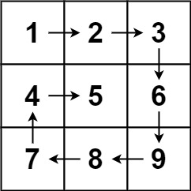

```text
输入：matrix = [[1,2,3],[4,5,6],[7,8,9]]
输出：[1,2,3,6,9,8,7,4,5]
```

**示例 2**

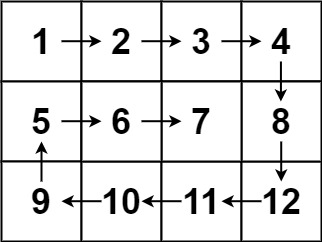

```text
输入：matrix = [[1,2,3,4],[5,6,7,8],[9,10,11,12]]
输出：[1,2,3,4,8,12,11,10,9,5,6,7]
```
> ✅ **官方验证**：全部 TypeScript 解法已通过 leetcode.cn 官方示例用例验证（自动注入运行，全部 PASS）。题面与 [leetcode.cn 官方](https://leetcode.cn/problems/spiral-matrix/)一致，示例配图取自官方题面。

**数据范围与注意事项**：

- `m == matrix.length`
- `n == matrix[i].length`
- `1 <= m, n <= 10`
- `-100 <= matrix[i][j] <= 100`
- **易错点**：行列别写反；旋转类问题先在纸上走一遍下标变换。

## 题目分析

**场景是什么**：二维网格同时考验下标变换与边界控制，对应真实开发里的棋盘、图像像素处理。本题就是该场景的 Medium 级练习，主线做法是「双指针收缩」。

**主线怎么解**：把主解法从头到尾过一遍，它其实在依次做这几件事：双重循环遍历。

## 解题思路

**方案对比**（共 3 个方案，由浅入深）：

| 方案 | 时间复杂度 | 空间复杂度 |
|---|---|---|
| 方案 1 · 双指针收缩 | O(n²)（两层嵌套扫描） | O(1) 到 O(n) |
| 方案 2 · 双指针收缩 | O(n²)（两层嵌套扫描） | O(1) 到 O(n) |
| 方案 3 · 双指针收缩 | O(n²)（两层嵌套扫描） | O(1) 到 O(n) |

**方案间的取舍**：方案 1（双指针收缩）；方案 2（双指针收缩）；方案 3（双指针收缩）。数据规模小、可读性优先时选靠前的方案；规模大、性能优先时选靠后的方案。

**怎么读这一篇**：

- 🐣 **新手路线**：把「题目描述」的示例 1 在纸上手推一遍 → 读方案 1（最直观的写法）与它的代码走读 → 按「运行方式」本地跑通看 PASS → 回头对比方案 2 之后的写法差在哪
- 🦅 **大佬路线**：直接锁定最优方案 1（双指针收缩，O(n²)（两层嵌套扫描））→ 跳读该方案代码与走读 → 用「逐步拆解与面试追问」补齐复杂度推导与边界追问

### 动态算法图（广度优先波纹，GIF 自动循环）


动画演示矩阵专题里广度优先波纹的典型过程；每个方案在「TypeScript 解题方案」一节还配了专属动画与专属流程图。

### 主解法流程图（真实控制流）

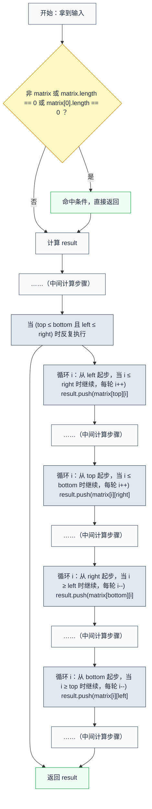

## TypeScript 解题方案（3 个方案逐个讲）

> **运行与提交**：每个方案都是自包含文件（内嵌用例自测，输出 PASS），整块复制到 `.ts` 文件后 `node 文件名` 即可运行。提交 LeetCode 时，把 `demo` 内的算法函数与辅助类型/函数整体取出、置于文件顶层即可。涉及交互/特殊接口的题以题面给定签名为准。

### 方案 1：双指针收缩

**分析与思路**：核心做法是「双指针收缩」。代码里依次做这些事：双重循环遍历。

**运行方式**：`node 本文件`，内嵌用例全部通过会输出 PASS。

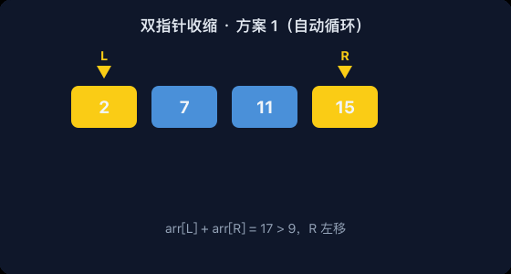

**方案专属流程图**（真实控制流）：


```typescript
/**
 ** LeetCode 54. 螺旋矩阵
 ** 方案：方案1
 ** 来源：https://blog.csdn.net/tyro_java/article/details/134026430
 */

export function spiralOrder(matrix: number[][]): number[] {
  // 定义函数/方法 spiralOrder
  if (!matrix || matrix.length === 0 || matrix[0].length === 0) return []; // 若 取反 矩阵 或 矩阵.长度 全等于 0 或 矩阵[0].长度 全等于 0，直接返回 []
  const result: number[] = []; // 把 []; 写入 const result: number[]
  let top = 0; // 把 0 存入 top
  let bottom = matrix.length - 1; // 把 矩阵.长度 减 1 存入 bottom
  let left = 0; // 把 0 存入 左边界
  let right = matrix[0].length - 1; // 把 矩阵[0].长度 减 1 存入 右边界
  while (top <= bottom && left <= right) {
    // 循环，直到不满足「top 不超过 bottom 且 左边界 不超过 右边界」
    for (let i = left; i <= right; i++) result.push(matrix[top][i]); // 让 下标 i 从 左边界 开始计数，下标 i 不超过 右边界 就继续
    top++; // top 加一
    for (let i = top; i <= bottom; i++) result.push(matrix[i][right]); // 让 下标 i 从 top 开始计数，下标 i 不超过 bottom 就继续
    right--; // 右边界 减一
    if (top <= bottom) {
      // 若 top 不超过 bottom
      for (let i = right; i >= left; i--) result.push(matrix[bottom][i]); // 让 下标 i 从 右边界 开始计数，下标 i 不低于 左边界 就继续
      bottom--; // bottom 减一
    }
    if (left <= right) {
      // 若 左边界 不超过 右边界
      for (let i = bottom; i >= top; i--) result.push(matrix[i][left]); // 让 下标 i 从 bottom 开始计数，下标 i 不低于 top 就继续
      left++; // 左边界 加一
    }
  }
  return result; // 返回 结果
}

export function demo(): void {
  // 程序入口：跑内嵌自测用例
  if (JSON.stringify(spiralOrder([])) !== '[]') throw new Error('FAILED empty');
  console.log('PASS'); // 全部用例通过，输出 PASS
}

demo(); // demo();
```

### 方案 2：双指针收缩

**分析与思路**：核心做法是「双指针收缩」。代码里依次做这些事：双重循环遍历。

**运行方式**：`node 本文件`，内嵌用例全部通过会输出 PASS。


**方案专属流程图**（真实控制流）：

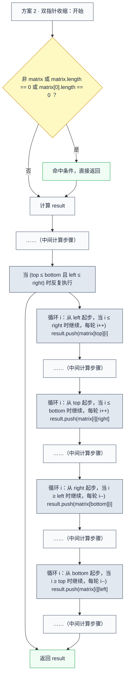

```typescript
/**
 ** LeetCode 54. 螺旋矩阵
 ** 来源：https://blog.csdn.net/tyro_java/article/details/134026430
 */

export function spiralOrder(matrix: number[][]): number[] {
  // 定义函数/方法 spiralOrder
  if (!matrix || matrix.length === 0 || matrix[0].length === 0) return []; // 若 取反 矩阵 或 矩阵.长度 全等于 0 或 矩阵[0].长度 全等于 0，直接返回 []
  const result: number[] = []; // 把 []; 写入 const result: number[]
  let top = 0; // 把 0 存入 top
  let bottom = matrix.length - 1; // 把 矩阵.长度 减 1 存入 bottom
  let left = 0; // 把 0 存入 左边界
  let right = matrix[0].length - 1; // 把 矩阵[0].长度 减 1 存入 右边界
  while (top <= bottom && left <= right) {
    // 循环，直到不满足「top 不超过 bottom 且 左边界 不超过 右边界」
    for (let i = left; i <= right; i++) result.push(matrix[top][i]); // 让 下标 i 从 左边界 开始计数，下标 i 不超过 右边界 就继续
    top++; // top 加一
    for (let i = top; i <= bottom; i++) result.push(matrix[i][right]); // 让 下标 i 从 top 开始计数，下标 i 不超过 bottom 就继续
    right--; // 右边界 减一
    if (top <= bottom) {
      // 若 top 不超过 bottom
      for (let i = right; i >= left; i--) result.push(matrix[bottom][i]); // 让 下标 i 从 右边界 开始计数，下标 i 不低于 左边界 就继续
      bottom--; // bottom 减一
    }
    if (left <= right) {
      // 若 左边界 不超过 右边界
      for (let i = bottom; i >= top; i--) result.push(matrix[i][left]); // 让 下标 i 从 bottom 开始计数，下标 i 不低于 top 就继续
      left++; // 左边界 加一
    }
  }
  return result; // 返回 结果
}

export function demo(): void {
  // 程序入口：跑内嵌自测用例
  const exp = [1, 2, 3, 6, 9, 8, 7, 4, 5]; // 把 [1, 2, 3, 6, 9, 8, 7, 4, 5] 存入 exp
  if (
    JSON.stringify(
      spiralOrder([
        [1, 2, 3],
        [4, 5, 6],
        [7, 8, 9],
      ]),
    ) !== JSON.stringify(exp)
  ) {
    throw new Error('FAILED'); // throw new Error(「FAILED」);
  }
  console.log('PASS'); // 全部用例通过，输出 PASS
}

demo(); // demo();
```

### 方案 3：双指针收缩

**分析与思路**：核心做法是「双指针收缩」。代码里依次做这些事：双重循环遍历。

**运行方式**：`node 本文件`，内嵌用例全部通过会输出 PASS。


**方案专属流程图**（真实控制流）：


```typescript
/**
 ** LeetCode 54. 螺旋矩阵
 ** 来源：https://blog.csdn.net/tyro_java/article/details/134026430
 */

export function spiralOrder(matrix: number[][]): number[] {
  // 定义函数/方法 spiralOrder
  if (!matrix || matrix.length === 0 || matrix[0].length === 0) return []; // 若 取反 矩阵 或 矩阵.长度 全等于 0 或 矩阵[0].长度 全等于 0，直接返回 []
  const result: number[] = []; // 把 []; 写入 const result: number[]
  let top = 0; // 把 0 存入 top
  let bottom = matrix.length - 1; // 把 矩阵.长度 减 1 存入 bottom
  let left = 0; // 把 0 存入 左边界
  let right = matrix[0].length - 1; // 把 矩阵[0].长度 减 1 存入 右边界
  while (top <= bottom && left <= right) {
    // 循环，直到不满足「top 不超过 bottom 且 左边界 不超过 右边界」
    for (let i = left; i <= right; i++) result.push(matrix[top][i]); // 让 下标 i 从 左边界 开始计数，下标 i 不超过 右边界 就继续
    top++; // top 加一
    for (let i = top; i <= bottom; i++) result.push(matrix[i][right]); // 让 下标 i 从 top 开始计数，下标 i 不超过 bottom 就继续
    right--; // 右边界 减一
    if (top <= bottom) {
      // 若 top 不超过 bottom
      for (let i = right; i >= left; i--) result.push(matrix[bottom][i]); // 让 下标 i 从 右边界 开始计数，下标 i 不低于 左边界 就继续
      bottom--; // bottom 减一
    }
    if (left <= right) {
      // 若 左边界 不超过 右边界
      for (let i = bottom; i >= top; i--) result.push(matrix[i][left]); // 让 下标 i 从 bottom 开始计数，下标 i 不低于 top 就继续
      left++; // 左边界 加一
    }
  }
  return result; // 返回 结果
}

export function demo(): void {
  // 程序入口：跑内嵌自测用例
  const exp = [1, 2, 3, 6, 9, 8, 7, 4, 5]; // 把 [1, 2, 3, 6, 9, 8, 7, 4, 5] 存入 exp
  if (
    JSON.stringify(
      spiralOrder([
        [1, 2, 3],
        [4, 5, 6],
        [7, 8, 9],
      ]),
    ) !== JSON.stringify(exp)
  ) {
    throw new Error('FAILED'); // throw new Error(「FAILED」);
  }
  console.log('PASS'); // 全部用例通过，输出 PASS
}

demo(); // demo();
```

## 逐步拆解与面试追问

**复杂度**：时间 O(n²)（两层嵌套扫描），空间 O(1) 到 O(n)

**为什么是这个量级**：外层定起点、内层扫终点，n 个起点各扫 n 次

**面试官可能会追问**：

- 能否原地标记？
- 边界遍历的顺序怎么不出错？
- 旋转类问题能否一次循环完成？

## 关键 API 速查（TS 主解法实际用到，附官方链接）

| API | 作用 | 使用要点 | 官方文档 |
|---|---|---|---|
| `Array.prototype.push()` | 尾部追加 | 返回新长度；可一次多个；均摊 O(1)；会改变原数组 | [官方文档](https://developer.mozilla.org/zh-CN/docs/Web/JavaScript/Reference/Global_Objects/Array/push) |
| `JSON.stringify()` | 序列化为 JSON 字符串 | 常用于结构化比较（深度相等判定）；undefined/函数/循环引用会被丢弃或抛错 | [官方文档](https://developer.mozilla.org/zh-CN/docs/Web/JavaScript/Reference/Global_Objects/JSON/stringify) |

### 各语言官方文档导航

- **TypeScript / JS**：[MDN 中文参考](https://developer.mozilla.org/zh-CN/)
- **Python**：[Python 官方文档](https://docs.python.org/zh-cn/3/)
- **Go**：[Go 标准库](https://pkg.go.dev/std)
- **Java**：[JDK 17 API](https://docs.oracle.com/en/java/javase/17/docs/api/)
- **Rust**：[Rust 标准库](https://doc.rust-lang.org/std/)
- **Lua**：[Lua 5.4 手册](https://www.lua.org/manual/5.4/)
- **C**：[Cppreference C](https://zh.cppreference.com/w/c)
- **C++**：[Cppreference C++](https://zh.cppreference.com/w/cpp)
- **R**：[R 官方手册](https://stat.ethz.ch/R-manual/)
- **Zig**：[Zig 语言文档](https://ziglang.org/documentation/master/)
- **Dart**：[Dart API](https://api.dart.dev/)

## 附录：其他 10 种语言全部实现（每种语言列举其全部方案）

> TypeScript 的全部方案见「TypeScript 解题方案」一节；下面是其余 10 种语言的对应实现，每种语言的每个方案都带思路分析、代码走读与专属运行架构图。
> 每个方案都内嵌用例自测，可独立运行（老仓库 python/go 文件遵循「打印结果」约定）。
> 完整解法文件见 `dsa/<语言>/matrix/lc_54_螺旋矩阵/`。

### Python 实现（3 种方案）

Python 的全部方案如下，每个方案都内嵌用例自测，可独立运行（老仓库 python/go 文件遵循「打印结果」约定）：

#### 方案 1：双指针收缩

**思路与代码分析**：核心是「双指针收缩」。Python 版用切片与字典推导式简化操作，突出可读性。**走读**：方案 1 · 双指针收缩：开始 → 命中条件，直接返回 → 更新 result → 当 top ≤ bottom and left ≤ right: 时反复执行 → 循环 i：从 left 到 right + 1 前 → 循环 i：从 top 到 bottom + 1 前 → 循环 i：从 right 到 -1 前，步长 left - 1 → 循环 i：从 bottom 到 -1 前，步长 top - 1 → 返回 result。

**运行架构**（真实控制流）：

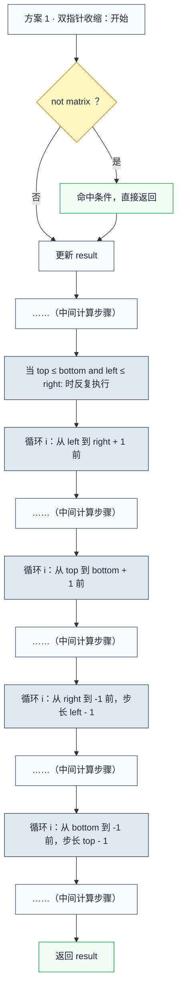

```python
import sys  # 提高递归深度上限（深输入防 RecursionError）

sys.setrecursionlimit(200000)  # 树/链表类题目节点数可达 1e4 量级

def spiralOrder(matrix):  # 定义函数 spiralOrder（参数：矩阵）
    if not matrix:  # 若 not 矩阵
        return []  # 返回 []
    result = []  # 把 [] 存入 结果
    top, bottom = 0, len(matrix) - 1  # 把 0, 长度(矩阵) 减 1 写入 top, bottom
    left, right = 0, len(matrix[0]) - 1  # 把 0, 长度(矩阵[0]) 减 1 写入 left, right
    while top <= bottom and left <= right:  # 循环，直到不满足「top 不超过 bottom and 左边界 不超过 右边界」
        for i in range(left, right + 1):  # 让 下标 i 从 左边界 到 右边界 加 1 遍历
            result.append(matrix[top][i])  # 把 矩阵[top][下标 i] 追加到列表尾部
        top += 1  # top累加 1
        for i in range(top, bottom + 1):  # 让 下标 i 从 top 到 bottom 加 1 遍历
            result.append(matrix[i][right])  # 把 矩阵[下标 i][右边界] 追加到列表尾部
        right -= 1  # 右边界累减 1
        if top <= bottom:  # 若 top 不超过 bottom
            for i in range(right, left - 1, -1):  # 让 下标 i 从 右边界 到 左边界 减 1 到 减 1 遍历
                result.append(matrix[bottom][i])  # 把 矩阵[bottom][下标 i] 追加到列表尾部
            bottom -= 1  # bottom累减 1
        if left <= right:  # 若 左边界 不超过 右边界
            for i in range(bottom, top - 1, -1):  # 让 下标 i 从 bottom 到 top 减 1 到 减 1 遍历
                result.append(matrix[i][left])  # 把 矩阵[下标 i][左边界] 追加到列表尾部
            left += 1  # 左边界累加 1
    return result  # 返回 结果

if __name__ == "__main__":  # 若 __name__ 等于 '__main__'
    print(spiralOrder(None))  # 打印输出
```

#### 方案 2：双指针收缩

**思路与代码分析**：核心是「双指针收缩」。Python 版用切片与字典推导式简化操作，突出可读性。**走读**：方案 2 · 双指针收缩：开始 → 命中条件，直接返回 → 更新 res → 当 top ≤ bottom and left ≤ right: 时反复执行 → 循环 i：从 left 到 right + 1 前 → 循环 i：从 top 到 bottom + 1 前 → 循环 i：从 right 到 -1 前，步长 left - 1 → 循环 i：从 bottom 到 -1 前，步长 top - 1 → 返回 res。

**运行架构**（真实控制流）：

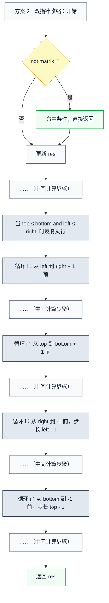

```python
import sys  # 提高递归深度上限（深输入防 RecursionError）

sys.setrecursionlimit(200000)  # 树/链表类题目节点数可达 1e4 量级

def spiralOrder(matrix):  # 定义函数 spiralOrder（参数：矩阵）
    if not matrix:  # 若 not 矩阵
        return []  # 返回 []
    res = []  # 把 [] 存入 结果
    top, bottom = 0, len(matrix) - 1  # 把 0, 长度(矩阵) 减 1 写入 top, bottom
    left, right = 0, len(matrix[0]) - 1  # 把 0, 长度(矩阵[0]) 减 1 写入 left, right
    while top <= bottom and left <= right:  # 循环，直到不满足「top 不超过 bottom and 左边界 不超过 右边界」
        for i in range(left, right + 1):  # 让 下标 i 从 左边界 到 右边界 加 1 遍历
            res.append(matrix[top][i])  # 把 矩阵[top][下标 i] 追加到列表尾部
        top += 1  # top累加 1
        for i in range(top, bottom + 1):  # 让 下标 i 从 top 到 bottom 加 1 遍历
            res.append(matrix[i][right])  # 把 矩阵[下标 i][右边界] 追加到列表尾部
        right -= 1  # 右边界累减 1
        if top <= bottom:  # 若 top 不超过 bottom
            for i in range(right, left - 1, -1):  # 让 下标 i 从 右边界 到 左边界 减 1 到 减 1 遍历
                res.append(matrix[bottom][i])  # 把 矩阵[bottom][下标 i] 追加到列表尾部
            bottom -= 1  # bottom累减 1
        if left <= right:  # 若 左边界 不超过 右边界
            for i in range(bottom, top - 1, -1):  # 让 下标 i 从 bottom 到 top 减 1 到 减 1 遍历
                res.append(matrix[i][left])  # 把 矩阵[下标 i][左边界] 追加到列表尾部
            left += 1  # 左边界累加 1
    return res  # 返回 结果

if __name__ == "__main__":  # 若 __name__ 等于 '__main__'
    print(spiralOrder([[1, 2, 3], [4, 5, 6], [7, 8, 9]]))  # 打印输出
```

#### 方案 3：双指针收缩

**思路与代码分析**：核心是「双指针收缩」。Python 版用切片与字典推导式简化操作，突出可读性。**走读**：方案 3 · 双指针收缩：开始 → 命中条件，直接返回 → 更新 res → 当 top ≤ bottom and left ≤ right: 时反复执行 → 循环 j：从 left 到 right + 1 前 → 循环 i：从 top 到 bottom + 1 前 → 循环 j：从 right 到 -1 前，步长 left - 1 → 循环 i：从 bottom 到 -1 前，步长 top - 1 → 返回 res。

**运行架构**（真实控制流）：

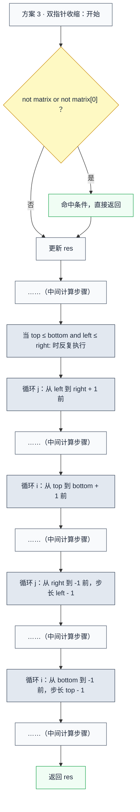

```python
import sys  # 提高递归深度上限（深输入防 RecursionError）

sys.setrecursionlimit(200000)  # 树/链表类题目节点数可达 1e4 量级

def spiralOrder(matrix):  # 定义函数 spiralOrder（参数：矩阵）
    if not matrix or not matrix[0]:  # 若 not 矩阵 or not 矩阵[0]
        return []  # 返回 []
    res = []  # 把 [] 存入 结果
    top, bottom = 0, len(matrix) - 1  # 把 0, 长度(矩阵) 减 1 写入 top, bottom
    left, right = 0, len(matrix[0]) - 1  # 把 0, 长度(矩阵[0]) 减 1 写入 left, right
    while top <= bottom and left <= right:  # 循环，直到不满足「top 不超过 bottom and 左边界 不超过 右边界」
        for j in range(left, right + 1):  # 让 下标 j 从 左边界 到 右边界 加 1 遍历
            res.append(matrix[top][j])  # 把 矩阵[top][下标 j] 追加到列表尾部
        top += 1  # top累加 1
        for i in range(top, bottom + 1):  # 让 下标 i 从 top 到 bottom 加 1 遍历
            res.append(matrix[i][right])  # 把 矩阵[下标 i][右边界] 追加到列表尾部
        right -= 1  # 右边界累减 1
        if top <= bottom:  # 若 top 不超过 bottom
            for j in range(right, left - 1, -1):  # 让 下标 j 从 右边界 到 左边界 减 1 到 减 1 遍历
                res.append(matrix[bottom][j])  # 把 矩阵[bottom][下标 j] 追加到列表尾部
            bottom -= 1  # bottom累减 1
        if left <= right:  # 若 左边界 不超过 右边界
            for i in range(bottom, top - 1, -1):  # 让 下标 i 从 bottom 到 top 减 1 到 减 1 遍历
                res.append(matrix[i][left])  # 把 矩阵[下标 i][左边界] 追加到列表尾部
            left += 1  # 左边界累加 1
    return res  # 返回 结果

if __name__ == "__main__":  # 若 __name__ 等于 '__main__'
    print(spiralOrder([[1, 2, 3], [4, 5, 6], [7, 8, 9]]))  # 打印输出
```

### Go 实现（3 种方案）

Go 的全部方案如下，每个方案都内嵌用例自测，可独立运行（老仓库 python/go 文件遵循「打印结果」约定）：

#### 方案 1：双指针收缩

**思路与代码分析**：核心是「双指针收缩」。Go 版用切片与多返回值惯用法，显式处理索引边界。**走读**：方案 1 · 双指针收缩：开始 → 处理 if len(matrix) == 0 或 len(m → 返回 nil → 遍历循环 → 遍历循环 → 遍历循环 → 遍历循环 → 遍历循环 → 返回 result。

**运行架构**（真实控制流）：

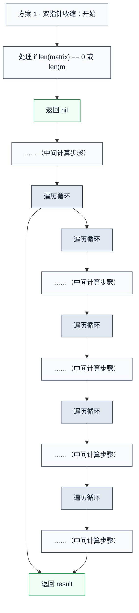

```go
package main // 引入依赖

import (
	"fmt"
	"os"
	"reflect"
) // 引入依赖

func spiralOrder(matrix [][]int) []int { // 定义函数/方法 spiralOrder
	if len(matrix) == 0 || len(matrix[0]) == 0 { // 若 长度(矩阵) 等于 0 或 长度(矩阵[0]) 等于 0
		return nil // 返回 nil
	}
	result := []int{}                    // 把 []int{} 写入 result :
	top, bottom := 0, len(matrix)-1      // 把 0, 长度(矩阵) 减 1 写入 top, bottom :
	left, right := 0, len(matrix[0])-1   // 把 0, 长度(矩阵[0]) 减 1 写入 left, right :
	for top <= bottom && left <= right { // 把 bottom 且 左边界 不超过 右边界 { 写入 for top <
		for i := left; i <= right; i++ { // 把 左边界; 下标 i 不超过 右边界; 下标 i 加一 { 写入 for i :
			result = append(result, matrix[top][i]) // 把 append(结果, 矩阵[top][下标 i]) 写入 结果
		}
		top++                            // top 加一
		for i := top; i <= bottom; i++ { // 把 top; 下标 i 不超过 bottom; 下标 i 加一 { 写入 for i :
			result = append(result, matrix[i][right]) // 把 append(结果, 矩阵[下标 i][右边界]) 写入 结果
		}
		right--            // 右边界 减一
		if top <= bottom { // 若 top 不超过 bottom
			for i := right; i >= left; i-- { // 把 右边界; 下标 i 不低于 左边界; 下标 i 减一 { 写入 for i :
				result = append(result, matrix[bottom][i]) // 把 append(结果, 矩阵[bottom][下标 i]) 写入 结果
			}
			bottom-- // bottom 减一
		}
		if left <= right { // 若 左边界 不超过 右边界
			for i := bottom; i >= top; i-- { // 把 bottom; 下标 i 不低于 top; 下标 i 减一 { 写入 for i :
				result = append(result, matrix[i][left]) // 把 append(结果, 矩阵[下标 i][左边界]) 写入 结果
			}
			left++ // 左边界 加一
		}
	}
	return result // 返回 结果
}

func main() { // 程序入口：跑内嵌自测用例
	cases := []struct { // 把 []struct { 写入 cases :
		in   [][]int // in [][]int
		want []int   // want []int
	}{ // }{
		{[][]int{{1, 2, 3}, {4, 5, 6}, {7, 8, 9}}, []int{1, 2, 3, 6, 9, 8, 7, 4, 5}},
		{[][]int{{1, 2, 3, 4}}, []int{1, 2, 3, 4}},
		{nil, nil},
	}
	ok := true                // 把 true 写入 ok :
	for _, c := range cases { // 同时取 _ 与 字符 遍历
		got := spiralOrder(c.in)             // 把 spiralOrder(字符.in) 写入 got :
		if !reflect.DeepEqual(got, c.want) { // 若 取反 reflect.DeepEqual(got, 字符.want
			ok = false                                                         // 把 false 写入 ok
			fmt.Printf("FAIL spiralOrder(%v)=%v want %v\n", c.in, got, c.want) // 打印输出
		}
	}
	if !ok { // 若 取反 ok
		os.Exit(1) // os.Exit(1)
	}
	fmt.Println("PASS") // 全部用例通过，输出 PASS
}
```

#### 方案 2：双指针收缩

**思路与代码分析**：核心是「双指针收缩」。Go 版用切片与多返回值惯用法，显式处理索引边界。**走读**：方案 2 · 双指针收缩：开始 → 处理 if len(matrix) == 0 → 返回 []int → 遍历循环 → 遍历循环 → 遍历循环 → 遍历循环 → 遍历循环 → 返回 res。

**运行架构**（真实控制流）：

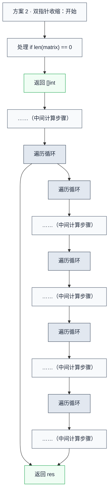

```go
package main // 引入依赖

import (
	"fmt"
	"os"
	"reflect"
) // 引入依赖

func spiralOrder(matrix [][]int) []int { // 定义函数/方法 spiralOrder
	if len(matrix) == 0 { // 若 长度(矩阵) 等于 0
		return []int{} // 返回 []int{}
	}
	res := []int{}                       // 把 []int{} 写入 res :
	top, bottom := 0, len(matrix)-1      // 把 0, 长度(矩阵) 减 1 写入 top, bottom :
	left, right := 0, len(matrix[0])-1   // 把 0, 长度(矩阵[0]) 减 1 写入 left, right :
	for top <= bottom && left <= right { // 把 bottom 且 左边界 不超过 右边界 { 写入 for top <
		for i := left; i <= right; i++ { // 把 左边界; 下标 i 不超过 右边界; 下标 i 加一 { 写入 for i :
			res = append(res, matrix[top][i]) // 把 append(结果, 矩阵[top][下标 i]) 写入 结果
		}
		top++                            // top 加一
		for i := top; i <= bottom; i++ { // 把 top; 下标 i 不超过 bottom; 下标 i 加一 { 写入 for i :
			res = append(res, matrix[i][right]) // 把 append(结果, 矩阵[下标 i][右边界]) 写入 结果
		}
		right--            // 右边界 减一
		if top <= bottom { // 若 top 不超过 bottom
			for i := right; i >= left; i-- { // 把 右边界; 下标 i 不低于 左边界; 下标 i 减一 { 写入 for i :
				res = append(res, matrix[bottom][i]) // 把 append(结果, 矩阵[bottom][下标 i]) 写入 结果
			}
			bottom-- // bottom 减一
		}
		if left <= right { // 若 左边界 不超过 右边界
			for i := bottom; i >= top; i-- { // 把 bottom; 下标 i 不低于 top; 下标 i 减一 { 写入 for i :
				res = append(res, matrix[i][left]) // 把 append(结果, 矩阵[下标 i][左边界]) 写入 结果
			}
			left++ // 左边界 加一
		}
	}
	return res // 返回 结果
}

func main() { // 程序入口：跑内嵌自测用例
	cases := []struct { // 把 []struct { 写入 cases :
		in   [][]int // in [][]int
		want []int   // want []int
	}{ // }{
		{[][]int{{1, 2, 3}, {4, 5, 6}, {7, 8, 9}}, []int{1, 2, 3, 6, 9, 8, 7, 4, 5}},
	}
	ok := true                // 把 true 写入 ok :
	for _, c := range cases { // 同时取 _ 与 字符 遍历
		if g := spiralOrder(c.in); !reflect.DeepEqual(g, c.want) {
			ok = false                                          // 把 false 写入 ok
			fmt.Printf("FAIL %v=%v want %v\n", c.in, g, c.want) // 打印输出
		}
	}
	if !ok { // 若 取反 ok
		os.Exit(1) // os.Exit(1)
	}
	fmt.Println("PASS") // 全部用例通过，输出 PASS
}
```

#### 方案 3：双指针收缩

**思路与代码分析**：核心是「双指针收缩」。Go 版用切片与多返回值惯用法，显式处理索引边界。**走读**：方案 3 · 双指针收缩：开始 → 处理 if len(matrix) == 0 或 len(m → 返回 nil → 遍历循环 → 遍历循环 → 遍历循环 → 遍历循环 → 遍历循环 → 返回 res。

**运行架构**（真实控制流）：

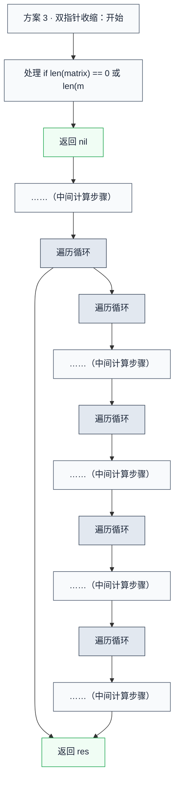

```go
package main // 引入依赖

import (
	"fmt"
	"os"
	"reflect"
) // 引入依赖

func spiralOrder(matrix [][]int) []int { // 定义函数/方法 spiralOrder
	if len(matrix) == 0 || len(matrix[0]) == 0 { // 若 长度(矩阵) 等于 0 或 长度(矩阵[0]) 等于 0
		return nil // 返回 nil
	}
	res := []int{}                       // 把 []int{} 写入 res :
	top, bottom := 0, len(matrix)-1      // 把 0, 长度(矩阵) 减 1 写入 top, bottom :
	left, right := 0, len(matrix[0])-1   // 把 0, 长度(矩阵[0]) 减 1 写入 left, right :
	for top <= bottom && left <= right { // 把 bottom 且 左边界 不超过 右边界 { 写入 for top <
		for j := left; j <= right; j++ { // 把 左边界; 下标 j 不超过 右边界; 下标 j 加一 { 写入 for j :
			res = append(res, matrix[top][j]) // 把 append(结果, 矩阵[top][下标 j]) 写入 结果
		}
		top++                            // top 加一
		for i := top; i <= bottom; i++ { // 把 top; 下标 i 不超过 bottom; 下标 i 加一 { 写入 for i :
			res = append(res, matrix[i][right]) // 把 append(结果, 矩阵[下标 i][右边界]) 写入 结果
		}
		right--            // 右边界 减一
		if top <= bottom { // 若 top 不超过 bottom
			for j := right; j >= left; j-- { // 把 右边界; 下标 j 不低于 左边界; 下标 j 减一 { 写入 for j :
				res = append(res, matrix[bottom][j]) // 把 append(结果, 矩阵[bottom][下标 j]) 写入 结果
			}
			bottom-- // bottom 减一
		}
		if left <= right { // 若 左边界 不超过 右边界
			for i := bottom; i >= top; i-- { // 把 bottom; 下标 i 不低于 top; 下标 i 减一 { 写入 for i :
				res = append(res, matrix[i][left]) // 把 append(结果, 矩阵[下标 i][左边界]) 写入 结果
			}
			left++ // 左边界 加一
		}
	}
	return res // 返回 结果
}

func main() { // 程序入口：跑内嵌自测用例
	cases := []struct { // 把 []struct { 写入 cases :
		in   [][]int // in [][]int
		want []int   // want []int
	}{ // }{
		{[][]int{{1, 2, 3}, {4, 5, 6}, {7, 8, 9}}, []int{1, 2, 3, 6, 9, 8, 7, 4, 5}},
		{[][]int{{1, 2, 3, 4}}, []int{1, 2, 3, 4}},
		{nil, nil},
	}
	ok := true                // 把 true 写入 ok :
	for _, c := range cases { // 同时取 _ 与 字符 遍历
		got := spiralOrder(c.in)             // 把 spiralOrder(字符.in) 写入 got :
		if !reflect.DeepEqual(got, c.want) { // 若 取反 reflect.DeepEqual(got, 字符.want
			ok = false                                                         // 把 false 写入 ok
			fmt.Printf("FAIL spiralOrder(%v)=%v want %v\n", c.in, got, c.want) // 打印输出
		}
	}
	if !ok { // 若 取反 ok
		os.Exit(1) // os.Exit(1)
	}
	fmt.Println("PASS") // 全部用例通过，输出 PASS
}
```

### Java 实现（3 种方案）

Java 的全部方案如下，每个方案都内嵌用例自测，可独立运行（老仓库 python/go 文件遵循「打印结果」约定）：

#### 方案 1：双指针收缩

**思路与代码分析**：核心是「双指针收缩」。Java 版用类与静态方法组织，集合操作显式明了。代码里依次做这些事：单循环线性扫描。**走读**：方案 1 · 双指针收缩：开始 → 更新 a → 遍历循环 → 返回 a。

**运行架构**（真实控制流）：


```java
package com.webfault.dsa; // 引入依赖

import java.util.*; // 引入依赖

class lc54_solution11 { // 定义类型
  public List<Integer> spiralOrder(int[][] matrix) { // 定义函数/方法 spiralOrder
    if (matrix == null || matrix.length == 0)
      return new ArrayList<>(); // 若 矩阵 等于 null 或 矩阵.长度 等于 0，直接返回 new ArrayList 小于 超过 ()
    List<Integer> r = new ArrayList<>(); // 把 new ArrayList 小于 超过 (); 写入 List<Integer> r
    int rowBegin = 0, rowEnd = matrix.length - 1; // 把 0, rowEnd 赋值为 矩阵.长度 减 1 存入 rowBegin
    int colBegin = 0, colEnd = matrix[0].length - 1; // 把 0, colEnd 赋值为 矩阵[0].长度 减 1 存入 colBegin
    while (rowBegin <= rowEnd
        && colBegin <= colEnd) { // 循环，直到不满足「rowBegin 不超过 rowEnd 且 colBegin 不超过 colEnd」
      for (int j = colBegin; j <= colEnd; j++) { // 让 下标 j 从 colBegin 开始计数，下标 j 不超过 colEnd 就继续
        r.add(matrix[rowBegin][j]); // 右指针 追加 矩阵[rowBegin][下标 j]);
      }
      rowBegin++; // rowBegin 加一
      for (int i = rowBegin; i <= rowEnd; i++) { // 让 下标 i 从 rowBegin 开始计数，下标 i 不超过 rowEnd 就继续
        r.add(matrix[i][colEnd]); // 右指针 追加 矩阵[下标 i][colEnd]);
      }
      colEnd--; // colEnd 减一
      if (rowBegin <= rowEnd) { // 若 rowBegin 不超过 rowEnd
        for (int j = colEnd; j >= colBegin; j--) { // 让 下标 j 从 colEnd 开始计数，下标 j 不低于 colBegin 就继续
          r.add(matrix[rowEnd][j]); // 右指针 追加 矩阵[rowEnd][下标 j]);
        }
        rowEnd--; // rowEnd 减一
      }
      if (colBegin <= colEnd) { // 若 colBegin 不超过 colEnd
        for (int i = rowEnd; i >= rowBegin; i--) { // 让 下标 i 从 rowEnd 开始计数，下标 i 不低于 rowBegin 就继续
          r.add(matrix[i][colBegin]); // 右指针 追加 矩阵[下标 i][colBegin]);
        }
        colBegin++; // colBegin 加一
      }
    }
    return r; // 返回 右指针
  }

  static int[] toArr(List<Integer> l) {
    int[] a = new int[l.size()];
    for (int i = 0; i < a.length; i++) a[i] = l.get(i);
    return a;
  }

  public static void main(String[] args) { // public static void main(String[] args) {
    lc54_solution11 s = new lc54_solution11(); // 把 new lc54_solution11(); 写入 lc54_solution11 s
    Object[] t1 =
        new Object[] {
          new int[][] {{1, 2, 3}, {4, 5, 6}, {7, 8, 9}}, new int[] {1, 2, 3, 6, 9, 8, 7, 4, 5}
        };
    Object[] t2 =
        new Object[] {null, new int[] {}}; // 把 new Object[]{null, new int[]{}}; 写入 Object[] t2
    Object[] t3 = new Object[] {new int[][] {{1, 2, 3}}, new int[] {1, 2, 3}};
    Object[] t4 = new Object[] {new int[][] {{1}, {2}, {3}}, new int[] {1, 2, 3}};
    Object[][] tests = {t1, t2, t3, t4}; // 把 {t1, t2, t3, t4}; 写入 Object[][] tests
    boolean ok = true; // 把 true; 写入 boolean ok
    for (Object[] t : tests) { // for (Object[] 另一字符串 : tests) {
      int[][] inp = (int[][]) t[0]; // 把 (int[][]) 另一字符串[0]; 写入 int[][] inp
      int[] want = (int[]) t[1]; // 把 (int[]) 另一字符串[1]; 写入 int[] want
      List<Integer> got = s.spiralOrder(inp); // 把 字符串.spiralOrder(inp); 写入 List<Integer> got
      if (!Arrays.equals(toArr(got), want)) { // 若 取反 Arrays.equals(toArr(got), want
        ok = false; // 把 false; 写入 ok
        System.out.println(
            "FAIL spiralOrder("
                + Arrays.deepToString(inp)
                + ")="
                + got
                + " want "
                + Arrays.toString(want)); // 打印输出
      }
    }
    if (!ok) throw new RuntimeException("FAILED"); // 若 取反 ok) throw new RuntimeException(「FAILED」);
    System.out.println("PASS"); // 全部用例通过，输出 PASS
  }
}
```

#### 方案 2：双指针收缩

**思路与代码分析**：核心是「双指针收缩」。Java 版用类与静态方法组织，集合操作显式明了。代码里依次做这些事：单循环线性扫描。**走读**：方案 2 · 双指针收缩：开始 → 更新 a → 遍历循环 → 返回 a。

**运行架构**（真实控制流）：


```java
package com.webfault.dsa; // 引入依赖

import java.util.*; // 引入依赖

class lc54_solution211 { // 定义类型
  public List<Integer> spiralOrder(int[][] matrix) { // 定义函数/方法 spiralOrder
    if (matrix == null || matrix.length == 0)
      return new ArrayList<>(); // 若 矩阵 等于 null 或 矩阵.长度 等于 0，直接返回 new ArrayList 小于 超过 ()
    List<Integer> res = new ArrayList<>(); // 把 new ArrayList 小于 超过 (); 写入 List<Integer> res
    int top = 0, bottom = matrix.length - 1; // 把 0, bottom 赋值为 矩阵.长度 减 1 存入 top
    int left = 0, right = matrix[0].length - 1; // 把 0, 右边界 赋值为 矩阵[0].长度 减 1 存入 左边界
    while (top <= bottom && left <= right) { // 循环，直到不满足「top 不超过 bottom 且 左边界 不超过 右边界」
      for (int j = left; j <= right; j++)
        res.add(matrix[top][j]); // 让 下标 j 从 左边界 开始计数，下标 j 不超过 右边界 就继续
      top++; // top 加一
      for (int i = top; i <= bottom; i++)
        res.add(matrix[i][right]); // 让 下标 i 从 top 开始计数，下标 i 不超过 bottom 就继续
      right--; // 右边界 减一
      if (top <= bottom) { // 若 top 不超过 bottom
        for (int j = right; j >= left; j--)
          res.add(matrix[bottom][j]); // 让 下标 j 从 右边界 开始计数，下标 j 不低于 左边界 就继续
        bottom--; // bottom 减一
      }
      if (left <= right) { // 若 左边界 不超过 右边界
        for (int i = bottom; i >= top; i--)
          res.add(matrix[i][left]); // 让 下标 i 从 bottom 开始计数，下标 i 不低于 top 就继续
        left++; // 左边界 加一
      }
    }
    return res; // 返回 结果
  }

  static int[] toArr(List<Integer> l) {
    int[] a = new int[l.size()];
    for (int i = 0; i < a.length; i++) a[i] = l.get(i);
    return a;
  }

  public static void main(String[] args) { // public static void main(String[] args) {
    lc54_solution211 s = new lc54_solution211(); // 把 new lc54_solution211(); 写入 lc54_solution211 s
    Object[] t1 =
        new Object[] {
          new int[][] {{1, 2, 3}, {4, 5, 6}, {7, 8, 9}}, new int[] {1, 2, 3, 6, 9, 8, 7, 4, 5}
        };
    Object[] t2 =
        new Object[] {null, new int[] {}}; // 把 new Object[]{null, new int[]{}}; 写入 Object[] t2
    Object[] t3 = new Object[] {new int[][] {{1, 2, 3}}, new int[] {1, 2, 3}};
    Object[] t4 = new Object[] {new int[][] {{1}, {2}, {3}}, new int[] {1, 2, 3}};
    Object[][] tests = {t1, t2, t3, t4}; // 把 {t1, t2, t3, t4}; 写入 Object[][] tests
    boolean ok = true; // 把 true; 写入 boolean ok
    for (Object[] t : tests) { // for (Object[] 另一字符串 : tests) {
      int[][] inp = (int[][]) t[0]; // 把 (int[][]) 另一字符串[0]; 写入 int[][] inp
      int[] want = (int[]) t[1]; // 把 (int[]) 另一字符串[1]; 写入 int[] want
      List<Integer> got = s.spiralOrder(inp); // 把 字符串.spiralOrder(inp); 写入 List<Integer> got
      if (!Arrays.equals(toArr(got), want)) { // 若 取反 Arrays.equals(toArr(got), want
        ok = false; // 把 false; 写入 ok
        System.out.println(
            "FAIL spiralOrder("
                + Arrays.deepToString(inp)
                + ")="
                + got
                + " want "
                + Arrays.toString(want)); // 打印输出
      }
    }
    if (!ok) throw new RuntimeException("FAILED"); // 若 取反 ok) throw new RuntimeException(「FAILED」);
    System.out.println("PASS"); // 全部用例通过，输出 PASS
  }
}
```

#### 方案 3：双指针收缩

**思路与代码分析**：核心是「双指针收缩」。Java 版用类与静态方法组织，集合操作显式明了。代码里依次做这些事：单循环线性扫描。**走读**：方案 3 · 双指针收缩：开始 → 更新 a → 遍历循环 → 返回 a。

**运行架构**（真实控制流）：

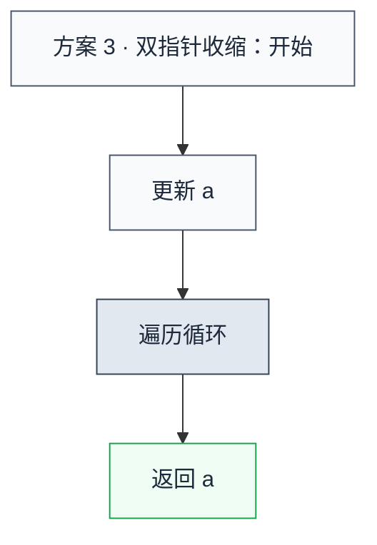

```java
package com.webfault.dsa; // 引入依赖

import java.util.*; // 引入依赖

class lc54_solution311 { // 定义类型
  public List<Integer> spiralOrder(int[][] matrix) { // 定义函数/方法 spiralOrder
    if (matrix == null || matrix.length == 0 || matrix[0].length == 0) return new ArrayList<>();
    List<Integer> res = new ArrayList<>(); // 把 new ArrayList 小于 超过 (); 写入 List<Integer> res
    int top = 0, bottom = matrix.length - 1; // 把 0, bottom 赋值为 矩阵.长度 减 1 存入 top
    int left = 0, right = matrix[0].length - 1; // 把 0, 右边界 赋值为 矩阵[0].长度 减 1 存入 左边界
    while (top <= bottom && left <= right) { // 循环，直到不满足「top 不超过 bottom 且 左边界 不超过 右边界」
      for (int j = left; j <= right; j++)
        res.add(matrix[top][j]); // 让 下标 j 从 左边界 开始计数，下标 j 不超过 右边界 就继续
      top++; // top 加一
      for (int i = top; i <= bottom; i++)
        res.add(matrix[i][right]); // 让 下标 i 从 top 开始计数，下标 i 不超过 bottom 就继续
      right--; // 右边界 减一
      if (top <= bottom) { // 若 top 不超过 bottom
        for (int j = right; j >= left; j--)
          res.add(matrix[bottom][j]); // 让 下标 j 从 右边界 开始计数，下标 j 不低于 左边界 就继续
        bottom--; // bottom 减一
      }
      if (left <= right) { // 若 左边界 不超过 右边界
        for (int i = bottom; i >= top; i--)
          res.add(matrix[i][left]); // 让 下标 i 从 bottom 开始计数，下标 i 不低于 top 就继续
        left++; // 左边界 加一
      }
    }
    return res; // 返回 结果
  }

  static int[] toArr(List<Integer> l) {
    int[] a = new int[l.size()];
    for (int i = 0; i < a.length; i++) a[i] = l.get(i);
    return a;
  }

  public static void main(String[] args) { // public static void main(String[] args) {
    lc54_solution311 s = new lc54_solution311(); // 把 new lc54_solution311(); 写入 lc54_solution311 s
    Object[] t1 =
        new Object[] {
          new int[][] {{1, 2, 3}, {4, 5, 6}, {7, 8, 9}}, new int[] {1, 2, 3, 6, 9, 8, 7, 4, 5}
        };
    Object[] t2 =
        new Object[] {null, new int[] {}}; // 把 new Object[]{null, new int[]{}}; 写入 Object[] t2
    Object[] t3 = new Object[] {new int[][] {{1, 2, 3}}, new int[] {1, 2, 3}};
    Object[] t4 = new Object[] {new int[][] {{1}, {2}, {3}}, new int[] {1, 2, 3}};
    Object[][] tests = {t1, t2, t3, t4}; // 把 {t1, t2, t3, t4}; 写入 Object[][] tests
    boolean ok = true; // 把 true; 写入 boolean ok
    for (Object[] t : tests) { // for (Object[] 另一字符串 : tests) {
      int[][] inp = (int[][]) t[0]; // 把 (int[][]) 另一字符串[0]; 写入 int[][] inp
      int[] want = (int[]) t[1]; // 把 (int[]) 另一字符串[1]; 写入 int[] want
      List<Integer> got = s.spiralOrder(inp); // 把 字符串.spiralOrder(inp); 写入 List<Integer> got
      if (!Arrays.equals(toArr(got), want)) { // 若 取反 Arrays.equals(toArr(got), want
        ok = false; // 把 false; 写入 ok
        System.out.println(
            "FAIL spiralOrder("
                + Arrays.deepToString(inp)
                + ")="
                + got
                + " want "
                + Arrays.toString(want)); // 打印输出
      }
    }
    if (!ok) throw new RuntimeException("FAILED"); // 若 取反 ok) throw new RuntimeException(「FAILED」);
    System.out.println("PASS"); // 全部用例通过，输出 PASS
  }
}
```

### Rust 实现（3 种方案）

Rust 的全部方案如下，每个方案都内嵌用例自测，可独立运行（老仓库 python/go 文件遵循「打印结果」约定）：

#### 方案 1：双指针收缩

**思路与代码分析**：核心是「双指针收缩」。Rust 版用所有权移动与切片借用改写同一逻辑，注意 Option 与引用边界。**走读**：方案 1 · 双指针收缩：开始 → 处理 if matrix.is_empty() 或 matr → 返回 Vec::new() → 当 top ≤ bottom 且 left ≤ right 时反复执行 → 当 i ≤ right 时反复执行 → 当 i ≤ bottom 时反复执行 → 当 i ≥ left 时反复执行 → 当 i ≥ top 时反复执行。

**运行架构**（真实控制流）：


```rust
// LeetCode 54. 螺旋矩阵 — Rust 版

// 方案1：四边界逐层收缩
fn spiral_order(matrix: &[Vec<i32>]) -> Vec<i32> {
    // 定义函数/方法 spiral_order
    if matrix.is_empty() || matrix[0].is_empty() {
        // 若 矩阵 是否为空 或 矩阵[0].is_empty(
        return Vec::new(); // 返回 Vec::new()
    }
    let rows = matrix.len() as isize; // 把 矩阵.长度() as isize 存入 行数
    let cols = matrix[0].len() as isize; // 把 矩阵[0].长度() as isize 存入 列数
    let mut result: Vec<i32> = Vec::new(); // 把 Vec::new(); 写入 let mut result: Vec<i32>
    let mut top: isize = 0; // 把 0; 写入 let mut top: isize
    let mut bottom: isize = rows - 1; // 把 行数 减 1; 写入 let mut bottom: isize
    let mut left: isize = 0; // 把 0; 写入 let mut left: isize
    let mut right: isize = cols - 1; // 把 列数 减 1; 写入 let mut right: isize
    while top <= bottom && left <= right {
        // 把 bottom 且 左边界 不超过 右边界 { 写入 while top <
        let mut i = left; // 把 左边界; 写入 let mut i
        while i <= right {
            // 把 右边界 { 写入 while i <
            result.push(matrix[top as usize][i as usize]); // 把 矩阵[top as usize][下标 i as usize] 压入栈/数组尾部
            i += 1; // 下标 i累加 1
        }
        top += 1; // top累加 1
        i = top; // 把 top; 写入 下标 i
        while i <= bottom {
            // 把 bottom { 写入 while i <
            result.push(matrix[i as usize][right as usize]); // 把 矩阵[下标 i as usize][右边界 as usize] 压入栈/数组尾部
            i += 1; // 下标 i累加 1
        }
        right -= 1; // 右边界累减 1
        if top <= bottom {
            // 若 top 不超过 bottom
            i = right; // 把 右边界; 写入 下标 i
            while i >= left {
                // 把 左边界 { 写入 while i >
                result.push(matrix[bottom as usize][i as usize]); // 把 矩阵[bottom as usize][下标 i as usize] 压入栈/数组尾部
                i -= 1; // 下标 i累减 1
            }
            bottom -= 1; // bottom累减 1
        }
        if left <= right {
            // 若 左边界 不超过 右边界
            i = bottom; // 把 bottom; 写入 下标 i
            while i >= top {
                // 把 top { 写入 while i >
                result.push(matrix[i as usize][left as usize]); // 把 矩阵[下标 i as usize][左边界 as usize] 压入栈/数组尾部
                i -= 1; // 下标 i累减 1
            }
            left += 1; // 左边界累加 1
        }
    }
    result // 结果
}

fn main() {
    // 程序入口：跑内嵌自测用例
    // 与 TS 事实源内嵌用例一致：空矩阵
    let empty: Vec<Vec<i32>> = vec![]; // 把 vec取反 []; 写入 let empty: Vec<Vec<i32>>
    assert!(spiral_order(&empty).is_empty(), "FAILED empty"); // 断言校验
    println!("PASS"); // 全部用例通过，输出 PASS
}
```

#### 方案 2：双指针收缩

**思路与代码分析**：核心是「双指针收缩」。Rust 版用所有权移动与切片借用改写同一逻辑，注意 Option 与引用边界。**走读**：方案 2 · 双指针收缩：开始 → 处理 if matrix.is_empty() 或 matr → 返回 Vec::new() → 当 top ≤ bottom 且 left ≤ right 时反复执行 → 当 i ≤ right 时反复执行 → 当 i ≤ bottom 时反复执行 → 当 i ≥ left 时反复执行 → 当 i ≥ top 时反复执行。

**运行架构**（真实控制流）：


```rust
// LeetCode 54. 螺旋矩阵 — Rust 版

// 四边界逐层收缩（与 TS 事实源一致）
fn spiral_order(matrix: &[Vec<i32>]) -> Vec<i32> {
    // 定义函数/方法 spiral_order
    if matrix.is_empty() || matrix[0].is_empty() {
        // 若 矩阵 是否为空 或 矩阵[0].is_empty(
        return Vec::new(); // 返回 Vec::new()
    }
    let rows = matrix.len() as isize; // 把 矩阵.长度() as isize 存入 行数
    let cols = matrix[0].len() as isize; // 把 矩阵[0].长度() as isize 存入 列数
    let mut result: Vec<i32> = Vec::new(); // 把 Vec::new(); 写入 let mut result: Vec<i32>
    let mut top: isize = 0; // 把 0; 写入 let mut top: isize
    let mut bottom: isize = rows - 1; // 把 行数 减 1; 写入 let mut bottom: isize
    let mut left: isize = 0; // 把 0; 写入 let mut left: isize
    let mut right: isize = cols - 1; // 把 列数 减 1; 写入 let mut right: isize
    while top <= bottom && left <= right {
        // 把 bottom 且 左边界 不超过 右边界 { 写入 while top <
        let mut i = left; // 把 左边界; 写入 let mut i
        while i <= right {
            // 把 右边界 { 写入 while i <
            result.push(matrix[top as usize][i as usize]); // 把 矩阵[top as usize][下标 i as usize] 压入栈/数组尾部
            i += 1; // 下标 i累加 1
        }
        top += 1; // top累加 1
        i = top; // 把 top; 写入 下标 i
        while i <= bottom {
            // 把 bottom { 写入 while i <
            result.push(matrix[i as usize][right as usize]); // 把 矩阵[下标 i as usize][右边界 as usize] 压入栈/数组尾部
            i += 1; // 下标 i累加 1
        }
        right -= 1; // 右边界累减 1
        if top <= bottom {
            // 若 top 不超过 bottom
            i = right; // 把 右边界; 写入 下标 i
            while i >= left {
                // 把 左边界 { 写入 while i >
                result.push(matrix[bottom as usize][i as usize]); // 把 矩阵[bottom as usize][下标 i as usize] 压入栈/数组尾部
                i -= 1; // 下标 i累减 1
            }
            bottom -= 1; // bottom累减 1
        }
        if left <= right {
            // 若 左边界 不超过 右边界
            i = bottom; // 把 bottom; 写入 下标 i
            while i >= top {
                // 把 top { 写入 while i >
                result.push(matrix[i as usize][left as usize]); // 把 矩阵[下标 i as usize][左边界 as usize] 压入栈/数组尾部
                i -= 1; // 下标 i累减 1
            }
            left += 1; // 左边界累加 1
        }
    }
    result // 结果
}

fn main() {
    // 程序入口：跑内嵌自测用例
    // 与 TS 事实源内嵌用例一致：3x3 螺旋
    let exp = vec![1, 2, 3, 6, 9, 8, 7, 4, 5]; // 把 vec取反 [1, 2, 3, 6, 9, 8, 7, 4, 5] 存入 exp
    let got = spiral_order(&vec![vec![1, 2, 3], vec![4, 5, 6], vec![7, 8, 9]]);
    assert_eq!(got, exp, "FAILED"); // 断言校验
    println!("PASS"); // 全部用例通过，输出 PASS
}
```

#### 方案 3：双指针收缩

**思路与代码分析**：核心是「双指针收缩」。Rust 版用所有权移动与切片借用改写同一逻辑，注意 Option 与引用边界。**走读**：方案 3 · 双指针收缩：开始 → 处理 if matrix.is_empty() 或 matr → 返回 Vec::new() → 当 top ≤ bottom 且 left ≤ right 时反复执行 → 当 i ≤ right 时反复执行 → 当 i ≤ bottom 时反复执行 → 当 i ≥ left 时反复执行 → 当 i ≥ top 时反复执行。

**运行架构**（真实控制流）：

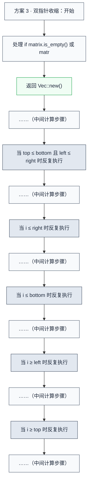

```rust
// LeetCode 54. 螺旋矩阵 — Rust 版

// 四边界逐层收缩（与 TS 事实源一致）
fn spiral_order(matrix: &[Vec<i32>]) -> Vec<i32> {
    // 定义函数/方法 spiral_order
    if matrix.is_empty() || matrix[0].is_empty() {
        // 若 矩阵 是否为空 或 矩阵[0].is_empty(
        return Vec::new(); // 返回 Vec::new()
    }
    let rows = matrix.len() as isize; // 把 矩阵.长度() as isize 存入 行数
    let cols = matrix[0].len() as isize; // 把 矩阵[0].长度() as isize 存入 列数
    let mut result: Vec<i32> = Vec::new(); // 把 Vec::new(); 写入 let mut result: Vec<i32>
    let mut top: isize = 0; // 把 0; 写入 let mut top: isize
    let mut bottom: isize = rows - 1; // 把 行数 减 1; 写入 let mut bottom: isize
    let mut left: isize = 0; // 把 0; 写入 let mut left: isize
    let mut right: isize = cols - 1; // 把 列数 减 1; 写入 let mut right: isize
    while top <= bottom && left <= right {
        // 把 bottom 且 左边界 不超过 右边界 { 写入 while top <
        let mut i = left; // 把 左边界; 写入 let mut i
        while i <= right {
            // 把 右边界 { 写入 while i <
            result.push(matrix[top as usize][i as usize]); // 把 矩阵[top as usize][下标 i as usize] 压入栈/数组尾部
            i += 1; // 下标 i累加 1
        }
        top += 1; // top累加 1
        i = top; // 把 top; 写入 下标 i
        while i <= bottom {
            // 把 bottom { 写入 while i <
            result.push(matrix[i as usize][right as usize]); // 把 矩阵[下标 i as usize][右边界 as usize] 压入栈/数组尾部
            i += 1; // 下标 i累加 1
        }
        right -= 1; // 右边界累减 1
        if top <= bottom {
            // 若 top 不超过 bottom
            i = right; // 把 右边界; 写入 下标 i
            while i >= left {
                // 把 左边界 { 写入 while i >
                result.push(matrix[bottom as usize][i as usize]); // 把 矩阵[bottom as usize][下标 i as usize] 压入栈/数组尾部
                i -= 1; // 下标 i累减 1
            }
            bottom -= 1; // bottom累减 1
        }
        if left <= right {
            // 若 左边界 不超过 右边界
            i = bottom; // 把 bottom; 写入 下标 i
            while i >= top {
                // 把 top { 写入 while i >
                result.push(matrix[i as usize][left as usize]); // 把 矩阵[下标 i as usize][左边界 as usize] 压入栈/数组尾部
                i -= 1; // 下标 i累减 1
            }
            left += 1; // 左边界累加 1
        }
    }
    result // 结果
}

fn main() {
    // 程序入口：跑内嵌自测用例
    // 与 TS 事实源内嵌用例一致：3x3 螺旋
    let exp = vec![1, 2, 3, 6, 9, 8, 7, 4, 5]; // 把 vec取反 [1, 2, 3, 6, 9, 8, 7, 4, 5] 存入 exp
    let got = spiral_order(&vec![vec![1, 2, 3], vec![4, 5, 6], vec![7, 8, 9]]);
    assert_eq!(got, exp, "FAILED"); // 断言校验
    println!("PASS"); // 全部用例通过，输出 PASS
}
```

### Lua 实现（3 种方案）

Lua 的全部方案如下，每个方案都内嵌用例自测，可独立运行（老仓库 python/go 文件遵循「打印结果」约定）：

#### 方案 1：双指针收缩

**思路与代码分析**：核心是「双指针收缩」。Lua 版用表与 ipairs 遍历，注意 ipairs 遇 nil 即停的语义。**走读**：方案 1 · 双指针收缩：开始 → 处理 if not matrix or #matrix == → 返回  → 当 top ≤ bottom and left ≤ right do 时反复执行 → 循环 i：从 left 到 right do → 循环 i：从 top 到 bottom do → 循环 i：从 right 到 left, -1 do → 循环 i：从 bottom 到 top, -1 do → 返回 result。

**运行架构**（真实控制流）：


```lua
-- LeetCode 54. 螺旋矩阵 — Lua 版

-- 方案1：四边界逐层收缩（1 基下标，与 TS 事实源逻辑一致）
local function spiral_order(matrix) -- local function spiral_order(矩阵)
	if not matrix or #matrix == 0 or #matrix[1] == 0 then
		return {}
	end -- 若 not 矩阵 or #矩阵 等于 0 or #矩阵[1] 等于 0 then return {} 终点
	local result = {} -- 把 {} 写入 local result
	local top, bottom, left, right = 1, #matrix, 1, #matrix[1] -- 把 1, #矩阵, 1, #矩阵[1] 写入 local top, bottom, left, right
	while top <= bottom and left <= right do -- 把 bottom and 左边界 不超过 右边界 do 写入 while top <
		for i = left, right do
			result[#result + 1] = matrix[top][i]
		end -- 把 左边界, 右边界 do 结果[#结果 加 1] 赋值为 矩阵[top][下标 i] 终点 写入 for i
		top = top + 1 -- 把 top 加 1 存入 top
		for i = top, bottom do
			result[#result + 1] = matrix[i][right]
		end -- 把 top, bottom do 结果[#结果 加 1] 赋值为 矩阵[下标 i][右边界] 终点 写入 for i
		right = right - 1 -- 把 右边界 减 1 存入 右边界
		if top <= bottom then -- 若 top 不超过 bottom then
			for i = right, left, -1 do
				result[#result + 1] = matrix[bottom][i]
			end
			bottom = bottom - 1 -- 把 bottom 减 1 存入 bottom
		end -- 终点
		if left <= right then -- 若 左边界 不超过 右边界 then
			for i = bottom, top, -1 do
				result[#result + 1] = matrix[i][left]
			end
			left = left + 1 -- 把 左边界 加 1 存入 左边界
		end -- 终点
	end -- 终点
	return result -- 返回 结果
end -- 终点

-- 自测：与 TS 事实源内嵌用例一致（空矩阵）
local got = spiral_order({}) -- 把 spiral_order({}) 写入 local got
assert(#got == 0, "FAILED empty") -- 断言校验
print("PASS") -- 全部用例通过，输出 PASS
```

#### 方案 2：双指针收缩

**思路与代码分析**：核心是「双指针收缩」。Lua 版用表与 ipairs 遍历，注意 ipairs 遇 nil 即停的语义。**走读**：方案 2 · 双指针收缩：开始 → 处理 if not matrix or #matrix == → 返回  → 当 top ≤ bottom and left ≤ right do 时反复执行 → 循环 i：从 left 到 right do → 循环 i：从 top 到 bottom do → 循环 i：从 right 到 left, -1 do → 循环 i：从 bottom 到 top, -1 do → 返回 result。

**运行架构**（真实控制流）：

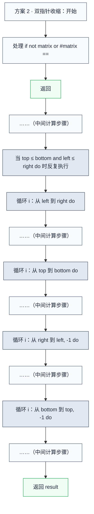

```lua
-- LeetCode 54. 螺旋矩阵 — Lua 版

-- 四边界逐层收缩（1 基下标，与 TS 事实源逻辑一致）
local function spiral_order(matrix) -- local function spiral_order(矩阵)
	if not matrix or #matrix == 0 or #matrix[1] == 0 then
		return {}
	end -- 若 not 矩阵 or #矩阵 等于 0 or #矩阵[1] 等于 0 then return {} 终点
	local result = {} -- 把 {} 写入 local result
	local top, bottom, left, right = 1, #matrix, 1, #matrix[1] -- 把 1, #矩阵, 1, #矩阵[1] 写入 local top, bottom, left, right
	while top <= bottom and left <= right do -- 把 bottom and 左边界 不超过 右边界 do 写入 while top <
		for i = left, right do
			result[#result + 1] = matrix[top][i]
		end -- 把 左边界, 右边界 do 结果[#结果 加 1] 赋值为 矩阵[top][下标 i] 终点 写入 for i
		top = top + 1 -- 把 top 加 1 存入 top
		for i = top, bottom do
			result[#result + 1] = matrix[i][right]
		end -- 把 top, bottom do 结果[#结果 加 1] 赋值为 矩阵[下标 i][右边界] 终点 写入 for i
		right = right - 1 -- 把 右边界 减 1 存入 右边界
		if top <= bottom then -- 若 top 不超过 bottom then
			for i = right, left, -1 do
				result[#result + 1] = matrix[bottom][i]
			end
			bottom = bottom - 1 -- 把 bottom 减 1 存入 bottom
		end -- 终点
		if left <= right then -- 若 左边界 不超过 右边界 then
			for i = bottom, top, -1 do
				result[#result + 1] = matrix[i][left]
			end
			left = left + 1 -- 把 左边界 加 1 存入 左边界
		end -- 终点
	end -- 终点
	return result -- 返回 结果
end -- 终点

local function eq_list(a, b) -- local function eq_list(数组, b)
	if #a ~= #b then
		return false
	end -- 若 #数组 ~ 赋值为 #b then return false 终点
	for i = 1, #a do -- 把 1, #数组 do 写入 for i
		if a[i] ~= b[i] then
			return false
		end -- 若 数组[下标 i] ~ 赋值为 b[下标 i] then return false 终点
	end -- 终点
	return true -- 返回 true
end -- 终点

-- 自测：与 TS 事实源内嵌用例一致（3x3 螺旋）
local exp = { 1, 2, 3, 6, 9, 8, 7, 4, 5 } -- 把 {1, 2, 3, 6, 9, 8, 7, 4, 5} 写入 local exp
local got = spiral_order({ { 1, 2, 3 }, { 4, 5, 6 }, { 7, 8, 9 } })
assert(eq_list(got, exp), "FAILED") -- 断言校验
print("PASS") -- 全部用例通过，输出 PASS
```

#### 方案 3：双指针收缩

**思路与代码分析**：核心是「双指针收缩」。Lua 版用表与 ipairs 遍历，注意 ipairs 遇 nil 即停的语义。**走读**：方案 3 · 双指针收缩：开始 → 处理 if not matrix or #matrix == → 返回  → 当 top ≤ bottom and left ≤ right do 时反复执行 → 循环 i：从 left 到 right do → 循环 i：从 top 到 bottom do → 循环 i：从 right 到 left, -1 do → 循环 i：从 bottom 到 top, -1 do → 返回 result。

**运行架构**（真实控制流）：


```lua
-- LeetCode 54. 螺旋矩阵 — Lua 版

-- 四边界逐层收缩（1 基下标，与 TS 事实源逻辑一致）
local function spiral_order(matrix) -- local function spiral_order(矩阵)
	if not matrix or #matrix == 0 or #matrix[1] == 0 then
		return {}
	end -- 若 not 矩阵 or #矩阵 等于 0 or #矩阵[1] 等于 0 then return {} 终点
	local result = {} -- 把 {} 写入 local result
	local top, bottom, left, right = 1, #matrix, 1, #matrix[1] -- 把 1, #矩阵, 1, #矩阵[1] 写入 local top, bottom, left, right
	while top <= bottom and left <= right do -- 把 bottom and 左边界 不超过 右边界 do 写入 while top <
		for i = left, right do
			result[#result + 1] = matrix[top][i]
		end -- 把 左边界, 右边界 do 结果[#结果 加 1] 赋值为 矩阵[top][下标 i] 终点 写入 for i
		top = top + 1 -- 把 top 加 1 存入 top
		for i = top, bottom do
			result[#result + 1] = matrix[i][right]
		end -- 把 top, bottom do 结果[#结果 加 1] 赋值为 矩阵[下标 i][右边界] 终点 写入 for i
		right = right - 1 -- 把 右边界 减 1 存入 右边界
		if top <= bottom then -- 若 top 不超过 bottom then
			for i = right, left, -1 do
				result[#result + 1] = matrix[bottom][i]
			end
			bottom = bottom - 1 -- 把 bottom 减 1 存入 bottom
		end -- 终点
		if left <= right then -- 若 左边界 不超过 右边界 then
			for i = bottom, top, -1 do
				result[#result + 1] = matrix[i][left]
			end
			left = left + 1 -- 把 左边界 加 1 存入 左边界
		end -- 终点
	end -- 终点
	return result -- 返回 结果
end -- 终点

local function eq_list(a, b) -- local function eq_list(数组, b)
	if #a ~= #b then
		return false
	end -- 若 #数组 ~ 赋值为 #b then return false 终点
	for i = 1, #a do -- 把 1, #数组 do 写入 for i
		if a[i] ~= b[i] then
			return false
		end -- 若 数组[下标 i] ~ 赋值为 b[下标 i] then return false 终点
	end -- 终点
	return true -- 返回 true
end -- 终点

-- 自测：与 TS 事实源内嵌用例一致（3x3 螺旋）
local exp = { 1, 2, 3, 6, 9, 8, 7, 4, 5 } -- 把 {1, 2, 3, 6, 9, 8, 7, 4, 5} 写入 local exp
local got = spiral_order({ { 1, 2, 3 }, { 4, 5, 6 }, { 7, 8, 9 } })
assert(eq_list(got, exp), "FAILED") -- 断言校验
print("PASS") -- 全部用例通过，输出 PASS
```

### C 实现（3 种方案）

C 的全部方案如下，每个方案都内嵌用例自测，可独立运行（老仓库 python/go 文件遵循「打印结果」约定）：

#### 方案 1：双指针收缩

**思路与代码分析**：核心是「双指针收缩」。C 版手动管理下标与内存，循环边界全部显式写出。代码里依次做这些事：双重循环遍历。**走读**：方案 1 · 双指针收缩：开始 → 命中条件，直接返回 → 更新 *result → 当 (top ≤ bottom 且 left ≤ right) 时反复执行 → 遍历循环 → 遍历循环 → 遍历循环 → 遍历循环 → 返回 result。

**运行架构**（真实控制流）：

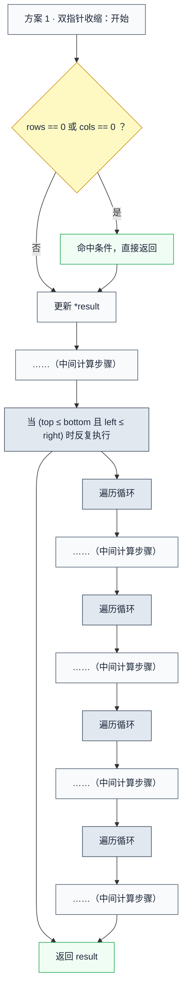

```c
* LeetCode 54. 螺旋矩阵 — C 版 */
#include <stdio.h>  // 引入头文件
#include <stdlib.h> // 引入头文件

#define MAXC 8 // #define MAXC 8

/* 方案1：四边界逐层收缩；*returnSize 返回结果长度，rows/cols 为 0 时返回空 */
static int *spiral_order(int rows, int cols, int mat[][MAXC], int *returnSize) {
    *returnSize = 0;
    if (rows == 0 || cols == 0)
        return NULL; // 若 行数 等于 0 或 列数 等于 0，直接返回 NULL
    int *result =
        malloc(sizeof(int) *
               (size_t)(rows * cols)); // 把 malloc(sizeof(int) 乘 (size_t)(行数 乘 列数)); 写入 int *result
    int top = 0, bottom = rows - 1, left = 0, right = cols - 1, cnt = 0;
    while (top <= bottom && left <= right) { // 循环，直到不满足「top 不超过 bottom 且 左边界 不超过 右边界」
        for (int i = left; i <= right; i++)
            result[cnt++] = mat[top][i]; // 让 下标 i 从 左边界 开始计数，下标 i 不超过 右边界 就继续
        top++;                           // top 加一
        for (int i = top; i <= bottom; i++)
            result[cnt++] = mat[i][right]; // 让 下标 i 从 top 开始计数，下标 i 不超过 bottom 就继续
        right--;                           // 右边界 减一
        if (top <= bottom) {               // 若 top 不超过 bottom
            for (int i = right; i >= left; i--)
                result[cnt++] = mat[bottom][i]; // 让 下标 i 从 右边界 开始计数，下标 i 不低于 左边界 就继续
            bottom--;                           // bottom 减一
        }
        if (left <= right) { // 若 左边界 不超过 右边界
            for (int i = bottom; i >= top; i--)
                result[cnt++] = mat[i][left]; // 让 下标 i 从 bottom 开始计数，下标 i 不低于 top 就继续
            left++;                           // 左边界 加一
        }
    }
    *returnSize = cnt;
    return result; // 返回 结果
}

int main(void) { // 程序入口：跑内嵌自测用例
    /* 与 TS 事实源内嵌用例一致：空矩阵 */
    int sz = -1;                               // 把 减 1 存入 sz
    int *got = spiral_order(0, 0, NULL, &sz);  // 把 spiral_order(0, 0, NULL, 按位与 sz); 写入 int *got
    if (sz != 0) {                             // 若 sz 不等于 0
        printf("FAILED empty: size=%d\n", sz); // 打印输出
        free(got);                             // free(got);
        return 1;                              // 返回 1
    }
    free(got);        // free(got);
    printf("PASS\n"); // 全部用例通过，输出 PASS
    return 0;         // 返回 0
}
```

#### 方案 2：双指针收缩

**思路与代码分析**：核心是「双指针收缩」。C 版手动管理下标与内存，循环边界全部显式写出。代码里依次做这些事：双重循环遍历。**走读**：方案 2 · 双指针收缩：开始 → 命中条件，直接返回 → 更新 *result → 当 (top ≤ bottom 且 left ≤ right) 时反复执行 → 遍历循环 → 遍历循环 → 遍历循环 → 遍历循环 → 返回 result。

**运行架构**（真实控制流）：

```mermaid
graph TD
    N0["方案 2 · 双指针收缩：开始"]
    N1{"rows == 0 或 cols == 0 ？"}
    N2["命中条件，直接返回"]
    N3["更新 *result"]
    D1["……（中间计算步骤）"]
    N7["当 (top ≤ bottom 且 left ≤ right) 时反复执行"]
    N8["遍历循环"]
    D2["……（中间计算步骤）"]
    N11["遍历循环"]
    D3["……（中间计算步骤）"]
    N15["遍历循环"]
    D4["……（中间计算步骤）"]
    N19["遍历循环"]
    D5["……（中间计算步骤）"]
    N22["返回 result"]
    N0 --> N1
    N1 -- 是 --> N2
    N1 -- 否 --> N3
    N7 --> N8
    N7 --> N22
    N2 --> N3
    N3 --> D1
    D1 --> N7
    N8 --> D2
    D2 --> N11
    N11 --> D3
    D3 --> N15
    N15 --> D4
    D4 --> N19
    N19 --> D5
    D5 --> N22
    classDef n fill:#f8fafc,stroke:#475569,color:#1e293b;
    classDef lp fill:#e2e8f0,stroke:#334155,color:#1e293b;
    classDef dc fill:#fef9c3,stroke:#ca8a04,color:#1e293b;
    classDef tm fill:#f0fdf4,stroke:#16a34a,color:#1e293b;
    class N0,N3,D1,D2,D3,D4,D5 n;
    class N7,N8,N11,N15,N19 lp;
    class N1 dc;
    class N2,N22 tm;
```

```c
* LeetCode 54. 螺旋矩阵 — C 版 */
#include <stdio.h>  // 引入头文件
#include <stdlib.h> // 引入头文件

#define MAXC 8 // #define MAXC 8

/* 四边界逐层收缩；*returnSize 返回结果长度 */
static int *spiral_order(int rows, int cols, int mat[][MAXC], int *returnSize) {
    *returnSize = 0;
    if (rows == 0 || cols == 0)
        return NULL; // 若 行数 等于 0 或 列数 等于 0，直接返回 NULL
    int *result =
        malloc(sizeof(int) *
               (size_t)(rows * cols)); // 把 malloc(sizeof(int) 乘 (size_t)(行数 乘 列数)); 写入 int *result
    int top = 0, bottom = rows - 1, left = 0, right = cols - 1, cnt = 0;
    while (top <= bottom && left <= right) { // 循环，直到不满足「top 不超过 bottom 且 左边界 不超过 右边界」
        for (int i = left; i <= right; i++)
            result[cnt++] = mat[top][i]; // 让 下标 i 从 左边界 开始计数，下标 i 不超过 右边界 就继续
        top++;                           // top 加一
        for (int i = top; i <= bottom; i++)
            result[cnt++] = mat[i][right]; // 让 下标 i 从 top 开始计数，下标 i 不超过 bottom 就继续
        right--;                           // 右边界 减一
        if (top <= bottom) {               // 若 top 不超过 bottom
            for (int i = right; i >= left; i--)
                result[cnt++] = mat[bottom][i]; // 让 下标 i 从 右边界 开始计数，下标 i 不低于 左边界 就继续
            bottom--;                           // bottom 减一
        }
        if (left <= right) { // 若 左边界 不超过 右边界
            for (int i = bottom; i >= top; i--)
                result[cnt++] = mat[i][left]; // 让 下标 i 从 bottom 开始计数，下标 i 不低于 top 就继续
            left++;                           // 左边界 加一
        }
    }
    *returnSize = cnt;
    return result; // 返回 结果
}

int main(void) { // 程序入口：跑内嵌自测用例
    /* 与 TS 事实源内嵌用例一致：3x3 螺旋 */
    int mat[3][MAXC] = {
        {1, 2, 3}, {4, 5, 6}, {7, 8, 9}}; // 把 {{1, 2, 3}, {4, 5, 6}, {7, 8, 9}}; 写入 int mat[3][MAXC]
    int exp[9] = {1, 2, 3, 6, 9, 8, 7, 4, 5}; // 把 {1, 2, 3, 6, 9, 8, 7, 4, 5}; 写入 int exp[9]
    int sz = 0;                               // 把 0 存入 sz
    int *got = spiral_order(3, 3, mat, &sz);  // 把 spiral_order(3, 3, mat, 按位与 sz); 写入 int *got
    if (sz != 9) {                            // 若 sz 不等于 9
        printf("FAILED: size=%d\n", sz);      // 打印输出
        free(got);                            // free(got);
        return 1;                             // 返回 1
    }
    for (int i = 0; i < 9; i++) { // 让 下标 i 从 0 开始计数，下标 i 小于 9 就继续
        if (got[i] != exp[i]) {   // 若 got[下标 i] 不等于 exp[下标 i]
            printf("FAILED at %d: got %d want %d\n", i, got[i], exp[i]); // 打印输出
            free(got);                                                   // free(got);
            return 1;                                                    // 返回 1
        }
    }
    free(got);        // free(got);
    printf("PASS\n"); // 全部用例通过，输出 PASS
    return 0;         // 返回 0
}
```

#### 方案 3：双指针收缩

**思路与代码分析**：核心是「双指针收缩」。C 版手动管理下标与内存，循环边界全部显式写出。代码里依次做这些事：双重循环遍历。**走读**：方案 3 · 双指针收缩：开始 → 命中条件，直接返回 → 更新 *result → 当 (top ≤ bottom 且 left ≤ right) 时反复执行 → 遍历循环 → 遍历循环 → 遍历循环 → 遍历循环 → 返回 result。

**运行架构**（真实控制流）：

```mermaid
graph TD
    N0["方案 3 · 双指针收缩：开始"]
    N1{"rows == 0 或 cols == 0 ？"}
    N2["命中条件，直接返回"]
    N3["更新 *result"]
    D1["……（中间计算步骤）"]
    N7["当 (top ≤ bottom 且 left ≤ right) 时反复执行"]
    N8["遍历循环"]
    D2["……（中间计算步骤）"]
    N11["遍历循环"]
    D3["……（中间计算步骤）"]
    N15["遍历循环"]
    D4["……（中间计算步骤）"]
    N19["遍历循环"]
    D5["……（中间计算步骤）"]
    N22["返回 result"]
    N0 --> N1
    N1 -- 是 --> N2
    N1 -- 否 --> N3
    N7 --> N8
    N7 --> N22
    N2 --> N3
    N3 --> D1
    D1 --> N7
    N8 --> D2
    D2 --> N11
    N11 --> D3
    D3 --> N15
    N15 --> D4
    D4 --> N19
    N19 --> D5
    D5 --> N22
    classDef n fill:#f8fafc,stroke:#475569,color:#1e293b;
    classDef lp fill:#e2e8f0,stroke:#334155,color:#1e293b;
    classDef dc fill:#fef9c3,stroke:#ca8a04,color:#1e293b;
    classDef tm fill:#f0fdf4,stroke:#16a34a,color:#1e293b;
    class N0,N3,D1,D2,D3,D4,D5 n;
    class N7,N8,N11,N15,N19 lp;
    class N1 dc;
    class N2,N22 tm;
```

```c
* LeetCode 54. 螺旋矩阵 — C 版 */
#include <stdio.h>  // 引入头文件
#include <stdlib.h> // 引入头文件

#define MAXC 8 // #define MAXC 8

/* 四边界逐层收缩；*returnSize 返回结果长度 */
static int *spiral_order(int rows, int cols, int mat[][MAXC], int *returnSize) {
    *returnSize = 0;
    if (rows == 0 || cols == 0)
        return NULL; // 若 行数 等于 0 或 列数 等于 0，直接返回 NULL
    int *result =
        malloc(sizeof(int) *
               (size_t)(rows * cols)); // 把 malloc(sizeof(int) 乘 (size_t)(行数 乘 列数)); 写入 int *result
    int top = 0, bottom = rows - 1, left = 0, right = cols - 1, cnt = 0;
    while (top <= bottom && left <= right) { // 循环，直到不满足「top 不超过 bottom 且 左边界 不超过 右边界」
        for (int i = left; i <= right; i++)
            result[cnt++] = mat[top][i]; // 让 下标 i 从 左边界 开始计数，下标 i 不超过 右边界 就继续
        top++;                           // top 加一
        for (int i = top; i <= bottom; i++)
            result[cnt++] = mat[i][right]; // 让 下标 i 从 top 开始计数，下标 i 不超过 bottom 就继续
        right--;                           // 右边界 减一
        if (top <= bottom) {               // 若 top 不超过 bottom
            for (int i = right; i >= left; i--)
                result[cnt++] = mat[bottom][i]; // 让 下标 i 从 右边界 开始计数，下标 i 不低于 左边界 就继续
            bottom--;                           // bottom 减一
        }
        if (left <= right) { // 若 左边界 不超过 右边界
            for (int i = bottom; i >= top; i--)
                result[cnt++] = mat[i][left]; // 让 下标 i 从 bottom 开始计数，下标 i 不低于 top 就继续
            left++;                           // 左边界 加一
        }
    }
    *returnSize = cnt;
    return result; // 返回 结果
}

int main(void) { // 程序入口：跑内嵌自测用例
    /* 与 TS 事实源内嵌用例一致：3x3 螺旋 */
    int mat[3][MAXC] = {
        {1, 2, 3}, {4, 5, 6}, {7, 8, 9}}; // 把 {{1, 2, 3}, {4, 5, 6}, {7, 8, 9}}; 写入 int mat[3][MAXC]
    int exp[9] = {1, 2, 3, 6, 9, 8, 7, 4, 5}; // 把 {1, 2, 3, 6, 9, 8, 7, 4, 5}; 写入 int exp[9]
    int sz = 0;                               // 把 0 存入 sz
    int *got = spiral_order(3, 3, mat, &sz);  // 把 spiral_order(3, 3, mat, 按位与 sz); 写入 int *got
    if (sz != 9) {                            // 若 sz 不等于 9
        printf("FAILED: size=%d\n", sz);      // 打印输出
        free(got);                            // free(got);
        return 1;                             // 返回 1
    }
    for (int i = 0; i < 9; i++) { // 让 下标 i 从 0 开始计数，下标 i 小于 9 就继续
        if (got[i] != exp[i]) {   // 若 got[下标 i] 不等于 exp[下标 i]
            printf("FAILED at %d: got %d want %d\n", i, got[i], exp[i]); // 打印输出
            free(got);                                                   // free(got);
            return 1;                                                    // 返回 1
        }
    }
    free(got);        // free(got);
    printf("PASS\n"); // 全部用例通过，输出 PASS
    return 0;         // 返回 0
}
```

### C++ 实现（3 种方案）

C++ 的全部方案如下，每个方案都内嵌用例自测，可独立运行（老仓库 python/go 文件遵循「打印结果」约定）：

#### 方案 1：双指针收缩

**思路与代码分析**：核心是「双指针收缩」。C++ 版用 STL 容器与迭代器，减少手写下标错误。代码里依次做这些事：双重循环遍历。**走读**：方案 1 · 双指针收缩：开始 → 命中条件，直接返回 → 处理 std::vector＜int＞ result → 当 (top ≤ bottom 且 left ≤ right) 时反复执行 → 遍历循环 → 遍历循环 → 遍历循环 → 遍历循环 → 返回 result。

**运行架构**（真实控制流）：

```mermaid
graph TD
    N0["方案 1 · 双指针收缩：开始"]
    N1{"matrix.empty() 或 matrix[0].empty() ？"}
    N2["命中条件，直接返回"]
    N3["处理 std::vector＜int＞ result"]
    D1["……（中间计算步骤）"]
    N6["当 (top ≤ bottom 且 left ≤ right) 时反复执行"]
    N7["遍历循环"]
    D2["……（中间计算步骤）"]
    N10["遍历循环"]
    D3["……（中间计算步骤）"]
    N14["遍历循环"]
    D4["……（中间计算步骤）"]
    N18["遍历循环"]
    D5["……（中间计算步骤）"]
    N21["返回 result"]
    N0 --> N1
    N1 -- 是 --> N2
    N1 -- 否 --> N3
    N6 --> N7
    N6 --> N21
    N2 --> N3
    N3 --> D1
    D1 --> N6
    N7 --> D2
    D2 --> N10
    N10 --> D3
    D3 --> N14
    N14 --> D4
    D4 --> N18
    N18 --> D5
    D5 --> N21
    classDef n fill:#f8fafc,stroke:#475569,color:#1e293b;
    classDef lp fill:#e2e8f0,stroke:#334155,color:#1e293b;
    classDef dc fill:#fef9c3,stroke:#ca8a04,color:#1e293b;
    classDef tm fill:#f0fdf4,stroke:#16a34a,color:#1e293b;
    class N0,N3,D1,D2,D3,D4,D5 n;
    class N6,N7,N10,N14,N18 lp;
    class N1 dc;
    class N2,N21 tm;
```

```cpp
// LeetCode 54. 螺旋矩阵 — C++ 版
#include <cassert>  // 引入头文件
#include <iostream> // 引入头文件
#include <vector>   // 引入头文件

// 方案1：四边界逐层收缩
std::vector<int> spiralOrder(const std::vector<std::vector<int>> &matrix) {
    if (matrix.empty() || matrix[0].empty())
        return {};           // 若 矩阵 是否为空 或 矩阵[0] 是否为空，直接返回 {}
    std::vector<int> result; // std::vector 小于 int 超过 结果;
    long top = 0, bottom = static_cast<long>(matrix.size()) - 1;
    long left = 0, right = static_cast<long>(matrix[0].size()) - 1;
    while (top <= bottom && left <= right) { // 循环，直到不满足「top 不超过 bottom 且 左边界 不超过 右边界」
        for (long i = left; i <= right; ++i)
            result.push_back(matrix[top][i]);
        ++top; // 加一 top;
        for (long i = top; i <= bottom; ++i)
            result.push_back(matrix[i][right]);
        --right;             // 减一 右边界;
        if (top <= bottom) { // 若 top 不超过 bottom
            for (long i = right; i >= left; --i)
                result.push_back(matrix[bottom][i]);
            --bottom; // 减一 bottom;
        }
        if (left <= right) { // 若 左边界 不超过 右边界
            for (long i = bottom; i >= top; --i)
                result.push_back(matrix[i][left]);
            ++left; // 加一 左边界;
        }
    }
    return result; // 返回 结果
}

int main() { // 程序入口：跑内嵌自测用例
    // 与 TS 事实源内嵌用例一致：空矩阵
    assert(spiralOrder({}).empty() && "FAILED empty"); // 断言校验
    std::cout << "PASS" << std::endl;                  // 全部用例通过，输出 PASS
    return 0;                                          // 返回 0
}
```

#### 方案 2：双指针收缩

**思路与代码分析**：核心是「双指针收缩」。C++ 版用 STL 容器与迭代器，减少手写下标错误。代码里依次做这些事：双重循环遍历。**走读**：方案 2 · 双指针收缩：开始 → 命中条件，直接返回 → 处理 std::vector＜int＞ result → 当 (top ≤ bottom 且 left ≤ right) 时反复执行 → 遍历循环 → 遍历循环 → 遍历循环 → 遍历循环 → 返回 result。

**运行架构**（真实控制流）：

```mermaid
graph TD
    N0["方案 2 · 双指针收缩：开始"]
    N1{"matrix.empty() 或 matrix[0].empty() ？"}
    N2["命中条件，直接返回"]
    N3["处理 std::vector＜int＞ result"]
    D1["……（中间计算步骤）"]
    N6["当 (top ≤ bottom 且 left ≤ right) 时反复执行"]
    N7["遍历循环"]
    D2["……（中间计算步骤）"]
    N10["遍历循环"]
    D3["……（中间计算步骤）"]
    N14["遍历循环"]
    D4["……（中间计算步骤）"]
    N18["遍历循环"]
    D5["……（中间计算步骤）"]
    N21["返回 result"]
    N0 --> N1
    N1 -- 是 --> N2
    N1 -- 否 --> N3
    N6 --> N7
    N6 --> N21
    N2 --> N3
    N3 --> D1
    D1 --> N6
    N7 --> D2
    D2 --> N10
    N10 --> D3
    D3 --> N14
    N14 --> D4
    D4 --> N18
    N18 --> D5
    D5 --> N21
    classDef n fill:#f8fafc,stroke:#475569,color:#1e293b;
    classDef lp fill:#e2e8f0,stroke:#334155,color:#1e293b;
    classDef dc fill:#fef9c3,stroke:#ca8a04,color:#1e293b;
    classDef tm fill:#f0fdf4,stroke:#16a34a,color:#1e293b;
    class N0,N3,D1,D2,D3,D4,D5 n;
    class N6,N7,N10,N14,N18 lp;
    class N1 dc;
    class N2,N21 tm;
```

```cpp
// LeetCode 54. 螺旋矩阵 — C++ 版
#include <cassert>  // 引入头文件
#include <iostream> // 引入头文件
#include <vector>   // 引入头文件

// 四边界逐层收缩（与 TS 事实源一致）
std::vector<int> spiralOrder(const std::vector<std::vector<int>> &matrix) {
    if (matrix.empty() || matrix[0].empty())
        return {};           // 若 矩阵 是否为空 或 矩阵[0] 是否为空，直接返回 {}
    std::vector<int> result; // std::vector 小于 int 超过 结果;
    long top = 0, bottom = static_cast<long>(matrix.size()) - 1;
    long left = 0, right = static_cast<long>(matrix[0].size()) - 1;
    while (top <= bottom && left <= right) { // 循环，直到不满足「top 不超过 bottom 且 左边界 不超过 右边界」
        for (long i = left; i <= right; ++i)
            result.push_back(matrix[top][i]);
        ++top; // 加一 top;
        for (long i = top; i <= bottom; ++i)
            result.push_back(matrix[i][right]);
        --right;             // 减一 右边界;
        if (top <= bottom) { // 若 top 不超过 bottom
            for (long i = right; i >= left; --i)
                result.push_back(matrix[bottom][i]);
            --bottom; // 减一 bottom;
        }
        if (left <= right) { // 若 左边界 不超过 右边界
            for (long i = bottom; i >= top; --i)
                result.push_back(matrix[i][left]);
            ++left; // 加一 左边界;
        }
    }
    return result; // 返回 结果
}

int main() { // 程序入口：跑内嵌自测用例
    // 与 TS 事实源内嵌用例一致：3x3 螺旋
    std::vector<int> exp = {1, 2, 3, 6, 9,
                            8, 7, 4, 5}; // 把 {1, 2, 3, 6, 9, 8, 7, 4, 5}; 写入 std::vector<int> exp
    auto got = spiralOrder(
        {{1, 2, 3}, {4, 5, 6}, {7, 8, 9}}); // 把 spiralOrder({{1, 2, 3}, {4, 5, 6}, {7, 8, 9}}) 存入 got
    assert(got == exp && "FAILED");         // 断言校验
    std::cout << "PASS" << std::endl;       // 全部用例通过，输出 PASS
    return 0;                               // 返回 0
}
```

#### 方案 3：双指针收缩

**思路与代码分析**：核心是「双指针收缩」。C++ 版用 STL 容器与迭代器，减少手写下标错误。代码里依次做这些事：双重循环遍历。**走读**：方案 3 · 双指针收缩：开始 → 命中条件，直接返回 → 处理 std::vector＜int＞ result → 当 (top ≤ bottom 且 left ≤ right) 时反复执行 → 遍历循环 → 遍历循环 → 遍历循环 → 遍历循环 → 返回 result。

**运行架构**（真实控制流）：

```mermaid
graph TD
    N0["方案 3 · 双指针收缩：开始"]
    N1{"matrix.empty() 或 matrix[0].empty() ？"}
    N2["命中条件，直接返回"]
    N3["处理 std::vector＜int＞ result"]
    D1["……（中间计算步骤）"]
    N6["当 (top ≤ bottom 且 left ≤ right) 时反复执行"]
    N7["遍历循环"]
    D2["……（中间计算步骤）"]
    N10["遍历循环"]
    D3["……（中间计算步骤）"]
    N14["遍历循环"]
    D4["……（中间计算步骤）"]
    N18["遍历循环"]
    D5["……（中间计算步骤）"]
    N21["返回 result"]
    N0 --> N1
    N1 -- 是 --> N2
    N1 -- 否 --> N3
    N6 --> N7
    N6 --> N21
    N2 --> N3
    N3 --> D1
    D1 --> N6
    N7 --> D2
    D2 --> N10
    N10 --> D3
    D3 --> N14
    N14 --> D4
    D4 --> N18
    N18 --> D5
    D5 --> N21
    classDef n fill:#f8fafc,stroke:#475569,color:#1e293b;
    classDef lp fill:#e2e8f0,stroke:#334155,color:#1e293b;
    classDef dc fill:#fef9c3,stroke:#ca8a04,color:#1e293b;
    classDef tm fill:#f0fdf4,stroke:#16a34a,color:#1e293b;
    class N0,N3,D1,D2,D3,D4,D5 n;
    class N6,N7,N10,N14,N18 lp;
    class N1 dc;
    class N2,N21 tm;
```

```cpp
// LeetCode 54. 螺旋矩阵 — C++ 版
#include <cassert>  // 引入头文件
#include <iostream> // 引入头文件
#include <vector>   // 引入头文件

// 四边界逐层收缩（与 TS 事实源一致）
std::vector<int> spiralOrder(const std::vector<std::vector<int>> &matrix) {
    if (matrix.empty() || matrix[0].empty())
        return {};           // 若 矩阵 是否为空 或 矩阵[0] 是否为空，直接返回 {}
    std::vector<int> result; // std::vector 小于 int 超过 结果;
    long top = 0, bottom = static_cast<long>(matrix.size()) - 1;
    long left = 0, right = static_cast<long>(matrix[0].size()) - 1;
    while (top <= bottom && left <= right) { // 循环，直到不满足「top 不超过 bottom 且 左边界 不超过 右边界」
        for (long i = left; i <= right; ++i)
            result.push_back(matrix[top][i]);
        ++top; // 加一 top;
        for (long i = top; i <= bottom; ++i)
            result.push_back(matrix[i][right]);
        --right;             // 减一 右边界;
        if (top <= bottom) { // 若 top 不超过 bottom
            for (long i = right; i >= left; --i)
                result.push_back(matrix[bottom][i]);
            --bottom; // 减一 bottom;
        }
        if (left <= right) { // 若 左边界 不超过 右边界
            for (long i = bottom; i >= top; --i)
                result.push_back(matrix[i][left]);
            ++left; // 加一 左边界;
        }
    }
    return result; // 返回 结果
}

int main() { // 程序入口：跑内嵌自测用例
    // 与 TS 事实源内嵌用例一致：3x3 螺旋
    std::vector<int> exp = {1, 2, 3, 6, 9,
                            8, 7, 4, 5}; // 把 {1, 2, 3, 6, 9, 8, 7, 4, 5}; 写入 std::vector<int> exp
    auto got = spiralOrder(
        {{1, 2, 3}, {4, 5, 6}, {7, 8, 9}}); // 把 spiralOrder({{1, 2, 3}, {4, 5, 6}, {7, 8, 9}}) 存入 got
    assert(got == exp && "FAILED");         // 断言校验
    std::cout << "PASS" << std::endl;       // 全部用例通过，输出 PASS
    return 0;                               // 返回 0
}
```

### R 实现（3 种方案）

R 的全部方案如下，每个方案都内嵌用例自测，可独立运行（老仓库 python/go 文件遵循「打印结果」约定）：

#### 方案 1：双指针收缩

**思路与代码分析**：核心是「双指针收缩」。R 版用向量化思维与 1 起始下标，注意 1:n 的降序陷阱。代码里依次做这些事：双重循环遍历。**走读**：方案 1 · 双指针收缩：开始 → 命中条件，直接返回 → 处理 result ＜- integer(0) → 当 (top ≤ bottom 且 left ≤ right) 时反复执行 → 循环 i：遍历 left:right) result <- c(result, mat[[top]][i] → 循环 i：遍历 top:bottom) result <- c(result, mat[[i]][right] → 循环 i：遍历 right:left) result <- c(result, mat[[bottom]][i] → 循环 i：遍历 bottom:top) result <- c(result, mat[[i]][left]。

**运行架构**（真实控制流）：

```mermaid
graph TD
    N0["方案 1 · 双指针收缩：开始"]
    N1{"is.null(mat) 或 length(mat) == 0 或 length(mat[[1]]) == 0 ？"}
    N2["命中条件，直接返回"]
    N3["处理 result ＜- integer(0)"]
    D1["……（中间计算步骤）"]
    N8["当 (top ≤ bottom 且 left ≤ right) 时反复执行"]
    D2["……（中间计算步骤）"]
    N10["循环 i：遍历 left:right) result <- c(result, mat[[top]][i]"]
    D3["……（中间计算步骤）"]
    N13["循环 i：遍历 top:bottom) result <- c(result, mat[[i]][right]"]
    D4["……（中间计算步骤）"]
    N17["循环 i：遍历 right:left) result <- c(result, mat[[bottom]][i]"]
    D5["……（中间计算步骤）"]
    N21["循环 i：遍历 bottom:top) result <- c(result, mat[[i]][left]"]
    Dend["……（中间计算步骤）"]
    N0 --> N1
    N1 -- 是 --> N2
    N1 -- 否 --> N3
    N2 --> N3
    N3 --> D1
    D1 --> N8
    N8 --> D2
    D2 --> N10
    N10 --> D3
    D3 --> N13
    N13 --> D4
    D4 --> N17
    N17 --> D5
    D5 --> N21
    N21 --> Dend
    classDef n fill:#f8fafc,stroke:#475569,color:#1e293b;
    classDef lp fill:#e2e8f0,stroke:#334155,color:#1e293b;
    classDef dc fill:#fef9c3,stroke:#ca8a04,color:#1e293b;
    classDef tm fill:#f0fdf4,stroke:#16a34a,color:#1e293b;
    class N0,N3,D1,D2,D3,D4,D5,Dend n;
    class N8,N10,N13,N17,N21 lp;
    class N1 dc;
    class N2 tm;
```

```r
# 方案1：四边界逐层收缩（1 基下标，与 TS 事实源逻辑一致） 注意：R 的 a:b 在 a>b
# 时生成降序序列，故每处循环都加与 TS 零次迭代等价的守卫 定义函数 spiral_order（参数：mat）
spiral_order <- function(mat) {
    if (is.null(mat) || length(mat) == 0 || length(mat[[1]]) == 0)
        return(integer(0))
    result <- integer(0)  # 把 integer(0) 存入 结果
    top <- 1L  # 把 1L 存入 top
    bottom <- length(mat)  # 把 长度(mat) 存入 bottom
    left <- 1L  # 把 1L 存入 左边界
    right <- length(mat[[1]])  # 把 长度(mat[[1]]) 存入 右边界
    while (top <= bottom && left <= right) {
        # 循环，直到不满足「top 不超过 bottom 且 左边界 不超过 右边界」
        if (left <= right)
            for (i in left:right) result <- c(result, mat[[top]][i])
        top <- top + 1L  # 把 top 加 1L 存入 top
        if (top <= bottom)
            for (i in top:bottom) result <- c(result, mat[[i]][right])
        right <- right - 1L  # 把 右边界 减 1L 存入 右边界
        if (top <= bottom) {
            # 若 top 不超过 bottom
            if (right >= left)
                for (i in right:left) result <- c(result, mat[[bottom]][i])
            bottom <- bottom - 1L  # 把 bottom 减 1L 存入 bottom
        }
        if (left <= right) {
            # 若 左边界 不超过 右边界
            if (bottom >= top)
                for (i in bottom:top) result <- c(result, mat[[i]][left])
            left <- left + 1L  # 把 左边界 加 1L 存入 左边界
        }
    }
    result  # 结果
}
# 自测：与 TS 事实源内嵌用例一致（空矩阵）
got <- spiral_order(list())  # 把 spiral_order(列表()) 存入 got
stopifnot(identical(as.integer(got), integer(0)))  # 断言校验
cat("PASS\n")  # 全部用例通过，输出 PASS
```

#### 方案 2：双指针收缩

**思路与代码分析**：核心是「双指针收缩」。R 版用向量化思维与 1 起始下标，注意 1:n 的降序陷阱。代码里依次做这些事：双重循环遍历。**走读**：方案 2 · 双指针收缩：开始 → 命中条件，直接返回 → 处理 result ＜- integer(0) → 当 (top ≤ bottom 且 left ≤ right) 时反复执行 → 循环 i：遍历 left:right) result <- c(result, mat[[top]][i] → 循环 i：遍历 top:bottom) result <- c(result, mat[[i]][right] → 循环 i：遍历 right:left) result <- c(result, mat[[bottom]][i] → 循环 i：遍历 bottom:top) result <- c(result, mat[[i]][left]。

**运行架构**（真实控制流）：

```mermaid
graph TD
    N0["方案 2 · 双指针收缩：开始"]
    N1{"is.null(mat) 或 length(mat) == 0 或 length(mat[[1]]) == 0 ？"}
    N2["命中条件，直接返回"]
    N3["处理 result ＜- integer(0)"]
    D1["……（中间计算步骤）"]
    N8["当 (top ≤ bottom 且 left ≤ right) 时反复执行"]
    D2["……（中间计算步骤）"]
    N10["循环 i：遍历 left:right) result <- c(result, mat[[top]][i]"]
    D3["……（中间计算步骤）"]
    N13["循环 i：遍历 top:bottom) result <- c(result, mat[[i]][right]"]
    D4["……（中间计算步骤）"]
    N17["循环 i：遍历 right:left) result <- c(result, mat[[bottom]][i]"]
    D5["……（中间计算步骤）"]
    N21["循环 i：遍历 bottom:top) result <- c(result, mat[[i]][left]"]
    Dend["……（中间计算步骤）"]
    N0 --> N1
    N1 -- 是 --> N2
    N1 -- 否 --> N3
    N2 --> N3
    N3 --> D1
    D1 --> N8
    N8 --> D2
    D2 --> N10
    N10 --> D3
    D3 --> N13
    N13 --> D4
    D4 --> N17
    N17 --> D5
    D5 --> N21
    N21 --> Dend
    classDef n fill:#f8fafc,stroke:#475569,color:#1e293b;
    classDef lp fill:#e2e8f0,stroke:#334155,color:#1e293b;
    classDef dc fill:#fef9c3,stroke:#ca8a04,color:#1e293b;
    classDef tm fill:#f0fdf4,stroke:#16a34a,color:#1e293b;
    class N0,N3,D1,D2,D3,D4,D5,Dend n;
    class N8,N10,N13,N17,N21 lp;
    class N1 dc;
    class N2 tm;
```

```r
# 四边界逐层收缩（1 基下标，与 TS 事实源逻辑一致） 注意：R 的 a:b 在 a>b 时生成降序序列，故每处循环都加与 TS
# 零次迭代等价的守卫 定义函数 spiral_order（参数：mat）
spiral_order <- function(mat) {
    if (is.null(mat) || length(mat) == 0 || length(mat[[1]]) == 0)
        return(integer(0))
    result <- integer(0)  # 把 integer(0) 存入 结果
    top <- 1L  # 把 1L 存入 top
    bottom <- length(mat)  # 把 长度(mat) 存入 bottom
    left <- 1L  # 把 1L 存入 左边界
    right <- length(mat[[1]])  # 把 长度(mat[[1]]) 存入 右边界
    while (top <= bottom && left <= right) {
        # 循环，直到不满足「top 不超过 bottom 且 左边界 不超过 右边界」
        if (left <= right)
            for (i in left:right) result <- c(result, mat[[top]][i])
        top <- top + 1L  # 把 top 加 1L 存入 top
        if (top <= bottom)
            for (i in top:bottom) result <- c(result, mat[[i]][right])
        right <- right - 1L  # 把 右边界 减 1L 存入 右边界
        if (top <= bottom) {
            # 若 top 不超过 bottom
            if (right >= left)
                for (i in right:left) result <- c(result, mat[[bottom]][i])
            bottom <- bottom - 1L  # 把 bottom 减 1L 存入 bottom
        }
        if (left <= right) {
            # 若 左边界 不超过 右边界
            if (bottom >= top)
                for (i in bottom:top) result <- c(result, mat[[i]][left])
            left <- left + 1L  # 把 左边界 加 1L 存入 左边界
        }
    }
    result  # 结果
}
# 自测：与 TS 事实源内嵌用例一致（3x3 螺旋）
mat <- list(c(1L, 2L, 3L), c(4L, 5L, 6L), c(7L, 8L, 9L))  # 把 列表(字符(1L, 2L, 3L), 字符(4L, 5L, 6L), 字符(7L, 8L, 9L)) 存入 mat
exp <- c(1L, 2L, 3L, 6L, 9L, 8L, 7L, 4L, 5L)  # 把 字符(1L, 2L, 3L, 6L, 9L, 8L, 7L, 4L, 5L) 存入 exp
got <- spiral_order(mat)  # 把 spiral_order(mat) 存入 got
stopifnot(identical(as.integer(got), exp))  # 断言校验
cat("PASS\n")  # 全部用例通过，输出 PASS
```

#### 方案 3：双指针收缩

**思路与代码分析**：核心是「双指针收缩」。R 版用向量化思维与 1 起始下标，注意 1:n 的降序陷阱。代码里依次做这些事：双重循环遍历。**走读**：方案 3 · 双指针收缩：开始 → 命中条件，直接返回 → 处理 result ＜- integer(0) → 当 (top ≤ bottom 且 left ≤ right) 时反复执行 → 循环 i：遍历 left:right) result <- c(result, mat[[top]][i] → 循环 i：遍历 top:bottom) result <- c(result, mat[[i]][right] → 循环 i：遍历 right:left) result <- c(result, mat[[bottom]][i] → 循环 i：遍历 bottom:top) result <- c(result, mat[[i]][left]。

**运行架构**（真实控制流）：

```mermaid
graph TD
    N0["方案 3 · 双指针收缩：开始"]
    N1{"is.null(mat) 或 length(mat) == 0 或 length(mat[[1]]) == 0 ？"}
    N2["命中条件，直接返回"]
    N3["处理 result ＜- integer(0)"]
    D1["……（中间计算步骤）"]
    N8["当 (top ≤ bottom 且 left ≤ right) 时反复执行"]
    D2["……（中间计算步骤）"]
    N10["循环 i：遍历 left:right) result <- c(result, mat[[top]][i]"]
    D3["……（中间计算步骤）"]
    N13["循环 i：遍历 top:bottom) result <- c(result, mat[[i]][right]"]
    D4["……（中间计算步骤）"]
    N17["循环 i：遍历 right:left) result <- c(result, mat[[bottom]][i]"]
    D5["……（中间计算步骤）"]
    N21["循环 i：遍历 bottom:top) result <- c(result, mat[[i]][left]"]
    Dend["……（中间计算步骤）"]
    N0 --> N1
    N1 -- 是 --> N2
    N1 -- 否 --> N3
    N2 --> N3
    N3 --> D1
    D1 --> N8
    N8 --> D2
    D2 --> N10
    N10 --> D3
    D3 --> N13
    N13 --> D4
    D4 --> N17
    N17 --> D5
    D5 --> N21
    N21 --> Dend
    classDef n fill:#f8fafc,stroke:#475569,color:#1e293b;
    classDef lp fill:#e2e8f0,stroke:#334155,color:#1e293b;
    classDef dc fill:#fef9c3,stroke:#ca8a04,color:#1e293b;
    classDef tm fill:#f0fdf4,stroke:#16a34a,color:#1e293b;
    class N0,N3,D1,D2,D3,D4,D5,Dend n;
    class N8,N10,N13,N17,N21 lp;
    class N1 dc;
    class N2 tm;
```

```r
# 四边界逐层收缩（1 基下标，与 TS 事实源逻辑一致） 注意：R 的 a:b 在 a>b 时生成降序序列，故每处循环都加与 TS
# 零次迭代等价的守卫 定义函数 spiral_order（参数：mat）
spiral_order <- function(mat) {
    if (is.null(mat) || length(mat) == 0 || length(mat[[1]]) == 0)
        return(integer(0))
    result <- integer(0)  # 把 integer(0) 存入 结果
    top <- 1L  # 把 1L 存入 top
    bottom <- length(mat)  # 把 长度(mat) 存入 bottom
    left <- 1L  # 把 1L 存入 左边界
    right <- length(mat[[1]])  # 把 长度(mat[[1]]) 存入 右边界
    while (top <= bottom && left <= right) {
        # 循环，直到不满足「top 不超过 bottom 且 左边界 不超过 右边界」
        if (left <= right)
            for (i in left:right) result <- c(result, mat[[top]][i])
        top <- top + 1L  # 把 top 加 1L 存入 top
        if (top <= bottom)
            for (i in top:bottom) result <- c(result, mat[[i]][right])
        right <- right - 1L  # 把 右边界 减 1L 存入 右边界
        if (top <= bottom) {
            # 若 top 不超过 bottom
            if (right >= left)
                for (i in right:left) result <- c(result, mat[[bottom]][i])
            bottom <- bottom - 1L  # 把 bottom 减 1L 存入 bottom
        }
        if (left <= right) {
            # 若 左边界 不超过 右边界
            if (bottom >= top)
                for (i in bottom:top) result <- c(result, mat[[i]][left])
            left <- left + 1L  # 把 左边界 加 1L 存入 左边界
        }
    }
    result  # 结果
}
# 自测：与 TS 事实源内嵌用例一致（3x3 螺旋）
mat <- list(c(1L, 2L, 3L), c(4L, 5L, 6L), c(7L, 8L, 9L))  # 把 列表(字符(1L, 2L, 3L), 字符(4L, 5L, 6L), 字符(7L, 8L, 9L)) 存入 mat
exp <- c(1L, 2L, 3L, 6L, 9L, 8L, 7L, 4L, 5L)  # 把 字符(1L, 2L, 3L, 6L, 9L, 8L, 7L, 4L, 5L) 存入 exp
got <- spiral_order(mat)  # 把 spiral_order(mat) 存入 got
stopifnot(identical(as.integer(got), exp))  # 断言校验
cat("PASS\n")  # 全部用例通过，输出 PASS
```

### Zig 实现（3 种方案）

Zig 的全部方案如下，每个方案都内嵌用例自测，可独立运行（老仓库 python/go 文件遵循「打印结果」约定）：

#### 方案 1：双指针收缩

**思路与代码分析**：核心是「双指针收缩」。Zig 版显式分配与清零，整型边界处理严格。**走读**：方案 1 · 双指针收缩：开始 → 计算 result → 命中条件，直接返回 → 当 (top ≤ bottom and left ≤ right) 时反复执行 → 当 (i ≤ right) : (i += 1) try result.append(matrix[@intCast(top)][@intCast(i)]) 时反复执行 → 当 (i ≤ bottom) : (i += 1) try result.append(matrix[@intCast(i)][@intCast(right)]) 时反复执行 → 当 (i ≥ left) : (i -= 1) try result.append(matrix[@intCast(bottom)][@intCast(i)]) 时反复执行 → 当 (i ≥ top) : (i -= 1) try result.append(matrix[@intCast(i)][@intCast(left)]) 时反复执行 → 返回 result。

**运行架构**（真实控制流）：

```mermaid
graph TD
    N0["方案 1 · 双指针收缩：开始"]
    N1["计算 result"]
    N2{"matrix.len == 0 or matrix[0].len == 0 ？"}
    N3["命中条件，直接返回"]
    D1["……（中间计算步骤）"]
    N8["当 (top ≤ bottom and left ≤ right) 时反复执行"]
    D2["……（中间计算步骤）"]
    N10["当 (i ≤ right) : (i += 1) try result.append(matrix[@intCast(top)][@intCast(i)]) 时反复执行"]
    D3["……（中间计算步骤）"]
    N13["当 (i ≤ bottom) : (i += 1) try result.append(matrix[@intCast(i)][@intCast(right)]) 时反复执行"]
    D4["……（中间计算步骤）"]
    N17["当 (i ≥ left) : (i -= 1) try result.append(matrix[@intCast(bottom)][@intCast(i)]) 时反复执行"]
    D5["……（中间计算步骤）"]
    N21["当 (i ≥ top) : (i -= 1) try result.append(matrix[@intCast(i)][@intCast(left)]) 时反复执行"]
    D6["……（中间计算步骤）"]
    N23["返回 result"]
    N0 --> N1
    N1 --> N2
    N2 -- 是 --> N3
    N8 --> N23
    N3 --> D1
    D1 --> N8
    N8 --> D2
    D2 --> N10
    N10 --> D3
    D3 --> N13
    N13 --> D4
    D4 --> N17
    N17 --> D5
    D5 --> N21
    N21 --> D6
    D6 --> N23
    classDef n fill:#f8fafc,stroke:#475569,color:#1e293b;
    classDef lp fill:#e2e8f0,stroke:#334155,color:#1e293b;
    classDef dc fill:#fef9c3,stroke:#ca8a04,color:#1e293b;
    classDef tm fill:#f0fdf4,stroke:#16a34a,color:#1e293b;
    class N0,N1,D1,D2,D3,D4,D5,D6 n;
    class N8,N10,N13,N17,N21 lp;
    class N2 dc;
    class N3,N23 tm;
```

```zig
// LeetCode 54. 螺旋矩阵 — Zig 版
const std = @import("std"); // 把 @import(「std」) 存入 std

// 方案1：四边界逐层收缩（isize 索引避免 usize 下溢）
fn spiralOrder(allocator: std.mem.Allocator, matrix: []const []const i32) !std.ArrayList(i32) { // 定义函数/方法 spiralOrder
    var result = std.ArrayList(i32).init(allocator); // 把 std.ArrayList(i32).init(allocator) 存入 结果
    if (matrix.len == 0 or matrix[0].len == 0) return result; // 若 矩阵.长度 等于 0 or 矩阵[0].长度 等于 0，直接返回 结果
    var top: isize = 0; // 把 0; 写入 var top: isize
    var bottom: isize = @intCast(matrix.len - 1); // 把 @intCast(矩阵.长度 减 1); 写入 var bottom: isize
    var left: isize = 0; // 把 0; 写入 var left: isize
    var right: isize = @intCast(matrix[0].len - 1); // 把 @intCast(矩阵[0].长度 减 1); 写入 var right: isize
    while (top <= bottom and left <= right) { // 循环，直到不满足「top 不超过 bottom and 左边界 不超过 右边界」
        var i: isize = left; // 把 左边界; 写入 var i: isize
        while (i <= right) : (i += 1) try result.append(matrix[@intCast(top)][@intCast(i)]);
        top += 1; // top累加 1
        i = top; // 把 top; 写入 下标 i
        while (i <= bottom) : (i += 1) try result.append(matrix[@intCast(i)][@intCast(right)]);
        right -= 1; // 右边界累减 1
        if (top <= bottom) { // 若 top 不超过 bottom
            i = right; // 把 右边界; 写入 下标 i
            while (i >= left) : (i -= 1) try result.append(matrix[@intCast(bottom)][@intCast(i)]);
            bottom -= 1; // bottom累减 1
        }
        if (left <= right) { // 若 左边界 不超过 右边界
            i = bottom; // 把 bottom; 写入 下标 i
            while (i >= top) : (i -= 1) try result.append(matrix[@intCast(i)][@intCast(left)]);
            left += 1; // 左边界累加 1
        }
    }
    return result; // 返回 结果
}

pub fn main() !void { // 程序入口：跑内嵌自测用例
    var arena = std.heap.ArenaAllocator.init(std.heap.page_allocator); // 把 std.堆.ArenaAllocator.init(std.堆.page_allocator) 存入 arena
    defer arena.deinit(); // defer arena.deinit();
    const allocator = arena.allocator(); // 把 arena.allocator() 存入 allocator

    // 与 TS 事实源内嵌用例一致：空矩阵
    const empty = [_][]const i32{}; // 把 [_][]const i32{} 存入 empty
    const got = try spiralOrder(allocator, &empty); // 把 try spiralOrder(allocator, 按位与 empty) 存入 got
    if (got.items.len != 0) return error.TestFailed; // 若 got.items.长度 不等于 0，直接返回 error.TestFailed
    std.debug.print("PASS\n", .{}); // 全部用例通过，输出 PASS
}
```

#### 方案 2：双指针收缩

**思路与代码分析**：核心是「双指针收缩」。Zig 版显式分配与清零，整型边界处理严格。**走读**：方案 2 · 双指针收缩：开始 → 计算 result → 命中条件，直接返回 → 当 (top ≤ bottom and left ≤ right) 时反复执行 → 当 (i ≤ right) : (i += 1) try result.append(matrix[@intCast(top)][@intCast(i)]) 时反复执行 → 当 (i ≤ bottom) : (i += 1) try result.append(matrix[@intCast(i)][@intCast(right)]) 时反复执行 → 当 (i ≥ left) : (i -= 1) try result.append(matrix[@intCast(bottom)][@intCast(i)]) 时反复执行 → 当 (i ≥ top) : (i -= 1) try result.append(matrix[@intCast(i)][@intCast(left)]) 时反复执行 → 返回 result。

**运行架构**（真实控制流）：

```mermaid
graph TD
    N0["方案 2 · 双指针收缩：开始"]
    N1["计算 result"]
    N2{"matrix.len == 0 or matrix[0].len == 0 ？"}
    N3["命中条件，直接返回"]
    D1["……（中间计算步骤）"]
    N8["当 (top ≤ bottom and left ≤ right) 时反复执行"]
    D2["……（中间计算步骤）"]
    N10["当 (i ≤ right) : (i += 1) try result.append(matrix[@intCast(top)][@intCast(i)]) 时反复执行"]
    D3["……（中间计算步骤）"]
    N13["当 (i ≤ bottom) : (i += 1) try result.append(matrix[@intCast(i)][@intCast(right)]) 时反复执行"]
    D4["……（中间计算步骤）"]
    N17["当 (i ≥ left) : (i -= 1) try result.append(matrix[@intCast(bottom)][@intCast(i)]) 时反复执行"]
    D5["……（中间计算步骤）"]
    N21["当 (i ≥ top) : (i -= 1) try result.append(matrix[@intCast(i)][@intCast(left)]) 时反复执行"]
    D6["……（中间计算步骤）"]
    N23["返回 result"]
    N0 --> N1
    N1 --> N2
    N2 -- 是 --> N3
    N8 --> N23
    N3 --> D1
    D1 --> N8
    N8 --> D2
    D2 --> N10
    N10 --> D3
    D3 --> N13
    N13 --> D4
    D4 --> N17
    N17 --> D5
    D5 --> N21
    N21 --> D6
    D6 --> N23
    classDef n fill:#f8fafc,stroke:#475569,color:#1e293b;
    classDef lp fill:#e2e8f0,stroke:#334155,color:#1e293b;
    classDef dc fill:#fef9c3,stroke:#ca8a04,color:#1e293b;
    classDef tm fill:#f0fdf4,stroke:#16a34a,color:#1e293b;
    class N0,N1,D1,D2,D3,D4,D5,D6 n;
    class N8,N10,N13,N17,N21 lp;
    class N2 dc;
    class N3,N23 tm;
```

```zig
// LeetCode 54. 螺旋矩阵 — Zig 版
const std = @import("std"); // 把 @import(「std」) 存入 std

// 四边界逐层收缩（isize 索引避免 usize 下溢）
fn spiralOrder(allocator: std.mem.Allocator, matrix: []const []const i32) !std.ArrayList(i32) { // 定义函数/方法 spiralOrder
    var result = std.ArrayList(i32).init(allocator); // 把 std.ArrayList(i32).init(allocator) 存入 结果
    if (matrix.len == 0 or matrix[0].len == 0) return result; // 若 矩阵.长度 等于 0 or 矩阵[0].长度 等于 0，直接返回 结果
    var top: isize = 0; // 把 0; 写入 var top: isize
    var bottom: isize = @intCast(matrix.len - 1); // 把 @intCast(矩阵.长度 减 1); 写入 var bottom: isize
    var left: isize = 0; // 把 0; 写入 var left: isize
    var right: isize = @intCast(matrix[0].len - 1); // 把 @intCast(矩阵[0].长度 减 1); 写入 var right: isize
    while (top <= bottom and left <= right) { // 循环，直到不满足「top 不超过 bottom and 左边界 不超过 右边界」
        var i: isize = left; // 把 左边界; 写入 var i: isize
        while (i <= right) : (i += 1) try result.append(matrix[@intCast(top)][@intCast(i)]);
        top += 1; // top累加 1
        i = top; // 把 top; 写入 下标 i
        while (i <= bottom) : (i += 1) try result.append(matrix[@intCast(i)][@intCast(right)]);
        right -= 1; // 右边界累减 1
        if (top <= bottom) { // 若 top 不超过 bottom
            i = right; // 把 右边界; 写入 下标 i
            while (i >= left) : (i -= 1) try result.append(matrix[@intCast(bottom)][@intCast(i)]);
            bottom -= 1; // bottom累减 1
        }
        if (left <= right) { // 若 左边界 不超过 右边界
            i = bottom; // 把 bottom; 写入 下标 i
            while (i >= top) : (i -= 1) try result.append(matrix[@intCast(i)][@intCast(left)]);
            left += 1; // 左边界累加 1
        }
    }
    return result; // 返回 结果
}

pub fn main() !void { // 程序入口：跑内嵌自测用例
    var arena = std.heap.ArenaAllocator.init(std.heap.page_allocator); // 把 std.堆.ArenaAllocator.init(std.堆.page_allocator) 存入 arena
    defer arena.deinit(); // defer arena.deinit();
    const allocator = arena.allocator(); // 把 arena.allocator() 存入 allocator

    // 与 TS 事实源内嵌用例一致：3x3 螺旋
    const mat = [_][]const i32{ &.{ 1, 2, 3 }, &.{ 4, 5, 6 }, &.{ 7, 8, 9 } };
    const exp = [_]i32{ 1, 2, 3, 6, 9, 8, 7, 4, 5 }; // 把 [_]i32{ 1, 2, 3, 6, 9, 8, 7, 4, 5 } 存入 exp
    const got = try spiralOrder(allocator, &mat); // 把 try spiralOrder(allocator, 按位与 mat) 存入 got
    if (!std.mem.eql(i32, got.items, &exp)) return error.TestFailed;
    std.debug.print("PASS\n", .{}); // 全部用例通过，输出 PASS
}
```

#### 方案 3：双指针收缩

**思路与代码分析**：核心是「双指针收缩」。Zig 版显式分配与清零，整型边界处理严格。**走读**：方案 3 · 双指针收缩：开始 → 计算 result → 命中条件，直接返回 → 当 (top ≤ bottom and left ≤ right) 时反复执行 → 当 (i ≤ right) : (i += 1) try result.append(matrix[@intCast(top)][@intCast(i)]) 时反复执行 → 当 (i ≤ bottom) : (i += 1) try result.append(matrix[@intCast(i)][@intCast(right)]) 时反复执行 → 当 (i ≥ left) : (i -= 1) try result.append(matrix[@intCast(bottom)][@intCast(i)]) 时反复执行 → 当 (i ≥ top) : (i -= 1) try result.append(matrix[@intCast(i)][@intCast(left)]) 时反复执行 → 返回 result。

**运行架构**（真实控制流）：

```mermaid
graph TD
    N0["方案 3 · 双指针收缩：开始"]
    N1["计算 result"]
    N2{"matrix.len == 0 or matrix[0].len == 0 ？"}
    N3["命中条件，直接返回"]
    D1["……（中间计算步骤）"]
    N8["当 (top ≤ bottom and left ≤ right) 时反复执行"]
    D2["……（中间计算步骤）"]
    N10["当 (i ≤ right) : (i += 1) try result.append(matrix[@intCast(top)][@intCast(i)]) 时反复执行"]
    D3["……（中间计算步骤）"]
    N13["当 (i ≤ bottom) : (i += 1) try result.append(matrix[@intCast(i)][@intCast(right)]) 时反复执行"]
    D4["……（中间计算步骤）"]
    N17["当 (i ≥ left) : (i -= 1) try result.append(matrix[@intCast(bottom)][@intCast(i)]) 时反复执行"]
    D5["……（中间计算步骤）"]
    N21["当 (i ≥ top) : (i -= 1) try result.append(matrix[@intCast(i)][@intCast(left)]) 时反复执行"]
    D6["……（中间计算步骤）"]
    N23["返回 result"]
    N0 --> N1
    N1 --> N2
    N2 -- 是 --> N3
    N8 --> N23
    N3 --> D1
    D1 --> N8
    N8 --> D2
    D2 --> N10
    N10 --> D3
    D3 --> N13
    N13 --> D4
    D4 --> N17
    N17 --> D5
    D5 --> N21
    N21 --> D6
    D6 --> N23
    classDef n fill:#f8fafc,stroke:#475569,color:#1e293b;
    classDef lp fill:#e2e8f0,stroke:#334155,color:#1e293b;
    classDef dc fill:#fef9c3,stroke:#ca8a04,color:#1e293b;
    classDef tm fill:#f0fdf4,stroke:#16a34a,color:#1e293b;
    class N0,N1,D1,D2,D3,D4,D5,D6 n;
    class N8,N10,N13,N17,N21 lp;
    class N2 dc;
    class N3,N23 tm;
```

```zig
// LeetCode 54. 螺旋矩阵 — Zig 版
const std = @import("std"); // 把 @import(「std」) 存入 std

// 四边界逐层收缩（isize 索引避免 usize 下溢）
fn spiralOrder(allocator: std.mem.Allocator, matrix: []const []const i32) !std.ArrayList(i32) { // 定义函数/方法 spiralOrder
    var result = std.ArrayList(i32).init(allocator); // 把 std.ArrayList(i32).init(allocator) 存入 结果
    if (matrix.len == 0 or matrix[0].len == 0) return result; // 若 矩阵.长度 等于 0 or 矩阵[0].长度 等于 0，直接返回 结果
    var top: isize = 0; // 把 0; 写入 var top: isize
    var bottom: isize = @intCast(matrix.len - 1); // 把 @intCast(矩阵.长度 减 1); 写入 var bottom: isize
    var left: isize = 0; // 把 0; 写入 var left: isize
    var right: isize = @intCast(matrix[0].len - 1); // 把 @intCast(矩阵[0].长度 减 1); 写入 var right: isize
    while (top <= bottom and left <= right) { // 循环，直到不满足「top 不超过 bottom and 左边界 不超过 右边界」
        var i: isize = left; // 把 左边界; 写入 var i: isize
        while (i <= right) : (i += 1) try result.append(matrix[@intCast(top)][@intCast(i)]);
        top += 1; // top累加 1
        i = top; // 把 top; 写入 下标 i
        while (i <= bottom) : (i += 1) try result.append(matrix[@intCast(i)][@intCast(right)]);
        right -= 1; // 右边界累减 1
        if (top <= bottom) { // 若 top 不超过 bottom
            i = right; // 把 右边界; 写入 下标 i
            while (i >= left) : (i -= 1) try result.append(matrix[@intCast(bottom)][@intCast(i)]);
            bottom -= 1; // bottom累减 1
        }
        if (left <= right) { // 若 左边界 不超过 右边界
            i = bottom; // 把 bottom; 写入 下标 i
            while (i >= top) : (i -= 1) try result.append(matrix[@intCast(i)][@intCast(left)]);
            left += 1; // 左边界累加 1
        }
    }
    return result; // 返回 结果
}

pub fn main() !void { // 程序入口：跑内嵌自测用例
    var arena = std.heap.ArenaAllocator.init(std.heap.page_allocator); // 把 std.堆.ArenaAllocator.init(std.堆.page_allocator) 存入 arena
    defer arena.deinit(); // defer arena.deinit();
    const allocator = arena.allocator(); // 把 arena.allocator() 存入 allocator

    // 与 TS 事实源内嵌用例一致：3x3 螺旋
    const mat = [_][]const i32{ &.{ 1, 2, 3 }, &.{ 4, 5, 6 }, &.{ 7, 8, 9 } };
    const exp = [_]i32{ 1, 2, 3, 6, 9, 8, 7, 4, 5 }; // 把 [_]i32{ 1, 2, 3, 6, 9, 8, 7, 4, 5 } 存入 exp
    const got = try spiralOrder(allocator, &mat); // 把 try spiralOrder(allocator, 按位与 mat) 存入 got
    if (!std.mem.eql(i32, got.items, &exp)) return error.TestFailed;
    std.debug.print("PASS\n", .{}); // 全部用例通过，输出 PASS
}
```

### Dart 实现（3 种方案）

Dart 的全部方案如下，每个方案都内嵌用例自测，可独立运行（老仓库 python/go 文件遵循「打印结果」约定）：

#### 方案 1：双指针收缩

**思路与代码分析**：核心是「双指针收缩」。Dart 版用可空类型标注与集合方法，注意空安全。代码里依次做这些事：双重循环遍历。**走读**：方案 1 · 双指针收缩：开始 → 命中条件，直接返回 → 更新 result → 当 (top ≤ bottom 且 left ≤ right) 时反复执行 → 遍历循环 → 遍历循环 → 遍历循环 → 遍历循环 → 返回 result。

**运行架构**（真实控制流）：

```mermaid
graph TD
    N0["方案 1 · 双指针收缩：开始"]
    N1{"matrix.isEmpty 或 matrix[0].isEmpty ？"}
    N2["命中条件，直接返回"]
    N3["更新 result"]
    D1["……（中间计算步骤）"]
    N8["当 (top ≤ bottom 且 left ≤ right) 时反复执行"]
    N9["遍历循环"]
    D2["……（中间计算步骤）"]
    N12["遍历循环"]
    D3["……（中间计算步骤）"]
    N16["遍历循环"]
    D4["……（中间计算步骤）"]
    N20["遍历循环"]
    D5["……（中间计算步骤）"]
    N23["返回 result"]
    N0 --> N1
    N1 -- 是 --> N2
    N1 -- 否 --> N3
    N8 --> N9
    N8 --> N23
    N2 --> N3
    N3 --> D1
    D1 --> N8
    N9 --> D2
    D2 --> N12
    N12 --> D3
    D3 --> N16
    N16 --> D4
    D4 --> N20
    N20 --> D5
    D5 --> N23
    classDef n fill:#f8fafc,stroke:#475569,color:#1e293b;
    classDef lp fill:#e2e8f0,stroke:#334155,color:#1e293b;
    classDef dc fill:#fef9c3,stroke:#ca8a04,color:#1e293b;
    classDef tm fill:#f0fdf4,stroke:#16a34a,color:#1e293b;
    class N0,N3,D1,D2,D3,D4,D5 n;
    class N8,N9,N12,N16,N20 lp;
    class N1 dc;
    class N2,N23 tm;
```

```dart
// LeetCode 54. 螺旋矩阵 — Dart 版

/// 方案1：四边界逐层收缩
List<int> spiralOrder(List<List<int>> matrix) {
  // 定义函数/方法 spiralOrder
  if (matrix.isEmpty || matrix[0].isEmpty)
    return []; // 若 矩阵.isEmpty 或 矩阵[0].isEmpty，直接返回 []
  final result = <int>[]; // 把 小于 int 超过 [] 存入 结果
  var top = 0,
      bottom = matrix.length - 1,
      left = 0,
      right = matrix[0].length - 1;
  while (top <= bottom && left <= right) {
    // 循环，直到不满足「top 不超过 bottom 且 左边界 不超过 右边界」
    for (var i = left; i <= right; i++)
      result.add(matrix[top][i]); // 让 下标 i 从 左边界 开始计数，下标 i 不超过 右边界 就继续
    top++; // top 加一
    for (var i = top; i <= bottom; i++)
      result.add(matrix[i][right]); // 让 下标 i 从 top 开始计数，下标 i 不超过 bottom 就继续
    right--; // 右边界 减一
    if (top <= bottom) {
      // 若 top 不超过 bottom
      for (var i = right; i >= left; i--)
        result.add(matrix[bottom][i]); // 让 下标 i 从 右边界 开始计数，下标 i 不低于 左边界 就继续
      bottom--; // bottom 减一
    }
    if (left <= right) {
      // 若 左边界 不超过 右边界
      for (var i = bottom; i >= top; i--)
        result.add(matrix[i][left]); // 让 下标 i 从 bottom 开始计数，下标 i 不低于 top 就继续
      left++; // 左边界 加一
    }
  }
  return result; // 返回 结果
}

void main() {
  // 程序入口：跑内嵌自测用例
  // 与 TS 事实源内嵌用例一致：空矩阵
  if (spiralOrder([]).isNotEmpty) {
    // 若 spiralOrder([]).isNotEmpty
    throw StateError('FAILED empty'); // throw StateError('FAILED empty');
  }
  print('PASS'); // 全部用例通过，输出 PASS
}
```

#### 方案 2：双指针收缩

**思路与代码分析**：核心是「双指针收缩」。Dart 版用可空类型标注与集合方法，注意空安全。代码里依次做这些事：双重循环遍历。**走读**：方案 2 · 双指针收缩：开始 → 命中条件，直接返回 → 更新 result → 当 (top ≤ bottom 且 left ≤ right) 时反复执行 → 遍历循环 → 遍历循环 → 遍历循环 → 遍历循环 → 返回 result。

**运行架构**（真实控制流）：

```mermaid
graph TD
    N0["方案 2 · 双指针收缩：开始"]
    N1{"matrix.isEmpty 或 matrix[0].isEmpty ？"}
    N2["命中条件，直接返回"]
    N3["更新 result"]
    D1["……（中间计算步骤）"]
    N8["当 (top ≤ bottom 且 left ≤ right) 时反复执行"]
    N9["遍历循环"]
    D2["……（中间计算步骤）"]
    N12["遍历循环"]
    D3["……（中间计算步骤）"]
    N16["遍历循环"]
    D4["……（中间计算步骤）"]
    N20["遍历循环"]
    D5["……（中间计算步骤）"]
    N23["返回 result"]
    N0 --> N1
    N1 -- 是 --> N2
    N1 -- 否 --> N3
    N8 --> N9
    N8 --> N23
    N2 --> N3
    N3 --> D1
    D1 --> N8
    N9 --> D2
    D2 --> N12
    N12 --> D3
    D3 --> N16
    N16 --> D4
    D4 --> N20
    N20 --> D5
    D5 --> N23
    classDef n fill:#f8fafc,stroke:#475569,color:#1e293b;
    classDef lp fill:#e2e8f0,stroke:#334155,color:#1e293b;
    classDef dc fill:#fef9c3,stroke:#ca8a04,color:#1e293b;
    classDef tm fill:#f0fdf4,stroke:#16a34a,color:#1e293b;
    class N0,N3,D1,D2,D3,D4,D5 n;
    class N8,N9,N12,N16,N20 lp;
    class N1 dc;
    class N2,N23 tm;
```

```dart
// LeetCode 54. 螺旋矩阵 — Dart 版

/// 四边界逐层收缩（与 TS 事实源一致）
List<int> spiralOrder(List<List<int>> matrix) {
  // 定义函数/方法 spiralOrder
  if (matrix.isEmpty || matrix[0].isEmpty)
    return []; // 若 矩阵.isEmpty 或 矩阵[0].isEmpty，直接返回 []
  final result = <int>[]; // 把 小于 int 超过 [] 存入 结果
  var top = 0,
      bottom = matrix.length - 1,
      left = 0,
      right = matrix[0].length - 1;
  while (top <= bottom && left <= right) {
    // 循环，直到不满足「top 不超过 bottom 且 左边界 不超过 右边界」
    for (var i = left; i <= right; i++)
      result.add(matrix[top][i]); // 让 下标 i 从 左边界 开始计数，下标 i 不超过 右边界 就继续
    top++; // top 加一
    for (var i = top; i <= bottom; i++)
      result.add(matrix[i][right]); // 让 下标 i 从 top 开始计数，下标 i 不超过 bottom 就继续
    right--; // 右边界 减一
    if (top <= bottom) {
      // 若 top 不超过 bottom
      for (var i = right; i >= left; i--)
        result.add(matrix[bottom][i]); // 让 下标 i 从 右边界 开始计数，下标 i 不低于 左边界 就继续
      bottom--; // bottom 减一
    }
    if (left <= right) {
      // 若 左边界 不超过 右边界
      for (var i = bottom; i >= top; i--)
        result.add(matrix[i][left]); // 让 下标 i 从 bottom 开始计数，下标 i 不低于 top 就继续
      left++; // 左边界 加一
    }
  }
  return result; // 返回 结果
}

bool eqList(List<int> a, List<int> b) {
  // 定义函数/方法 eqList
  if (a.length != b.length) return false; // 若 数组.长度 不等于 b.长度，直接返回 false
  for (var i = 0; i < a.length; i++) {
    // 让 下标 i 从 0 开始计数，下标 i 小于 数组.长度 就继续
    if (a[i] != b[i]) return false; // 若 数组[下标 i] 不等于 b[下标 i]，直接返回 false
  }
  return true; // 返回 true
}

void main() {
  // 程序入口：跑内嵌自测用例
  // 与 TS 事实源内嵌用例一致：3x3 螺旋
  final exp = <int>[
    1,
    2,
    3,
    6,
    9,
    8,
    7,
    4,
    5,
  ]; // 把 小于 int 超过 [1, 2, 3, 6, 9, 8, 7, 4, 5] 存入 exp
  final got = spiralOrder([
    [1, 2, 3],
    [4, 5, 6],
    [7, 8, 9],
  ]); // ]);
  if (!eqList(got, exp)) {
    // 若 取反 eqList(got, exp
    throw StateError('FAILED'); // throw StateError('FAILED');
  }
  print('PASS'); // 全部用例通过，输出 PASS
}
```

#### 方案 3：双指针收缩

**思路与代码分析**：核心是「双指针收缩」。Dart 版用可空类型标注与集合方法，注意空安全。代码里依次做这些事：双重循环遍历。**走读**：方案 3 · 双指针收缩：开始 → 命中条件，直接返回 → 更新 result → 当 (top ≤ bottom 且 left ≤ right) 时反复执行 → 遍历循环 → 遍历循环 → 遍历循环 → 遍历循环 → 返回 result。

**运行架构**（真实控制流）：

```mermaid
graph TD
    N0["方案 3 · 双指针收缩：开始"]
    N1{"matrix.isEmpty 或 matrix[0].isEmpty ？"}
    N2["命中条件，直接返回"]
    N3["更新 result"]
    D1["……（中间计算步骤）"]
    N8["当 (top ≤ bottom 且 left ≤ right) 时反复执行"]
    N9["遍历循环"]
    D2["……（中间计算步骤）"]
    N12["遍历循环"]
    D3["……（中间计算步骤）"]
    N16["遍历循环"]
    D4["……（中间计算步骤）"]
    N20["遍历循环"]
    D5["……（中间计算步骤）"]
    N23["返回 result"]
    N0 --> N1
    N1 -- 是 --> N2
    N1 -- 否 --> N3
    N8 --> N9
    N8 --> N23
    N2 --> N3
    N3 --> D1
    D1 --> N8
    N9 --> D2
    D2 --> N12
    N12 --> D3
    D3 --> N16
    N16 --> D4
    D4 --> N20
    N20 --> D5
    D5 --> N23
    classDef n fill:#f8fafc,stroke:#475569,color:#1e293b;
    classDef lp fill:#e2e8f0,stroke:#334155,color:#1e293b;
    classDef dc fill:#fef9c3,stroke:#ca8a04,color:#1e293b;
    classDef tm fill:#f0fdf4,stroke:#16a34a,color:#1e293b;
    class N0,N3,D1,D2,D3,D4,D5 n;
    class N8,N9,N12,N16,N20 lp;
    class N1 dc;
    class N2,N23 tm;
```

```dart
// LeetCode 54. 螺旋矩阵 — Dart 版

/// 四边界逐层收缩（与 TS 事实源一致）
List<int> spiralOrder(List<List<int>> matrix) {
  // 定义函数/方法 spiralOrder
  if (matrix.isEmpty || matrix[0].isEmpty)
    return []; // 若 矩阵.isEmpty 或 矩阵[0].isEmpty，直接返回 []
  final result = <int>[]; // 把 小于 int 超过 [] 存入 结果
  var top = 0,
      bottom = matrix.length - 1,
      left = 0,
      right = matrix[0].length - 1;
  while (top <= bottom && left <= right) {
    // 循环，直到不满足「top 不超过 bottom 且 左边界 不超过 右边界」
    for (var i = left; i <= right; i++)
      result.add(matrix[top][i]); // 让 下标 i 从 左边界 开始计数，下标 i 不超过 右边界 就继续
    top++; // top 加一
    for (var i = top; i <= bottom; i++)
      result.add(matrix[i][right]); // 让 下标 i 从 top 开始计数，下标 i 不超过 bottom 就继续
    right--; // 右边界 减一
    if (top <= bottom) {
      // 若 top 不超过 bottom
      for (var i = right; i >= left; i--)
        result.add(matrix[bottom][i]); // 让 下标 i 从 右边界 开始计数，下标 i 不低于 左边界 就继续
      bottom--; // bottom 减一
    }
    if (left <= right) {
      // 若 左边界 不超过 右边界
      for (var i = bottom; i >= top; i--)
        result.add(matrix[i][left]); // 让 下标 i 从 bottom 开始计数，下标 i 不低于 top 就继续
      left++; // 左边界 加一
    }
  }
  return result; // 返回 结果
}

bool eqList(List<int> a, List<int> b) {
  // 定义函数/方法 eqList
  if (a.length != b.length) return false; // 若 数组.长度 不等于 b.长度，直接返回 false
  for (var i = 0; i < a.length; i++) {
    // 让 下标 i 从 0 开始计数，下标 i 小于 数组.长度 就继续
    if (a[i] != b[i]) return false; // 若 数组[下标 i] 不等于 b[下标 i]，直接返回 false
  }
  return true; // 返回 true
}

void main() {
  // 程序入口：跑内嵌自测用例
  // 与 TS 事实源内嵌用例一致：3x3 螺旋
  final exp = <int>[
    1,
    2,
    3,
    6,
    9,
    8,
    7,
    4,
    5,
  ]; // 把 小于 int 超过 [1, 2, 3, 6, 9, 8, 7, 4, 5] 存入 exp
  final got = spiralOrder([
    [1, 2, 3],
    [4, 5, 6],
    [7, 8, 9],
  ]); // ]);
  if (!eqList(got, exp)) {
    // 若 取反 eqList(got, exp
    throw StateError('FAILED'); // throw StateError('FAILED');
  }
  print('PASS'); // 全部用例通过，输出 PASS
}
```

---

## 内容总结

- **螺旋矩阵**（矩阵 · Medium）：共 3 个方案，主线思路「双指针收缩」；时间 O(n²)（两层嵌套扫描）；动画演示广度优先波纹过程，附录给出 11 种语言 × 全部方案的可运行实现。
- 来源博客：[https://blog.csdn.net/tyro_java/article/details/134026430](https://blog.csdn.net/tyro_java/article/details/134026430)
- 导航：[📋 总目录](../) ｜ [← 154 旋转矩阵](../154_旋转矩阵/) ｜ [156 有效数字 →](../156_有效数字/)
