# 156 · 有效数字（第八阶段 · 矩阵与图 · Medium）

> **难度**：⭐⭐ Medium ｜ **专题**：图
> **学习定位**：第八阶段 · 矩阵与图第 156 篇 ｜ **解法数**：7
> **内容总结**：**有效数字**（图 · Medium）：共 7 个方案，主线思路「方案1（线性扫描）」；时间 O(n)（单趟线性扫描）；动画演示广度优先波纹过程，附录给出 11 种语言 × 全部方案的可运行实现。

---

## 题目描述

给定一个字符串 `s` ，返回 `s` 是否是一个 有效数字。

例如，下面的都是有效数字：`「2」, 「0089」, 「-0.1」, 「+3.14」, 「4.」, 「-.9」, 「2e10」, 「-90E3」, 「3e+7」, 「+6e-1」, 「53.5e93」, 「-123.456e789」`，而接下来的不是：`「abc」, 「1a」, 「1e」, 「e3」, 「99e2.5」, 「--6」, 「-+3」, 「95a54e53」`。

一般的，一个 有效数字 可以用以下的规则之一定义：

 一个 整数 后面跟着一个 可选指数。
 一个 小数 后面跟着一个 可选指数。

一个 整数 定义为一个 可选符号 `'-'` 或 `'+'` 后面跟着 数字。

一个 小数 定义为一个 可选符号 `'-'` 或 `'+'` 后面跟着下述规则：

 数字 后跟着一个 小数点 `.`。
 数字 后跟着一个 小数点 `.` 再跟着 数位。
 一个 小数点 `.` 后跟着 数位。

指数 定义为指数符号 `'e'` 或 `'E'`，后面跟着一个 整数。

数字 定义为一个或多个数位。

- 主函数签名：`function isNumber(s: string): boolean`

**用例（来自原题）**：

**示例 1**

**示例 2**

**示例 3**
> 题面与 [leetcode.cn 官方](https://leetcode.cn/problems/valid-number/)一致，示例配图取自官方题面。

**数据范围与注意事项**：

- `1 <= s.length <= 20`
- `s` 仅含英文字母（大写和小写），数字（`0-9`），加号 `'+'` ，减号 `'-'` ，或者点 `'.'` 。
- **易错点**：访问标记要在入队时打而不是出队时，否则同一节点会重复入队。

## 题目分析

**场景是什么**：图描述多对多关系，这类题练的是搜索与连通性，对应真实开发里的社交关系、依赖解析。本题就是该场景的 Medium 级练习，主线做法是「方案1（线性扫描）」。

**主线怎么解**：把主解法从头到尾过一遍，它其实在依次做这几件事：单循环线性扫描。

## 解题思路

**方案对比**（共 7 个方案，由浅入深）：

| 方案 | 时间复杂度 | 空间复杂度 |
|---|---|---|
| 方案 1 · 方案1（线性扫描） | O(n)（单趟线性扫描） | O(1) 到 O(n)（视辅助结构） |
| 方案 2 · 方案2（线性扫描） | O(n)（单趟线性扫描） | O(1) 到 O(n)（视辅助结构） |
| 方案 3 · 方案3（线性扫描） | O(n)（单趟线性扫描） | O(1) 到 O(n)（视辅助结构） |
| 方案 4 · 方案4（确定有限状态自动机 DFA，字符原样作为转移键） | O(n)（单趟线性扫描） | O(1) 到 O(n)（视辅助结构） |
| 方案 5 · 单趟扫描 | O(n)（单趟线性扫描） | O(1) 到 O(n)（视辅助结构） |
| 方案 6 · 单趟扫描 | O(n)（单趟线性扫描） | O(1) 到 O(n)（视辅助结构） |
| 方案 7 · 单趟扫描 | O(n)（单趟线性扫描） | O(1) 到 O(n)（视辅助结构） |

**由浅入深的路径**：方案1（线性扫描） → 方案2（线性扫描） → 方案3（线性扫描） → 方案4（确定有限状态自动机 DFA，字符原样作为转移键） → 单趟扫描；每往右一步，都在补上一步的短板。

**方案间的取舍**：方案 1（方案1（线性扫描））；方案 2（方案2（线性扫描））；方案 3（方案3（线性扫描））；方案 4（方案4（确定有限状态自动机 DFA，字符原样作为转移键））；方案 5（单趟扫描）；方案 6（单趟扫描）；方案 7（单趟扫描）。数据规模小、可读性优先时选靠前的方案；规模大、性能优先时选靠后的方案。

**怎么读这一篇**：

- 🐣 **新手路线**：把「题目描述」的示例 1 在纸上手推一遍 → 读方案 1（最直观的写法）与它的代码走读 → 按「运行方式」本地跑通看 PASS → 回头对比方案 2 之后的写法差在哪
- 🦅 **大佬路线**：直接锁定最优方案 1（方案1（线性扫描），O(n)（单趟线性扫描））→ 跳读该方案代码与走读 → 用「逐步拆解与面试追问」补齐复杂度推导与边界追问

### 动态算法图（广度优先波纹，GIF 自动循环）


动画演示图专题里广度优先波纹的典型过程；每个方案在「TypeScript 解题方案」一节还配了专属动画与专属流程图。

### 主解法流程图（真实控制流）

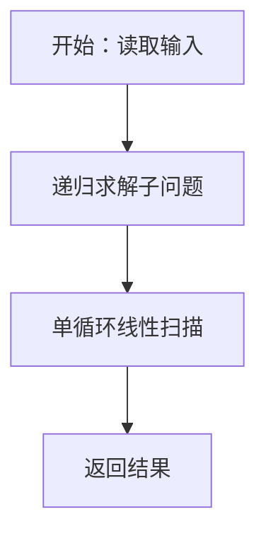

## TypeScript 解题方案（7 个方案逐个讲）

> **运行与提交**：每个方案都是自包含文件（内嵌用例自测，输出 PASS），整块复制到 `.ts` 文件后 `node 文件名` 即可运行。提交 LeetCode 时，把 `demo` 内的算法函数与辅助类型/函数整体取出、置于文件顶层即可。涉及交互/特殊接口的题以题面给定签名为准。

### 方案 1：方案1（线性扫描）

**分析与思路**：核心做法是「方案1（线性扫描）」。代码里依次做这些事：单循环线性扫描。

**运行方式**：`node 本文件`，内嵌用例全部通过会输出 PASS。


**方案专属流程图**（真实控制流）：


```typescript
/**
 ** LeetCode 65. 有效数字
 ** 方案：方案1（线性扫描）
 */

function isNumber(s: string): boolean {
  // 定义判定函数 isNumber
  const t = s.trim(); // 把 字符串.trim() 存入 另一字符串
  if (t.length === 0) return false; // 若 另一字符串.长度 全等于 0，直接返回 false
  let hasDot = false; // 把 false 存入 hasDot
  let hasE = false; // 把 false 存入 hasE
  let hasDigit = false; // 把 false 存入 hasDigit
  for (let i = 0; i < t.length; i++) {
    // 让 下标 i 从 0 开始计数，下标 i 小于 另一字符串.长度 就继续
    const c = t[i]; // 把 另一字符串[下标 i] 存入 字符
    if (c === '.') {
      // 若 字符 全等于 「.」
      if (hasDot || hasE) return false; // 若 hasDot 或 hasE，直接返回 false
      hasDot = true; // 把 true 存入 hasDot
    } else if (c === 'e' || c === 'E') {
      // 否则，若 字符 全等于 「e」 或 字符 全等于 「e」
      if (hasE || !hasDigit) return false; // 若 hasE 或 取反 hasDigit，直接返回 false
      hasE = true; // 把 true 存入 hasE
      hasDigit = false; // 把 false 存入 hasDigit
    } else if (c === '+' || c === '-') {
      // 否则，若 字符 全等于 「 加 」 或 字符 全等于 「 加 」
      if (i > 0 && t[i - 1] !== 'e' && t[i - 1] !== 'E') return false;
    } else if (c >= '0' && c <= '9') {
      // 否则，若 字符 不低于 「0」 且 字符 不超过 「0」
      hasDigit = true; // 把 true 存入 hasDigit
    } else {
      // 否则
      return false; // 返回 false
    }
  }
  return hasDigit; // 返回 hasDigit
}

export function demo(): void {
  // 程序入口：跑内嵌自测用例
  if (isNumber('abc') !== false)
    // 若 isNumber(「abc」) 不等于 false
    throw new Error("isNumber('abc') should be false"); // throw new Error(「isNumber('abc') should be false」);
  console.log('PASS'); // 全部用例通过，输出 PASS
}

demo(); // demo();
```

### 方案 2：方案2（线性扫描）

**分析与思路**：核心做法是「方案2（线性扫描）」。代码里依次做这些事：单循环线性扫描。

**运行方式**：`node 本文件`，内嵌用例全部通过会输出 PASS。

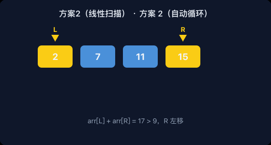

**方案专属流程图**（真实控制流）：


```typescript
/**
 ** LeetCode 65. 有效数字
 ** 方案：方案2（线性扫描）
 */

function isNumber(s: string): boolean {
  // 定义判定函数 isNumber
  const t = s.trim(); // 把 字符串.trim() 存入 另一字符串
  if (t.length === 0) return false; // 若 另一字符串.长度 全等于 0，直接返回 false
  let hasDot = false; // 把 false 存入 hasDot
  let hasE = false; // 把 false 存入 hasE
  let hasDigit = false; // 把 false 存入 hasDigit
  for (let i = 0; i < t.length; i++) {
    // 让 下标 i 从 0 开始计数，下标 i 小于 另一字符串.长度 就继续
    const c = t[i]; // 把 另一字符串[下标 i] 存入 字符
    if (c === '.') {
      // 若 字符 全等于 「.」
      if (hasDot || hasE) return false; // 若 hasDot 或 hasE，直接返回 false
      hasDot = true; // 把 true 存入 hasDot
    } else if (c === 'e' || c === 'E') {
      // 否则，若 字符 全等于 「e」 或 字符 全等于 「e」
      if (hasE || !hasDigit) return false; // 若 hasE 或 取反 hasDigit，直接返回 false
      hasE = true; // 把 true 存入 hasE
      hasDigit = false; // 把 false 存入 hasDigit
    } else if (c === '+' || c === '-') {
      // 否则，若 字符 全等于 「 加 」 或 字符 全等于 「 加 」
      if (i > 0 && t[i - 1] !== 'e' && t[i - 1] !== 'E') return false;
    } else if (c >= '0' && c <= '9') {
      // 否则，若 字符 不低于 「0」 且 字符 不超过 「0」
      hasDigit = true; // 把 true 存入 hasDigit
    } else {
      // 否则
      return false; // 返回 false
    }
  }
  return hasDigit; // 返回 hasDigit
}

export function demo(): void {
  // 程序入口：跑内嵌自测用例
  if (isNumber('abc') !== false)
    // 若 isNumber(「abc」) 不等于 false
    throw new Error("isNumber('abc') should be false"); // throw new Error(「isNumber('abc') should be false」);
  console.log('PASS'); // 全部用例通过，输出 PASS
}

demo(); // demo();
```

### 方案 3：方案3（线性扫描）

**分析与思路**：核心做法是「方案3（线性扫描）」。代码里依次做这些事：单循环线性扫描。

**运行方式**：`node 本文件`，内嵌用例全部通过会输出 PASS。


**方案专属流程图**（真实控制流）：


```typescript
/**
 ** LeetCode 65. 有效数字
 ** 方案：方案3（线性扫描）
 */

function isNumber(s: string): boolean {
  // 定义判定函数 isNumber
  const t = s.trim(); // 把 字符串.trim() 存入 另一字符串
  if (t.length === 0) return false; // 若 另一字符串.长度 全等于 0，直接返回 false
  let hasDot = false; // 把 false 存入 hasDot
  let hasE = false; // 把 false 存入 hasE
  let hasDigit = false; // 把 false 存入 hasDigit
  for (let i = 0; i < t.length; i++) {
    // 让 下标 i 从 0 开始计数，下标 i 小于 另一字符串.长度 就继续
    const c = t[i]; // 把 另一字符串[下标 i] 存入 字符
    if (c === '.') {
      // 若 字符 全等于 「.」
      if (hasDot || hasE) return false; // 若 hasDot 或 hasE，直接返回 false
      hasDot = true; // 把 true 存入 hasDot
    } else if (c === 'e' || c === 'E') {
      // 否则，若 字符 全等于 「e」 或 字符 全等于 「e」
      if (hasE || !hasDigit) return false; // 若 hasE 或 取反 hasDigit，直接返回 false
      hasE = true; // 把 true 存入 hasE
      hasDigit = false; // 把 false 存入 hasDigit
    } else if (c === '+' || c === '-') {
      // 否则，若 字符 全等于 「 加 」 或 字符 全等于 「 加 」
      if (i > 0 && t[i - 1] !== 'e' && t[i - 1] !== 'E') return false;
    } else if (c >= '0' && c <= '9') {
      // 否则，若 字符 不低于 「0」 且 字符 不超过 「0」
      hasDigit = true; // 把 true 存入 hasDigit
    } else {
      // 否则
      return false; // 返回 false
    }
  }
  return hasDigit; // 返回 hasDigit
}

export function demo(): void {
  // 程序入口：跑内嵌自测用例
  if (isNumber('abc') !== false)
    // 若 isNumber(「abc」) 不等于 false
    throw new Error("isNumber('abc') should be false"); // throw new Error(「isNumber('abc') should be false」);
  console.log('PASS'); // 全部用例通过，输出 PASS
}

demo(); // demo();
```

### 方案 4：方案4（确定有限状态自动机 DFA，字符原样作为转移键）

**分析与思路**：核心做法是「方案4（确定有限状态自动机 DFA，字符原样作为转移键）」。代码里依次做这些事：单循环线性扫描。

**运行方式**：`node 本文件`，内嵌用例全部通过会输出 PASS。

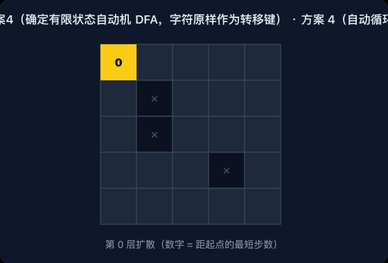

**方案专属流程图**（真实控制流）：

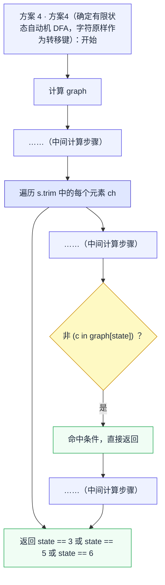

```typescript
/**
 ** LeetCode 65. 有效数字
 ** 来源：https://blog.csdn.net/tyro_java/article/details/133920771
 ** 方案：方案4（确定有限状态自动机 DFA，字符原样作为转移键）
 */

function isNumber(s: string): boolean {
  // 定义判定函数 isNumber
  const graph: Record<number, Record<string, number>> = {
    // 把 { 写入 const graph: Record<number, Record<string, number>>
    0: { blank: 0, sign: 1, '.': 2, digit: 6 },
    1: { digit: 6, '.': 2 },
    2: { digit: 3 },
    3: { digit: 3, e: 4 },
    4: { digit: 5, sign: 7 },
    5: { digit: 5 },
    6: { digit: 6, '.': 3, e: 4 },
    7: { digit: 5 },
  };
  let state = 0; // 把 0 存入 state
  for (const ch of s.trim()) {
    // for (const 字符 of 字符串.trim()) {
    let c: string; // let 字符: string;
    if (ch >= '0' && ch <= '9')
      c = 'digit'; // 若 字符 不低于 「0」 且 字符 不超过 「0」) 字符 赋值为 「0」;
    else if (ch === ' ')
      c = 'blank'; // 否则，若 字符 全等于 「 」) 字符 赋值为 「 」;
    else if (ch === '+' || ch === '-')
      c = 'sign'; // 否则，若 字符 全等于 「 加 」 或 字符 全等于 「 加 」) 字符 赋值为 「 加 」;
    else c = ch; // 原样字符（'e' 直接作键；与 Python 参考一致）
    if (!(c in graph[state])) return false; // 若 取反 (字符 in graph[state])，直接返回 false
    state = graph[state][c]; // 把 graph[state][字符] 存入 state
  }
  return state === 3 || state === 5 || state === 6; // 返回 state 全等于 3 或 state 全等于 5 或 state 全等于 6
}

export function demo(): void {
  // 程序入口：跑内嵌自测用例
  if (isNumber('0') !== true) throw new Error("isNumber('0') should be true"); // 若 isNumber(「0」) 不等于 true) throw new Error(「0」);
  if (isNumber('abc') !== false)
    // 若 isNumber(「abc」) 不等于 false
    throw new Error("isNumber('abc') should be false"); // throw new Error(「isNumber('abc') should be false」);
  console.log('PASS'); // 全部用例通过，输出 PASS
}

demo(); // demo();
```

### 方案 5：单趟扫描

**分析与思路**：核心做法是「单趟扫描」。代码里依次做这些事：单循环线性扫描。

**运行方式**：`node 本文件`，内嵌用例全部通过会输出 PASS。


**方案专属流程图**（真实控制流）：


```typescript
/**
 ** LeetCode 65. 有效数字
 ** 来源：https://blog.csdn.net/tyro_java/article/details/133920771
 ** 方案：方案5（确定有限状态自动机 DFA，其余字符 lowercase）
 */

function isNumber(s: string): boolean {
  // 定义判定函数 isNumber
  const graph: Record<number, Record<string, number>> = {
    // 把 { 写入 const graph: Record<number, Record<string, number>>
    0: { blank: 0, sign: 1, '.': 2, digit: 6 },
    1: { digit: 6, '.': 2 },
    2: { digit: 3 },
    3: { digit: 3, e: 4 },
    4: { digit: 5, sign: 7 },
    5: { digit: 5 },
    6: { digit: 6, '.': 3, e: 4 },
    7: { digit: 5 },
  };
  let state = 0; // 把 0 存入 state
  for (const ch of s.trim()) {
    // for (const 字符 of 字符串.trim()) {
    let c: string; // let 字符: string;
    if (ch >= '0' && ch <= '9')
      c = 'digit'; // 若 字符 不低于 「0」 且 字符 不超过 「0」) 字符 赋值为 「0」;
    else if (ch === ' ')
      c = 'blank'; // 否则，若 字符 全等于 「 」) 字符 赋值为 「 」;
    else if (ch === '+' || ch === '-')
      c = 'sign'; // 否则，若 字符 全等于 「 加 」 或 字符 全等于 「 加 」) 字符 赋值为 「 加 」;
    else c = ch.toLowerCase(); // 否则
    if (!(c in graph[state])) return false; // 若 取反 (字符 in graph[state])，直接返回 false
    state = graph[state][c]; // 把 graph[state][字符] 存入 state
  }
  return state === 3 || state === 5 || state === 6; // 返回 state 全等于 3 或 state 全等于 5 或 state 全等于 6
}

export function demo(): void {
  // 程序入口：跑内嵌自测用例
  if (isNumber('0') !== true) throw new Error("isNumber('0') should be true"); // 若 isNumber(「0」) 不等于 true) throw new Error(「0」);
  if (isNumber('abc') !== false)
    // 若 isNumber(「abc」) 不等于 false
    throw new Error("isNumber('abc') should be false"); // throw new Error(「isNumber('abc') should be false」);
  console.log('PASS'); // 全部用例通过，输出 PASS
}

demo(); // demo();
```

### 方案 6：单趟扫描

**分析与思路**：核心做法是「单趟扫描」。代码里依次做这些事：单循环线性扫描。

**运行方式**：`node 本文件`，内嵌用例全部通过会输出 PASS。


**方案专属流程图**（真实控制流）：

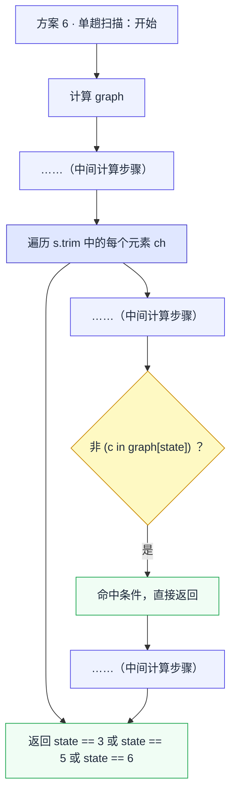

```typescript
/**
 ** LeetCode 65. 有效数字
 ** 来源：https://blog.csdn.net/tyro_java/article/details/133920771
 ** 方案：方案6（确定有限状态自动机 DFA，其余字符 lowercase）
 */

function isNumber(s: string): boolean {
  // 定义判定函数 isNumber
  const graph: Record<number, Record<string, number>> = {
    // 把 { 写入 const graph: Record<number, Record<string, number>>
    0: { blank: 0, sign: 1, '.': 2, digit: 6 },
    1: { digit: 6, '.': 2 },
    2: { digit: 3 },
    3: { digit: 3, e: 4 },
    4: { digit: 5, sign: 7 },
    5: { digit: 5 },
    6: { digit: 6, '.': 3, e: 4 },
    7: { digit: 5 },
  };
  let state = 0; // 把 0 存入 state
  for (const ch of s.trim()) {
    // for (const 字符 of 字符串.trim()) {
    let c: string; // let 字符: string;
    if (ch >= '0' && ch <= '9')
      c = 'digit'; // 若 字符 不低于 「0」 且 字符 不超过 「0」) 字符 赋值为 「0」;
    else if (ch === ' ')
      c = 'blank'; // 否则，若 字符 全等于 「 」) 字符 赋值为 「 」;
    else if (ch === '+' || ch === '-')
      c = 'sign'; // 否则，若 字符 全等于 「 加 」 或 字符 全等于 「 加 」) 字符 赋值为 「 加 」;
    else c = ch.toLowerCase(); // 否则
    if (!(c in graph[state])) return false; // 若 取反 (字符 in graph[state])，直接返回 false
    state = graph[state][c]; // 把 graph[state][字符] 存入 state
  }
  return state === 3 || state === 5 || state === 6; // 返回 state 全等于 3 或 state 全等于 5 或 state 全等于 6
}

export function demo(): void {
  // 程序入口：跑内嵌自测用例
  if (isNumber('0') !== true) throw new Error("isNumber('0') should be true"); // 若 isNumber(「0」) 不等于 true) throw new Error(「0」);
  if (isNumber('abc') !== false)
    // 若 isNumber(「abc」) 不等于 false
    throw new Error("isNumber('abc') should be false"); // throw new Error(「isNumber('abc') should be false」);
  console.log('PASS'); // 全部用例通过，输出 PASS
}

demo(); // demo();
```

### 方案 7：单趟扫描

**分析与思路**：核心做法是「单趟扫描」。代码里依次做这些事：单循环线性扫描。

**运行方式**：`node 本文件`，内嵌用例全部通过会输出 PASS。

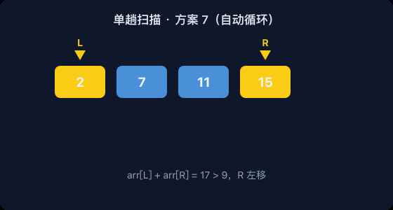

**方案专属流程图**（真实控制流）：


```typescript
/**
 ** LeetCode 65. 有效数字
 ** 来源：https://blog.csdn.net/tyro_java/article/details/133920771
 ** 方案：方案7（确定有限状态自动机 DFA，其余字符 lowercase）
 */

function isNumber(s: string): boolean {
  // 定义判定函数 isNumber
  const graph: Record<number, Record<string, number>> = {
    // 把 { 写入 const graph: Record<number, Record<string, number>>
    0: { blank: 0, sign: 1, '.': 2, digit: 6 },
    1: { digit: 6, '.': 2 },
    2: { digit: 3 },
    3: { digit: 3, e: 4 },
    4: { digit: 5, sign: 7 },
    5: { digit: 5 },
    6: { digit: 6, '.': 3, e: 4 },
    7: { digit: 5 },
  };
  let state = 0; // 把 0 存入 state
  for (const ch of s.trim()) {
    // for (const 字符 of 字符串.trim()) {
    let c: string; // let 字符: string;
    if (ch >= '0' && ch <= '9')
      c = 'digit'; // 若 字符 不低于 「0」 且 字符 不超过 「0」) 字符 赋值为 「0」;
    else if (ch === ' ')
      c = 'blank'; // 否则，若 字符 全等于 「 」) 字符 赋值为 「 」;
    else if (ch === '+' || ch === '-')
      c = 'sign'; // 否则，若 字符 全等于 「 加 」 或 字符 全等于 「 加 」) 字符 赋值为 「 加 」;
    else c = ch.toLowerCase(); // 否则
    if (!(c in graph[state])) return false; // 若 取反 (字符 in graph[state])，直接返回 false
    state = graph[state][c]; // 把 graph[state][字符] 存入 state
  }
  return state === 3 || state === 5 || state === 6; // 返回 state 全等于 3 或 state 全等于 5 或 state 全等于 6
}

export function demo(): void {
  // 程序入口：跑内嵌自测用例
  if (isNumber('0') !== true) throw new Error("isNumber('0') should be true"); // 若 isNumber(「0」) 不等于 true) throw new Error(「0」);
  if (isNumber('abc') !== false)
    // 若 isNumber(「abc」) 不等于 false
    throw new Error("isNumber('abc') should be false"); // throw new Error(「isNumber('abc') should be false」);
  console.log('PASS'); // 全部用例通过，输出 PASS
}

demo(); // demo();
```

## 逐步拆解与面试追问

**复杂度**：时间 O(n)（单趟线性扫描），空间 O(1) 到 O(n)（视辅助结构）

**为什么是这个量级**：每个元素被常数次访问，辅助哈希或栈的开销与 n 同阶

**面试官可能会追问**：

- 广度优先与深度优先各适合什么问题？
- 如何去重避免死循环？
- 带权图为什么默认不用广度优先？

## 关键 API 速查（TS 主解法实际用到，附官方链接）

| API | 作用 | 使用要点 | 官方文档 |
|---|---|---|---|
| `String.prototype.trim()` | 去除首尾空白 | 返回新串；变体 trimStart/trimEnd；不处理串中间空格 | [官方文档](https://developer.mozilla.org/zh-CN/docs/Web/JavaScript/Reference/Global_Objects/String/trim) |

### 各语言官方文档导航

- **TypeScript / JS**：[MDN 中文参考](https://developer.mozilla.org/zh-CN/)
- **Python**：[Python 官方文档](https://docs.python.org/zh-cn/3/)
- **Go**：[Go 标准库](https://pkg.go.dev/std)
- **Java**：[JDK 17 API](https://docs.oracle.com/en/java/javase/17/docs/api/)
- **Rust**：[Rust 标准库](https://doc.rust-lang.org/std/)
- **Lua**：[Lua 5.4 手册](https://www.lua.org/manual/5.4/)
- **C**：[Cppreference C](https://zh.cppreference.com/w/c)
- **C++**：[Cppreference C++](https://zh.cppreference.com/w/cpp)
- **R**：[R 官方手册](https://stat.ethz.ch/R-manual/)
- **Zig**：[Zig 语言文档](https://ziglang.org/documentation/master/)
- **Dart**：[Dart API](https://api.dart.dev/)

## 附录：其他 10 种语言全部实现（每种语言列举其全部方案）

> TypeScript 的全部方案见「TypeScript 解题方案」一节；下面是其余 10 种语言的对应实现，每种语言的每个方案都带思路分析、代码走读与专属运行架构图。
> 每个方案都内嵌用例自测，可独立运行（老仓库 python/go 文件遵循「打印结果」约定）。
> 完整解法文件见 `dsa/<语言>/graph/lc_65_有效数字/`。

### Python 实现（7 种方案）

Python 的全部方案如下，每个方案都内嵌用例自测，可独立运行（老仓库 python/go 文件遵循「打印结果」约定）：

#### 方案 1：方案1（线性扫描）

**思路与代码分析**：核心是「方案1（线性扫描）」。Python 版用切片与字典推导式简化操作，突出可读性。

**运行架构**（真实控制流）：

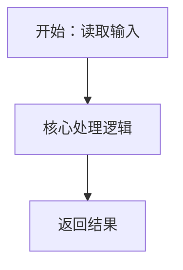

```python
import sys  # 提高递归深度上限（深输入防 RecursionError）

sys.setrecursionlimit(200000)  # 树/链表类题目节点数可达 1e4 量级

def isNumber(s):  # 定义函数 isNumber（参数：字符串）
    s = s.strip()  # 把 字符串.strip() 存入 字符串
    if not s:  # 若 not 字符串
        return False  # 返回 False
    has_dot = has_e = has_digit = False  # 把 has_e 赋值为 has_digit 赋值为 False 存入 has_dot
    for i, c in enumerate(s):  # 同时取 下标 i 与 字符 遍历
        if c == ".":  # 若 字符 等于 '.'
            if has_dot or has_e:  # 若 has_dot or has_e
                return False  # 返回 False
            has_dot = True  # 把 True 存入 has_dot
        elif c == "e" or c == "E":  # 否则，若 字符 等于 'e' or 字符 等于 'E'
            if has_e or not has_digit:  # 若 has_e or not has_digit
                return False  # 返回 False
            has_e = True  # 把 True 存入 has_e
            has_digit = False  # 把 False 存入 has_digit
        elif c == "+" or c == "-":  # 否则，若 字符 等于 ' 加 ' or 字符 等于 ' 减 '
            if i > 0 and s[i - 1] not in "eE":  # 若 下标 i 超过 0 and 字符串[下标 i 减 1] not in 'eE'
                return False  # 返回 False
        elif c.isdigit():  # 否则，若 字符.isdigit(
            has_digit = True  # 把 True 存入 has_digit
        else:  # 否则
            return False  # 返回 False
    return has_digit  # 返回 has_digit

if __name__ == "__main__":  # 若 __name__ 等于 '__main__'
    print(isNumber("abc"))  # 打印输出
```

#### 方案 2：方案2（线性扫描）

**思路与代码分析**：核心是「方案2（线性扫描）」。Python 版用切片与字典推导式简化操作，突出可读性。

**运行架构**：与方案 1 的控制流相同（同算法在该语言的等价实现），图见上。

```python
import sys  # 提高递归深度上限（深输入防 RecursionError）

sys.setrecursionlimit(200000)  # 树/链表类题目节点数可达 1e4 量级

def isNumber(s):  # 定义函数 isNumber（参数：字符串）
    s = s.strip()  # 把 字符串.strip() 存入 字符串
    if not s:  # 若 not 字符串
        return False  # 返回 False
    has_dot = has_e = has_digit = False  # 把 has_e 赋值为 has_digit 赋值为 False 存入 has_dot
    for i, c in enumerate(s):  # 同时取 下标 i 与 字符 遍历
        if c == ".":  # 若 字符 等于 '.'
            if has_dot or has_e:  # 若 has_dot or has_e
                return False  # 返回 False
            has_dot = True  # 把 True 存入 has_dot
        elif c == "e" or c == "E":  # 否则，若 字符 等于 'e' or 字符 等于 'E'
            if has_e or not has_digit:  # 若 has_e or not has_digit
                return False  # 返回 False
            has_e = True  # 把 True 存入 has_e
            has_digit = False  # 把 False 存入 has_digit
        elif c == "+" or c == "-":  # 否则，若 字符 等于 ' 加 ' or 字符 等于 ' 减 '
            if i > 0 and s[i - 1] not in "eE":  # 若 下标 i 超过 0 and 字符串[下标 i 减 1] not in 'eE'
                return False  # 返回 False
        elif c.isdigit():  # 否则，若 字符.isdigit(
            has_digit = True  # 把 True 存入 has_digit
        else:  # 否则
            return False  # 返回 False
    return has_digit  # 返回 has_digit

if __name__ == "__main__":  # 若 __name__ 等于 '__main__'
    print(isNumber("abc"))  # 打印输出
```

#### 方案 3：方案3（线性扫描）

**思路与代码分析**：核心是「方案3（线性扫描）」。Python 版用切片与字典推导式简化操作，突出可读性。

**运行架构**：与方案 1 的控制流相同（同算法在该语言的等价实现），图见上。

```python
import sys  # 提高递归深度上限（深输入防 RecursionError）

sys.setrecursionlimit(200000)  # 树/链表类题目节点数可达 1e4 量级

def isNumber(s):  # 定义函数 isNumber（参数：字符串）
    s = s.strip()  # 把 字符串.strip() 存入 字符串
    if not s:  # 若 not 字符串
        return False  # 返回 False
    has_dot = has_e = has_digit = False  # 把 has_e 赋值为 has_digit 赋值为 False 存入 has_dot
    for i, c in enumerate(s):  # 同时取 下标 i 与 字符 遍历
        if c == ".":  # 若 字符 等于 '.'
            if has_dot or has_e:  # 若 has_dot or has_e
                return False  # 返回 False
            has_dot = True  # 把 True 存入 has_dot
        elif c == "e" or c == "E":  # 否则，若 字符 等于 'e' or 字符 等于 'E'
            if has_e or not has_digit:  # 若 has_e or not has_digit
                return False  # 返回 False
            has_e = True  # 把 True 存入 has_e
            has_digit = False  # 把 False 存入 has_digit
        elif c == "+" or c == "-":  # 否则，若 字符 等于 ' 加 ' or 字符 等于 ' 减 '
            if i > 0 and s[i - 1] not in "eE":  # 若 下标 i 超过 0 and 字符串[下标 i 减 1] not in 'eE'
                return False  # 返回 False
        elif c.isdigit():  # 否则，若 字符.isdigit(
            has_digit = True  # 把 True 存入 has_digit
        else:  # 否则
            return False  # 返回 False
    return has_digit  # 返回 has_digit

if __name__ == "__main__":  # 若 __name__ 等于 '__main__'
    print(isNumber("abc"))  # 打印输出
```

#### 方案 4：方案4（确定有限状态自动机 DFA，字符原样作为转移键）

**思路与代码分析**：核心是「方案4（确定有限状态自动机 DFA，字符原样作为转移键）」。Python 版用切片与字典推导式简化操作，突出可读性。**走读**：方案 4 · 方案4（确定有限状态自动机 DFA，字符原样作为转移键）：开始 → 更新 graph → 遍历 s.strip(): 中的每个元素 c → 命中条件，直接返回 → 返回 state in (3, 5, 6)。

**运行架构**（真实控制流）：

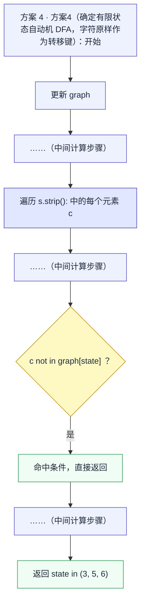

```python
import sys  # 提高递归深度上限（深输入防 RecursionError）

sys.setrecursionlimit(200000)  # 树/链表类题目节点数可达 1e4 量级

def isNumber(s):  # 定义函数 isNumber（参数：字符串）
    graph = {  # 把 { 存入 graph
        0: {"blank": 0, "sign": 1, ".": 2, "digit": 6},
        1: {"digit": 6, ".": 2},
        2: {"digit": 3},
        3: {"digit": 3, "e": 4},
        4: {"digit": 5, "sign": 7},
        5: {"digit": 5},
        6: {"digit": 6, ".": 3, "e": 4},
        7: {"digit": 5},
    }
    state = 0  # 把 0 存入 state
    for c in s.strip():  # 逐个取出 字符串 的元素（字符）
        if "0" <= c <= "9":  # 若 '0' 不超过 字符 不超过 '9'
            c = "digit"  # 把 'digit' 存入 字符
        elif c == " ":  # 否则，若 字符 等于 ' '
            c = "blank"  # 把 'blank' 存入 字符
        elif c in "+-":  # 否则，若 字符 in ' 加 减 '
            c = "sign"  # 把 'sign' 存入 字符
        elif c in "eE":  # 否则，若 字符 in 'eE'
            c = "e"  # 把 'e' 存入 字符
        if c not in graph[state]:  # 若 字符 not in graph[state]
            return False  # 返回 False
        state = graph[state][c]  # 把 graph[state][字符] 存入 state
    return state in (3, 5, 6)  # 返回 state in (3, 5, 6)

if __name__ == "__main__":  # 若 __name__ 等于 '__main__'
    print(isNumber("0"))  # 打印输出
```

#### 方案 5：单趟扫描

**思路与代码分析**：核心是「单趟扫描」。Python 版用切片与字典推导式简化操作，突出可读性。**走读**：方案 5 · 单趟扫描：开始 → 更新 graph → 遍历 s.strip(): 中的每个元素 ch → 命中条件，直接返回 → 返回 state in (3, 5, 6)。

**运行架构**（真实控制流）：

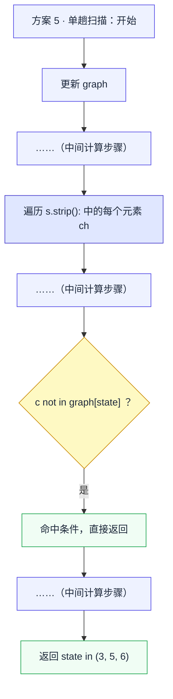

```python
import sys  # 提高递归深度上限（深输入防 RecursionError）

sys.setrecursionlimit(200000)  # 树/链表类题目节点数可达 1e4 量级

def isNumber(s):  # 定义函数 isNumber（参数：字符串）
    graph = {  # 把 { 存入 graph
        0: {"blank": 0, "sign": 1, ".": 2, "digit": 6},
        1: {"digit": 6, ".": 2},
        2: {"digit": 3},
        3: {"digit": 3, "e": 4},
        4: {"digit": 5, "sign": 7},
        5: {"digit": 5},
        6: {"digit": 6, ".": 3, "e": 4},
        7: {"digit": 5},
    }
    state = 0  # 把 0 存入 state
    for ch in s.strip():  # 逐个取出 字符串 的元素（字符）
        if "0" <= ch <= "9":  # 若 '0' 不超过 字符 不超过 '9'
            c = "digit"  # 把 'digit' 存入 字符
        elif ch == " ":  # 否则，若 字符 等于 ' '
            c = "blank"  # 把 'blank' 存入 字符
        elif ch in "+-":  # 否则，若 字符 in ' 加 减 '
            c = "sign"  # 把 'sign' 存入 字符
        else:  # 否则
            c = ch.lower()  # 把 字符.lower() 存入 字符
        if c not in graph[state]:  # 若 字符 not in graph[state]
            return False  # 返回 False
        state = graph[state][c]  # 把 graph[state][字符] 存入 state
    return state in (3, 5, 6)  # 返回 state in (3, 5, 6)

if __name__ == "__main__":  # 若 __name__ 等于 '__main__'
    print(isNumber("0"))  # 打印输出
    print(isNumber("abc"))  # 打印输出
```

#### 方案 6：单趟扫描

**思路与代码分析**：核心是「单趟扫描」。Python 版用切片与字典推导式简化操作，突出可读性。**走读**：方案 6 · 单趟扫描：开始 → 更新 graph → 遍历 s.strip(): 中的每个元素 ch → 命中条件，直接返回 → 返回 state in (3, 5, 6)。

**运行架构**（真实控制流）：


```python
import sys  # 提高递归深度上限（深输入防 RecursionError）

sys.setrecursionlimit(200000)  # 树/链表类题目节点数可达 1e4 量级

def isNumber(s):  # 定义函数 isNumber（参数：字符串）
    graph = {  # 把 { 存入 graph
        0: {"blank": 0, "sign": 1, ".": 2, "digit": 6},
        1: {"digit": 6, ".": 2},
        2: {"digit": 3},
        3: {"digit": 3, "e": 4},
        4: {"digit": 5, "sign": 7},
        5: {"digit": 5},
        6: {"digit": 6, ".": 3, "e": 4},
        7: {"digit": 5},
    }
    state = 0  # 把 0 存入 state
    for ch in s.strip():  # 逐个取出 字符串 的元素（字符）
        if "0" <= ch <= "9":  # 若 '0' 不超过 字符 不超过 '9'
            c = "digit"  # 把 'digit' 存入 字符
        elif ch == " ":  # 否则，若 字符 等于 ' '
            c = "blank"  # 把 'blank' 存入 字符
        elif ch in "+-":  # 否则，若 字符 in ' 加 减 '
            c = "sign"  # 把 'sign' 存入 字符
        else:  # 否则
            c = ch.lower()  # 把 字符.lower() 存入 字符
        if c not in graph[state]:  # 若 字符 not in graph[state]
            return False  # 返回 False
        state = graph[state][c]  # 把 graph[state][字符] 存入 state
    return state in (3, 5, 6)  # 返回 state in (3, 5, 6)

if __name__ == "__main__":  # 若 __name__ 等于 '__main__'
    print(isNumber("0"))  # 打印输出
    print(isNumber("abc"))  # 打印输出
```

#### 方案 7：单趟扫描

**思路与代码分析**：核心是「单趟扫描」。Python 版用切片与字典推导式简化操作，突出可读性。**走读**：方案 7 · 单趟扫描：开始 → 更新 graph → 遍历 s.strip(): 中的每个元素 ch → 命中条件，直接返回 → 返回 state in (3, 5, 6)。

**运行架构**（真实控制流）：


```python
import sys  # 提高递归深度上限（深输入防 RecursionError）

sys.setrecursionlimit(200000)  # 树/链表类题目节点数可达 1e4 量级

def isNumber(s):  # 定义函数 isNumber（参数：字符串）
    graph = {  # 把 { 存入 graph
        0: {"blank": 0, "sign": 1, ".": 2, "digit": 6},
        1: {"digit": 6, ".": 2},
        2: {"digit": 3},
        3: {"digit": 3, "e": 4},
        4: {"digit": 5, "sign": 7},
        5: {"digit": 5},
        6: {"digit": 6, ".": 3, "e": 4},
        7: {"digit": 5},
    }
    state = 0  # 把 0 存入 state
    for ch in s.strip():  # 逐个取出 字符串 的元素（字符）
        if "0" <= ch <= "9":  # 若 '0' 不超过 字符 不超过 '9'
            c = "digit"  # 把 'digit' 存入 字符
        elif ch == " ":  # 否则，若 字符 等于 ' '
            c = "blank"  # 把 'blank' 存入 字符
        elif ch in "+-":  # 否则，若 字符 in ' 加 减 '
            c = "sign"  # 把 'sign' 存入 字符
        else:  # 否则
            c = ch.lower()  # 把 字符.lower() 存入 字符
        if c not in graph[state]:  # 若 字符 not in graph[state]
            return False  # 返回 False
        state = graph[state][c]  # 把 graph[state][字符] 存入 state
    return state in (3, 5, 6)  # 返回 state in (3, 5, 6)

if __name__ == "__main__":  # 若 __name__ 等于 '__main__'
    print(isNumber("0"))  # 打印输出
    print(isNumber("abc"))  # 打印输出
```

### Go 实现（7 种方案）

Go 的全部方案如下，每个方案都内嵌用例自测，可独立运行（老仓库 python/go 文件遵循「打印结果」约定）：

#### 方案 1：方案1（线性扫描）

**思路与代码分析**：核心是「方案1（线性扫描）」。Go 版用切片与多返回值惯用法，显式处理索引边界。**走读**：方案 1 · 方案1（线性扫描）：开始 → 更新 s → 返回 false → 遍历循环 → 返回 false → 返回 false → 返回 false → 返回 false → 返回 hasDigit。

**运行架构**（真实控制流）：


```go
package main // 引入依赖

import (
	"fmt"
	"os"
	"strings"
) // 引入依赖

func isNumber(s string) bool { // 定义判定函数 isNumber
	s = strings.TrimSpace(s) // 把 strings.TrimSpace(字符串) 写入 字符串
	if len(s) == 0 {         // 若 长度(字符串) 等于 0
		return false // 返回 false
	}
	hasDot, hasE, hasDigit := false, false, false // 把 false, false, false 写入 hasDot, hasE, hasDigit :
	for i := 0; i < len(s); i++ {                 // 让 下标 i 从 0 开始计数
		c := s[i]     // 把 字符串[下标 i] 写入 c :
		if c == '.' { // 若 字符 等于 '.'
			if hasDot || hasE { // 若 hasDot 或 hasE
				return false // 返回 false
			}
			hasDot = true // 把 true 写入 hasDot
		} else if c == 'e' || c == 'E' { // 否则，若 字符 等于 'e' 或 字符 等于 'E'
			if hasE || !hasDigit { // 若 hasE 或 取反 hasDigit
				return false // 返回 false
			}
			hasE = true      // 把 true 写入 hasE
			hasDigit = false // 把 false 写入 hasDigit
		} else if c == '+' || c == '-' { // 否则，若 字符 等于 ' 加 ' 或 字符 等于 ' 减 '
			if i > 0 && s[i-1] != 'e' && s[i-1] != 'E' { // 若 下标 i 超过 0 且 字符串[下标 i 减 1] 不等于 'e' 且 字符串[下标 i 减 1] 不等于 'E'
				return false // 返回 false
			}
		} else if c >= '0' && c <= '9' { // 否则，若 字符 不低于 '0' 且 字符 不超过 '9'
			hasDigit = true // 把 true 写入 hasDigit
		} else { // 否则
			return false // 返回 false
		}
	}
	return hasDigit // 返回 hasDigit
}

func main() { // 程序入口：跑内嵌自测用例
	type tc struct { // 定义类型
		in   string // in string
		want bool   // want bool
	}
	cases := []tc{ // 把 []tc{ 写入 cases :
		{"0", true},
		{"abc", false},
		{"123", true},
		{"", false},
	}
	ok := true                // 把 true 写入 ok :
	for _, c := range cases { // 同时取 _ 与 字符 遍历
		if got := isNumber(c.in); got != c.want { // 若 got : 赋值为 isNumber(字符.in); got 不等于 字符.want
			ok = false                                                      // 把 false 写入 ok
			fmt.Printf("FAIL isNumber(%q)=%v want %v\n", c.in, got, c.want) // 打印输出
		}
	}
	if !ok { // 若 取反 ok
		os.Exit(1) // os.Exit(1)
	}
	fmt.Println("PASS") // 全部用例通过，输出 PASS
}
```

#### 方案 2：方案2（线性扫描）

**思路与代码分析**：核心是「方案2（线性扫描）」。Go 版用切片与多返回值惯用法，显式处理索引边界。**走读**：方案 2 · 方案2（线性扫描）：开始 → 更新 s → 返回 false → 遍历循环 → 返回 false → 返回 false → 返回 false → 返回 false → 返回 hasDigit。

**运行架构**（真实控制流）：

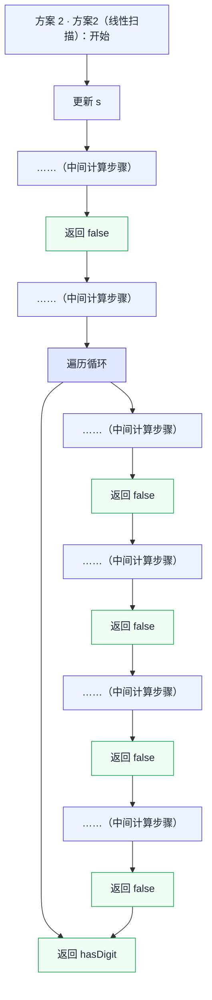

```go
package main // 引入依赖

import (
	"fmt"
	"os"
	"strings"
) // 引入依赖

func isNumber(s string) bool { // 定义判定函数 isNumber
	s = strings.TrimSpace(s) // 把 strings.TrimSpace(字符串) 写入 字符串
	if len(s) == 0 {         // 若 长度(字符串) 等于 0
		return false // 返回 false
	}
	hasDot, hasE, hasDigit := false, false, false // 把 false, false, false 写入 hasDot, hasE, hasDigit :
	for i := 0; i < len(s); i++ {                 // 让 下标 i 从 0 开始计数
		c := s[i]                 // 把 字符串[下标 i] 写入 c :
		if c >= '0' && c <= '9' { // 若 字符 不低于 '0' 且 字符 不超过 '9'
			hasDigit = true // 把 true 写入 hasDigit
		} else if c == '+' || c == '-' { // 否则，若 字符 等于 ' 加 ' 或 字符 等于 ' 减 '
			if i > 0 && (s[i-1] != 'e' && s[i-1] != 'E') { // 若 下标 i 超过 0 且 (字符串[下标 i 减 1] 不等于 'e' 且 字符串[下标 i 减 1] 不等于 'E'
				return false // 返回 false
			}
		} else if c == '.' { // 否则，若 字符 等于 '.'
			if hasDot || hasE { // 若 hasDot 或 hasE
				return false // 返回 false
			}
			hasDot = true // 把 true 写入 hasDot
		} else if c == 'e' || c == 'E' { // 否则，若 字符 等于 'e' 或 字符 等于 'E'
			if hasE || !hasDigit { // 若 hasE 或 取反 hasDigit
				return false // 返回 false
			}
			hasE = true // 把 true 写入 hasE
		} else { // 否则
			return false // 返回 false
		}
	}
	return hasDigit // 返回 hasDigit
}

func main() { // 程序入口：跑内嵌自测用例
	type tc struct { // 定义类型
		in   string // in string
		want bool   // want bool
	}
	cases := []tc{ // 把 []tc{ 写入 cases :
		{"0", true},
		{"abc", false},
		{"123", true},
		{"", false},
	}
	ok := true                // 把 true 写入 ok :
	for _, c := range cases { // 同时取 _ 与 字符 遍历
		if got := isNumber(c.in); got != c.want { // 若 got : 赋值为 isNumber(字符.in); got 不等于 字符.want
			ok = false                                                      // 把 false 写入 ok
			fmt.Printf("FAIL isNumber(%q)=%v want %v\n", c.in, got, c.want) // 打印输出
		}
	}
	if !ok { // 若 取反 ok
		os.Exit(1) // os.Exit(1)
	}
	fmt.Println("PASS") // 全部用例通过，输出 PASS
}
```

#### 方案 3：方案3（线性扫描）

**思路与代码分析**：核心是「方案3（线性扫描）」。Go 版用切片与多返回值惯用法，显式处理索引边界。**走读**：方案 3 · 方案3（线性扫描）：开始 → 更新 s → 返回 false → 遍历循环 → 返回 false → 返回 false → 返回 false → 返回 false → 返回 seenDigit。

**运行架构**（真实控制流）：

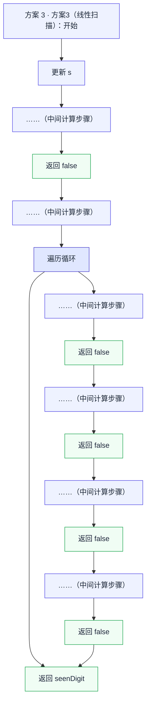

```go
package main // 引入依赖

import (
	"fmt"
	"os"
	"strings"
) // 引入依赖

func isNumber(s string) bool { // 定义判定函数 isNumber
	s = strings.TrimSpace(s) // 把 strings.TrimSpace(字符串) 写入 字符串
	if len(s) == 0 {         // 若 长度(字符串) 等于 0
		return false // 返回 false
	}
	seenDigit, seenDot, seenE := false, false, false // 把 false, false, false 写入 seenDigit, seenDot, seenE :
	for i := 0; i < len(s); i++ {                    // 让 下标 i 从 0 开始计数
		c := s[i]                 // 把 字符串[下标 i] 写入 c :
		if c >= '0' && c <= '9' { // 若 字符 不低于 '0' 且 字符 不超过 '9'
			seenDigit = true // 把 true 写入 seenDigit
		} else if c == '+' || c == '-' { // 否则，若 字符 等于 ' 加 ' 或 字符 等于 ' 减 '
			if i > 0 && (s[i-1] != 'e' && s[i-1] != 'E') { // 若 下标 i 超过 0 且 (字符串[下标 i 减 1] 不等于 'e' 且 字符串[下标 i 减 1] 不等于 'E'
				return false // 返回 false
			}
		} else if c == '.' { // 否则，若 字符 等于 '.'
			if seenDot || seenE { // 若 seenDot 或 seenE
				return false // 返回 false
			}
			seenDot = true // 把 true 写入 seenDot
		} else if c == 'e' || c == 'E' { // 否则，若 字符 等于 'e' 或 字符 等于 'E'
			if seenE || !seenDigit { // 若 seenE 或 取反 seenDigit
				return false // 返回 false
			}
			seenE = true // 把 true 写入 seenE
		} else { // 否则
			return false // 返回 false
		}
	}
	return seenDigit // 返回 seenDigit
}

func main() { // 程序入口：跑内嵌自测用例
	type tc struct { // 定义类型
		in   string // in string
		want bool   // want bool
	}
	cases := []tc{ // 把 []tc{ 写入 cases :
		{"0", true},
		{"abc", false},
		{"123", true},
		{"", false},
	}
	ok := true                // 把 true 写入 ok :
	for _, c := range cases { // 同时取 _ 与 字符 遍历
		if got := isNumber(c.in); got != c.want { // 若 got : 赋值为 isNumber(字符.in); got 不等于 字符.want
			ok = false                                                      // 把 false 写入 ok
			fmt.Printf("FAIL isNumber(%q)=%v want %v\n", c.in, got, c.want) // 打印输出
		}
	}
	if !ok { // 若 取反 ok
		os.Exit(1) // os.Exit(1)
	}
	fmt.Println("PASS") // 全部用例通过，输出 PASS
}
```

#### 方案 4：方案4（确定有限状态自动机 DFA，字符原样作为转移键）

**思路与代码分析**：核心是「方案4（确定有限状态自动机 DFA，字符原样作为转移键）」。Go 版用切片与多返回值惯用法，显式处理索引边界。代码里依次做这些事：哈希结构做计数或查重。**走读**：方案 4 · 方案4（确定有限状态自动机 DFA，字符原样作为转移键）：开始 → 更新 : → 遍历 s 的下标与元素 ch → 返回 false → 返回 state == 3 或 state == 5 或 state == 6。

**运行架构**（真实控制流）：

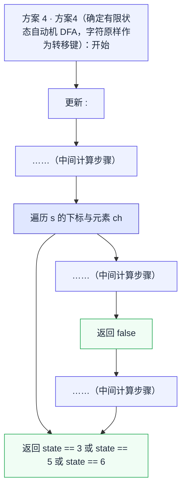

```go
package main // 引入依赖

import (
	"fmt"
	"os"
) // 引入依赖

func isNumber(s string) bool { // 定义判定函数 isNumber
	graph := map[int]map[string]int{ // 把 映射表[int]映射表[string]int{ 写入 graph :
		0: {"blank": 0, "sign": 1, ".": 2, "digit": 6},
		1: {"digit": 6, ".": 2},
		2: {"digit": 3},
		3: {"digit": 3, "e": 4},
		4: {"digit": 5, "sign": 7},
		5: {"digit": 5},
		6: {"digit": 6, ".": 3, "e": 4},
		7: {"digit": 5},
	}
	state := 0             // 把 0 写入 state :
	for _, ch := range s { // 同时取 _ 与 字符 遍历
		c := string(ch)             // 把 string(字符) 写入 c :
		if ch >= '0' && ch <= '9' { // 若 字符 不低于 '0' 且 字符 不超过 '9'
			c = "digit" // 把 「digit」 写入 字符
		} else if ch == ' ' { // 否则，若 字符 等于 ' '
			c = "blank" // 把 「blank」 写入 字符
		} else if ch == '+' || ch == '-' { // 否则，若 字符 等于 ' 加 ' 或 字符 等于 ' 减 '
			c = "sign" // 把 「sign」 写入 字符
		} else if ch == 'e' || ch == 'E' { // 否则，若 字符 等于 'e' 或 字符 等于 'E'
			c = "e" // 把 「e」 写入 字符
		}
		next, ok := graph[state][c] // 把 graph[state][字符] 写入 next, ok :
		if !ok {                    // 若 取反 ok
			return false // 返回 false
		}
		state = next // 把 下一个 写入 state
	}
	return state == 3 || state == 5 || state == 6 // 返回 state 等于 3 或 state 等于 5 或 state 等于 6
}

func main() { // 程序入口：跑内嵌自测用例
	type tc struct { // 定义类型
		in   string // in string
		want bool   // want bool
	}
	cases := []tc{ // 把 []tc{ 写入 cases :
		{"0", true},
		{"abc", false},
		{"123", true},
		{"", false},
	}
	ok := true                // 把 true 写入 ok :
	for _, c := range cases { // 同时取 _ 与 字符 遍历
		if got := isNumber(c.in); got != c.want { // 若 got : 赋值为 isNumber(字符.in); got 不等于 字符.want
			ok = false                                                      // 把 false 写入 ok
			fmt.Printf("FAIL isNumber(%q)=%v want %v\n", c.in, got, c.want) // 打印输出
		}
	}
	if !ok { // 若 取反 ok
		os.Exit(1) // os.Exit(1)
	}
	fmt.Println("PASS") // 全部用例通过，输出 PASS
}
```

#### 方案 5：单趟扫描

**思路与代码分析**：核心是「单趟扫描」。Go 版用切片与多返回值惯用法，显式处理索引边界。代码里依次做这些事：哈希结构做计数或查重。**走读**：方案 5 · 单趟扫描：开始 → 更新 : → 遍历 s 的下标与元素 ch → 返回 false → 返回 state == 3 或 state == 5 或 state == 6。

**运行架构**（真实控制流）：


```go
package main // 引入依赖

import (
	"fmt"
	"os"
	"strings"
) // 引入依赖

func isNumber(s string) bool { // 定义判定函数 isNumber
	graph := map[int]map[string]int{ // 把 映射表[int]映射表[string]int{ 写入 graph :
		0: {"blank": 0, "sign": 1, ".": 2, "digit": 6},
		1: {"digit": 6, ".": 2},
		2: {"digit": 3},
		3: {"digit": 3, "e": 4},
		4: {"digit": 5, "sign": 7},
		5: {"digit": 5},
		6: {"digit": 6, ".": 3, "e": 4},
		7: {"digit": 5},
	}
	state := 0             // 把 0 写入 state :
	for _, ch := range s { // 同时取 _ 与 字符 遍历
		c := string(ch)             // 把 string(字符) 写入 c :
		if ch >= '0' && ch <= '9' { // 若 字符 不低于 '0' 且 字符 不超过 '9'
			c = "digit" // 把 「digit」 写入 字符
		} else if ch == ' ' { // 否则，若 字符 等于 ' '
			c = "blank" // 把 「blank」 写入 字符
		} else if ch == '+' || ch == '-' { // 否则，若 字符 等于 ' 加 ' 或 字符 等于 ' 减 '
			c = "sign" // 把 「sign」 写入 字符
		} else { // 否则
			c = strings.ToLower(string(ch)) // 把 strings.ToLower(string(字符)) 写入 字符
		}
		next, ok := graph[state][c] // 把 graph[state][字符] 写入 next, ok :
		if !ok {                    // 若 取反 ok
			return false // 返回 false
		}
		state = next // 把 下一个 写入 state
	}
	return state == 3 || state == 5 || state == 6 // 返回 state 等于 3 或 state 等于 5 或 state 等于 6
}

func main() { // 程序入口：跑内嵌自测用例
	type tc struct { // 定义类型
		in   string // in string
		want bool   // want bool
	}
	cases := []tc{ // 把 []tc{ 写入 cases :
		{"0", true},
		{"abc", false},
		{"123", true},
		{"", false},
	}
	ok := true                // 把 true 写入 ok :
	for _, c := range cases { // 同时取 _ 与 字符 遍历
		if got := isNumber(c.in); got != c.want { // 若 got : 赋值为 isNumber(字符.in); got 不等于 字符.want
			ok = false                                                      // 把 false 写入 ok
			fmt.Printf("FAIL isNumber(%q)=%v want %v\n", c.in, got, c.want) // 打印输出
		}
	}
	if !ok { // 若 取反 ok
		os.Exit(1) // os.Exit(1)
	}
	fmt.Println("PASS") // 全部用例通过，输出 PASS
}
```

#### 方案 6：单趟扫描

**思路与代码分析**：核心是「单趟扫描」。Go 版用切片与多返回值惯用法，显式处理索引边界。代码里依次做这些事：哈希结构做计数或查重。**走读**：方案 6 · 单趟扫描：开始 → 更新 : → 遍历 s 的下标与元素 ch → 返回 false → 返回 state == 3 或 state == 5 或 state == 6。

**运行架构**（真实控制流）：

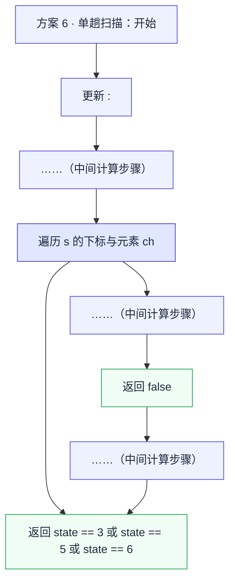

```go
package main // 引入依赖

import (
	"fmt"
	"os"
	"strings"
) // 引入依赖

func isNumber(s string) bool { // 定义判定函数 isNumber
	graph := map[int]map[string]int{ // 把 映射表[int]映射表[string]int{ 写入 graph :
		0: {"blank": 0, "sign": 1, ".": 2, "digit": 6},
		1: {"digit": 6, ".": 2},
		2: {"digit": 3},
		3: {"digit": 3, "e": 4},
		4: {"digit": 5, "sign": 7},
		5: {"digit": 5},
		6: {"digit": 6, ".": 3, "e": 4},
		7: {"digit": 5},
	}
	state := 0             // 把 0 写入 state :
	for _, ch := range s { // 同时取 _ 与 字符 遍历
		c := string(ch)             // 把 string(字符) 写入 c :
		if ch >= '0' && ch <= '9' { // 若 字符 不低于 '0' 且 字符 不超过 '9'
			c = "digit" // 把 「digit」 写入 字符
		} else if ch == ' ' { // 否则，若 字符 等于 ' '
			c = "blank" // 把 「blank」 写入 字符
		} else if ch == '+' || ch == '-' { // 否则，若 字符 等于 ' 加 ' 或 字符 等于 ' 减 '
			c = "sign" // 把 「sign」 写入 字符
		} else { // 否则
			c = strings.ToLower(string(ch)) // 把 strings.ToLower(string(字符)) 写入 字符
		}
		next, ok := graph[state][c] // 把 graph[state][字符] 写入 next, ok :
		if !ok {                    // 若 取反 ok
			return false // 返回 false
		}
		state = next // 把 下一个 写入 state
	}
	return state == 3 || state == 5 || state == 6 // 返回 state 等于 3 或 state 等于 5 或 state 等于 6
}

func main() { // 程序入口：跑内嵌自测用例
	type tc struct { // 定义类型
		in   string // in string
		want bool   // want bool
	}
	cases := []tc{ // 把 []tc{ 写入 cases :
		{"0", true},
		{"abc", false},
		{"123", true},
		{"", false},
	}
	ok := true                // 把 true 写入 ok :
	for _, c := range cases { // 同时取 _ 与 字符 遍历
		if got := isNumber(c.in); got != c.want { // 若 got : 赋值为 isNumber(字符.in); got 不等于 字符.want
			ok = false                                                      // 把 false 写入 ok
			fmt.Printf("FAIL isNumber(%q)=%v want %v\n", c.in, got, c.want) // 打印输出
		}
	}
	if !ok { // 若 取反 ok
		os.Exit(1) // os.Exit(1)
	}
	fmt.Println("PASS") // 全部用例通过，输出 PASS
}
```

#### 方案 7：单趟扫描

**思路与代码分析**：核心是「单趟扫描」。Go 版用切片与多返回值惯用法，显式处理索引边界。代码里依次做这些事：哈希结构做计数或查重。**走读**：方案 7 · 单趟扫描：开始 → 更新 : → 遍历 s 的下标与元素 ch → 返回 false → 返回 state == 3 或 state == 5 或 state == 6。

**运行架构**（真实控制流）：


```go
package main // 引入依赖

import (
	"fmt"
	"os"
	"strings"
) // 引入依赖

func isNumber(s string) bool { // 定义判定函数 isNumber
	graph := map[int]map[string]int{ // 把 映射表[int]映射表[string]int{ 写入 graph :
		0: {"blank": 0, "sign": 1, ".": 2, "digit": 6},
		1: {"digit": 6, ".": 2},
		2: {"digit": 3},
		3: {"digit": 3, "e": 4},
		4: {"digit": 5, "sign": 7},
		5: {"digit": 5},
		6: {"digit": 6, ".": 3, "e": 4},
		7: {"digit": 5},
	}
	state := 0             // 把 0 写入 state :
	for _, ch := range s { // 同时取 _ 与 字符 遍历
		c := string(ch)             // 把 string(字符) 写入 c :
		if ch >= '0' && ch <= '9' { // 若 字符 不低于 '0' 且 字符 不超过 '9'
			c = "digit" // 把 「digit」 写入 字符
		} else if ch == ' ' { // 否则，若 字符 等于 ' '
			c = "blank" // 把 「blank」 写入 字符
		} else if ch == '+' || ch == '-' { // 否则，若 字符 等于 ' 加 ' 或 字符 等于 ' 减 '
			c = "sign" // 把 「sign」 写入 字符
		} else { // 否则
			c = strings.ToLower(string(ch)) // 把 strings.ToLower(string(字符)) 写入 字符
		}
		next, ok := graph[state][c] // 把 graph[state][字符] 写入 next, ok :
		if !ok {                    // 若 取反 ok
			return false // 返回 false
		}
		state = next // 把 下一个 写入 state
	}
	return state == 3 || state == 5 || state == 6 // 返回 state 等于 3 或 state 等于 5 或 state 等于 6
}

func main() { // 程序入口：跑内嵌自测用例
	type tc struct { // 定义类型
		in   string // in string
		want bool   // want bool
	}
	cases := []tc{ // 把 []tc{ 写入 cases :
		{"0", true},
		{"abc", false},
		{"123", true},
		{"", false},
	}
	ok := true                // 把 true 写入 ok :
	for _, c := range cases { // 同时取 _ 与 字符 遍历
		if got := isNumber(c.in); got != c.want { // 若 got : 赋值为 isNumber(字符.in); got 不等于 字符.want
			ok = false                                                      // 把 false 写入 ok
			fmt.Printf("FAIL isNumber(%q)=%v want %v\n", c.in, got, c.want) // 打印输出
		}
	}
	if !ok { // 若 取反 ok
		os.Exit(1) // os.Exit(1)
	}
	fmt.Println("PASS") // 全部用例通过，输出 PASS
}
```

### Java 实现（7 种方案）

Java 的全部方案如下，每个方案都内嵌用例自测，可独立运行（老仓库 python/go 文件遵循「打印结果」约定）：

#### 方案 1：方案1（线性扫描）

**思路与代码分析**：核心是「方案1（线性扫描）」。Java 版用类与静态方法组织，集合操作显式明了。代码里依次做这些事：单循环线性扫描。

**运行架构**（真实控制流）：

```mermaid
graph TD
    A["开始：读取输入"]
    F0["双重循环遍历"]
    A --> F0
    Z["返回结果"]
    F0 --> Z
```

```java
package com.webfault.dsa; // 引入依赖

import java.util.*; // 引入依赖

class lc65_solution11 { // 定义类型
  public boolean isNumber(String s) { // 定义判定函数 isNumber
    String t = s.trim(); // 把 字符串.trim() 存入 另一字符串
    if (t.isEmpty()) return false; // 若 另一字符串.isEmpty()，直接返回 false
    boolean hasDot = false, hasE = false, hasDigit = false;
    for (int i = 0; i < t.length(); i++) { // 让 下标 i 从 0 开始计数，下标 i 小于 另一字符串.长度() 就继续
      char c = t.charAt(i); // 逐字符处理
      if (c == '.') { // 若 字符 等于 '.'
        if (hasDot || hasE) return false; // 若 hasDot 或 hasE，直接返回 false
        hasDot = true; // 把 true; 写入 hasDot
      } else if (c == 'e' || c == 'E') { // 否则，若 字符 等于 'e' 或 字符 等于 'E'
        if (hasE || !hasDigit) return false; // 若 hasE 或 取反 hasDigit，直接返回 false
        hasE = true; // 把 true; 写入 hasE
        hasDigit = false; // 把 false; 写入 hasDigit
      } else if (c == '+' || c == '-') { // 否则，若 字符 等于 ' 加 ' 或 字符 等于 ' 减 '
        if (i > 0 && t.charAt(i - 1) != 'e' && t.charAt(i - 1) != 'E') return false;
      } else if (Character.isDigit(c)) { // 否则，若 Character.isDigit(字符
        hasDigit = true; // 把 true; 写入 hasDigit
      } else { // 否则
        return false; // 返回 false
      }
    }
    return hasDigit; // 返回 hasDigit
  }

  public static void main(String[] args) { // public static void main(String[] args) {
    lc65_solution11 s = new lc65_solution11(); // 把 new lc65_solution11(); 写入 lc65_solution11 s
    String[] tests = {
      "0", "abc", "2.5", "1e10", ".", "e9", " ", "4e", "++1", "2.", "1.2.3", "+5", "46.e3", "1e",
      "-1.", "3e+2"
    };
    boolean[] wants = {
      true, false, true, true, false, false, false, false, false, true, false, true, true, false,
      true, true
    };
    for (int i = 0; i < tests.length; i++) { // 让 下标 i 从 0 开始计数，下标 i 小于 tests.长度 就继续
      if (s.isNumber(tests[i]) != wants[i]) { // 若 字符串.isNumber(tests[下标 i]) 不等于 wants[下标 i]
        System.out.println("FAIL isNumber(" + tests[i] + ") want " + wants[i]); // 打印输出
        throw new RuntimeException("FAILED"); // throw new RuntimeException(「FAILED」);
      }
    }
    System.out.println("PASS"); // 全部用例通过，输出 PASS
  }
}
```

#### 方案 2：方案2（线性扫描）

**思路与代码分析**：核心是「方案2（线性扫描）」。Java 版用类与静态方法组织，集合操作显式明了。代码里依次做这些事：单循环线性扫描。

**运行架构**：与方案 1 的控制流相同（同算法在该语言的等价实现），图见上。

```java
package com.webfault.dsa; // 引入依赖

import java.util.*; // 引入依赖

class lc65_solution22 { // 定义类型
  public boolean isNumber(String s) { // 定义判定函数 isNumber
    String t = s.trim(); // 把 字符串.trim() 存入 另一字符串
    if (t.isEmpty()) return false; // 若 另一字符串.isEmpty()，直接返回 false
    boolean hasDot = false, hasE = false, hasDigit = false;
    for (int i = 0; i < t.length(); i++) { // 让 下标 i 从 0 开始计数，下标 i 小于 另一字符串.长度() 就继续
      char c = t.charAt(i); // 逐字符处理
      if (c == '.') { // 若 字符 等于 '.'
        if (hasDot || hasE) return false; // 若 hasDot 或 hasE，直接返回 false
        hasDot = true; // 把 true; 写入 hasDot
      } else if (c == 'e' || c == 'E') { // 否则，若 字符 等于 'e' 或 字符 等于 'E'
        if (hasE || !hasDigit) return false; // 若 hasE 或 取反 hasDigit，直接返回 false
        hasE = true; // 把 true; 写入 hasE
        hasDigit = false; // 把 false; 写入 hasDigit
      } else if (c == '+' || c == '-') { // 否则，若 字符 等于 ' 加 ' 或 字符 等于 ' 减 '
        if (i > 0 && t.charAt(i - 1) != 'e' && t.charAt(i - 1) != 'E') return false;
      } else if (Character.isDigit(c)) { // 否则，若 Character.isDigit(字符
        hasDigit = true; // 把 true; 写入 hasDigit
      } else { // 否则
        return false; // 返回 false
      }
    }
    return hasDigit; // 返回 hasDigit
  }

  public static void main(String[] args) { // public static void main(String[] args) {
    lc65_solution22 s = new lc65_solution22(); // 把 new lc65_solution22(); 写入 lc65_solution22 s
    String[] tests = {
      "0", "abc", "2.5", "1e10", ".", "e9", " ", "4e", "++1", "2.", "1.2.3", "+5", "46.e3", "1e",
      "-1.", "3e+2"
    };
    boolean[] wants = {
      true, false, true, true, false, false, false, false, false, true, false, true, true, false,
      true, true
    };
    for (int i = 0; i < tests.length; i++) { // 让 下标 i 从 0 开始计数，下标 i 小于 tests.长度 就继续
      if (s.isNumber(tests[i]) != wants[i]) { // 若 字符串.isNumber(tests[下标 i]) 不等于 wants[下标 i]
        System.out.println("FAIL isNumber(" + tests[i] + ") want " + wants[i]); // 打印输出
        throw new RuntimeException("FAILED"); // throw new RuntimeException(「FAILED」);
      }
    }
    System.out.println("PASS"); // 全部用例通过，输出 PASS
  }
}
```

#### 方案 3：方案3（线性扫描）

**思路与代码分析**：核心是「方案3（线性扫描）」。Java 版用类与静态方法组织，集合操作显式明了。代码里依次做这些事：哈希结构做计数或查重；单循环线性扫描。**走读**：方案 3 · 方案3（线性扫描）：开始 → 更新 graph → 遍历循环 → 命中条件，直接返回 → 返回 state.equals(3)。

**运行架构**（真实控制流）：

```mermaid
graph TD
    N0["方案 3 · 方案3（线性扫描）：开始"]
    N1["更新 graph"]
    D1["……（中间计算步骤）"]
    N43["遍历循环"]
    D2["……（中间计算步骤）"]
    N47{"next == null ？"}
    N48["命中条件，直接返回"]
    D3["……（中间计算步骤）"]
    N50["返回 state.equals(3)"]
    Dend["……（中间计算步骤）"]
    N0 --> N1
    N47 -- 是 --> N48
    N43 --> N50
    N1 --> D1
    D1 --> N43
    N43 --> D2
    D2 --> N47
    N48 --> D3
    D3 --> N50
    N50 --> Dend
    classDef n fill:#eef2ff,stroke:#4f46e5,color:#1e293b;
    classDef lp fill:#e0e7ff,stroke:#4338ca,color:#1e293b;
    classDef dc fill:#fef9c3,stroke:#ca8a04,color:#1e293b;
    classDef tm fill:#f0fdf4,stroke:#16a34a,color:#1e293b;
    class N0,N1,D1,D2,D3,Dend n;
    class N43 lp;
    class N47 dc;
    class N48,N50 tm;
```

```java
package com.webfault.dsa; // 引入依赖

import java.util.*; // 引入依赖

class lc65_solution33 { // 定义类型
  public boolean isNumber(String s) { // 定义判定函数 isNumber
    Map<String, Map<String, Integer>> graph = new HashMap<>();
    graph.put(
        "0",
        new HashMap<String, Integer>() {
          {
            put("blank", 0);
            put("sign", 1);
            put(".", 2);
            put("digit", 6);
          }
        });
    graph.put(
        "1",
        new HashMap<String, Integer>() {
          {
            put("digit", 6);
            put(".", 2);
          }
        });
    graph.put(
        "2",
        new HashMap<String, Integer>() {
          {
            put("digit", 3);
          }
        });
    graph.put(
        "3",
        new HashMap<String, Integer>() {
          {
            put("digit", 3);
            put("e", 4);
          }
        });
    graph.put(
        "4",
        new HashMap<String, Integer>() {
          {
            put("digit", 5);
            put("sign", 7);
          }
        });
    graph.put(
        "5",
        new HashMap<String, Integer>() {
          {
            put("digit", 5);
          }
        });
    graph.put(
        "6",
        new HashMap<String, Integer>() {
          {
            put("digit", 6);
            put(".", 3);
            put("e", 4);
          }
        });
    graph.put(
        "7",
        new HashMap<String, Integer>() {
          {
            put("digit", 5);
          }
        });

    String state = "0"; // 把 「0」 存入 state
    for (char ch : s.trim().toCharArray()) { // for (char 字符 : 字符串.trim().toCharArray()) {
      String c; // String 字符;
      if (ch >= '0' && ch <= '9') c = "digit"; // 若 字符 不低于 '0' 且 字符 不超过 '9') 字符 赋值为 「digit」;
      else if (ch == ' ') c = "blank"; // 否则，若 字符 等于 ' ') 字符 赋值为 「blank」;
      else if (ch == '+' || ch == '-') c = "sign"; // 否则，若 字符 等于 ' 加 ' 或 字符 等于 ' 减 ') 字符 赋值为 「sign」;
      else if (ch == '.') c = "."; // 否则，若 字符 等于 '.') 字符 赋值为 「.」;
      else if (ch == 'e' || ch == 'E') c = "e"; // 否则，若 字符 等于 'e' 或 字符 等于 'E') 字符 赋值为 「e」;
      else return false; // 否则
      Integer next = graph.get(state).get(c); // 把 graph 查找 state) 查找 字符) 存入 下一个
      if (next == null) return false; // 若 下一个 等于 null，直接返回 false
      state = String.valueOf(next); // 把 String.valueOf(下一个); 写入 state
    }
    return state.equals("3")
        || state.equals("5")
        || state.equals("6"); // 返回 state.equals(「3」) 或 state.equals(「3」) 或 state.equals(「3」)
  }

  public static void main(String[] args) { // public static void main(String[] args) {
    lc65_solution33 s = new lc65_solution33(); // 把 new lc65_solution33(); 写入 lc65_solution33 s
    String[] tests = {
      "0", "abc", "2.5", "1e10", ".", "e9", " ", "4e", "++1", "2.", "1.2.3", "+5", "46.e3", "1e",
      "-1.", "3e+2"
    };
    boolean[] wants = {
      true, false, true, true, false, false, false, false, false, true, false, true, true, false,
      true, true
    };
    for (int i = 0; i < tests.length; i++) { // 让 下标 i 从 0 开始计数，下标 i 小于 tests.长度 就继续
      if (s.isNumber(tests[i]) != wants[i]) { // 若 字符串.isNumber(tests[下标 i]) 不等于 wants[下标 i]
        System.out.println("FAIL isNumber(" + tests[i] + ") want " + wants[i]); // 打印输出
        throw new RuntimeException("FAILED"); // throw new RuntimeException(「FAILED」);
      }
    }
    System.out.println("PASS"); // 全部用例通过，输出 PASS
  }
}
```

#### 方案 4：方案4（确定有限状态自动机 DFA，字符原样作为转移键）

**思路与代码分析**：核心是「方案4（确定有限状态自动机 DFA，字符原样作为转移键）」。Java 版用类与静态方法组织，集合操作显式明了。代码里依次做这些事：哈希结构做计数或查重；单循环线性扫描。**走读**：方案 4 · 方案4（确定有限状态自动机 DFA，字符原样作为转移键）：开始 → 更新 graph → 遍历循环 → 命中条件，直接返回 → 返回 state.equals(3)。

**运行架构**（真实控制流）：

```mermaid
graph TD
    N0["方案 4 · 方案4（确定有限状态自动机 DFA，字符原样作为转移键）：开始"]
    N1["更新 graph"]
    D1["……（中间计算步骤）"]
    N43["遍历循环"]
    D2["……（中间计算步骤）"]
    N47{"next == null ？"}
    N48["命中条件，直接返回"]
    D3["……（中间计算步骤）"]
    N50["返回 state.equals(3)"]
    Dend["……（中间计算步骤）"]
    N0 --> N1
    N47 -- 是 --> N48
    N43 --> N50
    N1 --> D1
    D1 --> N43
    N43 --> D2
    D2 --> N47
    N48 --> D3
    D3 --> N50
    N50 --> Dend
    classDef n fill:#eef2ff,stroke:#4f46e5,color:#1e293b;
    classDef lp fill:#e0e7ff,stroke:#4338ca,color:#1e293b;
    classDef dc fill:#fef9c3,stroke:#ca8a04,color:#1e293b;
    classDef tm fill:#f0fdf4,stroke:#16a34a,color:#1e293b;
    class N0,N1,D1,D2,D3,Dend n;
    class N43 lp;
    class N47 dc;
    class N48,N50 tm;
```

```java
package com.webfault.dsa; // 引入依赖

import java.util.*; // 引入依赖

class lc65_solution411 { // 定义类型
  public boolean isNumber(String s) { // 定义判定函数 isNumber
    Map<String, Map<String, Integer>> graph = new HashMap<>();
    graph.put(
        "0",
        new HashMap<String, Integer>() {
          {
            put("blank", 0);
            put("sign", 1);
            put(".", 2);
            put("digit", 6);
          }
        });
    graph.put(
        "1",
        new HashMap<String, Integer>() {
          {
            put("digit", 6);
            put(".", 2);
          }
        });
    graph.put(
        "2",
        new HashMap<String, Integer>() {
          {
            put("digit", 3);
          }
        });
    graph.put(
        "3",
        new HashMap<String, Integer>() {
          {
            put("digit", 3);
            put("e", 4);
          }
        });
    graph.put(
        "4",
        new HashMap<String, Integer>() {
          {
            put("digit", 5);
            put("sign", 7);
          }
        });
    graph.put(
        "5",
        new HashMap<String, Integer>() {
          {
            put("digit", 5);
          }
        });
    graph.put(
        "6",
        new HashMap<String, Integer>() {
          {
            put("digit", 6);
            put(".", 3);
            put("e", 4);
          }
        });
    graph.put(
        "7",
        new HashMap<String, Integer>() {
          {
            put("digit", 5);
          }
        });

    String state = "0"; // 把 「0」 存入 state
    for (char ch : s.trim().toCharArray()) { // for (char 字符 : 字符串.trim().toCharArray()) {
      String c; // String 字符;
      if (ch >= '0' && ch <= '9') c = "digit"; // 若 字符 不低于 '0' 且 字符 不超过 '9') 字符 赋值为 「digit」;
      else if (ch == ' ') c = "blank"; // 否则，若 字符 等于 ' ') 字符 赋值为 「blank」;
      else if (ch == '+' || ch == '-') c = "sign"; // 否则，若 字符 等于 ' 加 ' 或 字符 等于 ' 减 ') 字符 赋值为 「sign」;
      else if (ch == '.') c = "."; // 否则，若 字符 等于 '.') 字符 赋值为 「.」;
      else if (ch == 'e' || ch == 'E') c = "e"; // 否则，若 字符 等于 'e' 或 字符 等于 'E') 字符 赋值为 「e」;
      else return false; // 否则
      Integer next = graph.get(state).get(c); // 把 graph 查找 state) 查找 字符) 存入 下一个
      if (next == null) return false; // 若 下一个 等于 null，直接返回 false
      state = String.valueOf(next); // 把 String.valueOf(下一个); 写入 state
    }
    return state.equals("3")
        || state.equals("5")
        || state.equals("6"); // 返回 state.equals(「3」) 或 state.equals(「3」) 或 state.equals(「3」)
  }

  public static void main(String[] args) { // public static void main(String[] args) {
    lc65_solution411 s = new lc65_solution411(); // 把 new lc65_solution411(); 写入 lc65_solution411 s
    String[] tests = {
      "0", "abc", "2.5", "1e10", ".", "e9", " ", "4e", "++1", "2.", "1.2.3", "+5", "46.e3", "1e",
      "-1.", "3e+2"
    };
    boolean[] wants = {
      true, false, true, true, false, false, false, false, false, true, false, true, true, false,
      true, true
    };
    for (int i = 0; i < tests.length; i++) { // 让 下标 i 从 0 开始计数，下标 i 小于 tests.长度 就继续
      if (s.isNumber(tests[i]) != wants[i]) { // 若 字符串.isNumber(tests[下标 i]) 不等于 wants[下标 i]
        System.out.println("FAIL isNumber(" + tests[i] + ") want " + wants[i]); // 打印输出
        throw new RuntimeException("FAILED"); // throw new RuntimeException(「FAILED」);
      }
    }
    System.out.println("PASS"); // 全部用例通过，输出 PASS
  }
}
```

#### 方案 5：单趟扫描

**思路与代码分析**：核心是「单趟扫描」。Java 版用类与静态方法组织，集合操作显式明了。代码里依次做这些事：哈希结构做计数或查重；单循环线性扫描。**走读**：方案 5 · 单趟扫描：开始 → 更新 graph → 遍历循环 → 命中条件，直接返回 → 返回 state.equals(3)。

**运行架构**（真实控制流）：

```mermaid
graph TD
    N0["方案 5 · 单趟扫描：开始"]
    N1["更新 graph"]
    D1["……（中间计算步骤）"]
    N43["遍历循环"]
    D2["……（中间计算步骤）"]
    N47{"next == null ？"}
    N48["命中条件，直接返回"]
    D3["……（中间计算步骤）"]
    N50["返回 state.equals(3)"]
    Dend["……（中间计算步骤）"]
    N0 --> N1
    N47 -- 是 --> N48
    N43 --> N50
    N1 --> D1
    D1 --> N43
    N43 --> D2
    D2 --> N47
    N48 --> D3
    D3 --> N50
    N50 --> Dend
    classDef n fill:#eef2ff,stroke:#4f46e5,color:#1e293b;
    classDef lp fill:#e0e7ff,stroke:#4338ca,color:#1e293b;
    classDef dc fill:#fef9c3,stroke:#ca8a04,color:#1e293b;
    classDef tm fill:#f0fdf4,stroke:#16a34a,color:#1e293b;
    class N0,N1,D1,D2,D3,Dend n;
    class N43 lp;
    class N47 dc;
    class N48,N50 tm;
```

```java
package com.webfault.dsa; // 引入依赖

import java.util.*; // 引入依赖

class lc65_solution522 { // 定义类型
  public boolean isNumber(String s) { // 定义判定函数 isNumber
    Map<String, Map<String, Integer>> graph = new HashMap<>();
    graph.put(
        "0",
        new HashMap<String, Integer>() {
          {
            put("blank", 0);
            put("sign", 1);
            put(".", 2);
            put("digit", 6);
          }
        });
    graph.put(
        "1",
        new HashMap<String, Integer>() {
          {
            put("digit", 6);
            put(".", 2);
          }
        });
    graph.put(
        "2",
        new HashMap<String, Integer>() {
          {
            put("digit", 3);
          }
        });
    graph.put(
        "3",
        new HashMap<String, Integer>() {
          {
            put("digit", 3);
            put("e", 4);
          }
        });
    graph.put(
        "4",
        new HashMap<String, Integer>() {
          {
            put("digit", 5);
            put("sign", 7);
          }
        });
    graph.put(
        "5",
        new HashMap<String, Integer>() {
          {
            put("digit", 5);
          }
        });
    graph.put(
        "6",
        new HashMap<String, Integer>() {
          {
            put("digit", 6);
            put(".", 3);
            put("e", 4);
          }
        });
    graph.put(
        "7",
        new HashMap<String, Integer>() {
          {
            put("digit", 5);
          }
        });

    String state = "0"; // 把 「0」 存入 state
    for (char ch : s.trim().toCharArray()) { // for (char 字符 : 字符串.trim().toCharArray()) {
      String c; // String 字符;
      if (ch >= '0' && ch <= '9') c = "digit"; // 若 字符 不低于 '0' 且 字符 不超过 '9') 字符 赋值为 「digit」;
      else if (ch == ' ') c = "blank"; // 否则，若 字符 等于 ' ') 字符 赋值为 「blank」;
      else if (ch == '+' || ch == '-') c = "sign"; // 否则，若 字符 等于 ' 加 ' 或 字符 等于 ' 减 ') 字符 赋值为 「sign」;
      else if (ch == '.') c = "."; // 否则，若 字符 等于 '.') 字符 赋值为 「.」;
      else if (ch == 'e' || ch == 'E') c = "e"; // 否则，若 字符 等于 'e' 或 字符 等于 'E') 字符 赋值为 「e」;
      else return false; // 否则
      Integer next = graph.get(state).get(c); // 把 graph 查找 state) 查找 字符) 存入 下一个
      if (next == null) return false; // 若 下一个 等于 null，直接返回 false
      state = String.valueOf(next); // 把 String.valueOf(下一个); 写入 state
    }
    return state.equals("3")
        || state.equals("5")
        || state.equals("6"); // 返回 state.equals(「3」) 或 state.equals(「3」) 或 state.equals(「3」)
  }

  public static void main(String[] args) { // public static void main(String[] args) {
    lc65_solution522 s = new lc65_solution522(); // 把 new lc65_solution522(); 写入 lc65_solution522 s
    String[] tests = {
      "0", "abc", "2.5", "1e10", ".", "e9", " ", "4e", "++1", "2.", "1.2.3", "+5", "46.e3", "1e",
      "-1.", "3e+2"
    };
    boolean[] wants = {
      true, false, true, true, false, false, false, false, false, true, false, true, true, false,
      true, true
    };
    for (int i = 0; i < tests.length; i++) { // 让 下标 i 从 0 开始计数，下标 i 小于 tests.长度 就继续
      if (s.isNumber(tests[i]) != wants[i]) { // 若 字符串.isNumber(tests[下标 i]) 不等于 wants[下标 i]
        System.out.println("FAIL isNumber(" + tests[i] + ") want " + wants[i]); // 打印输出
        throw new RuntimeException("FAILED"); // throw new RuntimeException(「FAILED」);
      }
    }
    System.out.println("PASS"); // 全部用例通过，输出 PASS
  }
}
```

#### 方案 6：单趟扫描

**思路与代码分析**：核心是「单趟扫描」。Java 版用类与静态方法组织，集合操作显式明了。代码里依次做这些事：哈希结构做计数或查重；单循环线性扫描。**走读**：方案 6 · 单趟扫描：开始 → 更新 graph → 遍历循环 → 命中条件，直接返回 → 返回 state.equals(3)。

**运行架构**（真实控制流）：

```mermaid
graph TD
    N0["方案 6 · 单趟扫描：开始"]
    N1["更新 graph"]
    D1["……（中间计算步骤）"]
    N43["遍历循环"]
    D2["……（中间计算步骤）"]
    N47{"next == null ？"}
    N48["命中条件，直接返回"]
    D3["……（中间计算步骤）"]
    N50["返回 state.equals(3)"]
    Dend["……（中间计算步骤）"]
    N0 --> N1
    N47 -- 是 --> N48
    N43 --> N50
    N1 --> D1
    D1 --> N43
    N43 --> D2
    D2 --> N47
    N48 --> D3
    D3 --> N50
    N50 --> Dend
    classDef n fill:#eef2ff,stroke:#4f46e5,color:#1e293b;
    classDef lp fill:#e0e7ff,stroke:#4338ca,color:#1e293b;
    classDef dc fill:#fef9c3,stroke:#ca8a04,color:#1e293b;
    classDef tm fill:#f0fdf4,stroke:#16a34a,color:#1e293b;
    class N0,N1,D1,D2,D3,Dend n;
    class N43 lp;
    class N47 dc;
    class N48,N50 tm;
```

```java
package com.webfault.dsa; // 引入依赖

import java.util.*; // 引入依赖

class lc65_solution611 { // 定义类型
  public boolean isNumber(String s) { // 定义判定函数 isNumber
    Map<String, Map<String, Integer>> graph = new HashMap<>();
    graph.put(
        "0",
        new HashMap<String, Integer>() {
          {
            put("blank", 0);
            put("sign", 1);
            put(".", 2);
            put("digit", 6);
          }
        });
    graph.put(
        "1",
        new HashMap<String, Integer>() {
          {
            put("digit", 6);
            put(".", 2);
          }
        });
    graph.put(
        "2",
        new HashMap<String, Integer>() {
          {
            put("digit", 3);
          }
        });
    graph.put(
        "3",
        new HashMap<String, Integer>() {
          {
            put("digit", 3);
            put("e", 4);
          }
        });
    graph.put(
        "4",
        new HashMap<String, Integer>() {
          {
            put("digit", 5);
            put("sign", 7);
          }
        });
    graph.put(
        "5",
        new HashMap<String, Integer>() {
          {
            put("digit", 5);
          }
        });
    graph.put(
        "6",
        new HashMap<String, Integer>() {
          {
            put("digit", 6);
            put(".", 3);
            put("e", 4);
          }
        });
    graph.put(
        "7",
        new HashMap<String, Integer>() {
          {
            put("digit", 5);
          }
        });

    String state = "0"; // 把 「0」 存入 state
    for (char ch : s.trim().toCharArray()) { // for (char 字符 : 字符串.trim().toCharArray()) {
      String c; // String 字符;
      if (ch >= '0' && ch <= '9') c = "digit"; // 若 字符 不低于 '0' 且 字符 不超过 '9') 字符 赋值为 「digit」;
      else if (ch == ' ') c = "blank"; // 否则，若 字符 等于 ' ') 字符 赋值为 「blank」;
      else if (ch == '+' || ch == '-') c = "sign"; // 否则，若 字符 等于 ' 加 ' 或 字符 等于 ' 减 ') 字符 赋值为 「sign」;
      else if (ch == '.') c = "."; // 否则，若 字符 等于 '.') 字符 赋值为 「.」;
      else if (ch == 'e' || ch == 'E') c = "e"; // 否则，若 字符 等于 'e' 或 字符 等于 'E') 字符 赋值为 「e」;
      else return false; // 否则
      Integer next = graph.get(state).get(c); // 把 graph 查找 state) 查找 字符) 存入 下一个
      if (next == null) return false; // 若 下一个 等于 null，直接返回 false
      state = String.valueOf(next); // 把 String.valueOf(下一个); 写入 state
    }
    return state.equals("3")
        || state.equals("5")
        || state.equals("6"); // 返回 state.equals(「3」) 或 state.equals(「3」) 或 state.equals(「3」)
  }

  public static void main(String[] args) { // public static void main(String[] args) {
    lc65_solution611 s = new lc65_solution611(); // 把 new lc65_solution611(); 写入 lc65_solution611 s
    String[] tests = {
      "0", "abc", "2.5", "1e10", ".", "e9", " ", "4e", "++1", "2.", "1.2.3", "+5", "46.e3", "1e",
      "-1.", "3e+2"
    };
    boolean[] wants = {
      true, false, true, true, false, false, false, false, false, true, false, true, true, false,
      true, true
    };
    for (int i = 0; i < tests.length; i++) { // 让 下标 i 从 0 开始计数，下标 i 小于 tests.长度 就继续
      if (s.isNumber(tests[i]) != wants[i]) { // 若 字符串.isNumber(tests[下标 i]) 不等于 wants[下标 i]
        System.out.println("FAIL isNumber(" + tests[i] + ") want " + wants[i]); // 打印输出
        throw new RuntimeException("FAILED"); // throw new RuntimeException(「FAILED」);
      }
    }
    System.out.println("PASS"); // 全部用例通过，输出 PASS
  }
}
```

#### 方案 7：单趟扫描

**思路与代码分析**：核心是「单趟扫描」。Java 版用类与静态方法组织，集合操作显式明了。代码里依次做这些事：哈希结构做计数或查重；单循环线性扫描。**走读**：方案 7 · 单趟扫描：开始 → 更新 graph → 遍历循环 → 命中条件，直接返回 → 返回 state.equals(3)。

**运行架构**（真实控制流）：

```mermaid
graph TD
    N0["方案 7 · 单趟扫描：开始"]
    N1["更新 graph"]
    D1["……（中间计算步骤）"]
    N43["遍历循环"]
    D2["……（中间计算步骤）"]
    N47{"next == null ？"}
    N48["命中条件，直接返回"]
    D3["……（中间计算步骤）"]
    N50["返回 state.equals(3)"]
    Dend["……（中间计算步骤）"]
    N0 --> N1
    N47 -- 是 --> N48
    N43 --> N50
    N1 --> D1
    D1 --> N43
    N43 --> D2
    D2 --> N47
    N48 --> D3
    D3 --> N50
    N50 --> Dend
    classDef n fill:#eef2ff,stroke:#4f46e5,color:#1e293b;
    classDef lp fill:#e0e7ff,stroke:#4338ca,color:#1e293b;
    classDef dc fill:#fef9c3,stroke:#ca8a04,color:#1e293b;
    classDef tm fill:#f0fdf4,stroke:#16a34a,color:#1e293b;
    class N0,N1,D1,D2,D3,Dend n;
    class N43 lp;
    class N47 dc;
    class N48,N50 tm;
```

```java
package com.webfault.dsa; // 引入依赖

import java.util.*; // 引入依赖

class lc65_solution722 { // 定义类型
  public boolean isNumber(String s) { // 定义判定函数 isNumber
    Map<String, Map<String, Integer>> graph = new HashMap<>();
    graph.put(
        "0",
        new HashMap<String, Integer>() {
          {
            put("blank", 0);
            put("sign", 1);
            put(".", 2);
            put("digit", 6);
          }
        });
    graph.put(
        "1",
        new HashMap<String, Integer>() {
          {
            put("digit", 6);
            put(".", 2);
          }
        });
    graph.put(
        "2",
        new HashMap<String, Integer>() {
          {
            put("digit", 3);
          }
        });
    graph.put(
        "3",
        new HashMap<String, Integer>() {
          {
            put("digit", 3);
            put("e", 4);
          }
        });
    graph.put(
        "4",
        new HashMap<String, Integer>() {
          {
            put("digit", 5);
            put("sign", 7);
          }
        });
    graph.put(
        "5",
        new HashMap<String, Integer>() {
          {
            put("digit", 5);
          }
        });
    graph.put(
        "6",
        new HashMap<String, Integer>() {
          {
            put("digit", 6);
            put(".", 3);
            put("e", 4);
          }
        });
    graph.put(
        "7",
        new HashMap<String, Integer>() {
          {
            put("digit", 5);
          }
        });

    String state = "0"; // 把 「0」 存入 state
    for (char ch : s.trim().toCharArray()) { // for (char 字符 : 字符串.trim().toCharArray()) {
      String c; // String 字符;
      if (ch >= '0' && ch <= '9') c = "digit"; // 若 字符 不低于 '0' 且 字符 不超过 '9') 字符 赋值为 「digit」;
      else if (ch == ' ') c = "blank"; // 否则，若 字符 等于 ' ') 字符 赋值为 「blank」;
      else if (ch == '+' || ch == '-') c = "sign"; // 否则，若 字符 等于 ' 加 ' 或 字符 等于 ' 减 ') 字符 赋值为 「sign」;
      else if (ch == '.') c = "."; // 否则，若 字符 等于 '.') 字符 赋值为 「.」;
      else if (ch == 'e' || ch == 'E') c = "e"; // 否则，若 字符 等于 'e' 或 字符 等于 'E') 字符 赋值为 「e」;
      else return false; // 否则
      Integer next = graph.get(state).get(c); // 把 graph 查找 state) 查找 字符) 存入 下一个
      if (next == null) return false; // 若 下一个 等于 null，直接返回 false
      state = String.valueOf(next); // 把 String.valueOf(下一个); 写入 state
    }
    return state.equals("3")
        || state.equals("5")
        || state.equals("6"); // 返回 state.equals(「3」) 或 state.equals(「3」) 或 state.equals(「3」)
  }

  public static void main(String[] args) { // public static void main(String[] args) {
    lc65_solution722 s = new lc65_solution722(); // 把 new lc65_solution722(); 写入 lc65_solution722 s
    String[] tests = {
      "0", "abc", "2.5", "1e10", ".", "e9", " ", "4e", "++1", "2.", "1.2.3", "+5", "46.e3", "1e",
      "-1.", "3e+2"
    };
    boolean[] wants = {
      true, false, true, true, false, false, false, false, false, true, false, true, true, false,
      true, true
    };
    for (int i = 0; i < tests.length; i++) { // 让 下标 i 从 0 开始计数，下标 i 小于 tests.长度 就继续
      if (s.isNumber(tests[i]) != wants[i]) { // 若 字符串.isNumber(tests[下标 i]) 不等于 wants[下标 i]
        System.out.println("FAIL isNumber(" + tests[i] + ") want " + wants[i]); // 打印输出
        throw new RuntimeException("FAILED"); // throw new RuntimeException(「FAILED」);
      }
    }
    System.out.println("PASS"); // 全部用例通过，输出 PASS
  }
}
```

### Rust 实现（7 种方案）

Rust 的全部方案如下，每个方案都内嵌用例自测，可独立运行（老仓库 python/go 文件遵循「打印结果」约定）：

#### 方案 1：方案1（线性扫描）

**思路与代码分析**：核心是「方案1（线性扫描）」。Rust 版用所有权移动与切片借用改写同一逻辑，注意 Option 与引用边界。**走读**：方案 1 · 方案1（线性扫描）：开始 → 计算 t → 返回 false → 遍历 0..chars.len() 中的每个元素 i → 返回 false → 返回 false → 返回 false → 返回 false。

**运行架构**（真实控制流）：

```mermaid
graph TD
    N0["方案 1 · 方案1（线性扫描）：开始"]
    N1["计算 t"]
    D1["……（中间计算步骤）"]
    N3["返回 false"]
    D2["……（中间计算步骤）"]
    N8["遍历 0..chars.len() 中的每个元素 i"]
    D3["……（中间计算步骤）"]
    N12["返回 false"]
    D4["……（中间计算步骤）"]
    N15["返回 false"]
    D5["……（中间计算步骤）"]
    N19["返回 false"]
    D6["……（中间计算步骤）"]
    N21["返回 false"]
    Dend["……（中间计算步骤）"]
    N0 --> N1
    N1 --> D1
    D1 --> N3
    N3 --> D2
    D2 --> N8
    N8 --> D3
    D3 --> N12
    N12 --> D4
    D4 --> N15
    N15 --> D5
    D5 --> N19
    N19 --> D6
    D6 --> N21
    N21 --> Dend
    classDef n fill:#eef2ff,stroke:#4f46e5,color:#1e293b;
    classDef lp fill:#e0e7ff,stroke:#4338ca,color:#1e293b;
    classDef dc fill:#fef9c3,stroke:#ca8a04,color:#1e293b;
    classDef tm fill:#f0fdf4,stroke:#16a34a,color:#1e293b;
    class N0,N1,D1,D2,D3,D4,D5,D6,Dend n;
    class N8 lp;
    class N3,N12,N15,N19,N21 tm;
```

```rust
// LeetCode 65. 有效数字 — Rust 版

// 方案1（线性扫描）
fn is_number(s: &str) -> bool {
    // 定义判定函数 is_number
    let t = s.trim(); // 把 字符串.trim() 存入 另一字符串
    if t.is_empty() {
        // 若 另一字符串.is_empty(
        return false; // 返回 false
    }
    let mut has_dot = false; // 把 false; 写入 let mut has_dot
    let mut has_e = false; // 把 false; 写入 let mut has_e
    let mut has_digit = false; // 把 false; 写入 let mut has_digit
    let chars: Vec<char> = t.chars().collect(); // 把 另一字符串.chars().collect(); 写入 let chars: Vec<char>
    for i in 0..chars.len() {
        // 逐个取出 0 的元素（下标 i）
        let c = chars[i]; // 把 chars[下标 i] 存入 字符
        if c == '.' {
            // 若 字符 等于 '.'
            if has_dot || has_e {
                // 若 has_dot 或 has_e
                return false; // 返回 false
            }
            has_dot = true; // 把 true; 写入 has_dot
        } else if c == 'e' || c == 'E' {
            // 否则，若 字符 等于 'e' 或 字符 等于 'E'
            if has_e || !has_digit {
                // 若 has_e 或 取反 has_digit
                return false; // 返回 false
            }
            has_e = true; // 把 true; 写入 has_e
            has_digit = false; // 把 false; 写入 has_digit
        } else if c == '+' || c == '-' {
            // 否则，若 字符 等于 ' 加 ' 或 字符 等于 ' 减 '
            if i > 0 && chars[i - 1] != 'e' && chars[i - 1] != 'E' {
                return false; // 返回 false
            }
        } else if c.is_ascii_digit() {
            // 否则，若 字符.is_ascii_digit(
            has_digit = true; // 把 true; 写入 has_digit
        } else {
            // 否则
            return false; // 返回 false
        }
    }
    has_digit // has_digit
}

fn main() {
    // 程序入口：跑内嵌自测用例
    assert!(!is_number("abc"), "isNumber('abc') should be false"); // 断言校验
    println!("PASS"); // 全部用例通过，输出 PASS
}
```

#### 方案 2：方案2（线性扫描）

**思路与代码分析**：核心是「方案2（线性扫描）」。Rust 版用所有权移动与切片借用改写同一逻辑，注意 Option 与引用边界。**走读**：方案 2 · 方案2（线性扫描）：开始 → 计算 t → 返回 false → 遍历 0..chars.len() 中的每个元素 i → 返回 false → 返回 false → 返回 false → 返回 false。

**运行架构**（真实控制流）：

```mermaid
graph TD
    N0["方案 2 · 方案2（线性扫描）：开始"]
    N1["计算 t"]
    D1["……（中间计算步骤）"]
    N3["返回 false"]
    D2["……（中间计算步骤）"]
    N8["遍历 0..chars.len() 中的每个元素 i"]
    D3["……（中间计算步骤）"]
    N12["返回 false"]
    D4["……（中间计算步骤）"]
    N15["返回 false"]
    D5["……（中间计算步骤）"]
    N19["返回 false"]
    D6["……（中间计算步骤）"]
    N21["返回 false"]
    Dend["……（中间计算步骤）"]
    N0 --> N1
    N1 --> D1
    D1 --> N3
    N3 --> D2
    D2 --> N8
    N8 --> D3
    D3 --> N12
    N12 --> D4
    D4 --> N15
    N15 --> D5
    D5 --> N19
    N19 --> D6
    D6 --> N21
    N21 --> Dend
    classDef n fill:#eef2ff,stroke:#4f46e5,color:#1e293b;
    classDef lp fill:#e0e7ff,stroke:#4338ca,color:#1e293b;
    classDef dc fill:#fef9c3,stroke:#ca8a04,color:#1e293b;
    classDef tm fill:#f0fdf4,stroke:#16a34a,color:#1e293b;
    class N0,N1,D1,D2,D3,D4,D5,D6,Dend n;
    class N8 lp;
    class N3,N12,N15,N19,N21 tm;
```

```rust
// LeetCode 65. 有效数字 — Rust 版

// 方案2（线性扫描）
fn is_number(s: &str) -> bool {
    // 定义判定函数 is_number
    let t = s.trim(); // 把 字符串.trim() 存入 另一字符串
    if t.is_empty() {
        // 若 另一字符串.is_empty(
        return false; // 返回 false
    }
    let mut has_dot = false; // 把 false; 写入 let mut has_dot
    let mut has_e = false; // 把 false; 写入 let mut has_e
    let mut has_digit = false; // 把 false; 写入 let mut has_digit
    let chars: Vec<char> = t.chars().collect(); // 把 另一字符串.chars().collect(); 写入 let chars: Vec<char>
    for i in 0..chars.len() {
        // 逐个取出 0 的元素（下标 i）
        let c = chars[i]; // 把 chars[下标 i] 存入 字符
        if c == '.' {
            // 若 字符 等于 '.'
            if has_dot || has_e {
                // 若 has_dot 或 has_e
                return false; // 返回 false
            }
            has_dot = true; // 把 true; 写入 has_dot
        } else if c == 'e' || c == 'E' {
            // 否则，若 字符 等于 'e' 或 字符 等于 'E'
            if has_e || !has_digit {
                // 若 has_e 或 取反 has_digit
                return false; // 返回 false
            }
            has_e = true; // 把 true; 写入 has_e
            has_digit = false; // 把 false; 写入 has_digit
        } else if c == '+' || c == '-' {
            // 否则，若 字符 等于 ' 加 ' 或 字符 等于 ' 减 '
            if i > 0 && chars[i - 1] != 'e' && chars[i - 1] != 'E' {
                return false; // 返回 false
            }
        } else if c.is_ascii_digit() {
            // 否则，若 字符.is_ascii_digit(
            has_digit = true; // 把 true; 写入 has_digit
        } else {
            // 否则
            return false; // 返回 false
        }
    }
    has_digit // has_digit
}

fn main() {
    // 程序入口：跑内嵌自测用例
    assert!(!is_number("abc"), "isNumber('abc') should be false"); // 断言校验
    println!("PASS"); // 全部用例通过，输出 PASS
}
```

#### 方案 3：方案3（线性扫描）

**思路与代码分析**：核心是「方案3（线性扫描）」。Rust 版用所有权移动与切片借用改写同一逻辑，注意 Option 与引用边界。**走读**：方案 3 · 方案3（线性扫描）：开始 → 计算 t → 返回 false → 遍历 0..chars.len() 中的每个元素 i → 返回 false → 返回 false → 返回 false → 返回 false。

**运行架构**（真实控制流）：

```mermaid
graph TD
    N0["方案 3 · 方案3（线性扫描）：开始"]
    N1["计算 t"]
    D1["……（中间计算步骤）"]
    N3["返回 false"]
    D2["……（中间计算步骤）"]
    N8["遍历 0..chars.len() 中的每个元素 i"]
    D3["……（中间计算步骤）"]
    N12["返回 false"]
    D4["……（中间计算步骤）"]
    N15["返回 false"]
    D5["……（中间计算步骤）"]
    N19["返回 false"]
    D6["……（中间计算步骤）"]
    N21["返回 false"]
    Dend["……（中间计算步骤）"]
    N0 --> N1
    N1 --> D1
    D1 --> N3
    N3 --> D2
    D2 --> N8
    N8 --> D3
    D3 --> N12
    N12 --> D4
    D4 --> N15
    N15 --> D5
    D5 --> N19
    N19 --> D6
    D6 --> N21
    N21 --> Dend
    classDef n fill:#eef2ff,stroke:#4f46e5,color:#1e293b;
    classDef lp fill:#e0e7ff,stroke:#4338ca,color:#1e293b;
    classDef dc fill:#fef9c3,stroke:#ca8a04,color:#1e293b;
    classDef tm fill:#f0fdf4,stroke:#16a34a,color:#1e293b;
    class N0,N1,D1,D2,D3,D4,D5,D6,Dend n;
    class N8 lp;
    class N3,N12,N15,N19,N21 tm;
```

```rust
// LeetCode 65. 有效数字 — Rust 版

// 方案3（线性扫描）
fn is_number(s: &str) -> bool {
    // 定义判定函数 is_number
    let t = s.trim(); // 把 字符串.trim() 存入 另一字符串
    if t.is_empty() {
        // 若 另一字符串.is_empty(
        return false; // 返回 false
    }
    let mut has_dot = false; // 把 false; 写入 let mut has_dot
    let mut has_e = false; // 把 false; 写入 let mut has_e
    let mut has_digit = false; // 把 false; 写入 let mut has_digit
    let chars: Vec<char> = t.chars().collect(); // 把 另一字符串.chars().collect(); 写入 let chars: Vec<char>
    for i in 0..chars.len() {
        // 逐个取出 0 的元素（下标 i）
        let c = chars[i]; // 把 chars[下标 i] 存入 字符
        if c == '.' {
            // 若 字符 等于 '.'
            if has_dot || has_e {
                // 若 has_dot 或 has_e
                return false; // 返回 false
            }
            has_dot = true; // 把 true; 写入 has_dot
        } else if c == 'e' || c == 'E' {
            // 否则，若 字符 等于 'e' 或 字符 等于 'E'
            if has_e || !has_digit {
                // 若 has_e 或 取反 has_digit
                return false; // 返回 false
            }
            has_e = true; // 把 true; 写入 has_e
            has_digit = false; // 把 false; 写入 has_digit
        } else if c == '+' || c == '-' {
            // 否则，若 字符 等于 ' 加 ' 或 字符 等于 ' 减 '
            if i > 0 && chars[i - 1] != 'e' && chars[i - 1] != 'E' {
                return false; // 返回 false
            }
        } else if c.is_ascii_digit() {
            // 否则，若 字符.is_ascii_digit(
            has_digit = true; // 把 true; 写入 has_digit
        } else {
            // 否则
            return false; // 返回 false
        }
    }
    has_digit // has_digit
}

fn main() {
    // 程序入口：跑内嵌自测用例
    assert!(!is_number("abc"), "isNumber('abc') should be false"); // 断言校验
    println!("PASS"); // 全部用例通过，输出 PASS
}
```

#### 方案 4：方案4（确定有限状态自动机 DFA，字符原样作为转移键）

**思路与代码分析**：核心是「方案4（确定有限状态自动机 DFA，字符原样作为转移键）」。Rust 版用所有权移动与切片借用改写同一逻辑，注意 Option 与引用边界。代码里依次做这些事：哈希结构做计数或查重。**走读**：方案 4 · 方案4（确定有限状态自动机 DFA，字符原样作为转移键）：开始 → 计算 graph → 遍历 s.trim().chars() 中的每个元素 ch → 返回结果。

**运行架构**（真实控制流）：

```mermaid
graph TD
    N0["方案 4 · 方案4（确定有限状态自动机 DFA，字符原样作为转移键）：开始"]
    N1["计算 graph"]
    D1["……（中间计算步骤）"]
    N12["遍历 s.trim().chars() 中的每个元素 ch"]
    D2["……（中间计算步骤）"]
    N22["返回结果"]
    N0 --> N1
    N1 --> D1
    D1 --> N12
    N12 --> D2
    D2 --> N22
    classDef n fill:#eef2ff,stroke:#4f46e5,color:#1e293b;
    classDef lp fill:#e0e7ff,stroke:#4338ca,color:#1e293b;
    classDef dc fill:#fef9c3,stroke:#ca8a04,color:#1e293b;
    classDef tm fill:#f0fdf4,stroke:#16a34a,color:#1e293b;
    class N0,N1,D1,D2 n;
    class N12 lp;
    class N22 tm;
```

```rust
// LeetCode 65. 有效数字 — Rust 版

// 方案4（确定有限状态自动机 DFA，字符原样作为转移键）
use std::collections::HashMap; // 引入依赖

fn mk(rows: &[(&'static str, usize)]) -> HashMap<String, usize> {
    rows.iter().map(|(k, v)| (k.to_string(), *v)).collect()
}

fn is_number(s: &str) -> bool {
    // 定义判定函数 is_number
    let graph: Vec<HashMap<String, usize>> = vec![
        mk(&[("blank", 0), ("sign", 1), (".", 2), ("digit", 6)]),
        mk(&[("digit", 6), (".", 2)]),
        mk(&[("digit", 3)]),
        mk(&[("digit", 3), ("e", 4)]),
        mk(&[("digit", 5), ("sign", 7)]),
        mk(&[("digit", 5)]),
        mk(&[("digit", 6), (".", 3), ("e", 4)]),
        mk(&[("digit", 5)]),
    ];
    let mut state = 0usize; // 把 0usize; 写入 let mut state
    for ch in s.trim().chars() {
        // 逐个取出 字符串 的元素（字符）
        let c: String = if ch.is_ascii_digit() {
            // 把 if 字符.is_ascii_digit() { 写入 let c: String
            "digit".to_string() // 「digit」.to_string()
        } else if ch == ' ' {
            // 否则，若 字符 等于 ' '
            "blank".to_string() // 「blank」.to_string()
        } else if ch == '+' || ch == '-' {
            // 否则，若 字符 等于 ' 加 ' 或 字符 等于 ' 减 '
            "sign".to_string() // 「sign」.to_string()
        } else {
            // 否则
            ch.to_string() // 原样字符（'e' 直接作键；与 Python 参考一致）
        };
        match graph[state].get(&c) {
            // 按情况匹配处理
            Some(&ns) => state = ns,
            None => return false,
        }
    }
    state == 3 || state == 5 || state == 6 // 把 赋值为 3 或 state 等于 5 或 state 等于 6 写入 state
}

fn main() {
    // 程序入口：跑内嵌自测用例
    assert!(is_number("0"), "isNumber('0') should be true"); // 断言校验
    assert!(!is_number("abc"), "isNumber('abc') should be false"); // 断言校验
    println!("PASS"); // 全部用例通过，输出 PASS
}
```

#### 方案 5：单趟扫描

**思路与代码分析**：核心是「单趟扫描」。Rust 版用所有权移动与切片借用改写同一逻辑，注意 Option 与引用边界。代码里依次做这些事：哈希结构做计数或查重。**走读**：方案 5 · 单趟扫描：开始 → 计算 graph → 遍历 s.trim().chars() 中的每个元素 ch → 返回结果。

**运行架构**（真实控制流）：

```mermaid
graph TD
    N0["方案 5 · 单趟扫描：开始"]
    N1["计算 graph"]
    D1["……（中间计算步骤）"]
    N12["遍历 s.trim().chars() 中的每个元素 ch"]
    D2["……（中间计算步骤）"]
    N22["返回结果"]
    N0 --> N1
    N1 --> D1
    D1 --> N12
    N12 --> D2
    D2 --> N22
    classDef n fill:#eef2ff,stroke:#4f46e5,color:#1e293b;
    classDef lp fill:#e0e7ff,stroke:#4338ca,color:#1e293b;
    classDef dc fill:#fef9c3,stroke:#ca8a04,color:#1e293b;
    classDef tm fill:#f0fdf4,stroke:#16a34a,color:#1e293b;
    class N0,N1,D1,D2 n;
    class N12 lp;
    class N22 tm;
```

```rust
// LeetCode 65. 有效数字 — Rust 版

// 方案5（确定有限状态自动机 DFA，其余字符 lowercase）
use std::collections::HashMap; // 引入依赖

fn mk(rows: &[(&'static str, usize)]) -> HashMap<String, usize> {
    rows.iter().map(|(k, v)| (k.to_string(), *v)).collect()
}

fn is_number(s: &str) -> bool {
    // 定义判定函数 is_number
    let graph: Vec<HashMap<String, usize>> = vec![
        mk(&[("blank", 0), ("sign", 1), (".", 2), ("digit", 6)]),
        mk(&[("digit", 6), (".", 2)]),
        mk(&[("digit", 3)]),
        mk(&[("digit", 3), ("e", 4)]),
        mk(&[("digit", 5), ("sign", 7)]),
        mk(&[("digit", 5)]),
        mk(&[("digit", 6), (".", 3), ("e", 4)]),
        mk(&[("digit", 5)]),
    ];
    let mut state = 0usize; // 把 0usize; 写入 let mut state
    for ch in s.trim().chars() {
        // 逐个取出 字符串 的元素（字符）
        let c: String = if ch.is_ascii_digit() {
            // 把 if 字符.is_ascii_digit() { 写入 let c: String
            "digit".to_string() // 「digit」.to_string()
        } else if ch == ' ' {
            // 否则，若 字符 等于 ' '
            "blank".to_string() // 「blank」.to_string()
        } else if ch == '+' || ch == '-' {
            // 否则，若 字符 等于 ' 加 ' 或 字符 等于 ' 减 '
            "sign".to_string() // 「sign」.to_string()
        } else {
            // 否则
            ch.to_lowercase().to_string() // 字符.to_lowercase().to_string()
        };
        match graph[state].get(&c) {
            // 按情况匹配处理
            Some(&ns) => state = ns,
            None => return false,
        }
    }
    state == 3 || state == 5 || state == 6 // 把 赋值为 3 或 state 等于 5 或 state 等于 6 写入 state
}

fn main() {
    // 程序入口：跑内嵌自测用例
    assert!(is_number("0"), "isNumber('0') should be true"); // 断言校验
    assert!(!is_number("abc"), "isNumber('abc') should be false"); // 断言校验
    println!("PASS"); // 全部用例通过，输出 PASS
}
```

#### 方案 6：单趟扫描

**思路与代码分析**：核心是「单趟扫描」。Rust 版用所有权移动与切片借用改写同一逻辑，注意 Option 与引用边界。代码里依次做这些事：哈希结构做计数或查重。**走读**：方案 6 · 单趟扫描：开始 → 计算 graph → 遍历 s.trim().chars() 中的每个元素 ch → 返回结果。

**运行架构**（真实控制流）：

```mermaid
graph TD
    N0["方案 6 · 单趟扫描：开始"]
    N1["计算 graph"]
    D1["……（中间计算步骤）"]
    N12["遍历 s.trim().chars() 中的每个元素 ch"]
    D2["……（中间计算步骤）"]
    N22["返回结果"]
    N0 --> N1
    N1 --> D1
    D1 --> N12
    N12 --> D2
    D2 --> N22
    classDef n fill:#eef2ff,stroke:#4f46e5,color:#1e293b;
    classDef lp fill:#e0e7ff,stroke:#4338ca,color:#1e293b;
    classDef dc fill:#fef9c3,stroke:#ca8a04,color:#1e293b;
    classDef tm fill:#f0fdf4,stroke:#16a34a,color:#1e293b;
    class N0,N1,D1,D2 n;
    class N12 lp;
    class N22 tm;
```

```rust
// LeetCode 65. 有效数字 — Rust 版

// 方案6（确定有限状态自动机 DFA，其余字符 lowercase）
use std::collections::HashMap; // 引入依赖

fn mk(rows: &[(&'static str, usize)]) -> HashMap<String, usize> {
    rows.iter().map(|(k, v)| (k.to_string(), *v)).collect()
}

fn is_number(s: &str) -> bool {
    // 定义判定函数 is_number
    let graph: Vec<HashMap<String, usize>> = vec![
        mk(&[("blank", 0), ("sign", 1), (".", 2), ("digit", 6)]),
        mk(&[("digit", 6), (".", 2)]),
        mk(&[("digit", 3)]),
        mk(&[("digit", 3), ("e", 4)]),
        mk(&[("digit", 5), ("sign", 7)]),
        mk(&[("digit", 5)]),
        mk(&[("digit", 6), (".", 3), ("e", 4)]),
        mk(&[("digit", 5)]),
    ];
    let mut state = 0usize; // 把 0usize; 写入 let mut state
    for ch in s.trim().chars() {
        // 逐个取出 字符串 的元素（字符）
        let c: String = if ch.is_ascii_digit() {
            // 把 if 字符.is_ascii_digit() { 写入 let c: String
            "digit".to_string() // 「digit」.to_string()
        } else if ch == ' ' {
            // 否则，若 字符 等于 ' '
            "blank".to_string() // 「blank」.to_string()
        } else if ch == '+' || ch == '-' {
            // 否则，若 字符 等于 ' 加 ' 或 字符 等于 ' 减 '
            "sign".to_string() // 「sign」.to_string()
        } else {
            // 否则
            ch.to_lowercase().to_string() // 字符.to_lowercase().to_string()
        };
        match graph[state].get(&c) {
            // 按情况匹配处理
            Some(&ns) => state = ns,
            None => return false,
        }
    }
    state == 3 || state == 5 || state == 6 // 把 赋值为 3 或 state 等于 5 或 state 等于 6 写入 state
}

fn main() {
    // 程序入口：跑内嵌自测用例
    assert!(is_number("0"), "isNumber('0') should be true"); // 断言校验
    assert!(!is_number("abc"), "isNumber('abc') should be false"); // 断言校验
    println!("PASS"); // 全部用例通过，输出 PASS
}
```

#### 方案 7：单趟扫描

**思路与代码分析**：核心是「单趟扫描」。Rust 版用所有权移动与切片借用改写同一逻辑，注意 Option 与引用边界。代码里依次做这些事：哈希结构做计数或查重。**走读**：方案 7 · 单趟扫描：开始 → 计算 graph → 遍历 s.trim().chars() 中的每个元素 ch → 返回结果。

**运行架构**（真实控制流）：

```mermaid
graph TD
    N0["方案 7 · 单趟扫描：开始"]
    N1["计算 graph"]
    D1["……（中间计算步骤）"]
    N12["遍历 s.trim().chars() 中的每个元素 ch"]
    D2["……（中间计算步骤）"]
    N22["返回结果"]
    N0 --> N1
    N1 --> D1
    D1 --> N12
    N12 --> D2
    D2 --> N22
    classDef n fill:#eef2ff,stroke:#4f46e5,color:#1e293b;
    classDef lp fill:#e0e7ff,stroke:#4338ca,color:#1e293b;
    classDef dc fill:#fef9c3,stroke:#ca8a04,color:#1e293b;
    classDef tm fill:#f0fdf4,stroke:#16a34a,color:#1e293b;
    class N0,N1,D1,D2 n;
    class N12 lp;
    class N22 tm;
```

```rust
// LeetCode 65. 有效数字 — Rust 版

// 方案7（确定有限状态自动机 DFA，其余字符 lowercase）
use std::collections::HashMap; // 引入依赖

fn mk(rows: &[(&'static str, usize)]) -> HashMap<String, usize> {
    rows.iter().map(|(k, v)| (k.to_string(), *v)).collect()
}

fn is_number(s: &str) -> bool {
    // 定义判定函数 is_number
    let graph: Vec<HashMap<String, usize>> = vec![
        mk(&[("blank", 0), ("sign", 1), (".", 2), ("digit", 6)]),
        mk(&[("digit", 6), (".", 2)]),
        mk(&[("digit", 3)]),
        mk(&[("digit", 3), ("e", 4)]),
        mk(&[("digit", 5), ("sign", 7)]),
        mk(&[("digit", 5)]),
        mk(&[("digit", 6), (".", 3), ("e", 4)]),
        mk(&[("digit", 5)]),
    ];
    let mut state = 0usize; // 把 0usize; 写入 let mut state
    for ch in s.trim().chars() {
        // 逐个取出 字符串 的元素（字符）
        let c: String = if ch.is_ascii_digit() {
            // 把 if 字符.is_ascii_digit() { 写入 let c: String
            "digit".to_string() // 「digit」.to_string()
        } else if ch == ' ' {
            // 否则，若 字符 等于 ' '
            "blank".to_string() // 「blank」.to_string()
        } else if ch == '+' || ch == '-' {
            // 否则，若 字符 等于 ' 加 ' 或 字符 等于 ' 减 '
            "sign".to_string() // 「sign」.to_string()
        } else {
            // 否则
            ch.to_lowercase().to_string() // 字符.to_lowercase().to_string()
        };
        match graph[state].get(&c) {
            // 按情况匹配处理
            Some(&ns) => state = ns,
            None => return false,
        }
    }
    state == 3 || state == 5 || state == 6 // 把 赋值为 3 或 state 等于 5 或 state 等于 6 写入 state
}

fn main() {
    // 程序入口：跑内嵌自测用例
    assert!(is_number("0"), "isNumber('0') should be true"); // 断言校验
    assert!(!is_number("abc"), "isNumber('abc') should be false"); // 断言校验
    println!("PASS"); // 全部用例通过，输出 PASS
}
```

### Lua 实现（7 种方案）

Lua 的全部方案如下，每个方案都内嵌用例自测，可独立运行（老仓库 python/go 文件遵循「打印结果」约定）：

#### 方案 1：方案1（线性扫描）

**思路与代码分析**：核心是「方案1（线性扫描）」。Lua 版用表与 ipairs 遍历，注意 ipairs 遇 nil 即停的语义。**走读**：方案 1 · 方案1（线性扫描）：开始 → 更新 t → 返回 false → 循环 i：从 1 到 #t do → 返回 false → 返回 false → 返回 false → 返回 false → 返回 has_digit。

**运行架构**（真实控制流）：

```mermaid
graph TD
    N0["方案 1 · 方案1（线性扫描）：开始"]
    N1["更新 t"]
    D1["……（中间计算步骤）"]
    N3["返回 false"]
    D2["……（中间计算步骤）"]
    N7["循环 i：从 1 到 #t do"]
    D3["……（中间计算步骤）"]
    N11["返回 false"]
    D4["……（中间计算步骤）"]
    N14["返回 false"]
    D5["……（中间计算步骤）"]
    N19["返回 false"]
    D6["……（中间计算步骤）"]
    N21["返回 false"]
    N22["返回 has_digit"]
    Dend["……（中间计算步骤）"]
    N0 --> N1
    N21 --> N22
    N1 --> D1
    D1 --> N3
    N3 --> D2
    D2 --> N7
    N7 --> D3
    D3 --> N11
    N11 --> D4
    D4 --> N14
    N14 --> D5
    D5 --> N19
    N19 --> D6
    D6 --> N21
    N22 --> Dend
    classDef n fill:#eef2ff,stroke:#4f46e5,color:#1e293b;
    classDef lp fill:#e0e7ff,stroke:#4338ca,color:#1e293b;
    classDef dc fill:#fef9c3,stroke:#ca8a04,color:#1e293b;
    classDef tm fill:#f0fdf4,stroke:#16a34a,color:#1e293b;
    class N0,N1,D1,D2,D3,D4,D5,D6,Dend n;
    class N7 lp;
    class N3,N11,N14,N19,N21,N22 tm;
```

```lua
-- LeetCode 65. 有效数字 — Lua 版

-- 方案1（线性扫描）
local function is_number(s) -- local function is_number(字符串)
	local t = s:match("^%s*(.-)%s*$") -- 等价于 TS 的 trim()
	if #t == 0 then
		return false
	end -- 若 #另一字符串 等于 0 then return false 终点
	local has_dot = false -- 把 false 写入 local has_dot
	local has_e = false -- 把 false 写入 local has_e
	local has_digit = false -- 把 false 写入 local has_digit
	for i = 1, #t do -- 把 1, #另一字符串 do 写入 for i
		local c = t:sub(i, i) -- 把 另一字符串:sub(下标 i, 下标 i) 写入 local c
		if c == "." then -- 若 字符 等于 「.」 then
			if has_dot or has_e then
				return false
			end -- 若 has_dot or has_e then return false 终点
			has_dot = true -- 把 true 存入 has_dot
		elseif c == "e" or c == "E" then -- 把 赋值为 「e」 or 字符 等于 「e」 then 写入 elseif c
			if has_e or not has_digit then
				return false
			end -- 若 has_e or not has_digit then return false 终点
			has_e = true -- 把 true 存入 has_e
			has_digit = false -- 把 false 存入 has_digit
		elseif c == "+" or c == "-" then -- 把 赋值为 「 加 」 or 字符 等于 「 加 」 then 写入 elseif c
			local prev = t:sub(i - 1, i - 1) -- 把 另一字符串:sub(下标 i 减 1, 下标 i 减 1) 写入 local prev
			if i > 1 and prev ~= "e" and prev ~= "E" then
				return false
			end
		elseif c:match("%d") then -- elseif 字符:match(「 对…取模 d」) then
			has_digit = true -- 把 true 存入 has_digit
		else -- 否则
			return false -- 返回 false
		end -- 终点
	end -- 终点
	return has_digit -- 返回 has_digit
end -- 终点

assert(is_number("abc") == false, "isNumber('abc') should be false") -- 断言校验
print("PASS") -- 全部用例通过，输出 PASS
```

#### 方案 2：方案2（线性扫描）

**思路与代码分析**：核心是「方案2（线性扫描）」。Lua 版用表与 ipairs 遍历，注意 ipairs 遇 nil 即停的语义。**走读**：方案 2 · 方案2（线性扫描）：开始 → 更新 t → 返回 false → 循环 i：从 1 到 #t do → 返回 false → 返回 false → 返回 false → 返回 false → 返回 has_digit。

**运行架构**（真实控制流）：

```mermaid
graph TD
    N0["方案 2 · 方案2（线性扫描）：开始"]
    N1["更新 t"]
    D1["……（中间计算步骤）"]
    N3["返回 false"]
    D2["……（中间计算步骤）"]
    N7["循环 i：从 1 到 #t do"]
    D3["……（中间计算步骤）"]
    N11["返回 false"]
    D4["……（中间计算步骤）"]
    N14["返回 false"]
    D5["……（中间计算步骤）"]
    N19["返回 false"]
    D6["……（中间计算步骤）"]
    N21["返回 false"]
    N22["返回 has_digit"]
    Dend["……（中间计算步骤）"]
    N0 --> N1
    N21 --> N22
    N1 --> D1
    D1 --> N3
    N3 --> D2
    D2 --> N7
    N7 --> D3
    D3 --> N11
    N11 --> D4
    D4 --> N14
    N14 --> D5
    D5 --> N19
    N19 --> D6
    D6 --> N21
    N22 --> Dend
    classDef n fill:#eef2ff,stroke:#4f46e5,color:#1e293b;
    classDef lp fill:#e0e7ff,stroke:#4338ca,color:#1e293b;
    classDef dc fill:#fef9c3,stroke:#ca8a04,color:#1e293b;
    classDef tm fill:#f0fdf4,stroke:#16a34a,color:#1e293b;
    class N0,N1,D1,D2,D3,D4,D5,D6,Dend n;
    class N7 lp;
    class N3,N11,N14,N19,N21,N22 tm;
```

```lua
-- LeetCode 65. 有效数字 — Lua 版

-- 方案2（线性扫描）
local function is_number(s) -- local function is_number(字符串)
	local t = s:match("^%s*(.-)%s*$") -- 等价于 TS 的 trim()
	if #t == 0 then
		return false
	end -- 若 #另一字符串 等于 0 then return false 终点
	local has_dot = false -- 把 false 写入 local has_dot
	local has_e = false -- 把 false 写入 local has_e
	local has_digit = false -- 把 false 写入 local has_digit
	for i = 1, #t do -- 把 1, #另一字符串 do 写入 for i
		local c = t:sub(i, i) -- 把 另一字符串:sub(下标 i, 下标 i) 写入 local c
		if c == "." then -- 若 字符 等于 「.」 then
			if has_dot or has_e then
				return false
			end -- 若 has_dot or has_e then return false 终点
			has_dot = true -- 把 true 存入 has_dot
		elseif c == "e" or c == "E" then -- 把 赋值为 「e」 or 字符 等于 「e」 then 写入 elseif c
			if has_e or not has_digit then
				return false
			end -- 若 has_e or not has_digit then return false 终点
			has_e = true -- 把 true 存入 has_e
			has_digit = false -- 把 false 存入 has_digit
		elseif c == "+" or c == "-" then -- 把 赋值为 「 加 」 or 字符 等于 「 加 」 then 写入 elseif c
			local prev = t:sub(i - 1, i - 1) -- 把 另一字符串:sub(下标 i 减 1, 下标 i 减 1) 写入 local prev
			if i > 1 and prev ~= "e" and prev ~= "E" then
				return false
			end
		elseif c:match("%d") then -- elseif 字符:match(「 对…取模 d」) then
			has_digit = true -- 把 true 存入 has_digit
		else -- 否则
			return false -- 返回 false
		end -- 终点
	end -- 终点
	return has_digit -- 返回 has_digit
end -- 终点

assert(is_number("abc") == false, "isNumber('abc') should be false") -- 断言校验
print("PASS") -- 全部用例通过，输出 PASS
```

#### 方案 3：方案3（线性扫描）

**思路与代码分析**：核心是「方案3（线性扫描）」。Lua 版用表与 ipairs 遍历，注意 ipairs 遇 nil 即停的语义。**走读**：方案 3 · 方案3（线性扫描）：开始 → 更新 t → 返回 false → 循环 i：从 1 到 #t do → 返回 false → 返回 false → 返回 false → 返回 false → 返回 has_digit。

**运行架构**（真实控制流）：

```mermaid
graph TD
    N0["方案 3 · 方案3（线性扫描）：开始"]
    N1["更新 t"]
    D1["……（中间计算步骤）"]
    N3["返回 false"]
    D2["……（中间计算步骤）"]
    N7["循环 i：从 1 到 #t do"]
    D3["……（中间计算步骤）"]
    N11["返回 false"]
    D4["……（中间计算步骤）"]
    N14["返回 false"]
    D5["……（中间计算步骤）"]
    N19["返回 false"]
    D6["……（中间计算步骤）"]
    N21["返回 false"]
    N22["返回 has_digit"]
    Dend["……（中间计算步骤）"]
    N0 --> N1
    N21 --> N22
    N1 --> D1
    D1 --> N3
    N3 --> D2
    D2 --> N7
    N7 --> D3
    D3 --> N11
    N11 --> D4
    D4 --> N14
    N14 --> D5
    D5 --> N19
    N19 --> D6
    D6 --> N21
    N22 --> Dend
    classDef n fill:#eef2ff,stroke:#4f46e5,color:#1e293b;
    classDef lp fill:#e0e7ff,stroke:#4338ca,color:#1e293b;
    classDef dc fill:#fef9c3,stroke:#ca8a04,color:#1e293b;
    classDef tm fill:#f0fdf4,stroke:#16a34a,color:#1e293b;
    class N0,N1,D1,D2,D3,D4,D5,D6,Dend n;
    class N7 lp;
    class N3,N11,N14,N19,N21,N22 tm;
```

```lua
-- LeetCode 65. 有效数字 — Lua 版

-- 方案3（线性扫描）
local function is_number(s) -- local function is_number(字符串)
	local t = s:match("^%s*(.-)%s*$") -- 等价于 TS 的 trim()
	if #t == 0 then
		return false
	end -- 若 #另一字符串 等于 0 then return false 终点
	local has_dot = false -- 把 false 写入 local has_dot
	local has_e = false -- 把 false 写入 local has_e
	local has_digit = false -- 把 false 写入 local has_digit
	for i = 1, #t do -- 把 1, #另一字符串 do 写入 for i
		local c = t:sub(i, i) -- 把 另一字符串:sub(下标 i, 下标 i) 写入 local c
		if c == "." then -- 若 字符 等于 「.」 then
			if has_dot or has_e then
				return false
			end -- 若 has_dot or has_e then return false 终点
			has_dot = true -- 把 true 存入 has_dot
		elseif c == "e" or c == "E" then -- 把 赋值为 「e」 or 字符 等于 「e」 then 写入 elseif c
			if has_e or not has_digit then
				return false
			end -- 若 has_e or not has_digit then return false 终点
			has_e = true -- 把 true 存入 has_e
			has_digit = false -- 把 false 存入 has_digit
		elseif c == "+" or c == "-" then -- 把 赋值为 「 加 」 or 字符 等于 「 加 」 then 写入 elseif c
			local prev = t:sub(i - 1, i - 1) -- 把 另一字符串:sub(下标 i 减 1, 下标 i 减 1) 写入 local prev
			if i > 1 and prev ~= "e" and prev ~= "E" then
				return false
			end
		elseif c:match("%d") then -- elseif 字符:match(「 对…取模 d」) then
			has_digit = true -- 把 true 存入 has_digit
		else -- 否则
			return false -- 返回 false
		end -- 终点
	end -- 终点
	return has_digit -- 返回 has_digit
end -- 终点

assert(is_number("abc") == false, "isNumber('abc') should be false") -- 断言校验
print("PASS") -- 全部用例通过，输出 PASS
```

#### 方案 4：方案4（确定有限状态自动机 DFA，字符原样作为转移键）

**思路与代码分析**：核心是「方案4（确定有限状态自动机 DFA，字符原样作为转移键）」。Lua 版用表与 ipairs 遍历，注意 ipairs 遇 nil 即停的语义。**走读**：方案 4 · 方案4（确定有限状态自动机 DFA，字符原样作为转移键）：开始 → 更新 t → 循环 i：从 1 到 #t do → 返回 false → 返回 state == 3 or state == 5 or state == 6。

**运行架构**（真实控制流）：

```mermaid
graph TD
    N0["方案 4 · 方案4（确定有限状态自动机 DFA，字符原样作为转移键）：开始"]
    N1["更新 t"]
    D1["……（中间计算步骤）"]
    N12["循环 i：从 1 到 #t do"]
    D2["……（中间计算步骤）"]
    N22["返回 false"]
    D3["……（中间计算步骤）"]
    N24["返回 state == 3 or state == 5 or state == 6"]
    Dend["……（中间计算步骤）"]
    N0 --> N1
    N1 --> D1
    D1 --> N12
    N12 --> D2
    D2 --> N22
    N22 --> D3
    D3 --> N24
    N24 --> Dend
    classDef n fill:#eef2ff,stroke:#4f46e5,color:#1e293b;
    classDef lp fill:#e0e7ff,stroke:#4338ca,color:#1e293b;
    classDef dc fill:#fef9c3,stroke:#ca8a04,color:#1e293b;
    classDef tm fill:#f0fdf4,stroke:#16a34a,color:#1e293b;
    class N0,N1,D1,D2,D3,Dend n;
    class N12 lp;
    class N22,N24 tm;
```

```lua
-- LeetCode 65. 有效数字 — Lua 版

-- 方案4（确定有限状态自动机 DFA，字符原样作为转移键）
local function is_number(s) -- local function is_number(字符串)
	local t = s:match("^%s*(.-)%s*$") -- 等价于 TS 的 trim()
	local graph = { -- 把 { 写入 local graph
		[0] = { blank = 0, sign = 1, ["."] = 2, digit = 6 },
		[1] = { digit = 6, ["."] = 2 },
		[2] = { digit = 3 },
		[3] = { digit = 3, e = 4 },
		[4] = { digit = 5, sign = 7 },
		[5] = { digit = 5 },
		[6] = { digit = 6, ["."] = 3, e = 4 },
		[7] = { digit = 5 },
	}
	local state = 0 -- 把 0 写入 local state
	for i = 1, #t do -- 把 1, #另一字符串 do 写入 for i
		local ch = t:sub(i, i) -- 把 另一字符串:sub(下标 i, 下标 i) 写入 local ch
		local c -- local 字符
		if ch:match("%d") then -- 若 字符:match(「 对…取模 d」) then
			c = "digit" -- 把 「digit」 存入 字符
		elseif ch == " " then -- 把 赋值为 「 」 then 写入 elseif ch
			c = "blank" -- 把 「blank」 存入 字符
		elseif ch == "+" or ch == "-" then -- 把 赋值为 「 加 」 or 字符 等于 「 加 」 then 写入 elseif ch
			c = "sign" -- 把 「sign」 存入 字符
		else -- 否则
			c = ch -- 原样字符（'e' 直接作键；与 Python 参考一致）
		end -- 终点
		local row = graph[state] -- 把 graph[state] 写入 local row
		if row[c] == nil then
			return false
		end -- 若 row[字符] 等于 nil then return false 终点
		state = row[c] -- 把 row[字符] 存入 state
	end -- 终点
	return state == 3 or state == 5 or state == 6 -- 返回 state 等于 3 or state 等于 5 or state 等于 6
end -- 终点

assert(is_number("0") == true, "isNumber('0') should be true") -- 断言校验
assert(is_number("abc") == false, "isNumber('abc') should be false") -- 断言校验
print("PASS") -- 全部用例通过，输出 PASS
```

#### 方案 5：单趟扫描

**思路与代码分析**：核心是「单趟扫描」。Lua 版用表与 ipairs 遍历，注意 ipairs 遇 nil 即停的语义。**走读**：方案 5 · 单趟扫描：开始 → 更新 t → 循环 i：从 1 到 #t do → 返回 false → 返回 state == 3 or state == 5 or state == 6。

**运行架构**（真实控制流）：

```mermaid
graph TD
    N0["方案 5 · 单趟扫描：开始"]
    N1["更新 t"]
    D1["……（中间计算步骤）"]
    N12["循环 i：从 1 到 #t do"]
    D2["……（中间计算步骤）"]
    N22["返回 false"]
    D3["……（中间计算步骤）"]
    N24["返回 state == 3 or state == 5 or state == 6"]
    Dend["……（中间计算步骤）"]
    N0 --> N1
    N1 --> D1
    D1 --> N12
    N12 --> D2
    D2 --> N22
    N22 --> D3
    D3 --> N24
    N24 --> Dend
    classDef n fill:#eef2ff,stroke:#4f46e5,color:#1e293b;
    classDef lp fill:#e0e7ff,stroke:#4338ca,color:#1e293b;
    classDef dc fill:#fef9c3,stroke:#ca8a04,color:#1e293b;
    classDef tm fill:#f0fdf4,stroke:#16a34a,color:#1e293b;
    class N0,N1,D1,D2,D3,Dend n;
    class N12 lp;
    class N22,N24 tm;
```

```lua
-- LeetCode 65. 有效数字 — Lua 版

-- 方案5（确定有限状态自动机 DFA，其余字符 lowercase）
local function is_number(s) -- local function is_number(字符串)
	local t = s:match("^%s*(.-)%s*$") -- 等价于 TS 的 trim()
	local graph = { -- 把 { 写入 local graph
		[0] = { blank = 0, sign = 1, ["."] = 2, digit = 6 },
		[1] = { digit = 6, ["."] = 2 },
		[2] = { digit = 3 },
		[3] = { digit = 3, e = 4 },
		[4] = { digit = 5, sign = 7 },
		[5] = { digit = 5 },
		[6] = { digit = 6, ["."] = 3, e = 4 },
		[7] = { digit = 5 },
	}
	local state = 0 -- 把 0 写入 local state
	for i = 1, #t do -- 把 1, #另一字符串 do 写入 for i
		local ch = t:sub(i, i) -- 把 另一字符串:sub(下标 i, 下标 i) 写入 local ch
		local c -- local 字符
		if ch:match("%d") then -- 若 字符:match(「 对…取模 d」) then
			c = "digit" -- 把 「digit」 存入 字符
		elseif ch == " " then -- 把 赋值为 「 」 then 写入 elseif ch
			c = "blank" -- 把 「blank」 存入 字符
		elseif ch == "+" or ch == "-" then -- 把 赋值为 「 加 」 or 字符 等于 「 加 」 then 写入 elseif ch
			c = "sign" -- 把 「sign」 存入 字符
		else -- 否则
			c = ch:lower() -- 把 字符:lower() 存入 字符
		end -- 终点
		local row = graph[state] -- 把 graph[state] 写入 local row
		if row[c] == nil then
			return false
		end -- 若 row[字符] 等于 nil then return false 终点
		state = row[c] -- 把 row[字符] 存入 state
	end -- 终点
	return state == 3 or state == 5 or state == 6 -- 返回 state 等于 3 or state 等于 5 or state 等于 6
end -- 终点

assert(is_number("0") == true, "isNumber('0') should be true") -- 断言校验
assert(is_number("abc") == false, "isNumber('abc') should be false") -- 断言校验
print("PASS") -- 全部用例通过，输出 PASS
```

#### 方案 6：单趟扫描

**思路与代码分析**：核心是「单趟扫描」。Lua 版用表与 ipairs 遍历，注意 ipairs 遇 nil 即停的语义。**走读**：方案 6 · 单趟扫描：开始 → 更新 t → 循环 i：从 1 到 #t do → 返回 false → 返回 state == 3 or state == 5 or state == 6。

**运行架构**（真实控制流）：

```mermaid
graph TD
    N0["方案 6 · 单趟扫描：开始"]
    N1["更新 t"]
    D1["……（中间计算步骤）"]
    N12["循环 i：从 1 到 #t do"]
    D2["……（中间计算步骤）"]
    N22["返回 false"]
    D3["……（中间计算步骤）"]
    N24["返回 state == 3 or state == 5 or state == 6"]
    Dend["……（中间计算步骤）"]
    N0 --> N1
    N1 --> D1
    D1 --> N12
    N12 --> D2
    D2 --> N22
    N22 --> D3
    D3 --> N24
    N24 --> Dend
    classDef n fill:#eef2ff,stroke:#4f46e5,color:#1e293b;
    classDef lp fill:#e0e7ff,stroke:#4338ca,color:#1e293b;
    classDef dc fill:#fef9c3,stroke:#ca8a04,color:#1e293b;
    classDef tm fill:#f0fdf4,stroke:#16a34a,color:#1e293b;
    class N0,N1,D1,D2,D3,Dend n;
    class N12 lp;
    class N22,N24 tm;
```

```lua
-- LeetCode 65. 有效数字 — Lua 版

-- 方案6（确定有限状态自动机 DFA，其余字符 lowercase）
local function is_number(s) -- local function is_number(字符串)
	local t = s:match("^%s*(.-)%s*$") -- 等价于 TS 的 trim()
	local graph = { -- 把 { 写入 local graph
		[0] = { blank = 0, sign = 1, ["."] = 2, digit = 6 },
		[1] = { digit = 6, ["."] = 2 },
		[2] = { digit = 3 },
		[3] = { digit = 3, e = 4 },
		[4] = { digit = 5, sign = 7 },
		[5] = { digit = 5 },
		[6] = { digit = 6, ["."] = 3, e = 4 },
		[7] = { digit = 5 },
	}
	local state = 0 -- 把 0 写入 local state
	for i = 1, #t do -- 把 1, #另一字符串 do 写入 for i
		local ch = t:sub(i, i) -- 把 另一字符串:sub(下标 i, 下标 i) 写入 local ch
		local c -- local 字符
		if ch:match("%d") then -- 若 字符:match(「 对…取模 d」) then
			c = "digit" -- 把 「digit」 存入 字符
		elseif ch == " " then -- 把 赋值为 「 」 then 写入 elseif ch
			c = "blank" -- 把 「blank」 存入 字符
		elseif ch == "+" or ch == "-" then -- 把 赋值为 「 加 」 or 字符 等于 「 加 」 then 写入 elseif ch
			c = "sign" -- 把 「sign」 存入 字符
		else -- 否则
			c = ch:lower() -- 把 字符:lower() 存入 字符
		end -- 终点
		local row = graph[state] -- 把 graph[state] 写入 local row
		if row[c] == nil then
			return false
		end -- 若 row[字符] 等于 nil then return false 终点
		state = row[c] -- 把 row[字符] 存入 state
	end -- 终点
	return state == 3 or state == 5 or state == 6 -- 返回 state 等于 3 or state 等于 5 or state 等于 6
end -- 终点

assert(is_number("0") == true, "isNumber('0') should be true") -- 断言校验
assert(is_number("abc") == false, "isNumber('abc') should be false") -- 断言校验
print("PASS") -- 全部用例通过，输出 PASS
```

#### 方案 7：单趟扫描

**思路与代码分析**：核心是「单趟扫描」。Lua 版用表与 ipairs 遍历，注意 ipairs 遇 nil 即停的语义。**走读**：方案 7 · 单趟扫描：开始 → 更新 t → 循环 i：从 1 到 #t do → 返回 false → 返回 state == 3 or state == 5 or state == 6。

**运行架构**（真实控制流）：

```mermaid
graph TD
    N0["方案 7 · 单趟扫描：开始"]
    N1["更新 t"]
    D1["……（中间计算步骤）"]
    N12["循环 i：从 1 到 #t do"]
    D2["……（中间计算步骤）"]
    N22["返回 false"]
    D3["……（中间计算步骤）"]
    N24["返回 state == 3 or state == 5 or state == 6"]
    Dend["……（中间计算步骤）"]
    N0 --> N1
    N1 --> D1
    D1 --> N12
    N12 --> D2
    D2 --> N22
    N22 --> D3
    D3 --> N24
    N24 --> Dend
    classDef n fill:#eef2ff,stroke:#4f46e5,color:#1e293b;
    classDef lp fill:#e0e7ff,stroke:#4338ca,color:#1e293b;
    classDef dc fill:#fef9c3,stroke:#ca8a04,color:#1e293b;
    classDef tm fill:#f0fdf4,stroke:#16a34a,color:#1e293b;
    class N0,N1,D1,D2,D3,Dend n;
    class N12 lp;
    class N22,N24 tm;
```

```lua
-- LeetCode 65. 有效数字 — Lua 版

-- 方案7（确定有限状态自动机 DFA，其余字符 lowercase）
local function is_number(s) -- local function is_number(字符串)
	local t = s:match("^%s*(.-)%s*$") -- 等价于 TS 的 trim()
	local graph = { -- 把 { 写入 local graph
		[0] = { blank = 0, sign = 1, ["."] = 2, digit = 6 },
		[1] = { digit = 6, ["."] = 2 },
		[2] = { digit = 3 },
		[3] = { digit = 3, e = 4 },
		[4] = { digit = 5, sign = 7 },
		[5] = { digit = 5 },
		[6] = { digit = 6, ["."] = 3, e = 4 },
		[7] = { digit = 5 },
	}
	local state = 0 -- 把 0 写入 local state
	for i = 1, #t do -- 把 1, #另一字符串 do 写入 for i
		local ch = t:sub(i, i) -- 把 另一字符串:sub(下标 i, 下标 i) 写入 local ch
		local c -- local 字符
		if ch:match("%d") then -- 若 字符:match(「 对…取模 d」) then
			c = "digit" -- 把 「digit」 存入 字符
		elseif ch == " " then -- 把 赋值为 「 」 then 写入 elseif ch
			c = "blank" -- 把 「blank」 存入 字符
		elseif ch == "+" or ch == "-" then -- 把 赋值为 「 加 」 or 字符 等于 「 加 」 then 写入 elseif ch
			c = "sign" -- 把 「sign」 存入 字符
		else -- 否则
			c = ch:lower() -- 把 字符:lower() 存入 字符
		end -- 终点
		local row = graph[state] -- 把 graph[state] 写入 local row
		if row[c] == nil then
			return false
		end -- 若 row[字符] 等于 nil then return false 终点
		state = row[c] -- 把 row[字符] 存入 state
	end -- 终点
	return state == 3 or state == 5 or state == 6 -- 返回 state 等于 3 or state 等于 5 or state 等于 6
end -- 终点

assert(is_number("0") == true, "isNumber('0') should be true") -- 断言校验
assert(is_number("abc") == false, "isNumber('abc') should be false") -- 断言校验
print("PASS") -- 全部用例通过，输出 PASS
```

### C 实现（7 种方案）

C 的全部方案如下，每个方案都内嵌用例自测，可独立运行（老仓库 python/go 文件遵循「打印结果」约定）：

#### 方案 1：方案1（线性扫描）

**思路与代码分析**：核心是「方案1（线性扫描）」。C 版手动管理下标与内存，循环边界全部显式写出。代码里依次做这些事：单循环线性扫描。

**运行架构**（真实控制流）：

```mermaid
graph TD
    A["开始：读取输入"]
    F0["单循环线性扫描"]
    A --> F0
    Z["返回结果"]
    F0 --> Z
```

```c
* LeetCode 65. 有效数字 — C 版 */
#include <stdio.h>  // 引入头文件
#include <string.h> // 引入头文件

static int is_space(char c) { // 定义判定函数 is_space
    return c == ' ' || c == '\t' || c == '\n' || c == '\r' || c == '\f' ||
           c == '\v'; // 把 赋值为 '\值'; 写入 字符
}

/* 方案1（线性扫描） */
static int is_number(const char *s) { // 定义判定函数 is_number
    /* trim 首尾空白，等价于 TS 的 String.trim() */
    while (is_space(*s))
        s++;                // 循环，直到不满足「is_space( 乘 字符串)) 字符串 加一 ;」
    size_t len = strlen(s); // 把 strlen(字符串); 写入 size_t len
    while (len > 0 && is_space(s[len - 1]))
        len--; // 循环，直到不满足「长度 超过 0 且 is_space(字符串[长度 减 1])) 长度 减一 ;」
    if (len == 0)
        return 0;                              // 若 长度 等于 0，直接返回 0
    int has_dot = 0, has_e = 0, has_digit = 0; // 把 0, has_e 赋值为 0, has_digit 赋值为 0 存入 has_dot
    for (size_t i = 0; i < len; i++) { // 让 下标 i 从 0 开始计数，下标 i 小于 长度 就继续
        char c = s[i];                 // 把 字符串[下标 i]; 写入 char c
        if (c == '.') {                // 若 字符 等于 '.'
            if (has_dot || has_e)
                return 0;                  // 若 has_dot 或 has_e，直接返回 0
            has_dot = 1;                   // 把 1; 写入 has_dot
        } else if (c == 'e' || c == 'E') { // 否则，若 字符 等于 'e' 或 字符 等于 'E'
            if (has_e || !has_digit)
                return 0;                  // 若 has_e 或 取反 has_digit，直接返回 0
            has_e = 1;                     // 把 1; 写入 has_e
            has_digit = 0;                 // 把 0; 写入 has_digit
        } else if (c == '+' || c == '-') { // 否则，若 字符 等于 ' 加 ' 或 字符 等于 ' 减 '
            if (i > 0 && s[i - 1] != 'e' && s[i - 1] != 'E')
                return 0;
        } else if (c >= '0' && c <= '9') { // 否则，若 字符 不低于 '0' 且 字符 不超过 '9'
            has_digit = 1;                 // 把 1; 写入 has_digit
        } else {                           // 否则
            return 0;                      // 返回 0
        }
    }
    return has_digit; // 返回 has_digit
}

int main(void) {                                     // 程序入口：跑内嵌自测用例
    if (is_number("abc") != 0) {                     // 若 is_number(「abc」) 不等于 0
        printf("isNumber('abc') should be false\n"); // 打印输出
        return 1;                                    // 返回 1
    }
    printf("PASS\n"); // 全部用例通过，输出 PASS
    return 0;         // 返回 0
}
```

#### 方案 2：方案2（线性扫描）

**思路与代码分析**：核心是「方案2（线性扫描）」。C 版手动管理下标与内存，循环边界全部显式写出。代码里依次做这些事：单循环线性扫描。

**运行架构**：与方案 1 的控制流相同（同算法在该语言的等价实现），图见上。

```c
* LeetCode 65. 有效数字 — C 版 */
#include <stdio.h>  // 引入头文件
#include <string.h> // 引入头文件

static int is_space(char c) { // 定义判定函数 is_space
    return c == ' ' || c == '\t' || c == '\n' || c == '\r' || c == '\f' ||
           c == '\v'; // 把 赋值为 '\值'; 写入 字符
}

/* 方案2（线性扫描） */
static int is_number(const char *s) { // 定义判定函数 is_number
    /* trim 首尾空白，等价于 TS 的 String.trim() */
    while (is_space(*s))
        s++;                // 循环，直到不满足「is_space( 乘 字符串)) 字符串 加一 ;」
    size_t len = strlen(s); // 把 strlen(字符串); 写入 size_t len
    while (len > 0 && is_space(s[len - 1]))
        len--; // 循环，直到不满足「长度 超过 0 且 is_space(字符串[长度 减 1])) 长度 减一 ;」
    if (len == 0)
        return 0;                              // 若 长度 等于 0，直接返回 0
    int has_dot = 0, has_e = 0, has_digit = 0; // 把 0, has_e 赋值为 0, has_digit 赋值为 0 存入 has_dot
    for (size_t i = 0; i < len; i++) { // 让 下标 i 从 0 开始计数，下标 i 小于 长度 就继续
        char c = s[i];                 // 把 字符串[下标 i]; 写入 char c
        if (c == '.') {                // 若 字符 等于 '.'
            if (has_dot || has_e)
                return 0;                  // 若 has_dot 或 has_e，直接返回 0
            has_dot = 1;                   // 把 1; 写入 has_dot
        } else if (c == 'e' || c == 'E') { // 否则，若 字符 等于 'e' 或 字符 等于 'E'
            if (has_e || !has_digit)
                return 0;                  // 若 has_e 或 取反 has_digit，直接返回 0
            has_e = 1;                     // 把 1; 写入 has_e
            has_digit = 0;                 // 把 0; 写入 has_digit
        } else if (c == '+' || c == '-') { // 否则，若 字符 等于 ' 加 ' 或 字符 等于 ' 减 '
            if (i > 0 && s[i - 1] != 'e' && s[i - 1] != 'E')
                return 0;
        } else if (c >= '0' && c <= '9') { // 否则，若 字符 不低于 '0' 且 字符 不超过 '9'
            has_digit = 1;                 // 把 1; 写入 has_digit
        } else {                           // 否则
            return 0;                      // 返回 0
        }
    }
    return has_digit; // 返回 has_digit
}

int main(void) {                                     // 程序入口：跑内嵌自测用例
    if (is_number("abc") != 0) {                     // 若 is_number(「abc」) 不等于 0
        printf("isNumber('abc') should be false\n"); // 打印输出
        return 1;                                    // 返回 1
    }
    printf("PASS\n"); // 全部用例通过，输出 PASS
    return 0;         // 返回 0
}
```

#### 方案 3：方案3（线性扫描）

**思路与代码分析**：核心是「方案3（线性扫描）」。C 版手动管理下标与内存，循环边界全部显式写出。代码里依次做这些事：单循环线性扫描。

**运行架构**：与方案 1 的控制流相同（同算法在该语言的等价实现），图见上。

```c
* LeetCode 65. 有效数字 — C 版 */
#include <stdio.h>  // 引入头文件
#include <string.h> // 引入头文件

static int is_space(char c) { // 定义判定函数 is_space
    return c == ' ' || c == '\t' || c == '\n' || c == '\r' || c == '\f' ||
           c == '\v'; // 把 赋值为 '\值'; 写入 字符
}

/* 方案3（线性扫描） */
static int is_number(const char *s) { // 定义判定函数 is_number
    /* trim 首尾空白，等价于 TS 的 String.trim() */
    while (is_space(*s))
        s++;                // 循环，直到不满足「is_space( 乘 字符串)) 字符串 加一 ;」
    size_t len = strlen(s); // 把 strlen(字符串); 写入 size_t len
    while (len > 0 && is_space(s[len - 1]))
        len--; // 循环，直到不满足「长度 超过 0 且 is_space(字符串[长度 减 1])) 长度 减一 ;」
    if (len == 0)
        return 0;                              // 若 长度 等于 0，直接返回 0
    int has_dot = 0, has_e = 0, has_digit = 0; // 把 0, has_e 赋值为 0, has_digit 赋值为 0 存入 has_dot
    for (size_t i = 0; i < len; i++) { // 让 下标 i 从 0 开始计数，下标 i 小于 长度 就继续
        char c = s[i];                 // 把 字符串[下标 i]; 写入 char c
        if (c == '.') {                // 若 字符 等于 '.'
            if (has_dot || has_e)
                return 0;                  // 若 has_dot 或 has_e，直接返回 0
            has_dot = 1;                   // 把 1; 写入 has_dot
        } else if (c == 'e' || c == 'E') { // 否则，若 字符 等于 'e' 或 字符 等于 'E'
            if (has_e || !has_digit)
                return 0;                  // 若 has_e 或 取反 has_digit，直接返回 0
            has_e = 1;                     // 把 1; 写入 has_e
            has_digit = 0;                 // 把 0; 写入 has_digit
        } else if (c == '+' || c == '-') { // 否则，若 字符 等于 ' 加 ' 或 字符 等于 ' 减 '
            if (i > 0 && s[i - 1] != 'e' && s[i - 1] != 'E')
                return 0;
        } else if (c >= '0' && c <= '9') { // 否则，若 字符 不低于 '0' 且 字符 不超过 '9'
            has_digit = 1;                 // 把 1; 写入 has_digit
        } else {                           // 否则
            return 0;                      // 返回 0
        }
    }
    return has_digit; // 返回 has_digit
}

int main(void) {                                     // 程序入口：跑内嵌自测用例
    if (is_number("abc") != 0) {                     // 若 is_number(「abc」) 不等于 0
        printf("isNumber('abc') should be false\n"); // 打印输出
        return 1;                                    // 返回 1
    }
    printf("PASS\n"); // 全部用例通过，输出 PASS
    return 0;         // 返回 0
}
```

#### 方案 4：方案4（确定有限状态自动机 DFA，字符原样作为转移键）

**思路与代码分析**：核心是「方案4（确定有限状态自动机 DFA，字符原样作为转移键）」。C 版手动管理下标与内存，循环边界全部显式写出。代码里依次做这些事：单循环线性扫描。**走读**：方案 4 · 方案4（确定有限状态自动机 DFA，字符原样作为转移键）：开始 → 当 (is_space(*s)) 时反复执行 → 处理 s++ → 当 (len ＞ 0 且 is_space(s[len - 1])) 时反复执行 → 遍历循环 → 命中条件，直接返回 → 返回 state == 3 或 state == 5 或 state == 6。

**运行架构**（真实控制流）：

```mermaid
graph TD
    N0["方案 4 · 方案4（确定有限状态自动机 DFA，字符原样作为转移键）：开始"]
    N1["当 (is_space(*s)) 时反复执行"]
    N2["处理 s++"]
    D1["……（中间计算步骤）"]
    N4["当 (len ＞ 0 且 is_space(s[len - 1])) 时反复执行"]
    D2["……（中间计算步骤）"]
    N7["遍历循环"]
    D3["……（中间计算步骤）"]
    N18{"ns ＜ 0 ？"}
    N19["命中条件，直接返回"]
    D4["……（中间计算步骤）"]
    N21["返回 state == 3 或 state == 5 或 state == 6"]
    N0 --> N1
    N1 --> N2
    N18 -- 是 --> N19
    N7 --> N21
    N2 --> D1
    D1 --> N4
    N4 --> D2
    D2 --> N7
    N7 --> D3
    D3 --> N18
    N19 --> D4
    D4 --> N21
    classDef n fill:#eef2ff,stroke:#4f46e5,color:#1e293b;
    classDef lp fill:#e0e7ff,stroke:#4338ca,color:#1e293b;
    classDef dc fill:#fef9c3,stroke:#ca8a04,color:#1e293b;
    classDef tm fill:#f0fdf4,stroke:#16a34a,color:#1e293b;
    class N0,N2,D1,D2,D3,D4 n;
    class N1,N4,N7 lp;
    class N18 dc;
    class N19,N21 tm;
```

```c
* LeetCode 65. 有效数字 — C 版 */
#include <stdio.h>  // 引入头文件
#include <string.h> // 引入头文件

/* 方案4（确定有限状态自动机 DFA，字符原样作为转移键）
 * 字符类：0=blank 1=sign 2='.' 3=digit 4='e' 5=other（转移表中 -1 表示无转移）
 * 与 TS 的 graph 一致；'E' 为原样字符（非 'e' 键），落入 other 即失败 */
enum { CLS_BLANK, CLS_SIGN, CLS_DOT, CLS_DIGIT, CLS_E, CLS_OTHER, CLS_N };

static const int TRANS[8][CLS_N] = {
    // 把 { 写入 static const int TRANS[8][CLS_N]
    /*        blank sign  dot  digit  e  other */
    /* 0 */ {0, 1, 2, 6, -1, -1},
    /* 1 */ {-1, -1, 2, 6, -1, -1},
    /* 2 */ {-1, -1, -1, 3, -1, -1},
    /* 3 */ {-1, -1, -1, 3, 4, -1},
    /* 4 */ {-1, 7, -1, 5, -1, -1},
    /* 5 */ {-1, -1, -1, 5, -1, -1},
    /* 6 */ {-1, -1, 3, 6, 4, -1},
    /* 7 */ {-1, -1, -1, 5, -1, -1},
};

static int is_space(char c) { // 定义判定函数 is_space
    return c == ' ' || c == '\t' || c == '\n' || c == '\r' || c == '\f' ||
           c == '\v'; // 把 赋值为 '\值'; 写入 字符
}

static int is_number(const char *s) { // 定义判定函数 is_number
    /* trim 首尾空白，等价于 TS 的 String.trim() */
    while (is_space(*s))
        s++;                // 循环，直到不满足「is_space( 乘 字符串)) 字符串 加一 ;」
    size_t len = strlen(s); // 把 strlen(字符串); 写入 size_t len
    while (len > 0 && is_space(s[len - 1]))
        len--; // 循环，直到不满足「长度 超过 0 且 is_space(字符串[长度 减 1])) 长度 减一 ;」
    int state = 0;                       // 把 0 存入 state
    for (size_t i = 0; i < len; i++) {   // 让 下标 i 从 0 开始计数，下标 i 小于 长度 就继续
        char ch = s[i];                  // 把 字符串[下标 i]; 写入 char ch
        int cls;                         // int cls;
        if (ch >= '0' && ch <= '9')      // 若 字符 不低于 '0' 且 字符 不超过 '9'
            cls = CLS_DIGIT;             // 把 CLS_DIGIT; 写入 cls
        else if (ch == ' ')              // 定义函数/方法 if
            cls = CLS_BLANK;             // 把 CLS_BLANK; 写入 cls
        else if (ch == '+' || ch == '-') // 定义函数/方法 if
            cls = CLS_SIGN;              // 把 CLS_SIGN; 写入 cls
        else if (ch == '.')              // 定义函数/方法 if
            cls = CLS_DOT;               // 把 CLS_DOT; 写入 cls
        else if (ch == 'e')              // 定义函数/方法 if
            cls = CLS_E;                 // 把 CLS_E; 写入 cls
        else                             // 否则
            cls = CLS_OTHER;
                /* 原样字符（'e' 直接作键；'E' 亦原样，落入此类即失败） */ // 把 CLS_OTHER; 除以 乘
                                                                           // 原样字符（'e' 直接作键；'E'
                                                                           // 亦原样，落入此类即失败） 乘 除以
                                                                           // 写入 cls
        int ns = TRANS[state][cls]; // 把 TRANS[state][cls] 存入 ns
        if (ns < 0)
            return 0; // 若 ns 小于 0，直接返回 0
        state = ns;   // 把 ns; 写入 state
    }
    return state == 3 || state == 5 || state == 6; // 返回 state 等于 3 或 state 等于 5 或 state 等于 6
}

int main(void) {                                  // 程序入口：跑内嵌自测用例
    if (is_number("0") != 1) {                    // 若 is_number(「0」) 不等于 1
        printf("isNumber('0') should be true\n"); // 打印输出
        return 1;                                 // 返回 1
    }
    if (is_number("abc") != 0) {                     // 若 is_number(「abc」) 不等于 0
        printf("isNumber('abc') should be false\n"); // 打印输出
        return 1;                                    // 返回 1
    }
    printf("PASS\n"); // 全部用例通过，输出 PASS
    return 0;         // 返回 0
}
```

#### 方案 5：单趟扫描

**思路与代码分析**：核心是「单趟扫描」。C 版手动管理下标与内存，循环边界全部显式写出。代码里依次做这些事：单循环线性扫描。**走读**：方案 5 · 单趟扫描：开始 → 当 (is_space(*s)) 时反复执行 → 处理 s++ → 当 (len ＞ 0 且 is_space(s[len - 1])) 时反复执行 → 遍历循环 → 命中条件，直接返回 → 返回 state == 3 或 state == 5 或 state == 6。

**运行架构**（真实控制流）：

```mermaid
graph TD
    N0["方案 5 · 单趟扫描：开始"]
    N1["当 (is_space(*s)) 时反复执行"]
    N2["处理 s++"]
    D1["……（中间计算步骤）"]
    N4["当 (len ＞ 0 且 is_space(s[len - 1])) 时反复执行"]
    D2["……（中间计算步骤）"]
    N7["遍历循环"]
    D3["……（中间计算步骤）"]
    N20{"ns ＜ 0 ？"}
    N21["命中条件，直接返回"]
    D4["……（中间计算步骤）"]
    N23["返回 state == 3 或 state == 5 或 state == 6"]
    N0 --> N1
    N1 --> N2
    N20 -- 是 --> N21
    N7 --> N23
    N2 --> D1
    D1 --> N4
    N4 --> D2
    D2 --> N7
    N7 --> D3
    D3 --> N20
    N21 --> D4
    D4 --> N23
    classDef n fill:#eef2ff,stroke:#4f46e5,color:#1e293b;
    classDef lp fill:#e0e7ff,stroke:#4338ca,color:#1e293b;
    classDef dc fill:#fef9c3,stroke:#ca8a04,color:#1e293b;
    classDef tm fill:#f0fdf4,stroke:#16a34a,color:#1e293b;
    class N0,N2,D1,D2,D3,D4 n;
    class N1,N4,N7 lp;
    class N20 dc;
    class N21,N23 tm;
```

```c
* LeetCode 65. 有效数字 — C 版 */
#include <stdio.h>  // 引入头文件
#include <string.h> // 引入头文件

/* 方案5（确定有限状态自动机 DFA，其余字符 lowercase）
 * 字符类：0=blank 1=sign 2='.' 3=digit 4='e' 5=other（转移表中 -1 表示无转移）
 * 与 TS 的 graph 一致；非数字/空白/符号字符统一 lowercase，'E' 归并为 'e' */
enum { CLS_BLANK, CLS_SIGN, CLS_DOT, CLS_DIGIT, CLS_E, CLS_OTHER, CLS_N };

static const int TRANS[8][CLS_N] = {
    // 把 { 写入 static const int TRANS[8][CLS_N]
    /*        blank sign  dot  digit  e  other */
    /* 0 */ {0, 1, 2, 6, -1, -1},
    /* 1 */ {-1, -1, 2, 6, -1, -1},
    /* 2 */ {-1, -1, -1, 3, -1, -1},
    /* 3 */ {-1, -1, -1, 3, 4, -1},
    /* 4 */ {-1, 7, -1, 5, -1, -1},
    /* 5 */ {-1, -1, -1, 5, -1, -1},
    /* 6 */ {-1, -1, 3, 6, 4, -1},
    /* 7 */ {-1, -1, -1, 5, -1, -1},
};

static int is_space(char c) { // 定义判定函数 is_space
    return c == ' ' || c == '\t' || c == '\n' || c == '\r' || c == '\f' ||
           c == '\v'; // 把 赋值为 '\值'; 写入 字符
}

static int is_number(const char *s) { // 定义判定函数 is_number
    /* trim 首尾空白，等价于 TS 的 String.trim() */
    while (is_space(*s))
        s++;                // 循环，直到不满足「is_space( 乘 字符串)) 字符串 加一 ;」
    size_t len = strlen(s); // 把 strlen(字符串); 写入 size_t len
    while (len > 0 && is_space(s[len - 1]))
        len--; // 循环，直到不满足「长度 超过 0 且 is_space(字符串[长度 减 1])) 长度 减一 ;」
    int state = 0;                     // 把 0 存入 state
    for (size_t i = 0; i < len; i++) { // 让 下标 i 从 0 开始计数，下标 i 小于 长度 就继续
        char ch = s[i];                // 把 字符串[下标 i]; 写入 char ch
        if (ch >= 'A' && ch <= 'Z')
            ch = ch - 'A' + 'a';         /* lowercase */
        int cls;                         // int cls;
        if (ch >= '0' && ch <= '9')      // 若 字符 不低于 '0' 且 字符 不超过 '9'
            cls = CLS_DIGIT;             // 把 CLS_DIGIT; 写入 cls
        else if (ch == ' ')              // 定义函数/方法 if
            cls = CLS_BLANK;             // 把 CLS_BLANK; 写入 cls
        else if (ch == '+' || ch == '-') // 定义函数/方法 if
            cls = CLS_SIGN;              // 把 CLS_SIGN; 写入 cls
        else if (ch == '.')              // 定义函数/方法 if
            cls = CLS_DOT;               // 把 CLS_DOT; 写入 cls
        else if (ch == 'e')              // 定义函数/方法 if
            cls = CLS_E;                 // 把 CLS_E; 写入 cls
        else                             // 否则
            cls = CLS_OTHER;             // 把 CLS_OTHER; 写入 cls
        int ns = TRANS[state][cls];      // 把 TRANS[state][cls] 存入 ns
        if (ns < 0)
            return 0; // 若 ns 小于 0，直接返回 0
        state = ns;   // 把 ns; 写入 state
    }
    return state == 3 || state == 5 || state == 6; // 返回 state 等于 3 或 state 等于 5 或 state 等于 6
}

int main(void) {                                  // 程序入口：跑内嵌自测用例
    if (is_number("0") != 1) {                    // 若 is_number(「0」) 不等于 1
        printf("isNumber('0') should be true\n"); // 打印输出
        return 1;                                 // 返回 1
    }
    if (is_number("abc") != 0) {                     // 若 is_number(「abc」) 不等于 0
        printf("isNumber('abc') should be false\n"); // 打印输出
        return 1;                                    // 返回 1
    }
    printf("PASS\n"); // 全部用例通过，输出 PASS
    return 0;         // 返回 0
}
```

#### 方案 6：单趟扫描

**思路与代码分析**：核心是「单趟扫描」。C 版手动管理下标与内存，循环边界全部显式写出。代码里依次做这些事：单循环线性扫描。**走读**：方案 6 · 单趟扫描：开始 → 当 (is_space(*s)) 时反复执行 → 处理 s++ → 当 (len ＞ 0 且 is_space(s[len - 1])) 时反复执行 → 遍历循环 → 命中条件，直接返回 → 返回 state == 3 或 state == 5 或 state == 6。

**运行架构**（真实控制流）：

```mermaid
graph TD
    N0["方案 6 · 单趟扫描：开始"]
    N1["当 (is_space(*s)) 时反复执行"]
    N2["处理 s++"]
    D1["……（中间计算步骤）"]
    N4["当 (len ＞ 0 且 is_space(s[len - 1])) 时反复执行"]
    D2["……（中间计算步骤）"]
    N7["遍历循环"]
    D3["……（中间计算步骤）"]
    N20{"ns ＜ 0 ？"}
    N21["命中条件，直接返回"]
    D4["……（中间计算步骤）"]
    N23["返回 state == 3 或 state == 5 或 state == 6"]
    N0 --> N1
    N1 --> N2
    N20 -- 是 --> N21
    N7 --> N23
    N2 --> D1
    D1 --> N4
    N4 --> D2
    D2 --> N7
    N7 --> D3
    D3 --> N20
    N21 --> D4
    D4 --> N23
    classDef n fill:#eef2ff,stroke:#4f46e5,color:#1e293b;
    classDef lp fill:#e0e7ff,stroke:#4338ca,color:#1e293b;
    classDef dc fill:#fef9c3,stroke:#ca8a04,color:#1e293b;
    classDef tm fill:#f0fdf4,stroke:#16a34a,color:#1e293b;
    class N0,N2,D1,D2,D3,D4 n;
    class N1,N4,N7 lp;
    class N20 dc;
    class N21,N23 tm;
```

```c
* LeetCode 65. 有效数字 — C 版 */
#include <stdio.h>  // 引入头文件
#include <string.h> // 引入头文件

/* 方案6（确定有限状态自动机 DFA，其余字符 lowercase）
 * 字符类：0=blank 1=sign 2='.' 3=digit 4='e' 5=other（转移表中 -1 表示无转移）
 * 与 TS 的 graph 一致；非数字/空白/符号字符统一 lowercase，'E' 归并为 'e' */
enum { CLS_BLANK, CLS_SIGN, CLS_DOT, CLS_DIGIT, CLS_E, CLS_OTHER, CLS_N };

static const int TRANS[8][CLS_N] = {
    // 把 { 写入 static const int TRANS[8][CLS_N]
    /*        blank sign  dot  digit  e  other */
    /* 0 */ {0, 1, 2, 6, -1, -1},
    /* 1 */ {-1, -1, 2, 6, -1, -1},
    /* 2 */ {-1, -1, -1, 3, -1, -1},
    /* 3 */ {-1, -1, -1, 3, 4, -1},
    /* 4 */ {-1, 7, -1, 5, -1, -1},
    /* 5 */ {-1, -1, -1, 5, -1, -1},
    /* 6 */ {-1, -1, 3, 6, 4, -1},
    /* 7 */ {-1, -1, -1, 5, -1, -1},
};

static int is_space(char c) { // 定义判定函数 is_space
    return c == ' ' || c == '\t' || c == '\n' || c == '\r' || c == '\f' ||
           c == '\v'; // 把 赋值为 '\值'; 写入 字符
}

static int is_number(const char *s) { // 定义判定函数 is_number
    /* trim 首尾空白，等价于 TS 的 String.trim() */
    while (is_space(*s))
        s++;                // 循环，直到不满足「is_space( 乘 字符串)) 字符串 加一 ;」
    size_t len = strlen(s); // 把 strlen(字符串); 写入 size_t len
    while (len > 0 && is_space(s[len - 1]))
        len--; // 循环，直到不满足「长度 超过 0 且 is_space(字符串[长度 减 1])) 长度 减一 ;」
    int state = 0;                     // 把 0 存入 state
    for (size_t i = 0; i < len; i++) { // 让 下标 i 从 0 开始计数，下标 i 小于 长度 就继续
        char ch = s[i];                // 把 字符串[下标 i]; 写入 char ch
        if (ch >= 'A' && ch <= 'Z')
            ch = ch - 'A' + 'a';         /* lowercase */
        int cls;                         // int cls;
        if (ch >= '0' && ch <= '9')      // 若 字符 不低于 '0' 且 字符 不超过 '9'
            cls = CLS_DIGIT;             // 把 CLS_DIGIT; 写入 cls
        else if (ch == ' ')              // 定义函数/方法 if
            cls = CLS_BLANK;             // 把 CLS_BLANK; 写入 cls
        else if (ch == '+' || ch == '-') // 定义函数/方法 if
            cls = CLS_SIGN;              // 把 CLS_SIGN; 写入 cls
        else if (ch == '.')              // 定义函数/方法 if
            cls = CLS_DOT;               // 把 CLS_DOT; 写入 cls
        else if (ch == 'e')              // 定义函数/方法 if
            cls = CLS_E;                 // 把 CLS_E; 写入 cls
        else                             // 否则
            cls = CLS_OTHER;             // 把 CLS_OTHER; 写入 cls
        int ns = TRANS[state][cls];      // 把 TRANS[state][cls] 存入 ns
        if (ns < 0)
            return 0; // 若 ns 小于 0，直接返回 0
        state = ns;   // 把 ns; 写入 state
    }
    return state == 3 || state == 5 || state == 6; // 返回 state 等于 3 或 state 等于 5 或 state 等于 6
}

int main(void) {                                  // 程序入口：跑内嵌自测用例
    if (is_number("0") != 1) {                    // 若 is_number(「0」) 不等于 1
        printf("isNumber('0') should be true\n"); // 打印输出
        return 1;                                 // 返回 1
    }
    if (is_number("abc") != 0) {                     // 若 is_number(「abc」) 不等于 0
        printf("isNumber('abc') should be false\n"); // 打印输出
        return 1;                                    // 返回 1
    }
    printf("PASS\n"); // 全部用例通过，输出 PASS
    return 0;         // 返回 0
}
```

#### 方案 7：单趟扫描

**思路与代码分析**：核心是「单趟扫描」。C 版手动管理下标与内存，循环边界全部显式写出。代码里依次做这些事：单循环线性扫描。**走读**：方案 7 · 单趟扫描：开始 → 当 (is_space(*s)) 时反复执行 → 处理 s++ → 当 (len ＞ 0 且 is_space(s[len - 1])) 时反复执行 → 遍历循环 → 命中条件，直接返回 → 返回 state == 3 或 state == 5 或 state == 6。

**运行架构**（真实控制流）：

```mermaid
graph TD
    N0["方案 7 · 单趟扫描：开始"]
    N1["当 (is_space(*s)) 时反复执行"]
    N2["处理 s++"]
    D1["……（中间计算步骤）"]
    N4["当 (len ＞ 0 且 is_space(s[len - 1])) 时反复执行"]
    D2["……（中间计算步骤）"]
    N7["遍历循环"]
    D3["……（中间计算步骤）"]
    N20{"ns ＜ 0 ？"}
    N21["命中条件，直接返回"]
    D4["……（中间计算步骤）"]
    N23["返回 state == 3 或 state == 5 或 state == 6"]
    N0 --> N1
    N1 --> N2
    N20 -- 是 --> N21
    N7 --> N23
    N2 --> D1
    D1 --> N4
    N4 --> D2
    D2 --> N7
    N7 --> D3
    D3 --> N20
    N21 --> D4
    D4 --> N23
    classDef n fill:#eef2ff,stroke:#4f46e5,color:#1e293b;
    classDef lp fill:#e0e7ff,stroke:#4338ca,color:#1e293b;
    classDef dc fill:#fef9c3,stroke:#ca8a04,color:#1e293b;
    classDef tm fill:#f0fdf4,stroke:#16a34a,color:#1e293b;
    class N0,N2,D1,D2,D3,D4 n;
    class N1,N4,N7 lp;
    class N20 dc;
    class N21,N23 tm;
```

```c
* LeetCode 65. 有效数字 — C 版 */
#include <stdio.h>  // 引入头文件
#include <string.h> // 引入头文件

/* 方案7（确定有限状态自动机 DFA，其余字符 lowercase）
 * 字符类：0=blank 1=sign 2='.' 3=digit 4='e' 5=other（转移表中 -1 表示无转移）
 * 与 TS 的 graph 一致；非数字/空白/符号字符统一 lowercase，'E' 归并为 'e' */
enum { CLS_BLANK, CLS_SIGN, CLS_DOT, CLS_DIGIT, CLS_E, CLS_OTHER, CLS_N };

static const int TRANS[8][CLS_N] = {
    // 把 { 写入 static const int TRANS[8][CLS_N]
    /*        blank sign  dot  digit  e  other */
    /* 0 */ {0, 1, 2, 6, -1, -1},
    /* 1 */ {-1, -1, 2, 6, -1, -1},
    /* 2 */ {-1, -1, -1, 3, -1, -1},
    /* 3 */ {-1, -1, -1, 3, 4, -1},
    /* 4 */ {-1, 7, -1, 5, -1, -1},
    /* 5 */ {-1, -1, -1, 5, -1, -1},
    /* 6 */ {-1, -1, 3, 6, 4, -1},
    /* 7 */ {-1, -1, -1, 5, -1, -1},
};

static int is_space(char c) { // 定义判定函数 is_space
    return c == ' ' || c == '\t' || c == '\n' || c == '\r' || c == '\f' ||
           c == '\v'; // 把 赋值为 '\值'; 写入 字符
}

static int is_number(const char *s) { // 定义判定函数 is_number
    /* trim 首尾空白，等价于 TS 的 String.trim() */
    while (is_space(*s))
        s++;                // 循环，直到不满足「is_space( 乘 字符串)) 字符串 加一 ;」
    size_t len = strlen(s); // 把 strlen(字符串); 写入 size_t len
    while (len > 0 && is_space(s[len - 1]))
        len--; // 循环，直到不满足「长度 超过 0 且 is_space(字符串[长度 减 1])) 长度 减一 ;」
    int state = 0;                     // 把 0 存入 state
    for (size_t i = 0; i < len; i++) { // 让 下标 i 从 0 开始计数，下标 i 小于 长度 就继续
        char ch = s[i];                // 把 字符串[下标 i]; 写入 char ch
        if (ch >= 'A' && ch <= 'Z')
            ch = ch - 'A' + 'a';         /* lowercase */
        int cls;                         // int cls;
        if (ch >= '0' && ch <= '9')      // 若 字符 不低于 '0' 且 字符 不超过 '9'
            cls = CLS_DIGIT;             // 把 CLS_DIGIT; 写入 cls
        else if (ch == ' ')              // 定义函数/方法 if
            cls = CLS_BLANK;             // 把 CLS_BLANK; 写入 cls
        else if (ch == '+' || ch == '-') // 定义函数/方法 if
            cls = CLS_SIGN;              // 把 CLS_SIGN; 写入 cls
        else if (ch == '.')              // 定义函数/方法 if
            cls = CLS_DOT;               // 把 CLS_DOT; 写入 cls
        else if (ch == 'e')              // 定义函数/方法 if
            cls = CLS_E;                 // 把 CLS_E; 写入 cls
        else                             // 否则
            cls = CLS_OTHER;             // 把 CLS_OTHER; 写入 cls
        int ns = TRANS[state][cls];      // 把 TRANS[state][cls] 存入 ns
        if (ns < 0)
            return 0; // 若 ns 小于 0，直接返回 0
        state = ns;   // 把 ns; 写入 state
    }
    return state == 3 || state == 5 || state == 6; // 返回 state 等于 3 或 state 等于 5 或 state 等于 6
}

int main(void) {                                  // 程序入口：跑内嵌自测用例
    if (is_number("0") != 1) {                    // 若 is_number(「0」) 不等于 1
        printf("isNumber('0') should be true\n"); // 打印输出
        return 1;                                 // 返回 1
    }
    if (is_number("abc") != 0) {                     // 若 is_number(「abc」) 不等于 0
        printf("isNumber('abc') should be false\n"); // 打印输出
        return 1;                                    // 返回 1
    }
    printf("PASS\n"); // 全部用例通过，输出 PASS
    return 0;         // 返回 0
}
```

### C++ 实现（7 种方案）

C++ 的全部方案如下，每个方案都内嵌用例自测，可独立运行（老仓库 python/go 文件遵循「打印结果」约定）：

#### 方案 1：方案1（线性扫描）

**思路与代码分析**：核心是「方案1（线性扫描）」。C++ 版用 STL 容器与迭代器，减少手写下标错误。代码里依次做这些事：单循环线性扫描。

**运行架构**（真实控制流）：

```mermaid
graph TD
    A["开始：读取输入"]
    F0["单循环线性扫描"]
    A --> F0
    Z["返回结果"]
    F0 --> Z
```

```cpp
// LeetCode 65. 有效数字 — C++ 版
#include <cctype>   // 引入头文件
#include <iostream> // 引入头文件
#include <string>   // 引入头文件

// 方案1（线性扫描）
bool isNumber(const std::string &s) { // 定义判定函数 isNumber
    std::string t = s;                // 把 字符串; 写入 std::string t
    // trim 首尾空白，等价于 TS 的 String.trim()
    size_t b = t.find_first_not_of(" \t\n\r\f\v"); // 把 另一字符串.find_first_not_of(「 」); 写入 size_t b
    size_t e = t.find_last_not_of(" \t\n\r\f\v"); // 把 另一字符串.find_last_not_of(「 」); 写入 size_t e
    t = (b == std::string::npos) ? "" : t.substr(b, e - b + 1);
    if (t.empty())
        return false;      // 若 另一字符串 是否为空，直接返回 false
    bool hasDot = false;   // 把 false 存入 hasDot
    bool hasE = false;     // 把 false 存入 hasE
    bool hasDigit = false; // 把 false 存入 hasDigit
    for (size_t i = 0; i < t.size(); i++) { // 让 下标 i 从 0 开始计数，下标 i 小于 另一字符串.大小() 就继续
        char c = t[i];                      // 把 另一字符串[下标 i]; 写入 char c
        if (c == '.') { // 若 字符 等于 '.'
            if (hasDot || hasE)
                return false;              // 若 hasDot 或 hasE，直接返回 false
            hasDot = true;                 // 把 true; 写入 hasDot
        } else if (c == 'e' || c == 'E') { // 否则，若 字符 等于 'e' 或 字符 等于 'E'
            if (hasE || !hasDigit)
                return false;              // 若 hasE 或 取反 hasDigit，直接返回 false
            hasE = true;                   // 把 true; 写入 hasE
            hasDigit = false;              // 把 false; 写入 hasDigit
        } else if (c == '+' || c == '-') { // 否则，若 字符 等于 ' 加 ' 或 字符 等于 ' 减 '
            if (i > 0 && t[i - 1] != 'e' && t[i - 1] != 'E')
                return false;
        } else if (std::isdigit(static_cast<unsigned char>(
                       c))) { // 否则，若 std::isdigit(static_cast 小于 unsigned char 超过 (字符
            hasDigit = true;  // 把 true; 写入 hasDigit
        } else {              // 否则
            return false;     // 返回 false
        }
    }
    return hasDigit; // 返回 hasDigit
}

int main() {                        // 程序入口：跑内嵌自测用例
    if (isNumber("abc") != false) { // 若 isNumber(「abc」) 不等于 false
        std::cout << "isNumber('abc') should be false" << std::endl; // 打印输出
        return 1;                                                    // 返回 1
    }
    std::cout << "PASS" << std::endl; // 全部用例通过，输出 PASS
    return 0;                         // 返回 0
}
```

#### 方案 2：方案2（线性扫描）

**思路与代码分析**：核心是「方案2（线性扫描）」。C++ 版用 STL 容器与迭代器，减少手写下标错误。代码里依次做这些事：单循环线性扫描。

**运行架构**：与方案 1 的控制流相同（同算法在该语言的等价实现），图见上。

```cpp
// LeetCode 65. 有效数字 — C++ 版
#include <cctype>   // 引入头文件
#include <iostream> // 引入头文件
#include <string>   // 引入头文件

// 方案2（线性扫描）
bool isNumber(const std::string &s) { // 定义判定函数 isNumber
    std::string t = s;                // 把 字符串; 写入 std::string t
    // trim 首尾空白，等价于 TS 的 String.trim()
    size_t b = t.find_first_not_of(" \t\n\r\f\v"); // 把 另一字符串.find_first_not_of(「 」); 写入 size_t b
    size_t e = t.find_last_not_of(" \t\n\r\f\v"); // 把 另一字符串.find_last_not_of(「 」); 写入 size_t e
    t = (b == std::string::npos) ? "" : t.substr(b, e - b + 1);
    if (t.empty())
        return false;      // 若 另一字符串 是否为空，直接返回 false
    bool hasDot = false;   // 把 false 存入 hasDot
    bool hasE = false;     // 把 false 存入 hasE
    bool hasDigit = false; // 把 false 存入 hasDigit
    for (size_t i = 0; i < t.size(); i++) { // 让 下标 i 从 0 开始计数，下标 i 小于 另一字符串.大小() 就继续
        char c = t[i];                      // 把 另一字符串[下标 i]; 写入 char c
        if (c == '.') { // 若 字符 等于 '.'
            if (hasDot || hasE)
                return false;              // 若 hasDot 或 hasE，直接返回 false
            hasDot = true;                 // 把 true; 写入 hasDot
        } else if (c == 'e' || c == 'E') { // 否则，若 字符 等于 'e' 或 字符 等于 'E'
            if (hasE || !hasDigit)
                return false;              // 若 hasE 或 取反 hasDigit，直接返回 false
            hasE = true;                   // 把 true; 写入 hasE
            hasDigit = false;              // 把 false; 写入 hasDigit
        } else if (c == '+' || c == '-') { // 否则，若 字符 等于 ' 加 ' 或 字符 等于 ' 减 '
            if (i > 0 && t[i - 1] != 'e' && t[i - 1] != 'E')
                return false;
        } else if (std::isdigit(static_cast<unsigned char>(
                       c))) { // 否则，若 std::isdigit(static_cast 小于 unsigned char 超过 (字符
            hasDigit = true;  // 把 true; 写入 hasDigit
        } else {              // 否则
            return false;     // 返回 false
        }
    }
    return hasDigit; // 返回 hasDigit
}

int main() {                        // 程序入口：跑内嵌自测用例
    if (isNumber("abc") != false) { // 若 isNumber(「abc」) 不等于 false
        std::cout << "isNumber('abc') should be false" << std::endl; // 打印输出
        return 1;                                                    // 返回 1
    }
    std::cout << "PASS" << std::endl; // 全部用例通过，输出 PASS
    return 0;                         // 返回 0
}
```

#### 方案 3：方案3（线性扫描）

**思路与代码分析**：核心是「方案3（线性扫描）」。C++ 版用 STL 容器与迭代器，减少手写下标错误。代码里依次做这些事：单循环线性扫描。

**运行架构**：与方案 1 的控制流相同（同算法在该语言的等价实现），图见上。

```cpp
// LeetCode 65. 有效数字 — C++ 版
#include <cctype>   // 引入头文件
#include <iostream> // 引入头文件
#include <string>   // 引入头文件

// 方案3（线性扫描）
bool isNumber(const std::string &s) { // 定义判定函数 isNumber
    std::string t = s;                // 把 字符串; 写入 std::string t
    // trim 首尾空白，等价于 TS 的 String.trim()
    size_t b = t.find_first_not_of(" \t\n\r\f\v"); // 把 另一字符串.find_first_not_of(「 」); 写入 size_t b
    size_t e = t.find_last_not_of(" \t\n\r\f\v"); // 把 另一字符串.find_last_not_of(「 」); 写入 size_t e
    t = (b == std::string::npos) ? "" : t.substr(b, e - b + 1);
    if (t.empty())
        return false;      // 若 另一字符串 是否为空，直接返回 false
    bool hasDot = false;   // 把 false 存入 hasDot
    bool hasE = false;     // 把 false 存入 hasE
    bool hasDigit = false; // 把 false 存入 hasDigit
    for (size_t i = 0; i < t.size(); i++) { // 让 下标 i 从 0 开始计数，下标 i 小于 另一字符串.大小() 就继续
        char c = t[i];                      // 把 另一字符串[下标 i]; 写入 char c
        if (c == '.') { // 若 字符 等于 '.'
            if (hasDot || hasE)
                return false;              // 若 hasDot 或 hasE，直接返回 false
            hasDot = true;                 // 把 true; 写入 hasDot
        } else if (c == 'e' || c == 'E') { // 否则，若 字符 等于 'e' 或 字符 等于 'E'
            if (hasE || !hasDigit)
                return false;              // 若 hasE 或 取反 hasDigit，直接返回 false
            hasE = true;                   // 把 true; 写入 hasE
            hasDigit = false;              // 把 false; 写入 hasDigit
        } else if (c == '+' || c == '-') { // 否则，若 字符 等于 ' 加 ' 或 字符 等于 ' 减 '
            if (i > 0 && t[i - 1] != 'e' && t[i - 1] != 'E')
                return false;
        } else if (std::isdigit(static_cast<unsigned char>(
                       c))) { // 否则，若 std::isdigit(static_cast 小于 unsigned char 超过 (字符
            hasDigit = true;  // 把 true; 写入 hasDigit
        } else {              // 否则
            return false;     // 返回 false
        }
    }
    return hasDigit; // 返回 hasDigit
}

int main() {                        // 程序入口：跑内嵌自测用例
    if (isNumber("abc") != false) { // 若 isNumber(「abc」) 不等于 false
        std::cout << "isNumber('abc') should be false" << std::endl; // 打印输出
        return 1;                                                    // 返回 1
    }
    std::cout << "PASS" << std::endl; // 全部用例通过，输出 PASS
    return 0;                         // 返回 0
}
```

#### 方案 4：方案4（确定有限状态自动机 DFA，字符原样作为转移键）

**思路与代码分析**：核心是「方案4（确定有限状态自动机 DFA，字符原样作为转移键）」。C++ 版用 STL 容器与迭代器，减少手写下标错误。代码里依次做这些事：单循环线性扫描。**走读**：方案 4 · 方案4（确定有限状态自动机 DFA，字符原样作为转移键）：开始 → 计算 std → 遍历循环 → 命中条件，直接返回 → 返回 state == 3 或 state == 5 或 state == 6。

**运行架构**（真实控制流）：

```mermaid
graph TD
    N0["方案 4 · 方案4（确定有限状态自动机 DFA，字符原样作为转移键）：开始"]
    N1["计算 std"]
    D1["……（中间计算步骤）"]
    N7["遍历循环"]
    D2["……（中间计算步骤）"]
    N17{"it == row.end() ？"}
    N18["命中条件，直接返回"]
    D3["……（中间计算步骤）"]
    N20["返回 state == 3 或 state == 5 或 state == 6"]
    N0 --> N1
    N17 -- 是 --> N18
    N7 --> N20
    N1 --> D1
    D1 --> N7
    N7 --> D2
    D2 --> N17
    N18 --> D3
    D3 --> N20
    classDef n fill:#eef2ff,stroke:#4f46e5,color:#1e293b;
    classDef lp fill:#e0e7ff,stroke:#4338ca,color:#1e293b;
    classDef dc fill:#fef9c3,stroke:#ca8a04,color:#1e293b;
    classDef tm fill:#f0fdf4,stroke:#16a34a,color:#1e293b;
    class N0,N1,D1,D2,D3 n;
    class N7 lp;
    class N17 dc;
    class N18,N20 tm;
```

```cpp
// LeetCode 65. 有效数字 — C++ 版
#include <cctype>   // 引入头文件
#include <iostream> // 引入头文件
#include <map>      // 引入头文件
#include <string>   // 引入头文件

// 方案4（确定有限状态自动机 DFA，字符原样作为转移键）
bool isNumber(const std::string &s) { // 定义判定函数 isNumber
    const std::map<int, std::map<std::string, int>> graph = {
        // 把 { 写入 const std::map<int, std::map<std::string, int>> graph
        {0, {{"blank", 0}, {"sign", 1}, {".", 2}, {"digit", 6}}},
        {1, {{"digit", 6}, {".", 2}}},
        {2, {{"digit", 3}}},
        {3, {{"digit", 3}, {"e", 4}}},
        {4, {{"digit", 5}, {"sign", 7}}},
        {5, {{"digit", 5}}},
        {6, {{"digit", 6}, {".", 3}, {"e", 4}}},
        {7, {{"digit", 5}}},
    };
    std::string t = s; // 把 字符串; 写入 std::string t
    // trim 首尾空白，等价于 TS 的 String.trim()
    size_t b = t.find_first_not_of(" \t\n\r\f\v"); // 把 另一字符串.find_first_not_of(「 」); 写入 size_t b
    size_t e = t.find_last_not_of(" \t\n\r\f\v"); // 把 另一字符串.find_last_not_of(「 」); 写入 size_t e
    t = (b == std::string::npos) ? "" : t.substr(b, e - b + 1);
    int state = 0;      // 把 0 存入 state
    for (char ch : t) { // for (char 字符 : 另一字符串) {
        std::string c;  // std::string 字符;
        if (std::isdigit(
                static_cast<unsigned char>(ch))) // 若 std::isdigit(static_cast 小于 unsigned char 超过 (字符
            c = "digit";                         // 把 「digit」; 写入 字符
        else if (ch == ' ')                      // 定义函数/方法 if
            c = "blank";                         // 把 「blank」; 写入 字符
        else if (ch == '+' || ch == '-')         // 定义函数/方法 if
            c = "sign";                          // 把 「sign」; 写入 字符
        else                                     // 否则
            c = std::string(1, ch);        // 原样字符（'e' 直接作键；与 Python 参考一致）
        const auto &row = graph.at(state); // 把 graph.at(state); 写入 const auto &row
        auto it = row.find(c);             // 把 row 查找 字符) 存入 it
        if (it == row.end())
            return false;   // 若 it 等于 row.终点()，直接返回 false
        state = it->second; // 把 it 减 超过 second; 写入 state
    }
    return state == 3 || state == 5 || state == 6; // 返回 state 等于 3 或 state 等于 5 或 state 等于 6
}

int main() {                                                      // 程序入口：跑内嵌自测用例
    if (isNumber("0") != true) {                                  // 若 isNumber(「0」) 不等于 true
        std::cout << "isNumber('0') should be true" << std::endl; // 打印输出
        return 1;                                                 // 返回 1
    }
    if (isNumber("abc") != false) { // 若 isNumber(「abc」) 不等于 false
        std::cout << "isNumber('abc') should be false" << std::endl; // 打印输出
        return 1;                                                    // 返回 1
    }
    std::cout << "PASS" << std::endl; // 全部用例通过，输出 PASS
    return 0;                         // 返回 0
}
```

#### 方案 5：单趟扫描

**思路与代码分析**：核心是「单趟扫描」。C++ 版用 STL 容器与迭代器，减少手写下标错误。代码里依次做这些事：单循环线性扫描。**走读**：方案 5 · 单趟扫描：开始 → 计算 std → 遍历循环 → 命中条件，直接返回 → 返回 state == 3 或 state == 5 或 state == 6。

**运行架构**（真实控制流）：

```mermaid
graph TD
    N0["方案 5 · 单趟扫描：开始"]
    N1["计算 std"]
    D1["……（中间计算步骤）"]
    N7["遍历循环"]
    D2["……（中间计算步骤）"]
    N18{"it == row.end() ？"}
    N19["命中条件，直接返回"]
    D3["……（中间计算步骤）"]
    N21["返回 state == 3 或 state == 5 或 state == 6"]
    N0 --> N1
    N18 -- 是 --> N19
    N7 --> N21
    N1 --> D1
    D1 --> N7
    N7 --> D2
    D2 --> N18
    N19 --> D3
    D3 --> N21
    classDef n fill:#eef2ff,stroke:#4f46e5,color:#1e293b;
    classDef lp fill:#e0e7ff,stroke:#4338ca,color:#1e293b;
    classDef dc fill:#fef9c3,stroke:#ca8a04,color:#1e293b;
    classDef tm fill:#f0fdf4,stroke:#16a34a,color:#1e293b;
    class N0,N1,D1,D2,D3 n;
    class N7 lp;
    class N18 dc;
    class N19,N21 tm;
```

```cpp
// LeetCode 65. 有效数字 — C++ 版
#include <cctype>   // 引入头文件
#include <iostream> // 引入头文件
#include <map>      // 引入头文件
#include <string>   // 引入头文件

// 方案5（确定有限状态自动机 DFA，其余字符 lowercase）
bool isNumber(const std::string &s) { // 定义判定函数 isNumber
    const std::map<int, std::map<std::string, int>> graph = {
        // 把 { 写入 const std::map<int, std::map<std::string, int>> graph
        {0, {{"blank", 0}, {"sign", 1}, {".", 2}, {"digit", 6}}},
        {1, {{"digit", 6}, {".", 2}}},
        {2, {{"digit", 3}}},
        {3, {{"digit", 3}, {"e", 4}}},
        {4, {{"digit", 5}, {"sign", 7}}},
        {5, {{"digit", 5}}},
        {6, {{"digit", 6}, {".", 3}, {"e", 4}}},
        {7, {{"digit", 5}}},
    };
    std::string t = s; // 把 字符串; 写入 std::string t
    // trim 首尾空白，等价于 TS 的 String.trim()
    size_t b = t.find_first_not_of(" \t\n\r\f\v"); // 把 另一字符串.find_first_not_of(「 」); 写入 size_t b
    size_t e = t.find_last_not_of(" \t\n\r\f\v"); // 把 另一字符串.find_last_not_of(「 」); 写入 size_t e
    t = (b == std::string::npos) ? "" : t.substr(b, e - b + 1);
    int state = 0;      // 把 0 存入 state
    for (char ch : t) { // for (char 字符 : 另一字符串) {
        std::string c;  // std::string 字符;
        if (std::isdigit(
                static_cast<unsigned char>(ch))) // 若 std::isdigit(static_cast 小于 unsigned char 超过 (字符
            c = "digit";                         // 把 「digit」; 写入 字符
        else if (ch == ' ')                      // 定义函数/方法 if
            c = "blank";                         // 把 「blank」; 写入 字符
        else if (ch == '+' || ch == '-')         // 定义函数/方法 if
            c = "sign";                          // 把 「sign」; 写入 字符
        else                                     // 否则
            c = std::string(1, static_cast<char>(std::tolower(static_cast<unsigned char>(
                                   ch)))); // std::tolower(static_cast 小于 unsigned char 超过 (字符))));
        const auto &row = graph.at(state); // 把 graph.at(state); 写入 const auto &row
        auto it = row.find(c);             // 把 row 查找 字符) 存入 it
        if (it == row.end())
            return false;   // 若 it 等于 row.终点()，直接返回 false
        state = it->second; // 把 it 减 超过 second; 写入 state
    }
    return state == 3 || state == 5 || state == 6; // 返回 state 等于 3 或 state 等于 5 或 state 等于 6
}

int main() {                                                      // 程序入口：跑内嵌自测用例
    if (isNumber("0") != true) {                                  // 若 isNumber(「0」) 不等于 true
        std::cout << "isNumber('0') should be true" << std::endl; // 打印输出
        return 1;                                                 // 返回 1
    }
    if (isNumber("abc") != false) { // 若 isNumber(「abc」) 不等于 false
        std::cout << "isNumber('abc') should be false" << std::endl; // 打印输出
        return 1;                                                    // 返回 1
    }
    std::cout << "PASS" << std::endl; // 全部用例通过，输出 PASS
    return 0;                         // 返回 0
}
```

#### 方案 6：单趟扫描

**思路与代码分析**：核心是「单趟扫描」。C++ 版用 STL 容器与迭代器，减少手写下标错误。代码里依次做这些事：单循环线性扫描。**走读**：方案 6 · 单趟扫描：开始 → 计算 std → 遍历循环 → 命中条件，直接返回 → 返回 state == 3 或 state == 5 或 state == 6。

**运行架构**（真实控制流）：

```mermaid
graph TD
    N0["方案 6 · 单趟扫描：开始"]
    N1["计算 std"]
    D1["……（中间计算步骤）"]
    N7["遍历循环"]
    D2["……（中间计算步骤）"]
    N18{"it == row.end() ？"}
    N19["命中条件，直接返回"]
    D3["……（中间计算步骤）"]
    N21["返回 state == 3 或 state == 5 或 state == 6"]
    N0 --> N1
    N18 -- 是 --> N19
    N7 --> N21
    N1 --> D1
    D1 --> N7
    N7 --> D2
    D2 --> N18
    N19 --> D3
    D3 --> N21
    classDef n fill:#eef2ff,stroke:#4f46e5,color:#1e293b;
    classDef lp fill:#e0e7ff,stroke:#4338ca,color:#1e293b;
    classDef dc fill:#fef9c3,stroke:#ca8a04,color:#1e293b;
    classDef tm fill:#f0fdf4,stroke:#16a34a,color:#1e293b;
    class N0,N1,D1,D2,D3 n;
    class N7 lp;
    class N18 dc;
    class N19,N21 tm;
```

```cpp
// LeetCode 65. 有效数字 — C++ 版
#include <cctype>   // 引入头文件
#include <iostream> // 引入头文件
#include <map>      // 引入头文件
#include <string>   // 引入头文件

// 方案6（确定有限状态自动机 DFA，其余字符 lowercase）
bool isNumber(const std::string &s) { // 定义判定函数 isNumber
    const std::map<int, std::map<std::string, int>> graph = {
        // 把 { 写入 const std::map<int, std::map<std::string, int>> graph
        {0, {{"blank", 0}, {"sign", 1}, {".", 2}, {"digit", 6}}},
        {1, {{"digit", 6}, {".", 2}}},
        {2, {{"digit", 3}}},
        {3, {{"digit", 3}, {"e", 4}}},
        {4, {{"digit", 5}, {"sign", 7}}},
        {5, {{"digit", 5}}},
        {6, {{"digit", 6}, {".", 3}, {"e", 4}}},
        {7, {{"digit", 5}}},
    };
    std::string t = s; // 把 字符串; 写入 std::string t
    // trim 首尾空白，等价于 TS 的 String.trim()
    size_t b = t.find_first_not_of(" \t\n\r\f\v"); // 把 另一字符串.find_first_not_of(「 」); 写入 size_t b
    size_t e = t.find_last_not_of(" \t\n\r\f\v"); // 把 另一字符串.find_last_not_of(「 」); 写入 size_t e
    t = (b == std::string::npos) ? "" : t.substr(b, e - b + 1);
    int state = 0;      // 把 0 存入 state
    for (char ch : t) { // for (char 字符 : 另一字符串) {
        std::string c;  // std::string 字符;
        if (std::isdigit(
                static_cast<unsigned char>(ch))) // 若 std::isdigit(static_cast 小于 unsigned char 超过 (字符
            c = "digit";                         // 把 「digit」; 写入 字符
        else if (ch == ' ')                      // 定义函数/方法 if
            c = "blank";                         // 把 「blank」; 写入 字符
        else if (ch == '+' || ch == '-')         // 定义函数/方法 if
            c = "sign";                          // 把 「sign」; 写入 字符
        else                                     // 否则
            c = std::string(1, static_cast<char>(std::tolower(static_cast<unsigned char>(
                                   ch)))); // std::tolower(static_cast 小于 unsigned char 超过 (字符))));
        const auto &row = graph.at(state); // 把 graph.at(state); 写入 const auto &row
        auto it = row.find(c);             // 把 row 查找 字符) 存入 it
        if (it == row.end())
            return false;   // 若 it 等于 row.终点()，直接返回 false
        state = it->second; // 把 it 减 超过 second; 写入 state
    }
    return state == 3 || state == 5 || state == 6; // 返回 state 等于 3 或 state 等于 5 或 state 等于 6
}

int main() {                                                      // 程序入口：跑内嵌自测用例
    if (isNumber("0") != true) {                                  // 若 isNumber(「0」) 不等于 true
        std::cout << "isNumber('0') should be true" << std::endl; // 打印输出
        return 1;                                                 // 返回 1
    }
    if (isNumber("abc") != false) { // 若 isNumber(「abc」) 不等于 false
        std::cout << "isNumber('abc') should be false" << std::endl; // 打印输出
        return 1;                                                    // 返回 1
    }
    std::cout << "PASS" << std::endl; // 全部用例通过，输出 PASS
    return 0;                         // 返回 0
}
```

#### 方案 7：单趟扫描

**思路与代码分析**：核心是「单趟扫描」。C++ 版用 STL 容器与迭代器，减少手写下标错误。代码里依次做这些事：单循环线性扫描。**走读**：方案 7 · 单趟扫描：开始 → 计算 std → 遍历循环 → 命中条件，直接返回 → 返回 state == 3 或 state == 5 或 state == 6。

**运行架构**（真实控制流）：

```mermaid
graph TD
    N0["方案 7 · 单趟扫描：开始"]
    N1["计算 std"]
    D1["……（中间计算步骤）"]
    N7["遍历循环"]
    D2["……（中间计算步骤）"]
    N18{"it == row.end() ？"}
    N19["命中条件，直接返回"]
    D3["……（中间计算步骤）"]
    N21["返回 state == 3 或 state == 5 或 state == 6"]
    N0 --> N1
    N18 -- 是 --> N19
    N7 --> N21
    N1 --> D1
    D1 --> N7
    N7 --> D2
    D2 --> N18
    N19 --> D3
    D3 --> N21
    classDef n fill:#eef2ff,stroke:#4f46e5,color:#1e293b;
    classDef lp fill:#e0e7ff,stroke:#4338ca,color:#1e293b;
    classDef dc fill:#fef9c3,stroke:#ca8a04,color:#1e293b;
    classDef tm fill:#f0fdf4,stroke:#16a34a,color:#1e293b;
    class N0,N1,D1,D2,D3 n;
    class N7 lp;
    class N18 dc;
    class N19,N21 tm;
```

```cpp
// LeetCode 65. 有效数字 — C++ 版
#include <cctype>   // 引入头文件
#include <iostream> // 引入头文件
#include <map>      // 引入头文件
#include <string>   // 引入头文件

// 方案7（确定有限状态自动机 DFA，其余字符 lowercase）
bool isNumber(const std::string &s) { // 定义判定函数 isNumber
    const std::map<int, std::map<std::string, int>> graph = {
        // 把 { 写入 const std::map<int, std::map<std::string, int>> graph
        {0, {{"blank", 0}, {"sign", 1}, {".", 2}, {"digit", 6}}},
        {1, {{"digit", 6}, {".", 2}}},
        {2, {{"digit", 3}}},
        {3, {{"digit", 3}, {"e", 4}}},
        {4, {{"digit", 5}, {"sign", 7}}},
        {5, {{"digit", 5}}},
        {6, {{"digit", 6}, {".", 3}, {"e", 4}}},
        {7, {{"digit", 5}}},
    };
    std::string t = s; // 把 字符串; 写入 std::string t
    // trim 首尾空白，等价于 TS 的 String.trim()
    size_t b = t.find_first_not_of(" \t\n\r\f\v"); // 把 另一字符串.find_first_not_of(「 」); 写入 size_t b
    size_t e = t.find_last_not_of(" \t\n\r\f\v"); // 把 另一字符串.find_last_not_of(「 」); 写入 size_t e
    t = (b == std::string::npos) ? "" : t.substr(b, e - b + 1);
    int state = 0;      // 把 0 存入 state
    for (char ch : t) { // for (char 字符 : 另一字符串) {
        std::string c;  // std::string 字符;
        if (std::isdigit(
                static_cast<unsigned char>(ch))) // 若 std::isdigit(static_cast 小于 unsigned char 超过 (字符
            c = "digit";                         // 把 「digit」; 写入 字符
        else if (ch == ' ')                      // 定义函数/方法 if
            c = "blank";                         // 把 「blank」; 写入 字符
        else if (ch == '+' || ch == '-')         // 定义函数/方法 if
            c = "sign";                          // 把 「sign」; 写入 字符
        else                                     // 否则
            c = std::string(1, static_cast<char>(std::tolower(static_cast<unsigned char>(
                                   ch)))); // std::tolower(static_cast 小于 unsigned char 超过 (字符))));
        const auto &row = graph.at(state); // 把 graph.at(state); 写入 const auto &row
        auto it = row.find(c);             // 把 row 查找 字符) 存入 it
        if (it == row.end())
            return false;   // 若 it 等于 row.终点()，直接返回 false
        state = it->second; // 把 it 减 超过 second; 写入 state
    }
    return state == 3 || state == 5 || state == 6; // 返回 state 等于 3 或 state 等于 5 或 state 等于 6
}

int main() {                                                      // 程序入口：跑内嵌自测用例
    if (isNumber("0") != true) {                                  // 若 isNumber(「0」) 不等于 true
        std::cout << "isNumber('0') should be true" << std::endl; // 打印输出
        return 1;                                                 // 返回 1
    }
    if (isNumber("abc") != false) { // 若 isNumber(「abc」) 不等于 false
        std::cout << "isNumber('abc') should be false" << std::endl; // 打印输出
        return 1;                                                    // 返回 1
    }
    std::cout << "PASS" << std::endl; // 全部用例通过，输出 PASS
    return 0;                         // 返回 0
}
```

### R 实现（7 种方案）

R 的全部方案如下，每个方案都内嵌用例自测，可独立运行（老仓库 python/go 文件遵循「打印结果」约定）：

#### 方案 1：方案1（线性扫描）

**思路与代码分析**：核心是「方案1（线性扫描）」。R 版用向量化思维与 1 起始下标，注意 1:n 的降序陷阱。代码里依次做这些事：单循环线性扫描。

**运行架构**（真实控制流）：

```mermaid
graph TD
    A["开始：读取输入"]
    F0["双重循环遍历"]
    A --> F0
    Z["返回结果"]
    F0 --> Z
```

```r
# 方案1（线性扫描） 定义函数 is_number（参数：字符串）
is_number <- function(s) {
    t <- sub("\\s+$", "", sub("^\\s+", "", s, perl = TRUE), perl = TRUE)  # 等价于 trim()
    if (nchar(t) == 0)
        return(FALSE)  # 若 nchar(另一字符串) 等于 0) return(FALSE
    chars <- strsplit(t, "")[[1]]  # 把 strsplit(另一字符串, 「」)[[1]] 存入 chars
    has_dot <- FALSE  # 把 FALSE 存入 has_dot
    has_e <- FALSE  # 把 FALSE 存入 has_e
    has_digit <- FALSE  # 把 FALSE 存入 has_digit
    for (i in seq_along(chars)) {
        # for (下标 i in seq_along(chars)) {
        ch <- chars[i]  # 把 chars[下标 i] 存入 字符
        if (ch == ".") {
            # 若 字符 等于 「.」
            if (has_dot || has_e)
                return(FALSE)  # 若 has_dot 或 has_e) return(FALSE
            has_dot <- TRUE  # 把 TRUE 存入 has_dot
        } else if (ch == "e" || ch == "E") {
            # 否则，若 字符 等于 「e」 或 字符 等于 「e」
            if (has_e || !has_digit)
                return(FALSE)  # 若 has_e 或 取反 has_digit) return(FALSE
            has_e <- TRUE  # 把 TRUE 存入 has_e
            has_digit <- FALSE  # 把 FALSE 存入 has_digit
        } else if (ch == "+" || ch == "-") {
            # 否则，若 字符 等于 「 加 」 或 字符 等于 「 加 」
            if (i > 1 && chars[i - 1L] != "e" && chars[i - 1L] != "E")
                return(FALSE)
        } else if (grepl("^[0-9]$", ch)) {
            # 否则，若 grepl(「 按位异或 [0 减 9]$」, 字符
            has_digit <- TRUE  # 把 TRUE 存入 has_digit
        } else {
            # 否则
            return(FALSE)  # 返回 FALSE
        }
    }
    has_digit  # has_digit
}
stopifnot(is_number("abc") == FALSE)  # 断言校验
cat("PASS\n")  # 全部用例通过，输出 PASS
```

#### 方案 2：方案2（线性扫描）

**思路与代码分析**：核心是「方案2（线性扫描）」。R 版用向量化思维与 1 起始下标，注意 1:n 的降序陷阱。代码里依次做这些事：单循环线性扫描。

**运行架构**：与方案 1 的控制流相同（同算法在该语言的等价实现），图见上。

```r
# 方案2（线性扫描） 定义函数 is_number（参数：字符串）
is_number <- function(s) {
    t <- sub("\\s+$", "", sub("^\\s+", "", s, perl = TRUE), perl = TRUE)  # 等价于 trim()
    if (nchar(t) == 0)
        return(FALSE)  # 若 nchar(另一字符串) 等于 0) return(FALSE
    chars <- strsplit(t, "")[[1]]  # 把 strsplit(另一字符串, 「」)[[1]] 存入 chars
    has_dot <- FALSE  # 把 FALSE 存入 has_dot
    has_e <- FALSE  # 把 FALSE 存入 has_e
    has_digit <- FALSE  # 把 FALSE 存入 has_digit
    for (i in seq_along(chars)) {
        # for (下标 i in seq_along(chars)) {
        ch <- chars[i]  # 把 chars[下标 i] 存入 字符
        if (ch == ".") {
            # 若 字符 等于 「.」
            if (has_dot || has_e)
                return(FALSE)  # 若 has_dot 或 has_e) return(FALSE
            has_dot <- TRUE  # 把 TRUE 存入 has_dot
        } else if (ch == "e" || ch == "E") {
            # 否则，若 字符 等于 「e」 或 字符 等于 「e」
            if (has_e || !has_digit)
                return(FALSE)  # 若 has_e 或 取反 has_digit) return(FALSE
            has_e <- TRUE  # 把 TRUE 存入 has_e
            has_digit <- FALSE  # 把 FALSE 存入 has_digit
        } else if (ch == "+" || ch == "-") {
            # 否则，若 字符 等于 「 加 」 或 字符 等于 「 加 」
            if (i > 1 && chars[i - 1L] != "e" && chars[i - 1L] != "E")
                return(FALSE)
        } else if (grepl("^[0-9]$", ch)) {
            # 否则，若 grepl(「 按位异或 [0 减 9]$」, 字符
            has_digit <- TRUE  # 把 TRUE 存入 has_digit
        } else {
            # 否则
            return(FALSE)  # 返回 FALSE
        }
    }
    has_digit  # has_digit
}
stopifnot(is_number("abc") == FALSE)  # 断言校验
cat("PASS\n")  # 全部用例通过，输出 PASS
```

#### 方案 3：方案3（线性扫描）

**思路与代码分析**：核心是「方案3（线性扫描）」。R 版用向量化思维与 1 起始下标，注意 1:n 的降序陷阱。代码里依次做这些事：单循环线性扫描。

**运行架构**：与方案 1 的控制流相同（同算法在该语言的等价实现），图见上。

```r
# 方案3（线性扫描） 定义函数 is_number（参数：字符串）
is_number <- function(s) {
    t <- sub("\\s+$", "", sub("^\\s+", "", s, perl = TRUE), perl = TRUE)  # 等价于 trim()
    if (nchar(t) == 0)
        return(FALSE)  # 若 nchar(另一字符串) 等于 0) return(FALSE
    chars <- strsplit(t, "")[[1]]  # 把 strsplit(另一字符串, 「」)[[1]] 存入 chars
    has_dot <- FALSE  # 把 FALSE 存入 has_dot
    has_e <- FALSE  # 把 FALSE 存入 has_e
    has_digit <- FALSE  # 把 FALSE 存入 has_digit
    for (i in seq_along(chars)) {
        # for (下标 i in seq_along(chars)) {
        ch <- chars[i]  # 把 chars[下标 i] 存入 字符
        if (ch == ".") {
            # 若 字符 等于 「.」
            if (has_dot || has_e)
                return(FALSE)  # 若 has_dot 或 has_e) return(FALSE
            has_dot <- TRUE  # 把 TRUE 存入 has_dot
        } else if (ch == "e" || ch == "E") {
            # 否则，若 字符 等于 「e」 或 字符 等于 「e」
            if (has_e || !has_digit)
                return(FALSE)  # 若 has_e 或 取反 has_digit) return(FALSE
            has_e <- TRUE  # 把 TRUE 存入 has_e
            has_digit <- FALSE  # 把 FALSE 存入 has_digit
        } else if (ch == "+" || ch == "-") {
            # 否则，若 字符 等于 「 加 」 或 字符 等于 「 加 」
            if (i > 1 && chars[i - 1L] != "e" && chars[i - 1L] != "E")
                return(FALSE)
        } else if (grepl("^[0-9]$", ch)) {
            # 否则，若 grepl(「 按位异或 [0 减 9]$」, 字符
            has_digit <- TRUE  # 把 TRUE 存入 has_digit
        } else {
            # 否则
            return(FALSE)  # 返回 FALSE
        }
    }
    has_digit  # has_digit
}
stopifnot(is_number("abc") == FALSE)  # 断言校验
cat("PASS\n")  # 全部用例通过，输出 PASS
```

#### 方案 4：方案4（确定有限状态自动机 DFA，字符原样作为转移键）

**思路与代码分析**：核心是「方案4（确定有限状态自动机 DFA，字符原样作为转移键）」。R 版用向量化思维与 1 起始下标，注意 1:n 的降序陷阱。代码里依次做这些事：单循环线性扫描。**走读**：方案 4 · 方案4（确定有限状态自动机 DFA，字符原样作为转移键）：开始 → 更新 list('0' → 循环 ch：遍历 strsplit(t, '')[[1]] → 命中条件，直接返回。

**运行架构**（真实控制流）：

```mermaid
graph TD
    N0["方案 4 · 方案4（确定有限状态自动机 DFA，字符原样作为转移键）：开始"]
    N1["更新 list('0'"]
    D1["……（中间计算步骤）"]
    N6["循环 ch：遍历 strsplit(t, '')[[1]]"]
    D2["……（中间计算步骤）"]
    N13{"is.null(row) 或 is.null(row[[c]]) ？"}
    N14["命中条件，直接返回"]
    Dend["……（中间计算步骤）"]
    N0 --> N1
    N13 -- 是 --> N14
    N1 --> D1
    D1 --> N6
    N6 --> D2
    D2 --> N13
    N14 --> Dend
    classDef n fill:#eef2ff,stroke:#4f46e5,color:#1e293b;
    classDef lp fill:#e0e7ff,stroke:#4338ca,color:#1e293b;
    classDef dc fill:#fef9c3,stroke:#ca8a04,color:#1e293b;
    classDef tm fill:#f0fdf4,stroke:#16a34a,color:#1e293b;
    class N0,N1,D1,D2,Dend n;
    class N6 lp;
    class N13 dc;
    class N14 tm;
```

```r
# 方案4（确定有限状态自动机 DFA，字符原样作为转移键） 定义函数 is_number（参数：字符串）
is_number <- function(s) {
    graph <- list(`0` = list(blank = 0L, sign = 1L, . = 2L, digit = 6L), `1` = list(digit = 6L, . = 2L), `2` = list(digit = 3L),
        `3` = list(digit = 3L, e = 4L), `4` = list(digit = 5L, sign = 7L), `5` = list(digit = 5L), `6` = list(digit = 6L,
            . = 3L, e = 4L), `7` = list(digit = 5L))
    t <- sub("\\s+$", "", sub("^\\s+", "", s, perl = TRUE), perl = TRUE)  # 等价于 trim()
    state <- 0L  # 把 0L 存入 state
    for (ch in strsplit(t, "")[[1]]) {
        # for (字符 in strsplit(另一字符串, 「」)[[1]]) { 若 grepl(「 按位异或 [0 减 9]$」, 字符
        if (grepl("^[0-9]$", ch)) {
            c <- "digit"  # 把 「digit」 存入 字符
        } else if (ch == " ") {
            # 否则，若 字符 等于 「 」
            c <- "blank"  # 把 「blank」 存入 字符
        } else if (ch == "+" || ch == "-") {
            # 否则，若 字符 等于 「 加 」 或 字符 等于 「 加 」
            c <- "sign"  # 把 「sign」 存入 字符
        } else {
            # 否则
            c <- ch  # 原样字符（'e' 直接作键；与 Python 参考一致）
        }
        row <- graph[[as.character(state)]]  # 把 graph[[as.character(state)]] 存入 row
        if (is.null(row) || is.null(row[[c]]))
            return(FALSE)  # 若 is.null(row) 或 is.null(row[[字符]])) return(FALSE
        state <- row[[c]]  # 把 row[[字符]] 存入 state
    }
    state == 3L || state == 5L || state == 6L  # 把 赋值为 3L 或 state 等于 5L 或 state 等于 6L 存入 state
}
stopifnot(is_number("0") == TRUE)  # 断言校验
stopifnot(is_number("abc") == FALSE)  # 断言校验
cat("PASS\n")  # 全部用例通过，输出 PASS
```

#### 方案 5：单趟扫描

**思路与代码分析**：核心是「单趟扫描」。R 版用向量化思维与 1 起始下标，注意 1:n 的降序陷阱。代码里依次做这些事：单循环线性扫描。**走读**：方案 5 · 单趟扫描：开始 → 更新 list('0' → 循环 ch：遍历 strsplit(t, '')[[1]] → 命中条件，直接返回。

**运行架构**（真实控制流）：

```mermaid
graph TD
    N0["方案 5 · 单趟扫描：开始"]
    N1["更新 list('0'"]
    D1["……（中间计算步骤）"]
    N6["循环 ch：遍历 strsplit(t, '')[[1]]"]
    D2["……（中间计算步骤）"]
    N13{"is.null(row) 或 is.null(row[[c]]) ？"}
    N14["命中条件，直接返回"]
    Dend["……（中间计算步骤）"]
    N0 --> N1
    N13 -- 是 --> N14
    N1 --> D1
    D1 --> N6
    N6 --> D2
    D2 --> N13
    N14 --> Dend
    classDef n fill:#eef2ff,stroke:#4f46e5,color:#1e293b;
    classDef lp fill:#e0e7ff,stroke:#4338ca,color:#1e293b;
    classDef dc fill:#fef9c3,stroke:#ca8a04,color:#1e293b;
    classDef tm fill:#f0fdf4,stroke:#16a34a,color:#1e293b;
    class N0,N1,D1,D2,Dend n;
    class N6 lp;
    class N13 dc;
    class N14 tm;
```

```r
# 方案5（确定有限状态自动机 DFA，其余字符 lowercase） 定义函数 is_number（参数：字符串）
is_number <- function(s) {
    graph <- list(`0` = list(blank = 0L, sign = 1L, . = 2L, digit = 6L), `1` = list(digit = 6L, . = 2L), `2` = list(digit = 3L),
        `3` = list(digit = 3L, e = 4L), `4` = list(digit = 5L, sign = 7L), `5` = list(digit = 5L), `6` = list(digit = 6L,
            . = 3L, e = 4L), `7` = list(digit = 5L))
    t <- sub("\\s+$", "", sub("^\\s+", "", s, perl = TRUE), perl = TRUE)  # 等价于 trim()
    state <- 0L  # 把 0L 存入 state
    for (ch in strsplit(t, "")[[1]]) {
        # for (字符 in strsplit(另一字符串, 「」)[[1]]) { 若 grepl(「 按位异或 [0 减 9]$」, 字符
        if (grepl("^[0-9]$", ch)) {
            c <- "digit"  # 把 「digit」 存入 字符
        } else if (ch == " ") {
            # 否则，若 字符 等于 「 」
            c <- "blank"  # 把 「blank」 存入 字符
        } else if (ch == "+" || ch == "-") {
            # 否则，若 字符 等于 「 加 」 或 字符 等于 「 加 」
            c <- "sign"  # 把 「sign」 存入 字符
        } else {
            # 否则
            c <- tolower(ch)  # 把 tolower(字符) 存入 字符
        }
        row <- graph[[as.character(state)]]  # 把 graph[[as.character(state)]] 存入 row
        if (is.null(row) || is.null(row[[c]]))
            return(FALSE)  # 若 is.null(row) 或 is.null(row[[字符]])) return(FALSE
        state <- row[[c]]  # 把 row[[字符]] 存入 state
    }
    state == 3L || state == 5L || state == 6L  # 把 赋值为 3L 或 state 等于 5L 或 state 等于 6L 存入 state
}
stopifnot(is_number("0") == TRUE)  # 断言校验
stopifnot(is_number("abc") == FALSE)  # 断言校验
cat("PASS\n")  # 全部用例通过，输出 PASS
```

#### 方案 6：单趟扫描

**思路与代码分析**：核心是「单趟扫描」。R 版用向量化思维与 1 起始下标，注意 1:n 的降序陷阱。代码里依次做这些事：单循环线性扫描。**走读**：方案 6 · 单趟扫描：开始 → 更新 list('0' → 循环 ch：遍历 strsplit(t, '')[[1]] → 命中条件，直接返回。

**运行架构**（真实控制流）：

```mermaid
graph TD
    N0["方案 6 · 单趟扫描：开始"]
    N1["更新 list('0'"]
    D1["……（中间计算步骤）"]
    N6["循环 ch：遍历 strsplit(t, '')[[1]]"]
    D2["……（中间计算步骤）"]
    N13{"is.null(row) 或 is.null(row[[c]]) ？"}
    N14["命中条件，直接返回"]
    Dend["……（中间计算步骤）"]
    N0 --> N1
    N13 -- 是 --> N14
    N1 --> D1
    D1 --> N6
    N6 --> D2
    D2 --> N13
    N14 --> Dend
    classDef n fill:#eef2ff,stroke:#4f46e5,color:#1e293b;
    classDef lp fill:#e0e7ff,stroke:#4338ca,color:#1e293b;
    classDef dc fill:#fef9c3,stroke:#ca8a04,color:#1e293b;
    classDef tm fill:#f0fdf4,stroke:#16a34a,color:#1e293b;
    class N0,N1,D1,D2,Dend n;
    class N6 lp;
    class N13 dc;
    class N14 tm;
```

```r
# 方案6（确定有限状态自动机 DFA，其余字符 lowercase） 定义函数 is_number（参数：字符串）
is_number <- function(s) {
    graph <- list(`0` = list(blank = 0L, sign = 1L, . = 2L, digit = 6L), `1` = list(digit = 6L, . = 2L), `2` = list(digit = 3L),
        `3` = list(digit = 3L, e = 4L), `4` = list(digit = 5L, sign = 7L), `5` = list(digit = 5L), `6` = list(digit = 6L,
            . = 3L, e = 4L), `7` = list(digit = 5L))
    t <- sub("\\s+$", "", sub("^\\s+", "", s, perl = TRUE), perl = TRUE)  # 等价于 trim()
    state <- 0L  # 把 0L 存入 state
    for (ch in strsplit(t, "")[[1]]) {
        # for (字符 in strsplit(另一字符串, 「」)[[1]]) { 若 grepl(「 按位异或 [0 减 9]$」, 字符
        if (grepl("^[0-9]$", ch)) {
            c <- "digit"  # 把 「digit」 存入 字符
        } else if (ch == " ") {
            # 否则，若 字符 等于 「 」
            c <- "blank"  # 把 「blank」 存入 字符
        } else if (ch == "+" || ch == "-") {
            # 否则，若 字符 等于 「 加 」 或 字符 等于 「 加 」
            c <- "sign"  # 把 「sign」 存入 字符
        } else {
            # 否则
            c <- tolower(ch)  # 把 tolower(字符) 存入 字符
        }
        row <- graph[[as.character(state)]]  # 把 graph[[as.character(state)]] 存入 row
        if (is.null(row) || is.null(row[[c]]))
            return(FALSE)  # 若 is.null(row) 或 is.null(row[[字符]])) return(FALSE
        state <- row[[c]]  # 把 row[[字符]] 存入 state
    }
    state == 3L || state == 5L || state == 6L  # 把 赋值为 3L 或 state 等于 5L 或 state 等于 6L 存入 state
}
stopifnot(is_number("0") == TRUE)  # 断言校验
stopifnot(is_number("abc") == FALSE)  # 断言校验
cat("PASS\n")  # 全部用例通过，输出 PASS
```

#### 方案 7：单趟扫描

**思路与代码分析**：核心是「单趟扫描」。R 版用向量化思维与 1 起始下标，注意 1:n 的降序陷阱。代码里依次做这些事：单循环线性扫描。**走读**：方案 7 · 单趟扫描：开始 → 更新 list('0' → 循环 ch：遍历 strsplit(t, '')[[1]] → 命中条件，直接返回。

**运行架构**（真实控制流）：

```mermaid
graph TD
    N0["方案 7 · 单趟扫描：开始"]
    N1["更新 list('0'"]
    D1["……（中间计算步骤）"]
    N6["循环 ch：遍历 strsplit(t, '')[[1]]"]
    D2["……（中间计算步骤）"]
    N13{"is.null(row) 或 is.null(row[[c]]) ？"}
    N14["命中条件，直接返回"]
    Dend["……（中间计算步骤）"]
    N0 --> N1
    N13 -- 是 --> N14
    N1 --> D1
    D1 --> N6
    N6 --> D2
    D2 --> N13
    N14 --> Dend
    classDef n fill:#eef2ff,stroke:#4f46e5,color:#1e293b;
    classDef lp fill:#e0e7ff,stroke:#4338ca,color:#1e293b;
    classDef dc fill:#fef9c3,stroke:#ca8a04,color:#1e293b;
    classDef tm fill:#f0fdf4,stroke:#16a34a,color:#1e293b;
    class N0,N1,D1,D2,Dend n;
    class N6 lp;
    class N13 dc;
    class N14 tm;
```

```r
# 方案7（确定有限状态自动机 DFA，其余字符 lowercase） 定义函数 is_number（参数：字符串）
is_number <- function(s) {
    graph <- list(`0` = list(blank = 0L, sign = 1L, . = 2L, digit = 6L), `1` = list(digit = 6L, . = 2L), `2` = list(digit = 3L),
        `3` = list(digit = 3L, e = 4L), `4` = list(digit = 5L, sign = 7L), `5` = list(digit = 5L), `6` = list(digit = 6L,
            . = 3L, e = 4L), `7` = list(digit = 5L))
    t <- sub("\\s+$", "", sub("^\\s+", "", s, perl = TRUE), perl = TRUE)  # 等价于 trim()
    state <- 0L  # 把 0L 存入 state
    for (ch in strsplit(t, "")[[1]]) {
        # for (字符 in strsplit(另一字符串, 「」)[[1]]) { 若 grepl(「 按位异或 [0 减 9]$」, 字符
        if (grepl("^[0-9]$", ch)) {
            c <- "digit"  # 把 「digit」 存入 字符
        } else if (ch == " ") {
            # 否则，若 字符 等于 「 」
            c <- "blank"  # 把 「blank」 存入 字符
        } else if (ch == "+" || ch == "-") {
            # 否则，若 字符 等于 「 加 」 或 字符 等于 「 加 」
            c <- "sign"  # 把 「sign」 存入 字符
        } else {
            # 否则
            c <- tolower(ch)  # 把 tolower(字符) 存入 字符
        }
        row <- graph[[as.character(state)]]  # 把 graph[[as.character(state)]] 存入 row
        if (is.null(row) || is.null(row[[c]]))
            return(FALSE)  # 若 is.null(row) 或 is.null(row[[字符]])) return(FALSE
        state <- row[[c]]  # 把 row[[字符]] 存入 state
    }
    state == 3L || state == 5L || state == 6L  # 把 赋值为 3L 或 state 等于 5L 或 state 等于 6L 存入 state
}
stopifnot(is_number("0") == TRUE)  # 断言校验
stopifnot(is_number("abc") == FALSE)  # 断言校验
cat("PASS\n")  # 全部用例通过，输出 PASS
```

### Zig 实现（7 种方案）

Zig 的全部方案如下，每个方案都内嵌用例自测，可独立运行（老仓库 python/go 文件遵循「打印结果」约定）：

#### 方案 1：方案1（线性扫描）

**思路与代码分析**：核心是「方案1（线性扫描）」。Zig 版显式分配与清零，整型边界处理严格。

**运行架构**（真实控制流）：

```mermaid
graph TD
    A["开始：读取输入"]
    F0["核心处理逻辑"]
    A --> F0
    Z["返回结果"]
    F0 --> Z
```

```zig
// LeetCode 65. 有效数字 — Zig 版
const std = @import("std"); // 把 @import(「std」) 存入 std

// 方案1（线性扫描）
fn isNumber(s: []const u8) bool { // 定义判定函数 isNumber
    const t = std.mem.trim(u8, s, " \t\n\r\x0b\x0c"); // 等价于 TS 的 trim()
    if (t.len == 0) return false; // 若 另一字符串.长度 等于 0，直接返回 false
    var has_dot = false; // 把 false 存入 has_dot
    var has_e = false; // 把 false 存入 has_e
    var has_digit = false; // 把 false 存入 has_digit
    var i: usize = 0; // 把 0; 写入 var i: usize
    while (i < t.len) : (i += 1) { // 循环，直到不满足「下标 i 小于 另一字符串.长度) : (下标 i 累加 1」
        const c = t[i]; // 把 另一字符串[下标 i] 存入 字符
        if (c == '.') { // 若 字符 等于 '.'
            if (has_dot or has_e) return false; // 若 has_dot or has_e，直接返回 false
            has_dot = true; // 把 true; 写入 has_dot
        } else if (c == 'e' or c == 'E') { // 否则，若 字符 等于 'e' or 字符 等于 'E'
            if (has_e or !has_digit) return false; // 若 has_e or 取反 has_digit，直接返回 false
            has_e = true; // 把 true; 写入 has_e
            has_digit = false; // 把 false; 写入 has_digit
        } else if (c == '+' or c == '-') { // 否则，若 字符 等于 ' 加 ' or 字符 等于 ' 减 '
            if (i > 0 and t[i - 1] != 'e' and t[i - 1] != 'E') return false;
        } else if (c >= '0' and c <= '9') { // 否则，若 字符 不低于 '0' and 字符 不超过 '9'
            has_digit = true; // 把 true; 写入 has_digit
        } else { // 否则
            return false; // 返回 false
        }
    }
    return has_digit; // 返回 has_digit
}

pub fn main() !void { // 程序入口：跑内嵌自测用例
    if (isNumber("abc")) return error.ShouldBeFalse; // 若 isNumber(「abc」)，直接返回 error.ShouldBeFalse
    std.debug.print("PASS\n", .{}); // 全部用例通过，输出 PASS
}
```

#### 方案 2：方案2（线性扫描）

**思路与代码分析**：核心是「方案2（线性扫描）」。Zig 版显式分配与清零，整型边界处理严格。

**运行架构**：与方案 1 的控制流相同（同算法在该语言的等价实现），图见上。

```zig
// LeetCode 65. 有效数字 — Zig 版
const std = @import("std"); // 把 @import(「std」) 存入 std

// 方案2（线性扫描）
fn isNumber(s: []const u8) bool { // 定义判定函数 isNumber
    const t = std.mem.trim(u8, s, " \t\n\r\x0b\x0c"); // 等价于 TS 的 trim()
    if (t.len == 0) return false; // 若 另一字符串.长度 等于 0，直接返回 false
    var has_dot = false; // 把 false 存入 has_dot
    var has_e = false; // 把 false 存入 has_e
    var has_digit = false; // 把 false 存入 has_digit
    var i: usize = 0; // 把 0; 写入 var i: usize
    while (i < t.len) : (i += 1) { // 循环，直到不满足「下标 i 小于 另一字符串.长度) : (下标 i 累加 1」
        const c = t[i]; // 把 另一字符串[下标 i] 存入 字符
        if (c == '.') { // 若 字符 等于 '.'
            if (has_dot or has_e) return false; // 若 has_dot or has_e，直接返回 false
            has_dot = true; // 把 true; 写入 has_dot
        } else if (c == 'e' or c == 'E') { // 否则，若 字符 等于 'e' or 字符 等于 'E'
            if (has_e or !has_digit) return false; // 若 has_e or 取反 has_digit，直接返回 false
            has_e = true; // 把 true; 写入 has_e
            has_digit = false; // 把 false; 写入 has_digit
        } else if (c == '+' or c == '-') { // 否则，若 字符 等于 ' 加 ' or 字符 等于 ' 减 '
            if (i > 0 and t[i - 1] != 'e' and t[i - 1] != 'E') return false;
        } else if (c >= '0' and c <= '9') { // 否则，若 字符 不低于 '0' and 字符 不超过 '9'
            has_digit = true; // 把 true; 写入 has_digit
        } else { // 否则
            return false; // 返回 false
        }
    }
    return has_digit; // 返回 has_digit
}

pub fn main() !void { // 程序入口：跑内嵌自测用例
    if (isNumber("abc")) return error.ShouldBeFalse; // 若 isNumber(「abc」)，直接返回 error.ShouldBeFalse
    std.debug.print("PASS\n", .{}); // 全部用例通过，输出 PASS
}
```

#### 方案 3：方案3（线性扫描）

**思路与代码分析**：核心是「方案3（线性扫描）」。Zig 版显式分配与清零，整型边界处理严格。

**运行架构**：与方案 1 的控制流相同（同算法在该语言的等价实现），图见上。

```zig
// LeetCode 65. 有效数字 — Zig 版
const std = @import("std"); // 把 @import(「std」) 存入 std

// 方案3（线性扫描）
fn isNumber(s: []const u8) bool { // 定义判定函数 isNumber
    const t = std.mem.trim(u8, s, " \t\n\r\x0b\x0c"); // 等价于 TS 的 trim()
    if (t.len == 0) return false; // 若 另一字符串.长度 等于 0，直接返回 false
    var has_dot = false; // 把 false 存入 has_dot
    var has_e = false; // 把 false 存入 has_e
    var has_digit = false; // 把 false 存入 has_digit
    var i: usize = 0; // 把 0; 写入 var i: usize
    while (i < t.len) : (i += 1) { // 循环，直到不满足「下标 i 小于 另一字符串.长度) : (下标 i 累加 1」
        const c = t[i]; // 把 另一字符串[下标 i] 存入 字符
        if (c == '.') { // 若 字符 等于 '.'
            if (has_dot or has_e) return false; // 若 has_dot or has_e，直接返回 false
            has_dot = true; // 把 true; 写入 has_dot
        } else if (c == 'e' or c == 'E') { // 否则，若 字符 等于 'e' or 字符 等于 'E'
            if (has_e or !has_digit) return false; // 若 has_e or 取反 has_digit，直接返回 false
            has_e = true; // 把 true; 写入 has_e
            has_digit = false; // 把 false; 写入 has_digit
        } else if (c == '+' or c == '-') { // 否则，若 字符 等于 ' 加 ' or 字符 等于 ' 减 '
            if (i > 0 and t[i - 1] != 'e' and t[i - 1] != 'E') return false;
        } else if (c >= '0' and c <= '9') { // 否则，若 字符 不低于 '0' and 字符 不超过 '9'
            has_digit = true; // 把 true; 写入 has_digit
        } else { // 否则
            return false; // 返回 false
        }
    }
    return has_digit; // 返回 has_digit
}

pub fn main() !void { // 程序入口：跑内嵌自测用例
    if (isNumber("abc")) return error.ShouldBeFalse; // 若 isNumber(「abc」)，直接返回 error.ShouldBeFalse
    std.debug.print("PASS\n", .{}); // 全部用例通过，输出 PASS
}
```

#### 方案 4：方案4（确定有限状态自动机 DFA，字符原样作为转移键）

**思路与代码分析**：核心是「方案4（确定有限状态自动机 DFA，字符原样作为转移键）」。Zig 版显式分配与清零，整型边界处理严格。代码里依次做这些事：单循环线性扫描。**走读**：方案 4 · 方案4（确定有限状态自动机 DFA，字符原样作为转移键）：开始 → 计算 t → 计算 state → 遍历集合元素 → 计算 cls → 若 ch ≥ '0' and ch ≤ '9' 则： → 更新 cls → 更新 cls → 更新 cls → 更新 cls → 更新 cls → 计算 ns → 命中条件，直接返回 → 更新 state → 返回 state == 3 or state == 5 or state == 6。

**运行架构**（真实控制流）：

```mermaid
graph TD
    N0["方案 4 · 方案4（确定有限状态自动机 DFA，字符原样作为转移键）：开始"]
    N1["计算 t"]
    N2["计算 state"]
    N3["遍历集合元素"]
    N4["计算 cls"]
    N5["若 ch ≥ '0' and ch ≤ '9' 则："]
    N6["更新 cls"]
    N7["更新 cls"]
    N8["更新 cls"]
    N9["更新 cls"]
    N10["更新 cls"]
    N11["计算 ns"]
    N12{"ns ＜ 0 ？"}
    N13["命中条件，直接返回"]
    N14["更新 state"]
    N15["返回 state == 3 or state == 5 or state == 6"]
    N0 --> N1
    N1 --> N2
    N2 --> N3
    N3 --> N4
    N4 --> N5
    N5 --> N6
    N6 --> N7
    N7 --> N8
    N8 --> N9
    N9 --> N10
    N10 --> N11
    N11 --> N12
    N12 -- 是 --> N13
    N12 -- 否 --> N14
    N14 -- 下一轮 --> N3
    N3 --> N15
    classDef n fill:#eef2ff,stroke:#4f46e5,color:#1e293b;
    classDef lp fill:#e0e7ff,stroke:#4338ca,color:#1e293b;
    classDef dc fill:#fef9c3,stroke:#ca8a04,color:#1e293b;
    classDef tm fill:#f0fdf4,stroke:#16a34a,color:#1e293b;
    class N0,N1,N2,N4,N5,N6,N7,N8,N9,N10,N11,N14 n;
    class N3 lp;
    class N12 dc;
    class N13,N15 tm;
```

```zig
// LeetCode 65. 有效数字 — Zig 版
const std = @import("std"); // 把 @import(「std」) 存入 std

// 方案4（确定有限状态自动机 DFA，字符原样作为转移键）
// 字符类：0=blank 1=sign 2='.' 3=digit 4='e' 5=other（-1 表示无转移）
// 与 TS 的 graph 一致；'E' 为原样字符（非 'e' 键），落入 other 即失败
const CLS_BLANK = 0; // 把 0 存入 CLS_BLANK
const CLS_SIGN = 1; // 把 1 存入 CLS_SIGN
const CLS_DOT = 2; // 把 2 存入 CLS_DOT
const CLS_DIGIT = 3; // 把 3 存入 CLS_DIGIT
const CLS_E = 4; // 把 4 存入 CLS_E
const CLS_OTHER = 5; // 把 5 存入 CLS_OTHER
const CLS_N = 6; // 把 6 存入 CLS_N

const trans = [8][CLS_N]i32{ // 把 [8][CLS_N]i32{ 存入 trans
    .{ 0, 1, 2, 6, -1, -1 },
    .{ -1, -1, 2, 6, -1, -1 },
    .{ -1, -1, -1, 3, -1, -1 },
    .{ -1, -1, -1, 3, 4, -1 },
    .{ -1, 7, -1, 5, -1, -1 },
    .{ -1, -1, -1, 5, -1, -1 },
    .{ -1, -1, 3, 6, 4, -1 },
    .{ -1, -1, -1, 5, -1, -1 },
};

fn isNumber(s: []const u8) bool { // 定义判定函数 isNumber
    const t = std.mem.trim(u8, s, " \t\n\r\x0b\x0c"); // 等价于 TS 的 trim()
    var state: i32 = 0; // 把 0; 写入 var state: i32
    for (t) |ch| { // 逐个取出 另一字符串 的元素（字符）
        var cls: usize = CLS_OTHER; // 原样字符（'e' 直接作键；'E' 亦原样，落入此类即失败）
        if (ch >= '0' and ch <= '9') { // 若 字符 不低于 '0' and 字符 不超过 '9'
            cls = CLS_DIGIT; // 把 CLS_DIGIT; 写入 cls
        } else if (ch == ' ') { // 否则，若 字符 等于 ' '
            cls = CLS_BLANK; // 把 CLS_BLANK; 写入 cls
        } else if (ch == '+' or ch == '-') { // 否则，若 字符 等于 ' 加 ' or 字符 等于 ' 减 '
            cls = CLS_SIGN; // 把 CLS_SIGN; 写入 cls
        } else if (ch == '.') { // 否则，若 字符 等于 '.'
            cls = CLS_DOT; // 把 CLS_DOT; 写入 cls
        } else if (ch == 'e') { // 否则，若 字符 等于 'e'
            cls = CLS_E; // 把 CLS_E; 写入 cls
        }
        const ns = trans[@intCast(state)][cls]; // 把 trans[@intCast(state)][cls] 存入 ns
        if (ns < 0) return false; // 若 ns 小于 0，直接返回 false
        state = ns; // 把 ns; 写入 state
    }
    return state == 3 or state == 5 or state == 6; // 返回 state 等于 3 or state 等于 5 or state 等于 6
}

pub fn main() !void { // 程序入口：跑内嵌自测用例
    if (!isNumber("0")) return error.ShouldBeTrue; // 若 取反 isNumber(「0」)，直接返回 error.ShouldBeTrue
    if (isNumber("abc")) return error.ShouldBeFalse; // 若 isNumber(「abc」)，直接返回 error.ShouldBeFalse
    std.debug.print("PASS\n", .{}); // 全部用例通过，输出 PASS
}
```

#### 方案 5：单趟扫描

**思路与代码分析**：核心是「单趟扫描」。Zig 版显式分配与清零，整型边界处理严格。代码里依次做这些事：单循环线性扫描。**走读**：方案 5 · 单趟扫描：开始 → 计算 t → 遍历集合元素 → 命中条件，直接返回 → 返回 state == 3 or state == 5 or state == 6。

**运行架构**（真实控制流）：

```mermaid
graph TD
    N0["方案 5 · 单趟扫描：开始"]
    N1["计算 t"]
    D1["……（中间计算步骤）"]
    N3["遍历集合元素"]
    D2["……（中间计算步骤）"]
    N13{"ns ＜ 0 ？"}
    N14["命中条件，直接返回"]
    D3["……（中间计算步骤）"]
    N16["返回 state == 3 or state == 5 or state == 6"]
    N0 --> N1
    N13 -- 是 --> N14
    N3 --> N16
    N1 --> D1
    D1 --> N3
    N3 --> D2
    D2 --> N13
    N14 --> D3
    D3 --> N16
    classDef n fill:#eef2ff,stroke:#4f46e5,color:#1e293b;
    classDef lp fill:#e0e7ff,stroke:#4338ca,color:#1e293b;
    classDef dc fill:#fef9c3,stroke:#ca8a04,color:#1e293b;
    classDef tm fill:#f0fdf4,stroke:#16a34a,color:#1e293b;
    class N0,N1,D1,D2,D3 n;
    class N3 lp;
    class N13 dc;
    class N14,N16 tm;
```

```zig
// LeetCode 65. 有效数字 — Zig 版
const std = @import("std"); // 把 @import(「std」) 存入 std

// 方案5（确定有限状态自动机 DFA，其余字符 lowercase）
// 字符类：0=blank 1=sign 2='.' 3=digit 4='e' 5=other（-1 表示无转移）
// 与 TS 的 graph 一致；非数字/空白/符号字符统一 lowercase，'E' 归并为 'e'
const CLS_BLANK = 0; // 把 0 存入 CLS_BLANK
const CLS_SIGN = 1; // 把 1 存入 CLS_SIGN
const CLS_DOT = 2; // 把 2 存入 CLS_DOT
const CLS_DIGIT = 3; // 把 3 存入 CLS_DIGIT
const CLS_E = 4; // 把 4 存入 CLS_E
const CLS_OTHER = 5; // 把 5 存入 CLS_OTHER
const CLS_N = 6; // 把 6 存入 CLS_N

const trans = [8][CLS_N]i32{ // 把 [8][CLS_N]i32{ 存入 trans
    .{ 0, 1, 2, 6, -1, -1 },
    .{ -1, -1, 2, 6, -1, -1 },
    .{ -1, -1, -1, 3, -1, -1 },
    .{ -1, -1, -1, 3, 4, -1 },
    .{ -1, 7, -1, 5, -1, -1 },
    .{ -1, -1, -1, 5, -1, -1 },
    .{ -1, -1, 3, 6, 4, -1 },
    .{ -1, -1, -1, 5, -1, -1 },
};

fn isNumber(s: []const u8) bool { // 定义判定函数 isNumber
    const t = std.mem.trim(u8, s, " \t\n\r\x0b\x0c"); // 等价于 TS 的 trim()
    var state: i32 = 0; // 把 0; 写入 var state: i32
    for (t) |ch0| { // 逐个取出 另一字符串 的元素（ch0）
        const ch = if (ch0 >= 'A' and ch0 <= 'Z') ch0 - 'A' + 'a' else ch0; // lowercase
        var cls: usize = CLS_OTHER; // 把 CLS_OTHER; 写入 var cls: usize
        if (ch >= '0' and ch <= '9') { // 若 字符 不低于 '0' and 字符 不超过 '9'
            cls = CLS_DIGIT; // 把 CLS_DIGIT; 写入 cls
        } else if (ch == ' ') { // 否则，若 字符 等于 ' '
            cls = CLS_BLANK; // 把 CLS_BLANK; 写入 cls
        } else if (ch == '+' or ch == '-') { // 否则，若 字符 等于 ' 加 ' or 字符 等于 ' 减 '
            cls = CLS_SIGN; // 把 CLS_SIGN; 写入 cls
        } else if (ch == '.') { // 否则，若 字符 等于 '.'
            cls = CLS_DOT; // 把 CLS_DOT; 写入 cls
        } else if (ch == 'e') { // 否则，若 字符 等于 'e'
            cls = CLS_E; // 把 CLS_E; 写入 cls
        }
        const ns = trans[@intCast(state)][cls]; // 把 trans[@intCast(state)][cls] 存入 ns
        if (ns < 0) return false; // 若 ns 小于 0，直接返回 false
        state = ns; // 把 ns; 写入 state
    }
    return state == 3 or state == 5 or state == 6; // 返回 state 等于 3 or state 等于 5 or state 等于 6
}

pub fn main() !void { // 程序入口：跑内嵌自测用例
    if (!isNumber("0")) return error.ShouldBeTrue; // 若 取反 isNumber(「0」)，直接返回 error.ShouldBeTrue
    if (isNumber("abc")) return error.ShouldBeFalse; // 若 isNumber(「abc」)，直接返回 error.ShouldBeFalse
    std.debug.print("PASS\n", .{}); // 全部用例通过，输出 PASS
}
```

#### 方案 6：单趟扫描

**思路与代码分析**：核心是「单趟扫描」。Zig 版显式分配与清零，整型边界处理严格。代码里依次做这些事：单循环线性扫描。**走读**：方案 6 · 单趟扫描：开始 → 计算 t → 遍历集合元素 → 命中条件，直接返回 → 返回 state == 3 or state == 5 or state == 6。

**运行架构**（真实控制流）：

```mermaid
graph TD
    N0["方案 6 · 单趟扫描：开始"]
    N1["计算 t"]
    D1["……（中间计算步骤）"]
    N3["遍历集合元素"]
    D2["……（中间计算步骤）"]
    N13{"ns ＜ 0 ？"}
    N14["命中条件，直接返回"]
    D3["……（中间计算步骤）"]
    N16["返回 state == 3 or state == 5 or state == 6"]
    N0 --> N1
    N13 -- 是 --> N14
    N3 --> N16
    N1 --> D1
    D1 --> N3
    N3 --> D2
    D2 --> N13
    N14 --> D3
    D3 --> N16
    classDef n fill:#eef2ff,stroke:#4f46e5,color:#1e293b;
    classDef lp fill:#e0e7ff,stroke:#4338ca,color:#1e293b;
    classDef dc fill:#fef9c3,stroke:#ca8a04,color:#1e293b;
    classDef tm fill:#f0fdf4,stroke:#16a34a,color:#1e293b;
    class N0,N1,D1,D2,D3 n;
    class N3 lp;
    class N13 dc;
    class N14,N16 tm;
```

```zig
// LeetCode 65. 有效数字 — Zig 版
const std = @import("std"); // 把 @import(「std」) 存入 std

// 方案6（确定有限状态自动机 DFA，其余字符 lowercase）
// 字符类：0=blank 1=sign 2='.' 3=digit 4='e' 5=other（-1 表示无转移）
// 与 TS 的 graph 一致；非数字/空白/符号字符统一 lowercase，'E' 归并为 'e'
const CLS_BLANK = 0; // 把 0 存入 CLS_BLANK
const CLS_SIGN = 1; // 把 1 存入 CLS_SIGN
const CLS_DOT = 2; // 把 2 存入 CLS_DOT
const CLS_DIGIT = 3; // 把 3 存入 CLS_DIGIT
const CLS_E = 4; // 把 4 存入 CLS_E
const CLS_OTHER = 5; // 把 5 存入 CLS_OTHER
const CLS_N = 6; // 把 6 存入 CLS_N

const trans = [8][CLS_N]i32{ // 把 [8][CLS_N]i32{ 存入 trans
    .{ 0, 1, 2, 6, -1, -1 },
    .{ -1, -1, 2, 6, -1, -1 },
    .{ -1, -1, -1, 3, -1, -1 },
    .{ -1, -1, -1, 3, 4, -1 },
    .{ -1, 7, -1, 5, -1, -1 },
    .{ -1, -1, -1, 5, -1, -1 },
    .{ -1, -1, 3, 6, 4, -1 },
    .{ -1, -1, -1, 5, -1, -1 },
};

fn isNumber(s: []const u8) bool { // 定义判定函数 isNumber
    const t = std.mem.trim(u8, s, " \t\n\r\x0b\x0c"); // 等价于 TS 的 trim()
    var state: i32 = 0; // 把 0; 写入 var state: i32
    for (t) |ch0| { // 逐个取出 另一字符串 的元素（ch0）
        const ch = if (ch0 >= 'A' and ch0 <= 'Z') ch0 - 'A' + 'a' else ch0; // lowercase
        var cls: usize = CLS_OTHER; // 把 CLS_OTHER; 写入 var cls: usize
        if (ch >= '0' and ch <= '9') { // 若 字符 不低于 '0' and 字符 不超过 '9'
            cls = CLS_DIGIT; // 把 CLS_DIGIT; 写入 cls
        } else if (ch == ' ') { // 否则，若 字符 等于 ' '
            cls = CLS_BLANK; // 把 CLS_BLANK; 写入 cls
        } else if (ch == '+' or ch == '-') { // 否则，若 字符 等于 ' 加 ' or 字符 等于 ' 减 '
            cls = CLS_SIGN; // 把 CLS_SIGN; 写入 cls
        } else if (ch == '.') { // 否则，若 字符 等于 '.'
            cls = CLS_DOT; // 把 CLS_DOT; 写入 cls
        } else if (ch == 'e') { // 否则，若 字符 等于 'e'
            cls = CLS_E; // 把 CLS_E; 写入 cls
        }
        const ns = trans[@intCast(state)][cls]; // 把 trans[@intCast(state)][cls] 存入 ns
        if (ns < 0) return false; // 若 ns 小于 0，直接返回 false
        state = ns; // 把 ns; 写入 state
    }
    return state == 3 or state == 5 or state == 6; // 返回 state 等于 3 or state 等于 5 or state 等于 6
}

pub fn main() !void { // 程序入口：跑内嵌自测用例
    if (!isNumber("0")) return error.ShouldBeTrue; // 若 取反 isNumber(「0」)，直接返回 error.ShouldBeTrue
    if (isNumber("abc")) return error.ShouldBeFalse; // 若 isNumber(「abc」)，直接返回 error.ShouldBeFalse
    std.debug.print("PASS\n", .{}); // 全部用例通过，输出 PASS
}
```

#### 方案 7：单趟扫描

**思路与代码分析**：核心是「单趟扫描」。Zig 版显式分配与清零，整型边界处理严格。代码里依次做这些事：单循环线性扫描。**走读**：方案 7 · 单趟扫描：开始 → 计算 t → 遍历集合元素 → 命中条件，直接返回 → 返回 state == 3 or state == 5 or state == 6。

**运行架构**（真实控制流）：

```mermaid
graph TD
    N0["方案 7 · 单趟扫描：开始"]
    N1["计算 t"]
    D1["……（中间计算步骤）"]
    N3["遍历集合元素"]
    D2["……（中间计算步骤）"]
    N13{"ns ＜ 0 ？"}
    N14["命中条件，直接返回"]
    D3["……（中间计算步骤）"]
    N16["返回 state == 3 or state == 5 or state == 6"]
    N0 --> N1
    N13 -- 是 --> N14
    N3 --> N16
    N1 --> D1
    D1 --> N3
    N3 --> D2
    D2 --> N13
    N14 --> D3
    D3 --> N16
    classDef n fill:#eef2ff,stroke:#4f46e5,color:#1e293b;
    classDef lp fill:#e0e7ff,stroke:#4338ca,color:#1e293b;
    classDef dc fill:#fef9c3,stroke:#ca8a04,color:#1e293b;
    classDef tm fill:#f0fdf4,stroke:#16a34a,color:#1e293b;
    class N0,N1,D1,D2,D3 n;
    class N3 lp;
    class N13 dc;
    class N14,N16 tm;
```

```zig
// LeetCode 65. 有效数字 — Zig 版
const std = @import("std"); // 把 @import(「std」) 存入 std

// 方案7（确定有限状态自动机 DFA，其余字符 lowercase）
// 字符类：0=blank 1=sign 2='.' 3=digit 4='e' 5=other（-1 表示无转移）
// 与 TS 的 graph 一致；非数字/空白/符号字符统一 lowercase，'E' 归并为 'e'
const CLS_BLANK = 0; // 把 0 存入 CLS_BLANK
const CLS_SIGN = 1; // 把 1 存入 CLS_SIGN
const CLS_DOT = 2; // 把 2 存入 CLS_DOT
const CLS_DIGIT = 3; // 把 3 存入 CLS_DIGIT
const CLS_E = 4; // 把 4 存入 CLS_E
const CLS_OTHER = 5; // 把 5 存入 CLS_OTHER
const CLS_N = 6; // 把 6 存入 CLS_N

const trans = [8][CLS_N]i32{ // 把 [8][CLS_N]i32{ 存入 trans
    .{ 0, 1, 2, 6, -1, -1 },
    .{ -1, -1, 2, 6, -1, -1 },
    .{ -1, -1, -1, 3, -1, -1 },
    .{ -1, -1, -1, 3, 4, -1 },
    .{ -1, 7, -1, 5, -1, -1 },
    .{ -1, -1, -1, 5, -1, -1 },
    .{ -1, -1, 3, 6, 4, -1 },
    .{ -1, -1, -1, 5, -1, -1 },
};

fn isNumber(s: []const u8) bool { // 定义判定函数 isNumber
    const t = std.mem.trim(u8, s, " \t\n\r\x0b\x0c"); // 等价于 TS 的 trim()
    var state: i32 = 0; // 把 0; 写入 var state: i32
    for (t) |ch0| { // 逐个取出 另一字符串 的元素（ch0）
        const ch = if (ch0 >= 'A' and ch0 <= 'Z') ch0 - 'A' + 'a' else ch0; // lowercase
        var cls: usize = CLS_OTHER; // 把 CLS_OTHER; 写入 var cls: usize
        if (ch >= '0' and ch <= '9') { // 若 字符 不低于 '0' and 字符 不超过 '9'
            cls = CLS_DIGIT; // 把 CLS_DIGIT; 写入 cls
        } else if (ch == ' ') { // 否则，若 字符 等于 ' '
            cls = CLS_BLANK; // 把 CLS_BLANK; 写入 cls
        } else if (ch == '+' or ch == '-') { // 否则，若 字符 等于 ' 加 ' or 字符 等于 ' 减 '
            cls = CLS_SIGN; // 把 CLS_SIGN; 写入 cls
        } else if (ch == '.') { // 否则，若 字符 等于 '.'
            cls = CLS_DOT; // 把 CLS_DOT; 写入 cls
        } else if (ch == 'e') { // 否则，若 字符 等于 'e'
            cls = CLS_E; // 把 CLS_E; 写入 cls
        }
        const ns = trans[@intCast(state)][cls]; // 把 trans[@intCast(state)][cls] 存入 ns
        if (ns < 0) return false; // 若 ns 小于 0，直接返回 false
        state = ns; // 把 ns; 写入 state
    }
    return state == 3 or state == 5 or state == 6; // 返回 state 等于 3 or state 等于 5 or state 等于 6
}

pub fn main() !void { // 程序入口：跑内嵌自测用例
    if (!isNumber("0")) return error.ShouldBeTrue; // 若 取反 isNumber(「0」)，直接返回 error.ShouldBeTrue
    if (isNumber("abc")) return error.ShouldBeFalse; // 若 isNumber(「abc」)，直接返回 error.ShouldBeFalse
    std.debug.print("PASS\n", .{}); // 全部用例通过，输出 PASS
}
```

### Dart 实现（7 种方案）

Dart 的全部方案如下，每个方案都内嵌用例自测，可独立运行（老仓库 python/go 文件遵循「打印结果」约定）：

#### 方案 1：方案1（线性扫描）

**思路与代码分析**：核心是「方案1（线性扫描）」。Dart 版用可空类型标注与集合方法，注意空安全。代码里依次做这些事：单循环线性扫描。

**运行架构**（真实控制流）：

```mermaid
graph TD
    A["开始：读取输入"]
    F0["单循环线性扫描"]
    A --> F0
    Z["返回结果"]
    F0 --> Z
```

```dart
// LeetCode 65. 有效数字 — Dart 版

/// 方案1（线性扫描）
bool isNumber(String s) {
  // 定义判定函数 isNumber
  final t = s.trim(); // 把 字符串.trim() 存入 另一字符串
  if (t.isEmpty) return false; // 若 另一字符串.isEmpty，直接返回 false
  var hasDot = false; // 把 false 存入 hasDot
  var hasE = false; // 把 false 存入 hasE
  var hasDigit = false; // 把 false 存入 hasDigit
  for (var i = 0; i < t.length; i++) {
    // 让 下标 i 从 0 开始计数，下标 i 小于 另一字符串.长度 就继续
    final c = t[i]; // 把 另一字符串[下标 i] 存入 字符
    if (c == '.') {
      // 若 字符 等于 '.'
      if (hasDot || hasE) return false; // 若 hasDot 或 hasE，直接返回 false
      hasDot = true; // 把 true 存入 hasDot
    } else if (c == 'e' || c == 'E') {
      // 否则，若 字符 等于 'e' 或 字符 等于 'E'
      if (hasE || !hasDigit) return false; // 若 hasE 或 取反 hasDigit，直接返回 false
      hasE = true; // 把 true 存入 hasE
      hasDigit = false; // 把 false 存入 hasDigit
    } else if (c == '+' || c == '-') {
      // 否则，若 字符 等于 ' 加 ' 或 字符 等于 ' 减 '
      if (i > 0 && t[i - 1] != 'e' && t[i - 1] != 'E') return false;
    } else if (c.codeUnitAt(0) >= 0x30 && c.codeUnitAt(0) <= 0x39) {
      // 否则，若 字符.codeUnitAt(0) 不低于 0x30 且 字符.codeUnitAt(0) 不超过 0x39
      hasDigit = true; // 把 true 存入 hasDigit
    } else {
      // 否则
      return false; // 返回 false
    }
  }
  return hasDigit; // 返回 hasDigit
}

void main() {
  // 程序入口：跑内嵌自测用例
  if (isNumber('abc') != false) {
    // 若 isNumber('abc') 不等于 false
    throw StateError(
      "isNumber('abc') should be false",
    ); // throw StateError(「isNumber('abc') should be false」);
  }
  print('PASS'); // 全部用例通过，输出 PASS
}
```

#### 方案 2：方案2（线性扫描）

**思路与代码分析**：核心是「方案2（线性扫描）」。Dart 版用可空类型标注与集合方法，注意空安全。代码里依次做这些事：单循环线性扫描。

**运行架构**：与方案 1 的控制流相同（同算法在该语言的等价实现），图见上。

```dart
// LeetCode 65. 有效数字 — Dart 版

/// 方案2（线性扫描）
bool isNumber(String s) {
  // 定义判定函数 isNumber
  final t = s.trim(); // 把 字符串.trim() 存入 另一字符串
  if (t.isEmpty) return false; // 若 另一字符串.isEmpty，直接返回 false
  var hasDot = false; // 把 false 存入 hasDot
  var hasE = false; // 把 false 存入 hasE
  var hasDigit = false; // 把 false 存入 hasDigit
  for (var i = 0; i < t.length; i++) {
    // 让 下标 i 从 0 开始计数，下标 i 小于 另一字符串.长度 就继续
    final c = t[i]; // 把 另一字符串[下标 i] 存入 字符
    if (c == '.') {
      // 若 字符 等于 '.'
      if (hasDot || hasE) return false; // 若 hasDot 或 hasE，直接返回 false
      hasDot = true; // 把 true 存入 hasDot
    } else if (c == 'e' || c == 'E') {
      // 否则，若 字符 等于 'e' 或 字符 等于 'E'
      if (hasE || !hasDigit) return false; // 若 hasE 或 取反 hasDigit，直接返回 false
      hasE = true; // 把 true 存入 hasE
      hasDigit = false; // 把 false 存入 hasDigit
    } else if (c == '+' || c == '-') {
      // 否则，若 字符 等于 ' 加 ' 或 字符 等于 ' 减 '
      if (i > 0 && t[i - 1] != 'e' && t[i - 1] != 'E') return false;
    } else if (c.codeUnitAt(0) >= 0x30 && c.codeUnitAt(0) <= 0x39) {
      // 否则，若 字符.codeUnitAt(0) 不低于 0x30 且 字符.codeUnitAt(0) 不超过 0x39
      hasDigit = true; // 把 true 存入 hasDigit
    } else {
      // 否则
      return false; // 返回 false
    }
  }
  return hasDigit; // 返回 hasDigit
}

void main() {
  // 程序入口：跑内嵌自测用例
  if (isNumber('abc') != false) {
    // 若 isNumber('abc') 不等于 false
    throw StateError(
      "isNumber('abc') should be false",
    ); // throw StateError(「isNumber('abc') should be false」);
  }
  print('PASS'); // 全部用例通过，输出 PASS
}
```

#### 方案 3：方案3（线性扫描）

**思路与代码分析**：核心是「方案3（线性扫描）」。Dart 版用可空类型标注与集合方法，注意空安全。代码里依次做这些事：单循环线性扫描。

**运行架构**：与方案 1 的控制流相同（同算法在该语言的等价实现），图见上。

```dart
// LeetCode 65. 有效数字 — Dart 版

/// 方案3（线性扫描）
bool isNumber(String s) {
  // 定义判定函数 isNumber
  final t = s.trim(); // 把 字符串.trim() 存入 另一字符串
  if (t.isEmpty) return false; // 若 另一字符串.isEmpty，直接返回 false
  var hasDot = false; // 把 false 存入 hasDot
  var hasE = false; // 把 false 存入 hasE
  var hasDigit = false; // 把 false 存入 hasDigit
  for (var i = 0; i < t.length; i++) {
    // 让 下标 i 从 0 开始计数，下标 i 小于 另一字符串.长度 就继续
    final c = t[i]; // 把 另一字符串[下标 i] 存入 字符
    if (c == '.') {
      // 若 字符 等于 '.'
      if (hasDot || hasE) return false; // 若 hasDot 或 hasE，直接返回 false
      hasDot = true; // 把 true 存入 hasDot
    } else if (c == 'e' || c == 'E') {
      // 否则，若 字符 等于 'e' 或 字符 等于 'E'
      if (hasE || !hasDigit) return false; // 若 hasE 或 取反 hasDigit，直接返回 false
      hasE = true; // 把 true 存入 hasE
      hasDigit = false; // 把 false 存入 hasDigit
    } else if (c == '+' || c == '-') {
      // 否则，若 字符 等于 ' 加 ' 或 字符 等于 ' 减 '
      if (i > 0 && t[i - 1] != 'e' && t[i - 1] != 'E') return false;
    } else if (c.codeUnitAt(0) >= 0x30 && c.codeUnitAt(0) <= 0x39) {
      // 否则，若 字符.codeUnitAt(0) 不低于 0x30 且 字符.codeUnitAt(0) 不超过 0x39
      hasDigit = true; // 把 true 存入 hasDigit
    } else {
      // 否则
      return false; // 返回 false
    }
  }
  return hasDigit; // 返回 hasDigit
}

void main() {
  // 程序入口：跑内嵌自测用例
  if (isNumber('abc') != false) {
    // 若 isNumber('abc') 不等于 false
    throw StateError(
      "isNumber('abc') should be false",
    ); // throw StateError(「isNumber('abc') should be false」);
  }
  print('PASS'); // 全部用例通过，输出 PASS
}
```

#### 方案 4：方案4（确定有限状态自动机 DFA，字符原样作为转移键）

**思路与代码分析**：核心是「方案4（确定有限状态自动机 DFA，字符原样作为转移键）」。Dart 版用可空类型标注与集合方法，注意空安全。代码里依次做这些事：单循环线性扫描。**走读**：方案 4 · 方案4（确定有限状态自动机 DFA，字符原样作为转移键）：开始 → 计算 graph → 遍历循环 → 命中条件，直接返回 → 返回 state == 3 或。

**运行架构**（真实控制流）：

```mermaid
graph TD
    N0["方案 4 · 方案4（确定有限状态自动机 DFA，字符原样作为转移键）：开始"]
    N1["计算 graph"]
    D1["……（中间计算步骤）"]
    N11["遍历循环"]
    D2["……（中间计算步骤）"]
    N20{"ns == null ？"}
    N21["命中条件，直接返回"]
    D3["……（中间计算步骤）"]
    N23["返回 state == 3 或"]
    Dend["……（中间计算步骤）"]
    N0 --> N1
    N20 -- 是 --> N21
    N11 --> N23
    N1 --> D1
    D1 --> N11
    N11 --> D2
    D2 --> N20
    N21 --> D3
    D3 --> N23
    N23 --> Dend
    classDef n fill:#eef2ff,stroke:#4f46e5,color:#1e293b;
    classDef lp fill:#e0e7ff,stroke:#4338ca,color:#1e293b;
    classDef dc fill:#fef9c3,stroke:#ca8a04,color:#1e293b;
    classDef tm fill:#f0fdf4,stroke:#16a34a,color:#1e293b;
    class N0,N1,D1,D2,D3,Dend n;
    class N11 lp;
    class N20 dc;
    class N21,N23 tm;
```

```dart
// LeetCode 65. 有效数字 — Dart 版

/// 方案4（确定有限状态自动机 DFA，字符原样作为转移键）
bool isNumber(String s) {
  // 定义判定函数 isNumber
  const graph = <int, Map<String, int>>{
    // 把 小于 int, Map 小于 String, int 超过 超过 { 存入 graph
    0: {'blank': 0, 'sign': 1, '.': 2, 'digit': 6},
    1: {'digit': 6, '.': 2},
    2: {'digit': 3},
    3: {'digit': 3, 'e': 4},
    4: {'digit': 5, 'sign': 7},
    5: {'digit': 5},
    6: {'digit': 6, '.': 3, 'e': 4},
    7: {'digit': 5},
  };
  var state = 0; // 把 0 存入 state
  for (final ch in s.trim().split('')) {
    // for (final 字符 in 字符串.trim().split('')) {
    final code = ch.codeUnitAt(0); // 把 字符.codeUnitAt(0) 存入 code
    final String c; // final String 字符;
    if (code >= 0x30 && code <= 0x39) {
      // 若 code 不低于 0x30 且 code 不超过 0x39
      c = 'digit'; // 把 'digit' 存入 字符
    } else if (ch == ' ') {
      // 否则，若 字符 等于 ' '
      c = 'blank'; // 把 'blank' 存入 字符
    } else if (ch == '+' || ch == '-') {
      // 否则，若 字符 等于 ' 加 ' 或 字符 等于 ' 减 '
      c = 'sign'; // 把 'sign' 存入 字符
    } else {
      // 否则
      c = ch; // 原样字符（'e' 直接作键；与 Python 参考一致）
    }
    final ns = graph[state]![c]; // 把 graph[state]取反 [字符] 存入 ns
    if (ns == null) return false; // 若 ns 等于 null，直接返回 false
    state = ns; // 把 ns 存入 state
  }
  return state == 3 ||
      state == 5 ||
      state == 6; // 返回 state 等于 3 或 state 等于 5 或 state 等于 6
}

void main() {
  // 程序入口：跑内嵌自测用例
  if (isNumber('0') != true) throw StateError("isNumber('0') should be true");
  if (isNumber('abc') != false) {
    // 若 isNumber('abc') 不等于 false
    throw StateError(
      "isNumber('abc') should be false",
    ); // throw StateError(「isNumber('abc') should be false」);
  }
  print('PASS'); // 全部用例通过，输出 PASS
}
```

#### 方案 5：单趟扫描

**思路与代码分析**：核心是「单趟扫描」。Dart 版用可空类型标注与集合方法，注意空安全。代码里依次做这些事：单循环线性扫描。**走读**：方案 5 · 单趟扫描：开始 → 计算 graph → 遍历循环 → 命中条件，直接返回 → 返回 state == 3 或。

**运行架构**（真实控制流）：

```mermaid
graph TD
    N0["方案 5 · 单趟扫描：开始"]
    N1["计算 graph"]
    D1["……（中间计算步骤）"]
    N11["遍历循环"]
    D2["……（中间计算步骤）"]
    N20{"ns == null ？"}
    N21["命中条件，直接返回"]
    D3["……（中间计算步骤）"]
    N23["返回 state == 3 或"]
    Dend["……（中间计算步骤）"]
    N0 --> N1
    N20 -- 是 --> N21
    N11 --> N23
    N1 --> D1
    D1 --> N11
    N11 --> D2
    D2 --> N20
    N21 --> D3
    D3 --> N23
    N23 --> Dend
    classDef n fill:#eef2ff,stroke:#4f46e5,color:#1e293b;
    classDef lp fill:#e0e7ff,stroke:#4338ca,color:#1e293b;
    classDef dc fill:#fef9c3,stroke:#ca8a04,color:#1e293b;
    classDef tm fill:#f0fdf4,stroke:#16a34a,color:#1e293b;
    class N0,N1,D1,D2,D3,Dend n;
    class N11 lp;
    class N20 dc;
    class N21,N23 tm;
```

```dart
// LeetCode 65. 有效数字 — Dart 版

/// 方案5（确定有限状态自动机 DFA，其余字符 lowercase）
bool isNumber(String s) {
  // 定义判定函数 isNumber
  const graph = <int, Map<String, int>>{
    // 把 小于 int, Map 小于 String, int 超过 超过 { 存入 graph
    0: {'blank': 0, 'sign': 1, '.': 2, 'digit': 6},
    1: {'digit': 6, '.': 2},
    2: {'digit': 3},
    3: {'digit': 3, 'e': 4},
    4: {'digit': 5, 'sign': 7},
    5: {'digit': 5},
    6: {'digit': 6, '.': 3, 'e': 4},
    7: {'digit': 5},
  };
  var state = 0; // 把 0 存入 state
  for (final ch in s.trim().split('')) {
    // for (final 字符 in 字符串.trim().split('')) {
    final code = ch.codeUnitAt(0); // 把 字符.codeUnitAt(0) 存入 code
    final String c; // final String 字符;
    if (code >= 0x30 && code <= 0x39) {
      // 若 code 不低于 0x30 且 code 不超过 0x39
      c = 'digit'; // 把 'digit' 存入 字符
    } else if (ch == ' ') {
      // 否则，若 字符 等于 ' '
      c = 'blank'; // 把 'blank' 存入 字符
    } else if (ch == '+' || ch == '-') {
      // 否则，若 字符 等于 ' 加 ' 或 字符 等于 ' 减 '
      c = 'sign'; // 把 'sign' 存入 字符
    } else {
      // 否则
      c = ch.toLowerCase(); // 把 字符.toLowerCase() 存入 字符
    }
    final ns = graph[state]![c]; // 把 graph[state]取反 [字符] 存入 ns
    if (ns == null) return false; // 若 ns 等于 null，直接返回 false
    state = ns; // 把 ns 存入 state
  }
  return state == 3 ||
      state == 5 ||
      state == 6; // 返回 state 等于 3 或 state 等于 5 或 state 等于 6
}

void main() {
  // 程序入口：跑内嵌自测用例
  if (isNumber('0') != true) throw StateError("isNumber('0') should be true");
  if (isNumber('abc') != false) {
    // 若 isNumber('abc') 不等于 false
    throw StateError(
      "isNumber('abc') should be false",
    ); // throw StateError(「isNumber('abc') should be false」);
  }
  print('PASS'); // 全部用例通过，输出 PASS
}
```

#### 方案 6：单趟扫描

**思路与代码分析**：核心是「单趟扫描」。Dart 版用可空类型标注与集合方法，注意空安全。代码里依次做这些事：单循环线性扫描。**走读**：方案 6 · 单趟扫描：开始 → 计算 graph → 遍历循环 → 命中条件，直接返回 → 返回 state == 3 或。

**运行架构**（真实控制流）：

```mermaid
graph TD
    N0["方案 6 · 单趟扫描：开始"]
    N1["计算 graph"]
    D1["……（中间计算步骤）"]
    N11["遍历循环"]
    D2["……（中间计算步骤）"]
    N20{"ns == null ？"}
    N21["命中条件，直接返回"]
    D3["……（中间计算步骤）"]
    N23["返回 state == 3 或"]
    Dend["……（中间计算步骤）"]
    N0 --> N1
    N20 -- 是 --> N21
    N11 --> N23
    N1 --> D1
    D1 --> N11
    N11 --> D2
    D2 --> N20
    N21 --> D3
    D3 --> N23
    N23 --> Dend
    classDef n fill:#eef2ff,stroke:#4f46e5,color:#1e293b;
    classDef lp fill:#e0e7ff,stroke:#4338ca,color:#1e293b;
    classDef dc fill:#fef9c3,stroke:#ca8a04,color:#1e293b;
    classDef tm fill:#f0fdf4,stroke:#16a34a,color:#1e293b;
    class N0,N1,D1,D2,D3,Dend n;
    class N11 lp;
    class N20 dc;
    class N21,N23 tm;
```

```dart
// LeetCode 65. 有效数字 — Dart 版

/// 方案6（确定有限状态自动机 DFA，其余字符 lowercase）
bool isNumber(String s) {
  // 定义判定函数 isNumber
  const graph = <int, Map<String, int>>{
    // 把 小于 int, Map 小于 String, int 超过 超过 { 存入 graph
    0: {'blank': 0, 'sign': 1, '.': 2, 'digit': 6},
    1: {'digit': 6, '.': 2},
    2: {'digit': 3},
    3: {'digit': 3, 'e': 4},
    4: {'digit': 5, 'sign': 7},
    5: {'digit': 5},
    6: {'digit': 6, '.': 3, 'e': 4},
    7: {'digit': 5},
  };
  var state = 0; // 把 0 存入 state
  for (final ch in s.trim().split('')) {
    // for (final 字符 in 字符串.trim().split('')) {
    final code = ch.codeUnitAt(0); // 把 字符.codeUnitAt(0) 存入 code
    final String c; // final String 字符;
    if (code >= 0x30 && code <= 0x39) {
      // 若 code 不低于 0x30 且 code 不超过 0x39
      c = 'digit'; // 把 'digit' 存入 字符
    } else if (ch == ' ') {
      // 否则，若 字符 等于 ' '
      c = 'blank'; // 把 'blank' 存入 字符
    } else if (ch == '+' || ch == '-') {
      // 否则，若 字符 等于 ' 加 ' 或 字符 等于 ' 减 '
      c = 'sign'; // 把 'sign' 存入 字符
    } else {
      // 否则
      c = ch.toLowerCase(); // 把 字符.toLowerCase() 存入 字符
    }
    final ns = graph[state]![c]; // 把 graph[state]取反 [字符] 存入 ns
    if (ns == null) return false; // 若 ns 等于 null，直接返回 false
    state = ns; // 把 ns 存入 state
  }
  return state == 3 ||
      state == 5 ||
      state == 6; // 返回 state 等于 3 或 state 等于 5 或 state 等于 6
}

void main() {
  // 程序入口：跑内嵌自测用例
  if (isNumber('0') != true) throw StateError("isNumber('0') should be true");
  if (isNumber('abc') != false) {
    // 若 isNumber('abc') 不等于 false
    throw StateError(
      "isNumber('abc') should be false",
    ); // throw StateError(「isNumber('abc') should be false」);
  }
  print('PASS'); // 全部用例通过，输出 PASS
}
```

#### 方案 7：单趟扫描

**思路与代码分析**：核心是「单趟扫描」。Dart 版用可空类型标注与集合方法，注意空安全。代码里依次做这些事：单循环线性扫描。**走读**：方案 7 · 单趟扫描：开始 → 计算 graph → 遍历循环 → 命中条件，直接返回 → 返回 state == 3 或。

**运行架构**（真实控制流）：

```mermaid
graph TD
    N0["方案 7 · 单趟扫描：开始"]
    N1["计算 graph"]
    D1["……（中间计算步骤）"]
    N11["遍历循环"]
    D2["……（中间计算步骤）"]
    N20{"ns == null ？"}
    N21["命中条件，直接返回"]
    D3["……（中间计算步骤）"]
    N23["返回 state == 3 或"]
    Dend["……（中间计算步骤）"]
    N0 --> N1
    N20 -- 是 --> N21
    N11 --> N23
    N1 --> D1
    D1 --> N11
    N11 --> D2
    D2 --> N20
    N21 --> D3
    D3 --> N23
    N23 --> Dend
    classDef n fill:#eef2ff,stroke:#4f46e5,color:#1e293b;
    classDef lp fill:#e0e7ff,stroke:#4338ca,color:#1e293b;
    classDef dc fill:#fef9c3,stroke:#ca8a04,color:#1e293b;
    classDef tm fill:#f0fdf4,stroke:#16a34a,color:#1e293b;
    class N0,N1,D1,D2,D3,Dend n;
    class N11 lp;
    class N20 dc;
    class N21,N23 tm;
```

```dart
// LeetCode 65. 有效数字 — Dart 版

/// 方案7（确定有限状态自动机 DFA，其余字符 lowercase）
bool isNumber(String s) {
  // 定义判定函数 isNumber
  const graph = <int, Map<String, int>>{
    // 把 小于 int, Map 小于 String, int 超过 超过 { 存入 graph
    0: {'blank': 0, 'sign': 1, '.': 2, 'digit': 6},
    1: {'digit': 6, '.': 2},
    2: {'digit': 3},
    3: {'digit': 3, 'e': 4},
    4: {'digit': 5, 'sign': 7},
    5: {'digit': 5},
    6: {'digit': 6, '.': 3, 'e': 4},
    7: {'digit': 5},
  };
  var state = 0; // 把 0 存入 state
  for (final ch in s.trim().split('')) {
    // for (final 字符 in 字符串.trim().split('')) {
    final code = ch.codeUnitAt(0); // 把 字符.codeUnitAt(0) 存入 code
    final String c; // final String 字符;
    if (code >= 0x30 && code <= 0x39) {
      // 若 code 不低于 0x30 且 code 不超过 0x39
      c = 'digit'; // 把 'digit' 存入 字符
    } else if (ch == ' ') {
      // 否则，若 字符 等于 ' '
      c = 'blank'; // 把 'blank' 存入 字符
    } else if (ch == '+' || ch == '-') {
      // 否则，若 字符 等于 ' 加 ' 或 字符 等于 ' 减 '
      c = 'sign'; // 把 'sign' 存入 字符
    } else {
      // 否则
      c = ch.toLowerCase(); // 把 字符.toLowerCase() 存入 字符
    }
    final ns = graph[state]![c]; // 把 graph[state]取反 [字符] 存入 ns
    if (ns == null) return false; // 若 ns 等于 null，直接返回 false
    state = ns; // 把 ns 存入 state
  }
  return state == 3 ||
      state == 5 ||
      state == 6; // 返回 state 等于 3 或 state 等于 5 或 state 等于 6
}

void main() {
  // 程序入口：跑内嵌自测用例
  if (isNumber('0') != true) throw StateError("isNumber('0') should be true");
  if (isNumber('abc') != false) {
    // 若 isNumber('abc') 不等于 false
    throw StateError(
      "isNumber('abc') should be false",
    ); // throw StateError(「isNumber('abc') should be false」);
  }
  print('PASS'); // 全部用例通过，输出 PASS
}
```

---

## 内容总结

- **有效数字**（图 · Medium）：共 7 个方案，主线思路「方案1（线性扫描）」；时间 O(n)（单趟线性扫描）；动画演示广度优先波纹过程，附录给出 11 种语言 × 全部方案的可运行实现。
- 来源博客：[https://blog.csdn.net/tyro_java/article/details/133920771](https://blog.csdn.net/tyro_java/article/details/133920771)
- 导航：[📋 总目录](../) ｜ [← 155 螺旋矩阵](../155_螺旋矩阵/) ｜ [157 分割回文串 →](../157_分割回文串/)
