# 157 · 分割回文串（第九阶段 · 回溯与递归 · Medium）

> **难度**：⭐⭐ Medium ｜ **专题**：回溯
> **学习定位**：第九阶段 · 回溯与递归第 157 篇 ｜ **解法数**：2
> **内容总结**：**分割回文串**（回溯 · Medium）：共 2 个方案，主线思路「回溯」；时间 O(n)（单趟线性扫描）；动画演示回溯棋盘过程，附录给出 11 种语言 × 全部方案的可运行实现。

---

## 题目描述

给你一个字符串 `s`，请你将 `s` 分割成一些 子串，使每个子串都是 回文串 。返回 `s` 所有可能的分割方案。

- 主函数签名：`function partition(s: string): string[][]`

**用例（来自原题）**：

**示例 1**

```text
输入：s = "aab"
输出：[["a","a","b"],["aa","b"]]
```

**示例 2**

```text
输入：s = "a"
输出：[["a"]]
```
> ✅ **官方验证**：全部 TypeScript 解法已通过 leetcode.cn 官方示例用例验证（自动注入运行，全部 PASS）。题面与 [leetcode.cn 官方](https://leetcode.cn/problems/palindrome-partitioning/)一致，示例配图取自官方题面。

**数据范围与注意事项**：

- `1 <= s.length <= 16`
- `s` 仅由小写英文字母组成
- **易错点**：递归返回后要把当前选择撤销干净，否则结果集会被污染。

## 题目分析

**场景是什么**：系统地试所有可能并及时回头，对应真实开发里的组合枚举、约束求解、路径规划。本题就是该场景的 Medium 级练习，主线做法是「回溯」。

**主线怎么解**：把主解法从头到尾过一遍，它其实在依次做这几件事：单循环线性扫描 → 栈的后进先出操作。

## 解题思路

**方案对比**（共 2 个方案，由浅入深）：

| 方案 | 时间复杂度 | 空间复杂度 |
|---|---|---|
| 方案 1 · 回溯 | O(n)（单趟线性扫描） | O(1) 到 O(n)（视辅助结构） |
| 方案 2 · 回溯 | O(n)（单趟线性扫描） | O(1) 到 O(n)（视辅助结构） |

**方案间的取舍**：方案 1（回溯）；方案 2（回溯）。数据规模小、可读性优先时选靠前的方案；规模大、性能优先时选靠后的方案。

**怎么读这一篇**：

- 🐣 **新手路线**：把「题目描述」的示例 1 在纸上手推一遍 → 读方案 1（最直观的写法）与它的代码走读 → 按「运行方式」本地跑通看 PASS → 回头对比方案 2 之后的写法差在哪
- 🦅 **大佬路线**：直接锁定最优方案 1（回溯，O(n)（单趟线性扫描））→ 跳读该方案代码与走读 → 用「逐步拆解与面试追问」补齐复杂度推导与边界追问

### 动态算法图（回溯棋盘，GIF 自动循环）


动画演示回溯专题里回溯棋盘的典型过程；每个方案在「TypeScript 解题方案」一节还配了专属动画与专属流程图。

### 主解法流程图（真实控制流）

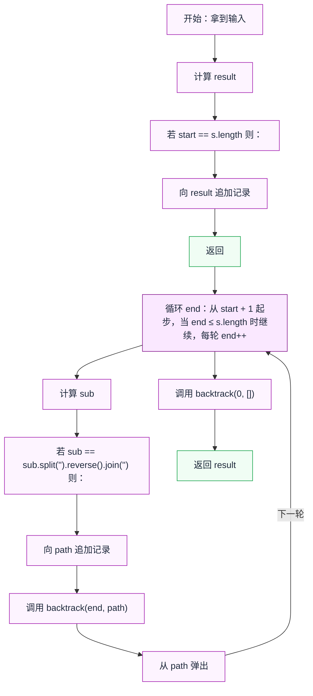

## TypeScript 解题方案（2 个方案逐个讲）

> **运行与提交**：每个方案都是自包含文件（内嵌用例自测，输出 PASS），整块复制到 `.ts` 文件后 `node 文件名` 即可运行。提交 LeetCode 时，把 `demo` 内的算法函数与辅助类型/函数整体取出、置于文件顶层即可。涉及交互/特殊接口的题以题面给定签名为准。

### 方案 1：回溯

**分析与思路**：核心做法是「回溯」。代码里依次做这些事：单循环线性扫描；栈的后进先出操作。

**运行方式**：`node 本文件`，内嵌用例全部通过会输出 PASS。


**方案专属流程图**（真实控制流）：


```typescript
/**
 ** LeetCode 131. 分割回文串
 ** 方案1: 回溯（忠实翻译 python 参考实现）
 ** 来源：https://blog.csdn.net/tyro_java/article/details/145240399
 */

function partition(s: string): string[][] {
  // 定义函数/方法 partition
  const result: string[][] = []; // 把 []; 写入 const result: string[][]
  function backtrack(start: number, path: string[]): void {
    // 定义函数/方法 backtrack
    if (start === s.length) {
      // 若 起点 全等于 字符串.长度
      result.push([...path]); // 把 复制的 当前路径 压入栈/数组尾部
      return; // return;
    }
    for (let end = start + 1; end <= s.length; end++) {
      // 让 终点 从 起点 加 1 开始计数，终点 不超过 字符串.长度 就继续
      const sub = s.slice(start, end); // 把 字符串 截取 起点, 终点) 存入 sub
      if (sub === sub.split('').reverse().join('')) {
        // 若 sub 全等于 sub.split('').reverse().join(''
        path.push(sub); // 把 sub 压入栈/数组尾部
        backtrack(end, path); // backtrack(终点, 当前路径);
        path.pop(); // 弹出栈顶元素
      }
    }
  }
  backtrack(0, []); // backtrack(0, []);
  return result; // 返回 结果
}

export function demo(): void {
  // 程序入口：跑内嵌自测用例
  function eqArr2(a: string[][], b: string[][]): boolean {
    // 定义函数/方法 eqArr2
    if (a.length !== b.length) return false; // 若 数组.长度 不等于 b.长度，直接返回 false
    for (let i = 0; i < a.length; i++) {
      // 让 下标 i 从 0 开始计数，下标 i 小于 数组.长度 就继续
      if (a[i].length !== b[i].length) return false; // 若 数组[下标 i].长度 不等于 b[下标 i].长度，直接返回 false
      for (let j = 0; j < a[i].length; j++) {
        // 让 下标 j 从 0 开始计数，下标 j 小于 数组[下标 i].长度 就继续
        if (a[i][j] !== b[i][j]) return false; // 若 数组[下标 i][下标 j] 不等于 b[下标 i][下标 j]，直接返回 false
      }
    }
    return true; // 返回 true
  }
  const cases: { in: string; want: string[][] }[] = [
    {
      in: 'aab',
      want: [
        ['a', 'a', 'b'],
        ['aa', 'b'],
      ],
    },
    { in: 'abc', want: [['a', 'b', 'c']] },
    { in: 'a', want: [['a']] },
    {
      in: 'racecar',
      want: [
        ['r', 'a', 'c', 'e', 'c', 'a', 'r'],
        ['r', 'a', 'cec', 'a', 'r'],
        ['r', 'aceca', 'r'],
        ['racecar'],
      ],
    },
  ];
  let fail = false; // 把 false 存入 fail
  for (const c of cases) {
    // for (const 字符 of cases) {
    const got = partition(c.in); // 把 partition(字符.in) 存入 got
    if (!eqArr2(got, c.want)) {
      // 若 取反 eqArr2(got, 字符.want
      fail = true; // 把 true 存入 fail
      console.log(
        'FAIL partition(' +
          c.in +
          ') got=' +
          JSON.stringify(got) +
          ' want=' +
          JSON.stringify(c.want),
      ); // 打印输出
    }
  }
  if (fail) throw new Error('FAILED'); // 若 fail) throw new Error(「FAILED」);
  console.log('PASS'); // 全部用例通过，输出 PASS
}
demo(); // demo();
```

### 方案 2：回溯

**分析与思路**：核心做法是「回溯」。代码里依次做这些事：单循环线性扫描；栈的后进先出操作。

**运行方式**：`node 本文件`，内嵌用例全部通过会输出 PASS。


**方案专属流程图**（真实控制流）：

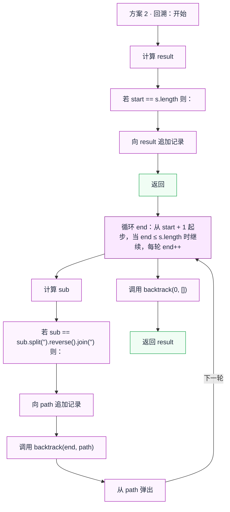

```typescript
/**
 ** LeetCode 131. 分割回文串
 ** 方案2: 回溯（忠实翻译 python 参考实现）
 ** 来源：https://blog.csdn.net/tyro_java/article/details/145240399
 */

function partition(s: string): string[][] {
  // 定义函数/方法 partition
  const result: string[][] = []; // 把 []; 写入 const result: string[][]
  function backtrack(start: number, path: string[]): void {
    // 定义函数/方法 backtrack
    if (start === s.length) {
      // 若 起点 全等于 字符串.长度
      result.push([...path]); // 把 复制的 当前路径 压入栈/数组尾部
      return; // return;
    }
    for (let end = start + 1; end <= s.length; end++) {
      // 让 终点 从 起点 加 1 开始计数，终点 不超过 字符串.长度 就继续
      const sub = s.slice(start, end); // 把 字符串 截取 起点, 终点) 存入 sub
      if (sub === sub.split('').reverse().join('')) {
        // 若 sub 全等于 sub.split('').reverse().join(''
        path.push(sub); // 把 sub 压入栈/数组尾部
        backtrack(end, path); // backtrack(终点, 当前路径);
        path.pop(); // 弹出栈顶元素
      }
    }
  }
  backtrack(0, []); // backtrack(0, []);
  return result; // 返回 结果
}

export function demo(): void {
  // 程序入口：跑内嵌自测用例
  function eqArr2(a: string[][], b: string[][]): boolean {
    // 定义函数/方法 eqArr2
    if (a.length !== b.length) return false; // 若 数组.长度 不等于 b.长度，直接返回 false
    for (let i = 0; i < a.length; i++) {
      // 让 下标 i 从 0 开始计数，下标 i 小于 数组.长度 就继续
      if (a[i].length !== b[i].length) return false; // 若 数组[下标 i].长度 不等于 b[下标 i].长度，直接返回 false
      for (let j = 0; j < a[i].length; j++) {
        // 让 下标 j 从 0 开始计数，下标 j 小于 数组[下标 i].长度 就继续
        if (a[i][j] !== b[i][j]) return false; // 若 数组[下标 i][下标 j] 不等于 b[下标 i][下标 j]，直接返回 false
      }
    }
    return true; // 返回 true
  }
  const cases: { in: string; want: string[][] }[] = [
    {
      in: 'aab',
      want: [
        ['a', 'a', 'b'],
        ['aa', 'b'],
      ],
    },
    { in: 'abc', want: [['a', 'b', 'c']] },
    { in: 'a', want: [['a']] },
    {
      in: 'racecar',
      want: [
        ['r', 'a', 'c', 'e', 'c', 'a', 'r'],
        ['r', 'a', 'cec', 'a', 'r'],
        ['r', 'aceca', 'r'],
        ['racecar'],
      ],
    },
  ];
  let fail = false; // 把 false 存入 fail
  for (const c of cases) {
    // for (const 字符 of cases) {
    const got = partition(c.in); // 把 partition(字符.in) 存入 got
    if (!eqArr2(got, c.want)) {
      // 若 取反 eqArr2(got, 字符.want
      fail = true; // 把 true 存入 fail
      console.log(
        'FAIL partition(' +
          c.in +
          ') got=' +
          JSON.stringify(got) +
          ' want=' +
          JSON.stringify(c.want),
      ); // 打印输出
    }
  }
  if (fail) throw new Error('FAILED'); // 若 fail) throw new Error(「FAILED」);
  console.log('PASS'); // 全部用例通过，输出 PASS
}
demo(); // demo();
```

## 逐步拆解与面试追问

**复杂度**：时间 O(n)（单趟线性扫描），空间 O(1) 到 O(n)（视辅助结构）

**为什么是这个量级**：每个元素被常数次访问，辅助哈希或栈的开销与 n 同阶

**面试官可能会追问**：

- 怎么剪枝降低无效搜索？
- 去重的关键在哪一层？
- 状态恢复遗漏会怎样？

## 关键 API 速查（TS 主解法实际用到，附官方链接）

| API | 作用 | 使用要点 | 官方文档 |
|---|---|---|---|
| `Array.prototype.push()` | 尾部追加 | 返回新长度；可一次多个；均摊 O(1)；会改变原数组 | [官方文档](https://developer.mozilla.org/zh-CN/docs/Web/JavaScript/Reference/Global_Objects/Array/push) |
| `Array.prototype.pop()` | 尾部弹出 | 返回被删元素（空数组返回 undefined）；O(1) | [官方文档](https://developer.mozilla.org/zh-CN/docs/Web/JavaScript/Reference/Global_Objects/Array/pop) |
| `Array/String slice()` | 切片（不改原数组） | slice(start,end) 含头不含尾；负数从尾计；常用于复制数组（slice()） | [官方文档](https://developer.mozilla.org/zh-CN/docs/Web/JavaScript/Reference/Global_Objects/Array/slice) |
| `Array.prototype.join()` | 数组拼接为字符串 | undefined/null 转空串；嵌套数组会展平一层；join('') 用于字符数组还原 | [官方文档](https://developer.mozilla.org/zh-CN/docs/Web/JavaScript/Reference/Global_Objects/Array/join) |
| `String.prototype.split()` | 字符串切分为数组 | split('') 按字符拆；split(/正则/) 支持模式；空串调用会拆出空串数组 | [官方文档](https://developer.mozilla.org/zh-CN/docs/Web/JavaScript/Reference/Global_Objects/String/split) |
| `JSON.stringify()` | 序列化为 JSON 字符串 | 常用于结构化比较（深度相等判定）；undefined/函数/循环引用会被丢弃或抛错 | [官方文档](https://developer.mozilla.org/zh-CN/docs/Web/JavaScript/Reference/Global_Objects/JSON/stringify) |

### 各语言官方文档导航

- **TypeScript / JS**：[MDN 中文参考](https://developer.mozilla.org/zh-CN/)
- **Python**：[Python 官方文档](https://docs.python.org/zh-cn/3/)
- **Go**：[Go 标准库](https://pkg.go.dev/std)
- **Java**：[JDK 17 API](https://docs.oracle.com/en/java/javase/17/docs/api/)
- **Rust**：[Rust 标准库](https://doc.rust-lang.org/std/)
- **Lua**：[Lua 5.4 手册](https://www.lua.org/manual/5.4/)
- **C**：[Cppreference C](https://zh.cppreference.com/w/c)
- **C++**：[Cppreference C++](https://zh.cppreference.com/w/cpp)
- **R**：[R 官方手册](https://stat.ethz.ch/R-manual/)
- **Zig**：[Zig 语言文档](https://ziglang.org/documentation/master/)
- **Dart**：[Dart API](https://api.dart.dev/)

## 附录：其他 10 种语言全部实现（每种语言列举其全部方案）

> TypeScript 的全部方案见「TypeScript 解题方案」一节；下面是其余 10 种语言的对应实现，每种语言的每个方案都带思路分析、代码走读与专属运行架构图。
> 每个方案都内嵌用例自测，可独立运行（老仓库 python/go 文件遵循「打印结果」约定）。
> 完整解法文件见 `dsa/<语言>/backtrack/lc_131_分割回文串/`。

### Python 实现（2 种方案）

Python 的全部方案如下，每个方案都内嵌用例自测，可独立运行（老仓库 python/go 文件遵循「打印结果」约定）：

#### 方案 1：回溯

**思路与代码分析**：核心是「回溯」。Python 版用切片与字典推导式简化操作，突出可读性。**走读**：方案 1 · 回溯：开始 → 更新 result → 若 start == len(s)：向 result 追加记录 → 向 result 追加记录 → 返回  → 循环 end：从 start + 1 到 len(s 前 → 若 s[start：更新 = → 向 path 追加记录 → 调用 backtrack(end, path) → 从 path 弹出 → 调用 backtrack(0, []) → 返回 result。

**运行架构**（真实控制流）：

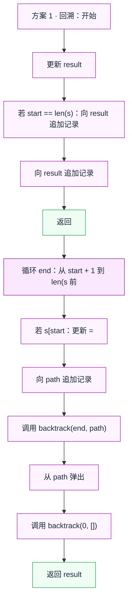

```python
import sys  # 提高递归深度上限（深输入防 RecursionError）

sys.setrecursionlimit(200000)  # 树/链表类题目节点数可达 1e4 量级

def partition(s):  # 定义函数 partition（参数：字符串）
    result = []  # 把 [] 存入 结果

    def backtrack(start, path):  # 定义函数 backtrack（参数：起点, 当前路径）
        if start == len(s):  # 若 起点 等于 长度(字符串
            result.append(path[:])  # 把 复制 当前路径 追加到列表尾部
            return  # return
        for end in range(start + 1, len(s) + 1):  # 让 终点 从 起点 加 1 到 长度(字符串 遍历
            if s[start:end] == s[start:end][::-1]:  # 若 字符串[起点:终点] 等于 字符串[起点:终点][:: 减 1]
                path.append(s[start:end])  # 把 字符串[起点:终点] 追加到列表尾部
                backtrack(end, path)  # backtrack(终点, 当前路径)
                path.pop()  # 弹出栈顶元素

    backtrack(0, [])  # backtrack(0, [])
    return result  # 返回 结果

if __name__ == "__main__":  # 若 __name__ 等于 '__main__'
    print(partition("abc"))  # 打印输出
```

#### 方案 2：回溯

**思路与代码分析**：核心是「回溯」。Python 版用切片与字典推导式简化操作，突出可读性。**走读**：方案 2 · 回溯：开始 → 更新 result → 若 start == len(s)：向 result 追加记录 → 向 result 追加记录 → 返回  → 循环 end：从 start + 1 到 len(s 前 → 若 s[start：更新 = → 向 path 追加记录 → 调用 backtrack(end, path) → 从 path 弹出 → 调用 backtrack(0, []) → 返回 result。

**运行架构**（真实控制流）：

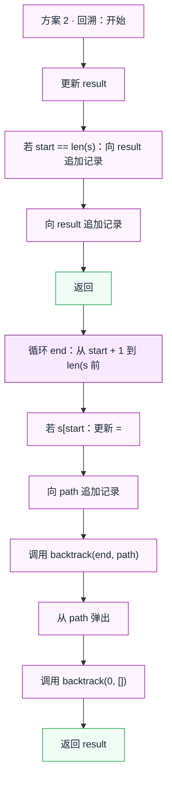

```python
import sys  # 提高递归深度上限（深输入防 RecursionError）

sys.setrecursionlimit(200000)  # 树/链表类题目节点数可达 1e4 量级

def partition(s):  # 定义函数 partition（参数：字符串）
    result = []  # 把 [] 存入 结果

    def backtrack(start, path):  # 定义函数 backtrack（参数：起点, 当前路径）
        if start == len(s):  # 若 起点 等于 长度(字符串
            result.append(path[:])  # 把 复制 当前路径 追加到列表尾部
            return  # return
        for end in range(start + 1, len(s) + 1):  # 让 终点 从 起点 加 1 到 长度(字符串 遍历
            if s[start:end] == s[start:end][::-1]:  # 若 字符串[起点:终点] 等于 字符串[起点:终点][:: 减 1]
                path.append(s[start:end])  # 把 字符串[起点:终点] 追加到列表尾部
                backtrack(end, path)  # backtrack(终点, 当前路径)
                path.pop()  # 弹出栈顶元素

    backtrack(0, [])  # backtrack(0, [])
    return result  # 返回 结果

if __name__ == "__main__":  # 若 __name__ 等于 '__main__'
    print(partition("abc"))  # 打印输出
```

### Go 实现（2 种方案）

Go 的全部方案如下，每个方案都内嵌用例自测，可独立运行（老仓库 python/go 文件遵循「打印结果」约定）：

#### 方案 1：回溯

**思路与代码分析**：核心是「回溯」。Go 版用切片与多返回值惯用法，显式处理索引边界。**走读**：方案 1 · 回溯：开始 → 计算 result → 返回  → 遍历循环 → 返回 result。

**运行架构**（真实控制流）：

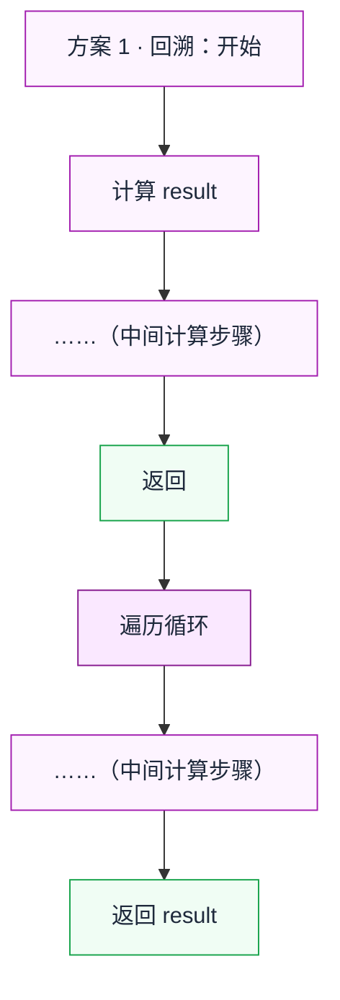

```go
package main // 引入依赖

import (
	"fmt"     // 「fmt」
	"os"      // 「os」
	"reflect" // 「reflect」
)

// partition 忠实翻译 python ref solution_1_1_____1______________.py（回溯，直接切片判回文）
func partition(s string) [][]string { // 定义函数/方法 partition
	var result [][]string                        // var 结果 [][]string
	var backtrack func(start int, path []string) // var backtrack func(起点 int, 当前路径 []string)
	backtrack = func(start int, path []string) { // 把 func(起点 int, 当前路径 []string) { 写入 backtrack
		if start == len(s) { // 若 起点 等于 长度(字符串
			cp := make([]string, len(path)) // 把 make([]string, 长度(当前路径)) 写入 cp :
			copy(cp, path)                  // copy(cp, 当前路径)
			result = append(result, cp)     // 把 append(结果, cp) 写入 结果
			return                          // return
		}
		for end := start + 1; end <= len(s); end++ { // 把 起点 加 1; 终点 不超过 长度(字符串); 终点 加一 { 写入 for end :
			sub := s[start:end]         // 把 字符串[起点:终点] 写入 sub :
			if sub == reverseStr(sub) { // 若 sub 等于 reverseStr(sub
				path = append(path, sub)  // 把 append(当前路径, sub) 写入 当前路径
				backtrack(end, path)      // backtrack(终点, 当前路径)
				path = path[:len(path)-1] // 把 当前路径[:长度(当前路径) 减 1] 写入 当前路径
			}
		}
	}
	backtrack(0, []string{}) // backtrack(0, []string{})
	return result            // 返回 结果
}

func reverseStr(s string) string { // 定义函数/方法 reverseStr
	b := []byte(s) // 把 []byte(字符串) 写入 b :
	for i, j := 0, len(b)-1; i < j; i, j = i+1, j-1 {
		b[i], b[j] = b[j], b[i] // 把 b[下标 j], b[下标 i] 写入 b[i], b[j]
	}
	return string(b) // 定义函数/方法 string
}

func main() { // 程序入口：跑内嵌自测用例
	// want 由 python ref 实跑得到（含回溯顺序）
	cases := []struct { // 把 []struct { 写入 cases :
		in   string     // in string
		want [][]string // want [][]string
	}{ // }{
		{"aab", [][]string{{"a", "a", "b"}, {"aa", "b"}}},
		{"abc", [][]string{{"a", "b", "c"}}},
		{"", [][]string{{}}},
		{"a", [][]string{{"a"}}},
		{"aba", [][]string{{"a", "b", "a"}, {"aba"}}},
		{"bb", [][]string{{"b", "b"}, {"bb"}}},
	}
	ok := true                // 把 true 写入 ok :
	for _, c := range cases { // 同时取 _ 与 字符 遍历
		if got := partition(c.in); !reflect.DeepEqual(got, c.want) {
			ok = false                                                   // 把 false 写入 ok
			fmt.Printf("FAIL solve(%q)=%v want %v\n", c.in, got, c.want) // 打印输出
		}
	}
	if !ok { // 若 取反 ok
		os.Exit(1) // os.Exit(1)
	}
	fmt.Println("PASS") // 全部用例通过，输出 PASS
}
```

#### 方案 2：回溯

**思路与代码分析**：核心是「回溯」。Go 版用切片与多返回值惯用法，显式处理索引边界。**走读**：方案 2 · 回溯：开始 → 计算 result → 返回  → 遍历循环 → 返回 result。

**运行架构**（真实控制流）：


```go
package main // 引入依赖

import (
	"fmt"     // 「fmt」
	"os"      // 「os」
	"reflect" // 「reflect」
)

// partition 忠实翻译 python ref solution_2_2_____2____________.py（回溯，直接切片判回文）
func partition(s string) [][]string { // 定义函数/方法 partition
	var result [][]string                        // var 结果 [][]string
	var backtrack func(start int, path []string) // var backtrack func(起点 int, 当前路径 []string)
	backtrack = func(start int, path []string) { // 把 func(起点 int, 当前路径 []string) { 写入 backtrack
		if start == len(s) { // 若 起点 等于 长度(字符串
			cp := make([]string, len(path)) // 把 make([]string, 长度(当前路径)) 写入 cp :
			copy(cp, path)                  // copy(cp, 当前路径)
			result = append(result, cp)     // 把 append(结果, cp) 写入 结果
			return                          // return
		}
		for end := start + 1; end <= len(s); end++ { // 把 起点 加 1; 终点 不超过 长度(字符串); 终点 加一 { 写入 for end :
			sub := s[start:end]         // 把 字符串[起点:终点] 写入 sub :
			if sub == reverseStr(sub) { // 若 sub 等于 reverseStr(sub
				path = append(path, sub)  // 把 append(当前路径, sub) 写入 当前路径
				backtrack(end, path)      // backtrack(终点, 当前路径)
				path = path[:len(path)-1] // 把 当前路径[:长度(当前路径) 减 1] 写入 当前路径
			}
		}
	}
	backtrack(0, []string{}) // backtrack(0, []string{})
	return result            // 返回 结果
}

func reverseStr(s string) string { // 定义函数/方法 reverseStr
	b := []byte(s) // 把 []byte(字符串) 写入 b :
	for i, j := 0, len(b)-1; i < j; i, j = i+1, j-1 {
		b[i], b[j] = b[j], b[i] // 把 b[下标 j], b[下标 i] 写入 b[i], b[j]
	}
	return string(b) // 定义函数/方法 string
}

func main() { // 程序入口：跑内嵌自测用例
	// want 由 python ref 实跑得到（含回溯顺序）
	cases := []struct { // 把 []struct { 写入 cases :
		in   string     // in string
		want [][]string // want [][]string
	}{ // }{
		{"aab", [][]string{{"a", "a", "b"}, {"aa", "b"}}},
		{"abc", [][]string{{"a", "b", "c"}}},
		{"", [][]string{{}}},
		{"a", [][]string{{"a"}}},
		{"aba", [][]string{{"a", "b", "a"}, {"aba"}}},
		{"bb", [][]string{{"b", "b"}, {"bb"}}},
	}
	ok := true                // 把 true 写入 ok :
	for _, c := range cases { // 同时取 _ 与 字符 遍历
		if got := partition(c.in); !reflect.DeepEqual(got, c.want) {
			ok = false                                                   // 把 false 写入 ok
			fmt.Printf("FAIL solve(%q)=%v want %v\n", c.in, got, c.want) // 打印输出
		}
	}
	if !ok { // 若 取反 ok
		os.Exit(1) // os.Exit(1)
	}
	fmt.Println("PASS") // 全部用例通过，输出 PASS
}
```

### Java 实现（2 种方案）

Java 的全部方案如下，每个方案都内嵌用例自测，可独立运行（老仓库 python/go 文件遵循「打印结果」约定）：

#### 方案 1：回溯

**思路与代码分析**：核心是「回溯」。Java 版用类与静态方法组织，集合操作显式明了。代码里依次做这些事：单循环线性扫描。**走读**：方案 1 · 回溯：开始 → 命中条件，直接返回 → 遍历循环 → 命中条件，直接返回 → 返回 true。

**运行架构**（真实控制流）：

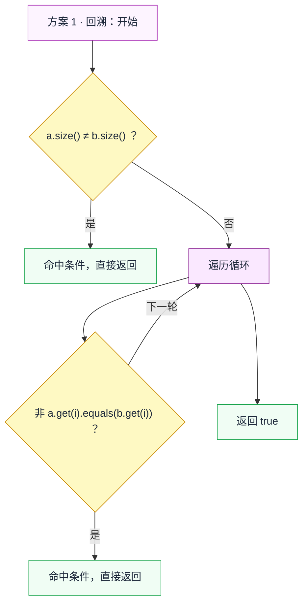

```java
package com.webfault.dsa; // 引入依赖

import java.util.*; // 引入依赖

class lc131_solution111 { // 定义类型
  private char[] s; // private char[] 字符串;
  private int n; // private int 元素个数;
  private boolean[][] f; // private boolean[][] f;
  private List<List<String>> ret; // private List 小于 List 小于 String 超过 超过 ret;
  private List<String> ans; // private List 小于 String 超过 答案;

  public List<List<String>> partition(String str) { // 定义函数/方法 partition
    s = str.toCharArray(); // 把 str.toCharArray(); 写入 字符串
    n = s.length; // 把 字符串.长度; 写入 元素个数
    ret = new ArrayList<>(); // 把 new ArrayList 小于 超过 (); 写入 ret
    ans = new ArrayList<>(); // 把 new ArrayList 小于 超过 (); 写入 答案
    f = new boolean[n][n]; // 把 new boolean[元素个数][元素个数]; 写入 f
    for (int i = n - 1; i >= 0; i--) { // 让 下标 i 从 元素个数 减 1 开始计数，下标 i 不低于 0 就继续
      for (int j = i; j < n; j++) { // 让 下标 j 从 下标 i 开始计数，下标 j 小于 元素个数 就继续
        f[i][j] = s[i] == s[j] && (j - i < 2 || f[i + 1][j - 1]);
      }
    }
    dfs(0); // dfs(0);
    return ret; // 返回 ret
  }

  private void dfs(int i) { // 定义函数/方法 dfs
    if (i == n) { // 若 下标 i 等于 元素个数
      ret.add(new ArrayList<>(ans)); // ret 追加 new ArrayList 小于 超过 (答案));
      return; // return;
    }
    for (int j = i; j < n; j++) { // 让 下标 j 从 下标 i 开始计数，下标 j 小于 元素个数 就继续
      if (f[i][j]) { // 若 f[下标 i][下标 j]
        ans.add(new String(s, i, j - i + 1)); // 答案 追加 new String(字符串, 下标 i, 下标 j 减 下标 i 加 1));
        dfs(j + 1); // dfs(下标 j 加 1);
        ans.remove(ans.size() - 1); // 答案 弹出 答案.大小() 减 1);
      }
    }
  }

  public static void main(String[] args) { // public static void main(String[] args) {
    lc131_solution111 inst =
        new lc131_solution111(); // 把 new lc131_solution111(); 写入 lc131_solution111 inst
    List<List<String>> r1 =
        inst.partition("abc"); // 把 inst.partition(「abc」); 写入 List<List<String>> r1
    List<List<String>> w1 = new ArrayList<>(); // 把 new ArrayList 小于 超过 (); 写入 List<List<String>> w1
    w1.add(Arrays.asList("a", "b", "c")); // w1 追加 Arrays.asList(「数组」, 「数组」, 「数组」));
    List<List<String>> r2 =
        inst.partition("aab"); // 把 inst.partition(「aab」); 写入 List<List<String>> r2
    List<List<String>> w2 = new ArrayList<>(); // 把 new ArrayList 小于 超过 (); 写入 List<List<String>> w2
    w2.add(Arrays.asList("a", "a", "b")); // w2 追加 Arrays.asList(「数组」, 「数组」, 「数组」));
    w2.add(Arrays.asList("aa", "b")); // w2 追加 Arrays.asList(「aa」, 「aa」));
    boolean ok = true; // 把 true; 写入 boolean ok
    if (!eq(r1, w1)) {
      ok = false;
      System.out.println("FAIL abc got " + r1);
    }
    if (!eq(r2, w2)) {
      ok = false;
      System.out.println("FAIL aab got " + r2);
    }
    if (!ok) throw new RuntimeException("FAILED"); // 若 取反 ok) throw new RuntimeException(「FAILED」);
    System.out.println("PASS"); // 全部用例通过，输出 PASS
  }

  private static boolean eq(List<List<String>> a, List<List<String>> b) {
    if (a.size() != b.size()) return false; // 若 数组.大小() 不等于 b.大小()，直接返回 false
    for (int i = 0; i < a.size(); i++) { // 让 下标 i 从 0 开始计数，下标 i 小于 数组.大小() 就继续
      if (!a.get(i).equals(b.get(i)))
        return false; // 若 取反 数组 查找 下标 i).equals(b 查找 下标 i))，直接返回 false
    }
    return true; // 返回 true
  }
}
```

#### 方案 2：回溯

**思路与代码分析**：核心是「回溯」。Java 版用类与静态方法组织，集合操作显式明了。**走读**：方案 2 · 回溯：开始 → 更新 result → 处理 new ArrayList＜＞() → 调用 backtrack(s, 0, new ArrayLis → 返回 result。

**运行架构**（真实控制流）：

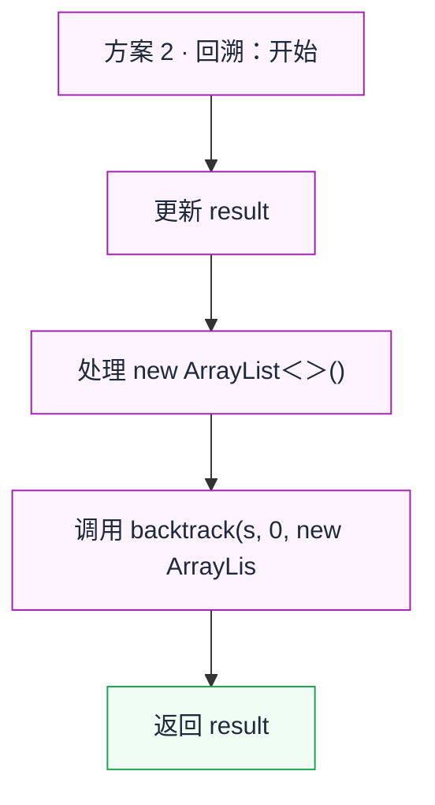

```java
package com.webfault.dsa; // 引入依赖

import java.util.*; // 引入依赖

class lc131_solution222 { // 定义类型
  public static List<List<String>> partition(String s) {
    List<List<String>> result =
        new ArrayList<>(); // 把 new ArrayList 小于 超过 (); 写入 List<List<String>> result
    backtrack(s, 0, new ArrayList<>(), result); // backtrack(字符串, 0, new ArrayList 小于 超过 (), 结果);
    return result; // 返回 结果
  }

  private static void backtrack(String s, int start, List<String> path, List<List<String>> result) {
    if (start == s.length()) { // 若 起点 等于 字符串.长度(
      result.add(new ArrayList<>(path)); // 结果 追加 new ArrayList 小于 超过 (当前路径));
      return; // return;
    }
    for (int end = start + 1; end <= s.length(); end++) { // 让 终点 从 起点 加 1 开始计数，终点 不超过 字符串.长度() 就继续
      String sub = s.substring(start, end); // 把 字符串 截取 起点, 终点) 存入 sub
      if (isPalindrome(sub)) { // 若 isPalindrome(sub
        path.add(sub); // 当前路径 追加 sub);
        backtrack(s, end, path, result); // backtrack(字符串, 终点, 当前路径, 结果);
        path.remove(path.size() - 1); // 当前路径 弹出 当前路径.大小() 减 1);
      }
    }
  }

  private static boolean isPalindrome(
      String s) { // private static boolean isPalindrome(String 字符串) {
    int i = 0, j = s.length() - 1; // 把 0, 下标 j 赋值为 字符串.长度() 减 1 存入 下标 i
    while (i < j) { // 循环，直到不满足「下标 i 小于 下标 j」
      if (s.charAt(i) != s.charAt(j)) return false; // 若 字符串 取字符 下标 i) 不等于 字符串 取字符 下标 j)，直接返回 false
      i++; // 下标 i 加一
      j--; // 下标 j 减一
    }
    return true; // 返回 true
  }

  public static void main(String[] args) { // public static void main(String[] args) {
    List<List<String>> r1 = partition("abc"); // 把 partition(「abc」); 写入 List<List<String>> r1
    List<List<String>> w1 = new ArrayList<>(); // 把 new ArrayList 小于 超过 (); 写入 List<List<String>> w1
    w1.add(Arrays.asList("a", "b", "c")); // w1 追加 Arrays.asList(「数组」, 「数组」, 「数组」));
    List<List<String>> r2 = partition("aab"); // 把 partition(「aab」); 写入 List<List<String>> r2
    List<List<String>> w2 = new ArrayList<>(); // 把 new ArrayList 小于 超过 (); 写入 List<List<String>> w2
    w2.add(Arrays.asList("a", "a", "b")); // w2 追加 Arrays.asList(「数组」, 「数组」, 「数组」));
    w2.add(Arrays.asList("aa", "b")); // w2 追加 Arrays.asList(「aa」, 「aa」));
    boolean ok = true; // 把 true; 写入 boolean ok
    if (!eq(r1, w1)) {
      ok = false;
      System.out.println("FAIL abc got " + r1);
    }
    if (!eq(r2, w2)) {
      ok = false;
      System.out.println("FAIL aab got " + r2);
    }
    if (!ok) throw new RuntimeException("FAILED"); // 若 取反 ok) throw new RuntimeException(「FAILED」);
    System.out.println("PASS"); // 全部用例通过，输出 PASS
  }

  private static boolean eq(List<List<String>> a, List<List<String>> b) {
    if (a.size() != b.size()) return false; // 若 数组.大小() 不等于 b.大小()，直接返回 false
    for (int i = 0; i < a.size(); i++) { // 让 下标 i 从 0 开始计数，下标 i 小于 数组.大小() 就继续
      if (!a.get(i).equals(b.get(i)))
        return false; // 若 取反 数组 查找 下标 i).equals(b 查找 下标 i))，直接返回 false
    }
    return true; // 返回 true
  }
}
```

### Rust 实现（2 种方案）

Rust 的全部方案如下，每个方案都内嵌用例自测，可独立运行（老仓库 python/go 文件遵循「打印结果」约定）：

#### 方案 1：回溯

**思路与代码分析**：核心是「回溯」。Rust 版用所有权移动与切片借用改写同一逻辑，注意 Option 与引用边界。**走读**：方案 1 · 回溯：开始 → 计算 let (mut i, mut j) = (0u → 当 i ＜ j 时反复执行 → 处理 if s[i] ≠ s[j] → 返回 false → 更新 + → 更新 - → 处理 true。

**运行架构**（真实控制流）：

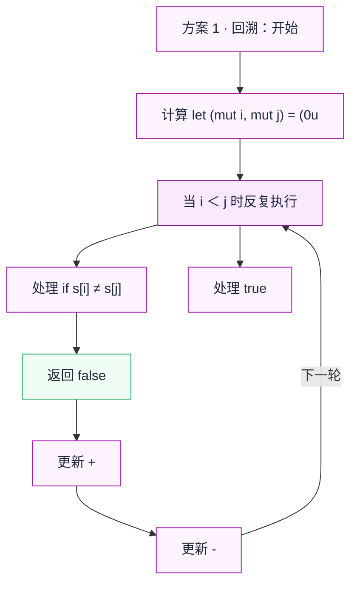

```rust
// LeetCode 131. 分割回文串 — Rust 版（方案1）
fn is_pal(s: &[char]) -> bool {
    // 定义判定函数 is_pal
    let (mut i, mut j) = (0usize, s.len() - 1); // 把 (0usize, 字符串.长度() 减 1); 写入 let (mut i, mut j)
    while i < j {
        // while 下标 i 小于 下标 j {
        if s[i] != s[j] {
            return false;
        } // 若 字符串[下标 i] 不等于 字符串[下标 j] { return false; }
        i += 1; // 下标 i累加 1
        j -= 1; // 下标 j累减 1
    }
    true // true
}
fn partition(s: &str) -> Vec<Vec<String>> {
    // 定义函数/方法 partition
    let chars: Vec<char> = s.chars().collect(); // 把 字符串.chars().collect(); 写入 let chars: Vec<char>
    let mut res = Vec::new(); // 把 Vec::new(); 写入 let mut res
    let mut path: Vec<String> = Vec::new(); // 把 Vec::new(); 写入 let mut path: Vec<String>
    fn dfs(chars: &[char], start: usize, path: &mut Vec<String>, res: &mut Vec<Vec<String>>) {
        // 定义函数/方法 dfs
        if start == chars.len() {
            res.push(path.clone());
            return;
        } // 若 起点 等于 chars.长度() { 结果 追加 当前路径.clone()); return; }
        for end in start + 1..=chars.len() {
            // 逐个取出 起点 的元素（终点）
            if is_pal(&chars[start..end]) {
                // 定义判定函数 is_pal
                path.push(chars[start..end].iter().collect()); // 把 chars[起点..终点].iter( 压入栈/数组尾部
                dfs(chars, end, path, res); // dfs(chars, 终点, 当前路径, 结果);
                path.pop(); // 弹出栈顶元素
            }
        }
    }
    dfs(&chars, 0, &mut path, &mut res); // dfs( 按位与 chars, 0, 按位与 mut 当前路径, 按位与 mut 结果);
    res // 结果
}
fn main() {
    // 程序入口：跑内嵌自测用例
    let got = partition("aab"); // 把 partition(「aab」) 存入 got
    let want = vec![
        vec!["a".to_string(), "a".to_string(), "b".to_string()],
        vec!["aa".to_string(), "b".to_string()],
    ];
    assert_eq!(got, want); // 断言校验
    println!("PASS"); // 全部用例通过，输出 PASS
}
```

#### 方案 2：回溯

**思路与代码分析**：核心是「回溯」。Rust 版用所有权移动与切片借用改写同一逻辑，注意 Option 与引用边界。**走读**：方案 2 · 回溯：开始 → 计算 let (mut i, mut j) = (0u → 当 i ＜ j 时反复执行 → 处理 if s[i] ≠ s[j] → 返回 false → 更新 + → 更新 - → 处理 true。

**运行架构**（真实控制流）：


```rust
// LeetCode 131. 分割回文串 — Rust 版（方案2）
fn is_pal(s: &[char]) -> bool {
    // 定义判定函数 is_pal
    let (mut i, mut j) = (0usize, s.len() - 1); // 把 (0usize, 字符串.长度() 减 1); 写入 let (mut i, mut j)
    while i < j {
        // while 下标 i 小于 下标 j {
        if s[i] != s[j] {
            return false;
        } // 若 字符串[下标 i] 不等于 字符串[下标 j] { return false; }
        i += 1; // 下标 i累加 1
        j -= 1; // 下标 j累减 1
    }
    true // true
}
fn partition(s: &str) -> Vec<Vec<String>> {
    // 定义函数/方法 partition
    let chars: Vec<char> = s.chars().collect(); // 把 字符串.chars().collect(); 写入 let chars: Vec<char>
    let mut res = Vec::new(); // 把 Vec::new(); 写入 let mut res
    let mut path: Vec<String> = Vec::new(); // 把 Vec::new(); 写入 let mut path: Vec<String>
    fn dfs(chars: &[char], start: usize, path: &mut Vec<String>, res: &mut Vec<Vec<String>>) {
        // 定义函数/方法 dfs
        if start == chars.len() {
            res.push(path.clone());
            return;
        } // 若 起点 等于 chars.长度() { 结果 追加 当前路径.clone()); return; }
        for end in start + 1..=chars.len() {
            // 逐个取出 起点 的元素（终点）
            if is_pal(&chars[start..end]) {
                // 定义判定函数 is_pal
                path.push(chars[start..end].iter().collect()); // 把 chars[起点..终点].iter( 压入栈/数组尾部
                dfs(chars, end, path, res); // dfs(chars, 终点, 当前路径, 结果);
                path.pop(); // 弹出栈顶元素
            }
        }
    }
    dfs(&chars, 0, &mut path, &mut res); // dfs( 按位与 chars, 0, 按位与 mut 当前路径, 按位与 mut 结果);
    res // 结果
}
fn main() {
    // 程序入口：跑内嵌自测用例
    let got = partition("aab"); // 把 partition(「aab」) 存入 got
    let want = vec![
        vec!["a".to_string(), "a".to_string(), "b".to_string()],
        vec!["aa".to_string(), "b".to_string()],
    ];
    assert_eq!(got, want); // 断言校验
    println!("PASS"); // 全部用例通过，输出 PASS
}
```

### Lua 实现（2 种方案）

Lua 的全部方案如下，每个方案都内嵌用例自测，可独立运行（老仓库 python/go 文件遵循「打印结果」约定）：

#### 方案 1：回溯

**思路与代码分析**：核心是「回溯」。Lua 版用表与 ipairs 遍历，注意 ipairs 遇 nil 即停的语义。**走读**：方案 1 · 回溯：开始 → 更新 j → 当 i ＜ j do 时反复执行 → 处理 if s:sub(i, i) ~= s:sub(j, j → 返回 false → 更新 i → 更新 j → 返回 true。

**运行架构**（真实控制流）：

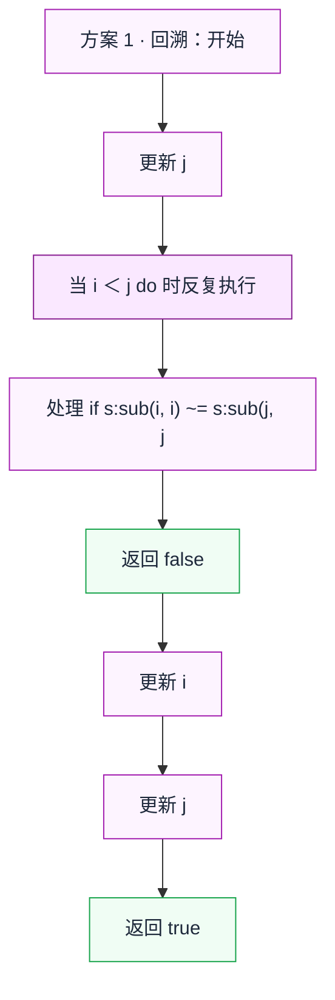

```lua
-- LeetCode 131. 分割回文串 — Lua 版（方案1）
local function is_pal(s) -- local function is_pal(字符串)
	local i, j = 1, #s -- 把 1, #字符串 写入 local i, j
	while i < j do -- while 下标 i 小于 下标 j do
		if s:sub(i, i) ~= s:sub(j, j) then
			return false
		end
		i = i + 1 -- 把 下标 i 加 1 存入 下标 i
		j = j - 1 -- 把 下标 j 减 1 存入 下标 j
	end -- 终点
	return true -- 返回 true
end -- 终点
local function partition(s) -- local function partition(字符串)
	local res = {} -- 把 {} 写入 local res
	local path = {} -- 把 {} 写入 local path
	local n = #s -- 把 #字符串 写入 local n
	local function dfs(start) -- local function dfs(起点)
		if start > n then -- 若 起点 超过 元素个数 then
			local cp = { table.unpack(path) } -- 把 {table.unpack(当前路径)} 写入 local cp
			res[#res + 1] = cp -- 把 cp 写入 res[#res + 1]
			return -- return
		end -- 终点
		for e = start, n do -- 把 起点, 元素个数 do 写入 for e
			local sub = s:sub(start, e) -- 把 字符串:sub(起点, e) 写入 local sub
			if is_pal(sub) then -- 若 is_pal(sub) then
				path[#path + 1] = sub -- 把 sub 写入 path[#path + 1]
				dfs(e + 1) -- dfs(e 加 1)
				path[#path] = nil -- 把 nil 写入 path[#path]
			end -- 终点
		end -- 终点
	end -- 终点
	dfs(1) -- dfs(1)
	return res -- 返回 结果
end -- 终点
local got = partition("aab") -- 把 partition(「aab」) 写入 local got
assert(#got == 2) -- 断言校验
assert(got[1][1] == "a" and got[1][2] == "a" and got[1][3] == "b") -- 断言校验
assert(got[2][1] == "aa" and got[2][2] == "b") -- 断言校验
print("PASS") -- 全部用例通过，输出 PASS
```

#### 方案 2：回溯

**思路与代码分析**：核心是「回溯」。Lua 版用表与 ipairs 遍历，注意 ipairs 遇 nil 即停的语义。**走读**：方案 2 · 回溯：开始 → 更新 j → 当 i ＜ j do 时反复执行 → 处理 if s:sub(i, i) ~= s:sub(j, j → 返回 false → 更新 i → 更新 j → 返回 true。

**运行架构**（真实控制流）：


```lua
-- LeetCode 131. 分割回文串 — Lua 版（方案2）
local function is_pal(s) -- local function is_pal(字符串)
	local i, j = 1, #s -- 把 1, #字符串 写入 local i, j
	while i < j do -- while 下标 i 小于 下标 j do
		if s:sub(i, i) ~= s:sub(j, j) then
			return false
		end
		i = i + 1 -- 把 下标 i 加 1 存入 下标 i
		j = j - 1 -- 把 下标 j 减 1 存入 下标 j
	end -- 终点
	return true -- 返回 true
end -- 终点
local function partition(s) -- local function partition(字符串)
	local res = {} -- 把 {} 写入 local res
	local path = {} -- 把 {} 写入 local path
	local n = #s -- 把 #字符串 写入 local n
	local function dfs(start) -- local function dfs(起点)
		if start > n then -- 若 起点 超过 元素个数 then
			local cp = { table.unpack(path) } -- 把 {table.unpack(当前路径)} 写入 local cp
			res[#res + 1] = cp -- 把 cp 写入 res[#res + 1]
			return -- return
		end -- 终点
		for e = start, n do -- 把 起点, 元素个数 do 写入 for e
			local sub = s:sub(start, e) -- 把 字符串:sub(起点, e) 写入 local sub
			if is_pal(sub) then -- 若 is_pal(sub) then
				path[#path + 1] = sub -- 把 sub 写入 path[#path + 1]
				dfs(e + 1) -- dfs(e 加 1)
				path[#path] = nil -- 把 nil 写入 path[#path]
			end -- 终点
		end -- 终点
	end -- 终点
	dfs(1) -- dfs(1)
	return res -- 返回 结果
end -- 终点
local got = partition("aab") -- 把 partition(「aab」) 写入 local got
assert(#got == 2) -- 断言校验
assert(got[1][1] == "a" and got[1][2] == "a" and got[1][3] == "b") -- 断言校验
assert(got[2][1] == "aa" and got[2][2] == "b") -- 断言校验
print("PASS") -- 全部用例通过，输出 PASS
```

### C 实现（2 种方案）

C 的全部方案如下，每个方案都内嵌用例自测，可独立运行（老仓库 python/go 文件遵循「打印结果」约定）：

#### 方案 1：回溯

**思路与代码分析**：核心是「回溯」。C 版手动管理下标与内存，循环边界全部显式写出。**走读**：方案 1 · 回溯：开始 → 更新 res_n → 更新 path_n → 调用 dfs(s, (int)strlen(s), 0) → 返回 res_n。

**运行架构**（真实控制流）：


```c
/* LeetCode 131. 分割回文串 — C 版（方案1） */
#include <stdio.h>                               // 引入头文件
#include <string.h>                              // 引入头文件
static char res[256][32][32];                    // static char 结果[256][32][32];
static int res_lens[256], res_n;                 // static int res_lens[256], res_n;
static char path[32][32];                        // static char 当前路径[32][32];
static int path_n;                               // static int path_n;
static int is_pal(const char *s, int l, int r) { // 定义判定函数 is_pal
    while (l < r) {                              // 循环，直到不满足「左指针 小于 右指针」
        if (s[l] != s[r])
            return 0; // 若 字符串[左指针] 不等于 字符串[右指针]，直接返回 0
        l++;
        r--; // 左指针 加一 ; 右指针 减一 ;
    }
    return 1; // 返回 1
}
static void dfs(const char *s, int n, int start) { // 定义函数/方法 dfs
    if (start == n) {                              // 若 起点 等于 元素个数
        for (int i = 0; i < path_n; i++)
            strcpy(res[res_n][i], path[i]); // 让 下标 i 从 0 开始计数，下标 i 小于 path_n 就继续
        res_lens[res_n] = path_n;           // 把 path_n; 写入 res_lens[res_n]
        res_n++;                            // res_n 加一
        return;                             // return;
    }
    for (int e = start; e < n; e++) { // 让 e 从 起点 开始计数，e 小于 元素个数 就继续
        if (is_pal(s, start, e)) {    // 若 is_pal(字符串, 起点, e
            int len = e - start + 1;  // 把 e 减 起点 加 1 存入 长度
            strncpy(path[path_n], s + start, len); // strncpy(当前路径[path_n], 字符串 加 起点, 长度);
            path[path_n][len] = '\0';              // 把 '\0'; 写入 path[path_n][len]
            path_n++;                              // path_n 加一
            dfs(s, n, e + 1);                      // dfs(字符串, 元素个数, e 加 1);
            path_n--;                              // path_n 减一
        }
    }
}
static int partition(const char *s) { // 定义函数/方法 partition
    res_n = 0;
    path_n = 0;                // 把 0; path_n 赋值为 0; 写入 res_n
    dfs(s, (int)strlen(s), 0); // dfs(字符串, (int)strlen(字符串), 0);
    return res_n;              // 返回 res_n
}
int main(void) {              // 程序入口：跑内嵌自测用例
    int n = partition("aab"); // 把 partition(「aab」) 存入 元素个数
    if (n != 2) {
        printf("FAIL cnt=%d\n", n);
        return 1;
    } // 若 元素个数 不等于 2) { 输出「FAIL 计数 赋值为 对…取模 d 」, 元素个数); return 1; }
    if (res_lens[0] != 3 || strcmp(res[0][0], "a") != 0 || strcmp(res[0][2], "b") != 0) {
        printf("FAIL a\n");
        return 1;
    }
    if (res_lens[1] != 2 || strcmp(res[1][0], "aa") != 0) {
        printf("FAIL b\n");
        return 1;
    }
    printf("PASS\n"); // 全部用例通过，输出 PASS
    return 0;         // 返回 0
}
```

#### 方案 2：回溯

**思路与代码分析**：核心是「回溯」。C 版手动管理下标与内存，循环边界全部显式写出。**走读**：方案 2 · 回溯：开始 → 更新 res_n → 更新 path_n → 调用 dfs(s, (int)strlen(s), 0) → 返回 res_n。

**运行架构**（真实控制流）：

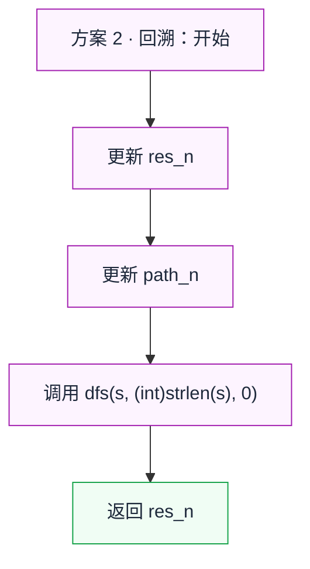

```c
/* LeetCode 131. 分割回文串 — C 版（方案2） */
#include <stdio.h>                               // 引入头文件
#include <string.h>                              // 引入头文件
static char res[256][32][32];                    // static char 结果[256][32][32];
static int res_lens[256], res_n;                 // static int res_lens[256], res_n;
static char path[32][32];                        // static char 当前路径[32][32];
static int path_n;                               // static int path_n;
static int is_pal(const char *s, int l, int r) { // 定义判定函数 is_pal
    while (l < r) {                              // 循环，直到不满足「左指针 小于 右指针」
        if (s[l] != s[r])
            return 0; // 若 字符串[左指针] 不等于 字符串[右指针]，直接返回 0
        l++;
        r--; // 左指针 加一 ; 右指针 减一 ;
    }
    return 1; // 返回 1
}
static void dfs(const char *s, int n, int start) { // 定义函数/方法 dfs
    if (start == n) {                              // 若 起点 等于 元素个数
        for (int i = 0; i < path_n; i++)
            strcpy(res[res_n][i], path[i]); // 让 下标 i 从 0 开始计数，下标 i 小于 path_n 就继续
        res_lens[res_n] = path_n;           // 把 path_n; 写入 res_lens[res_n]
        res_n++;                            // res_n 加一
        return;                             // return;
    }
    for (int e = start; e < n; e++) { // 让 e 从 起点 开始计数，e 小于 元素个数 就继续
        if (is_pal(s, start, e)) {    // 若 is_pal(字符串, 起点, e
            int len = e - start + 1;  // 把 e 减 起点 加 1 存入 长度
            strncpy(path[path_n], s + start, len); // strncpy(当前路径[path_n], 字符串 加 起点, 长度);
            path[path_n][len] = '\0';              // 把 '\0'; 写入 path[path_n][len]
            path_n++;                              // path_n 加一
            dfs(s, n, e + 1);                      // dfs(字符串, 元素个数, e 加 1);
            path_n--;                              // path_n 减一
        }
    }
}
static int partition(const char *s) { // 定义函数/方法 partition
    res_n = 0;
    path_n = 0;                // 把 0; path_n 赋值为 0; 写入 res_n
    dfs(s, (int)strlen(s), 0); // dfs(字符串, (int)strlen(字符串), 0);
    return res_n;              // 返回 res_n
}
int main(void) {              // 程序入口：跑内嵌自测用例
    int n = partition("aab"); // 把 partition(「aab」) 存入 元素个数
    if (n != 2) {
        printf("FAIL cnt=%d\n", n);
        return 1;
    } // 若 元素个数 不等于 2) { 输出「FAIL 计数 赋值为 对…取模 d 」, 元素个数); return 1; }
    if (res_lens[0] != 3 || strcmp(res[0][0], "a") != 0 || strcmp(res[0][2], "b") != 0) {
        printf("FAIL a\n");
        return 1;
    }
    if (res_lens[1] != 2 || strcmp(res[1][0], "aa") != 0) {
        printf("FAIL b\n");
        return 1;
    }
    printf("PASS\n"); // 全部用例通过，输出 PASS
    return 0;         // 返回 0
}
```

### C++ 实现（2 种方案）

C++ 的全部方案如下，每个方案都内嵌用例自测，可独立运行（老仓库 python/go 文件遵循「打印结果」约定）：

#### 方案 1：回溯

**思路与代码分析**：核心是「回溯」。C++ 版用 STL 容器与迭代器，减少手写下标错误。代码里依次做这些事：单循环线性扫描。**走读**：方案 1 · 回溯：开始 → 处理 std::vector＜std::vector＜std: → 返回  → 遍历循环 → 返回 res。

**运行架构**（真实控制流）：


```cpp
// LeetCode 131. 分割回文串 — C++ 版（方案1）
#include <cassert>                        // 引入头文件
#include <iostream>                       // 引入头文件
#include <string>                         // 引入头文件
#include <vector>                         // 引入头文件
static bool isPal(const std::string &s) { // 定义判定函数 isPal
    size_t i = 0, j = s.size() - 1; // 把 0, 下标 j 赋值为 字符串.大小() 减 1; 写入 size_t i
    while (i < j) {                 // 循环，直到不满足「下标 i 小于 下标 j」
        if (s[i] != s[j])
            return false; // 若 字符串[下标 i] 不等于 字符串[下标 j]，直接返回 false
        ++i;
        --j; // 加一 下标 i; 减一 下标 j;
    }
    return true; // 返回 true
}
static std::vector<std::vector<std::string>> partition(const std::string &s) {
    std::vector<std::vector<std::string>>
        res;                       // std::vector 小于 std::vector 小于 std::string 超过 超过 结果;
    std::vector<std::string> path; // std::vector 小于 std::string 超过 当前路径;
    std::function<void(size_t)> dfs =
        [&](size_t start) { // 把 [ 按位与 ](size_t 起点) { 写入 std::function<void(size_t)> dfs
            if (start == s.size()) {
                res.push_back(path);
                return;
            } // 若 起点 等于 字符串.大小()) { 结果 追加 当前路径); return; }
            for (size_t e = start + 1; e <= s.size();
                 ++e) { // 让 e 从 起点 加 1 开始计数，e 不超过 字符串.大小() 就继续
                auto sub = s.substr(start, e - start); // 把 字符串 截取 起点, e 减 起点) 存入 sub
                if (isPal(sub)) {                      // 若 isPal(sub
                    path.push_back(sub);               // 当前路径 追加 sub);
                    dfs(e);                            // dfs(e);
                    path.pop_back();                   // 弹出栈顶元素
                }
            }
        };
    dfs(0);     // dfs(0);
    return res; // 返回 结果
}
int main() { // 程序入口：跑内嵌自测用例
    assert((partition("aab") ==
            std::vector<std::vector<std::string>>{{"a", "a", "b"}, {"aa", "b"}})); // 断言校验
    std::cout << "PASS" << std::endl; // 全部用例通过，输出 PASS
    return 0;                         // 返回 0
}
```

#### 方案 2：回溯

**思路与代码分析**：核心是「回溯」。C++ 版用 STL 容器与迭代器，减少手写下标错误。代码里依次做这些事：单循环线性扫描。**走读**：方案 2 · 回溯：开始 → 处理 std::vector＜std::vector＜std: → 返回  → 遍历循环 → 返回 res。

**运行架构**（真实控制流）：

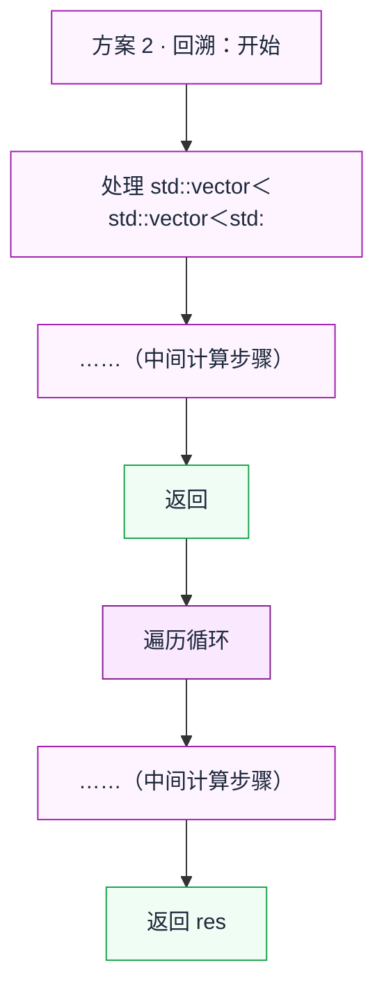

```cpp
// LeetCode 131. 分割回文串 — C++ 版（方案2）
#include <cassert>                        // 引入头文件
#include <iostream>                       // 引入头文件
#include <string>                         // 引入头文件
#include <vector>                         // 引入头文件
static bool isPal(const std::string &s) { // 定义判定函数 isPal
    size_t i = 0, j = s.size() - 1; // 把 0, 下标 j 赋值为 字符串.大小() 减 1; 写入 size_t i
    while (i < j) {                 // 循环，直到不满足「下标 i 小于 下标 j」
        if (s[i] != s[j])
            return false; // 若 字符串[下标 i] 不等于 字符串[下标 j]，直接返回 false
        ++i;
        --j; // 加一 下标 i; 减一 下标 j;
    }
    return true; // 返回 true
}
static std::vector<std::vector<std::string>> partition(const std::string &s) {
    std::vector<std::vector<std::string>>
        res;                       // std::vector 小于 std::vector 小于 std::string 超过 超过 结果;
    std::vector<std::string> path; // std::vector 小于 std::string 超过 当前路径;
    std::function<void(size_t)> dfs =
        [&](size_t start) { // 把 [ 按位与 ](size_t 起点) { 写入 std::function<void(size_t)> dfs
            if (start == s.size()) {
                res.push_back(path);
                return;
            } // 若 起点 等于 字符串.大小()) { 结果 追加 当前路径); return; }
            for (size_t e = start + 1; e <= s.size();
                 ++e) { // 让 e 从 起点 加 1 开始计数，e 不超过 字符串.大小() 就继续
                auto sub = s.substr(start, e - start); // 把 字符串 截取 起点, e 减 起点) 存入 sub
                if (isPal(sub)) {                      // 若 isPal(sub
                    path.push_back(sub);               // 当前路径 追加 sub);
                    dfs(e);                            // dfs(e);
                    path.pop_back();                   // 弹出栈顶元素
                }
            }
        };
    dfs(0);     // dfs(0);
    return res; // 返回 结果
}
int main() { // 程序入口：跑内嵌自测用例
    assert((partition("aab") ==
            std::vector<std::vector<std::string>>{{"a", "a", "b"}, {"aa", "b"}})); // 断言校验
    std::cout << "PASS" << std::endl; // 全部用例通过，输出 PASS
    return 0;                         // 返回 0
}
```

### R 实现（2 种方案）

R 的全部方案如下，每个方案都内嵌用例自测，可独立运行（老仓库 python/go 文件遵循「打印结果」约定）：

#### 方案 1：回溯

**思路与代码分析**：核心是「回溯」。R 版用向量化思维与 1 起始下标，注意 1:n 的降序陷阱。**走读**：方案 1 · 回溯：开始 → 处理 chars ＜- strsplit(s, )[[1] → 调用 identical(chars, rev(chars)) → 返回结果。

**运行架构**（真实控制流）：

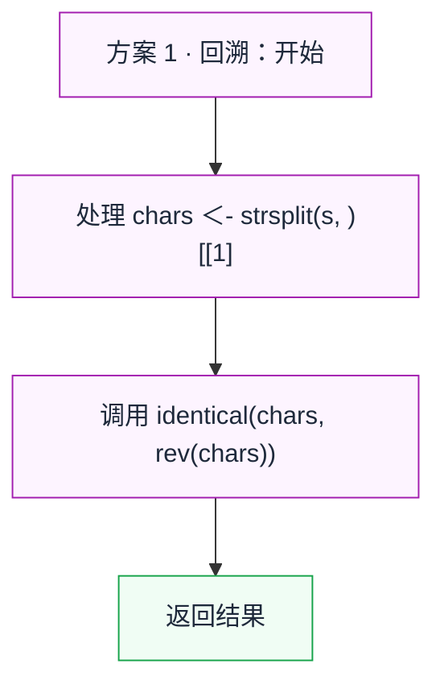

```r
# 版（方案1） 定义函数 is_pal（参数：字符串）
is_pal <- function(s) {
    chars <- strsplit(s, "")[[1]]  # 把 strsplit(字符串, 「」)[[1]] 存入 chars
    identical(chars, rev(chars))  # identical(chars, rev(chars))
}
partition <- function(s) {
    # 定义函数 partition（参数：字符串）
    chars <- strsplit(s, "")[[1]]  # 把 strsplit(字符串, 「」)[[1]] 存入 chars
    n <- length(chars)  # 把 长度(chars) 存入 元素个数
    res <- list()  # 把 列表() 存入 结果
    path <- character(0)  # 把 character(0) 存入 当前路径
    dfs <- function(start) {
        # 定义函数 dfs（参数：起点） 若 起点 超过 元素个数
        if (start > n) {
            res[[length(res) + 1L]] <<- path  # 结果[[长度(结果) 加 1L]] 小于 小于 减 当前路径
            return(invisible(NULL))  # 返回 invisible(NULL
        }
        for (e in start:n) {
            # for (e in 起点:元素个数) {
            sub <- paste(chars[start:e], collapse = "")  # 把 paste(chars[起点:e], collapse 赋值为 「」) 存入 sub
            if (is_pal(sub)) {
                # 若 is_pal(sub
                path <<- c(path, sub)  # 当前路径 小于 小于 减 字符(当前路径, sub)
                dfs(e + 1L)  # dfs(e 加 1L)
                path <<- path[-length(path)]  # 当前路径 小于 小于 减 当前路径[ 减 长度(当前路径)]
            }
        }
    }
    if (n > 0)
        dfs(1L) else res[[1L]] <- character(0)  # 若 元素个数 超过 0) dfs(1L) else 结果[[1L]] 小于 减 character(0
    res  # 结果
}
got <- partition("aab")  # 把 partition(「aab」) 存入 got
stopifnot(length(got) == 2)  # 断言校验
stopifnot(identical(got[[1]], c("a", "a", "b")))  # 断言校验
stopifnot(identical(got[[2]], c("aa", "b")))  # 断言校验
cat("PASS\n")  # 全部用例通过，输出 PASS
```

#### 方案 2：回溯

**思路与代码分析**：核心是「回溯」。R 版用向量化思维与 1 起始下标，注意 1:n 的降序陷阱。**走读**：方案 2 · 回溯：开始 → 处理 chars ＜- strsplit(s, )[[1] → 调用 identical(chars, rev(chars)) → 返回结果。

**运行架构**（真实控制流）：


```r
# 版（方案2） 定义函数 is_pal（参数：字符串）
is_pal <- function(s) {
    chars <- strsplit(s, "")[[1]]  # 把 strsplit(字符串, 「」)[[1]] 存入 chars
    identical(chars, rev(chars))  # identical(chars, rev(chars))
}
partition <- function(s) {
    # 定义函数 partition（参数：字符串）
    chars <- strsplit(s, "")[[1]]  # 把 strsplit(字符串, 「」)[[1]] 存入 chars
    n <- length(chars)  # 把 长度(chars) 存入 元素个数
    res <- list()  # 把 列表() 存入 结果
    path <- character(0)  # 把 character(0) 存入 当前路径
    dfs <- function(start) {
        # 定义函数 dfs（参数：起点） 若 起点 超过 元素个数
        if (start > n) {
            res[[length(res) + 1L]] <<- path  # 结果[[长度(结果) 加 1L]] 小于 小于 减 当前路径
            return(invisible(NULL))  # 返回 invisible(NULL
        }
        for (e in start:n) {
            # for (e in 起点:元素个数) {
            sub <- paste(chars[start:e], collapse = "")  # 把 paste(chars[起点:e], collapse 赋值为 「」) 存入 sub
            if (is_pal(sub)) {
                # 若 is_pal(sub
                path <<- c(path, sub)  # 当前路径 小于 小于 减 字符(当前路径, sub)
                dfs(e + 1L)  # dfs(e 加 1L)
                path <<- path[-length(path)]  # 当前路径 小于 小于 减 当前路径[ 减 长度(当前路径)]
            }
        }
    }
    if (n > 0)
        dfs(1L) else res[[1L]] <- character(0)  # 若 元素个数 超过 0) dfs(1L) else 结果[[1L]] 小于 减 character(0
    res  # 结果
}
got <- partition("aab")  # 把 partition(「aab」) 存入 got
stopifnot(length(got) == 2)  # 断言校验
stopifnot(identical(got[[1]], c("a", "a", "b")))  # 断言校验
stopifnot(identical(got[[2]], c("aa", "b")))  # 断言校验
cat("PASS\n")  # 全部用例通过，输出 PASS
```

### Zig 实现（2 种方案）

Zig 的全部方案如下，每个方案都内嵌用例自测，可独立运行（老仓库 python/go 文件遵循「打印结果」约定）：

#### 方案 1：回溯

**思路与代码分析**：核心是「回溯」。Zig 版显式分配与清零，整型边界处理严格。**走读**：方案 1 · 回溯：开始 → 计算 D → 若 start == str.len 则： → 计算 cp → 调用 cp.appendSlice(path.items) c → 向 out 追加记录 → 返回  → 计算 e → 当 (e ≤ str.len) : (e += 1) 时反复执行 → 计算 sub → 若 isPal(sub) 则： → 向 path 追加记录 → 调用 dfs(str, e, path, out, a) → 从 path 弹出 → 计算 path → 调用 D.dfs(s, 0, &path, res, allo。

**运行架构**（真实控制流）：

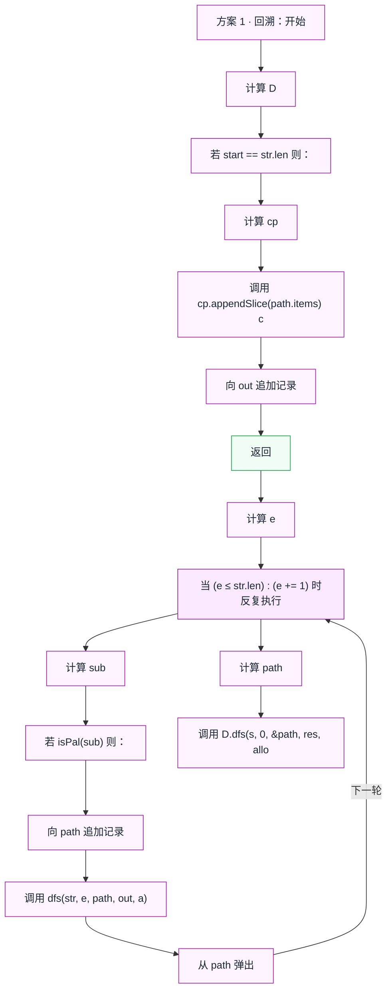

```zig
// LeetCode 131. 分割回文串 — Zig 版（方案1）
const std = @import("std"); // 把 @import(「std」) 存入 std
fn isPal(s: []const u8) bool { // 定义判定函数 isPal
    if (s.len == 0) return true; // 若 字符串.长度 等于 0，直接返回 true
    var i: usize = 0; // 把 0; 写入 var i: usize
    var j: usize = s.len - 1; // 把 字符串.长度 减 1; 写入 var j: usize
    while (i < j) : ({ // 循环，直到不满足「下标 i 小于 下标 j) : (」
        i += 1; // 下标 i累加 1
        j -= 1; // 下标 j累减 1
    }) { // }) {
        if (s[i] != s[j]) return false; // 若 字符串[下标 i] 不等于 字符串[下标 j]，直接返回 false
    }
    return true; // 返回 true
}
fn partition(s: []const u8, alloc: std.mem.Allocator, res: *std.ArrayList(std.ArrayList([]const u8))) void { // 定义函数/方法 partition
    const D = struct { // 把 struct { 存入 D
        fn dfs(str: []const u8, start: usize, path: *std.ArrayList([]const u8), out: *std.ArrayList(std.ArrayList([]const u8)), a: std.mem.Allocator) void { // 定义函数/方法 dfs
            if (start == str.len) { // 若 起点 等于 str.长度
                var cp = std.ArrayList([]const u8).init(out.allocator); // 把 std.ArrayList([]const u8).init(out.allocator) 存入 cp
                cp.appendSlice(path.items) catch unreachable; // cp.appendSlice(当前路径.items) catch unreachable;
                out.append(cp) catch unreachable; // 把 cp 追加到列表尾部
                return; // return;
            }
            var e = start + 1; // 把 起点 加 1 存入 e
            while (e <= str.len) : (e += 1) { // 循环，直到不满足「e 不超过 str.长度) : (e 累加 1」
                const sub = str[start..e]; // 把 str[起点..e] 存入 sub
                if (isPal(sub)) { // 若 isPal(sub
                    path.append(a.dupe(u8, sub) catch unreachable) catch unreachable; // 把 数组.dupe(u8, sub 追加到列表尾部
                    dfs(str, e, path, out, a); // dfs(str, e, 当前路径, out, 数组);
                    _ = path.pop(); // 弹出栈顶元素
                }
            }
        }
    };
    var path = std.ArrayList([]const u8).init(alloc); // 把 std.ArrayList([]const u8).init(alloc) 存入 当前路径
    D.dfs(s, 0, &path, res, alloc); // D.dfs(字符串, 0, 按位与 当前路径, 结果, alloc);
}
pub fn main() !void { // 程序入口：跑内嵌自测用例
    var arena = std.heap.ArenaAllocator.init(std.heap.page_allocator); // 把 std.堆.ArenaAllocator.init(std.堆.page_allocator) 存入 arena
    defer arena.deinit(); // defer arena.deinit();
    const alloc = arena.allocator(); // 把 arena.allocator() 存入 alloc
    var res = std.ArrayList(std.ArrayList([]const u8)).init(std.heap.page_allocator);
    defer res.deinit(); // defer 结果.deinit();
    partition("aab", alloc, &res); // partition(「aab」, alloc, 按位与 结果);
    if (res.items.len != 2) return error.TestFailed; // 若 结果.items.长度 不等于 2，直接返回 error.TestFailed
    if (res.items[0].items.len != 3 or !std.mem.eql(u8, res.items[0].items[0], "a")) return error.TestFailed;
    if (res.items[1].items.len != 2 or !std.mem.eql(u8, res.items[1].items[0], "aa")) return error.TestFailed;
    std.debug.print("PASS\n", .{}); // 全部用例通过，输出 PASS
}
```

#### 方案 2：回溯

**思路与代码分析**：核心是「回溯」。Zig 版显式分配与清零，整型边界处理严格。**走读**：方案 2 · 回溯：开始 → 计算 D → 若 start == str.len 则： → 计算 cp → 调用 cp.appendSlice(path.items) c → 向 out 追加记录 → 返回  → 计算 e → 当 (e ≤ str.len) : (e += 1) 时反复执行 → 计算 sub → 若 isPal(sub) 则： → 向 path 追加记录 → 调用 dfs(str, e, path, out, a) → 从 path 弹出 → 计算 path → 调用 D.dfs(s, 0, &path, res, allo。

**运行架构**（真实控制流）：

```mermaid
graph TD
    N0["方案 2 · 回溯：开始"]
    N1["计算 D"]
    N2["若 start == str.len 则："]
    N3["计算 cp"]
    N4["调用 cp.appendSlice(path.items) c"]
    N5["向 out 追加记录"]
    N6["返回 "]
    N7["计算 e"]
    N8["当 (e ≤ str.len) : (e += 1) 时反复执行"]
    N9["计算 sub"]
    N10["若 isPal(sub) 则："]
    N11["向 path 追加记录"]
    N12["调用 dfs(str, e, path, out, a)"]
    N13["从 path 弹出"]
    N14["计算 path"]
    N15["调用 D.dfs(s, 0, &path, res, allo"]
    N0 --> N1
    N1 --> N2
    N2 --> N3
    N3 --> N4
    N4 --> N5
    N5 --> N6
    N6 --> N7
    N7 --> N8
    N8 --> N9
    N9 --> N10
    N10 --> N11
    N11 --> N12
    N12 --> N13
    N13 -- 下一轮 --> N8
    N8 --> N14
    N14 --> N15
    classDef n fill:#fdf4ff,stroke:#a21caf,color:#1e293b;
    classDef lp fill:#fae8ff,stroke:#86198f,color:#1e293b;
    classDef dc fill:#fef9c3,stroke:#ca8a04,color:#1e293b;
    classDef tm fill:#f0fdf4,stroke:#16a34a,color:#1e293b;
    class N0,N1,N2,N3,N4,N5,N7,N9,N10,N11,N12,N13,N14,N15 n;
    class N8 lp;
    class N6 tm;
```

```zig
// LeetCode 131. 分割回文串 — Zig 版（方案2）
const std = @import("std"); // 把 @import(「std」) 存入 std
fn isPal(s: []const u8) bool { // 定义判定函数 isPal
    if (s.len == 0) return true; // 若 字符串.长度 等于 0，直接返回 true
    var i: usize = 0; // 把 0; 写入 var i: usize
    var j: usize = s.len - 1; // 把 字符串.长度 减 1; 写入 var j: usize
    while (i < j) : ({ // 循环，直到不满足「下标 i 小于 下标 j) : (」
        i += 1; // 下标 i累加 1
        j -= 1; // 下标 j累减 1
    }) { // }) {
        if (s[i] != s[j]) return false; // 若 字符串[下标 i] 不等于 字符串[下标 j]，直接返回 false
    }
    return true; // 返回 true
}
fn partition(s: []const u8, alloc: std.mem.Allocator, res: *std.ArrayList(std.ArrayList([]const u8))) void { // 定义函数/方法 partition
    const D = struct { // 把 struct { 存入 D
        fn dfs(str: []const u8, start: usize, path: *std.ArrayList([]const u8), out: *std.ArrayList(std.ArrayList([]const u8)), a: std.mem.Allocator) void { // 定义函数/方法 dfs
            if (start == str.len) { // 若 起点 等于 str.长度
                var cp = std.ArrayList([]const u8).init(out.allocator); // 把 std.ArrayList([]const u8).init(out.allocator) 存入 cp
                cp.appendSlice(path.items) catch unreachable; // cp.appendSlice(当前路径.items) catch unreachable;
                out.append(cp) catch unreachable; // 把 cp 追加到列表尾部
                return; // return;
            }
            var e = start + 1; // 把 起点 加 1 存入 e
            while (e <= str.len) : (e += 1) { // 循环，直到不满足「e 不超过 str.长度) : (e 累加 1」
                const sub = str[start..e]; // 把 str[起点..e] 存入 sub
                if (isPal(sub)) { // 若 isPal(sub
                    path.append(a.dupe(u8, sub) catch unreachable) catch unreachable; // 把 数组.dupe(u8, sub 追加到列表尾部
                    dfs(str, e, path, out, a); // dfs(str, e, 当前路径, out, 数组);
                    _ = path.pop(); // 弹出栈顶元素
                }
            }
        }
    };
    var path = std.ArrayList([]const u8).init(alloc); // 把 std.ArrayList([]const u8).init(alloc) 存入 当前路径
    D.dfs(s, 0, &path, res, alloc); // D.dfs(字符串, 0, 按位与 当前路径, 结果, alloc);
}
pub fn main() !void { // 程序入口：跑内嵌自测用例
    var arena = std.heap.ArenaAllocator.init(std.heap.page_allocator); // 把 std.堆.ArenaAllocator.init(std.堆.page_allocator) 存入 arena
    defer arena.deinit(); // defer arena.deinit();
    const alloc = arena.allocator(); // 把 arena.allocator() 存入 alloc
    var res = std.ArrayList(std.ArrayList([]const u8)).init(std.heap.page_allocator);
    defer res.deinit(); // defer 结果.deinit();
    partition("aab", alloc, &res); // partition(「aab」, alloc, 按位与 结果);
    if (res.items.len != 2) return error.TestFailed; // 若 结果.items.长度 不等于 2，直接返回 error.TestFailed
    if (res.items[0].items.len != 3 or !std.mem.eql(u8, res.items[0].items[0], "a")) return error.TestFailed;
    if (res.items[1].items.len != 2 or !std.mem.eql(u8, res.items[1].items[0], "aa")) return error.TestFailed;
    std.debug.print("PASS\n", .{}); // 全部用例通过，输出 PASS
}
```

### Dart 实现（2 种方案）

Dart 的全部方案如下，每个方案都内嵌用例自测，可独立运行（老仓库 python/go 文件遵循「打印结果」约定）：

#### 方案 1：回溯

**思路与代码分析**：核心是「回溯」。Dart 版用可空类型标注与集合方法，注意空安全。代码里依次做这些事：单循环线性扫描。**走读**：方案 1 · 回溯：开始 → 更新 res → 更新 path → 处理 void dfs(int start) → 若 start == s.length 则： → 调用 res.add(List＜String＞.from(pa → 返回  → 遍历循环 → 更新 sub → 若 isPal(sub) 则： → 调用 path.add(sub) → 调用 dfs(e) → 调用 path.removeLast() → 调用 dfs(0) → 返回 res。

**运行架构**（真实控制流）：

```mermaid
graph TD
    N0["方案 1 · 回溯：开始"]
    N1["更新 res"]
    N2["更新 path"]
    N3["处理 void dfs(int start)"]
    N4["若 start == s.length 则："]
    N5["调用 res.add(List＜String＞.from(pa"]
    N6["返回 "]
    N7["遍历循环"]
    N8["更新 sub"]
    N9["若 isPal(sub) 则："]
    N10["调用 path.add(sub)"]
    N11["调用 dfs(e)"]
    N12["调用 path.removeLast()"]
    N13["调用 dfs(0)"]
    N14["返回 res"]
    N0 --> N1
    N1 --> N2
    N2 --> N3
    N3 --> N4
    N4 --> N5
    N5 --> N6
    N6 --> N7
    N7 --> N8
    N8 --> N9
    N9 --> N10
    N10 --> N11
    N11 --> N12
    N12 -- 下一轮 --> N7
    N7 --> N13
    N13 --> N14
    classDef n fill:#fdf4ff,stroke:#a21caf,color:#1e293b;
    classDef lp fill:#fae8ff,stroke:#86198f,color:#1e293b;
    classDef dc fill:#fef9c3,stroke:#ca8a04,color:#1e293b;
    classDef tm fill:#f0fdf4,stroke:#16a34a,color:#1e293b;
    class N0,N1,N2,N3,N4,N5,N8,N9,N10,N11,N12,N13 n;
    class N7 lp;
    class N6,N14 tm;
```

```dart
// LeetCode 131. 分割回文串 — Dart 版（方案1）
bool isPal(String s) {
  // 定义判定函数 isPal
  var i = 0, j = s.length - 1; // 把 0, 下标 j 赋值为 字符串.长度 减 1 存入 下标 i
  while (i < j) {
    // 循环，直到不满足「下标 i 小于 下标 j」
    if (s[i] != s[j]) return false; // 若 字符串[下标 i] 不等于 字符串[下标 j]，直接返回 false
    i++; // 下标 i 加一
    j--; // 下标 j 减一
  }
  return true; // 返回 true
}

List<List<String>> partition(String s) {
  // 定义函数/方法 partition
  final res = <List<String>>[]; // 把 小于 List 小于 String 超过 超过 [] 存入 结果
  final path = <String>[]; // 把 小于 String 超过 [] 存入 当前路径
  void dfs(int start) {
    // 定义函数/方法 dfs
    if (start == s.length) {
      // 若 起点 等于 字符串.长度
      res.add(List<String>.from(path)); // 结果 追加 List 小于 String 超过 .from(当前路径));
      return; // return;
    }
    for (var e = start + 1; e <= s.length; e++) {
      // 让 e 从 起点 加 1 开始计数，e 不超过 字符串.长度 就继续
      final sub = s.substring(start, e); // 把 字符串 截取 起点, e) 存入 sub
      if (isPal(sub)) {
        // 若 isPal(sub
        path.add(sub); // 当前路径 追加 sub);
        dfs(e); // dfs(e);
        path.removeLast(); // 当前路径.removeLast();
      }
    }
  }

  dfs(0); // dfs(0);
  return res; // 返回 结果
}

void main() {
  // 程序入口：跑内嵌自测用例
  final got = partition('aab'); // 把 partition('aab') 存入 got
  if (got.length != 2)
    throw StateError('cnt'); // 若 got.长度 不等于 2) throw StateError('计数');
  if (got[0].toString() != '[a, a, b]' || got[1].toString() != '[aa, b]')
    throw StateError('p');
  print('PASS'); // 全部用例通过，输出 PASS
}
```

#### 方案 2：回溯

**思路与代码分析**：核心是「回溯」。Dart 版用可空类型标注与集合方法，注意空安全。代码里依次做这些事：单循环线性扫描。**走读**：方案 2 · 回溯：开始 → 更新 res → 更新 path → 处理 void dfs(int start) → 若 start == s.length 则： → 调用 res.add(List＜String＞.from(pa → 返回  → 遍历循环 → 更新 sub → 若 isPal(sub) 则： → 调用 path.add(sub) → 调用 dfs(e) → 调用 path.removeLast() → 调用 dfs(0) → 返回 res。

**运行架构**（真实控制流）：

```mermaid
graph TD
    N0["方案 2 · 回溯：开始"]
    N1["更新 res"]
    N2["更新 path"]
    N3["处理 void dfs(int start)"]
    N4["若 start == s.length 则："]
    N5["调用 res.add(List＜String＞.from(pa"]
    N6["返回 "]
    N7["遍历循环"]
    N8["更新 sub"]
    N9["若 isPal(sub) 则："]
    N10["调用 path.add(sub)"]
    N11["调用 dfs(e)"]
    N12["调用 path.removeLast()"]
    N13["调用 dfs(0)"]
    N14["返回 res"]
    N0 --> N1
    N1 --> N2
    N2 --> N3
    N3 --> N4
    N4 --> N5
    N5 --> N6
    N6 --> N7
    N7 --> N8
    N8 --> N9
    N9 --> N10
    N10 --> N11
    N11 --> N12
    N12 -- 下一轮 --> N7
    N7 --> N13
    N13 --> N14
    classDef n fill:#fdf4ff,stroke:#a21caf,color:#1e293b;
    classDef lp fill:#fae8ff,stroke:#86198f,color:#1e293b;
    classDef dc fill:#fef9c3,stroke:#ca8a04,color:#1e293b;
    classDef tm fill:#f0fdf4,stroke:#16a34a,color:#1e293b;
    class N0,N1,N2,N3,N4,N5,N8,N9,N10,N11,N12,N13 n;
    class N7 lp;
    class N6,N14 tm;
```

```dart
// LeetCode 131. 分割回文串 — Dart 版（方案2）
bool isPal(String s) {
  // 定义判定函数 isPal
  var i = 0, j = s.length - 1; // 把 0, 下标 j 赋值为 字符串.长度 减 1 存入 下标 i
  while (i < j) {
    // 循环，直到不满足「下标 i 小于 下标 j」
    if (s[i] != s[j]) return false; // 若 字符串[下标 i] 不等于 字符串[下标 j]，直接返回 false
    i++; // 下标 i 加一
    j--; // 下标 j 减一
  }
  return true; // 返回 true
}

List<List<String>> partition(String s) {
  // 定义函数/方法 partition
  final res = <List<String>>[]; // 把 小于 List 小于 String 超过 超过 [] 存入 结果
  final path = <String>[]; // 把 小于 String 超过 [] 存入 当前路径
  void dfs(int start) {
    // 定义函数/方法 dfs
    if (start == s.length) {
      // 若 起点 等于 字符串.长度
      res.add(List<String>.from(path)); // 结果 追加 List 小于 String 超过 .from(当前路径));
      return; // return;
    }
    for (var e = start + 1; e <= s.length; e++) {
      // 让 e 从 起点 加 1 开始计数，e 不超过 字符串.长度 就继续
      final sub = s.substring(start, e); // 把 字符串 截取 起点, e) 存入 sub
      if (isPal(sub)) {
        // 若 isPal(sub
        path.add(sub); // 当前路径 追加 sub);
        dfs(e); // dfs(e);
        path.removeLast(); // 当前路径.removeLast();
      }
    }
  }

  dfs(0); // dfs(0);
  return res; // 返回 结果
}

void main() {
  // 程序入口：跑内嵌自测用例
  final got = partition('aab'); // 把 partition('aab') 存入 got
  if (got.length != 2)
    throw StateError('cnt'); // 若 got.长度 不等于 2) throw StateError('计数');
  if (got[0].toString() != '[a, a, b]' || got[1].toString() != '[aa, b]')
    throw StateError('p');
  print('PASS'); // 全部用例通过，输出 PASS
}
```

---

## 内容总结

- **分割回文串**（回溯 · Medium）：共 2 个方案，主线思路「回溯」；时间 O(n)（单趟线性扫描）；动画演示回溯棋盘过程，附录给出 11 种语言 × 全部方案的可运行实现。
- 来源博客：[https://blog.csdn.net/tyro_java/article/details/145240399](https://blog.csdn.net/tyro_java/article/details/145240399)
- 导航：[📋 总目录](../) ｜ [← 156 有效数字](../156_有效数字/) ｜ [158 解数独 →](../158_解数独/)
