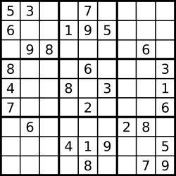
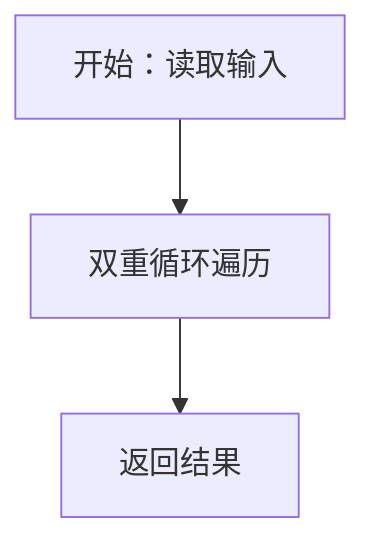
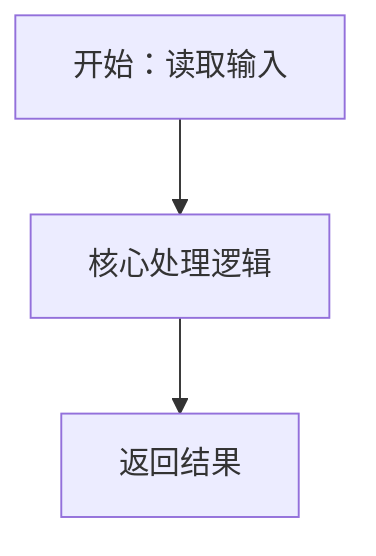
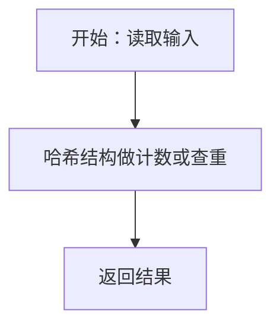
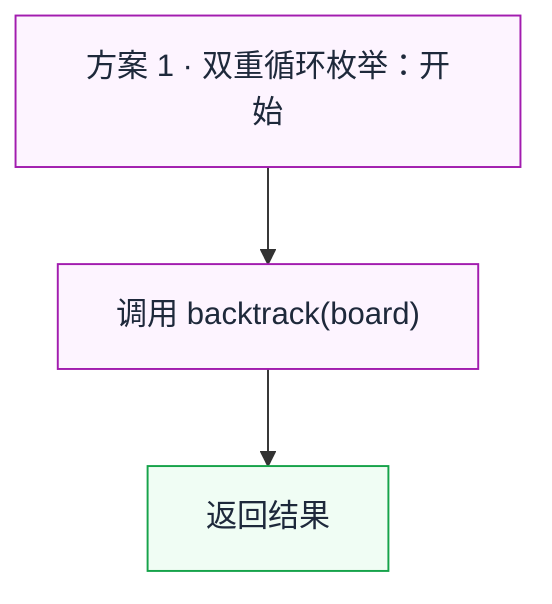
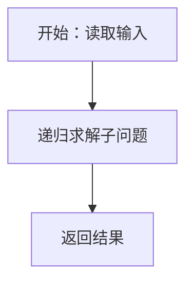
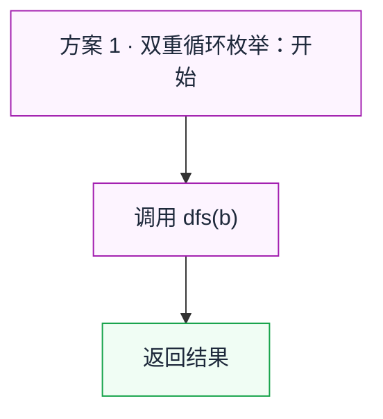
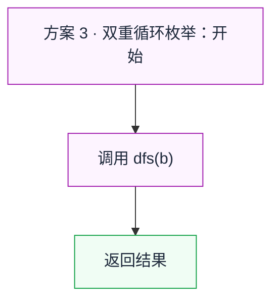
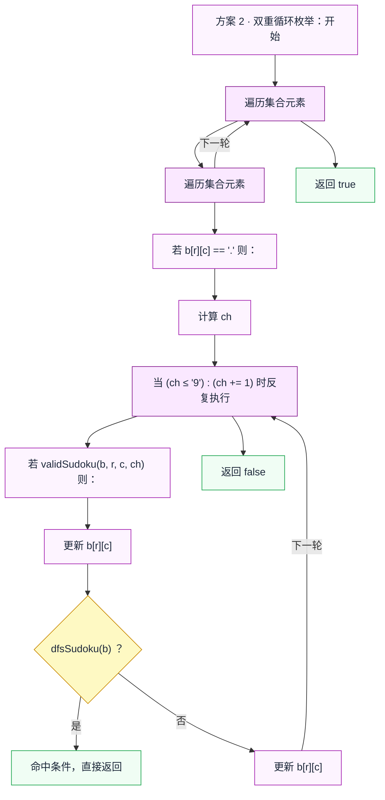

# 158 · 解数独（第九阶段 · 回溯与递归 · Medium）

> **难度**：⭐⭐ Medium ｜ **专题**：回溯
> **学习定位**：第九阶段 · 回溯与递归第 158 篇 ｜ **解法数**：3
> **内容总结**：**解数独**（回溯 · Medium）：共 3 个方案，主线思路「双重循环枚举」；时间 O(n²)（两层嵌套扫描）；动画演示回溯棋盘过程，附录给出 11 种语言 × 全部方案的可运行实现。

---

## 题目描述

编写一个程序，通过填充空格来解决数独问题。

数独的解法需 遵循如下规则：

 数字 `1-9` 在每一行只能出现一次。
 数字 `1-9` 在每一列只能出现一次。
 数字 `1-9` 在每一个以粗实线分隔的 `3x3` 宫内只能出现一次。（请参考示例图）

数独部分空格内已填入了数字，空白格用 `'.'` 表示。

- 主函数签名：`function solveSudoku(board: Board): void`

**用例（来自原题）**：

**示例 1**



```text
输入：board = [["5","3",".",".","7",".",".",".","."],["6",".",".","1","9","5",".",".","."],[".","9","8",".",".",".",".","6","."],["8",".",".",".","6",".",".",".","3"],["4",".",".","8",".","3",".",".","1"],["7",".",".",".","2",".",".",".","6"],[".","6",".",".",".",".","2","8","."],[".",".",".","4","1","9",".",".","5"],[".",".",".",".","8",".",".","7","9"]]
输出：[["5","3","4","6","7","8","9","1","2"],["6","7","2","1","9","5","3","4","8"],["1","9","8","3","4","2","5","6","7"],["8","5","9","7","6","1","4","2","3"],["4","2","6","8","5","3","7","9","1"],["7","1","3","9","2","4","8","5","6"],["9","6","1","5","3","7","2","8","4"],["2","8","7","4","1","9","6","3","5"],["3","4","5","2","8","6","1","7","9"]]
```

解释：输入的数独如上图所示，唯一有效的解决方案如下所示：
> 题面与 [leetcode.cn 官方](https://leetcode.cn/problems/sudoku-solver/)一致，示例配图取自官方题面。

**数据范围与注意事项**：

- `board.length == 9`
- `board[i].length == 9`
- `board[i][j]` 是一位数字或者 `'.'`
- 题目数据 保证 输入数独仅有一个解
- **易错点**：递归返回后要把当前选择撤销干净，否则结果集会被污染。

## 题目分析

**场景是什么**：系统地试所有可能并及时回头，对应真实开发里的组合枚举、约束求解、路径规划。本题就是该场景的 Medium 级练习，主线做法是「双重循环枚举」。

**主线怎么解**：把主解法从头到尾过一遍，它其实在依次做这几件事：双重循环遍历。

## 解题思路

**方案对比**（共 3 个方案，由浅入深）：

| 方案 | 时间复杂度 | 空间复杂度 |
|---|---|---|
| 方案 1 · 双重循环枚举 | O(n²)（两层嵌套扫描） | O(1) 到 O(n) |
| 方案 2 · 双重循环枚举 | O(n²)（两层嵌套扫描） | O(1) 到 O(n) |
| 方案 3 · 双重循环枚举 | O(n²)（两层嵌套扫描） | O(1) 到 O(n) |

**方案间的取舍**：方案 1（双重循环枚举）；方案 2（双重循环枚举）；方案 3（双重循环枚举）。数据规模小、可读性优先时选靠前的方案；规模大、性能优先时选靠后的方案。

**怎么读这一篇**：

- 🐣 **新手路线**：把「题目描述」的示例 1 在纸上手推一遍 → 读方案 1（最直观的写法）与它的代码走读 → 按「运行方式」本地跑通看 PASS → 回头对比方案 2 之后的写法差在哪
- 🦅 **大佬路线**：直接锁定最优方案 1（双重循环枚举，O(n²)（两层嵌套扫描））→ 跳读该方案代码与走读 → 用「逐步拆解与面试追问」补齐复杂度推导与边界追问

### 动态算法图（回溯棋盘，GIF 自动循环）


动画演示回溯专题里回溯棋盘的典型过程；每个方案在「TypeScript 解题方案」一节还配了专属动画与专属流程图。

### 主解法流程图（真实控制流）



## TypeScript 解题方案（3 个方案逐个讲）

> **运行与提交**：每个方案都是自包含文件（内嵌用例自测，输出 PASS），整块复制到 `.ts` 文件后 `node 文件名` 即可运行。提交 LeetCode 时，把 `demo` 内的算法函数与辅助类型/函数整体取出、置于文件顶层即可。涉及交互/特殊接口的题以题面给定签名为准。

### 方案 1：双重循环枚举

**分析与思路**：核心做法是「双重循环枚举」。代码里依次做这些事：双重循环遍历。

**运行方式**：`node 本文件`，内嵌用例全部通过会输出 PASS。


**方案专属流程图**（真实控制流）：


```typescript
export function demo(): void {
  // 程序入口：跑内嵌自测用例
  type Board = string[][]; // 定义类型
  function solveSudoku(board: Board): void {
    // 定义函数/方法 solveSudoku
    function is_valid(row: number, col: number, num: string): boolean {
      // 定义判定函数 is_valid
      for (let i = 0; i < 9; i++) {
        if (board[i][col] === num) return false;
        if (board[row][i] === num) return false;
      } // 让 下标 i 从 0 开始计数，下标 i 小于 9 就继续
      const sr = 3 * Math.floor(row / 3),
        sc = 3 * Math.floor(col / 3); // 把 3 乘 向下取整(row 除以 3), sc 赋值为 3 乘 向下取整(col 除以 3) 存入 sr
      for (let i = 0; i < 3; i++)
        for (let j = 0; j < 3; j++)
          if (board[sr + i][sc + j] === num) return false; // 让 下标 i 从 0 开始计数，下标 i 小于 3 就继续
      return true; // 返回 true
    }
    function backtrack(): boolean {
      // 定义函数/方法 backtrack
      for (let row = 0; row < 9; row++)
        for (let col = 0; col < 9; col++) {
          // 让 row 从 0 开始计数，row 小于 9 就继续
          if (board[row][col] === '.') {
            // 若 棋盘[row][col] 全等于 '.'
            for (const num of '123456789') {
              // for(const num of '123456789'){
              if (is_valid(row, col, num)) {
                // 若 is_valid(row,col,num
                board[row][col] = num; // 把 num; 写入 board[row][col]
                if (backtrack()) return true; // 若 backtrack()，直接返回 true
                board[row][col] = '.'; // 把 '.'; 写入 board[row][col]
              }
            }
            return false; // 返回 false
          }
        }
      return true; // 返回 true
    }
    backtrack(); // backtrack();
  }
  const board: Board = [
    ['5', '3', '.', '.', '7', '.', '.', '.', '.'],
    ['6', '.', '.', '1', '9', '5', '.', '.', '.'],
    ['.', '9', '8', '.', '.', '.', '.', '6', '.'],
    ['8', '.', '.', '.', '6', '.', '.', '.', '3'],
    ['4', '.', '.', '8', '.', '3', '.', '.', '1'],
    ['7', '.', '.', '.', '2', '.', '.', '.', '6'],
    ['.', '6', '.', '.', '.', '.', '2', '8', '.'],
    ['.', '.', '.', '4', '1', '9', '.', '.', '5'],
    ['.', '.', '.', '.', '8', '.', '.', '7', '9'],
  ];
  solveSudoku(board); // solveSudoku(棋盘);
  const want: Board = [
    ['5', '3', '4', '6', '7', '8', '9', '1', '2'],
    ['6', '7', '2', '1', '9', '5', '3', '4', '8'],
    ['1', '9', '8', '3', '4', '2', '5', '6', '7'],
    ['8', '5', '9', '7', '6', '1', '4', '2', '3'],
    ['4', '2', '6', '8', '5', '3', '7', '9', '1'],
    ['7', '1', '3', '9', '2', '4', '8', '5', '6'],
    ['9', '6', '1', '5', '3', '7', '2', '8', '4'],
    ['2', '8', '7', '4', '1', '9', '6', '3', '5'],
    ['3', '4', '5', '2', '8', '6', '1', '7', '9'],
  ];
  let fail = false; // 把 false 存入 fail
  for (let r = 0; r < 9; r++)
    for (let c = 0; c < 9; c++)
      if (board[r][c] !== want[r][c]) {
        fail = true;
        console.log('FAIL', r, c);
      } // 让 右指针 从 0 开始计数，右指针 小于 9 就继续
  if (fail) throw new Error('FAILED'); // 若 fail) throw new Error(「FAILED」);
  console.log('PASS'); // 全部用例通过，输出 PASS
}
demo(); // demo();
```

### 方案 2：双重循环枚举

**分析与思路**：核心做法是「双重循环枚举」。代码里依次做这些事：双重循环遍历。

**运行方式**：`node 本文件`，内嵌用例全部通过会输出 PASS。


**方案专属流程图**（真实控制流）：


```typescript
export function demo(): void {
  // 程序入口：跑内嵌自测用例
  type Board = string[][]; // 定义类型
  function solveSudoku(board: Board): void {
    // 定义函数/方法 solveSudoku
    function is_valid(row: number, col: number, num: string): boolean {
      // 定义判定函数 is_valid
      for (let i = 0; i < 9; i++) {
        if (board[i][col] === num) return false;
        if (board[row][i] === num) return false;
      } // 让 下标 i 从 0 开始计数，下标 i 小于 9 就继续
      const sr = 3 * Math.floor(row / 3),
        sc = 3 * Math.floor(col / 3); // 把 3 乘 向下取整(row 除以 3), sc 赋值为 3 乘 向下取整(col 除以 3) 存入 sr
      for (let i = 0; i < 3; i++)
        for (let j = 0; j < 3; j++)
          if (board[sr + i][sc + j] === num) return false; // 让 下标 i 从 0 开始计数，下标 i 小于 3 就继续
      return true; // 返回 true
    }
    function backtrack(): boolean {
      // 定义函数/方法 backtrack
      for (let row = 0; row < 9; row++)
        for (let col = 0; col < 9; col++) {
          // 让 row 从 0 开始计数，row 小于 9 就继续
          if (board[row][col] === '.') {
            // 若 棋盘[row][col] 全等于 '.'
            for (const num of '123456789') {
              // for(const num of '123456789'){
              if (is_valid(row, col, num)) {
                // 若 is_valid(row,col,num
                board[row][col] = num; // 把 num; 写入 board[row][col]
                if (backtrack()) return true; // 若 backtrack()，直接返回 true
                board[row][col] = '.'; // 把 '.'; 写入 board[row][col]
              }
            }
            return false; // 返回 false
          }
        }
      return true; // 返回 true
    }
    backtrack(); // backtrack();
  }
  const board: Board = [
    ['5', '3', '.', '.', '7', '.', '.', '.', '.'],
    ['6', '.', '.', '1', '9', '5', '.', '.', '.'],
    ['.', '9', '8', '.', '.', '.', '.', '6', '.'],
    ['8', '.', '.', '.', '6', '.', '.', '.', '3'],
    ['4', '.', '.', '8', '.', '3', '.', '.', '1'],
    ['7', '.', '.', '.', '2', '.', '.', '.', '6'],
    ['.', '6', '.', '.', '.', '.', '2', '8', '.'],
    ['.', '.', '.', '4', '1', '9', '.', '.', '5'],
    ['.', '.', '.', '.', '8', '.', '.', '7', '9'],
  ];
  solveSudoku(board); // solveSudoku(棋盘);
  const want: Board = [
    ['5', '3', '4', '6', '7', '8', '9', '1', '2'],
    ['6', '7', '2', '1', '9', '5', '3', '4', '8'],
    ['1', '9', '8', '3', '4', '2', '5', '6', '7'],
    ['8', '5', '9', '7', '6', '1', '4', '2', '3'],
    ['4', '2', '6', '8', '5', '3', '7', '9', '1'],
    ['7', '1', '3', '9', '2', '4', '8', '5', '6'],
    ['9', '6', '1', '5', '3', '7', '2', '8', '4'],
    ['2', '8', '7', '4', '1', '9', '6', '3', '5'],
    ['3', '4', '5', '2', '8', '6', '1', '7', '9'],
  ];
  let fail = false; // 把 false 存入 fail
  for (let r = 0; r < 9; r++)
    for (let c = 0; c < 9; c++)
      if (board[r][c] !== want[r][c]) {
        fail = true;
        console.log('FAIL', r, c);
      } // 让 右指针 从 0 开始计数，右指针 小于 9 就继续
  if (fail) throw new Error('FAILED'); // 若 fail) throw new Error(「FAILED」);
  console.log('PASS'); // 全部用例通过，输出 PASS
}
demo(); // demo();
```

### 方案 3：双重循环枚举

**分析与思路**：核心做法是「双重循环枚举」。代码里依次做这些事：双重循环遍历。

**运行方式**：`node 本文件`，内嵌用例全部通过会输出 PASS。


**方案专属流程图**（真实控制流）：


```typescript
export function demo(): void {
  // 程序入口：跑内嵌自测用例
  type Board = string[][]; // 定义类型
  function solveSudoku(board: Board): void {
    // 定义函数/方法 solveSudoku
    function is_valid(row: number, col: number, num: string): boolean {
      // 定义判定函数 is_valid
      for (let i = 0; i < 9; i++) {
        if (board[i][col] === num) return false;
        if (board[row][i] === num) return false;
      } // 让 下标 i 从 0 开始计数，下标 i 小于 9 就继续
      const sr = 3 * Math.floor(row / 3),
        sc = 3 * Math.floor(col / 3); // 把 3 乘 向下取整(row 除以 3), sc 赋值为 3 乘 向下取整(col 除以 3) 存入 sr
      for (let i = 0; i < 3; i++)
        for (let j = 0; j < 3; j++)
          if (board[sr + i][sc + j] === num) return false; // 让 下标 i 从 0 开始计数，下标 i 小于 3 就继续
      return true; // 返回 true
    }
    function backtrack(): boolean {
      // 定义函数/方法 backtrack
      for (let row = 0; row < 9; row++)
        for (let col = 0; col < 9; col++) {
          // 让 row 从 0 开始计数，row 小于 9 就继续
          if (board[row][col] === '.') {
            // 若 棋盘[row][col] 全等于 '.'
            for (const num of '123456789') {
              // for(const num of '123456789'){
              if (is_valid(row, col, num)) {
                // 若 is_valid(row,col,num
                board[row][col] = num; // 把 num; 写入 board[row][col]
                if (backtrack()) return true; // 若 backtrack()，直接返回 true
                board[row][col] = '.'; // 把 '.'; 写入 board[row][col]
              }
            }
            return false; // 返回 false
          }
        }
      return true; // 返回 true
    }
    backtrack(); // backtrack();
  }
  const board: Board = [
    ['5', '3', '.', '.', '7', '.', '.', '.', '.'],
    ['6', '.', '.', '1', '9', '5', '.', '.', '.'],
    ['.', '9', '8', '.', '.', '.', '.', '6', '.'],
    ['8', '.', '.', '.', '6', '.', '.', '.', '3'],
    ['4', '.', '.', '8', '.', '3', '.', '.', '1'],
    ['7', '.', '.', '.', '2', '.', '.', '.', '6'],
    ['.', '6', '.', '.', '.', '.', '2', '8', '.'],
    ['.', '.', '.', '4', '1', '9', '.', '.', '5'],
    ['.', '.', '.', '.', '8', '.', '.', '7', '9'],
  ];
  solveSudoku(board); // solveSudoku(棋盘);
  const want: Board = [
    ['5', '3', '4', '6', '7', '8', '9', '1', '2'],
    ['6', '7', '2', '1', '9', '5', '3', '4', '8'],
    ['1', '9', '8', '3', '4', '2', '5', '6', '7'],
    ['8', '5', '9', '7', '6', '1', '4', '2', '3'],
    ['4', '2', '6', '8', '5', '3', '7', '9', '1'],
    ['7', '1', '3', '9', '2', '4', '8', '5', '6'],
    ['9', '6', '1', '5', '3', '7', '2', '8', '4'],
    ['2', '8', '7', '4', '1', '9', '6', '3', '5'],
    ['3', '4', '5', '2', '8', '6', '1', '7', '9'],
  ];
  let fail = false; // 把 false 存入 fail
  for (let r = 0; r < 9; r++)
    for (let c = 0; c < 9; c++)
      if (board[r][c] !== want[r][c]) {
        fail = true;
        console.log('FAIL', r, c);
      } // 让 右指针 从 0 开始计数，右指针 小于 9 就继续
  if (fail) throw new Error('FAILED'); // 若 fail) throw new Error(「FAILED」);
  console.log('PASS'); // 全部用例通过，输出 PASS
}
demo(); // demo();
```

## 逐步拆解与面试追问

**复杂度**：时间 O(n²)（两层嵌套扫描），空间 O(1) 到 O(n)

**为什么是这个量级**：外层定起点、内层扫终点，n 个起点各扫 n 次

**面试官可能会追问**：

- 怎么剪枝降低无效搜索？
- 去重的关键在哪一层？
- 状态恢复遗漏会怎样？

## 关键 API 速查（TS 主解法实际用到，附官方链接）

| API | 作用 | 使用要点 | 官方文档 |
|---|---|---|---|
| `Math.floor()` | 向下取整 | 负数向负无穷（-1.5 → -2）；大数用位运算前注意 2^31 界 | [官方文档](https://developer.mozilla.org/zh-CN/docs/Web/JavaScript/Reference/Global_Objects/Math/floor) |

### 各语言官方文档导航

- **TypeScript / JS**：[MDN 中文参考](https://developer.mozilla.org/zh-CN/)
- **Python**：[Python 官方文档](https://docs.python.org/zh-cn/3/)
- **Go**：[Go 标准库](https://pkg.go.dev/std)
- **Java**：[JDK 17 API](https://docs.oracle.com/en/java/javase/17/docs/api/)
- **Rust**：[Rust 标准库](https://doc.rust-lang.org/std/)
- **Lua**：[Lua 5.4 手册](https://www.lua.org/manual/5.4/)
- **C**：[Cppreference C](https://zh.cppreference.com/w/c)
- **C++**：[Cppreference C++](https://zh.cppreference.com/w/cpp)
- **R**：[R 官方手册](https://stat.ethz.ch/R-manual/)
- **Zig**：[Zig 语言文档](https://ziglang.org/documentation/master/)
- **Dart**：[Dart API](https://api.dart.dev/)

## 附录：其他 10 种语言全部实现（每种语言列举其全部方案）

> TypeScript 的全部方案见「TypeScript 解题方案」一节；下面是其余 10 种语言的对应实现，每种语言的每个方案都带思路分析、代码走读与专属运行架构图。
> 每个方案都内嵌用例自测，可独立运行（老仓库 python/go 文件遵循「打印结果」约定）。
> 完整解法文件见 `dsa/<语言>/backtrack/lc_37_解数独/`。

### Python 实现（3 种方案）

Python 的全部方案如下，每个方案都内嵌用例自测，可独立运行（老仓库 python/go 文件遵循「打印结果」约定）：

#### 方案 1：双重循环枚举

**思路与代码分析**：核心是「双重循环枚举」。Python 版用切片与字典推导式简化操作，突出可读性。

**运行架构**（真实控制流）：



```python
import sys  # 提高递归深度上限（深输入防 RecursionError）

sys.setrecursionlimit(200000)  # 树/链表类题目节点数可达 1e4 量级

def solveSudoku(board):  # 定义函数 solveSudoku（参数：棋盘）
    def is_valid(board, row, col, num):  # 定义函数 is_valid（参数：棋盘, row, col, num）
        for i in range(9):  # 让 下标 i 从 9 遍历
            if board[i][col] == num:  # 若 棋盘[下标 i][col] 等于 num
                return False  # 返回 False
            if board[row][i] == num:  # 若 棋盘[row][下标 i] 等于 num
                return False  # 返回 False
        start_row, start_col = 3 * (row // 3), 3 * (col // 3)
        for i in range(3):  # 让 下标 i 从 3 遍历
            for j in range(3):  # 让 下标 j 从 3 遍历
                if (
                    board[start_row + i][start_col + j] == num
                ):  # 若 棋盘[start_row 加 下标 i][start_col 加 下标 j] 等于 num
                    return False  # 返回 False
        return True  # 返回 True

    def backtrack(board):  # 定义函数 backtrack（参数：棋盘）
        for row in range(9):  # 让 row 从 9 遍历
            for col in range(9):  # 让 col 从 9 遍历
                if board[row][col] == ".":  # 若 棋盘[row][col] 等于 '.'
                    for num in "123456789":  # for num in '123456789':
                        if is_valid(board, row, col, num):  # 若 is_valid(棋盘, row, col, num
                            board[row][col] = num  # 把 num 写入 board[row][col]
                            if backtrack(board):  # 若 backtrack(棋盘
                                return True  # 返回 True
                            board[row][col] = "."  # 把 '.' 写入 board[row][col]
                    return False  # 返回 False
        return True  # 返回 True

    backtrack(board)  # backtrack(棋盘)

if __name__ == "__main__":  # 若 __name__ 等于 '__main__'
    board = [
        ["5", "3", ".", ".", "7", ".", ".", ".", "."],
        ["6", ".", ".", "1", "9", "5", ".", ".", "."],
        [".", "9", "8", ".", ".", ".", ".", "6", "."],
        ["8", ".", ".", ".", "6", ".", ".", ".", "3"],
        ["4", ".", ".", "8", ".", "3", ".", ".", "1"],
        ["7", ".", ".", ".", "2", ".", ".", ".", "6"],
        [".", "6", ".", ".", ".", ".", "2", "8", "."],
        [".", ".", ".", "4", "1", "9", ".", ".", "5"],
        [".", ".", ".", ".", "8", ".", ".", "7", "9"],
    ]
    solveSudoku(board)  # solveSudoku(棋盘)
    for row in board:  # 逐个取出 棋盘 的元素（row）
        print(row)  # 打印输出
```

#### 方案 2：双重循环枚举

**思路与代码分析**：核心是「双重循环枚举」。Python 版用切片与字典推导式简化操作，突出可读性。

**运行架构**：与方案 1 的控制流相同（同算法在该语言的等价实现），图见上。

```python
import sys  # 提高递归深度上限（深输入防 RecursionError）

sys.setrecursionlimit(200000)  # 树/链表类题目节点数可达 1e4 量级

def solveSudoku(board):  # 定义函数 solveSudoku（参数：棋盘）
    def is_valid(board, row, col, num):  # 定义函数 is_valid（参数：棋盘, row, col, num）
        for i in range(9):  # 让 下标 i 从 9 遍历
            if board[i][col] == num:  # 若 棋盘[下标 i][col] 等于 num
                return False  # 返回 False
            if board[row][i] == num:  # 若 棋盘[row][下标 i] 等于 num
                return False  # 返回 False
        start_row, start_col = 3 * (row // 3), 3 * (col // 3)
        for i in range(3):  # 让 下标 i 从 3 遍历
            for j in range(3):  # 让 下标 j 从 3 遍历
                if (
                    board[start_row + i][start_col + j] == num
                ):  # 若 棋盘[start_row 加 下标 i][start_col 加 下标 j] 等于 num
                    return False  # 返回 False
        return True  # 返回 True

    def backtrack(board):  # 定义函数 backtrack（参数：棋盘）
        for row in range(9):  # 让 row 从 9 遍历
            for col in range(9):  # 让 col 从 9 遍历
                if board[row][col] == ".":  # 若 棋盘[row][col] 等于 '.'
                    for num in "123456789":  # for num in '123456789':
                        if is_valid(board, row, col, num):  # 若 is_valid(棋盘, row, col, num
                            board[row][col] = num  # 把 num 写入 board[row][col]
                            if backtrack(board):  # 若 backtrack(棋盘
                                return True  # 返回 True
                            board[row][col] = "."  # 把 '.' 写入 board[row][col]
                    return False  # 返回 False
        return True  # 返回 True

    backtrack(board)  # backtrack(棋盘)

if __name__ == "__main__":  # 若 __name__ 等于 '__main__'
    board = [
        ["5", "3", ".", ".", "7", ".", ".", ".", "."],
        ["6", ".", ".", "1", "9", "5", ".", ".", "."],
        [".", "9", "8", ".", ".", ".", ".", "6", "."],
        ["8", ".", ".", ".", "6", ".", ".", ".", "3"],
        ["4", ".", ".", "8", ".", "3", ".", ".", "1"],
        ["7", ".", ".", ".", "2", ".", ".", ".", "6"],
        [".", "6", ".", ".", ".", ".", "2", "8", "."],
        [".", ".", ".", "4", "1", "9", ".", ".", "5"],
        [".", ".", ".", ".", "8", ".", ".", "7", "9"],
    ]
    solveSudoku(board)  # solveSudoku(棋盘)
    for row in board:  # 逐个取出 棋盘 的元素（row）
        print(row)  # 打印输出
```

#### 方案 3：双重循环枚举

**思路与代码分析**：核心是「双重循环枚举」。Python 版用切片与字典推导式简化操作，突出可读性。

**运行架构**：与方案 1 的控制流相同（同算法在该语言的等价实现），图见上。

```python
import sys  # 提高递归深度上限（深输入防 RecursionError）

sys.setrecursionlimit(200000)  # 树/链表类题目节点数可达 1e4 量级

def solveSudoku(board):  # 定义函数 solveSudoku（参数：棋盘）
    def is_valid(board, row, col, num):  # 定义函数 is_valid（参数：棋盘, row, col, num）
        for i in range(9):  # 让 下标 i 从 9 遍历
            if board[i][col] == num:  # 若 棋盘[下标 i][col] 等于 num
                return False  # 返回 False
            if board[row][i] == num:  # 若 棋盘[row][下标 i] 等于 num
                return False  # 返回 False
        start_row, start_col = 3 * (row // 3), 3 * (col // 3)
        for i in range(3):  # 让 下标 i 从 3 遍历
            for j in range(3):  # 让 下标 j 从 3 遍历
                if (
                    board[start_row + i][start_col + j] == num
                ):  # 若 棋盘[start_row 加 下标 i][start_col 加 下标 j] 等于 num
                    return False  # 返回 False
        return True  # 返回 True

    def backtrack(board):  # 定义函数 backtrack（参数：棋盘）
        for row in range(9):  # 让 row 从 9 遍历
            for col in range(9):  # 让 col 从 9 遍历
                if board[row][col] == ".":  # 若 棋盘[row][col] 等于 '.'
                    for num in "123456789":  # for num in '123456789':
                        if is_valid(board, row, col, num):  # 若 is_valid(棋盘, row, col, num
                            board[row][col] = num  # 把 num 写入 board[row][col]
                            if backtrack(board):  # 若 backtrack(棋盘
                                return True  # 返回 True
                            board[row][col] = "."  # 把 '.' 写入 board[row][col]
                    return False  # 返回 False
        return True  # 返回 True

    backtrack(board)  # backtrack(棋盘)

if __name__ == "__main__":  # 若 __name__ 等于 '__main__'
    board = [
        ["5", "3", ".", ".", "7", ".", ".", ".", "."],
        ["6", ".", ".", "1", "9", "5", ".", ".", "."],
        [".", "9", "8", ".", ".", ".", ".", "6", "."],
        ["8", ".", ".", ".", "6", ".", ".", ".", "3"],
        ["4", ".", ".", "8", ".", "3", ".", ".", "1"],
        ["7", ".", ".", ".", "2", ".", ".", ".", "6"],
        [".", "6", ".", ".", ".", ".", "2", "8", "."],
        [".", ".", ".", "4", "1", "9", ".", ".", "5"],
        [".", ".", ".", ".", "8", ".", ".", "7", "9"],
    ]
    solveSudoku(board)  # solveSudoku(棋盘)
    for row in board:  # 逐个取出 棋盘 的元素（row）
        print(row)  # 打印输出
```

### Go 实现（3 种方案）

Go 的全部方案如下，每个方案都内嵌用例自测，可独立运行（老仓库 python/go 文件遵循「打印结果」约定）：

#### 方案 1：双重循环枚举

**思路与代码分析**：核心是「双重循环枚举」。Go 版用切片与多返回值惯用法，显式处理索引边界。

**运行架构**（真实控制流）：



```go
package main // 引入依赖

import (
	"fmt" // 「fmt」
	"os"  // 「os」
)

func solveSudoku(board *[9][9]string) { // 定义函数/方法 solveSudoku
	var isValid func(row, col int, num string) bool // var isValid func(row, col int, num string) bool
	isValid = func(row, col int, num string) bool { // 把 func(row, col int, num string) bool { 写入 isValid
		for i := 0; i < 9; i++ { // 让 下标 i 从 0 开始计数
			if board[i][col] == num { // 若 棋盘[下标 i][col] 等于 num
				return false // 返回 false
			}
			if board[row][i] == num { // 若 棋盘[row][下标 i] 等于 num
				return false // 返回 false
			}
		}
		startRow, startCol := 3*(row/3), 3*(col/3) // 把 3 乘 (row 除以 3), 3 乘 (col 除以 3) 写入 startRow, startCol :
		for i := 0; i < 3; i++ {                   // 让 下标 i 从 0 开始计数
			for j := 0; j < 3; j++ { // 让 下标 j 从 0 开始计数
				if board[startRow+i][startCol+j] == num { // 若 棋盘[startRow 加 下标 i][startCol 加 下标 j] 等于 num
					return false // 返回 false
				}
			}
		}
		return true // 返回 true
	}
	var backtrack func() bool // var backtrack func() bool
	backtrack = func() bool { // 把 func() bool { 写入 backtrack
		for row := 0; row < 9; row++ { // 让 row 从 0 开始计数
			for col := 0; col < 9; col++ { // 让 col 从 0 开始计数
				if board[row][col] == "." { // 若 棋盘[row][col] 等于 「.」
					for num := '1'; num <= '9'; num++ { // 把 '1'; num 不超过 '9'; num 加一 { 写入 for num :
						s := string(num)          // 把 string(num) 写入 s :
						if isValid(row, col, s) { // 定义判定函数 isValid
							board[row][col] = s // 把 字符串 写入 board[row][col]
							if backtrack() {    // 定义函数/方法 backtrack
								return true // 返回 true
							}
							board[row][col] = "." // 把 「.」 写入 board[row][col]
						}
					}
					return false // 返回 false
				}
			}
		}
		return true // 返回 true
	}
	backtrack() // backtrack()
}

func validSudoku(b [9][9]string) bool { // 定义函数/方法 validSudoku
	for r := 0; r < 9; r++ { // 让 右指针 从 0 开始计数
		seen := map[string]bool{} // 把 映射表[string]bool{} 写入 seen :
		for c := 0; c < 9; c++ {  // 让 字符 从 0 开始计数
			v := b[r][c]             // 把 b[右指针][字符] 写入 v :
			if v == "." || seen[v] { // 若 值 等于 「.」 或 已见集合[值]
				return false // 返回 false
			}
			seen[v] = true // 把 true 写入 seen[v]
		}
	}
	for c := 0; c < 9; c++ { // 让 字符 从 0 开始计数
		seen := map[string]bool{} // 把 映射表[string]bool{} 写入 seen :
		for r := 0; r < 9; r++ {  // 让 右指针 从 0 开始计数
			v := b[r][c] // 把 b[右指针][字符] 写入 v :
			if seen[v] { // 若 已见集合[值]
				return false // 返回 false
			}
			seen[v] = true // 把 true 写入 seen[v]
		}
	}
	for br := 0; br < 3; br++ { // 让 br 从 0 开始计数
		for bc := 0; bc < 3; bc++ { // 让 bc 从 0 开始计数
			seen := map[string]bool{} // 把 映射表[string]bool{} 写入 seen :
			for i := 0; i < 3; i++ {  // 让 下标 i 从 0 开始计数
				for j := 0; j < 3; j++ { // 让 下标 j 从 0 开始计数
					v := b[br*3+i][bc*3+j] // 把 b[br 乘 3 加 下标 i][bc 乘 3 加 下标 j] 写入 v :
					if seen[v] {           // 若 已见集合[值]
						return false // 返回 false
					}
					seen[v] = true // 把 true 写入 seen[v]
				}
			}
		}
	}
	return true // 返回 true
}

func main() { // 程序入口：跑内嵌自测用例
	original := [9][9]string{ // 把 [9][9]string{ 写入 original :
		{"5", "3", ".", ".", "7", ".", ".", ".", "."},
		{"6", ".", ".", "1", "9", "5", ".", ".", "."},
		{".", "9", "8", ".", ".", ".", ".", "6", "."},
		{"8", ".", ".", ".", "6", ".", ".", ".", "3"},
		{"4", ".", ".", "8", ".", "3", ".", ".", "1"},
		{"7", ".", ".", ".", "2", ".", ".", ".", "6"},
		{".", "6", ".", ".", ".", ".", "2", "8", "."},
		{".", ".", ".", "4", "1", "9", ".", ".", "5"},
		{".", ".", ".", ".", "8", ".", ".", "7", "9"},
	}
	board := original        // 把 original 写入 board :
	solveSudoku(&board)      // solveSudoku( 按位与 棋盘)
	ok := validSudoku(board) // 把 validSudoku(棋盘) 写入 ok :
	if ok {                  // 若 ok
		for r := 0; r < 9; r++ { // 让 右指针 从 0 开始计数
			for c := 0; c < 9; c++ { // 让 字符 从 0 开始计数
				if original[r][c] != "." && original[r][c] != board[r][c] {
					ok = false                                                                                      // 把 false 写入 ok
					fmt.Printf("FAIL original cell (%d,%d) changed: %s -> %s\n", r, c, original[r][c], board[r][c]) // 打印输出
				}
			}
		}
	} else { // 否则
		fmt.Println("FAIL solved board is not valid") // 打印输出
	}
	if !ok { // 若 取反 ok
		os.Exit(1) // os.Exit(1)
	}
	fmt.Println("PASS") // 全部用例通过，输出 PASS
}
```

#### 方案 2：双重循环枚举

**思路与代码分析**：核心是「双重循环枚举」。Go 版用切片与多返回值惯用法，显式处理索引边界。

**运行架构**（真实控制流）：


```go
package main // 引入依赖

import (
	"fmt"
	"os"
	"reflect"
) // 引入依赖

func solveSudoku(board [9][9]string) [9][9]string { // 定义函数/方法 solveSudoku
	var valid func(r, c int, num string) bool // var valid func(右指针, 字符 int, num string) bool
	valid = func(r, c int, num string) bool { // 把 func(右指针, 字符 int, num string) bool { 写入 valid
		for i := 0; i < 9; i++ { // 让 下标 i 从 0 开始计数
			if board[i][c] == num { // 若 棋盘[下标 i][字符] 等于 num
				return false // 返回 false
			}
			if board[r][i] == num { // 若 棋盘[右指针][下标 i] 等于 num
				return false // 返回 false
			}
		}
		sr, sc := 3*(r/3), 3*(c/3) // 把 3 乘 (右指针 除以 3), 3 乘 (字符 除以 3) 写入 sr, sc :
		for i := 0; i < 3; i++ {   // 让 下标 i 从 0 开始计数
			for j := 0; j < 3; j++ { // 让 下标 j 从 0 开始计数
				if board[sr+i][sc+j] == num { // 若 棋盘[sr 加 下标 i][sc 加 下标 j] 等于 num
					return false // 返回 false
				}
			}
		}
		return true // 返回 true
	}
	digits := "123456789"     // 把 「123456789」 写入 digits :
	var backtrack func() bool // var backtrack func() bool
	backtrack = func() bool { // 把 func() bool { 写入 backtrack
		for r := 0; r < 9; r++ { // 让 右指针 从 0 开始计数
			for c := 0; c < 9; c++ { // 让 字符 从 0 开始计数
				if board[r][c] == "." { // 若 棋盘[右指针][字符] 等于 「.」
					for k := 0; k < 9; k++ { // 让 下标 k 从 0 开始计数
						num := string(digits[k]) // 把 string(digits[下标 k]) 写入 num :
						if valid(r, c, num) {    // 定义函数/方法 valid
							board[r][c] = num // 把 num 写入 board[r][c]
							if backtrack() {  // 定义函数/方法 backtrack
								return true // 返回 true
							}
							board[r][c] = "." // 把 「.」 写入 board[r][c]
						}
					}
					return false // 返回 false
				}
			}
		}
		return true // 返回 true
	}
	backtrack()  // backtrack()
	return board // 返回 棋盘
}

func main() { // 程序入口：跑内嵌自测用例
	board := [9][9]string{ // 把 [9][9]string{ 写入 board :
		{"5", "3", ".", ".", "7", ".", ".", ".", "."},
		{"6", ".", ".", "1", "9", "5", ".", ".", "."},
		{".", "9", "8", ".", ".", ".", ".", "6", "."},
		{"8", ".", ".", ".", "6", ".", ".", ".", "3"},
		{"4", ".", ".", "8", ".", "3", ".", ".", "1"},
		{"7", ".", ".", ".", "2", ".", ".", ".", "6"},
		{".", "6", ".", ".", ".", ".", "2", "8", "."},
		{".", ".", ".", "4", "1", "9", ".", ".", "5"},
		{".", ".", ".", ".", "8", ".", ".", "7", "9"},
	}
	got := solveSudoku(board) // 把 solveSudoku(棋盘) 写入 got :
	want := [9][9]string{     // 把 [9][9]string{ 写入 want :
		{"5", "3", "4", "6", "7", "8", "9", "1", "2"},
		{"6", "7", "2", "1", "9", "5", "3", "4", "8"},
		{"1", "9", "8", "3", "4", "2", "5", "6", "7"},
		{"8", "5", "9", "7", "6", "1", "4", "2", "3"},
		{"4", "2", "6", "8", "5", "3", "7", "9", "1"},
		{"7", "1", "3", "9", "2", "4", "8", "5", "6"},
		{"9", "6", "1", "5", "3", "7", "2", "8", "4"},
		{"2", "8", "7", "4", "1", "9", "6", "3", "5"},
		{"3", "4", "5", "2", "8", "6", "1", "7", "9"},
	}
	if !reflect.DeepEqual(got, want) { // 若 取反 reflect.DeepEqual(got, want
		fmt.Println("FAIL") // 打印输出
		os.Exit(1)          // os.Exit(1)
	}
	fmt.Println("PASS") // 全部用例通过，输出 PASS
}
```

#### 方案 3：双重循环枚举

**思路与代码分析**：核心是「双重循环枚举」。Go 版用切片与多返回值惯用法，显式处理索引边界。

**运行架构**：与方案 1 的控制流相同（同算法在该语言的等价实现），图见上。

```go
package main // 引入依赖

import (
	"fmt" // 「fmt」
	"os"  // 「os」
)

func solveSudoku(board *[9][9]string) { // 定义函数/方法 solveSudoku
	var isValid func(row, col int, num string) bool // var isValid func(row, col int, num string) bool
	isValid = func(row, col int, num string) bool { // 把 func(row, col int, num string) bool { 写入 isValid
		for i := 0; i < 9; i++ { // 让 下标 i 从 0 开始计数
			if board[i][col] == num { // 若 棋盘[下标 i][col] 等于 num
				return false // 返回 false
			}
			if board[row][i] == num { // 若 棋盘[row][下标 i] 等于 num
				return false // 返回 false
			}
		}
		startRow, startCol := 3*(row/3), 3*(col/3) // 把 3 乘 (row 除以 3), 3 乘 (col 除以 3) 写入 startRow, startCol :
		for i := 0; i < 3; i++ {                   // 让 下标 i 从 0 开始计数
			for j := 0; j < 3; j++ { // 让 下标 j 从 0 开始计数
				if board[startRow+i][startCol+j] == num { // 若 棋盘[startRow 加 下标 i][startCol 加 下标 j] 等于 num
					return false // 返回 false
				}
			}
		}
		return true // 返回 true
	}
	var backtrack func() bool // var backtrack func() bool
	backtrack = func() bool { // 把 func() bool { 写入 backtrack
		for row := 0; row < 9; row++ { // 让 row 从 0 开始计数
			for col := 0; col < 9; col++ { // 让 col 从 0 开始计数
				if board[row][col] == "." { // 若 棋盘[row][col] 等于 「.」
					for num := '1'; num <= '9'; num++ { // 把 '1'; num 不超过 '9'; num 加一 { 写入 for num :
						s := string(num)          // 把 string(num) 写入 s :
						if isValid(row, col, s) { // 定义判定函数 isValid
							board[row][col] = s // 把 字符串 写入 board[row][col]
							if backtrack() {    // 定义函数/方法 backtrack
								return true // 返回 true
							}
							board[row][col] = "." // 把 「.」 写入 board[row][col]
						}
					}
					return false // 返回 false
				}
			}
		}
		return true // 返回 true
	}
	backtrack() // backtrack()
}

func validSudoku(b [9][9]string) bool { // 定义函数/方法 validSudoku
	for r := 0; r < 9; r++ { // 让 右指针 从 0 开始计数
		seen := map[string]bool{} // 把 映射表[string]bool{} 写入 seen :
		for c := 0; c < 9; c++ {  // 让 字符 从 0 开始计数
			v := b[r][c]             // 把 b[右指针][字符] 写入 v :
			if v == "." || seen[v] { // 若 值 等于 「.」 或 已见集合[值]
				return false // 返回 false
			}
			seen[v] = true // 把 true 写入 seen[v]
		}
	}
	for c := 0; c < 9; c++ { // 让 字符 从 0 开始计数
		seen := map[string]bool{} // 把 映射表[string]bool{} 写入 seen :
		for r := 0; r < 9; r++ {  // 让 右指针 从 0 开始计数
			v := b[r][c] // 把 b[右指针][字符] 写入 v :
			if seen[v] { // 若 已见集合[值]
				return false // 返回 false
			}
			seen[v] = true // 把 true 写入 seen[v]
		}
	}
	for br := 0; br < 3; br++ { // 让 br 从 0 开始计数
		for bc := 0; bc < 3; bc++ { // 让 bc 从 0 开始计数
			seen := map[string]bool{} // 把 映射表[string]bool{} 写入 seen :
			for i := 0; i < 3; i++ {  // 让 下标 i 从 0 开始计数
				for j := 0; j < 3; j++ { // 让 下标 j 从 0 开始计数
					v := b[br*3+i][bc*3+j] // 把 b[br 乘 3 加 下标 i][bc 乘 3 加 下标 j] 写入 v :
					if seen[v] {           // 若 已见集合[值]
						return false // 返回 false
					}
					seen[v] = true // 把 true 写入 seen[v]
				}
			}
		}
	}
	return true // 返回 true
}

func main() { // 程序入口：跑内嵌自测用例
	original := [9][9]string{ // 把 [9][9]string{ 写入 original :
		{"5", "3", ".", ".", "7", ".", ".", ".", "."},
		{"6", ".", ".", "1", "9", "5", ".", ".", "."},
		{".", "9", "8", ".", ".", ".", ".", "6", "."},
		{"8", ".", ".", ".", "6", ".", ".", ".", "3"},
		{"4", ".", ".", "8", ".", "3", ".", ".", "1"},
		{"7", ".", ".", ".", "2", ".", ".", ".", "6"},
		{".", "6", ".", ".", ".", ".", "2", "8", "."},
		{".", ".", ".", "4", "1", "9", ".", ".", "5"},
		{".", ".", ".", ".", "8", ".", ".", "7", "9"},
	}
	board := original        // 把 original 写入 board :
	solveSudoku(&board)      // solveSudoku( 按位与 棋盘)
	ok := validSudoku(board) // 把 validSudoku(棋盘) 写入 ok :
	if ok {                  // 若 ok
		for r := 0; r < 9; r++ { // 让 右指针 从 0 开始计数
			for c := 0; c < 9; c++ { // 让 字符 从 0 开始计数
				if original[r][c] != "." && original[r][c] != board[r][c] {
					ok = false                                               // 把 false 写入 ok
					fmt.Printf("FAIL original cell (%d,%d) changed\n", r, c) // 打印输出
				}
			}
		}
	} else { // 否则
		fmt.Println("FAIL solved board invalid") // 打印输出
	}
	if !ok { // 若 取反 ok
		os.Exit(1) // os.Exit(1)
	}
	fmt.Println("PASS") // 全部用例通过，输出 PASS
}
```

### Java 实现（3 种方案）

Java 的全部方案如下，每个方案都内嵌用例自测，可独立运行（老仓库 python/go 文件遵循「打印结果」约定）：

#### 方案 1：双重循环枚举

**思路与代码分析**：核心是「双重循环枚举」。Java 版用类与静态方法组织，集合操作显式明了。**走读**：方案 1 · 双重循环枚举：开始 → 调用 backtrack(board) → 返回结果。

**运行架构**（真实控制流）：



```java
package com.webfault.dsa; // 引入依赖

import java.util.*; // 引入依赖

class lc37_solution111 { // 定义类型
  public static void solveSudoku(char[][] board) { // public static void solveSudoku(char[][] 棋盘) {
    backtrack(board); // backtrack(棋盘);
  }

  static boolean is_valid(char[][] board, int row, int col, char num) { // 定义判定函数 is_valid
    for (int i = 0; i < 9; i++) { // 让 下标 i 从 0 开始计数，下标 i 小于 9 就继续
      if (board[i][col] == num) return false; // 若 棋盘[下标 i][col] 等于 num，直接返回 false
      if (board[row][i] == num) return false; // 若 棋盘[row][下标 i] 等于 num，直接返回 false
    }
    int sr = 3 * (row / 3), sc = 3 * (col / 3); // 把 3 乘 (row 除以 3), sc 赋值为 3 乘 (col 除以 3) 存入 sr
    for (int i = 0; i < 3; i++) // 让 下标 i 从 0 开始计数，下标 i 小于 3 就继续
    for (int j = 0; j < 3; j++) // 让 下标 j 从 0 开始计数，下标 j 小于 3 就继续
      if (board[sr + i][sc + j] == num)
          return false; // 若 棋盘[sr 加 下标 i][sc 加 下标 j] 等于 num，直接返回 false
    return true; // 返回 true
  }

  static boolean backtrack(char[][] board) { // 定义函数/方法 backtrack
    for (int row = 0; row < 9; row++) // 让 row 从 0 开始计数，row 小于 9 就继续
    for (int col = 0; col < 9; col++) // 让 col 从 0 开始计数，col 小于 9 就继续
      if (board[row][col] == '.') { // 若 棋盘[row][col] 等于 '.'
          for (char num = '1';
              num <= '9';
              num++) { // 把 '1'; num 不超过 '9'; num 加一 ) { 写入 for (char num
            if (is_valid(board, row, col, num)) { // 若 is_valid(棋盘, row, col, num
              board[row][col] = num; // 把 num; 写入 board[row][col]
              if (backtrack(board)) return true; // 若 backtrack(棋盘)，直接返回 true
              board[row][col] = '.'; // 把 '.'; 写入 board[row][col]
            }
          }
          return false; // 返回 false
        }
    return true; // 返回 true
  }

  static boolean isValid(char[][] b) { // 定义判定函数 isValid
    for (int i = 0; i < 9; i++) { // 让 下标 i 从 0 开始计数，下标 i 小于 9 就继续
      boolean[] seen = new boolean[9]; // 把 new boolean[9]; 写入 boolean[] seen
      for (int j = 0; j < 9; j++) { // 让 下标 j 从 0 开始计数，下标 j 小于 9 就继续
        int v = b[i][j] - '1'; // 把 b[下标 i][下标 j] 减 '1' 存入 值
        if (v < 0 || v > 8 || seen[v]) return false; // 若 值 小于 0 或 值 超过 8 或 已见集合[值]，直接返回 false
        seen[v] = true; // 把 true; 写入 seen[v]
      }
    }
    for (int j = 0; j < 9; j++) { // 让 下标 j 从 0 开始计数，下标 j 小于 9 就继续
      boolean[] seen = new boolean[9]; // 把 new boolean[9]; 写入 boolean[] seen
      for (int i = 0; i < 9; i++) { // 让 下标 i 从 0 开始计数，下标 i 小于 9 就继续
        int v = b[i][j] - '1'; // 把 b[下标 i][下标 j] 减 '1' 存入 值
        if (v < 0 || v > 8 || seen[v]) return false; // 若 值 小于 0 或 值 超过 8 或 已见集合[值]，直接返回 false
        seen[v] = true; // 把 true; 写入 seen[v]
      }
    }
    for (int bi = 0; bi < 3; bi++)
      for (int bj = 0; bj < 3; bj++) { // 让 bi 从 0 开始计数，bi 小于 3 就继续
        boolean[] seen = new boolean[9]; // 把 new boolean[9]; 写入 boolean[] seen
        for (int i = 0; i < 3; i++)
          for (int j = 0; j < 3; j++) { // 让 下标 i 从 0 开始计数，下标 i 小于 3 就继续
            int v = b[bi * 3 + i][bj * 3 + j] - '1'; // 把 b[bi 乘 3 加 下标 i][bj 乘 3 加 下标 j] 减 '1' 存入 值
            if (v < 0 || v > 8 || seen[v]) return false; // 若 值 小于 0 或 值 超过 8 或 已见集合[值]，直接返回 false
            seen[v] = true; // 把 true; 写入 seen[v]
          }
      }
    return true; // 返回 true
  }

  public static void main(String[] args) { // public static void main(String[] args) {
    char[][] board = { // 把 { 写入 char[][] board
      {'5', '3', '.', '.', '7', '.', '.', '.', '.'},
      {'6', '.', '.', '1', '9', '5', '.', '.', '.'},
      {'.', '9', '8', '.', '.', '.', '.', '6', '.'},
      {'8', '.', '.', '.', '6', '.', '.', '.', '3'},
      {'4', '.', '.', '8', '.', '3', '.', '.', '1'},
      {'7', '.', '.', '.', '2', '.', '.', '.', '6'},
      {'.', '6', '.', '.', '.', '.', '2', '8', '.'},
      {'.', '.', '.', '4', '1', '9', '.', '.', '5'},
      {'.', '.', '.', '.', '8', '.', '.', '7', '9'} // {'.','.','.','.','8','.','.','7','9'}
    };
    solveSudoku(board); // solveSudoku(棋盘);
    if (!isValid(board))
      throw new RuntimeException(
          "FAILED"); // 若 取反 isValid(棋盘)) throw new RuntimeException(「FAILED」);
    System.out.println("PASS"); // 全部用例通过，输出 PASS
  }
}
```

#### 方案 2：双重循环枚举

**思路与代码分析**：核心是「双重循环枚举」。Java 版用类与静态方法组织，集合操作显式明了。**走读**：方案 2 · 双重循环枚举：开始 → 调用 backtrack(board) → 返回结果。

**运行架构**（真实控制流）：


```java
package com.webfault.dsa; // 引入依赖

import java.util.*; // 引入依赖

class lc37_solution222 { // 定义类型
  public static void solveSudoku(char[][] board) { // public static void solveSudoku(char[][] 棋盘) {
    backtrack(board); // backtrack(棋盘);
  }

  static boolean is_valid(char[][] board, int row, int col, char num) { // 定义判定函数 is_valid
    for (int i = 0; i < 9; i++) { // 让 下标 i 从 0 开始计数，下标 i 小于 9 就继续
      if (board[i][col] == num) return false; // 若 棋盘[下标 i][col] 等于 num，直接返回 false
      if (board[row][i] == num) return false; // 若 棋盘[row][下标 i] 等于 num，直接返回 false
    }
    int sr = 3 * (row / 3), sc = 3 * (col / 3); // 把 3 乘 (row 除以 3), sc 赋值为 3 乘 (col 除以 3) 存入 sr
    for (int i = 0; i < 3; i++) // 让 下标 i 从 0 开始计数，下标 i 小于 3 就继续
    for (int j = 0; j < 3; j++) // 让 下标 j 从 0 开始计数，下标 j 小于 3 就继续
      if (board[sr + i][sc + j] == num)
          return false; // 若 棋盘[sr 加 下标 i][sc 加 下标 j] 等于 num，直接返回 false
    return true; // 返回 true
  }

  static boolean backtrack(char[][] board) { // 定义函数/方法 backtrack
    for (int row = 0; row < 9; row++) // 让 row 从 0 开始计数，row 小于 9 就继续
    for (int col = 0; col < 9; col++) // 让 col 从 0 开始计数，col 小于 9 就继续
      if (board[row][col] == '.') { // 若 棋盘[row][col] 等于 '.'
          for (char num = '1';
              num <= '9';
              num++) { // 把 '1'; num 不超过 '9'; num 加一 ) { 写入 for (char num
            if (is_valid(board, row, col, num)) { // 若 is_valid(棋盘, row, col, num
              board[row][col] = num; // 把 num; 写入 board[row][col]
              if (backtrack(board)) return true; // 若 backtrack(棋盘)，直接返回 true
              board[row][col] = '.'; // 把 '.'; 写入 board[row][col]
            }
          }
          return false; // 返回 false
        }
    return true; // 返回 true
  }

  static boolean isValid(char[][] b) { // 定义判定函数 isValid
    for (int i = 0; i < 9; i++) { // 让 下标 i 从 0 开始计数，下标 i 小于 9 就继续
      boolean[] seen = new boolean[9]; // 把 new boolean[9]; 写入 boolean[] seen
      for (int j = 0; j < 9; j++) { // 让 下标 j 从 0 开始计数，下标 j 小于 9 就继续
        int v = b[i][j] - '1'; // 把 b[下标 i][下标 j] 减 '1' 存入 值
        if (v < 0 || v > 8 || seen[v]) return false; // 若 值 小于 0 或 值 超过 8 或 已见集合[值]，直接返回 false
        seen[v] = true; // 把 true; 写入 seen[v]
      }
    }
    for (int j = 0; j < 9; j++) { // 让 下标 j 从 0 开始计数，下标 j 小于 9 就继续
      boolean[] seen = new boolean[9]; // 把 new boolean[9]; 写入 boolean[] seen
      for (int i = 0; i < 9; i++) { // 让 下标 i 从 0 开始计数，下标 i 小于 9 就继续
        int v = b[i][j] - '1'; // 把 b[下标 i][下标 j] 减 '1' 存入 值
        if (v < 0 || v > 8 || seen[v]) return false; // 若 值 小于 0 或 值 超过 8 或 已见集合[值]，直接返回 false
        seen[v] = true; // 把 true; 写入 seen[v]
      }
    }
    for (int bi = 0; bi < 3; bi++)
      for (int bj = 0; bj < 3; bj++) { // 让 bi 从 0 开始计数，bi 小于 3 就继续
        boolean[] seen = new boolean[9]; // 把 new boolean[9]; 写入 boolean[] seen
        for (int i = 0; i < 3; i++)
          for (int j = 0; j < 3; j++) { // 让 下标 i 从 0 开始计数，下标 i 小于 3 就继续
            int v = b[bi * 3 + i][bj * 3 + j] - '1'; // 把 b[bi 乘 3 加 下标 i][bj 乘 3 加 下标 j] 减 '1' 存入 值
            if (v < 0 || v > 8 || seen[v]) return false; // 若 值 小于 0 或 值 超过 8 或 已见集合[值]，直接返回 false
            seen[v] = true; // 把 true; 写入 seen[v]
          }
      }
    return true; // 返回 true
  }

  public static void main(String[] args) { // public static void main(String[] args) {
    char[][] board = { // 把 { 写入 char[][] board
      {'5', '3', '.', '.', '7', '.', '.', '.', '.'},
      {'6', '.', '.', '1', '9', '5', '.', '.', '.'},
      {'.', '9', '8', '.', '.', '.', '.', '6', '.'},
      {'8', '.', '.', '.', '6', '.', '.', '.', '3'},
      {'4', '.', '.', '8', '.', '3', '.', '.', '1'},
      {'7', '.', '.', '.', '2', '.', '.', '.', '6'},
      {'.', '6', '.', '.', '.', '.', '2', '8', '.'},
      {'.', '.', '.', '4', '1', '9', '.', '.', '5'},
      {'.', '.', '.', '.', '8', '.', '.', '7', '9'} // {'.','.','.','.','8','.','.','7','9'}
    };
    solveSudoku(board); // solveSudoku(棋盘);
    if (!isValid(board))
      throw new RuntimeException(
          "FAILED"); // 若 取反 isValid(棋盘)) throw new RuntimeException(「FAILED」);
    System.out.println("PASS"); // 全部用例通过，输出 PASS
  }
}
```

#### 方案 3：双重循环枚举

**思路与代码分析**：核心是「双重循环枚举」。Java 版用类与静态方法组织，集合操作显式明了。代码里依次做这些事：双重循环遍历。

**运行架构**（真实控制流）：


```java
package com.webfault.dsa; // 引入依赖

import java.util.*; // 引入依赖

class lc37_solution333 { // 定义类型
  private char[][] board; // private char[][] 棋盘;
  private boolean[][] line = new boolean[9][9]; // 把 new boolean[9][9]; 写入 private boolean[][] line
  private boolean[][] column =
      new boolean[9][9]; // 把 new boolean[9][9]; 写入 private boolean[][] column
  private boolean[][][] block =
      new boolean[3][3][9]; // 把 new boolean[3][3][9]; 写入 private boolean[][][] block
  private List<int[]> spaces =
      new ArrayList<>(); // 把 new ArrayList 小于 超过 (); 写入 private List<int[]> spaces

  public void solveSudoku(char[][] board) { // 定义函数/方法 solveSudoku
    this.board = board; // 把 棋盘; 写入 棋盘
    for (int i = 0; i < 9; i++) { // 让 下标 i 从 0 开始计数，下标 i 小于 9 就继续
      for (int j = 0; j < 9; j++) { // 让 下标 j 从 0 开始计数，下标 j 小于 9 就继续
        if (board[i][j] == '.') { // 若 棋盘[下标 i][下标 j] 等于 '.'
          spaces.add(new int[] {i, j}); // spaces 追加 new int[]{下标 i, 下标 j});
        } else { // 否则
          int digit = board[i][j] - '1'; // 把 棋盘[下标 i][下标 j] 减 '1' 存入 digit
          line[i][digit] = true; // 把 true; 写入 line[i][digit]
          column[j][digit] = true; // 把 true; 写入 column[j][digit]
          block[i / 3][j / 3][digit] = true; // 把 true; 写入 block[i / 3][j / 3][digit]
        }
      }
    }
    dfs(0); // dfs(0);
  }

  private boolean dfs(int pos) { // 定义函数/方法 dfs
    if (pos == spaces.size()) { // 若 pos 等于 spaces.大小(
      return true; // 返回 true
    }
    int i = spaces.get(pos)[0]; // 把 spaces 查找 pos)[0] 存入 下标 i
    int j = spaces.get(pos)[1]; // 把 spaces 查找 pos)[1] 存入 下标 j
    for (int digit = 0; digit < 9; digit++) { // 让 digit 从 0 开始计数，digit 小于 9 就继续
      if (!line[i][digit] && !column[j][digit] && !block[i / 3][j / 3][digit]) {
        line[i][digit] = true; // 把 true; 写入 line[i][digit]
        column[j][digit] = true; // 把 true; 写入 column[j][digit]
        block[i / 3][j / 3][digit] = true; // 把 true; 写入 block[i / 3][j / 3][digit]
        board[i][j] = (char) ('1' + digit); // 把 (char) ('1' 加 digit); 写入 board[i][j]
        if (dfs(pos + 1)) { // 若 dfs(pos 加 1
          return true; // 返回 true
        }
        line[i][digit] = false; // 把 false; 写入 line[i][digit]
        column[j][digit] = false; // 把 false; 写入 column[j][digit]
        block[i / 3][j / 3][digit] = false; // 把 false; 写入 block[i / 3][j / 3][digit]
        board[i][j] = '.'; // 把 '.'; 写入 board[i][j]
      }
    }
    return false; // 返回 false
  }

  static boolean isValid(char[][] b) { // 定义判定函数 isValid
    for (int i = 0; i < 9; i++) { // 让 下标 i 从 0 开始计数，下标 i 小于 9 就继续
      boolean[] seen = new boolean[9]; // 把 new boolean[9]; 写入 boolean[] seen
      for (int j = 0; j < 9; j++) { // 让 下标 j 从 0 开始计数，下标 j 小于 9 就继续
        int v = b[i][j] - '1'; // 把 b[下标 i][下标 j] 减 '1' 存入 值
        if (v < 0 || v > 8 || seen[v]) return false; // 若 值 小于 0 或 值 超过 8 或 已见集合[值]，直接返回 false
        seen[v] = true; // 把 true; 写入 seen[v]
      }
    }
    for (int j = 0; j < 9; j++) { // 让 下标 j 从 0 开始计数，下标 j 小于 9 就继续
      boolean[] seen = new boolean[9]; // 把 new boolean[9]; 写入 boolean[] seen
      for (int i = 0; i < 9; i++) { // 让 下标 i 从 0 开始计数，下标 i 小于 9 就继续
        int v = b[i][j] - '1'; // 把 b[下标 i][下标 j] 减 '1' 存入 值
        if (v < 0 || v > 8 || seen[v]) return false; // 若 值 小于 0 或 值 超过 8 或 已见集合[值]，直接返回 false
        seen[v] = true; // 把 true; 写入 seen[v]
      }
    }
    for (int bi = 0; bi < 3; bi++)
      for (int bj = 0; bj < 3; bj++) { // 让 bi 从 0 开始计数，bi 小于 3 就继续
        boolean[] seen = new boolean[9]; // 把 new boolean[9]; 写入 boolean[] seen
        for (int i = 0; i < 3; i++)
          for (int j = 0; j < 3; j++) { // 让 下标 i 从 0 开始计数，下标 i 小于 3 就继续
            int v = b[bi * 3 + i][bj * 3 + j] - '1'; // 把 b[bi 乘 3 加 下标 i][bj 乘 3 加 下标 j] 减 '1' 存入 值
            if (v < 0 || v > 8 || seen[v]) return false; // 若 值 小于 0 或 值 超过 8 或 已见集合[值]，直接返回 false
            seen[v] = true; // 把 true; 写入 seen[v]
          }
      }
    return true; // 返回 true
  }

  public static void main(String[] args) { // public static void main(String[] args) {
    lc37_solution333 s = new lc37_solution333(); // 把 new lc37_solution333(); 写入 lc37_solution333 s
    char[][] board = { // 把 { 写入 char[][] board
      {'5', '3', '.', '.', '7', '.', '.', '.', '.'},
      {'6', '.', '.', '1', '9', '5', '.', '.', '.'},
      {'.', '9', '8', '.', '.', '.', '.', '6', '.'},
      {'8', '.', '.', '.', '6', '.', '.', '.', '3'},
      {'4', '.', '.', '8', '.', '3', '.', '.', '1'},
      {'7', '.', '.', '.', '2', '.', '.', '.', '6'},
      {'.', '6', '.', '.', '.', '.', '2', '8', '.'},
      {'.', '.', '.', '4', '1', '9', '.', '.', '5'},
      {'.', '.', '.', '.', '8', '.', '.', '7', '9'} // {'.','.','.','.','8','.','.','7','9'}
    };
    s.solveSudoku(board); // 字符串.solveSudoku(棋盘);
    if (!isValid(board))
      throw new RuntimeException(
          "FAILED"); // 若 取反 isValid(棋盘)) throw new RuntimeException(「FAILED」);
    System.out.println("PASS"); // 全部用例通过，输出 PASS
  }
}
```

### Rust 实现（3 种方案）

Rust 的全部方案如下，每个方案都内嵌用例自测，可独立运行（老仓库 python/go 文件遵循「打印结果」约定）：

#### 方案 1：双重循环枚举

**思路与代码分析**：核心是「双重循环枚举」。Rust 版用所有权移动与切片借用改写同一逻辑，注意 Option 与引用边界。

**运行架构**（真实控制流）：


```rust
// LeetCode 37. 解数独 — Rust 版（方案1）
fn solve_sudoku(board: &mut Vec<Vec<char>>) {
    // 定义函数/方法 solve_sudoku
    fn valid(b: &Vec<Vec<char>>, r: usize, c: usize, ch: char) -> bool {
        // 定义函数/方法 valid
        for i in 0..9 {
            // 逐个取出 0 的元素（下标 i）
            if b[r][i] == ch || b[i][c] == ch {
                return false;
            } // 若 b[右指针][下标 i] 等于 字符 或 b[下标 i][字符] 等于 字符 { return false; }
        }
        let (br, bc) = (r / 3 * 3, c / 3 * 3); // 把 (右指针 除以 3 乘 3, 字符 除以 3 乘 3); 写入 let (br, bc)
        for i in br..br + 3 {
            // 逐个取出 br 的元素（下标 i）
            for j in bc..bc + 3 {
                // 逐个取出 bc 的元素（下标 j）
                if b[i][j] == ch {
                    return false;
                } // 若 b[下标 i][下标 j] 等于 字符 { return false; }
            }
        }
        true // true
    }
    fn dfs(b: &mut Vec<Vec<char>>) -> bool {
        // 定义函数/方法 dfs
        for r in 0..9 {
            // 逐个取出 0 的元素（右指针）
            for c in 0..9 {
                // 逐个取出 0 的元素（字符）
                if b[r][c] == '.' {
                    // 若 b[右指针][字符] 等于 '.'
                    for ch in '1'..='9' {
                        // 把 '9' { 写入 for ch in '1'
                        if valid(b, r, c, ch) {
                            // 定义函数/方法 valid
                            b[r][c] = ch; // 把 字符; 写入 b[r][c]
                            if dfs(b) {
                                return true;
                            } // 若 dfs(b) { return true; }
                            b[r][c] = '.'; // 把 '.'; 写入 b[r][c]
                        }
                    }
                    return false; // 返回 false
                }
            }
        }
        true // true
    }
    dfs(board); // dfs(棋盘);
}
fn main() {
    // 程序入口：跑内嵌自测用例
    let mut board: Vec<Vec<char>> = vec![
        vec!['5', '3', '.', '.', '7', '.', '.', '.', '.'],
        vec!['6', '.', '.', '1', '9', '5', '.', '.', '.'],
        vec!['.', '9', '8', '.', '.', '.', '.', '6', '.'],
        vec!['8', '.', '.', '.', '6', '.', '.', '.', '3'],
        vec!['4', '.', '.', '8', '.', '3', '.', '.', '1'],
        vec!['7', '.', '.', '.', '2', '.', '.', '.', '6'],
        vec!['.', '6', '.', '.', '.', '.', '2', '8', '.'],
        vec!['.', '.', '.', '4', '1', '9', '.', '.', '5'],
        vec!['.', '.', '.', '.', '8', '.', '.', '7', '9'],
    ];
    solve_sudoku(&mut board); // solve_sudoku( 按位与 mut 棋盘);
    let solved = [
        "534678912",
        "672195348",
        "198342567",
        "859761423",
        "426853791",
        "713924856",
        "961537284",
        "287419635",
        "345286179",
    ];
    for r in 0..9 {
        // 逐个取出 0 的元素（右指针）
        let line: String = board[r].iter().collect(); // 把 棋盘[右指针].iter().collect(); 写入 let line: String
        assert_eq!(line, solved[r]); // 断言校验
    }
    println!("PASS"); // 全部用例通过，输出 PASS
}
```

#### 方案 2：双重循环枚举

**思路与代码分析**：核心是「双重循环枚举」。Rust 版用所有权移动与切片借用改写同一逻辑，注意 Option 与引用边界。

**运行架构**：与方案 1 的控制流相同（同算法在该语言的等价实现），图见上。

```rust
// LeetCode 37. 解数独 — Rust 版（方案2）
fn solve_sudoku(board: &mut Vec<Vec<char>>) {
    // 定义函数/方法 solve_sudoku
    fn valid(b: &Vec<Vec<char>>, r: usize, c: usize, ch: char) -> bool {
        // 定义函数/方法 valid
        for i in 0..9 {
            // 逐个取出 0 的元素（下标 i）
            if b[r][i] == ch || b[i][c] == ch {
                return false;
            } // 若 b[右指针][下标 i] 等于 字符 或 b[下标 i][字符] 等于 字符 { return false; }
        }
        let (br, bc) = (r / 3 * 3, c / 3 * 3); // 把 (右指针 除以 3 乘 3, 字符 除以 3 乘 3); 写入 let (br, bc)
        for i in br..br + 3 {
            // 逐个取出 br 的元素（下标 i）
            for j in bc..bc + 3 {
                // 逐个取出 bc 的元素（下标 j）
                if b[i][j] == ch {
                    return false;
                } // 若 b[下标 i][下标 j] 等于 字符 { return false; }
            }
        }
        true // true
    }
    fn dfs(b: &mut Vec<Vec<char>>) -> bool {
        // 定义函数/方法 dfs
        for r in 0..9 {
            // 逐个取出 0 的元素（右指针）
            for c in 0..9 {
                // 逐个取出 0 的元素（字符）
                if b[r][c] == '.' {
                    // 若 b[右指针][字符] 等于 '.'
                    for ch in '1'..='9' {
                        // 把 '9' { 写入 for ch in '1'
                        if valid(b, r, c, ch) {
                            // 定义函数/方法 valid
                            b[r][c] = ch; // 把 字符; 写入 b[r][c]
                            if dfs(b) {
                                return true;
                            } // 若 dfs(b) { return true; }
                            b[r][c] = '.'; // 把 '.'; 写入 b[r][c]
                        }
                    }
                    return false; // 返回 false
                }
            }
        }
        true // true
    }
    dfs(board); // dfs(棋盘);
}
fn main() {
    // 程序入口：跑内嵌自测用例
    let mut board: Vec<Vec<char>> = vec![
        vec!['5', '3', '.', '.', '7', '.', '.', '.', '.'],
        vec!['6', '.', '.', '1', '9', '5', '.', '.', '.'],
        vec!['.', '9', '8', '.', '.', '.', '.', '6', '.'],
        vec!['8', '.', '.', '.', '6', '.', '.', '.', '3'],
        vec!['4', '.', '.', '8', '.', '3', '.', '.', '1'],
        vec!['7', '.', '.', '.', '2', '.', '.', '.', '6'],
        vec!['.', '6', '.', '.', '.', '.', '2', '8', '.'],
        vec!['.', '.', '.', '4', '1', '9', '.', '.', '5'],
        vec!['.', '.', '.', '.', '8', '.', '.', '7', '9'],
    ];
    solve_sudoku(&mut board); // solve_sudoku( 按位与 mut 棋盘);
    let solved = [
        "534678912",
        "672195348",
        "198342567",
        "859761423",
        "426853791",
        "713924856",
        "961537284",
        "287419635",
        "345286179",
    ];
    for r in 0..9 {
        // 逐个取出 0 的元素（右指针）
        let line: String = board[r].iter().collect(); // 把 棋盘[右指针].iter().collect(); 写入 let line: String
        assert_eq!(line, solved[r]); // 断言校验
    }
    println!("PASS"); // 全部用例通过，输出 PASS
}
```

#### 方案 3：双重循环枚举

**思路与代码分析**：核心是「双重循环枚举」。Rust 版用所有权移动与切片借用改写同一逻辑，注意 Option 与引用边界。

**运行架构**：与方案 1 的控制流相同（同算法在该语言的等价实现），图见上。

```rust
// LeetCode 37. 解数独 — Rust 版（方案3）
fn solve_sudoku(board: &mut Vec<Vec<char>>) {
    // 定义函数/方法 solve_sudoku
    fn valid(b: &Vec<Vec<char>>, r: usize, c: usize, ch: char) -> bool {
        // 定义函数/方法 valid
        for i in 0..9 {
            // 逐个取出 0 的元素（下标 i）
            if b[r][i] == ch || b[i][c] == ch {
                return false;
            } // 若 b[右指针][下标 i] 等于 字符 或 b[下标 i][字符] 等于 字符 { return false; }
        }
        let (br, bc) = (r / 3 * 3, c / 3 * 3); // 把 (右指针 除以 3 乘 3, 字符 除以 3 乘 3); 写入 let (br, bc)
        for i in br..br + 3 {
            // 逐个取出 br 的元素（下标 i）
            for j in bc..bc + 3 {
                // 逐个取出 bc 的元素（下标 j）
                if b[i][j] == ch {
                    return false;
                } // 若 b[下标 i][下标 j] 等于 字符 { return false; }
            }
        }
        true // true
    }
    fn dfs(b: &mut Vec<Vec<char>>) -> bool {
        // 定义函数/方法 dfs
        for r in 0..9 {
            // 逐个取出 0 的元素（右指针）
            for c in 0..9 {
                // 逐个取出 0 的元素（字符）
                if b[r][c] == '.' {
                    // 若 b[右指针][字符] 等于 '.'
                    for ch in '1'..='9' {
                        // 把 '9' { 写入 for ch in '1'
                        if valid(b, r, c, ch) {
                            // 定义函数/方法 valid
                            b[r][c] = ch; // 把 字符; 写入 b[r][c]
                            if dfs(b) {
                                return true;
                            } // 若 dfs(b) { return true; }
                            b[r][c] = '.'; // 把 '.'; 写入 b[r][c]
                        }
                    }
                    return false; // 返回 false
                }
            }
        }
        true // true
    }
    dfs(board); // dfs(棋盘);
}
fn main() {
    // 程序入口：跑内嵌自测用例
    let mut board: Vec<Vec<char>> = vec![
        vec!['5', '3', '.', '.', '7', '.', '.', '.', '.'],
        vec!['6', '.', '.', '1', '9', '5', '.', '.', '.'],
        vec!['.', '9', '8', '.', '.', '.', '.', '6', '.'],
        vec!['8', '.', '.', '.', '6', '.', '.', '.', '3'],
        vec!['4', '.', '.', '8', '.', '3', '.', '.', '1'],
        vec!['7', '.', '.', '.', '2', '.', '.', '.', '6'],
        vec!['.', '6', '.', '.', '.', '.', '2', '8', '.'],
        vec!['.', '.', '.', '4', '1', '9', '.', '.', '5'],
        vec!['.', '.', '.', '.', '8', '.', '.', '7', '9'],
    ];
    solve_sudoku(&mut board); // solve_sudoku( 按位与 mut 棋盘);
    let solved = [
        "534678912",
        "672195348",
        "198342567",
        "859761423",
        "426853791",
        "713924856",
        "961537284",
        "287419635",
        "345286179",
    ];
    for r in 0..9 {
        // 逐个取出 0 的元素（右指针）
        let line: String = board[r].iter().collect(); // 把 棋盘[右指针].iter().collect(); 写入 let line: String
        assert_eq!(line, solved[r]); // 断言校验
    }
    println!("PASS"); // 全部用例通过，输出 PASS
}
```

### Lua 实现（3 种方案）

Lua 的全部方案如下，每个方案都内嵌用例自测，可独立运行（老仓库 python/go 文件遵循「打印结果」约定）：

#### 方案 1：双重循环枚举

**思路与代码分析**：核心是「双重循环枚举」。Lua 版用表与 ipairs 遍历，注意 ipairs 遇 nil 即停的语义。代码里依次做这些事：递归求解子问题。

**运行架构**（真实控制流）：



```lua
-- LeetCode 37. 解数独 — Lua 版（方案1）
local function solve_sudoku(board) -- local function solve_sudoku(棋盘)
	local function valid(r, c, ch) -- local function valid(右指针, 字符, 字符)
		for i = 1, 9 do -- 让 下标 i 从 1 走到 9（Lua 1 基）
			if board[r][i] == ch or board[i][c] == ch then
				return false
			end
		end -- 终点
		local br, bc = math.floor((r - 1) / 3) * 3 + 1, math.floor((c - 1) / 3) * 3 + 1
		for i = br, br + 2 do -- 把 br, br 加 2 do 写入 for i
			for j = bc, bc + 2 do -- 把 bc, bc 加 2 do 写入 for j
				if board[i][j] == ch then
					return false
				end -- 若 棋盘[下标 i][下标 j] 等于 字符 then return false 终点
			end -- 终点
		end -- 终点
		return true -- 返回 true
	end -- 终点
	local function dfs() -- local function dfs()
		for r = 1, 9 do -- 让 右指针 从 1 走到 9（Lua 1 基）
			for c = 1, 9 do -- 让 字符 从 1 走到 9（Lua 1 基）
				if board[r][c] == "." then -- 若 棋盘[右指针][字符] 等于 「.」 then
					for n = 1, 9 do -- 让 元素个数 从 1 走到 9（Lua 1 基）
						local ch = tostring(n) -- 把 tostring(元素个数) 写入 local ch
						if valid(r, c, ch) then -- 若 valid(右指针, 字符, 字符) then
							board[r][c] = ch -- 把 字符 写入 board[r][c]
							if dfs() then
								return true
							end -- 若 dfs() then return true 终点
							board[r][c] = "." -- 把 「.」 写入 board[r][c]
						end -- 终点
					end -- 终点
					return false -- 返回 false
				end -- 终点
			end -- 终点
		end -- 终点
		return true -- 返回 true
	end -- 终点
	dfs() -- dfs()
end -- 终点
local board = { -- 把 { 写入 local board
	{ "5", "3", ".", ".", "7", ".", ".", ".", "." },
	{ "6", ".", ".", "1", "9", "5", ".", ".", "." },
	{ ".", "9", "8", ".", ".", ".", ".", "6", "." },
	{ "8", ".", ".", ".", "6", ".", ".", ".", "3" },
	{ "4", ".", ".", "8", ".", "3", ".", ".", "1" },
	{ "7", ".", ".", ".", "2", ".", ".", ".", "6" },
	{ ".", "6", ".", ".", ".", ".", "2", "8", "." },
	{ ".", ".", ".", "4", "1", "9", ".", ".", "5" },
	{ ".", ".", ".", ".", "8", ".", ".", "7", "9" },
}
solve_sudoku(board) -- solve_sudoku(棋盘)
local solved = { -- 把 { 写入 local solved
	"534678912",
	"672195348",
	"198342567",
	"859761423",
	"426853791",
	"713924856",
	"961537284",
	"287419635",
	"345286179",
}
for r = 1, 9 do -- 让 右指针 从 1 走到 9（Lua 1 基）
	assert(table.concat(board[r]) == solved[r], "row " .. r) -- 打印输出
end -- 终点
print("PASS") -- 全部用例通过，输出 PASS
```

#### 方案 2：双重循环枚举

**思路与代码分析**：核心是「双重循环枚举」。Lua 版用表与 ipairs 遍历，注意 ipairs 遇 nil 即停的语义。代码里依次做这些事：递归求解子问题。

**运行架构**：与方案 1 的控制流相同（同算法在该语言的等价实现），图见上。

```lua
-- LeetCode 37. 解数独 — Lua 版（方案2）
local function solve_sudoku(board) -- local function solve_sudoku(棋盘)
	local function valid(r, c, ch) -- local function valid(右指针, 字符, 字符)
		for i = 1, 9 do -- 让 下标 i 从 1 走到 9（Lua 1 基）
			if board[r][i] == ch or board[i][c] == ch then
				return false
			end
		end -- 终点
		local br, bc = math.floor((r - 1) / 3) * 3 + 1, math.floor((c - 1) / 3) * 3 + 1
		for i = br, br + 2 do -- 把 br, br 加 2 do 写入 for i
			for j = bc, bc + 2 do -- 把 bc, bc 加 2 do 写入 for j
				if board[i][j] == ch then
					return false
				end -- 若 棋盘[下标 i][下标 j] 等于 字符 then return false 终点
			end -- 终点
		end -- 终点
		return true -- 返回 true
	end -- 终点
	local function dfs() -- local function dfs()
		for r = 1, 9 do -- 让 右指针 从 1 走到 9（Lua 1 基）
			for c = 1, 9 do -- 让 字符 从 1 走到 9（Lua 1 基）
				if board[r][c] == "." then -- 若 棋盘[右指针][字符] 等于 「.」 then
					for n = 1, 9 do -- 让 元素个数 从 1 走到 9（Lua 1 基）
						local ch = tostring(n) -- 把 tostring(元素个数) 写入 local ch
						if valid(r, c, ch) then -- 若 valid(右指针, 字符, 字符) then
							board[r][c] = ch -- 把 字符 写入 board[r][c]
							if dfs() then
								return true
							end -- 若 dfs() then return true 终点
							board[r][c] = "." -- 把 「.」 写入 board[r][c]
						end -- 终点
					end -- 终点
					return false -- 返回 false
				end -- 终点
			end -- 终点
		end -- 终点
		return true -- 返回 true
	end -- 终点
	dfs() -- dfs()
end -- 终点
local board = { -- 把 { 写入 local board
	{ "5", "3", ".", ".", "7", ".", ".", ".", "." },
	{ "6", ".", ".", "1", "9", "5", ".", ".", "." },
	{ ".", "9", "8", ".", ".", ".", ".", "6", "." },
	{ "8", ".", ".", ".", "6", ".", ".", ".", "3" },
	{ "4", ".", ".", "8", ".", "3", ".", ".", "1" },
	{ "7", ".", ".", ".", "2", ".", ".", ".", "6" },
	{ ".", "6", ".", ".", ".", ".", "2", "8", "." },
	{ ".", ".", ".", "4", "1", "9", ".", ".", "5" },
	{ ".", ".", ".", ".", "8", ".", ".", "7", "9" },
}
solve_sudoku(board) -- solve_sudoku(棋盘)
local solved = { -- 把 { 写入 local solved
	"534678912",
	"672195348",
	"198342567",
	"859761423",
	"426853791",
	"713924856",
	"961537284",
	"287419635",
	"345286179",
}
for r = 1, 9 do -- 让 右指针 从 1 走到 9（Lua 1 基）
	assert(table.concat(board[r]) == solved[r], "row " .. r) -- 打印输出
end -- 终点
print("PASS") -- 全部用例通过，输出 PASS
```

#### 方案 3：双重循环枚举

**思路与代码分析**：核心是「双重循环枚举」。Lua 版用表与 ipairs 遍历，注意 ipairs 遇 nil 即停的语义。代码里依次做这些事：递归求解子问题。

**运行架构**：与方案 1 的控制流相同（同算法在该语言的等价实现），图见上。

```lua
-- LeetCode 37. 解数独 — Lua 版（方案3）
local function solve_sudoku(board) -- local function solve_sudoku(棋盘)
	local function valid(r, c, ch) -- local function valid(右指针, 字符, 字符)
		for i = 1, 9 do -- 让 下标 i 从 1 走到 9（Lua 1 基）
			if board[r][i] == ch or board[i][c] == ch then
				return false
			end
		end -- 终点
		local br, bc = math.floor((r - 1) / 3) * 3 + 1, math.floor((c - 1) / 3) * 3 + 1
		for i = br, br + 2 do -- 把 br, br 加 2 do 写入 for i
			for j = bc, bc + 2 do -- 把 bc, bc 加 2 do 写入 for j
				if board[i][j] == ch then
					return false
				end -- 若 棋盘[下标 i][下标 j] 等于 字符 then return false 终点
			end -- 终点
		end -- 终点
		return true -- 返回 true
	end -- 终点
	local function dfs() -- local function dfs()
		for r = 1, 9 do -- 让 右指针 从 1 走到 9（Lua 1 基）
			for c = 1, 9 do -- 让 字符 从 1 走到 9（Lua 1 基）
				if board[r][c] == "." then -- 若 棋盘[右指针][字符] 等于 「.」 then
					for n = 1, 9 do -- 让 元素个数 从 1 走到 9（Lua 1 基）
						local ch = tostring(n) -- 把 tostring(元素个数) 写入 local ch
						if valid(r, c, ch) then -- 若 valid(右指针, 字符, 字符) then
							board[r][c] = ch -- 把 字符 写入 board[r][c]
							if dfs() then
								return true
							end -- 若 dfs() then return true 终点
							board[r][c] = "." -- 把 「.」 写入 board[r][c]
						end -- 终点
					end -- 终点
					return false -- 返回 false
				end -- 终点
			end -- 终点
		end -- 终点
		return true -- 返回 true
	end -- 终点
	dfs() -- dfs()
end -- 终点
local board = { -- 把 { 写入 local board
	{ "5", "3", ".", ".", "7", ".", ".", ".", "." },
	{ "6", ".", ".", "1", "9", "5", ".", ".", "." },
	{ ".", "9", "8", ".", ".", ".", ".", "6", "." },
	{ "8", ".", ".", ".", "6", ".", ".", ".", "3" },
	{ "4", ".", ".", "8", ".", "3", ".", ".", "1" },
	{ "7", ".", ".", ".", "2", ".", ".", ".", "6" },
	{ ".", "6", ".", ".", ".", ".", "2", "8", "." },
	{ ".", ".", ".", "4", "1", "9", ".", ".", "5" },
	{ ".", ".", ".", ".", "8", ".", ".", "7", "9" },
}
solve_sudoku(board) -- solve_sudoku(棋盘)
local solved = { -- 把 { 写入 local solved
	"534678912",
	"672195348",
	"198342567",
	"859761423",
	"426853791",
	"713924856",
	"961537284",
	"287419635",
	"345286179",
}
for r = 1, 9 do -- 让 右指针 从 1 走到 9（Lua 1 基）
	assert(table.concat(board[r]) == solved[r], "row " .. r) -- 打印输出
end -- 终点
print("PASS") -- 全部用例通过，输出 PASS
```

### C 实现（3 种方案）

C 的全部方案如下，每个方案都内嵌用例自测，可独立运行（老仓库 python/go 文件遵循「打印结果」约定）：

#### 方案 1：双重循环枚举

**思路与代码分析**：核心是「双重循环枚举」。C 版手动管理下标与内存，循环边界全部显式写出。**走读**：方案 1 · 双重循环枚举：开始 → 调用 dfs(b) → 返回结果。

**运行架构**（真实控制流）：



```c
/* LeetCode 37. 解数独 — C 版（方案1） */
#include <stdio.h>                                       // 引入头文件
#include <string.h>                                      // 引入头文件
static int valid(char b[9][10], int r, int c, char ch) { // 定义函数/方法 valid
    for (int i = 0; i < 9; i++) { // 让 下标 i 从 0 开始计数，下标 i 小于 9 就继续
        if (b[r][i] == ch || b[i][c] == ch)
            return 0; // 若 b[右指针][下标 i] 等于 字符 或 b[下标 i][字符] 等于 字符，直接返回 0
    }
    int br = r / 3 * 3, bc = c / 3 * 3; // 把 右指针 除以 3 乘 3, bc 赋值为 字符 除以 3 乘 3 存入 br
    for (int i = br; i < br + 3; i++) // 让 下标 i 从 br 开始计数，下标 i 小于 br 加 3 就继续
        for (int j = bc; j < bc + 3; j++) // 让 下标 j 从 bc 开始计数，下标 j 小于 bc 加 3 就继续
            if (b[i][j] == ch)
                return 0; // 若 b[下标 i][下标 j] 等于 字符，直接返回 0
    return 1;             // 返回 1
}
static int dfs(char b[9][10]) {       // 定义函数/方法 dfs
    for (int r = 0; r < 9; r++) {     // 让 右指针 从 0 开始计数，右指针 小于 9 就继续
        for (int c = 0; c < 9; c++) { // 让 字符 从 0 开始计数，字符 小于 9 就继续
            if (b[r][c] == '.') {     // 若 b[右指针][字符] 等于 '.'
                for (char ch = '1'; ch <= '9';
                     ch++) { // 把 '1'; 字符 不超过 '9'; 字符 加一 ) { 写入 for (char ch
                    if (valid(b, r, c, ch)) { // 若 valid(b, 右指针, 字符, 字符
                        b[r][c] = ch;         // 把 字符; 写入 b[r][c]
                        if (dfs(b))
                            return 1;  // 若 dfs(b)，直接返回 1
                        b[r][c] = '.'; // 把 '.'; 写入 b[r][c]
                    }
                }
                return 0; // 返回 0
            }
        }
    }
    return 1; // 返回 1
}
static void solve_sudoku(char b[9][10]) { dfs(b); } // static void solve_sudoku(char b[9][10]) { dfs(b); }
int main(void) {                                    // 程序入口：跑内嵌自测用例
    char board[9][10] = {
        // 把 { 写入 char board[9][10]
        "53..7....", "6..195...", ".98....6.", "8...6...3", "4..8.3..1",
        "7...2...6", ".6....28.", "...419..5", "....8..79",
    };
    solve_sudoku(board); // solve_sudoku(棋盘);
    const char *solved[] = {
        // 把 { 写入 const char *solved[]
        "534678912", "672195348", "198342567", "859761423", "426853791",
        "713924856", "961537284", "287419635", "345286179",
    };
    for (int r = 0; r < 9; r++) { // 让 右指针 从 0 开始计数，右指针 小于 9 就继续
        if (strcmp(board[r], solved[r]) != 0) {
            printf("FAIL row %d\n", r);
            return 1;
        }
    }
    printf("PASS\n"); // 全部用例通过，输出 PASS
    return 0;         // 返回 0
}
```

#### 方案 2：双重循环枚举

**思路与代码分析**：核心是「双重循环枚举」。C 版手动管理下标与内存，循环边界全部显式写出。**走读**：方案 2 · 双重循环枚举：开始 → 调用 dfs(b) → 返回结果。

**运行架构**（真实控制流）：


```c
/* LeetCode 37. 解数独 — C 版（方案2） */
#include <stdio.h>                                       // 引入头文件
#include <string.h>                                      // 引入头文件
static int valid(char b[9][10], int r, int c, char ch) { // 定义函数/方法 valid
    for (int i = 0; i < 9; i++) { // 让 下标 i 从 0 开始计数，下标 i 小于 9 就继续
        if (b[r][i] == ch || b[i][c] == ch)
            return 0; // 若 b[右指针][下标 i] 等于 字符 或 b[下标 i][字符] 等于 字符，直接返回 0
    }
    int br = r / 3 * 3, bc = c / 3 * 3; // 把 右指针 除以 3 乘 3, bc 赋值为 字符 除以 3 乘 3 存入 br
    for (int i = br; i < br + 3; i++) // 让 下标 i 从 br 开始计数，下标 i 小于 br 加 3 就继续
        for (int j = bc; j < bc + 3; j++) // 让 下标 j 从 bc 开始计数，下标 j 小于 bc 加 3 就继续
            if (b[i][j] == ch)
                return 0; // 若 b[下标 i][下标 j] 等于 字符，直接返回 0
    return 1;             // 返回 1
}
static int dfs(char b[9][10]) {       // 定义函数/方法 dfs
    for (int r = 0; r < 9; r++) {     // 让 右指针 从 0 开始计数，右指针 小于 9 就继续
        for (int c = 0; c < 9; c++) { // 让 字符 从 0 开始计数，字符 小于 9 就继续
            if (b[r][c] == '.') {     // 若 b[右指针][字符] 等于 '.'
                for (char ch = '1'; ch <= '9';
                     ch++) { // 把 '1'; 字符 不超过 '9'; 字符 加一 ) { 写入 for (char ch
                    if (valid(b, r, c, ch)) { // 若 valid(b, 右指针, 字符, 字符
                        b[r][c] = ch;         // 把 字符; 写入 b[r][c]
                        if (dfs(b))
                            return 1;  // 若 dfs(b)，直接返回 1
                        b[r][c] = '.'; // 把 '.'; 写入 b[r][c]
                    }
                }
                return 0; // 返回 0
            }
        }
    }
    return 1; // 返回 1
}
static void solve_sudoku(char b[9][10]) { dfs(b); } // static void solve_sudoku(char b[9][10]) { dfs(b); }
int main(void) {                                    // 程序入口：跑内嵌自测用例
    char board[9][10] = {
        // 把 { 写入 char board[9][10]
        "53..7....", "6..195...", ".98....6.", "8...6...3", "4..8.3..1",
        "7...2...6", ".6....28.", "...419..5", "....8..79",
    };
    solve_sudoku(board); // solve_sudoku(棋盘);
    const char *solved[] = {
        // 把 { 写入 const char *solved[]
        "534678912", "672195348", "198342567", "859761423", "426853791",
        "713924856", "961537284", "287419635", "345286179",
    };
    for (int r = 0; r < 9; r++) { // 让 右指针 从 0 开始计数，右指针 小于 9 就继续
        if (strcmp(board[r], solved[r]) != 0) {
            printf("FAIL row %d\n", r);
            return 1;
        }
    }
    printf("PASS\n"); // 全部用例通过，输出 PASS
    return 0;         // 返回 0
}
```

#### 方案 3：双重循环枚举

**思路与代码分析**：核心是「双重循环枚举」。C 版手动管理下标与内存，循环边界全部显式写出。**走读**：方案 3 · 双重循环枚举：开始 → 调用 dfs(b) → 返回结果。

**运行架构**（真实控制流）：



```c
/* LeetCode 37. 解数独 — C 版（方案3） */
#include <stdio.h>                                       // 引入头文件
#include <string.h>                                      // 引入头文件
static int valid(char b[9][10], int r, int c, char ch) { // 定义函数/方法 valid
    for (int i = 0; i < 9; i++) { // 让 下标 i 从 0 开始计数，下标 i 小于 9 就继续
        if (b[r][i] == ch || b[i][c] == ch)
            return 0; // 若 b[右指针][下标 i] 等于 字符 或 b[下标 i][字符] 等于 字符，直接返回 0
    }
    int br = r / 3 * 3, bc = c / 3 * 3; // 把 右指针 除以 3 乘 3, bc 赋值为 字符 除以 3 乘 3 存入 br
    for (int i = br; i < br + 3; i++) // 让 下标 i 从 br 开始计数，下标 i 小于 br 加 3 就继续
        for (int j = bc; j < bc + 3; j++) // 让 下标 j 从 bc 开始计数，下标 j 小于 bc 加 3 就继续
            if (b[i][j] == ch)
                return 0; // 若 b[下标 i][下标 j] 等于 字符，直接返回 0
    return 1;             // 返回 1
}
static int dfs(char b[9][10]) {       // 定义函数/方法 dfs
    for (int r = 0; r < 9; r++) {     // 让 右指针 从 0 开始计数，右指针 小于 9 就继续
        for (int c = 0; c < 9; c++) { // 让 字符 从 0 开始计数，字符 小于 9 就继续
            if (b[r][c] == '.') {     // 若 b[右指针][字符] 等于 '.'
                for (char ch = '1'; ch <= '9';
                     ch++) { // 把 '1'; 字符 不超过 '9'; 字符 加一 ) { 写入 for (char ch
                    if (valid(b, r, c, ch)) { // 若 valid(b, 右指针, 字符, 字符
                        b[r][c] = ch;         // 把 字符; 写入 b[r][c]
                        if (dfs(b))
                            return 1;  // 若 dfs(b)，直接返回 1
                        b[r][c] = '.'; // 把 '.'; 写入 b[r][c]
                    }
                }
                return 0; // 返回 0
            }
        }
    }
    return 1; // 返回 1
}
static void solve_sudoku(char b[9][10]) { dfs(b); } // static void solve_sudoku(char b[9][10]) { dfs(b); }
int main(void) {                                    // 程序入口：跑内嵌自测用例
    char board[9][10] = {
        // 把 { 写入 char board[9][10]
        "53..7....", "6..195...", ".98....6.", "8...6...3", "4..8.3..1",
        "7...2...6", ".6....28.", "...419..5", "....8..79",
    };
    solve_sudoku(board); // solve_sudoku(棋盘);
    const char *solved[] = {
        // 把 { 写入 const char *solved[]
        "534678912", "672195348", "198342567", "859761423", "426853791",
        "713924856", "961537284", "287419635", "345286179",
    };
    for (int r = 0; r < 9; r++) { // 让 右指针 从 0 开始计数，右指针 小于 9 就继续
        if (strcmp(board[r], solved[r]) != 0) {
            printf("FAIL row %d\n", r);
            return 1;
        }
    }
    printf("PASS\n"); // 全部用例通过，输出 PASS
    return 0;         // 返回 0
}
```

### C++ 实现（3 种方案）

C++ 的全部方案如下，每个方案都内嵌用例自测，可独立运行（老仓库 python/go 文件遵循「打印结果」约定）：

#### 方案 1：双重循环枚举

**思路与代码分析**：核心是「双重循环枚举」。C++ 版用 STL 容器与迭代器，减少手写下标错误。代码里依次做这些事：双重循环遍历。

**运行架构**（真实控制流）：


```cpp
// LeetCode 37. 解数独 — C++ 版（方案1）
#include <cassert>                                               // 引入头文件
#include <iostream>                                              // 引入头文件
#include <string>                                                // 引入头文件
#include <vector>                                                // 引入头文件
static void solveSudoku(std::vector<std::vector<char>> &board) { // 定义函数/方法 solveSudoku
    std::function<bool()> dfs =
        [&]() -> bool { // 把 [ 按位与 ]() 减 超过 bool { 写入 std::function<bool()> dfs
        for (int r = 0; r < 9; ++r) {     // 让 右指针 从 0 开始计数，右指针 小于 9 就继续
            for (int c = 0; c < 9; ++c) { // 让 字符 从 0 开始计数，字符 小于 9 就继续
                if (board[r][c] == '.') { // 若 棋盘[右指针][字符] 等于 '.'
                    for (char ch = '1'; ch <= '9';
                         ++ch) {        // 把 '1'; 字符 不超过 '9'; 加一 字符) { 写入 for (char ch
                        bool ok = true; // 把 true 存入 ok
                        for (int i = 0; i < 9 && ok;
                             ++i) { // 让 下标 i 从 0 开始计数，下标 i 小于 9 且 ok 就继续
                            if (board[r][i] == ch || board[i][c] == ch)
                                ok = false; // 若 棋盘[右指针][下标 i] 等于 字符 或 棋盘[下标 i][字符] 等于
                                            // 字符) ok 赋值为 false;
                        }
                        int br = r / 3 * 3,
                            bc = c / 3 * 3; // 把 右指针 除以 3 乘 3, bc 赋值为 字符 除以 3 乘 3 存入 br
                        for (int i = br; i < br + 3 && ok;
                             ++i) // 让 下标 i 从 br 开始计数，下标 i 小于 br 加 3 且 ok 就继续
                            for (int j = bc; j < bc + 3 && ok;
                                 ++j) // 让 下标 j 从 bc 开始计数，下标 j 小于 bc 加 3 且 ok 就继续
                                if (board[i][j] == ch)
                                    ok = false; // 若 棋盘[下标 i][下标 j] 等于 字符) ok 赋值为 false;
                        if (ok) {               // 若 ok
                            board[r][c] = ch; // 把 字符; 写入 board[r][c]
                            if (dfs())
                                return true;   // 若 dfs()，直接返回 true
                            board[r][c] = '.'; // 把 '.'; 写入 board[r][c]
                        }
                    }
                    return false; // 返回 false
                }
            }
        }
        return true; // 返回 true
    };
    dfs(); // dfs();
}
int main() { // 程序入口：跑内嵌自测用例
    std::vector<std::vector<char>> board = {
        // 把 { 写入 std::vector<std::vector<char>> board
        {'5', '3', '.', '.', '7', '.', '.', '.', '.'}, {'6', '.', '.', '1', '9', '5', '.', '.', '.'},
        {'.', '9', '8', '.', '.', '.', '.', '6', '.'}, {'8', '.', '.', '.', '6', '.', '.', '.', '3'},
        {'4', '.', '.', '8', '.', '3', '.', '.', '1'}, {'7', '.', '.', '.', '2', '.', '.', '.', '6'},
        {'.', '6', '.', '.', '.', '.', '2', '8', '.'}, {'.', '.', '.', '4', '1', '9', '.', '.', '5'},
        {'.', '.', '.', '.', '8', '.', '.', '7', '9'},
    };
    solveSudoku(board); // solveSudoku(棋盘);
    const char *solved[] = {
        // 把 { 写入 const char *solved[]
        "534678912", "672195348", "198342567", "859761423", "426853791",
        "713924856", "961537284", "287419635", "345286179",
    };
    for (int r = 0; r < 9; ++r) { // 让 右指针 从 0 开始计数，右指针 小于 9 就继续
        std::string line(board[r].begin(),
                         board[r].end()); // std::string line(棋盘[右指针] 迭代位置 , 棋盘[右指针].终点());
        assert(line == solved[r]); // 断言校验
    }
    std::cout << "PASS" << std::endl; // 全部用例通过，输出 PASS
    return 0;                         // 返回 0
}
```

#### 方案 2：双重循环枚举

**思路与代码分析**：核心是「双重循环枚举」。C++ 版用 STL 容器与迭代器，减少手写下标错误。代码里依次做这些事：双重循环遍历。

**运行架构**：与方案 1 的控制流相同（同算法在该语言的等价实现），图见上。

```cpp
// LeetCode 37. 解数独 — C++ 版（方案2）
#include <cassert>                                               // 引入头文件
#include <iostream>                                              // 引入头文件
#include <string>                                                // 引入头文件
#include <vector>                                                // 引入头文件
static void solveSudoku(std::vector<std::vector<char>> &board) { // 定义函数/方法 solveSudoku
    std::function<bool()> dfs =
        [&]() -> bool { // 把 [ 按位与 ]() 减 超过 bool { 写入 std::function<bool()> dfs
        for (int r = 0; r < 9; ++r) {     // 让 右指针 从 0 开始计数，右指针 小于 9 就继续
            for (int c = 0; c < 9; ++c) { // 让 字符 从 0 开始计数，字符 小于 9 就继续
                if (board[r][c] == '.') { // 若 棋盘[右指针][字符] 等于 '.'
                    for (char ch = '1'; ch <= '9';
                         ++ch) {        // 把 '1'; 字符 不超过 '9'; 加一 字符) { 写入 for (char ch
                        bool ok = true; // 把 true 存入 ok
                        for (int i = 0; i < 9 && ok;
                             ++i) { // 让 下标 i 从 0 开始计数，下标 i 小于 9 且 ok 就继续
                            if (board[r][i] == ch || board[i][c] == ch)
                                ok = false; // 若 棋盘[右指针][下标 i] 等于 字符 或 棋盘[下标 i][字符] 等于
                                            // 字符) ok 赋值为 false;
                        }
                        int br = r / 3 * 3,
                            bc = c / 3 * 3; // 把 右指针 除以 3 乘 3, bc 赋值为 字符 除以 3 乘 3 存入 br
                        for (int i = br; i < br + 3 && ok;
                             ++i) // 让 下标 i 从 br 开始计数，下标 i 小于 br 加 3 且 ok 就继续
                            for (int j = bc; j < bc + 3 && ok;
                                 ++j) // 让 下标 j 从 bc 开始计数，下标 j 小于 bc 加 3 且 ok 就继续
                                if (board[i][j] == ch)
                                    ok = false; // 若 棋盘[下标 i][下标 j] 等于 字符) ok 赋值为 false;
                        if (ok) {               // 若 ok
                            board[r][c] = ch; // 把 字符; 写入 board[r][c]
                            if (dfs())
                                return true;   // 若 dfs()，直接返回 true
                            board[r][c] = '.'; // 把 '.'; 写入 board[r][c]
                        }
                    }
                    return false; // 返回 false
                }
            }
        }
        return true; // 返回 true
    };
    dfs(); // dfs();
}
int main() { // 程序入口：跑内嵌自测用例
    std::vector<std::vector<char>> board = {
        // 把 { 写入 std::vector<std::vector<char>> board
        {'5', '3', '.', '.', '7', '.', '.', '.', '.'}, {'6', '.', '.', '1', '9', '5', '.', '.', '.'},
        {'.', '9', '8', '.', '.', '.', '.', '6', '.'}, {'8', '.', '.', '.', '6', '.', '.', '.', '3'},
        {'4', '.', '.', '8', '.', '3', '.', '.', '1'}, {'7', '.', '.', '.', '2', '.', '.', '.', '6'},
        {'.', '6', '.', '.', '.', '.', '2', '8', '.'}, {'.', '.', '.', '4', '1', '9', '.', '.', '5'},
        {'.', '.', '.', '.', '8', '.', '.', '7', '9'},
    };
    solveSudoku(board); // solveSudoku(棋盘);
    const char *solved[] = {
        // 把 { 写入 const char *solved[]
        "534678912", "672195348", "198342567", "859761423", "426853791",
        "713924856", "961537284", "287419635", "345286179",
    };
    for (int r = 0; r < 9; ++r) { // 让 右指针 从 0 开始计数，右指针 小于 9 就继续
        std::string line(board[r].begin(),
                         board[r].end()); // std::string line(棋盘[右指针] 迭代位置 , 棋盘[右指针].终点());
        assert(line == solved[r]); // 断言校验
    }
    std::cout << "PASS" << std::endl; // 全部用例通过，输出 PASS
    return 0;                         // 返回 0
}
```

#### 方案 3：双重循环枚举

**思路与代码分析**：核心是「双重循环枚举」。C++ 版用 STL 容器与迭代器，减少手写下标错误。代码里依次做这些事：双重循环遍历。

**运行架构**：与方案 1 的控制流相同（同算法在该语言的等价实现），图见上。

```cpp
// LeetCode 37. 解数独 — C++ 版（方案3）
#include <cassert>                                               // 引入头文件
#include <iostream>                                              // 引入头文件
#include <string>                                                // 引入头文件
#include <vector>                                                // 引入头文件
static void solveSudoku(std::vector<std::vector<char>> &board) { // 定义函数/方法 solveSudoku
    std::function<bool()> dfs =
        [&]() -> bool { // 把 [ 按位与 ]() 减 超过 bool { 写入 std::function<bool()> dfs
        for (int r = 0; r < 9; ++r) {     // 让 右指针 从 0 开始计数，右指针 小于 9 就继续
            for (int c = 0; c < 9; ++c) { // 让 字符 从 0 开始计数，字符 小于 9 就继续
                if (board[r][c] == '.') { // 若 棋盘[右指针][字符] 等于 '.'
                    for (char ch = '1'; ch <= '9';
                         ++ch) {        // 把 '1'; 字符 不超过 '9'; 加一 字符) { 写入 for (char ch
                        bool ok = true; // 把 true 存入 ok
                        for (int i = 0; i < 9 && ok;
                             ++i) { // 让 下标 i 从 0 开始计数，下标 i 小于 9 且 ok 就继续
                            if (board[r][i] == ch || board[i][c] == ch)
                                ok = false; // 若 棋盘[右指针][下标 i] 等于 字符 或 棋盘[下标 i][字符] 等于
                                            // 字符) ok 赋值为 false;
                        }
                        int br = r / 3 * 3,
                            bc = c / 3 * 3; // 把 右指针 除以 3 乘 3, bc 赋值为 字符 除以 3 乘 3 存入 br
                        for (int i = br; i < br + 3 && ok;
                             ++i) // 让 下标 i 从 br 开始计数，下标 i 小于 br 加 3 且 ok 就继续
                            for (int j = bc; j < bc + 3 && ok;
                                 ++j) // 让 下标 j 从 bc 开始计数，下标 j 小于 bc 加 3 且 ok 就继续
                                if (board[i][j] == ch)
                                    ok = false; // 若 棋盘[下标 i][下标 j] 等于 字符) ok 赋值为 false;
                        if (ok) {               // 若 ok
                            board[r][c] = ch; // 把 字符; 写入 board[r][c]
                            if (dfs())
                                return true;   // 若 dfs()，直接返回 true
                            board[r][c] = '.'; // 把 '.'; 写入 board[r][c]
                        }
                    }
                    return false; // 返回 false
                }
            }
        }
        return true; // 返回 true
    };
    dfs(); // dfs();
}
int main() { // 程序入口：跑内嵌自测用例
    std::vector<std::vector<char>> board = {
        // 把 { 写入 std::vector<std::vector<char>> board
        {'5', '3', '.', '.', '7', '.', '.', '.', '.'}, {'6', '.', '.', '1', '9', '5', '.', '.', '.'},
        {'.', '9', '8', '.', '.', '.', '.', '6', '.'}, {'8', '.', '.', '.', '6', '.', '.', '.', '3'},
        {'4', '.', '.', '8', '.', '3', '.', '.', '1'}, {'7', '.', '.', '.', '2', '.', '.', '.', '6'},
        {'.', '6', '.', '.', '.', '.', '2', '8', '.'}, {'.', '.', '.', '4', '1', '9', '.', '.', '5'},
        {'.', '.', '.', '.', '8', '.', '.', '7', '9'},
    };
    solveSudoku(board); // solveSudoku(棋盘);
    const char *solved[] = {
        // 把 { 写入 const char *solved[]
        "534678912", "672195348", "198342567", "859761423", "426853791",
        "713924856", "961537284", "287419635", "345286179",
    };
    for (int r = 0; r < 9; ++r) { // 让 右指针 从 0 开始计数，右指针 小于 9 就继续
        std::string line(board[r].begin(),
                         board[r].end()); // std::string line(棋盘[右指针] 迭代位置 , 棋盘[右指针].终点());
        assert(line == solved[r]); // 断言校验
    }
    std::cout << "PASS" << std::endl; // 全部用例通过，输出 PASS
    return 0;                         // 返回 0
}
```

### R 实现（3 种方案）

R 的全部方案如下，每个方案都内嵌用例自测，可独立运行（老仓库 python/go 文件遵循「打印结果」约定）：

#### 方案 1：双重循环枚举

**思路与代码分析**：核心是「双重循环枚举」。R 版用向量化思维与 1 起始下标，注意 1:n 的降序陷阱。代码里依次做这些事：双重循环遍历。

**运行架构**（真实控制流）：


```r
# 定义函数 solve_sudoku（参数：棋盘） 定义函数 valid（参数：右指针, 字符, 字符） for (下标 i in 1:9) {
solve_sudoku <- function(board) {
    valid <- function(r, c, ch) {
        for (i in 1:9) {
            if (env_b$cells[[r]][i] == ch || env_b$cells[[i]][c] == ch)
                return(FALSE)
        }
        br <- (floor((r - 1)/3)) * 3 + 1  # 把 (floor((右指针 减 1) 除以 3)) 乘 3 加 1 存入 br
        bc <- (floor((c - 1)/3)) * 3 + 1  # 把 (floor((字符 减 1) 除以 3)) 乘 3 加 1 存入 bc
        for (i in br:(br + 2)) for (j in bc:(bc + 2)) {
            # for (下标 i in br:(br 加 2)) for (下标 j in bc:(bc 加 2)) {
            if (env_b$cells[[i]][j] == ch)
                return(FALSE)  # 若 env_b$cells[[下标 i]][下标 j] 等于 字符) return(FALSE
        }
        TRUE  # TRUE
    }
    env_b <- new.env(parent = emptyenv())  # 把 new.env(parent 赋值为 emptyenv()) 存入 env_b
    env_b$cells <- lapply(board, function(r) r)  # 把 lapply(棋盘, function(右指针) 右指针) 存入 env_b$cells
    dfs <- function() {
        # 定义函数 dfs（参数：无） for (右指针 in 1:9) for (字符 in 1:9) { 若 env_b$cells[[右指针]][字符]
        # 等于 「.」 for (元素个数 in 1:9) {
        for (r in 1:9) for (c in 1:9) {
            if (env_b$cells[[r]][c] == ".") {
                for (n in 1:9) {
                  ch <- as.character(n)  # 把 as.character(元素个数) 存入 字符
                  if (valid(r, c, ch)) {
                    # 若 valid(右指针, 字符, 字符
                    env_b$cells[[r]][c] <<- ch  # env_b$cells[[右指针]][字符] 小于 小于 减 字符
                    if (dfs())
                      return(TRUE)  # 若 dfs()) return(TRUE
                    env_b$cells[[r]][c] <<- "."  # env_b$cells[[右指针]][字符] 小于 小于 减 「.」
                  }
                }
                return(FALSE)  # 返回 FALSE
            }
        }
        TRUE  # TRUE
    }
    dfs()  # dfs()
    env_b$cells  # env_b$cells
}
board <- list(c("5", "3", ".", ".", "7", ".", ".", ".", "."), c("6", ".", ".", "1", "9", "5", ".", ".", "."), c(".",
    "9", "8", ".", ".", ".", ".", "6", "."), c("8", ".", ".", ".", "6", ".", ".", ".", "3"), c("4", ".", ".", "8",
    ".", "3", ".", ".", "1"), c("7", ".", ".", ".", "2", ".", ".", ".", "6"), c(".", "6", ".", ".", ".", ".", "2",
    "8", "."), c(".", ".", ".", "4", "1", "9", ".", ".", "5"), c(".", ".", ".", ".", "8", ".", ".", "7", "9")  # 字符(「.」,「.」,「.」,「.」,「.」,「.」,「.」,「.」,「.」)
)
solved <- solve_sudoku(board)  # 把 solve_sudoku(棋盘) 存入 solved
want <- c("534678912", "672195348", "198342567", "859761423", "426853791", "713924856", "961537284", "287419635",
    "345286179")
for (r in 1:9) {
    # for (右指针 in 1:9) {
    stopifnot(paste(solved[[r]], collapse = "") == want[r])  # 断言校验
}
cat("PASS\n")  # 全部用例通过，输出 PASS
```

#### 方案 2：双重循环枚举

**思路与代码分析**：核心是「双重循环枚举」。R 版用向量化思维与 1 起始下标，注意 1:n 的降序陷阱。代码里依次做这些事：双重循环遍历。

**运行架构**：与方案 1 的控制流相同（同算法在该语言的等价实现），图见上。

```r
# 定义函数 solve_sudoku（参数：棋盘） 定义函数 valid（参数：右指针, 字符, 字符） for (下标 i in 1:9) {
solve_sudoku <- function(board) {
    valid <- function(r, c, ch) {
        for (i in 1:9) {
            if (env_b$cells[[r]][i] == ch || env_b$cells[[i]][c] == ch)
                return(FALSE)
        }
        br <- (floor((r - 1)/3)) * 3 + 1  # 把 (floor((右指针 减 1) 除以 3)) 乘 3 加 1 存入 br
        bc <- (floor((c - 1)/3)) * 3 + 1  # 把 (floor((字符 减 1) 除以 3)) 乘 3 加 1 存入 bc
        for (i in br:(br + 2)) for (j in bc:(bc + 2)) {
            # for (下标 i in br:(br 加 2)) for (下标 j in bc:(bc 加 2)) {
            if (env_b$cells[[i]][j] == ch)
                return(FALSE)  # 若 env_b$cells[[下标 i]][下标 j] 等于 字符) return(FALSE
        }
        TRUE  # TRUE
    }
    env_b <- new.env(parent = emptyenv())  # 把 new.env(parent 赋值为 emptyenv()) 存入 env_b
    env_b$cells <- lapply(board, function(r) r)  # 把 lapply(棋盘, function(右指针) 右指针) 存入 env_b$cells
    dfs <- function() {
        # 定义函数 dfs（参数：无） for (右指针 in 1:9) for (字符 in 1:9) { 若 env_b$cells[[右指针]][字符]
        # 等于 「.」 for (元素个数 in 1:9) {
        for (r in 1:9) for (c in 1:9) {
            if (env_b$cells[[r]][c] == ".") {
                for (n in 1:9) {
                  ch <- as.character(n)  # 把 as.character(元素个数) 存入 字符
                  if (valid(r, c, ch)) {
                    # 若 valid(右指针, 字符, 字符
                    env_b$cells[[r]][c] <<- ch  # env_b$cells[[右指针]][字符] 小于 小于 减 字符
                    if (dfs())
                      return(TRUE)  # 若 dfs()) return(TRUE
                    env_b$cells[[r]][c] <<- "."  # env_b$cells[[右指针]][字符] 小于 小于 减 「.」
                  }
                }
                return(FALSE)  # 返回 FALSE
            }
        }
        TRUE  # TRUE
    }
    dfs()  # dfs()
    env_b$cells  # env_b$cells
}
board <- list(c("5", "3", ".", ".", "7", ".", ".", ".", "."), c("6", ".", ".", "1", "9", "5", ".", ".", "."), c(".",
    "9", "8", ".", ".", ".", ".", "6", "."), c("8", ".", ".", ".", "6", ".", ".", ".", "3"), c("4", ".", ".", "8",
    ".", "3", ".", ".", "1"), c("7", ".", ".", ".", "2", ".", ".", ".", "6"), c(".", "6", ".", ".", ".", ".", "2",
    "8", "."), c(".", ".", ".", "4", "1", "9", ".", ".", "5"), c(".", ".", ".", ".", "8", ".", ".", "7", "9")  # 字符(「.」,「.」,「.」,「.」,「.」,「.」,「.」,「.」,「.」)
)
solved <- solve_sudoku(board)  # 把 solve_sudoku(棋盘) 存入 solved
want <- c("534678912", "672195348", "198342567", "859761423", "426853791", "713924856", "961537284", "287419635",
    "345286179")
for (r in 1:9) {
    # for (右指针 in 1:9) {
    stopifnot(paste(solved[[r]], collapse = "") == want[r])  # 断言校验
}
cat("PASS\n")  # 全部用例通过，输出 PASS
```

#### 方案 3：双重循环枚举

**思路与代码分析**：核心是「双重循环枚举」。R 版用向量化思维与 1 起始下标，注意 1:n 的降序陷阱。代码里依次做这些事：双重循环遍历。

**运行架构**：与方案 1 的控制流相同（同算法在该语言的等价实现），图见上。

```r
# 定义函数 solve_sudoku（参数：棋盘） 定义函数 valid（参数：右指针, 字符, 字符） for (下标 i in 1:9) {
solve_sudoku <- function(board) {
    valid <- function(r, c, ch) {
        for (i in 1:9) {
            if (env_b$cells[[r]][i] == ch || env_b$cells[[i]][c] == ch)
                return(FALSE)
        }
        br <- (floor((r - 1)/3)) * 3 + 1  # 把 (floor((右指针 减 1) 除以 3)) 乘 3 加 1 存入 br
        bc <- (floor((c - 1)/3)) * 3 + 1  # 把 (floor((字符 减 1) 除以 3)) 乘 3 加 1 存入 bc
        for (i in br:(br + 2)) for (j in bc:(bc + 2)) {
            # for (下标 i in br:(br 加 2)) for (下标 j in bc:(bc 加 2)) {
            if (env_b$cells[[i]][j] == ch)
                return(FALSE)  # 若 env_b$cells[[下标 i]][下标 j] 等于 字符) return(FALSE
        }
        TRUE  # TRUE
    }
    env_b <- new.env(parent = emptyenv())  # 把 new.env(parent 赋值为 emptyenv()) 存入 env_b
    env_b$cells <- lapply(board, function(r) r)  # 把 lapply(棋盘, function(右指针) 右指针) 存入 env_b$cells
    dfs <- function() {
        # 定义函数 dfs（参数：无） for (右指针 in 1:9) for (字符 in 1:9) { 若 env_b$cells[[右指针]][字符]
        # 等于 「.」 for (元素个数 in 1:9) {
        for (r in 1:9) for (c in 1:9) {
            if (env_b$cells[[r]][c] == ".") {
                for (n in 1:9) {
                  ch <- as.character(n)  # 把 as.character(元素个数) 存入 字符
                  if (valid(r, c, ch)) {
                    # 若 valid(右指针, 字符, 字符
                    env_b$cells[[r]][c] <<- ch  # env_b$cells[[右指针]][字符] 小于 小于 减 字符
                    if (dfs())
                      return(TRUE)  # 若 dfs()) return(TRUE
                    env_b$cells[[r]][c] <<- "."  # env_b$cells[[右指针]][字符] 小于 小于 减 「.」
                  }
                }
                return(FALSE)  # 返回 FALSE
            }
        }
        TRUE  # TRUE
    }
    dfs()  # dfs()
    env_b$cells  # env_b$cells
}
board <- list(c("5", "3", ".", ".", "7", ".", ".", ".", "."), c("6", ".", ".", "1", "9", "5", ".", ".", "."), c(".",
    "9", "8", ".", ".", ".", ".", "6", "."), c("8", ".", ".", ".", "6", ".", ".", ".", "3"), c("4", ".", ".", "8",
    ".", "3", ".", ".", "1"), c("7", ".", ".", ".", "2", ".", ".", ".", "6"), c(".", "6", ".", ".", ".", ".", "2",
    "8", "."), c(".", ".", ".", "4", "1", "9", ".", ".", "5"), c(".", ".", ".", ".", "8", ".", ".", "7", "9")  # 字符(「.」,「.」,「.」,「.」,「.」,「.」,「.」,「.」,「.」)
)
solved <- solve_sudoku(board)  # 把 solve_sudoku(棋盘) 存入 solved
want <- c("534678912", "672195348", "198342567", "859761423", "426853791", "713924856", "961537284", "287419635",
    "345286179")
for (r in 1:9) {
    # for (右指针 in 1:9) {
    stopifnot(paste(solved[[r]], collapse = "") == want[r])  # 断言校验
}
cat("PASS\n")  # 全部用例通过，输出 PASS
```

### Zig 实现（3 种方案）

Zig 的全部方案如下，每个方案都内嵌用例自测，可独立运行（老仓库 python/go 文件遵循「打印结果」约定）：

#### 方案 1：双重循环枚举

**思路与代码分析**：核心是「双重循环枚举」。Zig 版显式分配与清零，整型边界处理严格。代码里依次做这些事：双重循环遍历。**走读**：方案 1 · 双重循环枚举：开始 → 遍历集合元素 → 遍历集合元素 → 若 b[r][c] == '.' 则： → 计算 ch → 当 (ch ≤ '9') : (ch += 1) 时反复执行 → 若 validSudoku(b, r, c, ch) 则： → 更新 b[r][c] → 命中条件，直接返回 → 更新 b[r][c] → 返回 false → 返回 true。

**运行架构**（真实控制流）：


```zig
// LeetCode 37. 解数独 — Zig 版（方案1）
const std = @import("std"); // 把 @import(「std」) 存入 std
fn validSudoku(b: *[9][9]u8, r: usize, c: usize, ch: u8) bool { // 定义函数/方法 validSudoku
    for (0..9) |i| { // 让 下标 i 从 0 走到 9 减一
        if (b[r][i] == ch or b[i][c] == ch) return false; // 若 b[右指针][下标 i] 等于 字符 or b[下标 i][字符] 等于 字符，直接返回 false
    }
    const br = r / 3 * 3; // 把 右指针 除以 3 乘 3 存入 br
    const bc = c / 3 * 3; // 把 字符 除以 3 乘 3 存入 bc
    for (br..br + 3) |i| { // for (br..br 加 3) 按位或 下标 i 按位或 {
        for (bc..bc + 3) |j| { // for (bc..bc 加 3) 按位或 下标 j 按位或 {
            if (b[i][j] == ch) return false; // 若 b[下标 i][下标 j] 等于 字符，直接返回 false
        }
    }
    return true; // 返回 true
}
fn dfsSudoku(b: *[9][9]u8) bool { // 定义函数/方法 dfsSudoku
    for (0..9) |r| { // 让 右指针 从 0 走到 9 减一
        for (0..9) |c| { // 让 字符 从 0 走到 9 减一
            if (b[r][c] == '.') { // 若 b[右指针][字符] 等于 '.'
                var ch: u8 = '1'; // 把 '1'; 写入 var ch: u8
                while (ch <= '9') : (ch += 1) { // 循环，直到不满足「字符 不超过 '9') : (字符 累加 1」
                    if (validSudoku(b, r, c, ch)) { // 若 validSudoku(b, 右指针, 字符, 字符
                        b[r][c] = ch; // 把 字符; 写入 b[r][c]
                        if (dfsSudoku(b)) return true; // 若 dfsSudoku(b)，直接返回 true
                        b[r][c] = '.'; // 把 '.'; 写入 b[r][c]
                    }
                }
                return false; // 返回 false
            }
        }
    }
    return true; // 返回 true
}
pub fn main() !void { // 程序入口：跑内嵌自测用例
    var board = [9][9]u8{ // 把 [9][9]u8{ 存入 棋盘
        .{ '5', '3', '.', '.', '7', '.', '.', '.', '.' },
        .{ '6', '.', '.', '1', '9', '5', '.', '.', '.' },
        .{ '.', '9', '8', '.', '.', '.', '.', '6', '.' },
        .{ '8', '.', '.', '.', '6', '.', '.', '.', '3' },
        .{ '4', '.', '.', '8', '.', '3', '.', '.', '1' },
        .{ '7', '.', '.', '.', '2', '.', '.', '.', '6' },
        .{ '.', '6', '.', '.', '.', '.', '2', '8', '.' },
        .{ '.', '.', '.', '4', '1', '9', '.', '.', '5' },
        .{ '.', '.', '.', '.', '8', '.', '.', '7', '9' },
    };
    _ = dfsSudoku(&board); // 把 dfsSudoku( 按位与 棋盘); 写入 _
    const solved = [9][]const u8{ // 把 [9][]const u8{ 存入 solved
        "534678912", "672195348", "198342567",
        "859761423", "426853791", "713924856",
        "961537284", "287419635", "345286179",
    };
    for (solved, 0..) |row, r| { // for (solved, 0..) 按位或 row, 右指针 按位或 {
        for (row, 0..) |ch, c| { // for (row, 0..) 按位或 字符, 字符 按位或 {
            if (board[r][c] != ch) return error.TestFailed; // 若 棋盘[右指针][字符] 不等于 字符，直接返回 error.TestFailed
        }
    }
    std.debug.print("PASS\n", .{}); // 全部用例通过，输出 PASS
}
```

#### 方案 2：双重循环枚举

**思路与代码分析**：核心是「双重循环枚举」。Zig 版显式分配与清零，整型边界处理严格。代码里依次做这些事：双重循环遍历。**走读**：方案 2 · 双重循环枚举：开始 → 遍历集合元素 → 遍历集合元素 → 若 b[r][c] == '.' 则： → 计算 ch → 当 (ch ≤ '9') : (ch += 1) 时反复执行 → 若 validSudoku(b, r, c, ch) 则： → 更新 b[r][c] → 命中条件，直接返回 → 更新 b[r][c] → 返回 false → 返回 true。

**运行架构**（真实控制流）：



```zig
// LeetCode 37. 解数独 — Zig 版（方案2）
const std = @import("std"); // 把 @import(「std」) 存入 std
fn validSudoku(b: *[9][9]u8, r: usize, c: usize, ch: u8) bool { // 定义函数/方法 validSudoku
    for (0..9) |i| { // 让 下标 i 从 0 走到 9 减一
        if (b[r][i] == ch or b[i][c] == ch) return false; // 若 b[右指针][下标 i] 等于 字符 or b[下标 i][字符] 等于 字符，直接返回 false
    }
    const br = r / 3 * 3; // 把 右指针 除以 3 乘 3 存入 br
    const bc = c / 3 * 3; // 把 字符 除以 3 乘 3 存入 bc
    for (br..br + 3) |i| { // for (br..br 加 3) 按位或 下标 i 按位或 {
        for (bc..bc + 3) |j| { // for (bc..bc 加 3) 按位或 下标 j 按位或 {
            if (b[i][j] == ch) return false; // 若 b[下标 i][下标 j] 等于 字符，直接返回 false
        }
    }
    return true; // 返回 true
}
fn dfsSudoku(b: *[9][9]u8) bool { // 定义函数/方法 dfsSudoku
    for (0..9) |r| { // 让 右指针 从 0 走到 9 减一
        for (0..9) |c| { // 让 字符 从 0 走到 9 减一
            if (b[r][c] == '.') { // 若 b[右指针][字符] 等于 '.'
                var ch: u8 = '1'; // 把 '1'; 写入 var ch: u8
                while (ch <= '9') : (ch += 1) { // 循环，直到不满足「字符 不超过 '9') : (字符 累加 1」
                    if (validSudoku(b, r, c, ch)) { // 若 validSudoku(b, 右指针, 字符, 字符
                        b[r][c] = ch; // 把 字符; 写入 b[r][c]
                        if (dfsSudoku(b)) return true; // 若 dfsSudoku(b)，直接返回 true
                        b[r][c] = '.'; // 把 '.'; 写入 b[r][c]
                    }
                }
                return false; // 返回 false
            }
        }
    }
    return true; // 返回 true
}
pub fn main() !void { // 程序入口：跑内嵌自测用例
    var board = [9][9]u8{ // 把 [9][9]u8{ 存入 棋盘
        .{ '5', '3', '.', '.', '7', '.', '.', '.', '.' },
        .{ '6', '.', '.', '1', '9', '5', '.', '.', '.' },
        .{ '.', '9', '8', '.', '.', '.', '.', '6', '.' },
        .{ '8', '.', '.', '.', '6', '.', '.', '.', '3' },
        .{ '4', '.', '.', '8', '.', '3', '.', '.', '1' },
        .{ '7', '.', '.', '.', '2', '.', '.', '.', '6' },
        .{ '.', '6', '.', '.', '.', '.', '2', '8', '.' },
        .{ '.', '.', '.', '4', '1', '9', '.', '.', '5' },
        .{ '.', '.', '.', '.', '8', '.', '.', '7', '9' },
    };
    _ = dfsSudoku(&board); // 把 dfsSudoku( 按位与 棋盘); 写入 _
    const solved = [9][]const u8{ // 把 [9][]const u8{ 存入 solved
        "534678912", "672195348", "198342567",
        "859761423", "426853791", "713924856",
        "961537284", "287419635", "345286179",
    };
    for (solved, 0..) |row, r| { // for (solved, 0..) 按位或 row, 右指针 按位或 {
        for (row, 0..) |ch, c| { // for (row, 0..) 按位或 字符, 字符 按位或 {
            if (board[r][c] != ch) return error.TestFailed; // 若 棋盘[右指针][字符] 不等于 字符，直接返回 error.TestFailed
        }
    }
    std.debug.print("PASS\n", .{}); // 全部用例通过，输出 PASS
}
```

#### 方案 3：双重循环枚举

**思路与代码分析**：核心是「双重循环枚举」。Zig 版显式分配与清零，整型边界处理严格。代码里依次做这些事：双重循环遍历。**走读**：方案 3 · 双重循环枚举：开始 → 遍历集合元素 → 遍历集合元素 → 若 b[r][c] == '.' 则： → 计算 ch → 当 (ch ≤ '9') : (ch += 1) 时反复执行 → 若 validSudoku(b, r, c, ch) 则： → 更新 b[r][c] → 命中条件，直接返回 → 更新 b[r][c] → 返回 false → 返回 true。

**运行架构**（真实控制流）：


```zig
// LeetCode 37. 解数独 — Zig 版（方案3）
const std = @import("std"); // 把 @import(「std」) 存入 std
fn validSudoku(b: *[9][9]u8, r: usize, c: usize, ch: u8) bool { // 定义函数/方法 validSudoku
    for (0..9) |i| { // 让 下标 i 从 0 走到 9 减一
        if (b[r][i] == ch or b[i][c] == ch) return false; // 若 b[右指针][下标 i] 等于 字符 or b[下标 i][字符] 等于 字符，直接返回 false
    }
    const br = r / 3 * 3; // 把 右指针 除以 3 乘 3 存入 br
    const bc = c / 3 * 3; // 把 字符 除以 3 乘 3 存入 bc
    for (br..br + 3) |i| { // for (br..br 加 3) 按位或 下标 i 按位或 {
        for (bc..bc + 3) |j| { // for (bc..bc 加 3) 按位或 下标 j 按位或 {
            if (b[i][j] == ch) return false; // 若 b[下标 i][下标 j] 等于 字符，直接返回 false
        }
    }
    return true; // 返回 true
}
fn dfsSudoku(b: *[9][9]u8) bool { // 定义函数/方法 dfsSudoku
    for (0..9) |r| { // 让 右指针 从 0 走到 9 减一
        for (0..9) |c| { // 让 字符 从 0 走到 9 减一
            if (b[r][c] == '.') { // 若 b[右指针][字符] 等于 '.'
                var ch: u8 = '1'; // 把 '1'; 写入 var ch: u8
                while (ch <= '9') : (ch += 1) { // 循环，直到不满足「字符 不超过 '9') : (字符 累加 1」
                    if (validSudoku(b, r, c, ch)) { // 若 validSudoku(b, 右指针, 字符, 字符
                        b[r][c] = ch; // 把 字符; 写入 b[r][c]
                        if (dfsSudoku(b)) return true; // 若 dfsSudoku(b)，直接返回 true
                        b[r][c] = '.'; // 把 '.'; 写入 b[r][c]
                    }
                }
                return false; // 返回 false
            }
        }
    }
    return true; // 返回 true
}
pub fn main() !void { // 程序入口：跑内嵌自测用例
    var board = [9][9]u8{ // 把 [9][9]u8{ 存入 棋盘
        .{ '5', '3', '.', '.', '7', '.', '.', '.', '.' },
        .{ '6', '.', '.', '1', '9', '5', '.', '.', '.' },
        .{ '.', '9', '8', '.', '.', '.', '.', '6', '.' },
        .{ '8', '.', '.', '.', '6', '.', '.', '.', '3' },
        .{ '4', '.', '.', '8', '.', '3', '.', '.', '1' },
        .{ '7', '.', '.', '.', '2', '.', '.', '.', '6' },
        .{ '.', '6', '.', '.', '.', '.', '2', '8', '.' },
        .{ '.', '.', '.', '4', '1', '9', '.', '.', '5' },
        .{ '.', '.', '.', '.', '8', '.', '.', '7', '9' },
    };
    _ = dfsSudoku(&board); // 把 dfsSudoku( 按位与 棋盘); 写入 _
    const solved = [9][]const u8{ // 把 [9][]const u8{ 存入 solved
        "534678912", "672195348", "198342567",
        "859761423", "426853791", "713924856",
        "961537284", "287419635", "345286179",
    };
    for (solved, 0..) |row, r| { // for (solved, 0..) 按位或 row, 右指针 按位或 {
        for (row, 0..) |ch, c| { // for (row, 0..) 按位或 字符, 字符 按位或 {
            if (board[r][c] != ch) return error.TestFailed; // 若 棋盘[右指针][字符] 不等于 字符，直接返回 error.TestFailed
        }
    }
    std.debug.print("PASS\n", .{}); // 全部用例通过，输出 PASS
}
```

### Dart 实现（3 种方案）

Dart 的全部方案如下，每个方案都内嵌用例自测，可独立运行（老仓库 python/go 文件遵循「打印结果」约定）：

#### 方案 1：双重循环枚举

**思路与代码分析**：核心是「双重循环枚举」。Dart 版用可空类型标注与集合方法，注意空安全。代码里依次做这些事：双重循环遍历。

**运行架构**（真实控制流）：

```mermaid
graph TD
    A["开始：读取输入"]
    F0["双重循环遍历"]
    A --> F0
    Z["返回结果"]
    F0 --> Z
```

```dart
// LeetCode 37. 解数独 — Dart 版（方案1）
void solveSudoku(List<List<String>> board) {
  // 定义函数/方法 solveSudoku
  bool valid(int r, int c, String ch) {
    // 定义函数/方法 valid
    for (var i = 0; i < 9; i++) {
      // 让 下标 i 从 0 开始计数，下标 i 小于 9 就继续
      if (board[r][i] == ch || board[i][c] == ch)
        return false; // 若 棋盘[右指针][下标 i] 等于 字符 或 棋盘[下标 i][字符] 等于 字符，直接返回 false
    }
    final br = r ~/ 3 * 3,
        bc = c ~/ 3 * 3; // 把 右指针 ~ 除以 3 乘 3, bc 赋值为 字符 ~ 除以 3 乘 3 存入 br
    for (var i = br; i < br + 3; i++) {
      // 让 下标 i 从 br 开始计数，下标 i 小于 br 加 3 就继续
      for (var j = bc; j < bc + 3; j++) {
        // 让 下标 j 从 bc 开始计数，下标 j 小于 bc 加 3 就继续
        if (board[i][j] == ch)
          return false; // 若 棋盘[下标 i][下标 j] 等于 字符，直接返回 false
      }
    }
    return true; // 返回 true
  }

  bool dfs() {
    // 定义函数/方法 dfs
    for (var r = 0; r < 9; r++) {
      // 让 右指针 从 0 开始计数，右指针 小于 9 就继续
      for (var c = 0; c < 9; c++) {
        // 让 字符 从 0 开始计数，字符 小于 9 就继续
        if (board[r][c] == '.') {
          // 若 棋盘[右指针][字符] 等于 '.'
          for (var n = 1; n <= 9; n++) {
            // 让 元素个数 从 1 开始计数，元素个数 不超过 9 就继续
            final ch = n.toString(); // 把 元素个数.toString() 存入 字符
            if (valid(r, c, ch)) {
              // 若 valid(右指针, 字符, 字符
              board[r][c] = ch; // 把 字符; 写入 board[r][c]
              if (dfs()) return true; // 若 dfs()，直接返回 true
              board[r][c] = '.'; // 把 '.'; 写入 board[r][c]
            }
          }
          return false; // 返回 false
        }
      }
    }
    return true; // 返回 true
  }

  dfs(); // dfs();
}

void main() {
  // 程序入口：跑内嵌自测用例
  final board = [
    ['5', '3', '.', '.', '7', '.', '.', '.', '.'],
    ['6', '.', '.', '1', '9', '5', '.', '.', '.'],
    ['.', '9', '8', '.', '.', '.', '.', '6', '.'],
    ['8', '.', '.', '.', '6', '.', '.', '.', '3'],
    ['4', '.', '.', '8', '.', '3', '.', '.', '1'],
    ['7', '.', '.', '.', '2', '.', '.', '.', '6'],
    ['.', '6', '.', '.', '.', '.', '2', '8', '.'],
    ['.', '.', '.', '4', '1', '9', '.', '.', '5'],
    ['.', '.', '.', '.', '8', '.', '.', '7', '9'],
  ];
  solveSudoku(board); // solveSudoku(棋盘);
  final solved = [
    '534678912',
    '672195348',
    '198342567',
    '859761423',
    '426853791',
    '713924856',
    '961537284',
    '287419635',
    '345286179',
  ];
  for (var r = 0; r < 9; r++) {
    // 让 右指针 从 0 开始计数，右指针 小于 9 就继续
    if (board[r].join() != solved[r]) throw StateError('row $r');
  }
  print('PASS'); // 全部用例通过，输出 PASS
}
```

#### 方案 2：双重循环枚举

**思路与代码分析**：核心是「双重循环枚举」。Dart 版用可空类型标注与集合方法，注意空安全。代码里依次做这些事：双重循环遍历。

**运行架构**：与方案 1 的控制流相同（同算法在该语言的等价实现），图见上。

```dart
// LeetCode 37. 解数独 — Dart 版（方案2）
void solveSudoku(List<List<String>> board) {
  // 定义函数/方法 solveSudoku
  bool valid(int r, int c, String ch) {
    // 定义函数/方法 valid
    for (var i = 0; i < 9; i++) {
      // 让 下标 i 从 0 开始计数，下标 i 小于 9 就继续
      if (board[r][i] == ch || board[i][c] == ch)
        return false; // 若 棋盘[右指针][下标 i] 等于 字符 或 棋盘[下标 i][字符] 等于 字符，直接返回 false
    }
    final br = r ~/ 3 * 3,
        bc = c ~/ 3 * 3; // 把 右指针 ~ 除以 3 乘 3, bc 赋值为 字符 ~ 除以 3 乘 3 存入 br
    for (var i = br; i < br + 3; i++) {
      // 让 下标 i 从 br 开始计数，下标 i 小于 br 加 3 就继续
      for (var j = bc; j < bc + 3; j++) {
        // 让 下标 j 从 bc 开始计数，下标 j 小于 bc 加 3 就继续
        if (board[i][j] == ch)
          return false; // 若 棋盘[下标 i][下标 j] 等于 字符，直接返回 false
      }
    }
    return true; // 返回 true
  }

  bool dfs() {
    // 定义函数/方法 dfs
    for (var r = 0; r < 9; r++) {
      // 让 右指针 从 0 开始计数，右指针 小于 9 就继续
      for (var c = 0; c < 9; c++) {
        // 让 字符 从 0 开始计数，字符 小于 9 就继续
        if (board[r][c] == '.') {
          // 若 棋盘[右指针][字符] 等于 '.'
          for (var n = 1; n <= 9; n++) {
            // 让 元素个数 从 1 开始计数，元素个数 不超过 9 就继续
            final ch = n.toString(); // 把 元素个数.toString() 存入 字符
            if (valid(r, c, ch)) {
              // 若 valid(右指针, 字符, 字符
              board[r][c] = ch; // 把 字符; 写入 board[r][c]
              if (dfs()) return true; // 若 dfs()，直接返回 true
              board[r][c] = '.'; // 把 '.'; 写入 board[r][c]
            }
          }
          return false; // 返回 false
        }
      }
    }
    return true; // 返回 true
  }

  dfs(); // dfs();
}

void main() {
  // 程序入口：跑内嵌自测用例
  final board = [
    ['5', '3', '.', '.', '7', '.', '.', '.', '.'],
    ['6', '.', '.', '1', '9', '5', '.', '.', '.'],
    ['.', '9', '8', '.', '.', '.', '.', '6', '.'],
    ['8', '.', '.', '.', '6', '.', '.', '.', '3'],
    ['4', '.', '.', '8', '.', '3', '.', '.', '1'],
    ['7', '.', '.', '.', '2', '.', '.', '.', '6'],
    ['.', '6', '.', '.', '.', '.', '2', '8', '.'],
    ['.', '.', '.', '4', '1', '9', '.', '.', '5'],
    ['.', '.', '.', '.', '8', '.', '.', '7', '9'],
  ];
  solveSudoku(board); // solveSudoku(棋盘);
  final solved = [
    '534678912',
    '672195348',
    '198342567',
    '859761423',
    '426853791',
    '713924856',
    '961537284',
    '287419635',
    '345286179',
  ];
  for (var r = 0; r < 9; r++) {
    // 让 右指针 从 0 开始计数，右指针 小于 9 就继续
    if (board[r].join() != solved[r]) throw StateError('row $r');
  }
  print('PASS'); // 全部用例通过，输出 PASS
}
```

#### 方案 3：双重循环枚举

**思路与代码分析**：核心是「双重循环枚举」。Dart 版用可空类型标注与集合方法，注意空安全。代码里依次做这些事：双重循环遍历。

**运行架构**：与方案 1 的控制流相同（同算法在该语言的等价实现），图见上。

```dart
// LeetCode 37. 解数独 — Dart 版（方案3）
void solveSudoku(List<List<String>> board) {
  // 定义函数/方法 solveSudoku
  bool valid(int r, int c, String ch) {
    // 定义函数/方法 valid
    for (var i = 0; i < 9; i++) {
      // 让 下标 i 从 0 开始计数，下标 i 小于 9 就继续
      if (board[r][i] == ch || board[i][c] == ch)
        return false; // 若 棋盘[右指针][下标 i] 等于 字符 或 棋盘[下标 i][字符] 等于 字符，直接返回 false
    }
    final br = r ~/ 3 * 3,
        bc = c ~/ 3 * 3; // 把 右指针 ~ 除以 3 乘 3, bc 赋值为 字符 ~ 除以 3 乘 3 存入 br
    for (var i = br; i < br + 3; i++) {
      // 让 下标 i 从 br 开始计数，下标 i 小于 br 加 3 就继续
      for (var j = bc; j < bc + 3; j++) {
        // 让 下标 j 从 bc 开始计数，下标 j 小于 bc 加 3 就继续
        if (board[i][j] == ch)
          return false; // 若 棋盘[下标 i][下标 j] 等于 字符，直接返回 false
      }
    }
    return true; // 返回 true
  }

  bool dfs() {
    // 定义函数/方法 dfs
    for (var r = 0; r < 9; r++) {
      // 让 右指针 从 0 开始计数，右指针 小于 9 就继续
      for (var c = 0; c < 9; c++) {
        // 让 字符 从 0 开始计数，字符 小于 9 就继续
        if (board[r][c] == '.') {
          // 若 棋盘[右指针][字符] 等于 '.'
          for (var n = 1; n <= 9; n++) {
            // 让 元素个数 从 1 开始计数，元素个数 不超过 9 就继续
            final ch = n.toString(); // 把 元素个数.toString() 存入 字符
            if (valid(r, c, ch)) {
              // 若 valid(右指针, 字符, 字符
              board[r][c] = ch; // 把 字符; 写入 board[r][c]
              if (dfs()) return true; // 若 dfs()，直接返回 true
              board[r][c] = '.'; // 把 '.'; 写入 board[r][c]
            }
          }
          return false; // 返回 false
        }
      }
    }
    return true; // 返回 true
  }

  dfs(); // dfs();
}

void main() {
  // 程序入口：跑内嵌自测用例
  final board = [
    ['5', '3', '.', '.', '7', '.', '.', '.', '.'],
    ['6', '.', '.', '1', '9', '5', '.', '.', '.'],
    ['.', '9', '8', '.', '.', '.', '.', '6', '.'],
    ['8', '.', '.', '.', '6', '.', '.', '.', '3'],
    ['4', '.', '.', '8', '.', '3', '.', '.', '1'],
    ['7', '.', '.', '.', '2', '.', '.', '.', '6'],
    ['.', '6', '.', '.', '.', '.', '2', '8', '.'],
    ['.', '.', '.', '4', '1', '9', '.', '.', '5'],
    ['.', '.', '.', '.', '8', '.', '.', '7', '9'],
  ];
  solveSudoku(board); // solveSudoku(棋盘);
  final solved = [
    '534678912',
    '672195348',
    '198342567',
    '859761423',
    '426853791',
    '713924856',
    '961537284',
    '287419635',
    '345286179',
  ];
  for (var r = 0; r < 9; r++) {
    // 让 右指针 从 0 开始计数，右指针 小于 9 就继续
    if (board[r].join() != solved[r]) throw StateError('row $r');
  }
  print('PASS'); // 全部用例通过，输出 PASS
}
```

---

## 内容总结

- **解数独**（回溯 · Medium）：共 3 个方案，主线思路「双重循环枚举」；时间 O(n²)（两层嵌套扫描）；动画演示回溯棋盘过程，附录给出 11 种语言 × 全部方案的可运行实现。
- 来源博客：[https://blog.csdn.net/tyro_java/article/details/145238257](https://blog.csdn.net/tyro_java/article/details/145238257)
- 导航：[📋 总目录](../) ｜ [← 157 分割回文串](../157_分割回文串/) ｜ [159 组合总和 →](../159_组合总和/)
