# 159 · 组合总和（第九阶段 · 回溯与递归 · Medium）

> **难度**：⭐⭐ Medium ｜ **专题**：回溯
> **学习定位**：第九阶段 · 回溯与递归第 159 篇 ｜ **解法数**：2
> **内容总结**：**组合总和**（回溯 · Medium）：共 2 个方案，主线思路「搜索回溯」；时间 O(n)（单趟线性扫描）；动画演示回溯棋盘过程，附录给出 11 种语言 × 全部方案的可运行实现。

---

## 题目描述

给你一个 无重复元素 的整数数组 `candidates` 和一个目标整数 `target` ，找出 `candidates` 中可以使数字和为目标数 `target` 的 所有 不同组合 ，并以列表形式返回。你可以按 任意顺序 返回这些组合。

`candidates` 中的 同一个 数字可以 无限制重复被选取 。如果至少一个数字的被选数量不同，则两种组合是不同的。 

对于给定的输入，保证和为 `target` 的不同组合数少于 `150` 个。

示例 1：

输入：candidates = [2,3,6,7], target = 7
输出：[[2,2,3],[7]]
解释：
2 和 3 可以形成一组候选，2 + 2 + 3 = 7 。注意 2 可以使用多次。
7 也是一个候选， 7 = 7 。
仅有这两种组合。

示例 2：

输入: candidates = [2,3,5], target = 8
输出: [[2,2,2,2],[2,3,3],[3,5]]

- 主函数签名：`function combinationSum(candidates: number[], target: number): number[][]`

**用例（来自原题）**：

**示例 3**

```text
输入: candidates = [2], target = 1
输出: []
```
> ✅ **官方验证**：全部 TypeScript 解法已通过 leetcode.cn 官方示例用例验证（自动注入运行，全部 PASS）。题面与 [leetcode.cn 官方](https://leetcode.cn/problems/combination-sum/)一致，示例配图取自官方题面。

**数据范围与注意事项**：

- `1 <= candidates.length <= 30`
- `2 <= candidates[i] <= 40`
- `candidates` 的所有元素 互不相同
- `1 <= target <= 40`
- **易错点**：递归返回后要把当前选择撤销干净，否则结果集会被污染。

## 题目分析

**场景是什么**：系统地试所有可能并及时回头，对应真实开发里的组合枚举、约束求解、路径规划。本题就是该场景的 Medium 级练习，主线做法是「搜索回溯」。

**主线怎么解**：把主解法从头到尾过一遍，它其实在依次做这几件事：先排序再处理 → 单循环线性扫描 → 栈的后进先出操作。

## 解题思路

**方案对比**（共 2 个方案，由浅入深）：

| 方案 | 时间复杂度 | 空间复杂度 |
|---|---|---|
| 方案 1 · 搜索回溯 | O(n)（单趟线性扫描） | O(1) 到 O(n)（视辅助结构） |
| 方案 2 · 回溯 | O(n)（单趟线性扫描） | O(1) 到 O(n)（视辅助结构） |

**由浅入深的路径**：搜索回溯 → 回溯；每往右一步，都在补上一步的短板。

**方案间的取舍**：方案 1（搜索回溯）；方案 2（回溯）。数据规模小、可读性优先时选靠前的方案；规模大、性能优先时选靠后的方案。

**怎么读这一篇**：

- 🐣 **新手路线**：把「题目描述」的示例 1 在纸上手推一遍 → 读方案 1（最直观的写法）与它的代码走读 → 按「运行方式」本地跑通看 PASS → 回头对比方案 2 之后的写法差在哪
- 🦅 **大佬路线**：直接锁定最优方案 1（搜索回溯，O(n)（单趟线性扫描））→ 跳读该方案代码与走读 → 用「逐步拆解与面试追问」补齐复杂度推导与边界追问

### 动态算法图（回溯棋盘，GIF 自动循环）


动画演示回溯专题里回溯棋盘的典型过程；每个方案在「TypeScript 解题方案」一节还配了专属动画与专属流程图。

### 主解法流程图（真实控制流）

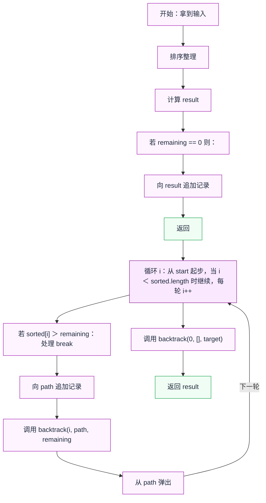

## TypeScript 解题方案（2 个方案逐个讲）

> **运行与提交**：每个方案都是自包含文件（内嵌用例自测，输出 PASS），整块复制到 `.ts` 文件后 `node 文件名` 即可运行。提交 LeetCode 时，把 `demo` 内的算法函数与辅助类型/函数整体取出、置于文件顶层即可。涉及交互/特殊接口的题以题面给定签名为准。

### 方案 1：搜索回溯

**分析与思路**：核心做法是「搜索回溯」。代码里依次做这些事：先排序再处理；单循环线性扫描；栈的后进先出操作。

**运行方式**：`node 本文件`，内嵌用例全部通过会输出 PASS。

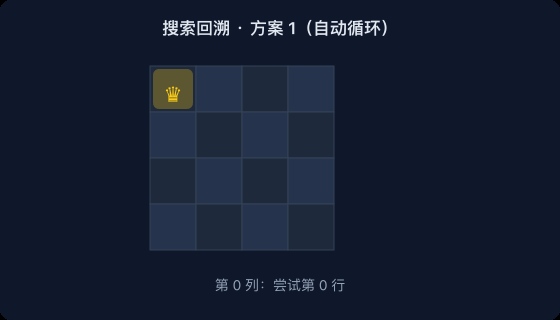

**方案专属流程图**（真实控制流）：

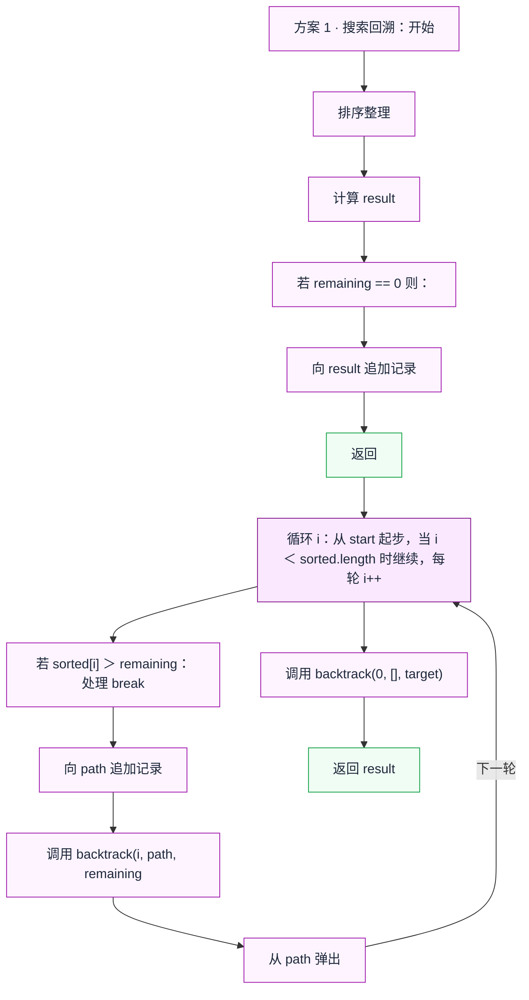

```typescript
/**
 ** LeetCode 39. 组合总和
 ** 方案1: 搜索回溯（忠实翻译 python 参考实现）
 ** 来源：https://blog.csdn.net/tyro_java/article/details/145239508
 */

function combinationSum(candidates: number[], target: number): number[][] {
  // 定义函数/方法 combinationSum
  const sorted = candidates.slice().sort((a, b) => a - b);
  const result: number[][] = []; // 把 []; 写入 const result: number[][]
  function backtrack(start: number, path: number[], remaining: number): void {
    // 定义函数/方法 backtrack
    if (remaining === 0) {
      // 若 remaining 全等于 0
      result.push([...path]); // 把 复制的 当前路径 压入栈/数组尾部
      return; // return;
    }
    for (let i = start; i < sorted.length; i++) {
      // 让 下标 i 从 起点 开始计数，下标 i 小于 sorted.长度 就继续
      if (sorted[i] > remaining) break; // 若 sorted[下标 i] 超过 remaining) break;
      path.push(sorted[i]); // 把 sorted[下标 i] 压入栈/数组尾部
      backtrack(i, path, remaining - sorted[i]); // backtrack(下标 i, 当前路径, remaining 减 sorted[下标 i]);
      path.pop(); // 弹出栈顶元素
    }
  }
  backtrack(0, [], target); // backtrack(0, [], 目标值);
  return result; // 返回 结果
}

export function demo(): void {
  // 程序入口：跑内嵌自测用例
  function eqArr2(a: number[][], b: number[][]): boolean {
    // 定义函数/方法 eqArr2
    if (a.length !== b.length) return false; // 若 数组.长度 不等于 b.长度，直接返回 false
    for (let i = 0; i < a.length; i++) {
      // 让 下标 i 从 0 开始计数，下标 i 小于 数组.长度 就继续
      if (a[i].length !== b[i].length) return false; // 若 数组[下标 i].长度 不等于 b[下标 i].长度，直接返回 false
      for (let j = 0; j < a[i].length; j++) {
        // 让 下标 j 从 0 开始计数，下标 j 小于 数组[下标 i].长度 就继续
        if (a[i][j] !== b[i][j]) return false; // 若 数组[下标 i][下标 j] 不等于 b[下标 i][下标 j]，直接返回 false
      }
    }
    return true; // 返回 true
  }
  const cases: { in: [number[], number]; want: number[][] }[] = [
    { in: [[2, 3, 6, 7], 7], want: [[2, 2, 3], [7]] },
    {
      in: [[2, 3, 5], 8],
      want: [
        [2, 2, 2, 2],
        [2, 3, 3],
        [3, 5],
      ],
    },
    { in: [[2], 1], want: [] },
    { in: [[2, 3, 6, 7], 1], want: [] },
  ];
  let fail = false; // 把 false 存入 fail
  for (const c of cases) {
    // for (const 字符 of cases) {
    const got = combinationSum(c.in[0], c.in[1]); // 把 combinationSum(字符.in[0], 字符.in[1]) 存入 got
    if (!eqArr2(got, c.want)) {
      // 若 取反 eqArr2(got, 字符.want
      fail = true; // 把 true 存入 fail
      console.log(
        'FAIL combinationSum(' +
          JSON.stringify(c.in) +
          ') got=' +
          JSON.stringify(got) +
          ' want=' +
          JSON.stringify(c.want),
      ); // 打印输出
    }
  }
  if (fail) throw new Error('FAILED'); // 若 fail) throw new Error(「FAILED」);
  console.log('PASS'); // 全部用例通过，输出 PASS
}
demo(); // demo();
```

### 方案 2：回溯

**分析与思路**：核心做法是「回溯」。代码里依次做这些事：先排序再处理；单循环线性扫描；栈的后进先出操作。

**运行方式**：`node 本文件`，内嵌用例全部通过会输出 PASS。

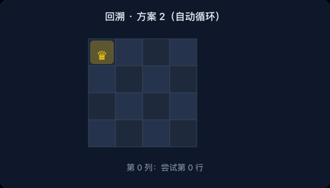

**方案专属流程图**（真实控制流）：

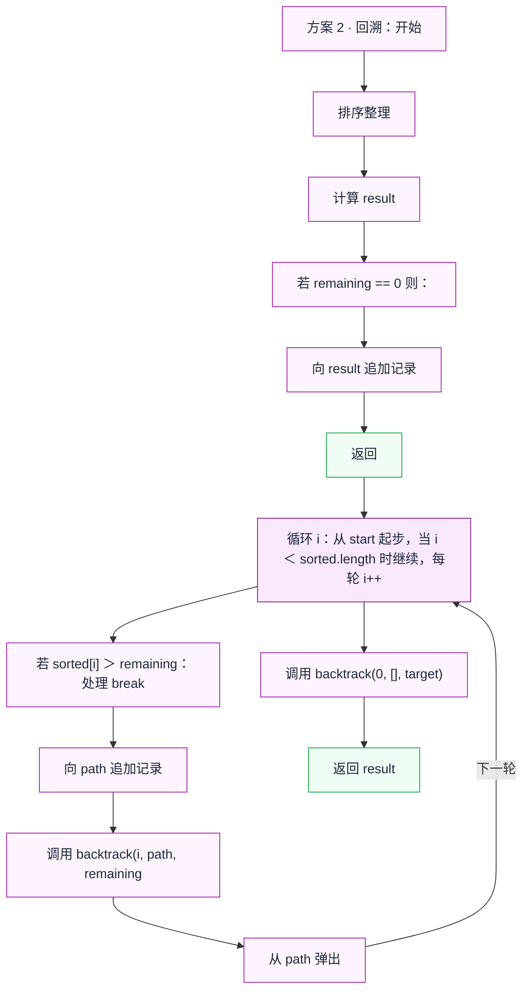

```typescript
/**
 ** LeetCode 39. 组合总和
 ** 方案2: 回溯（忠实翻译 python 参考实现）
 ** 来源：https://blog.csdn.net/tyro_java/article/details/145239508
 */

function combinationSum(candidates: number[], target: number): number[][] {
  // 定义函数/方法 combinationSum
  const sorted = candidates.slice().sort((a, b) => a - b);
  const result: number[][] = []; // 把 []; 写入 const result: number[][]
  function backtrack(start: number, path: number[], remaining: number): void {
    // 定义函数/方法 backtrack
    if (remaining === 0) {
      // 若 remaining 全等于 0
      result.push([...path]); // 把 复制的 当前路径 压入栈/数组尾部
      return; // return;
    }
    for (let i = start; i < sorted.length; i++) {
      // 让 下标 i 从 起点 开始计数，下标 i 小于 sorted.长度 就继续
      if (sorted[i] > remaining) break; // 若 sorted[下标 i] 超过 remaining) break;
      path.push(sorted[i]); // 把 sorted[下标 i] 压入栈/数组尾部
      backtrack(i, path, remaining - sorted[i]); // backtrack(下标 i, 当前路径, remaining 减 sorted[下标 i]);
      path.pop(); // 弹出栈顶元素
    }
  }
  backtrack(0, [], target); // backtrack(0, [], 目标值);
  return result; // 返回 结果
}

export function demo(): void {
  // 程序入口：跑内嵌自测用例
  function eqArr2(a: number[][], b: number[][]): boolean {
    // 定义函数/方法 eqArr2
    if (a.length !== b.length) return false; // 若 数组.长度 不等于 b.长度，直接返回 false
    for (let i = 0; i < a.length; i++) {
      // 让 下标 i 从 0 开始计数，下标 i 小于 数组.长度 就继续
      if (a[i].length !== b[i].length) return false; // 若 数组[下标 i].长度 不等于 b[下标 i].长度，直接返回 false
      for (let j = 0; j < a[i].length; j++) {
        // 让 下标 j 从 0 开始计数，下标 j 小于 数组[下标 i].长度 就继续
        if (a[i][j] !== b[i][j]) return false; // 若 数组[下标 i][下标 j] 不等于 b[下标 i][下标 j]，直接返回 false
      }
    }
    return true; // 返回 true
  }
  const cases: { in: [number[], number]; want: number[][] }[] = [
    { in: [[2, 3, 6, 7], 7], want: [[2, 2, 3], [7]] },
    {
      in: [[2, 3, 5], 8],
      want: [
        [2, 2, 2, 2],
        [2, 3, 3],
        [3, 5],
      ],
    },
    { in: [[2], 1], want: [] },
    { in: [[2, 3, 6, 7], 1], want: [] },
  ];
  let fail = false; // 把 false 存入 fail
  for (const c of cases) {
    // for (const 字符 of cases) {
    const got = combinationSum(c.in[0], c.in[1]); // 把 combinationSum(字符.in[0], 字符.in[1]) 存入 got
    if (!eqArr2(got, c.want)) {
      // 若 取反 eqArr2(got, 字符.want
      fail = true; // 把 true 存入 fail
      console.log(
        'FAIL combinationSum(' +
          JSON.stringify(c.in) +
          ') got=' +
          JSON.stringify(got) +
          ' want=' +
          JSON.stringify(c.want),
      ); // 打印输出
    }
  }
  if (fail) throw new Error('FAILED'); // 若 fail) throw new Error(「FAILED」);
  console.log('PASS'); // 全部用例通过，输出 PASS
}
demo(); // demo();
```

## 逐步拆解与面试追问

**复杂度**：时间 O(n)（单趟线性扫描），空间 O(1) 到 O(n)（视辅助结构）

**为什么是这个量级**：每个元素被常数次访问，辅助哈希或栈的开销与 n 同阶

**面试官可能会追问**：

- 怎么剪枝降低无效搜索？
- 去重的关键在哪一层？
- 状态恢复遗漏会怎样？

## 关键 API 速查（TS 主解法实际用到，附官方链接）

| API | 作用 | 使用要点 | 官方文档 |
|---|---|---|---|
| `Array.prototype.sort()` | 原地排序 | 默认按字符串 Unicode 序（10 会排在 2 前），数字必须传 (a,b)=>a-b；V8 用 TimSort，稳定，O(n log n)；返回原数组引用 | [官方文档](https://developer.mozilla.org/zh-CN/docs/Web/JavaScript/Reference/Global_Objects/Array/sort) |
| `Array.prototype.push()` | 尾部追加 | 返回新长度；可一次多个；均摊 O(1)；会改变原数组 | [官方文档](https://developer.mozilla.org/zh-CN/docs/Web/JavaScript/Reference/Global_Objects/Array/push) |
| `Array.prototype.pop()` | 尾部弹出 | 返回被删元素（空数组返回 undefined）；O(1) | [官方文档](https://developer.mozilla.org/zh-CN/docs/Web/JavaScript/Reference/Global_Objects/Array/pop) |
| `Array/String slice()` | 切片（不改原数组） | slice(start,end) 含头不含尾；负数从尾计；常用于复制数组（slice()） | [官方文档](https://developer.mozilla.org/zh-CN/docs/Web/JavaScript/Reference/Global_Objects/Array/slice) |
| `JSON.stringify()` | 序列化为 JSON 字符串 | 常用于结构化比较（深度相等判定）；undefined/函数/循环引用会被丢弃或抛错 | [官方文档](https://developer.mozilla.org/zh-CN/docs/Web/JavaScript/Reference/Global_Objects/JSON/stringify) |

### 各语言官方文档导航

- **TypeScript / JS**：[MDN 中文参考](https://developer.mozilla.org/zh-CN/)
- **Python**：[Python 官方文档](https://docs.python.org/zh-cn/3/)
- **Go**：[Go 标准库](https://pkg.go.dev/std)
- **Java**：[JDK 17 API](https://docs.oracle.com/en/java/javase/17/docs/api/)
- **Rust**：[Rust 标准库](https://doc.rust-lang.org/std/)
- **Lua**：[Lua 5.4 手册](https://www.lua.org/manual/5.4/)
- **C**：[Cppreference C](https://zh.cppreference.com/w/c)
- **C++**：[Cppreference C++](https://zh.cppreference.com/w/cpp)
- **R**：[R 官方手册](https://stat.ethz.ch/R-manual/)
- **Zig**：[Zig 语言文档](https://ziglang.org/documentation/master/)
- **Dart**：[Dart API](https://api.dart.dev/)

## 附录：其他 10 种语言全部实现（每种语言列举其全部方案）

> TypeScript 的全部方案见「TypeScript 解题方案」一节；下面是其余 10 种语言的对应实现，每种语言的每个方案都带思路分析、代码走读与专属运行架构图。
> 每个方案都内嵌用例自测，可独立运行（老仓库 python/go 文件遵循「打印结果」约定）。
> 完整解法文件见 `dsa/<语言>/backtrack/lc_39_组合总和/`。

### Python 实现（2 种方案）

Python 的全部方案如下，每个方案都内嵌用例自测，可独立运行（老仓库 python/go 文件遵循「打印结果」约定）：

#### 方案 1：搜索回溯

**思路与代码分析**：核心是「搜索回溯」。Python 版用切片与字典推导式简化操作，突出可读性。代码里依次做这些事：先排序再处理。**走读**：方案 1 · 搜索回溯：开始 → 排序整理 → 更新 result → 若 remaining == 0：向 result 追加记录 → 向 result 追加记录 → 返回  → 循环 i：从 start 到 len(candidates 前 → 若 candidates[i] ＞ remaining：处理 break → 跳出循环（break） → 向 path 追加记录 → 调用 backtrack( → 处理 i, path, remaining - candida → 处理 ) → 从 path 弹出 → 调用 backtrack(0, [], target) → 返回 result。

**运行架构**（真实控制流）：

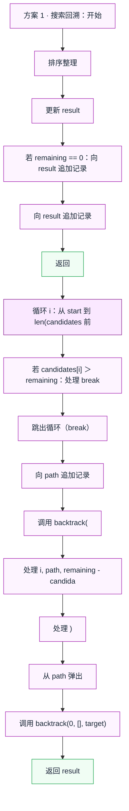

```python
import sys  # 提高递归深度上限（深输入防 RecursionError）

sys.setrecursionlimit(200000)  # 树/链表类题目节点数可达 1e4 量级

def combinationSum(candidates, target):  # 定义函数 combinationSum（参数：候选数组, 目标值）
    candidates.sort()  # 排序
    result = []  # 把 [] 存入 结果

    def backtrack(start, path, remaining):  # 定义函数 backtrack（参数：起点, 当前路径, remaining）
        if remaining == 0:  # 若 remaining 等于 0
            result.append(path[:])  # 把 复制 当前路径 追加到列表尾部
            return  # return
        for i in range(start, len(candidates)):  # 让 下标 i 从 起点 到 长度(候选数组 遍历
            if candidates[i] > remaining:  # 若 候选数组[下标 i] 超过 remaining
                break  # 跳出循环
            path.append(candidates[i])  # 把 候选数组[下标 i] 追加到列表尾部
            backtrack(
                i, path, remaining - candidates[i]
            )  # backtrack(下标 i, 当前路径, remaining 减 候选数组[下标 i])
            path.pop()  # 弹出栈顶元素

    backtrack(0, [], target)  # backtrack(0, [], 目标值)
    return result  # 返回 结果

if __name__ == "__main__":  # 若 __name__ 等于 '__main__'
    print(combinationSum([2, 3, 6, 7], 7))  # 打印输出
```

#### 方案 2：回溯

**思路与代码分析**：核心是「回溯」。Python 版用切片与字典推导式简化操作，突出可读性。代码里依次做这些事：先排序再处理。**走读**：方案 2 · 回溯：开始 → 排序整理 → 更新 result → 若 remaining == 0：向 result 追加记录 → 向 result 追加记录 → 返回  → 循环 i：从 start 到 len(candidates 前 → 若 candidates[i] ＞ remaining：处理 break → 跳出循环（break） → 向 path 追加记录 → 调用 backtrack( → 处理 i, path, remaining - candida → 处理 ) → 从 path 弹出 → 调用 backtrack(0, [], target) → 返回 result。

**运行架构**（真实控制流）：

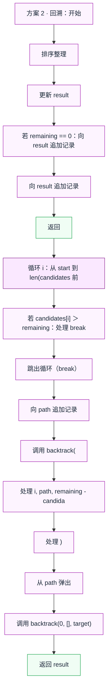

```python
import sys  # 提高递归深度上限（深输入防 RecursionError）

sys.setrecursionlimit(200000)  # 树/链表类题目节点数可达 1e4 量级

def combinationSum(candidates, target):  # 定义函数 combinationSum（参数：候选数组, 目标值）
    candidates.sort()  # 排序
    result = []  # 把 [] 存入 结果

    def backtrack(start, path, remaining):  # 定义函数 backtrack（参数：起点, 当前路径, remaining）
        if remaining == 0:  # 若 remaining 等于 0
            result.append(path[:])  # 把 复制 当前路径 追加到列表尾部
            return  # return
        for i in range(start, len(candidates)):  # 让 下标 i 从 起点 到 长度(候选数组 遍历
            if candidates[i] > remaining:  # 若 候选数组[下标 i] 超过 remaining
                break  # 跳出循环
            path.append(candidates[i])  # 把 候选数组[下标 i] 追加到列表尾部
            backtrack(
                i, path, remaining - candidates[i]
            )  # backtrack(下标 i, 当前路径, remaining 减 候选数组[下标 i])
            path.pop()  # 弹出栈顶元素

    backtrack(0, [], target)  # backtrack(0, [], 目标值)
    return result  # 返回 结果

if __name__ == "__main__":  # 若 __name__ 等于 '__main__'
    print(combinationSum([2, 3, 6, 7], 7))  # 打印输出
```

### Go 实现（2 种方案）

Go 的全部方案如下，每个方案都内嵌用例自测，可独立运行（老仓库 python/go 文件遵循「打印结果」约定）：

#### 方案 1：搜索回溯

**思路与代码分析**：核心是「搜索回溯」。Go 版用切片与多返回值惯用法，显式处理索引边界。**走读**：方案 1 · 搜索回溯：开始 → 更新 : → 遍历 s 的下标与元素 i → 更新 out[i] → 调用 sort.Ints(out[i]) → 调用 sort.Slice(out, func(a, b in → 返回 fmt.Sprint(out[a]) ＜ fmt.Sprint(out[b]) → 返回 out。

**运行架构**（真实控制流）：

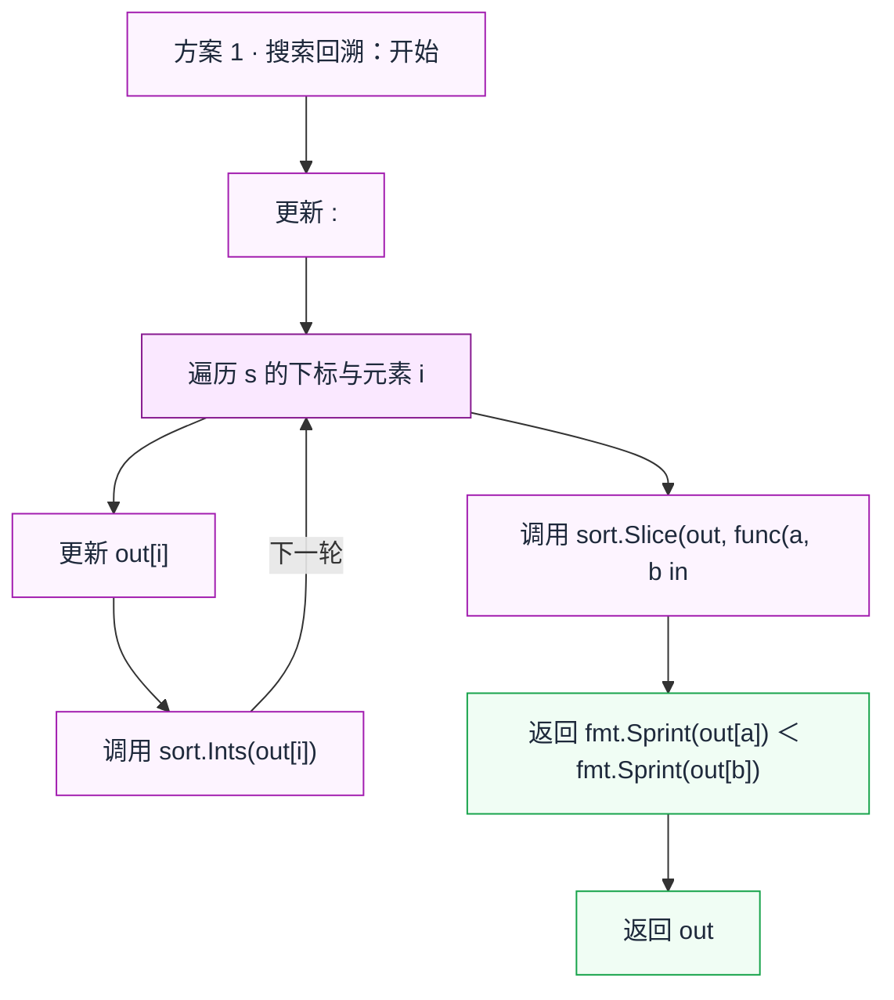

```go
package main // 引入依赖

import (
	"fmt"     // 「fmt」
	"os"      // 「os」
	"reflect" // 「reflect」
	"sort"    // 「sort」
)

func combinationSum(candidates []int, target int) [][]int { // 定义函数/方法 combinationSum
	sort.Ints(candidates)                                // sort.Ints(候选数组)
	result := [][]int{}                                  // 把 [][]int{} 写入 result :
	var backtrack func(start, remaining int, path []int) // var backtrack func(起点, remaining int, 当前路径 []int)
	backtrack = func(start, remaining int, path []int) { // 把 func(起点, remaining int, 当前路径 []int) { 写入 backtrack
		if remaining == 0 { // 若 remaining 等于 0
			result = append(result, append([]int{}, path...)) // 把 append(结果, append([]int{}, 当前路径...)) 写入 结果
			return                                            // return
		}
		for i := start; i < len(candidates); i++ { // 把 起点; 下标 i 小于 长度(候选数组); 下标 i 加一 { 写入 for i :
			if candidates[i] > remaining { // 若 候选数组[下标 i] 超过 remaining
				break // 跳出循环
			}
			backtrack(i, remaining-candidates[i], append(path, candidates[i]))
		}
	}
	backtrack(0, target, []int{}) // backtrack(0, 目标值, []int{})
	return result                 // 返回 结果
}

func norm2D(s [][]int) [][]int { // 定义函数/方法 norm2D
	out := make([][]int, len(s)) // 把 make([][]int, 长度(字符串)) 写入 out :
	for i := range s {           // 把 range 字符串 { 写入 for i :
		out[i] = append([]int{}, s[i]...) // 把 append([]int{}, 字符串[下标 i]...) 写入 out[i]
		sort.Ints(out[i])                 // sort.Ints(out[下标 i])
	}
	sort.Slice(out, func(a, b int) bool { // sort.Slice(out, func(数组, b int) bool {
		return fmt.Sprint(out[a]) < fmt.Sprint(out[b]) // 返回 fmt.Sprint(out[数组]) 小于 fmt.Sprint(out[b])
	}) // })
	return out // 返回 out
}

func main() { // 程序入口：跑内嵌自测用例
	type tc struct { // 定义类型
		cands  []int   // cands []int
		target int     // 目标值 int
		want   [][]int // want [][]int
	}
	cases := []tc{ // 把 []tc{ 写入 cases :
		{[]int{2, 3, 6, 7}, 7, [][]int{{2, 2, 3}, {7}}},
		{[]int{2, 3, 5}, 8, [][]int{{2, 2, 2, 2}, {2, 3, 3}, {3, 5}}},
	}
	ok := true                // 把 true 写入 ok :
	for _, c := range cases { // 同时取 _ 与 字符 遍历
		got := norm2D(combinationSum(c.cands, c.target)) // 把 norm2D(combinationSum(字符.cands, 字符.目标值)) 写入 got :
		want := norm2D(c.want)                           // 把 norm2D(字符.want) 写入 want :
		if !reflect.DeepEqual(got, want) {               // 若 取反 reflect.DeepEqual(got, want
			ok = false                                                                          // 把 false 写入 ok
			fmt.Printf("FAIL combinationSum(%v,%v)=%v want %v\n", c.cands, c.target, got, want) // 打印输出
		}
	}
	if !ok { // 若 取反 ok
		os.Exit(1) // os.Exit(1)
	}
	fmt.Println("PASS") // 全部用例通过，输出 PASS
}
```

#### 方案 2：回溯

**思路与代码分析**：核心是「回溯」。Go 版用切片与多返回值惯用法，显式处理索引边界。**走读**：方案 2 · 回溯：开始 → 更新 : → 遍历 s 的下标与元素 i → 更新 out[i] → 调用 sort.Ints(out[i]) → 调用 sort.Slice(out, func(a, b in → 返回 fmt.Sprint(out[a]) ＜ fmt.Sprint(out[b]) → 返回 out。

**运行架构**（真实控制流）：

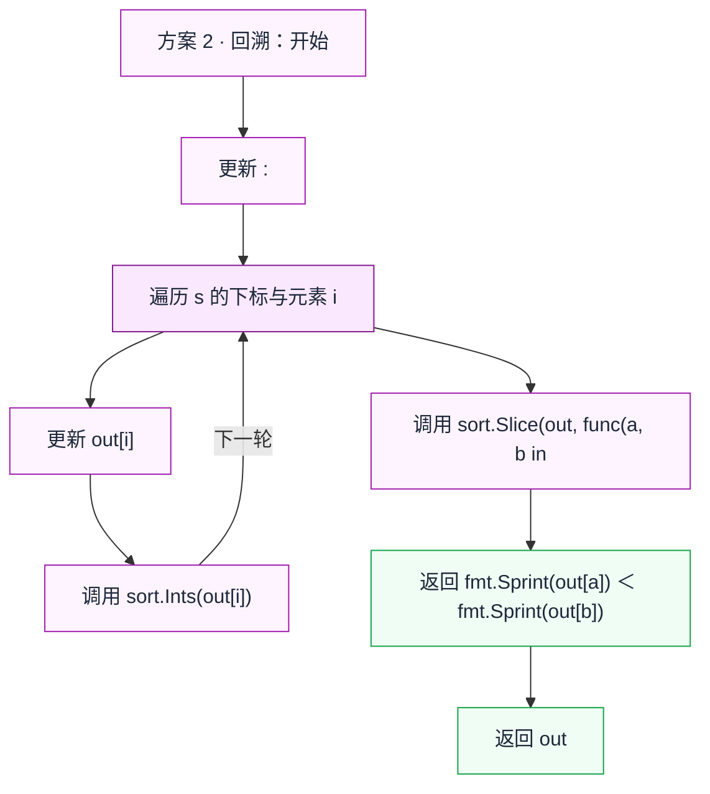

```go
package main // 引入依赖

import (
	"fmt"     // 「fmt」
	"os"      // 「os」
	"reflect" // 「reflect」
	"sort"    // 「sort」
)

func combinationSum(candidates []int, target int) [][]int { // 定义函数/方法 combinationSum
	sort.Ints(candidates)                                // sort.Ints(候选数组)
	result := [][]int{}                                  // 把 [][]int{} 写入 result :
	var backtrack func(start, remaining int, path []int) // var backtrack func(起点, remaining int, 当前路径 []int)
	backtrack = func(start, remaining int, path []int) { // 把 func(起点, remaining int, 当前路径 []int) { 写入 backtrack
		if remaining == 0 { // 若 remaining 等于 0
			result = append(result, append([]int{}, path...)) // 把 append(结果, append([]int{}, 当前路径...)) 写入 结果
			return                                            // return
		}
		for i := start; i < len(candidates); i++ { // 把 起点; 下标 i 小于 长度(候选数组); 下标 i 加一 { 写入 for i :
			if candidates[i] > remaining { // 若 候选数组[下标 i] 超过 remaining
				break // 跳出循环
			}
			backtrack(i, remaining-candidates[i], append(path, candidates[i]))
		}
	}
	backtrack(0, target, []int{}) // backtrack(0, 目标值, []int{})
	return result                 // 返回 结果
}

func norm2D(s [][]int) [][]int { // 定义函数/方法 norm2D
	out := make([][]int, len(s)) // 把 make([][]int, 长度(字符串)) 写入 out :
	for i := range s {           // 把 range 字符串 { 写入 for i :
		out[i] = append([]int{}, s[i]...) // 把 append([]int{}, 字符串[下标 i]...) 写入 out[i]
		sort.Ints(out[i])                 // sort.Ints(out[下标 i])
	}
	sort.Slice(out, func(a, b int) bool { // sort.Slice(out, func(数组, b int) bool {
		return fmt.Sprint(out[a]) < fmt.Sprint(out[b]) // 返回 fmt.Sprint(out[数组]) 小于 fmt.Sprint(out[b])
	}) // })
	return out // 返回 out
}

func main() { // 程序入口：跑内嵌自测用例
	type tc struct { // 定义类型
		cands  []int   // cands []int
		target int     // 目标值 int
		want   [][]int // want [][]int
	}
	cases := []tc{ // 把 []tc{ 写入 cases :
		{[]int{2, 3, 6, 7}, 7, [][]int{{2, 2, 3}, {7}}},
		{[]int{2, 3, 5}, 8, [][]int{{2, 2, 2, 2}, {2, 3, 3}, {3, 5}}},
	}
	ok := true                // 把 true 写入 ok :
	for _, c := range cases { // 同时取 _ 与 字符 遍历
		got := norm2D(combinationSum(c.cands, c.target)) // 把 norm2D(combinationSum(字符.cands, 字符.目标值)) 写入 got :
		want := norm2D(c.want)                           // 把 norm2D(字符.want) 写入 want :
		if !reflect.DeepEqual(got, want) {               // 若 取反 reflect.DeepEqual(got, want
			ok = false                                                                          // 把 false 写入 ok
			fmt.Printf("FAIL combinationSum(%v,%v)=%v want %v\n", c.cands, c.target, got, want) // 打印输出
		}
	}
	if !ok { // 若 取反 ok
		os.Exit(1) // os.Exit(1)
	}
	fmt.Println("PASS") // 全部用例通过，输出 PASS
}
```

### Java 实现（2 种方案）

Java 的全部方案如下，每个方案都内嵌用例自测，可独立运行（老仓库 python/go 文件遵循「打印结果」约定）：

#### 方案 1：搜索回溯

**思路与代码分析**：核心是「搜索回溯」。Java 版用类与静态方法组织，集合操作显式明了。代码里依次做这些事：先排序再处理。**走读**：方案 1 · 搜索回溯：开始 → 排序整理 → 更新 result → 处理 new ArrayList＜＞() → 调用 backtrack( → 处理 candidates, → 处理 target, → 处理 0, → 处理 new ArrayList＜＞(), → 处理 result) → 返回 result。

**运行架构**（真实控制流）：

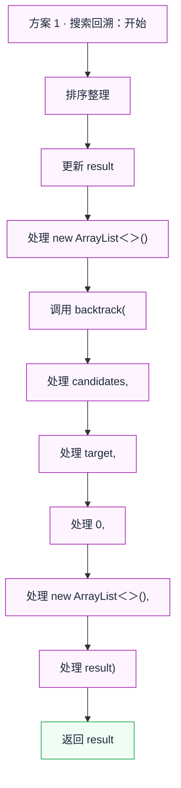

```java
package com.webfault.dsa; // 引入依赖

import java.util.*; // 引入依赖

class lc39_solution111 { // 定义类型
  public List<List<Integer>> combinationSum(
      int[] candidates, int target) { // 定义函数/方法 combinationSum
    Arrays.sort(candidates); // 排序
    List<List<Integer>> result =
        new ArrayList<>(); // 把 new ArrayList 小于 超过 (); 写入 List<List<Integer>> result
    backtrack(
        candidates,
        target,
        0,
        new ArrayList<>(),
        result); // backtrack(候选数组, 目标值, 0, new ArrayList 小于 超过 (), 结果);
    return result; // 返回 结果
  }

  private void backtrack(
      int[] c,
      int remaining,
      int start,
      List<Integer> path,
      List<List<Integer>> result) { // 定义函数/方法 backtrack
    if (remaining == 0) { // 若 remaining 等于 0
      result.add(new ArrayList<>(path)); // 结果 追加 new ArrayList 小于 超过 (当前路径));
      return; // return;
    }
    for (int i = start; i < c.length; i++) { // 让 下标 i 从 起点 开始计数，下标 i 小于 字符.长度 就继续
      if (c[i] > remaining) break; // 若 字符[下标 i] 超过 remaining) break;
      path.add(c[i]); // 当前路径 追加 字符[下标 i]);
      backtrack(
          c,
          remaining - c[i],
          i,
          path,
          result); // backtrack(字符, remaining 减 字符[下标 i], 下标 i, 当前路径, 结果);
      path.remove(path.size() - 1); // 当前路径 弹出 当前路径.大小() 减 1);
    }
  }

  public static void main(String[] args) { // public static void main(String[] args) {
    lc39_solution111 s = new lc39_solution111(); // 把 new lc39_solution111(); 写入 lc39_solution111 s
    List<List<Integer>> r = s.combinationSum(new int[] {2, 3, 6, 7}, 7);
    List<List<Integer>> exp =
        new ArrayList<>(); // 把 new ArrayList 小于 超过 (); 写入 List<List<Integer>> exp
    exp.add(Arrays.asList(2, 2, 3)); // exp 追加 Arrays.asList(2, 2, 3));
    exp.add(Arrays.asList(7)); // exp 追加 Arrays.asList(7));
    if (!r.equals(exp)) throw new RuntimeException("FAILED: " + r);
    System.out.println("PASS"); // 全部用例通过，输出 PASS
  }
}
```

#### 方案 2：回溯

**思路与代码分析**：核心是「回溯」。Java 版用类与静态方法组织，集合操作显式明了。代码里依次做这些事：先排序再处理。**走读**：方案 2 · 回溯：开始 → 排序整理 → 更新 res → 处理 new ArrayList＜＞() → 调用 backtrack( → 处理 candidates, → 处理 target, → 处理 0, → 处理 new ArrayList＜＞(), → 处理 res) → 返回 res。

**运行架构**（真实控制流）：

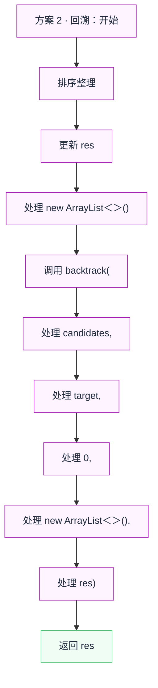

```java
package com.webfault.dsa; // 引入依赖

import java.util.*; // 引入依赖

class lc39_solution222 { // 定义类型
  public List<List<Integer>> combinationSum(
      int[] candidates, int target) { // 定义函数/方法 combinationSum
    Arrays.sort(candidates); // 排序
    List<List<Integer>> res =
        new ArrayList<>(); // 把 new ArrayList 小于 超过 (); 写入 List<List<Integer>> res
    backtrack(
        candidates,
        target,
        0,
        new ArrayList<>(),
        res); // backtrack(候选数组, 目标值, 0, new ArrayList 小于 超过 (), 结果);
    return res; // 返回 结果
  }

  private void backtrack(
      int[] c,
      int target,
      int start,
      List<Integer> cur,
      List<List<Integer>> res) { // 定义函数/方法 backtrack
    if (target == 0) { // 若 目标值 等于 0
      res.add(new ArrayList<>(cur)); // 结果 追加 new ArrayList 小于 超过 (当前值));
      return; // return;
    }
    for (int i = start; i < c.length; i++) { // 让 下标 i 从 起点 开始计数，下标 i 小于 字符.长度 就继续
      if (c[i] > target) continue; // 若 字符[下标 i] 超过 目标值) continue;
      cur.add(c[i]); // 当前值 追加 字符[下标 i]);
      backtrack(c, target - c[i], i, cur, res); // backtrack(字符, 目标值 减 字符[下标 i], 下标 i, 当前值, 结果);
      cur.remove(cur.size() - 1); // 当前值 弹出 当前值.大小() 减 1);
    }
  }

  public static void main(String[] args) { // public static void main(String[] args) {
    lc39_solution222 s = new lc39_solution222(); // 把 new lc39_solution222(); 写入 lc39_solution222 s
    List<List<Integer>> r = s.combinationSum(new int[] {2, 3, 6, 7}, 7);
    List<List<Integer>> exp =
        new ArrayList<>(); // 把 new ArrayList 小于 超过 (); 写入 List<List<Integer>> exp
    exp.add(Arrays.asList(2, 2, 3)); // exp 追加 Arrays.asList(2, 2, 3));
    exp.add(Arrays.asList(7)); // exp 追加 Arrays.asList(7));
    if (!r.equals(exp)) throw new RuntimeException("FAILED: " + r);
    System.out.println("PASS"); // 全部用例通过，输出 PASS
  }
}
```

### Rust 实现（2 种方案）

Rust 的全部方案如下，每个方案都内嵌用例自测，可独立运行（老仓库 python/go 文件遵循「打印结果」约定）：

#### 方案 1：搜索回溯

**思路与代码分析**：核心是「搜索回溯」。Rust 版用所有权移动与切片借用改写同一逻辑，注意 Option 与引用边界。代码里依次做这些事：栈的后进先出操作。**走读**：方案 1 · 搜索回溯：开始 → 计算 res → 返回  → 返回  → 遍历 start..cands.len() 中的每个元素 i。

**运行架构**（真实控制流）：

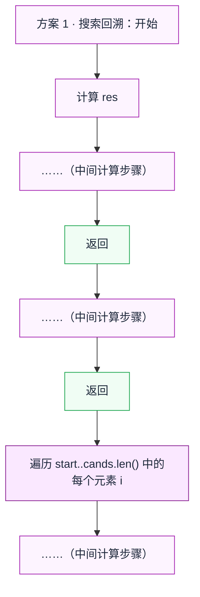

```rust
// LeetCode 39. 组合总和 — Rust 版（方案1）
fn combination_sum(candidates: &[i32], target: i32) -> Vec<Vec<i32>> {
    // 定义函数/方法 combination_sum
    let mut res = Vec::new(); // 把 Vec::new(); 写入 let mut res
    let mut path = Vec::new(); // 把 Vec::new(); 写入 let mut path
    fn dfs(
        cands: &[i32],
        start: usize,
        remaining: i32,
        path: &mut Vec<i32>,
        res: &mut Vec<Vec<i32>>,
    ) {
        // 定义函数/方法 dfs
        if remaining == 0 {
            res.push(path.clone());
            return;
        } // 若 remaining 等于 0 { 结果 追加 当前路径.clone()); return; }
        if remaining < 0 {
            return;
        } // 若 remaining 小于 0 { return; }
        for i in start..cands.len() {
            // 逐个取出 起点 的元素（下标 i）
            path.push(cands[i]); // 把 cands[下标 i] 压入栈/数组尾部
            dfs(cands, i, remaining - cands[i], path, res); // dfs(cands, 下标 i, remaining 减 cands[下标 i], 当前路径, 结果);
            path.pop(); // 弹出栈顶元素
        }
    }
    dfs(candidates, 0, target, &mut path, &mut res); // dfs(候选数组, 0, 目标值, 按位与 mut 当前路径, 按位与 mut 结果);
    res // 结果
}
fn main() {
    // 程序入口：跑内嵌自测用例
    let got = combination_sum(&[2, 3, 6, 7], 7); // 把 combination_sum( 按位与 [2, 3, 6, 7], 7) 存入 got
    let want = vec![vec![2, 2, 3], vec![7]]; // 把 vec取反 [vec取反 [2, 2, 3], vec取反 [7]] 存入 want
    assert_eq!(got, want); // 断言校验
    let got2 = combination_sum(&[2, 3, 5], 8); // 把 combination_sum( 按位与 [2, 3, 5], 8) 存入 got2
    let want2 = vec![vec![2, 2, 2, 2], vec![2, 3, 3], vec![3, 5]];
    assert_eq!(got2, want2); // 断言校验
    println!("PASS"); // 全部用例通过，输出 PASS
}
```

#### 方案 2：回溯

**思路与代码分析**：核心是「回溯」。Rust 版用所有权移动与切片借用改写同一逻辑，注意 Option 与引用边界。代码里依次做这些事：栈的后进先出操作。**走读**：方案 2 · 回溯：开始 → 计算 res → 返回  → 返回  → 遍历 start..cands.len() 中的每个元素 i。

**运行架构**（真实控制流）：

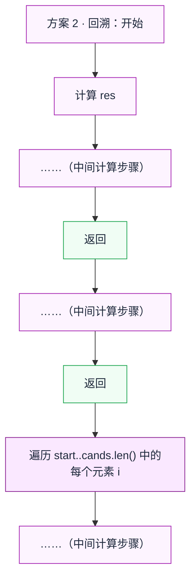

```rust
// LeetCode 39. 组合总和 — Rust 版（方案2）
fn combination_sum(candidates: &[i32], target: i32) -> Vec<Vec<i32>> {
    // 定义函数/方法 combination_sum
    let mut res = Vec::new(); // 把 Vec::new(); 写入 let mut res
    let mut path = Vec::new(); // 把 Vec::new(); 写入 let mut path
    fn dfs(
        cands: &[i32],
        start: usize,
        remaining: i32,
        path: &mut Vec<i32>,
        res: &mut Vec<Vec<i32>>,
    ) {
        // 定义函数/方法 dfs
        if remaining == 0 {
            res.push(path.clone());
            return;
        } // 若 remaining 等于 0 { 结果 追加 当前路径.clone()); return; }
        if remaining < 0 {
            return;
        } // 若 remaining 小于 0 { return; }
        for i in start..cands.len() {
            // 逐个取出 起点 的元素（下标 i）
            path.push(cands[i]); // 把 cands[下标 i] 压入栈/数组尾部
            dfs(cands, i, remaining - cands[i], path, res); // dfs(cands, 下标 i, remaining 减 cands[下标 i], 当前路径, 结果);
            path.pop(); // 弹出栈顶元素
        }
    }
    dfs(candidates, 0, target, &mut path, &mut res); // dfs(候选数组, 0, 目标值, 按位与 mut 当前路径, 按位与 mut 结果);
    res // 结果
}
fn main() {
    // 程序入口：跑内嵌自测用例
    let got = combination_sum(&[2, 3, 6, 7], 7); // 把 combination_sum( 按位与 [2, 3, 6, 7], 7) 存入 got
    let want = vec![vec![2, 2, 3], vec![7]]; // 把 vec取反 [vec取反 [2, 2, 3], vec取反 [7]] 存入 want
    assert_eq!(got, want); // 断言校验
    let got2 = combination_sum(&[2, 3, 5], 8); // 把 combination_sum( 按位与 [2, 3, 5], 8) 存入 got2
    let want2 = vec![vec![2, 2, 2, 2], vec![2, 3, 3], vec![3, 5]];
    assert_eq!(got2, want2); // 断言校验
    println!("PASS"); // 全部用例通过，输出 PASS
}
```

### Lua 实现（2 种方案）

Lua 的全部方案如下，每个方案都内嵌用例自测，可独立运行（老仓库 python/go 文件遵循「打印结果」约定）：

#### 方案 1：搜索回溯

**思路与代码分析**：核心是「搜索回溯」。Lua 版用表与 ipairs 遍历，注意 ipairs 遇 nil 即停的语义。代码里依次做这些事：递归求解子问题。**走读**：方案 1 · 搜索回溯：开始 → 更新 res → 更新 path → 处理 local function dfs(start, re → 处理 if remaining == 0 then → 更新 1] → 返回  → 处理 if remaining ＜ 0 then → 返回  → 循环 i：从 start 到 #candidates do → 更新 1] → 调用 dfs(i, remaining - candidate → 更新 path[#path] → 调用 dfs(1, target) → 返回 res。

**运行架构**（真实控制流）：

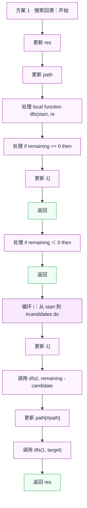

```lua
-- LeetCode 39. 组合总和 — Lua 版（方案1）
local function combination_sum(candidates, target) -- local function combination_sum(候选数组, 目标值)
	local res = {} -- 把 {} 写入 local res
	local path = {} -- 把 {} 写入 local path
	local function dfs(start, remaining) -- local function dfs(起点, remaining)
		if remaining == 0 then -- 若 remaining 等于 0 then
			res[#res + 1] = { table.unpack(path) } -- 把 {table.unpack(当前路径)} 写入 res[#res + 1]
			return -- return
		end -- 终点
		if remaining < 0 then
			return
		end -- 若 remaining 小于 0 then return 终点
		for i = start, #candidates do -- 把 起点, #候选数组 do 写入 for i
			path[#path + 1] = candidates[i] -- 把 候选数组[下标 i] 写入 path[#path + 1]
			dfs(i, remaining - candidates[i]) -- dfs(下标 i, remaining 减 候选数组[下标 i])
			path[#path] = nil -- 把 nil 写入 path[#path]
		end -- 终点
	end -- 终点
	dfs(1, target) -- dfs(1, 目标值)
	return res -- 返回 结果
end -- 终点
local got = combination_sum({ 2, 3, 6, 7 }, 7) -- 把 combination_sum({2, 3, 6, 7}, 7) 写入 local got
assert(#got == 2) -- 断言校验
assert(table.concat(got[1], ",") == "2,2,3" and table.concat(got[2], ",") == "7") -- 打印输出
local got2 = combination_sum({ 2, 3, 5 }, 8) -- 把 combination_sum({2, 3, 5}, 8) 写入 local got2
assert(#got2 == 3 and table.concat(got2[3], ",") == "3,5") -- 打印输出
print("PASS") -- 全部用例通过，输出 PASS
```

#### 方案 2：回溯

**思路与代码分析**：核心是「回溯」。Lua 版用表与 ipairs 遍历，注意 ipairs 遇 nil 即停的语义。代码里依次做这些事：递归求解子问题。**走读**：方案 2 · 回溯：开始 → 更新 res → 更新 path → 处理 local function dfs(start, re → 处理 if remaining == 0 then → 更新 1] → 返回  → 处理 if remaining ＜ 0 then → 返回  → 循环 i：从 start 到 #candidates do → 更新 1] → 调用 dfs(i, remaining - candidate → 更新 path[#path] → 调用 dfs(1, target) → 返回 res。

**运行架构**（真实控制流）：

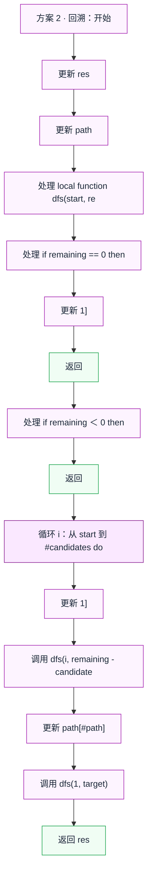

```lua
-- LeetCode 39. 组合总和 — Lua 版（方案2）
local function combination_sum(candidates, target) -- local function combination_sum(候选数组, 目标值)
	local res = {} -- 把 {} 写入 local res
	local path = {} -- 把 {} 写入 local path
	local function dfs(start, remaining) -- local function dfs(起点, remaining)
		if remaining == 0 then -- 若 remaining 等于 0 then
			res[#res + 1] = { table.unpack(path) } -- 把 {table.unpack(当前路径)} 写入 res[#res + 1]
			return -- return
		end -- 终点
		if remaining < 0 then
			return
		end -- 若 remaining 小于 0 then return 终点
		for i = start, #candidates do -- 把 起点, #候选数组 do 写入 for i
			path[#path + 1] = candidates[i] -- 把 候选数组[下标 i] 写入 path[#path + 1]
			dfs(i, remaining - candidates[i]) -- dfs(下标 i, remaining 减 候选数组[下标 i])
			path[#path] = nil -- 把 nil 写入 path[#path]
		end -- 终点
	end -- 终点
	dfs(1, target) -- dfs(1, 目标值)
	return res -- 返回 结果
end -- 终点
local got = combination_sum({ 2, 3, 6, 7 }, 7) -- 把 combination_sum({2, 3, 6, 7}, 7) 写入 local got
assert(#got == 2) -- 断言校验
assert(table.concat(got[1], ",") == "2,2,3" and table.concat(got[2], ",") == "7") -- 打印输出
local got2 = combination_sum({ 2, 3, 5 }, 8) -- 把 combination_sum({2, 3, 5}, 8) 写入 local got2
assert(#got2 == 3 and table.concat(got2[3], ",") == "3,5") -- 打印输出
print("PASS") -- 全部用例通过，输出 PASS
```

### C 实现（2 种方案）

C 的全部方案如下，每个方案都内嵌用例自测，可独立运行（老仓库 python/go 文件遵循「打印结果」约定）：

#### 方案 1：搜索回溯

**思路与代码分析**：核心是「搜索回溯」。C 版手动管理下标与内存，循环边界全部显式写出。代码里依次做这些事：单循环线性扫描。**走读**：方案 1 · 搜索回溯：开始 → 更新 nc_g → 更新 res_n → 遍历循环 → 更新 cands_g[i] → 调用 dfs(0, target, 0) → 返回 res_n。

**运行架构**（真实控制流）：

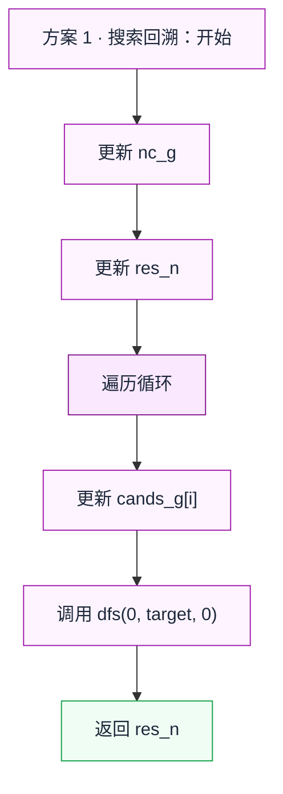

```c
/* LeetCode 39. 组合总和 — C 版（方案1） */
#include <stdio.h> // 引入头文件
static int res[256][32], res_lens[256], res_n,
    path[32];                 // static int 结果[256][32], res_lens[256], res_n, 当前路径[32];
static int cands_g[32], nc_g; // static int cands_g[32], nc_g;
static void dfs(int start, int remaining, int depth) { // 定义函数/方法 dfs
    if (remaining == 0) {                              // 若 remaining 等于 0
        for (int i = 0; i < depth; i++)
            res[res_n][i] = path[i]; // 让 下标 i 从 0 开始计数，下标 i 小于 深度 就继续
        res_lens[res_n] = depth;     // 把 深度; 写入 res_lens[res_n]
        res_n++;                     // res_n 加一
        return;                      // return;
    }
    if (remaining < 0)
        return;                          // 若 remaining 小于 0) return;
    for (int i = start; i < nc_g; i++) { // 让 下标 i 从 起点 开始计数，下标 i 小于 nc_g 就继续
        path[depth] = cands_g[i];        // 把 cands_g[下标 i]; 写入 path[depth]
        dfs(i, remaining - cands_g[i], depth + 1); // dfs(下标 i, remaining 减 cands_g[下标 i], 深度 加 1);
    }
}
static int combination_sum(const int *candidates, int nc, int target) { // 定义函数/方法 combination_sum
    nc_g = nc;
    res_n = 0; // 把 nc; res_n 赋值为 0; 写入 nc_g
    for (int i = 0; i < nc; i++)
        cands_g[i] = candidates[i]; // 让 下标 i 从 0 开始计数，下标 i 小于 nc 就继续
    dfs(0, target, 0);              // dfs(0, 目标值, 0);
    return res_n;                   // 返回 res_n
}
int main(void) { // 程序入口：跑内嵌自测用例
    int n = combination_sum((int[]){2, 3, 6, 7}, 4,
                            7); // 把 combination_sum((int[]){2,3,6,7}, 4, 7) 存入 元素个数
    if (n != 2) {
        printf("FAIL cnt=%d\n", n);
        return 1;
    } // 若 元素个数 不等于 2) { 输出「FAIL 计数 赋值为 对…取模 d 」, 元素个数); return 1; }
    if (res_lens[0] != 3 || res[0][0] != 2 || res[0][1] != 2 || res[0][2] != 3) {
        printf("FAIL a\n");
        return 1;
    }
    if (res_lens[1] != 1 || res[1][0] != 7) {
        printf("FAIL b\n");
        return 1;
    }
    if (combination_sum((int[]){2, 3, 5}, 3, 8) != 3) {
        printf("FAIL 2\n");
        return 1;
    }
    printf("PASS\n"); // 全部用例通过，输出 PASS
    return 0;         // 返回 0
}
```

#### 方案 2：回溯

**思路与代码分析**：核心是「回溯」。C 版手动管理下标与内存，循环边界全部显式写出。代码里依次做这些事：单循环线性扫描。**走读**：方案 2 · 回溯：开始 → 更新 nc_g → 更新 res_n → 遍历循环 → 更新 cands_g[i] → 调用 dfs(0, target, 0) → 返回 res_n。

**运行架构**（真实控制流）：

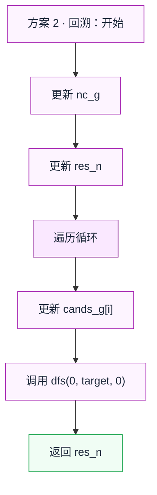

```c
/* LeetCode 39. 组合总和 — C 版（方案2） */
#include <stdio.h> // 引入头文件
static int res[256][32], res_lens[256], res_n,
    path[32];                 // static int 结果[256][32], res_lens[256], res_n, 当前路径[32];
static int cands_g[32], nc_g; // static int cands_g[32], nc_g;
static void dfs(int start, int remaining, int depth) { // 定义函数/方法 dfs
    if (remaining == 0) {                              // 若 remaining 等于 0
        for (int i = 0; i < depth; i++)
            res[res_n][i] = path[i]; // 让 下标 i 从 0 开始计数，下标 i 小于 深度 就继续
        res_lens[res_n] = depth;     // 把 深度; 写入 res_lens[res_n]
        res_n++;                     // res_n 加一
        return;                      // return;
    }
    if (remaining < 0)
        return;                          // 若 remaining 小于 0) return;
    for (int i = start; i < nc_g; i++) { // 让 下标 i 从 起点 开始计数，下标 i 小于 nc_g 就继续
        path[depth] = cands_g[i];        // 把 cands_g[下标 i]; 写入 path[depth]
        dfs(i, remaining - cands_g[i], depth + 1); // dfs(下标 i, remaining 减 cands_g[下标 i], 深度 加 1);
    }
}
static int combination_sum(const int *candidates, int nc, int target) { // 定义函数/方法 combination_sum
    nc_g = nc;
    res_n = 0; // 把 nc; res_n 赋值为 0; 写入 nc_g
    for (int i = 0; i < nc; i++)
        cands_g[i] = candidates[i]; // 让 下标 i 从 0 开始计数，下标 i 小于 nc 就继续
    dfs(0, target, 0);              // dfs(0, 目标值, 0);
    return res_n;                   // 返回 res_n
}
int main(void) { // 程序入口：跑内嵌自测用例
    int n = combination_sum((int[]){2, 3, 6, 7}, 4,
                            7); // 把 combination_sum((int[]){2,3,6,7}, 4, 7) 存入 元素个数
    if (n != 2) {
        printf("FAIL cnt=%d\n", n);
        return 1;
    } // 若 元素个数 不等于 2) { 输出「FAIL 计数 赋值为 对…取模 d 」, 元素个数); return 1; }
    if (res_lens[0] != 3 || res[0][0] != 2 || res[0][1] != 2 || res[0][2] != 3) {
        printf("FAIL a\n");
        return 1;
    }
    if (res_lens[1] != 1 || res[1][0] != 7) {
        printf("FAIL b\n");
        return 1;
    }
    if (combination_sum((int[]){2, 3, 5}, 3, 8) != 3) {
        printf("FAIL 2\n");
        return 1;
    }
    printf("PASS\n"); // 全部用例通过，输出 PASS
    return 0;         // 返回 0
}
```

### C++ 实现（2 种方案）

C++ 的全部方案如下，每个方案都内嵌用例自测，可独立运行（老仓库 python/go 文件遵循「打印结果」约定）：

#### 方案 1：搜索回溯

**思路与代码分析**：核心是「搜索回溯」。C++ 版用 STL 容器与迭代器，减少手写下标错误。代码里依次做这些事：单循环线性扫描。**走读**：方案 1 · 搜索回溯：开始 → 处理 std::vector＜std::vector＜int＞ → 处理 std::vector＜int＞ path → 更新 dfs → 若 remaining == 0 则： → 调用 res.push_back(path) → 返回  → 命中条件，直接返回 → 遍历循环 → 处理 ++i) → 调用 path.push_back(candidates[i] → 调用 dfs(i, remaining - candidate → 调用 path.pop_back() → 调用 dfs(0, target) → 返回 res。

**运行架构**（真实控制流）：

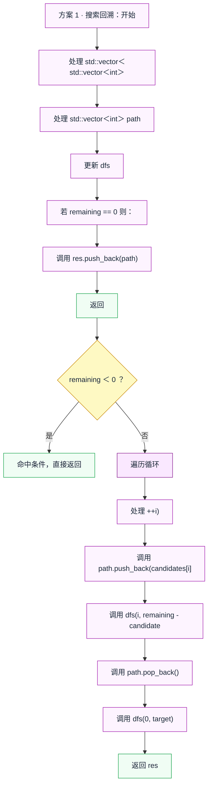

```cpp
// LeetCode 39. 组合总和 — C++ 版（方案1）
#include <cassert>  // 引入头文件
#include <iostream> // 引入头文件
#include <vector>   // 引入头文件
static std::vector<std::vector<int>> combinationSum(const std::vector<int> &candidates, int target) {
    std::vector<std::vector<int>> res; // std::vector 小于 std::vector 小于 int 超过 超过 结果;
    std::vector<int> path;             // std::vector 小于 int 超过 当前路径;
    std::function<void(size_t, int)> dfs = [&](size_t start, int remaining) {
        if (remaining == 0) {
            res.push_back(path);
            return;
        } // 若 remaining 等于 0) { 结果 追加 当前路径); return; }
        if (remaining < 0)
            return; // 若 remaining 小于 0) return;
        for (size_t i = start; i < candidates.size();
             ++i) { // 让 下标 i 从 起点 开始计数，下标 i 小于 候选数组.大小() 就继续
            path.push_back(candidates[i]);     // 当前路径 追加 候选数组[下标 i]);
            dfs(i, remaining - candidates[i]); // dfs(下标 i, remaining 减 候选数组[下标 i]);
            path.pop_back();                   // 弹出栈顶元素
        }
    };
    dfs(0, target); // dfs(0, 目标值);
    return res;     // 返回 结果
}
int main() { // 程序入口：跑内嵌自测用例
    assert((combinationSum({2, 3, 6, 7}, 7) == std::vector<std::vector<int>>{{2, 2, 3}, {7}})); // 断言校验
    assert((combinationSum({2, 3, 5}, 8) ==
            std::vector<std::vector<int>>{{2, 2, 2, 2}, {2, 3, 3}, {3, 5}})); // 断言校验
    std::cout << "PASS" << std::endl; // 全部用例通过，输出 PASS
    return 0;                         // 返回 0
}
```

#### 方案 2：回溯

**思路与代码分析**：核心是「回溯」。C++ 版用 STL 容器与迭代器，减少手写下标错误。代码里依次做这些事：单循环线性扫描。**走读**：方案 2 · 回溯：开始 → 处理 std::vector＜std::vector＜int＞ → 处理 std::vector＜int＞ path → 更新 dfs → 若 remaining == 0 则： → 调用 res.push_back(path) → 返回  → 命中条件，直接返回 → 遍历循环 → 处理 ++i) → 调用 path.push_back(candidates[i] → 调用 dfs(i, remaining - candidate → 调用 path.pop_back() → 调用 dfs(0, target) → 返回 res。

**运行架构**（真实控制流）：

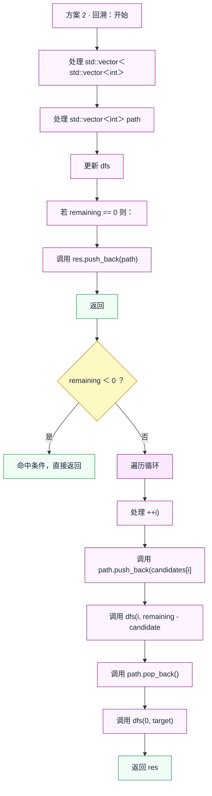

```cpp
// LeetCode 39. 组合总和 — C++ 版（方案2）
#include <cassert>  // 引入头文件
#include <iostream> // 引入头文件
#include <vector>   // 引入头文件
static std::vector<std::vector<int>> combinationSum(const std::vector<int> &candidates, int target) {
    std::vector<std::vector<int>> res; // std::vector 小于 std::vector 小于 int 超过 超过 结果;
    std::vector<int> path;             // std::vector 小于 int 超过 当前路径;
    std::function<void(size_t, int)> dfs = [&](size_t start, int remaining) {
        if (remaining == 0) {
            res.push_back(path);
            return;
        } // 若 remaining 等于 0) { 结果 追加 当前路径); return; }
        if (remaining < 0)
            return; // 若 remaining 小于 0) return;
        for (size_t i = start; i < candidates.size();
             ++i) { // 让 下标 i 从 起点 开始计数，下标 i 小于 候选数组.大小() 就继续
            path.push_back(candidates[i]);     // 当前路径 追加 候选数组[下标 i]);
            dfs(i, remaining - candidates[i]); // dfs(下标 i, remaining 减 候选数组[下标 i]);
            path.pop_back();                   // 弹出栈顶元素
        }
    };
    dfs(0, target); // dfs(0, 目标值);
    return res;     // 返回 结果
}
int main() { // 程序入口：跑内嵌自测用例
    assert((combinationSum({2, 3, 6, 7}, 7) == std::vector<std::vector<int>>{{2, 2, 3}, {7}})); // 断言校验
    assert((combinationSum({2, 3, 5}, 8) ==
            std::vector<std::vector<int>>{{2, 2, 2, 2}, {2, 3, 3}, {3, 5}})); // 断言校验
    std::cout << "PASS" << std::endl; // 全部用例通过，输出 PASS
    return 0;                         // 返回 0
}
```

### R 实现（2 种方案）

R 的全部方案如下，每个方案都内嵌用例自测，可独立运行（老仓库 python/go 文件遵循「打印结果」约定）：

#### 方案 1：搜索回溯

**思路与代码分析**：核心是「搜索回溯」。R 版用向量化思维与 1 起始下标，注意 1:n 的降序陷阱。代码里依次做这些事：单循环线性扫描。**走读**：方案 1 · 搜索回溯：开始 → 处理 res ＜- list() → 处理 path ＜- integer(0) → 处理 dfs ＜- function(start, remai → 若 remaining == 0 则： → 处理 res[[length(res) + 1L]] ＜＜- → 返回 (invisible(NULL)) → 命中条件，直接返回 → 循环 i：遍历 start:length(candidates) → 处理 path ＜＜- c(path, candidates[ → 调用 dfs(i, remaining - candidate → 处理 path ＜＜- path[-length(path)] → 若 length(candidates) ＞ 0：调用 dfs(1L, target) → 调用 dfs(1L, target) → 处理 res。

**运行架构**（真实控制流）：

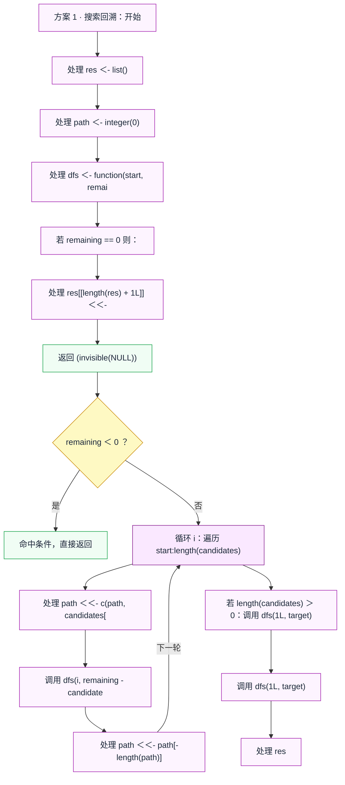

```r
# 版（方案1） 定义函数 combination_sum（参数：候选数组, 目标值）
combination_sum <- function(candidates, target) {
    res <- list()  # 把 列表() 存入 结果
    path <- integer(0)  # 把 integer(0) 存入 当前路径
    dfs <- function(start, remaining) {
        # 定义函数 dfs（参数：起点, remaining） 若 remaining 等于 0
        if (remaining == 0) {
            res[[length(res) + 1L]] <<- path  # 结果[[长度(结果) 加 1L]] 小于 小于 减 当前路径
            return(invisible(NULL))  # 返回 invisible(NULL
        }
        if (remaining < 0)
            return(invisible(NULL))  # 若 remaining 小于 0) return(invisible(NULL
        for (i in start:length(candidates)) {
            # for (下标 i in 起点:长度(候选数组)) {
            path <<- c(path, candidates[i])  # 当前路径 小于 小于 减 字符(当前路径, 候选数组[下标 i])
            dfs(i, remaining - candidates[i])  # dfs(下标 i, remaining 减 候选数组[下标 i])
            path <<- path[-length(path)]  # 当前路径 小于 小于 减 当前路径[ 减 长度(当前路径)]
        }
    }
    if (length(candidates) > 0)
        dfs(1L, target)  # 若 长度(候选数组) 超过 0) dfs(1L, 目标值
    res  # 结果
}
got <- combination_sum(c(2, 3, 6, 7), 7)  # 把 combination_sum(字符(2, 3, 6, 7), 7) 存入 got
stopifnot(length(got) == 2, identical(got[[1]], c(2, 2, 3)), identical(got[[2]], 7))  # 断言校验
got2 <- combination_sum(c(2, 3, 5), 8)  # 把 combination_sum(字符(2, 3, 5), 8) 存入 got2
stopifnot(length(got2) == 3, identical(got2[[3]], c(3, 5)))  # 断言校验
cat("PASS\n")  # 全部用例通过，输出 PASS
```

#### 方案 2：回溯

**思路与代码分析**：核心是「回溯」。R 版用向量化思维与 1 起始下标，注意 1:n 的降序陷阱。代码里依次做这些事：单循环线性扫描。**走读**：方案 2 · 回溯：开始 → 处理 res ＜- list() → 处理 path ＜- integer(0) → 处理 dfs ＜- function(start, remai → 若 remaining == 0 则： → 处理 res[[length(res) + 1L]] ＜＜- → 返回 (invisible(NULL)) → 命中条件，直接返回 → 循环 i：遍历 start:length(candidates) → 处理 path ＜＜- c(path, candidates[ → 调用 dfs(i, remaining - candidate → 处理 path ＜＜- path[-length(path)] → 若 length(candidates) ＞ 0：调用 dfs(1L, target) → 调用 dfs(1L, target) → 处理 res。

**运行架构**（真实控制流）：

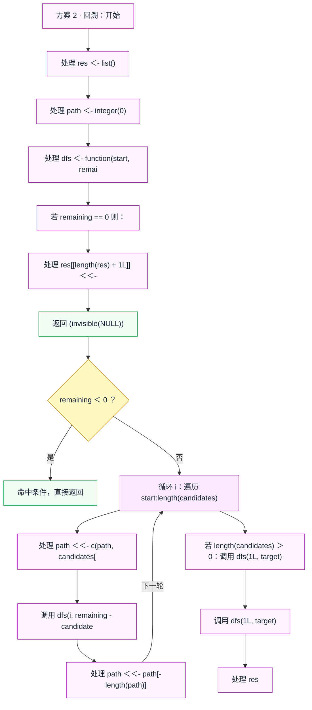

```r
# 版（方案2） 定义函数 combination_sum（参数：候选数组, 目标值）
combination_sum <- function(candidates, target) {
    res <- list()  # 把 列表() 存入 结果
    path <- integer(0)  # 把 integer(0) 存入 当前路径
    dfs <- function(start, remaining) {
        # 定义函数 dfs（参数：起点, remaining） 若 remaining 等于 0
        if (remaining == 0) {
            res[[length(res) + 1L]] <<- path  # 结果[[长度(结果) 加 1L]] 小于 小于 减 当前路径
            return(invisible(NULL))  # 返回 invisible(NULL
        }
        if (remaining < 0)
            return(invisible(NULL))  # 若 remaining 小于 0) return(invisible(NULL
        for (i in start:length(candidates)) {
            # for (下标 i in 起点:长度(候选数组)) {
            path <<- c(path, candidates[i])  # 当前路径 小于 小于 减 字符(当前路径, 候选数组[下标 i])
            dfs(i, remaining - candidates[i])  # dfs(下标 i, remaining 减 候选数组[下标 i])
            path <<- path[-length(path)]  # 当前路径 小于 小于 减 当前路径[ 减 长度(当前路径)]
        }
    }
    if (length(candidates) > 0)
        dfs(1L, target)  # 若 长度(候选数组) 超过 0) dfs(1L, 目标值
    res  # 结果
}
got <- combination_sum(c(2, 3, 6, 7), 7)  # 把 combination_sum(字符(2, 3, 6, 7), 7) 存入 got
stopifnot(length(got) == 2, identical(got[[1]], c(2, 2, 3)), identical(got[[2]], 7))  # 断言校验
got2 <- combination_sum(c(2, 3, 5), 8)  # 把 combination_sum(字符(2, 3, 5), 8) 存入 got2
stopifnot(length(got2) == 3, identical(got2[[3]], c(3, 5)))  # 断言校验
cat("PASS\n")  # 全部用例通过，输出 PASS
```

### Zig 实现（2 种方案）

Zig 的全部方案如下，每个方案都内嵌用例自测，可独立运行（老仓库 python/go 文件遵循「打印结果」约定）：

#### 方案 1：搜索回溯

**思路与代码分析**：核心是「搜索回溯」。Zig 版显式分配与清零，整型边界处理严格。代码里依次做这些事：单循环线性扫描。**走读**：方案 1 · 搜索回溯：开始 → 计算 D → 若 remaining == 0 则： → 计算 cp → 调用 cp.appendSlice(path.items) c → 向 out 追加记录 → 返回  → 命中条件，直接返回 → 遍历集合元素 → 向 path 追加记录 → 调用 dfs(cs, i, remaining - cs[i] → 从 path 弹出 → 计算 path → 调用 D.dfs(cands, 0, target, &pat。

**运行架构**（真实控制流）：

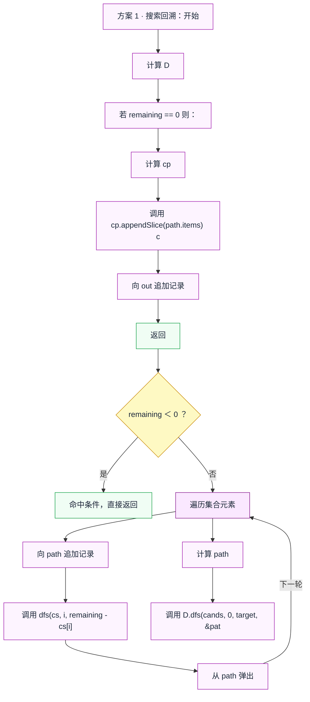

```zig
// LeetCode 39. 组合总和 — Zig 版（方案1）
const std = @import("std"); // 把 @import(「std」) 存入 std
fn combinationSum(cands: []const i32, target: i32, alloc: std.mem.Allocator, res: *std.ArrayList(std.ArrayList(i32))) void { // 定义函数/方法 combinationSum
    const D = struct { // 把 struct { 存入 D
        fn dfs(cs: []const i32, start: usize, remaining: i32, path: *std.ArrayList(i32), out: *std.ArrayList(std.ArrayList(i32))) void { // 定义函数/方法 dfs
            if (remaining == 0) { // 若 remaining 等于 0
                var cp = std.ArrayList(i32).init(out.allocator); // 把 std.ArrayList(i32).init(out.allocator) 存入 cp
                cp.appendSlice(path.items) catch unreachable; // cp.appendSlice(当前路径.items) catch unreachable;
                out.append(cp) catch unreachable; // 把 cp 追加到列表尾部
                return; // return;
            }
            if (remaining < 0) return; // 若 remaining 小于 0) return;
            for (start..cs.len) |i| { // 逐个取出 起点..cs.长度 的元素（下标 i）
                path.append(cs[i]) catch unreachable; // 把 cs[下标 i] 追加到列表尾部
                dfs(cs, i, remaining - cs[i], path, out); // dfs(cs, 下标 i, remaining 减 cs[下标 i], 当前路径, out);
                _ = path.pop(); // 弹出栈顶元素
            }
        }
    };
    var path = std.ArrayList(i32).init(alloc); // 把 std.ArrayList(i32).init(alloc) 存入 当前路径
    D.dfs(cands, 0, target, &path, res); // D.dfs(cands, 0, 目标值, 按位与 当前路径, 结果);
}
pub fn main() !void { // 程序入口：跑内嵌自测用例
    var arena = std.heap.ArenaAllocator.init(std.heap.page_allocator); // 把 std.堆.ArenaAllocator.init(std.堆.page_allocator) 存入 arena
    defer arena.deinit(); // defer arena.deinit();
    const alloc = arena.allocator(); // 把 arena.allocator() 存入 alloc
    var res = std.ArrayList(std.ArrayList(i32)).init(std.heap.page_allocator);
    defer res.deinit(); // defer 结果.deinit();
    combinationSum(&[_]i32{ 2, 3, 6, 7 }, 7, alloc, &res); // combinationSum( 按位与 [_]i32{ 2, 3, 6, 7 }, 7, alloc, 按位与 结果);
    if (res.items.len != 2) return error.TestFailed; // 若 结果.items.长度 不等于 2，直接返回 error.TestFailed
    if (res.items[0].items.len != 3 or res.items[0].items[0] != 2 or res.items[0].items[2] != 3) return error.TestFailed;
    if (res.items[1].items.len != 1 or res.items[1].items[0] != 7) return error.TestFailed;
    res.clearRetainingCapacity(); // 结果.clearRetainingCapacity();
    combinationSum(&[_]i32{ 2, 3, 5 }, 8, alloc, &res); // combinationSum( 按位与 [_]i32{ 2, 3, 5 }, 8, alloc, 按位与 结果);
    if (res.items.len != 3) return error.TestFailed; // 若 结果.items.长度 不等于 3，直接返回 error.TestFailed
    std.debug.print("PASS\n", .{}); // 全部用例通过，输出 PASS
}
```

#### 方案 2：回溯

**思路与代码分析**：核心是「回溯」。Zig 版显式分配与清零，整型边界处理严格。代码里依次做这些事：单循环线性扫描。**走读**：方案 2 · 回溯：开始 → 计算 D → 若 remaining == 0 则： → 计算 cp → 调用 cp.appendSlice(path.items) c → 向 out 追加记录 → 返回  → 命中条件，直接返回 → 遍历集合元素 → 向 path 追加记录 → 调用 dfs(cs, i, remaining - cs[i] → 从 path 弹出 → 计算 path → 调用 D.dfs(cands, 0, target, &pat。

**运行架构**（真实控制流）：

```mermaid
graph TD
    N0["方案 2 · 回溯：开始"]
    N1["计算 D"]
    N2["若 remaining == 0 则："]
    N3["计算 cp"]
    N4["调用 cp.appendSlice(path.items) c"]
    N5["向 out 追加记录"]
    N6["返回 "]
    N7{"remaining ＜ 0 ？"}
    N8["命中条件，直接返回"]
    N9["遍历集合元素"]
    N10["向 path 追加记录"]
    N11["调用 dfs(cs, i, remaining - cs[i]"]
    N12["从 path 弹出"]
    N13["计算 path"]
    N14["调用 D.dfs(cands, 0, target, &pat"]
    N0 --> N1
    N1 --> N2
    N2 --> N3
    N3 --> N4
    N4 --> N5
    N5 --> N6
    N6 --> N7
    N7 -- 是 --> N8
    N7 -- 否 --> N9
    N9 --> N10
    N10 --> N11
    N11 --> N12
    N12 -- 下一轮 --> N9
    N9 --> N13
    N13 --> N14
    classDef n fill:#fdf4ff,stroke:#a21caf,color:#1e293b;
    classDef lp fill:#fae8ff,stroke:#86198f,color:#1e293b;
    classDef dc fill:#fef9c3,stroke:#ca8a04,color:#1e293b;
    classDef tm fill:#f0fdf4,stroke:#16a34a,color:#1e293b;
    class N0,N1,N2,N3,N4,N5,N10,N11,N12,N13,N14 n;
    class N9 lp;
    class N7 dc;
    class N6,N8 tm;
```

```zig
// LeetCode 39. 组合总和 — Zig 版（方案2）
const std = @import("std"); // 把 @import(「std」) 存入 std
fn combinationSum(cands: []const i32, target: i32, alloc: std.mem.Allocator, res: *std.ArrayList(std.ArrayList(i32))) void { // 定义函数/方法 combinationSum
    const D = struct { // 把 struct { 存入 D
        fn dfs(cs: []const i32, start: usize, remaining: i32, path: *std.ArrayList(i32), out: *std.ArrayList(std.ArrayList(i32))) void { // 定义函数/方法 dfs
            if (remaining == 0) { // 若 remaining 等于 0
                var cp = std.ArrayList(i32).init(out.allocator); // 把 std.ArrayList(i32).init(out.allocator) 存入 cp
                cp.appendSlice(path.items) catch unreachable; // cp.appendSlice(当前路径.items) catch unreachable;
                out.append(cp) catch unreachable; // 把 cp 追加到列表尾部
                return; // return;
            }
            if (remaining < 0) return; // 若 remaining 小于 0) return;
            for (start..cs.len) |i| { // 逐个取出 起点..cs.长度 的元素（下标 i）
                path.append(cs[i]) catch unreachable; // 把 cs[下标 i] 追加到列表尾部
                dfs(cs, i, remaining - cs[i], path, out); // dfs(cs, 下标 i, remaining 减 cs[下标 i], 当前路径, out);
                _ = path.pop(); // 弹出栈顶元素
            }
        }
    };
    var path = std.ArrayList(i32).init(alloc); // 把 std.ArrayList(i32).init(alloc) 存入 当前路径
    D.dfs(cands, 0, target, &path, res); // D.dfs(cands, 0, 目标值, 按位与 当前路径, 结果);
}
pub fn main() !void { // 程序入口：跑内嵌自测用例
    var arena = std.heap.ArenaAllocator.init(std.heap.page_allocator); // 把 std.堆.ArenaAllocator.init(std.堆.page_allocator) 存入 arena
    defer arena.deinit(); // defer arena.deinit();
    const alloc = arena.allocator(); // 把 arena.allocator() 存入 alloc
    var res = std.ArrayList(std.ArrayList(i32)).init(std.heap.page_allocator);
    defer res.deinit(); // defer 结果.deinit();
    combinationSum(&[_]i32{ 2, 3, 6, 7 }, 7, alloc, &res); // combinationSum( 按位与 [_]i32{ 2, 3, 6, 7 }, 7, alloc, 按位与 结果);
    if (res.items.len != 2) return error.TestFailed; // 若 结果.items.长度 不等于 2，直接返回 error.TestFailed
    if (res.items[0].items.len != 3 or res.items[0].items[0] != 2 or res.items[0].items[2] != 3) return error.TestFailed;
    if (res.items[1].items.len != 1 or res.items[1].items[0] != 7) return error.TestFailed;
    res.clearRetainingCapacity(); // 结果.clearRetainingCapacity();
    combinationSum(&[_]i32{ 2, 3, 5 }, 8, alloc, &res); // combinationSum( 按位与 [_]i32{ 2, 3, 5 }, 8, alloc, 按位与 结果);
    if (res.items.len != 3) return error.TestFailed; // 若 结果.items.长度 不等于 3，直接返回 error.TestFailed
    std.debug.print("PASS\n", .{}); // 全部用例通过，输出 PASS
}
```

### Dart 实现（2 种方案）

Dart 的全部方案如下，每个方案都内嵌用例自测，可独立运行（老仓库 python/go 文件遵循「打印结果」约定）：

#### 方案 1：搜索回溯

**思路与代码分析**：核心是「搜索回溯」。Dart 版用可空类型标注与集合方法，注意空安全。代码里依次做这些事：单循环线性扫描。**走读**：方案 1 · 搜索回溯：开始 → 更新 res → 更新 path → 处理 void dfs(int start, int rema → 若 remaining == 0 则： → 调用 res.add(List＜int＞.from(path) → 返回  → 命中条件，直接返回 → 遍历循环 → 调用 path.add(candidates[i]) → 调用 dfs(i, remaining - candidate → 调用 path.removeLast() → 调用 dfs(0, target) → 返回 res。

**运行架构**（真实控制流）：

```mermaid
graph TD
    N0["方案 1 · 搜索回溯：开始"]
    N1["更新 res"]
    N2["更新 path"]
    N3["处理 void dfs(int start, int rema"]
    N4["若 remaining == 0 则："]
    N5["调用 res.add(List＜int＞.from(path)"]
    N6["返回 "]
    N7{"remaining ＜ 0 ？"}
    N8["命中条件，直接返回"]
    N9["遍历循环"]
    N10["调用 path.add(candidates[i])"]
    N11["调用 dfs(i, remaining - candidate"]
    N12["调用 path.removeLast()"]
    N13["调用 dfs(0, target)"]
    N14["返回 res"]
    N0 --> N1
    N1 --> N2
    N2 --> N3
    N3 --> N4
    N4 --> N5
    N5 --> N6
    N6 --> N7
    N7 -- 是 --> N8
    N7 -- 否 --> N9
    N9 --> N10
    N10 --> N11
    N11 --> N12
    N12 -- 下一轮 --> N9
    N9 --> N13
    N13 --> N14
    classDef n fill:#fdf4ff,stroke:#a21caf,color:#1e293b;
    classDef lp fill:#fae8ff,stroke:#86198f,color:#1e293b;
    classDef dc fill:#fef9c3,stroke:#ca8a04,color:#1e293b;
    classDef tm fill:#f0fdf4,stroke:#16a34a,color:#1e293b;
    class N0,N1,N2,N3,N4,N5,N10,N11,N12,N13 n;
    class N9 lp;
    class N7 dc;
    class N6,N8,N14 tm;
```

```dart
// LeetCode 39. 组合总和 — Dart 版（方案1）
List<List<int>> combinationSum(List<int> candidates, int target) {
  // 定义函数/方法 combinationSum
  final res = <List<int>>[]; // 把 小于 List 小于 int 超过 超过 [] 存入 结果
  final path = <int>[]; // 把 小于 int 超过 [] 存入 当前路径
  void dfs(int start, int remaining) {
    // 定义函数/方法 dfs
    if (remaining == 0) {
      // 若 remaining 等于 0
      res.add(List<int>.from(path)); // 结果 追加 List 小于 int 超过 .from(当前路径));
      return; // return;
    }
    if (remaining < 0) return; // 若 remaining 小于 0) return;
    for (var i = start; i < candidates.length; i++) {
      // 让 下标 i 从 起点 开始计数，下标 i 小于 候选数组.长度 就继续
      path.add(candidates[i]); // 当前路径 追加 候选数组[下标 i]);
      dfs(i, remaining - candidates[i]); // dfs(下标 i, remaining 减 候选数组[下标 i]);
      path.removeLast(); // 当前路径.removeLast();
    }
  }

  dfs(0, target); // dfs(0, 目标值);
  return res; // 返回 结果
}

void main() {
  // 程序入口：跑内嵌自测用例
  final got = combinationSum([
    2,
    3,
    6,
    7,
  ], 7); // 把 combinationSum([2, 3, 6, 7], 7) 存入 got
  if (got.length != 2)
    throw StateError('cnt'); // 若 got.长度 不等于 2) throw StateError('计数');
  if (got[0].toString() != '[2, 2, 3]' || got[1].toString() != '[7]')
    throw StateError('a');
  final got2 = combinationSum([
    2,
    3,
    5,
  ], 8); // 把 combinationSum([2, 3, 5], 8) 存入 got2
  if (got2.length != 3)
    throw StateError('c2'); // 若 got2.长度 不等于 3) throw StateError('c2');
  print('PASS'); // 全部用例通过，输出 PASS
}
```

#### 方案 2：回溯

**思路与代码分析**：核心是「回溯」。Dart 版用可空类型标注与集合方法，注意空安全。代码里依次做这些事：单循环线性扫描。**走读**：方案 2 · 回溯：开始 → 更新 res → 更新 path → 处理 void dfs(int start, int rema → 若 remaining == 0 则： → 调用 res.add(List＜int＞.from(path) → 返回  → 命中条件，直接返回 → 遍历循环 → 调用 path.add(candidates[i]) → 调用 dfs(i, remaining - candidate → 调用 path.removeLast() → 调用 dfs(0, target) → 返回 res。

**运行架构**（真实控制流）：

```mermaid
graph TD
    N0["方案 2 · 回溯：开始"]
    N1["更新 res"]
    N2["更新 path"]
    N3["处理 void dfs(int start, int rema"]
    N4["若 remaining == 0 则："]
    N5["调用 res.add(List＜int＞.from(path)"]
    N6["返回 "]
    N7{"remaining ＜ 0 ？"}
    N8["命中条件，直接返回"]
    N9["遍历循环"]
    N10["调用 path.add(candidates[i])"]
    N11["调用 dfs(i, remaining - candidate"]
    N12["调用 path.removeLast()"]
    N13["调用 dfs(0, target)"]
    N14["返回 res"]
    N0 --> N1
    N1 --> N2
    N2 --> N3
    N3 --> N4
    N4 --> N5
    N5 --> N6
    N6 --> N7
    N7 -- 是 --> N8
    N7 -- 否 --> N9
    N9 --> N10
    N10 --> N11
    N11 --> N12
    N12 -- 下一轮 --> N9
    N9 --> N13
    N13 --> N14
    classDef n fill:#fdf4ff,stroke:#a21caf,color:#1e293b;
    classDef lp fill:#fae8ff,stroke:#86198f,color:#1e293b;
    classDef dc fill:#fef9c3,stroke:#ca8a04,color:#1e293b;
    classDef tm fill:#f0fdf4,stroke:#16a34a,color:#1e293b;
    class N0,N1,N2,N3,N4,N5,N10,N11,N12,N13 n;
    class N9 lp;
    class N7 dc;
    class N6,N8,N14 tm;
```

```dart
// LeetCode 39. 组合总和 — Dart 版（方案2）
List<List<int>> combinationSum(List<int> candidates, int target) {
  // 定义函数/方法 combinationSum
  final res = <List<int>>[]; // 把 小于 List 小于 int 超过 超过 [] 存入 结果
  final path = <int>[]; // 把 小于 int 超过 [] 存入 当前路径
  void dfs(int start, int remaining) {
    // 定义函数/方法 dfs
    if (remaining == 0) {
      // 若 remaining 等于 0
      res.add(List<int>.from(path)); // 结果 追加 List 小于 int 超过 .from(当前路径));
      return; // return;
    }
    if (remaining < 0) return; // 若 remaining 小于 0) return;
    for (var i = start; i < candidates.length; i++) {
      // 让 下标 i 从 起点 开始计数，下标 i 小于 候选数组.长度 就继续
      path.add(candidates[i]); // 当前路径 追加 候选数组[下标 i]);
      dfs(i, remaining - candidates[i]); // dfs(下标 i, remaining 减 候选数组[下标 i]);
      path.removeLast(); // 当前路径.removeLast();
    }
  }

  dfs(0, target); // dfs(0, 目标值);
  return res; // 返回 结果
}

void main() {
  // 程序入口：跑内嵌自测用例
  final got = combinationSum([
    2,
    3,
    6,
    7,
  ], 7); // 把 combinationSum([2, 3, 6, 7], 7) 存入 got
  if (got.length != 2)
    throw StateError('cnt'); // 若 got.长度 不等于 2) throw StateError('计数');
  if (got[0].toString() != '[2, 2, 3]' || got[1].toString() != '[7]')
    throw StateError('a');
  final got2 = combinationSum([
    2,
    3,
    5,
  ], 8); // 把 combinationSum([2, 3, 5], 8) 存入 got2
  if (got2.length != 3)
    throw StateError('c2'); // 若 got2.长度 不等于 3) throw StateError('c2');
  print('PASS'); // 全部用例通过，输出 PASS
}
```

---

## 内容总结

- **组合总和**（回溯 · Medium）：共 2 个方案，主线思路「搜索回溯」；时间 O(n)（单趟线性扫描）；动画演示回溯棋盘过程，附录给出 11 种语言 × 全部方案的可运行实现。
- 来源博客：[https://blog.csdn.net/tyro_java/article/details/145239508](https://blog.csdn.net/tyro_java/article/details/145239508)
- 导航：[📋 总目录](../) ｜ [← 158 解数独](../158_解数独/) ｜ [160 全排列 →](../160_全排列/)
