# 160 · 全排列（第九阶段 · 回溯与递归 · Medium）

> **难度**：⭐⭐ Medium ｜ **专题**：回溯
> **学习定位**：第九阶段 · 回溯与递归第 160 篇 ｜ **解法数**：6
> **内容总结**：**全排列**（回溯 · Medium）：共 6 个方案，主线思路「单趟扫描」；时间 O(n)（单趟线性扫描）；动画演示回溯棋盘过程，附录给出 11 种语言 × 全部方案的可运行实现。

---

## 题目描述

给定一个不含重复数字的数组 `nums` ，返回其 所有可能的全排列 。你可以 按任意顺序 返回答案。

- 主函数签名：`function permute(nums: number[]): number[][]`

**用例（来自原题）**：

**示例 1**

```text
输入：nums = [1,2,3]
输出：[[1,2,3],[1,3,2],[2,1,3],[2,3,1],[3,1,2],[3,2,1]]
```

**示例 2**

```text
输入：nums = [0,1]
输出：[[0,1],[1,0]]
```

**示例 3**

```text
输入：nums = [1]
输出：[[1]]
```
> ✅ **官方验证**：全部 TypeScript 解法已通过 leetcode.cn 官方示例用例验证（自动注入运行，全部 PASS）。题面与 [leetcode.cn 官方](https://leetcode.cn/problems/permutations/)一致，示例配图取自官方题面。

**数据范围与注意事项**：

- `1 <= nums.length <= 6`
- `-10 <= nums[i] <= 10`
- `nums` 中的所有整数 互不相同
- **易错点**：递归返回后要把当前选择撤销干净，否则结果集会被污染。

## 题目分析

**场景是什么**：系统地试所有可能并及时回头，对应真实开发里的组合枚举、约束求解、路径规划。本题就是该场景的 Medium 级练习，主线做法是「单趟扫描」。

**主线怎么解**：把主解法从头到尾过一遍，它其实在依次做这几件事：单循环线性扫描。

## 解题思路

**方案对比**（共 6 个方案，由浅入深）：

| 方案 | 时间复杂度 | 空间复杂度 |
|---|---|---|
| 方案 1 · 单趟扫描 | O(n)（单趟线性扫描） | O(1) 到 O(n)（视辅助结构） |
| 方案 2 · 单趟扫描 | O(n)（单趟线性扫描） | O(1) 到 O(n)（视辅助结构） |
| 方案 3 · 栈辅助 | O(n)（单趟线性扫描） | O(1) 到 O(n)（视辅助结构） |
| 方案 4 · 单趟扫描 | O(n)（单趟线性扫描） | O(1) 到 O(n)（视辅助结构） |
| 方案 5 · 栈辅助 | O(n)（单趟线性扫描） | O(1) 到 O(n)（视辅助结构） |
| 方案 6 · 单趟扫描 | O(n)（单趟线性扫描） | O(1) 到 O(n)（视辅助结构） |

**由浅入深的路径**：单趟扫描 → 栈辅助；每往右一步，都在补上一步的短板。

**方案间的取舍**：方案 1（单趟扫描）；方案 2（单趟扫描）；方案 3（栈辅助）；方案 4（单趟扫描）；方案 5（栈辅助）；方案 6（单趟扫描）。数据规模小、可读性优先时选靠前的方案；规模大、性能优先时选靠后的方案。

**怎么读这一篇**：

- 🐣 **新手路线**：把「题目描述」的示例 1 在纸上手推一遍 → 读方案 1（最直观的写法）与它的代码走读 → 按「运行方式」本地跑通看 PASS → 回头对比方案 2 之后的写法差在哪
- 🦅 **大佬路线**：直接锁定最优方案 1（单趟扫描，O(n)（单趟线性扫描））→ 跳读该方案代码与走读 → 用「逐步拆解与面试追问」补齐复杂度推导与边界追问

### 动态算法图（回溯棋盘，GIF 自动循环）


动画演示回溯专题里回溯棋盘的典型过程；每个方案在「TypeScript 解题方案」一节还配了专属动画与专属流程图。

### 主解法流程图（真实控制流）

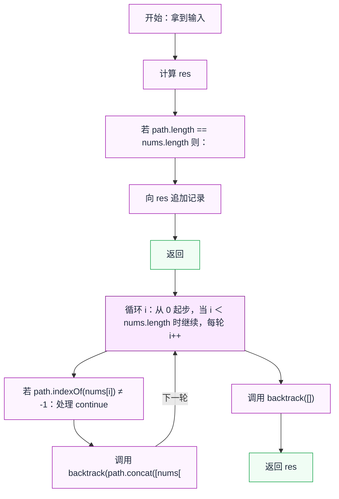

## TypeScript 解题方案（6 个方案逐个讲）

> **运行与提交**：每个方案都是自包含文件（内嵌用例自测，输出 PASS），整块复制到 `.ts` 文件后 `node 文件名` 即可运行。提交 LeetCode 时，把 `demo` 内的算法函数与辅助类型/函数整体取出、置于文件顶层即可。涉及交互/特殊接口的题以题面给定签名为准。

### 方案 1：单趟扫描

**分析与思路**：核心做法是「单趟扫描」。代码里依次做这些事：单循环线性扫描。

**运行方式**：`node 本文件`，内嵌用例全部通过会输出 PASS。


**方案专属流程图**（真实控制流）：

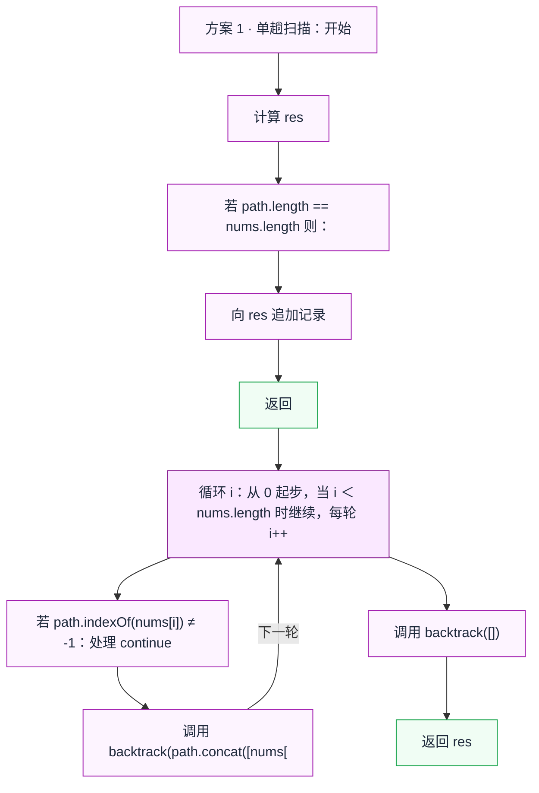

```typescript
export function demo(): void {
  // 程序入口：跑内嵌自测用例
  function permute(nums: number[]): number[][] {
    // 定义函数/方法 permute
    const res: number[][] = []; // 把 []; 写入 const res: number[][]
    function backtrack(path: number[]) {
      // 定义函数/方法 backtrack
      if (path.length === nums.length) {
        res.push(path.slice());
        return;
      } // 若 当前路径.长度 全等于 数组.长度) { 结果 追加 当前路径 截取 )); return; }
      for (let i = 0; i < nums.length; i++) {
        // 让 下标 i 从 0 开始计数，下标 i 小于 数组.长度 就继续
        if (path.indexOf(nums[i]) !== -1) continue; // 若 当前路径 查找 数组[下标 i]) 不等于 减 1) continue;
        backtrack(path.concat([nums[i]])); // 打印输出
      }
    }
    backtrack([]); // backtrack([]);
    return res; // 返回 结果
  }
  function eqSet(a: number[][], b: number[][]): boolean {
    // 定义函数/方法 eqSet
    if (a.length !== b.length) return false; // 若 数组.长度 不等于 b.长度，直接返回 false
    const key = (x: number[]) =>
      x
        .slice()
        .sort((p, q) => p - q)
        .join(',');
    const sa = new Set(a.map(key)); // 把 new Set(数组.映射表(key)) 存入 sa
    const sb = new Set(b.map(key)); // 把 new Set(b.映射表(key)) 存入 sb
    if (sa.size !== sb.size) return false; // 若 sa.大小 不等于 sb.大小，直接返回 false
    for (const k of sa) if (!sb.has(k)) return false; // for (const 下标 k of sa) if (取反 sb.has(下标 k)) return false;
    return true; // 返回 true
  }
  const want = [
    [1, 2, 3],
    [1, 3, 2],
    [2, 1, 3],
    [2, 3, 1],
    [3, 1, 2],
    [3, 2, 1],
  ];
  const got = permute([1, 2, 3]); // 把 permute([1, 2, 3]) 存入 got
  let fail = false; // 把 false 存入 fail
  if (!eqSet(got, want)) {
    fail = true;
    console.log('FAIL permute got=' + JSON.stringify(got));
  }
  if (fail) throw new Error('FAILED'); // 若 fail) throw new Error(「FAILED」);
  console.log('PASS'); // 全部用例通过，输出 PASS
}
demo(); // demo();
```

### 方案 2：单趟扫描

**分析与思路**：核心做法是「单趟扫描」。代码里依次做这些事：单循环线性扫描。

**运行方式**：`node 本文件`，内嵌用例全部通过会输出 PASS。


**方案专属流程图**（真实控制流）：


```typescript
export function demo(): void {
  // 程序入口：跑内嵌自测用例
  function permute(nums: number[]): number[][] {
    // 定义函数/方法 permute
    const res: number[][] = []; // 把 []; 写入 const res: number[][]
    const a = nums.slice(); // 把 数组 截取 ) 存入 数组
    function backtrack(start: number) {
      // 定义函数/方法 backtrack
      if (start === a.length) {
        res.push(a.slice());
        return;
      } // 若 起点 全等于 数组.长度) { 结果 追加 数组 截取 )); return; }
      for (let i = start; i < a.length; i++) {
        // 让 下标 i 从 起点 开始计数，下标 i 小于 数组.长度 就继续
        const t = a[start];
        a[start] = a[i];
        a[i] = t; // 把 数组[起点]; 数组[起点] 赋值为 数组[下标 i]; 数组[下标 i] 赋值为 另一字符串 存入 另一字符串
        backtrack(start + 1); // backtrack(起点 加 1);
        const t2 = a[start];
        a[start] = a[i];
        a[i] = t2; // 把 数组[起点]; 数组[起点] 赋值为 数组[下标 i]; 数组[下标 i] 赋值为 t2 存入 t2
      }
    }
    backtrack(0); // backtrack(0);
    return res; // 返回 结果
  }
  function eqSet(a: number[][], b: number[][]): boolean {
    // 定义函数/方法 eqSet
    if (a.length !== b.length) return false; // 若 数组.长度 不等于 b.长度，直接返回 false
    const key = (x: number[]) =>
      x
        .slice()
        .sort((p, q) => p - q)
        .join(',');
    const sa = new Set(a.map(key)); // 把 new Set(数组.映射表(key)) 存入 sa
    const sb = new Set(b.map(key)); // 把 new Set(b.映射表(key)) 存入 sb
    if (sa.size !== sb.size) return false; // 若 sa.大小 不等于 sb.大小，直接返回 false
    for (const k of sa) if (!sb.has(k)) return false; // for (const 下标 k of sa) if (取反 sb.has(下标 k)) return false;
    return true; // 返回 true
  }
  const want = [
    [1, 2, 3],
    [1, 3, 2],
    [2, 1, 3],
    [2, 3, 1],
    [3, 1, 2],
    [3, 2, 1],
  ];
  const got = permute([1, 2, 3]); // 把 permute([1, 2, 3]) 存入 got
  let fail = false; // 把 false 存入 fail
  if (!eqSet(got, want)) {
    fail = true;
    console.log('FAIL permute got=' + JSON.stringify(got));
  }
  if (fail) throw new Error('FAILED'); // 若 fail) throw new Error(「FAILED」);
  console.log('PASS'); // 全部用例通过，输出 PASS
}
demo(); // demo();
```

### 方案 3：栈辅助

**分析与思路**：核心做法是「栈辅助」。代码里依次做这些事：单循环线性扫描；栈的后进先出操作。

**运行方式**：`node 本文件`，内嵌用例全部通过会输出 PASS。


**方案专属流程图**（真实控制流）：


```typescript
export function demo(): void {
  // 程序入口：跑内嵌自测用例
  function permute(nums: number[]): number[][] {
    // 定义函数/方法 permute
    const res: number[][] = []; // 把 []; 写入 const res: number[][]
    const used: boolean[] = new Array(nums.length).fill(false); // 把 new Array(数组.长度).fill(false); 写入 const used: boolean[]
    function backtrack(path: number[]) {
      // 定义函数/方法 backtrack
      if (path.length === nums.length) {
        res.push(path.slice());
        return;
      } // 若 当前路径.长度 全等于 数组.长度) { 结果 追加 当前路径 截取 )); return; }
      for (let i = 0; i < nums.length; i++) {
        // 让 下标 i 从 0 开始计数，下标 i 小于 数组.长度 就继续
        if (used[i]) continue; // 若 已用标记[下标 i]) continue;
        used[i] = true; // 把 true; 写入 used[i]
        path.push(nums[i]); // 把 数组[下标 i] 压入栈/数组尾部
        backtrack(path); // backtrack(当前路径);
        path.pop(); // 弹出栈顶元素
        used[i] = false; // 把 false; 写入 used[i]
      }
    }
    backtrack([]); // backtrack([]);
    return res; // 返回 结果
  }
  function eqSet(a: number[][], b: number[][]): boolean {
    // 定义函数/方法 eqSet
    if (a.length !== b.length) return false; // 若 数组.长度 不等于 b.长度，直接返回 false
    const key = (x: number[]) =>
      x
        .slice()
        .sort((p, q) => p - q)
        .join(',');
    const sa = new Set(a.map(key)); // 把 new Set(数组.映射表(key)) 存入 sa
    const sb = new Set(b.map(key)); // 把 new Set(b.映射表(key)) 存入 sb
    if (sa.size !== sb.size) return false; // 若 sa.大小 不等于 sb.大小，直接返回 false
    for (const k of sa) if (!sb.has(k)) return false; // for (const 下标 k of sa) if (取反 sb.has(下标 k)) return false;
    return true; // 返回 true
  }
  const want = [
    [1, 2, 3],
    [1, 3, 2],
    [2, 1, 3],
    [2, 3, 1],
    [3, 1, 2],
    [3, 2, 1],
  ];
  const got = permute([1, 2, 3]); // 把 permute([1, 2, 3]) 存入 got
  let fail = false; // 把 false 存入 fail
  if (!eqSet(got, want)) {
    fail = true;
    console.log('FAIL permute got=' + JSON.stringify(got));
  }
  if (fail) throw new Error('FAILED'); // 若 fail) throw new Error(「FAILED」);
  console.log('PASS'); // 全部用例通过，输出 PASS
}
demo(); // demo();
```

### 方案 4：单趟扫描

**分析与思路**：核心做法是「单趟扫描」。代码里依次做这些事：单循环线性扫描。

**运行方式**：`node 本文件`，内嵌用例全部通过会输出 PASS。


**方案专属流程图**（真实控制流）：


```typescript
export function demo(): void {
  // 程序入口：跑内嵌自测用例
  function permute(nums: number[]): number[][] {
    // 定义函数/方法 permute
    const res: number[][] = []; // 把 []; 写入 const res: number[][]
    const a = nums.slice(); // 把 数组 截取 ) 存入 数组
    function backtrack(start: number) {
      // 定义函数/方法 backtrack
      if (start === a.length) {
        res.push(a.slice());
        return;
      } // 若 起点 全等于 数组.长度) { 结果 追加 数组 截取 )); return; }
      for (let i = start; i < a.length; i++) {
        // 让 下标 i 从 起点 开始计数，下标 i 小于 数组.长度 就继续
        const t = a[start];
        a[start] = a[i];
        a[i] = t; // 把 数组[起点]; 数组[起点] 赋值为 数组[下标 i]; 数组[下标 i] 赋值为 另一字符串 存入 另一字符串
        backtrack(start + 1); // backtrack(起点 加 1);
        const t2 = a[start];
        a[start] = a[i];
        a[i] = t2; // 把 数组[起点]; 数组[起点] 赋值为 数组[下标 i]; 数组[下标 i] 赋值为 t2 存入 t2
      }
    }
    backtrack(0); // backtrack(0);
    return res; // 返回 结果
  }
  function eqSet(a: number[][], b: number[][]): boolean {
    // 定义函数/方法 eqSet
    if (a.length !== b.length) return false; // 若 数组.长度 不等于 b.长度，直接返回 false
    const key = (x: number[]) =>
      x
        .slice()
        .sort((p, q) => p - q)
        .join(',');
    const sa = new Set(a.map(key)); // 把 new Set(数组.映射表(key)) 存入 sa
    const sb = new Set(b.map(key)); // 把 new Set(b.映射表(key)) 存入 sb
    if (sa.size !== sb.size) return false; // 若 sa.大小 不等于 sb.大小，直接返回 false
    for (const k of sa) if (!sb.has(k)) return false; // for (const 下标 k of sa) if (取反 sb.has(下标 k)) return false;
    return true; // 返回 true
  }
  const want = [
    [1, 2, 3],
    [1, 3, 2],
    [2, 1, 3],
    [2, 3, 1],
    [3, 1, 2],
    [3, 2, 1],
  ];
  const got = permute([1, 2, 3]); // 把 permute([1, 2, 3]) 存入 got
  let fail = false; // 把 false 存入 fail
  if (!eqSet(got, want)) {
    fail = true;
    console.log('FAIL permute got=' + JSON.stringify(got));
  }
  if (fail) throw new Error('FAILED'); // 若 fail) throw new Error(「FAILED」);
  console.log('PASS'); // 全部用例通过，输出 PASS
}
demo(); // demo();
```

### 方案 5：栈辅助

**分析与思路**：核心做法是「栈辅助」。代码里依次做这些事：单循环线性扫描；栈的后进先出操作。

**运行方式**：`node 本文件`，内嵌用例全部通过会输出 PASS。

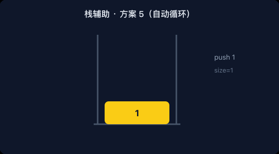

**方案专属流程图**（真实控制流）：

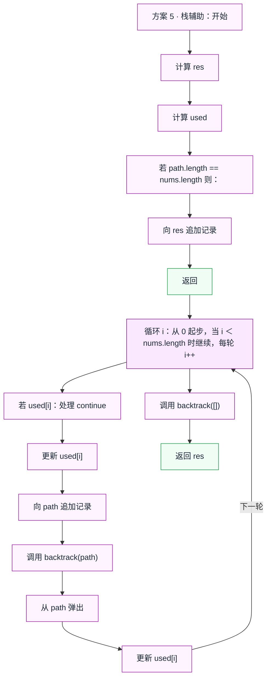

```typescript
export function demo(): void {
  // 程序入口：跑内嵌自测用例
  function permute(nums: number[]): number[][] {
    // 定义函数/方法 permute
    const res: number[][] = []; // 把 []; 写入 const res: number[][]
    const used: boolean[] = new Array(nums.length).fill(false); // 把 new Array(数组.长度).fill(false); 写入 const used: boolean[]
    function backtrack(path: number[]) {
      // 定义函数/方法 backtrack
      if (path.length === nums.length) {
        res.push(path.slice());
        return;
      } // 若 当前路径.长度 全等于 数组.长度) { 结果 追加 当前路径 截取 )); return; }
      for (let i = 0; i < nums.length; i++) {
        // 让 下标 i 从 0 开始计数，下标 i 小于 数组.长度 就继续
        if (used[i]) continue; // 若 已用标记[下标 i]) continue;
        used[i] = true; // 把 true; 写入 used[i]
        path.push(nums[i]); // 把 数组[下标 i] 压入栈/数组尾部
        backtrack(path); // backtrack(当前路径);
        path.pop(); // 弹出栈顶元素
        used[i] = false; // 把 false; 写入 used[i]
      }
    }
    backtrack([]); // backtrack([]);
    return res; // 返回 结果
  }
  function eqSet(a: number[][], b: number[][]): boolean {
    // 定义函数/方法 eqSet
    if (a.length !== b.length) return false; // 若 数组.长度 不等于 b.长度，直接返回 false
    const key = (x: number[]) =>
      x
        .slice()
        .sort((p, q) => p - q)
        .join(',');
    const sa = new Set(a.map(key)); // 把 new Set(数组.映射表(key)) 存入 sa
    const sb = new Set(b.map(key)); // 把 new Set(b.映射表(key)) 存入 sb
    if (sa.size !== sb.size) return false; // 若 sa.大小 不等于 sb.大小，直接返回 false
    for (const k of sa) if (!sb.has(k)) return false; // for (const 下标 k of sa) if (取反 sb.has(下标 k)) return false;
    return true; // 返回 true
  }
  const want = [
    [1, 2, 3],
    [1, 3, 2],
    [2, 1, 3],
    [2, 3, 1],
    [3, 1, 2],
    [3, 2, 1],
  ];
  const got = permute([1, 2, 3]); // 把 permute([1, 2, 3]) 存入 got
  let fail = false; // 把 false 存入 fail
  if (!eqSet(got, want)) {
    fail = true;
    console.log('FAIL permute got=' + JSON.stringify(got));
  }
  if (fail) throw new Error('FAILED'); // 若 fail) throw new Error(「FAILED」);
  console.log('PASS'); // 全部用例通过，输出 PASS
}
demo(); // demo();
```

### 方案 6：单趟扫描

**分析与思路**：核心做法是「单趟扫描」。代码里依次做这些事：单循环线性扫描。

**运行方式**：`node 本文件`，内嵌用例全部通过会输出 PASS。


**方案专属流程图**（真实控制流）：

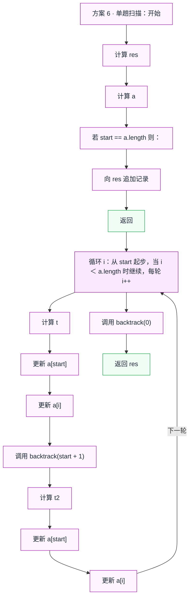

```typescript
export function demo(): void {
  // 程序入口：跑内嵌自测用例
  function permute(nums: number[]): number[][] {
    // 定义函数/方法 permute
    const res: number[][] = []; // 把 []; 写入 const res: number[][]
    const a = nums.slice(); // 把 数组 截取 ) 存入 数组
    function backtrack(start: number) {
      // 定义函数/方法 backtrack
      if (start === a.length) {
        res.push(a.slice());
        return;
      } // 若 起点 全等于 数组.长度) { 结果 追加 数组 截取 )); return; }
      for (let i = start; i < a.length; i++) {
        // 让 下标 i 从 起点 开始计数，下标 i 小于 数组.长度 就继续
        const t = a[start];
        a[start] = a[i];
        a[i] = t; // 把 数组[起点]; 数组[起点] 赋值为 数组[下标 i]; 数组[下标 i] 赋值为 另一字符串 存入 另一字符串
        backtrack(start + 1); // backtrack(起点 加 1);
        const t2 = a[start];
        a[start] = a[i];
        a[i] = t2; // 把 数组[起点]; 数组[起点] 赋值为 数组[下标 i]; 数组[下标 i] 赋值为 t2 存入 t2
      }
    }
    backtrack(0); // backtrack(0);
    return res; // 返回 结果
  }
  function eqSet(a: number[][], b: number[][]): boolean {
    // 定义函数/方法 eqSet
    if (a.length !== b.length) return false; // 若 数组.长度 不等于 b.长度，直接返回 false
    const key = (x: number[]) =>
      x
        .slice()
        .sort((p, q) => p - q)
        .join(',');
    const sa = new Set(a.map(key)); // 把 new Set(数组.映射表(key)) 存入 sa
    const sb = new Set(b.map(key)); // 把 new Set(b.映射表(key)) 存入 sb
    if (sa.size !== sb.size) return false; // 若 sa.大小 不等于 sb.大小，直接返回 false
    for (const k of sa) if (!sb.has(k)) return false; // for (const 下标 k of sa) if (取反 sb.has(下标 k)) return false;
    return true; // 返回 true
  }
  const want = [
    [1, 2, 3],
    [1, 3, 2],
    [2, 1, 3],
    [2, 3, 1],
    [3, 1, 2],
    [3, 2, 1],
  ];
  const got = permute([1, 2, 3]); // 把 permute([1, 2, 3]) 存入 got
  let fail = false; // 把 false 存入 fail
  if (!eqSet(got, want)) {
    fail = true;
    console.log('FAIL permute got=' + JSON.stringify(got));
  }
  if (fail) throw new Error('FAILED'); // 若 fail) throw new Error(「FAILED」);
  console.log('PASS'); // 全部用例通过，输出 PASS
}
demo(); // demo();
```

## 逐步拆解与面试追问

**复杂度**：时间 O(n)（单趟线性扫描），空间 O(1) 到 O(n)（视辅助结构）

**为什么是这个量级**：每个元素被常数次访问，辅助哈希或栈的开销与 n 同阶

**面试官可能会追问**：

- 怎么剪枝降低无效搜索？
- 去重的关键在哪一层？
- 状态恢复遗漏会怎样？

## 关键 API 速查（TS 主解法实际用到，附官方链接）

| API | 作用 | 使用要点 | 官方文档 |
|---|---|---|---|
| `Set` | 集合：元素唯一 | add/add.has/delete；has 均摊 O(1)；NaN 视为相同；去重常用 [...new Set(arr)] | [官方文档](https://developer.mozilla.org/zh-CN/docs/Web/JavaScript/Reference/Global_Objects/Set) |
| `Array.prototype.sort()` | 原地排序 | 默认按字符串 Unicode 序（10 会排在 2 前），数字必须传 (a,b)=>a-b；V8 用 TimSort，稳定，O(n log n)；返回原数组引用 | [官方文档](https://developer.mozilla.org/zh-CN/docs/Web/JavaScript/Reference/Global_Objects/Array/sort) |
| `Array.prototype.map()` | 逐元素映射为新数组 | 回调 (v,i,arr)；返回等长新数组，不改变原数组；稀疏位跳过；链式调用注意中间数组开销 | [官方文档](https://developer.mozilla.org/zh-CN/docs/Web/JavaScript/Reference/Global_Objects/Array/map) |
| `Array.prototype.push()` | 尾部追加 | 返回新长度；可一次多个；均摊 O(1)；会改变原数组 | [官方文档](https://developer.mozilla.org/zh-CN/docs/Web/JavaScript/Reference/Global_Objects/Array/push) |
| `Array/String indexOf()` | 首次出现的下标 | 找不到返回 -1；无法判 NaN（用 includes）；字符串可传起始位 | [官方文档](https://developer.mozilla.org/zh-CN/docs/Web/JavaScript/Reference/Global_Objects/Array/indexOf) |
| `Array/String slice()` | 切片（不改原数组） | slice(start,end) 含头不含尾；负数从尾计；常用于复制数组（slice()） | [官方文档](https://developer.mozilla.org/zh-CN/docs/Web/JavaScript/Reference/Global_Objects/Array/slice) |
| `Array.prototype.join()` | 数组拼接为字符串 | undefined/null 转空串；嵌套数组会展平一层；join('') 用于字符数组还原 | [官方文档](https://developer.mozilla.org/zh-CN/docs/Web/JavaScript/Reference/Global_Objects/Array/join) |
| `JSON.stringify()` | 序列化为 JSON 字符串 | 常用于结构化比较（深度相等判定）；undefined/函数/循环引用会被丢弃或抛错 | [官方文档](https://developer.mozilla.org/zh-CN/docs/Web/JavaScript/Reference/Global_Objects/JSON/stringify) |

### 各语言官方文档导航

- **TypeScript / JS**：[MDN 中文参考](https://developer.mozilla.org/zh-CN/)
- **Python**：[Python 官方文档](https://docs.python.org/zh-cn/3/)
- **Go**：[Go 标准库](https://pkg.go.dev/std)
- **Java**：[JDK 17 API](https://docs.oracle.com/en/java/javase/17/docs/api/)
- **Rust**：[Rust 标准库](https://doc.rust-lang.org/std/)
- **Lua**：[Lua 5.4 手册](https://www.lua.org/manual/5.4/)
- **C**：[Cppreference C](https://zh.cppreference.com/w/c)
- **C++**：[Cppreference C++](https://zh.cppreference.com/w/cpp)
- **R**：[R 官方手册](https://stat.ethz.ch/R-manual/)
- **Zig**：[Zig 语言文档](https://ziglang.org/documentation/master/)
- **Dart**：[Dart API](https://api.dart.dev/)

## 附录：其他 10 种语言全部实现（每种语言列举其全部方案）

> TypeScript 的全部方案见「TypeScript 解题方案」一节；下面是其余 10 种语言的对应实现，每种语言的每个方案都带思路分析、代码走读与专属运行架构图。
> 每个方案都内嵌用例自测，可独立运行（老仓库 python/go 文件遵循「打印结果」约定）。
> 完整解法文件见 `dsa/<语言>/backtrack/lc_46_全排列/`。

### Python 实现（6 种方案）

Python 的全部方案如下，每个方案都内嵌用例自测，可独立运行（老仓库 python/go 文件遵循「打印结果」约定）：

#### 方案 1：单趟扫描

**思路与代码分析**：核心是「单趟扫描」。Python 版用切片与字典推导式简化操作，突出可读性。**走读**：方案 1 · 单趟扫描：开始 → 更新 res → 若 len(path) == len(nums)：向 res 追加记录 → 向 res 追加记录 → 返回  → 循环 i：从 0 到 len(nums 前 → 若 nums[i] in path：处理 continue → 调用 backtrack(path + [nums[i]]) → 调用 backtrack([]) → 返回 res。

**运行架构**（真实控制流）：

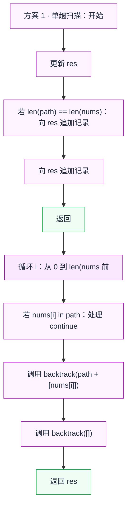

```python
import sys  # 提高递归深度上限（深输入防 RecursionError）

sys.setrecursionlimit(200000)  # 树/链表类题目节点数可达 1e4 量级

def permute(nums):  # 定义函数 permute（参数：数组）
    res = []  # 把 [] 存入 结果

    def backtrack(path):  # 定义函数 backtrack（参数：当前路径）
        if len(path) == len(nums):  # 若 长度(当前路径) 等于 长度(数组
            res.append(path[:])  # 把 复制 当前路径 追加到列表尾部
            return  # return
        for i in range(0, len(nums)):  # 让 下标 i 从 0 到 长度(数组 遍历
            if nums[i] in path:  # 若 数组[下标 i] in 当前路径
                continue  # 跳过本轮，进入下一次
            backtrack(path + [nums[i]])  # backtrack(当前路径 加 [数组[下标 i]])

    backtrack([])  # backtrack([])
    return res  # 返回 结果

if __name__ == "__main__":  # 若 __name__ 等于 '__main__'
    print(permute([1, 2, 3]))  # 打印输出
```

#### 方案 2：单趟扫描

**思路与代码分析**：核心是「单趟扫描」。Python 版用切片与字典推导式简化操作，突出可读性。**走读**：方案 2 · 单趟扫描：开始 → 更新 result → 返回  → 循环 i：从 start 到 len(nums 前 → 返回 result。

**运行架构**（真实控制流）：

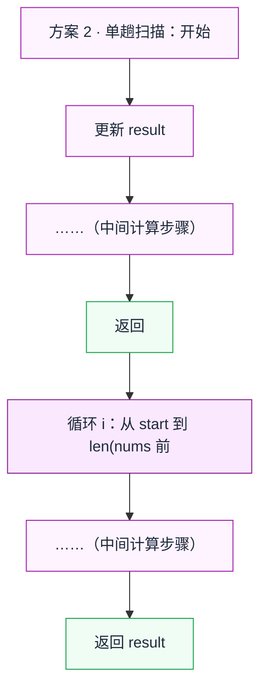

```python
import sys  # 提高递归深度上限（深输入防 RecursionError）

sys.setrecursionlimit(200000)  # 树/链表类题目节点数可达 1e4 量级

def permute(nums):  # 定义函数 permute（参数：数组）
    result = []  # 把 [] 存入 结果

    def backtrack(start):  # 定义函数 backtrack（参数：起点）
        if start == len(nums):  # 若 起点 等于 长度(数组
            result.append(nums[:])  # 把 复制 数组 追加到列表尾部
            return  # return
        for i in range(start, len(nums)):  # 让 下标 i 从 起点 到 长度(数组 遍历
            nums[start], nums[i] = (
                nums[i],
                nums[start],
            )  # 把 数组[下标 i], 数组[起点] 写入 nums[start], nums[i]
            backtrack(start + 1)  # backtrack(起点 加 1)
            nums[start], nums[i] = (
                nums[i],
                nums[start],
            )  # 把 数组[下标 i], 数组[起点] 写入 nums[start], nums[i]

    backtrack(0)  # backtrack(0)
    return result  # 返回 结果

if __name__ == "__main__":  # 若 __name__ 等于 '__main__'
    print(permute([1, 2, 3]))  # 打印输出
```

#### 方案 3：栈辅助

**思路与代码分析**：核心是「栈辅助」。Python 版用切片与字典推导式简化操作，突出可读性。**走读**：方案 3 · 栈辅助：开始 → 更新 res → 更新 used → 若 len(path) == len(nums)：向 res 追加记录 → 向 res 追加记录 → 返回  → 循环 i：从 0 到 len(nums 前 → 若 used[i]：处理 continue → 更新 used[i] → 向 path 追加记录 → 调用 backtrack(path) → 从 path 弹出 → 更新 used[i] → 调用 backtrack([]) → 返回 res。

**运行架构**（真实控制流）：

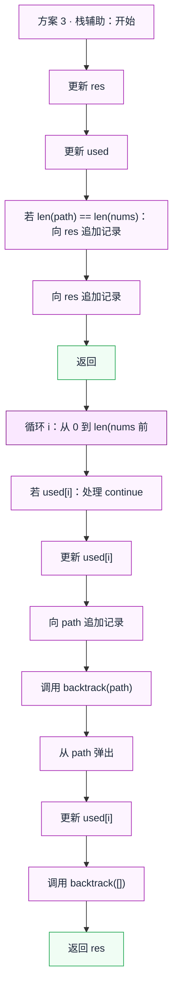

```python
import sys  # 提高递归深度上限（深输入防 RecursionError）

sys.setrecursionlimit(200000)  # 树/链表类题目节点数可达 1e4 量级

def permute(nums):  # 定义函数 permute（参数：数组）
    res = []  # 把 [] 存入 结果
    used = [False] * len(nums)  # 把 [False] 乘 长度(数组) 存入 已用标记

    def backtrack(path):  # 定义函数 backtrack（参数：当前路径）
        if len(path) == len(nums):  # 若 长度(当前路径) 等于 长度(数组
            res.append(path[:])  # 把 复制 当前路径 追加到列表尾部
            return  # return
        for i in range(len(nums)):  # 让 下标 i 从 长度(数组 遍历
            if used[i]:  # 若 已用标记[下标 i]
                continue  # 跳过本轮，进入下一次
            used[i] = True  # 把 True 写入 used[i]
            path.append(nums[i])  # 把 数组[下标 i] 追加到列表尾部
            backtrack(path)  # backtrack(当前路径)
            path.pop()  # 弹出栈顶元素
            used[i] = False  # 把 False 写入 used[i]

    backtrack([])  # backtrack([])
    return res  # 返回 结果

if __name__ == "__main__":  # 若 __name__ 等于 '__main__'
    print(permute([1, 2, 3]))  # 打印输出
```

#### 方案 4：单趟扫描

**思路与代码分析**：核心是「单趟扫描」。Python 版用切片与字典推导式简化操作，突出可读性。**走读**：方案 4 · 单趟扫描：开始 → 更新 res → 返回  → 循环 i：从 start 到 len(nums 前 → 返回 res。

**运行架构**（真实控制流）：

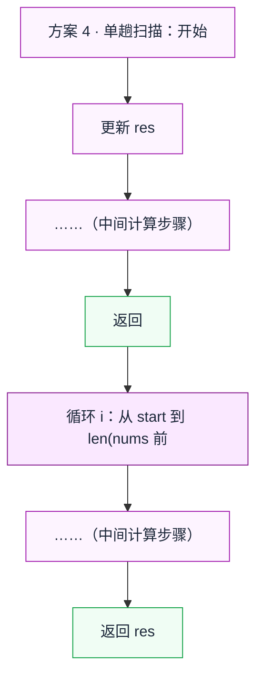

```python
import sys  # 提高递归深度上限（深输入防 RecursionError）

sys.setrecursionlimit(200000)  # 树/链表类题目节点数可达 1e4 量级

def permute(nums):  # 定义函数 permute（参数：数组）
    res = []  # 把 [] 存入 结果

    def backtrack(start):  # 定义函数 backtrack（参数：起点）
        if start == len(nums):  # 若 起点 等于 长度(数组
            res.append(nums[:])  # 把 复制 数组 追加到列表尾部
            return  # return
        for i in range(start, len(nums)):  # 让 下标 i 从 起点 到 长度(数组 遍历
            nums[start], nums[i] = (
                nums[i],
                nums[start],
            )  # 把 数组[下标 i], 数组[起点] 写入 nums[start], nums[i]
            backtrack(start + 1)  # backtrack(起点 加 1)
            nums[start], nums[i] = (
                nums[i],
                nums[start],
            )  # 把 数组[下标 i], 数组[起点] 写入 nums[start], nums[i]

    backtrack(0)  # backtrack(0)
    return res  # 返回 结果

if __name__ == "__main__":  # 若 __name__ 等于 '__main__'
    print(permute([1, 2, 3]))  # 打印输出
```

#### 方案 5：栈辅助

**思路与代码分析**：核心是「栈辅助」。Python 版用切片与字典推导式简化操作，突出可读性。**走读**：方案 5 · 栈辅助：开始 → 更新 res → 更新 used → 若 len(path) == len(nums)：向 res 追加记录 → 向 res 追加记录 → 返回  → 循环 i：从 0 到 len(nums 前 → 若 used[i]：处理 continue → 更新 used[i] → 向 path 追加记录 → 调用 backtrack(path) → 从 path 弹出 → 更新 used[i] → 调用 backtrack([]) → 返回 res。

**运行架构**（真实控制流）：


```python
import sys  # 提高递归深度上限（深输入防 RecursionError）

sys.setrecursionlimit(200000)  # 树/链表类题目节点数可达 1e4 量级

def permute(nums):  # 定义函数 permute（参数：数组）
    res = []  # 把 [] 存入 结果
    used = [False] * len(nums)  # 把 [False] 乘 长度(数组) 存入 已用标记

    def backtrack(path):  # 定义函数 backtrack（参数：当前路径）
        if len(path) == len(nums):  # 若 长度(当前路径) 等于 长度(数组
            res.append(path[:])  # 把 复制 当前路径 追加到列表尾部
            return  # return
        for i in range(len(nums)):  # 让 下标 i 从 长度(数组 遍历
            if used[i]:  # 若 已用标记[下标 i]
                continue  # 跳过本轮，进入下一次
            used[i] = True  # 把 True 写入 used[i]
            path.append(nums[i])  # 把 数组[下标 i] 追加到列表尾部
            backtrack(path)  # backtrack(当前路径)
            path.pop()  # 弹出栈顶元素
            used[i] = False  # 把 False 写入 used[i]

    backtrack([])  # backtrack([])
    return res  # 返回 结果

if __name__ == "__main__":  # 若 __name__ 等于 '__main__'
    print(permute([0, 1]))  # 打印输出
```

#### 方案 6：单趟扫描

**思路与代码分析**：核心是「单趟扫描」。Python 版用切片与字典推导式简化操作，突出可读性。**走读**：方案 6 · 单趟扫描：开始 → 更新 res → 返回  → 循环 i：从 start 到 len(nums 前 → 返回 res。

**运行架构**（真实控制流）：


```python
import sys  # 提高递归深度上限（深输入防 RecursionError）

sys.setrecursionlimit(200000)  # 树/链表类题目节点数可达 1e4 量级

def permute(nums):  # 定义函数 permute（参数：数组）
    res = []  # 把 [] 存入 结果

    def backtrack(start):  # 定义函数 backtrack（参数：起点）
        if start == len(nums):  # 若 起点 等于 长度(数组
            res.append(nums[:])  # 把 复制 数组 追加到列表尾部
            return  # return
        for i in range(start, len(nums)):  # 让 下标 i 从 起点 到 长度(数组 遍历
            nums[start], nums[i] = (
                nums[i],
                nums[start],
            )  # 把 数组[下标 i], 数组[起点] 写入 nums[start], nums[i]
            backtrack(start + 1)  # backtrack(起点 加 1)
            nums[start], nums[i] = (
                nums[i],
                nums[start],
            )  # 把 数组[下标 i], 数组[起点] 写入 nums[start], nums[i]

    backtrack(0)  # backtrack(0)
    return res  # 返回 结果

if __name__ == "__main__":  # 若 __name__ 等于 '__main__'
    print(permute([1, 2, 3]))  # 打印输出
```

### Go 实现（6 种方案）

Go 的全部方案如下，每个方案都内嵌用例自测，可独立运行（老仓库 python/go 文件遵循「打印结果」约定）：

#### 方案 1：单趟扫描

**思路与代码分析**：核心是「单趟扫描」。Go 版用切片与多返回值惯用法，显式处理索引边界。**走读**：方案 1 · 单趟扫描：开始 → 更新 : → 遍历 s 的下标与元素 i → 更新 out[i] → 调用 sort.Ints(out[i]) → 调用 sort.Slice(out, func(a, b in → 返回 fmt.Sprint(out[a]) ＜ fmt.Sprint(out[b]) → 返回 out。

**运行架构**（真实控制流）：

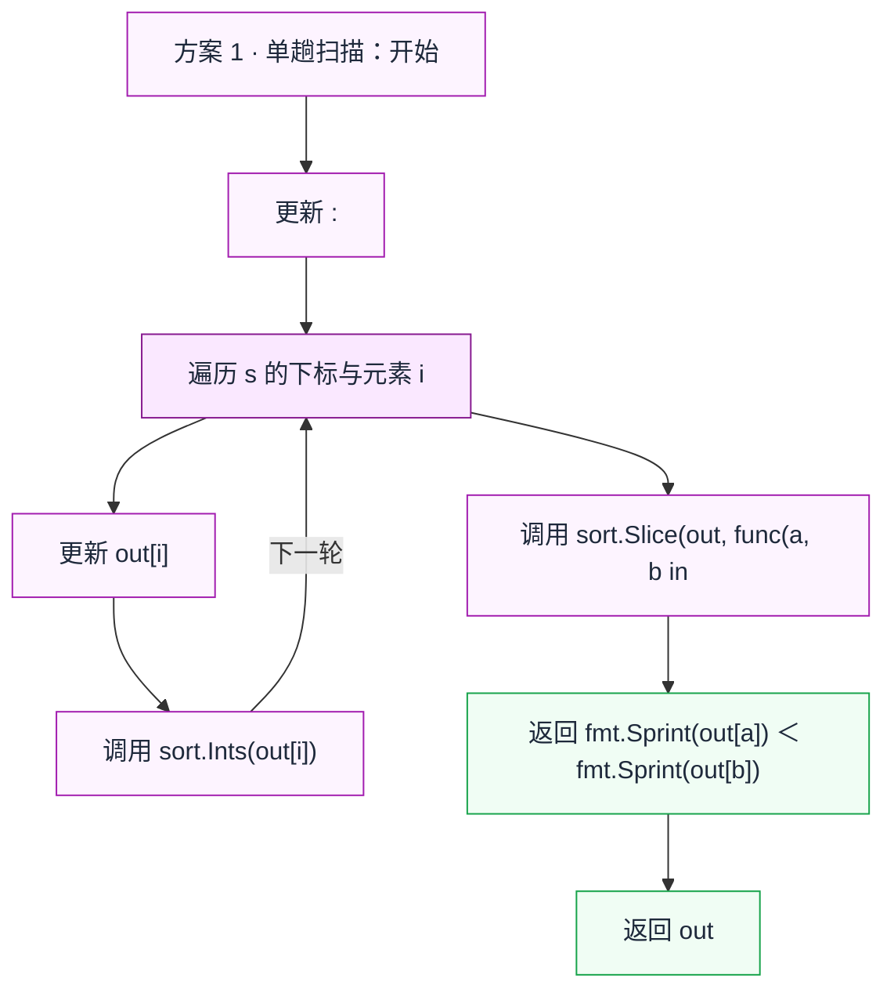

```go
package main // 引入依赖

import (
	"fmt"     // 「fmt」
	"os"      // 「os」
	"reflect" // 「reflect」
	"sort"    // 「sort」
)

func permute(nums []int) [][]int { // 定义函数/方法 permute
	res := [][]int{}                // 把 [][]int{} 写入 res :
	used := make([]bool, len(nums)) // 把 make([]bool, 长度(数组)) 写入 used :
	var backtrack func(path []int)  // var backtrack func(当前路径 []int)
	backtrack = func(path []int) {  // 把 func(当前路径 []int) { 写入 backtrack
		if len(path) == len(nums) { // 定义函数/方法 len
			res = append(res, append([]int{}, path...)) // 把 append(结果, append([]int{}, 当前路径...)) 写入 结果
			return                                      // return
		}
		for i := 0; i < len(nums); i++ { // 让 下标 i 从 0 开始计数
			if used[i] { // 若 已用标记[下标 i]
				continue // 跳过本轮，进入下一次
			}
			used[i] = true                   // 把 true 写入 used[i]
			backtrack(append(path, nums[i])) // backtrack(append(当前路径, 数组[下标 i]))
			used[i] = false                  // 把 false 写入 used[i]
		}
	}
	backtrack([]int{}) // backtrack([]int{})
	return res         // 返回 结果
}

func norm2D(s [][]int) [][]int { // 定义函数/方法 norm2D
	out := make([][]int, len(s)) // 把 make([][]int, 长度(字符串)) 写入 out :
	for i := range s {           // 把 range 字符串 { 写入 for i :
		out[i] = append([]int{}, s[i]...) // 把 append([]int{}, 字符串[下标 i]...) 写入 out[i]
		sort.Ints(out[i])                 // sort.Ints(out[下标 i])
	}
	sort.Slice(out, func(a, b int) bool { // sort.Slice(out, func(数组, b int) bool {
		return fmt.Sprint(out[a]) < fmt.Sprint(out[b]) // 返回 fmt.Sprint(out[数组]) 小于 fmt.Sprint(out[b])
	}) // })
	return out // 返回 out
}

func main() { // 程序入口：跑内嵌自测用例
	got := norm2D(permute([]int{1, 2, 3})) // 把 norm2D(permute([]int{1, 2, 3})) 写入 got :
	want := norm2D([][]int{{1, 2, 3}, {1, 3, 2}, {2, 1, 3}, {2, 3, 1}, {3, 1, 2}, {3, 2, 1}})
	ok := reflect.DeepEqual(got, want) // 把 reflect.DeepEqual(got, want) 写入 ok :
	if !ok {                           // 若 取反 ok
		fmt.Printf("FAIL permute([1,2,3])=%v want %v\n", got, want) // 打印输出
		os.Exit(1)                                                  // os.Exit(1)
	}
	fmt.Println("PASS") // 全部用例通过，输出 PASS
}
```

#### 方案 2：单趟扫描

**思路与代码分析**：核心是「单趟扫描」。Go 版用切片与多返回值惯用法，显式处理索引边界。**走读**：方案 2 · 单趟扫描：开始 → 更新 : → 遍历 s 的下标与元素 i → 更新 out[i] → 调用 sort.Ints(out[i]) → 调用 sort.Slice(out, func(a, b in → 返回 fmt.Sprint(out[a]) ＜ fmt.Sprint(out[b]) → 返回 out。

**运行架构**（真实控制流）：


```go
package main // 引入依赖

import (
	"fmt"     // 「fmt」
	"os"      // 「os」
	"reflect" // 「reflect」
	"sort"    // 「sort」
)

func permute(nums []int) [][]int { // 定义函数/方法 permute
	nums = append([]int{}, nums...) // 把 append([]int{}, 数组...) 写入 数组
	res := [][]int{}                // 把 [][]int{} 写入 res :
	var backtrack func(start int)   // var backtrack func(起点 int)
	backtrack = func(start int) {   // 把 func(起点 int) { 写入 backtrack
		if start == len(nums) { // 若 起点 等于 长度(数组
			res = append(res, append([]int{}, nums...)) // 把 append(结果, append([]int{}, 数组...)) 写入 结果
			return                                      // return
		}
		for i := start; i < len(nums); i++ { // 把 起点; 下标 i 小于 长度(数组); 下标 i 加一 { 写入 for i :
			nums[start], nums[i] = nums[i], nums[start] // 把 数组[下标 i], 数组[起点] 写入 nums[start], nums[i]
			backtrack(start + 1)                        // backtrack(起点 加 1)
			nums[start], nums[i] = nums[i], nums[start] // 把 数组[下标 i], 数组[起点] 写入 nums[start], nums[i]
		}
	}
	backtrack(0) // backtrack(0)
	return res   // 返回 结果
}

func norm2D(s [][]int) [][]int { // 定义函数/方法 norm2D
	out := make([][]int, len(s)) // 把 make([][]int, 长度(字符串)) 写入 out :
	for i := range s {           // 把 range 字符串 { 写入 for i :
		out[i] = append([]int{}, s[i]...) // 把 append([]int{}, 字符串[下标 i]...) 写入 out[i]
		sort.Ints(out[i])                 // sort.Ints(out[下标 i])
	}
	sort.Slice(out, func(a, b int) bool { // sort.Slice(out, func(数组, b int) bool {
		return fmt.Sprint(out[a]) < fmt.Sprint(out[b]) // 返回 fmt.Sprint(out[数组]) 小于 fmt.Sprint(out[b])
	}) // })
	return out // 返回 out
}

func main() { // 程序入口：跑内嵌自测用例
	got := norm2D(permute([]int{1, 2, 3})) // 把 norm2D(permute([]int{1, 2, 3})) 写入 got :
	want := norm2D([][]int{{1, 2, 3}, {1, 3, 2}, {2, 1, 3}, {2, 3, 1}, {3, 1, 2}, {3, 2, 1}})
	ok := reflect.DeepEqual(got, want) // 把 reflect.DeepEqual(got, want) 写入 ok :
	if !ok {                           // 若 取反 ok
		fmt.Printf("FAIL permute([1,2,3])=%v want %v\n", got, want) // 打印输出
		os.Exit(1)                                                  // os.Exit(1)
	}
	fmt.Println("PASS") // 全部用例通过，输出 PASS
}
```

#### 方案 3：栈辅助

**思路与代码分析**：核心是「栈辅助」。Go 版用切片与多返回值惯用法，显式处理索引边界。**走读**：方案 3 · 栈辅助：开始 → 更新 : → 遍历 s 的下标与元素 i → 更新 out[i] → 调用 sort.Ints(out[i]) → 调用 sort.Slice(out, func(a, b in → 返回 fmt.Sprint(out[a]) ＜ fmt.Sprint(out[b]) → 返回 out。

**运行架构**（真实控制流）：


```go
package main // 引入依赖

import (
	"fmt"     // 「fmt」
	"os"      // 「os」
	"reflect" // 「reflect」
	"sort"    // 「sort」
)

func permute(nums []int) [][]int { // 定义函数/方法 permute
	res := [][]int{}                // 把 [][]int{} 写入 res :
	used := make([]bool, len(nums)) // 把 make([]bool, 长度(数组)) 写入 used :
	var backtrack func(path []int)  // var backtrack func(当前路径 []int)
	backtrack = func(path []int) {  // 把 func(当前路径 []int) { 写入 backtrack
		if len(path) == len(nums) { // 定义函数/方法 len
			res = append(res, append([]int{}, path...)) // 把 append(结果, append([]int{}, 当前路径...)) 写入 结果
			return                                      // return
		}
		for i := 0; i < len(nums); i++ { // 让 下标 i 从 0 开始计数
			if used[i] { // 若 已用标记[下标 i]
				continue // 跳过本轮，进入下一次
			}
			used[i] = true                   // 把 true 写入 used[i]
			backtrack(append(path, nums[i])) // backtrack(append(当前路径, 数组[下标 i]))
			used[i] = false                  // 把 false 写入 used[i]
		}
	}
	backtrack([]int{}) // backtrack([]int{})
	return res         // 返回 结果
}

func norm2D(s [][]int) [][]int { // 定义函数/方法 norm2D
	out := make([][]int, len(s)) // 把 make([][]int, 长度(字符串)) 写入 out :
	for i := range s {           // 把 range 字符串 { 写入 for i :
		out[i] = append([]int{}, s[i]...) // 把 append([]int{}, 字符串[下标 i]...) 写入 out[i]
		sort.Ints(out[i])                 // sort.Ints(out[下标 i])
	}
	sort.Slice(out, func(a, b int) bool { // sort.Slice(out, func(数组, b int) bool {
		return fmt.Sprint(out[a]) < fmt.Sprint(out[b]) // 返回 fmt.Sprint(out[数组]) 小于 fmt.Sprint(out[b])
	}) // })
	return out // 返回 out
}

func main() { // 程序入口：跑内嵌自测用例
	got := norm2D(permute([]int{1, 2, 3})) // 把 norm2D(permute([]int{1, 2, 3})) 写入 got :
	want := norm2D([][]int{{1, 2, 3}, {1, 3, 2}, {2, 1, 3}, {2, 3, 1}, {3, 1, 2}, {3, 2, 1}})
	ok := reflect.DeepEqual(got, want) // 把 reflect.DeepEqual(got, want) 写入 ok :
	if !ok {                           // 若 取反 ok
		fmt.Printf("FAIL permute([1,2,3])=%v want %v\n", got, want) // 打印输出
		os.Exit(1)                                                  // os.Exit(1)
	}
	fmt.Println("PASS") // 全部用例通过，输出 PASS
}
```

#### 方案 4：单趟扫描

**思路与代码分析**：核心是「单趟扫描」。Go 版用切片与多返回值惯用法，显式处理索引边界。**走读**：方案 4 · 单趟扫描：开始 → 更新 : → 遍历 s 的下标与元素 i → 更新 out[i] → 调用 sort.Ints(out[i]) → 调用 sort.Slice(out, func(a, b in → 返回 fmt.Sprint(out[a]) ＜ fmt.Sprint(out[b]) → 返回 out。

**运行架构**（真实控制流）：


```go
package main // 引入依赖

import (
	"fmt"     // 「fmt」
	"os"      // 「os」
	"reflect" // 「reflect」
	"sort"    // 「sort」
)

func permute(nums []int) [][]int { // 定义函数/方法 permute
	nums = append([]int{}, nums...) // 把 append([]int{}, 数组...) 写入 数组
	res := [][]int{}                // 把 [][]int{} 写入 res :
	var backtrack func(start int)   // var backtrack func(起点 int)
	backtrack = func(start int) {   // 把 func(起点 int) { 写入 backtrack
		if start == len(nums) { // 若 起点 等于 长度(数组
			res = append(res, append([]int{}, nums...)) // 把 append(结果, append([]int{}, 数组...)) 写入 结果
			return                                      // return
		}
		for i := start; i < len(nums); i++ { // 把 起点; 下标 i 小于 长度(数组); 下标 i 加一 { 写入 for i :
			nums[start], nums[i] = nums[i], nums[start] // 把 数组[下标 i], 数组[起点] 写入 nums[start], nums[i]
			backtrack(start + 1)                        // backtrack(起点 加 1)
			nums[start], nums[i] = nums[i], nums[start] // 把 数组[下标 i], 数组[起点] 写入 nums[start], nums[i]
		}
	}
	backtrack(0) // backtrack(0)
	return res   // 返回 结果
}

func norm2D(s [][]int) [][]int { // 定义函数/方法 norm2D
	out := make([][]int, len(s)) // 把 make([][]int, 长度(字符串)) 写入 out :
	for i := range s {           // 把 range 字符串 { 写入 for i :
		out[i] = append([]int{}, s[i]...) // 把 append([]int{}, 字符串[下标 i]...) 写入 out[i]
		sort.Ints(out[i])                 // sort.Ints(out[下标 i])
	}
	sort.Slice(out, func(a, b int) bool { // sort.Slice(out, func(数组, b int) bool {
		return fmt.Sprint(out[a]) < fmt.Sprint(out[b]) // 返回 fmt.Sprint(out[数组]) 小于 fmt.Sprint(out[b])
	}) // })
	return out // 返回 out
}

func main() { // 程序入口：跑内嵌自测用例
	got := norm2D(permute([]int{1, 2, 3})) // 把 norm2D(permute([]int{1, 2, 3})) 写入 got :
	want := norm2D([][]int{{1, 2, 3}, {1, 3, 2}, {2, 1, 3}, {2, 3, 1}, {3, 1, 2}, {3, 2, 1}})
	ok := reflect.DeepEqual(got, want) // 把 reflect.DeepEqual(got, want) 写入 ok :
	if !ok {                           // 若 取反 ok
		fmt.Printf("FAIL permute([1,2,3])=%v want %v\n", got, want) // 打印输出
		os.Exit(1)                                                  // os.Exit(1)
	}
	fmt.Println("PASS") // 全部用例通过，输出 PASS
}
```

#### 方案 5：栈辅助

**思路与代码分析**：核心是「栈辅助」。Go 版用切片与多返回值惯用法，显式处理索引边界。**走读**：方案 5 · 栈辅助：开始 → 更新 : → 遍历 s 的下标与元素 i → 更新 out[i] → 调用 sort.Ints(out[i]) → 调用 sort.Slice(out, func(a, b in → 返回 fmt.Sprint(out[a]) ＜ fmt.Sprint(out[b]) → 返回 out。

**运行架构**（真实控制流）：


```go
package main // 引入依赖

import (
	"fmt"     // 「fmt」
	"os"      // 「os」
	"reflect" // 「reflect」
	"sort"    // 「sort」
)

func permute(nums []int) [][]int { // 定义函数/方法 permute
	res := [][]int{}                // 把 [][]int{} 写入 res :
	used := make([]bool, len(nums)) // 把 make([]bool, 长度(数组)) 写入 used :
	var backtrack func(path []int)  // var backtrack func(当前路径 []int)
	backtrack = func(path []int) {  // 把 func(当前路径 []int) { 写入 backtrack
		if len(path) == len(nums) { // 定义函数/方法 len
			res = append(res, append([]int{}, path...)) // 把 append(结果, append([]int{}, 当前路径...)) 写入 结果
			return                                      // return
		}
		for i := 0; i < len(nums); i++ { // 让 下标 i 从 0 开始计数
			if used[i] { // 若 已用标记[下标 i]
				continue // 跳过本轮，进入下一次
			}
			used[i] = true                   // 把 true 写入 used[i]
			backtrack(append(path, nums[i])) // backtrack(append(当前路径, 数组[下标 i]))
			used[i] = false                  // 把 false 写入 used[i]
		}
	}
	backtrack([]int{}) // backtrack([]int{})
	return res         // 返回 结果
}

func norm2D(s [][]int) [][]int { // 定义函数/方法 norm2D
	out := make([][]int, len(s)) // 把 make([][]int, 长度(字符串)) 写入 out :
	for i := range s {           // 把 range 字符串 { 写入 for i :
		out[i] = append([]int{}, s[i]...) // 把 append([]int{}, 字符串[下标 i]...) 写入 out[i]
		sort.Ints(out[i])                 // sort.Ints(out[下标 i])
	}
	sort.Slice(out, func(a, b int) bool { // sort.Slice(out, func(数组, b int) bool {
		return fmt.Sprint(out[a]) < fmt.Sprint(out[b]) // 返回 fmt.Sprint(out[数组]) 小于 fmt.Sprint(out[b])
	}) // })
	return out // 返回 out
}

func main() { // 程序入口：跑内嵌自测用例
	got := norm2D(permute([]int{0, 1}))     // 把 norm2D(permute([]int{0, 1})) 写入 got :
	want := norm2D([][]int{{0, 1}, {1, 0}}) // 把 norm2D([][]int{{0, 1}, {1, 0}}) 写入 want :
	ok := reflect.DeepEqual(got, want)      // 把 reflect.DeepEqual(got, want) 写入 ok :
	if !ok {                                // 若 取反 ok
		fmt.Printf("FAIL permute([0,1])=%v want %v\n", got, want) // 打印输出
		os.Exit(1)                                                // os.Exit(1)
	}
	fmt.Println("PASS") // 全部用例通过，输出 PASS
}
```

#### 方案 6：单趟扫描

**思路与代码分析**：核心是「单趟扫描」。Go 版用切片与多返回值惯用法，显式处理索引边界。**走读**：方案 6 · 单趟扫描：开始 → 更新 : → 遍历 s 的下标与元素 i → 更新 out[i] → 调用 sort.Ints(out[i]) → 调用 sort.Slice(out, func(a, b in → 返回 fmt.Sprint(out[a]) ＜ fmt.Sprint(out[b]) → 返回 out。

**运行架构**（真实控制流）：

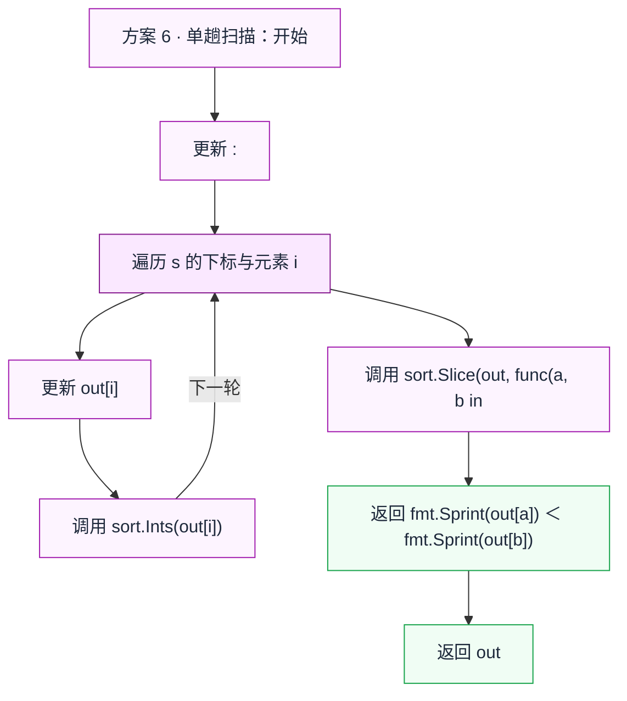

```go
package main // 引入依赖

import (
	"fmt"     // 「fmt」
	"os"      // 「os」
	"reflect" // 「reflect」
	"sort"    // 「sort」
)

func permute(nums []int) [][]int { // 定义函数/方法 permute
	nums = append([]int{}, nums...) // 把 append([]int{}, 数组...) 写入 数组
	res := [][]int{}                // 把 [][]int{} 写入 res :
	var backtrack func(start int)   // var backtrack func(起点 int)
	backtrack = func(start int) {   // 把 func(起点 int) { 写入 backtrack
		if start == len(nums) { // 若 起点 等于 长度(数组
			res = append(res, append([]int{}, nums...)) // 把 append(结果, append([]int{}, 数组...)) 写入 结果
			return                                      // return
		}
		for i := start; i < len(nums); i++ { // 把 起点; 下标 i 小于 长度(数组); 下标 i 加一 { 写入 for i :
			nums[start], nums[i] = nums[i], nums[start] // 把 数组[下标 i], 数组[起点] 写入 nums[start], nums[i]
			backtrack(start + 1)                        // backtrack(起点 加 1)
			nums[start], nums[i] = nums[i], nums[start] // 把 数组[下标 i], 数组[起点] 写入 nums[start], nums[i]
		}
	}
	backtrack(0) // backtrack(0)
	return res   // 返回 结果
}

func norm2D(s [][]int) [][]int { // 定义函数/方法 norm2D
	out := make([][]int, len(s)) // 把 make([][]int, 长度(字符串)) 写入 out :
	for i := range s {           // 把 range 字符串 { 写入 for i :
		out[i] = append([]int{}, s[i]...) // 把 append([]int{}, 字符串[下标 i]...) 写入 out[i]
		sort.Ints(out[i])                 // sort.Ints(out[下标 i])
	}
	sort.Slice(out, func(a, b int) bool { // sort.Slice(out, func(数组, b int) bool {
		return fmt.Sprint(out[a]) < fmt.Sprint(out[b]) // 返回 fmt.Sprint(out[数组]) 小于 fmt.Sprint(out[b])
	}) // })
	return out // 返回 out
}

func main() { // 程序入口：跑内嵌自测用例
	got := norm2D(permute([]int{1, 2, 3})) // 把 norm2D(permute([]int{1, 2, 3})) 写入 got :
	want := norm2D([][]int{{1, 2, 3}, {1, 3, 2}, {2, 1, 3}, {2, 3, 1}, {3, 1, 2}, {3, 2, 1}})
	ok := reflect.DeepEqual(got, want) // 把 reflect.DeepEqual(got, want) 写入 ok :
	if !ok {                           // 若 取反 ok
		fmt.Printf("FAIL permute([1,2,3])=%v want %v\n", got, want) // 打印输出
		os.Exit(1)                                                  // os.Exit(1)
	}
	fmt.Println("PASS") // 全部用例通过，输出 PASS
}
```

### Java 实现（6 种方案）

Java 的全部方案如下，每个方案都内嵌用例自测，可独立运行（老仓库 python/go 文件遵循「打印结果」约定）：

#### 方案 1：单趟扫描

**思路与代码分析**：核心是「单趟扫描」。Java 版用类与静态方法组织，集合操作显式明了。**走读**：方案 1 · 单趟扫描：开始 → 更新 res → 处理 new ArrayList＜＞() → 调用 backtrack(nums, new ArrayLis → 返回 res。

**运行架构**（真实控制流）：

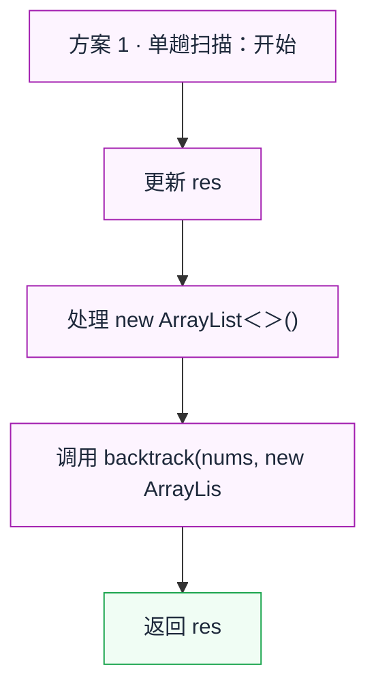

```java
package com.webfault.dsa; // 引入依赖

import java.util.*; // 引入依赖

class Lc46 { // 定义类型
  List<List<Integer>> permute(int[] nums) { // 定义函数/方法 permute
    List<List<Integer>> res =
        new ArrayList<>(); // 把 new ArrayList 小于 超过 (); 写入 List<List<Integer>> res
    backtrack(nums, new ArrayList<>(), res); // backtrack(数组, new ArrayList 小于 超过 (), 结果);
    return res; // 返回 结果
  }

  void backtrack(int[] nums, List<Integer> path, List<List<Integer>> res) { // 定义函数/方法 backtrack
    if (path.size() == nums.length) {
      res.add(new ArrayList<>(path));
      return;
    }
    for (int i = 0; i < nums.length; i++) { // 让 下标 i 从 0 开始计数，下标 i 小于 数组.长度 就继续
      if (path.contains(nums[i])) continue; // 若 当前路径 是否包含 数组[下标 i])) continue;
      path.add(nums[i]); // 当前路径 追加 数组[下标 i]);
      backtrack(nums, path, res); // backtrack(数组,当前路径,结果);
      path.remove(path.size() - 1); // 当前路径 弹出 当前路径.大小() 减 1);
    }
  }

  public static void main(String[] args) { // public static void main(String[] args){
    Lc46 s = new Lc46(); // 把 new Lc46(); 写入 Lc46 s
    List<List<Integer>> got =
        s.permute(
            new int[] {1, 2, 3}); // 把 字符串.permute(new int[]{1,2,3}); 写入 List<List<Integer>> got
    Set<String> want = new HashSet<>(); // 把 new HashSet 小于 超过 (); 写入 Set<String> want
    String[] ws = {"1,2,3", "1,3,2", "2,1,3", "2,3,1", "3,1,2", "3,2,1"};
    for (String w : ws) want.add(w); // for(String 权重:ws) want 追加 权重);
    Set<String> gotSet = new HashSet<>(); // 把 new HashSet 小于 超过 (); 写入 Set<String> gotSet
    for (List<Integer> p : got) {
      StringBuilder sb = new StringBuilder();
      for (int v : p) {
        if (sb.length() > 0) sb.append(",");
        sb.append(v);
      }
      gotSet.add(sb.toString());
    } // 把 「,」 追加到列表尾部
    boolean ok =
        got.size() == 6
            && gotSet.equals(want); // 把 got.大小() 等于 6 且 gotSet.equals(want); 写入 boolean ok
    if (!ok) throw new RuntimeException("FAILED"); // 若 取反 ok) throw new RuntimeException(「FAILED」);
    System.out.println("PASS"); // 全部用例通过，输出 PASS
  }
}
```

#### 方案 2：单趟扫描

**思路与代码分析**：核心是「单趟扫描」。Java 版用类与静态方法组织，集合操作显式明了。**走读**：方案 2 · 单趟扫描：开始 → 更新 res → 处理 new ArrayList＜＞() → 调用 backtrack(nums, new ArrayLis → 返回 res。

**运行架构**（真实控制流）：

```mermaid
graph TD
    N0["方案 2 · 单趟扫描：开始"]
    N1["更新 res"]
    N2["处理 new ArrayList＜＞()"]
    N3["调用 backtrack(nums, new ArrayLis"]
    N4["返回 res"]
    N0 --> N1
    N1 --> N2
    N2 --> N3
    N3 --> N4
    classDef n fill:#fdf4ff,stroke:#a21caf,color:#1e293b;
    classDef lp fill:#fae8ff,stroke:#86198f,color:#1e293b;
    classDef dc fill:#fef9c3,stroke:#ca8a04,color:#1e293b;
    classDef tm fill:#f0fdf4,stroke:#16a34a,color:#1e293b;
    class N0,N1,N2,N3 n;
    class N4 tm;
```

```java
package com.webfault.dsa; // 引入依赖

import java.util.*; // 引入依赖

class Lc46 { // 定义类型
  List<List<Integer>> permute(int[] nums) { // 定义函数/方法 permute
    List<List<Integer>> res =
        new ArrayList<>(); // 把 new ArrayList 小于 超过 (); 写入 List<List<Integer>> res
    backtrack(nums, new ArrayList<>(), res); // backtrack(数组, new ArrayList 小于 超过 (), 结果);
    return res; // 返回 结果
  }

  void backtrack(int[] nums, List<Integer> path, List<List<Integer>> res) { // 定义函数/方法 backtrack
    if (path.size() == nums.length) {
      res.add(new ArrayList<>(path));
      return;
    }
    for (int i = 0; i < nums.length; i++) { // 让 下标 i 从 0 开始计数，下标 i 小于 数组.长度 就继续
      if (path.contains(nums[i])) continue; // 若 当前路径 是否包含 数组[下标 i])) continue;
      path.add(nums[i]); // 当前路径 追加 数组[下标 i]);
      backtrack(nums, path, res); // backtrack(数组,当前路径,结果);
      path.remove(path.size() - 1); // 当前路径 弹出 当前路径.大小() 减 1);
    }
  }

  public static void main(String[] args) { // public static void main(String[] args){
    Lc46 s = new Lc46(); // 把 new Lc46(); 写入 Lc46 s
    List<List<Integer>> got =
        s.permute(
            new int[] {1, 2, 3}); // 把 字符串.permute(new int[]{1,2,3}); 写入 List<List<Integer>> got
    Set<String> want = new HashSet<>(); // 把 new HashSet 小于 超过 (); 写入 Set<String> want
    String[] ws = {"1,2,3", "1,3,2", "2,1,3", "2,3,1", "3,1,2", "3,2,1"};
    for (String w : ws) want.add(w); // for(String 权重:ws) want 追加 权重);
    Set<String> gotSet = new HashSet<>(); // 把 new HashSet 小于 超过 (); 写入 Set<String> gotSet
    for (List<Integer> p : got) {
      StringBuilder sb = new StringBuilder();
      for (int v : p) {
        if (sb.length() > 0) sb.append(",");
        sb.append(v);
      }
      gotSet.add(sb.toString());
    } // 把 「,」 追加到列表尾部
    boolean ok =
        got.size() == 6
            && gotSet.equals(want); // 把 got.大小() 等于 6 且 gotSet.equals(want); 写入 boolean ok
    if (!ok) throw new RuntimeException("FAILED"); // 若 取反 ok) throw new RuntimeException(「FAILED」);
    System.out.println("PASS"); // 全部用例通过，输出 PASS
  }
}
```

#### 方案 3：栈辅助

**思路与代码分析**：核心是「栈辅助」。Java 版用类与静态方法组织，集合操作显式明了。**走读**：方案 3 · 栈辅助：开始 → 更新 res → 处理 new ArrayList＜＞() → 调用 backtrack(nums, new ArrayLis → 返回 res。

**运行架构**（真实控制流）：

```mermaid
graph TD
    N0["方案 3 · 栈辅助：开始"]
    N1["更新 res"]
    N2["处理 new ArrayList＜＞()"]
    N3["调用 backtrack(nums, new ArrayLis"]
    N4["返回 res"]
    N0 --> N1
    N1 --> N2
    N2 --> N3
    N3 --> N4
    classDef n fill:#fdf4ff,stroke:#a21caf,color:#1e293b;
    classDef lp fill:#fae8ff,stroke:#86198f,color:#1e293b;
    classDef dc fill:#fef9c3,stroke:#ca8a04,color:#1e293b;
    classDef tm fill:#f0fdf4,stroke:#16a34a,color:#1e293b;
    class N0,N1,N2,N3 n;
    class N4 tm;
```

```java
package com.webfault.dsa; // 引入依赖

import java.util.*; // 引入依赖

class Lc46 { // 定义类型
  List<List<Integer>> permute(int[] nums) { // 定义函数/方法 permute
    List<List<Integer>> res =
        new ArrayList<>(); // 把 new ArrayList 小于 超过 (); 写入 List<List<Integer>> res
    backtrack(nums, new ArrayList<>(), res); // backtrack(数组, new ArrayList 小于 超过 (), 结果);
    return res; // 返回 结果
  }

  void backtrack(int[] nums, List<Integer> path, List<List<Integer>> res) { // 定义函数/方法 backtrack
    if (path.size() == nums.length) {
      res.add(new ArrayList<>(path));
      return;
    }
    for (int i = 0; i < nums.length; i++) { // 让 下标 i 从 0 开始计数，下标 i 小于 数组.长度 就继续
      if (path.contains(nums[i])) continue; // 若 当前路径 是否包含 数组[下标 i])) continue;
      path.add(nums[i]); // 当前路径 追加 数组[下标 i]);
      backtrack(nums, path, res); // backtrack(数组,当前路径,结果);
      path.remove(path.size() - 1); // 当前路径 弹出 当前路径.大小() 减 1);
    }
  }

  public static void main(String[] args) { // public static void main(String[] args){
    Lc46 s = new Lc46(); // 把 new Lc46(); 写入 Lc46 s
    List<List<Integer>> got =
        s.permute(
            new int[] {1, 2, 3}); // 把 字符串.permute(new int[]{1,2,3}); 写入 List<List<Integer>> got
    Set<String> want = new HashSet<>(); // 把 new HashSet 小于 超过 (); 写入 Set<String> want
    String[] ws = {"1,2,3", "1,3,2", "2,1,3", "2,3,1", "3,1,2", "3,2,1"};
    for (String w : ws) want.add(w); // for(String 权重:ws) want 追加 权重);
    Set<String> gotSet = new HashSet<>(); // 把 new HashSet 小于 超过 (); 写入 Set<String> gotSet
    for (List<Integer> p : got) {
      StringBuilder sb = new StringBuilder();
      for (int v : p) {
        if (sb.length() > 0) sb.append(",");
        sb.append(v);
      }
      gotSet.add(sb.toString());
    } // 把 「,」 追加到列表尾部
    boolean ok =
        got.size() == 6
            && gotSet.equals(want); // 把 got.大小() 等于 6 且 gotSet.equals(want); 写入 boolean ok
    if (!ok) throw new RuntimeException("FAILED"); // 若 取反 ok) throw new RuntimeException(「FAILED」);
    System.out.println("PASS"); // 全部用例通过，输出 PASS
  }
}
```

#### 方案 4：单趟扫描

**思路与代码分析**：核心是「单趟扫描」。Java 版用类与静态方法组织，集合操作显式明了。**走读**：方案 4 · 单趟扫描：开始 → 更新 res → 处理 new ArrayList＜＞() → 调用 backtrack(nums, new ArrayLis → 返回 res。

**运行架构**（真实控制流）：

```mermaid
graph TD
    N0["方案 4 · 单趟扫描：开始"]
    N1["更新 res"]
    N2["处理 new ArrayList＜＞()"]
    N3["调用 backtrack(nums, new ArrayLis"]
    N4["返回 res"]
    N0 --> N1
    N1 --> N2
    N2 --> N3
    N3 --> N4
    classDef n fill:#fdf4ff,stroke:#a21caf,color:#1e293b;
    classDef lp fill:#fae8ff,stroke:#86198f,color:#1e293b;
    classDef dc fill:#fef9c3,stroke:#ca8a04,color:#1e293b;
    classDef tm fill:#f0fdf4,stroke:#16a34a,color:#1e293b;
    class N0,N1,N2,N3 n;
    class N4 tm;
```

```java
package com.webfault.dsa; // 引入依赖

import java.util.*; // 引入依赖

class Lc46 { // 定义类型
  List<List<Integer>> permute(int[] nums) { // 定义函数/方法 permute
    List<List<Integer>> res =
        new ArrayList<>(); // 把 new ArrayList 小于 超过 (); 写入 List<List<Integer>> res
    backtrack(nums, new ArrayList<>(), res); // backtrack(数组, new ArrayList 小于 超过 (), 结果);
    return res; // 返回 结果
  }

  void backtrack(int[] nums, List<Integer> path, List<List<Integer>> res) { // 定义函数/方法 backtrack
    if (path.size() == nums.length) {
      res.add(new ArrayList<>(path));
      return;
    }
    for (int i = 0; i < nums.length; i++) { // 让 下标 i 从 0 开始计数，下标 i 小于 数组.长度 就继续
      if (path.contains(nums[i])) continue; // 若 当前路径 是否包含 数组[下标 i])) continue;
      path.add(nums[i]); // 当前路径 追加 数组[下标 i]);
      backtrack(nums, path, res); // backtrack(数组,当前路径,结果);
      path.remove(path.size() - 1); // 当前路径 弹出 当前路径.大小() 减 1);
    }
  }

  public static void main(String[] args) { // public static void main(String[] args){
    Lc46 s = new Lc46(); // 把 new Lc46(); 写入 Lc46 s
    List<List<Integer>> got =
        s.permute(
            new int[] {1, 2, 3}); // 把 字符串.permute(new int[]{1,2,3}); 写入 List<List<Integer>> got
    Set<String> want = new HashSet<>(); // 把 new HashSet 小于 超过 (); 写入 Set<String> want
    String[] ws = {"1,2,3", "1,3,2", "2,1,3", "2,3,1", "3,1,2", "3,2,1"};
    for (String w : ws) want.add(w); // for(String 权重:ws) want 追加 权重);
    Set<String> gotSet = new HashSet<>(); // 把 new HashSet 小于 超过 (); 写入 Set<String> gotSet
    for (List<Integer> p : got) {
      StringBuilder sb = new StringBuilder();
      for (int v : p) {
        if (sb.length() > 0) sb.append(",");
        sb.append(v);
      }
      gotSet.add(sb.toString());
    } // 把 「,」 追加到列表尾部
    boolean ok =
        got.size() == 6
            && gotSet.equals(want); // 把 got.大小() 等于 6 且 gotSet.equals(want); 写入 boolean ok
    if (!ok) throw new RuntimeException("FAILED"); // 若 取反 ok) throw new RuntimeException(「FAILED」);
    System.out.println("PASS"); // 全部用例通过，输出 PASS
  }
}
```

#### 方案 5：栈辅助

**思路与代码分析**：核心是「栈辅助」。Java 版用类与静态方法组织，集合操作显式明了。**走读**：方案 5 · 栈辅助：开始 → 更新 res → 处理 new ArrayList＜＞() → 调用 backtrack(nums, new ArrayLis → 返回 res。

**运行架构**（真实控制流）：

```mermaid
graph TD
    N0["方案 5 · 栈辅助：开始"]
    N1["更新 res"]
    N2["处理 new ArrayList＜＞()"]
    N3["调用 backtrack(nums, new ArrayLis"]
    N4["返回 res"]
    N0 --> N1
    N1 --> N2
    N2 --> N3
    N3 --> N4
    classDef n fill:#fdf4ff,stroke:#a21caf,color:#1e293b;
    classDef lp fill:#fae8ff,stroke:#86198f,color:#1e293b;
    classDef dc fill:#fef9c3,stroke:#ca8a04,color:#1e293b;
    classDef tm fill:#f0fdf4,stroke:#16a34a,color:#1e293b;
    class N0,N1,N2,N3 n;
    class N4 tm;
```

```java
package com.webfault.dsa; // 引入依赖

import java.util.*; // 引入依赖

class Lc46 { // 定义类型
  List<List<Integer>> permute(int[] nums) { // 定义函数/方法 permute
    List<List<Integer>> res =
        new ArrayList<>(); // 把 new ArrayList 小于 超过 (); 写入 List<List<Integer>> res
    backtrack(nums, new ArrayList<>(), res); // backtrack(数组, new ArrayList 小于 超过 (), 结果);
    return res; // 返回 结果
  }

  void backtrack(int[] nums, List<Integer> path, List<List<Integer>> res) { // 定义函数/方法 backtrack
    if (path.size() == nums.length) {
      res.add(new ArrayList<>(path));
      return;
    }
    for (int i = 0; i < nums.length; i++) { // 让 下标 i 从 0 开始计数，下标 i 小于 数组.长度 就继续
      if (path.contains(nums[i])) continue; // 若 当前路径 是否包含 数组[下标 i])) continue;
      path.add(nums[i]); // 当前路径 追加 数组[下标 i]);
      backtrack(nums, path, res); // backtrack(数组,当前路径,结果);
      path.remove(path.size() - 1); // 当前路径 弹出 当前路径.大小() 减 1);
    }
  }

  public static void main(String[] args) { // public static void main(String[] args){
    Lc46 s = new Lc46(); // 把 new Lc46(); 写入 Lc46 s
    List<List<Integer>> got =
        s.permute(
            new int[] {1, 2, 3}); // 把 字符串.permute(new int[]{1,2,3}); 写入 List<List<Integer>> got
    Set<String> want = new HashSet<>(); // 把 new HashSet 小于 超过 (); 写入 Set<String> want
    String[] ws = {"1,2,3", "1,3,2", "2,1,3", "2,3,1", "3,1,2", "3,2,1"};
    for (String w : ws) want.add(w); // for(String 权重:ws) want 追加 权重);
    Set<String> gotSet = new HashSet<>(); // 把 new HashSet 小于 超过 (); 写入 Set<String> gotSet
    for (List<Integer> p : got) {
      StringBuilder sb = new StringBuilder();
      for (int v : p) {
        if (sb.length() > 0) sb.append(",");
        sb.append(v);
      }
      gotSet.add(sb.toString());
    } // 把 「,」 追加到列表尾部
    boolean ok =
        got.size() == 6
            && gotSet.equals(want); // 把 got.大小() 等于 6 且 gotSet.equals(want); 写入 boolean ok
    if (!ok) throw new RuntimeException("FAILED"); // 若 取反 ok) throw new RuntimeException(「FAILED」);
    System.out.println("PASS"); // 全部用例通过，输出 PASS
  }
}
```

#### 方案 6：单趟扫描

**思路与代码分析**：核心是「单趟扫描」。Java 版用类与静态方法组织，集合操作显式明了。**走读**：方案 6 · 单趟扫描：开始 → 更新 res → 处理 new ArrayList＜＞() → 调用 backtrack(nums, new ArrayLis → 返回 res。

**运行架构**（真实控制流）：

```mermaid
graph TD
    N0["方案 6 · 单趟扫描：开始"]
    N1["更新 res"]
    N2["处理 new ArrayList＜＞()"]
    N3["调用 backtrack(nums, new ArrayLis"]
    N4["返回 res"]
    N0 --> N1
    N1 --> N2
    N2 --> N3
    N3 --> N4
    classDef n fill:#fdf4ff,stroke:#a21caf,color:#1e293b;
    classDef lp fill:#fae8ff,stroke:#86198f,color:#1e293b;
    classDef dc fill:#fef9c3,stroke:#ca8a04,color:#1e293b;
    classDef tm fill:#f0fdf4,stroke:#16a34a,color:#1e293b;
    class N0,N1,N2,N3 n;
    class N4 tm;
```

```java
package com.webfault.dsa; // 引入依赖

import java.util.*; // 引入依赖

class Lc46 { // 定义类型
  List<List<Integer>> permute(int[] nums) { // 定义函数/方法 permute
    List<List<Integer>> res =
        new ArrayList<>(); // 把 new ArrayList 小于 超过 (); 写入 List<List<Integer>> res
    backtrack(nums, new ArrayList<>(), res); // backtrack(数组, new ArrayList 小于 超过 (), 结果);
    return res; // 返回 结果
  }

  void backtrack(int[] nums, List<Integer> path, List<List<Integer>> res) { // 定义函数/方法 backtrack
    if (path.size() == nums.length) {
      res.add(new ArrayList<>(path));
      return;
    }
    for (int i = 0; i < nums.length; i++) { // 让 下标 i 从 0 开始计数，下标 i 小于 数组.长度 就继续
      if (path.contains(nums[i])) continue; // 若 当前路径 是否包含 数组[下标 i])) continue;
      path.add(nums[i]); // 当前路径 追加 数组[下标 i]);
      backtrack(nums, path, res); // backtrack(数组,当前路径,结果);
      path.remove(path.size() - 1); // 当前路径 弹出 当前路径.大小() 减 1);
    }
  }

  public static void main(String[] args) { // public static void main(String[] args){
    Lc46 s = new Lc46(); // 把 new Lc46(); 写入 Lc46 s
    List<List<Integer>> got =
        s.permute(
            new int[] {1, 2, 3}); // 把 字符串.permute(new int[]{1,2,3}); 写入 List<List<Integer>> got
    Set<String> want = new HashSet<>(); // 把 new HashSet 小于 超过 (); 写入 Set<String> want
    String[] ws = {"1,2,3", "1,3,2", "2,1,3", "2,3,1", "3,1,2", "3,2,1"};
    for (String w : ws) want.add(w); // for(String 权重:ws) want 追加 权重);
    Set<String> gotSet = new HashSet<>(); // 把 new HashSet 小于 超过 (); 写入 Set<String> gotSet
    for (List<Integer> p : got) {
      StringBuilder sb = new StringBuilder();
      for (int v : p) {
        if (sb.length() > 0) sb.append(",");
        sb.append(v);
      }
      gotSet.add(sb.toString());
    } // 把 「,」 追加到列表尾部
    boolean ok =
        got.size() == 6
            && gotSet.equals(want); // 把 got.大小() 等于 6 且 gotSet.equals(want); 写入 boolean ok
    if (!ok) throw new RuntimeException("FAILED"); // 若 取反 ok) throw new RuntimeException(「FAILED」);
    System.out.println("PASS"); // 全部用例通过，输出 PASS
  }
}
```

### Rust 实现（6 种方案）

Rust 的全部方案如下，每个方案都内嵌用例自测，可独立运行（老仓库 python/go 文件遵循「打印结果」约定）：

#### 方案 1：单趟扫描

**思路与代码分析**：核心是「单趟扫描」。Rust 版用所有权移动与切片借用改写同一逻辑，注意 Option 与引用边界。代码里依次做这些事：栈的后进先出操作。**走读**：方案 1 · 单趟扫描：开始 → 计算 res → 计算 path → 计算 used → 处理 if path.len() == nums.len() → 向 res 追加记录 → 返回  → 遍历 0..nums.len() 中的每个元素 i → 处理 if used[i] → 更新 used[i] → 向 path 追加记录 → 调用 dfs(nums, used, path, res) → 从 path 弹出 → 更新 used[i] → 调用 dfs(&nums, &mut used, &mut p → 处理 res。

**运行架构**（真实控制流）：

```mermaid
graph TD
    N0["方案 1 · 单趟扫描：开始"]
    N1["计算 res"]
    N2["计算 path"]
    N3["计算 used"]
    N4["处理 if path.len() == nums.len()"]
    N5["向 res 追加记录"]
    N6["返回 "]
    N7["遍历 0..nums.len() 中的每个元素 i"]
    N8["处理 if used[i]"]
    N9["更新 used[i]"]
    N10["向 path 追加记录"]
    N11["调用 dfs(nums, used, path, res)"]
    N12["从 path 弹出"]
    N13["更新 used[i]"]
    N14["调用 dfs(&nums, &mut used, &mut p"]
    N15["处理 res"]
    N0 --> N1
    N1 --> N2
    N2 --> N3
    N3 --> N4
    N4 --> N5
    N5 --> N6
    N6 --> N7
    N7 --> N8
    N8 --> N9
    N9 --> N10
    N10 --> N11
    N11 --> N12
    N12 --> N13
    N13 -- 下一轮 --> N7
    N7 --> N14
    N14 --> N15
    classDef n fill:#fdf4ff,stroke:#a21caf,color:#1e293b;
    classDef lp fill:#fae8ff,stroke:#86198f,color:#1e293b;
    classDef dc fill:#fef9c3,stroke:#ca8a04,color:#1e293b;
    classDef tm fill:#f0fdf4,stroke:#16a34a,color:#1e293b;
    class N0,N1,N2,N3,N4,N5,N8,N9,N10,N11,N12,N13,N14,N15 n;
    class N7 lp;
    class N6 tm;
```

```rust
// LeetCode 46. 全排列 — Rust 版（方案1）
fn permute(nums: Vec<i32>) -> Vec<Vec<i32>> {
    // 定义函数/方法 permute
    let mut res = Vec::new(); // 把 Vec::new(); 写入 let mut res
    let mut path = Vec::new(); // 把 Vec::new(); 写入 let mut path
    let mut used = vec![false; nums.len()]; // 把 vec取反 [false; 数组.长度()]; 写入 let mut used
    fn dfs(nums: &[i32], used: &mut Vec<bool>, path: &mut Vec<i32>, res: &mut Vec<Vec<i32>>) {
        // 定义函数/方法 dfs
        if path.len() == nums.len() {
            res.push(path.clone());
            return;
        } // 若 当前路径.长度() 等于 数组.长度() { 结果 追加 当前路径.clone()); return; }
        for i in 0..nums.len() {
            // 逐个取出 0 的元素（下标 i）
            if used[i] {
                continue;
            } // 若 已用标记[下标 i] { continue; }
            used[i] = true; // 把 true; 写入 used[i]
            path.push(nums[i]); // 把 数组[下标 i] 压入栈/数组尾部
            dfs(nums, used, path, res); // dfs(数组, 已用标记, 当前路径, 结果);
            path.pop(); // 弹出栈顶元素
            used[i] = false; // 把 false; 写入 used[i]
        }
    }
    dfs(&nums, &mut used, &mut path, &mut res); // dfs( 按位与 数组, 按位与 mut 已用标记, 按位与 mut 当前路径, 按位与 mut 结果);
    res // 结果
}
fn main() {
    // 程序入口：跑内嵌自测用例
    let got = permute(vec![1, 2, 3]); // 把 permute(vec取反 [1, 2, 3]) 存入 got
    let want = vec![
        vec![1, 2, 3],
        vec![1, 3, 2],
        vec![2, 1, 3],
        vec![2, 3, 1],
        vec![3, 1, 2],
        vec![3, 2, 1],
    ];
    assert_eq!(got, want); // 断言校验
    assert_eq!(permute(vec![0, 1]).len(), 2); // 断言校验
    println!("PASS"); // 全部用例通过，输出 PASS
}
```

#### 方案 2：单趟扫描

**思路与代码分析**：核心是「单趟扫描」。Rust 版用所有权移动与切片借用改写同一逻辑，注意 Option 与引用边界。代码里依次做这些事：栈的后进先出操作。**走读**：方案 2 · 单趟扫描：开始 → 计算 res → 计算 path → 计算 used → 处理 if path.len() == nums.len() → 向 res 追加记录 → 返回  → 遍历 0..nums.len() 中的每个元素 i → 处理 if used[i] → 更新 used[i] → 向 path 追加记录 → 调用 dfs(nums, used, path, res) → 从 path 弹出 → 更新 used[i] → 调用 dfs(&nums, &mut used, &mut p → 处理 res。

**运行架构**（真实控制流）：

```mermaid
graph TD
    N0["方案 2 · 单趟扫描：开始"]
    N1["计算 res"]
    N2["计算 path"]
    N3["计算 used"]
    N4["处理 if path.len() == nums.len()"]
    N5["向 res 追加记录"]
    N6["返回 "]
    N7["遍历 0..nums.len() 中的每个元素 i"]
    N8["处理 if used[i]"]
    N9["更新 used[i]"]
    N10["向 path 追加记录"]
    N11["调用 dfs(nums, used, path, res)"]
    N12["从 path 弹出"]
    N13["更新 used[i]"]
    N14["调用 dfs(&nums, &mut used, &mut p"]
    N15["处理 res"]
    N0 --> N1
    N1 --> N2
    N2 --> N3
    N3 --> N4
    N4 --> N5
    N5 --> N6
    N6 --> N7
    N7 --> N8
    N8 --> N9
    N9 --> N10
    N10 --> N11
    N11 --> N12
    N12 --> N13
    N13 -- 下一轮 --> N7
    N7 --> N14
    N14 --> N15
    classDef n fill:#fdf4ff,stroke:#a21caf,color:#1e293b;
    classDef lp fill:#fae8ff,stroke:#86198f,color:#1e293b;
    classDef dc fill:#fef9c3,stroke:#ca8a04,color:#1e293b;
    classDef tm fill:#f0fdf4,stroke:#16a34a,color:#1e293b;
    class N0,N1,N2,N3,N4,N5,N8,N9,N10,N11,N12,N13,N14,N15 n;
    class N7 lp;
    class N6 tm;
```

```rust
// LeetCode 46. 全排列 — Rust 版（方案2）
fn permute(nums: Vec<i32>) -> Vec<Vec<i32>> {
    // 定义函数/方法 permute
    let mut res = Vec::new(); // 把 Vec::new(); 写入 let mut res
    let mut path = Vec::new(); // 把 Vec::new(); 写入 let mut path
    let mut used = vec![false; nums.len()]; // 把 vec取反 [false; 数组.长度()]; 写入 let mut used
    fn dfs(nums: &[i32], used: &mut Vec<bool>, path: &mut Vec<i32>, res: &mut Vec<Vec<i32>>) {
        // 定义函数/方法 dfs
        if path.len() == nums.len() {
            res.push(path.clone());
            return;
        } // 若 当前路径.长度() 等于 数组.长度() { 结果 追加 当前路径.clone()); return; }
        for i in 0..nums.len() {
            // 逐个取出 0 的元素（下标 i）
            if used[i] {
                continue;
            } // 若 已用标记[下标 i] { continue; }
            used[i] = true; // 把 true; 写入 used[i]
            path.push(nums[i]); // 把 数组[下标 i] 压入栈/数组尾部
            dfs(nums, used, path, res); // dfs(数组, 已用标记, 当前路径, 结果);
            path.pop(); // 弹出栈顶元素
            used[i] = false; // 把 false; 写入 used[i]
        }
    }
    dfs(&nums, &mut used, &mut path, &mut res); // dfs( 按位与 数组, 按位与 mut 已用标记, 按位与 mut 当前路径, 按位与 mut 结果);
    res // 结果
}
fn main() {
    // 程序入口：跑内嵌自测用例
    let got = permute(vec![1, 2, 3]); // 把 permute(vec取反 [1, 2, 3]) 存入 got
    let want = vec![
        vec![1, 2, 3],
        vec![1, 3, 2],
        vec![2, 1, 3],
        vec![2, 3, 1],
        vec![3, 1, 2],
        vec![3, 2, 1],
    ];
    assert_eq!(got, want); // 断言校验
    assert_eq!(permute(vec![0, 1]).len(), 2); // 断言校验
    println!("PASS"); // 全部用例通过，输出 PASS
}
```

#### 方案 3：栈辅助

**思路与代码分析**：核心是「栈辅助」。Rust 版用所有权移动与切片借用改写同一逻辑，注意 Option 与引用边界。代码里依次做这些事：栈的后进先出操作。**走读**：方案 3 · 栈辅助：开始 → 计算 res → 计算 path → 计算 used → 处理 if path.len() == nums.len() → 向 res 追加记录 → 返回  → 遍历 0..nums.len() 中的每个元素 i → 处理 if used[i] → 更新 used[i] → 向 path 追加记录 → 调用 dfs(nums, used, path, res) → 从 path 弹出 → 更新 used[i] → 调用 dfs(&nums, &mut used, &mut p → 处理 res。

**运行架构**（真实控制流）：

```mermaid
graph TD
    N0["方案 3 · 栈辅助：开始"]
    N1["计算 res"]
    N2["计算 path"]
    N3["计算 used"]
    N4["处理 if path.len() == nums.len()"]
    N5["向 res 追加记录"]
    N6["返回 "]
    N7["遍历 0..nums.len() 中的每个元素 i"]
    N8["处理 if used[i]"]
    N9["更新 used[i]"]
    N10["向 path 追加记录"]
    N11["调用 dfs(nums, used, path, res)"]
    N12["从 path 弹出"]
    N13["更新 used[i]"]
    N14["调用 dfs(&nums, &mut used, &mut p"]
    N15["处理 res"]
    N0 --> N1
    N1 --> N2
    N2 --> N3
    N3 --> N4
    N4 --> N5
    N5 --> N6
    N6 --> N7
    N7 --> N8
    N8 --> N9
    N9 --> N10
    N10 --> N11
    N11 --> N12
    N12 --> N13
    N13 -- 下一轮 --> N7
    N7 --> N14
    N14 --> N15
    classDef n fill:#fdf4ff,stroke:#a21caf,color:#1e293b;
    classDef lp fill:#fae8ff,stroke:#86198f,color:#1e293b;
    classDef dc fill:#fef9c3,stroke:#ca8a04,color:#1e293b;
    classDef tm fill:#f0fdf4,stroke:#16a34a,color:#1e293b;
    class N0,N1,N2,N3,N4,N5,N8,N9,N10,N11,N12,N13,N14,N15 n;
    class N7 lp;
    class N6 tm;
```

```rust
// LeetCode 46. 全排列 — Rust 版（方案3）
fn permute(nums: Vec<i32>) -> Vec<Vec<i32>> {
    // 定义函数/方法 permute
    let mut res = Vec::new(); // 把 Vec::new(); 写入 let mut res
    let mut path = Vec::new(); // 把 Vec::new(); 写入 let mut path
    let mut used = vec![false; nums.len()]; // 把 vec取反 [false; 数组.长度()]; 写入 let mut used
    fn dfs(nums: &[i32], used: &mut Vec<bool>, path: &mut Vec<i32>, res: &mut Vec<Vec<i32>>) {
        // 定义函数/方法 dfs
        if path.len() == nums.len() {
            res.push(path.clone());
            return;
        } // 若 当前路径.长度() 等于 数组.长度() { 结果 追加 当前路径.clone()); return; }
        for i in 0..nums.len() {
            // 逐个取出 0 的元素（下标 i）
            if used[i] {
                continue;
            } // 若 已用标记[下标 i] { continue; }
            used[i] = true; // 把 true; 写入 used[i]
            path.push(nums[i]); // 把 数组[下标 i] 压入栈/数组尾部
            dfs(nums, used, path, res); // dfs(数组, 已用标记, 当前路径, 结果);
            path.pop(); // 弹出栈顶元素
            used[i] = false; // 把 false; 写入 used[i]
        }
    }
    dfs(&nums, &mut used, &mut path, &mut res); // dfs( 按位与 数组, 按位与 mut 已用标记, 按位与 mut 当前路径, 按位与 mut 结果);
    res // 结果
}
fn main() {
    // 程序入口：跑内嵌自测用例
    let got = permute(vec![1, 2, 3]); // 把 permute(vec取反 [1, 2, 3]) 存入 got
    let want = vec![
        vec![1, 2, 3],
        vec![1, 3, 2],
        vec![2, 1, 3],
        vec![2, 3, 1],
        vec![3, 1, 2],
        vec![3, 2, 1],
    ];
    assert_eq!(got, want); // 断言校验
    assert_eq!(permute(vec![0, 1]).len(), 2); // 断言校验
    println!("PASS"); // 全部用例通过，输出 PASS
}
```

#### 方案 4：单趟扫描

**思路与代码分析**：核心是「单趟扫描」。Rust 版用所有权移动与切片借用改写同一逻辑，注意 Option 与引用边界。代码里依次做这些事：栈的后进先出操作。**走读**：方案 4 · 单趟扫描：开始 → 计算 res → 计算 path → 计算 used → 处理 if path.len() == nums.len() → 向 res 追加记录 → 返回  → 遍历 0..nums.len() 中的每个元素 i → 处理 if used[i] → 更新 used[i] → 向 path 追加记录 → 调用 dfs(nums, used, path, res) → 从 path 弹出 → 更新 used[i] → 调用 dfs(&nums, &mut used, &mut p → 处理 res。

**运行架构**（真实控制流）：

```mermaid
graph TD
    N0["方案 4 · 单趟扫描：开始"]
    N1["计算 res"]
    N2["计算 path"]
    N3["计算 used"]
    N4["处理 if path.len() == nums.len()"]
    N5["向 res 追加记录"]
    N6["返回 "]
    N7["遍历 0..nums.len() 中的每个元素 i"]
    N8["处理 if used[i]"]
    N9["更新 used[i]"]
    N10["向 path 追加记录"]
    N11["调用 dfs(nums, used, path, res)"]
    N12["从 path 弹出"]
    N13["更新 used[i]"]
    N14["调用 dfs(&nums, &mut used, &mut p"]
    N15["处理 res"]
    N0 --> N1
    N1 --> N2
    N2 --> N3
    N3 --> N4
    N4 --> N5
    N5 --> N6
    N6 --> N7
    N7 --> N8
    N8 --> N9
    N9 --> N10
    N10 --> N11
    N11 --> N12
    N12 --> N13
    N13 -- 下一轮 --> N7
    N7 --> N14
    N14 --> N15
    classDef n fill:#fdf4ff,stroke:#a21caf,color:#1e293b;
    classDef lp fill:#fae8ff,stroke:#86198f,color:#1e293b;
    classDef dc fill:#fef9c3,stroke:#ca8a04,color:#1e293b;
    classDef tm fill:#f0fdf4,stroke:#16a34a,color:#1e293b;
    class N0,N1,N2,N3,N4,N5,N8,N9,N10,N11,N12,N13,N14,N15 n;
    class N7 lp;
    class N6 tm;
```

```rust
// LeetCode 46. 全排列 — Rust 版（方案4）
fn permute(nums: Vec<i32>) -> Vec<Vec<i32>> {
    // 定义函数/方法 permute
    let mut res = Vec::new(); // 把 Vec::new(); 写入 let mut res
    let mut path = Vec::new(); // 把 Vec::new(); 写入 let mut path
    let mut used = vec![false; nums.len()]; // 把 vec取反 [false; 数组.长度()]; 写入 let mut used
    fn dfs(nums: &[i32], used: &mut Vec<bool>, path: &mut Vec<i32>, res: &mut Vec<Vec<i32>>) {
        // 定义函数/方法 dfs
        if path.len() == nums.len() {
            res.push(path.clone());
            return;
        } // 若 当前路径.长度() 等于 数组.长度() { 结果 追加 当前路径.clone()); return; }
        for i in 0..nums.len() {
            // 逐个取出 0 的元素（下标 i）
            if used[i] {
                continue;
            } // 若 已用标记[下标 i] { continue; }
            used[i] = true; // 把 true; 写入 used[i]
            path.push(nums[i]); // 把 数组[下标 i] 压入栈/数组尾部
            dfs(nums, used, path, res); // dfs(数组, 已用标记, 当前路径, 结果);
            path.pop(); // 弹出栈顶元素
            used[i] = false; // 把 false; 写入 used[i]
        }
    }
    dfs(&nums, &mut used, &mut path, &mut res); // dfs( 按位与 数组, 按位与 mut 已用标记, 按位与 mut 当前路径, 按位与 mut 结果);
    res // 结果
}
fn main() {
    // 程序入口：跑内嵌自测用例
    let got = permute(vec![1, 2, 3]); // 把 permute(vec取反 [1, 2, 3]) 存入 got
    let want = vec![
        vec![1, 2, 3],
        vec![1, 3, 2],
        vec![2, 1, 3],
        vec![2, 3, 1],
        vec![3, 1, 2],
        vec![3, 2, 1],
    ];
    assert_eq!(got, want); // 断言校验
    assert_eq!(permute(vec![0, 1]).len(), 2); // 断言校验
    println!("PASS"); // 全部用例通过，输出 PASS
}
```

#### 方案 5：栈辅助

**思路与代码分析**：核心是「栈辅助」。Rust 版用所有权移动与切片借用改写同一逻辑，注意 Option 与引用边界。代码里依次做这些事：栈的后进先出操作。**走读**：方案 5 · 栈辅助：开始 → 计算 res → 计算 path → 计算 used → 处理 if path.len() == nums.len() → 向 res 追加记录 → 返回  → 遍历 0..nums.len() 中的每个元素 i → 处理 if used[i] → 更新 used[i] → 向 path 追加记录 → 调用 dfs(nums, used, path, res) → 从 path 弹出 → 更新 used[i] → 调用 dfs(&nums, &mut used, &mut p → 处理 res。

**运行架构**（真实控制流）：

```mermaid
graph TD
    N0["方案 5 · 栈辅助：开始"]
    N1["计算 res"]
    N2["计算 path"]
    N3["计算 used"]
    N4["处理 if path.len() == nums.len()"]
    N5["向 res 追加记录"]
    N6["返回 "]
    N7["遍历 0..nums.len() 中的每个元素 i"]
    N8["处理 if used[i]"]
    N9["更新 used[i]"]
    N10["向 path 追加记录"]
    N11["调用 dfs(nums, used, path, res)"]
    N12["从 path 弹出"]
    N13["更新 used[i]"]
    N14["调用 dfs(&nums, &mut used, &mut p"]
    N15["处理 res"]
    N0 --> N1
    N1 --> N2
    N2 --> N3
    N3 --> N4
    N4 --> N5
    N5 --> N6
    N6 --> N7
    N7 --> N8
    N8 --> N9
    N9 --> N10
    N10 --> N11
    N11 --> N12
    N12 --> N13
    N13 -- 下一轮 --> N7
    N7 --> N14
    N14 --> N15
    classDef n fill:#fdf4ff,stroke:#a21caf,color:#1e293b;
    classDef lp fill:#fae8ff,stroke:#86198f,color:#1e293b;
    classDef dc fill:#fef9c3,stroke:#ca8a04,color:#1e293b;
    classDef tm fill:#f0fdf4,stroke:#16a34a,color:#1e293b;
    class N0,N1,N2,N3,N4,N5,N8,N9,N10,N11,N12,N13,N14,N15 n;
    class N7 lp;
    class N6 tm;
```

```rust
// LeetCode 46. 全排列 — Rust 版（方案5）
fn permute(nums: Vec<i32>) -> Vec<Vec<i32>> {
    // 定义函数/方法 permute
    let mut res = Vec::new(); // 把 Vec::new(); 写入 let mut res
    let mut path = Vec::new(); // 把 Vec::new(); 写入 let mut path
    let mut used = vec![false; nums.len()]; // 把 vec取反 [false; 数组.长度()]; 写入 let mut used
    fn dfs(nums: &[i32], used: &mut Vec<bool>, path: &mut Vec<i32>, res: &mut Vec<Vec<i32>>) {
        // 定义函数/方法 dfs
        if path.len() == nums.len() {
            res.push(path.clone());
            return;
        } // 若 当前路径.长度() 等于 数组.长度() { 结果 追加 当前路径.clone()); return; }
        for i in 0..nums.len() {
            // 逐个取出 0 的元素（下标 i）
            if used[i] {
                continue;
            } // 若 已用标记[下标 i] { continue; }
            used[i] = true; // 把 true; 写入 used[i]
            path.push(nums[i]); // 把 数组[下标 i] 压入栈/数组尾部
            dfs(nums, used, path, res); // dfs(数组, 已用标记, 当前路径, 结果);
            path.pop(); // 弹出栈顶元素
            used[i] = false; // 把 false; 写入 used[i]
        }
    }
    dfs(&nums, &mut used, &mut path, &mut res); // dfs( 按位与 数组, 按位与 mut 已用标记, 按位与 mut 当前路径, 按位与 mut 结果);
    res // 结果
}
fn main() {
    // 程序入口：跑内嵌自测用例
    let got = permute(vec![1, 2, 3]); // 把 permute(vec取反 [1, 2, 3]) 存入 got
    let want = vec![
        vec![1, 2, 3],
        vec![1, 3, 2],
        vec![2, 1, 3],
        vec![2, 3, 1],
        vec![3, 1, 2],
        vec![3, 2, 1],
    ];
    assert_eq!(got, want); // 断言校验
    assert_eq!(permute(vec![0, 1]).len(), 2); // 断言校验
    println!("PASS"); // 全部用例通过，输出 PASS
}
```

#### 方案 6：单趟扫描

**思路与代码分析**：核心是「单趟扫描」。Rust 版用所有权移动与切片借用改写同一逻辑，注意 Option 与引用边界。代码里依次做这些事：栈的后进先出操作。**走读**：方案 6 · 单趟扫描：开始 → 计算 res → 计算 path → 计算 used → 处理 if path.len() == nums.len() → 向 res 追加记录 → 返回  → 遍历 0..nums.len() 中的每个元素 i → 处理 if used[i] → 更新 used[i] → 向 path 追加记录 → 调用 dfs(nums, used, path, res) → 从 path 弹出 → 更新 used[i] → 调用 dfs(&nums, &mut used, &mut p → 处理 res。

**运行架构**（真实控制流）：

```mermaid
graph TD
    N0["方案 6 · 单趟扫描：开始"]
    N1["计算 res"]
    N2["计算 path"]
    N3["计算 used"]
    N4["处理 if path.len() == nums.len()"]
    N5["向 res 追加记录"]
    N6["返回 "]
    N7["遍历 0..nums.len() 中的每个元素 i"]
    N8["处理 if used[i]"]
    N9["更新 used[i]"]
    N10["向 path 追加记录"]
    N11["调用 dfs(nums, used, path, res)"]
    N12["从 path 弹出"]
    N13["更新 used[i]"]
    N14["调用 dfs(&nums, &mut used, &mut p"]
    N15["处理 res"]
    N0 --> N1
    N1 --> N2
    N2 --> N3
    N3 --> N4
    N4 --> N5
    N5 --> N6
    N6 --> N7
    N7 --> N8
    N8 --> N9
    N9 --> N10
    N10 --> N11
    N11 --> N12
    N12 --> N13
    N13 -- 下一轮 --> N7
    N7 --> N14
    N14 --> N15
    classDef n fill:#fdf4ff,stroke:#a21caf,color:#1e293b;
    classDef lp fill:#fae8ff,stroke:#86198f,color:#1e293b;
    classDef dc fill:#fef9c3,stroke:#ca8a04,color:#1e293b;
    classDef tm fill:#f0fdf4,stroke:#16a34a,color:#1e293b;
    class N0,N1,N2,N3,N4,N5,N8,N9,N10,N11,N12,N13,N14,N15 n;
    class N7 lp;
    class N6 tm;
```

```rust
// LeetCode 46. 全排列 — Rust 版（方案6）
fn permute(nums: Vec<i32>) -> Vec<Vec<i32>> {
    // 定义函数/方法 permute
    let mut res = Vec::new(); // 把 Vec::new(); 写入 let mut res
    let mut path = Vec::new(); // 把 Vec::new(); 写入 let mut path
    let mut used = vec![false; nums.len()]; // 把 vec取反 [false; 数组.长度()]; 写入 let mut used
    fn dfs(nums: &[i32], used: &mut Vec<bool>, path: &mut Vec<i32>, res: &mut Vec<Vec<i32>>) {
        // 定义函数/方法 dfs
        if path.len() == nums.len() {
            res.push(path.clone());
            return;
        } // 若 当前路径.长度() 等于 数组.长度() { 结果 追加 当前路径.clone()); return; }
        for i in 0..nums.len() {
            // 逐个取出 0 的元素（下标 i）
            if used[i] {
                continue;
            } // 若 已用标记[下标 i] { continue; }
            used[i] = true; // 把 true; 写入 used[i]
            path.push(nums[i]); // 把 数组[下标 i] 压入栈/数组尾部
            dfs(nums, used, path, res); // dfs(数组, 已用标记, 当前路径, 结果);
            path.pop(); // 弹出栈顶元素
            used[i] = false; // 把 false; 写入 used[i]
        }
    }
    dfs(&nums, &mut used, &mut path, &mut res); // dfs( 按位与 数组, 按位与 mut 已用标记, 按位与 mut 当前路径, 按位与 mut 结果);
    res // 结果
}
fn main() {
    // 程序入口：跑内嵌自测用例
    let got = permute(vec![1, 2, 3]); // 把 permute(vec取反 [1, 2, 3]) 存入 got
    let want = vec![
        vec![1, 2, 3],
        vec![1, 3, 2],
        vec![2, 1, 3],
        vec![2, 3, 1],
        vec![3, 1, 2],
        vec![3, 2, 1],
    ];
    assert_eq!(got, want); // 断言校验
    assert_eq!(permute(vec![0, 1]).len(), 2); // 断言校验
    println!("PASS"); // 全部用例通过，输出 PASS
}
```

### Lua 实现（6 种方案）

Lua 的全部方案如下，每个方案都内嵌用例自测，可独立运行（老仓库 python/go 文件遵循「打印结果」约定）：

#### 方案 1：单趟扫描

**思路与代码分析**：核心是「单趟扫描」。Lua 版用表与 ipairs 遍历，注意 ipairs 遇 nil 即停的语义。代码里依次做这些事：递归求解子问题。**走读**：方案 1 · 单趟扫描：开始 → 更新 res → 返回  → 循环 i：从 1 到 n do → 返回 res。

**运行架构**（真实控制流）：

```mermaid
graph TD
    N0["方案 1 · 单趟扫描：开始"]
    N1["更新 res"]
    D1["……（中间计算步骤）"]
    N9["返回 "]
    N10["循环 i：从 1 到 n do"]
    D2["……（中间计算步骤）"]
    N18["返回 res"]
    N0 --> N1
    N9 --> N10
    N1 --> D1
    D1 --> N9
    N10 --> D2
    D2 --> N18
    classDef n fill:#fdf4ff,stroke:#a21caf,color:#1e293b;
    classDef lp fill:#fae8ff,stroke:#86198f,color:#1e293b;
    classDef dc fill:#fef9c3,stroke:#ca8a04,color:#1e293b;
    classDef tm fill:#f0fdf4,stroke:#16a34a,color:#1e293b;
    class N0,N1,D1,D2 n;
    class N10 lp;
    class N9,N18 tm;
```

```lua
-- LeetCode 46. 全排列 — Lua 版（方案1）
local function permute(nums) -- local function permute(数组)
	local res = {} -- 把 {} 写入 local res
	local n = #nums -- 把 #数组 写入 local n
	local used = {} -- 把 {} 写入 local used
	local path = {} -- 把 {} 写入 local path
	local function dfs() -- local function dfs()
		if #path == n then -- 若 #当前路径 等于 元素个数 then
			local cp = { table.unpack(path) } -- 把 {table.unpack(当前路径)} 写入 local cp
			res[#res + 1] = cp -- 把 cp 写入 res[#res + 1]
			return -- return
		end -- 终点
		for i = 1, n do -- 让 下标 i 从 1 走到 元素个数（Lua 1 基）
			if not used[i] then -- 若 not 已用标记[下标 i] then
				used[i] = true -- 把 true 写入 used[i]
				path[#path + 1] = nums[i] -- 把 数组[下标 i] 写入 path[#path + 1]
				dfs() -- dfs()
				path[#path] = nil -- 把 nil 写入 path[#path]
				used[i] = false -- 把 false 写入 used[i]
			end -- 终点
		end -- 终点
	end -- 终点
	dfs() -- dfs()
	return res -- 返回 结果
end -- 终点
local got = permute({ 1, 2, 3 }) -- 把 permute({1, 2, 3}) 写入 local got
assert(#got == 6) -- 断言校验
assert(table.concat(got[1], ",") == "1,2,3") -- 打印输出
assert(table.concat(got[2], ",") == "1,3,2") -- 打印输出
assert(table.concat(got[3], ",") == "2,1,3") -- 打印输出
assert(table.concat(got[6], ",") == "3,2,1") -- 打印输出
assert(#permute({ 0, 1 }) == 2) -- 断言校验
print("PASS") -- 全部用例通过，输出 PASS
```

#### 方案 2：单趟扫描

**思路与代码分析**：核心是「单趟扫描」。Lua 版用表与 ipairs 遍历，注意 ipairs 遇 nil 即停的语义。代码里依次做这些事：递归求解子问题。**走读**：方案 2 · 单趟扫描：开始 → 更新 res → 返回  → 循环 i：从 1 到 n do → 返回 res。

**运行架构**（真实控制流）：

```mermaid
graph TD
    N0["方案 2 · 单趟扫描：开始"]
    N1["更新 res"]
    D1["……（中间计算步骤）"]
    N9["返回 "]
    N10["循环 i：从 1 到 n do"]
    D2["……（中间计算步骤）"]
    N18["返回 res"]
    N0 --> N1
    N9 --> N10
    N1 --> D1
    D1 --> N9
    N10 --> D2
    D2 --> N18
    classDef n fill:#fdf4ff,stroke:#a21caf,color:#1e293b;
    classDef lp fill:#fae8ff,stroke:#86198f,color:#1e293b;
    classDef dc fill:#fef9c3,stroke:#ca8a04,color:#1e293b;
    classDef tm fill:#f0fdf4,stroke:#16a34a,color:#1e293b;
    class N0,N1,D1,D2 n;
    class N10 lp;
    class N9,N18 tm;
```

```lua
-- LeetCode 46. 全排列 — Lua 版（方案2）
local function permute(nums) -- local function permute(数组)
	local res = {} -- 把 {} 写入 local res
	local n = #nums -- 把 #数组 写入 local n
	local used = {} -- 把 {} 写入 local used
	local path = {} -- 把 {} 写入 local path
	local function dfs() -- local function dfs()
		if #path == n then -- 若 #当前路径 等于 元素个数 then
			local cp = { table.unpack(path) } -- 把 {table.unpack(当前路径)} 写入 local cp
			res[#res + 1] = cp -- 把 cp 写入 res[#res + 1]
			return -- return
		end -- 终点
		for i = 1, n do -- 让 下标 i 从 1 走到 元素个数（Lua 1 基）
			if not used[i] then -- 若 not 已用标记[下标 i] then
				used[i] = true -- 把 true 写入 used[i]
				path[#path + 1] = nums[i] -- 把 数组[下标 i] 写入 path[#path + 1]
				dfs() -- dfs()
				path[#path] = nil -- 把 nil 写入 path[#path]
				used[i] = false -- 把 false 写入 used[i]
			end -- 终点
		end -- 终点
	end -- 终点
	dfs() -- dfs()
	return res -- 返回 结果
end -- 终点
local got = permute({ 1, 2, 3 }) -- 把 permute({1, 2, 3}) 写入 local got
assert(#got == 6) -- 断言校验
assert(table.concat(got[1], ",") == "1,2,3") -- 打印输出
assert(table.concat(got[2], ",") == "1,3,2") -- 打印输出
assert(table.concat(got[3], ",") == "2,1,3") -- 打印输出
assert(table.concat(got[6], ",") == "3,2,1") -- 打印输出
assert(#permute({ 0, 1 }) == 2) -- 断言校验
print("PASS") -- 全部用例通过，输出 PASS
```

#### 方案 3：栈辅助

**思路与代码分析**：核心是「栈辅助」。Lua 版用表与 ipairs 遍历，注意 ipairs 遇 nil 即停的语义。代码里依次做这些事：递归求解子问题。**走读**：方案 3 · 栈辅助：开始 → 更新 res → 返回  → 循环 i：从 1 到 n do → 返回 res。

**运行架构**（真实控制流）：

```mermaid
graph TD
    N0["方案 3 · 栈辅助：开始"]
    N1["更新 res"]
    D1["……（中间计算步骤）"]
    N9["返回 "]
    N10["循环 i：从 1 到 n do"]
    D2["……（中间计算步骤）"]
    N18["返回 res"]
    N0 --> N1
    N9 --> N10
    N1 --> D1
    D1 --> N9
    N10 --> D2
    D2 --> N18
    classDef n fill:#fdf4ff,stroke:#a21caf,color:#1e293b;
    classDef lp fill:#fae8ff,stroke:#86198f,color:#1e293b;
    classDef dc fill:#fef9c3,stroke:#ca8a04,color:#1e293b;
    classDef tm fill:#f0fdf4,stroke:#16a34a,color:#1e293b;
    class N0,N1,D1,D2 n;
    class N10 lp;
    class N9,N18 tm;
```

```lua
-- LeetCode 46. 全排列 — Lua 版（方案3）
local function permute(nums) -- local function permute(数组)
	local res = {} -- 把 {} 写入 local res
	local n = #nums -- 把 #数组 写入 local n
	local used = {} -- 把 {} 写入 local used
	local path = {} -- 把 {} 写入 local path
	local function dfs() -- local function dfs()
		if #path == n then -- 若 #当前路径 等于 元素个数 then
			local cp = { table.unpack(path) } -- 把 {table.unpack(当前路径)} 写入 local cp
			res[#res + 1] = cp -- 把 cp 写入 res[#res + 1]
			return -- return
		end -- 终点
		for i = 1, n do -- 让 下标 i 从 1 走到 元素个数（Lua 1 基）
			if not used[i] then -- 若 not 已用标记[下标 i] then
				used[i] = true -- 把 true 写入 used[i]
				path[#path + 1] = nums[i] -- 把 数组[下标 i] 写入 path[#path + 1]
				dfs() -- dfs()
				path[#path] = nil -- 把 nil 写入 path[#path]
				used[i] = false -- 把 false 写入 used[i]
			end -- 终点
		end -- 终点
	end -- 终点
	dfs() -- dfs()
	return res -- 返回 结果
end -- 终点
local got = permute({ 1, 2, 3 }) -- 把 permute({1, 2, 3}) 写入 local got
assert(#got == 6) -- 断言校验
assert(table.concat(got[1], ",") == "1,2,3") -- 打印输出
assert(table.concat(got[2], ",") == "1,3,2") -- 打印输出
assert(table.concat(got[3], ",") == "2,1,3") -- 打印输出
assert(table.concat(got[6], ",") == "3,2,1") -- 打印输出
assert(#permute({ 0, 1 }) == 2) -- 断言校验
print("PASS") -- 全部用例通过，输出 PASS
```

#### 方案 4：单趟扫描

**思路与代码分析**：核心是「单趟扫描」。Lua 版用表与 ipairs 遍历，注意 ipairs 遇 nil 即停的语义。代码里依次做这些事：递归求解子问题。**走读**：方案 4 · 单趟扫描：开始 → 更新 res → 返回  → 循环 i：从 1 到 n do → 返回 res。

**运行架构**（真实控制流）：

```mermaid
graph TD
    N0["方案 4 · 单趟扫描：开始"]
    N1["更新 res"]
    D1["……（中间计算步骤）"]
    N9["返回 "]
    N10["循环 i：从 1 到 n do"]
    D2["……（中间计算步骤）"]
    N18["返回 res"]
    N0 --> N1
    N9 --> N10
    N1 --> D1
    D1 --> N9
    N10 --> D2
    D2 --> N18
    classDef n fill:#fdf4ff,stroke:#a21caf,color:#1e293b;
    classDef lp fill:#fae8ff,stroke:#86198f,color:#1e293b;
    classDef dc fill:#fef9c3,stroke:#ca8a04,color:#1e293b;
    classDef tm fill:#f0fdf4,stroke:#16a34a,color:#1e293b;
    class N0,N1,D1,D2 n;
    class N10 lp;
    class N9,N18 tm;
```

```lua
-- LeetCode 46. 全排列 — Lua 版（方案4）
local function permute(nums) -- local function permute(数组)
	local res = {} -- 把 {} 写入 local res
	local n = #nums -- 把 #数组 写入 local n
	local used = {} -- 把 {} 写入 local used
	local path = {} -- 把 {} 写入 local path
	local function dfs() -- local function dfs()
		if #path == n then -- 若 #当前路径 等于 元素个数 then
			local cp = { table.unpack(path) } -- 把 {table.unpack(当前路径)} 写入 local cp
			res[#res + 1] = cp -- 把 cp 写入 res[#res + 1]
			return -- return
		end -- 终点
		for i = 1, n do -- 让 下标 i 从 1 走到 元素个数（Lua 1 基）
			if not used[i] then -- 若 not 已用标记[下标 i] then
				used[i] = true -- 把 true 写入 used[i]
				path[#path + 1] = nums[i] -- 把 数组[下标 i] 写入 path[#path + 1]
				dfs() -- dfs()
				path[#path] = nil -- 把 nil 写入 path[#path]
				used[i] = false -- 把 false 写入 used[i]
			end -- 终点
		end -- 终点
	end -- 终点
	dfs() -- dfs()
	return res -- 返回 结果
end -- 终点
local got = permute({ 1, 2, 3 }) -- 把 permute({1, 2, 3}) 写入 local got
assert(#got == 6) -- 断言校验
assert(table.concat(got[1], ",") == "1,2,3") -- 打印输出
assert(table.concat(got[2], ",") == "1,3,2") -- 打印输出
assert(table.concat(got[3], ",") == "2,1,3") -- 打印输出
assert(table.concat(got[6], ",") == "3,2,1") -- 打印输出
assert(#permute({ 0, 1 }) == 2) -- 断言校验
print("PASS") -- 全部用例通过，输出 PASS
```

#### 方案 5：栈辅助

**思路与代码分析**：核心是「栈辅助」。Lua 版用表与 ipairs 遍历，注意 ipairs 遇 nil 即停的语义。代码里依次做这些事：递归求解子问题。**走读**：方案 5 · 栈辅助：开始 → 更新 res → 返回  → 循环 i：从 1 到 n do → 返回 res。

**运行架构**（真实控制流）：

```mermaid
graph TD
    N0["方案 5 · 栈辅助：开始"]
    N1["更新 res"]
    D1["……（中间计算步骤）"]
    N9["返回 "]
    N10["循环 i：从 1 到 n do"]
    D2["……（中间计算步骤）"]
    N18["返回 res"]
    N0 --> N1
    N9 --> N10
    N1 --> D1
    D1 --> N9
    N10 --> D2
    D2 --> N18
    classDef n fill:#fdf4ff,stroke:#a21caf,color:#1e293b;
    classDef lp fill:#fae8ff,stroke:#86198f,color:#1e293b;
    classDef dc fill:#fef9c3,stroke:#ca8a04,color:#1e293b;
    classDef tm fill:#f0fdf4,stroke:#16a34a,color:#1e293b;
    class N0,N1,D1,D2 n;
    class N10 lp;
    class N9,N18 tm;
```

```lua
-- LeetCode 46. 全排列 — Lua 版（方案5）
local function permute(nums) -- local function permute(数组)
	local res = {} -- 把 {} 写入 local res
	local n = #nums -- 把 #数组 写入 local n
	local used = {} -- 把 {} 写入 local used
	local path = {} -- 把 {} 写入 local path
	local function dfs() -- local function dfs()
		if #path == n then -- 若 #当前路径 等于 元素个数 then
			local cp = { table.unpack(path) } -- 把 {table.unpack(当前路径)} 写入 local cp
			res[#res + 1] = cp -- 把 cp 写入 res[#res + 1]
			return -- return
		end -- 终点
		for i = 1, n do -- 让 下标 i 从 1 走到 元素个数（Lua 1 基）
			if not used[i] then -- 若 not 已用标记[下标 i] then
				used[i] = true -- 把 true 写入 used[i]
				path[#path + 1] = nums[i] -- 把 数组[下标 i] 写入 path[#path + 1]
				dfs() -- dfs()
				path[#path] = nil -- 把 nil 写入 path[#path]
				used[i] = false -- 把 false 写入 used[i]
			end -- 终点
		end -- 终点
	end -- 终点
	dfs() -- dfs()
	return res -- 返回 结果
end -- 终点
local got = permute({ 1, 2, 3 }) -- 把 permute({1, 2, 3}) 写入 local got
assert(#got == 6) -- 断言校验
assert(table.concat(got[1], ",") == "1,2,3") -- 打印输出
assert(table.concat(got[2], ",") == "1,3,2") -- 打印输出
assert(table.concat(got[3], ",") == "2,1,3") -- 打印输出
assert(table.concat(got[6], ",") == "3,2,1") -- 打印输出
assert(#permute({ 0, 1 }) == 2) -- 断言校验
print("PASS") -- 全部用例通过，输出 PASS
```

#### 方案 6：单趟扫描

**思路与代码分析**：核心是「单趟扫描」。Lua 版用表与 ipairs 遍历，注意 ipairs 遇 nil 即停的语义。代码里依次做这些事：递归求解子问题。**走读**：方案 6 · 单趟扫描：开始 → 更新 res → 返回  → 循环 i：从 1 到 n do → 返回 res。

**运行架构**（真实控制流）：

```mermaid
graph TD
    N0["方案 6 · 单趟扫描：开始"]
    N1["更新 res"]
    D1["……（中间计算步骤）"]
    N9["返回 "]
    N10["循环 i：从 1 到 n do"]
    D2["……（中间计算步骤）"]
    N18["返回 res"]
    N0 --> N1
    N9 --> N10
    N1 --> D1
    D1 --> N9
    N10 --> D2
    D2 --> N18
    classDef n fill:#fdf4ff,stroke:#a21caf,color:#1e293b;
    classDef lp fill:#fae8ff,stroke:#86198f,color:#1e293b;
    classDef dc fill:#fef9c3,stroke:#ca8a04,color:#1e293b;
    classDef tm fill:#f0fdf4,stroke:#16a34a,color:#1e293b;
    class N0,N1,D1,D2 n;
    class N10 lp;
    class N9,N18 tm;
```

```lua
-- LeetCode 46. 全排列 — Lua 版（方案6）
local function permute(nums) -- local function permute(数组)
	local res = {} -- 把 {} 写入 local res
	local n = #nums -- 把 #数组 写入 local n
	local used = {} -- 把 {} 写入 local used
	local path = {} -- 把 {} 写入 local path
	local function dfs() -- local function dfs()
		if #path == n then -- 若 #当前路径 等于 元素个数 then
			local cp = { table.unpack(path) } -- 把 {table.unpack(当前路径)} 写入 local cp
			res[#res + 1] = cp -- 把 cp 写入 res[#res + 1]
			return -- return
		end -- 终点
		for i = 1, n do -- 让 下标 i 从 1 走到 元素个数（Lua 1 基）
			if not used[i] then -- 若 not 已用标记[下标 i] then
				used[i] = true -- 把 true 写入 used[i]
				path[#path + 1] = nums[i] -- 把 数组[下标 i] 写入 path[#path + 1]
				dfs() -- dfs()
				path[#path] = nil -- 把 nil 写入 path[#path]
				used[i] = false -- 把 false 写入 used[i]
			end -- 终点
		end -- 终点
	end -- 终点
	dfs() -- dfs()
	return res -- 返回 结果
end -- 终点
local got = permute({ 1, 2, 3 }) -- 把 permute({1, 2, 3}) 写入 local got
assert(#got == 6) -- 断言校验
assert(table.concat(got[1], ",") == "1,2,3") -- 打印输出
assert(table.concat(got[2], ",") == "1,3,2") -- 打印输出
assert(table.concat(got[3], ",") == "2,1,3") -- 打印输出
assert(table.concat(got[6], ",") == "3,2,1") -- 打印输出
assert(#permute({ 0, 1 }) == 2) -- 断言校验
print("PASS") -- 全部用例通过，输出 PASS
```

### C 实现（6 种方案）

C 的全部方案如下，每个方案都内嵌用例自测，可独立运行（老仓库 python/go 文件遵循「打印结果」约定）：

#### 方案 1：单趟扫描

**思路与代码分析**：核心是「单趟扫描」。C 版手动管理下标与内存，循环边界全部显式写出。代码里依次做这些事：单循环线性扫描。**走读**：方案 1 · 单趟扫描：开始 → 更新 n_g → 更新 res_n → 遍历循环 → 更新 nums_g[i] → 更新 used[i] → 调用 dfs(0) → 返回 res_n。

**运行架构**（真实控制流）：

```mermaid
graph TD
    N0["方案 1 · 单趟扫描：开始"]
    N1["更新 n_g"]
    N2["更新 res_n"]
    N3["遍历循环"]
    N4["更新 nums_g[i]"]
    N5["更新 used[i]"]
    N6["调用 dfs(0)"]
    N7["返回 res_n"]
    N0 --> N1
    N1 --> N2
    N2 --> N3
    N3 --> N4
    N4 --> N5
    N5 -- 下一轮 --> N3
    N3 --> N6
    N6 --> N7
    classDef n fill:#fdf4ff,stroke:#a21caf,color:#1e293b;
    classDef lp fill:#fae8ff,stroke:#86198f,color:#1e293b;
    classDef dc fill:#fef9c3,stroke:#ca8a04,color:#1e293b;
    classDef tm fill:#f0fdf4,stroke:#16a34a,color:#1e293b;
    class N0,N1,N2,N4,N5,N6 n;
    class N3 lp;
    class N7 tm;
```

```c
/* LeetCode 46. 全排列 — C 版（方案1） */
#include <stdio.h> // 引入头文件
static int res[720][8], res_n, used[8], path[8], nums_g[8], n_g;
static void dfs(int depth) { // 定义函数/方法 dfs
    if (depth == n_g) {      // 若 深度 等于 n_g
        for (int i = 0; i < n_g; i++)
            res[res_n][i] = path[i]; // 让 下标 i 从 0 开始计数，下标 i 小于 n_g 就继续
        res_n++;                     // res_n 加一
        return;                      // return;
    }
    for (int i = 0; i < n_g; i++) { // 让 下标 i 从 0 开始计数，下标 i 小于 n_g 就继续
        if (used[i])
            continue;            // 若 已用标记[下标 i]) continue;
        used[i] = 1;             // 把 1; 写入 used[i]
        path[depth] = nums_g[i]; // 把 nums_g[下标 i]; 写入 path[depth]
        dfs(depth + 1);          // dfs(深度 加 1);
        used[i] = 0;             // 把 0; 写入 used[i]
    }
}
static int permute(const int *nums, int n) { // 定义函数/方法 permute
    n_g = n;
    res_n = 0; // 把 元素个数; res_n 赋值为 0; 写入 n_g
    for (int i = 0; i < n; i++) {
        nums_g[i] = nums[i];
        used[i] = 0;
    }             // 让 下标 i 从 0 开始计数，下标 i 小于 元素个数 就继续
    dfs(0);       // dfs(0);
    return res_n; // 返回 res_n
}
int main(void) {                          // 程序入口：跑内嵌自测用例
    int n = permute((int[]){1, 2, 3}, 3); // 把 permute((int[]){1,2,3}, 3) 存入 元素个数
    int w1[] = {1, 2, 3}, w2[] = {1, 3, 2}, w3[] = {2, 1, 3}, w6[] = {3, 2, 1};
    if (n != 6) {
        printf("FAIL cnt\n");
        return 1;
    }                             // 若 元素个数 不等于 6) { 输出「FAIL 计数 」); return 1; }
    for (int i = 0; i < 3; i++) { // 让 下标 i 从 0 开始计数，下标 i 小于 3 就继续
        if (res[0][i] != w1[i] || res[1][i] != w2[i] || res[2][i] != w3[i] || res[5][i] != w6[i]) {
            printf("FAIL perm\n");
            return 1;
        }
    }
    if (permute((int[]){0, 1}, 2) != 2) {
        printf("FAIL 2\n");
        return 1;
    }
    printf("PASS\n"); // 全部用例通过，输出 PASS
    return 0;         // 返回 0
}
```

#### 方案 2：单趟扫描

**思路与代码分析**：核心是「单趟扫描」。C 版手动管理下标与内存，循环边界全部显式写出。代码里依次做这些事：单循环线性扫描。**走读**：方案 2 · 单趟扫描：开始 → 更新 n_g → 更新 res_n → 遍历循环 → 更新 nums_g[i] → 更新 used[i] → 调用 dfs(0) → 返回 res_n。

**运行架构**（真实控制流）：

```mermaid
graph TD
    N0["方案 2 · 单趟扫描：开始"]
    N1["更新 n_g"]
    N2["更新 res_n"]
    N3["遍历循环"]
    N4["更新 nums_g[i]"]
    N5["更新 used[i]"]
    N6["调用 dfs(0)"]
    N7["返回 res_n"]
    N0 --> N1
    N1 --> N2
    N2 --> N3
    N3 --> N4
    N4 --> N5
    N5 -- 下一轮 --> N3
    N3 --> N6
    N6 --> N7
    classDef n fill:#fdf4ff,stroke:#a21caf,color:#1e293b;
    classDef lp fill:#fae8ff,stroke:#86198f,color:#1e293b;
    classDef dc fill:#fef9c3,stroke:#ca8a04,color:#1e293b;
    classDef tm fill:#f0fdf4,stroke:#16a34a,color:#1e293b;
    class N0,N1,N2,N4,N5,N6 n;
    class N3 lp;
    class N7 tm;
```

```c
/* LeetCode 46. 全排列 — C 版（方案2） */
#include <stdio.h> // 引入头文件
static int res[720][8], res_n, used[8], path[8], nums_g[8], n_g;
static void dfs(int depth) { // 定义函数/方法 dfs
    if (depth == n_g) {      // 若 深度 等于 n_g
        for (int i = 0; i < n_g; i++)
            res[res_n][i] = path[i]; // 让 下标 i 从 0 开始计数，下标 i 小于 n_g 就继续
        res_n++;                     // res_n 加一
        return;                      // return;
    }
    for (int i = 0; i < n_g; i++) { // 让 下标 i 从 0 开始计数，下标 i 小于 n_g 就继续
        if (used[i])
            continue;            // 若 已用标记[下标 i]) continue;
        used[i] = 1;             // 把 1; 写入 used[i]
        path[depth] = nums_g[i]; // 把 nums_g[下标 i]; 写入 path[depth]
        dfs(depth + 1);          // dfs(深度 加 1);
        used[i] = 0;             // 把 0; 写入 used[i]
    }
}
static int permute(const int *nums, int n) { // 定义函数/方法 permute
    n_g = n;
    res_n = 0; // 把 元素个数; res_n 赋值为 0; 写入 n_g
    for (int i = 0; i < n; i++) {
        nums_g[i] = nums[i];
        used[i] = 0;
    }             // 让 下标 i 从 0 开始计数，下标 i 小于 元素个数 就继续
    dfs(0);       // dfs(0);
    return res_n; // 返回 res_n
}
int main(void) {                          // 程序入口：跑内嵌自测用例
    int n = permute((int[]){1, 2, 3}, 3); // 把 permute((int[]){1,2,3}, 3) 存入 元素个数
    int w1[] = {1, 2, 3}, w2[] = {1, 3, 2}, w3[] = {2, 1, 3}, w6[] = {3, 2, 1};
    if (n != 6) {
        printf("FAIL cnt\n");
        return 1;
    }                             // 若 元素个数 不等于 6) { 输出「FAIL 计数 」); return 1; }
    for (int i = 0; i < 3; i++) { // 让 下标 i 从 0 开始计数，下标 i 小于 3 就继续
        if (res[0][i] != w1[i] || res[1][i] != w2[i] || res[2][i] != w3[i] || res[5][i] != w6[i]) {
            printf("FAIL perm\n");
            return 1;
        }
    }
    if (permute((int[]){0, 1}, 2) != 2) {
        printf("FAIL 2\n");
        return 1;
    }
    printf("PASS\n"); // 全部用例通过，输出 PASS
    return 0;         // 返回 0
}
```

#### 方案 3：栈辅助

**思路与代码分析**：核心是「栈辅助」。C 版手动管理下标与内存，循环边界全部显式写出。代码里依次做这些事：单循环线性扫描。**走读**：方案 3 · 栈辅助：开始 → 更新 n_g → 更新 res_n → 遍历循环 → 更新 nums_g[i] → 更新 used[i] → 调用 dfs(0) → 返回 res_n。

**运行架构**（真实控制流）：

```mermaid
graph TD
    N0["方案 3 · 栈辅助：开始"]
    N1["更新 n_g"]
    N2["更新 res_n"]
    N3["遍历循环"]
    N4["更新 nums_g[i]"]
    N5["更新 used[i]"]
    N6["调用 dfs(0)"]
    N7["返回 res_n"]
    N0 --> N1
    N1 --> N2
    N2 --> N3
    N3 --> N4
    N4 --> N5
    N5 -- 下一轮 --> N3
    N3 --> N6
    N6 --> N7
    classDef n fill:#fdf4ff,stroke:#a21caf,color:#1e293b;
    classDef lp fill:#fae8ff,stroke:#86198f,color:#1e293b;
    classDef dc fill:#fef9c3,stroke:#ca8a04,color:#1e293b;
    classDef tm fill:#f0fdf4,stroke:#16a34a,color:#1e293b;
    class N0,N1,N2,N4,N5,N6 n;
    class N3 lp;
    class N7 tm;
```

```c
/* LeetCode 46. 全排列 — C 版（方案3） */
#include <stdio.h> // 引入头文件
static int res[720][8], res_n, used[8], path[8], nums_g[8], n_g;
static void dfs(int depth) { // 定义函数/方法 dfs
    if (depth == n_g) {      // 若 深度 等于 n_g
        for (int i = 0; i < n_g; i++)
            res[res_n][i] = path[i]; // 让 下标 i 从 0 开始计数，下标 i 小于 n_g 就继续
        res_n++;                     // res_n 加一
        return;                      // return;
    }
    for (int i = 0; i < n_g; i++) { // 让 下标 i 从 0 开始计数，下标 i 小于 n_g 就继续
        if (used[i])
            continue;            // 若 已用标记[下标 i]) continue;
        used[i] = 1;             // 把 1; 写入 used[i]
        path[depth] = nums_g[i]; // 把 nums_g[下标 i]; 写入 path[depth]
        dfs(depth + 1);          // dfs(深度 加 1);
        used[i] = 0;             // 把 0; 写入 used[i]
    }
}
static int permute(const int *nums, int n) { // 定义函数/方法 permute
    n_g = n;
    res_n = 0; // 把 元素个数; res_n 赋值为 0; 写入 n_g
    for (int i = 0; i < n; i++) {
        nums_g[i] = nums[i];
        used[i] = 0;
    }             // 让 下标 i 从 0 开始计数，下标 i 小于 元素个数 就继续
    dfs(0);       // dfs(0);
    return res_n; // 返回 res_n
}
int main(void) {                          // 程序入口：跑内嵌自测用例
    int n = permute((int[]){1, 2, 3}, 3); // 把 permute((int[]){1,2,3}, 3) 存入 元素个数
    int w1[] = {1, 2, 3}, w2[] = {1, 3, 2}, w3[] = {2, 1, 3}, w6[] = {3, 2, 1};
    if (n != 6) {
        printf("FAIL cnt\n");
        return 1;
    }                             // 若 元素个数 不等于 6) { 输出「FAIL 计数 」); return 1; }
    for (int i = 0; i < 3; i++) { // 让 下标 i 从 0 开始计数，下标 i 小于 3 就继续
        if (res[0][i] != w1[i] || res[1][i] != w2[i] || res[2][i] != w3[i] || res[5][i] != w6[i]) {
            printf("FAIL perm\n");
            return 1;
        }
    }
    if (permute((int[]){0, 1}, 2) != 2) {
        printf("FAIL 2\n");
        return 1;
    }
    printf("PASS\n"); // 全部用例通过，输出 PASS
    return 0;         // 返回 0
}
```

#### 方案 4：单趟扫描

**思路与代码分析**：核心是「单趟扫描」。C 版手动管理下标与内存，循环边界全部显式写出。代码里依次做这些事：单循环线性扫描。**走读**：方案 4 · 单趟扫描：开始 → 更新 n_g → 更新 res_n → 遍历循环 → 更新 nums_g[i] → 更新 used[i] → 调用 dfs(0) → 返回 res_n。

**运行架构**（真实控制流）：

```mermaid
graph TD
    N0["方案 4 · 单趟扫描：开始"]
    N1["更新 n_g"]
    N2["更新 res_n"]
    N3["遍历循环"]
    N4["更新 nums_g[i]"]
    N5["更新 used[i]"]
    N6["调用 dfs(0)"]
    N7["返回 res_n"]
    N0 --> N1
    N1 --> N2
    N2 --> N3
    N3 --> N4
    N4 --> N5
    N5 -- 下一轮 --> N3
    N3 --> N6
    N6 --> N7
    classDef n fill:#fdf4ff,stroke:#a21caf,color:#1e293b;
    classDef lp fill:#fae8ff,stroke:#86198f,color:#1e293b;
    classDef dc fill:#fef9c3,stroke:#ca8a04,color:#1e293b;
    classDef tm fill:#f0fdf4,stroke:#16a34a,color:#1e293b;
    class N0,N1,N2,N4,N5,N6 n;
    class N3 lp;
    class N7 tm;
```

```c
/* LeetCode 46. 全排列 — C 版（方案4） */
#include <stdio.h> // 引入头文件
static int res[720][8], res_n, used[8], path[8], nums_g[8], n_g;
static void dfs(int depth) { // 定义函数/方法 dfs
    if (depth == n_g) {      // 若 深度 等于 n_g
        for (int i = 0; i < n_g; i++)
            res[res_n][i] = path[i]; // 让 下标 i 从 0 开始计数，下标 i 小于 n_g 就继续
        res_n++;                     // res_n 加一
        return;                      // return;
    }
    for (int i = 0; i < n_g; i++) { // 让 下标 i 从 0 开始计数，下标 i 小于 n_g 就继续
        if (used[i])
            continue;            // 若 已用标记[下标 i]) continue;
        used[i] = 1;             // 把 1; 写入 used[i]
        path[depth] = nums_g[i]; // 把 nums_g[下标 i]; 写入 path[depth]
        dfs(depth + 1);          // dfs(深度 加 1);
        used[i] = 0;             // 把 0; 写入 used[i]
    }
}
static int permute(const int *nums, int n) { // 定义函数/方法 permute
    n_g = n;
    res_n = 0; // 把 元素个数; res_n 赋值为 0; 写入 n_g
    for (int i = 0; i < n; i++) {
        nums_g[i] = nums[i];
        used[i] = 0;
    }             // 让 下标 i 从 0 开始计数，下标 i 小于 元素个数 就继续
    dfs(0);       // dfs(0);
    return res_n; // 返回 res_n
}
int main(void) {                          // 程序入口：跑内嵌自测用例
    int n = permute((int[]){1, 2, 3}, 3); // 把 permute((int[]){1,2,3}, 3) 存入 元素个数
    int w1[] = {1, 2, 3}, w2[] = {1, 3, 2}, w3[] = {2, 1, 3}, w6[] = {3, 2, 1};
    if (n != 6) {
        printf("FAIL cnt\n");
        return 1;
    }                             // 若 元素个数 不等于 6) { 输出「FAIL 计数 」); return 1; }
    for (int i = 0; i < 3; i++) { // 让 下标 i 从 0 开始计数，下标 i 小于 3 就继续
        if (res[0][i] != w1[i] || res[1][i] != w2[i] || res[2][i] != w3[i] || res[5][i] != w6[i]) {
            printf("FAIL perm\n");
            return 1;
        }
    }
    if (permute((int[]){0, 1}, 2) != 2) {
        printf("FAIL 2\n");
        return 1;
    }
    printf("PASS\n"); // 全部用例通过，输出 PASS
    return 0;         // 返回 0
}
```

#### 方案 5：栈辅助

**思路与代码分析**：核心是「栈辅助」。C 版手动管理下标与内存，循环边界全部显式写出。代码里依次做这些事：单循环线性扫描。**走读**：方案 5 · 栈辅助：开始 → 更新 n_g → 更新 res_n → 遍历循环 → 更新 nums_g[i] → 更新 used[i] → 调用 dfs(0) → 返回 res_n。

**运行架构**（真实控制流）：

```mermaid
graph TD
    N0["方案 5 · 栈辅助：开始"]
    N1["更新 n_g"]
    N2["更新 res_n"]
    N3["遍历循环"]
    N4["更新 nums_g[i]"]
    N5["更新 used[i]"]
    N6["调用 dfs(0)"]
    N7["返回 res_n"]
    N0 --> N1
    N1 --> N2
    N2 --> N3
    N3 --> N4
    N4 --> N5
    N5 -- 下一轮 --> N3
    N3 --> N6
    N6 --> N7
    classDef n fill:#fdf4ff,stroke:#a21caf,color:#1e293b;
    classDef lp fill:#fae8ff,stroke:#86198f,color:#1e293b;
    classDef dc fill:#fef9c3,stroke:#ca8a04,color:#1e293b;
    classDef tm fill:#f0fdf4,stroke:#16a34a,color:#1e293b;
    class N0,N1,N2,N4,N5,N6 n;
    class N3 lp;
    class N7 tm;
```

```c
/* LeetCode 46. 全排列 — C 版（方案5） */
#include <stdio.h> // 引入头文件
static int res[720][8], res_n, used[8], path[8], nums_g[8], n_g;
static void dfs(int depth) { // 定义函数/方法 dfs
    if (depth == n_g) {      // 若 深度 等于 n_g
        for (int i = 0; i < n_g; i++)
            res[res_n][i] = path[i]; // 让 下标 i 从 0 开始计数，下标 i 小于 n_g 就继续
        res_n++;                     // res_n 加一
        return;                      // return;
    }
    for (int i = 0; i < n_g; i++) { // 让 下标 i 从 0 开始计数，下标 i 小于 n_g 就继续
        if (used[i])
            continue;            // 若 已用标记[下标 i]) continue;
        used[i] = 1;             // 把 1; 写入 used[i]
        path[depth] = nums_g[i]; // 把 nums_g[下标 i]; 写入 path[depth]
        dfs(depth + 1);          // dfs(深度 加 1);
        used[i] = 0;             // 把 0; 写入 used[i]
    }
}
static int permute(const int *nums, int n) { // 定义函数/方法 permute
    n_g = n;
    res_n = 0; // 把 元素个数; res_n 赋值为 0; 写入 n_g
    for (int i = 0; i < n; i++) {
        nums_g[i] = nums[i];
        used[i] = 0;
    }             // 让 下标 i 从 0 开始计数，下标 i 小于 元素个数 就继续
    dfs(0);       // dfs(0);
    return res_n; // 返回 res_n
}
int main(void) {                          // 程序入口：跑内嵌自测用例
    int n = permute((int[]){1, 2, 3}, 3); // 把 permute((int[]){1,2,3}, 3) 存入 元素个数
    int w1[] = {1, 2, 3}, w2[] = {1, 3, 2}, w3[] = {2, 1, 3}, w6[] = {3, 2, 1};
    if (n != 6) {
        printf("FAIL cnt\n");
        return 1;
    }                             // 若 元素个数 不等于 6) { 输出「FAIL 计数 」); return 1; }
    for (int i = 0; i < 3; i++) { // 让 下标 i 从 0 开始计数，下标 i 小于 3 就继续
        if (res[0][i] != w1[i] || res[1][i] != w2[i] || res[2][i] != w3[i] || res[5][i] != w6[i]) {
            printf("FAIL perm\n");
            return 1;
        }
    }
    if (permute((int[]){0, 1}, 2) != 2) {
        printf("FAIL 2\n");
        return 1;
    }
    printf("PASS\n"); // 全部用例通过，输出 PASS
    return 0;         // 返回 0
}
```

#### 方案 6：单趟扫描

**思路与代码分析**：核心是「单趟扫描」。C 版手动管理下标与内存，循环边界全部显式写出。代码里依次做这些事：单循环线性扫描。**走读**：方案 6 · 单趟扫描：开始 → 更新 n_g → 更新 res_n → 遍历循环 → 更新 nums_g[i] → 更新 used[i] → 调用 dfs(0) → 返回 res_n。

**运行架构**（真实控制流）：

```mermaid
graph TD
    N0["方案 6 · 单趟扫描：开始"]
    N1["更新 n_g"]
    N2["更新 res_n"]
    N3["遍历循环"]
    N4["更新 nums_g[i]"]
    N5["更新 used[i]"]
    N6["调用 dfs(0)"]
    N7["返回 res_n"]
    N0 --> N1
    N1 --> N2
    N2 --> N3
    N3 --> N4
    N4 --> N5
    N5 -- 下一轮 --> N3
    N3 --> N6
    N6 --> N7
    classDef n fill:#fdf4ff,stroke:#a21caf,color:#1e293b;
    classDef lp fill:#fae8ff,stroke:#86198f,color:#1e293b;
    classDef dc fill:#fef9c3,stroke:#ca8a04,color:#1e293b;
    classDef tm fill:#f0fdf4,stroke:#16a34a,color:#1e293b;
    class N0,N1,N2,N4,N5,N6 n;
    class N3 lp;
    class N7 tm;
```

```c
/* LeetCode 46. 全排列 — C 版（方案6） */
#include <stdio.h> // 引入头文件
static int res[720][8], res_n, used[8], path[8], nums_g[8], n_g;
static void dfs(int depth) { // 定义函数/方法 dfs
    if (depth == n_g) {      // 若 深度 等于 n_g
        for (int i = 0; i < n_g; i++)
            res[res_n][i] = path[i]; // 让 下标 i 从 0 开始计数，下标 i 小于 n_g 就继续
        res_n++;                     // res_n 加一
        return;                      // return;
    }
    for (int i = 0; i < n_g; i++) { // 让 下标 i 从 0 开始计数，下标 i 小于 n_g 就继续
        if (used[i])
            continue;            // 若 已用标记[下标 i]) continue;
        used[i] = 1;             // 把 1; 写入 used[i]
        path[depth] = nums_g[i]; // 把 nums_g[下标 i]; 写入 path[depth]
        dfs(depth + 1);          // dfs(深度 加 1);
        used[i] = 0;             // 把 0; 写入 used[i]
    }
}
static int permute(const int *nums, int n) { // 定义函数/方法 permute
    n_g = n;
    res_n = 0; // 把 元素个数; res_n 赋值为 0; 写入 n_g
    for (int i = 0; i < n; i++) {
        nums_g[i] = nums[i];
        used[i] = 0;
    }             // 让 下标 i 从 0 开始计数，下标 i 小于 元素个数 就继续
    dfs(0);       // dfs(0);
    return res_n; // 返回 res_n
}
int main(void) {                          // 程序入口：跑内嵌自测用例
    int n = permute((int[]){1, 2, 3}, 3); // 把 permute((int[]){1,2,3}, 3) 存入 元素个数
    int w1[] = {1, 2, 3}, w2[] = {1, 3, 2}, w3[] = {2, 1, 3}, w6[] = {3, 2, 1};
    if (n != 6) {
        printf("FAIL cnt\n");
        return 1;
    }                             // 若 元素个数 不等于 6) { 输出「FAIL 计数 」); return 1; }
    for (int i = 0; i < 3; i++) { // 让 下标 i 从 0 开始计数，下标 i 小于 3 就继续
        if (res[0][i] != w1[i] || res[1][i] != w2[i] || res[2][i] != w3[i] || res[5][i] != w6[i]) {
            printf("FAIL perm\n");
            return 1;
        }
    }
    if (permute((int[]){0, 1}, 2) != 2) {
        printf("FAIL 2\n");
        return 1;
    }
    printf("PASS\n"); // 全部用例通过，输出 PASS
    return 0;         // 返回 0
}
```

### C++ 实现（6 种方案）

C++ 的全部方案如下，每个方案都内嵌用例自测，可独立运行（老仓库 python/go 文件遵循「打印结果」约定）：

#### 方案 1：单趟扫描

**思路与代码分析**：核心是「单趟扫描」。C++ 版用 STL 容器与迭代器，减少手写下标错误。代码里依次做这些事：单循环线性扫描。**走读**：方案 1 · 单趟扫描：开始 → 处理 std::vector＜std::vector＜int＞ → 返回  → 遍历循环 → 返回 res。

**运行架构**（真实控制流）：

```mermaid
graph TD
    N0["方案 1 · 单趟扫描：开始"]
    N1["处理 std::vector＜std::vector＜int＞"]
    D1["……（中间计算步骤）"]
    N7["返回 "]
    N8["遍历循环"]
    D2["……（中间计算步骤）"]
    N16["返回 res"]
    N0 --> N1
    N7 --> N8
    N1 --> D1
    D1 --> N7
    N8 --> D2
    D2 --> N16
    classDef n fill:#fdf4ff,stroke:#a21caf,color:#1e293b;
    classDef lp fill:#fae8ff,stroke:#86198f,color:#1e293b;
    classDef dc fill:#fef9c3,stroke:#ca8a04,color:#1e293b;
    classDef tm fill:#f0fdf4,stroke:#16a34a,color:#1e293b;
    class N0,N1,D1,D2 n;
    class N8 lp;
    class N7,N16 tm;
```

```cpp
// LeetCode 46. 全排列 — C++ 版（方案1）
#include <cassert>  // 引入头文件
#include <iostream> // 引入头文件
#include <vector>   // 引入头文件
static std::vector<std::vector<int>> permute(const std::vector<int> &nums) {
    std::vector<std::vector<int>> res; // std::vector 小于 std::vector 小于 int 超过 超过 结果;
    std::vector<int> path;             // std::vector 小于 int 超过 当前路径;
    std::vector<bool> used(nums.size(), false); // std::vector 小于 bool 超过 已用标记(数组.大小(), false);
    std::function<void()> dfs = [&]() { // 把 [ 按位与 ]() { 写入 std::function<void()> dfs
        if (path.size() == nums.size()) {
            res.push_back(path);
            return;
        } // 若 当前路径.大小() 等于 数组.大小()) { 结果 追加 当前路径); return; }
        for (size_t i = 0; i < nums.size(); ++i) { // 让 下标 i 从 0 开始计数，下标 i 小于 数组.大小() 就继续
            if (used[i])
                continue;            // 若 已用标记[下标 i]) continue;
            used[i] = true;          // 把 true; 写入 used[i]
            path.push_back(nums[i]); // 当前路径 追加 数组[下标 i]);
            dfs();                   // dfs();
            path.pop_back();         // 弹出栈顶元素
            used[i] = false;         // 把 false; 写入 used[i]
        }
    };
    dfs();      // dfs();
    return res; // 返回 结果
}
int main() { // 程序入口：跑内嵌自测用例
    assert((permute({1, 2, 3}) ==
            std::vector<std::vector<int>>{
                {1, 2, 3}, {1, 3, 2}, {2, 1, 3}, {2, 3, 1}, {3, 1, 2}, {3, 2, 1}})); // 断言校验
    assert(permute({0, 1}).size() == 2);                                             // 断言校验
    std::cout << "PASS" << std::endl; // 全部用例通过，输出 PASS
    return 0;                         // 返回 0
}
```

#### 方案 2：单趟扫描

**思路与代码分析**：核心是「单趟扫描」。C++ 版用 STL 容器与迭代器，减少手写下标错误。代码里依次做这些事：单循环线性扫描。**走读**：方案 2 · 单趟扫描：开始 → 处理 std::vector＜std::vector＜int＞ → 返回  → 遍历循环 → 返回 res。

**运行架构**（真实控制流）：

```mermaid
graph TD
    N0["方案 2 · 单趟扫描：开始"]
    N1["处理 std::vector＜std::vector＜int＞"]
    D1["……（中间计算步骤）"]
    N7["返回 "]
    N8["遍历循环"]
    D2["……（中间计算步骤）"]
    N16["返回 res"]
    N0 --> N1
    N7 --> N8
    N1 --> D1
    D1 --> N7
    N8 --> D2
    D2 --> N16
    classDef n fill:#fdf4ff,stroke:#a21caf,color:#1e293b;
    classDef lp fill:#fae8ff,stroke:#86198f,color:#1e293b;
    classDef dc fill:#fef9c3,stroke:#ca8a04,color:#1e293b;
    classDef tm fill:#f0fdf4,stroke:#16a34a,color:#1e293b;
    class N0,N1,D1,D2 n;
    class N8 lp;
    class N7,N16 tm;
```

```cpp
// LeetCode 46. 全排列 — C++ 版（方案2）
#include <cassert>  // 引入头文件
#include <iostream> // 引入头文件
#include <vector>   // 引入头文件
static std::vector<std::vector<int>> permute(const std::vector<int> &nums) {
    std::vector<std::vector<int>> res; // std::vector 小于 std::vector 小于 int 超过 超过 结果;
    std::vector<int> path;             // std::vector 小于 int 超过 当前路径;
    std::vector<bool> used(nums.size(), false); // std::vector 小于 bool 超过 已用标记(数组.大小(), false);
    std::function<void()> dfs = [&]() { // 把 [ 按位与 ]() { 写入 std::function<void()> dfs
        if (path.size() == nums.size()) {
            res.push_back(path);
            return;
        } // 若 当前路径.大小() 等于 数组.大小()) { 结果 追加 当前路径); return; }
        for (size_t i = 0; i < nums.size(); ++i) { // 让 下标 i 从 0 开始计数，下标 i 小于 数组.大小() 就继续
            if (used[i])
                continue;            // 若 已用标记[下标 i]) continue;
            used[i] = true;          // 把 true; 写入 used[i]
            path.push_back(nums[i]); // 当前路径 追加 数组[下标 i]);
            dfs();                   // dfs();
            path.pop_back();         // 弹出栈顶元素
            used[i] = false;         // 把 false; 写入 used[i]
        }
    };
    dfs();      // dfs();
    return res; // 返回 结果
}
int main() { // 程序入口：跑内嵌自测用例
    assert((permute({1, 2, 3}) ==
            std::vector<std::vector<int>>{
                {1, 2, 3}, {1, 3, 2}, {2, 1, 3}, {2, 3, 1}, {3, 1, 2}, {3, 2, 1}})); // 断言校验
    assert(permute({0, 1}).size() == 2);                                             // 断言校验
    std::cout << "PASS" << std::endl; // 全部用例通过，输出 PASS
    return 0;                         // 返回 0
}
```

#### 方案 3：栈辅助

**思路与代码分析**：核心是「栈辅助」。C++ 版用 STL 容器与迭代器，减少手写下标错误。代码里依次做这些事：单循环线性扫描。**走读**：方案 3 · 栈辅助：开始 → 处理 std::vector＜std::vector＜int＞ → 返回  → 遍历循环 → 返回 res。

**运行架构**（真实控制流）：

```mermaid
graph TD
    N0["方案 3 · 栈辅助：开始"]
    N1["处理 std::vector＜std::vector＜int＞"]
    D1["……（中间计算步骤）"]
    N7["返回 "]
    N8["遍历循环"]
    D2["……（中间计算步骤）"]
    N16["返回 res"]
    N0 --> N1
    N7 --> N8
    N1 --> D1
    D1 --> N7
    N8 --> D2
    D2 --> N16
    classDef n fill:#fdf4ff,stroke:#a21caf,color:#1e293b;
    classDef lp fill:#fae8ff,stroke:#86198f,color:#1e293b;
    classDef dc fill:#fef9c3,stroke:#ca8a04,color:#1e293b;
    classDef tm fill:#f0fdf4,stroke:#16a34a,color:#1e293b;
    class N0,N1,D1,D2 n;
    class N8 lp;
    class N7,N16 tm;
```

```cpp
// LeetCode 46. 全排列 — C++ 版（方案3）
#include <cassert>  // 引入头文件
#include <iostream> // 引入头文件
#include <vector>   // 引入头文件
static std::vector<std::vector<int>> permute(const std::vector<int> &nums) {
    std::vector<std::vector<int>> res; // std::vector 小于 std::vector 小于 int 超过 超过 结果;
    std::vector<int> path;             // std::vector 小于 int 超过 当前路径;
    std::vector<bool> used(nums.size(), false); // std::vector 小于 bool 超过 已用标记(数组.大小(), false);
    std::function<void()> dfs = [&]() { // 把 [ 按位与 ]() { 写入 std::function<void()> dfs
        if (path.size() == nums.size()) {
            res.push_back(path);
            return;
        } // 若 当前路径.大小() 等于 数组.大小()) { 结果 追加 当前路径); return; }
        for (size_t i = 0; i < nums.size(); ++i) { // 让 下标 i 从 0 开始计数，下标 i 小于 数组.大小() 就继续
            if (used[i])
                continue;            // 若 已用标记[下标 i]) continue;
            used[i] = true;          // 把 true; 写入 used[i]
            path.push_back(nums[i]); // 当前路径 追加 数组[下标 i]);
            dfs();                   // dfs();
            path.pop_back();         // 弹出栈顶元素
            used[i] = false;         // 把 false; 写入 used[i]
        }
    };
    dfs();      // dfs();
    return res; // 返回 结果
}
int main() { // 程序入口：跑内嵌自测用例
    assert((permute({1, 2, 3}) ==
            std::vector<std::vector<int>>{
                {1, 2, 3}, {1, 3, 2}, {2, 1, 3}, {2, 3, 1}, {3, 1, 2}, {3, 2, 1}})); // 断言校验
    assert(permute({0, 1}).size() == 2);                                             // 断言校验
    std::cout << "PASS" << std::endl; // 全部用例通过，输出 PASS
    return 0;                         // 返回 0
}
```

#### 方案 4：单趟扫描

**思路与代码分析**：核心是「单趟扫描」。C++ 版用 STL 容器与迭代器，减少手写下标错误。代码里依次做这些事：单循环线性扫描。**走读**：方案 4 · 单趟扫描：开始 → 处理 std::vector＜std::vector＜int＞ → 返回  → 遍历循环 → 返回 res。

**运行架构**（真实控制流）：

```mermaid
graph TD
    N0["方案 4 · 单趟扫描：开始"]
    N1["处理 std::vector＜std::vector＜int＞"]
    D1["……（中间计算步骤）"]
    N7["返回 "]
    N8["遍历循环"]
    D2["……（中间计算步骤）"]
    N16["返回 res"]
    N0 --> N1
    N7 --> N8
    N1 --> D1
    D1 --> N7
    N8 --> D2
    D2 --> N16
    classDef n fill:#fdf4ff,stroke:#a21caf,color:#1e293b;
    classDef lp fill:#fae8ff,stroke:#86198f,color:#1e293b;
    classDef dc fill:#fef9c3,stroke:#ca8a04,color:#1e293b;
    classDef tm fill:#f0fdf4,stroke:#16a34a,color:#1e293b;
    class N0,N1,D1,D2 n;
    class N8 lp;
    class N7,N16 tm;
```

```cpp
// LeetCode 46. 全排列 — C++ 版（方案4）
#include <cassert>  // 引入头文件
#include <iostream> // 引入头文件
#include <vector>   // 引入头文件
static std::vector<std::vector<int>> permute(const std::vector<int> &nums) {
    std::vector<std::vector<int>> res; // std::vector 小于 std::vector 小于 int 超过 超过 结果;
    std::vector<int> path;             // std::vector 小于 int 超过 当前路径;
    std::vector<bool> used(nums.size(), false); // std::vector 小于 bool 超过 已用标记(数组.大小(), false);
    std::function<void()> dfs = [&]() { // 把 [ 按位与 ]() { 写入 std::function<void()> dfs
        if (path.size() == nums.size()) {
            res.push_back(path);
            return;
        } // 若 当前路径.大小() 等于 数组.大小()) { 结果 追加 当前路径); return; }
        for (size_t i = 0; i < nums.size(); ++i) { // 让 下标 i 从 0 开始计数，下标 i 小于 数组.大小() 就继续
            if (used[i])
                continue;            // 若 已用标记[下标 i]) continue;
            used[i] = true;          // 把 true; 写入 used[i]
            path.push_back(nums[i]); // 当前路径 追加 数组[下标 i]);
            dfs();                   // dfs();
            path.pop_back();         // 弹出栈顶元素
            used[i] = false;         // 把 false; 写入 used[i]
        }
    };
    dfs();      // dfs();
    return res; // 返回 结果
}
int main() { // 程序入口：跑内嵌自测用例
    assert((permute({1, 2, 3}) ==
            std::vector<std::vector<int>>{
                {1, 2, 3}, {1, 3, 2}, {2, 1, 3}, {2, 3, 1}, {3, 1, 2}, {3, 2, 1}})); // 断言校验
    assert(permute({0, 1}).size() == 2);                                             // 断言校验
    std::cout << "PASS" << std::endl; // 全部用例通过，输出 PASS
    return 0;                         // 返回 0
}
```

#### 方案 5：栈辅助

**思路与代码分析**：核心是「栈辅助」。C++ 版用 STL 容器与迭代器，减少手写下标错误。代码里依次做这些事：单循环线性扫描。**走读**：方案 5 · 栈辅助：开始 → 处理 std::vector＜std::vector＜int＞ → 返回  → 遍历循环 → 返回 res。

**运行架构**（真实控制流）：

```mermaid
graph TD
    N0["方案 5 · 栈辅助：开始"]
    N1["处理 std::vector＜std::vector＜int＞"]
    D1["……（中间计算步骤）"]
    N7["返回 "]
    N8["遍历循环"]
    D2["……（中间计算步骤）"]
    N16["返回 res"]
    N0 --> N1
    N7 --> N8
    N1 --> D1
    D1 --> N7
    N8 --> D2
    D2 --> N16
    classDef n fill:#fdf4ff,stroke:#a21caf,color:#1e293b;
    classDef lp fill:#fae8ff,stroke:#86198f,color:#1e293b;
    classDef dc fill:#fef9c3,stroke:#ca8a04,color:#1e293b;
    classDef tm fill:#f0fdf4,stroke:#16a34a,color:#1e293b;
    class N0,N1,D1,D2 n;
    class N8 lp;
    class N7,N16 tm;
```

```cpp
// LeetCode 46. 全排列 — C++ 版（方案5）
#include <cassert>  // 引入头文件
#include <iostream> // 引入头文件
#include <vector>   // 引入头文件
static std::vector<std::vector<int>> permute(const std::vector<int> &nums) {
    std::vector<std::vector<int>> res; // std::vector 小于 std::vector 小于 int 超过 超过 结果;
    std::vector<int> path;             // std::vector 小于 int 超过 当前路径;
    std::vector<bool> used(nums.size(), false); // std::vector 小于 bool 超过 已用标记(数组.大小(), false);
    std::function<void()> dfs = [&]() { // 把 [ 按位与 ]() { 写入 std::function<void()> dfs
        if (path.size() == nums.size()) {
            res.push_back(path);
            return;
        } // 若 当前路径.大小() 等于 数组.大小()) { 结果 追加 当前路径); return; }
        for (size_t i = 0; i < nums.size(); ++i) { // 让 下标 i 从 0 开始计数，下标 i 小于 数组.大小() 就继续
            if (used[i])
                continue;            // 若 已用标记[下标 i]) continue;
            used[i] = true;          // 把 true; 写入 used[i]
            path.push_back(nums[i]); // 当前路径 追加 数组[下标 i]);
            dfs();                   // dfs();
            path.pop_back();         // 弹出栈顶元素
            used[i] = false;         // 把 false; 写入 used[i]
        }
    };
    dfs();      // dfs();
    return res; // 返回 结果
}
int main() { // 程序入口：跑内嵌自测用例
    assert((permute({1, 2, 3}) ==
            std::vector<std::vector<int>>{
                {1, 2, 3}, {1, 3, 2}, {2, 1, 3}, {2, 3, 1}, {3, 1, 2}, {3, 2, 1}})); // 断言校验
    assert(permute({0, 1}).size() == 2);                                             // 断言校验
    std::cout << "PASS" << std::endl; // 全部用例通过，输出 PASS
    return 0;                         // 返回 0
}
```

#### 方案 6：单趟扫描

**思路与代码分析**：核心是「单趟扫描」。C++ 版用 STL 容器与迭代器，减少手写下标错误。代码里依次做这些事：单循环线性扫描。**走读**：方案 6 · 单趟扫描：开始 → 处理 std::vector＜std::vector＜int＞ → 返回  → 遍历循环 → 返回 res。

**运行架构**（真实控制流）：

```mermaid
graph TD
    N0["方案 6 · 单趟扫描：开始"]
    N1["处理 std::vector＜std::vector＜int＞"]
    D1["……（中间计算步骤）"]
    N7["返回 "]
    N8["遍历循环"]
    D2["……（中间计算步骤）"]
    N16["返回 res"]
    N0 --> N1
    N7 --> N8
    N1 --> D1
    D1 --> N7
    N8 --> D2
    D2 --> N16
    classDef n fill:#fdf4ff,stroke:#a21caf,color:#1e293b;
    classDef lp fill:#fae8ff,stroke:#86198f,color:#1e293b;
    classDef dc fill:#fef9c3,stroke:#ca8a04,color:#1e293b;
    classDef tm fill:#f0fdf4,stroke:#16a34a,color:#1e293b;
    class N0,N1,D1,D2 n;
    class N8 lp;
    class N7,N16 tm;
```

```cpp
// LeetCode 46. 全排列 — C++ 版（方案6）
#include <cassert>  // 引入头文件
#include <iostream> // 引入头文件
#include <vector>   // 引入头文件
static std::vector<std::vector<int>> permute(const std::vector<int> &nums) {
    std::vector<std::vector<int>> res; // std::vector 小于 std::vector 小于 int 超过 超过 结果;
    std::vector<int> path;             // std::vector 小于 int 超过 当前路径;
    std::vector<bool> used(nums.size(), false); // std::vector 小于 bool 超过 已用标记(数组.大小(), false);
    std::function<void()> dfs = [&]() { // 把 [ 按位与 ]() { 写入 std::function<void()> dfs
        if (path.size() == nums.size()) {
            res.push_back(path);
            return;
        } // 若 当前路径.大小() 等于 数组.大小()) { 结果 追加 当前路径); return; }
        for (size_t i = 0; i < nums.size(); ++i) { // 让 下标 i 从 0 开始计数，下标 i 小于 数组.大小() 就继续
            if (used[i])
                continue;            // 若 已用标记[下标 i]) continue;
            used[i] = true;          // 把 true; 写入 used[i]
            path.push_back(nums[i]); // 当前路径 追加 数组[下标 i]);
            dfs();                   // dfs();
            path.pop_back();         // 弹出栈顶元素
            used[i] = false;         // 把 false; 写入 used[i]
        }
    };
    dfs();      // dfs();
    return res; // 返回 结果
}
int main() { // 程序入口：跑内嵌自测用例
    assert((permute({1, 2, 3}) ==
            std::vector<std::vector<int>>{
                {1, 2, 3}, {1, 3, 2}, {2, 1, 3}, {2, 3, 1}, {3, 1, 2}, {3, 2, 1}})); // 断言校验
    assert(permute({0, 1}).size() == 2);                                             // 断言校验
    std::cout << "PASS" << std::endl; // 全部用例通过，输出 PASS
    return 0;                         // 返回 0
}
```

### R 实现（6 种方案）

R 的全部方案如下，每个方案都内嵌用例自测，可独立运行（老仓库 python/go 文件遵循「打印结果」约定）：

#### 方案 1：单趟扫描

**思路与代码分析**：核心是「单趟扫描」。R 版用向量化思维与 1 起始下标，注意 1:n 的降序陷阱。代码里依次做这些事：单循环线性扫描。**走读**：方案 1 · 单趟扫描：开始 → 处理 res ＜- list() → 返回 (invisible(NULL)) → 循环 i：遍历 seq_len(n)。

**运行架构**（真实控制流）：

```mermaid
graph TD
    N0["方案 1 · 单趟扫描：开始"]
    N1["处理 res ＜- list()"]
    D1["……（中间计算步骤）"]
    N8["返回 (invisible(NULL))"]
    N9["循环 i：遍历 seq_len(n)"]
    Dend["……（中间计算步骤）"]
    N0 --> N1
    N8 --> N9
    N1 --> D1
    D1 --> N8
    N9 --> Dend
    classDef n fill:#fdf4ff,stroke:#a21caf,color:#1e293b;
    classDef lp fill:#fae8ff,stroke:#86198f,color:#1e293b;
    classDef dc fill:#fef9c3,stroke:#ca8a04,color:#1e293b;
    classDef tm fill:#f0fdf4,stroke:#16a34a,color:#1e293b;
    class N0,N1,D1,Dend n;
    class N9 lp;
    class N8 tm;
```

```r
# 定义函数 permute_fn（参数：数组）
permute_fn <- function(nums) {
    res <- list()  # 把 列表() 存入 结果
    n <- length(nums)  # 把 长度(数组) 存入 元素个数
    used <- rep(FALSE, n)  # 把 rep(FALSE, 元素个数) 存入 已用标记
    path <- integer(0)  # 把 integer(0) 存入 当前路径
    dfs <- function() {
        # 定义函数 dfs（参数：无） 若 长度(当前路径) 等于 元素个数
        if (length(path) == n) {
            res[[length(res) + 1L]] <<- path  # 结果[[长度(结果) 加 1L]] 小于 小于 减 当前路径
            return(invisible(NULL))  # 返回 invisible(NULL
        }
        for (i in seq_len(n)) {
            # for (下标 i in seq_len(元素个数)) { 若 取反 已用标记[下标 i]
            if (!used[i]) {
                used[i] <<- TRUE  # 已用标记[下标 i] 小于 小于 减 TRUE
                path <<- c(path, nums[i])  # 当前路径 小于 小于 减 字符(当前路径, 数组[下标 i])
                dfs()  # dfs()
                path <<- path[-length(path)]  # 当前路径 小于 小于 减 当前路径[ 减 长度(当前路径)]
                used[i] <<- FALSE  # 已用标记[下标 i] 小于 小于 减 FALSE
            }
        }
    }
    dfs()  # dfs()
    res  # 结果
}
got <- permute_fn(c(1L, 2L, 3L))  # 把 permute_fn(字符(1L, 2L, 3L)) 存入 got
stopifnot(length(got) == 6)  # 断言校验
stopifnot(identical(got[[1]], c(1L, 2L, 3L)))  # 断言校验
stopifnot(identical(got[[2]], c(1L, 3L, 2L)))  # 断言校验
stopifnot(identical(got[[3]], c(2L, 1L, 3L)))  # 断言校验
stopifnot(identical(got[[6]], c(3L, 2L, 1L)))  # 断言校验
stopifnot(length(permute_fn(c(0L, 1L))) == 2)  # 断言校验
cat("PASS\n")  # 全部用例通过，输出 PASS
```

#### 方案 2：单趟扫描

**思路与代码分析**：核心是「单趟扫描」。R 版用向量化思维与 1 起始下标，注意 1:n 的降序陷阱。代码里依次做这些事：单循环线性扫描。**走读**：方案 2 · 单趟扫描：开始 → 处理 res ＜- list() → 返回 (invisible(NULL)) → 循环 i：遍历 seq_len(n)。

**运行架构**（真实控制流）：

```mermaid
graph TD
    N0["方案 2 · 单趟扫描：开始"]
    N1["处理 res ＜- list()"]
    D1["……（中间计算步骤）"]
    N8["返回 (invisible(NULL))"]
    N9["循环 i：遍历 seq_len(n)"]
    Dend["……（中间计算步骤）"]
    N0 --> N1
    N8 --> N9
    N1 --> D1
    D1 --> N8
    N9 --> Dend
    classDef n fill:#fdf4ff,stroke:#a21caf,color:#1e293b;
    classDef lp fill:#fae8ff,stroke:#86198f,color:#1e293b;
    classDef dc fill:#fef9c3,stroke:#ca8a04,color:#1e293b;
    classDef tm fill:#f0fdf4,stroke:#16a34a,color:#1e293b;
    class N0,N1,D1,Dend n;
    class N9 lp;
    class N8 tm;
```

```r
# 定义函数 permute_fn（参数：数组）
permute_fn <- function(nums) {
    res <- list()  # 把 列表() 存入 结果
    n <- length(nums)  # 把 长度(数组) 存入 元素个数
    used <- rep(FALSE, n)  # 把 rep(FALSE, 元素个数) 存入 已用标记
    path <- integer(0)  # 把 integer(0) 存入 当前路径
    dfs <- function() {
        # 定义函数 dfs（参数：无） 若 长度(当前路径) 等于 元素个数
        if (length(path) == n) {
            res[[length(res) + 1L]] <<- path  # 结果[[长度(结果) 加 1L]] 小于 小于 减 当前路径
            return(invisible(NULL))  # 返回 invisible(NULL
        }
        for (i in seq_len(n)) {
            # for (下标 i in seq_len(元素个数)) { 若 取反 已用标记[下标 i]
            if (!used[i]) {
                used[i] <<- TRUE  # 已用标记[下标 i] 小于 小于 减 TRUE
                path <<- c(path, nums[i])  # 当前路径 小于 小于 减 字符(当前路径, 数组[下标 i])
                dfs()  # dfs()
                path <<- path[-length(path)]  # 当前路径 小于 小于 减 当前路径[ 减 长度(当前路径)]
                used[i] <<- FALSE  # 已用标记[下标 i] 小于 小于 减 FALSE
            }
        }
    }
    dfs()  # dfs()
    res  # 结果
}
got <- permute_fn(c(1L, 2L, 3L))  # 把 permute_fn(字符(1L, 2L, 3L)) 存入 got
stopifnot(length(got) == 6)  # 断言校验
stopifnot(identical(got[[1]], c(1L, 2L, 3L)))  # 断言校验
stopifnot(identical(got[[2]], c(1L, 3L, 2L)))  # 断言校验
stopifnot(identical(got[[3]], c(2L, 1L, 3L)))  # 断言校验
stopifnot(identical(got[[6]], c(3L, 2L, 1L)))  # 断言校验
stopifnot(length(permute_fn(c(0L, 1L))) == 2)  # 断言校验
cat("PASS\n")  # 全部用例通过，输出 PASS
```

#### 方案 3：栈辅助

**思路与代码分析**：核心是「栈辅助」。R 版用向量化思维与 1 起始下标，注意 1:n 的降序陷阱。代码里依次做这些事：单循环线性扫描。**走读**：方案 3 · 栈辅助：开始 → 处理 res ＜- list() → 返回 (invisible(NULL)) → 循环 i：遍历 seq_len(n)。

**运行架构**（真实控制流）：

```mermaid
graph TD
    N0["方案 3 · 栈辅助：开始"]
    N1["处理 res ＜- list()"]
    D1["……（中间计算步骤）"]
    N8["返回 (invisible(NULL))"]
    N9["循环 i：遍历 seq_len(n)"]
    Dend["……（中间计算步骤）"]
    N0 --> N1
    N8 --> N9
    N1 --> D1
    D1 --> N8
    N9 --> Dend
    classDef n fill:#fdf4ff,stroke:#a21caf,color:#1e293b;
    classDef lp fill:#fae8ff,stroke:#86198f,color:#1e293b;
    classDef dc fill:#fef9c3,stroke:#ca8a04,color:#1e293b;
    classDef tm fill:#f0fdf4,stroke:#16a34a,color:#1e293b;
    class N0,N1,D1,Dend n;
    class N9 lp;
    class N8 tm;
```

```r
# 定义函数 permute_fn（参数：数组）
permute_fn <- function(nums) {
    res <- list()  # 把 列表() 存入 结果
    n <- length(nums)  # 把 长度(数组) 存入 元素个数
    used <- rep(FALSE, n)  # 把 rep(FALSE, 元素个数) 存入 已用标记
    path <- integer(0)  # 把 integer(0) 存入 当前路径
    dfs <- function() {
        # 定义函数 dfs（参数：无） 若 长度(当前路径) 等于 元素个数
        if (length(path) == n) {
            res[[length(res) + 1L]] <<- path  # 结果[[长度(结果) 加 1L]] 小于 小于 减 当前路径
            return(invisible(NULL))  # 返回 invisible(NULL
        }
        for (i in seq_len(n)) {
            # for (下标 i in seq_len(元素个数)) { 若 取反 已用标记[下标 i]
            if (!used[i]) {
                used[i] <<- TRUE  # 已用标记[下标 i] 小于 小于 减 TRUE
                path <<- c(path, nums[i])  # 当前路径 小于 小于 减 字符(当前路径, 数组[下标 i])
                dfs()  # dfs()
                path <<- path[-length(path)]  # 当前路径 小于 小于 减 当前路径[ 减 长度(当前路径)]
                used[i] <<- FALSE  # 已用标记[下标 i] 小于 小于 减 FALSE
            }
        }
    }
    dfs()  # dfs()
    res  # 结果
}
got <- permute_fn(c(1L, 2L, 3L))  # 把 permute_fn(字符(1L, 2L, 3L)) 存入 got
stopifnot(length(got) == 6)  # 断言校验
stopifnot(identical(got[[1]], c(1L, 2L, 3L)))  # 断言校验
stopifnot(identical(got[[2]], c(1L, 3L, 2L)))  # 断言校验
stopifnot(identical(got[[3]], c(2L, 1L, 3L)))  # 断言校验
stopifnot(identical(got[[6]], c(3L, 2L, 1L)))  # 断言校验
stopifnot(length(permute_fn(c(0L, 1L))) == 2)  # 断言校验
cat("PASS\n")  # 全部用例通过，输出 PASS
```

#### 方案 4：单趟扫描

**思路与代码分析**：核心是「单趟扫描」。R 版用向量化思维与 1 起始下标，注意 1:n 的降序陷阱。代码里依次做这些事：单循环线性扫描。**走读**：方案 4 · 单趟扫描：开始 → 处理 res ＜- list() → 返回 (invisible(NULL)) → 循环 i：遍历 seq_len(n)。

**运行架构**（真实控制流）：

```mermaid
graph TD
    N0["方案 4 · 单趟扫描：开始"]
    N1["处理 res ＜- list()"]
    D1["……（中间计算步骤）"]
    N8["返回 (invisible(NULL))"]
    N9["循环 i：遍历 seq_len(n)"]
    Dend["……（中间计算步骤）"]
    N0 --> N1
    N8 --> N9
    N1 --> D1
    D1 --> N8
    N9 --> Dend
    classDef n fill:#fdf4ff,stroke:#a21caf,color:#1e293b;
    classDef lp fill:#fae8ff,stroke:#86198f,color:#1e293b;
    classDef dc fill:#fef9c3,stroke:#ca8a04,color:#1e293b;
    classDef tm fill:#f0fdf4,stroke:#16a34a,color:#1e293b;
    class N0,N1,D1,Dend n;
    class N9 lp;
    class N8 tm;
```

```r
# 定义函数 permute_fn（参数：数组）
permute_fn <- function(nums) {
    res <- list()  # 把 列表() 存入 结果
    n <- length(nums)  # 把 长度(数组) 存入 元素个数
    used <- rep(FALSE, n)  # 把 rep(FALSE, 元素个数) 存入 已用标记
    path <- integer(0)  # 把 integer(0) 存入 当前路径
    dfs <- function() {
        # 定义函数 dfs（参数：无） 若 长度(当前路径) 等于 元素个数
        if (length(path) == n) {
            res[[length(res) + 1L]] <<- path  # 结果[[长度(结果) 加 1L]] 小于 小于 减 当前路径
            return(invisible(NULL))  # 返回 invisible(NULL
        }
        for (i in seq_len(n)) {
            # for (下标 i in seq_len(元素个数)) { 若 取反 已用标记[下标 i]
            if (!used[i]) {
                used[i] <<- TRUE  # 已用标记[下标 i] 小于 小于 减 TRUE
                path <<- c(path, nums[i])  # 当前路径 小于 小于 减 字符(当前路径, 数组[下标 i])
                dfs()  # dfs()
                path <<- path[-length(path)]  # 当前路径 小于 小于 减 当前路径[ 减 长度(当前路径)]
                used[i] <<- FALSE  # 已用标记[下标 i] 小于 小于 减 FALSE
            }
        }
    }
    dfs()  # dfs()
    res  # 结果
}
got <- permute_fn(c(1L, 2L, 3L))  # 把 permute_fn(字符(1L, 2L, 3L)) 存入 got
stopifnot(length(got) == 6)  # 断言校验
stopifnot(identical(got[[1]], c(1L, 2L, 3L)))  # 断言校验
stopifnot(identical(got[[2]], c(1L, 3L, 2L)))  # 断言校验
stopifnot(identical(got[[3]], c(2L, 1L, 3L)))  # 断言校验
stopifnot(identical(got[[6]], c(3L, 2L, 1L)))  # 断言校验
stopifnot(length(permute_fn(c(0L, 1L))) == 2)  # 断言校验
cat("PASS\n")  # 全部用例通过，输出 PASS
```

#### 方案 5：栈辅助

**思路与代码分析**：核心是「栈辅助」。R 版用向量化思维与 1 起始下标，注意 1:n 的降序陷阱。代码里依次做这些事：单循环线性扫描。**走读**：方案 5 · 栈辅助：开始 → 处理 res ＜- list() → 返回 (invisible(NULL)) → 循环 i：遍历 seq_len(n)。

**运行架构**（真实控制流）：

```mermaid
graph TD
    N0["方案 5 · 栈辅助：开始"]
    N1["处理 res ＜- list()"]
    D1["……（中间计算步骤）"]
    N8["返回 (invisible(NULL))"]
    N9["循环 i：遍历 seq_len(n)"]
    Dend["……（中间计算步骤）"]
    N0 --> N1
    N8 --> N9
    N1 --> D1
    D1 --> N8
    N9 --> Dend
    classDef n fill:#fdf4ff,stroke:#a21caf,color:#1e293b;
    classDef lp fill:#fae8ff,stroke:#86198f,color:#1e293b;
    classDef dc fill:#fef9c3,stroke:#ca8a04,color:#1e293b;
    classDef tm fill:#f0fdf4,stroke:#16a34a,color:#1e293b;
    class N0,N1,D1,Dend n;
    class N9 lp;
    class N8 tm;
```

```r
# 定义函数 permute_fn（参数：数组）
permute_fn <- function(nums) {
    res <- list()  # 把 列表() 存入 结果
    n <- length(nums)  # 把 长度(数组) 存入 元素个数
    used <- rep(FALSE, n)  # 把 rep(FALSE, 元素个数) 存入 已用标记
    path <- integer(0)  # 把 integer(0) 存入 当前路径
    dfs <- function() {
        # 定义函数 dfs（参数：无） 若 长度(当前路径) 等于 元素个数
        if (length(path) == n) {
            res[[length(res) + 1L]] <<- path  # 结果[[长度(结果) 加 1L]] 小于 小于 减 当前路径
            return(invisible(NULL))  # 返回 invisible(NULL
        }
        for (i in seq_len(n)) {
            # for (下标 i in seq_len(元素个数)) { 若 取反 已用标记[下标 i]
            if (!used[i]) {
                used[i] <<- TRUE  # 已用标记[下标 i] 小于 小于 减 TRUE
                path <<- c(path, nums[i])  # 当前路径 小于 小于 减 字符(当前路径, 数组[下标 i])
                dfs()  # dfs()
                path <<- path[-length(path)]  # 当前路径 小于 小于 减 当前路径[ 减 长度(当前路径)]
                used[i] <<- FALSE  # 已用标记[下标 i] 小于 小于 减 FALSE
            }
        }
    }
    dfs()  # dfs()
    res  # 结果
}
got <- permute_fn(c(1L, 2L, 3L))  # 把 permute_fn(字符(1L, 2L, 3L)) 存入 got
stopifnot(length(got) == 6)  # 断言校验
stopifnot(identical(got[[1]], c(1L, 2L, 3L)))  # 断言校验
stopifnot(identical(got[[2]], c(1L, 3L, 2L)))  # 断言校验
stopifnot(identical(got[[3]], c(2L, 1L, 3L)))  # 断言校验
stopifnot(identical(got[[6]], c(3L, 2L, 1L)))  # 断言校验
stopifnot(length(permute_fn(c(0L, 1L))) == 2)  # 断言校验
cat("PASS\n")  # 全部用例通过，输出 PASS
```

#### 方案 6：单趟扫描

**思路与代码分析**：核心是「单趟扫描」。R 版用向量化思维与 1 起始下标，注意 1:n 的降序陷阱。代码里依次做这些事：单循环线性扫描。**走读**：方案 6 · 单趟扫描：开始 → 处理 res ＜- list() → 返回 (invisible(NULL)) → 循环 i：遍历 seq_len(n)。

**运行架构**（真实控制流）：

```mermaid
graph TD
    N0["方案 6 · 单趟扫描：开始"]
    N1["处理 res ＜- list()"]
    D1["……（中间计算步骤）"]
    N8["返回 (invisible(NULL))"]
    N9["循环 i：遍历 seq_len(n)"]
    Dend["……（中间计算步骤）"]
    N0 --> N1
    N8 --> N9
    N1 --> D1
    D1 --> N8
    N9 --> Dend
    classDef n fill:#fdf4ff,stroke:#a21caf,color:#1e293b;
    classDef lp fill:#fae8ff,stroke:#86198f,color:#1e293b;
    classDef dc fill:#fef9c3,stroke:#ca8a04,color:#1e293b;
    classDef tm fill:#f0fdf4,stroke:#16a34a,color:#1e293b;
    class N0,N1,D1,Dend n;
    class N9 lp;
    class N8 tm;
```

```r
# 定义函数 permute_fn（参数：数组）
permute_fn <- function(nums) {
    res <- list()  # 把 列表() 存入 结果
    n <- length(nums)  # 把 长度(数组) 存入 元素个数
    used <- rep(FALSE, n)  # 把 rep(FALSE, 元素个数) 存入 已用标记
    path <- integer(0)  # 把 integer(0) 存入 当前路径
    dfs <- function() {
        # 定义函数 dfs（参数：无） 若 长度(当前路径) 等于 元素个数
        if (length(path) == n) {
            res[[length(res) + 1L]] <<- path  # 结果[[长度(结果) 加 1L]] 小于 小于 减 当前路径
            return(invisible(NULL))  # 返回 invisible(NULL
        }
        for (i in seq_len(n)) {
            # for (下标 i in seq_len(元素个数)) { 若 取反 已用标记[下标 i]
            if (!used[i]) {
                used[i] <<- TRUE  # 已用标记[下标 i] 小于 小于 减 TRUE
                path <<- c(path, nums[i])  # 当前路径 小于 小于 减 字符(当前路径, 数组[下标 i])
                dfs()  # dfs()
                path <<- path[-length(path)]  # 当前路径 小于 小于 减 当前路径[ 减 长度(当前路径)]
                used[i] <<- FALSE  # 已用标记[下标 i] 小于 小于 减 FALSE
            }
        }
    }
    dfs()  # dfs()
    res  # 结果
}
got <- permute_fn(c(1L, 2L, 3L))  # 把 permute_fn(字符(1L, 2L, 3L)) 存入 got
stopifnot(length(got) == 6)  # 断言校验
stopifnot(identical(got[[1]], c(1L, 2L, 3L)))  # 断言校验
stopifnot(identical(got[[2]], c(1L, 3L, 2L)))  # 断言校验
stopifnot(identical(got[[3]], c(2L, 1L, 3L)))  # 断言校验
stopifnot(identical(got[[6]], c(3L, 2L, 1L)))  # 断言校验
stopifnot(length(permute_fn(c(0L, 1L))) == 2)  # 断言校验
cat("PASS\n")  # 全部用例通过，输出 PASS
```

### Zig 实现（6 种方案）

Zig 的全部方案如下，每个方案都内嵌用例自测，可独立运行（老仓库 python/go 文件遵循「打印结果」约定）：

#### 方案 1：单趟扫描

**思路与代码分析**：核心是「单趟扫描」。Zig 版显式分配与清零，整型边界处理严格。代码里依次做这些事：单循环线性扫描。**走读**：方案 1 · 单趟扫描：开始 → 计算 D → 返回  → 遍历集合元素。

**运行架构**（真实控制流）：

```mermaid
graph TD
    N0["方案 1 · 单趟扫描：开始"]
    N1["计算 D"]
    D1["……（中间计算步骤）"]
    N6["返回 "]
    N7["遍历集合元素"]
    Dend["……（中间计算步骤）"]
    N0 --> N1
    N6 --> N7
    N1 --> D1
    D1 --> N6
    N7 --> Dend
    classDef n fill:#fdf4ff,stroke:#a21caf,color:#1e293b;
    classDef lp fill:#fae8ff,stroke:#86198f,color:#1e293b;
    classDef dc fill:#fef9c3,stroke:#ca8a04,color:#1e293b;
    classDef tm fill:#f0fdf4,stroke:#16a34a,color:#1e293b;
    class N0,N1,D1,Dend n;
    class N7 lp;
    class N6 tm;
```

```zig
// LeetCode 46. 全排列 — Zig 版（方案1）
const std = @import("std"); // 把 @import(「std」) 存入 std
fn permute(nums: []const i32, alloc: std.mem.Allocator, res: *std.ArrayList(std.ArrayList(i32))) void { // 定义函数/方法 permute
    const D = struct { // 把 struct { 存入 D
        fn dfs(ns: []const i32, used: []bool, path: *std.ArrayList(i32), out: *std.ArrayList(std.ArrayList(i32))) void { // 定义函数/方法 dfs
            if (path.items.len == ns.len) { // 若 当前路径.items.长度 等于 ns.长度
                var cp = std.ArrayList(i32).init(out.allocator); // 把 std.ArrayList(i32).init(out.allocator) 存入 cp
                cp.appendSlice(path.items) catch unreachable; // cp.appendSlice(当前路径.items) catch unreachable;
                out.append(cp) catch unreachable; // 把 cp 追加到列表尾部
                return; // return;
            }
            for (ns, 0..) |v, i| { // for (ns, 0..) 按位或 值, 下标 i 按位或 {
                if (used[i]) continue; // 若 已用标记[下标 i]) continue;
                used[i] = true; // 把 true; 写入 used[i]
                path.append(v) catch unreachable; // 把 值 追加到列表尾部
                dfs(ns, used, path, out); // dfs(ns, 已用标记, 当前路径, out);
                _ = path.pop(); // 弹出栈顶元素
                used[i] = false; // 把 false; 写入 used[i]
            }
        }
    };
    const used = alloc.alloc(bool, nums.len) catch unreachable; // 把 alloc.alloc(bool, 数组.长度) catch unreachable 存入 已用标记
    @memset(used, false); // @memset(已用标记, false);
    var path = std.ArrayList(i32).init(alloc); // 把 std.ArrayList(i32).init(alloc) 存入 当前路径
    D.dfs(nums, used, &path, res); // D.dfs(数组, 已用标记, 按位与 当前路径, 结果);
}
pub fn main() !void { // 程序入口：跑内嵌自测用例
    var arena = std.heap.ArenaAllocator.init(std.heap.page_allocator); // 把 std.堆.ArenaAllocator.init(std.堆.page_allocator) 存入 arena
    defer arena.deinit(); // defer arena.deinit();
    const alloc = arena.allocator(); // 把 arena.allocator() 存入 alloc
    var res = std.ArrayList(std.ArrayList(i32)).init(std.heap.page_allocator);
    defer res.deinit(); // defer 结果.deinit();
    permute(&[_]i32{ 1, 2, 3 }, alloc, &res); // permute( 按位与 [_]i32{ 1, 2, 3 }, alloc, 按位与 结果);
    if (res.items.len != 6) return error.TestFailed; // 若 结果.items.长度 不等于 6，直接返回 error.TestFailed
    const w1 = [_]i32{ 1, 2, 3 }; // 把 [_]i32{ 1, 2, 3 } 存入 w1
    const w2 = [_]i32{ 1, 3, 2 }; // 把 [_]i32{ 1, 3, 2 } 存入 w2
    const w6 = [_]i32{ 3, 2, 1 }; // 把 [_]i32{ 3, 2, 1 } 存入 w6
    for (w1, 0..) |w, i| if (res.items[0].items[i] != w) return error.TestFailed;
    for (w2, 0..) |w, i| if (res.items[1].items[i] != w) return error.TestFailed;
    for (w6, 0..) |w, i| if (res.items[5].items[i] != w) return error.TestFailed;
    std.debug.print("PASS\n", .{}); // 全部用例通过，输出 PASS
}
```

#### 方案 2：单趟扫描

**思路与代码分析**：核心是「单趟扫描」。Zig 版显式分配与清零，整型边界处理严格。代码里依次做这些事：单循环线性扫描。**走读**：方案 2 · 单趟扫描：开始 → 计算 D → 返回  → 遍历集合元素。

**运行架构**（真实控制流）：

```mermaid
graph TD
    N0["方案 2 · 单趟扫描：开始"]
    N1["计算 D"]
    D1["……（中间计算步骤）"]
    N6["返回 "]
    N7["遍历集合元素"]
    Dend["……（中间计算步骤）"]
    N0 --> N1
    N6 --> N7
    N1 --> D1
    D1 --> N6
    N7 --> Dend
    classDef n fill:#fdf4ff,stroke:#a21caf,color:#1e293b;
    classDef lp fill:#fae8ff,stroke:#86198f,color:#1e293b;
    classDef dc fill:#fef9c3,stroke:#ca8a04,color:#1e293b;
    classDef tm fill:#f0fdf4,stroke:#16a34a,color:#1e293b;
    class N0,N1,D1,Dend n;
    class N7 lp;
    class N6 tm;
```

```zig
// LeetCode 46. 全排列 — Zig 版（方案2）
const std = @import("std"); // 把 @import(「std」) 存入 std
fn permute(nums: []const i32, alloc: std.mem.Allocator, res: *std.ArrayList(std.ArrayList(i32))) void { // 定义函数/方法 permute
    const D = struct { // 把 struct { 存入 D
        fn dfs(ns: []const i32, used: []bool, path: *std.ArrayList(i32), out: *std.ArrayList(std.ArrayList(i32))) void { // 定义函数/方法 dfs
            if (path.items.len == ns.len) { // 若 当前路径.items.长度 等于 ns.长度
                var cp = std.ArrayList(i32).init(out.allocator); // 把 std.ArrayList(i32).init(out.allocator) 存入 cp
                cp.appendSlice(path.items) catch unreachable; // cp.appendSlice(当前路径.items) catch unreachable;
                out.append(cp) catch unreachable; // 把 cp 追加到列表尾部
                return; // return;
            }
            for (ns, 0..) |v, i| { // for (ns, 0..) 按位或 值, 下标 i 按位或 {
                if (used[i]) continue; // 若 已用标记[下标 i]) continue;
                used[i] = true; // 把 true; 写入 used[i]
                path.append(v) catch unreachable; // 把 值 追加到列表尾部
                dfs(ns, used, path, out); // dfs(ns, 已用标记, 当前路径, out);
                _ = path.pop(); // 弹出栈顶元素
                used[i] = false; // 把 false; 写入 used[i]
            }
        }
    };
    const used = alloc.alloc(bool, nums.len) catch unreachable; // 把 alloc.alloc(bool, 数组.长度) catch unreachable 存入 已用标记
    @memset(used, false); // @memset(已用标记, false);
    var path = std.ArrayList(i32).init(alloc); // 把 std.ArrayList(i32).init(alloc) 存入 当前路径
    D.dfs(nums, used, &path, res); // D.dfs(数组, 已用标记, 按位与 当前路径, 结果);
}
pub fn main() !void { // 程序入口：跑内嵌自测用例
    var arena = std.heap.ArenaAllocator.init(std.heap.page_allocator); // 把 std.堆.ArenaAllocator.init(std.堆.page_allocator) 存入 arena
    defer arena.deinit(); // defer arena.deinit();
    const alloc = arena.allocator(); // 把 arena.allocator() 存入 alloc
    var res = std.ArrayList(std.ArrayList(i32)).init(std.heap.page_allocator);
    defer res.deinit(); // defer 结果.deinit();
    permute(&[_]i32{ 1, 2, 3 }, alloc, &res); // permute( 按位与 [_]i32{ 1, 2, 3 }, alloc, 按位与 结果);
    if (res.items.len != 6) return error.TestFailed; // 若 结果.items.长度 不等于 6，直接返回 error.TestFailed
    const w1 = [_]i32{ 1, 2, 3 }; // 把 [_]i32{ 1, 2, 3 } 存入 w1
    const w2 = [_]i32{ 1, 3, 2 }; // 把 [_]i32{ 1, 3, 2 } 存入 w2
    const w6 = [_]i32{ 3, 2, 1 }; // 把 [_]i32{ 3, 2, 1 } 存入 w6
    for (w1, 0..) |w, i| if (res.items[0].items[i] != w) return error.TestFailed;
    for (w2, 0..) |w, i| if (res.items[1].items[i] != w) return error.TestFailed;
    for (w6, 0..) |w, i| if (res.items[5].items[i] != w) return error.TestFailed;
    std.debug.print("PASS\n", .{}); // 全部用例通过，输出 PASS
}
```

#### 方案 3：栈辅助

**思路与代码分析**：核心是「栈辅助」。Zig 版显式分配与清零，整型边界处理严格。代码里依次做这些事：单循环线性扫描。**走读**：方案 3 · 栈辅助：开始 → 计算 D → 返回  → 遍历集合元素。

**运行架构**（真实控制流）：

```mermaid
graph TD
    N0["方案 3 · 栈辅助：开始"]
    N1["计算 D"]
    D1["……（中间计算步骤）"]
    N6["返回 "]
    N7["遍历集合元素"]
    Dend["……（中间计算步骤）"]
    N0 --> N1
    N6 --> N7
    N1 --> D1
    D1 --> N6
    N7 --> Dend
    classDef n fill:#fdf4ff,stroke:#a21caf,color:#1e293b;
    classDef lp fill:#fae8ff,stroke:#86198f,color:#1e293b;
    classDef dc fill:#fef9c3,stroke:#ca8a04,color:#1e293b;
    classDef tm fill:#f0fdf4,stroke:#16a34a,color:#1e293b;
    class N0,N1,D1,Dend n;
    class N7 lp;
    class N6 tm;
```

```zig
// LeetCode 46. 全排列 — Zig 版（方案3）
const std = @import("std"); // 把 @import(「std」) 存入 std
fn permute(nums: []const i32, alloc: std.mem.Allocator, res: *std.ArrayList(std.ArrayList(i32))) void { // 定义函数/方法 permute
    const D = struct { // 把 struct { 存入 D
        fn dfs(ns: []const i32, used: []bool, path: *std.ArrayList(i32), out: *std.ArrayList(std.ArrayList(i32))) void { // 定义函数/方法 dfs
            if (path.items.len == ns.len) { // 若 当前路径.items.长度 等于 ns.长度
                var cp = std.ArrayList(i32).init(out.allocator); // 把 std.ArrayList(i32).init(out.allocator) 存入 cp
                cp.appendSlice(path.items) catch unreachable; // cp.appendSlice(当前路径.items) catch unreachable;
                out.append(cp) catch unreachable; // 把 cp 追加到列表尾部
                return; // return;
            }
            for (ns, 0..) |v, i| { // for (ns, 0..) 按位或 值, 下标 i 按位或 {
                if (used[i]) continue; // 若 已用标记[下标 i]) continue;
                used[i] = true; // 把 true; 写入 used[i]
                path.append(v) catch unreachable; // 把 值 追加到列表尾部
                dfs(ns, used, path, out); // dfs(ns, 已用标记, 当前路径, out);
                _ = path.pop(); // 弹出栈顶元素
                used[i] = false; // 把 false; 写入 used[i]
            }
        }
    };
    const used = alloc.alloc(bool, nums.len) catch unreachable; // 把 alloc.alloc(bool, 数组.长度) catch unreachable 存入 已用标记
    @memset(used, false); // @memset(已用标记, false);
    var path = std.ArrayList(i32).init(alloc); // 把 std.ArrayList(i32).init(alloc) 存入 当前路径
    D.dfs(nums, used, &path, res); // D.dfs(数组, 已用标记, 按位与 当前路径, 结果);
}
pub fn main() !void { // 程序入口：跑内嵌自测用例
    var arena = std.heap.ArenaAllocator.init(std.heap.page_allocator); // 把 std.堆.ArenaAllocator.init(std.堆.page_allocator) 存入 arena
    defer arena.deinit(); // defer arena.deinit();
    const alloc = arena.allocator(); // 把 arena.allocator() 存入 alloc
    var res = std.ArrayList(std.ArrayList(i32)).init(std.heap.page_allocator);
    defer res.deinit(); // defer 结果.deinit();
    permute(&[_]i32{ 1, 2, 3 }, alloc, &res); // permute( 按位与 [_]i32{ 1, 2, 3 }, alloc, 按位与 结果);
    if (res.items.len != 6) return error.TestFailed; // 若 结果.items.长度 不等于 6，直接返回 error.TestFailed
    const w1 = [_]i32{ 1, 2, 3 }; // 把 [_]i32{ 1, 2, 3 } 存入 w1
    const w2 = [_]i32{ 1, 3, 2 }; // 把 [_]i32{ 1, 3, 2 } 存入 w2
    const w6 = [_]i32{ 3, 2, 1 }; // 把 [_]i32{ 3, 2, 1 } 存入 w6
    for (w1, 0..) |w, i| if (res.items[0].items[i] != w) return error.TestFailed;
    for (w2, 0..) |w, i| if (res.items[1].items[i] != w) return error.TestFailed;
    for (w6, 0..) |w, i| if (res.items[5].items[i] != w) return error.TestFailed;
    std.debug.print("PASS\n", .{}); // 全部用例通过，输出 PASS
}
```

#### 方案 4：单趟扫描

**思路与代码分析**：核心是「单趟扫描」。Zig 版显式分配与清零，整型边界处理严格。代码里依次做这些事：单循环线性扫描。**走读**：方案 4 · 单趟扫描：开始 → 计算 D → 返回  → 遍历集合元素。

**运行架构**（真实控制流）：

```mermaid
graph TD
    N0["方案 4 · 单趟扫描：开始"]
    N1["计算 D"]
    D1["……（中间计算步骤）"]
    N6["返回 "]
    N7["遍历集合元素"]
    Dend["……（中间计算步骤）"]
    N0 --> N1
    N6 --> N7
    N1 --> D1
    D1 --> N6
    N7 --> Dend
    classDef n fill:#fdf4ff,stroke:#a21caf,color:#1e293b;
    classDef lp fill:#fae8ff,stroke:#86198f,color:#1e293b;
    classDef dc fill:#fef9c3,stroke:#ca8a04,color:#1e293b;
    classDef tm fill:#f0fdf4,stroke:#16a34a,color:#1e293b;
    class N0,N1,D1,Dend n;
    class N7 lp;
    class N6 tm;
```

```zig
// LeetCode 46. 全排列 — Zig 版（方案4）
const std = @import("std"); // 把 @import(「std」) 存入 std
fn permute(nums: []const i32, alloc: std.mem.Allocator, res: *std.ArrayList(std.ArrayList(i32))) void { // 定义函数/方法 permute
    const D = struct { // 把 struct { 存入 D
        fn dfs(ns: []const i32, used: []bool, path: *std.ArrayList(i32), out: *std.ArrayList(std.ArrayList(i32))) void { // 定义函数/方法 dfs
            if (path.items.len == ns.len) { // 若 当前路径.items.长度 等于 ns.长度
                var cp = std.ArrayList(i32).init(out.allocator); // 把 std.ArrayList(i32).init(out.allocator) 存入 cp
                cp.appendSlice(path.items) catch unreachable; // cp.appendSlice(当前路径.items) catch unreachable;
                out.append(cp) catch unreachable; // 把 cp 追加到列表尾部
                return; // return;
            }
            for (ns, 0..) |v, i| { // for (ns, 0..) 按位或 值, 下标 i 按位或 {
                if (used[i]) continue; // 若 已用标记[下标 i]) continue;
                used[i] = true; // 把 true; 写入 used[i]
                path.append(v) catch unreachable; // 把 值 追加到列表尾部
                dfs(ns, used, path, out); // dfs(ns, 已用标记, 当前路径, out);
                _ = path.pop(); // 弹出栈顶元素
                used[i] = false; // 把 false; 写入 used[i]
            }
        }
    };
    const used = alloc.alloc(bool, nums.len) catch unreachable; // 把 alloc.alloc(bool, 数组.长度) catch unreachable 存入 已用标记
    @memset(used, false); // @memset(已用标记, false);
    var path = std.ArrayList(i32).init(alloc); // 把 std.ArrayList(i32).init(alloc) 存入 当前路径
    D.dfs(nums, used, &path, res); // D.dfs(数组, 已用标记, 按位与 当前路径, 结果);
}
pub fn main() !void { // 程序入口：跑内嵌自测用例
    var arena = std.heap.ArenaAllocator.init(std.heap.page_allocator); // 把 std.堆.ArenaAllocator.init(std.堆.page_allocator) 存入 arena
    defer arena.deinit(); // defer arena.deinit();
    const alloc = arena.allocator(); // 把 arena.allocator() 存入 alloc
    var res = std.ArrayList(std.ArrayList(i32)).init(std.heap.page_allocator);
    defer res.deinit(); // defer 结果.deinit();
    permute(&[_]i32{ 1, 2, 3 }, alloc, &res); // permute( 按位与 [_]i32{ 1, 2, 3 }, alloc, 按位与 结果);
    if (res.items.len != 6) return error.TestFailed; // 若 结果.items.长度 不等于 6，直接返回 error.TestFailed
    const w1 = [_]i32{ 1, 2, 3 }; // 把 [_]i32{ 1, 2, 3 } 存入 w1
    const w2 = [_]i32{ 1, 3, 2 }; // 把 [_]i32{ 1, 3, 2 } 存入 w2
    const w6 = [_]i32{ 3, 2, 1 }; // 把 [_]i32{ 3, 2, 1 } 存入 w6
    for (w1, 0..) |w, i| if (res.items[0].items[i] != w) return error.TestFailed;
    for (w2, 0..) |w, i| if (res.items[1].items[i] != w) return error.TestFailed;
    for (w6, 0..) |w, i| if (res.items[5].items[i] != w) return error.TestFailed;
    std.debug.print("PASS\n", .{}); // 全部用例通过，输出 PASS
}
```

#### 方案 5：栈辅助

**思路与代码分析**：核心是「栈辅助」。Zig 版显式分配与清零，整型边界处理严格。代码里依次做这些事：单循环线性扫描。**走读**：方案 5 · 栈辅助：开始 → 计算 D → 返回  → 遍历集合元素。

**运行架构**（真实控制流）：

```mermaid
graph TD
    N0["方案 5 · 栈辅助：开始"]
    N1["计算 D"]
    D1["……（中间计算步骤）"]
    N6["返回 "]
    N7["遍历集合元素"]
    Dend["……（中间计算步骤）"]
    N0 --> N1
    N6 --> N7
    N1 --> D1
    D1 --> N6
    N7 --> Dend
    classDef n fill:#fdf4ff,stroke:#a21caf,color:#1e293b;
    classDef lp fill:#fae8ff,stroke:#86198f,color:#1e293b;
    classDef dc fill:#fef9c3,stroke:#ca8a04,color:#1e293b;
    classDef tm fill:#f0fdf4,stroke:#16a34a,color:#1e293b;
    class N0,N1,D1,Dend n;
    class N7 lp;
    class N6 tm;
```

```zig
// LeetCode 46. 全排列 — Zig 版（方案5）
const std = @import("std"); // 把 @import(「std」) 存入 std
fn permute(nums: []const i32, alloc: std.mem.Allocator, res: *std.ArrayList(std.ArrayList(i32))) void { // 定义函数/方法 permute
    const D = struct { // 把 struct { 存入 D
        fn dfs(ns: []const i32, used: []bool, path: *std.ArrayList(i32), out: *std.ArrayList(std.ArrayList(i32))) void { // 定义函数/方法 dfs
            if (path.items.len == ns.len) { // 若 当前路径.items.长度 等于 ns.长度
                var cp = std.ArrayList(i32).init(out.allocator); // 把 std.ArrayList(i32).init(out.allocator) 存入 cp
                cp.appendSlice(path.items) catch unreachable; // cp.appendSlice(当前路径.items) catch unreachable;
                out.append(cp) catch unreachable; // 把 cp 追加到列表尾部
                return; // return;
            }
            for (ns, 0..) |v, i| { // for (ns, 0..) 按位或 值, 下标 i 按位或 {
                if (used[i]) continue; // 若 已用标记[下标 i]) continue;
                used[i] = true; // 把 true; 写入 used[i]
                path.append(v) catch unreachable; // 把 值 追加到列表尾部
                dfs(ns, used, path, out); // dfs(ns, 已用标记, 当前路径, out);
                _ = path.pop(); // 弹出栈顶元素
                used[i] = false; // 把 false; 写入 used[i]
            }
        }
    };
    const used = alloc.alloc(bool, nums.len) catch unreachable; // 把 alloc.alloc(bool, 数组.长度) catch unreachable 存入 已用标记
    @memset(used, false); // @memset(已用标记, false);
    var path = std.ArrayList(i32).init(alloc); // 把 std.ArrayList(i32).init(alloc) 存入 当前路径
    D.dfs(nums, used, &path, res); // D.dfs(数组, 已用标记, 按位与 当前路径, 结果);
}
pub fn main() !void { // 程序入口：跑内嵌自测用例
    var arena = std.heap.ArenaAllocator.init(std.heap.page_allocator); // 把 std.堆.ArenaAllocator.init(std.堆.page_allocator) 存入 arena
    defer arena.deinit(); // defer arena.deinit();
    const alloc = arena.allocator(); // 把 arena.allocator() 存入 alloc
    var res = std.ArrayList(std.ArrayList(i32)).init(std.heap.page_allocator);
    defer res.deinit(); // defer 结果.deinit();
    permute(&[_]i32{ 1, 2, 3 }, alloc, &res); // permute( 按位与 [_]i32{ 1, 2, 3 }, alloc, 按位与 结果);
    if (res.items.len != 6) return error.TestFailed; // 若 结果.items.长度 不等于 6，直接返回 error.TestFailed
    const w1 = [_]i32{ 1, 2, 3 }; // 把 [_]i32{ 1, 2, 3 } 存入 w1
    const w2 = [_]i32{ 1, 3, 2 }; // 把 [_]i32{ 1, 3, 2 } 存入 w2
    const w6 = [_]i32{ 3, 2, 1 }; // 把 [_]i32{ 3, 2, 1 } 存入 w6
    for (w1, 0..) |w, i| if (res.items[0].items[i] != w) return error.TestFailed;
    for (w2, 0..) |w, i| if (res.items[1].items[i] != w) return error.TestFailed;
    for (w6, 0..) |w, i| if (res.items[5].items[i] != w) return error.TestFailed;
    std.debug.print("PASS\n", .{}); // 全部用例通过，输出 PASS
}
```

#### 方案 6：单趟扫描

**思路与代码分析**：核心是「单趟扫描」。Zig 版显式分配与清零，整型边界处理严格。代码里依次做这些事：单循环线性扫描。**走读**：方案 6 · 单趟扫描：开始 → 计算 D → 返回  → 遍历集合元素。

**运行架构**（真实控制流）：

```mermaid
graph TD
    N0["方案 6 · 单趟扫描：开始"]
    N1["计算 D"]
    D1["……（中间计算步骤）"]
    N6["返回 "]
    N7["遍历集合元素"]
    Dend["……（中间计算步骤）"]
    N0 --> N1
    N6 --> N7
    N1 --> D1
    D1 --> N6
    N7 --> Dend
    classDef n fill:#fdf4ff,stroke:#a21caf,color:#1e293b;
    classDef lp fill:#fae8ff,stroke:#86198f,color:#1e293b;
    classDef dc fill:#fef9c3,stroke:#ca8a04,color:#1e293b;
    classDef tm fill:#f0fdf4,stroke:#16a34a,color:#1e293b;
    class N0,N1,D1,Dend n;
    class N7 lp;
    class N6 tm;
```

```zig
// LeetCode 46. 全排列 — Zig 版（方案6）
const std = @import("std"); // 把 @import(「std」) 存入 std
fn permute(nums: []const i32, alloc: std.mem.Allocator, res: *std.ArrayList(std.ArrayList(i32))) void { // 定义函数/方法 permute
    const D = struct { // 把 struct { 存入 D
        fn dfs(ns: []const i32, used: []bool, path: *std.ArrayList(i32), out: *std.ArrayList(std.ArrayList(i32))) void { // 定义函数/方法 dfs
            if (path.items.len == ns.len) { // 若 当前路径.items.长度 等于 ns.长度
                var cp = std.ArrayList(i32).init(out.allocator); // 把 std.ArrayList(i32).init(out.allocator) 存入 cp
                cp.appendSlice(path.items) catch unreachable; // cp.appendSlice(当前路径.items) catch unreachable;
                out.append(cp) catch unreachable; // 把 cp 追加到列表尾部
                return; // return;
            }
            for (ns, 0..) |v, i| { // for (ns, 0..) 按位或 值, 下标 i 按位或 {
                if (used[i]) continue; // 若 已用标记[下标 i]) continue;
                used[i] = true; // 把 true; 写入 used[i]
                path.append(v) catch unreachable; // 把 值 追加到列表尾部
                dfs(ns, used, path, out); // dfs(ns, 已用标记, 当前路径, out);
                _ = path.pop(); // 弹出栈顶元素
                used[i] = false; // 把 false; 写入 used[i]
            }
        }
    };
    const used = alloc.alloc(bool, nums.len) catch unreachable; // 把 alloc.alloc(bool, 数组.长度) catch unreachable 存入 已用标记
    @memset(used, false); // @memset(已用标记, false);
    var path = std.ArrayList(i32).init(alloc); // 把 std.ArrayList(i32).init(alloc) 存入 当前路径
    D.dfs(nums, used, &path, res); // D.dfs(数组, 已用标记, 按位与 当前路径, 结果);
}
pub fn main() !void { // 程序入口：跑内嵌自测用例
    var arena = std.heap.ArenaAllocator.init(std.heap.page_allocator); // 把 std.堆.ArenaAllocator.init(std.堆.page_allocator) 存入 arena
    defer arena.deinit(); // defer arena.deinit();
    const alloc = arena.allocator(); // 把 arena.allocator() 存入 alloc
    var res = std.ArrayList(std.ArrayList(i32)).init(std.heap.page_allocator);
    defer res.deinit(); // defer 结果.deinit();
    permute(&[_]i32{ 1, 2, 3 }, alloc, &res); // permute( 按位与 [_]i32{ 1, 2, 3 }, alloc, 按位与 结果);
    if (res.items.len != 6) return error.TestFailed; // 若 结果.items.长度 不等于 6，直接返回 error.TestFailed
    const w1 = [_]i32{ 1, 2, 3 }; // 把 [_]i32{ 1, 2, 3 } 存入 w1
    const w2 = [_]i32{ 1, 3, 2 }; // 把 [_]i32{ 1, 3, 2 } 存入 w2
    const w6 = [_]i32{ 3, 2, 1 }; // 把 [_]i32{ 3, 2, 1 } 存入 w6
    for (w1, 0..) |w, i| if (res.items[0].items[i] != w) return error.TestFailed;
    for (w2, 0..) |w, i| if (res.items[1].items[i] != w) return error.TestFailed;
    for (w6, 0..) |w, i| if (res.items[5].items[i] != w) return error.TestFailed;
    std.debug.print("PASS\n", .{}); // 全部用例通过，输出 PASS
}
```

### Dart 实现（6 种方案）

Dart 的全部方案如下，每个方案都内嵌用例自测，可独立运行（老仓库 python/go 文件遵循「打印结果」约定）：

#### 方案 1：单趟扫描

**思路与代码分析**：核心是「单趟扫描」。Dart 版用可空类型标注与集合方法，注意空安全。代码里依次做这些事：单循环线性扫描。**走读**：方案 1 · 单趟扫描：开始 → 更新 res → 返回  → 遍历循环 → 返回 res。

**运行架构**（真实控制流）：

```mermaid
graph TD
    N0["方案 1 · 单趟扫描：开始"]
    N1["更新 res"]
    D1["……（中间计算步骤）"]
    N10["返回 "]
    N11["遍历循环"]
    D2["……（中间计算步骤）"]
    N19["返回 res"]
    N0 --> N1
    N10 --> N11
    N1 --> D1
    D1 --> N10
    N11 --> D2
    D2 --> N19
    classDef n fill:#fdf4ff,stroke:#a21caf,color:#1e293b;
    classDef lp fill:#fae8ff,stroke:#86198f,color:#1e293b;
    classDef dc fill:#fef9c3,stroke:#ca8a04,color:#1e293b;
    classDef tm fill:#f0fdf4,stroke:#16a34a,color:#1e293b;
    class N0,N1,D1,D2 n;
    class N11 lp;
    class N10,N19 tm;
```

```dart
// LeetCode 46. 全排列 — Dart 版（方案1）
List<List<int>> permute(List<int> nums) {
  // 定义函数/方法 permute
  final res = <List<int>>[]; // 把 小于 List 小于 int 超过 超过 [] 存入 结果
  final used = List<bool>.filled(
    nums.length,
    false,
  ); // 把 List 小于 bool 超过 .filled(数组.长度, false) 存入 已用标记
  final path = <int>[]; // 把 小于 int 超过 [] 存入 当前路径
  void dfs() {
    // 定义函数/方法 dfs
    if (path.length == nums.length) {
      // 若 当前路径.长度 等于 数组.长度
      res.add(List<int>.from(path)); // 结果 追加 List 小于 int 超过 .from(当前路径));
      return; // return;
    }
    for (var i = 0; i < nums.length; i++) {
      // 让 下标 i 从 0 开始计数，下标 i 小于 数组.长度 就继续
      if (used[i]) continue; // 若 已用标记[下标 i]) continue;
      used[i] = true; // 把 true; 写入 used[i]
      path.add(nums[i]); // 当前路径 追加 数组[下标 i]);
      dfs(); // dfs();
      path.removeLast(); // 当前路径.removeLast();
      used[i] = false; // 把 false; 写入 used[i]
    }
  }

  dfs(); // dfs();
  return res; // 返回 结果
}

void main() {
  // 程序入口：跑内嵌自测用例
  final got = permute([1, 2, 3]); // 把 permute([1, 2, 3]) 存入 got
  if (got.length != 6)
    throw StateError('cnt'); // 若 got.长度 不等于 6) throw StateError('计数');
  if (got[0].toString() != '[1, 2, 3]' ||
      got[1].toString() != '[1, 3, 2]' ||
      got[5].toString() != '[3, 2, 1]')
    throw StateError('perm');
  if (permute([0, 1]).length != 2)
    throw StateError(
      'c2',
    ); // 若 permute([0, 1]).长度 不等于 2) throw StateError('c2');
  print('PASS'); // 全部用例通过，输出 PASS
}
```

#### 方案 2：单趟扫描

**思路与代码分析**：核心是「单趟扫描」。Dart 版用可空类型标注与集合方法，注意空安全。代码里依次做这些事：单循环线性扫描。**走读**：方案 2 · 单趟扫描：开始 → 更新 res → 返回  → 遍历循环 → 返回 res。

**运行架构**（真实控制流）：

```mermaid
graph TD
    N0["方案 2 · 单趟扫描：开始"]
    N1["更新 res"]
    D1["……（中间计算步骤）"]
    N10["返回 "]
    N11["遍历循环"]
    D2["……（中间计算步骤）"]
    N19["返回 res"]
    N0 --> N1
    N10 --> N11
    N1 --> D1
    D1 --> N10
    N11 --> D2
    D2 --> N19
    classDef n fill:#fdf4ff,stroke:#a21caf,color:#1e293b;
    classDef lp fill:#fae8ff,stroke:#86198f,color:#1e293b;
    classDef dc fill:#fef9c3,stroke:#ca8a04,color:#1e293b;
    classDef tm fill:#f0fdf4,stroke:#16a34a,color:#1e293b;
    class N0,N1,D1,D2 n;
    class N11 lp;
    class N10,N19 tm;
```

```dart
// LeetCode 46. 全排列 — Dart 版（方案2）
List<List<int>> permute(List<int> nums) {
  // 定义函数/方法 permute
  final res = <List<int>>[]; // 把 小于 List 小于 int 超过 超过 [] 存入 结果
  final used = List<bool>.filled(
    nums.length,
    false,
  ); // 把 List 小于 bool 超过 .filled(数组.长度, false) 存入 已用标记
  final path = <int>[]; // 把 小于 int 超过 [] 存入 当前路径
  void dfs() {
    // 定义函数/方法 dfs
    if (path.length == nums.length) {
      // 若 当前路径.长度 等于 数组.长度
      res.add(List<int>.from(path)); // 结果 追加 List 小于 int 超过 .from(当前路径));
      return; // return;
    }
    for (var i = 0; i < nums.length; i++) {
      // 让 下标 i 从 0 开始计数，下标 i 小于 数组.长度 就继续
      if (used[i]) continue; // 若 已用标记[下标 i]) continue;
      used[i] = true; // 把 true; 写入 used[i]
      path.add(nums[i]); // 当前路径 追加 数组[下标 i]);
      dfs(); // dfs();
      path.removeLast(); // 当前路径.removeLast();
      used[i] = false; // 把 false; 写入 used[i]
    }
  }

  dfs(); // dfs();
  return res; // 返回 结果
}

void main() {
  // 程序入口：跑内嵌自测用例
  final got = permute([1, 2, 3]); // 把 permute([1, 2, 3]) 存入 got
  if (got.length != 6)
    throw StateError('cnt'); // 若 got.长度 不等于 6) throw StateError('计数');
  if (got[0].toString() != '[1, 2, 3]' ||
      got[1].toString() != '[1, 3, 2]' ||
      got[5].toString() != '[3, 2, 1]')
    throw StateError('perm');
  if (permute([0, 1]).length != 2)
    throw StateError(
      'c2',
    ); // 若 permute([0, 1]).长度 不等于 2) throw StateError('c2');
  print('PASS'); // 全部用例通过，输出 PASS
}
```

#### 方案 3：栈辅助

**思路与代码分析**：核心是「栈辅助」。Dart 版用可空类型标注与集合方法，注意空安全。代码里依次做这些事：单循环线性扫描。**走读**：方案 3 · 栈辅助：开始 → 更新 res → 返回  → 遍历循环 → 返回 res。

**运行架构**（真实控制流）：

```mermaid
graph TD
    N0["方案 3 · 栈辅助：开始"]
    N1["更新 res"]
    D1["……（中间计算步骤）"]
    N10["返回 "]
    N11["遍历循环"]
    D2["……（中间计算步骤）"]
    N19["返回 res"]
    N0 --> N1
    N10 --> N11
    N1 --> D1
    D1 --> N10
    N11 --> D2
    D2 --> N19
    classDef n fill:#fdf4ff,stroke:#a21caf,color:#1e293b;
    classDef lp fill:#fae8ff,stroke:#86198f,color:#1e293b;
    classDef dc fill:#fef9c3,stroke:#ca8a04,color:#1e293b;
    classDef tm fill:#f0fdf4,stroke:#16a34a,color:#1e293b;
    class N0,N1,D1,D2 n;
    class N11 lp;
    class N10,N19 tm;
```

```dart
// LeetCode 46. 全排列 — Dart 版（方案3）
List<List<int>> permute(List<int> nums) {
  // 定义函数/方法 permute
  final res = <List<int>>[]; // 把 小于 List 小于 int 超过 超过 [] 存入 结果
  final used = List<bool>.filled(
    nums.length,
    false,
  ); // 把 List 小于 bool 超过 .filled(数组.长度, false) 存入 已用标记
  final path = <int>[]; // 把 小于 int 超过 [] 存入 当前路径
  void dfs() {
    // 定义函数/方法 dfs
    if (path.length == nums.length) {
      // 若 当前路径.长度 等于 数组.长度
      res.add(List<int>.from(path)); // 结果 追加 List 小于 int 超过 .from(当前路径));
      return; // return;
    }
    for (var i = 0; i < nums.length; i++) {
      // 让 下标 i 从 0 开始计数，下标 i 小于 数组.长度 就继续
      if (used[i]) continue; // 若 已用标记[下标 i]) continue;
      used[i] = true; // 把 true; 写入 used[i]
      path.add(nums[i]); // 当前路径 追加 数组[下标 i]);
      dfs(); // dfs();
      path.removeLast(); // 当前路径.removeLast();
      used[i] = false; // 把 false; 写入 used[i]
    }
  }

  dfs(); // dfs();
  return res; // 返回 结果
}

void main() {
  // 程序入口：跑内嵌自测用例
  final got = permute([1, 2, 3]); // 把 permute([1, 2, 3]) 存入 got
  if (got.length != 6)
    throw StateError('cnt'); // 若 got.长度 不等于 6) throw StateError('计数');
  if (got[0].toString() != '[1, 2, 3]' ||
      got[1].toString() != '[1, 3, 2]' ||
      got[5].toString() != '[3, 2, 1]')
    throw StateError('perm');
  if (permute([0, 1]).length != 2)
    throw StateError(
      'c2',
    ); // 若 permute([0, 1]).长度 不等于 2) throw StateError('c2');
  print('PASS'); // 全部用例通过，输出 PASS
}
```

#### 方案 4：单趟扫描

**思路与代码分析**：核心是「单趟扫描」。Dart 版用可空类型标注与集合方法，注意空安全。代码里依次做这些事：单循环线性扫描。**走读**：方案 4 · 单趟扫描：开始 → 更新 res → 返回  → 遍历循环 → 返回 res。

**运行架构**（真实控制流）：

```mermaid
graph TD
    N0["方案 4 · 单趟扫描：开始"]
    N1["更新 res"]
    D1["……（中间计算步骤）"]
    N10["返回 "]
    N11["遍历循环"]
    D2["……（中间计算步骤）"]
    N19["返回 res"]
    N0 --> N1
    N10 --> N11
    N1 --> D1
    D1 --> N10
    N11 --> D2
    D2 --> N19
    classDef n fill:#fdf4ff,stroke:#a21caf,color:#1e293b;
    classDef lp fill:#fae8ff,stroke:#86198f,color:#1e293b;
    classDef dc fill:#fef9c3,stroke:#ca8a04,color:#1e293b;
    classDef tm fill:#f0fdf4,stroke:#16a34a,color:#1e293b;
    class N0,N1,D1,D2 n;
    class N11 lp;
    class N10,N19 tm;
```

```dart
// LeetCode 46. 全排列 — Dart 版（方案4）
List<List<int>> permute(List<int> nums) {
  // 定义函数/方法 permute
  final res = <List<int>>[]; // 把 小于 List 小于 int 超过 超过 [] 存入 结果
  final used = List<bool>.filled(
    nums.length,
    false,
  ); // 把 List 小于 bool 超过 .filled(数组.长度, false) 存入 已用标记
  final path = <int>[]; // 把 小于 int 超过 [] 存入 当前路径
  void dfs() {
    // 定义函数/方法 dfs
    if (path.length == nums.length) {
      // 若 当前路径.长度 等于 数组.长度
      res.add(List<int>.from(path)); // 结果 追加 List 小于 int 超过 .from(当前路径));
      return; // return;
    }
    for (var i = 0; i < nums.length; i++) {
      // 让 下标 i 从 0 开始计数，下标 i 小于 数组.长度 就继续
      if (used[i]) continue; // 若 已用标记[下标 i]) continue;
      used[i] = true; // 把 true; 写入 used[i]
      path.add(nums[i]); // 当前路径 追加 数组[下标 i]);
      dfs(); // dfs();
      path.removeLast(); // 当前路径.removeLast();
      used[i] = false; // 把 false; 写入 used[i]
    }
  }

  dfs(); // dfs();
  return res; // 返回 结果
}

void main() {
  // 程序入口：跑内嵌自测用例
  final got = permute([1, 2, 3]); // 把 permute([1, 2, 3]) 存入 got
  if (got.length != 6)
    throw StateError('cnt'); // 若 got.长度 不等于 6) throw StateError('计数');
  if (got[0].toString() != '[1, 2, 3]' ||
      got[1].toString() != '[1, 3, 2]' ||
      got[5].toString() != '[3, 2, 1]')
    throw StateError('perm');
  if (permute([0, 1]).length != 2)
    throw StateError(
      'c2',
    ); // 若 permute([0, 1]).长度 不等于 2) throw StateError('c2');
  print('PASS'); // 全部用例通过，输出 PASS
}
```

#### 方案 5：栈辅助

**思路与代码分析**：核心是「栈辅助」。Dart 版用可空类型标注与集合方法，注意空安全。代码里依次做这些事：单循环线性扫描。**走读**：方案 5 · 栈辅助：开始 → 更新 res → 返回  → 遍历循环 → 返回 res。

**运行架构**（真实控制流）：

```mermaid
graph TD
    N0["方案 5 · 栈辅助：开始"]
    N1["更新 res"]
    D1["……（中间计算步骤）"]
    N10["返回 "]
    N11["遍历循环"]
    D2["……（中间计算步骤）"]
    N19["返回 res"]
    N0 --> N1
    N10 --> N11
    N1 --> D1
    D1 --> N10
    N11 --> D2
    D2 --> N19
    classDef n fill:#fdf4ff,stroke:#a21caf,color:#1e293b;
    classDef lp fill:#fae8ff,stroke:#86198f,color:#1e293b;
    classDef dc fill:#fef9c3,stroke:#ca8a04,color:#1e293b;
    classDef tm fill:#f0fdf4,stroke:#16a34a,color:#1e293b;
    class N0,N1,D1,D2 n;
    class N11 lp;
    class N10,N19 tm;
```

```dart
// LeetCode 46. 全排列 — Dart 版（方案5）
List<List<int>> permute(List<int> nums) {
  // 定义函数/方法 permute
  final res = <List<int>>[]; // 把 小于 List 小于 int 超过 超过 [] 存入 结果
  final used = List<bool>.filled(
    nums.length,
    false,
  ); // 把 List 小于 bool 超过 .filled(数组.长度, false) 存入 已用标记
  final path = <int>[]; // 把 小于 int 超过 [] 存入 当前路径
  void dfs() {
    // 定义函数/方法 dfs
    if (path.length == nums.length) {
      // 若 当前路径.长度 等于 数组.长度
      res.add(List<int>.from(path)); // 结果 追加 List 小于 int 超过 .from(当前路径));
      return; // return;
    }
    for (var i = 0; i < nums.length; i++) {
      // 让 下标 i 从 0 开始计数，下标 i 小于 数组.长度 就继续
      if (used[i]) continue; // 若 已用标记[下标 i]) continue;
      used[i] = true; // 把 true; 写入 used[i]
      path.add(nums[i]); // 当前路径 追加 数组[下标 i]);
      dfs(); // dfs();
      path.removeLast(); // 当前路径.removeLast();
      used[i] = false; // 把 false; 写入 used[i]
    }
  }

  dfs(); // dfs();
  return res; // 返回 结果
}

void main() {
  // 程序入口：跑内嵌自测用例
  final got = permute([1, 2, 3]); // 把 permute([1, 2, 3]) 存入 got
  if (got.length != 6)
    throw StateError('cnt'); // 若 got.长度 不等于 6) throw StateError('计数');
  if (got[0].toString() != '[1, 2, 3]' ||
      got[1].toString() != '[1, 3, 2]' ||
      got[5].toString() != '[3, 2, 1]')
    throw StateError('perm');
  if (permute([0, 1]).length != 2)
    throw StateError(
      'c2',
    ); // 若 permute([0, 1]).长度 不等于 2) throw StateError('c2');
  print('PASS'); // 全部用例通过，输出 PASS
}
```

#### 方案 6：单趟扫描

**思路与代码分析**：核心是「单趟扫描」。Dart 版用可空类型标注与集合方法，注意空安全。代码里依次做这些事：单循环线性扫描。**走读**：方案 6 · 单趟扫描：开始 → 更新 res → 返回  → 遍历循环 → 返回 res。

**运行架构**（真实控制流）：

```mermaid
graph TD
    N0["方案 6 · 单趟扫描：开始"]
    N1["更新 res"]
    D1["……（中间计算步骤）"]
    N10["返回 "]
    N11["遍历循环"]
    D2["……（中间计算步骤）"]
    N19["返回 res"]
    N0 --> N1
    N10 --> N11
    N1 --> D1
    D1 --> N10
    N11 --> D2
    D2 --> N19
    classDef n fill:#fdf4ff,stroke:#a21caf,color:#1e293b;
    classDef lp fill:#fae8ff,stroke:#86198f,color:#1e293b;
    classDef dc fill:#fef9c3,stroke:#ca8a04,color:#1e293b;
    classDef tm fill:#f0fdf4,stroke:#16a34a,color:#1e293b;
    class N0,N1,D1,D2 n;
    class N11 lp;
    class N10,N19 tm;
```

```dart
// LeetCode 46. 全排列 — Dart 版（方案6）
List<List<int>> permute(List<int> nums) {
  // 定义函数/方法 permute
  final res = <List<int>>[]; // 把 小于 List 小于 int 超过 超过 [] 存入 结果
  final used = List<bool>.filled(
    nums.length,
    false,
  ); // 把 List 小于 bool 超过 .filled(数组.长度, false) 存入 已用标记
  final path = <int>[]; // 把 小于 int 超过 [] 存入 当前路径
  void dfs() {
    // 定义函数/方法 dfs
    if (path.length == nums.length) {
      // 若 当前路径.长度 等于 数组.长度
      res.add(List<int>.from(path)); // 结果 追加 List 小于 int 超过 .from(当前路径));
      return; // return;
    }
    for (var i = 0; i < nums.length; i++) {
      // 让 下标 i 从 0 开始计数，下标 i 小于 数组.长度 就继续
      if (used[i]) continue; // 若 已用标记[下标 i]) continue;
      used[i] = true; // 把 true; 写入 used[i]
      path.add(nums[i]); // 当前路径 追加 数组[下标 i]);
      dfs(); // dfs();
      path.removeLast(); // 当前路径.removeLast();
      used[i] = false; // 把 false; 写入 used[i]
    }
  }

  dfs(); // dfs();
  return res; // 返回 结果
}

void main() {
  // 程序入口：跑内嵌自测用例
  final got = permute([1, 2, 3]); // 把 permute([1, 2, 3]) 存入 got
  if (got.length != 6)
    throw StateError('cnt'); // 若 got.长度 不等于 6) throw StateError('计数');
  if (got[0].toString() != '[1, 2, 3]' ||
      got[1].toString() != '[1, 3, 2]' ||
      got[5].toString() != '[3, 2, 1]')
    throw StateError('perm');
  if (permute([0, 1]).length != 2)
    throw StateError(
      'c2',
    ); // 若 permute([0, 1]).长度 不等于 2) throw StateError('c2');
  print('PASS'); // 全部用例通过，输出 PASS
}
```

---

## 内容总结

- **全排列**（回溯 · Medium）：共 6 个方案，主线思路「单趟扫描」；时间 O(n)（单趟线性扫描）；动画演示回溯棋盘过程，附录给出 11 种语言 × 全部方案的可运行实现。
- 来源博客：[https://blog.csdn.net/tyro_java/article/details/134689827](https://blog.csdn.net/tyro_java/article/details/134689827)
- 导航：[📋 总目录](../) ｜ [← 159 组合总和](../159_组合总和/) ｜ [161 全排列 ii →](../161_全排列_ii/)
