# 161 · 全排列 ii（第九阶段 · 回溯与递归 · Medium）

> **难度**：⭐⭐ Medium ｜ **专题**：回溯
> **学习定位**：第九阶段 · 回溯与递归第 161 篇 ｜ **解法数**：2
> **内容总结**：**全排列 ii**（回溯 · Medium）：共 2 个方案，主线思路「搜索回溯」；时间 O(n)（单趟线性扫描）；动画演示回溯棋盘过程，附录给出 11 种语言 × 全部方案的可运行实现。

---

## 题目描述

给定一个可包含重复数字的序列 `nums` ，按任意顺序 返回所有不重复的全排列。

- 主函数签名：`function permuteUnique(nums: number[]): number[][]`

**用例（来自原题）**：

**示例 1**

```text
输入：nums = [1,1,2]
输出：
[[1,1,2],
 [1,2,1],
 [2,1,1]]
```

**示例 2**

```text
输入：nums = [1,2,3]
输出：[[1,2,3],[1,3,2],[2,1,3],[2,3,1],[3,1,2],[3,2,1]]
```
> ✅ **官方验证**：全部 TypeScript 解法已通过 leetcode.cn 官方示例用例验证（自动注入运行，全部 PASS）。题面与 [leetcode.cn 官方](https://leetcode.cn/problems/permutations-ii/)一致，示例配图取自官方题面。

**数据范围与注意事项**：

- `1 <= nums.length <= 8`
- `-10 <= nums[i] <= 10`
- **易错点**：递归返回后要把当前选择撤销干净，否则结果集会被污染。

## 题目分析

**场景是什么**：系统地试所有可能并及时回头，对应真实开发里的组合枚举、约束求解、路径规划。本题就是该场景的 Medium 级练习，主线做法是「搜索回溯」。

**主线怎么解**：把主解法从头到尾过一遍，它其实在依次做这几件事：先排序再处理 → 单循环线性扫描 → 栈的后进先出操作。

## 解题思路

**方案对比**（共 2 个方案，由浅入深）：

| 方案 | 时间复杂度 | 空间复杂度 |
|---|---|---|
| 方案 1 · 搜索回溯 | O(n)（单趟线性扫描） | O(1) 到 O(n)（视辅助结构） |
| 方案 2 · 搜索回溯-优化版 | O(n)（单趟线性扫描） | O(1) 到 O(n)（视辅助结构） |

**由浅入深的路径**：搜索回溯 → 搜索回溯-优化版；每往右一步，都在补上一步的短板。

**方案间的取舍**：方案 1（搜索回溯）；方案 2（搜索回溯-优化版）。数据规模小、可读性优先时选靠前的方案；规模大、性能优先时选靠后的方案。

**怎么读这一篇**：

- 🐣 **新手路线**：把「题目描述」的示例 1 在纸上手推一遍 → 读方案 1（最直观的写法）与它的代码走读 → 按「运行方式」本地跑通看 PASS → 回头对比方案 2 之后的写法差在哪
- 🦅 **大佬路线**：直接锁定最优方案 1（搜索回溯，O(n)（单趟线性扫描））→ 跳读该方案代码与走读 → 用「逐步拆解与面试追问」补齐复杂度推导与边界追问

### 动态算法图（回溯棋盘，GIF 自动循环）


动画演示回溯专题里回溯棋盘的典型过程；每个方案在「TypeScript 解题方案」一节还配了专属动画与专属流程图。

### 主解法流程图（真实控制流）

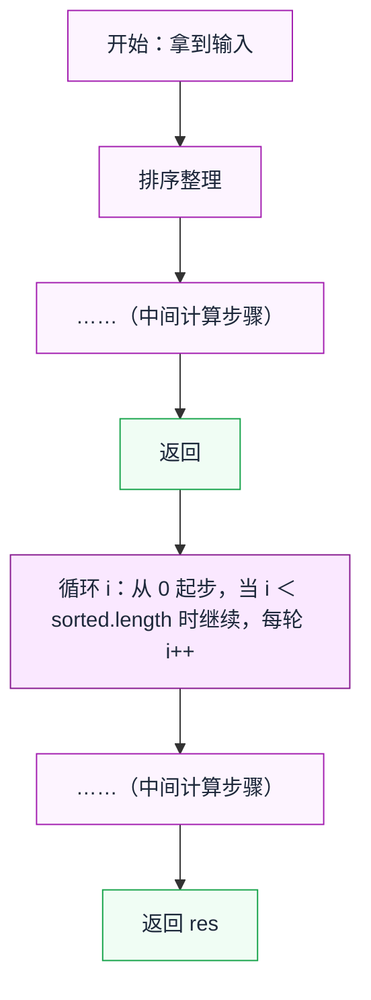

## TypeScript 解题方案（2 个方案逐个讲）

> **运行与提交**：每个方案都是自包含文件（内嵌用例自测，输出 PASS），整块复制到 `.ts` 文件后 `node 文件名` 即可运行。提交 LeetCode 时，把 `demo` 内的算法函数与辅助类型/函数整体取出、置于文件顶层即可。涉及交互/特殊接口的题以题面给定签名为准。

### 方案 1：搜索回溯

**分析与思路**：核心做法是「搜索回溯」。代码里依次做这些事：先排序再处理；单循环线性扫描；栈的后进先出操作。

**运行方式**：`node 本文件`，内嵌用例全部通过会输出 PASS。

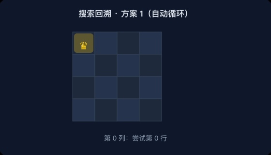

**方案专属流程图**（真实控制流）：

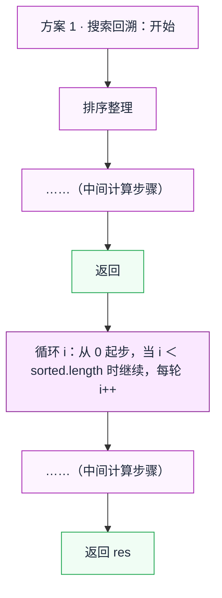

```typescript
/**
 ** LeetCode 47. 全排列 II
 ** 方案1: 搜索回溯（忠实翻译 python 参考实现）
 ** 来源：https://blog.csdn.net/tyro_java/article/details/145233874
 */

function permuteUnique(nums: number[]): number[][] {
  // 定义函数/方法 permuteUnique
  const sorted = nums.slice().sort((a, b) => a - b);
  const res: number[][] = []; // 把 []; 写入 const res: number[][]
  const used: boolean[] = new Array(sorted.length).fill(false); // 把 new Array(sorted.长度).fill(false); 写入 const used: boolean[]
  function backtrack(path: number[]): void {
    // 定义函数/方法 backtrack
    if (path.length === sorted.length) {
      // 若 当前路径.长度 全等于 sorted.长度
      res.push(path.slice()); // 把 当前路径 截取 压入栈/数组尾部
      return; // return;
    }
    for (let i = 0; i < sorted.length; i++) {
      // 让 下标 i 从 0 开始计数，下标 i 小于 sorted.长度 就继续
      if (used[i]) continue; // 若 已用标记[下标 i]) continue;
      if (i > 0 && sorted[i] === sorted[i - 1] && !used[i - 1]) continue;
      used[i] = true; // 把 true; 写入 used[i]
      path.push(sorted[i]); // 把 sorted[下标 i] 压入栈/数组尾部
      backtrack(path); // backtrack(当前路径);
      path.pop(); // 弹出栈顶元素
      used[i] = false; // 把 false; 写入 used[i]
    }
  }
  backtrack([]); // backtrack([]);
  return res; // 返回 结果
}

export function demo(): void {
  // 程序入口：跑内嵌自测用例
  function norm(x: number[][]): string {
    // 定义函数/方法 norm
    return x
      .map((r) => r.join(','))
      .sort()
      .join('|');
  }
  function eqArr2(a: number[][], b: number[][]): boolean {
    // 定义函数/方法 eqArr2
    return a.length === b.length && norm(a) === norm(b); // 返回 数组.长度 全等于 b.长度 且 norm(数组) 全等于 norm(b)
  }
  const cases: { in: number[]; want: number[][] }[] = [
    {
      in: [1, 1, 2],
      want: [
        [1, 1, 2],
        [1, 2, 1],
        [2, 1, 1],
      ],
    },
    {
      in: [1, 2, 3],
      want: [
        [1, 2, 3],
        [1, 3, 2],
        [2, 1, 3],
        [2, 3, 1],
        [3, 1, 2],
        [3, 2, 1],
      ],
    },
    { in: [1], want: [[1]] },
  ];
  let fail = false; // 把 false 存入 fail
  for (const c of cases) {
    // for (const 字符 of cases) {
    const got = permuteUnique(c.in); // 把 permuteUnique(字符.in) 存入 got
    if (!eqArr2(got, c.want)) {
      // 若 取反 eqArr2(got, 字符.want
      fail = true; // 把 true 存入 fail
      console.log(
        'FAIL permuteUnique(' +
          JSON.stringify(c.in) +
          ') got=' +
          JSON.stringify(got) +
          ' want=' +
          JSON.stringify(c.want),
      ); // 打印输出
    }
  }
  if (fail) throw new Error('FAILED'); // 若 fail) throw new Error(「FAILED」);
  console.log('PASS'); // 全部用例通过，输出 PASS
}
demo(); // demo();
```

### 方案 2：搜索回溯-优化版

**分析与思路**：核心做法是「搜索回溯-优化版」。代码里依次做这些事：先排序再处理；单循环线性扫描；栈的后进先出操作。

**运行方式**：`node 本文件`，内嵌用例全部通过会输出 PASS。

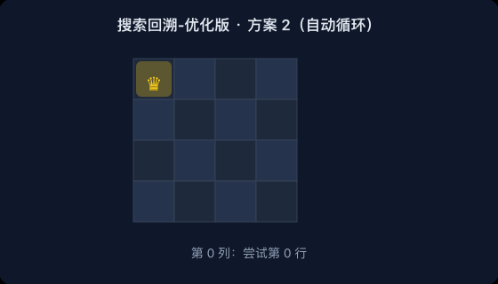

**方案专属流程图**（真实控制流）：

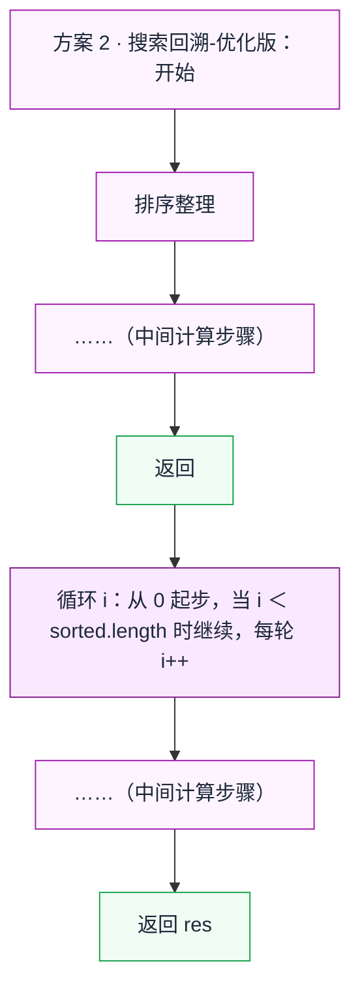

```typescript
/**
 ** LeetCode 47. 全排列 II
 ** 方案2: 搜索回溯-优化版（忠实翻译 python 参考实现）
 ** 来源：https://blog.csdn.net/tyro_java/article/details/145233874
 */

function permuteUnique(nums: number[]): number[][] {
  // 定义函数/方法 permuteUnique
  const sorted = nums.slice().sort((a, b) => a - b);
  const res: number[][] = []; // 把 []; 写入 const res: number[][]
  const used: boolean[] = new Array(sorted.length).fill(false); // 把 new Array(sorted.长度).fill(false); 写入 const used: boolean[]
  function backtrack(path: number[]): void {
    // 定义函数/方法 backtrack
    if (path.length === sorted.length) {
      // 若 当前路径.长度 全等于 sorted.长度
      res.push(path.slice()); // 把 当前路径 截取 压入栈/数组尾部
      return; // return;
    }
    for (let i = 0; i < sorted.length; i++) {
      // 让 下标 i 从 0 开始计数，下标 i 小于 sorted.长度 就继续
      if (used[i]) continue; // 若 已用标记[下标 i]) continue;
      if (i > 0 && sorted[i] === sorted[i - 1] && !used[i - 1]) continue;
      used[i] = true; // 把 true; 写入 used[i]
      path.push(sorted[i]); // 把 sorted[下标 i] 压入栈/数组尾部
      backtrack(path); // backtrack(当前路径);
      path.pop(); // 弹出栈顶元素
      used[i] = false; // 把 false; 写入 used[i]
    }
  }
  backtrack([]); // backtrack([]);
  return res; // 返回 结果
}

export function demo(): void {
  // 程序入口：跑内嵌自测用例
  function norm(x: number[][]): string {
    // 定义函数/方法 norm
    return x
      .map((r) => r.join(','))
      .sort()
      .join('|');
  }
  function eqArr2(a: number[][], b: number[][]): boolean {
    // 定义函数/方法 eqArr2
    return a.length === b.length && norm(a) === norm(b); // 返回 数组.长度 全等于 b.长度 且 norm(数组) 全等于 norm(b)
  }
  const cases: { in: number[]; want: number[][] }[] = [
    {
      in: [1, 1, 2],
      want: [
        [1, 1, 2],
        [1, 2, 1],
        [2, 1, 1],
      ],
    },
    {
      in: [1, 2, 3],
      want: [
        [1, 2, 3],
        [1, 3, 2],
        [2, 1, 3],
        [2, 3, 1],
        [3, 1, 2],
        [3, 2, 1],
      ],
    },
    { in: [1], want: [[1]] },
  ];
  let fail = false; // 把 false 存入 fail
  for (const c of cases) {
    // for (const 字符 of cases) {
    const got = permuteUnique(c.in); // 把 permuteUnique(字符.in) 存入 got
    if (!eqArr2(got, c.want)) {
      // 若 取反 eqArr2(got, 字符.want
      fail = true; // 把 true 存入 fail
      console.log(
        'FAIL permuteUnique(' +
          JSON.stringify(c.in) +
          ') got=' +
          JSON.stringify(got) +
          ' want=' +
          JSON.stringify(c.want),
      ); // 打印输出
    }
  }
  if (fail) throw new Error('FAILED'); // 若 fail) throw new Error(「FAILED」);
  console.log('PASS'); // 全部用例通过，输出 PASS
}
demo(); // demo();
```

## 逐步拆解与面试追问

**复杂度**：时间 O(n)（单趟线性扫描），空间 O(1) 到 O(n)（视辅助结构）

**为什么是这个量级**：每个元素被常数次访问，辅助哈希或栈的开销与 n 同阶

**面试官可能会追问**：

- 怎么剪枝降低无效搜索？
- 去重的关键在哪一层？
- 状态恢复遗漏会怎样？

## 关键 API 速查（TS 主解法实际用到，附官方链接）

| API | 作用 | 使用要点 | 官方文档 |
|---|---|---|---|
| `Array.prototype.sort()` | 原地排序 | 默认按字符串 Unicode 序（10 会排在 2 前），数字必须传 (a,b)=>a-b；V8 用 TimSort，稳定，O(n log n)；返回原数组引用 | [官方文档](https://developer.mozilla.org/zh-CN/docs/Web/JavaScript/Reference/Global_Objects/Array/sort) |
| `Array.prototype.map()` | 逐元素映射为新数组 | 回调 (v,i,arr)；返回等长新数组，不改变原数组；稀疏位跳过；链式调用注意中间数组开销 | [官方文档](https://developer.mozilla.org/zh-CN/docs/Web/JavaScript/Reference/Global_Objects/Array/map) |
| `Array.prototype.push()` | 尾部追加 | 返回新长度；可一次多个；均摊 O(1)；会改变原数组 | [官方文档](https://developer.mozilla.org/zh-CN/docs/Web/JavaScript/Reference/Global_Objects/Array/push) |
| `Array.prototype.pop()` | 尾部弹出 | 返回被删元素（空数组返回 undefined）；O(1) | [官方文档](https://developer.mozilla.org/zh-CN/docs/Web/JavaScript/Reference/Global_Objects/Array/pop) |
| `Array/String slice()` | 切片（不改原数组） | slice(start,end) 含头不含尾；负数从尾计；常用于复制数组（slice()） | [官方文档](https://developer.mozilla.org/zh-CN/docs/Web/JavaScript/Reference/Global_Objects/Array/slice) |
| `Array.prototype.join()` | 数组拼接为字符串 | undefined/null 转空串；嵌套数组会展平一层；join('') 用于字符数组还原 | [官方文档](https://developer.mozilla.org/zh-CN/docs/Web/JavaScript/Reference/Global_Objects/Array/join) |
| `JSON.stringify()` | 序列化为 JSON 字符串 | 常用于结构化比较（深度相等判定）；undefined/函数/循环引用会被丢弃或抛错 | [官方文档](https://developer.mozilla.org/zh-CN/docs/Web/JavaScript/Reference/Global_Objects/JSON/stringify) |

### 各语言官方文档导航

- **TypeScript / JS**：[MDN 中文参考](https://developer.mozilla.org/zh-CN/)
- **Python**：[Python 官方文档](https://docs.python.org/zh-cn/3/)
- **Go**：[Go 标准库](https://pkg.go.dev/std)
- **Java**：[JDK 17 API](https://docs.oracle.com/en/java/javase/17/docs/api/)
- **Rust**：[Rust 标准库](https://doc.rust-lang.org/std/)
- **Lua**：[Lua 5.4 手册](https://www.lua.org/manual/5.4/)
- **C**：[Cppreference C](https://zh.cppreference.com/w/c)
- **C++**：[Cppreference C++](https://zh.cppreference.com/w/cpp)
- **R**：[R 官方手册](https://stat.ethz.ch/R-manual/)
- **Zig**：[Zig 语言文档](https://ziglang.org/documentation/master/)
- **Dart**：[Dart API](https://api.dart.dev/)

## 附录：其他 10 种语言全部实现（每种语言列举其全部方案）

> TypeScript 的全部方案见「TypeScript 解题方案」一节；下面是其余 10 种语言的对应实现，每种语言的每个方案都带思路分析、代码走读与专属运行架构图。
> 每个方案都内嵌用例自测，可独立运行（老仓库 python/go 文件遵循「打印结果」约定）。
> 完整解法文件见 `dsa/<语言>/backtrack/lc_47_全排列_ii/`。

### Python 实现（2 种方案）

Python 的全部方案如下，每个方案都内嵌用例自测，可独立运行（老仓库 python/go 文件遵循「打印结果」约定）：

#### 方案 1：搜索回溯

**思路与代码分析**：核心是「搜索回溯」。Python 版用切片与字典推导式简化操作，突出可读性。代码里依次做这些事：先排序再处理。**走读**：方案 1 · 搜索回溯：开始 → 排序整理 → 返回  → 循环 i：从 0 到 len(nums 前 → 返回 res。

**运行架构**（真实控制流）：

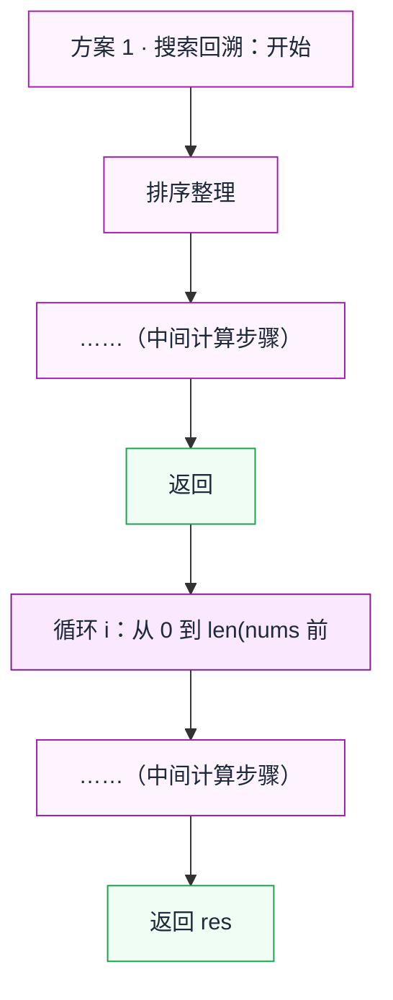

```python
import sys  # 提高递归深度上限（深输入防 RecursionError）

sys.setrecursionlimit(200000)  # 树/链表类题目节点数可达 1e4 量级

def permuteUnique(nums):  # 定义函数 permuteUnique（参数：数组）
    nums.sort()  # 排序
    res = []  # 把 [] 存入 结果
    used = [False] * len(nums)  # 把 [False] 乘 长度(数组) 存入 已用标记

    def backtrack(path):  # 定义函数 backtrack（参数：当前路径）
        if len(path) == len(nums):  # 若 长度(当前路径) 等于 长度(数组
            res.append(path[:])  # 把 复制 当前路径 追加到列表尾部
            return  # return
        for i in range(len(nums)):  # 让 下标 i 从 长度(数组 遍历
            if used[i]:  # 若 已用标记[下标 i]
                continue  # 跳过本轮，进入下一次
            if i > 0 and nums[i] == nums[i - 1] and not used[i - 1]:
                continue  # 跳过本轮，进入下一次
            used[i] = True  # 把 True 写入 used[i]
            path.append(nums[i])  # 把 数组[下标 i] 追加到列表尾部
            backtrack(path)  # backtrack(当前路径)
            path.pop()  # 弹出栈顶元素
            used[i] = False  # 把 False 写入 used[i]

    backtrack([])  # backtrack([])
    return res  # 返回 结果

if __name__ == "__main__":  # 若 __name__ 等于 '__main__'
    print(permuteUnique([1, 1, 2]))  # 打印输出
```

#### 方案 2：搜索回溯-优化版

**思路与代码分析**：核心是「搜索回溯-优化版」。Python 版用切片与字典推导式简化操作，突出可读性。代码里依次做这些事：先排序再处理。**走读**：方案 2 · 搜索回溯-优化版：开始 → 排序整理 → 返回  → 循环 i：从 0 到 len(nums 前 → 返回 ans。

**运行架构**（真实控制流）：

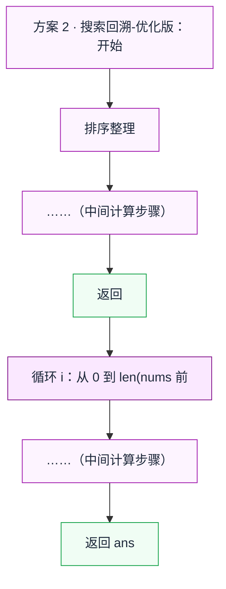

```python
import sys  # 提高递归深度上限（深输入防 RecursionError）

sys.setrecursionlimit(200000)  # 树/链表类题目节点数可达 1e4 量级

def permuteUnique(nums):  # 定义函数 permuteUnique（参数：数组）
    nums.sort()  # 排序
    ans = []  # 把 [] 存入 答案
    used = [False] * len(nums)  # 把 [False] 乘 长度(数组) 存入 已用标记

    def backtrack(path):  # 定义函数 backtrack（参数：当前路径）
        if len(path) == len(nums):  # 若 长度(当前路径) 等于 长度(数组
            ans.append(path[:])  # 把 复制 当前路径 追加到列表尾部
            return  # return
        for i in range(len(nums)):  # 让 下标 i 从 长度(数组 遍历
            if used[i]:  # 若 已用标记[下标 i]
                continue  # 跳过本轮，进入下一次
            if i > 0 and nums[i] == nums[i - 1] and not used[i - 1]:
                continue  # 跳过本轮，进入下一次
            used[i] = True  # 把 True 写入 used[i]
            path.append(nums[i])  # 把 数组[下标 i] 追加到列表尾部
            backtrack(path)  # backtrack(当前路径)
            path.pop()  # 弹出栈顶元素
            used[i] = False  # 把 False 写入 used[i]

    backtrack([])  # backtrack([])
    return ans  # 返回 答案

if __name__ == "__main__":  # 若 __name__ 等于 '__main__'
    print(permuteUnique([1, 1, 2]))  # 打印输出
```

### Go 实现（2 种方案）

Go 的全部方案如下，每个方案都内嵌用例自测，可独立运行（老仓库 python/go 文件遵循「打印结果」约定）：

#### 方案 1：搜索回溯

**思路与代码分析**：核心是「搜索回溯」。Go 版用切片与多返回值惯用法，显式处理索引边界。**走读**：方案 1 · 搜索回溯：开始 → 更新 : → 遍历 s 的下标与元素 i → 更新 out[i] → 调用 sort.Ints(out[i]) → 调用 sort.Slice(out, func(a, b in → 返回 fmt.Sprint(out[a]) ＜ fmt.Sprint(out[b]) → 返回 out。

**运行架构**（真实控制流）：

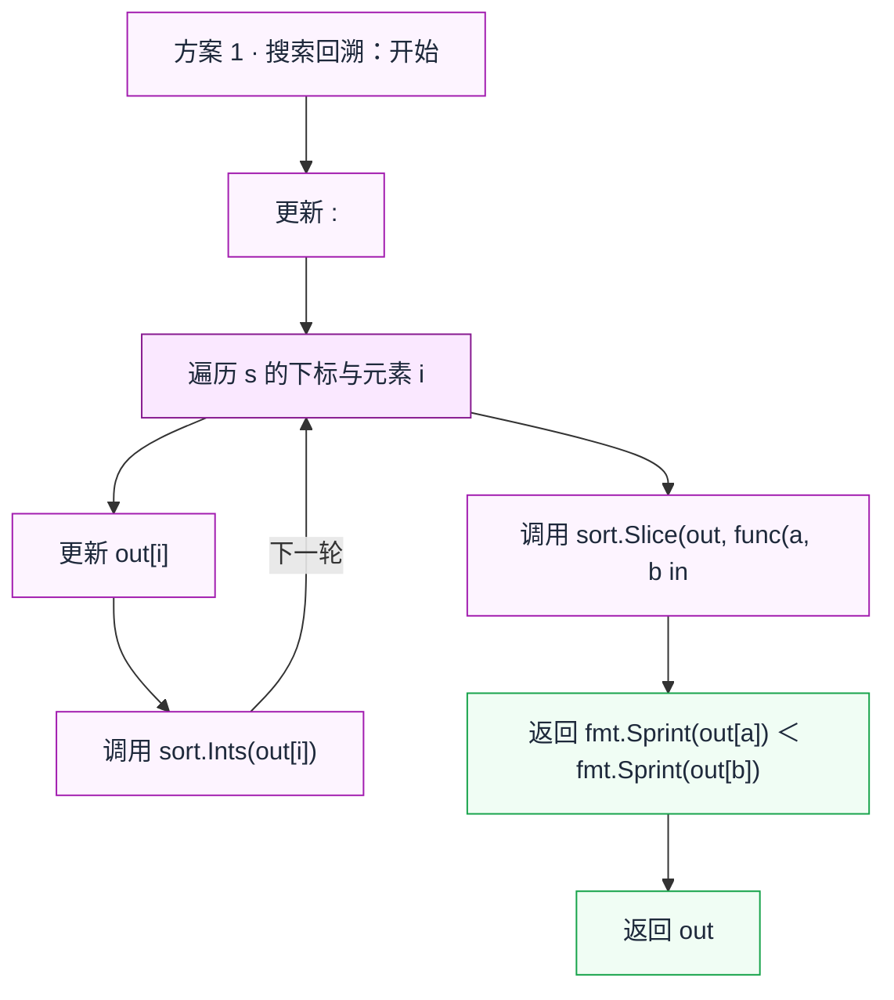

```go
package main // 引入依赖

import (
	"fmt"     // 「fmt」
	"os"      // 「os」
	"reflect" // 「reflect」
	"sort"    // 「sort」
)

func permuteUnique(nums []int) [][]int { // 定义函数/方法 permuteUnique
	sort.Ints(nums)                 // sort.Ints(数组)
	res := [][]int{}                // 把 [][]int{} 写入 res :
	used := make([]bool, len(nums)) // 把 make([]bool, 长度(数组)) 写入 used :
	var backtrack func(path []int)  // var backtrack func(当前路径 []int)
	backtrack = func(path []int) {  // 把 func(当前路径 []int) { 写入 backtrack
		if len(path) == len(nums) { // 定义函数/方法 len
			res = append(res, append([]int{}, path...)) // 把 append(结果, append([]int{}, 当前路径...)) 写入 结果
			return                                      // return
		}
		for i := 0; i < len(nums); i++ { // 让 下标 i 从 0 开始计数
			if used[i] { // 若 已用标记[下标 i]
				continue // 跳过本轮，进入下一次
			}
			if i > 0 && nums[i] == nums[i-1] && !used[i-1] { // 若 下标 i 超过 0 且 数组[下标 i] 等于 数组[下标 i 减 1] 且 取反 已用标记[下标 i 减 1]
				continue // 跳过本轮，进入下一次
			}
			used[i] = true                   // 把 true 写入 used[i]
			backtrack(append(path, nums[i])) // backtrack(append(当前路径, 数组[下标 i]))
			used[i] = false                  // 把 false 写入 used[i]
		}
	}
	backtrack([]int{}) // backtrack([]int{})
	return res         // 返回 结果
}

func norm2D(s [][]int) [][]int { // 定义函数/方法 norm2D
	out := make([][]int, len(s)) // 把 make([][]int, 长度(字符串)) 写入 out :
	for i := range s {           // 把 range 字符串 { 写入 for i :
		out[i] = append([]int{}, s[i]...) // 把 append([]int{}, 字符串[下标 i]...) 写入 out[i]
		sort.Ints(out[i])                 // sort.Ints(out[下标 i])
	}
	sort.Slice(out, func(a, b int) bool { // sort.Slice(out, func(数组, b int) bool {
		return fmt.Sprint(out[a]) < fmt.Sprint(out[b]) // 返回 fmt.Sprint(out[数组]) 小于 fmt.Sprint(out[b])
	}) // })
	return out // 返回 out
}

func main() { // 程序入口：跑内嵌自测用例
	got := norm2D(permuteUnique([]int{1, 1, 2}))             // 把 norm2D(permuteUnique([]int{1, 1, 2})) 写入 got :
	want := norm2D([][]int{{1, 1, 2}, {1, 2, 1}, {2, 1, 1}}) // 把 norm2D([][]int{{1, 1, 2}, {1, 2, 1}, {2, 1, 1}}) 写入 want :
	ok := reflect.DeepEqual(got, want)                       // 把 reflect.DeepEqual(got, want) 写入 ok :
	if !ok {                                                 // 若 取反 ok
		fmt.Printf("FAIL permuteUnique([1,1,2])=%v want %v\n", got, want) // 打印输出
		os.Exit(1)                                                        // os.Exit(1)
	}
	fmt.Println("PASS") // 全部用例通过，输出 PASS
}
```

#### 方案 2：搜索回溯-优化版

**思路与代码分析**：核心是「搜索回溯-优化版」。Go 版用切片与多返回值惯用法，显式处理索引边界。**走读**：方案 2 · 搜索回溯-优化版：开始 → 调用 sort.Ints(nums) → 返回  → 遍历循环 → 返回 ans。

**运行架构**（真实控制流）：

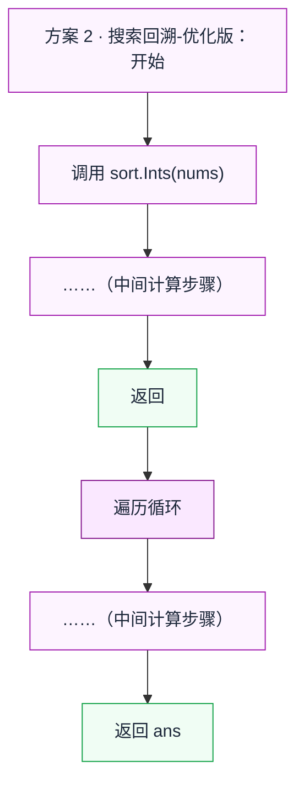

```go
package main // 引入依赖

import (
	"fmt"
	"os"
	"reflect"
	"sort"
) // 引入依赖

func permuteUnique(nums []int) [][]int { // 定义函数/方法 permuteUnique
	sort.Ints(nums)                // sort.Ints(数组)
	n := len(nums)                 // 把 长度(数组) 写入 n :
	used := make([]bool, n)        // 把 make([]bool, 元素个数) 写入 used :
	ans := [][]int{}               // 把 [][]int{} 写入 ans :
	var backtrack func(path []int) // var backtrack func(当前路径 []int)
	backtrack = func(path []int) { // 把 func(当前路径 []int) { 写入 backtrack
		if len(path) == n { // 若 长度(当前路径) 等于 元素个数
			ans = append(ans, append([]int{}, path...)) // 把 append(答案, append([]int{}, 当前路径...)) 写入 答案
			return                                      // return
		}
		for i := 0; i < n; i++ { // 让 下标 i 从 0 开始计数
			if used[i] { // 若 已用标记[下标 i]
				continue // 跳过本轮，进入下一次
			}
			if i > 0 && nums[i] == nums[i-1] && !used[i-1] { // 若 下标 i 超过 0 且 数组[下标 i] 等于 数组[下标 i 减 1] 且 取反 已用标记[下标 i 减 1]
				continue // 跳过本轮，进入下一次
			}
			used[i] = true                 // 把 true 写入 used[i]
			np := append([]int{}, path...) // 把 append([]int{}, 当前路径...) 写入 np :
			np = append(np, nums[i])       // 把 append(np, 数组[下标 i]) 写入 np
			backtrack(np)                  // backtrack(np)
			used[i] = false                // 把 false 写入 used[i]
		}
	}
	backtrack([]int{}) // backtrack([]int{})
	return ans         // 返回 答案
}

func main() { // 程序入口：跑内嵌自测用例
	cases := []struct { // 把 []struct { 写入 cases :
		in   []int   // in []int
		want [][]int // want [][]int
	}{ // }{
		{[]int{1, 1, 2}, [][]int{{1, 1, 2}, {1, 2, 1}, {2, 1, 1}}},
	}
	ok := true                // 把 true 写入 ok :
	for _, c := range cases { // 同时取 _ 与 字符 遍历
		if g := permuteUnique(c.in); !reflect.DeepEqual(g, c.want) {
			ok = false                                          // 把 false 写入 ok
			fmt.Printf("FAIL %v=%v want %v\n", c.in, g, c.want) // 打印输出
		}
	}
	if !ok { // 若 取反 ok
		os.Exit(1) // os.Exit(1)
	}
	fmt.Println("PASS") // 全部用例通过，输出 PASS
}
```

### Java 实现（2 种方案）

Java 的全部方案如下，每个方案都内嵌用例自测，可独立运行（老仓库 python/go 文件遵循「打印结果」约定）：

#### 方案 1：搜索回溯

**思路与代码分析**：核心是「搜索回溯」。Java 版用类与静态方法组织，集合操作显式明了。代码里依次做这些事：先排序再处理。**走读**：方案 1 · 搜索回溯：开始 → 排序整理 → 更新 res → 处理 new ArrayList＜＞() → 更新 used → 调用 backtrack( → 处理 nums, used, new ArrayList＜＞( → 返回 res。

**运行架构**（真实控制流）：

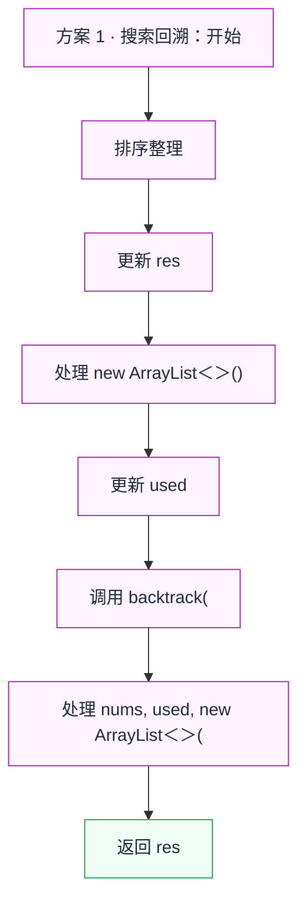

```java
package com.webfault.dsa; // 引入依赖

import java.util.*; // 引入依赖

class Lc47 { // 定义类型
  List<List<Integer>> permuteUnique(int[] nums) { // 定义函数/方法 permuteUnique
    Arrays.sort(nums); // 排序
    List<List<Integer>> res =
        new ArrayList<>(); // 把 new ArrayList 小于 超过 (); 写入 List<List<Integer>> res
    boolean[] used = new boolean[nums.length]; // 把 new boolean[数组.长度]; 写入 boolean[] used
    backtrack(
        nums, used, new ArrayList<>(), res); // backtrack(数组, 已用标记, new ArrayList 小于 超过 (), 结果);
    return res; // 返回 结果
  }

  void backtrack(
      int[] nums,
      boolean[] used,
      List<Integer> path,
      List<List<Integer>> res) { // 定义函数/方法 backtrack
    if (path.size() == nums.length) {
      res.add(new ArrayList<>(path));
      return;
    }
    for (int i = 0; i < nums.length; i++) { // 让 下标 i 从 0 开始计数，下标 i 小于 数组.长度 就继续
      if (used[i]) continue; // 若 已用标记[下标 i]) continue;
      if (i > 0 && nums[i] == nums[i - 1] && !used[i - 1]) continue;
      used[i] = true;
      path.add(nums[i]); // 把 true; 当前路径 追加 数组[下标 i]); 写入 used[i]
      backtrack(nums, used, path, res); // backtrack(数组,已用标记,当前路径,结果);
      path.remove(path.size() - 1);
      used[i] = false; // 把 false; 写入 path.remove(path.size()-1); used[i]
    }
  }

  public static void main(String[] args) { // public static void main(String[] args){
    Lc47 s = new Lc47(); // 把 new Lc47(); 写入 Lc47 s
    List<List<Integer>> got = s.permuteUnique(new int[] {1, 1, 2});
    Set<String> want = new HashSet<>(); // 把 new HashSet 小于 超过 (); 写入 Set<String> want
    want.add("1,1,2");
    want.add("1,2,1");
    want.add("2,1,1"); // want 追加 「1,1,2」);want 追加 「1,1,2」);want 追加 「1,1,2」);
    Set<String> gotSet = new HashSet<>(); // 把 new HashSet 小于 超过 (); 写入 Set<String> gotSet
    for (List<Integer> p : got) {
      StringBuilder sb = new StringBuilder();
      for (int v : p) {
        if (sb.length() > 0) sb.append(",");
        sb.append(v);
      }
      gotSet.add(sb.toString());
    } // 把 「,」 追加到列表尾部
    boolean ok =
        got.size() == 3
            && gotSet.equals(want); // 把 got.大小() 等于 3 且 gotSet.equals(want); 写入 boolean ok
    if (!ok) throw new RuntimeException("FAILED"); // 若 取反 ok) throw new RuntimeException(「FAILED」);
    System.out.println("PASS"); // 全部用例通过，输出 PASS
  }
}
```

#### 方案 2：搜索回溯-优化版

**思路与代码分析**：核心是「搜索回溯-优化版」。Java 版用类与静态方法组织，集合操作显式明了。代码里依次做这些事：先排序再处理。**走读**：方案 2 · 搜索回溯-优化版：开始 → 排序整理 → 更新 res → 处理 new ArrayList＜＞() → 更新 used → 调用 backtrack( → 处理 nums, used, new ArrayList＜＞( → 返回 res。

**运行架构**（真实控制流）：

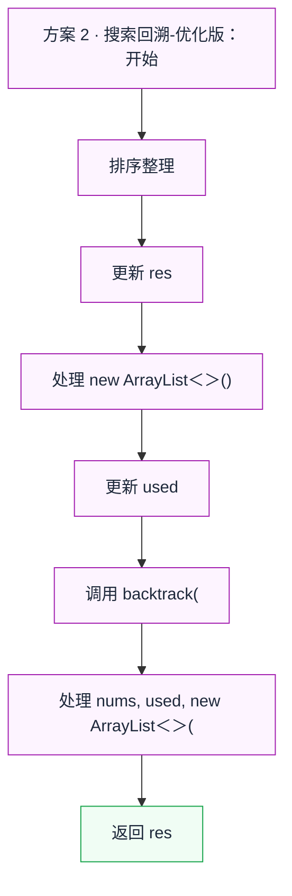

```java
package com.webfault.dsa; // 引入依赖

import java.util.*; // 引入依赖

class Lc47 { // 定义类型
  List<List<Integer>> permuteUnique(int[] nums) { // 定义函数/方法 permuteUnique
    Arrays.sort(nums); // 排序
    List<List<Integer>> res =
        new ArrayList<>(); // 把 new ArrayList 小于 超过 (); 写入 List<List<Integer>> res
    boolean[] used = new boolean[nums.length]; // 把 new boolean[数组.长度]; 写入 boolean[] used
    backtrack(
        nums, used, new ArrayList<>(), res); // backtrack(数组, 已用标记, new ArrayList 小于 超过 (), 结果);
    return res; // 返回 结果
  }

  void backtrack(
      int[] nums,
      boolean[] used,
      List<Integer> path,
      List<List<Integer>> res) { // 定义函数/方法 backtrack
    if (path.size() == nums.length) {
      res.add(new ArrayList<>(path));
      return;
    }
    for (int i = 0; i < nums.length; i++) { // 让 下标 i 从 0 开始计数，下标 i 小于 数组.长度 就继续
      if (used[i]) continue; // 若 已用标记[下标 i]) continue;
      if (i > 0 && nums[i] == nums[i - 1] && !used[i - 1]) continue;
      used[i] = true;
      path.add(nums[i]); // 把 true; 当前路径 追加 数组[下标 i]); 写入 used[i]
      backtrack(nums, used, path, res); // backtrack(数组,已用标记,当前路径,结果);
      path.remove(path.size() - 1);
      used[i] = false; // 把 false; 写入 path.remove(path.size()-1); used[i]
    }
  }

  public static void main(String[] args) { // public static void main(String[] args){
    Lc47 s = new Lc47(); // 把 new Lc47(); 写入 Lc47 s
    List<List<Integer>> got = s.permuteUnique(new int[] {1, 1, 2});
    Set<String> want = new HashSet<>(); // 把 new HashSet 小于 超过 (); 写入 Set<String> want
    want.add("1,1,2");
    want.add("1,2,1");
    want.add("2,1,1"); // want 追加 「1,1,2」);want 追加 「1,1,2」);want 追加 「1,1,2」);
    Set<String> gotSet = new HashSet<>(); // 把 new HashSet 小于 超过 (); 写入 Set<String> gotSet
    for (List<Integer> p : got) {
      StringBuilder sb = new StringBuilder();
      for (int v : p) {
        if (sb.length() > 0) sb.append(",");
        sb.append(v);
      }
      gotSet.add(sb.toString());
    } // 把 「,」 追加到列表尾部
    boolean ok =
        got.size() == 3
            && gotSet.equals(want); // 把 got.大小() 等于 3 且 gotSet.equals(want); 写入 boolean ok
    if (!ok) throw new RuntimeException("FAILED"); // 若 取反 ok) throw new RuntimeException(「FAILED」);
    System.out.println("PASS"); // 全部用例通过，输出 PASS
  }
}
```

### Rust 实现（2 种方案）

Rust 的全部方案如下，每个方案都内嵌用例自测，可独立运行（老仓库 python/go 文件遵循「打印结果」约定）：

#### 方案 1：搜索回溯

**思路与代码分析**：核心是「搜索回溯」。Rust 版用所有权移动与切片借用改写同一逻辑，注意 Option 与引用边界。代码里依次做这些事：先排序再处理；栈的后进先出操作。**走读**：方案 1 · 搜索回溯：开始 → 排序整理 → 返回  → 遍历 0..nums.len() 中的每个元素 i。

**运行架构**（真实控制流）：

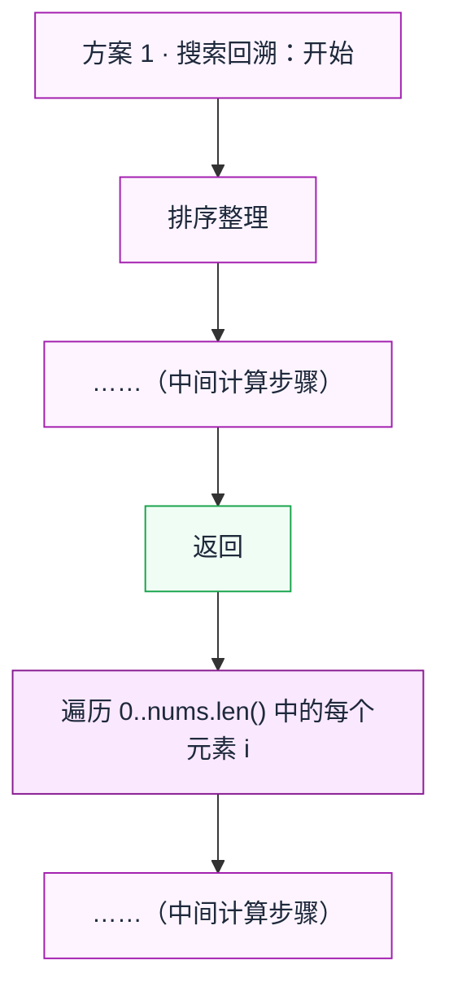

```rust
// LeetCode 47. 全排列II — Rust 版（方案1）
fn permute_unique(mut nums: Vec<i32>) -> Vec<Vec<i32>> {
    // 定义函数/方法 permute_unique
    nums.sort(); // 排序
    let mut res = Vec::new(); // 把 Vec::new(); 写入 let mut res
    let mut path = Vec::new(); // 把 Vec::new(); 写入 let mut path
    let mut used = vec![false; nums.len()]; // 把 vec取反 [false; 数组.长度()]; 写入 let mut used
    fn dfs(nums: &[i32], used: &mut Vec<bool>, path: &mut Vec<i32>, res: &mut Vec<Vec<i32>>) {
        // 定义函数/方法 dfs
        if path.len() == nums.len() {
            res.push(path.clone());
            return;
        } // 若 当前路径.长度() 等于 数组.长度() { 结果 追加 当前路径.clone()); return; }
        for i in 0..nums.len() {
            // 逐个取出 0 的元素（下标 i）
            if used[i] {
                continue;
            } // 若 已用标记[下标 i] { continue; }
            if i > 0 && nums[i] == nums[i - 1] && !used[i - 1] {
                continue;
            }
            used[i] = true; // 把 true; 写入 used[i]
            path.push(nums[i]); // 把 数组[下标 i] 压入栈/数组尾部
            dfs(nums, used, path, res); // dfs(数组, 已用标记, 当前路径, 结果);
            path.pop(); // 弹出栈顶元素
            used[i] = false; // 把 false; 写入 used[i]
        }
    }
    dfs(&nums, &mut used, &mut path, &mut res); // dfs( 按位与 数组, 按位与 mut 已用标记, 按位与 mut 当前路径, 按位与 mut 结果);
    res // 结果
}
fn main() {
    // 程序入口：跑内嵌自测用例
    let got = permute_unique(vec![1, 1, 2]); // 把 permute_unique(vec取反 [1, 1, 2]) 存入 got
    let want = vec![vec![1, 1, 2], vec![1, 2, 1], vec![2, 1, 1]]; // 把 vec取反 [vec取反 [1,1,2],vec取反 [1,2,1],vec取反 [2,1,1]] 存入 want
    assert_eq!(got, want); // 断言校验
    assert_eq!(permute_unique(vec![1, 2, 3]).len(), 6); // 断言校验
    println!("PASS"); // 全部用例通过，输出 PASS
}
```

#### 方案 2：搜索回溯-优化版

**思路与代码分析**：核心是「搜索回溯-优化版」。Rust 版用所有权移动与切片借用改写同一逻辑，注意 Option 与引用边界。代码里依次做这些事：先排序再处理；栈的后进先出操作。**走读**：方案 2 · 搜索回溯-优化版：开始 → 排序整理 → 返回  → 遍历 0..nums.len() 中的每个元素 i。

**运行架构**（真实控制流）：

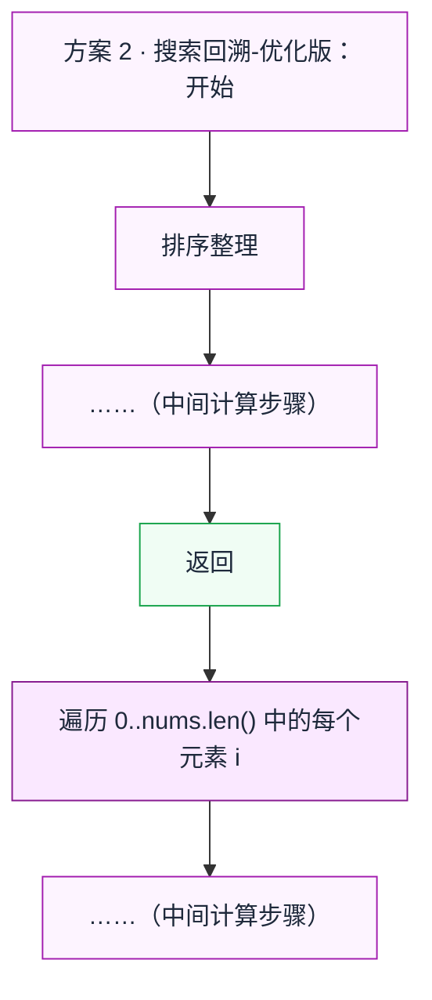

```rust
// LeetCode 47. 全排列II — Rust 版（方案2）
fn permute_unique(mut nums: Vec<i32>) -> Vec<Vec<i32>> {
    // 定义函数/方法 permute_unique
    nums.sort(); // 排序
    let mut res = Vec::new(); // 把 Vec::new(); 写入 let mut res
    let mut path = Vec::new(); // 把 Vec::new(); 写入 let mut path
    let mut used = vec![false; nums.len()]; // 把 vec取反 [false; 数组.长度()]; 写入 let mut used
    fn dfs(nums: &[i32], used: &mut Vec<bool>, path: &mut Vec<i32>, res: &mut Vec<Vec<i32>>) {
        // 定义函数/方法 dfs
        if path.len() == nums.len() {
            res.push(path.clone());
            return;
        } // 若 当前路径.长度() 等于 数组.长度() { 结果 追加 当前路径.clone()); return; }
        for i in 0..nums.len() {
            // 逐个取出 0 的元素（下标 i）
            if used[i] {
                continue;
            } // 若 已用标记[下标 i] { continue; }
            if i > 0 && nums[i] == nums[i - 1] && !used[i - 1] {
                continue;
            }
            used[i] = true; // 把 true; 写入 used[i]
            path.push(nums[i]); // 把 数组[下标 i] 压入栈/数组尾部
            dfs(nums, used, path, res); // dfs(数组, 已用标记, 当前路径, 结果);
            path.pop(); // 弹出栈顶元素
            used[i] = false; // 把 false; 写入 used[i]
        }
    }
    dfs(&nums, &mut used, &mut path, &mut res); // dfs( 按位与 数组, 按位与 mut 已用标记, 按位与 mut 当前路径, 按位与 mut 结果);
    res // 结果
}
fn main() {
    // 程序入口：跑内嵌自测用例
    let got = permute_unique(vec![1, 1, 2]); // 把 permute_unique(vec取反 [1, 1, 2]) 存入 got
    let want = vec![vec![1, 1, 2], vec![1, 2, 1], vec![2, 1, 1]]; // 把 vec取反 [vec取反 [1,1,2],vec取反 [1,2,1],vec取反 [2,1,1]] 存入 want
    assert_eq!(got, want); // 断言校验
    assert_eq!(permute_unique(vec![1, 2, 3]).len(), 6); // 断言校验
    println!("PASS"); // 全部用例通过，输出 PASS
}
```

### Lua 实现（2 种方案）

Lua 的全部方案如下，每个方案都内嵌用例自测，可独立运行（老仓库 python/go 文件遵循「打印结果」约定）：

#### 方案 1：搜索回溯

**思路与代码分析**：核心是「搜索回溯」。Lua 版用表与 ipairs 遍历，注意 ipairs 遇 nil 即停的语义。代码里依次做这些事：先排序再处理；递归求解子问题。**走读**：方案 1 · 搜索回溯：开始 → 更新 arr → 返回  → 循环 i：从 1 到 n do → 返回 res。

**运行架构**（真实控制流）：

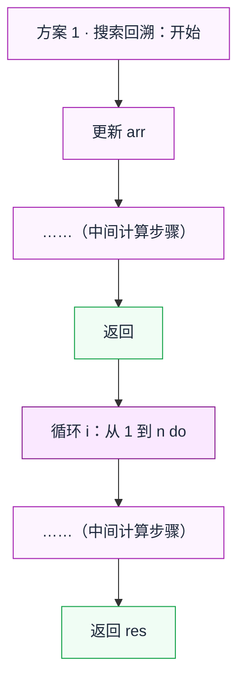

```lua
-- LeetCode 47. 全排列II — Lua 版（方案1）
local function permute_unique(nums) -- local function permute_unique(数组)
	local arr = { table.unpack(nums) } -- 把 {table.unpack(数组)} 写入 local arr
	table.sort(arr) -- 排序
	local res = {} -- 把 {} 写入 local res
	local n = #arr -- 把 #数组 写入 local n
	local used = {} -- 把 {} 写入 local used
	local path = {} -- 把 {} 写入 local path
	local function dfs() -- local function dfs()
		if #path == n then -- 若 #当前路径 等于 元素个数 then
			res[#res + 1] = { table.unpack(path) } -- 把 {table.unpack(当前路径)} 写入 res[#res + 1]
			return -- return
		end -- 终点
		for i = 1, n do -- 让 下标 i 从 1 走到 元素个数（Lua 1 基）
			if not used[i] then -- 若 not 已用标记[下标 i] then
				if i == 1 or arr[i] ~= arr[i - 1] or used[i - 1] then
					used[i] = true -- 把 true 写入 used[i]
					path[#path + 1] = arr[i] -- 把 数组[下标 i] 写入 path[#path + 1]
					dfs() -- dfs()
					path[#path] = nil -- 把 nil 写入 path[#path]
					used[i] = false -- 把 false 写入 used[i]
				end -- 终点
			end -- 终点
		end -- 终点
	end -- 终点
	dfs() -- dfs()
	return res -- 返回 结果
end -- 终点
local got = permute_unique({ 1, 1, 2 }) -- 把 permute_unique({1, 1, 2}) 写入 local got
assert(#got == 3) -- 断言校验
assert(
	table.concat(got[1], ",") == "1,1,2"
		and table.concat(got[2], ",") == "1,2,1"
		and table.concat(got[3], ",") == "2,1,1"
) -- 打印输出
assert(#permute_unique({ 1, 2, 3 }) == 6) -- 断言校验
print("PASS") -- 全部用例通过，输出 PASS
```

#### 方案 2：搜索回溯-优化版

**思路与代码分析**：核心是「搜索回溯-优化版」。Lua 版用表与 ipairs 遍历，注意 ipairs 遇 nil 即停的语义。代码里依次做这些事：先排序再处理；递归求解子问题。**走读**：方案 2 · 搜索回溯-优化版：开始 → 更新 arr → 返回  → 循环 i：从 1 到 n do → 返回 res。

**运行架构**（真实控制流）：

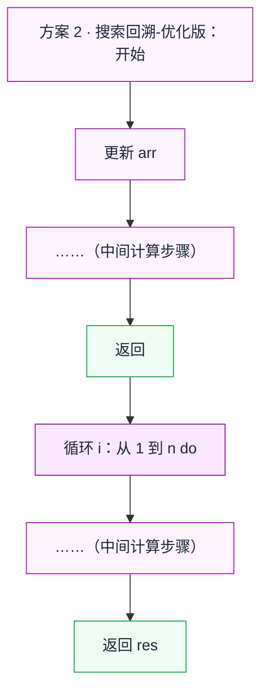

```lua
-- LeetCode 47. 全排列II — Lua 版（方案2）
local function permute_unique(nums) -- local function permute_unique(数组)
	local arr = { table.unpack(nums) } -- 把 {table.unpack(数组)} 写入 local arr
	table.sort(arr) -- 排序
	local res = {} -- 把 {} 写入 local res
	local n = #arr -- 把 #数组 写入 local n
	local used = {} -- 把 {} 写入 local used
	local path = {} -- 把 {} 写入 local path
	local function dfs() -- local function dfs()
		if #path == n then -- 若 #当前路径 等于 元素个数 then
			res[#res + 1] = { table.unpack(path) } -- 把 {table.unpack(当前路径)} 写入 res[#res + 1]
			return -- return
		end -- 终点
		for i = 1, n do -- 让 下标 i 从 1 走到 元素个数（Lua 1 基）
			if not used[i] then -- 若 not 已用标记[下标 i] then
				if i == 1 or arr[i] ~= arr[i - 1] or used[i - 1] then
					used[i] = true -- 把 true 写入 used[i]
					path[#path + 1] = arr[i] -- 把 数组[下标 i] 写入 path[#path + 1]
					dfs() -- dfs()
					path[#path] = nil -- 把 nil 写入 path[#path]
					used[i] = false -- 把 false 写入 used[i]
				end -- 终点
			end -- 终点
		end -- 终点
	end -- 终点
	dfs() -- dfs()
	return res -- 返回 结果
end -- 终点
local got = permute_unique({ 1, 1, 2 }) -- 把 permute_unique({1, 1, 2}) 写入 local got
assert(#got == 3) -- 断言校验
assert(
	table.concat(got[1], ",") == "1,1,2"
		and table.concat(got[2], ",") == "1,2,1"
		and table.concat(got[3], ",") == "2,1,1"
) -- 打印输出
assert(#permute_unique({ 1, 2, 3 }) == 6) -- 断言校验
print("PASS") -- 全部用例通过，输出 PASS
```

### C 实现（2 种方案）

C 的全部方案如下，每个方案都内嵌用例自测，可独立运行（老仓库 python/go 文件遵循「打印结果」约定）：

#### 方案 1：搜索回溯

**思路与代码分析**：核心是「搜索回溯」。C 版手动管理下标与内存，循环边界全部显式写出。代码里依次做这些事：单循环线性扫描。**走读**：方案 1 · 搜索回溯：开始 → 更新 n_g → 更新 res_n → 遍历循环 → 更新 arr_g[i] → 更新 used[i] → 调用 qsort(arr_g, n, sizeof(int), → 调用 dfs(0) → 返回 res_n。

**运行架构**（真实控制流）：

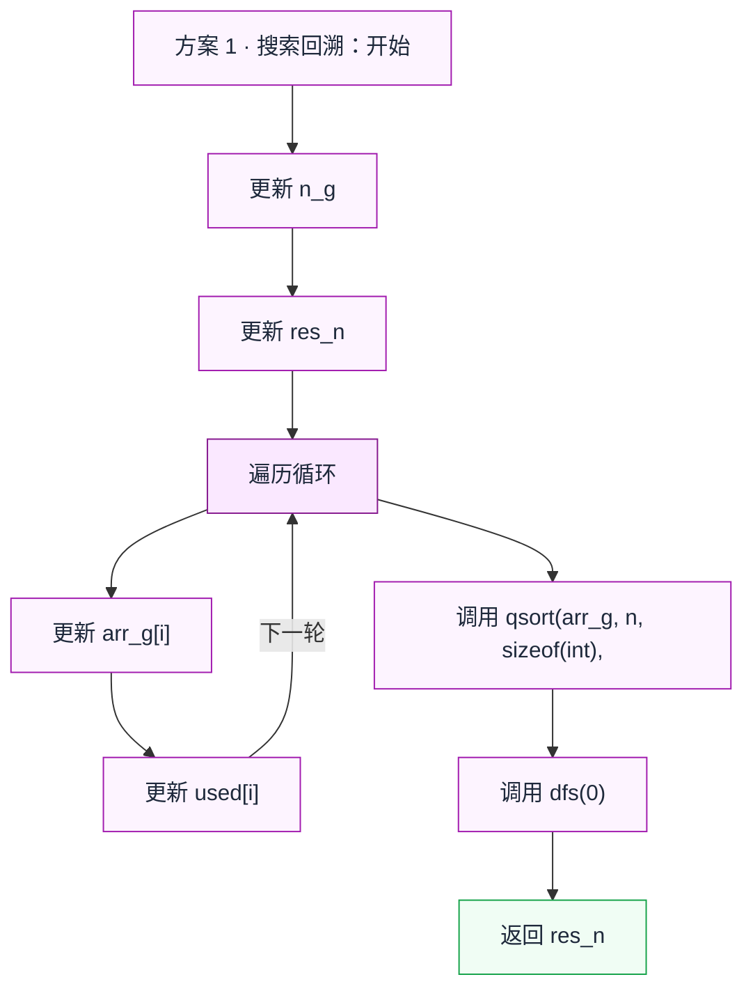

```c
/* LeetCode 47. 全排列II — C 版（方案1） */
#include <stdio.h>  // 引入头文件
#include <stdlib.h> // 引入头文件
static int cmp_int(const void *a, const void *b) { return *(const int *)a - *(const int *)b; }
static int res[720][8], res_n, used[8], path[8], arr_g[8], n_g;
static void dfs(int depth) { // 定义函数/方法 dfs
    if (depth == n_g) {      // 若 深度 等于 n_g
        for (int i = 0; i < n_g; i++)
            res[res_n][i] = path[i]; // 让 下标 i 从 0 开始计数，下标 i 小于 n_g 就继续
        res_n++;                     // res_n 加一
        return;                      // return;
    }
    for (int i = 0; i < n_g; i++) { // 让 下标 i 从 0 开始计数，下标 i 小于 n_g 就继续
        if (used[i])
            continue; // 若 已用标记[下标 i]) continue;
        if (i > 0 && arr_g[i] == arr_g[i - 1] && !used[i - 1])
            continue;
        used[i] = 1;            // 把 1; 写入 used[i]
        path[depth] = arr_g[i]; // 把 arr_g[下标 i]; 写入 path[depth]
        dfs(depth + 1);         // dfs(深度 加 1);
        used[i] = 0;            // 把 0; 写入 used[i]
    }
}
static int permute_unique(const int *nums, int n) { // 定义函数/方法 permute_unique
    n_g = n;
    res_n = 0; // 把 元素个数; res_n 赋值为 0; 写入 n_g
    for (int i = 0; i < n; i++) {
        arr_g[i] = nums[i];
        used[i] = 0;
    } // 让 下标 i 从 0 开始计数，下标 i 小于 元素个数 就继续
    qsort(arr_g, n, sizeof(int), cmp_int); // qsort(arr_g, 元素个数, sizeof(int), cmp_int);
    dfs(0);                                // dfs(0);
    return res_n;                          // 返回 res_n
}
int main(void) {                                 // 程序入口：跑内嵌自测用例
    int n = permute_unique((int[]){1, 1, 2}, 3); // 把 permute_unique((int[]){1,1,2}, 3) 存入 元素个数
    if (n != 3) {
        printf("FAIL cnt=%d\n", n);
        return 1;
    } // 若 元素个数 不等于 3) { 输出「FAIL 计数 赋值为 对…取模 d 」, 元素个数); return 1; }
    if (res[0][0] != 1 || res[0][1] != 1 || res[0][2] != 2) {
        printf("FAIL p1\n");
        return 1;
    }
    if (res[1][0] != 1 || res[1][1] != 2 || res[1][2] != 1) {
        printf("FAIL p2\n");
        return 1;
    }
    if (res[2][0] != 2 || res[2][1] != 1 || res[2][2] != 1) {
        printf("FAIL p3\n");
        return 1;
    }
    if (permute_unique((int[]){1, 2, 3}, 3) != 6) {
        printf("FAIL 2\n");
        return 1;
    }
    printf("PASS\n"); // 全部用例通过，输出 PASS
    return 0;         // 返回 0
}
```

#### 方案 2：搜索回溯-优化版

**思路与代码分析**：核心是「搜索回溯-优化版」。C 版手动管理下标与内存，循环边界全部显式写出。代码里依次做这些事：单循环线性扫描。**走读**：方案 2 · 搜索回溯-优化版：开始 → 更新 n_g → 更新 res_n → 遍历循环 → 更新 arr_g[i] → 更新 used[i] → 调用 qsort(arr_g, n, sizeof(int), → 调用 dfs(0) → 返回 res_n。

**运行架构**（真实控制流）：

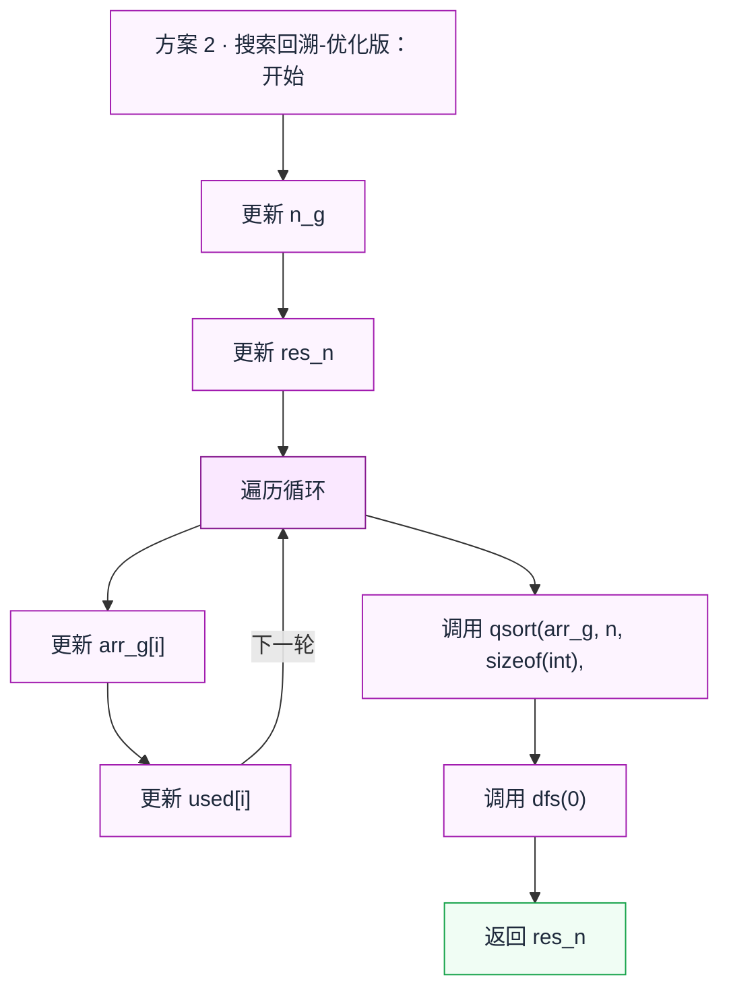

```c
/* LeetCode 47. 全排列II — C 版（方案2） */
#include <stdio.h>  // 引入头文件
#include <stdlib.h> // 引入头文件
static int cmp_int(const void *a, const void *b) { return *(const int *)a - *(const int *)b; }
static int res[720][8], res_n, used[8], path[8], arr_g[8], n_g;
static void dfs(int depth) { // 定义函数/方法 dfs
    if (depth == n_g) {      // 若 深度 等于 n_g
        for (int i = 0; i < n_g; i++)
            res[res_n][i] = path[i]; // 让 下标 i 从 0 开始计数，下标 i 小于 n_g 就继续
        res_n++;                     // res_n 加一
        return;                      // return;
    }
    for (int i = 0; i < n_g; i++) { // 让 下标 i 从 0 开始计数，下标 i 小于 n_g 就继续
        if (used[i])
            continue; // 若 已用标记[下标 i]) continue;
        if (i > 0 && arr_g[i] == arr_g[i - 1] && !used[i - 1])
            continue;
        used[i] = 1;            // 把 1; 写入 used[i]
        path[depth] = arr_g[i]; // 把 arr_g[下标 i]; 写入 path[depth]
        dfs(depth + 1);         // dfs(深度 加 1);
        used[i] = 0;            // 把 0; 写入 used[i]
    }
}
static int permute_unique(const int *nums, int n) { // 定义函数/方法 permute_unique
    n_g = n;
    res_n = 0; // 把 元素个数; res_n 赋值为 0; 写入 n_g
    for (int i = 0; i < n; i++) {
        arr_g[i] = nums[i];
        used[i] = 0;
    } // 让 下标 i 从 0 开始计数，下标 i 小于 元素个数 就继续
    qsort(arr_g, n, sizeof(int), cmp_int); // qsort(arr_g, 元素个数, sizeof(int), cmp_int);
    dfs(0);                                // dfs(0);
    return res_n;                          // 返回 res_n
}
int main(void) {                                 // 程序入口：跑内嵌自测用例
    int n = permute_unique((int[]){1, 1, 2}, 3); // 把 permute_unique((int[]){1,1,2}, 3) 存入 元素个数
    if (n != 3) {
        printf("FAIL cnt=%d\n", n);
        return 1;
    } // 若 元素个数 不等于 3) { 输出「FAIL 计数 赋值为 对…取模 d 」, 元素个数); return 1; }
    if (res[0][0] != 1 || res[0][1] != 1 || res[0][2] != 2) {
        printf("FAIL p1\n");
        return 1;
    }
    if (res[1][0] != 1 || res[1][1] != 2 || res[1][2] != 1) {
        printf("FAIL p2\n");
        return 1;
    }
    if (res[2][0] != 2 || res[2][1] != 1 || res[2][2] != 1) {
        printf("FAIL p3\n");
        return 1;
    }
    if (permute_unique((int[]){1, 2, 3}, 3) != 6) {
        printf("FAIL 2\n");
        return 1;
    }
    printf("PASS\n"); // 全部用例通过，输出 PASS
    return 0;         // 返回 0
}
```

### C++ 实现（2 种方案）

C++ 的全部方案如下，每个方案都内嵌用例自测，可独立运行（老仓库 python/go 文件遵循「打印结果」约定）：

#### 方案 1：搜索回溯

**思路与代码分析**：核心是「搜索回溯」。C++ 版用 STL 容器与迭代器，减少手写下标错误。代码里依次做这些事：单循环线性扫描。**走读**：方案 1 · 搜索回溯：开始 → 处理 std::sort(nums.begin(), nums → 返回  → 遍历循环 → 返回 res。

**运行架构**（真实控制流）：

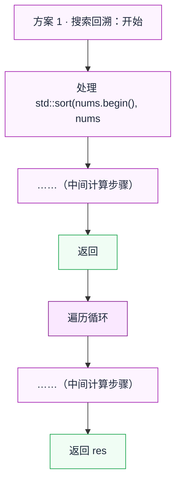

```cpp
// LeetCode 47. 全排列II — C++ 版（方案1）
#include <algorithm> // 引入头文件
#include <cassert>   // 引入头文件
#include <iostream>  // 引入头文件
#include <vector>    // 引入头文件
static std::vector<std::vector<int>> permuteUnique(std::vector<int> nums) {
    std::sort(nums.begin(), nums.end()); // std::sort(数组 迭代位置 , 数组.终点());
    std::vector<std::vector<int>> res;   // std::vector 小于 std::vector 小于 int 超过 超过 结果;
    std::vector<int> path;               // std::vector 小于 int 超过 当前路径;
    std::vector<bool> used(nums.size(), false); // std::vector 小于 bool 超过 已用标记(数组.大小(), false);
    std::function<void()> dfs = [&]() { // 把 [ 按位与 ]() { 写入 std::function<void()> dfs
        if (path.size() == nums.size()) {
            res.push_back(path);
            return;
        } // 若 当前路径.大小() 等于 数组.大小()) { 结果 追加 当前路径); return; }
        for (size_t i = 0; i < nums.size(); ++i) { // 让 下标 i 从 0 开始计数，下标 i 小于 数组.大小() 就继续
            if (used[i])
                continue; // 若 已用标记[下标 i]) continue;
            if (i > 0 && nums[i] == nums[i - 1] && !used[i - 1])
                continue;
            used[i] = true;          // 把 true; 写入 used[i]
            path.push_back(nums[i]); // 当前路径 追加 数组[下标 i]);
            dfs();                   // dfs();
            path.pop_back();         // 弹出栈顶元素
            used[i] = false;         // 把 false; 写入 used[i]
        }
    };
    dfs();      // dfs();
    return res; // 返回 结果
}
int main() { // 程序入口：跑内嵌自测用例
    assert((permuteUnique({1, 1, 2}) ==
            std::vector<std::vector<int>>{{1, 1, 2}, {1, 2, 1}, {2, 1, 1}})); // 断言校验
    assert(permuteUnique({1, 2, 3}).size() == 6);                             // 断言校验
    std::cout << "PASS" << std::endl; // 全部用例通过，输出 PASS
    return 0;                         // 返回 0
}
```

#### 方案 2：搜索回溯-优化版

**思路与代码分析**：核心是「搜索回溯-优化版」。C++ 版用 STL 容器与迭代器，减少手写下标错误。代码里依次做这些事：单循环线性扫描。**走读**：方案 2 · 搜索回溯-优化版：开始 → 处理 std::sort(nums.begin(), nums → 返回  → 遍历循环 → 返回 res。

**运行架构**（真实控制流）：

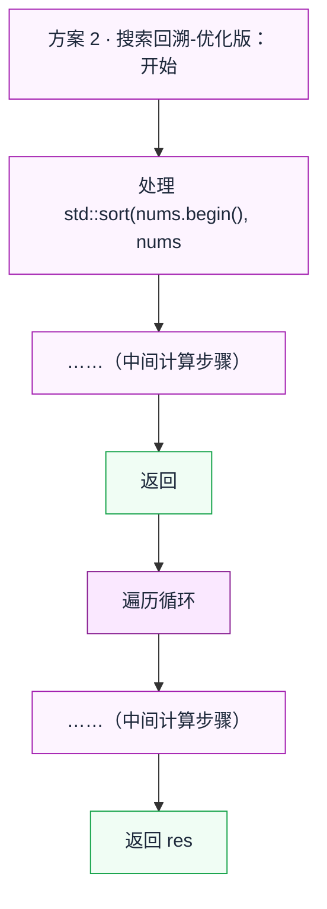

```cpp
// LeetCode 47. 全排列II — C++ 版（方案2）
#include <algorithm> // 引入头文件
#include <cassert>   // 引入头文件
#include <iostream>  // 引入头文件
#include <vector>    // 引入头文件
static std::vector<std::vector<int>> permuteUnique(std::vector<int> nums) {
    std::sort(nums.begin(), nums.end()); // std::sort(数组 迭代位置 , 数组.终点());
    std::vector<std::vector<int>> res;   // std::vector 小于 std::vector 小于 int 超过 超过 结果;
    std::vector<int> path;               // std::vector 小于 int 超过 当前路径;
    std::vector<bool> used(nums.size(), false); // std::vector 小于 bool 超过 已用标记(数组.大小(), false);
    std::function<void()> dfs = [&]() { // 把 [ 按位与 ]() { 写入 std::function<void()> dfs
        if (path.size() == nums.size()) {
            res.push_back(path);
            return;
        } // 若 当前路径.大小() 等于 数组.大小()) { 结果 追加 当前路径); return; }
        for (size_t i = 0; i < nums.size(); ++i) { // 让 下标 i 从 0 开始计数，下标 i 小于 数组.大小() 就继续
            if (used[i])
                continue; // 若 已用标记[下标 i]) continue;
            if (i > 0 && nums[i] == nums[i - 1] && !used[i - 1])
                continue;
            used[i] = true;          // 把 true; 写入 used[i]
            path.push_back(nums[i]); // 当前路径 追加 数组[下标 i]);
            dfs();                   // dfs();
            path.pop_back();         // 弹出栈顶元素
            used[i] = false;         // 把 false; 写入 used[i]
        }
    };
    dfs();      // dfs();
    return res; // 返回 结果
}
int main() { // 程序入口：跑内嵌自测用例
    assert((permuteUnique({1, 1, 2}) ==
            std::vector<std::vector<int>>{{1, 1, 2}, {1, 2, 1}, {2, 1, 1}})); // 断言校验
    assert(permuteUnique({1, 2, 3}).size() == 6);                             // 断言校验
    std::cout << "PASS" << std::endl; // 全部用例通过，输出 PASS
    return 0;                         // 返回 0
}
```

### R 实现（2 种方案）

R 的全部方案如下，每个方案都内嵌用例自测，可独立运行（老仓库 python/go 文件遵循「打印结果」约定）：

#### 方案 1：搜索回溯

**思路与代码分析**：核心是「搜索回溯」。R 版用向量化思维与 1 起始下标，注意 1:n 的降序陷阱。代码里依次做这些事：单循环线性扫描。**走读**：方案 1 · 搜索回溯：开始 → 处理 arr ＜- sort(nums) → 返回 (invisible(NULL)) → 循环 i：遍历 seq_len(n)。

**运行架构**（真实控制流）：

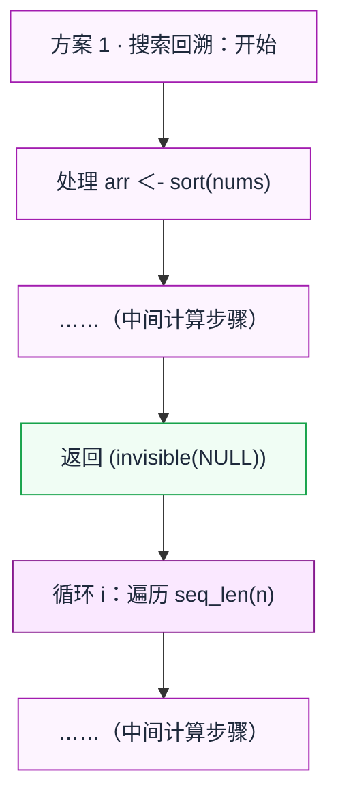

```r
# 版（方案1） 定义函数 permute_unique（参数：数组）
permute_unique <- function(nums) {
    arr <- sort(nums)  # 把 sort(数组) 存入 数组
    res <- list()  # 把 列表() 存入 结果
    n <- length(arr)  # 把 长度(数组) 存入 元素个数
    used <- rep(FALSE, n)  # 把 rep(FALSE, 元素个数) 存入 已用标记
    path <- integer(0)  # 把 integer(0) 存入 当前路径
    dfs <- function() {
        # 定义函数 dfs（参数：无） 若 长度(当前路径) 等于 元素个数
        if (length(path) == n) {
            res[[length(res) + 1L]] <<- path  # 结果[[长度(结果) 加 1L]] 小于 小于 减 当前路径
            return(invisible(NULL))  # 返回 invisible(NULL
        }
        for (i in seq_len(n)) {
            # for (下标 i in seq_len(元素个数)) { 若 取反 已用标记[下标 i] 若 下标 i 等于 1 或 数组[下标 i]
            # 不等于 数组[下标 i 减 1] 或 已用标记[下标 i 减 1]
            if (!used[i]) {
                if (i == 1 || arr[i] != arr[i - 1] || used[i - 1]) {
                  used[i] <<- TRUE  # 已用标记[下标 i] 小于 小于 减 TRUE
                  path <<- c(path, arr[i])  # 当前路径 小于 小于 减 字符(当前路径, 数组[下标 i])
                  dfs()  # dfs()
                  path <<- path[-length(path)]  # 当前路径 小于 小于 减 当前路径[ 减 长度(当前路径)]
                  used[i] <<- FALSE  # 已用标记[下标 i] 小于 小于 减 FALSE
                }
            }
        }
    }
    dfs()  # dfs()
    res  # 结果
}
got <- permute_unique(c(1, 1, 2))  # 把 permute_unique(字符(1, 1, 2)) 存入 got
stopifnot(length(got) == 3)  # 断言校验
stopifnot(identical(got[[1]], c(1, 1, 2)), identical(got[[2]], c(1, 2, 1)), identical(got[[3]], c(2, 1, 1)))  # 断言校验
stopifnot(length(permute_unique(c(1, 2, 3))) == 6)  # 断言校验
cat("PASS\n")  # 全部用例通过，输出 PASS
```

#### 方案 2：搜索回溯-优化版

**思路与代码分析**：核心是「搜索回溯-优化版」。R 版用向量化思维与 1 起始下标，注意 1:n 的降序陷阱。代码里依次做这些事：单循环线性扫描。**走读**：方案 2 · 搜索回溯-优化版：开始 → 处理 arr ＜- sort(nums) → 返回 (invisible(NULL)) → 循环 i：遍历 seq_len(n)。

**运行架构**（真实控制流）：

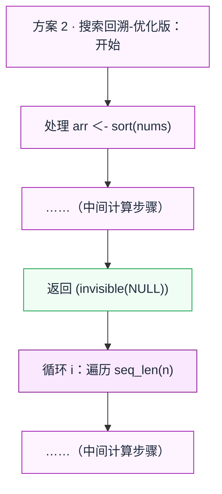

```r
# 版（方案2） 定义函数 permute_unique（参数：数组）
permute_unique <- function(nums) {
    arr <- sort(nums)  # 把 sort(数组) 存入 数组
    res <- list()  # 把 列表() 存入 结果
    n <- length(arr)  # 把 长度(数组) 存入 元素个数
    used <- rep(FALSE, n)  # 把 rep(FALSE, 元素个数) 存入 已用标记
    path <- integer(0)  # 把 integer(0) 存入 当前路径
    dfs <- function() {
        # 定义函数 dfs（参数：无） 若 长度(当前路径) 等于 元素个数
        if (length(path) == n) {
            res[[length(res) + 1L]] <<- path  # 结果[[长度(结果) 加 1L]] 小于 小于 减 当前路径
            return(invisible(NULL))  # 返回 invisible(NULL
        }
        for (i in seq_len(n)) {
            # for (下标 i in seq_len(元素个数)) { 若 取反 已用标记[下标 i] 若 下标 i 等于 1 或 数组[下标 i]
            # 不等于 数组[下标 i 减 1] 或 已用标记[下标 i 减 1]
            if (!used[i]) {
                if (i == 1 || arr[i] != arr[i - 1] || used[i - 1]) {
                  used[i] <<- TRUE  # 已用标记[下标 i] 小于 小于 减 TRUE
                  path <<- c(path, arr[i])  # 当前路径 小于 小于 减 字符(当前路径, 数组[下标 i])
                  dfs()  # dfs()
                  path <<- path[-length(path)]  # 当前路径 小于 小于 减 当前路径[ 减 长度(当前路径)]
                  used[i] <<- FALSE  # 已用标记[下标 i] 小于 小于 减 FALSE
                }
            }
        }
    }
    dfs()  # dfs()
    res  # 结果
}
got <- permute_unique(c(1, 1, 2))  # 把 permute_unique(字符(1, 1, 2)) 存入 got
stopifnot(length(got) == 3)  # 断言校验
stopifnot(identical(got[[1]], c(1, 1, 2)), identical(got[[2]], c(1, 2, 1)), identical(got[[3]], c(2, 1, 1)))  # 断言校验
stopifnot(length(permute_unique(c(1, 2, 3))) == 6)  # 断言校验
cat("PASS\n")  # 全部用例通过，输出 PASS
```

### Zig 实现（2 种方案）

Zig 的全部方案如下，每个方案都内嵌用例自测，可独立运行（老仓库 python/go 文件遵循「打印结果」约定）：

#### 方案 1：搜索回溯

**思路与代码分析**：核心是「搜索回溯」。Zig 版显式分配与清零，整型边界处理严格。代码里依次做这些事：单循环线性扫描。**走读**：方案 1 · 搜索回溯：开始 → 计算 arr → 返回  → 遍历集合元素。

**运行架构**（真实控制流）：

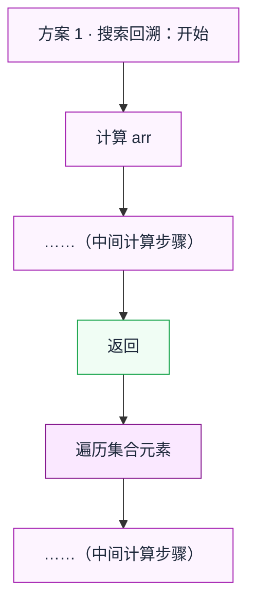

```zig
// LeetCode 47. 全排列II — Zig 版（方案1）
const std = @import("std"); // 把 @import(「std」) 存入 std
fn permuteUnique(nums_in: []const i32, alloc: std.mem.Allocator, res: *std.ArrayList(std.ArrayList(i32))) void { // 定义函数/方法 permuteUnique
    const arr = alloc.dupe(i32, nums_in) catch unreachable; // 把 alloc.dupe(i32, nums_in) catch unreachable 存入 数组
    std.sort.pdq(i32, arr, {}, std.sort.asc(i32)); // std.sort.pdq(i32, 数组, {}, std.sort.asc(i32));
    const D = struct { // 把 struct { 存入 D
        fn dfs(ns: []const i32, used: []bool, path: *std.ArrayList(i32), out: *std.ArrayList(std.ArrayList(i32))) void { // 定义函数/方法 dfs
            if (path.items.len == ns.len) { // 若 当前路径.items.长度 等于 ns.长度
                var cp = std.ArrayList(i32).init(out.allocator); // 把 std.ArrayList(i32).init(out.allocator) 存入 cp
                cp.appendSlice(path.items) catch unreachable; // cp.appendSlice(当前路径.items) catch unreachable;
                out.append(cp) catch unreachable; // 把 cp 追加到列表尾部
                return; // return;
            }
            for (ns, 0..) |v, i| { // for (ns, 0..) 按位或 值, 下标 i 按位或 {
                if (used[i]) continue; // 若 已用标记[下标 i]) continue;
                if (i > 0 and ns[i] == ns[i - 1] and !used[i - 1]) continue;
                used[i] = true; // 把 true; 写入 used[i]
                path.append(v) catch unreachable; // 把 值 追加到列表尾部
                dfs(ns, used, path, out); // dfs(ns, 已用标记, 当前路径, out);
                _ = path.pop(); // 弹出栈顶元素
                used[i] = false; // 把 false; 写入 used[i]
            }
        }
    };
    const used = alloc.alloc(bool, arr.len) catch unreachable; // 把 alloc.alloc(bool, 数组.长度) catch unreachable 存入 已用标记
    @memset(used, false); // @memset(已用标记, false);
    var path = std.ArrayList(i32).init(alloc); // 把 std.ArrayList(i32).init(alloc) 存入 当前路径
    D.dfs(arr, used, &path, res); // D.dfs(数组, 已用标记, 按位与 当前路径, 结果);
}
pub fn main() !void { // 程序入口：跑内嵌自测用例
    var arena = std.heap.ArenaAllocator.init(std.heap.page_allocator); // 把 std.堆.ArenaAllocator.init(std.堆.page_allocator) 存入 arena
    defer arena.deinit(); // defer arena.deinit();
    const alloc = arena.allocator(); // 把 arena.allocator() 存入 alloc
    var res = std.ArrayList(std.ArrayList(i32)).init(std.heap.page_allocator);
    defer res.deinit(); // defer 结果.deinit();
    permuteUnique(&[_]i32{ 1, 1, 2 }, alloc, &res); // permuteUnique( 按位与 [_]i32{ 1, 1, 2 }, alloc, 按位与 结果);
    if (res.items.len != 3) return error.TestFailed; // 若 结果.items.长度 不等于 3，直接返回 error.TestFailed
    const w1 = [_]i32{ 1, 1, 2 }; // 把 [_]i32{ 1, 1, 2 } 存入 w1
    for (w1, 0..) |w, i| if (res.items[0].items[i] != w) return error.TestFailed;
    if (res.items[1].items[0] != 1 or res.items[1].items[1] != 2 or res.items[1].items[2] != 1) return error.TestFailed;
    if (res.items[2].items[0] != 2) return error.TestFailed; // 若 结果.items[2].items[0] 不等于 2，直接返回 error.TestFailed
    std.debug.print("PASS\n", .{}); // 全部用例通过，输出 PASS
}
```

#### 方案 2：搜索回溯-优化版

**思路与代码分析**：核心是「搜索回溯-优化版」。Zig 版显式分配与清零，整型边界处理严格。代码里依次做这些事：单循环线性扫描。**走读**：方案 2 · 搜索回溯-优化版：开始 → 计算 arr → 返回  → 遍历集合元素。

**运行架构**（真实控制流）：

```mermaid
graph TD
    N0["方案 2 · 搜索回溯-优化版：开始"]
    N1["计算 arr"]
    D1["……（中间计算步骤）"]
    N8["返回 "]
    N9["遍历集合元素"]
    Dend["……（中间计算步骤）"]
    N0 --> N1
    N8 --> N9
    N1 --> D1
    D1 --> N8
    N9 --> Dend
    classDef n fill:#fdf4ff,stroke:#a21caf,color:#1e293b;
    classDef lp fill:#fae8ff,stroke:#86198f,color:#1e293b;
    classDef dc fill:#fef9c3,stroke:#ca8a04,color:#1e293b;
    classDef tm fill:#f0fdf4,stroke:#16a34a,color:#1e293b;
    class N0,N1,D1,Dend n;
    class N9 lp;
    class N8 tm;
```

```zig
// LeetCode 47. 全排列II — Zig 版（方案2）
const std = @import("std"); // 把 @import(「std」) 存入 std
fn permuteUnique(nums_in: []const i32, alloc: std.mem.Allocator, res: *std.ArrayList(std.ArrayList(i32))) void { // 定义函数/方法 permuteUnique
    const arr = alloc.dupe(i32, nums_in) catch unreachable; // 把 alloc.dupe(i32, nums_in) catch unreachable 存入 数组
    std.sort.pdq(i32, arr, {}, std.sort.asc(i32)); // std.sort.pdq(i32, 数组, {}, std.sort.asc(i32));
    const D = struct { // 把 struct { 存入 D
        fn dfs(ns: []const i32, used: []bool, path: *std.ArrayList(i32), out: *std.ArrayList(std.ArrayList(i32))) void { // 定义函数/方法 dfs
            if (path.items.len == ns.len) { // 若 当前路径.items.长度 等于 ns.长度
                var cp = std.ArrayList(i32).init(out.allocator); // 把 std.ArrayList(i32).init(out.allocator) 存入 cp
                cp.appendSlice(path.items) catch unreachable; // cp.appendSlice(当前路径.items) catch unreachable;
                out.append(cp) catch unreachable; // 把 cp 追加到列表尾部
                return; // return;
            }
            for (ns, 0..) |v, i| { // for (ns, 0..) 按位或 值, 下标 i 按位或 {
                if (used[i]) continue; // 若 已用标记[下标 i]) continue;
                if (i > 0 and ns[i] == ns[i - 1] and !used[i - 1]) continue;
                used[i] = true; // 把 true; 写入 used[i]
                path.append(v) catch unreachable; // 把 值 追加到列表尾部
                dfs(ns, used, path, out); // dfs(ns, 已用标记, 当前路径, out);
                _ = path.pop(); // 弹出栈顶元素
                used[i] = false; // 把 false; 写入 used[i]
            }
        }
    };
    const used = alloc.alloc(bool, arr.len) catch unreachable; // 把 alloc.alloc(bool, 数组.长度) catch unreachable 存入 已用标记
    @memset(used, false); // @memset(已用标记, false);
    var path = std.ArrayList(i32).init(alloc); // 把 std.ArrayList(i32).init(alloc) 存入 当前路径
    D.dfs(arr, used, &path, res); // D.dfs(数组, 已用标记, 按位与 当前路径, 结果);
}
pub fn main() !void { // 程序入口：跑内嵌自测用例
    var arena = std.heap.ArenaAllocator.init(std.heap.page_allocator); // 把 std.堆.ArenaAllocator.init(std.堆.page_allocator) 存入 arena
    defer arena.deinit(); // defer arena.deinit();
    const alloc = arena.allocator(); // 把 arena.allocator() 存入 alloc
    var res = std.ArrayList(std.ArrayList(i32)).init(std.heap.page_allocator);
    defer res.deinit(); // defer 结果.deinit();
    permuteUnique(&[_]i32{ 1, 1, 2 }, alloc, &res); // permuteUnique( 按位与 [_]i32{ 1, 1, 2 }, alloc, 按位与 结果);
    if (res.items.len != 3) return error.TestFailed; // 若 结果.items.长度 不等于 3，直接返回 error.TestFailed
    const w1 = [_]i32{ 1, 1, 2 }; // 把 [_]i32{ 1, 1, 2 } 存入 w1
    for (w1, 0..) |w, i| if (res.items[0].items[i] != w) return error.TestFailed;
    if (res.items[1].items[0] != 1 or res.items[1].items[1] != 2 or res.items[1].items[2] != 1) return error.TestFailed;
    if (res.items[2].items[0] != 2) return error.TestFailed; // 若 结果.items[2].items[0] 不等于 2，直接返回 error.TestFailed
    std.debug.print("PASS\n", .{}); // 全部用例通过，输出 PASS
}
```

### Dart 实现（2 种方案）

Dart 的全部方案如下，每个方案都内嵌用例自测，可独立运行（老仓库 python/go 文件遵循「打印结果」约定）：

#### 方案 1：搜索回溯

**思路与代码分析**：核心是「搜索回溯」。Dart 版用可空类型标注与集合方法，注意空安全。代码里依次做这些事：先排序再处理；单循环线性扫描。**走读**：方案 1 · 搜索回溯：开始 → 更新 arr → 返回  → 遍历循环 → 返回 res。

**运行架构**（真实控制流）：

```mermaid
graph TD
    N0["方案 1 · 搜索回溯：开始"]
    N1["更新 arr"]
    D1["……（中间计算步骤）"]
    N12["返回 "]
    N13["遍历循环"]
    D2["……（中间计算步骤）"]
    N22["返回 res"]
    N0 --> N1
    N12 --> N13
    N1 --> D1
    D1 --> N12
    N13 --> D2
    D2 --> N22
    classDef n fill:#fdf4ff,stroke:#a21caf,color:#1e293b;
    classDef lp fill:#fae8ff,stroke:#86198f,color:#1e293b;
    classDef dc fill:#fef9c3,stroke:#ca8a04,color:#1e293b;
    classDef tm fill:#f0fdf4,stroke:#16a34a,color:#1e293b;
    class N0,N1,D1,D2 n;
    class N13 lp;
    class N12,N22 tm;
```

```dart
// LeetCode 47. 全排列II — Dart 版（方案1）
List<List<int>> permuteUnique(List<int> nums) {
  // 定义函数/方法 permuteUnique
  final arr = List<int>.from(nums)
    ..sort(); // 把 List 小于 int 超过 .from(数组). 排序 ) 存入 数组
  final res = <List<int>>[]; // 把 小于 List 小于 int 超过 超过 [] 存入 结果
  final used = List<bool>.filled(
    arr.length,
    false,
  ); // 把 List 小于 bool 超过 .filled(数组.长度, false) 存入 已用标记
  final path = <int>[]; // 把 小于 int 超过 [] 存入 当前路径
  void dfs() {
    // 定义函数/方法 dfs
    if (path.length == arr.length) {
      // 若 当前路径.长度 等于 数组.长度
      res.add(List<int>.from(path)); // 结果 追加 List 小于 int 超过 .from(当前路径));
      return; // return;
    }
    for (var i = 0; i < arr.length; i++) {
      // 让 下标 i 从 0 开始计数，下标 i 小于 数组.长度 就继续
      if (used[i]) continue; // 若 已用标记[下标 i]) continue;
      if (i > 0 && arr[i] == arr[i - 1] && !used[i - 1]) continue;
      used[i] = true; // 把 true; 写入 used[i]
      path.add(arr[i]); // 当前路径 追加 数组[下标 i]);
      dfs(); // dfs();
      path.removeLast(); // 当前路径.removeLast();
      used[i] = false; // 把 false; 写入 used[i]
    }
  }

  dfs(); // dfs();
  return res; // 返回 结果
}

void main() {
  // 程序入口：跑内嵌自测用例
  final got = permuteUnique([1, 1, 2]); // 把 permuteUnique([1, 1, 2]) 存入 got
  if (got.length != 3)
    throw StateError('cnt'); // 若 got.长度 不等于 3) throw StateError('计数');
  if (got[0].toString() != '[1, 1, 2]' ||
      got[1].toString() != '[1, 2, 1]' ||
      got[2].toString() != '[2, 1, 1]')
    throw StateError('p');
  if (permuteUnique([1, 2, 3]).length != 6)
    throw StateError(
      'c2',
    ); // 若 permuteUnique([1, 2, 3]).长度 不等于 6) throw StateError('c2');
  print('PASS'); // 全部用例通过，输出 PASS
}
```

#### 方案 2：搜索回溯-优化版

**思路与代码分析**：核心是「搜索回溯-优化版」。Dart 版用可空类型标注与集合方法，注意空安全。代码里依次做这些事：先排序再处理；单循环线性扫描。**走读**：方案 2 · 搜索回溯-优化版：开始 → 更新 arr → 返回  → 遍历循环 → 返回 res。

**运行架构**（真实控制流）：

```mermaid
graph TD
    N0["方案 2 · 搜索回溯-优化版：开始"]
    N1["更新 arr"]
    D1["……（中间计算步骤）"]
    N12["返回 "]
    N13["遍历循环"]
    D2["……（中间计算步骤）"]
    N22["返回 res"]
    N0 --> N1
    N12 --> N13
    N1 --> D1
    D1 --> N12
    N13 --> D2
    D2 --> N22
    classDef n fill:#fdf4ff,stroke:#a21caf,color:#1e293b;
    classDef lp fill:#fae8ff,stroke:#86198f,color:#1e293b;
    classDef dc fill:#fef9c3,stroke:#ca8a04,color:#1e293b;
    classDef tm fill:#f0fdf4,stroke:#16a34a,color:#1e293b;
    class N0,N1,D1,D2 n;
    class N13 lp;
    class N12,N22 tm;
```

```dart
// LeetCode 47. 全排列II — Dart 版（方案2）
List<List<int>> permuteUnique(List<int> nums) {
  // 定义函数/方法 permuteUnique
  final arr = List<int>.from(nums)
    ..sort(); // 把 List 小于 int 超过 .from(数组). 排序 ) 存入 数组
  final res = <List<int>>[]; // 把 小于 List 小于 int 超过 超过 [] 存入 结果
  final used = List<bool>.filled(
    arr.length,
    false,
  ); // 把 List 小于 bool 超过 .filled(数组.长度, false) 存入 已用标记
  final path = <int>[]; // 把 小于 int 超过 [] 存入 当前路径
  void dfs() {
    // 定义函数/方法 dfs
    if (path.length == arr.length) {
      // 若 当前路径.长度 等于 数组.长度
      res.add(List<int>.from(path)); // 结果 追加 List 小于 int 超过 .from(当前路径));
      return; // return;
    }
    for (var i = 0; i < arr.length; i++) {
      // 让 下标 i 从 0 开始计数，下标 i 小于 数组.长度 就继续
      if (used[i]) continue; // 若 已用标记[下标 i]) continue;
      if (i > 0 && arr[i] == arr[i - 1] && !used[i - 1]) continue;
      used[i] = true; // 把 true; 写入 used[i]
      path.add(arr[i]); // 当前路径 追加 数组[下标 i]);
      dfs(); // dfs();
      path.removeLast(); // 当前路径.removeLast();
      used[i] = false; // 把 false; 写入 used[i]
    }
  }

  dfs(); // dfs();
  return res; // 返回 结果
}

void main() {
  // 程序入口：跑内嵌自测用例
  final got = permuteUnique([1, 1, 2]); // 把 permuteUnique([1, 1, 2]) 存入 got
  if (got.length != 3)
    throw StateError('cnt'); // 若 got.长度 不等于 3) throw StateError('计数');
  if (got[0].toString() != '[1, 1, 2]' ||
      got[1].toString() != '[1, 2, 1]' ||
      got[2].toString() != '[2, 1, 1]')
    throw StateError('p');
  if (permuteUnique([1, 2, 3]).length != 6)
    throw StateError(
      'c2',
    ); // 若 permuteUnique([1, 2, 3]).长度 不等于 6) throw StateError('c2');
  print('PASS'); // 全部用例通过，输出 PASS
}
```

---

## 内容总结

- **全排列 ii**（回溯 · Medium）：共 2 个方案，主线思路「搜索回溯」；时间 O(n)（单趟线性扫描）；动画演示回溯棋盘过程，附录给出 11 种语言 × 全部方案的可运行实现。
- 来源博客：[https://blog.csdn.net/tyro_java/article/details/145233874](https://blog.csdn.net/tyro_java/article/details/145233874)
- 导航：[📋 总目录](../) ｜ [← 160 全排列](../160_全排列/) ｜ [162 n 皇后 →](../162_n_皇后/)
