# 162 · n 皇后（第九阶段 · 回溯与递归 · Medium）

> **难度**：⭐⭐ Medium ｜ **专题**：回溯
> **学习定位**：第九阶段 · 回溯与递归第 162 篇 ｜ **解法数**：3
> **内容总结**：**n 皇后**（回溯 · Medium）：共 3 个方案，主线思路「基于集合的回溯」；时间 O(n)（单趟线性扫描）；动画演示回溯棋盘过程，附录给出 11 种语言 × 全部方案的可运行实现。

---

## 题目描述

按照国际象棋的规则，皇后可以攻击与之处在同一行或同一列或同一斜线上的棋子。

n 皇后问题 研究的是如何将 `n` 个皇后放置在 `n×n` 的棋盘上，并且使皇后彼此之间不能相互攻击。

给你一个整数 `n` ，返回所有不同的 n 皇后问题 的解决方案。

每一种解法包含一个不同的 n 皇后问题 的棋子放置方案，该方案中 `'Q'` 和 `'.'` 分别代表了皇后和空位。

- 主函数签名：`function solveNQueens(n: number): string[][]`

**用例（来自原题）**：

**示例 1**

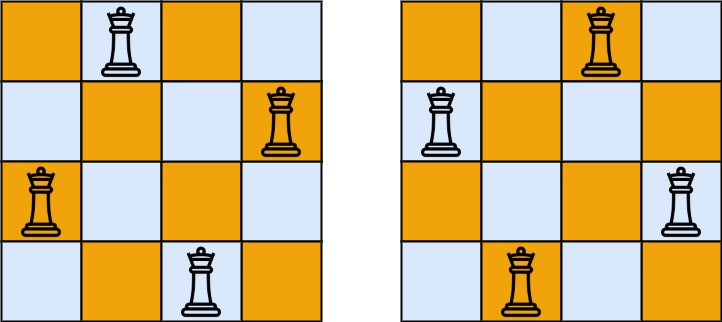

```text
输入：n = 4
输出：[[".Q..","...Q","Q...","..Q."],["..Q.","Q...","...Q",".Q.."]]
```

解释：如上图所示，4 皇后问题存在两个不同的解法。

**示例 2**

```text
输入：n = 1
输出：[["Q"]]
```
> 题面与 [leetcode.cn 官方](https://leetcode.cn/problems/n-queens/)一致，示例配图取自官方题面。

**数据范围与注意事项**：

- `1 <= n <= 9`
- **易错点**：递归返回后要把当前选择撤销干净，否则结果集会被污染。

## 题目分析

**场景是什么**：系统地试所有可能并及时回头，对应真实开发里的组合枚举、约束求解、路径规划。本题就是该场景的 Medium 级练习，主线做法是「基于集合的回溯」。

**主线怎么解**：把主解法从头到尾过一遍，它其实在依次做这几件事：哈希结构做计数或查重 → 双重循环遍历。

## 解题思路

**方案对比**（共 3 个方案，由浅入深）：

| 方案 | 时间复杂度 | 空间复杂度 |
|---|---|---|
| 方案 1 · 基于集合的回溯 | O(n)（单趟线性扫描） | O(1) 到 O(n)（视辅助结构） |
| 方案 2 · 基于集合+棋盘构建的回溯 | O(n)（单趟线性扫描） | O(1) 到 O(n)（视辅助结构） |
| 方案 3 · 布尔数组回溯 | O(n)（单趟线性扫描） | O(1) 到 O(n)（视辅助结构） |

**由浅入深的路径**：基于集合的回溯 → 基于集合+棋盘构建的回溯 → 布尔数组回溯；每往右一步，都在补上一步的短板。

**方案间的取舍**：方案 1（基于集合的回溯）；方案 2（基于集合+棋盘构建的回溯）；方案 3（布尔数组回溯）。数据规模小、可读性优先时选靠前的方案；规模大、性能优先时选靠后的方案。

**怎么读这一篇**：

- 🐣 **新手路线**：把「题目描述」的示例 1 在纸上手推一遍 → 读方案 1（最直观的写法）与它的代码走读 → 按「运行方式」本地跑通看 PASS → 回头对比方案 2 之后的写法差在哪
- 🦅 **大佬路线**：直接锁定最优方案 1（基于集合的回溯，O(n)（单趟线性扫描））→ 跳读该方案代码与走读 → 用「逐步拆解与面试追问」补齐复杂度推导与边界追问

### 动态算法图（回溯棋盘，GIF 自动循环）


动画演示回溯专题里回溯棋盘的典型过程；每个方案在「TypeScript 解题方案」一节还配了专属动画与专属流程图。

### 主解法流程图（真实控制流）

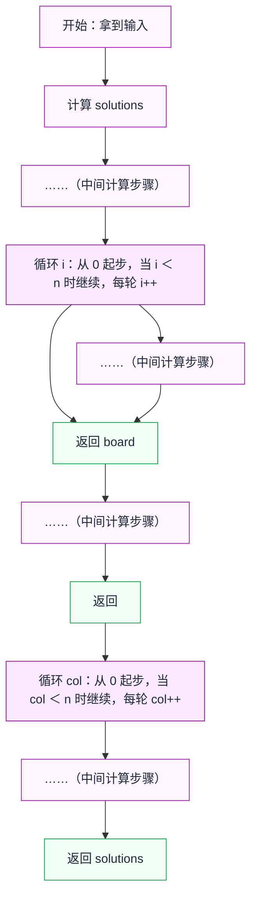

## TypeScript 解题方案（3 个方案逐个讲）

> **运行与提交**：每个方案都是自包含文件（内嵌用例自测，输出 PASS），整块复制到 `.ts` 文件后 `node 文件名` 即可运行。提交 LeetCode 时，把 `demo` 内的算法函数与辅助类型/函数整体取出、置于文件顶层即可。涉及交互/特殊接口的题以题面给定签名为准。

### 方案 1：基于集合的回溯

**分析与思路**：核心做法是「基于集合的回溯」。代码里依次做这些事：哈希结构做计数或查重；双重循环遍历。

**运行方式**：`node 本文件`，内嵌用例全部通过会输出 PASS。

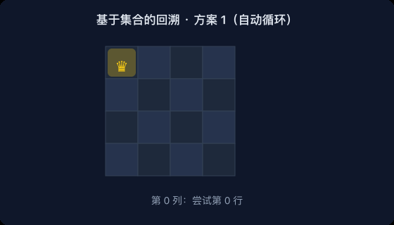

**方案专属流程图**（真实控制流）：

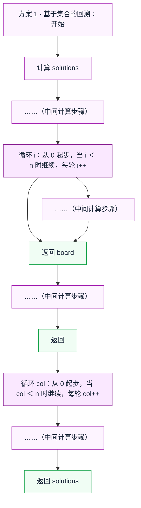

```typescript
/**
 ** LeetCode 51. N 皇后
 ** 方案1: 基于集合的回溯（忠实翻译 python 参考实现）
 ** 来源：https://blog.csdn.net/tyro_java/article/details/145239695
 */

function solveNQueens(n: number): string[][] {
  // 定义函数/方法 solveNQueens
  const solutions: string[][] = []; // 把 []; 写入 const solutions: string[][]
  const queens: number[] = new Array(n).fill(-1); // 把 new Array(元素个数).fill( 减 1); 写入 const queens: number[]
  const columns = new Set<number>(); // 把 new Set 小于 number 超过 () 存入 columns
  const diagonal1 = new Set<number>(); // 把 new Set 小于 number 超过 () 存入 diagonal1
  const diagonal2 = new Set<number>(); // 把 new Set 小于 number 超过 () 存入 diagonal2
  function generateBoard(): string[] {
    // 定义函数/方法 generateBoard
    const board: string[] = []; // 把 []; 写入 const board: string[]
    for (let i = 0; i < n; i++) {
      // 让 下标 i 从 0 开始计数，下标 i 小于 元素个数 就继续
      const rowArr = new Array(n).fill('.'); // 把 new Array(元素个数).fill('.') 存入 rowArr
      rowArr[queens[i]] = 'Q'; // 把 'Q'; 写入 rowArr[queens[i]]
      board.push(rowArr.join('')); // 把 rowArr.join('' 压入栈/数组尾部
    }
    return board; // 返回 棋盘
  }
  function backtrack(row: number): void {
    // 定义函数/方法 backtrack
    if (row === n) {
      // 若 row 全等于 元素个数
      solutions.push(generateBoard()); // 把 generateBoard( 压入栈/数组尾部
      return; // return;
    }
    for (let col = 0; col < n; col++) {
      // 让 col 从 0 开始计数，col 小于 元素个数 就继续
      if (
        columns.has(col) ||
        diagonal1.has(row - col) ||
        diagonal2.has(row + col)
      )
        continue;
      queens[row] = col; // 把 col; 写入 queens[row]
      columns.add(col); // columns 追加 col);
      diagonal1.add(row - col); // diagonal1 追加 row 减 col);
      diagonal2.add(row + col); // diagonal2 追加 row 加 col);
      backtrack(row + 1); // backtrack(row 加 1);
      columns.delete(col); // columns.delete(col);
      diagonal1.delete(row - col); // diagonal1.delete(row 减 col);
      diagonal2.delete(row + col); // diagonal2.delete(row 加 col);
    }
  }
  backtrack(0); // backtrack(0);
  return solutions; // 返回 solutions
}

export function demo(): void {
  // 程序入口：跑内嵌自测用例
  function norm(x: string[][]): string {
    // 定义函数/方法 norm
    return x
      .map((b) => b.join('/'))
      .sort()
      .join('|');
  }
  let fail = false; // 把 false 存入 fail
  if (norm(solveNQueens(1)) !== norm([['Q']])) {
    fail = true;
    console.log('FAIL n=1');
  }
  const want4 = [
    ['.Q..', '...Q', 'Q...', '..Q.'],
    ['..Q.', 'Q...', '...Q', '.Q..'],
  ];
  if (norm(solveNQueens(4)) !== norm(want4)) {
    fail = true;
    console.log('FAIL n=4 got=' + JSON.stringify(solveNQueens(4)));
  }
  if (solveNQueens(5).length !== 10) {
    fail = true;
    console.log('FAIL n=5 count');
  }
  if (fail) throw new Error('FAILED'); // 若 fail) throw new Error(「FAILED」);
  console.log('PASS'); // 全部用例通过，输出 PASS
}
demo(); // demo();
```

### 方案 2：基于集合+棋盘构建的回溯

**分析与思路**：核心做法是「基于集合+棋盘构建的回溯」。代码里依次做这些事：哈希结构做计数或查重；单循环线性扫描；栈的后进先出操作。

**运行方式**：`node 本文件`，内嵌用例全部通过会输出 PASS。

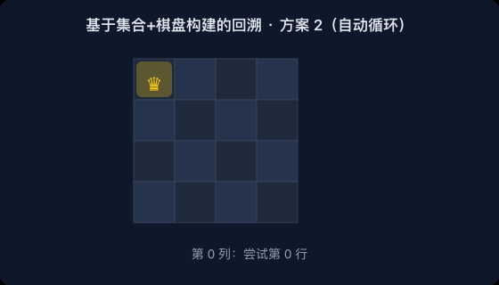

**方案专属流程图**（真实控制流）：

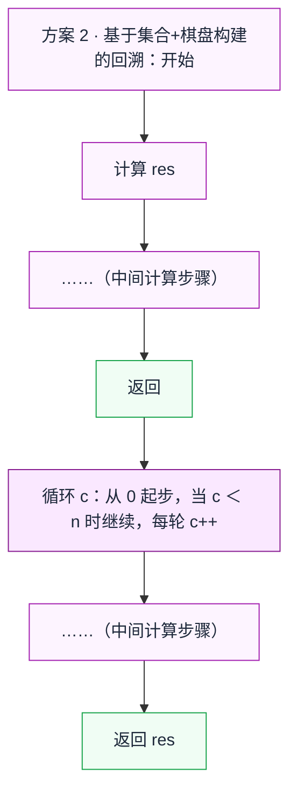

```typescript
/**
 ** LeetCode 51. N 皇后
 ** 方案2: 基于集合+棋盘构建的回溯（忠实翻译 python 参考实现）
 ** 来源：https://blog.csdn.net/tyro_java/article/details/145239695
 */

function solveNQueens(n: number): string[][] {
  // 定义函数/方法 solveNQueens
  const res: string[][] = []; // 把 []; 写入 const res: string[][]
  const cols = new Set<number>(); // 把 new Set 小于 number 超过 () 存入 列数
  const diag1 = new Set<number>(); // 把 new Set 小于 number 超过 () 存入 diag1
  const diag2 = new Set<number>(); // 把 new Set 小于 number 超过 () 存入 diag2
  function backtrack(r: number, board: string[][]): void {
    // 定义函数/方法 backtrack
    if (r === n) {
      // 若 右指针 全等于 元素个数
      res.push(board.map((row) => row.join('')));
      return; // return;
    }
    for (let c = 0; c < n; c++) {
      // 让 字符 从 0 开始计数，字符 小于 元素个数 就继续
      if (cols.has(c) || diag1.has(r - c) || diag2.has(r + c)) continue;
      cols.add(c); // 列数 追加 字符);
      diag1.add(r - c); // diag1 追加 右指针 减 字符);
      diag2.add(r + c); // diag2 追加 右指针 加 字符);
      const rowArr: string[] = new Array(n).fill('.'); // 把 new Array(元素个数).fill('.'); 写入 const rowArr: string[]
      rowArr[c] = 'Q'; // 把 'Q'; 写入 rowArr[c]
      board.push(rowArr); // 把 rowArr 压入栈/数组尾部
      backtrack(r + 1, board); // backtrack(右指针 加 1, 棋盘);
      board.pop(); // 弹出栈顶元素
      cols.delete(c); // 列数.delete(字符);
      diag1.delete(r - c); // diag1.delete(右指针 减 字符);
      diag2.delete(r + c); // diag2.delete(右指针 加 字符);
    }
  }
  backtrack(0, []); // backtrack(0, []);
  return res; // 返回 结果
}

export function demo(): void {
  // 程序入口：跑内嵌自测用例
  function norm(x: string[][]): string {
    // 定义函数/方法 norm
    return x
      .map((b) => b.join('/'))
      .sort()
      .join('|');
  }
  let fail = false; // 把 false 存入 fail
  if (norm(solveNQueens(1)) !== norm([['Q']])) {
    fail = true;
    console.log('FAIL n=1');
  }
  const want4 = [
    ['.Q..', '...Q', 'Q...', '..Q.'],
    ['..Q.', 'Q...', '...Q', '.Q..'],
  ];
  if (norm(solveNQueens(4)) !== norm(want4)) {
    fail = true;
    console.log('FAIL n=4 got=' + JSON.stringify(solveNQueens(4)));
  }
  if (solveNQueens(5).length !== 10) {
    fail = true;
    console.log('FAIL n=5 count');
  }
  if (fail) throw new Error('FAILED'); // 若 fail) throw new Error(「FAILED」);
  console.log('PASS'); // 全部用例通过，输出 PASS
}
demo(); // demo();
```

### 方案 3：布尔数组回溯

**分析与思路**：核心做法是「布尔数组回溯」。代码里依次做这些事：单循环线性扫描；栈的后进先出操作。

**运行方式**：`node 本文件`，内嵌用例全部通过会输出 PASS。

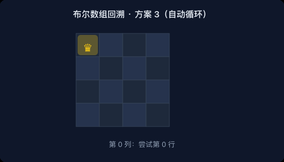

**方案专属流程图**（真实控制流）：

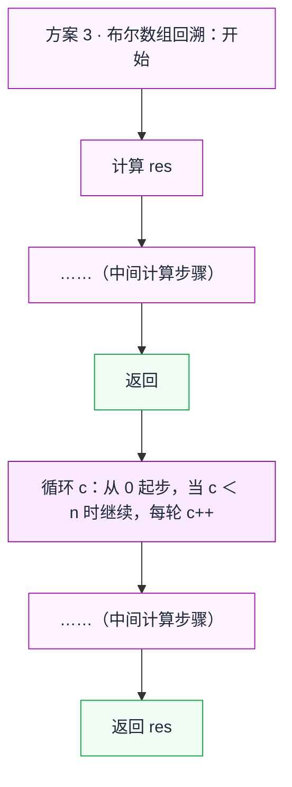

```typescript
/**
 ** LeetCode 51. N 皇后
 ** 方案3: 布尔数组回溯（忠实翻译 python 参考实现）
 ** 来源：https://blog.csdn.net/tyro_java/article/details/145239695
 */

function solveNQueens(n: number): string[][] {
  // 定义函数/方法 solveNQueens
  const res: string[][] = []; // 把 []; 写入 const res: string[][]
  const cols: boolean[] = new Array(n).fill(false); // 把 new Array(元素个数).fill(false); 写入 const cols: boolean[]
  const diag1: boolean[] = new Array(2 * n).fill(false); // 把 new Array(2 乘 元素个数).fill(false); 写入 const diag1: boolean[]
  const diag2: boolean[] = new Array(2 * n).fill(false); // 把 new Array(2 乘 元素个数).fill(false); 写入 const diag2: boolean[]
  const board: string[][] = []; // 把 []; 写入 const board: string[][]
  function backtrack(r: number): void {
    // 定义函数/方法 backtrack
    if (r === n) {
      // 若 右指针 全等于 元素个数
      res.push(board.map((row) => row.join('')));
      return; // return;
    }
    for (let c = 0; c < n; c++) {
      // 让 字符 从 0 开始计数，字符 小于 元素个数 就继续
      if (cols[c] || diag1[r - c + n] || diag2[r + c]) continue;
      cols[c] = diag1[r - c + n] = diag2[r + c] = true;
      const rowArr: string[] = new Array(n).fill('.'); // 把 new Array(元素个数).fill('.'); 写入 const rowArr: string[]
      rowArr[c] = 'Q'; // 把 'Q'; 写入 rowArr[c]
      board.push(rowArr); // 把 rowArr 压入栈/数组尾部
      backtrack(r + 1); // backtrack(右指针 加 1);
      board.pop(); // 弹出栈顶元素
      cols[c] = diag1[r - c + n] = diag2[r + c] = false;
    }
  }
  backtrack(0); // backtrack(0);
  return res; // 返回 结果
}

export function demo(): void {
  // 程序入口：跑内嵌自测用例
  function norm(x: string[][]): string {
    // 定义函数/方法 norm
    return x
      .map((b) => b.join('/'))
      .sort()
      .join('|');
  }
  let fail = false; // 把 false 存入 fail
  if (norm(solveNQueens(1)) !== norm([['Q']])) {
    fail = true;
    console.log('FAIL n=1');
  }
  const want4 = [
    ['.Q..', '...Q', 'Q...', '..Q.'],
    ['..Q.', 'Q...', '...Q', '.Q..'],
  ];
  if (norm(solveNQueens(4)) !== norm(want4)) {
    fail = true;
    console.log('FAIL n=4 got=' + JSON.stringify(solveNQueens(4)));
  }
  if (solveNQueens(5).length !== 10) {
    fail = true;
    console.log('FAIL n=5 count');
  }
  if (fail) throw new Error('FAILED'); // 若 fail) throw new Error(「FAILED」);
  console.log('PASS'); // 全部用例通过，输出 PASS
}
demo(); // demo();
```

## 逐步拆解与面试追问

**复杂度**：时间 O(n)（单趟线性扫描），空间 O(1) 到 O(n)（视辅助结构）

**为什么是这个量级**：每个元素被常数次访问，辅助哈希或栈的开销与 n 同阶

**面试官可能会追问**：

- 怎么剪枝降低无效搜索？
- 去重的关键在哪一层？
- 状态恢复遗漏会怎样？

## 关键 API 速查（TS 主解法实际用到，附官方链接）

| API | 作用 | 使用要点 | 官方文档 |
|---|---|---|---|
| `Set` | 集合：元素唯一 | add/add.has/delete；has 均摊 O(1)；NaN 视为相同；去重常用 [...new Set(arr)] | [官方文档](https://developer.mozilla.org/zh-CN/docs/Web/JavaScript/Reference/Global_Objects/Set) |
| `Array.prototype.sort()` | 原地排序 | 默认按字符串 Unicode 序（10 会排在 2 前），数字必须传 (a,b)=>a-b；V8 用 TimSort，稳定，O(n log n)；返回原数组引用 | [官方文档](https://developer.mozilla.org/zh-CN/docs/Web/JavaScript/Reference/Global_Objects/Array/sort) |
| `Array.prototype.map()` | 逐元素映射为新数组 | 回调 (v,i,arr)；返回等长新数组，不改变原数组；稀疏位跳过；链式调用注意中间数组开销 | [官方文档](https://developer.mozilla.org/zh-CN/docs/Web/JavaScript/Reference/Global_Objects/Array/map) |
| `Array.prototype.push()` | 尾部追加 | 返回新长度；可一次多个；均摊 O(1)；会改变原数组 | [官方文档](https://developer.mozilla.org/zh-CN/docs/Web/JavaScript/Reference/Global_Objects/Array/push) |
| `Array.prototype.join()` | 数组拼接为字符串 | undefined/null 转空串；嵌套数组会展平一层；join('') 用于字符数组还原 | [官方文档](https://developer.mozilla.org/zh-CN/docs/Web/JavaScript/Reference/Global_Objects/Array/join) |
| `JSON.stringify()` | 序列化为 JSON 字符串 | 常用于结构化比较（深度相等判定）；undefined/函数/循环引用会被丢弃或抛错 | [官方文档](https://developer.mozilla.org/zh-CN/docs/Web/JavaScript/Reference/Global_Objects/JSON/stringify) |

### 各语言官方文档导航

- **TypeScript / JS**：[MDN 中文参考](https://developer.mozilla.org/zh-CN/)
- **Python**：[Python 官方文档](https://docs.python.org/zh-cn/3/)
- **Go**：[Go 标准库](https://pkg.go.dev/std)
- **Java**：[JDK 17 API](https://docs.oracle.com/en/java/javase/17/docs/api/)
- **Rust**：[Rust 标准库](https://doc.rust-lang.org/std/)
- **Lua**：[Lua 5.4 手册](https://www.lua.org/manual/5.4/)
- **C**：[Cppreference C](https://zh.cppreference.com/w/c)
- **C++**：[Cppreference C++](https://zh.cppreference.com/w/cpp)
- **R**：[R 官方手册](https://stat.ethz.ch/R-manual/)
- **Zig**：[Zig 语言文档](https://ziglang.org/documentation/master/)
- **Dart**：[Dart API](https://api.dart.dev/)

## 附录：其他 10 种语言全部实现（每种语言列举其全部方案）

> TypeScript 的全部方案见「TypeScript 解题方案」一节；下面是其余 10 种语言的对应实现，每种语言的每个方案都带思路分析、代码走读与专属运行架构图。
> 每个方案都内嵌用例自测，可独立运行（老仓库 python/go 文件遵循「打印结果」约定）。
> 完整解法文件见 `dsa/<语言>/backtrack/lc_51_n_皇后/`。

### Python 实现（3 种方案）

Python 的全部方案如下，每个方案都内嵌用例自测，可独立运行（老仓库 python/go 文件遵循「打印结果」约定）：

#### 方案 1：基于集合的回溯

**思路与代码分析**：核心是「基于集合的回溯」。Python 版用切片与字典推导式简化操作，突出可读性。**走读**：方案 1 · 基于集合的回溯：开始 → 更新 solutions → 循环 i：从 0 到 n 前 → 返回 board → 返回  → 循环 col：从 0 到 n 前 → 返回 solutions。

**运行架构**（真实控制流）：

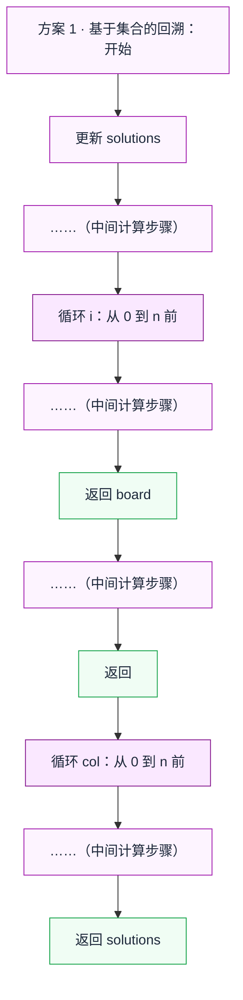

```python
import sys  # 提高递归深度上限（深输入防 RecursionError）

sys.setrecursionlimit(200000)  # 树/链表类题目节点数可达 1e4 量级

def solveNQueens(n):  # 定义函数 solveNQueens（参数：元素个数）
    solutions = []  # 把 [] 存入 solutions
    queens = [-1] * n  # 把 [ 减 1] 乘 元素个数 存入 queens
    columns = set()  # 把 set() 存入 columns
    diagonal1 = set()  # 把 set() 存入 diagonal1
    diagonal2 = set()  # 把 set() 存入 diagonal2

    def generateBoard():  # 定义函数 generateBoard（参数：无）
        board = []  # 把 [] 存入 棋盘
        for i in range(n):  # 让 下标 i 从 元素个数 遍历
            row = ["."] * n  # 把 ['.'] 乘 元素个数 存入 row
            row[queens[i]] = "Q"  # 把 'Q' 写入 row[queens[i]]
            board.append("".join(row))  # 把 ''.join(row 追加到列表尾部
        return board  # 返回 棋盘

    def backtrack(row):  # 定义函数 backtrack（参数：row）
        if row == n:  # 若 row 等于 元素个数
            solutions.append(generateBoard())  # 把 generateBoard( 追加到列表尾部
            return  # return
        for col in range(n):  # 让 col 从 元素个数 遍历
            if col in columns or (row - col) in diagonal1 or (row + col) in diagonal2:
                continue  # 跳过本轮，进入下一次
            queens[row] = col  # 把 col 写入 queens[row]
            columns.add(col)  # columns 追加 col)
            diagonal1.add(row - col)  # diagonal1 追加 row 减 col)
            diagonal2.add(row + col)  # diagonal2 追加 row 加 col)
            backtrack(row + 1)  # backtrack(row 加 1)
            columns.discard(col)  # columns.discard(col)
            diagonal1.discard(row - col)  # diagonal1.discard(row 减 col)
            diagonal2.discard(row + col)  # diagonal2.discard(row 加 col)

    backtrack(0)  # backtrack(0)
    return solutions  # 返回 solutions

if __name__ == "__main__":  # 若 __name__ 等于 '__main__'
    res = solveNQueens(4)  # 把 solveNQueens(4) 存入 结果
    for board in res:  # 逐个取出 结果 的元素（棋盘）
        print(board)  # 打印输出
    print("解的数量:", len(res))  # 打印输出
```

#### 方案 2：基于集合+棋盘构建的回溯

**思路与代码分析**：核心是「基于集合+棋盘构建的回溯」。Python 版用切片与字典推导式简化操作，突出可读性。**走读**：方案 2 · 基于集合+棋盘构建的回溯：开始 → 更新 res → 返回  → 循环 c：从 0 到 n 前 → 返回 res。

**运行架构**（真实控制流）：

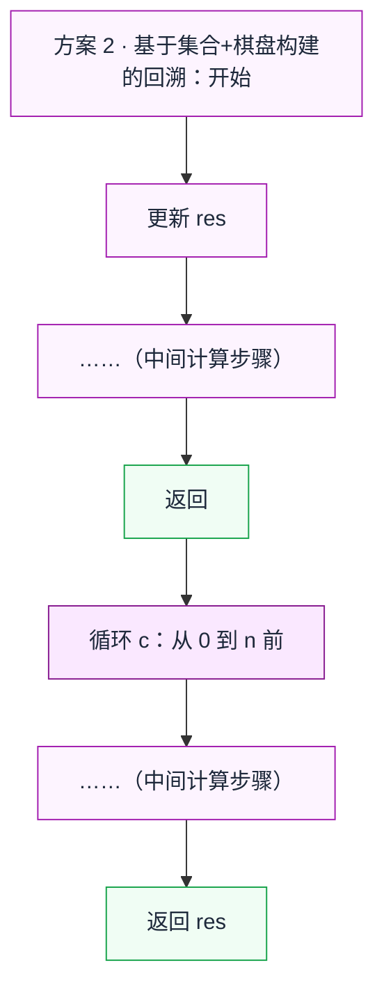

```python
import sys  # 提高递归深度上限（深输入防 RecursionError）

sys.setrecursionlimit(200000)  # 树/链表类题目节点数可达 1e4 量级

def solveNQueens(n):  # 定义函数 solveNQueens（参数：元素个数）
    res = []  # 把 [] 存入 结果
    cols = set()  # 把 set() 存入 列数
    diag1 = set()  # 把 set() 存入 diag1
    diag2 = set()  # 把 set() 存入 diag2

    def backtrack(r, board):  # 定义函数 backtrack（参数：右指针, 棋盘）
        if r == n:  # 若 右指针 等于 元素个数
            res.append(["".join(row) for row in board])  # 把 [''.join(row 追加到列表尾部
            return  # return
        for c in range(n):  # 让 字符 从 元素个数 遍历
            if (
                c in cols or (r - c) in diag1 or (r + c) in diag2
            ):  # 若 字符 in 列数 or (右指针 减 字符) in diag1 or (右指针 加 字符) in diag2
                continue  # 跳过本轮，进入下一次
            cols.add(c)  # 列数 追加 字符)
            diag1.add(r - c)  # diag1 追加 右指针 减 字符)
            diag2.add(r + c)  # diag2 追加 右指针 加 字符)
            board.append(
                ["."] * c + ["Q"] + ["."] * (n - 1 - c)
            )  # 把 ['.'] 乘 字符 加 ['Q'] 加 ['.'] 乘 (元素个数 减 1 减 字符 追加到列表尾部
            backtrack(r + 1, board)  # backtrack(右指针 加 1, 棋盘)
            board.pop()  # 弹出栈顶元素
            cols.remove(c)  # 列数 弹出 字符)
            diag1.remove(r - c)  # diag1 弹出 右指针 减 字符)
            diag2.remove(r + c)  # diag2 弹出 右指针 加 字符)

    backtrack(0, [])  # backtrack(0, [])
    return res  # 返回 结果

if __name__ == "__main__":  # 若 __name__ 等于 '__main__'
    print(solveNQueens(4))  # 打印输出
```

#### 方案 3：布尔数组回溯

**思路与代码分析**：核心是「布尔数组回溯」。Python 版用切片与字典推导式简化操作，突出可读性。**走读**：方案 3 · 布尔数组回溯：开始 → 更新 res → 返回  → 循环 c：从 0 到 n 前 → 返回 res。

**运行架构**（真实控制流）：

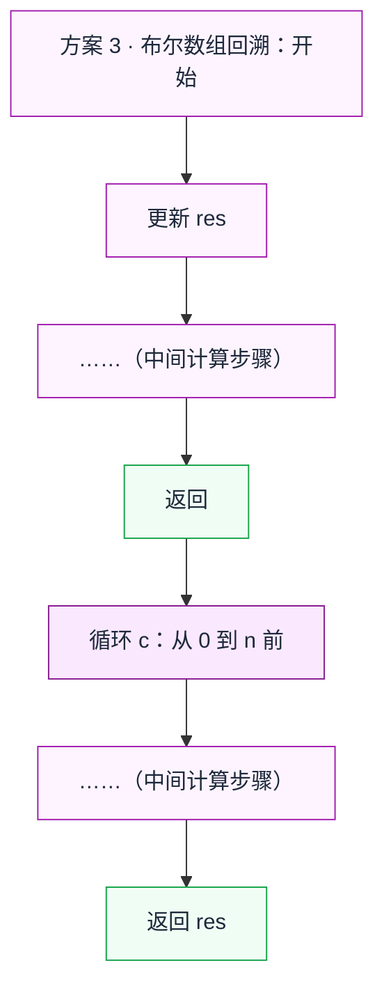

```python
import sys  # 提高递归深度上限（深输入防 RecursionError）

sys.setrecursionlimit(200000)  # 树/链表类题目节点数可达 1e4 量级

def solveNQueens(n):  # 定义函数 solveNQueens（参数：元素个数）
    res = []  # 把 [] 存入 结果
    cols = [False] * n  # 把 [False] 乘 元素个数 存入 列数
    diag1 = [False] * (2 * n)  # 把 [False] 乘 (2 乘 元素个数) 存入 diag1
    diag2 = [False] * (2 * n)  # 把 [False] 乘 (2 乘 元素个数) 存入 diag2
    board = []  # 把 [] 存入 棋盘

    def backtrack(r):  # 定义函数 backtrack（参数：右指针）
        if r == n:  # 若 右指针 等于 元素个数
            res.append(["".join(row) for row in board])  # 把 [''.join(row 追加到列表尾部
            return  # return
        for c in range(n):  # 让 字符 从 元素个数 遍历
            if (
                cols[c] or diag1[r - c + n] or diag2[r + c]
            ):  # 若 列数[字符] or diag1[右指针 减 字符 加 元素个数] or diag2[右指针 加 字符]
                continue  # 跳过本轮，进入下一次
            cols[c] = diag1[r - c + n] = diag2[r + c] = True
            board.append(
                ["."] * c + ["Q"] + ["."] * (n - 1 - c)
            )  # 把 ['.'] 乘 字符 加 ['Q'] 加 ['.'] 乘 (元素个数 减 1 减 字符 追加到列表尾部
            backtrack(r + 1)  # backtrack(右指针 加 1)
            board.pop()  # 弹出栈顶元素
            cols[c] = diag1[r - c + n] = diag2[r + c] = False

    backtrack(0)  # backtrack(0)
    return res  # 返回 结果

if __name__ == "__main__":  # 若 __name__ 等于 '__main__'
    print(solveNQueens(4))  # 打印输出
```

### Go 实现（3 种方案）

Go 的全部方案如下，每个方案都内嵌用例自测，可独立运行（老仓库 python/go 文件遵循「打印结果」约定）：

#### 方案 1：基于集合的回溯

**思路与代码分析**：核心是「基于集合的回溯」。Go 版用切片与多返回值惯用法，显式处理索引边界。代码里依次做这些事：哈希结构做计数或查重。**走读**：方案 1 · 基于集合的回溯：开始 → 更新 : → 遍历循环 → 遍历 row 的下标与元素 j → 返回 board → 返回  → 遍历循环 → 返回 solutions。

**运行架构**（真实控制流）：

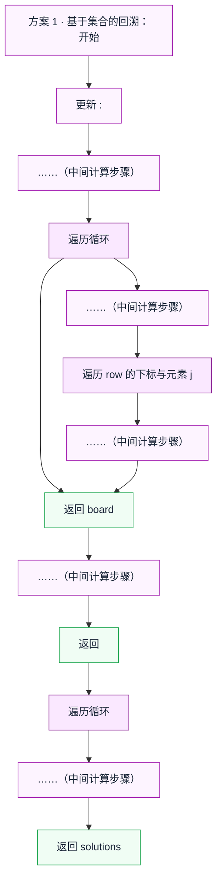

```go
package main // 引入依赖

import (
	"fmt" // 「fmt」
	"os"  // 「os」
)

func solveNQueens(n int) [][]string { // 定义函数/方法 solveNQueens
	solutions := [][]string{} // 把 [][]string{} 写入 solutions :
	queens := make([]int, n)  // 把 make([]int, 元素个数) 写入 queens :
	columns := map[int]bool{} // 把 映射表[int]bool{} 写入 columns :
	diag1 := map[int]bool{}   // 把 映射表[int]bool{} 写入 diag1 :
	diag2 := map[int]bool{}   // 把 映射表[int]bool{} 写入 diag2 :

	var generateBoard func() []string // var generateBoard func() []string
	generateBoard = func() []string { // 把 func() []string { 写入 generateBoard
		board := make([]string, n) // 把 make([]string, 元素个数) 写入 board :
		for i := 0; i < n; i++ {   // 让 下标 i 从 0 开始计数
			row := make([]byte, n) // 把 make([]byte, 元素个数) 写入 row :
			for j := range row {   // 把 range row { 写入 for j :
				row[j] = '.' // 把 '.' 写入 row[j]
			}
			row[queens[i]] = 'Q'   // 把 'Q' 写入 row[queens[i]]
			board[i] = string(row) // 把 string(row) 写入 board[i]
		}
		return board // 返回 棋盘
	}
	var backtrack func(row int) // var backtrack func(row int)
	backtrack = func(row int) { // 把 func(row int) { 写入 backtrack
		if row == n { // 若 row 等于 元素个数
			solutions = append(solutions, generateBoard()) // 把 append(solutions, generateBoard()) 写入 solutions
			return                                         // return
		}
		for col := 0; col < n; col++ { // 让 col 从 0 开始计数
			if columns[col] || diag1[row-col] || diag2[row+col] { // 若 columns[col] 或 diag1[row 减 col] 或 diag2[row 加 col]
				continue // 跳过本轮，进入下一次
			}
			queens[row] = col      // 把 col 写入 queens[row]
			columns[col] = true    // 把 true 写入 columns[col]
			diag1[row-col] = true  // 把 true 写入 diag1[row-col]
			diag2[row+col] = true  // 把 true 写入 diag2[row+col]
			backtrack(row + 1)     // backtrack(row 加 1)
			columns[col] = false   // 把 false 写入 columns[col]
			diag1[row-col] = false // 把 false 写入 diag1[row-col]
			diag2[row+col] = false // 把 false 写入 diag2[row+col]
		}
	}
	backtrack(0)     // backtrack(0)
	return solutions // 返回 solutions
}

func validNQueens(boards [][]string, n int) bool { // 定义函数/方法 validNQueens
	for _, b := range boards { // 同时取 _ 与 b 遍历
		if len(b) != n { // 若 长度(b) 不等于 元素个数
			return false // 返回 false
		}
		pos := [][2]int{}       // 把 [][2]int{} 写入 pos :
		for r, row := range b { // 同时取 右指针 与 row 遍历
			if len(row) != n { // 若 长度(row) 不等于 元素个数
				return false // 返回 false
			}
			for c, ch := range row { // 同时取 字符 与 字符 遍历
				if ch == 'Q' { // 若 字符 等于 'Q'
					pos = append(pos, [2]int{r, c}) // 把 append(pos, [2]int{右指针, 字符}) 写入 pos
				}
			}
		}
		if len(pos) != n { // 若 长度(pos) 不等于 元素个数
			return false // 返回 false
		}
		for i := 0; i < len(pos); i++ { // 让 下标 i 从 0 开始计数
			for j := i + 1; j < len(pos); j++ { // 把 下标 i 加 1; 下标 j 小于 长度(pos); 下标 j 加一 { 写入 for j :
				r1, c1 := pos[i][0], pos[i][1]                    // 把 pos[下标 i][0], pos[下标 i][1] 写入 r1, c1 :
				r2, c2 := pos[j][0], pos[j][1]                    // 把 pos[下标 j][0], pos[下标 j][1] 写入 r2, c2 :
				if c1 == c2 || r1-c1 == r2-c2 || r1+c1 == r2+c2 { // 若 c1 等于 c2 或 r1 减 c1 等于 r2 减 c2 或 r1 加 c1 等于 r2 加 c2
					return false // 返回 false
				}
			}
		}
	}
	return true // 返回 true
}

func main() { // 程序入口：跑内嵌自测用例
	ok := true                         // 把 true 写入 ok :
	for _, n := range []int{4, 1, 2} { // 同时取 _ 与 元素个数 遍历
		boards := solveNQueens(n) // 把 solveNQueens(元素个数) 写入 boards :
		want := 0                 // 把 0 写入 want :
		switch n {                // switch 元素个数 {
		case 4: // case 4:
			want = 2 // 把 2 写入 want
		case 1: // case 1:
			want = 1 // 把 1 写入 want
		case 2: // case 2:
			want = 0 // 把 0 写入 want
		}
		if len(boards) != want { // 若 长度(boards) 不等于 want
			ok = false                                                                   // 把 false 写入 ok
			fmt.Printf("FAIL solveNQueens(%d) count=%d want %d\n", n, len(boards), want) // 打印输出
		}
		if !validNQueens(boards, n) { // 若 取反 validNQueens(boards, 元素个数
			ok = false                                             // 把 false 写入 ok
			fmt.Printf("FAIL solveNQueens(%d) invalid board\n", n) // 打印输出
		}
	}
	if !ok { // 若 取反 ok
		os.Exit(1) // os.Exit(1)
	}
	fmt.Println("PASS") // 全部用例通过，输出 PASS
}
```

#### 方案 2：基于集合+棋盘构建的回溯

**思路与代码分析**：核心是「基于集合+棋盘构建的回溯」。Go 版用切片与多返回值惯用法，显式处理索引边界。代码里依次做这些事：哈希结构做计数或查重。**走读**：方案 2 · 基于集合+棋盘构建的回溯：开始 → 更新 : → 返回  → 遍历循环 → 遍历 row 的下标与元素 i → 返回 res。

**运行架构**（真实控制流）：

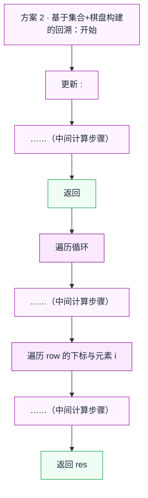

```go
package main // 引入依赖

import (
	"fmt" // 「fmt」
	"os"  // 「os」
)

func solveNQueens(n int) [][]string { // 定义函数/方法 solveNQueens
	res := [][]string{}                       // 把 [][]string{} 写入 res :
	cols := map[int]bool{}                    // 把 映射表[int]bool{} 写入 cols :
	diag1 := map[int]bool{}                   // 把 映射表[int]bool{} 写入 diag1 :
	diag2 := map[int]bool{}                   // 把 映射表[int]bool{} 写入 diag2 :
	var backtrack func(r int, board []string) // var backtrack func(右指针 int, 棋盘 []string)
	backtrack = func(r int, board []string) { // 把 func(右指针 int, 棋盘 []string) { 写入 backtrack
		if r == n { // 若 右指针 等于 元素个数
			cp := make([]string, len(board)) // 把 make([]string, 长度(棋盘)) 写入 cp :
			copy(cp, board)                  // copy(cp, 棋盘)
			res = append(res, cp)            // 把 append(结果, cp) 写入 结果
			return                           // return
		}
		for c := 0; c < n; c++ { // 让 字符 从 0 开始计数
			if cols[c] || diag1[r-c] || diag2[r+c] { // 若 列数[字符] 或 diag1[右指针 减 字符] 或 diag2[右指针 加 字符]
				continue // 跳过本轮，进入下一次
			}
			cols[c] = true         // 把 true 写入 cols[c]
			diag1[r-c] = true      // 把 true 写入 diag1[r-c]
			diag2[r+c] = true      // 把 true 写入 diag2[r+c]
			row := make([]byte, n) // 把 make([]byte, 元素个数) 写入 row :
			for i := range row {   // 把 range row { 写入 for i :
				row[i] = '.' // 把 '.' 写入 row[i]
			}
			row[c] = 'Q'                               // 把 'Q' 写入 row[c]
			backtrack(r+1, append(board, string(row))) // backtrack(右指针 加 1, append(棋盘, string(row)))
			cols[c] = false                            // 把 false 写入 cols[c]
			diag1[r-c] = false                         // 把 false 写入 diag1[r-c]
			diag2[r+c] = false                         // 把 false 写入 diag2[r+c]
		}
	}
	backtrack(0, []string{}) // backtrack(0, []string{})
	return res               // 返回 结果
}

func validNQueens(boards [][]string, n int) bool { // 定义函数/方法 validNQueens
	for _, b := range boards { // 同时取 _ 与 b 遍历
		if len(b) != n { // 若 长度(b) 不等于 元素个数
			return false // 返回 false
		}
		pos := [][2]int{}       // 把 [][2]int{} 写入 pos :
		for r, row := range b { // 同时取 右指针 与 row 遍历
			if len(row) != n { // 若 长度(row) 不等于 元素个数
				return false // 返回 false
			}
			for c, ch := range row { // 同时取 字符 与 字符 遍历
				if ch == 'Q' { // 若 字符 等于 'Q'
					pos = append(pos, [2]int{r, c}) // 把 append(pos, [2]int{右指针, 字符}) 写入 pos
				}
			}
		}
		if len(pos) != n { // 若 长度(pos) 不等于 元素个数
			return false // 返回 false
		}
		for i := 0; i < len(pos); i++ { // 让 下标 i 从 0 开始计数
			for j := i + 1; j < len(pos); j++ { // 把 下标 i 加 1; 下标 j 小于 长度(pos); 下标 j 加一 { 写入 for j :
				r1, c1 := pos[i][0], pos[i][1]                    // 把 pos[下标 i][0], pos[下标 i][1] 写入 r1, c1 :
				r2, c2 := pos[j][0], pos[j][1]                    // 把 pos[下标 j][0], pos[下标 j][1] 写入 r2, c2 :
				if c1 == c2 || r1-c1 == r2-c2 || r1+c1 == r2+c2 { // 若 c1 等于 c2 或 r1 减 c1 等于 r2 减 c2 或 r1 加 c1 等于 r2 加 c2
					return false // 返回 false
				}
			}
		}
	}
	return true // 返回 true
}

func main() { // 程序入口：跑内嵌自测用例
	ok := true                         // 把 true 写入 ok :
	for _, n := range []int{4, 1, 2} { // 同时取 _ 与 元素个数 遍历
		boards := solveNQueens(n) // 把 solveNQueens(元素个数) 写入 boards :
		want := 0                 // 把 0 写入 want :
		switch n {                // switch 元素个数 {
		case 4: // case 4:
			want = 2 // 把 2 写入 want
		case 1: // case 1:
			want = 1 // 把 1 写入 want
		case 2: // case 2:
			want = 0 // 把 0 写入 want
		}
		if len(boards) != want { // 若 长度(boards) 不等于 want
			ok = false                                                                   // 把 false 写入 ok
			fmt.Printf("FAIL solveNQueens(%d) count=%d want %d\n", n, len(boards), want) // 打印输出
		}
		if !validNQueens(boards, n) { // 若 取反 validNQueens(boards, 元素个数
			ok = false                                             // 把 false 写入 ok
			fmt.Printf("FAIL solveNQueens(%d) invalid board\n", n) // 打印输出
		}
	}
	if !ok { // 若 取反 ok
		os.Exit(1) // os.Exit(1)
	}
	fmt.Println("PASS") // 全部用例通过，输出 PASS
}
```

#### 方案 3：布尔数组回溯

**思路与代码分析**：核心是「布尔数组回溯」。Go 版用切片与多返回值惯用法，显式处理索引边界。**走读**：方案 3 · 布尔数组回溯：开始 → 更新 : → 返回  → 遍历循环 → 遍历 row 的下标与元素 i → 返回 res。

**运行架构**（真实控制流）：

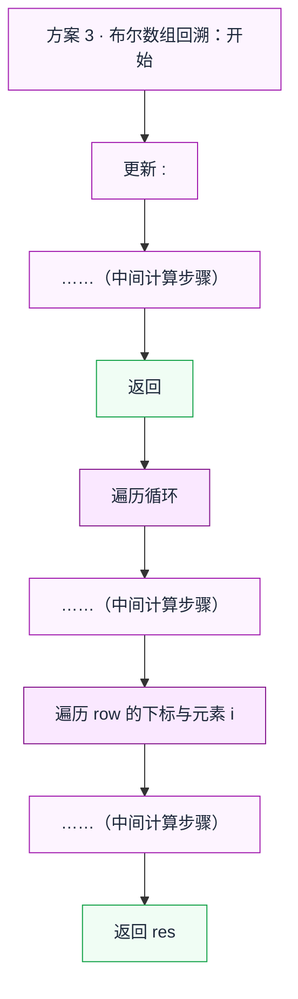

```go
package main // 引入依赖

import (
	"fmt" // 「fmt」
	"os"  // 「os」
)

func solveNQueens(n int) [][]string { // 定义函数/方法 solveNQueens
	res := [][]string{}                       // 把 [][]string{} 写入 res :
	cols := make([]bool, n)                   // 把 make([]bool, 元素个数) 写入 cols :
	diag1 := make([]bool, 2*n)                // 把 make([]bool, 2 乘 元素个数) 写入 diag1 :
	diag2 := make([]bool, 2*n)                // 把 make([]bool, 2 乘 元素个数) 写入 diag2 :
	var backtrack func(r int, board []string) // var backtrack func(右指针 int, 棋盘 []string)
	backtrack = func(r int, board []string) { // 把 func(右指针 int, 棋盘 []string) { 写入 backtrack
		if r == n { // 若 右指针 等于 元素个数
			cp := make([]string, len(board)) // 把 make([]string, 长度(棋盘)) 写入 cp :
			copy(cp, board)                  // copy(cp, 棋盘)
			res = append(res, cp)            // 把 append(结果, cp) 写入 结果
			return                           // return
		}
		for c := 0; c < n; c++ { // 让 字符 从 0 开始计数
			if cols[c] || diag1[r-c+n] || diag2[r+c] { // 若 列数[字符] 或 diag1[右指针 减 字符 加 元素个数] 或 diag2[右指针 加 字符]
				continue // 跳过本轮，进入下一次
			}
			cols[c] = true         // 把 true 写入 cols[c]
			diag1[r-c+n] = true    // 把 true 写入 diag1[r-c+n]
			diag2[r+c] = true      // 把 true 写入 diag2[r+c]
			row := make([]byte, n) // 把 make([]byte, 元素个数) 写入 row :
			for i := range row {   // 把 range row { 写入 for i :
				row[i] = '.' // 把 '.' 写入 row[i]
			}
			row[c] = 'Q'                               // 把 'Q' 写入 row[c]
			backtrack(r+1, append(board, string(row))) // backtrack(右指针 加 1, append(棋盘, string(row)))
			cols[c] = false                            // 把 false 写入 cols[c]
			diag1[r-c+n] = false                       // 把 false 写入 diag1[r-c+n]
			diag2[r+c] = false                         // 把 false 写入 diag2[r+c]
		}
	}
	backtrack(0, []string{}) // backtrack(0, []string{})
	return res               // 返回 结果
}

func validNQueens(boards [][]string, n int) bool { // 定义函数/方法 validNQueens
	for _, b := range boards { // 同时取 _ 与 b 遍历
		if len(b) != n { // 若 长度(b) 不等于 元素个数
			return false // 返回 false
		}
		pos := [][2]int{}       // 把 [][2]int{} 写入 pos :
		for r, row := range b { // 同时取 右指针 与 row 遍历
			if len(row) != n { // 若 长度(row) 不等于 元素个数
				return false // 返回 false
			}
			for c, ch := range row { // 同时取 字符 与 字符 遍历
				if ch == 'Q' { // 若 字符 等于 'Q'
					pos = append(pos, [2]int{r, c}) // 把 append(pos, [2]int{右指针, 字符}) 写入 pos
				}
			}
		}
		if len(pos) != n { // 若 长度(pos) 不等于 元素个数
			return false // 返回 false
		}
		for i := 0; i < len(pos); i++ { // 让 下标 i 从 0 开始计数
			for j := i + 1; j < len(pos); j++ { // 把 下标 i 加 1; 下标 j 小于 长度(pos); 下标 j 加一 { 写入 for j :
				r1, c1 := pos[i][0], pos[i][1]                    // 把 pos[下标 i][0], pos[下标 i][1] 写入 r1, c1 :
				r2, c2 := pos[j][0], pos[j][1]                    // 把 pos[下标 j][0], pos[下标 j][1] 写入 r2, c2 :
				if c1 == c2 || r1-c1 == r2-c2 || r1+c1 == r2+c2 { // 若 c1 等于 c2 或 r1 减 c1 等于 r2 减 c2 或 r1 加 c1 等于 r2 加 c2
					return false // 返回 false
				}
			}
		}
	}
	return true // 返回 true
}

func main() { // 程序入口：跑内嵌自测用例
	ok := true                         // 把 true 写入 ok :
	for _, n := range []int{4, 1, 2} { // 同时取 _ 与 元素个数 遍历
		boards := solveNQueens(n) // 把 solveNQueens(元素个数) 写入 boards :
		want := 0                 // 把 0 写入 want :
		switch n {                // switch 元素个数 {
		case 4: // case 4:
			want = 2 // 把 2 写入 want
		case 1: // case 1:
			want = 1 // 把 1 写入 want
		case 2: // case 2:
			want = 0 // 把 0 写入 want
		}
		if len(boards) != want { // 若 长度(boards) 不等于 want
			ok = false                                                                   // 把 false 写入 ok
			fmt.Printf("FAIL solveNQueens(%d) count=%d want %d\n", n, len(boards), want) // 打印输出
		}
		if !validNQueens(boards, n) { // 若 取反 validNQueens(boards, 元素个数
			ok = false                                             // 把 false 写入 ok
			fmt.Printf("FAIL solveNQueens(%d) invalid board\n", n) // 打印输出
		}
	}
	if !ok { // 若 取反 ok
		os.Exit(1) // os.Exit(1)
	}
	fmt.Println("PASS") // 全部用例通过，输出 PASS
}
```

### Java 实现（3 种方案）

Java 的全部方案如下，每个方案都内嵌用例自测，可独立运行（老仓库 python/go 文件遵循「打印结果」约定）：

#### 方案 1：基于集合的回溯

**思路与代码分析**：核心是「基于集合的回溯」。Java 版用类与静态方法组织，集合操作显式明了。**走读**：方案 1 · 基于集合的回溯：开始 → 更新 solutions → 更新 this.n → 更新 queens → 调用 Arrays.fill(queens, -1) → 更新 columns → 更新 diagonal1 → 更新 diagonal2 → 调用 backtrack(0) → 返回 solutions。

**运行架构**（真实控制流）：

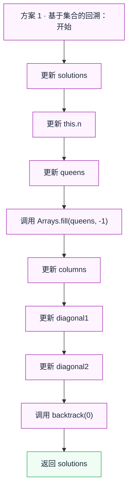

```java
package com.webfault.dsa; // 引入依赖

import java.util.*; // 引入依赖

class lc51_solution111 { // 定义类型
  private List<List<String>> solutions; // private List 小于 List 小于 String 超过 超过 solutions;
  private int n; // private int 元素个数;
  private int[] queens; // private int[] queens;
  private Set<Integer> columns; // private Set 小于 Integer 超过 columns;
  private Set<Integer> diagonal1; // private Set 小于 Integer 超过 diagonal1;
  private Set<Integer> diagonal2; // private Set 小于 Integer 超过 diagonal2;

  public List<List<String>> solveNQueens(int n) { // 定义函数/方法 solveNQueens
    solutions = new ArrayList<>(); // 把 new ArrayList 小于 超过 (); 写入 solutions
    this.n = n; // 把 元素个数; 写入 元素个数
    queens = new int[n]; // 把 new int[元素个数]; 写入 queens
    Arrays.fill(queens, -1); // Arrays.fill(queens, 减 1);
    columns = new HashSet<>(); // 把 new HashSet 小于 超过 (); 写入 columns
    diagonal1 = new HashSet<>(); // 把 new HashSet 小于 超过 (); 写入 diagonal1
    diagonal2 = new HashSet<>(); // 把 new HashSet 小于 超过 (); 写入 diagonal2
    backtrack(0); // backtrack(0);
    return solutions; // 返回 solutions
  }

  private void backtrack(int row) { // 定义函数/方法 backtrack
    if (row == n) { // 若 row 等于 元素个数
      solutions.add(generateBoard()); // solutions 追加 generateBoard());
    } else { // 否则
      for (int i = 0; i < n; i++) { // 让 下标 i 从 0 开始计数，下标 i 小于 元素个数 就继续
        if (columns.contains(i) || diagonal1.contains(row - i) || diagonal2.contains(row + i)) {
          continue; // 跳过本轮，进入下一次
        }
        queens[row] = i; // 把 下标 i; 写入 queens[row]
        columns.add(i); // columns 追加 下标 i);
        diagonal1.add(row - i); // diagonal1 追加 row 减 下标 i);
        diagonal2.add(row + i); // diagonal2 追加 row 加 下标 i);
        backtrack(row + 1); // backtrack(row 加 1);
        columns.remove(i); // columns 弹出 下标 i);
        diagonal1.remove(row - i); // diagonal1 弹出 row 减 下标 i);
        diagonal2.remove(row + i); // diagonal2 弹出 row 加 下标 i);
      }
    }
  }

  private List<String> generateBoard() { // 定义函数/方法 generateBoard
    List<String> board = new ArrayList<>(); // 把 new ArrayList 小于 超过 (); 写入 List<String> board
    for (int i = 0; i < n; i++) { // 让 下标 i 从 0 开始计数，下标 i 小于 元素个数 就继续
      char[] row = new char[n]; // 把 new char[元素个数]; 写入 char[] row
      Arrays.fill(row, '.'); // Arrays.fill(row, '.');
      row[queens[i]] = 'Q'; // 把 'Q'; 写入 row[queens[i]]
      board.add(new String(row)); // 棋盘 追加 new String(row));
    }
    return board; // 返回 棋盘
  }

  public static void main(String[] args) { // public static void main(String[] args) {
    lc51_solution111 s = new lc51_solution111(); // 把 new lc51_solution111(); 写入 lc51_solution111 s
    List<List<String>> r = s.solveNQueens(4); // 把 字符串.solveNQueens(4); 写入 List<List<String>> r
    if (r.size() != 2) throw new RuntimeException("FAILED: " + r.size());
    System.out.println("PASS"); // 全部用例通过，输出 PASS
  }
}
```

#### 方案 2：基于集合+棋盘构建的回溯

**思路与代码分析**：核心是「基于集合+棋盘构建的回溯」。Java 版用类与静态方法组织，集合操作显式明了。**走读**：方案 2 · 基于集合+棋盘构建的回溯：开始 → 更新 res → 处理 new ArrayList＜＞() → 更新 cols → 调用 Arrays.fill(cols, -1) → 调用 backtrack(0, n, cols, res) → 返回 res。

**运行架构**（真实控制流）：

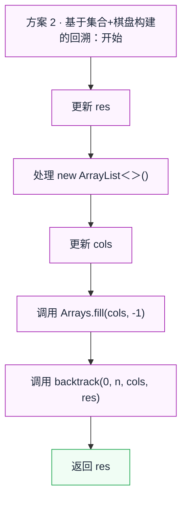

```java
package com.webfault.dsa; // 引入依赖

import java.util.*; // 引入依赖

class lc51_solution222 { // 定义类型
  public List<List<String>> solveNQueens(int n) { // 定义函数/方法 solveNQueens
    List<List<String>> res =
        new ArrayList<>(); // 把 new ArrayList 小于 超过 (); 写入 List<List<String>> res
    int[] cols = new int[n]; // 把 new int[元素个数]; 写入 int[] cols
    Arrays.fill(cols, -1); // Arrays.fill(列数, 减 1);
    backtrack(0, n, cols, res); // backtrack(0, 元素个数, 列数, 结果);
    return res; // 返回 结果
  }

  private void backtrack(int row, int n, int[] cols, List<List<String>> res) { // 定义函数/方法 backtrack
    if (row == n) { // 若 row 等于 元素个数
      List<String> board = new ArrayList<>(); // 把 new ArrayList 小于 超过 (); 写入 List<String> board
      for (int c : cols) { // for (int 字符 : 列数) {
        char[] line = new char[n]; // 把 new char[元素个数]; 写入 char[] line
        Arrays.fill(line, '.'); // Arrays.fill(line, '.');
        line[c] = 'Q'; // 把 'Q'; 写入 line[c]
        board.add(new String(line)); // 棋盘 追加 new String(line));
      }
      res.add(board); // 结果 追加 棋盘);
      return; // return;
    }
    for (int col = 0; col < n; col++) { // 让 col 从 0 开始计数，col 小于 元素个数 就继续
      if (isValid(row, col, cols)) { // 若 isValid(row, col, 列数
        cols[row] = col; // 把 col; 写入 cols[row]
        backtrack(row + 1, n, cols, res); // backtrack(row 加 1, 元素个数, 列数, 结果);
        cols[row] = -1; // 把 减 1; 写入 cols[row]
      }
    }
  }

  private boolean isValid(int row, int col, int[] cols) { // 定义判定函数 isValid
    for (int r = 0; r < row; r++) { // 让 右指针 从 0 开始计数，右指针 小于 row 就继续
      if (cols[r] == col || Math.abs(cols[r] - col) == Math.abs(r - row)) return false;
    }
    return true; // 返回 true
  }

  public static void main(String[] args) { // public static void main(String[] args) {
    lc51_solution222 s = new lc51_solution222(); // 把 new lc51_solution222(); 写入 lc51_solution222 s
    List<List<String>> r = s.solveNQueens(4); // 把 字符串.solveNQueens(4); 写入 List<List<String>> r
    if (r.size() != 2) throw new RuntimeException("FAILED: " + r.size());
    System.out.println("PASS"); // 全部用例通过，输出 PASS
  }
}
```

#### 方案 3：布尔数组回溯

**思路与代码分析**：核心是「布尔数组回溯」。Java 版用类与静态方法组织，集合操作显式明了。**走读**：方案 3 · 布尔数组回溯：开始 → 更新 res → 处理 new ArrayList＜＞() → 更新 cols → 更新 diag1 → 更新 diag2 → 更新 board → 调用 backtrack( → 处理 0, n, cols, diag1, diag2, bo → 返回 res。

**运行架构**（真实控制流）：

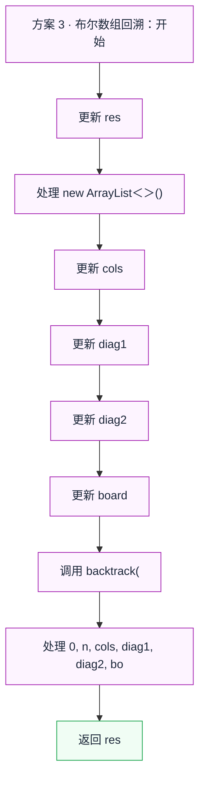

```java
package com.webfault.dsa; // 引入依赖

import java.util.*; // 引入依赖

class lc51_solution333 { // 定义类型
  public static List<List<String>> solveNQueens(int n) {
    List<List<String>> res =
        new ArrayList<>(); // 把 new ArrayList 小于 超过 (); 写入 List<List<String>> res
    boolean[] cols = new boolean[n]; // 把 new boolean[元素个数]; 写入 boolean[] cols
    boolean[] diag1 = new boolean[2 * n]; // 把 new boolean[2 乘 元素个数]; 写入 boolean[] diag1
    boolean[] diag2 = new boolean[2 * n]; // 把 new boolean[2 乘 元素个数]; 写入 boolean[] diag2
    List<char[]> board = new ArrayList<>(); // 把 new ArrayList 小于 超过 (); 写入 List<char[]> board
    backtrack(
        0, n, cols, diag1, diag2, board, res); // backtrack(0, 元素个数, 列数, diag1, diag2, 棋盘, 结果);
    return res; // 返回 结果
  }

  private static void backtrack(
      int r,
      int n,
      boolean[] cols,
      boolean[] d1,
      boolean[] d2,
      List<char[]> board,
      List<List<String>> res) { // List 小于 char[] 超过 棋盘, List 小于 List 小于 String 超过 超过 结果) {
    if (r == n) { // 若 右指针 等于 元素个数
      List<String> rows = new ArrayList<>(); // 把 new ArrayList 小于 超过 (); 写入 List<String> rows
      for (char[] row : board)
        rows.add(new String(row)); // for (char[] row : 棋盘) 行数 追加 new String(row));
      res.add(rows); // 结果 追加 行数);
      return; // return;
    }
    for (int c = 0; c < n; c++) { // 让 字符 从 0 开始计数，字符 小于 元素个数 就继续
      if (cols[c] || d1[r - c + n] || d2[r + c])
        continue; // 若 列数[字符] 或 d1[右指针 减 字符 加 元素个数] 或 d2[右指针 加 字符]) continue;
      cols[c] =
          d1[r - c + n] =
              d2[r + c] = true; // 把 d1[右指针 减 字符 加 元素个数] 赋值为 d2[右指针 加 字符] 赋值为 true; 写入 cols[c]
      char[] row = new char[n]; // 把 new char[元素个数]; 写入 char[] row
      Arrays.fill(row, '.'); // Arrays.fill(row, '.');
      row[c] = 'Q'; // 把 'Q'; 写入 row[c]
      board.add(row); // 棋盘 追加 row);
      backtrack(
          r + 1, n, cols, d1, d2, board, res); // backtrack(右指针 加 1, 元素个数, 列数, d1, d2, 棋盘, 结果);
      board.remove(board.size() - 1); // 棋盘 弹出 棋盘.大小() 减 1);
      cols[c] =
          d1[r - c + n] =
              d2[r + c] = false; // 把 d1[右指针 减 字符 加 元素个数] 赋值为 d2[右指针 加 字符] 赋值为 false; 写入 cols[c]
    }
  }

  public static void main(String[] args) { // public static void main(String[] args) {
    List<List<String>> got = solveNQueens(4); // 把 solveNQueens(4); 写入 List<List<String>> got
    List<List<String>> want =
        new ArrayList<>(); // 把 new ArrayList 小于 超过 (); 写入 List<List<String>> want
    want.add(
        Arrays.asList(
            ".Q..", "...Q", "Q...",
            "..Q.")); // want 追加 Arrays.asList(「.Q..」, 「.Q..」, 「.Q..」, 「.Q..」));
    want.add(
        Arrays.asList(
            "..Q.", "Q...", "...Q",
            ".Q..")); // want 追加 Arrays.asList(「..Q.」, 「..Q.」, 「..Q.」, 「..Q.」));
    if (!got.equals(want)) { // 若 取反 got.equals(want
      System.out.println("FAIL solveNQueens(4)=" + got); // 打印输出
      throw new RuntimeException("FAILED"); // throw new RuntimeException(「FAILED」);
    }
    System.out.println("PASS"); // 全部用例通过，输出 PASS
  }
}
```

### Rust 实现（3 种方案）

Rust 的全部方案如下，每个方案都内嵌用例自测，可独立运行（老仓库 python/go 文件遵循「打印结果」约定）：

#### 方案 1：基于集合的回溯

**思路与代码分析**：核心是「基于集合的回溯」。Rust 版用所有权移动与切片借用改写同一逻辑，注意 Option 与引用边界。代码里依次做这些事：栈的后进先出操作。**走读**：方案 1 · 基于集合的回溯：开始 → 计算 res → 遍历循环 → 返回 false → 遍历 0..n 中的每个元素 r → 遍历 0..n 中的每个元素 c → 返回  → 遍历 0..n 中的每个元素 col。

**运行架构**（真实控制流）：

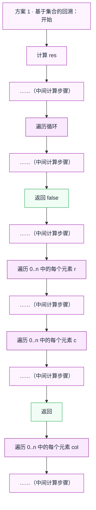

```rust
// LeetCode 51. N皇后 — Rust 版（方案1）
fn solve_n_queens(n: usize) -> Vec<Vec<String>> {
    // 定义函数/方法 solve_n_queens
    let mut res = Vec::new(); // 把 Vec::new(); 写入 let mut res
    let mut queens: Vec<(usize, usize)> = Vec::new(); // (row, col)
    fn ok2(queens: &[(usize, usize)], row: usize, col: usize) -> bool {
        // 定义函数/方法 ok2
        for &(r, c) in queens {
            // for 按位与 (右指针, 字符) in queens {
            if c == col  // 若 字符 等于 col
                || r + c == row + col  // 把 赋值为 row 加 col 写入 || r + c
                || (r as i32 - c as i32) == (row as i32 - col as i32)
            // 把 赋值为 (row as i32 减 col as i32) 写入 || (r as i32 - c as i32)
            {
                return false; // 返回 false
            }
        }
        true // true
    }
    fn dfs(n: usize, row: usize, queens: &mut Vec<(usize, usize)>, res: &mut Vec<Vec<String>>) {
        // 定义函数/方法 dfs
        if row == n {
            // 若 row 等于 元素个数
            let mut board = Vec::new(); // 把 Vec::new(); 写入 let mut board
            for r in 0..n {
                // 逐个取出 0 的元素（右指针）
                let mut line = String::new(); // 把 String::new(); 写入 let mut line
                for c in 0..n {
                    // 逐个取出 0 的元素（字符）
                    if queens.iter().any(|&(qr, qc)| qr == r && qc == c) {
                        line.push('Q');
                    } else {
                        line.push('.');
                    }
                }
                board.push(line); // 把 line 压入栈/数组尾部
            }
            res.push(board); // 把 棋盘 压入栈/数组尾部
            return; // return;
        }
        for col in 0..n {
            // 逐个取出 0 的元素（col）
            if ok2(queens, row, col) {
                // 定义函数/方法 ok2
                queens.push((row, col)); // 把 (row, col 压入栈/数组尾部
                dfs(n, row + 1, queens, res); // dfs(元素个数, row 加 1, queens, 结果);
                queens.pop(); // 弹出栈顶元素
            }
        }
    }
    dfs(n, 0, &mut queens, &mut res); // dfs(元素个数, 0, 按位与 mut queens, 按位与 mut 结果);
    res // 结果
}
fn main() {
    // 程序入口：跑内嵌自测用例
    let got = solve_n_queens(4); // 把 solve_n_queens(4) 存入 got
    assert_eq!(got.len(), 2); // 断言校验
    assert_eq!(got[0], vec![".Q..", "...Q", "Q...", "..Q."]); // 断言校验
    assert_eq!(solve_n_queens(1).len(), 1); // 断言校验
    println!("PASS"); // 全部用例通过，输出 PASS
}
```

#### 方案 2：基于集合+棋盘构建的回溯

**思路与代码分析**：核心是「基于集合+棋盘构建的回溯」。Rust 版用所有权移动与切片借用改写同一逻辑，注意 Option 与引用边界。代码里依次做这些事：栈的后进先出操作。**走读**：方案 2 · 基于集合+棋盘构建的回溯：开始 → 计算 res → 遍历循环 → 返回 false → 遍历 0..n 中的每个元素 r → 遍历 0..n 中的每个元素 c → 返回  → 遍历 0..n 中的每个元素 col。

**运行架构**（真实控制流）：

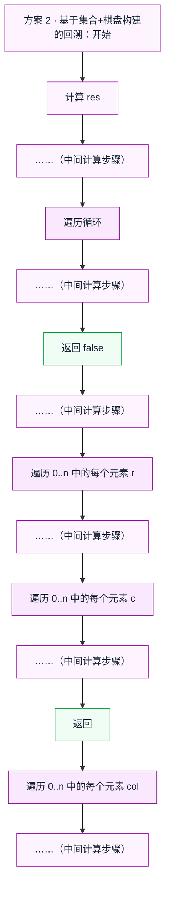

```rust
// LeetCode 51. N皇后 — Rust 版（方案2）
fn solve_n_queens(n: usize) -> Vec<Vec<String>> {
    // 定义函数/方法 solve_n_queens
    let mut res = Vec::new(); // 把 Vec::new(); 写入 let mut res
    let mut queens: Vec<(usize, usize)> = Vec::new(); // (row, col)
    fn ok2(queens: &[(usize, usize)], row: usize, col: usize) -> bool {
        // 定义函数/方法 ok2
        for &(r, c) in queens {
            // for 按位与 (右指针, 字符) in queens {
            if c == col  // 若 字符 等于 col
                || r + c == row + col  // 把 赋值为 row 加 col 写入 || r + c
                || (r as i32 - c as i32) == (row as i32 - col as i32)
            // 把 赋值为 (row as i32 减 col as i32) 写入 || (r as i32 - c as i32)
            {
                return false; // 返回 false
            }
        }
        true // true
    }
    fn dfs(n: usize, row: usize, queens: &mut Vec<(usize, usize)>, res: &mut Vec<Vec<String>>) {
        // 定义函数/方法 dfs
        if row == n {
            // 若 row 等于 元素个数
            let mut board = Vec::new(); // 把 Vec::new(); 写入 let mut board
            for r in 0..n {
                // 逐个取出 0 的元素（右指针）
                let mut line = String::new(); // 把 String::new(); 写入 let mut line
                for c in 0..n {
                    // 逐个取出 0 的元素（字符）
                    if queens.iter().any(|&(qr, qc)| qr == r && qc == c) {
                        line.push('Q');
                    } else {
                        line.push('.');
                    }
                }
                board.push(line); // 把 line 压入栈/数组尾部
            }
            res.push(board); // 把 棋盘 压入栈/数组尾部
            return; // return;
        }
        for col in 0..n {
            // 逐个取出 0 的元素（col）
            if ok2(queens, row, col) {
                // 定义函数/方法 ok2
                queens.push((row, col)); // 把 (row, col 压入栈/数组尾部
                dfs(n, row + 1, queens, res); // dfs(元素个数, row 加 1, queens, 结果);
                queens.pop(); // 弹出栈顶元素
            }
        }
    }
    dfs(n, 0, &mut queens, &mut res); // dfs(元素个数, 0, 按位与 mut queens, 按位与 mut 结果);
    res // 结果
}
fn main() {
    // 程序入口：跑内嵌自测用例
    let got = solve_n_queens(4); // 把 solve_n_queens(4) 存入 got
    assert_eq!(got.len(), 2); // 断言校验
    assert_eq!(got[0], vec![".Q..", "...Q", "Q...", "..Q."]); // 断言校验
    assert_eq!(solve_n_queens(1).len(), 1); // 断言校验
    println!("PASS"); // 全部用例通过，输出 PASS
}
```

#### 方案 3：布尔数组回溯

**思路与代码分析**：核心是「布尔数组回溯」。Rust 版用所有权移动与切片借用改写同一逻辑，注意 Option 与引用边界。代码里依次做这些事：栈的后进先出操作。**走读**：方案 3 · 布尔数组回溯：开始 → 计算 res → 遍历循环 → 返回 false → 遍历 0..n 中的每个元素 r → 遍历 0..n 中的每个元素 c → 返回  → 遍历 0..n 中的每个元素 col。

**运行架构**（真实控制流）：

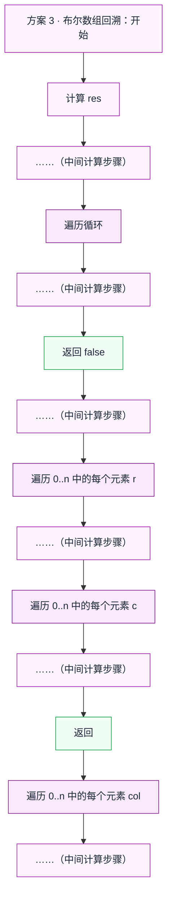

```rust
// LeetCode 51. N皇后 — Rust 版（方案3）
fn solve_n_queens(n: usize) -> Vec<Vec<String>> {
    // 定义函数/方法 solve_n_queens
    let mut res = Vec::new(); // 把 Vec::new(); 写入 let mut res
    let mut queens: Vec<(usize, usize)> = Vec::new(); // (row, col)
    fn ok2(queens: &[(usize, usize)], row: usize, col: usize) -> bool {
        // 定义函数/方法 ok2
        for &(r, c) in queens {
            // for 按位与 (右指针, 字符) in queens {
            if c == col  // 若 字符 等于 col
                || r + c == row + col  // 把 赋值为 row 加 col 写入 || r + c
                || (r as i32 - c as i32) == (row as i32 - col as i32)
            // 把 赋值为 (row as i32 减 col as i32) 写入 || (r as i32 - c as i32)
            {
                return false; // 返回 false
            }
        }
        true // true
    }
    fn dfs(n: usize, row: usize, queens: &mut Vec<(usize, usize)>, res: &mut Vec<Vec<String>>) {
        // 定义函数/方法 dfs
        if row == n {
            // 若 row 等于 元素个数
            let mut board = Vec::new(); // 把 Vec::new(); 写入 let mut board
            for r in 0..n {
                // 逐个取出 0 的元素（右指针）
                let mut line = String::new(); // 把 String::new(); 写入 let mut line
                for c in 0..n {
                    // 逐个取出 0 的元素（字符）
                    if queens.iter().any(|&(qr, qc)| qr == r && qc == c) {
                        line.push('Q');
                    } else {
                        line.push('.');
                    }
                }
                board.push(line); // 把 line 压入栈/数组尾部
            }
            res.push(board); // 把 棋盘 压入栈/数组尾部
            return; // return;
        }
        for col in 0..n {
            // 逐个取出 0 的元素（col）
            if ok2(queens, row, col) {
                // 定义函数/方法 ok2
                queens.push((row, col)); // 把 (row, col 压入栈/数组尾部
                dfs(n, row + 1, queens, res); // dfs(元素个数, row 加 1, queens, 结果);
                queens.pop(); // 弹出栈顶元素
            }
        }
    }
    dfs(n, 0, &mut queens, &mut res); // dfs(元素个数, 0, 按位与 mut queens, 按位与 mut 结果);
    res // 结果
}
fn main() {
    // 程序入口：跑内嵌自测用例
    let got = solve_n_queens(4); // 把 solve_n_queens(4) 存入 got
    assert_eq!(got.len(), 2); // 断言校验
    assert_eq!(got[0], vec![".Q..", "...Q", "Q...", "..Q."]); // 断言校验
    assert_eq!(solve_n_queens(1).len(), 1); // 断言校验
    println!("PASS"); // 全部用例通过，输出 PASS
}
```

### Lua 实现（3 种方案）

Lua 的全部方案如下，每个方案都内嵌用例自测，可独立运行（老仓库 python/go 文件遵循「打印结果」约定）：

#### 方案 1：基于集合的回溯

**思路与代码分析**：核心是「基于集合的回溯」。Lua 版用表与 ipairs 遍历，注意 ipairs 遇 nil 即停的语义。代码里依次做这些事：递归求解子问题。**走读**：方案 1 · 基于集合的回溯：开始 → 更新 res → 循环 r：从 1 到 row - 1 do → 返回 false → 返回 true → 循环 r：从 1 到 n do → 循环 c：从 1 到 n do → 返回  → 循环 col：从 1 到 n do → 返回 res。

**运行架构**（真实控制流）：

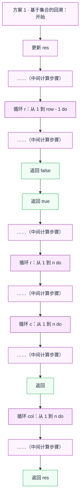

```lua
-- LeetCode 51. N皇后 — Lua 版（方案1）
local function solve_n_queens(n) -- local function solve_n_queens(元素个数)
	local res = {} -- 把 {} 写入 local res
	local cols = {} -- 把 {} 写入 local cols
	local function ok(row, col) -- local function ok(row, col)
		for r = 1, row - 1 do -- 让 右指针 从 1 走到 row（Lua 1 基）
			if cols[r] == col or math.abs(r - row) == math.abs(cols[r] - col) then
				return false
			end
		end -- 终点
		return true -- 返回 true
	end -- 终点
	local function dfs(row) -- local function dfs(row)
		if row > n then -- 若 row 超过 元素个数 then
			local board = {} -- 把 {} 写入 local board
			for r = 1, n do -- 让 右指针 从 1 走到 元素个数（Lua 1 基）
				local line = {} -- 把 {} 写入 local line
				for c = 1, n do -- 让 字符 从 1 走到 元素个数（Lua 1 基）
					if cols[r] == c then
						line[#line + 1] = "Q"
					else
						line[#line + 1] = "."
					end
				end -- 终点
				board[#board + 1] = table.concat(line) -- 打印输出
			end -- 终点
			res[#res + 1] = board -- 把 棋盘 写入 res[#res + 1]
			return -- return
		end -- 终点
		for col = 1, n do -- 让 col 从 1 走到 元素个数（Lua 1 基）
			if ok(row, col) then -- 若 ok(row, col) then
				cols[row] = col -- 把 col 写入 cols[row]
				dfs(row + 1) -- dfs(row 加 1)
				cols[row] = nil -- 把 nil 写入 cols[row]
			end -- 终点
		end -- 终点
	end -- 终点
	dfs(1) -- dfs(1)
	return res -- 返回 结果
end -- 终点
local got = solve_n_queens(4) -- 把 solve_n_queens(4) 写入 local got
assert(#got == 2) -- 断言校验
assert(got[1][1] == ".Q.." and got[1][4] == "..Q.") -- 断言校验
assert(got[2][1] == "..Q." and got[2][4] == ".Q..") -- 断言校验
assert(#solve_n_queens(1) == 1) -- 断言校验
print("PASS") -- 全部用例通过，输出 PASS
```

#### 方案 2：基于集合+棋盘构建的回溯

**思路与代码分析**：核心是「基于集合+棋盘构建的回溯」。Lua 版用表与 ipairs 遍历，注意 ipairs 遇 nil 即停的语义。代码里依次做这些事：递归求解子问题。**走读**：方案 2 · 基于集合+棋盘构建的回溯：开始 → 更新 res → 循环 r：从 1 到 row - 1 do → 返回 false → 返回 true → 循环 r：从 1 到 n do → 循环 c：从 1 到 n do → 返回  → 循环 col：从 1 到 n do → 返回 res。

**运行架构**（真实控制流）：

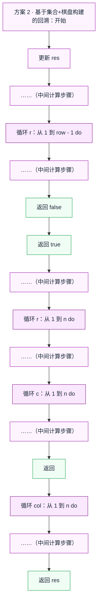

```lua
-- LeetCode 51. N皇后 — Lua 版（方案2）
local function solve_n_queens(n) -- local function solve_n_queens(元素个数)
	local res = {} -- 把 {} 写入 local res
	local cols = {} -- 把 {} 写入 local cols
	local function ok(row, col) -- local function ok(row, col)
		for r = 1, row - 1 do -- 让 右指针 从 1 走到 row（Lua 1 基）
			if cols[r] == col or math.abs(r - row) == math.abs(cols[r] - col) then
				return false
			end
		end -- 终点
		return true -- 返回 true
	end -- 终点
	local function dfs(row) -- local function dfs(row)
		if row > n then -- 若 row 超过 元素个数 then
			local board = {} -- 把 {} 写入 local board
			for r = 1, n do -- 让 右指针 从 1 走到 元素个数（Lua 1 基）
				local line = {} -- 把 {} 写入 local line
				for c = 1, n do -- 让 字符 从 1 走到 元素个数（Lua 1 基）
					if cols[r] == c then
						line[#line + 1] = "Q"
					else
						line[#line + 1] = "."
					end
				end -- 终点
				board[#board + 1] = table.concat(line) -- 打印输出
			end -- 终点
			res[#res + 1] = board -- 把 棋盘 写入 res[#res + 1]
			return -- return
		end -- 终点
		for col = 1, n do -- 让 col 从 1 走到 元素个数（Lua 1 基）
			if ok(row, col) then -- 若 ok(row, col) then
				cols[row] = col -- 把 col 写入 cols[row]
				dfs(row + 1) -- dfs(row 加 1)
				cols[row] = nil -- 把 nil 写入 cols[row]
			end -- 终点
		end -- 终点
	end -- 终点
	dfs(1) -- dfs(1)
	return res -- 返回 结果
end -- 终点
local got = solve_n_queens(4) -- 把 solve_n_queens(4) 写入 local got
assert(#got == 2) -- 断言校验
assert(got[1][1] == ".Q.." and got[1][4] == "..Q.") -- 断言校验
assert(got[2][1] == "..Q." and got[2][4] == ".Q..") -- 断言校验
assert(#solve_n_queens(1) == 1) -- 断言校验
print("PASS") -- 全部用例通过，输出 PASS
```

#### 方案 3：布尔数组回溯

**思路与代码分析**：核心是「布尔数组回溯」。Lua 版用表与 ipairs 遍历，注意 ipairs 遇 nil 即停的语义。代码里依次做这些事：递归求解子问题。**走读**：方案 3 · 布尔数组回溯：开始 → 更新 res → 循环 r：从 1 到 row - 1 do → 返回 false → 返回 true → 循环 r：从 1 到 n do → 循环 c：从 1 到 n do → 返回  → 循环 col：从 1 到 n do → 返回 res。

**运行架构**（真实控制流）：

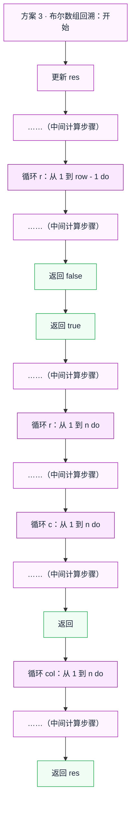

```lua
-- LeetCode 51. N皇后 — Lua 版（方案3）
local function solve_n_queens(n) -- local function solve_n_queens(元素个数)
	local res = {} -- 把 {} 写入 local res
	local cols = {} -- 把 {} 写入 local cols
	local function ok(row, col) -- local function ok(row, col)
		for r = 1, row - 1 do -- 让 右指针 从 1 走到 row（Lua 1 基）
			if cols[r] == col or math.abs(r - row) == math.abs(cols[r] - col) then
				return false
			end
		end -- 终点
		return true -- 返回 true
	end -- 终点
	local function dfs(row) -- local function dfs(row)
		if row > n then -- 若 row 超过 元素个数 then
			local board = {} -- 把 {} 写入 local board
			for r = 1, n do -- 让 右指针 从 1 走到 元素个数（Lua 1 基）
				local line = {} -- 把 {} 写入 local line
				for c = 1, n do -- 让 字符 从 1 走到 元素个数（Lua 1 基）
					if cols[r] == c then
						line[#line + 1] = "Q"
					else
						line[#line + 1] = "."
					end
				end -- 终点
				board[#board + 1] = table.concat(line) -- 打印输出
			end -- 终点
			res[#res + 1] = board -- 把 棋盘 写入 res[#res + 1]
			return -- return
		end -- 终点
		for col = 1, n do -- 让 col 从 1 走到 元素个数（Lua 1 基）
			if ok(row, col) then -- 若 ok(row, col) then
				cols[row] = col -- 把 col 写入 cols[row]
				dfs(row + 1) -- dfs(row 加 1)
				cols[row] = nil -- 把 nil 写入 cols[row]
			end -- 终点
		end -- 终点
	end -- 终点
	dfs(1) -- dfs(1)
	return res -- 返回 结果
end -- 终点
local got = solve_n_queens(4) -- 把 solve_n_queens(4) 写入 local got
assert(#got == 2) -- 断言校验
assert(got[1][1] == ".Q.." and got[1][4] == "..Q.") -- 断言校验
assert(got[2][1] == "..Q." and got[2][4] == ".Q..") -- 断言校验
assert(#solve_n_queens(1) == 1) -- 断言校验
print("PASS") -- 全部用例通过，输出 PASS
```

### C 实现（3 种方案）

C 的全部方案如下，每个方案都内嵌用例自测，可独立运行（老仓库 python/go 文件遵循「打印结果」约定）：

#### 方案 1：基于集合的回溯

**思路与代码分析**：核心是「基于集合的回溯」。C 版手动管理下标与内存，循环边界全部显式写出。**走读**：方案 1 · 基于集合的回溯：开始 → 更新 n_g → 更新 boards_n → 调用 dfs(0) → 返回 boards_n。

**运行架构**（真实控制流）：

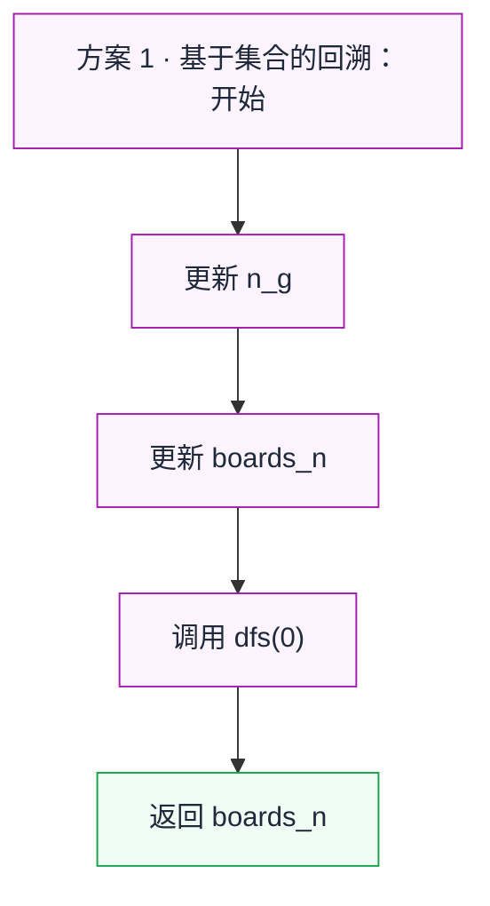

```c
/* LeetCode 51. N皇后 — C 版（方案1） */
#include <stdio.h>                  // 引入头文件
#include <stdlib.h>                 // 引入头文件
#include <string.h>                 // 引入头文件
static int cols_g[16], n_g;         // static int cols_g[16], n_g;
static char boards[256][16][17];    // static char boards[256][16][17];
static int boards_n;                // static int boards_n;
static int ok(int row, int col) {   // 定义函数/方法 ok
    for (int r = 0; r < row; r++) { // 让 右指针 从 0 开始计数，右指针 小于 row 就继续
        if (cols_g[r] == col || abs(r - row) == abs(cols_g[r] - col))
            return 0;
    }
    return 1; // 返回 1
}
static void dfs(int row) {              // 定义函数/方法 dfs
    if (row == n_g) {                   // 若 row 等于 n_g
        for (int r = 0; r < n_g; r++) { // 让 右指针 从 0 开始计数，右指针 小于 n_g 就继续
            for (int c = 0; c < n_g; c++)
                boards[boards_n][r][c] =
                    (cols_g[r] == c) ? 'Q' : '.'; // 让 字符 从 0 开始计数，字符 小于 n_g 就继续
            boards[boards_n][r][n_g] = '\0';      // 把 '\0'; 写入 boards[boards_n][r][n_g]
        }
        boards_n++; // boards_n 加一
        return;     // return;
    }
    for (int col = 0; col < n_g; col++) { // 让 col 从 0 开始计数，col 小于 n_g 就继续
        if (ok(row, col)) {               // 若 ok(row, col
            cols_g[row] = col;            // 把 col; 写入 cols_g[row]
            dfs(row + 1);                 // dfs(row 加 1);
        }
    }
}
static int solve_n_queens(int n) { // 定义函数/方法 solve_n_queens
    n_g = n;
    boards_n = 0;    // 把 元素个数; boards_n 赋值为 0; 写入 n_g
    dfs(0);          // dfs(0);
    return boards_n; // 返回 boards_n
}
int main(void) {               // 程序入口：跑内嵌自测用例
    int n = solve_n_queens(4); // 把 solve_n_queens(4) 存入 元素个数
    if (n != 2) {
        printf("FAIL cnt=%d\n", n);
        return 1;
    } // 若 元素个数 不等于 2) { 输出「FAIL 计数 赋值为 对…取模 d 」, 元素个数); return 1; }
    if (strcmp(boards[0][0], ".Q..") != 0 || strcmp(boards[0][3], "..Q.") != 0) {
        printf("FAIL b1\n");
        return 1;
    }
    if (strcmp(boards[1][0], "..Q.") != 0) {
        printf("FAIL b2\n");
        return 1;
    }
    if (solve_n_queens(1) != 1) {
        printf("FAIL 2\n");
        return 1;
    }                 // 若 solve_n_queens(1) 不等于 1) { 输出「FAIL 2 」); return 1; }
    printf("PASS\n"); // 全部用例通过，输出 PASS
    return 0;         // 返回 0
}
```

#### 方案 2：基于集合+棋盘构建的回溯

**思路与代码分析**：核心是「基于集合+棋盘构建的回溯」。C 版手动管理下标与内存，循环边界全部显式写出。**走读**：方案 2 · 基于集合+棋盘构建的回溯：开始 → 更新 n_g → 更新 boards_n → 调用 dfs(0) → 返回 boards_n。

**运行架构**（真实控制流）：

```mermaid
graph TD
    N0["方案 2 · 基于集合+棋盘构建的回溯：开始"]
    N1["更新 n_g"]
    N2["更新 boards_n"]
    N3["调用 dfs(0)"]
    N4["返回 boards_n"]
    N0 --> N1
    N1 --> N2
    N2 --> N3
    N3 --> N4
    classDef n fill:#fdf4ff,stroke:#a21caf,color:#1e293b;
    classDef lp fill:#fae8ff,stroke:#86198f,color:#1e293b;
    classDef dc fill:#fef9c3,stroke:#ca8a04,color:#1e293b;
    classDef tm fill:#f0fdf4,stroke:#16a34a,color:#1e293b;
    class N0,N1,N2,N3 n;
    class N4 tm;
```

```c
/* LeetCode 51. N皇后 — C 版（方案2） */
#include <stdio.h>                  // 引入头文件
#include <stdlib.h>                 // 引入头文件
#include <string.h>                 // 引入头文件
static int cols_g[16], n_g;         // static int cols_g[16], n_g;
static char boards[256][16][17];    // static char boards[256][16][17];
static int boards_n;                // static int boards_n;
static int ok(int row, int col) {   // 定义函数/方法 ok
    for (int r = 0; r < row; r++) { // 让 右指针 从 0 开始计数，右指针 小于 row 就继续
        if (cols_g[r] == col || abs(r - row) == abs(cols_g[r] - col))
            return 0;
    }
    return 1; // 返回 1
}
static void dfs(int row) {              // 定义函数/方法 dfs
    if (row == n_g) {                   // 若 row 等于 n_g
        for (int r = 0; r < n_g; r++) { // 让 右指针 从 0 开始计数，右指针 小于 n_g 就继续
            for (int c = 0; c < n_g; c++)
                boards[boards_n][r][c] =
                    (cols_g[r] == c) ? 'Q' : '.'; // 让 字符 从 0 开始计数，字符 小于 n_g 就继续
            boards[boards_n][r][n_g] = '\0';      // 把 '\0'; 写入 boards[boards_n][r][n_g]
        }
        boards_n++; // boards_n 加一
        return;     // return;
    }
    for (int col = 0; col < n_g; col++) { // 让 col 从 0 开始计数，col 小于 n_g 就继续
        if (ok(row, col)) {               // 若 ok(row, col
            cols_g[row] = col;            // 把 col; 写入 cols_g[row]
            dfs(row + 1);                 // dfs(row 加 1);
        }
    }
}
static int solve_n_queens(int n) { // 定义函数/方法 solve_n_queens
    n_g = n;
    boards_n = 0;    // 把 元素个数; boards_n 赋值为 0; 写入 n_g
    dfs(0);          // dfs(0);
    return boards_n; // 返回 boards_n
}
int main(void) {               // 程序入口：跑内嵌自测用例
    int n = solve_n_queens(4); // 把 solve_n_queens(4) 存入 元素个数
    if (n != 2) {
        printf("FAIL cnt=%d\n", n);
        return 1;
    } // 若 元素个数 不等于 2) { 输出「FAIL 计数 赋值为 对…取模 d 」, 元素个数); return 1; }
    if (strcmp(boards[0][0], ".Q..") != 0 || strcmp(boards[0][3], "..Q.") != 0) {
        printf("FAIL b1\n");
        return 1;
    }
    if (strcmp(boards[1][0], "..Q.") != 0) {
        printf("FAIL b2\n");
        return 1;
    }
    if (solve_n_queens(1) != 1) {
        printf("FAIL 2\n");
        return 1;
    }                 // 若 solve_n_queens(1) 不等于 1) { 输出「FAIL 2 」); return 1; }
    printf("PASS\n"); // 全部用例通过，输出 PASS
    return 0;         // 返回 0
}
```

#### 方案 3：布尔数组回溯

**思路与代码分析**：核心是「布尔数组回溯」。C 版手动管理下标与内存，循环边界全部显式写出。**走读**：方案 3 · 布尔数组回溯：开始 → 更新 n_g → 更新 boards_n → 调用 dfs(0) → 返回 boards_n。

**运行架构**（真实控制流）：

```mermaid
graph TD
    N0["方案 3 · 布尔数组回溯：开始"]
    N1["更新 n_g"]
    N2["更新 boards_n"]
    N3["调用 dfs(0)"]
    N4["返回 boards_n"]
    N0 --> N1
    N1 --> N2
    N2 --> N3
    N3 --> N4
    classDef n fill:#fdf4ff,stroke:#a21caf,color:#1e293b;
    classDef lp fill:#fae8ff,stroke:#86198f,color:#1e293b;
    classDef dc fill:#fef9c3,stroke:#ca8a04,color:#1e293b;
    classDef tm fill:#f0fdf4,stroke:#16a34a,color:#1e293b;
    class N0,N1,N2,N3 n;
    class N4 tm;
```

```c
/* LeetCode 51. N皇后 — C 版（方案3） */
#include <stdio.h>                  // 引入头文件
#include <stdlib.h>                 // 引入头文件
#include <string.h>                 // 引入头文件
static int cols_g[16], n_g;         // static int cols_g[16], n_g;
static char boards[256][16][17];    // static char boards[256][16][17];
static int boards_n;                // static int boards_n;
static int ok(int row, int col) {   // 定义函数/方法 ok
    for (int r = 0; r < row; r++) { // 让 右指针 从 0 开始计数，右指针 小于 row 就继续
        if (cols_g[r] == col || abs(r - row) == abs(cols_g[r] - col))
            return 0;
    }
    return 1; // 返回 1
}
static void dfs(int row) {              // 定义函数/方法 dfs
    if (row == n_g) {                   // 若 row 等于 n_g
        for (int r = 0; r < n_g; r++) { // 让 右指针 从 0 开始计数，右指针 小于 n_g 就继续
            for (int c = 0; c < n_g; c++)
                boards[boards_n][r][c] =
                    (cols_g[r] == c) ? 'Q' : '.'; // 让 字符 从 0 开始计数，字符 小于 n_g 就继续
            boards[boards_n][r][n_g] = '\0';      // 把 '\0'; 写入 boards[boards_n][r][n_g]
        }
        boards_n++; // boards_n 加一
        return;     // return;
    }
    for (int col = 0; col < n_g; col++) { // 让 col 从 0 开始计数，col 小于 n_g 就继续
        if (ok(row, col)) {               // 若 ok(row, col
            cols_g[row] = col;            // 把 col; 写入 cols_g[row]
            dfs(row + 1);                 // dfs(row 加 1);
        }
    }
}
static int solve_n_queens(int n) { // 定义函数/方法 solve_n_queens
    n_g = n;
    boards_n = 0;    // 把 元素个数; boards_n 赋值为 0; 写入 n_g
    dfs(0);          // dfs(0);
    return boards_n; // 返回 boards_n
}
int main(void) {               // 程序入口：跑内嵌自测用例
    int n = solve_n_queens(4); // 把 solve_n_queens(4) 存入 元素个数
    if (n != 2) {
        printf("FAIL cnt=%d\n", n);
        return 1;
    } // 若 元素个数 不等于 2) { 输出「FAIL 计数 赋值为 对…取模 d 」, 元素个数); return 1; }
    if (strcmp(boards[0][0], ".Q..") != 0 || strcmp(boards[0][3], "..Q.") != 0) {
        printf("FAIL b1\n");
        return 1;
    }
    if (strcmp(boards[1][0], "..Q.") != 0) {
        printf("FAIL b2\n");
        return 1;
    }
    if (solve_n_queens(1) != 1) {
        printf("FAIL 2\n");
        return 1;
    }                 // 若 solve_n_queens(1) 不等于 1) { 输出「FAIL 2 」); return 1; }
    printf("PASS\n"); // 全部用例通过，输出 PASS
    return 0;         // 返回 0
}
```

### C++ 实现（3 种方案）

C++ 的全部方案如下，每个方案都内嵌用例自测，可独立运行（老仓库 python/go 文件遵循「打印结果」约定）：

#### 方案 1：基于集合的回溯

**思路与代码分析**：核心是「基于集合的回溯」。C++ 版用 STL 容器与迭代器，减少手写下标错误。代码里依次做这些事：双重循环遍历。**走读**：方案 1 · 基于集合的回溯：开始 → 处理 std::vector＜std::vector＜std: → 遍历循环 → 返回  → 遍历循环 → 遍历循环 → 返回 res。

**运行架构**（真实控制流）：

```mermaid
graph TD
    N0["方案 1 · 基于集合的回溯：开始"]
    N1["处理 std::vector＜std::vector＜std:"]
    D1["……（中间计算步骤）"]
    N8["遍历循环"]
    D2["……（中间计算步骤）"]
    N13["返回 "]
    N14["遍历循环"]
    D3["……（中间计算步骤）"]
    N16["遍历循环"]
    D4["……（中间计算步骤）"]
    N25["返回 res"]
    N0 --> N1
    N13 --> N14
    N1 --> D1
    D1 --> N8
    N8 --> D2
    D2 --> N13
    N14 --> D3
    D3 --> N16
    N16 --> D4
    D4 --> N25
    classDef n fill:#fdf4ff,stroke:#a21caf,color:#1e293b;
    classDef lp fill:#fae8ff,stroke:#86198f,color:#1e293b;
    classDef dc fill:#fef9c3,stroke:#ca8a04,color:#1e293b;
    classDef tm fill:#f0fdf4,stroke:#16a34a,color:#1e293b;
    class N0,N1,D1,D2,D3,D4 n;
    class N8,N14,N16 lp;
    class N13,N25 tm;
```

```cpp
// LeetCode 51. N皇后 — C++ 版（方案1）
#include <cassert>  // 引入头文件
#include <cmath>    // 引入头文件
#include <iostream> // 引入头文件
#include <string>   // 引入头文件
#include <vector>   // 引入头文件
static std::vector<std::vector<std::string>> solveNQueens(int n) {
    std::vector<std::vector<std::string>>
        res;                      // std::vector 小于 std::vector 小于 std::string 超过 超过 结果;
    std::vector<int> cols(n, -1); // std::vector 小于 int 超过 列数(元素个数, 减 1);
    std::function<void(int)> dfs =
        [&](int row) {      // 把 [ 按位与 ](int row) { 写入 std::function<void(int)> dfs
            if (row == n) { // 若 row 等于 元素个数
                std::vector<std::string> board; // std::vector 小于 std::string 超过 棋盘;
                for (int r = 0; r < n; ++r) { // 让 右指针 从 0 开始计数，右指针 小于 元素个数 就继续
                    std::string line(n, '.'); // std::string line(元素个数, '.');
                    line[cols[r]] = 'Q';      // 把 'Q'; 写入 line[cols[r]]
                    board.push_back(line);    // 棋盘 追加 line);
                }
                res.push_back(board); // 结果 追加 棋盘);
                return;               // return;
            }
            for (int col = 0; col < n; ++col) { // 让 col 从 0 开始计数，col 小于 元素个数 就继续
                bool valid = true;              // 把 true 存入 valid
                for (int r = 0; r < row; ++r) { // 让 右指针 从 0 开始计数，右指针 小于 row 就继续
                    if (cols[r] == col || std::abs(r - row) == std::abs(cols[r] - col)) {
                        valid = false;
                        break;
                    }
                }
                if (valid) {         // 若 valid
                    cols[row] = col; // 把 col; 写入 cols[row]
                    dfs(row + 1);    // dfs(row 加 1);
                    cols[row] = -1;  // 把 减 1; 写入 cols[row]
                }
            }
        };
    dfs(0);     // dfs(0);
    return res; // 返回 结果
}
int main() {                    // 程序入口：跑内嵌自测用例
    auto got = solveNQueens(4); // 把 solveNQueens(4) 存入 got
    assert(got.size() == 2);    // 断言校验
    assert((got[0] == std::vector<std::string>{".Q..", "...Q", "Q...", "..Q."})); // 断言校验
    assert(solveNQueens(1).size() == 1);                                          // 断言校验
    std::cout << "PASS" << std::endl; // 全部用例通过，输出 PASS
    return 0;                         // 返回 0
}
```

#### 方案 2：基于集合+棋盘构建的回溯

**思路与代码分析**：核心是「基于集合+棋盘构建的回溯」。C++ 版用 STL 容器与迭代器，减少手写下标错误。代码里依次做这些事：双重循环遍历。**走读**：方案 2 · 基于集合+棋盘构建的回溯：开始 → 处理 std::vector＜std::vector＜std: → 遍历循环 → 返回  → 遍历循环 → 遍历循环 → 返回 res。

**运行架构**（真实控制流）：

```mermaid
graph TD
    N0["方案 2 · 基于集合+棋盘构建的回溯：开始"]
    N1["处理 std::vector＜std::vector＜std:"]
    D1["……（中间计算步骤）"]
    N8["遍历循环"]
    D2["……（中间计算步骤）"]
    N13["返回 "]
    N14["遍历循环"]
    D3["……（中间计算步骤）"]
    N16["遍历循环"]
    D4["……（中间计算步骤）"]
    N25["返回 res"]
    N0 --> N1
    N13 --> N14
    N1 --> D1
    D1 --> N8
    N8 --> D2
    D2 --> N13
    N14 --> D3
    D3 --> N16
    N16 --> D4
    D4 --> N25
    classDef n fill:#fdf4ff,stroke:#a21caf,color:#1e293b;
    classDef lp fill:#fae8ff,stroke:#86198f,color:#1e293b;
    classDef dc fill:#fef9c3,stroke:#ca8a04,color:#1e293b;
    classDef tm fill:#f0fdf4,stroke:#16a34a,color:#1e293b;
    class N0,N1,D1,D2,D3,D4 n;
    class N8,N14,N16 lp;
    class N13,N25 tm;
```

```cpp
// LeetCode 51. N皇后 — C++ 版（方案2）
#include <cassert>  // 引入头文件
#include <cmath>    // 引入头文件
#include <iostream> // 引入头文件
#include <string>   // 引入头文件
#include <vector>   // 引入头文件
static std::vector<std::vector<std::string>> solveNQueens(int n) {
    std::vector<std::vector<std::string>>
        res;                      // std::vector 小于 std::vector 小于 std::string 超过 超过 结果;
    std::vector<int> cols(n, -1); // std::vector 小于 int 超过 列数(元素个数, 减 1);
    std::function<void(int)> dfs =
        [&](int row) {      // 把 [ 按位与 ](int row) { 写入 std::function<void(int)> dfs
            if (row == n) { // 若 row 等于 元素个数
                std::vector<std::string> board; // std::vector 小于 std::string 超过 棋盘;
                for (int r = 0; r < n; ++r) { // 让 右指针 从 0 开始计数，右指针 小于 元素个数 就继续
                    std::string line(n, '.'); // std::string line(元素个数, '.');
                    line[cols[r]] = 'Q';      // 把 'Q'; 写入 line[cols[r]]
                    board.push_back(line);    // 棋盘 追加 line);
                }
                res.push_back(board); // 结果 追加 棋盘);
                return;               // return;
            }
            for (int col = 0; col < n; ++col) { // 让 col 从 0 开始计数，col 小于 元素个数 就继续
                bool valid = true;              // 把 true 存入 valid
                for (int r = 0; r < row; ++r) { // 让 右指针 从 0 开始计数，右指针 小于 row 就继续
                    if (cols[r] == col || std::abs(r - row) == std::abs(cols[r] - col)) {
                        valid = false;
                        break;
                    }
                }
                if (valid) {         // 若 valid
                    cols[row] = col; // 把 col; 写入 cols[row]
                    dfs(row + 1);    // dfs(row 加 1);
                    cols[row] = -1;  // 把 减 1; 写入 cols[row]
                }
            }
        };
    dfs(0);     // dfs(0);
    return res; // 返回 结果
}
int main() {                    // 程序入口：跑内嵌自测用例
    auto got = solveNQueens(4); // 把 solveNQueens(4) 存入 got
    assert(got.size() == 2);    // 断言校验
    assert((got[0] == std::vector<std::string>{".Q..", "...Q", "Q...", "..Q."})); // 断言校验
    assert(solveNQueens(1).size() == 1);                                          // 断言校验
    std::cout << "PASS" << std::endl; // 全部用例通过，输出 PASS
    return 0;                         // 返回 0
}
```

#### 方案 3：布尔数组回溯

**思路与代码分析**：核心是「布尔数组回溯」。C++ 版用 STL 容器与迭代器，减少手写下标错误。代码里依次做这些事：双重循环遍历。**走读**：方案 3 · 布尔数组回溯：开始 → 处理 std::vector＜std::vector＜std: → 遍历循环 → 返回  → 遍历循环 → 遍历循环 → 返回 res。

**运行架构**（真实控制流）：

```mermaid
graph TD
    N0["方案 3 · 布尔数组回溯：开始"]
    N1["处理 std::vector＜std::vector＜std:"]
    D1["……（中间计算步骤）"]
    N8["遍历循环"]
    D2["……（中间计算步骤）"]
    N13["返回 "]
    N14["遍历循环"]
    D3["……（中间计算步骤）"]
    N16["遍历循环"]
    D4["……（中间计算步骤）"]
    N25["返回 res"]
    N0 --> N1
    N13 --> N14
    N1 --> D1
    D1 --> N8
    N8 --> D2
    D2 --> N13
    N14 --> D3
    D3 --> N16
    N16 --> D4
    D4 --> N25
    classDef n fill:#fdf4ff,stroke:#a21caf,color:#1e293b;
    classDef lp fill:#fae8ff,stroke:#86198f,color:#1e293b;
    classDef dc fill:#fef9c3,stroke:#ca8a04,color:#1e293b;
    classDef tm fill:#f0fdf4,stroke:#16a34a,color:#1e293b;
    class N0,N1,D1,D2,D3,D4 n;
    class N8,N14,N16 lp;
    class N13,N25 tm;
```

```cpp
// LeetCode 51. N皇后 — C++ 版（方案3）
#include <cassert>  // 引入头文件
#include <cmath>    // 引入头文件
#include <iostream> // 引入头文件
#include <string>   // 引入头文件
#include <vector>   // 引入头文件
static std::vector<std::vector<std::string>> solveNQueens(int n) {
    std::vector<std::vector<std::string>>
        res;                      // std::vector 小于 std::vector 小于 std::string 超过 超过 结果;
    std::vector<int> cols(n, -1); // std::vector 小于 int 超过 列数(元素个数, 减 1);
    std::function<void(int)> dfs =
        [&](int row) {      // 把 [ 按位与 ](int row) { 写入 std::function<void(int)> dfs
            if (row == n) { // 若 row 等于 元素个数
                std::vector<std::string> board; // std::vector 小于 std::string 超过 棋盘;
                for (int r = 0; r < n; ++r) { // 让 右指针 从 0 开始计数，右指针 小于 元素个数 就继续
                    std::string line(n, '.'); // std::string line(元素个数, '.');
                    line[cols[r]] = 'Q';      // 把 'Q'; 写入 line[cols[r]]
                    board.push_back(line);    // 棋盘 追加 line);
                }
                res.push_back(board); // 结果 追加 棋盘);
                return;               // return;
            }
            for (int col = 0; col < n; ++col) { // 让 col 从 0 开始计数，col 小于 元素个数 就继续
                bool valid = true;              // 把 true 存入 valid
                for (int r = 0; r < row; ++r) { // 让 右指针 从 0 开始计数，右指针 小于 row 就继续
                    if (cols[r] == col || std::abs(r - row) == std::abs(cols[r] - col)) {
                        valid = false;
                        break;
                    }
                }
                if (valid) {         // 若 valid
                    cols[row] = col; // 把 col; 写入 cols[row]
                    dfs(row + 1);    // dfs(row 加 1);
                    cols[row] = -1;  // 把 减 1; 写入 cols[row]
                }
            }
        };
    dfs(0);     // dfs(0);
    return res; // 返回 结果
}
int main() {                    // 程序入口：跑内嵌自测用例
    auto got = solveNQueens(4); // 把 solveNQueens(4) 存入 got
    assert(got.size() == 2);    // 断言校验
    assert((got[0] == std::vector<std::string>{".Q..", "...Q", "Q...", "..Q."})); // 断言校验
    assert(solveNQueens(1).size() == 1);                                          // 断言校验
    std::cout << "PASS" << std::endl; // 全部用例通过，输出 PASS
    return 0;                         // 返回 0
}
```

### R 实现（3 种方案）

R 的全部方案如下，每个方案都内嵌用例自测，可独立运行（老仓库 python/go 文件遵循「打印结果」约定）：

#### 方案 1：基于集合的回溯

**思路与代码分析**：核心是「基于集合的回溯」。R 版用向量化思维与 1 起始下标，注意 1:n 的降序陷阱。代码里依次做这些事：双重循环遍历。**走读**：方案 1 · 基于集合的回溯：开始 → 处理 res ＜- list() → 循环 r：遍历 seq_len(n) → 返回 (invisible(NULL)) → 循环 col：遍历 seq_len(n) → 循环 r：遍历 seq_len(row - 1L)。

**运行架构**（真实控制流）：

```mermaid
graph TD
    N0["方案 1 · 基于集合的回溯：开始"]
    N1["处理 res ＜- list()"]
    D1["……（中间计算步骤）"]
    N6["循环 r：遍历 seq_len(n)"]
    D2["……（中间计算步骤）"]
    N12["返回 (invisible(NULL))"]
    N13["循环 col：遍历 seq_len(n)"]
    D3["……（中间计算步骤）"]
    N15["循环 r：遍历 seq_len(row - 1L)"]
    Dend["……（中间计算步骤）"]
    N0 --> N1
    N12 --> N13
    N1 --> D1
    D1 --> N6
    N6 --> D2
    D2 --> N12
    N13 --> D3
    D3 --> N15
    N15 --> Dend
    classDef n fill:#fdf4ff,stroke:#a21caf,color:#1e293b;
    classDef lp fill:#fae8ff,stroke:#86198f,color:#1e293b;
    classDef dc fill:#fef9c3,stroke:#ca8a04,color:#1e293b;
    classDef tm fill:#f0fdf4,stroke:#16a34a,color:#1e293b;
    class N0,N1,D1,D2,D3,Dend n;
    class N6,N13,N15 lp;
    class N12 tm;
```

```r
# 定义函数 solve_n_queens（参数：元素个数）
solve_n_queens <- function(n) {
    res <- list()  # 把 列表() 存入 结果
    cols <- rep(-1L, n)  # 把 rep( 减 1L, 元素个数) 存入 列数
    dfs <- function(row) {
        # 定义函数 dfs（参数：row） 若 row 超过 元素个数
        if (row > n) {
            board <- character(0)  # 把 character(0) 存入 棋盘
            for (r in seq_len(n)) {
                # for (右指针 in seq_len(元素个数)) {
                line <- strrep(".", n)  # 把 strrep(「.」, 元素个数) 存入 line
                chars <- strsplit(line, "")[[1]]  # 把 strsplit(line, 「」)[[1]] 存入 chars
                chars[cols[r]] <- "Q"  # 把 「Q」 存入 chars[cols[r]]
                board <- c(board, paste(chars, collapse = ""))  # 把 字符(棋盘, paste(chars, collapse 赋值为 「」)) 存入 棋盘
            }
            res[[length(res) + 1L]] <<- board  # 结果[[长度(结果) 加 1L]] 小于 小于 减 棋盘
            return(invisible(NULL))  # 返回 invisible(NULL
        }
        for (col in seq_len(n)) {
            # for (col in seq_len(元素个数)) {
            valid <- TRUE  # 把 TRUE 存入 valid
            for (r in seq_len(row - 1L)) {
                # for (右指针 in seq_len(row 减 1L)) {
                if (cols[r] == col || abs(r - row) == abs(cols[r] - col)) {
                  valid <- FALSE
                  break
                }
            }
            if (valid) {
                # 若 valid
                cols[row] <<- col  # 列数[row] 小于 小于 减 col
                dfs(row + 1L)  # dfs(row 加 1L)
            }
        }
    }
    dfs(1L)  # dfs(1L)
    res  # 结果
}
got <- solve_n_queens(4)  # 把 solve_n_queens(4) 存入 got
stopifnot(length(got) == 2)  # 断言校验
stopifnot(identical(got[[1]], c(".Q..", "...Q", "Q...", "..Q.")))  # 断言校验
stopifnot(length(solve_n_queens(1)) == 1)  # 断言校验
cat("PASS\n")  # 全部用例通过，输出 PASS
```

#### 方案 2：基于集合+棋盘构建的回溯

**思路与代码分析**：核心是「基于集合+棋盘构建的回溯」。R 版用向量化思维与 1 起始下标，注意 1:n 的降序陷阱。代码里依次做这些事：双重循环遍历。**走读**：方案 2 · 基于集合+棋盘构建的回溯：开始 → 处理 res ＜- list() → 循环 r：遍历 seq_len(n) → 返回 (invisible(NULL)) → 循环 col：遍历 seq_len(n) → 循环 r：遍历 seq_len(row - 1L)。

**运行架构**（真实控制流）：

```mermaid
graph TD
    N0["方案 2 · 基于集合+棋盘构建的回溯：开始"]
    N1["处理 res ＜- list()"]
    D1["……（中间计算步骤）"]
    N6["循环 r：遍历 seq_len(n)"]
    D2["……（中间计算步骤）"]
    N12["返回 (invisible(NULL))"]
    N13["循环 col：遍历 seq_len(n)"]
    D3["……（中间计算步骤）"]
    N15["循环 r：遍历 seq_len(row - 1L)"]
    Dend["……（中间计算步骤）"]
    N0 --> N1
    N12 --> N13
    N1 --> D1
    D1 --> N6
    N6 --> D2
    D2 --> N12
    N13 --> D3
    D3 --> N15
    N15 --> Dend
    classDef n fill:#fdf4ff,stroke:#a21caf,color:#1e293b;
    classDef lp fill:#fae8ff,stroke:#86198f,color:#1e293b;
    classDef dc fill:#fef9c3,stroke:#ca8a04,color:#1e293b;
    classDef tm fill:#f0fdf4,stroke:#16a34a,color:#1e293b;
    class N0,N1,D1,D2,D3,Dend n;
    class N6,N13,N15 lp;
    class N12 tm;
```

```r
# 定义函数 solve_n_queens（参数：元素个数）
solve_n_queens <- function(n) {
    res <- list()  # 把 列表() 存入 结果
    cols <- rep(-1L, n)  # 把 rep( 减 1L, 元素个数) 存入 列数
    dfs <- function(row) {
        # 定义函数 dfs（参数：row） 若 row 超过 元素个数
        if (row > n) {
            board <- character(0)  # 把 character(0) 存入 棋盘
            for (r in seq_len(n)) {
                # for (右指针 in seq_len(元素个数)) {
                line <- strrep(".", n)  # 把 strrep(「.」, 元素个数) 存入 line
                chars <- strsplit(line, "")[[1]]  # 把 strsplit(line, 「」)[[1]] 存入 chars
                chars[cols[r]] <- "Q"  # 把 「Q」 存入 chars[cols[r]]
                board <- c(board, paste(chars, collapse = ""))  # 把 字符(棋盘, paste(chars, collapse 赋值为 「」)) 存入 棋盘
            }
            res[[length(res) + 1L]] <<- board  # 结果[[长度(结果) 加 1L]] 小于 小于 减 棋盘
            return(invisible(NULL))  # 返回 invisible(NULL
        }
        for (col in seq_len(n)) {
            # for (col in seq_len(元素个数)) {
            valid <- TRUE  # 把 TRUE 存入 valid
            for (r in seq_len(row - 1L)) {
                # for (右指针 in seq_len(row 减 1L)) {
                if (cols[r] == col || abs(r - row) == abs(cols[r] - col)) {
                  valid <- FALSE
                  break
                }
            }
            if (valid) {
                # 若 valid
                cols[row] <<- col  # 列数[row] 小于 小于 减 col
                dfs(row + 1L)  # dfs(row 加 1L)
            }
        }
    }
    dfs(1L)  # dfs(1L)
    res  # 结果
}
got <- solve_n_queens(4)  # 把 solve_n_queens(4) 存入 got
stopifnot(length(got) == 2)  # 断言校验
stopifnot(identical(got[[1]], c(".Q..", "...Q", "Q...", "..Q.")))  # 断言校验
stopifnot(length(solve_n_queens(1)) == 1)  # 断言校验
cat("PASS\n")  # 全部用例通过，输出 PASS
```

#### 方案 3：布尔数组回溯

**思路与代码分析**：核心是「布尔数组回溯」。R 版用向量化思维与 1 起始下标，注意 1:n 的降序陷阱。代码里依次做这些事：双重循环遍历。**走读**：方案 3 · 布尔数组回溯：开始 → 处理 res ＜- list() → 循环 r：遍历 seq_len(n) → 返回 (invisible(NULL)) → 循环 col：遍历 seq_len(n) → 循环 r：遍历 seq_len(row - 1L)。

**运行架构**（真实控制流）：

```mermaid
graph TD
    N0["方案 3 · 布尔数组回溯：开始"]
    N1["处理 res ＜- list()"]
    D1["……（中间计算步骤）"]
    N6["循环 r：遍历 seq_len(n)"]
    D2["……（中间计算步骤）"]
    N12["返回 (invisible(NULL))"]
    N13["循环 col：遍历 seq_len(n)"]
    D3["……（中间计算步骤）"]
    N15["循环 r：遍历 seq_len(row - 1L)"]
    Dend["……（中间计算步骤）"]
    N0 --> N1
    N12 --> N13
    N1 --> D1
    D1 --> N6
    N6 --> D2
    D2 --> N12
    N13 --> D3
    D3 --> N15
    N15 --> Dend
    classDef n fill:#fdf4ff,stroke:#a21caf,color:#1e293b;
    classDef lp fill:#fae8ff,stroke:#86198f,color:#1e293b;
    classDef dc fill:#fef9c3,stroke:#ca8a04,color:#1e293b;
    classDef tm fill:#f0fdf4,stroke:#16a34a,color:#1e293b;
    class N0,N1,D1,D2,D3,Dend n;
    class N6,N13,N15 lp;
    class N12 tm;
```

```r
# 定义函数 solve_n_queens（参数：元素个数）
solve_n_queens <- function(n) {
    res <- list()  # 把 列表() 存入 结果
    cols <- rep(-1L, n)  # 把 rep( 减 1L, 元素个数) 存入 列数
    dfs <- function(row) {
        # 定义函数 dfs（参数：row） 若 row 超过 元素个数
        if (row > n) {
            board <- character(0)  # 把 character(0) 存入 棋盘
            for (r in seq_len(n)) {
                # for (右指针 in seq_len(元素个数)) {
                line <- strrep(".", n)  # 把 strrep(「.」, 元素个数) 存入 line
                chars <- strsplit(line, "")[[1]]  # 把 strsplit(line, 「」)[[1]] 存入 chars
                chars[cols[r]] <- "Q"  # 把 「Q」 存入 chars[cols[r]]
                board <- c(board, paste(chars, collapse = ""))  # 把 字符(棋盘, paste(chars, collapse 赋值为 「」)) 存入 棋盘
            }
            res[[length(res) + 1L]] <<- board  # 结果[[长度(结果) 加 1L]] 小于 小于 减 棋盘
            return(invisible(NULL))  # 返回 invisible(NULL
        }
        for (col in seq_len(n)) {
            # for (col in seq_len(元素个数)) {
            valid <- TRUE  # 把 TRUE 存入 valid
            for (r in seq_len(row - 1L)) {
                # for (右指针 in seq_len(row 减 1L)) {
                if (cols[r] == col || abs(r - row) == abs(cols[r] - col)) {
                  valid <- FALSE
                  break
                }
            }
            if (valid) {
                # 若 valid
                cols[row] <<- col  # 列数[row] 小于 小于 减 col
                dfs(row + 1L)  # dfs(row 加 1L)
            }
        }
    }
    dfs(1L)  # dfs(1L)
    res  # 结果
}
got <- solve_n_queens(4)  # 把 solve_n_queens(4) 存入 got
stopifnot(length(got) == 2)  # 断言校验
stopifnot(identical(got[[1]], c(".Q..", "...Q", "Q...", "..Q.")))  # 断言校验
stopifnot(length(solve_n_queens(1)) == 1)  # 断言校验
cat("PASS\n")  # 全部用例通过，输出 PASS
```

### Zig 实现（3 种方案）

Zig 的全部方案如下，每个方案都内嵌用例自测，可独立运行（老仓库 python/go 文件遵循「打印结果」约定）：

#### 方案 1：基于集合的回溯

**思路与代码分析**：核心是「基于集合的回溯」。Zig 版显式分配与清零，整型边界处理严格。代码里依次做这些事：双重循环遍历。**走读**：方案 1 · 基于集合的回溯：开始 → 计算 D → 遍历集合元素 → 遍历集合元素 → 返回  → 遍历集合元素 → 遍历集合元素。

**运行架构**（真实控制流）：

```mermaid
graph TD
    N0["方案 1 · 基于集合的回溯：开始"]
    N1["计算 D"]
    D1["……（中间计算步骤）"]
    N4["遍历集合元素"]
    D2["……（中间计算步骤）"]
    N6["遍历集合元素"]
    D3["……（中间计算步骤）"]
    N9["返回 "]
    N10["遍历集合元素"]
    D4["……（中间计算步骤）"]
    N12["遍历集合元素"]
    Dend["……（中间计算步骤）"]
    N0 --> N1
    N9 --> N10
    N1 --> D1
    D1 --> N4
    N4 --> D2
    D2 --> N6
    N6 --> D3
    D3 --> N9
    N10 --> D4
    D4 --> N12
    N12 --> Dend
    classDef n fill:#fdf4ff,stroke:#a21caf,color:#1e293b;
    classDef lp fill:#fae8ff,stroke:#86198f,color:#1e293b;
    classDef dc fill:#fef9c3,stroke:#ca8a04,color:#1e293b;
    classDef tm fill:#f0fdf4,stroke:#16a34a,color:#1e293b;
    class N0,N1,D1,D2,D3,D4,Dend n;
    class N4,N6,N10,N12 lp;
    class N9 tm;
```

```zig
// LeetCode 51. N皇后 — Zig 版（方案1）
const std = @import("std"); // 把 @import(「std」) 存入 std
fn solveNQueens(n: usize, alloc: std.mem.Allocator, res: *std.ArrayList(std.ArrayList([]const u8))) void { // 定义函数/方法 solveNQueens
    const D = struct { // 把 struct { 存入 D
        fn dfs(nn: usize, row: usize, cols: []i32, out: *std.ArrayList(std.ArrayList([]const u8)), a: std.mem.Allocator) void { // 定义函数/方法 dfs
            if (row == nn) { // 若 row 等于 nn
                var board = std.ArrayList([]const u8).init(out.allocator); // 把 std.ArrayList([]const u8).init(out.allocator) 存入 棋盘
                for (0..nn) |r| { // 让 右指针 从 0 走到 nn 减一
                    var buf = a.alloc(u8, nn) catch unreachable; // 把 数组.alloc(u8, nn) catch unreachable 存入 buf
                    for (0..nn) |c| buf[c] = if (cols[r] == @as(i32, @intCast(c))) 'Q' else '.'; // 让 字符 从 0 走到 nn 减一
                    board.append(buf) catch unreachable; // 把 buf 追加到列表尾部
                }
                out.append(board) catch unreachable; // 把 棋盘 追加到列表尾部
                return; // return;
            }
            for (0..nn) |col| { // 让 col 从 0 走到 nn 减一
                var valid = true; // 把 true 存入 valid
                for (0..row) |r| { // 让 右指针 从 0 走到 row 减一
                    if (cols[r] == @as(i32, @intCast(col))) {
                        valid = false;
                        break;
                    }
                    const dr = @as(i32, @intCast(r)) - @as(i32, @intCast(row)); // 把 @as(i32, @intCast(右指针)) 减 @as(i32, @intCast(row)) 存入 dr
                    const dc = cols[r] - @as(i32, @intCast(col)); // 把 列数[右指针] 减 @as(i32, @intCast(col)) 存入 dc
                    if (dr * dr == dc * dc) {
                        valid = false;
                        break;
                    } // 若 dr 乘 dr 等于 dc 乘 dc) { valid 赋值为 false; break; }
                }
                if (valid) { // 若 valid
                    cols[row] = @intCast(col); // 把 @intCast(col); 写入 cols[row]
                    dfs(nn, row + 1, cols, out, a); // dfs(nn, row 加 1, 列数, out, 数组);
                }
            }
        }
    };
    const cols = alloc.alloc(i32, n) catch unreachable; // 把 alloc.alloc(i32, 元素个数) catch unreachable 存入 列数
    @memset(cols, -1); // @memset(列数, 减 1);
    D.dfs(n, 0, cols, res, alloc); // D.dfs(元素个数, 0, 列数, 结果, alloc);
}
pub fn main() !void { // 程序入口：跑内嵌自测用例
    var arena = std.heap.ArenaAllocator.init(std.heap.page_allocator); // 把 std.堆.ArenaAllocator.init(std.堆.page_allocator) 存入 arena
    defer arena.deinit(); // defer arena.deinit();
    const alloc = arena.allocator(); // 把 arena.allocator() 存入 alloc
    var res = std.ArrayList(std.ArrayList([]const u8)).init(std.heap.page_allocator);
    defer res.deinit(); // defer 结果.deinit();
    solveNQueens(4, alloc, &res); // solveNQueens(4, alloc, 按位与 结果);
    if (res.items.len != 2) return error.TestFailed; // 若 结果.items.长度 不等于 2，直接返回 error.TestFailed
    if (!std.mem.eql(u8, res.items[0].items[0], ".Q..")) return error.TestFailed;
    if (!std.mem.eql(u8, res.items[0].items[3], "..Q.")) return error.TestFailed;
    res.clearRetainingCapacity(); // 结果.clearRetainingCapacity();
    solveNQueens(1, alloc, &res); // solveNQueens(1, alloc, 按位与 结果);
    if (res.items.len != 1) return error.TestFailed; // 若 结果.items.长度 不等于 1，直接返回 error.TestFailed
    std.debug.print("PASS\n", .{}); // 全部用例通过，输出 PASS
}
```

#### 方案 2：基于集合+棋盘构建的回溯

**思路与代码分析**：核心是「基于集合+棋盘构建的回溯」。Zig 版显式分配与清零，整型边界处理严格。代码里依次做这些事：双重循环遍历。**走读**：方案 2 · 基于集合+棋盘构建的回溯：开始 → 计算 D → 遍历集合元素 → 遍历集合元素 → 返回  → 遍历集合元素 → 遍历集合元素。

**运行架构**（真实控制流）：

```mermaid
graph TD
    N0["方案 2 · 基于集合+棋盘构建的回溯：开始"]
    N1["计算 D"]
    D1["……（中间计算步骤）"]
    N4["遍历集合元素"]
    D2["……（中间计算步骤）"]
    N6["遍历集合元素"]
    D3["……（中间计算步骤）"]
    N9["返回 "]
    N10["遍历集合元素"]
    D4["……（中间计算步骤）"]
    N12["遍历集合元素"]
    Dend["……（中间计算步骤）"]
    N0 --> N1
    N9 --> N10
    N1 --> D1
    D1 --> N4
    N4 --> D2
    D2 --> N6
    N6 --> D3
    D3 --> N9
    N10 --> D4
    D4 --> N12
    N12 --> Dend
    classDef n fill:#fdf4ff,stroke:#a21caf,color:#1e293b;
    classDef lp fill:#fae8ff,stroke:#86198f,color:#1e293b;
    classDef dc fill:#fef9c3,stroke:#ca8a04,color:#1e293b;
    classDef tm fill:#f0fdf4,stroke:#16a34a,color:#1e293b;
    class N0,N1,D1,D2,D3,D4,Dend n;
    class N4,N6,N10,N12 lp;
    class N9 tm;
```

```zig
// LeetCode 51. N皇后 — Zig 版（方案2）
const std = @import("std"); // 把 @import(「std」) 存入 std
fn solveNQueens(n: usize, alloc: std.mem.Allocator, res: *std.ArrayList(std.ArrayList([]const u8))) void { // 定义函数/方法 solveNQueens
    const D = struct { // 把 struct { 存入 D
        fn dfs(nn: usize, row: usize, cols: []i32, out: *std.ArrayList(std.ArrayList([]const u8)), a: std.mem.Allocator) void { // 定义函数/方法 dfs
            if (row == nn) { // 若 row 等于 nn
                var board = std.ArrayList([]const u8).init(out.allocator); // 把 std.ArrayList([]const u8).init(out.allocator) 存入 棋盘
                for (0..nn) |r| { // 让 右指针 从 0 走到 nn 减一
                    var buf = a.alloc(u8, nn) catch unreachable; // 把 数组.alloc(u8, nn) catch unreachable 存入 buf
                    for (0..nn) |c| buf[c] = if (cols[r] == @as(i32, @intCast(c))) 'Q' else '.'; // 让 字符 从 0 走到 nn 减一
                    board.append(buf) catch unreachable; // 把 buf 追加到列表尾部
                }
                out.append(board) catch unreachable; // 把 棋盘 追加到列表尾部
                return; // return;
            }
            for (0..nn) |col| { // 让 col 从 0 走到 nn 减一
                var valid = true; // 把 true 存入 valid
                for (0..row) |r| { // 让 右指针 从 0 走到 row 减一
                    if (cols[r] == @as(i32, @intCast(col))) {
                        valid = false;
                        break;
                    }
                    const dr = @as(i32, @intCast(r)) - @as(i32, @intCast(row)); // 把 @as(i32, @intCast(右指针)) 减 @as(i32, @intCast(row)) 存入 dr
                    const dc = cols[r] - @as(i32, @intCast(col)); // 把 列数[右指针] 减 @as(i32, @intCast(col)) 存入 dc
                    if (dr * dr == dc * dc) {
                        valid = false;
                        break;
                    } // 若 dr 乘 dr 等于 dc 乘 dc) { valid 赋值为 false; break; }
                }
                if (valid) { // 若 valid
                    cols[row] = @intCast(col); // 把 @intCast(col); 写入 cols[row]
                    dfs(nn, row + 1, cols, out, a); // dfs(nn, row 加 1, 列数, out, 数组);
                }
            }
        }
    };
    const cols = alloc.alloc(i32, n) catch unreachable; // 把 alloc.alloc(i32, 元素个数) catch unreachable 存入 列数
    @memset(cols, -1); // @memset(列数, 减 1);
    D.dfs(n, 0, cols, res, alloc); // D.dfs(元素个数, 0, 列数, 结果, alloc);
}
pub fn main() !void { // 程序入口：跑内嵌自测用例
    var arena = std.heap.ArenaAllocator.init(std.heap.page_allocator); // 把 std.堆.ArenaAllocator.init(std.堆.page_allocator) 存入 arena
    defer arena.deinit(); // defer arena.deinit();
    const alloc = arena.allocator(); // 把 arena.allocator() 存入 alloc
    var res = std.ArrayList(std.ArrayList([]const u8)).init(std.heap.page_allocator);
    defer res.deinit(); // defer 结果.deinit();
    solveNQueens(4, alloc, &res); // solveNQueens(4, alloc, 按位与 结果);
    if (res.items.len != 2) return error.TestFailed; // 若 结果.items.长度 不等于 2，直接返回 error.TestFailed
    if (!std.mem.eql(u8, res.items[0].items[0], ".Q..")) return error.TestFailed;
    if (!std.mem.eql(u8, res.items[0].items[3], "..Q.")) return error.TestFailed;
    res.clearRetainingCapacity(); // 结果.clearRetainingCapacity();
    solveNQueens(1, alloc, &res); // solveNQueens(1, alloc, 按位与 结果);
    if (res.items.len != 1) return error.TestFailed; // 若 结果.items.长度 不等于 1，直接返回 error.TestFailed
    std.debug.print("PASS\n", .{}); // 全部用例通过，输出 PASS
}
```

#### 方案 3：布尔数组回溯

**思路与代码分析**：核心是「布尔数组回溯」。Zig 版显式分配与清零，整型边界处理严格。代码里依次做这些事：双重循环遍历。**走读**：方案 3 · 布尔数组回溯：开始 → 计算 D → 遍历集合元素 → 遍历集合元素 → 返回  → 遍历集合元素 → 遍历集合元素。

**运行架构**（真实控制流）：

```mermaid
graph TD
    N0["方案 3 · 布尔数组回溯：开始"]
    N1["计算 D"]
    D1["……（中间计算步骤）"]
    N4["遍历集合元素"]
    D2["……（中间计算步骤）"]
    N6["遍历集合元素"]
    D3["……（中间计算步骤）"]
    N9["返回 "]
    N10["遍历集合元素"]
    D4["……（中间计算步骤）"]
    N12["遍历集合元素"]
    Dend["……（中间计算步骤）"]
    N0 --> N1
    N9 --> N10
    N1 --> D1
    D1 --> N4
    N4 --> D2
    D2 --> N6
    N6 --> D3
    D3 --> N9
    N10 --> D4
    D4 --> N12
    N12 --> Dend
    classDef n fill:#fdf4ff,stroke:#a21caf,color:#1e293b;
    classDef lp fill:#fae8ff,stroke:#86198f,color:#1e293b;
    classDef dc fill:#fef9c3,stroke:#ca8a04,color:#1e293b;
    classDef tm fill:#f0fdf4,stroke:#16a34a,color:#1e293b;
    class N0,N1,D1,D2,D3,D4,Dend n;
    class N4,N6,N10,N12 lp;
    class N9 tm;
```

```zig
// LeetCode 51. N皇后 — Zig 版（方案3）
const std = @import("std"); // 把 @import(「std」) 存入 std
fn solveNQueens(n: usize, alloc: std.mem.Allocator, res: *std.ArrayList(std.ArrayList([]const u8))) void { // 定义函数/方法 solveNQueens
    const D = struct { // 把 struct { 存入 D
        fn dfs(nn: usize, row: usize, cols: []i32, out: *std.ArrayList(std.ArrayList([]const u8)), a: std.mem.Allocator) void { // 定义函数/方法 dfs
            if (row == nn) { // 若 row 等于 nn
                var board = std.ArrayList([]const u8).init(out.allocator); // 把 std.ArrayList([]const u8).init(out.allocator) 存入 棋盘
                for (0..nn) |r| { // 让 右指针 从 0 走到 nn 减一
                    var buf = a.alloc(u8, nn) catch unreachable; // 把 数组.alloc(u8, nn) catch unreachable 存入 buf
                    for (0..nn) |c| buf[c] = if (cols[r] == @as(i32, @intCast(c))) 'Q' else '.'; // 让 字符 从 0 走到 nn 减一
                    board.append(buf) catch unreachable; // 把 buf 追加到列表尾部
                }
                out.append(board) catch unreachable; // 把 棋盘 追加到列表尾部
                return; // return;
            }
            for (0..nn) |col| { // 让 col 从 0 走到 nn 减一
                var valid = true; // 把 true 存入 valid
                for (0..row) |r| { // 让 右指针 从 0 走到 row 减一
                    if (cols[r] == @as(i32, @intCast(col))) {
                        valid = false;
                        break;
                    }
                    const dr = @as(i32, @intCast(r)) - @as(i32, @intCast(row)); // 把 @as(i32, @intCast(右指针)) 减 @as(i32, @intCast(row)) 存入 dr
                    const dc = cols[r] - @as(i32, @intCast(col)); // 把 列数[右指针] 减 @as(i32, @intCast(col)) 存入 dc
                    if (dr * dr == dc * dc) {
                        valid = false;
                        break;
                    } // 若 dr 乘 dr 等于 dc 乘 dc) { valid 赋值为 false; break; }
                }
                if (valid) { // 若 valid
                    cols[row] = @intCast(col); // 把 @intCast(col); 写入 cols[row]
                    dfs(nn, row + 1, cols, out, a); // dfs(nn, row 加 1, 列数, out, 数组);
                }
            }
        }
    };
    const cols = alloc.alloc(i32, n) catch unreachable; // 把 alloc.alloc(i32, 元素个数) catch unreachable 存入 列数
    @memset(cols, -1); // @memset(列数, 减 1);
    D.dfs(n, 0, cols, res, alloc); // D.dfs(元素个数, 0, 列数, 结果, alloc);
}
pub fn main() !void { // 程序入口：跑内嵌自测用例
    var arena = std.heap.ArenaAllocator.init(std.heap.page_allocator); // 把 std.堆.ArenaAllocator.init(std.堆.page_allocator) 存入 arena
    defer arena.deinit(); // defer arena.deinit();
    const alloc = arena.allocator(); // 把 arena.allocator() 存入 alloc
    var res = std.ArrayList(std.ArrayList([]const u8)).init(std.heap.page_allocator);
    defer res.deinit(); // defer 结果.deinit();
    solveNQueens(4, alloc, &res); // solveNQueens(4, alloc, 按位与 结果);
    if (res.items.len != 2) return error.TestFailed; // 若 结果.items.长度 不等于 2，直接返回 error.TestFailed
    if (!std.mem.eql(u8, res.items[0].items[0], ".Q..")) return error.TestFailed;
    if (!std.mem.eql(u8, res.items[0].items[3], "..Q.")) return error.TestFailed;
    res.clearRetainingCapacity(); // 结果.clearRetainingCapacity();
    solveNQueens(1, alloc, &res); // solveNQueens(1, alloc, 按位与 结果);
    if (res.items.len != 1) return error.TestFailed; // 若 结果.items.长度 不等于 1，直接返回 error.TestFailed
    std.debug.print("PASS\n", .{}); // 全部用例通过，输出 PASS
}
```

### Dart 实现（3 种方案）

Dart 的全部方案如下，每个方案都内嵌用例自测，可独立运行（老仓库 python/go 文件遵循「打印结果」约定）：

#### 方案 1：基于集合的回溯

**思路与代码分析**：核心是「基于集合的回溯」。Dart 版用可空类型标注与集合方法，注意空安全。代码里依次做这些事：双重循环遍历。**走读**：方案 1 · 基于集合的回溯：开始 → 更新 res → 遍历循环 → 返回  → 遍历循环 → 遍历循环 → 返回 res。

**运行架构**（真实控制流）：

```mermaid
graph TD
    N0["方案 1 · 基于集合的回溯：开始"]
    N1["更新 res"]
    D1["……（中间计算步骤）"]
    N9["遍历循环"]
    D2["……（中间计算步骤）"]
    N13["返回 "]
    N14["遍历循环"]
    D3["……（中间计算步骤）"]
    N16["遍历循环"]
    D4["……（中间计算步骤）"]
    N25["返回 res"]
    N0 --> N1
    N13 --> N14
    N1 --> D1
    D1 --> N9
    N9 --> D2
    D2 --> N13
    N14 --> D3
    D3 --> N16
    N16 --> D4
    D4 --> N25
    classDef n fill:#fdf4ff,stroke:#a21caf,color:#1e293b;
    classDef lp fill:#fae8ff,stroke:#86198f,color:#1e293b;
    classDef dc fill:#fef9c3,stroke:#ca8a04,color:#1e293b;
    classDef tm fill:#f0fdf4,stroke:#16a34a,color:#1e293b;
    class N0,N1,D1,D2,D3,D4 n;
    class N9,N14,N16 lp;
    class N13,N25 tm;
```

```dart
// LeetCode 51. N皇后 — Dart 版（方案1）
List<List<String>> solveNQueens(int n) {
  // 定义函数/方法 solveNQueens
  final res = <List<String>>[]; // 把 小于 List 小于 String 超过 超过 [] 存入 结果
  final cols = List<int>.filled(
    n,
    -1,
  ); // 把 List 小于 int 超过 .filled(元素个数, 减 1) 存入 列数
  void dfs(int row) {
    // 定义函数/方法 dfs
    if (row == n) {
      // 若 row 等于 元素个数
      final board = <String>[]; // 把 小于 String 超过 [] 存入 棋盘
      for (var r = 0; r < n; r++) {
        // 让 右指针 从 0 开始计数，右指针 小于 元素个数 就继续
        final line = List<String>.generate(n, (c) => cols[r] == c ? 'Q' : '.');
        board.add(line.join()); // 拼接为字符串
      }
      res.add(board); // 结果 追加 棋盘);
      return; // return;
    }
    for (var col = 0; col < n; col++) {
      // 让 col 从 0 开始计数，col 小于 元素个数 就继续
      var valid = true; // 把 true 存入 valid
      for (var r = 0; r < row; r++) {
        // 让 右指针 从 0 开始计数，右指针 小于 row 就继续
        if (cols[r] == col || (r - row).abs() == (cols[r] - col).abs()) {
          valid = false; // 把 false 存入 valid
          break; // 跳出循环
        }
      }
      if (valid) {
        // 若 valid
        cols[row] = col; // 把 col; 写入 cols[row]
        dfs(row + 1); // dfs(row 加 1);
        cols[row] = -1; // 把 减 1; 写入 cols[row]
      }
    }
  }

  dfs(0); // dfs(0);
  return res; // 返回 结果
}

void main() {
  // 程序入口：跑内嵌自测用例
  final got = solveNQueens(4); // 把 solveNQueens(4) 存入 got
  if (got.length != 2)
    throw StateError('cnt'); // 若 got.长度 不等于 2) throw StateError('计数');
  if (got[0][0] != '.Q..' || got[0][3] != '..Q.' || got[1][0] != '..Q.')
    throw StateError('b');
  if (solveNQueens(1).length != 1)
    throw StateError(
      'c2',
    ); // 若 solveNQueens(1).长度 不等于 1) throw StateError('c2');
  print('PASS'); // 全部用例通过，输出 PASS
}
```

#### 方案 2：基于集合+棋盘构建的回溯

**思路与代码分析**：核心是「基于集合+棋盘构建的回溯」。Dart 版用可空类型标注与集合方法，注意空安全。代码里依次做这些事：双重循环遍历。**走读**：方案 2 · 基于集合+棋盘构建的回溯：开始 → 更新 res → 遍历循环 → 返回  → 遍历循环 → 遍历循环 → 返回 res。

**运行架构**（真实控制流）：

```mermaid
graph TD
    N0["方案 2 · 基于集合+棋盘构建的回溯：开始"]
    N1["更新 res"]
    D1["……（中间计算步骤）"]
    N9["遍历循环"]
    D2["……（中间计算步骤）"]
    N13["返回 "]
    N14["遍历循环"]
    D3["……（中间计算步骤）"]
    N16["遍历循环"]
    D4["……（中间计算步骤）"]
    N25["返回 res"]
    N0 --> N1
    N13 --> N14
    N1 --> D1
    D1 --> N9
    N9 --> D2
    D2 --> N13
    N14 --> D3
    D3 --> N16
    N16 --> D4
    D4 --> N25
    classDef n fill:#fdf4ff,stroke:#a21caf,color:#1e293b;
    classDef lp fill:#fae8ff,stroke:#86198f,color:#1e293b;
    classDef dc fill:#fef9c3,stroke:#ca8a04,color:#1e293b;
    classDef tm fill:#f0fdf4,stroke:#16a34a,color:#1e293b;
    class N0,N1,D1,D2,D3,D4 n;
    class N9,N14,N16 lp;
    class N13,N25 tm;
```

```dart
// LeetCode 51. N皇后 — Dart 版（方案2）
List<List<String>> solveNQueens(int n) {
  // 定义函数/方法 solveNQueens
  final res = <List<String>>[]; // 把 小于 List 小于 String 超过 超过 [] 存入 结果
  final cols = List<int>.filled(
    n,
    -1,
  ); // 把 List 小于 int 超过 .filled(元素个数, 减 1) 存入 列数
  void dfs(int row) {
    // 定义函数/方法 dfs
    if (row == n) {
      // 若 row 等于 元素个数
      final board = <String>[]; // 把 小于 String 超过 [] 存入 棋盘
      for (var r = 0; r < n; r++) {
        // 让 右指针 从 0 开始计数，右指针 小于 元素个数 就继续
        final line = List<String>.generate(n, (c) => cols[r] == c ? 'Q' : '.');
        board.add(line.join()); // 拼接为字符串
      }
      res.add(board); // 结果 追加 棋盘);
      return; // return;
    }
    for (var col = 0; col < n; col++) {
      // 让 col 从 0 开始计数，col 小于 元素个数 就继续
      var valid = true; // 把 true 存入 valid
      for (var r = 0; r < row; r++) {
        // 让 右指针 从 0 开始计数，右指针 小于 row 就继续
        if (cols[r] == col || (r - row).abs() == (cols[r] - col).abs()) {
          valid = false; // 把 false 存入 valid
          break; // 跳出循环
        }
      }
      if (valid) {
        // 若 valid
        cols[row] = col; // 把 col; 写入 cols[row]
        dfs(row + 1); // dfs(row 加 1);
        cols[row] = -1; // 把 减 1; 写入 cols[row]
      }
    }
  }

  dfs(0); // dfs(0);
  return res; // 返回 结果
}

void main() {
  // 程序入口：跑内嵌自测用例
  final got = solveNQueens(4); // 把 solveNQueens(4) 存入 got
  if (got.length != 2)
    throw StateError('cnt'); // 若 got.长度 不等于 2) throw StateError('计数');
  if (got[0][0] != '.Q..' || got[0][3] != '..Q.' || got[1][0] != '..Q.')
    throw StateError('b');
  if (solveNQueens(1).length != 1)
    throw StateError(
      'c2',
    ); // 若 solveNQueens(1).长度 不等于 1) throw StateError('c2');
  print('PASS'); // 全部用例通过，输出 PASS
}
```

#### 方案 3：布尔数组回溯

**思路与代码分析**：核心是「布尔数组回溯」。Dart 版用可空类型标注与集合方法，注意空安全。代码里依次做这些事：双重循环遍历。**走读**：方案 3 · 布尔数组回溯：开始 → 更新 res → 遍历循环 → 返回  → 遍历循环 → 遍历循环 → 返回 res。

**运行架构**（真实控制流）：

```mermaid
graph TD
    N0["方案 3 · 布尔数组回溯：开始"]
    N1["更新 res"]
    D1["……（中间计算步骤）"]
    N9["遍历循环"]
    D2["……（中间计算步骤）"]
    N13["返回 "]
    N14["遍历循环"]
    D3["……（中间计算步骤）"]
    N16["遍历循环"]
    D4["……（中间计算步骤）"]
    N25["返回 res"]
    N0 --> N1
    N13 --> N14
    N1 --> D1
    D1 --> N9
    N9 --> D2
    D2 --> N13
    N14 --> D3
    D3 --> N16
    N16 --> D4
    D4 --> N25
    classDef n fill:#fdf4ff,stroke:#a21caf,color:#1e293b;
    classDef lp fill:#fae8ff,stroke:#86198f,color:#1e293b;
    classDef dc fill:#fef9c3,stroke:#ca8a04,color:#1e293b;
    classDef tm fill:#f0fdf4,stroke:#16a34a,color:#1e293b;
    class N0,N1,D1,D2,D3,D4 n;
    class N9,N14,N16 lp;
    class N13,N25 tm;
```

```dart
// LeetCode 51. N皇后 — Dart 版（方案3）
List<List<String>> solveNQueens(int n) {
  // 定义函数/方法 solveNQueens
  final res = <List<String>>[]; // 把 小于 List 小于 String 超过 超过 [] 存入 结果
  final cols = List<int>.filled(
    n,
    -1,
  ); // 把 List 小于 int 超过 .filled(元素个数, 减 1) 存入 列数
  void dfs(int row) {
    // 定义函数/方法 dfs
    if (row == n) {
      // 若 row 等于 元素个数
      final board = <String>[]; // 把 小于 String 超过 [] 存入 棋盘
      for (var r = 0; r < n; r++) {
        // 让 右指针 从 0 开始计数，右指针 小于 元素个数 就继续
        final line = List<String>.generate(n, (c) => cols[r] == c ? 'Q' : '.');
        board.add(line.join()); // 拼接为字符串
      }
      res.add(board); // 结果 追加 棋盘);
      return; // return;
    }
    for (var col = 0; col < n; col++) {
      // 让 col 从 0 开始计数，col 小于 元素个数 就继续
      var valid = true; // 把 true 存入 valid
      for (var r = 0; r < row; r++) {
        // 让 右指针 从 0 开始计数，右指针 小于 row 就继续
        if (cols[r] == col || (r - row).abs() == (cols[r] - col).abs()) {
          valid = false; // 把 false 存入 valid
          break; // 跳出循环
        }
      }
      if (valid) {
        // 若 valid
        cols[row] = col; // 把 col; 写入 cols[row]
        dfs(row + 1); // dfs(row 加 1);
        cols[row] = -1; // 把 减 1; 写入 cols[row]
      }
    }
  }

  dfs(0); // dfs(0);
  return res; // 返回 结果
}

void main() {
  // 程序入口：跑内嵌自测用例
  final got = solveNQueens(4); // 把 solveNQueens(4) 存入 got
  if (got.length != 2)
    throw StateError('cnt'); // 若 got.长度 不等于 2) throw StateError('计数');
  if (got[0][0] != '.Q..' || got[0][3] != '..Q.' || got[1][0] != '..Q.')
    throw StateError('b');
  if (solveNQueens(1).length != 1)
    throw StateError(
      'c2',
    ); // 若 solveNQueens(1).长度 不等于 1) throw StateError('c2');
  print('PASS'); // 全部用例通过，输出 PASS
}
```

---

## 内容总结

- **n 皇后**（回溯 · Medium）：共 3 个方案，主线思路「基于集合的回溯」；时间 O(n)（单趟线性扫描）；动画演示回溯棋盘过程，附录给出 11 种语言 × 全部方案的可运行实现。
- 来源博客：[https://blog.csdn.net/tyro_java/article/details/145239695](https://blog.csdn.net/tyro_java/article/details/145239695)
- 导航：[📋 总目录](../) ｜ [← 161 全排列 ii](../161_全排列_ii/) ｜ [163 组合 →](../163_组合/)
