# 163 · 组合（第九阶段 · 回溯与递归 · Medium）

> **难度**：⭐⭐ Medium ｜ **专题**：回溯
> **学习定位**：第九阶段 · 回溯与递归第 163 篇 ｜ **解法数**：3
> **内容总结**：**组合**（回溯 · Medium）：共 3 个方案，主线思路「递归实现组合型枚举」；时间 O(n)（单趟线性扫描）；动画演示回溯棋盘过程，附录给出 11 种语言 × 全部方案的可运行实现。

---

## 题目描述

给定两个整数 `n` 和 `k`，返回范围 `[1, n]` 中所有可能的 `k` 个数的组合。

你可以按 任何顺序 返回答案。

- 主函数签名：`function combine(n: number, k: number): number[][]`

**用例（来自原题）**：

**示例 1**

```text
输入：n = 4, k = 2
输出：
[
  [2,4],
  [3,4],
  [2,3],
  [1,2],
  [1,3],
  [1,4],
]
```

**示例 2**

```text
输入：n = 1, k = 1
输出：[[1]]
```
> 题面与 [leetcode.cn 官方](https://leetcode.cn/problems/combinations/)一致，示例配图取自官方题面。

**数据范围与注意事项**：

- `1 <= n <= 20`
- `1 <= k <= n`
- **易错点**：递归返回后要把当前选择撤销干净，否则结果集会被污染。

## 题目分析

**场景是什么**：系统地试所有可能并及时回头，对应真实开发里的组合枚举、约束求解、路径规划。本题就是该场景的 Medium 级练习，主线做法是「递归实现组合型枚举」。

**主线怎么解**：把主解法从头到尾过一遍，它其实在依次做这几件事：单循环线性扫描 → 栈的后进先出操作。

## 解题思路

**方案对比**（共 3 个方案，由浅入深）：

| 方案 | 时间复杂度 | 空间复杂度 |
|---|---|---|
| 方案 1 · 递归实现组合型枚举 | O(n)（单趟线性扫描） | O(1) 到 O(n)（视辅助结构） |
| 方案 2 · 非递归（字典序法）实现组合型枚举 | O(n)（单趟线性扫描） | O(1) 到 O(n)（视辅助结构） |
| 方案 3 · 回溯一般思路 | O(n)（单趟线性扫描） | O(1) 到 O(n)（视辅助结构） |

**由浅入深的路径**：递归实现组合型枚举 → 非递归（字典序法）实现组合型枚举 → 回溯一般思路；每往右一步，都在补上一步的短板。

**方案间的取舍**：方案 1（递归实现组合型枚举）；方案 2（非递归（字典序法）实现组合型枚举）；方案 3（回溯一般思路）。数据规模小、可读性优先时选靠前的方案；规模大、性能优先时选靠后的方案。

**怎么读这一篇**：

- 🐣 **新手路线**：把「题目描述」的示例 1 在纸上手推一遍 → 读方案 1（最直观的写法）与它的代码走读 → 按「运行方式」本地跑通看 PASS → 回头对比方案 2 之后的写法差在哪
- 🦅 **大佬路线**：直接锁定最优方案 1（递归实现组合型枚举，O(n)（单趟线性扫描））→ 跳读该方案代码与走读 → 用「逐步拆解与面试追问」补齐复杂度推导与边界追问

### 动态算法图（回溯棋盘，GIF 自动循环）


动画演示回溯专题里回溯棋盘的典型过程；每个方案在「TypeScript 解题方案」一节还配了专属动画与专属流程图。

### 主解法流程图（真实控制流）

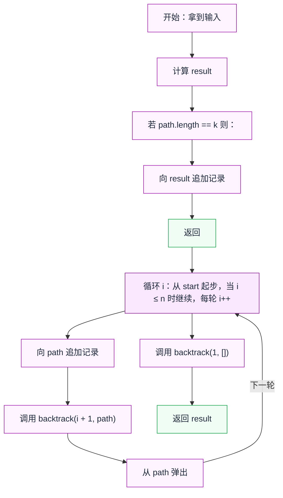

## TypeScript 解题方案（3 个方案逐个讲）

> **运行与提交**：每个方案都是自包含文件（内嵌用例自测，输出 PASS），整块复制到 `.ts` 文件后 `node 文件名` 即可运行。提交 LeetCode 时，把 `demo` 内的算法函数与辅助类型/函数整体取出、置于文件顶层即可。涉及交互/特殊接口的题以题面给定签名为准。

### 方案 1：递归实现组合型枚举

**分析与思路**：核心做法是「递归实现组合型枚举」。代码里依次做这些事：单循环线性扫描；栈的后进先出操作。

**运行方式**：`node 本文件`，内嵌用例全部通过会输出 PASS。


**方案专属流程图**（真实控制流）：

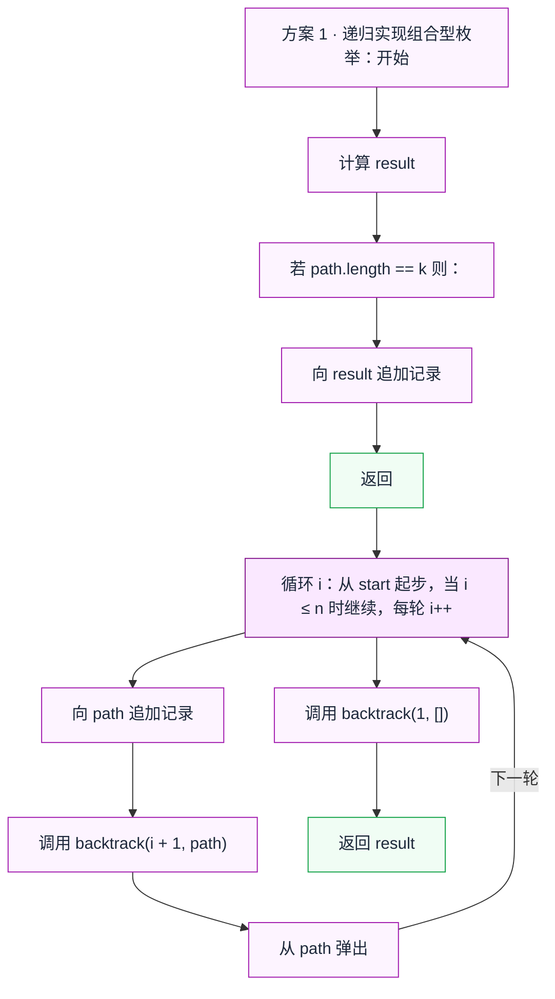

```typescript
/**
 ** LeetCode 77. 组合
 ** 方案1: 递归实现组合型枚举（忠实翻译 python 参考实现）
 ** 来源：https://blog.csdn.net/tyro_java/article/details/145240015
 */

function combine(n: number, k: number): number[][] {
  // 定义函数/方法 combine
  const result: number[][] = []; // 把 []; 写入 const result: number[][]
  function backtrack(start: number, path: number[]): void {
    // 定义函数/方法 backtrack
    if (path.length === k) {
      // 若 当前路径.长度 全等于 下标 k
      result.push(path.slice()); // 把 当前路径 截取 压入栈/数组尾部
      return; // return;
    }
    for (let i = start; i <= n; i++) {
      // 让 下标 i 从 起点 开始计数，下标 i 不超过 元素个数 就继续
      path.push(i); // 把 下标 i 压入栈/数组尾部
      backtrack(i + 1, path); // backtrack(下标 i 加 1, 当前路径);
      path.pop(); // 弹出栈顶元素
    }
  }
  backtrack(1, []); // backtrack(1, []);
  return result; // 返回 结果
}

export function demo(): void {
  // 程序入口：跑内嵌自测用例
  function norm(x: number[][]): string {
    // 定义函数/方法 norm
    return x
      .map((r) => r.join(','))
      .sort()
      .join('|');
  }
  function eq(a: number[][], b: number[][]): boolean {
    // 定义函数/方法 eq
    return a.length === b.length && norm(a) === norm(b); // 返回 数组.长度 全等于 b.长度 且 norm(数组) 全等于 norm(b)
  }
  const cases: { in: [number, number]; want: number[][] }[] = [
    {
      in: [4, 2],
      want: [
        [1, 2],
        [1, 3],
        [1, 4],
        [2, 3],
        [2, 4],
        [3, 4],
      ],
    },
    {
      in: [5, 3],
      want: [
        [1, 2, 3],
        [1, 2, 4],
        [1, 2, 5],
        [1, 3, 4],
        [1, 3, 5],
        [1, 4, 5],
        [2, 3, 4],
        [2, 3, 5],
        [2, 4, 5],
        [3, 4, 5],
      ],
    },
    { in: [1, 1], want: [[1]] },
  ];
  let fail = false; // 把 false 存入 fail
  for (const c of cases) {
    // for (const 字符 of cases) {
    const got = combine(c.in[0], c.in[1]); // 把 combine(字符.in[0], 字符.in[1]) 存入 got
    if (!eq(got, c.want)) {
      // 若 取反 eq(got, 字符.want
      fail = true; // 把 true 存入 fail
      console.log(
        'FAIL combine(' +
          c.in +
          ') got=' +
          JSON.stringify(got) +
          ' want=' +
          JSON.stringify(c.want),
      ); // 打印输出
    }
  }
  if (fail) throw new Error('FAILED'); // 若 fail) throw new Error(「FAILED」);
  console.log('PASS'); // 全部用例通过，输出 PASS
}
demo(); // demo();
```

### 方案 2：非递归（字典序法）实现组合型枚举

**分析与思路**：核心做法是「非递归（字典序法）实现组合型枚举」。代码里依次做这些事：单循环线性扫描；栈的后进先出操作。

**运行方式**：`node 本文件`，内嵌用例全部通过会输出 PASS。


**方案专属流程图**（真实控制流）：

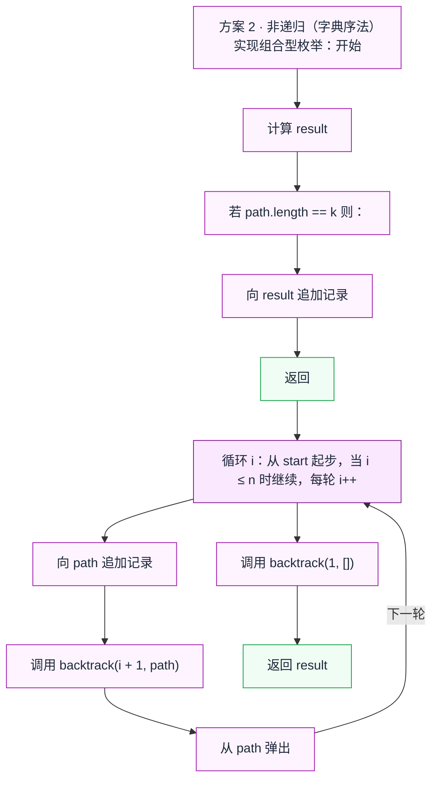

```typescript
/**
 ** LeetCode 77. 组合
 ** 方案2: 非递归（字典序法）实现组合型枚举（忠实翻译 python 参考实现）
 ** 来源：https://blog.csdn.net/tyro_java/article/details/145240015
 */

function combine(n: number, k: number): number[][] {
  // 定义函数/方法 combine
  const result: number[][] = []; // 把 []; 写入 const result: number[][]
  function backtrack(start: number, path: number[]): void {
    // 定义函数/方法 backtrack
    if (path.length === k) {
      // 若 当前路径.长度 全等于 下标 k
      result.push(path.slice()); // 把 当前路径 截取 压入栈/数组尾部
      return; // return;
    }
    for (let i = start; i <= n; i++) {
      // 让 下标 i 从 起点 开始计数，下标 i 不超过 元素个数 就继续
      path.push(i); // 把 下标 i 压入栈/数组尾部
      backtrack(i + 1, path); // backtrack(下标 i 加 1, 当前路径);
      path.pop(); // 弹出栈顶元素
    }
  }
  backtrack(1, []); // backtrack(1, []);
  return result; // 返回 结果
}

export function demo(): void {
  // 程序入口：跑内嵌自测用例
  function norm(x: number[][]): string {
    // 定义函数/方法 norm
    return x
      .map((r) => r.join(','))
      .sort()
      .join('|');
  }
  function eq(a: number[][], b: number[][]): boolean {
    // 定义函数/方法 eq
    return a.length === b.length && norm(a) === norm(b); // 返回 数组.长度 全等于 b.长度 且 norm(数组) 全等于 norm(b)
  }
  const cases: { in: [number, number]; want: number[][] }[] = [
    {
      in: [4, 2],
      want: [
        [1, 2],
        [1, 3],
        [1, 4],
        [2, 3],
        [2, 4],
        [3, 4],
      ],
    },
    {
      in: [5, 3],
      want: [
        [1, 2, 3],
        [1, 2, 4],
        [1, 2, 5],
        [1, 3, 4],
        [1, 3, 5],
        [1, 4, 5],
        [2, 3, 4],
        [2, 3, 5],
        [2, 4, 5],
        [3, 4, 5],
      ],
    },
    { in: [1, 1], want: [[1]] },
  ];
  let fail = false; // 把 false 存入 fail
  for (const c of cases) {
    // for (const 字符 of cases) {
    const got = combine(c.in[0], c.in[1]); // 把 combine(字符.in[0], 字符.in[1]) 存入 got
    if (!eq(got, c.want)) {
      // 若 取反 eq(got, 字符.want
      fail = true; // 把 true 存入 fail
      console.log(
        'FAIL combine(' +
          c.in +
          ') got=' +
          JSON.stringify(got) +
          ' want=' +
          JSON.stringify(c.want),
      ); // 打印输出
    }
  }
  if (fail) throw new Error('FAILED'); // 若 fail) throw new Error(「FAILED」);
  console.log('PASS'); // 全部用例通过，输出 PASS
}
demo(); // demo();
```

### 方案 3：回溯一般思路

**分析与思路**：核心做法是「回溯一般思路」。代码里依次做这些事：单循环线性扫描；栈的后进先出操作。

**运行方式**：`node 本文件`，内嵌用例全部通过会输出 PASS。

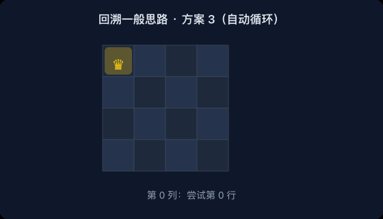

**方案专属流程图**（真实控制流）：

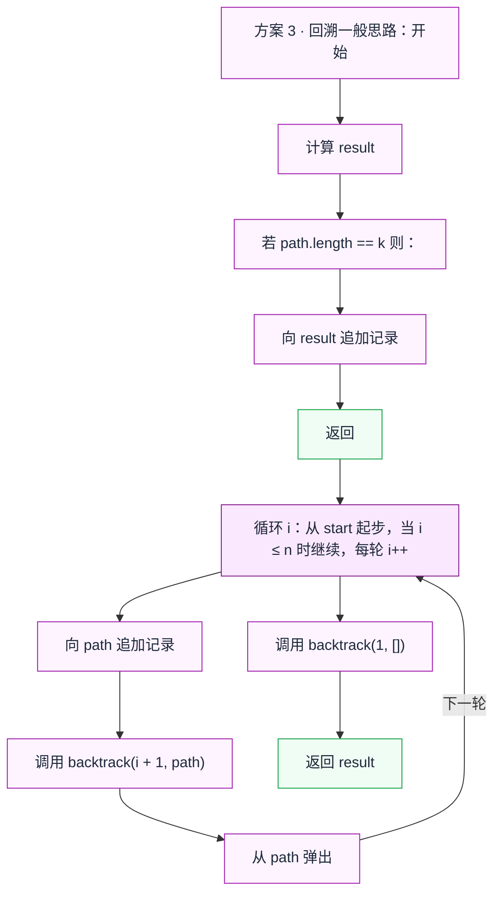

```typescript
/**
 ** LeetCode 77. 组合
 ** 方案3: 回溯一般思路（忠实翻译 python 参考实现）
 ** 来源：https://blog.csdn.net/tyro_java/article/details/145240015
 */

function combine(n: number, k: number): number[][] {
  // 定义函数/方法 combine
  const result: number[][] = []; // 把 []; 写入 const result: number[][]
  function backtrack(start: number, path: number[]): void {
    // 定义函数/方法 backtrack
    if (path.length === k) {
      // 若 当前路径.长度 全等于 下标 k
      result.push(path.slice()); // 把 当前路径 截取 压入栈/数组尾部
      return; // return;
    }
    for (let i = start; i <= n; i++) {
      // 让 下标 i 从 起点 开始计数，下标 i 不超过 元素个数 就继续
      path.push(i); // 把 下标 i 压入栈/数组尾部
      backtrack(i + 1, path); // backtrack(下标 i 加 1, 当前路径);
      path.pop(); // 弹出栈顶元素
    }
  }
  backtrack(1, []); // backtrack(1, []);
  return result; // 返回 结果
}

export function demo(): void {
  // 程序入口：跑内嵌自测用例
  function norm(x: number[][]): string {
    // 定义函数/方法 norm
    return x
      .map((r) => r.join(','))
      .sort()
      .join('|');
  }
  function eq(a: number[][], b: number[][]): boolean {
    // 定义函数/方法 eq
    return a.length === b.length && norm(a) === norm(b); // 返回 数组.长度 全等于 b.长度 且 norm(数组) 全等于 norm(b)
  }
  const cases: { in: [number, number]; want: number[][] }[] = [
    {
      in: [4, 2],
      want: [
        [1, 2],
        [1, 3],
        [1, 4],
        [2, 3],
        [2, 4],
        [3, 4],
      ],
    },
    {
      in: [5, 3],
      want: [
        [1, 2, 3],
        [1, 2, 4],
        [1, 2, 5],
        [1, 3, 4],
        [1, 3, 5],
        [1, 4, 5],
        [2, 3, 4],
        [2, 3, 5],
        [2, 4, 5],
        [3, 4, 5],
      ],
    },
    { in: [1, 1], want: [[1]] },
  ];
  let fail = false; // 把 false 存入 fail
  for (const c of cases) {
    // for (const 字符 of cases) {
    const got = combine(c.in[0], c.in[1]); // 把 combine(字符.in[0], 字符.in[1]) 存入 got
    if (!eq(got, c.want)) {
      // 若 取反 eq(got, 字符.want
      fail = true; // 把 true 存入 fail
      console.log(
        'FAIL combine(' +
          c.in +
          ') got=' +
          JSON.stringify(got) +
          ' want=' +
          JSON.stringify(c.want),
      ); // 打印输出
    }
  }
  if (fail) throw new Error('FAILED'); // 若 fail) throw new Error(「FAILED」);
  console.log('PASS'); // 全部用例通过，输出 PASS
}
demo(); // demo();
```

## 逐步拆解与面试追问

**复杂度**：时间 O(n)（单趟线性扫描），空间 O(1) 到 O(n)（视辅助结构）

**为什么是这个量级**：每个元素被常数次访问，辅助哈希或栈的开销与 n 同阶

**面试官可能会追问**：

- 怎么剪枝降低无效搜索？
- 去重的关键在哪一层？
- 状态恢复遗漏会怎样？

## 关键 API 速查（TS 主解法实际用到，附官方链接）

| API | 作用 | 使用要点 | 官方文档 |
|---|---|---|---|
| `Array.prototype.sort()` | 原地排序 | 默认按字符串 Unicode 序（10 会排在 2 前），数字必须传 (a,b)=>a-b；V8 用 TimSort，稳定，O(n log n)；返回原数组引用 | [官方文档](https://developer.mozilla.org/zh-CN/docs/Web/JavaScript/Reference/Global_Objects/Array/sort) |
| `Array.prototype.map()` | 逐元素映射为新数组 | 回调 (v,i,arr)；返回等长新数组，不改变原数组；稀疏位跳过；链式调用注意中间数组开销 | [官方文档](https://developer.mozilla.org/zh-CN/docs/Web/JavaScript/Reference/Global_Objects/Array/map) |
| `Array.prototype.push()` | 尾部追加 | 返回新长度；可一次多个；均摊 O(1)；会改变原数组 | [官方文档](https://developer.mozilla.org/zh-CN/docs/Web/JavaScript/Reference/Global_Objects/Array/push) |
| `Array.prototype.pop()` | 尾部弹出 | 返回被删元素（空数组返回 undefined）；O(1) | [官方文档](https://developer.mozilla.org/zh-CN/docs/Web/JavaScript/Reference/Global_Objects/Array/pop) |
| `Array/String slice()` | 切片（不改原数组） | slice(start,end) 含头不含尾；负数从尾计；常用于复制数组（slice()） | [官方文档](https://developer.mozilla.org/zh-CN/docs/Web/JavaScript/Reference/Global_Objects/Array/slice) |
| `Array.prototype.join()` | 数组拼接为字符串 | undefined/null 转空串；嵌套数组会展平一层；join('') 用于字符数组还原 | [官方文档](https://developer.mozilla.org/zh-CN/docs/Web/JavaScript/Reference/Global_Objects/Array/join) |
| `JSON.stringify()` | 序列化为 JSON 字符串 | 常用于结构化比较（深度相等判定）；undefined/函数/循环引用会被丢弃或抛错 | [官方文档](https://developer.mozilla.org/zh-CN/docs/Web/JavaScript/Reference/Global_Objects/JSON/stringify) |

### 各语言官方文档导航

- **TypeScript / JS**：[MDN 中文参考](https://developer.mozilla.org/zh-CN/)
- **Python**：[Python 官方文档](https://docs.python.org/zh-cn/3/)
- **Go**：[Go 标准库](https://pkg.go.dev/std)
- **Java**：[JDK 17 API](https://docs.oracle.com/en/java/javase/17/docs/api/)
- **Rust**：[Rust 标准库](https://doc.rust-lang.org/std/)
- **Lua**：[Lua 5.4 手册](https://www.lua.org/manual/5.4/)
- **C**：[Cppreference C](https://zh.cppreference.com/w/c)
- **C++**：[Cppreference C++](https://zh.cppreference.com/w/cpp)
- **R**：[R 官方手册](https://stat.ethz.ch/R-manual/)
- **Zig**：[Zig 语言文档](https://ziglang.org/documentation/master/)
- **Dart**：[Dart API](https://api.dart.dev/)

## 附录：其他 10 种语言全部实现（每种语言列举其全部方案）

> TypeScript 的全部方案见「TypeScript 解题方案」一节；下面是其余 10 种语言的对应实现，每种语言的每个方案都带思路分析、代码走读与专属运行架构图。
> 每个方案都内嵌用例自测，可独立运行（老仓库 python/go 文件遵循「打印结果」约定）。
> 完整解法文件见 `dsa/<语言>/backtrack/lc_77_组合/`。

### Python 实现（3 种方案）

Python 的全部方案如下，每个方案都内嵌用例自测，可独立运行（老仓库 python/go 文件遵循「打印结果」约定）：

#### 方案 1：递归实现组合型枚举

**思路与代码分析**：核心是「递归实现组合型枚举」。Python 版用切片与字典推导式简化操作，突出可读性。**走读**：方案 1 · 递归实现组合型枚举：开始 → 更新 result → 若 len(path) == k：向 result 追加记录 → 向 result 追加记录 → 返回  → 循环 i：从 start 到 n + 1 前 → 向 path 追加记录 → 调用 backtrack(i + 1, path) → 从 path 弹出 → 调用 backtrack(1, []) → 返回 result。

**运行架构**（真实控制流）：

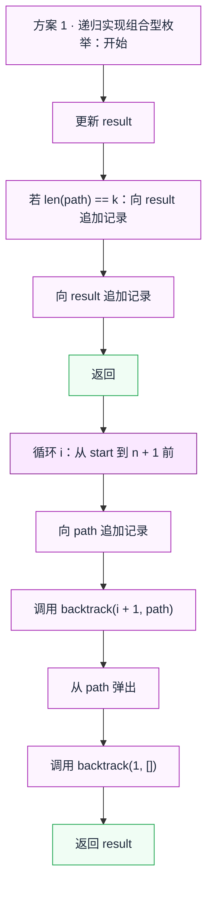

```python
import sys  # 提高递归深度上限（深输入防 RecursionError）

sys.setrecursionlimit(200000)  # 树/链表类题目节点数可达 1e4 量级

def combine(n, k):  # 定义函数 combine（参数：元素个数, 下标 k）
    result = []  # 把 [] 存入 结果

    def backtrack(start, path):  # 定义函数 backtrack（参数：起点, 当前路径）
        if len(path) == k:  # 若 长度(当前路径) 等于 下标 k
            result.append(path[:])  # 把 复制 当前路径 追加到列表尾部
            return  # return
        for i in range(start, n + 1):  # 让 下标 i 从 起点 到 元素个数 加 1 遍历
            path.append(i)  # 把 下标 i 追加到列表尾部
            backtrack(i + 1, path)  # backtrack(下标 i 加 1, 当前路径)
            path.pop()  # 弹出栈顶元素

    backtrack(1, [])  # backtrack(1, [])
    return result  # 返回 结果

if __name__ == "__main__":  # 若 __name__ 等于 '__main__'
    print(combine(1, 1))  # 打印输出
```

#### 方案 2：非递归（字典序法）实现组合型枚举

**思路与代码分析**：核心是「非递归（字典序法）实现组合型枚举」。Python 版用切片与字典推导式简化操作，突出可读性。**走读**：方案 2 · 非递归（字典序法）实现组合型枚举：开始 → 更新 result → 若 len(path) == k：向 result 追加记录 → 向 result 追加记录 → 返回  → 循环 i：从 start 到 n + 1 前 → 向 path 追加记录 → 调用 backtrack(i + 1, path) → 从 path 弹出 → 调用 backtrack(1, []) → 返回 result。

**运行架构**（真实控制流）：

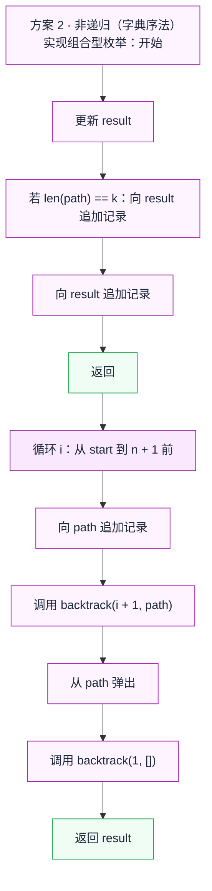

```python
import sys  # 提高递归深度上限（深输入防 RecursionError）

sys.setrecursionlimit(200000)  # 树/链表类题目节点数可达 1e4 量级

def combine(n, k):  # 定义函数 combine（参数：元素个数, 下标 k）
    result = []  # 把 [] 存入 结果

    def backtrack(start, path):  # 定义函数 backtrack（参数：起点, 当前路径）
        if len(path) == k:  # 若 长度(当前路径) 等于 下标 k
            result.append(path[:])  # 把 复制 当前路径 追加到列表尾部
            return  # return
        for i in range(start, n + 1):  # 让 下标 i 从 起点 到 元素个数 加 1 遍历
            path.append(i)  # 把 下标 i 追加到列表尾部
            backtrack(i + 1, path)  # backtrack(下标 i 加 1, 当前路径)
            path.pop()  # 弹出栈顶元素

    backtrack(1, [])  # backtrack(1, [])
    return result  # 返回 结果

if __name__ == "__main__":  # 若 __name__ 等于 '__main__'
    print(combine(1, 1))  # 打印输出
```

#### 方案 3：回溯一般思路

**思路与代码分析**：核心是「回溯一般思路」。Python 版用切片与字典推导式简化操作，突出可读性。**走读**：方案 3 · 回溯一般思路：开始 → 更新 result → 若 len(path) == k：向 result 追加记录 → 向 result 追加记录 → 返回  → 循环 i：从 start 到 n + 1 前 → 向 path 追加记录 → 调用 backtrack(i + 1, path) → 从 path 弹出 → 调用 backtrack(1, []) → 返回 result。

**运行架构**（真实控制流）：

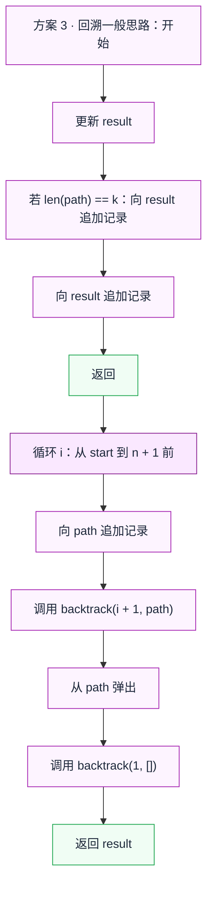

```python
import sys  # 提高递归深度上限（深输入防 RecursionError）

sys.setrecursionlimit(200000)  # 树/链表类题目节点数可达 1e4 量级

def combine(n, k):  # 定义函数 combine（参数：元素个数, 下标 k）
    result = []  # 把 [] 存入 结果

    def backtrack(start, path):  # 定义函数 backtrack（参数：起点, 当前路径）
        if len(path) == k:  # 若 长度(当前路径) 等于 下标 k
            result.append(path[:])  # 把 复制 当前路径 追加到列表尾部
            return  # return
        for i in range(start, n + 1):  # 让 下标 i 从 起点 到 元素个数 加 1 遍历
            path.append(i)  # 把 下标 i 追加到列表尾部
            backtrack(i + 1, path)  # backtrack(下标 i 加 1, 当前路径)
            path.pop()  # 弹出栈顶元素

    backtrack(1, [])  # backtrack(1, [])
    return result  # 返回 结果

if __name__ == "__main__":  # 若 __name__ 等于 '__main__'
    print(combine(1, 1))  # 打印输出
```

### Go 实现（3 种方案）

Go 的全部方案如下，每个方案都内嵌用例自测，可独立运行（老仓库 python/go 文件遵循「打印结果」约定）：

#### 方案 1：递归实现组合型枚举

**思路与代码分析**：核心是「递归实现组合型枚举」。Go 版用切片与多返回值惯用法，显式处理索引边界。**走读**：方案 1 · 递归实现组合型枚举：开始 → 更新 : → 遍历 s 的下标与元素 i → 更新 out[i] → 调用 sort.Ints(out[i]) → 调用 sort.Slice(out, func(a, b in → 返回 fmt.Sprint(out[a]) ＜ fmt.Sprint(out[b]) → 返回 out。

**运行架构**（真实控制流）：

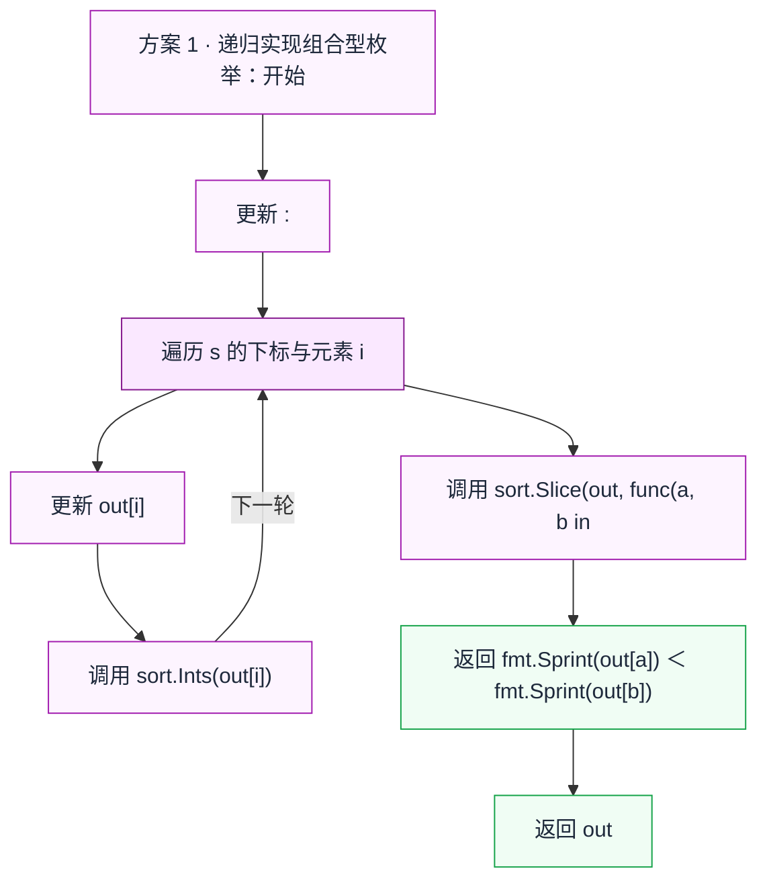

```go
package main // 引入依赖

import (
	"fmt"     // 「fmt」
	"os"      // 「os」
	"reflect" // 「reflect」
	"sort"    // 「sort」
)

func combine(n, k int) [][]int { // 定义函数/方法 combine
	result := [][]int{}                       // 把 [][]int{} 写入 result :
	var backtrack func(start int, path []int) // var backtrack func(起点 int, 当前路径 []int)
	backtrack = func(start int, path []int) { // 把 func(起点 int, 当前路径 []int) { 写入 backtrack
		if len(path) == k { // 若 长度(当前路径) 等于 下标 k
			result = append(result, append([]int{}, path...)) // 把 append(结果, append([]int{}, 当前路径...)) 写入 结果
			return                                            // return
		}
		for i := start; i <= n; i++ { // 把 起点; 下标 i 不超过 元素个数; 下标 i 加一 { 写入 for i :
			path = append(path, i)    // 把 append(当前路径, 下标 i) 写入 当前路径
			backtrack(i+1, path)      // backtrack(下标 i 加 1, 当前路径)
			path = path[:len(path)-1] // 把 当前路径[:长度(当前路径) 减 1] 写入 当前路径
		}
	}
	backtrack(1, []int{}) // backtrack(1, []int{})
	return result         // 返回 结果
}

func norm2D(s [][]int) [][]int { // 定义函数/方法 norm2D
	out := make([][]int, len(s)) // 把 make([][]int, 长度(字符串)) 写入 out :
	for i := range s {           // 把 range 字符串 { 写入 for i :
		out[i] = append([]int{}, s[i]...) // 把 append([]int{}, 字符串[下标 i]...) 写入 out[i]
		sort.Ints(out[i])                 // sort.Ints(out[下标 i])
	}
	sort.Slice(out, func(a, b int) bool { // sort.Slice(out, func(数组, b int) bool {
		return fmt.Sprint(out[a]) < fmt.Sprint(out[b]) // 返回 fmt.Sprint(out[数组]) 小于 fmt.Sprint(out[b])
	}) // })
	return out // 返回 out
}

func main() { // 程序入口：跑内嵌自测用例
	type tc struct { // 定义类型
		n, k int     // 元素个数, 下标 k int
		want [][]int // want [][]int
	}
	cases := []tc{ // 把 []tc{ 写入 cases :
		{4, 2, [][]int{{1, 2}, {1, 3}, {1, 4}, {2, 3}, {2, 4}, {3, 4}}},
		{1, 1, [][]int{{1}}},
	}
	ok := true                // 把 true 写入 ok :
	for _, c := range cases { // 同时取 _ 与 字符 遍历
		got := norm2D(combine(c.n, c.k))   // 把 norm2D(combine(字符.元素个数, 字符.下标 k)) 写入 got :
		want := norm2D(c.want)             // 把 norm2D(字符.want) 写入 want :
		if !reflect.DeepEqual(got, want) { // 若 取反 reflect.DeepEqual(got, want
			ok = false                                                          // 把 false 写入 ok
			fmt.Printf("FAIL combine(%d,%d)=%v want %v\n", c.n, c.k, got, want) // 打印输出
		}
	}
	if !ok { // 若 取反 ok
		os.Exit(1) // os.Exit(1)
	}
	fmt.Println("PASS") // 全部用例通过，输出 PASS
}
```

#### 方案 2：非递归（字典序法）实现组合型枚举

**思路与代码分析**：核心是「非递归（字典序法）实现组合型枚举」。Go 版用切片与多返回值惯用法，显式处理索引边界。**走读**：方案 2 · 非递归（字典序法）实现组合型枚举：开始 → 更新 : → 遍历 s 的下标与元素 i → 更新 out[i] → 调用 sort.Ints(out[i]) → 调用 sort.Slice(out, func(a, b in → 返回 fmt.Sprint(out[a]) ＜ fmt.Sprint(out[b]) → 返回 out。

**运行架构**（真实控制流）：

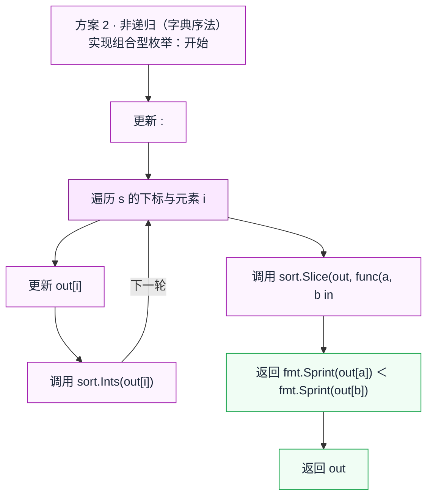

```go
package main // 引入依赖

import (
	"fmt"     // 「fmt」
	"os"      // 「os」
	"reflect" // 「reflect」
	"sort"    // 「sort」
)

func combine(n int, k int) [][]int { // 定义函数/方法 combine
	res := [][]int{}              // 把 [][]int{} 写入 res :
	comb := []int{}               // 把 []int{} 写入 comb :
	var backtrack func(start int) // var backtrack func(起点 int)
	backtrack = func(start int) { // 把 func(起点 int) { 写入 backtrack
		if len(comb) == k { // 若 长度(comb) 等于 下标 k
			tmp := make([]int, len(comb)) // 把 make([]int, 长度(comb)) 写入 tmp :
			copy(tmp, comb)               // copy(临时变量, comb)
			res = append(res, tmp)        // 把 append(结果, 临时变量) 写入 结果
			return                        // return
		}
		for i := start; i <= n; i++ { // 把 起点; 下标 i 不超过 元素个数; 下标 i 加一 { 写入 for i :
			comb = append(comb, i)    // 把 append(comb, 下标 i) 写入 comb
			backtrack(i + 1)          // backtrack(下标 i 加 1)
			comb = comb[:len(comb)-1] // 把 comb[:长度(comb) 减 1] 写入 comb
		}
	}
	backtrack(1) // backtrack(1)
	return res   // 返回 结果
}

func norm2D(s [][]int) [][]int { // 定义函数/方法 norm2D
	out := make([][]int, len(s)) // 把 make([][]int, 长度(字符串)) 写入 out :
	for i := range s {           // 把 range 字符串 { 写入 for i :
		out[i] = append([]int{}, s[i]...) // 把 append([]int{}, 字符串[下标 i]...) 写入 out[i]
		sort.Ints(out[i])                 // sort.Ints(out[下标 i])
	}
	sort.Slice(out, func(a, b int) bool { // sort.Slice(out, func(数组, b int) bool {
		return fmt.Sprint(out[a]) < fmt.Sprint(out[b]) // 返回 fmt.Sprint(out[数组]) 小于 fmt.Sprint(out[b])
	}) // })
	return out // 返回 out
}

func main() { // 程序入口：跑内嵌自测用例
	type tc struct { // 定义类型
		n, k int     // 元素个数, 下标 k int
		want [][]int // want [][]int
	}
	cases := []tc{ // 把 []tc{ 写入 cases :
		{4, 2, [][]int{{1, 2}, {1, 3}, {1, 4}, {2, 3}, {2, 4}, {3, 4}}},
		{1, 1, [][]int{{1}}},
	}
	ok := true                // 把 true 写入 ok :
	for _, c := range cases { // 同时取 _ 与 字符 遍历
		got := norm2D(combine(c.n, c.k))   // 把 norm2D(combine(字符.元素个数, 字符.下标 k)) 写入 got :
		want := norm2D(c.want)             // 把 norm2D(字符.want) 写入 want :
		if !reflect.DeepEqual(got, want) { // 若 取反 reflect.DeepEqual(got, want
			ok = false                                                          // 把 false 写入 ok
			fmt.Printf("FAIL combine(%d,%d)=%v want %v\n", c.n, c.k, got, want) // 打印输出
		}
	}
	if !ok { // 若 取反 ok
		os.Exit(1) // os.Exit(1)
	}
	fmt.Println("PASS") // 全部用例通过，输出 PASS
}
```

#### 方案 3：回溯一般思路

**思路与代码分析**：核心是「回溯一般思路」。Go 版用切片与多返回值惯用法，显式处理索引边界。**走读**：方案 3 · 回溯一般思路：开始 → 更新 : → 遍历 s 的下标与元素 i → 更新 out[i] → 调用 sort.Ints(out[i]) → 调用 sort.Slice(out, func(a, b in → 返回 fmt.Sprint(out[a]) ＜ fmt.Sprint(out[b]) → 返回 out。

**运行架构**（真实控制流）：

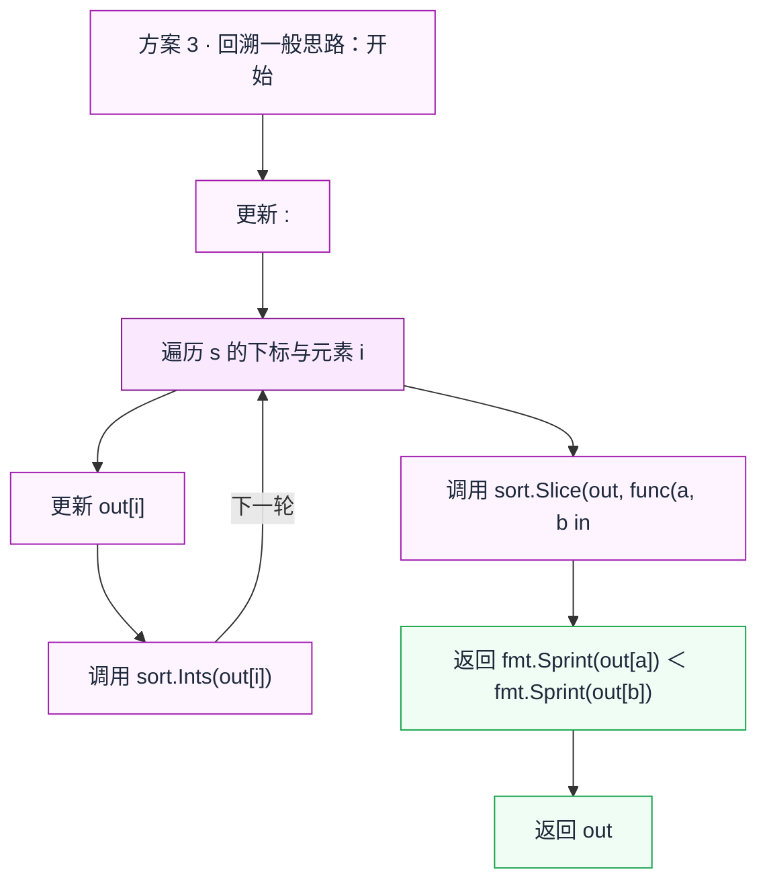

```go
package main // 引入依赖

import (
	"fmt"     // 「fmt」
	"os"      // 「os」
	"reflect" // 「reflect」
	"sort"    // 「sort」
)

func combine(n, k int) [][]int { // 定义函数/方法 combine
	result := [][]int{}                       // 把 [][]int{} 写入 result :
	var backtrack func(start int, path []int) // var backtrack func(起点 int, 当前路径 []int)
	backtrack = func(start int, path []int) { // 把 func(起点 int, 当前路径 []int) { 写入 backtrack
		if len(path) == k { // 若 长度(当前路径) 等于 下标 k
			tmp := make([]int, len(path)) // 把 make([]int, 长度(当前路径)) 写入 tmp :
			copy(tmp, path)               // copy(临时变量, 当前路径)
			result = append(result, tmp)  // 把 append(结果, 临时变量) 写入 结果
			return                        // return
		}
		for i := start; i <= n; i++ { // 把 起点; 下标 i 不超过 元素个数; 下标 i 加一 { 写入 for i :
			backtrack(i+1, append(path, i)) // backtrack(下标 i 加 1, append(当前路径, 下标 i))
		}
	}
	backtrack(1, []int{}) // backtrack(1, []int{})
	return result         // 返回 结果
}

func norm2D(s [][]int) [][]int { // 定义函数/方法 norm2D
	out := make([][]int, len(s)) // 把 make([][]int, 长度(字符串)) 写入 out :
	for i := range s {           // 把 range 字符串 { 写入 for i :
		out[i] = append([]int{}, s[i]...) // 把 append([]int{}, 字符串[下标 i]...) 写入 out[i]
		sort.Ints(out[i])                 // sort.Ints(out[下标 i])
	}
	sort.Slice(out, func(a, b int) bool { // sort.Slice(out, func(数组, b int) bool {
		return fmt.Sprint(out[a]) < fmt.Sprint(out[b]) // 返回 fmt.Sprint(out[数组]) 小于 fmt.Sprint(out[b])
	}) // })
	return out // 返回 out
}

func main() { // 程序入口：跑内嵌自测用例
	type tc struct { // 定义类型
		n, k int     // 元素个数, 下标 k int
		want [][]int // want [][]int
	}
	cases := []tc{ // 把 []tc{ 写入 cases :
		{4, 2, [][]int{{1, 2}, {1, 3}, {1, 4}, {2, 3}, {2, 4}, {3, 4}}},
		{1, 1, [][]int{{1}}},
	}
	ok := true                // 把 true 写入 ok :
	for _, c := range cases { // 同时取 _ 与 字符 遍历
		got := norm2D(combine(c.n, c.k))   // 把 norm2D(combine(字符.元素个数, 字符.下标 k)) 写入 got :
		want := norm2D(c.want)             // 把 norm2D(字符.want) 写入 want :
		if !reflect.DeepEqual(got, want) { // 若 取反 reflect.DeepEqual(got, want
			ok = false                                                          // 把 false 写入 ok
			fmt.Printf("FAIL combine(%d,%d)=%v want %v\n", c.n, c.k, got, want) // 打印输出
		}
	}
	if !ok { // 若 取反 ok
		os.Exit(1) // os.Exit(1)
	}
	fmt.Println("PASS") // 全部用例通过，输出 PASS
}
```

### Java 实现（3 种方案）

Java 的全部方案如下，每个方案都内嵌用例自测，可独立运行（老仓库 python/go 文件遵循「打印结果」约定）：

#### 方案 1：递归实现组合型枚举

**思路与代码分析**：核心是「递归实现组合型枚举」。Java 版用类与静态方法组织，集合操作显式明了。**走读**：方案 1 · 递归实现组合型枚举：开始 → 更新 result → 调用 backtrack(1, n, k, new Array → 返回 result。

**运行架构**（真实控制流）：

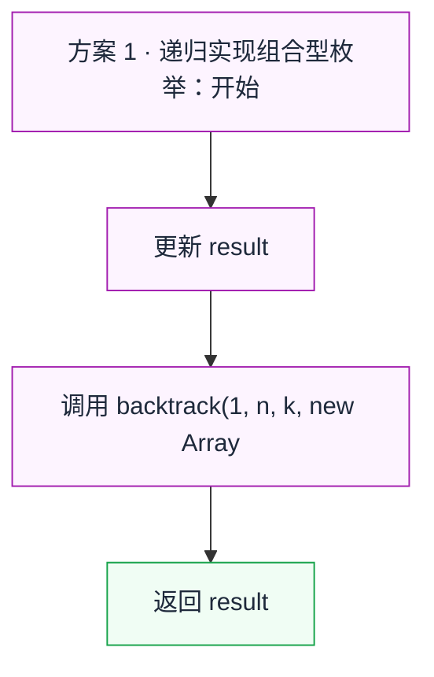

```java
package com.webfault.dsa; // 引入依赖

import java.util.*; // 引入依赖

class Lc77 { // 定义类型
  List<List<Integer>> combine(int n, int k) { // 定义函数/方法 combine
    List<List<Integer>> result = new ArrayList<List<Integer>>();
    backtrack(1, n, k, new ArrayList<Integer>(), result);
    return result; // 返回 结果
  }

  void backtrack(
      int start,
      int n,
      int k,
      List<Integer> path,
      List<List<Integer>> result) { // 定义函数/方法 backtrack
    if (path.size() == k) { // 若 当前路径.大小() 等于 下标 k
      result.add(new ArrayList<Integer>(path)); // 结果 追加 new ArrayList 小于 Integer 超过 (当前路径));
      return; // return;
    }
    for (int i = start; i <= n; i++) { // 让 下标 i 从 起点 开始计数，下标 i 不超过 元素个数 就继续
      path.add(i); // 当前路径 追加 下标 i);
      backtrack(i + 1, n, k, path, result); // backtrack(下标 i 加 1, 元素个数, 下标 k, 当前路径, 结果);
      path.remove(path.size() - 1); // 当前路径 弹出 当前路径.大小() 减 1);
    }
  }

  public static void main(String[] args) { // public static void main(String[] args) {
    Lc77 s = new Lc77(); // 把 new Lc77(); 写入 Lc77 s
    boolean ok = true; // 把 true; 写入 boolean ok
    List<List<Integer>> r1 = s.combine(1, 1); // 把 字符串.combine(1, 1); 写入 List<List<Integer>> r1
    if (!(r1.size() == 1 && r1.get(0).equals(Arrays.asList(1)))) {
      ok = false;
      System.out.println("FAIL1 " + r1);
    }
    List<List<Integer>> r2 = s.combine(4, 2); // 把 字符串.combine(4, 2); 写入 List<List<Integer>> r2
    if (r2.size() != 6) {
      ok = false;
      System.out.println("FAIL2 size " + r2.size());
    }
    List<List<Integer>> r3 = s.combine(3, 3); // 把 字符串.combine(3, 3); 写入 List<List<Integer>> r3
    if (!(r3.size() == 1 && r3.get(0).equals(Arrays.asList(1, 2, 3)))) {
      ok = false;
      System.out.println("FAIL3 " + r3);
    }
    List<List<Integer>> r4 = s.combine(2, 1); // 把 字符串.combine(2, 1); 写入 List<List<Integer>> r4
    if (r4.size() != 2) {
      ok = false;
      System.out.println("FAIL4 size " + r4.size());
    }
    if (!ok) throw new RuntimeException("FAILED"); // 若 取反 ok) throw new RuntimeException(「FAILED」);
    System.out.println("PASS"); // 全部用例通过，输出 PASS
  }
}
```

#### 方案 2：非递归（字典序法）实现组合型枚举

**思路与代码分析**：核心是「非递归（字典序法）实现组合型枚举」。Java 版用类与静态方法组织，集合操作显式明了。**走读**：方案 2 · 非递归（字典序法）实现组合型枚举：开始 → 更新 result → 调用 backtrack(1, n, k, new Array → 返回 result。

**运行架构**（真实控制流）：

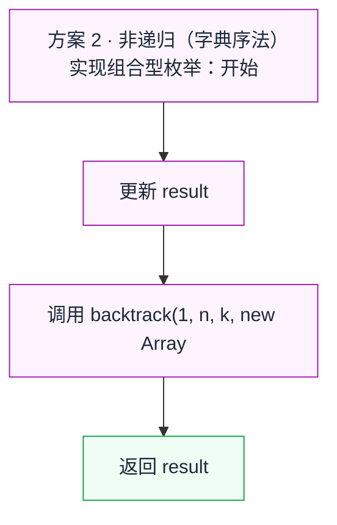

```java
package com.webfault.dsa; // 引入依赖

import java.util.*; // 引入依赖

class Lc77 { // 定义类型
  List<List<Integer>> combine(int n, int k) { // 定义函数/方法 combine
    List<List<Integer>> result = new ArrayList<List<Integer>>();
    backtrack(1, n, k, new ArrayList<Integer>(), result);
    return result; // 返回 结果
  }

  void backtrack(
      int start,
      int n,
      int k,
      List<Integer> path,
      List<List<Integer>> result) { // 定义函数/方法 backtrack
    if (path.size() == k) { // 若 当前路径.大小() 等于 下标 k
      result.add(new ArrayList<Integer>(path)); // 结果 追加 new ArrayList 小于 Integer 超过 (当前路径));
      return; // return;
    }
    for (int i = start; i <= n; i++) { // 让 下标 i 从 起点 开始计数，下标 i 不超过 元素个数 就继续
      path.add(i); // 当前路径 追加 下标 i);
      backtrack(i + 1, n, k, path, result); // backtrack(下标 i 加 1, 元素个数, 下标 k, 当前路径, 结果);
      path.remove(path.size() - 1); // 当前路径 弹出 当前路径.大小() 减 1);
    }
  }

  public static void main(String[] args) { // public static void main(String[] args) {
    Lc77 s = new Lc77(); // 把 new Lc77(); 写入 Lc77 s
    boolean ok = true; // 把 true; 写入 boolean ok
    List<List<Integer>> r1 = s.combine(1, 1); // 把 字符串.combine(1, 1); 写入 List<List<Integer>> r1
    if (!(r1.size() == 1 && r1.get(0).equals(Arrays.asList(1)))) {
      ok = false;
      System.out.println("FAIL1 " + r1);
    }
    List<List<Integer>> r2 = s.combine(4, 2); // 把 字符串.combine(4, 2); 写入 List<List<Integer>> r2
    if (r2.size() != 6) {
      ok = false;
      System.out.println("FAIL2 size " + r2.size());
    }
    List<List<Integer>> r3 = s.combine(3, 3); // 把 字符串.combine(3, 3); 写入 List<List<Integer>> r3
    if (!(r3.size() == 1 && r3.get(0).equals(Arrays.asList(1, 2, 3)))) {
      ok = false;
      System.out.println("FAIL3 " + r3);
    }
    List<List<Integer>> r4 = s.combine(2, 1); // 把 字符串.combine(2, 1); 写入 List<List<Integer>> r4
    if (r4.size() != 2) {
      ok = false;
      System.out.println("FAIL4 size " + r4.size());
    }
    if (!ok) throw new RuntimeException("FAILED"); // 若 取反 ok) throw new RuntimeException(「FAILED」);
    System.out.println("PASS"); // 全部用例通过，输出 PASS
  }
}
```

#### 方案 3：回溯一般思路

**思路与代码分析**：核心是「回溯一般思路」。Java 版用类与静态方法组织，集合操作显式明了。**走读**：方案 3 · 回溯一般思路：开始 → 更新 result → 调用 backtrack(1, n, k, new Array → 返回 result。

**运行架构**（真实控制流）：

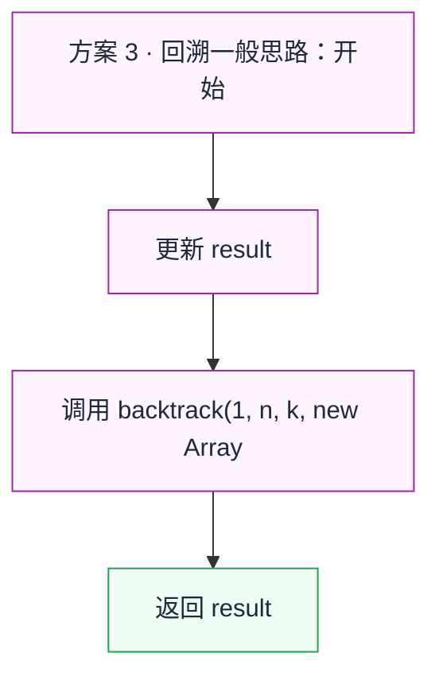

```java
package com.webfault.dsa; // 引入依赖

import java.util.*; // 引入依赖

class Lc77 { // 定义类型
  List<List<Integer>> combine(int n, int k) { // 定义函数/方法 combine
    List<List<Integer>> result = new ArrayList<List<Integer>>();
    backtrack(1, n, k, new ArrayList<Integer>(), result);
    return result; // 返回 结果
  }

  void backtrack(
      int start,
      int n,
      int k,
      List<Integer> path,
      List<List<Integer>> result) { // 定义函数/方法 backtrack
    if (path.size() == k) { // 若 当前路径.大小() 等于 下标 k
      result.add(new ArrayList<Integer>(path)); // 结果 追加 new ArrayList 小于 Integer 超过 (当前路径));
      return; // return;
    }
    for (int i = start; i <= n; i++) { // 让 下标 i 从 起点 开始计数，下标 i 不超过 元素个数 就继续
      path.add(i); // 当前路径 追加 下标 i);
      backtrack(i + 1, n, k, path, result); // backtrack(下标 i 加 1, 元素个数, 下标 k, 当前路径, 结果);
      path.remove(path.size() - 1); // 当前路径 弹出 当前路径.大小() 减 1);
    }
  }

  public static void main(String[] args) { // public static void main(String[] args) {
    Lc77 s = new Lc77(); // 把 new Lc77(); 写入 Lc77 s
    boolean ok = true; // 把 true; 写入 boolean ok
    List<List<Integer>> r1 = s.combine(1, 1); // 把 字符串.combine(1, 1); 写入 List<List<Integer>> r1
    if (!(r1.size() == 1 && r1.get(0).equals(Arrays.asList(1)))) {
      ok = false;
      System.out.println("FAIL1 " + r1);
    }
    List<List<Integer>> r2 = s.combine(4, 2); // 把 字符串.combine(4, 2); 写入 List<List<Integer>> r2
    if (r2.size() != 6) {
      ok = false;
      System.out.println("FAIL2 size " + r2.size());
    }
    List<List<Integer>> r3 = s.combine(3, 3); // 把 字符串.combine(3, 3); 写入 List<List<Integer>> r3
    if (!(r3.size() == 1 && r3.get(0).equals(Arrays.asList(1, 2, 3)))) {
      ok = false;
      System.out.println("FAIL3 " + r3);
    }
    List<List<Integer>> r4 = s.combine(2, 1); // 把 字符串.combine(2, 1); 写入 List<List<Integer>> r4
    if (r4.size() != 2) {
      ok = false;
      System.out.println("FAIL4 size " + r4.size());
    }
    if (!ok) throw new RuntimeException("FAILED"); // 若 取反 ok) throw new RuntimeException(「FAILED」);
    System.out.println("PASS"); // 全部用例通过，输出 PASS
  }
}
```

### Rust 实现（3 种方案）

Rust 的全部方案如下，每个方案都内嵌用例自测，可独立运行（老仓库 python/go 文件遵循「打印结果」约定）：

#### 方案 1：递归实现组合型枚举

**思路与代码分析**：核心是「递归实现组合型枚举」。Rust 版用所有权移动与切片借用改写同一逻辑，注意 Option 与引用边界。代码里依次做这些事：栈的后进先出操作。**走读**：方案 1 · 递归实现组合型枚举：开始 → 计算 res → 计算 path → 处理 if path.len() as i32 == k → 向 res 追加记录 → 返回  → 遍历 start..=n - (k - path.len() as i32) + 1 中的每个元素 i → 向 path 追加记录 → 调用 dfs(n, k, i + 1, path, res) → 从 path 弹出 → 调用 dfs(n, k, 1, &mut path, &mut → 处理 res。

**运行架构**（真实控制流）：

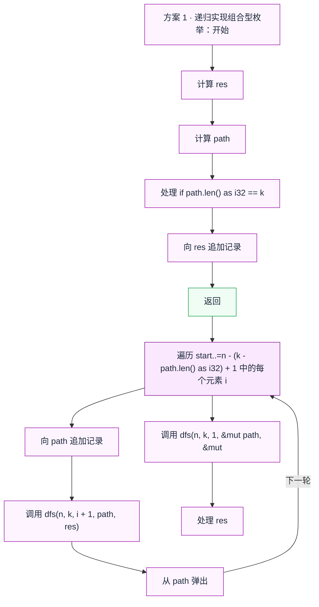

```rust
// LeetCode 77. 组合 — Rust 版（方案1）
fn combine(n: i32, k: i32) -> Vec<Vec<i32>> {
    // 定义函数/方法 combine
    let mut res = Vec::new(); // 把 Vec::new(); 写入 let mut res
    let mut path = Vec::new(); // 把 Vec::new(); 写入 let mut path
    fn dfs(n: i32, k: i32, start: i32, path: &mut Vec<i32>, res: &mut Vec<Vec<i32>>) {
        // 定义函数/方法 dfs
        if path.len() as i32 == k {
            res.push(path.clone());
            return;
        } // 若 当前路径.长度() as i32 等于 下标 k { 结果 追加 当前路径.clone()); return; }
        for i in start..=n - (k - path.len() as i32) + 1 {
            // 逐个取出 起点 的元素（下标 i）
            path.push(i); // 把 下标 i 压入栈/数组尾部
            dfs(n, k, i + 1, path, res); // dfs(元素个数, 下标 k, 下标 i 加 1, 当前路径, 结果);
            path.pop(); // 弹出栈顶元素
        }
    }
    dfs(n, k, 1, &mut path, &mut res); // dfs(元素个数, 下标 k, 1, 按位与 mut 当前路径, 按位与 mut 结果);
    res // 结果
}
fn main() {
    // 程序入口：跑内嵌自测用例
    let got = combine(4, 2); // 把 combine(4, 2) 存入 got
    let want = vec![
        vec![1, 2],
        vec![1, 3],
        vec![1, 4],
        vec![2, 3],
        vec![2, 4],
        vec![3, 4],
    ];
    assert_eq!(got, want); // 断言校验
    assert_eq!(combine(1, 1), vec![vec![1]]); // 断言校验
    println!("PASS"); // 全部用例通过，输出 PASS
}
```

#### 方案 2：非递归（字典序法）实现组合型枚举

**思路与代码分析**：核心是「非递归（字典序法）实现组合型枚举」。Rust 版用所有权移动与切片借用改写同一逻辑，注意 Option 与引用边界。代码里依次做这些事：栈的后进先出操作。**走读**：方案 2 · 非递归（字典序法）实现组合型枚举：开始 → 计算 res → 计算 path → 处理 if path.len() as i32 == k → 向 res 追加记录 → 返回  → 遍历 start..=n - (k - path.len() as i32) + 1 中的每个元素 i → 向 path 追加记录 → 调用 dfs(n, k, i + 1, path, res) → 从 path 弹出 → 调用 dfs(n, k, 1, &mut path, &mut → 处理 res。

**运行架构**（真实控制流）：

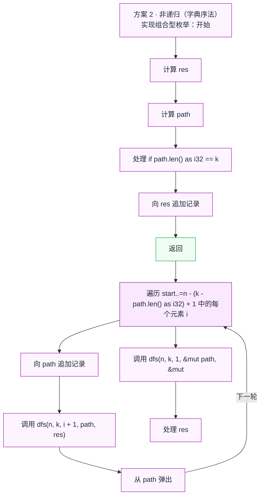

```rust
// LeetCode 77. 组合 — Rust 版（方案2）
fn combine(n: i32, k: i32) -> Vec<Vec<i32>> {
    // 定义函数/方法 combine
    let mut res = Vec::new(); // 把 Vec::new(); 写入 let mut res
    let mut path = Vec::new(); // 把 Vec::new(); 写入 let mut path
    fn dfs(n: i32, k: i32, start: i32, path: &mut Vec<i32>, res: &mut Vec<Vec<i32>>) {
        // 定义函数/方法 dfs
        if path.len() as i32 == k {
            res.push(path.clone());
            return;
        } // 若 当前路径.长度() as i32 等于 下标 k { 结果 追加 当前路径.clone()); return; }
        for i in start..=n - (k - path.len() as i32) + 1 {
            // 逐个取出 起点 的元素（下标 i）
            path.push(i); // 把 下标 i 压入栈/数组尾部
            dfs(n, k, i + 1, path, res); // dfs(元素个数, 下标 k, 下标 i 加 1, 当前路径, 结果);
            path.pop(); // 弹出栈顶元素
        }
    }
    dfs(n, k, 1, &mut path, &mut res); // dfs(元素个数, 下标 k, 1, 按位与 mut 当前路径, 按位与 mut 结果);
    res // 结果
}
fn main() {
    // 程序入口：跑内嵌自测用例
    let got = combine(4, 2); // 把 combine(4, 2) 存入 got
    let want = vec![
        vec![1, 2],
        vec![1, 3],
        vec![1, 4],
        vec![2, 3],
        vec![2, 4],
        vec![3, 4],
    ];
    assert_eq!(got, want); // 断言校验
    assert_eq!(combine(1, 1), vec![vec![1]]); // 断言校验
    println!("PASS"); // 全部用例通过，输出 PASS
}
```

#### 方案 3：回溯一般思路

**思路与代码分析**：核心是「回溯一般思路」。Rust 版用所有权移动与切片借用改写同一逻辑，注意 Option 与引用边界。代码里依次做这些事：栈的后进先出操作。**走读**：方案 3 · 回溯一般思路：开始 → 计算 res → 计算 path → 处理 if path.len() as i32 == k → 向 res 追加记录 → 返回  → 遍历 start..=n - (k - path.len() as i32) + 1 中的每个元素 i → 向 path 追加记录 → 调用 dfs(n, k, i + 1, path, res) → 从 path 弹出 → 调用 dfs(n, k, 1, &mut path, &mut → 处理 res。

**运行架构**（真实控制流）：

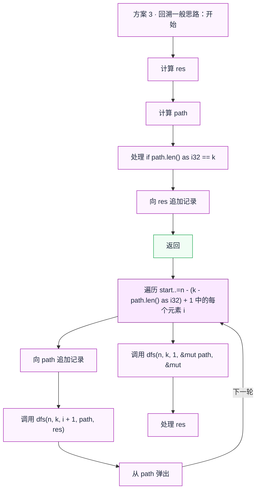

```rust
// LeetCode 77. 组合 — Rust 版（方案3）
fn combine(n: i32, k: i32) -> Vec<Vec<i32>> {
    // 定义函数/方法 combine
    let mut res = Vec::new(); // 把 Vec::new(); 写入 let mut res
    let mut path = Vec::new(); // 把 Vec::new(); 写入 let mut path
    fn dfs(n: i32, k: i32, start: i32, path: &mut Vec<i32>, res: &mut Vec<Vec<i32>>) {
        // 定义函数/方法 dfs
        if path.len() as i32 == k {
            res.push(path.clone());
            return;
        } // 若 当前路径.长度() as i32 等于 下标 k { 结果 追加 当前路径.clone()); return; }
        for i in start..=n - (k - path.len() as i32) + 1 {
            // 逐个取出 起点 的元素（下标 i）
            path.push(i); // 把 下标 i 压入栈/数组尾部
            dfs(n, k, i + 1, path, res); // dfs(元素个数, 下标 k, 下标 i 加 1, 当前路径, 结果);
            path.pop(); // 弹出栈顶元素
        }
    }
    dfs(n, k, 1, &mut path, &mut res); // dfs(元素个数, 下标 k, 1, 按位与 mut 当前路径, 按位与 mut 结果);
    res // 结果
}
fn main() {
    // 程序入口：跑内嵌自测用例
    let got = combine(4, 2); // 把 combine(4, 2) 存入 got
    let want = vec![
        vec![1, 2],
        vec![1, 3],
        vec![1, 4],
        vec![2, 3],
        vec![2, 4],
        vec![3, 4],
    ];
    assert_eq!(got, want); // 断言校验
    assert_eq!(combine(1, 1), vec![vec![1]]); // 断言校验
    println!("PASS"); // 全部用例通过，输出 PASS
}
```

### Lua 实现（3 种方案）

Lua 的全部方案如下，每个方案都内嵌用例自测，可独立运行（老仓库 python/go 文件遵循「打印结果」约定）：

#### 方案 1：递归实现组合型枚举

**思路与代码分析**：核心是「递归实现组合型枚举」。Lua 版用表与 ipairs 遍历，注意 ipairs 遇 nil 即停的语义。代码里依次做这些事：递归求解子问题。**走读**：方案 1 · 递归实现组合型枚举：开始 → 更新 res → 更新 path → 处理 local function dfs(start) → 处理 if #path == k then → 更新 1] → 返回  → 循环 i：从 start 到 n - (k - #path) + 1 do → 更新 1] → 调用 dfs(i + 1) → 更新 path[#path] → 调用 dfs(1) → 返回 res。

**运行架构**（真实控制流）：

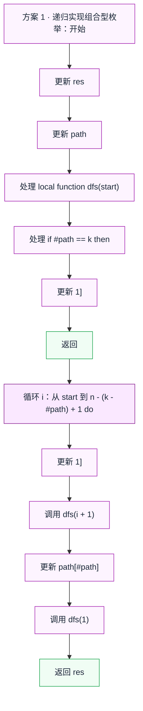

```lua
-- LeetCode 77. 组合 — Lua 版（方案1）
local function combine(n, k) -- local function combine(元素个数, 下标 k)
	local res = {} -- 把 {} 写入 local res
	local path = {} -- 把 {} 写入 local path
	local function dfs(start) -- local function dfs(起点)
		if #path == k then -- 若 #当前路径 等于 下标 k then
			res[#res + 1] = { table.unpack(path) } -- 把 {table.unpack(当前路径)} 写入 res[#res + 1]
			return -- return
		end -- 终点
		for i = start, n - (k - #path) + 1 do -- 把 起点, 元素个数 减 (下标 k 减 #当前路径) 加 1 do 写入 for i
			path[#path + 1] = i -- 把 下标 i 写入 path[#path + 1]
			dfs(i + 1) -- dfs(下标 i 加 1)
			path[#path] = nil -- 把 nil 写入 path[#path]
		end -- 终点
	end -- 终点
	dfs(1) -- dfs(1)
	return res -- 返回 结果
end -- 终点
local got = combine(4, 2) -- 把 combine(4, 2) 写入 local got
assert(#got == 6) -- 断言校验
assert(table.concat(got[1], ",") == "1,2" and table.concat(got[6], ",") == "3,4") -- 打印输出
assert(#combine(1, 1) == 1) -- 断言校验
print("PASS") -- 全部用例通过，输出 PASS
```

#### 方案 2：非递归（字典序法）实现组合型枚举

**思路与代码分析**：核心是「非递归（字典序法）实现组合型枚举」。Lua 版用表与 ipairs 遍历，注意 ipairs 遇 nil 即停的语义。代码里依次做这些事：递归求解子问题。**走读**：方案 2 · 非递归（字典序法）实现组合型枚举：开始 → 更新 res → 更新 path → 处理 local function dfs(start) → 处理 if #path == k then → 更新 1] → 返回  → 循环 i：从 start 到 n - (k - #path) + 1 do → 更新 1] → 调用 dfs(i + 1) → 更新 path[#path] → 调用 dfs(1) → 返回 res。

**运行架构**（真实控制流）：

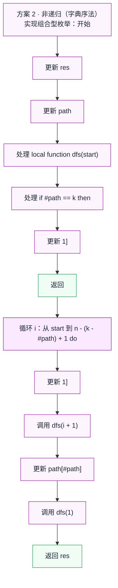

```lua
-- LeetCode 77. 组合 — Lua 版（方案2）
local function combine(n, k) -- local function combine(元素个数, 下标 k)
	local res = {} -- 把 {} 写入 local res
	local path = {} -- 把 {} 写入 local path
	local function dfs(start) -- local function dfs(起点)
		if #path == k then -- 若 #当前路径 等于 下标 k then
			res[#res + 1] = { table.unpack(path) } -- 把 {table.unpack(当前路径)} 写入 res[#res + 1]
			return -- return
		end -- 终点
		for i = start, n - (k - #path) + 1 do -- 把 起点, 元素个数 减 (下标 k 减 #当前路径) 加 1 do 写入 for i
			path[#path + 1] = i -- 把 下标 i 写入 path[#path + 1]
			dfs(i + 1) -- dfs(下标 i 加 1)
			path[#path] = nil -- 把 nil 写入 path[#path]
		end -- 终点
	end -- 终点
	dfs(1) -- dfs(1)
	return res -- 返回 结果
end -- 终点
local got = combine(4, 2) -- 把 combine(4, 2) 写入 local got
assert(#got == 6) -- 断言校验
assert(table.concat(got[1], ",") == "1,2" and table.concat(got[6], ",") == "3,4") -- 打印输出
assert(#combine(1, 1) == 1) -- 断言校验
print("PASS") -- 全部用例通过，输出 PASS
```

#### 方案 3：回溯一般思路

**思路与代码分析**：核心是「回溯一般思路」。Lua 版用表与 ipairs 遍历，注意 ipairs 遇 nil 即停的语义。代码里依次做这些事：递归求解子问题。**走读**：方案 3 · 回溯一般思路：开始 → 更新 res → 更新 path → 处理 local function dfs(start) → 处理 if #path == k then → 更新 1] → 返回  → 循环 i：从 start 到 n - (k - #path) + 1 do → 更新 1] → 调用 dfs(i + 1) → 更新 path[#path] → 调用 dfs(1) → 返回 res。

**运行架构**（真实控制流）：

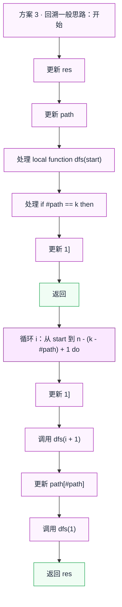

```lua
-- LeetCode 77. 组合 — Lua 版（方案3）
local function combine(n, k) -- local function combine(元素个数, 下标 k)
	local res = {} -- 把 {} 写入 local res
	local path = {} -- 把 {} 写入 local path
	local function dfs(start) -- local function dfs(起点)
		if #path == k then -- 若 #当前路径 等于 下标 k then
			res[#res + 1] = { table.unpack(path) } -- 把 {table.unpack(当前路径)} 写入 res[#res + 1]
			return -- return
		end -- 终点
		for i = start, n - (k - #path) + 1 do -- 把 起点, 元素个数 减 (下标 k 减 #当前路径) 加 1 do 写入 for i
			path[#path + 1] = i -- 把 下标 i 写入 path[#path + 1]
			dfs(i + 1) -- dfs(下标 i 加 1)
			path[#path] = nil -- 把 nil 写入 path[#path]
		end -- 终点
	end -- 终点
	dfs(1) -- dfs(1)
	return res -- 返回 结果
end -- 终点
local got = combine(4, 2) -- 把 combine(4, 2) 写入 local got
assert(#got == 6) -- 断言校验
assert(table.concat(got[1], ",") == "1,2" and table.concat(got[6], ",") == "3,4") -- 打印输出
assert(#combine(1, 1) == 1) -- 断言校验
print("PASS") -- 全部用例通过，输出 PASS
```

### C 实现（3 种方案）

C 的全部方案如下，每个方案都内嵌用例自测，可独立运行（老仓库 python/go 文件遵循「打印结果」约定）：

#### 方案 1：递归实现组合型枚举

**思路与代码分析**：核心是「递归实现组合型枚举」。C 版手动管理下标与内存，循环边界全部显式写出。**走读**：方案 1 · 递归实现组合型枚举：开始 → 更新 n_g → 更新 k_g → 更新 res_n → 调用 dfs(1, 0) → 返回 res_n。

**运行架构**（真实控制流）：

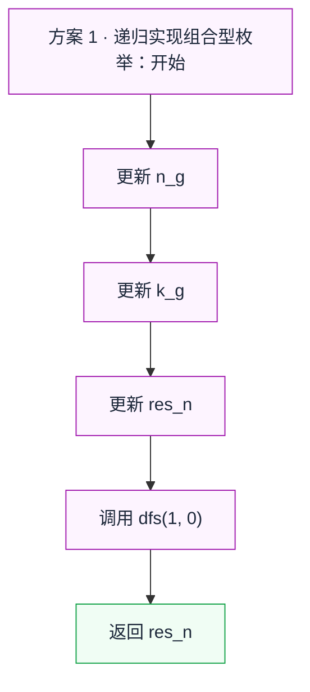

```c
/* LeetCode 77. 组合 — C 版（方案1） */
#include <stdio.h>                      // 引入头文件
static int res[256][8], res_n, path[8]; // static int 结果[256][8], res_n, 当前路径[8];
static int n_g, k_g;                    // static int n_g, k_g;
static void dfs(int start, int depth) { // 定义函数/方法 dfs
    if (depth == k_g) {                 // 若 深度 等于 k_g
        for (int i = 0; i < depth; i++)
            res[res_n][i] = path[i]; // 让 下标 i 从 0 开始计数，下标 i 小于 深度 就继续
        res_n++;                     // res_n 加一
        return;                      // return;
    }
    for (int i = start; i <= n_g - (k_g - depth) + 1;
         i++) { // 让 下标 i 从 起点 开始计数，下标 i 不超过 n_g 减 (k_g 减 深度) 加 1 就继续
        path[depth] = i;       // 把 下标 i; 写入 path[depth]
        dfs(i + 1, depth + 1); // dfs(下标 i 加 1, 深度 加 1);
    }
}
static int combine(int n, int k) { // 定义函数/方法 combine
    n_g = n;
    k_g = k;
    res_n = 0;    // 把 元素个数; k_g 赋值为 下标 k; res_n 赋值为 0; 写入 n_g
    dfs(1, 0);    // dfs(1, 0);
    return res_n; // 返回 res_n
}
int main(void) {           // 程序入口：跑内嵌自测用例
    int n = combine(4, 2); // 把 combine(4, 2) 存入 元素个数
    if (n != 6) {
        printf("FAIL cnt\n");
        return 1;
    } // 若 元素个数 不等于 6) { 输出「FAIL 计数 」); return 1; }
    if (res[0][0] != 1 || res[0][1] != 2 || res[5][0] != 3 || res[5][1] != 4) {
        printf("FAIL c\n");
        return 1;
    }
    if (combine(1, 1) != 1) {
        printf("FAIL 2\n");
        return 1;
    }                 // 若 combine(1, 1) 不等于 1) { 输出「FAIL 2 」); return 1; }
    printf("PASS\n"); // 全部用例通过，输出 PASS
    return 0;         // 返回 0
}
```

#### 方案 2：非递归（字典序法）实现组合型枚举

**思路与代码分析**：核心是「非递归（字典序法）实现组合型枚举」。C 版手动管理下标与内存，循环边界全部显式写出。**走读**：方案 2 · 非递归（字典序法）实现组合型枚举：开始 → 更新 n_g → 更新 k_g → 更新 res_n → 调用 dfs(1, 0) → 返回 res_n。

**运行架构**（真实控制流）：

```mermaid
graph TD
    N0["方案 2 · 非递归（字典序法）实现组合型枚举：开始"]
    N1["更新 n_g"]
    N2["更新 k_g"]
    N3["更新 res_n"]
    N4["调用 dfs(1, 0)"]
    N5["返回 res_n"]
    N0 --> N1
    N1 --> N2
    N2 --> N3
    N3 --> N4
    N4 --> N5
    classDef n fill:#fdf4ff,stroke:#a21caf,color:#1e293b;
    classDef lp fill:#fae8ff,stroke:#86198f,color:#1e293b;
    classDef dc fill:#fef9c3,stroke:#ca8a04,color:#1e293b;
    classDef tm fill:#f0fdf4,stroke:#16a34a,color:#1e293b;
    class N0,N1,N2,N3,N4 n;
    class N5 tm;
```

```c
/* LeetCode 77. 组合 — C 版（方案2） */
#include <stdio.h>                      // 引入头文件
static int res[256][8], res_n, path[8]; // static int 结果[256][8], res_n, 当前路径[8];
static int n_g, k_g;                    // static int n_g, k_g;
static void dfs(int start, int depth) { // 定义函数/方法 dfs
    if (depth == k_g) {                 // 若 深度 等于 k_g
        for (int i = 0; i < depth; i++)
            res[res_n][i] = path[i]; // 让 下标 i 从 0 开始计数，下标 i 小于 深度 就继续
        res_n++;                     // res_n 加一
        return;                      // return;
    }
    for (int i = start; i <= n_g - (k_g - depth) + 1;
         i++) { // 让 下标 i 从 起点 开始计数，下标 i 不超过 n_g 减 (k_g 减 深度) 加 1 就继续
        path[depth] = i;       // 把 下标 i; 写入 path[depth]
        dfs(i + 1, depth + 1); // dfs(下标 i 加 1, 深度 加 1);
    }
}
static int combine(int n, int k) { // 定义函数/方法 combine
    n_g = n;
    k_g = k;
    res_n = 0;    // 把 元素个数; k_g 赋值为 下标 k; res_n 赋值为 0; 写入 n_g
    dfs(1, 0);    // dfs(1, 0);
    return res_n; // 返回 res_n
}
int main(void) {           // 程序入口：跑内嵌自测用例
    int n = combine(4, 2); // 把 combine(4, 2) 存入 元素个数
    if (n != 6) {
        printf("FAIL cnt\n");
        return 1;
    } // 若 元素个数 不等于 6) { 输出「FAIL 计数 」); return 1; }
    if (res[0][0] != 1 || res[0][1] != 2 || res[5][0] != 3 || res[5][1] != 4) {
        printf("FAIL c\n");
        return 1;
    }
    if (combine(1, 1) != 1) {
        printf("FAIL 2\n");
        return 1;
    }                 // 若 combine(1, 1) 不等于 1) { 输出「FAIL 2 」); return 1; }
    printf("PASS\n"); // 全部用例通过，输出 PASS
    return 0;         // 返回 0
}
```

#### 方案 3：回溯一般思路

**思路与代码分析**：核心是「回溯一般思路」。C 版手动管理下标与内存，循环边界全部显式写出。**走读**：方案 3 · 回溯一般思路：开始 → 更新 n_g → 更新 k_g → 更新 res_n → 调用 dfs(1, 0) → 返回 res_n。

**运行架构**（真实控制流）：

```mermaid
graph TD
    N0["方案 3 · 回溯一般思路：开始"]
    N1["更新 n_g"]
    N2["更新 k_g"]
    N3["更新 res_n"]
    N4["调用 dfs(1, 0)"]
    N5["返回 res_n"]
    N0 --> N1
    N1 --> N2
    N2 --> N3
    N3 --> N4
    N4 --> N5
    classDef n fill:#fdf4ff,stroke:#a21caf,color:#1e293b;
    classDef lp fill:#fae8ff,stroke:#86198f,color:#1e293b;
    classDef dc fill:#fef9c3,stroke:#ca8a04,color:#1e293b;
    classDef tm fill:#f0fdf4,stroke:#16a34a,color:#1e293b;
    class N0,N1,N2,N3,N4 n;
    class N5 tm;
```

```c
/* LeetCode 77. 组合 — C 版（方案3） */
#include <stdio.h>                      // 引入头文件
static int res[256][8], res_n, path[8]; // static int 结果[256][8], res_n, 当前路径[8];
static int n_g, k_g;                    // static int n_g, k_g;
static void dfs(int start, int depth) { // 定义函数/方法 dfs
    if (depth == k_g) {                 // 若 深度 等于 k_g
        for (int i = 0; i < depth; i++)
            res[res_n][i] = path[i]; // 让 下标 i 从 0 开始计数，下标 i 小于 深度 就继续
        res_n++;                     // res_n 加一
        return;                      // return;
    }
    for (int i = start; i <= n_g - (k_g - depth) + 1;
         i++) { // 让 下标 i 从 起点 开始计数，下标 i 不超过 n_g 减 (k_g 减 深度) 加 1 就继续
        path[depth] = i;       // 把 下标 i; 写入 path[depth]
        dfs(i + 1, depth + 1); // dfs(下标 i 加 1, 深度 加 1);
    }
}
static int combine(int n, int k) { // 定义函数/方法 combine
    n_g = n;
    k_g = k;
    res_n = 0;    // 把 元素个数; k_g 赋值为 下标 k; res_n 赋值为 0; 写入 n_g
    dfs(1, 0);    // dfs(1, 0);
    return res_n; // 返回 res_n
}
int main(void) {           // 程序入口：跑内嵌自测用例
    int n = combine(4, 2); // 把 combine(4, 2) 存入 元素个数
    if (n != 6) {
        printf("FAIL cnt\n");
        return 1;
    } // 若 元素个数 不等于 6) { 输出「FAIL 计数 」); return 1; }
    if (res[0][0] != 1 || res[0][1] != 2 || res[5][0] != 3 || res[5][1] != 4) {
        printf("FAIL c\n");
        return 1;
    }
    if (combine(1, 1) != 1) {
        printf("FAIL 2\n");
        return 1;
    }                 // 若 combine(1, 1) 不等于 1) { 输出「FAIL 2 」); return 1; }
    printf("PASS\n"); // 全部用例通过，输出 PASS
    return 0;         // 返回 0
}
```

### C++ 实现（3 种方案）

C++ 的全部方案如下，每个方案都内嵌用例自测，可独立运行（老仓库 python/go 文件遵循「打印结果」约定）：

#### 方案 1：递归实现组合型枚举

**思路与代码分析**：核心是「递归实现组合型枚举」。C++ 版用 STL 容器与迭代器，减少手写下标错误。代码里依次做这些事：单循环线性扫描。**走读**：方案 1 · 递归实现组合型枚举：开始 → 处理 std::vector＜std::vector＜int＞ → 处理 std::vector＜int＞ path → 更新 dfs → 配置比较器（lambda） → 若 static_cast＜int＞(path.size()) == k 则： → 调用 res.push_back(path) → 返回  → 遍历循环 → 调用 path.push_back(i) → 调用 dfs(i + 1) → 调用 path.pop_back() → 调用 dfs(1) → 返回 res。

**运行架构**（真实控制流）：

```mermaid
graph TD
    N0["方案 1 · 递归实现组合型枚举：开始"]
    N1["处理 std::vector＜std::vector＜int＞"]
    N2["处理 std::vector＜int＞ path"]
    N3["更新 dfs"]
    N4["配置比较器（lambda）"]
    N5["若 static_cast＜int＞(path.size()) == k 则："]
    N6["调用 res.push_back(path)"]
    N7["返回 "]
    N8["遍历循环"]
    N9["调用 path.push_back(i)"]
    N10["调用 dfs(i + 1)"]
    N11["调用 path.pop_back()"]
    N12["调用 dfs(1)"]
    N13["返回 res"]
    N0 --> N1
    N1 --> N2
    N2 --> N3
    N3 --> N4
    N4 --> N5
    N5 --> N6
    N6 --> N7
    N7 --> N8
    N8 --> N9
    N9 --> N10
    N10 --> N11
    N11 -- 下一轮 --> N8
    N8 --> N12
    N12 --> N13
    classDef n fill:#fdf4ff,stroke:#a21caf,color:#1e293b;
    classDef lp fill:#fae8ff,stroke:#86198f,color:#1e293b;
    classDef dc fill:#fef9c3,stroke:#ca8a04,color:#1e293b;
    classDef tm fill:#f0fdf4,stroke:#16a34a,color:#1e293b;
    class N0,N1,N2,N3,N4,N5,N6,N9,N10,N11,N12 n;
    class N8 lp;
    class N7,N13 tm;
```

```cpp
// LeetCode 77. 组合 — C++ 版（方案1）
#include <cassert>  // 引入头文件
#include <iostream> // 引入头文件
#include <vector>   // 引入头文件
static std::vector<std::vector<int>> combine(int n, int k) {
    std::vector<std::vector<int>> res; // std::vector 小于 std::vector 小于 int 超过 超过 结果;
    std::vector<int> path;             // std::vector 小于 int 超过 当前路径;
    std::function<void(int)> dfs =
        [&](int start) { // 把 [ 按位与 ](int 起点) { 写入 std::function<void(int)> dfs
            if (static_cast<int>(path.size()) == k) {
                res.push_back(path);
                return;
            }
            for (int i = start; i <= n - (k - static_cast<int>(path.size())) + 1; ++i) {
                path.push_back(i); // 当前路径 追加 下标 i);
                dfs(i + 1);        // dfs(下标 i 加 1);
                path.pop_back();   // 弹出栈顶元素
            }
        };
    dfs(1);     // dfs(1);
    return res; // 返回 结果
}
int main() { // 程序入口：跑内嵌自测用例
    assert((combine(4, 2) ==
            std::vector<std::vector<int>>{{1, 2}, {1, 3}, {1, 4}, {2, 3}, {2, 4}, {3, 4}})); // 断言校验
    assert((combine(1, 1) == std::vector<std::vector<int>>{{1}}));                           // 断言校验
    std::cout << "PASS" << std::endl; // 全部用例通过，输出 PASS
    return 0;                         // 返回 0
}
```

#### 方案 2：非递归（字典序法）实现组合型枚举

**思路与代码分析**：核心是「非递归（字典序法）实现组合型枚举」。C++ 版用 STL 容器与迭代器，减少手写下标错误。代码里依次做这些事：单循环线性扫描。**走读**：方案 2 · 非递归（字典序法）实现组合型枚举：开始 → 处理 std::vector＜std::vector＜int＞ → 处理 std::vector＜int＞ path → 更新 dfs → 配置比较器（lambda） → 若 static_cast＜int＞(path.size()) == k 则： → 调用 res.push_back(path) → 返回  → 遍历循环 → 调用 path.push_back(i) → 调用 dfs(i + 1) → 调用 path.pop_back() → 调用 dfs(1) → 返回 res。

**运行架构**（真实控制流）：

```mermaid
graph TD
    N0["方案 2 · 非递归（字典序法）实现组合型枚举：开始"]
    N1["处理 std::vector＜std::vector＜int＞"]
    N2["处理 std::vector＜int＞ path"]
    N3["更新 dfs"]
    N4["配置比较器（lambda）"]
    N5["若 static_cast＜int＞(path.size()) == k 则："]
    N6["调用 res.push_back(path)"]
    N7["返回 "]
    N8["遍历循环"]
    N9["调用 path.push_back(i)"]
    N10["调用 dfs(i + 1)"]
    N11["调用 path.pop_back()"]
    N12["调用 dfs(1)"]
    N13["返回 res"]
    N0 --> N1
    N1 --> N2
    N2 --> N3
    N3 --> N4
    N4 --> N5
    N5 --> N6
    N6 --> N7
    N7 --> N8
    N8 --> N9
    N9 --> N10
    N10 --> N11
    N11 -- 下一轮 --> N8
    N8 --> N12
    N12 --> N13
    classDef n fill:#fdf4ff,stroke:#a21caf,color:#1e293b;
    classDef lp fill:#fae8ff,stroke:#86198f,color:#1e293b;
    classDef dc fill:#fef9c3,stroke:#ca8a04,color:#1e293b;
    classDef tm fill:#f0fdf4,stroke:#16a34a,color:#1e293b;
    class N0,N1,N2,N3,N4,N5,N6,N9,N10,N11,N12 n;
    class N8 lp;
    class N7,N13 tm;
```

```cpp
// LeetCode 77. 组合 — C++ 版（方案2）
#include <cassert>  // 引入头文件
#include <iostream> // 引入头文件
#include <vector>   // 引入头文件
static std::vector<std::vector<int>> combine(int n, int k) {
    std::vector<std::vector<int>> res; // std::vector 小于 std::vector 小于 int 超过 超过 结果;
    std::vector<int> path;             // std::vector 小于 int 超过 当前路径;
    std::function<void(int)> dfs =
        [&](int start) { // 把 [ 按位与 ](int 起点) { 写入 std::function<void(int)> dfs
            if (static_cast<int>(path.size()) == k) {
                res.push_back(path);
                return;
            }
            for (int i = start; i <= n - (k - static_cast<int>(path.size())) + 1; ++i) {
                path.push_back(i); // 当前路径 追加 下标 i);
                dfs(i + 1);        // dfs(下标 i 加 1);
                path.pop_back();   // 弹出栈顶元素
            }
        };
    dfs(1);     // dfs(1);
    return res; // 返回 结果
}
int main() { // 程序入口：跑内嵌自测用例
    assert((combine(4, 2) ==
            std::vector<std::vector<int>>{{1, 2}, {1, 3}, {1, 4}, {2, 3}, {2, 4}, {3, 4}})); // 断言校验
    assert((combine(1, 1) == std::vector<std::vector<int>>{{1}}));                           // 断言校验
    std::cout << "PASS" << std::endl; // 全部用例通过，输出 PASS
    return 0;                         // 返回 0
}
```

#### 方案 3：回溯一般思路

**思路与代码分析**：核心是「回溯一般思路」。C++ 版用 STL 容器与迭代器，减少手写下标错误。代码里依次做这些事：单循环线性扫描。**走读**：方案 3 · 回溯一般思路：开始 → 处理 std::vector＜std::vector＜int＞ → 处理 std::vector＜int＞ path → 更新 dfs → 配置比较器（lambda） → 若 static_cast＜int＞(path.size()) == k 则： → 调用 res.push_back(path) → 返回  → 遍历循环 → 调用 path.push_back(i) → 调用 dfs(i + 1) → 调用 path.pop_back() → 调用 dfs(1) → 返回 res。

**运行架构**（真实控制流）：

```mermaid
graph TD
    N0["方案 3 · 回溯一般思路：开始"]
    N1["处理 std::vector＜std::vector＜int＞"]
    N2["处理 std::vector＜int＞ path"]
    N3["更新 dfs"]
    N4["配置比较器（lambda）"]
    N5["若 static_cast＜int＞(path.size()) == k 则："]
    N6["调用 res.push_back(path)"]
    N7["返回 "]
    N8["遍历循环"]
    N9["调用 path.push_back(i)"]
    N10["调用 dfs(i + 1)"]
    N11["调用 path.pop_back()"]
    N12["调用 dfs(1)"]
    N13["返回 res"]
    N0 --> N1
    N1 --> N2
    N2 --> N3
    N3 --> N4
    N4 --> N5
    N5 --> N6
    N6 --> N7
    N7 --> N8
    N8 --> N9
    N9 --> N10
    N10 --> N11
    N11 -- 下一轮 --> N8
    N8 --> N12
    N12 --> N13
    classDef n fill:#fdf4ff,stroke:#a21caf,color:#1e293b;
    classDef lp fill:#fae8ff,stroke:#86198f,color:#1e293b;
    classDef dc fill:#fef9c3,stroke:#ca8a04,color:#1e293b;
    classDef tm fill:#f0fdf4,stroke:#16a34a,color:#1e293b;
    class N0,N1,N2,N3,N4,N5,N6,N9,N10,N11,N12 n;
    class N8 lp;
    class N7,N13 tm;
```

```cpp
// LeetCode 77. 组合 — C++ 版（方案3）
#include <cassert>  // 引入头文件
#include <iostream> // 引入头文件
#include <vector>   // 引入头文件
static std::vector<std::vector<int>> combine(int n, int k) {
    std::vector<std::vector<int>> res; // std::vector 小于 std::vector 小于 int 超过 超过 结果;
    std::vector<int> path;             // std::vector 小于 int 超过 当前路径;
    std::function<void(int)> dfs =
        [&](int start) { // 把 [ 按位与 ](int 起点) { 写入 std::function<void(int)> dfs
            if (static_cast<int>(path.size()) == k) {
                res.push_back(path);
                return;
            }
            for (int i = start; i <= n - (k - static_cast<int>(path.size())) + 1; ++i) {
                path.push_back(i); // 当前路径 追加 下标 i);
                dfs(i + 1);        // dfs(下标 i 加 1);
                path.pop_back();   // 弹出栈顶元素
            }
        };
    dfs(1);     // dfs(1);
    return res; // 返回 结果
}
int main() { // 程序入口：跑内嵌自测用例
    assert((combine(4, 2) ==
            std::vector<std::vector<int>>{{1, 2}, {1, 3}, {1, 4}, {2, 3}, {2, 4}, {3, 4}})); // 断言校验
    assert((combine(1, 1) == std::vector<std::vector<int>>{{1}}));                           // 断言校验
    std::cout << "PASS" << std::endl; // 全部用例通过，输出 PASS
    return 0;                         // 返回 0
}
```

### R 实现（3 种方案）

R 的全部方案如下，每个方案都内嵌用例自测，可独立运行（老仓库 python/go 文件遵循「打印结果」约定）：

#### 方案 1：递归实现组合型枚举

**思路与代码分析**：核心是「递归实现组合型枚举」。R 版用向量化思维与 1 起始下标，注意 1:n 的降序陷阱。代码里依次做这些事：单循环线性扫描。**走读**：方案 1 · 递归实现组合型枚举：开始 → 处理 res ＜- list() → 处理 path ＜- integer(0) → 处理 dfs ＜- function(start) → 若 length(path) == k 则： → 处理 res[[length(res) + 1L]] ＜＜- → 返回 (invisible(NULL)) → 处理 upper ＜- as.integer(n - (k - → 命中条件，直接返回 → 循环 i：遍历 start:upper → 处理 path ＜＜- c(path, i) → 调用 dfs(i + 1L) → 处理 path ＜＜- path[-length(path)] → 调用 dfs(1L) → 处理 res。

**运行架构**（真实控制流）：

```mermaid
graph TD
    N0["方案 1 · 递归实现组合型枚举：开始"]
    N1["处理 res ＜- list()"]
    N2["处理 path ＜- integer(0)"]
    N3["处理 dfs ＜- function(start)"]
    N4["若 length(path) == k 则："]
    N5["处理 res[[length(res) + 1L]] ＜＜-"]
    N6["返回 (invisible(NULL))"]
    N7["处理 upper ＜- as.integer(n - (k -"]
    N8{"start ＞ upper ？"}
    N9["命中条件，直接返回"]
    N10["循环 i：遍历 start:upper"]
    N11["处理 path ＜＜- c(path, i)"]
    N12["调用 dfs(i + 1L)"]
    N13["处理 path ＜＜- path[-length(path)]"]
    N14["调用 dfs(1L)"]
    N15["处理 res"]
    N0 --> N1
    N1 --> N2
    N2 --> N3
    N3 --> N4
    N4 --> N5
    N5 --> N6
    N6 --> N7
    N7 --> N8
    N8 -- 是 --> N9
    N8 -- 否 --> N10
    N10 --> N11
    N11 --> N12
    N12 --> N13
    N13 -- 下一轮 --> N10
    N10 --> N14
    N14 --> N15
    classDef n fill:#fdf4ff,stroke:#a21caf,color:#1e293b;
    classDef lp fill:#fae8ff,stroke:#86198f,color:#1e293b;
    classDef dc fill:#fef9c3,stroke:#ca8a04,color:#1e293b;
    classDef tm fill:#f0fdf4,stroke:#16a34a,color:#1e293b;
    class N0,N1,N2,N3,N4,N5,N7,N11,N12,N13,N14,N15 n;
    class N10 lp;
    class N8 dc;
    class N6,N9 tm;
```

```r
# 定义函数 combine（参数：元素个数, 下标 k）
combine <- function(n, k) {
    res <- list()  # 把 列表() 存入 结果
    path <- integer(0)  # 把 integer(0) 存入 当前路径
    dfs <- function(start) {
        # 定义函数 dfs（参数：起点） 若 长度(当前路径) 等于 下标 k
        if (length(path) == k) {
            res[[length(res) + 1L]] <<- path  # 结果[[长度(结果) 加 1L]] 小于 小于 减 当前路径
            return(invisible(NULL))  # 返回 invisible(NULL
        }
        upper <- as.integer(n - (k - length(path)) + 1)  # 把 as.integer(元素个数 减 (下标 k 减 长度(当前路径)) 加 1) 存入 upper
        if (start > upper)
            return(invisible(NULL))  # 若 起点 超过 upper) return(invisible(NULL
        for (i in start:upper) {
            # for (下标 i in 起点:upper) {
            path <<- c(path, i)  # 当前路径 小于 小于 减 字符(当前路径, 下标 i)
            dfs(i + 1L)  # dfs(下标 i 加 1L)
            path <<- path[-length(path)]  # 当前路径 小于 小于 减 当前路径[ 减 长度(当前路径)]
        }
    }
    dfs(1L)  # dfs(1L)
    res  # 结果
}
got <- combine(4, 2)  # 把 combine(4, 2) 存入 got
stopifnot(length(got) == 6)  # 断言校验
stopifnot(identical(got[[1]], c(1L, 2L)), identical(got[[6]], c(3L, 4L)))  # 断言校验
stopifnot(length(combine(1, 1)) == 1)  # 断言校验
cat("PASS\n")  # 全部用例通过，输出 PASS
```

#### 方案 2：非递归（字典序法）实现组合型枚举

**思路与代码分析**：核心是「非递归（字典序法）实现组合型枚举」。R 版用向量化思维与 1 起始下标，注意 1:n 的降序陷阱。代码里依次做这些事：单循环线性扫描。**走读**：方案 2 · 非递归（字典序法）实现组合型枚举：开始 → 处理 res ＜- list() → 处理 path ＜- integer(0) → 处理 dfs ＜- function(start) → 若 length(path) == k 则： → 处理 res[[length(res) + 1L]] ＜＜- → 返回 (invisible(NULL)) → 处理 upper ＜- as.integer(n - (k - → 命中条件，直接返回 → 循环 i：遍历 start:upper → 处理 path ＜＜- c(path, i) → 调用 dfs(i + 1L) → 处理 path ＜＜- path[-length(path)] → 调用 dfs(1L) → 处理 res。

**运行架构**（真实控制流）：

```mermaid
graph TD
    N0["方案 2 · 非递归（字典序法）实现组合型枚举：开始"]
    N1["处理 res ＜- list()"]
    N2["处理 path ＜- integer(0)"]
    N3["处理 dfs ＜- function(start)"]
    N4["若 length(path) == k 则："]
    N5["处理 res[[length(res) + 1L]] ＜＜-"]
    N6["返回 (invisible(NULL))"]
    N7["处理 upper ＜- as.integer(n - (k -"]
    N8{"start ＞ upper ？"}
    N9["命中条件，直接返回"]
    N10["循环 i：遍历 start:upper"]
    N11["处理 path ＜＜- c(path, i)"]
    N12["调用 dfs(i + 1L)"]
    N13["处理 path ＜＜- path[-length(path)]"]
    N14["调用 dfs(1L)"]
    N15["处理 res"]
    N0 --> N1
    N1 --> N2
    N2 --> N3
    N3 --> N4
    N4 --> N5
    N5 --> N6
    N6 --> N7
    N7 --> N8
    N8 -- 是 --> N9
    N8 -- 否 --> N10
    N10 --> N11
    N11 --> N12
    N12 --> N13
    N13 -- 下一轮 --> N10
    N10 --> N14
    N14 --> N15
    classDef n fill:#fdf4ff,stroke:#a21caf,color:#1e293b;
    classDef lp fill:#fae8ff,stroke:#86198f,color:#1e293b;
    classDef dc fill:#fef9c3,stroke:#ca8a04,color:#1e293b;
    classDef tm fill:#f0fdf4,stroke:#16a34a,color:#1e293b;
    class N0,N1,N2,N3,N4,N5,N7,N11,N12,N13,N14,N15 n;
    class N10 lp;
    class N8 dc;
    class N6,N9 tm;
```

```r
# 定义函数 combine（参数：元素个数, 下标 k）
combine <- function(n, k) {
    res <- list()  # 把 列表() 存入 结果
    path <- integer(0)  # 把 integer(0) 存入 当前路径
    dfs <- function(start) {
        # 定义函数 dfs（参数：起点） 若 长度(当前路径) 等于 下标 k
        if (length(path) == k) {
            res[[length(res) + 1L]] <<- path  # 结果[[长度(结果) 加 1L]] 小于 小于 减 当前路径
            return(invisible(NULL))  # 返回 invisible(NULL
        }
        upper <- as.integer(n - (k - length(path)) + 1)  # 把 as.integer(元素个数 减 (下标 k 减 长度(当前路径)) 加 1) 存入 upper
        if (start > upper)
            return(invisible(NULL))  # 若 起点 超过 upper) return(invisible(NULL
        for (i in start:upper) {
            # for (下标 i in 起点:upper) {
            path <<- c(path, i)  # 当前路径 小于 小于 减 字符(当前路径, 下标 i)
            dfs(i + 1L)  # dfs(下标 i 加 1L)
            path <<- path[-length(path)]  # 当前路径 小于 小于 减 当前路径[ 减 长度(当前路径)]
        }
    }
    dfs(1L)  # dfs(1L)
    res  # 结果
}
got <- combine(4, 2)  # 把 combine(4, 2) 存入 got
stopifnot(length(got) == 6)  # 断言校验
stopifnot(identical(got[[1]], c(1L, 2L)), identical(got[[6]], c(3L, 4L)))  # 断言校验
stopifnot(length(combine(1, 1)) == 1)  # 断言校验
cat("PASS\n")  # 全部用例通过，输出 PASS
```

#### 方案 3：回溯一般思路

**思路与代码分析**：核心是「回溯一般思路」。R 版用向量化思维与 1 起始下标，注意 1:n 的降序陷阱。代码里依次做这些事：单循环线性扫描。**走读**：方案 3 · 回溯一般思路：开始 → 处理 res ＜- list() → 处理 path ＜- integer(0) → 处理 dfs ＜- function(start) → 若 length(path) == k 则： → 处理 res[[length(res) + 1L]] ＜＜- → 返回 (invisible(NULL)) → 处理 upper ＜- as.integer(n - (k - → 命中条件，直接返回 → 循环 i：遍历 start:upper → 处理 path ＜＜- c(path, i) → 调用 dfs(i + 1L) → 处理 path ＜＜- path[-length(path)] → 调用 dfs(1L) → 处理 res。

**运行架构**（真实控制流）：

```mermaid
graph TD
    N0["方案 3 · 回溯一般思路：开始"]
    N1["处理 res ＜- list()"]
    N2["处理 path ＜- integer(0)"]
    N3["处理 dfs ＜- function(start)"]
    N4["若 length(path) == k 则："]
    N5["处理 res[[length(res) + 1L]] ＜＜-"]
    N6["返回 (invisible(NULL))"]
    N7["处理 upper ＜- as.integer(n - (k -"]
    N8{"start ＞ upper ？"}
    N9["命中条件，直接返回"]
    N10["循环 i：遍历 start:upper"]
    N11["处理 path ＜＜- c(path, i)"]
    N12["调用 dfs(i + 1L)"]
    N13["处理 path ＜＜- path[-length(path)]"]
    N14["调用 dfs(1L)"]
    N15["处理 res"]
    N0 --> N1
    N1 --> N2
    N2 --> N3
    N3 --> N4
    N4 --> N5
    N5 --> N6
    N6 --> N7
    N7 --> N8
    N8 -- 是 --> N9
    N8 -- 否 --> N10
    N10 --> N11
    N11 --> N12
    N12 --> N13
    N13 -- 下一轮 --> N10
    N10 --> N14
    N14 --> N15
    classDef n fill:#fdf4ff,stroke:#a21caf,color:#1e293b;
    classDef lp fill:#fae8ff,stroke:#86198f,color:#1e293b;
    classDef dc fill:#fef9c3,stroke:#ca8a04,color:#1e293b;
    classDef tm fill:#f0fdf4,stroke:#16a34a,color:#1e293b;
    class N0,N1,N2,N3,N4,N5,N7,N11,N12,N13,N14,N15 n;
    class N10 lp;
    class N8 dc;
    class N6,N9 tm;
```

```r
# 定义函数 combine（参数：元素个数, 下标 k）
combine <- function(n, k) {
    res <- list()  # 把 列表() 存入 结果
    path <- integer(0)  # 把 integer(0) 存入 当前路径
    dfs <- function(start) {
        # 定义函数 dfs（参数：起点） 若 长度(当前路径) 等于 下标 k
        if (length(path) == k) {
            res[[length(res) + 1L]] <<- path  # 结果[[长度(结果) 加 1L]] 小于 小于 减 当前路径
            return(invisible(NULL))  # 返回 invisible(NULL
        }
        upper <- as.integer(n - (k - length(path)) + 1)  # 把 as.integer(元素个数 减 (下标 k 减 长度(当前路径)) 加 1) 存入 upper
        if (start > upper)
            return(invisible(NULL))  # 若 起点 超过 upper) return(invisible(NULL
        for (i in start:upper) {
            # for (下标 i in 起点:upper) {
            path <<- c(path, i)  # 当前路径 小于 小于 减 字符(当前路径, 下标 i)
            dfs(i + 1L)  # dfs(下标 i 加 1L)
            path <<- path[-length(path)]  # 当前路径 小于 小于 减 当前路径[ 减 长度(当前路径)]
        }
    }
    dfs(1L)  # dfs(1L)
    res  # 结果
}
got <- combine(4, 2)  # 把 combine(4, 2) 存入 got
stopifnot(length(got) == 6)  # 断言校验
stopifnot(identical(got[[1]], c(1L, 2L)), identical(got[[6]], c(3L, 4L)))  # 断言校验
stopifnot(length(combine(1, 1)) == 1)  # 断言校验
cat("PASS\n")  # 全部用例通过，输出 PASS
```

### Zig 实现（3 种方案）

Zig 的全部方案如下，每个方案都内嵌用例自测，可独立运行（老仓库 python/go 文件遵循「打印结果」约定）：

#### 方案 1：递归实现组合型枚举

**思路与代码分析**：核心是「递归实现组合型枚举」。Zig 版显式分配与清零，整型边界处理严格。**走读**：方案 1 · 递归实现组合型枚举：开始 → 计算 D → 若 @as(i32, @intCast(path.items.len)) == kk 则： → 计算 cp → 调用 cp.appendSlice(path.items) c → 向 out 追加记录 → 返回  → 计算 i → 当 (i ≤ nn - (kk - @as(i32, @intCast(path.items.len))) + 1) : (i += 1) 时反复执行 → 向 path 追加记录 → 调用 dfs(nn, kk, i + 1, path, out → 从 path 弹出 → 计算 path → 调用 D.dfs(n, k, 1, &path, res)。

**运行架构**（真实控制流）：

```mermaid
graph TD
    N0["方案 1 · 递归实现组合型枚举：开始"]
    N1["计算 D"]
    N2["若 @as(i32, @intCast(path.items.len)) == kk 则："]
    N3["计算 cp"]
    N4["调用 cp.appendSlice(path.items) c"]
    N5["向 out 追加记录"]
    N6["返回 "]
    N7["计算 i"]
    N8["当 (i ≤ nn - (kk - @as(i32, @intCast(path.items.len))) + 1) : (i += 1) 时反复执行"]
    N9["向 path 追加记录"]
    N10["调用 dfs(nn, kk, i + 1, path, out"]
    N11["从 path 弹出"]
    N12["计算 path"]
    N13["调用 D.dfs(n, k, 1, &path, res)"]
    N0 --> N1
    N1 --> N2
    N2 --> N3
    N3 --> N4
    N4 --> N5
    N5 --> N6
    N6 --> N7
    N7 --> N8
    N8 --> N9
    N9 --> N10
    N10 --> N11
    N11 -- 下一轮 --> N8
    N8 --> N12
    N12 --> N13
    classDef n fill:#fdf4ff,stroke:#a21caf,color:#1e293b;
    classDef lp fill:#fae8ff,stroke:#86198f,color:#1e293b;
    classDef dc fill:#fef9c3,stroke:#ca8a04,color:#1e293b;
    classDef tm fill:#f0fdf4,stroke:#16a34a,color:#1e293b;
    class N0,N1,N2,N3,N4,N5,N7,N9,N10,N11,N12,N13 n;
    class N8 lp;
    class N6 tm;
```

```zig
// LeetCode 77. 组合 — Zig 版（方案1）
const std = @import("std"); // 把 @import(「std」) 存入 std
fn combine(n: i32, k: i32, alloc: std.mem.Allocator, res: *std.ArrayList(std.ArrayList(i32))) void { // 定义函数/方法 combine
    const D = struct { // 把 struct { 存入 D
        fn dfs(nn: i32, kk: i32, start: i32, path: *std.ArrayList(i32), out: *std.ArrayList(std.ArrayList(i32))) void { // 定义函数/方法 dfs
            if (@as(i32, @intCast(path.items.len)) == kk) { // 若 @as(i32, @intCast(当前路径.items.长度)) 等于 kk
                var cp = std.ArrayList(i32).init(out.allocator); // 把 std.ArrayList(i32).init(out.allocator) 存入 cp
                cp.appendSlice(path.items) catch unreachable; // cp.appendSlice(当前路径.items) catch unreachable;
                out.append(cp) catch unreachable; // 把 cp 追加到列表尾部
                return; // return;
            }
            var i = start; // 把 起点 存入 下标 i
            while (i <= nn - (kk - @as(i32, @intCast(path.items.len))) + 1) : (i += 1) {
                path.append(i) catch unreachable; // 把 下标 i 追加到列表尾部
                dfs(nn, kk, i + 1, path, out); // dfs(nn, kk, 下标 i 加 1, 当前路径, out);
                _ = path.pop(); // 弹出栈顶元素
            }
        }
    };
    var path = std.ArrayList(i32).init(alloc); // 把 std.ArrayList(i32).init(alloc) 存入 当前路径
    D.dfs(n, k, 1, &path, res); // D.dfs(元素个数, 下标 k, 1, 按位与 当前路径, 结果);
}
pub fn main() !void { // 程序入口：跑内嵌自测用例
    var arena = std.heap.ArenaAllocator.init(std.heap.page_allocator); // 把 std.堆.ArenaAllocator.init(std.堆.page_allocator) 存入 arena
    defer arena.deinit(); // defer arena.deinit();
    const alloc = arena.allocator(); // 把 arena.allocator() 存入 alloc
    var res = std.ArrayList(std.ArrayList(i32)).init(std.heap.page_allocator);
    defer res.deinit(); // defer 结果.deinit();
    combine(4, 2, alloc, &res); // combine(4, 2, alloc, 按位与 结果);
    if (res.items.len != 6) return error.TestFailed; // 若 结果.items.长度 不等于 6，直接返回 error.TestFailed
    if (res.items[0].items[0] != 1 or res.items[0].items[1] != 2) return error.TestFailed;
    if (res.items[5].items[0] != 3 or res.items[5].items[1] != 4) return error.TestFailed;
    res.clearRetainingCapacity(); // 结果.clearRetainingCapacity();
    combine(1, 1, alloc, &res); // combine(1, 1, alloc, 按位与 结果);
    if (res.items.len != 1) return error.TestFailed; // 若 结果.items.长度 不等于 1，直接返回 error.TestFailed
    std.debug.print("PASS\n", .{}); // 全部用例通过，输出 PASS
}
```

#### 方案 2：非递归（字典序法）实现组合型枚举

**思路与代码分析**：核心是「非递归（字典序法）实现组合型枚举」。Zig 版显式分配与清零，整型边界处理严格。**走读**：方案 2 · 非递归（字典序法）实现组合型枚举：开始 → 计算 D → 若 @as(i32, @intCast(path.items.len)) == kk 则： → 计算 cp → 调用 cp.appendSlice(path.items) c → 向 out 追加记录 → 返回  → 计算 i → 当 (i ≤ nn - (kk - @as(i32, @intCast(path.items.len))) + 1) : (i += 1) 时反复执行 → 向 path 追加记录 → 调用 dfs(nn, kk, i + 1, path, out → 从 path 弹出 → 计算 path → 调用 D.dfs(n, k, 1, &path, res)。

**运行架构**（真实控制流）：

```mermaid
graph TD
    N0["方案 2 · 非递归（字典序法）实现组合型枚举：开始"]
    N1["计算 D"]
    N2["若 @as(i32, @intCast(path.items.len)) == kk 则："]
    N3["计算 cp"]
    N4["调用 cp.appendSlice(path.items) c"]
    N5["向 out 追加记录"]
    N6["返回 "]
    N7["计算 i"]
    N8["当 (i ≤ nn - (kk - @as(i32, @intCast(path.items.len))) + 1) : (i += 1) 时反复执行"]
    N9["向 path 追加记录"]
    N10["调用 dfs(nn, kk, i + 1, path, out"]
    N11["从 path 弹出"]
    N12["计算 path"]
    N13["调用 D.dfs(n, k, 1, &path, res)"]
    N0 --> N1
    N1 --> N2
    N2 --> N3
    N3 --> N4
    N4 --> N5
    N5 --> N6
    N6 --> N7
    N7 --> N8
    N8 --> N9
    N9 --> N10
    N10 --> N11
    N11 -- 下一轮 --> N8
    N8 --> N12
    N12 --> N13
    classDef n fill:#fdf4ff,stroke:#a21caf,color:#1e293b;
    classDef lp fill:#fae8ff,stroke:#86198f,color:#1e293b;
    classDef dc fill:#fef9c3,stroke:#ca8a04,color:#1e293b;
    classDef tm fill:#f0fdf4,stroke:#16a34a,color:#1e293b;
    class N0,N1,N2,N3,N4,N5,N7,N9,N10,N11,N12,N13 n;
    class N8 lp;
    class N6 tm;
```

```zig
// LeetCode 77. 组合 — Zig 版（方案2）
const std = @import("std"); // 把 @import(「std」) 存入 std
fn combine(n: i32, k: i32, alloc: std.mem.Allocator, res: *std.ArrayList(std.ArrayList(i32))) void { // 定义函数/方法 combine
    const D = struct { // 把 struct { 存入 D
        fn dfs(nn: i32, kk: i32, start: i32, path: *std.ArrayList(i32), out: *std.ArrayList(std.ArrayList(i32))) void { // 定义函数/方法 dfs
            if (@as(i32, @intCast(path.items.len)) == kk) { // 若 @as(i32, @intCast(当前路径.items.长度)) 等于 kk
                var cp = std.ArrayList(i32).init(out.allocator); // 把 std.ArrayList(i32).init(out.allocator) 存入 cp
                cp.appendSlice(path.items) catch unreachable; // cp.appendSlice(当前路径.items) catch unreachable;
                out.append(cp) catch unreachable; // 把 cp 追加到列表尾部
                return; // return;
            }
            var i = start; // 把 起点 存入 下标 i
            while (i <= nn - (kk - @as(i32, @intCast(path.items.len))) + 1) : (i += 1) {
                path.append(i) catch unreachable; // 把 下标 i 追加到列表尾部
                dfs(nn, kk, i + 1, path, out); // dfs(nn, kk, 下标 i 加 1, 当前路径, out);
                _ = path.pop(); // 弹出栈顶元素
            }
        }
    };
    var path = std.ArrayList(i32).init(alloc); // 把 std.ArrayList(i32).init(alloc) 存入 当前路径
    D.dfs(n, k, 1, &path, res); // D.dfs(元素个数, 下标 k, 1, 按位与 当前路径, 结果);
}
pub fn main() !void { // 程序入口：跑内嵌自测用例
    var arena = std.heap.ArenaAllocator.init(std.heap.page_allocator); // 把 std.堆.ArenaAllocator.init(std.堆.page_allocator) 存入 arena
    defer arena.deinit(); // defer arena.deinit();
    const alloc = arena.allocator(); // 把 arena.allocator() 存入 alloc
    var res = std.ArrayList(std.ArrayList(i32)).init(std.heap.page_allocator);
    defer res.deinit(); // defer 结果.deinit();
    combine(4, 2, alloc, &res); // combine(4, 2, alloc, 按位与 结果);
    if (res.items.len != 6) return error.TestFailed; // 若 结果.items.长度 不等于 6，直接返回 error.TestFailed
    if (res.items[0].items[0] != 1 or res.items[0].items[1] != 2) return error.TestFailed;
    if (res.items[5].items[0] != 3 or res.items[5].items[1] != 4) return error.TestFailed;
    res.clearRetainingCapacity(); // 结果.clearRetainingCapacity();
    combine(1, 1, alloc, &res); // combine(1, 1, alloc, 按位与 结果);
    if (res.items.len != 1) return error.TestFailed; // 若 结果.items.长度 不等于 1，直接返回 error.TestFailed
    std.debug.print("PASS\n", .{}); // 全部用例通过，输出 PASS
}
```

#### 方案 3：回溯一般思路

**思路与代码分析**：核心是「回溯一般思路」。Zig 版显式分配与清零，整型边界处理严格。**走读**：方案 3 · 回溯一般思路：开始 → 计算 D → 若 @as(i32, @intCast(path.items.len)) == kk 则： → 计算 cp → 调用 cp.appendSlice(path.items) c → 向 out 追加记录 → 返回  → 计算 i → 当 (i ≤ nn - (kk - @as(i32, @intCast(path.items.len))) + 1) : (i += 1) 时反复执行 → 向 path 追加记录 → 调用 dfs(nn, kk, i + 1, path, out → 从 path 弹出 → 计算 path → 调用 D.dfs(n, k, 1, &path, res)。

**运行架构**（真实控制流）：

```mermaid
graph TD
    N0["方案 3 · 回溯一般思路：开始"]
    N1["计算 D"]
    N2["若 @as(i32, @intCast(path.items.len)) == kk 则："]
    N3["计算 cp"]
    N4["调用 cp.appendSlice(path.items) c"]
    N5["向 out 追加记录"]
    N6["返回 "]
    N7["计算 i"]
    N8["当 (i ≤ nn - (kk - @as(i32, @intCast(path.items.len))) + 1) : (i += 1) 时反复执行"]
    N9["向 path 追加记录"]
    N10["调用 dfs(nn, kk, i + 1, path, out"]
    N11["从 path 弹出"]
    N12["计算 path"]
    N13["调用 D.dfs(n, k, 1, &path, res)"]
    N0 --> N1
    N1 --> N2
    N2 --> N3
    N3 --> N4
    N4 --> N5
    N5 --> N6
    N6 --> N7
    N7 --> N8
    N8 --> N9
    N9 --> N10
    N10 --> N11
    N11 -- 下一轮 --> N8
    N8 --> N12
    N12 --> N13
    classDef n fill:#fdf4ff,stroke:#a21caf,color:#1e293b;
    classDef lp fill:#fae8ff,stroke:#86198f,color:#1e293b;
    classDef dc fill:#fef9c3,stroke:#ca8a04,color:#1e293b;
    classDef tm fill:#f0fdf4,stroke:#16a34a,color:#1e293b;
    class N0,N1,N2,N3,N4,N5,N7,N9,N10,N11,N12,N13 n;
    class N8 lp;
    class N6 tm;
```

```zig
// LeetCode 77. 组合 — Zig 版（方案3）
const std = @import("std"); // 把 @import(「std」) 存入 std
fn combine(n: i32, k: i32, alloc: std.mem.Allocator, res: *std.ArrayList(std.ArrayList(i32))) void { // 定义函数/方法 combine
    const D = struct { // 把 struct { 存入 D
        fn dfs(nn: i32, kk: i32, start: i32, path: *std.ArrayList(i32), out: *std.ArrayList(std.ArrayList(i32))) void { // 定义函数/方法 dfs
            if (@as(i32, @intCast(path.items.len)) == kk) { // 若 @as(i32, @intCast(当前路径.items.长度)) 等于 kk
                var cp = std.ArrayList(i32).init(out.allocator); // 把 std.ArrayList(i32).init(out.allocator) 存入 cp
                cp.appendSlice(path.items) catch unreachable; // cp.appendSlice(当前路径.items) catch unreachable;
                out.append(cp) catch unreachable; // 把 cp 追加到列表尾部
                return; // return;
            }
            var i = start; // 把 起点 存入 下标 i
            while (i <= nn - (kk - @as(i32, @intCast(path.items.len))) + 1) : (i += 1) {
                path.append(i) catch unreachable; // 把 下标 i 追加到列表尾部
                dfs(nn, kk, i + 1, path, out); // dfs(nn, kk, 下标 i 加 1, 当前路径, out);
                _ = path.pop(); // 弹出栈顶元素
            }
        }
    };
    var path = std.ArrayList(i32).init(alloc); // 把 std.ArrayList(i32).init(alloc) 存入 当前路径
    D.dfs(n, k, 1, &path, res); // D.dfs(元素个数, 下标 k, 1, 按位与 当前路径, 结果);
}
pub fn main() !void { // 程序入口：跑内嵌自测用例
    var arena = std.heap.ArenaAllocator.init(std.heap.page_allocator); // 把 std.堆.ArenaAllocator.init(std.堆.page_allocator) 存入 arena
    defer arena.deinit(); // defer arena.deinit();
    const alloc = arena.allocator(); // 把 arena.allocator() 存入 alloc
    var res = std.ArrayList(std.ArrayList(i32)).init(std.heap.page_allocator);
    defer res.deinit(); // defer 结果.deinit();
    combine(4, 2, alloc, &res); // combine(4, 2, alloc, 按位与 结果);
    if (res.items.len != 6) return error.TestFailed; // 若 结果.items.长度 不等于 6，直接返回 error.TestFailed
    if (res.items[0].items[0] != 1 or res.items[0].items[1] != 2) return error.TestFailed;
    if (res.items[5].items[0] != 3 or res.items[5].items[1] != 4) return error.TestFailed;
    res.clearRetainingCapacity(); // 结果.clearRetainingCapacity();
    combine(1, 1, alloc, &res); // combine(1, 1, alloc, 按位与 结果);
    if (res.items.len != 1) return error.TestFailed; // 若 结果.items.长度 不等于 1，直接返回 error.TestFailed
    std.debug.print("PASS\n", .{}); // 全部用例通过，输出 PASS
}
```

### Dart 实现（3 种方案）

Dart 的全部方案如下，每个方案都内嵌用例自测，可独立运行（老仓库 python/go 文件遵循「打印结果」约定）：

#### 方案 1：递归实现组合型枚举

**思路与代码分析**：核心是「递归实现组合型枚举」。Dart 版用可空类型标注与集合方法，注意空安全。代码里依次做这些事：单循环线性扫描。**走读**：方案 1 · 递归实现组合型枚举：开始 → 更新 res → 更新 path → 处理 void dfs(int start) → 若 path.length == k 则： → 调用 res.add(List＜int＞.from(path) → 返回  → 遍历循环 → 调用 path.add(i) → 调用 dfs(i + 1) → 调用 path.removeLast() → 调用 dfs(1) → 返回 res。

**运行架构**（真实控制流）：

```mermaid
graph TD
    N0["方案 1 · 递归实现组合型枚举：开始"]
    N1["更新 res"]
    N2["更新 path"]
    N3["处理 void dfs(int start)"]
    N4["若 path.length == k 则："]
    N5["调用 res.add(List＜int＞.from(path)"]
    N6["返回 "]
    N7["遍历循环"]
    N8["调用 path.add(i)"]
    N9["调用 dfs(i + 1)"]
    N10["调用 path.removeLast()"]
    N11["调用 dfs(1)"]
    N12["返回 res"]
    N0 --> N1
    N1 --> N2
    N2 --> N3
    N3 --> N4
    N4 --> N5
    N5 --> N6
    N6 --> N7
    N7 --> N8
    N8 --> N9
    N9 --> N10
    N10 -- 下一轮 --> N7
    N7 --> N11
    N11 --> N12
    classDef n fill:#fdf4ff,stroke:#a21caf,color:#1e293b;
    classDef lp fill:#fae8ff,stroke:#86198f,color:#1e293b;
    classDef dc fill:#fef9c3,stroke:#ca8a04,color:#1e293b;
    classDef tm fill:#f0fdf4,stroke:#16a34a,color:#1e293b;
    class N0,N1,N2,N3,N4,N5,N8,N9,N10,N11 n;
    class N7 lp;
    class N6,N12 tm;
```

```dart
// LeetCode 77. 组合 — Dart 版（方案1）
List<List<int>> combine(int n, int k) {
  // 定义函数/方法 combine
  final res = <List<int>>[]; // 把 小于 List 小于 int 超过 超过 [] 存入 结果
  final path = <int>[]; // 把 小于 int 超过 [] 存入 当前路径
  void dfs(int start) {
    // 定义函数/方法 dfs
    if (path.length == k) {
      // 若 当前路径.长度 等于 下标 k
      res.add(List<int>.from(path)); // 结果 追加 List 小于 int 超过 .from(当前路径));
      return; // return;
    }
    for (var i = start; i <= n - (k - path.length) + 1; i++) {
      // 让 下标 i 从 起点 开始计数，下标 i 不超过 元素个数 减 (下标 k 减 当前路径.长度) 加 1 就继续
      path.add(i); // 当前路径 追加 下标 i);
      dfs(i + 1); // dfs(下标 i 加 1);
      path.removeLast(); // 当前路径.removeLast();
    }
  }

  dfs(1); // dfs(1);
  return res; // 返回 结果
}

void main() {
  // 程序入口：跑内嵌自测用例
  final got = combine(4, 2); // 把 combine(4, 2) 存入 got
  if (got.length != 6)
    throw StateError('cnt'); // 若 got.长度 不等于 6) throw StateError('计数');
  if (got[0].toString() != '[1, 2]' || got[5].toString() != '[3, 4]')
    throw StateError('c');
  if (combine(1, 1).length != 1)
    throw StateError('c2'); // 若 combine(1, 1).长度 不等于 1) throw StateError('c2');
  print('PASS'); // 全部用例通过，输出 PASS
}
```

#### 方案 2：非递归（字典序法）实现组合型枚举

**思路与代码分析**：核心是「非递归（字典序法）实现组合型枚举」。Dart 版用可空类型标注与集合方法，注意空安全。代码里依次做这些事：单循环线性扫描。**走读**：方案 2 · 非递归（字典序法）实现组合型枚举：开始 → 更新 res → 更新 path → 处理 void dfs(int start) → 若 path.length == k 则： → 调用 res.add(List＜int＞.from(path) → 返回  → 遍历循环 → 调用 path.add(i) → 调用 dfs(i + 1) → 调用 path.removeLast() → 调用 dfs(1) → 返回 res。

**运行架构**（真实控制流）：

```mermaid
graph TD
    N0["方案 2 · 非递归（字典序法）实现组合型枚举：开始"]
    N1["更新 res"]
    N2["更新 path"]
    N3["处理 void dfs(int start)"]
    N4["若 path.length == k 则："]
    N5["调用 res.add(List＜int＞.from(path)"]
    N6["返回 "]
    N7["遍历循环"]
    N8["调用 path.add(i)"]
    N9["调用 dfs(i + 1)"]
    N10["调用 path.removeLast()"]
    N11["调用 dfs(1)"]
    N12["返回 res"]
    N0 --> N1
    N1 --> N2
    N2 --> N3
    N3 --> N4
    N4 --> N5
    N5 --> N6
    N6 --> N7
    N7 --> N8
    N8 --> N9
    N9 --> N10
    N10 -- 下一轮 --> N7
    N7 --> N11
    N11 --> N12
    classDef n fill:#fdf4ff,stroke:#a21caf,color:#1e293b;
    classDef lp fill:#fae8ff,stroke:#86198f,color:#1e293b;
    classDef dc fill:#fef9c3,stroke:#ca8a04,color:#1e293b;
    classDef tm fill:#f0fdf4,stroke:#16a34a,color:#1e293b;
    class N0,N1,N2,N3,N4,N5,N8,N9,N10,N11 n;
    class N7 lp;
    class N6,N12 tm;
```

```dart
// LeetCode 77. 组合 — Dart 版（方案2）
List<List<int>> combine(int n, int k) {
  // 定义函数/方法 combine
  final res = <List<int>>[]; // 把 小于 List 小于 int 超过 超过 [] 存入 结果
  final path = <int>[]; // 把 小于 int 超过 [] 存入 当前路径
  void dfs(int start) {
    // 定义函数/方法 dfs
    if (path.length == k) {
      // 若 当前路径.长度 等于 下标 k
      res.add(List<int>.from(path)); // 结果 追加 List 小于 int 超过 .from(当前路径));
      return; // return;
    }
    for (var i = start; i <= n - (k - path.length) + 1; i++) {
      // 让 下标 i 从 起点 开始计数，下标 i 不超过 元素个数 减 (下标 k 减 当前路径.长度) 加 1 就继续
      path.add(i); // 当前路径 追加 下标 i);
      dfs(i + 1); // dfs(下标 i 加 1);
      path.removeLast(); // 当前路径.removeLast();
    }
  }

  dfs(1); // dfs(1);
  return res; // 返回 结果
}

void main() {
  // 程序入口：跑内嵌自测用例
  final got = combine(4, 2); // 把 combine(4, 2) 存入 got
  if (got.length != 6)
    throw StateError('cnt'); // 若 got.长度 不等于 6) throw StateError('计数');
  if (got[0].toString() != '[1, 2]' || got[5].toString() != '[3, 4]')
    throw StateError('c');
  if (combine(1, 1).length != 1)
    throw StateError('c2'); // 若 combine(1, 1).长度 不等于 1) throw StateError('c2');
  print('PASS'); // 全部用例通过，输出 PASS
}
```

#### 方案 3：回溯一般思路

**思路与代码分析**：核心是「回溯一般思路」。Dart 版用可空类型标注与集合方法，注意空安全。代码里依次做这些事：单循环线性扫描。**走读**：方案 3 · 回溯一般思路：开始 → 更新 res → 更新 path → 处理 void dfs(int start) → 若 path.length == k 则： → 调用 res.add(List＜int＞.from(path) → 返回  → 遍历循环 → 调用 path.add(i) → 调用 dfs(i + 1) → 调用 path.removeLast() → 调用 dfs(1) → 返回 res。

**运行架构**（真实控制流）：

```mermaid
graph TD
    N0["方案 3 · 回溯一般思路：开始"]
    N1["更新 res"]
    N2["更新 path"]
    N3["处理 void dfs(int start)"]
    N4["若 path.length == k 则："]
    N5["调用 res.add(List＜int＞.from(path)"]
    N6["返回 "]
    N7["遍历循环"]
    N8["调用 path.add(i)"]
    N9["调用 dfs(i + 1)"]
    N10["调用 path.removeLast()"]
    N11["调用 dfs(1)"]
    N12["返回 res"]
    N0 --> N1
    N1 --> N2
    N2 --> N3
    N3 --> N4
    N4 --> N5
    N5 --> N6
    N6 --> N7
    N7 --> N8
    N8 --> N9
    N9 --> N10
    N10 -- 下一轮 --> N7
    N7 --> N11
    N11 --> N12
    classDef n fill:#fdf4ff,stroke:#a21caf,color:#1e293b;
    classDef lp fill:#fae8ff,stroke:#86198f,color:#1e293b;
    classDef dc fill:#fef9c3,stroke:#ca8a04,color:#1e293b;
    classDef tm fill:#f0fdf4,stroke:#16a34a,color:#1e293b;
    class N0,N1,N2,N3,N4,N5,N8,N9,N10,N11 n;
    class N7 lp;
    class N6,N12 tm;
```

```dart
// LeetCode 77. 组合 — Dart 版（方案3）
List<List<int>> combine(int n, int k) {
  // 定义函数/方法 combine
  final res = <List<int>>[]; // 把 小于 List 小于 int 超过 超过 [] 存入 结果
  final path = <int>[]; // 把 小于 int 超过 [] 存入 当前路径
  void dfs(int start) {
    // 定义函数/方法 dfs
    if (path.length == k) {
      // 若 当前路径.长度 等于 下标 k
      res.add(List<int>.from(path)); // 结果 追加 List 小于 int 超过 .from(当前路径));
      return; // return;
    }
    for (var i = start; i <= n - (k - path.length) + 1; i++) {
      // 让 下标 i 从 起点 开始计数，下标 i 不超过 元素个数 减 (下标 k 减 当前路径.长度) 加 1 就继续
      path.add(i); // 当前路径 追加 下标 i);
      dfs(i + 1); // dfs(下标 i 加 1);
      path.removeLast(); // 当前路径.removeLast();
    }
  }

  dfs(1); // dfs(1);
  return res; // 返回 结果
}

void main() {
  // 程序入口：跑内嵌自测用例
  final got = combine(4, 2); // 把 combine(4, 2) 存入 got
  if (got.length != 6)
    throw StateError('cnt'); // 若 got.长度 不等于 6) throw StateError('计数');
  if (got[0].toString() != '[1, 2]' || got[5].toString() != '[3, 4]')
    throw StateError('c');
  if (combine(1, 1).length != 1)
    throw StateError('c2'); // 若 combine(1, 1).长度 不等于 1) throw StateError('c2');
  print('PASS'); // 全部用例通过，输出 PASS
}
```

---

## 内容总结

- **组合**（回溯 · Medium）：共 3 个方案，主线思路「递归实现组合型枚举」；时间 O(n)（单趟线性扫描）；动画演示回溯棋盘过程，附录给出 11 种语言 × 全部方案的可运行实现。
- 来源博客：[https://blog.csdn.net/tyro_java/article/details/145240015](https://blog.csdn.net/tyro_java/article/details/145240015)
- 导航：[📋 总目录](../) ｜ [← 162 n 皇后](../162_n_皇后/) ｜ [164 子集 →](../164_子集/)
