# 164 · 子集（第九阶段 · 回溯与递归 · Medium）

> **难度**：⭐⭐ Medium ｜ **专题**：回溯
> **学习定位**：第九阶段 · 回溯与递归第 164 篇 ｜ **解法数**：3
> **内容总结**：**子集**（回溯 · Medium）：共 3 个方案，主线思路「栈辅助」；时间 O(n)（单趟线性扫描）；动画演示回溯棋盘过程，附录给出 11 种语言 × 全部方案的可运行实现。

---

## 题目描述

给你一个整数数组 `nums` ，数组中的元素 互不相同 。返回该数组所有可能的子集（幂集）。

解集 不能 包含重复的子集。你可以按 任意顺序 返回解集。

- 主函数签名：`function subsets(nums: number[]): number[][]`

**用例（来自原题）**：

**示例 1**

```text
输入：nums = [1,2,3]
输出：[[],[1],[2],[1,2],[3],[1,3],[2,3],[1,2,3]]
```

**示例 2**

```text
输入：nums = [0]
输出：[[],[0]]
```
> 题面与 [leetcode.cn 官方](https://leetcode.cn/problems/subsets/)一致，示例配图取自官方题面。

**数据范围与注意事项**：

- `1 <= nums.length <= 10`
- `-10 <= nums[i] <= 10`
- `nums` 中的所有元素 互不相同
- **易错点**：递归返回后要把当前选择撤销干净，否则结果集会被污染。

## 题目分析

**场景是什么**：系统地试所有可能并及时回头，对应真实开发里的组合枚举、约束求解、路径规划。本题就是该场景的 Medium 级练习，主线做法是「栈辅助」。

**主线怎么解**：把主解法从头到尾过一遍，它其实在依次做这几件事：单循环线性扫描 → 栈的后进先出操作。

## 解题思路

**方案对比**（共 3 个方案，由浅入深）：

| 方案 | 时间复杂度 | 空间复杂度 |
|---|---|---|
| 方案 1 · 栈辅助 | O(n)（单趟线性扫描） | O(1) 到 O(n)（视辅助结构） |
| 方案 2 · 栈辅助 | O(n)（单趟线性扫描） | O(1) 到 O(n)（视辅助结构） |
| 方案 3 · 双重循环枚举 | O(n²)（两层嵌套扫描） | O(1) 到 O(n) |

**由浅入深的路径**：栈辅助 → 双重循环枚举；每往右一步，都在补上一步的短板。

**方案间的取舍**：方案 1（栈辅助）；方案 2（栈辅助）；方案 3（双重循环枚举）。数据规模小、可读性优先时选靠前的方案；规模大、性能优先时选靠后的方案。

**怎么读这一篇**：

- 🐣 **新手路线**：把「题目描述」的示例 1 在纸上手推一遍 → 读方案 1（最直观的写法）与它的代码走读 → 按「运行方式」本地跑通看 PASS → 回头对比方案 2 之后的写法差在哪
- 🦅 **大佬路线**：直接锁定最优方案 1（栈辅助，O(n)（单趟线性扫描））→ 跳读该方案代码与走读 → 用「逐步拆解与面试追问」补齐复杂度推导与边界追问

### 动态算法图（回溯棋盘，GIF 自动循环）


动画演示回溯专题里回溯棋盘的典型过程；每个方案在「TypeScript 解题方案」一节还配了专属动画与专属流程图。

### 主解法流程图（真实控制流）

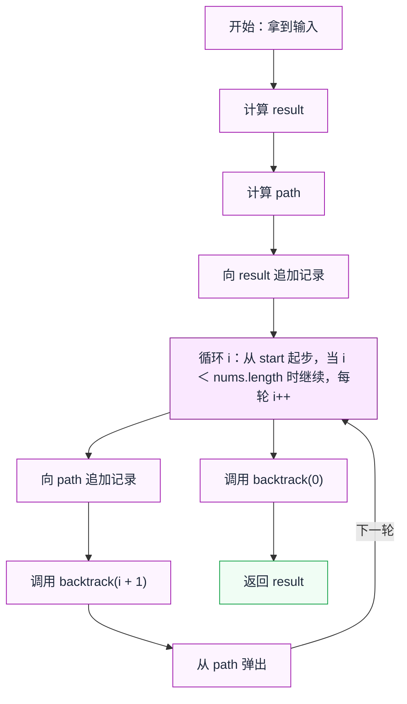

## TypeScript 解题方案（3 个方案逐个讲）

> **运行与提交**：每个方案都是自包含文件（内嵌用例自测，输出 PASS），整块复制到 `.ts` 文件后 `node 文件名` 即可运行。提交 LeetCode 时，把 `demo` 内的算法函数与辅助类型/函数整体取出、置于文件顶层即可。涉及交互/特殊接口的题以题面给定签名为准。

### 方案 1：栈辅助

**分析与思路**：核心做法是「栈辅助」。代码里依次做这些事：单循环线性扫描；栈的后进先出操作。

**运行方式**：`node 本文件`，内嵌用例全部通过会输出 PASS。


**方案专属流程图**（真实控制流）：

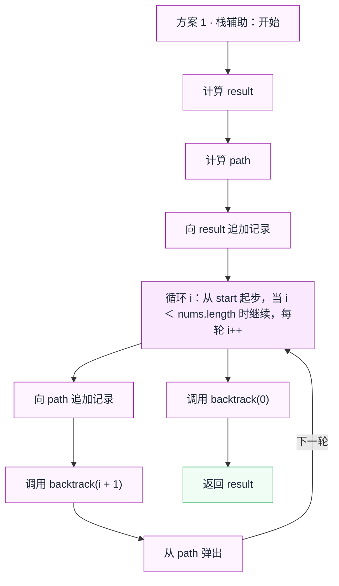

```typescript
export function demo(): void {
  // 程序入口：跑内嵌自测用例
  function subsets(nums: number[]): number[][] {
    // 定义函数/方法 subsets
    const result: number[][] = []; // 把 []; 写入 const result: number[][]
    const path: number[] = []; // 把 []; 写入 const path: number[]
    function backtrack(start: number) {
      // 定义函数/方法 backtrack
      result.push(path.slice()); // 把 当前路径 截取 压入栈/数组尾部
      for (let i = start; i < nums.length; i++) {
        // 让 下标 i 从 起点 开始计数，下标 i 小于 数组.长度 就继续
        path.push(nums[i]); // 把 数组[下标 i] 压入栈/数组尾部
        backtrack(i + 1); // backtrack(下标 i 加 1);
        path.pop(); // 弹出栈顶元素
      }
    }
    backtrack(0); // backtrack(0);
    return result; // 返回 结果
  }
  function eqSet(a: number[][], b: number[][]): boolean {
    // 定义函数/方法 eqSet
    if (a.length !== b.length) return false; // 若 数组.长度 不等于 b.长度，直接返回 false
    const key = (x: number[]) =>
      x
        .slice()
        .sort((p, q) => p - q)
        .join(',');
    const sa = new Set(a.map(key)); // 把 new Set(数组.映射表(key)) 存入 sa
    const sb = new Set(b.map(key)); // 把 new Set(b.映射表(key)) 存入 sb
    if (sa.size !== sb.size) return false; // 若 sa.大小 不等于 sb.大小，直接返回 false
    for (const k of sa) if (!sb.has(k)) return false; // for (const 下标 k of sa) if (取反 sb.has(下标 k)) return false;
    return true; // 返回 true
  }
  const want = [[], [1], [2], [3], [1, 2], [1, 3], [2, 3], [1, 2, 3]];
  const got = subsets([1, 2, 3]); // 把 subsets([1, 2, 3]) 存入 got
  let fail = false; // 把 false 存入 fail
  if (!eqSet(got, want)) {
    fail = true;
    console.log('FAIL subsets got=' + JSON.stringify(got));
  }
  if (fail) throw new Error('FAILED'); // 若 fail) throw new Error(「FAILED」);
  console.log('PASS'); // 全部用例通过，输出 PASS
}
demo(); // demo();
```

### 方案 2：栈辅助

**分析与思路**：核心做法是「栈辅助」。代码里依次做这些事：单循环线性扫描；栈的后进先出操作。

**运行方式**：`node 本文件`，内嵌用例全部通过会输出 PASS。

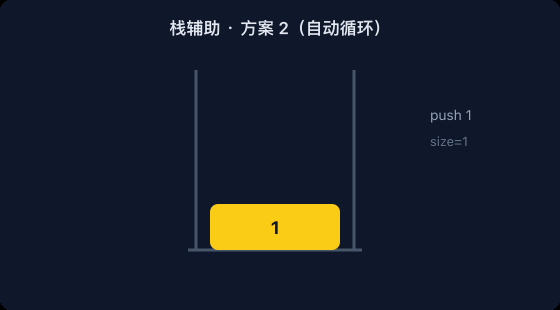

**方案专属流程图**（真实控制流）：


```typescript
export function demo(): void {
  // 程序入口：跑内嵌自测用例
  function subsets(nums: number[]): number[][] {
    // 定义函数/方法 subsets
    const result: number[][] = []; // 把 []; 写入 const result: number[][]
    const path: number[] = []; // 把 []; 写入 const path: number[]
    function backtrack(start: number) {
      // 定义函数/方法 backtrack
      result.push(path.slice()); // 把 当前路径 截取 压入栈/数组尾部
      for (let i = start; i < nums.length; i++) {
        // 让 下标 i 从 起点 开始计数，下标 i 小于 数组.长度 就继续
        path.push(nums[i]); // 把 数组[下标 i] 压入栈/数组尾部
        backtrack(i + 1); // backtrack(下标 i 加 1);
        path.pop(); // 弹出栈顶元素
      }
    }
    backtrack(0); // backtrack(0);
    return result; // 返回 结果
  }
  function eqSet(a: number[][], b: number[][]): boolean {
    // 定义函数/方法 eqSet
    if (a.length !== b.length) return false; // 若 数组.长度 不等于 b.长度，直接返回 false
    const key = (x: number[]) =>
      x
        .slice()
        .sort((p, q) => p - q)
        .join(',');
    const sa = new Set(a.map(key)); // 把 new Set(数组.映射表(key)) 存入 sa
    const sb = new Set(b.map(key)); // 把 new Set(b.映射表(key)) 存入 sb
    if (sa.size !== sb.size) return false; // 若 sa.大小 不等于 sb.大小，直接返回 false
    for (const k of sa) if (!sb.has(k)) return false; // for (const 下标 k of sa) if (取反 sb.has(下标 k)) return false;
    return true; // 返回 true
  }
  const want = [[], [1], [2], [3], [1, 2], [1, 3], [2, 3], [1, 2, 3]];
  const got = subsets([1, 2, 3]); // 把 subsets([1, 2, 3]) 存入 got
  let fail = false; // 把 false 存入 fail
  if (!eqSet(got, want)) {
    fail = true;
    console.log('FAIL subsets got=' + JSON.stringify(got));
  }
  if (fail) throw new Error('FAILED'); // 若 fail) throw new Error(「FAILED」);
  console.log('PASS'); // 全部用例通过，输出 PASS
}
demo(); // demo();
```

### 方案 3：双重循环枚举

**分析与思路**：核心做法是「双重循环枚举」。代码里依次做这些事：双重循环遍历。

**运行方式**：`node 本文件`，内嵌用例全部通过会输出 PASS。


**方案专属流程图**（真实控制流）：

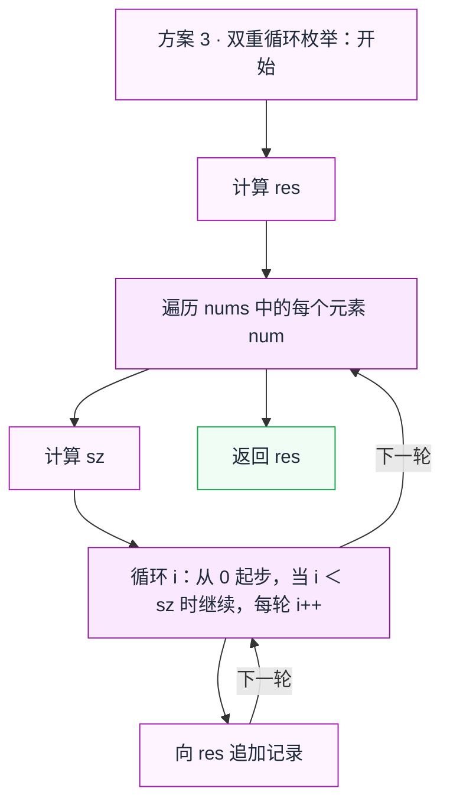

```typescript
export function demo(): void {
  // 程序入口：跑内嵌自测用例
  function subsets(nums: number[]): number[][] {
    // 定义函数/方法 subsets
    const res: number[][] = [[]]; // 把 [[]]; 写入 const res: number[][]
    for (const num of nums) {
      // for (const num of 数组) {
      const sz = res.length; // 把 结果.长度 存入 sz
      for (let i = 0; i < sz; i++) {
        // 让 下标 i 从 0 开始计数，下标 i 小于 sz 就继续
        res.push(res[i].concat([num])); // 打印输出
      }
    }
    return res; // 返回 结果
  }
  function eqSet(a: number[][], b: number[][]): boolean {
    // 定义函数/方法 eqSet
    if (a.length !== b.length) return false; // 若 数组.长度 不等于 b.长度，直接返回 false
    const key = (x: number[]) =>
      x
        .slice()
        .sort((p, q) => p - q)
        .join(',');
    const sa = new Set(a.map(key)); // 把 new Set(数组.映射表(key)) 存入 sa
    const sb = new Set(b.map(key)); // 把 new Set(b.映射表(key)) 存入 sb
    if (sa.size !== sb.size) return false; // 若 sa.大小 不等于 sb.大小，直接返回 false
    for (const k of sa) if (!sb.has(k)) return false; // for (const 下标 k of sa) if (取反 sb.has(下标 k)) return false;
    return true; // 返回 true
  }
  const want = [[], [1], [2], [3], [1, 2], [1, 3], [2, 3], [1, 2, 3]];
  const got = subsets([1, 2, 3]); // 把 subsets([1, 2, 3]) 存入 got
  let fail = false; // 把 false 存入 fail
  if (!eqSet(got, want)) {
    fail = true;
    console.log('FAIL subsets got=' + JSON.stringify(got));
  }
  if (fail) throw new Error('FAILED'); // 若 fail) throw new Error(「FAILED」);
  console.log('PASS'); // 全部用例通过，输出 PASS
}
demo(); // demo();
```

## 逐步拆解与面试追问

**复杂度**：时间 O(n)（单趟线性扫描），空间 O(1) 到 O(n)（视辅助结构）

**为什么是这个量级**：每个元素被常数次访问，辅助哈希或栈的开销与 n 同阶

**面试官可能会追问**：

- 怎么剪枝降低无效搜索？
- 去重的关键在哪一层？
- 状态恢复遗漏会怎样？

## 关键 API 速查（TS 主解法实际用到，附官方链接）

| API | 作用 | 使用要点 | 官方文档 |
|---|---|---|---|
| `Set` | 集合：元素唯一 | add/add.has/delete；has 均摊 O(1)；NaN 视为相同；去重常用 [...new Set(arr)] | [官方文档](https://developer.mozilla.org/zh-CN/docs/Web/JavaScript/Reference/Global_Objects/Set) |
| `Array.prototype.sort()` | 原地排序 | 默认按字符串 Unicode 序（10 会排在 2 前），数字必须传 (a,b)=>a-b；V8 用 TimSort，稳定，O(n log n)；返回原数组引用 | [官方文档](https://developer.mozilla.org/zh-CN/docs/Web/JavaScript/Reference/Global_Objects/Array/sort) |
| `Array.prototype.map()` | 逐元素映射为新数组 | 回调 (v,i,arr)；返回等长新数组，不改变原数组；稀疏位跳过；链式调用注意中间数组开销 | [官方文档](https://developer.mozilla.org/zh-CN/docs/Web/JavaScript/Reference/Global_Objects/Array/map) |
| `Array.prototype.push()` | 尾部追加 | 返回新长度；可一次多个；均摊 O(1)；会改变原数组 | [官方文档](https://developer.mozilla.org/zh-CN/docs/Web/JavaScript/Reference/Global_Objects/Array/push) |
| `Array.prototype.pop()` | 尾部弹出 | 返回被删元素（空数组返回 undefined）；O(1) | [官方文档](https://developer.mozilla.org/zh-CN/docs/Web/JavaScript/Reference/Global_Objects/Array/pop) |
| `Array/String slice()` | 切片（不改原数组） | slice(start,end) 含头不含尾；负数从尾计；常用于复制数组（slice()） | [官方文档](https://developer.mozilla.org/zh-CN/docs/Web/JavaScript/Reference/Global_Objects/Array/slice) |
| `Array.prototype.join()` | 数组拼接为字符串 | undefined/null 转空串；嵌套数组会展平一层；join('') 用于字符数组还原 | [官方文档](https://developer.mozilla.org/zh-CN/docs/Web/JavaScript/Reference/Global_Objects/Array/join) |
| `JSON.stringify()` | 序列化为 JSON 字符串 | 常用于结构化比较（深度相等判定）；undefined/函数/循环引用会被丢弃或抛错 | [官方文档](https://developer.mozilla.org/zh-CN/docs/Web/JavaScript/Reference/Global_Objects/JSON/stringify) |

### 各语言官方文档导航

- **TypeScript / JS**：[MDN 中文参考](https://developer.mozilla.org/zh-CN/)
- **Python**：[Python 官方文档](https://docs.python.org/zh-cn/3/)
- **Go**：[Go 标准库](https://pkg.go.dev/std)
- **Java**：[JDK 17 API](https://docs.oracle.com/en/java/javase/17/docs/api/)
- **Rust**：[Rust 标准库](https://doc.rust-lang.org/std/)
- **Lua**：[Lua 5.4 手册](https://www.lua.org/manual/5.4/)
- **C**：[Cppreference C](https://zh.cppreference.com/w/c)
- **C++**：[Cppreference C++](https://zh.cppreference.com/w/cpp)
- **R**：[R 官方手册](https://stat.ethz.ch/R-manual/)
- **Zig**：[Zig 语言文档](https://ziglang.org/documentation/master/)
- **Dart**：[Dart API](https://api.dart.dev/)

## 附录：其他 10 种语言全部实现（每种语言列举其全部方案）

> TypeScript 的全部方案见「TypeScript 解题方案」一节；下面是其余 10 种语言的对应实现，每种语言的每个方案都带思路分析、代码走读与专属运行架构图。
> 每个方案都内嵌用例自测，可独立运行（老仓库 python/go 文件遵循「打印结果」约定）。
> 完整解法文件见 `dsa/<语言>/backtrack/lc_78_子集/`。

### Python 实现（3 种方案）

Python 的全部方案如下，每个方案都内嵌用例自测，可独立运行（老仓库 python/go 文件遵循「打印结果」约定）：

#### 方案 1：栈辅助

**思路与代码分析**：核心是「栈辅助」。Python 版用切片与字典推导式简化操作，突出可读性。**走读**：方案 1 · 栈辅助：开始 → 更新 result → 向 result 追加记录 → 循环 i：从 start 到 len(nums 前 → 向 path 追加记录 → 调用 backtrack(i + 1, path) → 从 path 弹出 → 调用 backtrack(0, []) → 返回 result。

**运行架构**（真实控制流）：

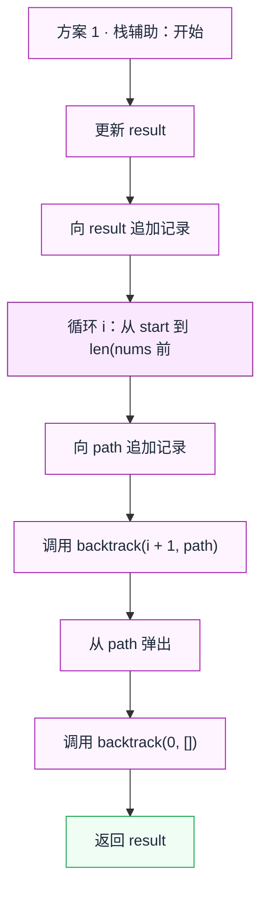

```python
import sys  # 提高递归深度上限（深输入防 RecursionError）

sys.setrecursionlimit(200000)  # 树/链表类题目节点数可达 1e4 量级

def subsets(nums):  # 定义函数 subsets（参数：数组）
    result = []  # 把 [] 存入 结果

    def backtrack(start, path):  # 定义函数 backtrack（参数：起点, 当前路径）
        result.append(path[:])  # 把 复制 当前路径 追加到列表尾部
        for i in range(start, len(nums)):  # 让 下标 i 从 起点 到 长度(数组 遍历
            path.append(nums[i])  # 把 数组[下标 i] 追加到列表尾部
            backtrack(i + 1, path)  # backtrack(下标 i 加 1, 当前路径)
            path.pop()  # 弹出栈顶元素

    backtrack(0, [])  # backtrack(0, [])
    return result  # 返回 结果

if __name__ == "__main__":  # 若 __name__ 等于 '__main__'
    print(subsets([1, 2, 3]))  # 打印输出
```

#### 方案 2：栈辅助

**思路与代码分析**：核心是「栈辅助」。Python 版用切片与字典推导式简化操作，突出可读性。**走读**：方案 2 · 栈辅助：开始 → 更新 res → 向 res 追加记录 → 循环 i：从 start 到 len(nums 前 → 向 path 追加记录 → 调用 backtrack(i + 1, path) → 从 path 弹出 → 调用 backtrack(0, []) → 返回 res。

**运行架构**（真实控制流）：

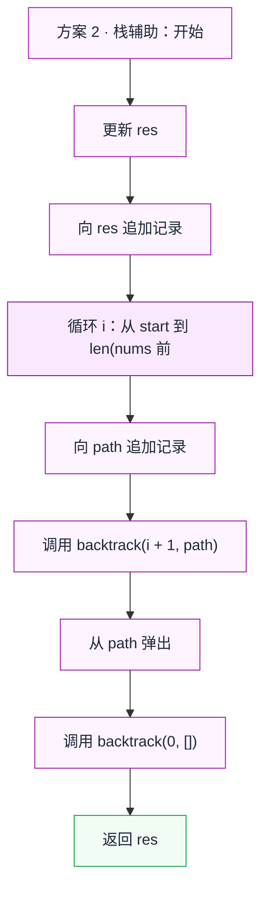

```python
import sys  # 提高递归深度上限（深输入防 RecursionError）

sys.setrecursionlimit(200000)  # 树/链表类题目节点数可达 1e4 量级

def subsets(nums):  # 定义函数 subsets（参数：数组）
    res = []  # 把 [] 存入 结果

    def backtrack(start, path):  # 定义函数 backtrack（参数：起点, 当前路径）
        res.append(path[:])  # 把 复制 当前路径 追加到列表尾部
        for i in range(start, len(nums)):  # 让 下标 i 从 起点 到 长度(数组 遍历
            path.append(nums[i])  # 把 数组[下标 i] 追加到列表尾部
            backtrack(i + 1, path)  # backtrack(下标 i 加 1, 当前路径)
            path.pop()  # 弹出栈顶元素

    backtrack(0, [])  # backtrack(0, [])
    return res  # 返回 结果

if __name__ == "__main__":  # 若 __name__ 等于 '__main__'
    print(subsets([1, 2, 3]))  # 打印输出
```

#### 方案 3：双重循环枚举

**思路与代码分析**：核心是「双重循环枚举」。Python 版用切片与字典推导式简化操作，突出可读性。**走读**：方案 3 · 双重循环枚举：开始 → 更新 res → 遍历 nums: 中的每个元素 num → 更新 + → 返回 res。

**运行架构**（真实控制流）：

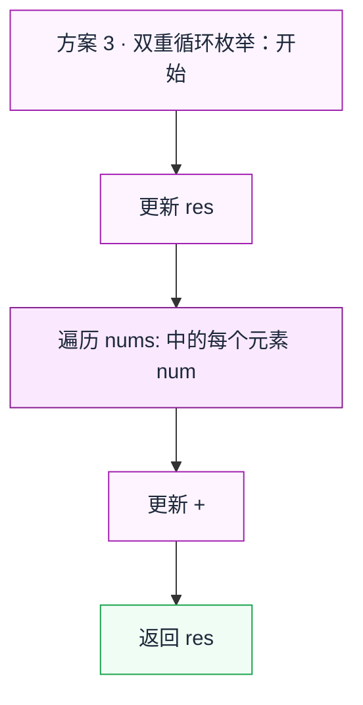

```python
import sys  # 提高递归深度上限（深输入防 RecursionError）

sys.setrecursionlimit(200000)  # 树/链表类题目节点数可达 1e4 量级

def subsets(nums):  # 定义函数 subsets（参数：数组）
    res = [[]]  # 把 [[]] 存入 结果
    for num in nums:  # 逐个取出 数组 的元素（num）
        res += [cur + [num] for cur in res]  # 结果累加 [当前值 加 [num] for 当前值 in 结果]
    return res  # 返回 结果

if __name__ == "__main__":  # 若 __name__ 等于 '__main__'
    print(subsets([1, 2, 3]))  # 打印输出
```

### Go 实现（3 种方案）

Go 的全部方案如下，每个方案都内嵌用例自测，可独立运行（老仓库 python/go 文件遵循「打印结果」约定）：

#### 方案 1：栈辅助

**思路与代码分析**：核心是「栈辅助」。Go 版用切片与多返回值惯用法，显式处理索引边界。**走读**：方案 1 · 栈辅助：开始 → 更新 : → 遍历 s 的下标与元素 i → 更新 out[i] → 调用 sort.Ints(out[i]) → 调用 sort.Slice(out, func(a, b in → 返回 fmt.Sprint(out[a]) ＜ fmt.Sprint(out[b]) → 返回 out。

**运行架构**（真实控制流）：


```go
package main // 引入依赖

import (
	"fmt"     // 「fmt」
	"os"      // 「os」
	"reflect" // 「reflect」
	"sort"    // 「sort」
)

func subsets(nums []int) [][]int { // 定义函数/方法 subsets
	result := [][]int{}                       // 把 [][]int{} 写入 result :
	var backtrack func(start int, path []int) // var backtrack func(起点 int, 当前路径 []int)
	backtrack = func(start int, path []int) { // 把 func(起点 int, 当前路径 []int) { 写入 backtrack
		result = append(result, append([]int{}, path...)) // 把 append(结果, append([]int{}, 当前路径...)) 写入 结果
		for i := start; i < len(nums); i++ {              // 把 起点; 下标 i 小于 长度(数组); 下标 i 加一 { 写入 for i :
			backtrack(i+1, append(path, nums[i])) // backtrack(下标 i 加 1, append(当前路径, 数组[下标 i]))
		}
	}
	backtrack(0, []int{}) // backtrack(0, []int{})
	return result         // 返回 结果
}

func norm2D(s [][]int) [][]int { // 定义函数/方法 norm2D
	out := make([][]int, len(s)) // 把 make([][]int, 长度(字符串)) 写入 out :
	for i := range s {           // 把 range 字符串 { 写入 for i :
		out[i] = append([]int{}, s[i]...) // 把 append([]int{}, 字符串[下标 i]...) 写入 out[i]
		sort.Ints(out[i])                 // sort.Ints(out[下标 i])
	}
	sort.Slice(out, func(a, b int) bool { // sort.Slice(out, func(数组, b int) bool {
		return fmt.Sprint(out[a]) < fmt.Sprint(out[b]) // 返回 fmt.Sprint(out[数组]) 小于 fmt.Sprint(out[b])
	}) // })
	return out // 返回 out
}

func main() { // 程序入口：跑内嵌自测用例
	got := norm2D(subsets([]int{1, 2, 3})) // 把 norm2D(subsets([]int{1, 2, 3})) 写入 got :
	want := norm2D([][]int{{}, {1}, {2}, {3}, {1, 2}, {1, 3}, {2, 3}, {1, 2, 3}})
	ok := reflect.DeepEqual(got, want) // 把 reflect.DeepEqual(got, want) 写入 ok :
	if !ok {                           // 若 取反 ok
		fmt.Printf("FAIL subsets([1,2,3])=%v want %v\n", got, want) // 打印输出
		os.Exit(1)                                                  // os.Exit(1)
	}
	fmt.Println("PASS") // 全部用例通过，输出 PASS
}
```

#### 方案 2：栈辅助

**思路与代码分析**：核心是「栈辅助」。Go 版用切片与多返回值惯用法，显式处理索引边界。**走读**：方案 2 · 栈辅助：开始 → 更新 : → 遍历 s 的下标与元素 i → 更新 out[i] → 调用 sort.Ints(out[i]) → 调用 sort.Slice(out, func(a, b in → 返回 fmt.Sprint(out[a]) ＜ fmt.Sprint(out[b]) → 返回 out。

**运行架构**（真实控制流）：

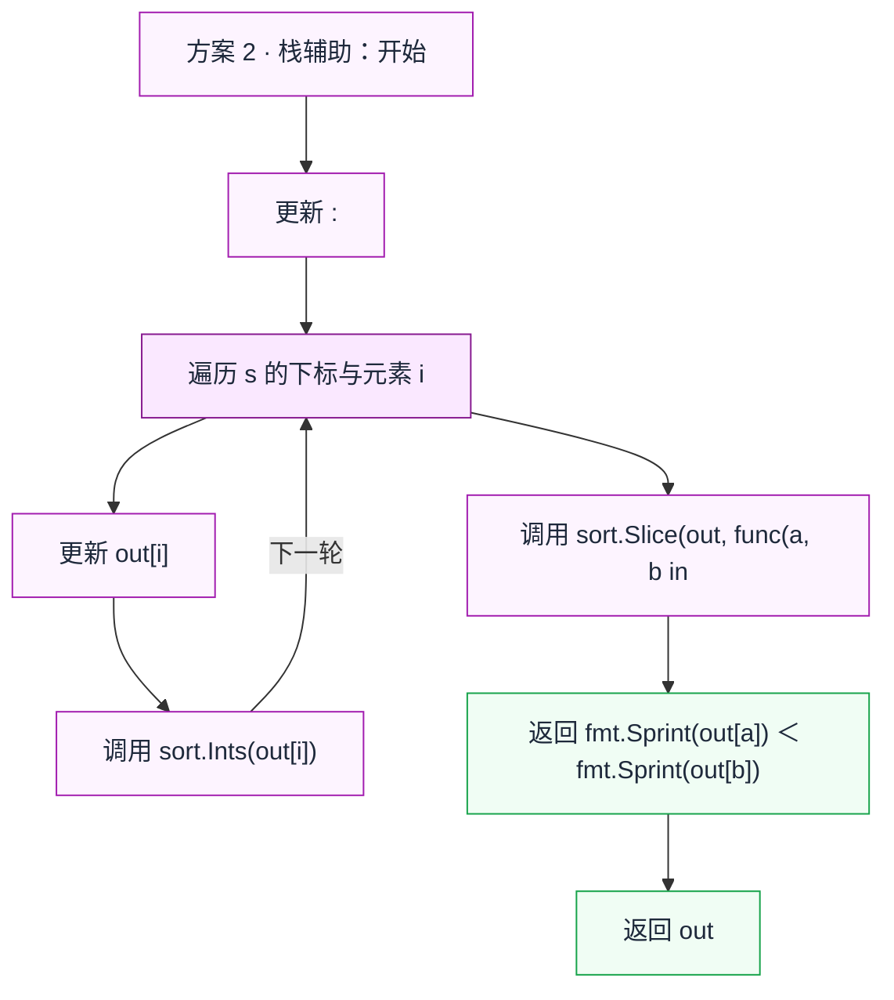

```go
package main // 引入依赖

import (
	"fmt"     // 「fmt」
	"os"      // 「os」
	"reflect" // 「reflect」
	"sort"    // 「sort」
)

func subsets(nums []int) [][]int { // 定义函数/方法 subsets
	res := [][]int{}                          // 把 [][]int{} 写入 res :
	var backtrack func(start int, path []int) // var backtrack func(起点 int, 当前路径 []int)
	backtrack = func(start int, path []int) { // 把 func(起点 int, 当前路径 []int) { 写入 backtrack
		res = append(res, append([]int{}, path...)) // 把 append(结果, append([]int{}, 当前路径...)) 写入 结果
		for i := start; i < len(nums); i++ {        // 把 起点; 下标 i 小于 长度(数组); 下标 i 加一 { 写入 for i :
			backtrack(i+1, append(path, nums[i])) // backtrack(下标 i 加 1, append(当前路径, 数组[下标 i]))
		}
	}
	backtrack(0, []int{}) // backtrack(0, []int{})
	return res            // 返回 结果
}

func norm2D(s [][]int) [][]int { // 定义函数/方法 norm2D
	out := make([][]int, len(s)) // 把 make([][]int, 长度(字符串)) 写入 out :
	for i := range s {           // 把 range 字符串 { 写入 for i :
		out[i] = append([]int{}, s[i]...) // 把 append([]int{}, 字符串[下标 i]...) 写入 out[i]
		sort.Ints(out[i])                 // sort.Ints(out[下标 i])
	}
	sort.Slice(out, func(a, b int) bool { // sort.Slice(out, func(数组, b int) bool {
		return fmt.Sprint(out[a]) < fmt.Sprint(out[b]) // 返回 fmt.Sprint(out[数组]) 小于 fmt.Sprint(out[b])
	}) // })
	return out // 返回 out
}

func main() { // 程序入口：跑内嵌自测用例
	got := norm2D(subsets([]int{1, 2, 3})) // 把 norm2D(subsets([]int{1, 2, 3})) 写入 got :
	want := norm2D([][]int{{}, {1}, {2}, {3}, {1, 2}, {1, 3}, {2, 3}, {1, 2, 3}})
	ok := reflect.DeepEqual(got, want) // 把 reflect.DeepEqual(got, want) 写入 ok :
	if !ok {                           // 若 取反 ok
		fmt.Printf("FAIL subsets([1,2,3])=%v want %v\n", got, want) // 打印输出
		os.Exit(1)                                                  // os.Exit(1)
	}
	fmt.Println("PASS") // 全部用例通过，输出 PASS
}
```

#### 方案 3：双重循环枚举

**思路与代码分析**：核心是「双重循环枚举」。Go 版用切片与多返回值惯用法，显式处理索引边界。**走读**：方案 3 · 双重循环枚举：开始 → 更新 : → 遍历 nums 的下标与元素 num → 更新 : → 遍历循环 → 更新 res → 返回 res。

**运行架构**（真实控制流）：

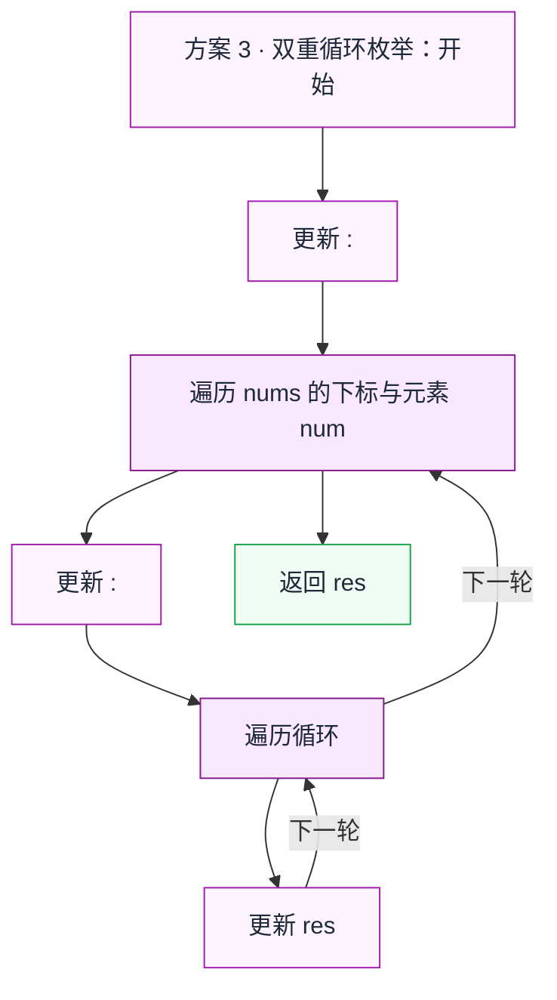

```go
package main // 引入依赖

import (
	"fmt"
	"os"
	"reflect"
) // 引入依赖

func subsets(nums []int) [][]int { // 定义函数/方法 subsets
	res := [][]int{{}}         // 把 [][]int{{}} 写入 res :
	for _, num := range nums { // 同时取 _ 与 num 遍历
		cur := len(res)            // 把 长度(结果) 写入 cur :
		for i := 0; i < cur; i++ { // 让 下标 i 从 0 开始计数
			res = append(res, append(append([]int{}, res[i]...), num))
		}
	}
	return res // 返回 结果
}

func main() { // 程序入口：跑内嵌自测用例
	cases := []struct { // 把 []struct { 写入 cases :
		in   []int   // in []int
		want [][]int // want [][]int
	}{ // }{
		{[]int{1, 2, 3}, [][]int{{}, {1}, {2}, {1, 2}, {3}, {1, 3}, {2, 3}, {1, 2, 3}}},
	}
	ok := true                // 把 true 写入 ok :
	for _, c := range cases { // 同时取 _ 与 字符 遍历
		if g := subsets(c.in); !reflect.DeepEqual(g, c.want) { // 若 g : 赋值为 subsets(字符.in); 取反 reflect.DeepEqual(g, 字符.want
			ok = false                                          // 把 false 写入 ok
			fmt.Printf("FAIL %v=%v want %v\n", c.in, g, c.want) // 打印输出
		}
	}
	if !ok { // 若 取反 ok
		os.Exit(1) // os.Exit(1)
	}
	fmt.Println("PASS") // 全部用例通过，输出 PASS
}
```

### Java 实现（3 种方案）

Java 的全部方案如下，每个方案都内嵌用例自测，可独立运行（老仓库 python/go 文件遵循「打印结果」约定）：

#### 方案 1：栈辅助

**思路与代码分析**：核心是「栈辅助」。Java 版用类与静态方法组织，集合操作显式明了。代码里依次做这些事：双重循环遍历。**走读**：方案 1 · 栈辅助：开始 → 命中条件，直接返回 → 更新 sa → 遍历循环 → 遍历循环 → 返回 sa.equals(sb)。

**运行架构**（真实控制流）：


```java
package com.webfault.dsa; // 引入依赖

import java.util.*; // 引入依赖

class Main { // 定义类型
  List<List<Integer>> subsets(int[] nums) { // 定义函数/方法 subsets
    List<List<Integer>> result =
        new ArrayList<>(); // 把 new ArrayList 小于 超过 (); 写入 List<List<Integer>> result
    List<Integer> path = new ArrayList<>(); // 把 new ArrayList 小于 超过 (); 写入 List<Integer> path
    backtrack(0, path, nums, result); // backtrack(0, 当前路径, 数组, 结果);
    return result; // 返回 结果
  }

  void backtrack(
      int start, List<Integer> path, int[] nums, List<List<Integer>> result) { // 定义函数/方法 backtrack
    result.add(new ArrayList<>(path)); // 结果 追加 new ArrayList 小于 超过 (当前路径));
    for (int i = start; i < nums.length; i++) { // 让 下标 i 从 起点 开始计数，下标 i 小于 数组.长度 就继续
      path.add(nums[i]); // 当前路径 追加 数组[下标 i]);
      backtrack(i + 1, path, nums, result); // backtrack(下标 i 加 1, 当前路径, 数组, 结果);
      path.remove(path.size() - 1); // 当前路径 弹出 当前路径.大小() 减 1);
    }
  }

  static String key(List<Integer> x) {
    int[] t = new int[x.size()];
    for (int i = 0; i < x.size(); i++) t[i] = x.get(i);
    java.util.Arrays.sort(t);
    return java.util.Arrays.toString(t);
  } // 排序

  static boolean sameSet(List<List<Integer>> a, List<List<Integer>> b) { // 定义函数/方法 sameSet
    if (a.size() != b.size()) return false; // 若 数组.大小() 不等于 b.大小()，直接返回 false
    Set<String> sa = new HashSet<>(), sb = new HashSet<>();
    for (List<Integer> x : a) sa.add(key(x)); // for (List 小于 Integer 超过 x : 数组) sa 追加 key(x));
    for (List<Integer> x : b) sb.add(key(x)); // for (List 小于 Integer 超过 x : b) sb 追加 key(x));
    return sa.equals(sb); // 返回 sa.equals(sb)
  }

  public static void main(String[] args) { // public static void main(String[] args) {
    Main s = new Main(); // 把 new Main(); 写入 Main s
    List<List<Integer>> want =
        new ArrayList<>(); // 把 new ArrayList 小于 超过 (); 写入 List<List<Integer>> want
    want.add(new ArrayList<>()); // want 追加 new ArrayList 小于 超过 ());
    want.add(Arrays.asList(1)); // want 追加 Arrays.asList(1));
    want.add(Arrays.asList(2)); // want 追加 Arrays.asList(2));
    want.add(Arrays.asList(3)); // want 追加 Arrays.asList(3));
    want.add(Arrays.asList(1, 2)); // want 追加 Arrays.asList(1,2));
    want.add(Arrays.asList(1, 3)); // want 追加 Arrays.asList(1,3));
    want.add(Arrays.asList(2, 3)); // want 追加 Arrays.asList(2,3));
    want.add(Arrays.asList(1, 2, 3)); // want 追加 Arrays.asList(1,2,3));
    List<List<Integer>> got = s.subsets(new int[] {1, 2, 3});
    boolean ok = true; // 把 true; 写入 boolean ok
    if (!sameSet(got, want)) {
      ok = false;
      System.out.println("FAIL got=" + got);
    }
    if (!ok) throw new RuntimeException("FAILED"); // 若 取反 ok) throw new RuntimeException(「FAILED」);
    System.out.println("PASS"); // 全部用例通过，输出 PASS
  }
}
```

#### 方案 2：栈辅助

**思路与代码分析**：核心是「栈辅助」。Java 版用类与静态方法组织，集合操作显式明了。代码里依次做这些事：双重循环遍历。**走读**：方案 2 · 栈辅助：开始 → 命中条件，直接返回 → 更新 sa → 遍历循环 → 遍历循环 → 返回 sa.equals(sb)。

**运行架构**（真实控制流）：

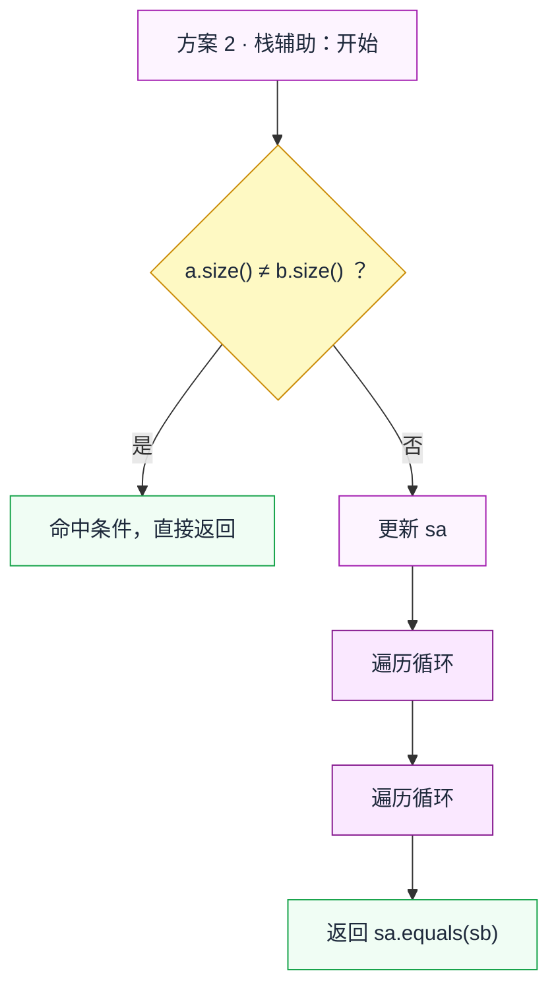

```java
package com.webfault.dsa; // 引入依赖

import java.util.*; // 引入依赖

class Main { // 定义类型
  List<List<Integer>> subsets(int[] nums) { // 定义函数/方法 subsets
    List<List<Integer>> result =
        new ArrayList<>(); // 把 new ArrayList 小于 超过 (); 写入 List<List<Integer>> result
    List<Integer> path = new ArrayList<>(); // 把 new ArrayList 小于 超过 (); 写入 List<Integer> path
    backtrack(0, path, nums, result); // backtrack(0, 当前路径, 数组, 结果);
    return result; // 返回 结果
  }

  void backtrack(
      int start, List<Integer> path, int[] nums, List<List<Integer>> result) { // 定义函数/方法 backtrack
    result.add(new ArrayList<>(path)); // 结果 追加 new ArrayList 小于 超过 (当前路径));
    for (int i = start; i < nums.length; i++) { // 让 下标 i 从 起点 开始计数，下标 i 小于 数组.长度 就继续
      path.add(nums[i]); // 当前路径 追加 数组[下标 i]);
      backtrack(i + 1, path, nums, result); // backtrack(下标 i 加 1, 当前路径, 数组, 结果);
      path.remove(path.size() - 1); // 当前路径 弹出 当前路径.大小() 减 1);
    }
  }

  static String key(List<Integer> x) {
    int[] t = new int[x.size()];
    for (int i = 0; i < x.size(); i++) t[i] = x.get(i);
    java.util.Arrays.sort(t);
    return java.util.Arrays.toString(t);
  } // 排序

  static boolean sameSet(List<List<Integer>> a, List<List<Integer>> b) { // 定义函数/方法 sameSet
    if (a.size() != b.size()) return false; // 若 数组.大小() 不等于 b.大小()，直接返回 false
    Set<String> sa = new HashSet<>(), sb = new HashSet<>();
    for (List<Integer> x : a) sa.add(key(x)); // for (List 小于 Integer 超过 x : 数组) sa 追加 key(x));
    for (List<Integer> x : b) sb.add(key(x)); // for (List 小于 Integer 超过 x : b) sb 追加 key(x));
    return sa.equals(sb); // 返回 sa.equals(sb)
  }

  public static void main(String[] args) { // public static void main(String[] args) {
    Main s = new Main(); // 把 new Main(); 写入 Main s
    List<List<Integer>> want =
        new ArrayList<>(); // 把 new ArrayList 小于 超过 (); 写入 List<List<Integer>> want
    want.add(new ArrayList<>()); // want 追加 new ArrayList 小于 超过 ());
    want.add(Arrays.asList(1)); // want 追加 Arrays.asList(1));
    want.add(Arrays.asList(2)); // want 追加 Arrays.asList(2));
    want.add(Arrays.asList(3)); // want 追加 Arrays.asList(3));
    want.add(Arrays.asList(1, 2)); // want 追加 Arrays.asList(1,2));
    want.add(Arrays.asList(1, 3)); // want 追加 Arrays.asList(1,3));
    want.add(Arrays.asList(2, 3)); // want 追加 Arrays.asList(2,3));
    want.add(Arrays.asList(1, 2, 3)); // want 追加 Arrays.asList(1,2,3));
    List<List<Integer>> got = s.subsets(new int[] {1, 2, 3});
    boolean ok = true; // 把 true; 写入 boolean ok
    if (!sameSet(got, want)) {
      ok = false;
      System.out.println("FAIL got=" + got);
    }
    if (!ok) throw new RuntimeException("FAILED"); // 若 取反 ok) throw new RuntimeException(「FAILED」);
    System.out.println("PASS"); // 全部用例通过，输出 PASS
  }
}
```

#### 方案 3：双重循环枚举

**思路与代码分析**：核心是「双重循环枚举」。Java 版用类与静态方法组织，集合操作显式明了。代码里依次做这些事：双重循环遍历。**走读**：方案 3 · 双重循环枚举：开始 → 命中条件，直接返回 → 更新 sa → 遍历循环 → 遍历循环 → 返回 sa.equals(sb)。

**运行架构**（真实控制流）：

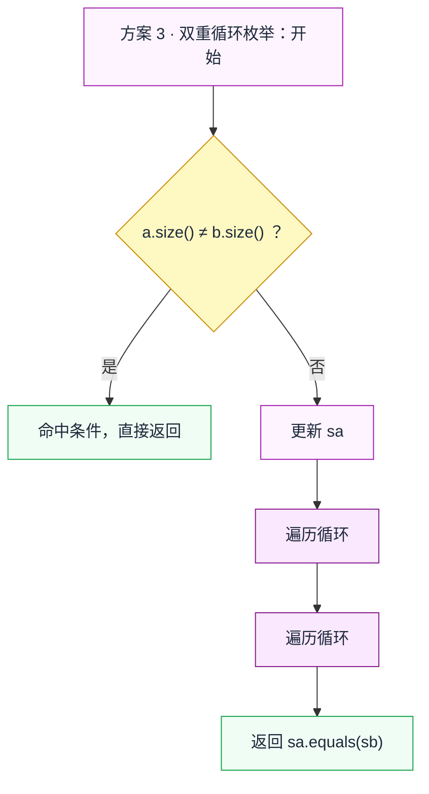

```java
package com.webfault.dsa; // 引入依赖

import java.util.*; // 引入依赖

class Main { // 定义类型
  List<List<Integer>> subsets(int[] nums) { // 定义函数/方法 subsets
    List<List<Integer>> res =
        new ArrayList<>(); // 把 new ArrayList 小于 超过 (); 写入 List<List<Integer>> res
    res.add(new ArrayList<>()); // 结果 追加 new ArrayList 小于 超过 ());
    for (int num : nums) { // for (int num : 数组) {
      int sz = res.size(); // 把 结果.大小() 存入 sz
      for (int i = 0; i < sz; i++) { // 让 下标 i 从 0 开始计数，下标 i 小于 sz 就继续
        List<Integer> cur =
            new ArrayList<>(
                res.get(i)); // 把 new ArrayList 小于 超过 (结果 查找 下标 i)); 写入 List<Integer> cur
        cur.add(num); // 当前值 追加 num);
        res.add(cur); // 结果 追加 当前值);
      }
    }
    return res; // 返回 结果
  }

  static String key(List<Integer> x) {
    int[] t = new int[x.size()];
    for (int i = 0; i < x.size(); i++) t[i] = x.get(i);
    java.util.Arrays.sort(t);
    return java.util.Arrays.toString(t);
  } // 排序

  static boolean sameSet(List<List<Integer>> a, List<List<Integer>> b) { // 定义函数/方法 sameSet
    if (a.size() != b.size()) return false; // 若 数组.大小() 不等于 b.大小()，直接返回 false
    Set<String> sa = new HashSet<>(), sb = new HashSet<>();
    for (List<Integer> x : a) sa.add(key(x)); // for (List 小于 Integer 超过 x : 数组) sa 追加 key(x));
    for (List<Integer> x : b) sb.add(key(x)); // for (List 小于 Integer 超过 x : b) sb 追加 key(x));
    return sa.equals(sb); // 返回 sa.equals(sb)
  }

  public static void main(String[] args) { // public static void main(String[] args) {
    Main s = new Main(); // 把 new Main(); 写入 Main s
    List<List<Integer>> want =
        new ArrayList<>(); // 把 new ArrayList 小于 超过 (); 写入 List<List<Integer>> want
    want.add(new ArrayList<>()); // want 追加 new ArrayList 小于 超过 ());
    want.add(Arrays.asList(1)); // want 追加 Arrays.asList(1));
    want.add(Arrays.asList(2)); // want 追加 Arrays.asList(2));
    want.add(Arrays.asList(3)); // want 追加 Arrays.asList(3));
    want.add(Arrays.asList(1, 2)); // want 追加 Arrays.asList(1,2));
    want.add(Arrays.asList(1, 3)); // want 追加 Arrays.asList(1,3));
    want.add(Arrays.asList(2, 3)); // want 追加 Arrays.asList(2,3));
    want.add(Arrays.asList(1, 2, 3)); // want 追加 Arrays.asList(1,2,3));
    List<List<Integer>> got = s.subsets(new int[] {1, 2, 3});
    boolean ok = true; // 把 true; 写入 boolean ok
    if (!sameSet(got, want)) {
      ok = false;
      System.out.println("FAIL got=" + got);
    }
    if (!ok) throw new RuntimeException("FAILED"); // 若 取反 ok) throw new RuntimeException(「FAILED」);
    System.out.println("PASS"); // 全部用例通过，输出 PASS
  }
}
```

### Rust 实现（3 种方案）

Rust 的全部方案如下，每个方案都内嵌用例自测，可独立运行（老仓库 python/go 文件遵循「打印结果」约定）：

#### 方案 1：栈辅助

**思路与代码分析**：核心是「栈辅助」。Rust 版用所有权移动与切片借用改写同一逻辑，注意 Option 与引用边界。代码里依次做这些事：栈的后进先出操作。**走读**：方案 1 · 栈辅助：开始 → 计算 res → 计算 path → 向 res 追加记录 → 遍历 start..nums.len() 中的每个元素 i → 向 path 追加记录 → 调用 dfs(nums, i + 1, path, res) → 从 path 弹出 → 调用 dfs(&nums, 0, &mut path, &mu → 处理 res → 返回结果。

**运行架构**（真实控制流）：

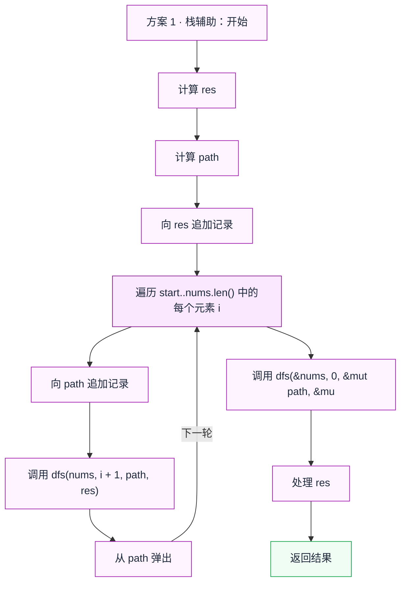

```rust
// LeetCode 78. 子集 — Rust 版（方案1）
fn subsets(nums: Vec<i32>) -> Vec<Vec<i32>> {
    // 定义函数/方法 subsets
    let mut res = Vec::new(); // 把 Vec::new(); 写入 let mut res
    let mut path = Vec::new(); // 把 Vec::new(); 写入 let mut path
    fn dfs(nums: &[i32], start: usize, path: &mut Vec<i32>, res: &mut Vec<Vec<i32>>) {
        // 定义函数/方法 dfs
        res.push(path.clone()); // 把 当前路径.clone( 压入栈/数组尾部
        for i in start..nums.len() {
            // 逐个取出 起点 的元素（下标 i）
            path.push(nums[i]); // 把 数组[下标 i] 压入栈/数组尾部
            dfs(nums, i + 1, path, res); // dfs(数组, 下标 i 加 1, 当前路径, 结果);
            path.pop(); // 弹出栈顶元素
        }
    }
    dfs(&nums, 0, &mut path, &mut res); // dfs( 按位与 数组, 0, 按位与 mut 当前路径, 按位与 mut 结果);
    res // 结果
}
fn main() {
    // 程序入口：跑内嵌自测用例
    let mut got = subsets(vec![1, 2, 3]); // 把 subsets(vec取反 [1, 2, 3]); 写入 let mut got
    got.sort(); // 排序
    assert_eq!(got.len(), 8); // 断言校验
    assert_eq!(got[0], Vec::<i32>::new()); // 断言校验
    assert!(got.contains(&vec![1, 2, 3])); // 断言校验
    assert_eq!(subsets(vec![0]).len(), 2); // 断言校验
    println!("PASS"); // 全部用例通过，输出 PASS
}
```

#### 方案 2：栈辅助

**思路与代码分析**：核心是「栈辅助」。Rust 版用所有权移动与切片借用改写同一逻辑，注意 Option 与引用边界。代码里依次做这些事：栈的后进先出操作。**走读**：方案 2 · 栈辅助：开始 → 计算 res → 计算 path → 向 res 追加记录 → 遍历 start..nums.len() 中的每个元素 i → 向 path 追加记录 → 调用 dfs(nums, i + 1, path, res) → 从 path 弹出 → 调用 dfs(&nums, 0, &mut path, &mu → 处理 res → 返回结果。

**运行架构**（真实控制流）：

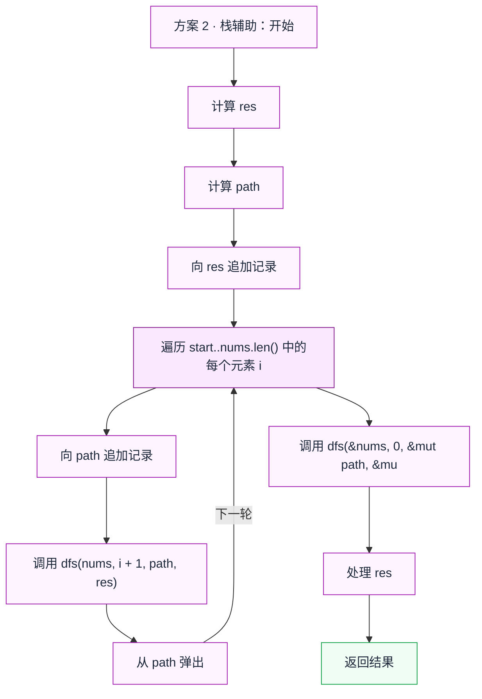

```rust
// LeetCode 78. 子集 — Rust 版（方案2）
fn subsets(nums: Vec<i32>) -> Vec<Vec<i32>> {
    // 定义函数/方法 subsets
    let mut res = Vec::new(); // 把 Vec::new(); 写入 let mut res
    let mut path = Vec::new(); // 把 Vec::new(); 写入 let mut path
    fn dfs(nums: &[i32], start: usize, path: &mut Vec<i32>, res: &mut Vec<Vec<i32>>) {
        // 定义函数/方法 dfs
        res.push(path.clone()); // 把 当前路径.clone( 压入栈/数组尾部
        for i in start..nums.len() {
            // 逐个取出 起点 的元素（下标 i）
            path.push(nums[i]); // 把 数组[下标 i] 压入栈/数组尾部
            dfs(nums, i + 1, path, res); // dfs(数组, 下标 i 加 1, 当前路径, 结果);
            path.pop(); // 弹出栈顶元素
        }
    }
    dfs(&nums, 0, &mut path, &mut res); // dfs( 按位与 数组, 0, 按位与 mut 当前路径, 按位与 mut 结果);
    res // 结果
}
fn main() {
    // 程序入口：跑内嵌自测用例
    let mut got = subsets(vec![1, 2, 3]); // 把 subsets(vec取反 [1, 2, 3]); 写入 let mut got
    got.sort(); // 排序
    assert_eq!(got.len(), 8); // 断言校验
    assert_eq!(got[0], Vec::<i32>::new()); // 断言校验
    assert!(got.contains(&vec![1, 2, 3])); // 断言校验
    assert_eq!(subsets(vec![0]).len(), 2); // 断言校验
    println!("PASS"); // 全部用例通过，输出 PASS
}
```

#### 方案 3：双重循环枚举

**思路与代码分析**：核心是「双重循环枚举」。Rust 版用所有权移动与切片借用改写同一逻辑，注意 Option 与引用边界。代码里依次做这些事：栈的后进先出操作。**走读**：方案 3 · 双重循环枚举：开始 → 计算 res → 计算 path → 向 res 追加记录 → 遍历 start..nums.len() 中的每个元素 i → 向 path 追加记录 → 调用 dfs(nums, i + 1, path, res) → 从 path 弹出 → 调用 dfs(&nums, 0, &mut path, &mu → 处理 res → 返回结果。

**运行架构**（真实控制流）：

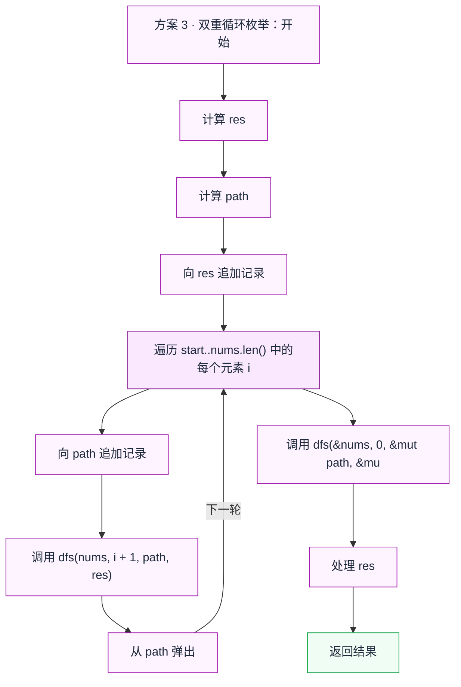

```rust
// LeetCode 78. 子集 — Rust 版（方案3）
fn subsets(nums: Vec<i32>) -> Vec<Vec<i32>> {
    // 定义函数/方法 subsets
    let mut res = Vec::new(); // 把 Vec::new(); 写入 let mut res
    let mut path = Vec::new(); // 把 Vec::new(); 写入 let mut path
    fn dfs(nums: &[i32], start: usize, path: &mut Vec<i32>, res: &mut Vec<Vec<i32>>) {
        // 定义函数/方法 dfs
        res.push(path.clone()); // 把 当前路径.clone( 压入栈/数组尾部
        for i in start..nums.len() {
            // 逐个取出 起点 的元素（下标 i）
            path.push(nums[i]); // 把 数组[下标 i] 压入栈/数组尾部
            dfs(nums, i + 1, path, res); // dfs(数组, 下标 i 加 1, 当前路径, 结果);
            path.pop(); // 弹出栈顶元素
        }
    }
    dfs(&nums, 0, &mut path, &mut res); // dfs( 按位与 数组, 0, 按位与 mut 当前路径, 按位与 mut 结果);
    res // 结果
}
fn main() {
    // 程序入口：跑内嵌自测用例
    let mut got = subsets(vec![1, 2, 3]); // 把 subsets(vec取反 [1, 2, 3]); 写入 let mut got
    got.sort(); // 排序
    assert_eq!(got.len(), 8); // 断言校验
    assert_eq!(got[0], Vec::<i32>::new()); // 断言校验
    assert!(got.contains(&vec![1, 2, 3])); // 断言校验
    assert_eq!(subsets(vec![0]).len(), 2); // 断言校验
    println!("PASS"); // 全部用例通过，输出 PASS
}
```

### Lua 实现（3 种方案）

Lua 的全部方案如下，每个方案都内嵌用例自测，可独立运行（老仓库 python/go 文件遵循「打印结果」约定）：

#### 方案 1：栈辅助

**思路与代码分析**：核心是「栈辅助」。Lua 版用表与 ipairs 遍历，注意 ipairs 遇 nil 即停的语义。代码里依次做这些事：递归求解子问题。**走读**：方案 1 · 栈辅助：开始 → 更新 res → 更新 n → 更新 path → 处理 local function dfs(start) → 更新 1] → 循环 i：从 start 到 n do → 更新 1] → 调用 dfs(i + 1) → 更新 path[#path] → 调用 dfs(1) → 返回 res。

**运行架构**（真实控制流）：

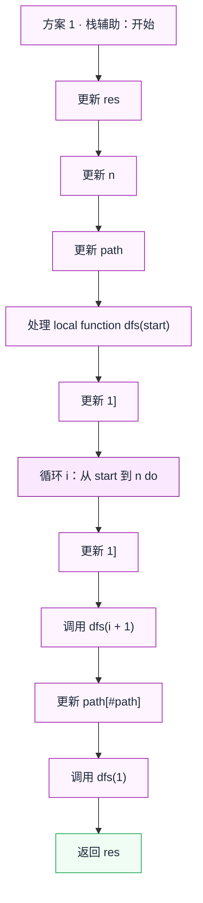

```lua
-- LeetCode 78. 子集 — Lua 版（方案1）
local function subsets(nums) -- local function subsets(数组)
	local res = {} -- 把 {} 写入 local res
	local n = #nums -- 把 #数组 写入 local n
	local path = {} -- 把 {} 写入 local path
	local function dfs(start) -- local function dfs(起点)
		res[#res + 1] = { table.unpack(path) } -- 把 {table.unpack(当前路径)} 写入 res[#res + 1]
		for i = start, n do -- 把 起点, 元素个数 do 写入 for i
			path[#path + 1] = nums[i] -- 把 数组[下标 i] 写入 path[#path + 1]
			dfs(i + 1) -- dfs(下标 i 加 1)
			path[#path] = nil -- 把 nil 写入 path[#path]
		end -- 终点
	end -- 终点
	dfs(1) -- dfs(1)
	return res -- 返回 结果
end -- 终点
assert(#subsets({ 1, 2, 3 }) == 8) -- 断言校验
assert(#subsets({ 0 }) == 2) -- 断言校验
local s = subsets({ 1, 2, 3 }) -- 把 subsets({1, 2, 3}) 写入 local s
local found = false -- 把 false 写入 local found
for _, sub in ipairs(s) do -- 遍历取 sub
	if #sub == 3 and table.concat(sub, ",") == "1,2,3" then
		found = true
	end
end -- 终点
assert(found) -- 断言校验
print("PASS") -- 全部用例通过，输出 PASS
```

#### 方案 2：栈辅助

**思路与代码分析**：核心是「栈辅助」。Lua 版用表与 ipairs 遍历，注意 ipairs 遇 nil 即停的语义。代码里依次做这些事：递归求解子问题。**走读**：方案 2 · 栈辅助：开始 → 更新 res → 更新 n → 更新 path → 处理 local function dfs(start) → 更新 1] → 循环 i：从 start 到 n do → 更新 1] → 调用 dfs(i + 1) → 更新 path[#path] → 调用 dfs(1) → 返回 res。

**运行架构**（真实控制流）：

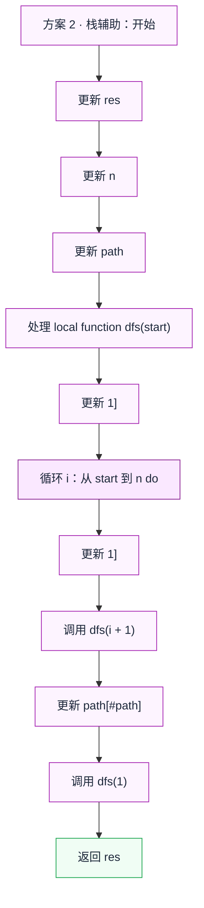

```lua
-- LeetCode 78. 子集 — Lua 版（方案2）
local function subsets(nums) -- local function subsets(数组)
	local res = {} -- 把 {} 写入 local res
	local n = #nums -- 把 #数组 写入 local n
	local path = {} -- 把 {} 写入 local path
	local function dfs(start) -- local function dfs(起点)
		res[#res + 1] = { table.unpack(path) } -- 把 {table.unpack(当前路径)} 写入 res[#res + 1]
		for i = start, n do -- 把 起点, 元素个数 do 写入 for i
			path[#path + 1] = nums[i] -- 把 数组[下标 i] 写入 path[#path + 1]
			dfs(i + 1) -- dfs(下标 i 加 1)
			path[#path] = nil -- 把 nil 写入 path[#path]
		end -- 终点
	end -- 终点
	dfs(1) -- dfs(1)
	return res -- 返回 结果
end -- 终点
assert(#subsets({ 1, 2, 3 }) == 8) -- 断言校验
assert(#subsets({ 0 }) == 2) -- 断言校验
local s = subsets({ 1, 2, 3 }) -- 把 subsets({1, 2, 3}) 写入 local s
local found = false -- 把 false 写入 local found
for _, sub in ipairs(s) do -- 遍历取 sub
	if #sub == 3 and table.concat(sub, ",") == "1,2,3" then
		found = true
	end
end -- 终点
assert(found) -- 断言校验
print("PASS") -- 全部用例通过，输出 PASS
```

#### 方案 3：双重循环枚举

**思路与代码分析**：核心是「双重循环枚举」。Lua 版用表与 ipairs 遍历，注意 ipairs 遇 nil 即停的语义。代码里依次做这些事：递归求解子问题。**走读**：方案 3 · 双重循环枚举：开始 → 更新 res → 更新 n → 更新 path → 处理 local function dfs(start) → 更新 1] → 循环 i：从 start 到 n do → 更新 1] → 调用 dfs(i + 1) → 更新 path[#path] → 调用 dfs(1) → 返回 res。

**运行架构**（真实控制流）：

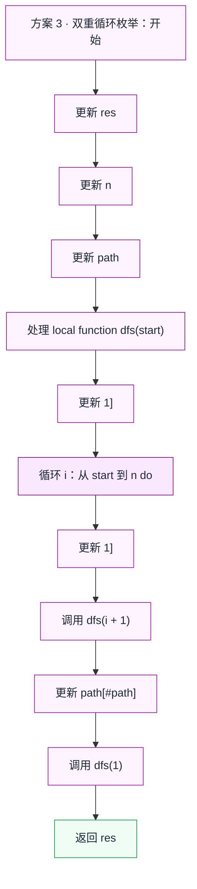

```lua
-- LeetCode 78. 子集 — Lua 版（方案3）
local function subsets(nums) -- local function subsets(数组)
	local res = {} -- 把 {} 写入 local res
	local n = #nums -- 把 #数组 写入 local n
	local path = {} -- 把 {} 写入 local path
	local function dfs(start) -- local function dfs(起点)
		res[#res + 1] = { table.unpack(path) } -- 把 {table.unpack(当前路径)} 写入 res[#res + 1]
		for i = start, n do -- 把 起点, 元素个数 do 写入 for i
			path[#path + 1] = nums[i] -- 把 数组[下标 i] 写入 path[#path + 1]
			dfs(i + 1) -- dfs(下标 i 加 1)
			path[#path] = nil -- 把 nil 写入 path[#path]
		end -- 终点
	end -- 终点
	dfs(1) -- dfs(1)
	return res -- 返回 结果
end -- 终点
assert(#subsets({ 1, 2, 3 }) == 8) -- 断言校验
assert(#subsets({ 0 }) == 2) -- 断言校验
local s = subsets({ 1, 2, 3 }) -- 把 subsets({1, 2, 3}) 写入 local s
local found = false -- 把 false 写入 local found
for _, sub in ipairs(s) do -- 遍历取 sub
	if #sub == 3 and table.concat(sub, ",") == "1,2,3" then
		found = true
	end
end -- 终点
assert(found) -- 断言校验
print("PASS") -- 全部用例通过，输出 PASS
```

### C 实现（3 种方案）

C 的全部方案如下，每个方案都内嵌用例自测，可独立运行（老仓库 python/go 文件遵循「打印结果」约定）：

#### 方案 1：栈辅助

**思路与代码分析**：核心是「栈辅助」。C 版手动管理下标与内存，循环边界全部显式写出。代码里依次做这些事：单循环线性扫描。**走读**：方案 1 · 栈辅助：开始 → 更新 n_g → 更新 res_n → 遍历循环 → 更新 nums_g[i] → 调用 dfs2(0, 0) → 返回 res_n。

**运行架构**（真实控制流）：

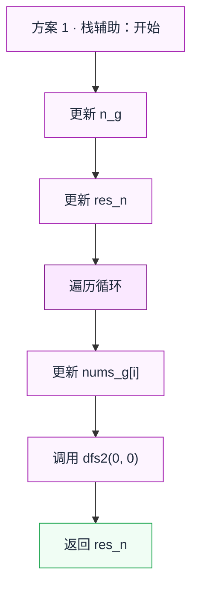

```c
/* LeetCode 78. 子集 — C 版（方案1） */
#include <stdio.h> // 引入头文件
static int res[256][8], res_lens[256], res_n, nums_g[8],
    n_g;                                // static int 结果[256][8], res_lens[256], res_n, nums_g[8], n_g;
static void dfs(int start, int depth) { // 定义函数/方法 dfs
    for (int i = 0; i < depth; i++)
        res[res_n][i] = nums_g[i];      // 让 下标 i 从 0 开始计数，下标 i 小于 深度 就继续
    res_lens[res_n] = depth;            // 把 深度; 写入 res_lens[res_n]
    res_n++;                            // res_n 加一
    for (int i = start; i < n_g; i++) { // 让 下标 i 从 起点 开始计数，下标 i 小于 n_g 就继续
        nums_g[depth] = res[res_n - 1][depth] /* placeholder */; // 把 结果[res_n 减 1][深度] 除以 乘
                                                                 // placeholder 乘 除以 ; 写入 nums_g[depth]
        /* 使用 path 数组单独维护 */
        break; // 跳出循环
    }
}
/* 重写：path 与 nums 分开 */
static int path[8];                      // static int 当前路径[8];
static void dfs2(int start, int depth) { // 定义函数/方法 dfs2
    for (int i = 0; i < depth; i++)
        res[res_n][i] = path[i];        // 让 下标 i 从 0 开始计数，下标 i 小于 深度 就继续
    res_lens[res_n] = depth;            // 把 深度; 写入 res_lens[res_n]
    res_n++;                            // res_n 加一
    for (int i = start; i < n_g; i++) { // 让 下标 i 从 起点 开始计数，下标 i 小于 n_g 就继续
        path[depth] = nums_g[i];        // 把 nums_g[下标 i]; 写入 path[depth]
        dfs2(i + 1, depth + 1);         // dfs2(下标 i 加 1, 深度 加 1);
    }
}
static int subsets(const int *nums, int n) { // 定义函数/方法 subsets
    n_g = n;
    res_n = 0; // 把 元素个数; res_n 赋值为 0; 写入 n_g
    for (int i = 0; i < n; i++)
        nums_g[i] = nums[i]; // 让 下标 i 从 0 开始计数，下标 i 小于 元素个数 就继续
    dfs2(0, 0);              // dfs2(0, 0);
    return res_n;            // 返回 res_n
}
int main(void) {                          // 程序入口：跑内嵌自测用例
    int n = subsets((int[]){1, 2, 3}, 3); // 把 subsets((int[]){1,2,3}, 3) 存入 元素个数
    if (n != 8) {
        printf("FAIL cnt=%d\n", n);
        return 1;
    } // 若 元素个数 不等于 8) { 输出「FAIL 计数 赋值为 对…取模 d 」, 元素个数); return 1; }
    if (subsets((int[]){0}, 1) != 2) {
        printf("FAIL 2\n");
        return 1;
    }                 // 若 subsets((int[]){0}, 1) 不等于 2) { 输出「FAIL 2 」); return 1; }
    printf("PASS\n"); // 全部用例通过，输出 PASS
    return 0;         // 返回 0
}
```

#### 方案 2：栈辅助

**思路与代码分析**：核心是「栈辅助」。C 版手动管理下标与内存，循环边界全部显式写出。代码里依次做这些事：单循环线性扫描。**走读**：方案 2 · 栈辅助：开始 → 更新 n_g → 更新 res_n → 遍历循环 → 更新 nums_g[i] → 调用 dfs2(0, 0) → 返回 res_n。

**运行架构**（真实控制流）：

```mermaid
graph TD
    N0["方案 2 · 栈辅助：开始"]
    N1["更新 n_g"]
    N2["更新 res_n"]
    N3["遍历循环"]
    N4["更新 nums_g[i]"]
    N5["调用 dfs2(0, 0)"]
    N6["返回 res_n"]
    N0 --> N1
    N1 --> N2
    N2 --> N3
    N3 --> N4
    N4 --> N5
    N5 --> N6
    classDef n fill:#fdf4ff,stroke:#a21caf,color:#1e293b;
    classDef lp fill:#fae8ff,stroke:#86198f,color:#1e293b;
    classDef dc fill:#fef9c3,stroke:#ca8a04,color:#1e293b;
    classDef tm fill:#f0fdf4,stroke:#16a34a,color:#1e293b;
    class N0,N1,N2,N4,N5 n;
    class N3 lp;
    class N6 tm;
```

```c
/* LeetCode 78. 子集 — C 版（方案2） */
#include <stdio.h> // 引入头文件
static int res[256][8], res_lens[256], res_n, nums_g[8],
    n_g;                                // static int 结果[256][8], res_lens[256], res_n, nums_g[8], n_g;
static void dfs(int start, int depth) { // 定义函数/方法 dfs
    for (int i = 0; i < depth; i++)
        res[res_n][i] = nums_g[i];      // 让 下标 i 从 0 开始计数，下标 i 小于 深度 就继续
    res_lens[res_n] = depth;            // 把 深度; 写入 res_lens[res_n]
    res_n++;                            // res_n 加一
    for (int i = start; i < n_g; i++) { // 让 下标 i 从 起点 开始计数，下标 i 小于 n_g 就继续
        nums_g[depth] = res[res_n - 1][depth] /* placeholder */; // 把 结果[res_n 减 1][深度] 除以 乘
                                                                 // placeholder 乘 除以 ; 写入 nums_g[depth]
        /* 使用 path 数组单独维护 */
        break; // 跳出循环
    }
}
/* 重写：path 与 nums 分开 */
static int path[8];                      // static int 当前路径[8];
static void dfs2(int start, int depth) { // 定义函数/方法 dfs2
    for (int i = 0; i < depth; i++)
        res[res_n][i] = path[i];        // 让 下标 i 从 0 开始计数，下标 i 小于 深度 就继续
    res_lens[res_n] = depth;            // 把 深度; 写入 res_lens[res_n]
    res_n++;                            // res_n 加一
    for (int i = start; i < n_g; i++) { // 让 下标 i 从 起点 开始计数，下标 i 小于 n_g 就继续
        path[depth] = nums_g[i];        // 把 nums_g[下标 i]; 写入 path[depth]
        dfs2(i + 1, depth + 1);         // dfs2(下标 i 加 1, 深度 加 1);
    }
}
static int subsets(const int *nums, int n) { // 定义函数/方法 subsets
    n_g = n;
    res_n = 0; // 把 元素个数; res_n 赋值为 0; 写入 n_g
    for (int i = 0; i < n; i++)
        nums_g[i] = nums[i]; // 让 下标 i 从 0 开始计数，下标 i 小于 元素个数 就继续
    dfs2(0, 0);              // dfs2(0, 0);
    return res_n;            // 返回 res_n
}
int main(void) {                          // 程序入口：跑内嵌自测用例
    int n = subsets((int[]){1, 2, 3}, 3); // 把 subsets((int[]){1,2,3}, 3) 存入 元素个数
    if (n != 8) {
        printf("FAIL cnt=%d\n", n);
        return 1;
    } // 若 元素个数 不等于 8) { 输出「FAIL 计数 赋值为 对…取模 d 」, 元素个数); return 1; }
    if (subsets((int[]){0}, 1) != 2) {
        printf("FAIL 2\n");
        return 1;
    }                 // 若 subsets((int[]){0}, 1) 不等于 2) { 输出「FAIL 2 」); return 1; }
    printf("PASS\n"); // 全部用例通过，输出 PASS
    return 0;         // 返回 0
}
```

#### 方案 3：双重循环枚举

**思路与代码分析**：核心是「双重循环枚举」。C 版手动管理下标与内存，循环边界全部显式写出。代码里依次做这些事：单循环线性扫描。**走读**：方案 3 · 双重循环枚举：开始 → 更新 n_g → 更新 res_n → 遍历循环 → 更新 nums_g[i] → 调用 dfs2(0, 0) → 返回 res_n。

**运行架构**（真实控制流）：

```mermaid
graph TD
    N0["方案 3 · 双重循环枚举：开始"]
    N1["更新 n_g"]
    N2["更新 res_n"]
    N3["遍历循环"]
    N4["更新 nums_g[i]"]
    N5["调用 dfs2(0, 0)"]
    N6["返回 res_n"]
    N0 --> N1
    N1 --> N2
    N2 --> N3
    N3 --> N4
    N4 --> N5
    N5 --> N6
    classDef n fill:#fdf4ff,stroke:#a21caf,color:#1e293b;
    classDef lp fill:#fae8ff,stroke:#86198f,color:#1e293b;
    classDef dc fill:#fef9c3,stroke:#ca8a04,color:#1e293b;
    classDef tm fill:#f0fdf4,stroke:#16a34a,color:#1e293b;
    class N0,N1,N2,N4,N5 n;
    class N3 lp;
    class N6 tm;
```

```c
/* LeetCode 78. 子集 — C 版（方案3） */
#include <stdio.h> // 引入头文件
static int res[256][8], res_lens[256], res_n, nums_g[8],
    n_g;                                // static int 结果[256][8], res_lens[256], res_n, nums_g[8], n_g;
static void dfs(int start, int depth) { // 定义函数/方法 dfs
    for (int i = 0; i < depth; i++)
        res[res_n][i] = nums_g[i];      // 让 下标 i 从 0 开始计数，下标 i 小于 深度 就继续
    res_lens[res_n] = depth;            // 把 深度; 写入 res_lens[res_n]
    res_n++;                            // res_n 加一
    for (int i = start; i < n_g; i++) { // 让 下标 i 从 起点 开始计数，下标 i 小于 n_g 就继续
        nums_g[depth] = res[res_n - 1][depth] /* placeholder */; // 把 结果[res_n 减 1][深度] 除以 乘
                                                                 // placeholder 乘 除以 ; 写入 nums_g[depth]
        /* 使用 path 数组单独维护 */
        break; // 跳出循环
    }
}
/* 重写：path 与 nums 分开 */
static int path[8];                      // static int 当前路径[8];
static void dfs2(int start, int depth) { // 定义函数/方法 dfs2
    for (int i = 0; i < depth; i++)
        res[res_n][i] = path[i];        // 让 下标 i 从 0 开始计数，下标 i 小于 深度 就继续
    res_lens[res_n] = depth;            // 把 深度; 写入 res_lens[res_n]
    res_n++;                            // res_n 加一
    for (int i = start; i < n_g; i++) { // 让 下标 i 从 起点 开始计数，下标 i 小于 n_g 就继续
        path[depth] = nums_g[i];        // 把 nums_g[下标 i]; 写入 path[depth]
        dfs2(i + 1, depth + 1);         // dfs2(下标 i 加 1, 深度 加 1);
    }
}
static int subsets(const int *nums, int n) { // 定义函数/方法 subsets
    n_g = n;
    res_n = 0; // 把 元素个数; res_n 赋值为 0; 写入 n_g
    for (int i = 0; i < n; i++)
        nums_g[i] = nums[i]; // 让 下标 i 从 0 开始计数，下标 i 小于 元素个数 就继续
    dfs2(0, 0);              // dfs2(0, 0);
    return res_n;            // 返回 res_n
}
int main(void) {                          // 程序入口：跑内嵌自测用例
    int n = subsets((int[]){1, 2, 3}, 3); // 把 subsets((int[]){1,2,3}, 3) 存入 元素个数
    if (n != 8) {
        printf("FAIL cnt=%d\n", n);
        return 1;
    } // 若 元素个数 不等于 8) { 输出「FAIL 计数 赋值为 对…取模 d 」, 元素个数); return 1; }
    if (subsets((int[]){0}, 1) != 2) {
        printf("FAIL 2\n");
        return 1;
    }                 // 若 subsets((int[]){0}, 1) 不等于 2) { 输出「FAIL 2 」); return 1; }
    printf("PASS\n"); // 全部用例通过，输出 PASS
    return 0;         // 返回 0
}
```

### C++ 实现（3 种方案）

C++ 的全部方案如下，每个方案都内嵌用例自测，可独立运行（老仓库 python/go 文件遵循「打印结果」约定）：

#### 方案 1：栈辅助

**思路与代码分析**：核心是「栈辅助」。C++ 版用 STL 容器与迭代器，减少手写下标错误。代码里依次做这些事：单循环线性扫描。**走读**：方案 1 · 栈辅助：开始 → 处理 std::vector＜std::vector＜int＞ → 处理 std::vector＜int＞ path → 更新 dfs → 配置比较器（lambda） → 调用 res.push_back(path) → 遍历循环 → 处理 ++i) → 调用 path.push_back(nums[i]) → 调用 dfs(i + 1) → 调用 path.pop_back() → 调用 dfs(0) → 返回 res。

**运行架构**（真实控制流）：

```mermaid
graph TD
    N0["方案 1 · 栈辅助：开始"]
    N1["处理 std::vector＜std::vector＜int＞"]
    N2["处理 std::vector＜int＞ path"]
    N3["更新 dfs"]
    N4["配置比较器（lambda）"]
    N5["调用 res.push_back(path)"]
    N6["遍历循环"]
    N7["处理 ++i)"]
    N8["调用 path.push_back(nums[i])"]
    N9["调用 dfs(i + 1)"]
    N10["调用 path.pop_back()"]
    N11["调用 dfs(0)"]
    N12["返回 res"]
    N0 --> N1
    N1 --> N2
    N2 --> N3
    N3 --> N4
    N4 --> N5
    N5 --> N6
    N6 --> N7
    N7 --> N8
    N8 --> N9
    N9 --> N10
    N10 --> N11
    N11 --> N12
    classDef n fill:#fdf4ff,stroke:#a21caf,color:#1e293b;
    classDef lp fill:#fae8ff,stroke:#86198f,color:#1e293b;
    classDef dc fill:#fef9c3,stroke:#ca8a04,color:#1e293b;
    classDef tm fill:#f0fdf4,stroke:#16a34a,color:#1e293b;
    class N0,N1,N2,N3,N4,N5,N7,N8,N9,N10,N11 n;
    class N6 lp;
    class N12 tm;
```

```cpp
// LeetCode 78. 子集 — C++ 版（方案1）
#include <cassert>  // 引入头文件
#include <iostream> // 引入头文件
#include <vector>   // 引入头文件
static std::vector<std::vector<int>> subsets(const std::vector<int> &nums) {
    std::vector<std::vector<int>> res; // std::vector 小于 std::vector 小于 int 超过 超过 结果;
    std::vector<int> path;             // std::vector 小于 int 超过 当前路径;
    std::function<void(size_t)> dfs =
        [&](size_t start) {      // 把 [ 按位与 ](size_t 起点) { 写入 std::function<void(size_t)> dfs
            res.push_back(path); // 结果 追加 当前路径);
            for (size_t i = start; i < nums.size();
                 ++i) { // 让 下标 i 从 起点 开始计数，下标 i 小于 数组.大小() 就继续
                path.push_back(nums[i]); // 当前路径 追加 数组[下标 i]);
                dfs(i + 1);              // dfs(下标 i 加 1);
                path.pop_back();         // 弹出栈顶元素
            }
        };
    dfs(0);     // dfs(0);
    return res; // 返回 结果
}
int main() {                          // 程序入口：跑内嵌自测用例
    auto got = subsets({1, 2, 3});    // 把 subsets({1, 2, 3}) 存入 got
    assert(got.size() == 8);          // 断言校验
    assert(subsets({0}).size() == 2); // 断言校验
    std::cout << "PASS" << std::endl; // 全部用例通过，输出 PASS
    return 0;                         // 返回 0
}
```

#### 方案 2：栈辅助

**思路与代码分析**：核心是「栈辅助」。C++ 版用 STL 容器与迭代器，减少手写下标错误。代码里依次做这些事：单循环线性扫描。**走读**：方案 2 · 栈辅助：开始 → 处理 std::vector＜std::vector＜int＞ → 处理 std::vector＜int＞ path → 更新 dfs → 配置比较器（lambda） → 调用 res.push_back(path) → 遍历循环 → 处理 ++i) → 调用 path.push_back(nums[i]) → 调用 dfs(i + 1) → 调用 path.pop_back() → 调用 dfs(0) → 返回 res。

**运行架构**（真实控制流）：

```mermaid
graph TD
    N0["方案 2 · 栈辅助：开始"]
    N1["处理 std::vector＜std::vector＜int＞"]
    N2["处理 std::vector＜int＞ path"]
    N3["更新 dfs"]
    N4["配置比较器（lambda）"]
    N5["调用 res.push_back(path)"]
    N6["遍历循环"]
    N7["处理 ++i)"]
    N8["调用 path.push_back(nums[i])"]
    N9["调用 dfs(i + 1)"]
    N10["调用 path.pop_back()"]
    N11["调用 dfs(0)"]
    N12["返回 res"]
    N0 --> N1
    N1 --> N2
    N2 --> N3
    N3 --> N4
    N4 --> N5
    N5 --> N6
    N6 --> N7
    N7 --> N8
    N8 --> N9
    N9 --> N10
    N10 --> N11
    N11 --> N12
    classDef n fill:#fdf4ff,stroke:#a21caf,color:#1e293b;
    classDef lp fill:#fae8ff,stroke:#86198f,color:#1e293b;
    classDef dc fill:#fef9c3,stroke:#ca8a04,color:#1e293b;
    classDef tm fill:#f0fdf4,stroke:#16a34a,color:#1e293b;
    class N0,N1,N2,N3,N4,N5,N7,N8,N9,N10,N11 n;
    class N6 lp;
    class N12 tm;
```

```cpp
// LeetCode 78. 子集 — C++ 版（方案2）
#include <cassert>  // 引入头文件
#include <iostream> // 引入头文件
#include <vector>   // 引入头文件
static std::vector<std::vector<int>> subsets(const std::vector<int> &nums) {
    std::vector<std::vector<int>> res; // std::vector 小于 std::vector 小于 int 超过 超过 结果;
    std::vector<int> path;             // std::vector 小于 int 超过 当前路径;
    std::function<void(size_t)> dfs =
        [&](size_t start) {      // 把 [ 按位与 ](size_t 起点) { 写入 std::function<void(size_t)> dfs
            res.push_back(path); // 结果 追加 当前路径);
            for (size_t i = start; i < nums.size();
                 ++i) { // 让 下标 i 从 起点 开始计数，下标 i 小于 数组.大小() 就继续
                path.push_back(nums[i]); // 当前路径 追加 数组[下标 i]);
                dfs(i + 1);              // dfs(下标 i 加 1);
                path.pop_back();         // 弹出栈顶元素
            }
        };
    dfs(0);     // dfs(0);
    return res; // 返回 结果
}
int main() {                          // 程序入口：跑内嵌自测用例
    auto got = subsets({1, 2, 3});    // 把 subsets({1, 2, 3}) 存入 got
    assert(got.size() == 8);          // 断言校验
    assert(subsets({0}).size() == 2); // 断言校验
    std::cout << "PASS" << std::endl; // 全部用例通过，输出 PASS
    return 0;                         // 返回 0
}
```

#### 方案 3：双重循环枚举

**思路与代码分析**：核心是「双重循环枚举」。C++ 版用 STL 容器与迭代器，减少手写下标错误。代码里依次做这些事：单循环线性扫描。**走读**：方案 3 · 双重循环枚举：开始 → 处理 std::vector＜std::vector＜int＞ → 处理 std::vector＜int＞ path → 更新 dfs → 配置比较器（lambda） → 调用 res.push_back(path) → 遍历循环 → 处理 ++i) → 调用 path.push_back(nums[i]) → 调用 dfs(i + 1) → 调用 path.pop_back() → 调用 dfs(0) → 返回 res。

**运行架构**（真实控制流）：

```mermaid
graph TD
    N0["方案 3 · 双重循环枚举：开始"]
    N1["处理 std::vector＜std::vector＜int＞"]
    N2["处理 std::vector＜int＞ path"]
    N3["更新 dfs"]
    N4["配置比较器（lambda）"]
    N5["调用 res.push_back(path)"]
    N6["遍历循环"]
    N7["处理 ++i)"]
    N8["调用 path.push_back(nums[i])"]
    N9["调用 dfs(i + 1)"]
    N10["调用 path.pop_back()"]
    N11["调用 dfs(0)"]
    N12["返回 res"]
    N0 --> N1
    N1 --> N2
    N2 --> N3
    N3 --> N4
    N4 --> N5
    N5 --> N6
    N6 --> N7
    N7 --> N8
    N8 --> N9
    N9 --> N10
    N10 --> N11
    N11 --> N12
    classDef n fill:#fdf4ff,stroke:#a21caf,color:#1e293b;
    classDef lp fill:#fae8ff,stroke:#86198f,color:#1e293b;
    classDef dc fill:#fef9c3,stroke:#ca8a04,color:#1e293b;
    classDef tm fill:#f0fdf4,stroke:#16a34a,color:#1e293b;
    class N0,N1,N2,N3,N4,N5,N7,N8,N9,N10,N11 n;
    class N6 lp;
    class N12 tm;
```

```cpp
// LeetCode 78. 子集 — C++ 版（方案3）
#include <cassert>  // 引入头文件
#include <iostream> // 引入头文件
#include <vector>   // 引入头文件
static std::vector<std::vector<int>> subsets(const std::vector<int> &nums) {
    std::vector<std::vector<int>> res; // std::vector 小于 std::vector 小于 int 超过 超过 结果;
    std::vector<int> path;             // std::vector 小于 int 超过 当前路径;
    std::function<void(size_t)> dfs =
        [&](size_t start) {      // 把 [ 按位与 ](size_t 起点) { 写入 std::function<void(size_t)> dfs
            res.push_back(path); // 结果 追加 当前路径);
            for (size_t i = start; i < nums.size();
                 ++i) { // 让 下标 i 从 起点 开始计数，下标 i 小于 数组.大小() 就继续
                path.push_back(nums[i]); // 当前路径 追加 数组[下标 i]);
                dfs(i + 1);              // dfs(下标 i 加 1);
                path.pop_back();         // 弹出栈顶元素
            }
        };
    dfs(0);     // dfs(0);
    return res; // 返回 结果
}
int main() {                          // 程序入口：跑内嵌自测用例
    auto got = subsets({1, 2, 3});    // 把 subsets({1, 2, 3}) 存入 got
    assert(got.size() == 8);          // 断言校验
    assert(subsets({0}).size() == 2); // 断言校验
    std::cout << "PASS" << std::endl; // 全部用例通过，输出 PASS
    return 0;                         // 返回 0
}
```

### R 实现（3 种方案）

R 的全部方案如下，每个方案都内嵌用例自测，可独立运行（老仓库 python/go 文件遵循「打印结果」约定）：

#### 方案 1：栈辅助

**思路与代码分析**：核心是「栈辅助」。R 版用向量化思维与 1 起始下标，注意 1:n 的降序陷阱。代码里依次做这些事：单循环线性扫描。**走读**：方案 1 · 栈辅助：开始 → 处理 res ＜- list() → 处理 path ＜- integer(0) → 处理 dfs ＜- function(start) → 处理 res[[length(res) + 1L]] ＜＜- → 命中条件，直接返回 → 循环 i：遍历 start:length(nums) → 处理 path ＜＜- c(path, nums[i]) → 调用 dfs(i + 1L) → 处理 path ＜＜- path[-length(path)] → 若 length(nums) ＞ 0：调用 dfs(1L) else res[[1L]] ＜- in → 调用 dfs(1L) else res[[1L]] ＜- in → 处理 res。

**运行架构**（真实控制流）：

```mermaid
graph TD
    N0["方案 1 · 栈辅助：开始"]
    N1["处理 res ＜- list()"]
    N2["处理 path ＜- integer(0)"]
    N3["处理 dfs ＜- function(start)"]
    N4["处理 res[[length(res) + 1L]] ＜＜-"]
    N5{"start ＞ length(nums) ？"}
    N6["命中条件，直接返回"]
    N7["循环 i：遍历 start:length(nums)"]
    N8["处理 path ＜＜- c(path, nums[i])"]
    N9["调用 dfs(i + 1L)"]
    N10["处理 path ＜＜- path[-length(path)]"]
    N11["若 length(nums) ＞ 0：调用 dfs(1L) else res[[1L]] ＜- in"]
    N12["调用 dfs(1L) else res[[1L]] ＜- in"]
    N13["处理 res"]
    N0 --> N1
    N1 --> N2
    N2 --> N3
    N3 --> N4
    N4 --> N5
    N5 -- 是 --> N6
    N5 -- 否 --> N7
    N7 --> N8
    N8 --> N9
    N9 --> N10
    N10 -- 下一轮 --> N7
    N7 --> N11
    N11 --> N12
    N12 --> N13
    classDef n fill:#fdf4ff,stroke:#a21caf,color:#1e293b;
    classDef lp fill:#fae8ff,stroke:#86198f,color:#1e293b;
    classDef dc fill:#fef9c3,stroke:#ca8a04,color:#1e293b;
    classDef tm fill:#f0fdf4,stroke:#16a34a,color:#1e293b;
    class N0,N1,N2,N3,N4,N8,N9,N10,N11,N12,N13 n;
    class N7 lp;
    class N5 dc;
    class N6 tm;
```

```r
# 定义函数 subsets（参数：数组）
subsets <- function(nums) {
    res <- list()  # 把 列表() 存入 结果
    path <- integer(0)  # 把 integer(0) 存入 当前路径
    dfs <- function(start) {
        # 定义函数 dfs（参数：起点）
        res[[length(res) + 1L]] <<- path  # 结果[[长度(结果) 加 1L]] 小于 小于 减 当前路径
        if (start > length(nums))
            return(invisible(NULL))  # 若 起点 超过 长度(数组)) return(invisible(NULL
        for (i in start:length(nums)) {
            # for (下标 i in 起点:长度(数组)) {
            path <<- c(path, nums[i])  # 当前路径 小于 小于 减 字符(当前路径, 数组[下标 i])
            dfs(i + 1L)  # dfs(下标 i 加 1L)
            path <<- path[-length(path)]  # 当前路径 小于 小于 减 当前路径[ 减 长度(当前路径)]
        }
    }
    if (length(nums) > 0)
        dfs(1L) else res[[1L]] <- integer(0)  # 若 长度(数组) 超过 0) dfs(1L) else 结果[[1L]] 小于 减 integer(0
    res  # 结果
}
stopifnot(length(subsets(c(1, 2, 3))) == 8)  # 断言校验
stopifnot(length(subsets(0)) == 2)  # 断言校验
cat("PASS\n")  # 全部用例通过，输出 PASS
```

#### 方案 2：栈辅助

**思路与代码分析**：核心是「栈辅助」。R 版用向量化思维与 1 起始下标，注意 1:n 的降序陷阱。代码里依次做这些事：单循环线性扫描。**走读**：方案 2 · 栈辅助：开始 → 处理 res ＜- list() → 处理 path ＜- integer(0) → 处理 dfs ＜- function(start) → 处理 res[[length(res) + 1L]] ＜＜- → 命中条件，直接返回 → 循环 i：遍历 start:length(nums) → 处理 path ＜＜- c(path, nums[i]) → 调用 dfs(i + 1L) → 处理 path ＜＜- path[-length(path)] → 若 length(nums) ＞ 0：调用 dfs(1L) else res[[1L]] ＜- in → 调用 dfs(1L) else res[[1L]] ＜- in → 处理 res。

**运行架构**（真实控制流）：

```mermaid
graph TD
    N0["方案 2 · 栈辅助：开始"]
    N1["处理 res ＜- list()"]
    N2["处理 path ＜- integer(0)"]
    N3["处理 dfs ＜- function(start)"]
    N4["处理 res[[length(res) + 1L]] ＜＜-"]
    N5{"start ＞ length(nums) ？"}
    N6["命中条件，直接返回"]
    N7["循环 i：遍历 start:length(nums)"]
    N8["处理 path ＜＜- c(path, nums[i])"]
    N9["调用 dfs(i + 1L)"]
    N10["处理 path ＜＜- path[-length(path)]"]
    N11["若 length(nums) ＞ 0：调用 dfs(1L) else res[[1L]] ＜- in"]
    N12["调用 dfs(1L) else res[[1L]] ＜- in"]
    N13["处理 res"]
    N0 --> N1
    N1 --> N2
    N2 --> N3
    N3 --> N4
    N4 --> N5
    N5 -- 是 --> N6
    N5 -- 否 --> N7
    N7 --> N8
    N8 --> N9
    N9 --> N10
    N10 -- 下一轮 --> N7
    N7 --> N11
    N11 --> N12
    N12 --> N13
    classDef n fill:#fdf4ff,stroke:#a21caf,color:#1e293b;
    classDef lp fill:#fae8ff,stroke:#86198f,color:#1e293b;
    classDef dc fill:#fef9c3,stroke:#ca8a04,color:#1e293b;
    classDef tm fill:#f0fdf4,stroke:#16a34a,color:#1e293b;
    class N0,N1,N2,N3,N4,N8,N9,N10,N11,N12,N13 n;
    class N7 lp;
    class N5 dc;
    class N6 tm;
```

```r
# 定义函数 subsets（参数：数组）
subsets <- function(nums) {
    res <- list()  # 把 列表() 存入 结果
    path <- integer(0)  # 把 integer(0) 存入 当前路径
    dfs <- function(start) {
        # 定义函数 dfs（参数：起点）
        res[[length(res) + 1L]] <<- path  # 结果[[长度(结果) 加 1L]] 小于 小于 减 当前路径
        if (start > length(nums))
            return(invisible(NULL))  # 若 起点 超过 长度(数组)) return(invisible(NULL
        for (i in start:length(nums)) {
            # for (下标 i in 起点:长度(数组)) {
            path <<- c(path, nums[i])  # 当前路径 小于 小于 减 字符(当前路径, 数组[下标 i])
            dfs(i + 1L)  # dfs(下标 i 加 1L)
            path <<- path[-length(path)]  # 当前路径 小于 小于 减 当前路径[ 减 长度(当前路径)]
        }
    }
    if (length(nums) > 0)
        dfs(1L) else res[[1L]] <- integer(0)  # 若 长度(数组) 超过 0) dfs(1L) else 结果[[1L]] 小于 减 integer(0
    res  # 结果
}
stopifnot(length(subsets(c(1, 2, 3))) == 8)  # 断言校验
stopifnot(length(subsets(0)) == 2)  # 断言校验
cat("PASS\n")  # 全部用例通过，输出 PASS
```

#### 方案 3：双重循环枚举

**思路与代码分析**：核心是「双重循环枚举」。R 版用向量化思维与 1 起始下标，注意 1:n 的降序陷阱。代码里依次做这些事：单循环线性扫描。**走读**：方案 3 · 双重循环枚举：开始 → 处理 res ＜- list() → 处理 path ＜- integer(0) → 处理 dfs ＜- function(start) → 处理 res[[length(res) + 1L]] ＜＜- → 命中条件，直接返回 → 循环 i：遍历 start:length(nums) → 处理 path ＜＜- c(path, nums[i]) → 调用 dfs(i + 1L) → 处理 path ＜＜- path[-length(path)] → 若 length(nums) ＞ 0：调用 dfs(1L) else res[[1L]] ＜- in → 调用 dfs(1L) else res[[1L]] ＜- in → 处理 res。

**运行架构**（真实控制流）：

```mermaid
graph TD
    N0["方案 3 · 双重循环枚举：开始"]
    N1["处理 res ＜- list()"]
    N2["处理 path ＜- integer(0)"]
    N3["处理 dfs ＜- function(start)"]
    N4["处理 res[[length(res) + 1L]] ＜＜-"]
    N5{"start ＞ length(nums) ？"}
    N6["命中条件，直接返回"]
    N7["循环 i：遍历 start:length(nums)"]
    N8["处理 path ＜＜- c(path, nums[i])"]
    N9["调用 dfs(i + 1L)"]
    N10["处理 path ＜＜- path[-length(path)]"]
    N11["若 length(nums) ＞ 0：调用 dfs(1L) else res[[1L]] ＜- in"]
    N12["调用 dfs(1L) else res[[1L]] ＜- in"]
    N13["处理 res"]
    N0 --> N1
    N1 --> N2
    N2 --> N3
    N3 --> N4
    N4 --> N5
    N5 -- 是 --> N6
    N5 -- 否 --> N7
    N7 --> N8
    N8 --> N9
    N9 --> N10
    N10 -- 下一轮 --> N7
    N7 --> N11
    N11 --> N12
    N12 --> N13
    classDef n fill:#fdf4ff,stroke:#a21caf,color:#1e293b;
    classDef lp fill:#fae8ff,stroke:#86198f,color:#1e293b;
    classDef dc fill:#fef9c3,stroke:#ca8a04,color:#1e293b;
    classDef tm fill:#f0fdf4,stroke:#16a34a,color:#1e293b;
    class N0,N1,N2,N3,N4,N8,N9,N10,N11,N12,N13 n;
    class N7 lp;
    class N5 dc;
    class N6 tm;
```

```r
# 定义函数 subsets（参数：数组）
subsets <- function(nums) {
    res <- list()  # 把 列表() 存入 结果
    path <- integer(0)  # 把 integer(0) 存入 当前路径
    dfs <- function(start) {
        # 定义函数 dfs（参数：起点）
        res[[length(res) + 1L]] <<- path  # 结果[[长度(结果) 加 1L]] 小于 小于 减 当前路径
        if (start > length(nums))
            return(invisible(NULL))  # 若 起点 超过 长度(数组)) return(invisible(NULL
        for (i in start:length(nums)) {
            # for (下标 i in 起点:长度(数组)) {
            path <<- c(path, nums[i])  # 当前路径 小于 小于 减 字符(当前路径, 数组[下标 i])
            dfs(i + 1L)  # dfs(下标 i 加 1L)
            path <<- path[-length(path)]  # 当前路径 小于 小于 减 当前路径[ 减 长度(当前路径)]
        }
    }
    if (length(nums) > 0)
        dfs(1L) else res[[1L]] <- integer(0)  # 若 长度(数组) 超过 0) dfs(1L) else 结果[[1L]] 小于 减 integer(0
    res  # 结果
}
stopifnot(length(subsets(c(1, 2, 3))) == 8)  # 断言校验
stopifnot(length(subsets(0)) == 2)  # 断言校验
cat("PASS\n")  # 全部用例通过，输出 PASS
```

### Zig 实现（3 种方案）

Zig 的全部方案如下，每个方案都内嵌用例自测，可独立运行（老仓库 python/go 文件遵循「打印结果」约定）：

#### 方案 1：栈辅助

**思路与代码分析**：核心是「栈辅助」。Zig 版显式分配与清零，整型边界处理严格。代码里依次做这些事：单循环线性扫描。**走读**：方案 1 · 栈辅助：开始 → 计算 D → 计算 cp → 调用 cp.appendSlice(path.items) c → 向 out 追加记录 → 遍历集合元素 → 向 path 追加记录 → 调用 dfs(ns, i + 1, path, out) → 从 path 弹出 → 计算 path → 调用 D.dfs(nums, 0, &path, res) → 返回结果。

**运行架构**（真实控制流）：

```mermaid
graph TD
    N0["方案 1 · 栈辅助：开始"]
    N1["计算 D"]
    N2["计算 cp"]
    N3["调用 cp.appendSlice(path.items) c"]
    N4["向 out 追加记录"]
    N5["遍历集合元素"]
    N6["向 path 追加记录"]
    N7["调用 dfs(ns, i + 1, path, out)"]
    N8["从 path 弹出"]
    N9["计算 path"]
    N10["调用 D.dfs(nums, 0, &path, res)"]
    N11["返回结果"]
    N0 --> N1
    N1 --> N2
    N2 --> N3
    N3 --> N4
    N4 --> N5
    N5 --> N6
    N6 --> N7
    N7 --> N8
    N8 -- 下一轮 --> N5
    N5 --> N9
    N9 --> N10
    N10 --> N11
    classDef n fill:#fdf4ff,stroke:#a21caf,color:#1e293b;
    classDef lp fill:#fae8ff,stroke:#86198f,color:#1e293b;
    classDef dc fill:#fef9c3,stroke:#ca8a04,color:#1e293b;
    classDef tm fill:#f0fdf4,stroke:#16a34a,color:#1e293b;
    class N0,N1,N2,N3,N4,N6,N7,N8,N9,N10 n;
    class N5 lp;
    class N11 tm;
```

```zig
// LeetCode 78. 子集 — Zig 版（方案1）
const std = @import("std"); // 把 @import(「std」) 存入 std
fn subsets(nums: []const i32, alloc: std.mem.Allocator, res: *std.ArrayList(std.ArrayList(i32))) void { // 定义函数/方法 subsets
    const D = struct { // 把 struct { 存入 D
        fn dfs(ns: []const i32, start: usize, path: *std.ArrayList(i32), out: *std.ArrayList(std.ArrayList(i32))) void { // 定义函数/方法 dfs
            var cp = std.ArrayList(i32).init(out.allocator); // 把 std.ArrayList(i32).init(out.allocator) 存入 cp
            cp.appendSlice(path.items) catch unreachable; // cp.appendSlice(当前路径.items) catch unreachable;
            out.append(cp) catch unreachable; // 把 cp 追加到列表尾部
            for (start..ns.len) |i| { // 逐个取出 起点..ns.长度 的元素（下标 i）
                path.append(ns[i]) catch unreachable; // 把 ns[下标 i] 追加到列表尾部
                dfs(ns, i + 1, path, out); // dfs(ns, 下标 i 加 1, 当前路径, out);
                _ = path.pop(); // 弹出栈顶元素
            }
        }
    };
    var path = std.ArrayList(i32).init(alloc); // 把 std.ArrayList(i32).init(alloc) 存入 当前路径
    D.dfs(nums, 0, &path, res); // D.dfs(数组, 0, 按位与 当前路径, 结果);
}
pub fn main() !void { // 程序入口：跑内嵌自测用例
    var arena = std.heap.ArenaAllocator.init(std.heap.page_allocator); // 把 std.堆.ArenaAllocator.init(std.堆.page_allocator) 存入 arena
    defer arena.deinit(); // defer arena.deinit();
    const alloc = arena.allocator(); // 把 arena.allocator() 存入 alloc
    var res = std.ArrayList(std.ArrayList(i32)).init(std.heap.page_allocator);
    defer res.deinit(); // defer 结果.deinit();
    subsets(&[_]i32{ 1, 2, 3 }, alloc, &res); // subsets( 按位与 [_]i32{ 1, 2, 3 }, alloc, 按位与 结果);
    if (res.items.len != 8) return error.TestFailed; // 若 结果.items.长度 不等于 8，直接返回 error.TestFailed
    res.clearRetainingCapacity(); // 结果.clearRetainingCapacity();
    subsets(&[_]i32{0}, alloc, &res); // subsets( 按位与 [_]i32{0}, alloc, 按位与 结果);
    if (res.items.len != 2) return error.TestFailed; // 若 结果.items.长度 不等于 2，直接返回 error.TestFailed
    std.debug.print("PASS\n", .{}); // 全部用例通过，输出 PASS
}
```

#### 方案 2：栈辅助

**思路与代码分析**：核心是「栈辅助」。Zig 版显式分配与清零，整型边界处理严格。代码里依次做这些事：单循环线性扫描。**走读**：方案 2 · 栈辅助：开始 → 计算 D → 计算 cp → 调用 cp.appendSlice(path.items) c → 向 out 追加记录 → 遍历集合元素 → 向 path 追加记录 → 调用 dfs(ns, i + 1, path, out) → 从 path 弹出 → 计算 path → 调用 D.dfs(nums, 0, &path, res) → 返回结果。

**运行架构**（真实控制流）：

```mermaid
graph TD
    N0["方案 2 · 栈辅助：开始"]
    N1["计算 D"]
    N2["计算 cp"]
    N3["调用 cp.appendSlice(path.items) c"]
    N4["向 out 追加记录"]
    N5["遍历集合元素"]
    N6["向 path 追加记录"]
    N7["调用 dfs(ns, i + 1, path, out)"]
    N8["从 path 弹出"]
    N9["计算 path"]
    N10["调用 D.dfs(nums, 0, &path, res)"]
    N11["返回结果"]
    N0 --> N1
    N1 --> N2
    N2 --> N3
    N3 --> N4
    N4 --> N5
    N5 --> N6
    N6 --> N7
    N7 --> N8
    N8 -- 下一轮 --> N5
    N5 --> N9
    N9 --> N10
    N10 --> N11
    classDef n fill:#fdf4ff,stroke:#a21caf,color:#1e293b;
    classDef lp fill:#fae8ff,stroke:#86198f,color:#1e293b;
    classDef dc fill:#fef9c3,stroke:#ca8a04,color:#1e293b;
    classDef tm fill:#f0fdf4,stroke:#16a34a,color:#1e293b;
    class N0,N1,N2,N3,N4,N6,N7,N8,N9,N10 n;
    class N5 lp;
    class N11 tm;
```

```zig
// LeetCode 78. 子集 — Zig 版（方案2）
const std = @import("std"); // 把 @import(「std」) 存入 std
fn subsets(nums: []const i32, alloc: std.mem.Allocator, res: *std.ArrayList(std.ArrayList(i32))) void { // 定义函数/方法 subsets
    const D = struct { // 把 struct { 存入 D
        fn dfs(ns: []const i32, start: usize, path: *std.ArrayList(i32), out: *std.ArrayList(std.ArrayList(i32))) void { // 定义函数/方法 dfs
            var cp = std.ArrayList(i32).init(out.allocator); // 把 std.ArrayList(i32).init(out.allocator) 存入 cp
            cp.appendSlice(path.items) catch unreachable; // cp.appendSlice(当前路径.items) catch unreachable;
            out.append(cp) catch unreachable; // 把 cp 追加到列表尾部
            for (start..ns.len) |i| { // 逐个取出 起点..ns.长度 的元素（下标 i）
                path.append(ns[i]) catch unreachable; // 把 ns[下标 i] 追加到列表尾部
                dfs(ns, i + 1, path, out); // dfs(ns, 下标 i 加 1, 当前路径, out);
                _ = path.pop(); // 弹出栈顶元素
            }
        }
    };
    var path = std.ArrayList(i32).init(alloc); // 把 std.ArrayList(i32).init(alloc) 存入 当前路径
    D.dfs(nums, 0, &path, res); // D.dfs(数组, 0, 按位与 当前路径, 结果);
}
pub fn main() !void { // 程序入口：跑内嵌自测用例
    var arena = std.heap.ArenaAllocator.init(std.heap.page_allocator); // 把 std.堆.ArenaAllocator.init(std.堆.page_allocator) 存入 arena
    defer arena.deinit(); // defer arena.deinit();
    const alloc = arena.allocator(); // 把 arena.allocator() 存入 alloc
    var res = std.ArrayList(std.ArrayList(i32)).init(std.heap.page_allocator);
    defer res.deinit(); // defer 结果.deinit();
    subsets(&[_]i32{ 1, 2, 3 }, alloc, &res); // subsets( 按位与 [_]i32{ 1, 2, 3 }, alloc, 按位与 结果);
    if (res.items.len != 8) return error.TestFailed; // 若 结果.items.长度 不等于 8，直接返回 error.TestFailed
    res.clearRetainingCapacity(); // 结果.clearRetainingCapacity();
    subsets(&[_]i32{0}, alloc, &res); // subsets( 按位与 [_]i32{0}, alloc, 按位与 结果);
    if (res.items.len != 2) return error.TestFailed; // 若 结果.items.长度 不等于 2，直接返回 error.TestFailed
    std.debug.print("PASS\n", .{}); // 全部用例通过，输出 PASS
}
```

#### 方案 3：双重循环枚举

**思路与代码分析**：核心是「双重循环枚举」。Zig 版显式分配与清零，整型边界处理严格。代码里依次做这些事：单循环线性扫描。**走读**：方案 3 · 双重循环枚举：开始 → 计算 D → 计算 cp → 调用 cp.appendSlice(path.items) c → 向 out 追加记录 → 遍历集合元素 → 向 path 追加记录 → 调用 dfs(ns, i + 1, path, out) → 从 path 弹出 → 计算 path → 调用 D.dfs(nums, 0, &path, res) → 返回结果。

**运行架构**（真实控制流）：

```mermaid
graph TD
    N0["方案 3 · 双重循环枚举：开始"]
    N1["计算 D"]
    N2["计算 cp"]
    N3["调用 cp.appendSlice(path.items) c"]
    N4["向 out 追加记录"]
    N5["遍历集合元素"]
    N6["向 path 追加记录"]
    N7["调用 dfs(ns, i + 1, path, out)"]
    N8["从 path 弹出"]
    N9["计算 path"]
    N10["调用 D.dfs(nums, 0, &path, res)"]
    N11["返回结果"]
    N0 --> N1
    N1 --> N2
    N2 --> N3
    N3 --> N4
    N4 --> N5
    N5 --> N6
    N6 --> N7
    N7 --> N8
    N8 -- 下一轮 --> N5
    N5 --> N9
    N9 --> N10
    N10 --> N11
    classDef n fill:#fdf4ff,stroke:#a21caf,color:#1e293b;
    classDef lp fill:#fae8ff,stroke:#86198f,color:#1e293b;
    classDef dc fill:#fef9c3,stroke:#ca8a04,color:#1e293b;
    classDef tm fill:#f0fdf4,stroke:#16a34a,color:#1e293b;
    class N0,N1,N2,N3,N4,N6,N7,N8,N9,N10 n;
    class N5 lp;
    class N11 tm;
```

```zig
// LeetCode 78. 子集 — Zig 版（方案3）
const std = @import("std"); // 把 @import(「std」) 存入 std
fn subsets(nums: []const i32, alloc: std.mem.Allocator, res: *std.ArrayList(std.ArrayList(i32))) void { // 定义函数/方法 subsets
    const D = struct { // 把 struct { 存入 D
        fn dfs(ns: []const i32, start: usize, path: *std.ArrayList(i32), out: *std.ArrayList(std.ArrayList(i32))) void { // 定义函数/方法 dfs
            var cp = std.ArrayList(i32).init(out.allocator); // 把 std.ArrayList(i32).init(out.allocator) 存入 cp
            cp.appendSlice(path.items) catch unreachable; // cp.appendSlice(当前路径.items) catch unreachable;
            out.append(cp) catch unreachable; // 把 cp 追加到列表尾部
            for (start..ns.len) |i| { // 逐个取出 起点..ns.长度 的元素（下标 i）
                path.append(ns[i]) catch unreachable; // 把 ns[下标 i] 追加到列表尾部
                dfs(ns, i + 1, path, out); // dfs(ns, 下标 i 加 1, 当前路径, out);
                _ = path.pop(); // 弹出栈顶元素
            }
        }
    };
    var path = std.ArrayList(i32).init(alloc); // 把 std.ArrayList(i32).init(alloc) 存入 当前路径
    D.dfs(nums, 0, &path, res); // D.dfs(数组, 0, 按位与 当前路径, 结果);
}
pub fn main() !void { // 程序入口：跑内嵌自测用例
    var arena = std.heap.ArenaAllocator.init(std.heap.page_allocator); // 把 std.堆.ArenaAllocator.init(std.堆.page_allocator) 存入 arena
    defer arena.deinit(); // defer arena.deinit();
    const alloc = arena.allocator(); // 把 arena.allocator() 存入 alloc
    var res = std.ArrayList(std.ArrayList(i32)).init(std.heap.page_allocator);
    defer res.deinit(); // defer 结果.deinit();
    subsets(&[_]i32{ 1, 2, 3 }, alloc, &res); // subsets( 按位与 [_]i32{ 1, 2, 3 }, alloc, 按位与 结果);
    if (res.items.len != 8) return error.TestFailed; // 若 结果.items.长度 不等于 8，直接返回 error.TestFailed
    res.clearRetainingCapacity(); // 结果.clearRetainingCapacity();
    subsets(&[_]i32{0}, alloc, &res); // subsets( 按位与 [_]i32{0}, alloc, 按位与 结果);
    if (res.items.len != 2) return error.TestFailed; // 若 结果.items.长度 不等于 2，直接返回 error.TestFailed
    std.debug.print("PASS\n", .{}); // 全部用例通过，输出 PASS
}
```

### Dart 实现（3 种方案）

Dart 的全部方案如下，每个方案都内嵌用例自测，可独立运行（老仓库 python/go 文件遵循「打印结果」约定）：

#### 方案 1：栈辅助

**思路与代码分析**：核心是「栈辅助」。Dart 版用可空类型标注与集合方法，注意空安全。代码里依次做这些事：单循环线性扫描。**走读**：方案 1 · 栈辅助：开始 → 更新 res → 更新 path → 处理 void dfs(int start) → 调用 res.add(List＜int＞.from(path) → 遍历循环 → 调用 path.add(nums[i]) → 调用 dfs(i + 1) → 调用 path.removeLast() → 调用 dfs(0) → 返回 res。

**运行架构**（真实控制流）：

```mermaid
graph TD
    N0["方案 1 · 栈辅助：开始"]
    N1["更新 res"]
    N2["更新 path"]
    N3["处理 void dfs(int start)"]
    N4["调用 res.add(List＜int＞.from(path)"]
    N5["遍历循环"]
    N6["调用 path.add(nums[i])"]
    N7["调用 dfs(i + 1)"]
    N8["调用 path.removeLast()"]
    N9["调用 dfs(0)"]
    N10["返回 res"]
    N0 --> N1
    N1 --> N2
    N2 --> N3
    N3 --> N4
    N4 --> N5
    N5 --> N6
    N6 --> N7
    N7 --> N8
    N8 -- 下一轮 --> N5
    N5 --> N9
    N9 --> N10
    classDef n fill:#fdf4ff,stroke:#a21caf,color:#1e293b;
    classDef lp fill:#fae8ff,stroke:#86198f,color:#1e293b;
    classDef dc fill:#fef9c3,stroke:#ca8a04,color:#1e293b;
    classDef tm fill:#f0fdf4,stroke:#16a34a,color:#1e293b;
    class N0,N1,N2,N3,N4,N6,N7,N8,N9 n;
    class N5 lp;
    class N10 tm;
```

```dart
// LeetCode 78. 子集 — Dart 版（方案1）
List<List<int>> subsets(List<int> nums) {
  // 定义函数/方法 subsets
  final res = <List<int>>[]; // 把 小于 List 小于 int 超过 超过 [] 存入 结果
  final path = <int>[]; // 把 小于 int 超过 [] 存入 当前路径
  void dfs(int start) {
    // 定义函数/方法 dfs
    res.add(List<int>.from(path)); // 结果 追加 List 小于 int 超过 .from(当前路径));
    for (var i = start; i < nums.length; i++) {
      // 让 下标 i 从 起点 开始计数，下标 i 小于 数组.长度 就继续
      path.add(nums[i]); // 当前路径 追加 数组[下标 i]);
      dfs(i + 1); // dfs(下标 i 加 1);
      path.removeLast(); // 当前路径.removeLast();
    }
  }

  dfs(0); // dfs(0);
  return res; // 返回 结果
}

void main() {
  // 程序入口：跑内嵌自测用例
  if (subsets([1, 2, 3]).length != 8)
    throw StateError(
      'c1',
    ); // 若 subsets([1, 2, 3]).长度 不等于 8) throw StateError('c1');
  if (subsets([0]).length != 2)
    throw StateError('c2'); // 若 subsets([0]).长度 不等于 2) throw StateError('c2');
  print('PASS'); // 全部用例通过，输出 PASS
}
```

#### 方案 2：栈辅助

**思路与代码分析**：核心是「栈辅助」。Dart 版用可空类型标注与集合方法，注意空安全。代码里依次做这些事：单循环线性扫描。**走读**：方案 2 · 栈辅助：开始 → 更新 res → 更新 path → 处理 void dfs(int start) → 调用 res.add(List＜int＞.from(path) → 遍历循环 → 调用 path.add(nums[i]) → 调用 dfs(i + 1) → 调用 path.removeLast() → 调用 dfs(0) → 返回 res。

**运行架构**（真实控制流）：

```mermaid
graph TD
    N0["方案 2 · 栈辅助：开始"]
    N1["更新 res"]
    N2["更新 path"]
    N3["处理 void dfs(int start)"]
    N4["调用 res.add(List＜int＞.from(path)"]
    N5["遍历循环"]
    N6["调用 path.add(nums[i])"]
    N7["调用 dfs(i + 1)"]
    N8["调用 path.removeLast()"]
    N9["调用 dfs(0)"]
    N10["返回 res"]
    N0 --> N1
    N1 --> N2
    N2 --> N3
    N3 --> N4
    N4 --> N5
    N5 --> N6
    N6 --> N7
    N7 --> N8
    N8 -- 下一轮 --> N5
    N5 --> N9
    N9 --> N10
    classDef n fill:#fdf4ff,stroke:#a21caf,color:#1e293b;
    classDef lp fill:#fae8ff,stroke:#86198f,color:#1e293b;
    classDef dc fill:#fef9c3,stroke:#ca8a04,color:#1e293b;
    classDef tm fill:#f0fdf4,stroke:#16a34a,color:#1e293b;
    class N0,N1,N2,N3,N4,N6,N7,N8,N9 n;
    class N5 lp;
    class N10 tm;
```

```dart
// LeetCode 78. 子集 — Dart 版（方案2）
List<List<int>> subsets(List<int> nums) {
  // 定义函数/方法 subsets
  final res = <List<int>>[]; // 把 小于 List 小于 int 超过 超过 [] 存入 结果
  final path = <int>[]; // 把 小于 int 超过 [] 存入 当前路径
  void dfs(int start) {
    // 定义函数/方法 dfs
    res.add(List<int>.from(path)); // 结果 追加 List 小于 int 超过 .from(当前路径));
    for (var i = start; i < nums.length; i++) {
      // 让 下标 i 从 起点 开始计数，下标 i 小于 数组.长度 就继续
      path.add(nums[i]); // 当前路径 追加 数组[下标 i]);
      dfs(i + 1); // dfs(下标 i 加 1);
      path.removeLast(); // 当前路径.removeLast();
    }
  }

  dfs(0); // dfs(0);
  return res; // 返回 结果
}

void main() {
  // 程序入口：跑内嵌自测用例
  if (subsets([1, 2, 3]).length != 8)
    throw StateError(
      'c1',
    ); // 若 subsets([1, 2, 3]).长度 不等于 8) throw StateError('c1');
  if (subsets([0]).length != 2)
    throw StateError('c2'); // 若 subsets([0]).长度 不等于 2) throw StateError('c2');
  print('PASS'); // 全部用例通过，输出 PASS
}
```

#### 方案 3：双重循环枚举

**思路与代码分析**：核心是「双重循环枚举」。Dart 版用可空类型标注与集合方法，注意空安全。代码里依次做这些事：单循环线性扫描。**走读**：方案 3 · 双重循环枚举：开始 → 更新 res → 更新 path → 处理 void dfs(int start) → 调用 res.add(List＜int＞.from(path) → 遍历循环 → 调用 path.add(nums[i]) → 调用 dfs(i + 1) → 调用 path.removeLast() → 调用 dfs(0) → 返回 res。

**运行架构**（真实控制流）：

```mermaid
graph TD
    N0["方案 3 · 双重循环枚举：开始"]
    N1["更新 res"]
    N2["更新 path"]
    N3["处理 void dfs(int start)"]
    N4["调用 res.add(List＜int＞.from(path)"]
    N5["遍历循环"]
    N6["调用 path.add(nums[i])"]
    N7["调用 dfs(i + 1)"]
    N8["调用 path.removeLast()"]
    N9["调用 dfs(0)"]
    N10["返回 res"]
    N0 --> N1
    N1 --> N2
    N2 --> N3
    N3 --> N4
    N4 --> N5
    N5 --> N6
    N6 --> N7
    N7 --> N8
    N8 -- 下一轮 --> N5
    N5 --> N9
    N9 --> N10
    classDef n fill:#fdf4ff,stroke:#a21caf,color:#1e293b;
    classDef lp fill:#fae8ff,stroke:#86198f,color:#1e293b;
    classDef dc fill:#fef9c3,stroke:#ca8a04,color:#1e293b;
    classDef tm fill:#f0fdf4,stroke:#16a34a,color:#1e293b;
    class N0,N1,N2,N3,N4,N6,N7,N8,N9 n;
    class N5 lp;
    class N10 tm;
```

```dart
// LeetCode 78. 子集 — Dart 版（方案3）
List<List<int>> subsets(List<int> nums) {
  // 定义函数/方法 subsets
  final res = <List<int>>[]; // 把 小于 List 小于 int 超过 超过 [] 存入 结果
  final path = <int>[]; // 把 小于 int 超过 [] 存入 当前路径
  void dfs(int start) {
    // 定义函数/方法 dfs
    res.add(List<int>.from(path)); // 结果 追加 List 小于 int 超过 .from(当前路径));
    for (var i = start; i < nums.length; i++) {
      // 让 下标 i 从 起点 开始计数，下标 i 小于 数组.长度 就继续
      path.add(nums[i]); // 当前路径 追加 数组[下标 i]);
      dfs(i + 1); // dfs(下标 i 加 1);
      path.removeLast(); // 当前路径.removeLast();
    }
  }

  dfs(0); // dfs(0);
  return res; // 返回 结果
}

void main() {
  // 程序入口：跑内嵌自测用例
  if (subsets([1, 2, 3]).length != 8)
    throw StateError(
      'c1',
    ); // 若 subsets([1, 2, 3]).长度 不等于 8) throw StateError('c1');
  if (subsets([0]).length != 2)
    throw StateError('c2'); // 若 subsets([0]).长度 不等于 2) throw StateError('c2');
  print('PASS'); // 全部用例通过，输出 PASS
}
```

---

## 内容总结

- **子集**（回溯 · Medium）：共 3 个方案，主线思路「栈辅助」；时间 O(n)（单趟线性扫描）；动画演示回溯棋盘过程，附录给出 11 种语言 × 全部方案的可运行实现。
- 来源博客：[https://blog.csdn.net/tyro_java/article/details/134701204](https://blog.csdn.net/tyro_java/article/details/134701204)
- 导航：[📋 总目录](../) ｜ [← 163 组合](../163_组合/) ｜ [165 单词搜索 →](../165_单词搜索/)
