# 165 · 单词搜索（第九阶段 · 回溯与递归 · Medium）

> **难度**：⭐⭐ Medium ｜ **专题**：回溯
> **学习定位**：第九阶段 · 回溯与递归第 165 篇 ｜ **解法数**：2
> **内容总结**：**单词搜索**（回溯 · Medium）：共 2 个方案，主线思路「双重循环枚举」；时间 O(n²)（两层嵌套扫描）；动画演示回溯棋盘过程，附录给出 11 种语言 × 全部方案的可运行实现。

---

## 题目描述

给定一个 `m x n` 二维字符网格 `board` 和一个字符串单词 `word` 。如果 `word` 存在于网格中，返回 `true` ；否则，返回 `false` 。

单词必须按照字母顺序，通过相邻的单元格内的字母构成，其中「相邻」单元格是那些水平相邻或垂直相邻的单元格。同一个单元格内的字母不允许被重复使用。

- 主函数签名：`function exist(board: string[][] | null, word: string): boolean`

**用例（来自原题）**：

**示例 1**

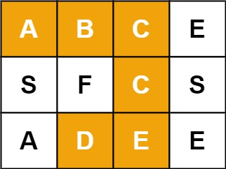

```text
输入：board = [['A','B','C','E'],['S','F','C','S'],['A','D','E','E']], word = "ABCCED"
输出：true
```

**示例 2**

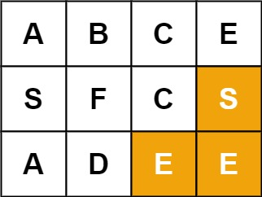

```text
输入：board = [['A','B','C','E'],['S','F','C','S'],['A','D','E','E']], word = "SEE"
输出：true
```

**示例 3**

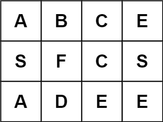

```text
输入：board = [['A','B','C','E'],['S','F','C','S'],['A','D','E','E']], word = "ABCB"
输出：false
```
> 题面与 [leetcode.cn 官方](https://leetcode.cn/problems/word-search/)一致，示例配图取自官方题面。

**数据范围与注意事项**：

- `m == board.length`
- `n = board[i].length`
- `1 <= m, n <= 6`
- `1 <= word.length <= 15`
- `board` 和 `word` 仅由大小写英文字母组成
- 进阶：你可以使用搜索剪枝的技术来优化解决方案，使其在 `board` 更大的情况下可以更快解决问题？
- **易错点**：递归返回后要把当前选择撤销干净，否则结果集会被污染。

## 题目分析

**场景是什么**：系统地试所有可能并及时回头，对应真实开发里的组合枚举、约束求解、路径规划。本题就是该场景的 Medium 级练习，主线做法是「双重循环枚举」。

**主线怎么解**：把主解法从头到尾过一遍，它其实在依次做这几件事：双重循环遍历。

## 解题思路

**方案对比**（共 2 个方案，由浅入深）：

| 方案 | 时间复杂度 | 空间复杂度 |
|---|---|---|
| 方案 1 · 双重循环枚举 | O(n²)（两层嵌套扫描） | O(1) 到 O(n) |
| 方案 2 · 双重循环枚举 | O(n²)（两层嵌套扫描） | O(1) 到 O(n) |

**方案间的取舍**：方案 1（双重循环枚举）；方案 2（双重循环枚举）。数据规模小、可读性优先时选靠前的方案；规模大、性能优先时选靠后的方案。

**怎么读这一篇**：

- 🐣 **新手路线**：把「题目描述」的示例 1 在纸上手推一遍 → 读方案 1（最直观的写法）与它的代码走读 → 按「运行方式」本地跑通看 PASS → 回头对比方案 2 之后的写法差在哪
- 🦅 **大佬路线**：直接锁定最优方案 1（双重循环枚举，O(n²)（两层嵌套扫描））→ 跳读该方案代码与走读 → 用「逐步拆解与面试追问」补齐复杂度推导与边界追问

### 动态算法图（回溯棋盘，GIF 自动循环）


动画演示回溯专题里回溯棋盘的典型过程；每个方案在「TypeScript 解题方案」一节还配了专属动画与专属流程图。

### 主解法流程图（真实控制流）

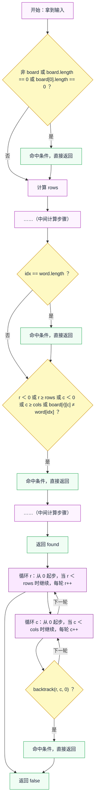

## TypeScript 解题方案（2 个方案逐个讲）

> **运行与提交**：每个方案都是自包含文件（内嵌用例自测，输出 PASS），整块复制到 `.ts` 文件后 `node 文件名` 即可运行。提交 LeetCode 时，把 `demo` 内的算法函数与辅助类型/函数整体取出、置于文件顶层即可。涉及交互/特殊接口的题以题面给定签名为准。

### 方案 1：双重循环枚举

**分析与思路**：核心做法是「双重循环枚举」。代码里依次做这些事：双重循环遍历。

**运行方式**：`node 本文件`，内嵌用例全部通过会输出 PASS。


**方案专属流程图**（真实控制流）：

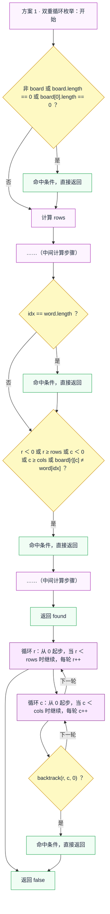

```typescript
export function demo(): void {
  // 程序入口：跑内嵌自测用例
  function exist(board: string[][] | null, word: string): boolean {
    // 定义函数/方法 exist
    if (!board || board.length === 0 || board[0].length === 0) return false; // 若 取反 棋盘 或 棋盘.长度 全等于 0 或 棋盘[0].长度 全等于 0，直接返回 false
    const rows: number = board.length; // 把 棋盘.长度; 写入 const rows: number
    const cols: number = board[0].length; // 把 棋盘[0].长度; 写入 const cols: number
    function backtrack(r: number, c: number, idx: number): boolean {
      // 定义函数/方法 backtrack
      if (idx === word.length) return true; // 若 idx 全等于 单词.长度，直接返回 true
      if (r < 0 || r >= rows || c < 0 || c >= cols || board[r][c] !== word[idx])
        return false;
      const temp: string = board[r][c]; // 把 棋盘[右指针][字符]; 写入 const temp: string
      board[r][c] = '#'; // 把 「#」; 写入 board[r][c]
      const found: boolean = // 把  写入 const found: boolean
        backtrack(r + 1, c, idx + 1) ||
        backtrack(r - 1, c, idx + 1) ||
        backtrack(r, c + 1, idx + 1) ||
        backtrack(r, c - 1, idx + 1); // backtrack(右指针, 字符 减 1, idx 加 1);
      board[r][c] = temp; // 把 临时变量; 写入 board[r][c]
      return found; // 返回 found
    }
    for (let r = 0; r < rows; r++) {
      // 让 右指针 从 0 开始计数，右指针 小于 行数 就继续
      for (let c = 0; c < cols; c++) {
        // 让 字符 从 0 开始计数，字符 小于 列数 就继续
        if (backtrack(r, c, 0)) return true; // 若 backtrack(右指针, 字符, 0)，直接返回 true
      }
    }
    return false; // 返回 false
  }
  const cases: Array<[string[][] | null, string, boolean]> = [
    [null, 'abc', false],
    [
      [
        ['A', 'B', 'C', 'E'],
        ['S', 'F', 'C', 'S'],
        ['A', 'D', 'E', 'E'],
      ],
      'ABCCED',
      true,
    ],
    [
      [
        ['A', 'B', 'C', 'E'],
        ['S', 'F', 'C', 'S'],
        ['A', 'D', 'E', 'E'],
      ],
      'SEE',
      true,
    ],
  ];
  let fail = false; // 把 false 存入 fail
  for (const cs of cases) {
    // for (const cs of cases) {
    const b = cs[0]; // 把 cs[0] 存入 b
    const w = cs[1]; // 把 cs[1] 存入 权重
    const exp = cs[2]; // 把 cs[2] 存入 exp
    const got = exist(b, w); // 把 exist(b, 权重) 存入 got
    if (got !== exp) {
      // 若 got 不等于 exp
      fail = true; // 把 true 存入 fail
      console.log('FAIL exist got ' + got + ' want ' + exp); // 打印输出
    }
  }
  if (fail) throw new Error('FAILED'); // 若 fail) throw new Error(「FAILED」);
  console.log('PASS'); // 全部用例通过，输出 PASS
}
demo(); // demo();
```

### 方案 2：双重循环枚举

**分析与思路**：核心做法是「双重循环枚举」。代码里依次做这些事：双重循环遍历。

**运行方式**：`node 本文件`，内嵌用例全部通过会输出 PASS。


**方案专属流程图**（真实控制流）：

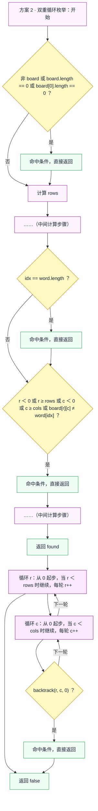

```typescript
export function demo(): void {
  // 程序入口：跑内嵌自测用例
  function exist(board: string[][] | null, word: string): boolean {
    // 定义函数/方法 exist
    if (!board || board.length === 0 || board[0].length === 0) return false; // 若 取反 棋盘 或 棋盘.长度 全等于 0 或 棋盘[0].长度 全等于 0，直接返回 false
    const rows: number = board.length; // 把 棋盘.长度; 写入 const rows: number
    const cols: number = board[0].length; // 把 棋盘[0].长度; 写入 const cols: number
    function backtrack(r: number, c: number, idx: number): boolean {
      // 定义函数/方法 backtrack
      if (idx === word.length) return true; // 若 idx 全等于 单词.长度，直接返回 true
      if (r < 0 || r >= rows || c < 0 || c >= cols || board[r][c] !== word[idx])
        return false;
      const temp: string = board[r][c]; // 把 棋盘[右指针][字符]; 写入 const temp: string
      board[r][c] = '#'; // 把 「#」; 写入 board[r][c]
      const found: boolean = // 把  写入 const found: boolean
        backtrack(r + 1, c, idx + 1) ||
        backtrack(r - 1, c, idx + 1) ||
        backtrack(r, c + 1, idx + 1) ||
        backtrack(r, c - 1, idx + 1); // backtrack(右指针, 字符 减 1, idx 加 1);
      board[r][c] = temp; // 把 临时变量; 写入 board[r][c]
      return found; // 返回 found
    }
    for (let r = 0; r < rows; r++) {
      // 让 右指针 从 0 开始计数，右指针 小于 行数 就继续
      for (let c = 0; c < cols; c++) {
        // 让 字符 从 0 开始计数，字符 小于 列数 就继续
        if (backtrack(r, c, 0)) return true; // 若 backtrack(右指针, 字符, 0)，直接返回 true
      }
    }
    return false; // 返回 false
  }
  const cases: Array<[string[][] | null, string, boolean]> = [
    [null, 'abc', false],
    [
      [
        ['A', 'B', 'C', 'E'],
        ['S', 'F', 'C', 'S'],
        ['A', 'D', 'E', 'E'],
      ],
      'ABCCED',
      true,
    ],
    [
      [
        ['A', 'B', 'C', 'E'],
        ['S', 'F', 'C', 'S'],
        ['A', 'D', 'E', 'E'],
      ],
      'SEE',
      true,
    ],
  ];
  let fail = false; // 把 false 存入 fail
  for (const cs of cases) {
    // for (const cs of cases) {
    const b = cs[0]; // 把 cs[0] 存入 b
    const w = cs[1]; // 把 cs[1] 存入 权重
    const exp = cs[2]; // 把 cs[2] 存入 exp
    const got = exist(b, w); // 把 exist(b, 权重) 存入 got
    if (got !== exp) {
      // 若 got 不等于 exp
      fail = true; // 把 true 存入 fail
      console.log('FAIL exist got ' + got + ' want ' + exp); // 打印输出
    }
  }
  if (fail) throw new Error('FAILED'); // 若 fail) throw new Error(「FAILED」);
  console.log('PASS'); // 全部用例通过，输出 PASS
}
demo(); // demo();
```

## 逐步拆解与面试追问

**复杂度**：时间 O(n²)（两层嵌套扫描），空间 O(1) 到 O(n)

**为什么是这个量级**：外层定起点、内层扫终点，n 个起点各扫 n 次

**面试官可能会追问**：

- 怎么剪枝降低无效搜索？
- 去重的关键在哪一层？
- 状态恢复遗漏会怎样？

## 关键 API 速查（TS 主解法实际用到，附官方链接）

本题主解法只用到基础语法（变量、循环、比较），不依赖特殊库 API。

### 各语言官方文档导航

- **TypeScript / JS**：[MDN 中文参考](https://developer.mozilla.org/zh-CN/)
- **Python**：[Python 官方文档](https://docs.python.org/zh-cn/3/)
- **Go**：[Go 标准库](https://pkg.go.dev/std)
- **Java**：[JDK 17 API](https://docs.oracle.com/en/java/javase/17/docs/api/)
- **Rust**：[Rust 标准库](https://doc.rust-lang.org/std/)
- **Lua**：[Lua 5.4 手册](https://www.lua.org/manual/5.4/)
- **C**：[Cppreference C](https://zh.cppreference.com/w/c)
- **C++**：[Cppreference C++](https://zh.cppreference.com/w/cpp)
- **R**：[R 官方手册](https://stat.ethz.ch/R-manual/)
- **Zig**：[Zig 语言文档](https://ziglang.org/documentation/master/)
- **Dart**：[Dart API](https://api.dart.dev/)

## 附录：其他 10 种语言全部实现（每种语言列举其全部方案）

> TypeScript 的全部方案见「TypeScript 解题方案」一节；下面是其余 10 种语言的对应实现，每种语言的每个方案都带思路分析、代码走读与专属运行架构图。
> 每个方案都内嵌用例自测，可独立运行（老仓库 python/go 文件遵循「打印结果」约定）。
> 完整解法文件见 `dsa/<语言>/backtrack/lc_79_单词搜索/`。

### Python 实现（2 种方案）

Python 的全部方案如下，每个方案都内嵌用例自测，可独立运行（老仓库 python/go 文件遵循「打印结果」约定）：

#### 方案 1：双重循环枚举

**思路与代码分析**：核心是「双重循环枚举」。Python 版用切片与字典推导式简化操作，突出可读性。**走读**：方案 1 · 双重循环枚举：开始 → 命中条件，直接返回 → 更新 cols → 命中条件，直接返回 → 命中条件，直接返回 → 返回 found → 循环 r：从 0 到 rows 前 → 循环 c：从 0 到 cols 前 → 命中条件，直接返回 → 返回 False。

**运行架构**（真实控制流）：


```python
import sys  # 提高递归深度上限（深输入防 RecursionError）

sys.setrecursionlimit(200000)  # 树/链表类题目节点数可达 1e4 量级

def exist(board, word):  # 定义函数 exist（参数：棋盘, 单词）
    if not board or not board[0]:  # 若 not 棋盘 or not 棋盘[0]
        return False  # 返回 False
    rows, cols = len(board), len(board[0])  # 把 长度(棋盘), 长度(棋盘[0]) 写入 rows, cols

    def backtrack(r, c, idx):  # 定义函数 backtrack（参数：右指针, 字符, idx）
        if idx == len(word):  # 若 idx 等于 长度(单词
            return True  # 返回 True
        if r < 0 or r >= rows or c < 0 or c >= cols or board[r][c] != word[idx]:
            return False  # 返回 False
        temp = board[r][c]  # 把 棋盘[右指针][字符] 存入 临时变量
        board[r][c] = "#"
        found = (
            backtrack(r + 1, c, idx + 1)  # 把 (backtrack(右指针 加 1, 字符, idx 加 1) or 存入 found
            or backtrack(r - 1, c, idx + 1)  # backtrack(右指针 减 1, 字符, idx 加 1) or
            or backtrack(r, c + 1, idx + 1)  # backtrack(右指针, 字符 加 1, idx 加 1) or
            or backtrack(r, c - 1, idx + 1)
        )  # backtrack(右指针, 字符 减 1, idx 加 1))
        board[r][c] = temp  # 把 临时变量 写入 board[r][c]
        return found  # 返回 found

    for r in range(rows):  # 让 右指针 从 行数 遍历
        for c in range(cols):  # 让 字符 从 列数 遍历
            if backtrack(r, c, 0):  # 若 backtrack(右指针, 字符, 0
                return True  # 返回 True
    return False  # 返回 False

if __name__ == "__main__":  # 若 __name__ 等于 '__main__'
    print(exist(None, "abc"))  # 打印输出
```

#### 方案 2：双重循环枚举

**思路与代码分析**：核心是「双重循环枚举」。Python 版用切片与字典推导式简化操作，突出可读性。**走读**：方案 2 · 双重循环枚举：开始 → 命中条件，直接返回 → 更新 cols → 命中条件，直接返回 → 命中条件，直接返回 → 返回 found → 循环 r：从 0 到 rows 前 → 循环 c：从 0 到 cols 前 → 命中条件，直接返回 → 返回 False。

**运行架构**（真实控制流）：

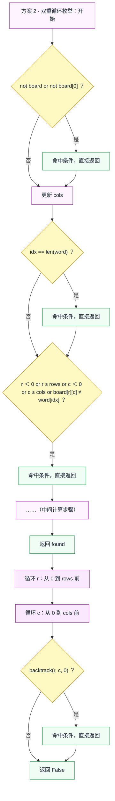

```python
import sys  # 提高递归深度上限（深输入防 RecursionError）

sys.setrecursionlimit(200000)  # 树/链表类题目节点数可达 1e4 量级

def exist(board, word):  # 定义函数 exist（参数：棋盘, 单词）
    if not board or not board[0]:  # 若 not 棋盘 or not 棋盘[0]
        return False  # 返回 False
    rows, cols = len(board), len(board[0])  # 把 长度(棋盘), 长度(棋盘[0]) 写入 rows, cols

    def backtrack(r, c, idx):  # 定义函数 backtrack（参数：右指针, 字符, idx）
        if idx == len(word):  # 若 idx 等于 长度(单词
            return True  # 返回 True
        if r < 0 or r >= rows or c < 0 or c >= cols or board[r][c] != word[idx]:
            return False  # 返回 False
        temp = board[r][c]  # 把 棋盘[右指针][字符] 存入 临时变量
        board[r][c] = "#"
        found = (
            backtrack(r + 1, c, idx + 1)  # 把 (backtrack(右指针 加 1, 字符, idx 加 1) or 存入 found
            or backtrack(r - 1, c, idx + 1)  # backtrack(右指针 减 1, 字符, idx 加 1) or
            or backtrack(r, c + 1, idx + 1)  # backtrack(右指针, 字符 加 1, idx 加 1) or
            or backtrack(r, c - 1, idx + 1)
        )  # backtrack(右指针, 字符 减 1, idx 加 1))
        board[r][c] = temp  # 把 临时变量 写入 board[r][c]
        return found  # 返回 found

    for r in range(rows):  # 让 右指针 从 行数 遍历
        for c in range(cols):  # 让 字符 从 列数 遍历
            if backtrack(r, c, 0):  # 若 backtrack(右指针, 字符, 0
                return True  # 返回 True
    return False  # 返回 False

if __name__ == "__main__":  # 若 __name__ 等于 '__main__'
    print(exist(None, "abc"))  # 打印输出
```

### Go 实现（2 种方案）

Go 的全部方案如下，每个方案都内嵌用例自测，可独立运行（老仓库 python/go 文件遵循「打印结果」约定）：

#### 方案 1：双重循环枚举

**思路与代码分析**：核心是「双重循环枚举」。Go 版用切片与多返回值惯用法，显式处理索引边界。

**运行架构**（真实控制流）：

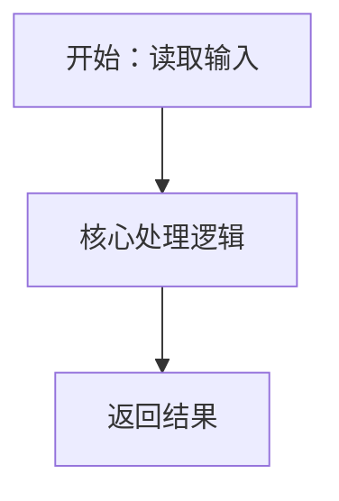

```go
package main // 引入依赖

import (
	"fmt" // 「fmt」
	"os"  // 「os」
)

func exist(board [][]byte, word string) bool { // 定义函数/方法 exist
	if len(board) == 0 || len(board[0]) == 0 { // 若 长度(棋盘) 等于 0 或 长度(棋盘[0]) 等于 0
		return false // 返回 false
	}
	m, n := len(board), len(board[0])                  // 把 长度(棋盘), 长度(棋盘[0]) 写入 m, n :
	var dfs func(r, c, idx int, visited [][]bool) bool // var dfs func(右指针, 字符, idx int, 已访问集合 [][]bool) bool
	dfs = func(r, c, idx int, visited [][]bool) bool { // 把 func(右指针, 字符, idx int, 已访问集合 [][]bool) bool { 写入 dfs
		if idx == len(word) { // 若 idx 等于 长度(单词
			return true // 返回 true
		}
		if r < 0 || r >= m || c < 0 || c >= n || visited[r][c] || board[r][c] != word[idx] {
			return false // 返回 false
		}
		visited[r][c] = true // 把 true 写入 visited[r][c]
		if dfs(r+1, c, idx+1, visited) || dfs(r-1, c, idx+1, visited) ||
			dfs(r, c+1, idx+1, visited) || dfs(r, c-1, idx+1, visited) {
			return true // 返回 true
		}
		visited[r][c] = false // 把 false 写入 visited[r][c]
		return false          // 返回 false
	}
	for i := 0; i < m; i++ { // 让 下标 i 从 0 开始计数
		for j := 0; j < n; j++ { // 让 下标 j 从 0 开始计数
			visited := make([][]bool, m) // 把 make([][]bool, 映射表) 写入 visited :
			for k := range visited {     // 把 range 已访问集合 { 写入 for k :
				visited[k] = make([]bool, n) // 把 make([]bool, 元素个数) 写入 visited[k]
			}
			if dfs(i, j, 0, visited) { // 定义函数/方法 dfs
				return true // 返回 true
			}
		}
	}
	return false // 返回 false
}

func main() { // 程序入口：跑内嵌自测用例
	board := [][]byte{ // 把 [][]byte{ 写入 board :
		{'A', 'B', 'C', 'E'},
		{'S', 'F', 'C', 'S'},
		{'A', 'D', 'E', 'E'},
	}
	ok := true                   // 把 true 写入 ok :
	if !exist(board, "ABCCED") { // 若 取反 exist(棋盘, 「ABCCED」
		ok = false                                     // 把 false 写入 ok
		fmt.Println("FAIL exist ABCCED expected true") // 打印输出
	}
	if !exist(board, "SEE") { // 若 取反 exist(棋盘, 「SEE」
		ok = false                                  // 把 false 写入 ok
		fmt.Println("FAIL exist SEE expected true") // 打印输出
	}
	if exist(board, "ABCB") { // 定义函数/方法 exist
		ok = false                                    // 把 false 写入 ok
		fmt.Println("FAIL exist ABCB expected false") // 打印输出
	}
	if !ok { // 若 取反 ok
		os.Exit(1) // os.Exit(1)
	}
	fmt.Println("PASS") // 全部用例通过，输出 PASS
}
```

#### 方案 2：双重循环枚举

**思路与代码分析**：核心是「双重循环枚举」。Go 版用切片与多返回值惯用法，显式处理索引边界。**走读**：方案 2 · 双重循环枚举：开始 → 处理 if len(board) == 0 或 len(bo → 返回 false → 返回 true → 返回 false → 返回 ok → 遍历循环 → 遍历循环 → 返回 true → 返回 false。

**运行架构**（真实控制流）：

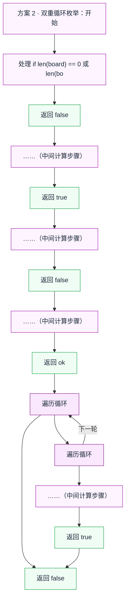

```go
package main // 引入依赖

import (
	"fmt"
	"os"
) // 引入依赖

func exist(board [][]byte, word string) bool { // 定义函数/方法 exist
	if len(board) == 0 || len(board[0]) == 0 { // 若 长度(棋盘) 等于 0 或 长度(棋盘[0]) 等于 0
		return false // 返回 false
	}
	rows, cols := len(board), len(board[0]) // 把 长度(棋盘), 长度(棋盘[0]) 写入 rows, cols :
	var bt func(r, c, idx int) bool         // var bt func(右指针, 字符, idx int) bool
	bt = func(r, c, idx int) bool {         // 把 func(右指针, 字符, idx int) bool { 写入 bt
		if idx == len(word) { // 若 idx 等于 长度(单词
			return true // 返回 true
		}
		if r < 0 || r >= rows || c < 0 || c >= cols || board[r][c] != word[idx] {
			return false // 返回 false
		}
		ch := board[r][c] // 把 棋盘[右指针][字符] 写入 ch :
		board[r][c] = '#' // 把 '#' 写入 board[r][c]
		ok := bt(r+1, c, idx+1) || bt(r-1, c, idx+1) || bt(r, c+1, idx+1) || bt(r, c-1, idx+1)
		board[r][c] = ch // 把 字符 写入 board[r][c]
		return ok        // 返回 ok
	}
	for r := 0; r < rows; r++ { // 让 右指针 从 0 开始计数
		for c := 0; c < cols; c++ { // 让 字符 从 0 开始计数
			if bt(r, c, 0) { // 定义函数/方法 bt
				return true // 返回 true
			}
		}
	}
	return false // 返回 false
}

func main() { // 程序入口：跑内嵌自测用例
	b1 := [][]byte{{'A', 'B', 'C', 'E'}, {'S', 'F', 'C', 'S'}, {'A', 'D', 'E', 'E'}}
	cases := []struct { // 把 []struct { 写入 cases :
		board [][]byte // 棋盘 [][]byte
		word  string   // 单词 string
		want  bool     // want bool
	}{ // }{
		{b1, "ABCCED", true},
		{nil, "abc", false},
	}
	ok := true                // 把 true 写入 ok :
	for _, c := range cases { // 同时取 _ 与 字符 遍历
		if g := exist(c.board, c.word); g != c.want { // 若 g : 赋值为 exist(字符.棋盘, 字符.单词); g 不等于 字符.want
			ok = false                                                        // 把 false 写入 ok
			fmt.Printf("FAIL %v,%q=%v want %v\n", c.board, c.word, g, c.want) // 打印输出
		}
	}
	if !ok { // 若 取反 ok
		os.Exit(1) // os.Exit(1)
	}
	fmt.Println("PASS") // 全部用例通过，输出 PASS
}
```

### Java 实现（2 种方案）

Java 的全部方案如下，每个方案都内嵌用例自测，可独立运行（老仓库 python/go 文件遵循「打印结果」约定）：

#### 方案 1：双重循环枚举

**思路与代码分析**：核心是「双重循环枚举」。Java 版用类与静态方法组织，集合操作显式明了。代码里依次做这些事：双重循环遍历。**走读**：方案 1 · 双重循环枚举：开始 → 命中条件，直接返回 → 更新 h → 更新 w → 更新 board → 遍历循环 → 更新 board[i] → 更新 visited → 遍历循环 → 遍历循环 → 命中条件，直接返回 → 返回 false。

**运行架构**（真实控制流）：

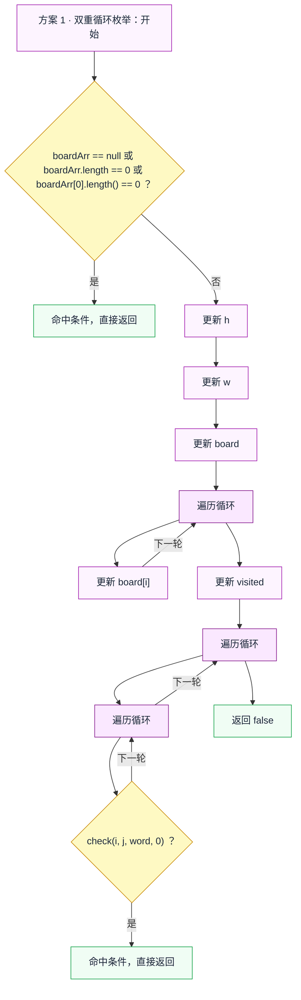

```java
package com.webfault.dsa; // 引入依赖

import java.util.*; // 引入依赖

class lc79_solution111 { // 定义类型
  private char[][] board; // private char[][] 棋盘;
  private int h, w; // private int h, 权重;
  private char[][] visited; // private char[][] 已访问集合;

  public boolean exist(String[] boardArr, String word) { // 定义函数/方法 exist
    if (boardArr == null || boardArr.length == 0 || boardArr[0].length() == 0) return false;
    h = boardArr.length; // 把 boardArr.长度; 写入 h
    w = boardArr[0].length(); // 把 boardArr[0].长度(); 写入 权重
    board = new char[h][w]; // 把 new char[h][权重]; 写入 棋盘
    for (int i = 0; i < h; i++) { // 让 下标 i 从 0 开始计数，下标 i 小于 h 就继续
      board[i] = boardArr[i].toCharArray(); // 把 boardArr[下标 i].toCharArray(); 写入 board[i]
    }
    visited = new char[h][w]; // 把 new char[h][权重]; 写入 已访问集合
    for (int i = 0; i < h; i++) { // 让 下标 i 从 0 开始计数，下标 i 小于 h 就继续
      for (int j = 0; j < w; j++) { // 让 下标 j 从 0 开始计数，下标 j 小于 权重 就继续
        if (check(i, j, word, 0)) { // 若 check(下标 i, 下标 j, 单词, 0
          return true; // 返回 true
        }
      }
    }
    return false; // 返回 false
  }

  private boolean check(int i, int j, String s, int k) { // 定义判定函数 check
    if (board[i][j] != s.charAt(k)) { // 若 棋盘[下标 i][下标 j] 不等于 字符串 取字符 下标 k
      return false; // 返回 false
    } else if (k == s.length() - 1) { // 否则，若 下标 k 等于 字符串.长度() 减 1
      return true; // 返回 true
    }
    visited[i][j] = 'Y'; // 把 'Y'; 写入 visited[i][j]
    int[][] directions = {{0, 1}, {0, -1}, {1, 0}, {-1, 0}};
    boolean result = false; // 把 false; 写入 boolean result
    for (int[] d : directions) { // for (int[] d : directions) {
      int newi = i + d[0], newj = j + d[1]; // 把 下标 i 加 d[0], newj 赋值为 下标 j 加 d[1] 存入 newi
      if (newi >= 0 && newi < h && newj >= 0
          && newj < w) { // 若 newi 不低于 0 且 newi 小于 h 且 newj 不低于 0 且 newj 小于 权重
        if (visited[newi][newj] != 'Y') { // 若 已访问集合[newi][newj] 不等于 'Y'
          visited[newi][newj] = 'Y'; // 把 'Y'; 写入 visited[newi][newj]
          boolean flag =
              check(newi, newj, s, k + 1); // 把 check(newi, newj, 字符串, 下标 k 加 1); 写入 boolean flag
          if (flag) { // 若 flag
            result = true; // 把 true; 写入 结果
            break; // 跳出循环
          }
          visited[newi][newj] = 'N'; // 把 'N'; 写入 visited[newi][newj]
        }
      }
    }
    visited[i][j] = 'N'; // 把 'N'; 写入 visited[i][j]
    return result; // 返回 结果
  }

  public static void main(String[] args) { // public static void main(String[] args) {
    lc79_solution111 s = new lc79_solution111(); // 把 new lc79_solution111(); 写入 lc79_solution111 s
    String[] board = {"ABC", "BDS", "ATE"}; // 把 {「ABC」, 「ABC」, 「ABC」}; 写入 String[] board
    boolean[] gots = {s.exist(board, "ABD"), s.exist(board, "ZZZ")};
    boolean[] wants = {true, false}; // 把 {true, false}; 写入 boolean[] wants
    for (int i = 0; i < gots.length; i++) { // 让 下标 i 从 0 开始计数，下标 i 小于 gots.长度 就继续
      if (gots[i] != wants[i]) { // 若 gots[下标 i] 不等于 wants[下标 i]
        System.out.println(
            "FAIL exist case " + i + " got " + gots[i] + " want " + wants[i]); // 打印输出
        throw new RuntimeException("FAILED"); // throw new RuntimeException(「FAILED」);
      }
    }
    System.out.println("PASS"); // 全部用例通过，输出 PASS
  }
}
```

#### 方案 2：双重循环枚举

**思路与代码分析**：核心是「双重循环枚举」。Java 版用类与静态方法组织，集合操作显式明了。代码里依次做这些事：双重循环遍历。**走读**：方案 2 · 双重循环枚举：开始 → 命中条件，直接返回 → 更新 m → 更新 n → 更新 board → 遍历循环 → 更新 board[i] → 更新 word → 遍历循环 → 遍历循环 → 命中条件，直接返回 → 返回 false。

**运行架构**（真实控制流）：

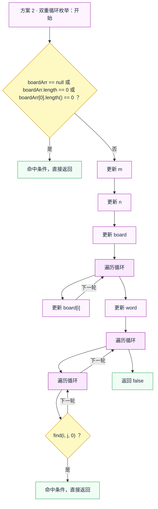

```java
package com.webfault.dsa; // 引入依赖

import java.util.*; // 引入依赖

class lc79_solution222 { // 定义类型
  private char[][] board; // private char[][] 棋盘;
  private int m, n; // private int 映射表, 元素个数;
  private String word; // private String 单词;

  public boolean exist(String[] boardArr, String w) { // 定义函数/方法 exist
    if (boardArr == null || boardArr.length == 0 || boardArr[0].length() == 0) return false;
    m = boardArr.length; // 把 boardArr.长度; 写入 映射表
    n = boardArr[0].length(); // 把 boardArr[0].长度(); 写入 元素个数
    board = new char[m][n]; // 把 new char[映射表][元素个数]; 写入 棋盘
    for (int i = 0; i < m; i++) { // 让 下标 i 从 0 开始计数，下标 i 小于 映射表 就继续
      board[i] = boardArr[i].toCharArray(); // 把 boardArr[下标 i].toCharArray(); 写入 board[i]
    }
    word = w; // 把 权重; 写入 单词
    for (int i = 0; i < m; i++) { // 让 下标 i 从 0 开始计数，下标 i 小于 映射表 就继续
      for (int j = 0; j < n; j++) { // 让 下标 j 从 0 开始计数，下标 j 小于 元素个数 就继续
        if (find(i, j, 0)) { // 若 find(下标 i, 下标 j, 0
          return true; // 返回 true
        }
      }
    }
    return false; // 返回 false
  }

  private boolean find(int i, int j, int cur) { // 定义函数/方法 find
    if (i < 0 || i >= m || j < 0
        || j >= n) { // 若 下标 i 小于 0 或 下标 i 不低于 映射表 或 下标 j 小于 0 或 下标 j 不低于 元素个数
      return false; // 返回 false
    }
    char letter = board[i][j]; // 把 棋盘[下标 i][下标 j]; 写入 char letter
    if (letter != word.charAt(cur)) { // 若 letter 不等于 单词 取字符 当前值
      return false; // 返回 false
    }
    if (cur == word.length() - 1) { // 若 当前值 等于 单词.长度() 减 1
      return true; // 返回 true
    }
    board[i][j] = ' '; // 把 ' '; 写入 board[i][j]
    boolean ret =
        find(i + 1, j, cur + 1) // 把 find(下标 i 加 1, 下标 j, 当前值 加 1) 写入 boolean ret
            || find(i - 1, j, cur + 1) // 或 find(下标 i 减 1, 下标 j, 当前值 加 1)
            || find(i, j + 1, cur + 1) // 或 find(下标 i, 下标 j 加 1, 当前值 加 1)
            || find(i, j - 1, cur + 1); // 或 find(下标 i, 下标 j 减 1, 当前值 加 1);
    board[i][j] = letter; // 把 letter; 写入 board[i][j]
    return ret; // 返回 ret
  }

  public static void main(String[] args) { // public static void main(String[] args) {
    lc79_solution222 s = new lc79_solution222(); // 把 new lc79_solution222(); 写入 lc79_solution222 s
    String[] board = {"ABC", "BDS", "ATE"}; // 把 {「ABC」, 「ABC」, 「ABC」}; 写入 String[] board
    boolean[] gots = {s.exist(board, "ABD"), s.exist(board, "ZZZ")};
    boolean[] wants = {true, false}; // 把 {true, false}; 写入 boolean[] wants
    for (int i = 0; i < gots.length; i++) { // 让 下标 i 从 0 开始计数，下标 i 小于 gots.长度 就继续
      if (gots[i] != wants[i]) { // 若 gots[下标 i] 不等于 wants[下标 i]
        System.out.println(
            "FAIL exist case " + i + " got " + gots[i] + " want " + wants[i]); // 打印输出
        throw new RuntimeException("FAILED"); // throw new RuntimeException(「FAILED」);
      }
    }
    System.out.println("PASS"); // 全部用例通过，输出 PASS
  }
}
```

### Rust 实现（2 种方案）

Rust 的全部方案如下，每个方案都内嵌用例自测，可独立运行（老仓库 python/go 文件遵循「打印结果」约定）：

#### 方案 1：双重循环枚举

**思路与代码分析**：核心是「双重循环枚举」。Rust 版用所有权移动与切片借用改写同一逻辑，注意 Option 与引用边界。**走读**：方案 1 · 双重循环枚举：开始 → 计算 board → 返回 true → 返回 false → 返回 false → 遍历 0..board.len() 中的每个元素 i → 遍历 0..board[0].len() 中的每个元素 j → 返回 true。

**运行架构**（真实控制流）：

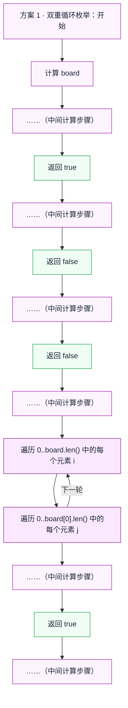

```rust
// LeetCode 79. 单词搜索 — Rust 版（方案1）
fn exist(board: Vec<Vec<char>>, word: String) -> bool {
    // 定义函数/方法 exist
    let mut board = board; // 把 棋盘; 写入 let mut board
    let w: Vec<char> = word.chars().collect(); // 把 单词.chars().collect(); 写入 let w: Vec<char>
    fn dfs(board: &mut Vec<Vec<char>>, w: &[char], i: usize, j: usize, k: usize) -> bool {
        // 定义函数/方法 dfs
        if k == w.len() {
            return true;
        } // 若 下标 k 等于 权重.长度() { return true; }
        if i >= board.len() || j >= board[0].len() {
            return false;
        } // 若 下标 i 不低于 棋盘.长度() 或 下标 j 不低于 棋盘[0].长度() { return false; }
        if board[i][j] != w[k] {
            return false;
        } // 若 棋盘[下标 i][下标 j] 不等于 权重[下标 k] { return false; }
        let saved = board[i][j]; // 把 棋盘[下标 i][下标 j] 存入 saved
        board[i][j] = '#'; // 把 '#'; 写入 board[i][j]
        let found = dfs(board, w, i + 1, j, k + 1)  // 把 dfs(棋盘, 权重, 下标 i 加 1, 下标 j, 下标 k 加 1) 存入 found
            || (i > 0 && dfs(board, w, i - 1, j, k + 1))  // 或 (下标 i 超过 0 且 dfs(棋盘, 权重, 下标 i 减 1, 下标 j, 下标 k 加 1))
            || dfs(board, w, i, j + 1, k + 1)  // 或 dfs(棋盘, 权重, 下标 i, 下标 j 加 1, 下标 k 加 1)
            || (j > 0 && dfs(board, w, i, j - 1, k + 1)); // 或 (下标 j 超过 0 且 dfs(棋盘, 权重, 下标 i, 下标 j 减 1, 下标 k 加 1));
        board[i][j] = saved; // 把 saved; 写入 board[i][j]
        found // found
    }
    for i in 0..board.len() {
        // 逐个取出 0 的元素（下标 i）
        for j in 0..board[0].len() {
            // 逐个取出 0 的元素（下标 j）
            if dfs(&mut board, &w, i, j, 0) {
                return true;
            } // 若 dfs( 按位与 mut 棋盘, 按位与 权重, 下标 i, 下标 j, 0) { return true; }
        }
    }
    false // false
}
fn main() {
    // 程序入口：跑内嵌自测用例
    let b = vec![
        vec!['A', 'B', 'C', 'E'],
        vec!['S', 'F', 'C', 'S'],
        vec!['A', 'D', 'E', 'E'],
    ];
    assert!(exist(b.clone(), "ABCCED".to_string())); // 断言校验
    assert!(exist(b.clone(), "SEE".to_string())); // 断言校验
    assert!(!exist(b, "ABCB".to_string())); // 断言校验
    println!("PASS"); // 全部用例通过，输出 PASS
}
```

#### 方案 2：双重循环枚举

**思路与代码分析**：核心是「双重循环枚举」。Rust 版用所有权移动与切片借用改写同一逻辑，注意 Option 与引用边界。**走读**：方案 2 · 双重循环枚举：开始 → 计算 board → 返回 true → 返回 false → 返回 false → 遍历 0..board.len() 中的每个元素 i → 遍历 0..board[0].len() 中的每个元素 j → 返回 true。

**运行架构**（真实控制流）：

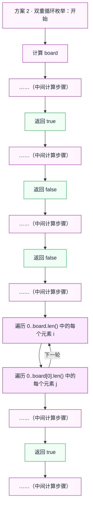

```rust
// LeetCode 79. 单词搜索 — Rust 版（方案2）
fn exist(board: Vec<Vec<char>>, word: String) -> bool {
    // 定义函数/方法 exist
    let mut board = board; // 把 棋盘; 写入 let mut board
    let w: Vec<char> = word.chars().collect(); // 把 单词.chars().collect(); 写入 let w: Vec<char>
    fn dfs(board: &mut Vec<Vec<char>>, w: &[char], i: usize, j: usize, k: usize) -> bool {
        // 定义函数/方法 dfs
        if k == w.len() {
            return true;
        } // 若 下标 k 等于 权重.长度() { return true; }
        if i >= board.len() || j >= board[0].len() {
            return false;
        } // 若 下标 i 不低于 棋盘.长度() 或 下标 j 不低于 棋盘[0].长度() { return false; }
        if board[i][j] != w[k] {
            return false;
        } // 若 棋盘[下标 i][下标 j] 不等于 权重[下标 k] { return false; }
        let saved = board[i][j]; // 把 棋盘[下标 i][下标 j] 存入 saved
        board[i][j] = '#'; // 把 '#'; 写入 board[i][j]
        let found = dfs(board, w, i + 1, j, k + 1)  // 把 dfs(棋盘, 权重, 下标 i 加 1, 下标 j, 下标 k 加 1) 存入 found
            || (i > 0 && dfs(board, w, i - 1, j, k + 1))  // 或 (下标 i 超过 0 且 dfs(棋盘, 权重, 下标 i 减 1, 下标 j, 下标 k 加 1))
            || dfs(board, w, i, j + 1, k + 1)  // 或 dfs(棋盘, 权重, 下标 i, 下标 j 加 1, 下标 k 加 1)
            || (j > 0 && dfs(board, w, i, j - 1, k + 1)); // 或 (下标 j 超过 0 且 dfs(棋盘, 权重, 下标 i, 下标 j 减 1, 下标 k 加 1));
        board[i][j] = saved; // 把 saved; 写入 board[i][j]
        found // found
    }
    for i in 0..board.len() {
        // 逐个取出 0 的元素（下标 i）
        for j in 0..board[0].len() {
            // 逐个取出 0 的元素（下标 j）
            if dfs(&mut board, &w, i, j, 0) {
                return true;
            } // 若 dfs( 按位与 mut 棋盘, 按位与 权重, 下标 i, 下标 j, 0) { return true; }
        }
    }
    false // false
}
fn main() {
    // 程序入口：跑内嵌自测用例
    let b = vec![
        vec!['A', 'B', 'C', 'E'],
        vec!['S', 'F', 'C', 'S'],
        vec!['A', 'D', 'E', 'E'],
    ];
    assert!(exist(b.clone(), "ABCCED".to_string())); // 断言校验
    assert!(exist(b.clone(), "SEE".to_string())); // 断言校验
    assert!(!exist(b, "ABCB".to_string())); // 断言校验
    println!("PASS"); // 全部用例通过，输出 PASS
}
```

### Lua 实现（2 种方案）

Lua 的全部方案如下，每个方案都内嵌用例自测，可独立运行（老仓库 python/go 文件遵循「打印结果」约定）：

#### 方案 1：双重循环枚举

**思路与代码分析**：核心是「双重循环枚举」。Lua 版用表与 ipairs 遍历，注意 ipairs 遇 nil 即停的语义。代码里依次做这些事：递归求解子问题。**走读**：方案 1 · 双重循环枚举：开始 → 更新 cols → 返回 true → 返回 false → 返回 false → 返回 found → 循环 i：从 1 到 rows do → 循环 j：从 1 到 cols do → 返回 true → 返回 false。

**运行架构**（真实控制流）：

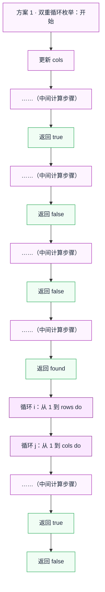

```lua
-- LeetCode 79. 单词搜索 — Lua 版（方案1）
local function exist(board, word) -- local function exist(棋盘, 单词)
	local rows, cols = #board, #board[1] -- 把 #棋盘, #棋盘[1] 写入 local rows, cols
	local w = {} -- 把 {} 写入 local w
	word:gsub(".", function(c)
		w[#w + 1] = c
	end) -- 把 字符 终点) 写入 word:gsub(".", function(c) w[#w + 1]
	local function dfs(i, j, k) -- local function dfs(下标 i, 下标 j, 下标 k)
		if k > #w then
			return true
		end -- 若 下标 k 超过 #权重 then return true 终点
		if i < 1 or i > rows or j < 1 or j > cols then
			return false
		end
		if board[i][j] ~= w[k] then
			return false
		end -- 若 棋盘[下标 i][下标 j] ~ 赋值为 权重[下标 k] then return false 终点
		local saved = board[i][j] -- 把 棋盘[下标 i][下标 j] 写入 local saved
		board[i][j] = "#" -- 把 「#」 写入 board[i][j]
		local found = dfs(i + 1, j, k + 1) or dfs(i - 1, j, k + 1) or dfs(i, j + 1, k + 1) or dfs(i, j - 1, k + 1)
		board[i][j] = saved -- 把 saved 写入 board[i][j]
		return found -- 返回 found
	end -- 终点
	for i = 1, rows do -- 让 下标 i 从 1 走到 行数（Lua 1 基）
		for j = 1, cols do -- 让 下标 j 从 1 走到 列数（Lua 1 基）
			if dfs(i, j, 1) then
				return true
			end -- 若 dfs(下标 i, 下标 j, 1) then return true 终点
		end -- 终点
	end -- 终点
	return false -- 返回 false
end -- 终点
local b = { { "A", "B", "C", "E" }, { "S", "F", "C", "S" }, { "A", "D", "E", "E" } }
assert(exist(b, "ABCCED") == true) -- 断言校验
assert(exist(b, "SEE") == true) -- 断言校验
assert(exist(b, "ABCB") == false) -- 断言校验
print("PASS") -- 全部用例通过，输出 PASS
```

#### 方案 2：双重循环枚举

**思路与代码分析**：核心是「双重循环枚举」。Lua 版用表与 ipairs 遍历，注意 ipairs 遇 nil 即停的语义。代码里依次做这些事：递归求解子问题。**走读**：方案 2 · 双重循环枚举：开始 → 更新 cols → 返回 true → 返回 false → 返回 false → 返回 found → 循环 i：从 1 到 rows do → 循环 j：从 1 到 cols do → 返回 true → 返回 false。

**运行架构**（真实控制流）：


```lua
-- LeetCode 79. 单词搜索 — Lua 版（方案2）
local function exist(board, word) -- local function exist(棋盘, 单词)
	local rows, cols = #board, #board[1] -- 把 #棋盘, #棋盘[1] 写入 local rows, cols
	local w = {} -- 把 {} 写入 local w
	word:gsub(".", function(c)
		w[#w + 1] = c
	end) -- 把 字符 终点) 写入 word:gsub(".", function(c) w[#w + 1]
	local function dfs(i, j, k) -- local function dfs(下标 i, 下标 j, 下标 k)
		if k > #w then
			return true
		end -- 若 下标 k 超过 #权重 then return true 终点
		if i < 1 or i > rows or j < 1 or j > cols then
			return false
		end
		if board[i][j] ~= w[k] then
			return false
		end -- 若 棋盘[下标 i][下标 j] ~ 赋值为 权重[下标 k] then return false 终点
		local saved = board[i][j] -- 把 棋盘[下标 i][下标 j] 写入 local saved
		board[i][j] = "#" -- 把 「#」 写入 board[i][j]
		local found = dfs(i + 1, j, k + 1) or dfs(i - 1, j, k + 1) or dfs(i, j + 1, k + 1) or dfs(i, j - 1, k + 1)
		board[i][j] = saved -- 把 saved 写入 board[i][j]
		return found -- 返回 found
	end -- 终点
	for i = 1, rows do -- 让 下标 i 从 1 走到 行数（Lua 1 基）
		for j = 1, cols do -- 让 下标 j 从 1 走到 列数（Lua 1 基）
			if dfs(i, j, 1) then
				return true
			end -- 若 dfs(下标 i, 下标 j, 1) then return true 终点
		end -- 终点
	end -- 终点
	return false -- 返回 false
end -- 终点
local b = { { "A", "B", "C", "E" }, { "S", "F", "C", "S" }, { "A", "D", "E", "E" } }
assert(exist(b, "ABCCED") == true) -- 断言校验
assert(exist(b, "SEE") == true) -- 断言校验
assert(exist(b, "ABCB") == false) -- 断言校验
print("PASS") -- 全部用例通过，输出 PASS
```

### C 实现（2 种方案）

C 的全部方案如下，每个方案都内嵌用例自测，可独立运行（老仓库 python/go 文件遵循「打印结果」约定）：

#### 方案 1：双重循环枚举

**思路与代码分析**：核心是「双重循环枚举」。C 版手动管理下标与内存，循环边界全部显式写出。代码里依次做这些事：双重循环遍历。**走读**：方案 1 · 双重循环枚举：开始 → 更新 rows_g → 更新 cols_g → 更新 w_g → 遍历循环 → 遍历循环 → 更新 board_g[i][j] → 遍历循环 → 遍历循环 → 命中条件，直接返回 → 返回 0。

**运行架构**（真实控制流）：


```c
/* LeetCode 79. 单词搜索 — C 版（方案1） */
#include <stdio.h>                    // 引入头文件
#include <string.h>                   // 引入头文件
static char board_g[8][8];            // static char board_g[8][8];
static int rows_g, cols_g;            // static int rows_g, cols_g;
static const char *w_g;               // static const char 乘 w_g;
static int dfs(int i, int j, int k) { // 定义函数/方法 dfs
    if (w_g[k] == '\0')
        return 1; // 若 w_g[下标 k] 等于 '\0'，直接返回 1
    if (i < 0 || i >= rows_g || j < 0 || j >= cols_g)
        return 0;
    if (board_g[i][j] != w_g[k])
        return 0;               // 若 board_g[下标 i][下标 j] 不等于 w_g[下标 k]，直接返回 0
    char saved = board_g[i][j]; // 把 board_g[下标 i][下标 j]; 写入 char saved
    board_g[i][j] = '#';        // 把 '#'; 写入 board_g[i][j]
    int found = dfs(i + 1, j, k + 1) || dfs(i - 1, j, k + 1) || dfs(i, j + 1, k + 1) || dfs(i, j - 1, k + 1);
    board_g[i][j] = saved; // 把 saved; 写入 board_g[i][j]
    return found;          // 返回 found
}
static int exist(char board[][8], int rows, int cols, const char *word) { // 定义函数/方法 exist
    rows_g = rows;
    cols_g = cols;
    w_g = word;                    // 把 行数; cols_g 赋值为 列数; w_g 赋值为 单词; 写入 rows_g
    for (int i = 0; i < rows; i++) // 让 下标 i 从 0 开始计数，下标 i 小于 行数 就继续
        for (int j = 0; j < cols; j++)   // 让 下标 j 从 0 开始计数，下标 j 小于 列数 就继续
            board_g[i][j] = board[i][j]; // 把 棋盘[下标 i][下标 j]; 写入 board_g[i][j]
    for (int i = 0; i < rows; i++)       // 让 下标 i 从 0 开始计数，下标 i 小于 行数 就继续
        for (int j = 0; j < cols; j++)   // 让 下标 j 从 0 开始计数，下标 j 小于 列数 就继续
            if (dfs(i, j, 0))
                return 1; // 若 dfs(下标 i, 下标 j, 0)，直接返回 1
    return 0;             // 返回 0
}
int main(void) { // 程序入口：跑内嵌自测用例
    char b[3][8] = {{'A', 'B', 'C', 'E'}, {'S', 'F', 'C', 'S'}, {'A', 'D', 'E', 'E'}};
    if (!exist(b, 3, 4, "ABCCED")) {
        printf("FAIL 1\n");
        return 1;
    } // 若 取反 exist(b, 3, 4, 「ABCCED」)) { 输出「ABCCED」); return 1; }
    if (!exist(b, 3, 4, "SEE")) {
        printf("FAIL 2\n");
        return 1;
    } // 若 取反 exist(b, 3, 4, 「SEE」)) { 输出「SEE」); return 1; }
    if (exist(b, 3, 4, "ABCB")) {
        printf("FAIL 3\n");
        return 1;
    }                 // 若 exist(b, 3, 4, 「ABCB」)) { 输出「ABCB」); return 1; }
    printf("PASS\n"); // 全部用例通过，输出 PASS
    return 0;         // 返回 0
}
```

#### 方案 2：双重循环枚举

**思路与代码分析**：核心是「双重循环枚举」。C 版手动管理下标与内存，循环边界全部显式写出。代码里依次做这些事：双重循环遍历。**走读**：方案 2 · 双重循环枚举：开始 → 更新 rows_g → 更新 cols_g → 更新 w_g → 遍历循环 → 遍历循环 → 更新 board_g[i][j] → 遍历循环 → 遍历循环 → 命中条件，直接返回 → 返回 0。

**运行架构**（真实控制流）：

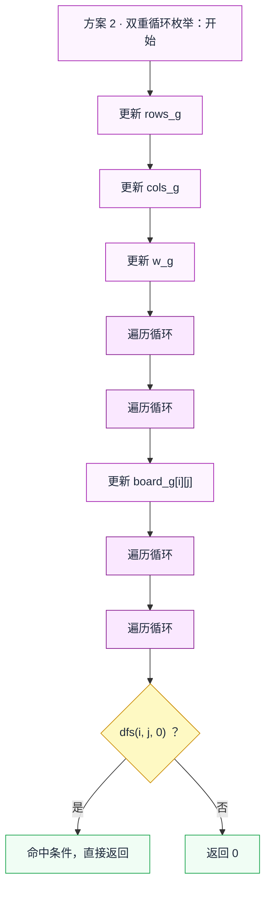

```c
/* LeetCode 79. 单词搜索 — C 版（方案2） */
#include <stdio.h>                    // 引入头文件
#include <string.h>                   // 引入头文件
static char board_g[8][8];            // static char board_g[8][8];
static int rows_g, cols_g;            // static int rows_g, cols_g;
static const char *w_g;               // static const char 乘 w_g;
static int dfs(int i, int j, int k) { // 定义函数/方法 dfs
    if (w_g[k] == '\0')
        return 1; // 若 w_g[下标 k] 等于 '\0'，直接返回 1
    if (i < 0 || i >= rows_g || j < 0 || j >= cols_g)
        return 0;
    if (board_g[i][j] != w_g[k])
        return 0;               // 若 board_g[下标 i][下标 j] 不等于 w_g[下标 k]，直接返回 0
    char saved = board_g[i][j]; // 把 board_g[下标 i][下标 j]; 写入 char saved
    board_g[i][j] = '#';        // 把 '#'; 写入 board_g[i][j]
    int found = dfs(i + 1, j, k + 1) || dfs(i - 1, j, k + 1) || dfs(i, j + 1, k + 1) || dfs(i, j - 1, k + 1);
    board_g[i][j] = saved; // 把 saved; 写入 board_g[i][j]
    return found;          // 返回 found
}
static int exist(char board[][8], int rows, int cols, const char *word) { // 定义函数/方法 exist
    rows_g = rows;
    cols_g = cols;
    w_g = word;                    // 把 行数; cols_g 赋值为 列数; w_g 赋值为 单词; 写入 rows_g
    for (int i = 0; i < rows; i++) // 让 下标 i 从 0 开始计数，下标 i 小于 行数 就继续
        for (int j = 0; j < cols; j++)   // 让 下标 j 从 0 开始计数，下标 j 小于 列数 就继续
            board_g[i][j] = board[i][j]; // 把 棋盘[下标 i][下标 j]; 写入 board_g[i][j]
    for (int i = 0; i < rows; i++)       // 让 下标 i 从 0 开始计数，下标 i 小于 行数 就继续
        for (int j = 0; j < cols; j++)   // 让 下标 j 从 0 开始计数，下标 j 小于 列数 就继续
            if (dfs(i, j, 0))
                return 1; // 若 dfs(下标 i, 下标 j, 0)，直接返回 1
    return 0;             // 返回 0
}
int main(void) { // 程序入口：跑内嵌自测用例
    char b[3][8] = {{'A', 'B', 'C', 'E'}, {'S', 'F', 'C', 'S'}, {'A', 'D', 'E', 'E'}};
    if (!exist(b, 3, 4, "ABCCED")) {
        printf("FAIL 1\n");
        return 1;
    } // 若 取反 exist(b, 3, 4, 「ABCCED」)) { 输出「ABCCED」); return 1; }
    if (!exist(b, 3, 4, "SEE")) {
        printf("FAIL 2\n");
        return 1;
    } // 若 取反 exist(b, 3, 4, 「SEE」)) { 输出「SEE」); return 1; }
    if (exist(b, 3, 4, "ABCB")) {
        printf("FAIL 3\n");
        return 1;
    }                 // 若 exist(b, 3, 4, 「ABCB」)) { 输出「ABCB」); return 1; }
    printf("PASS\n"); // 全部用例通过，输出 PASS
    return 0;         // 返回 0
}
```

### C++ 实现（2 种方案）

C++ 的全部方案如下，每个方案都内嵌用例自测，可独立运行（老仓库 python/go 文件遵循「打印结果」约定）：

#### 方案 1：双重循环枚举

**思路与代码分析**：核心是「双重循环枚举」。C++ 版用 STL 容器与迭代器，减少手写下标错误。代码里依次做这些事：双重循环遍历。**走读**：方案 1 · 双重循环枚举：开始 → 更新 rows → 命中条件，直接返回 → 命中条件，直接返回 → 返回 found → 遍历循环 → 遍历循环 → 命中条件，直接返回 → 返回 false。

**运行架构**（真实控制流）：


```cpp
// LeetCode 79. 单词搜索 — C++ 版（方案1）
#include <cassert>                                                                 // 引入头文件
#include <iostream>                                                                // 引入头文件
#include <string>                                                                  // 引入头文件
#include <vector>                                                                  // 引入头文件
static bool exist(std::vector<std::vector<char>> board, const std::string &word) { // 定义函数/方法 exist
    int rows = static_cast<int>(board.size()), cols = static_cast<int>(board[0].size());
    std::function<bool(int, int, int)> dfs = [&](int i, int j, int k) -> bool {
        if (k == static_cast<int>(word.size()))
            return true; // 若 下标 k 等于 static_cast 小于 int 超过 (单词.大小())，直接返回 true
        if (i < 0 || i >= rows || j < 0 || j >= cols || board[i][j] != word[k])
            return false;
        char saved = board[i][j]; // 把 棋盘[下标 i][下标 j]; 写入 char saved
        board[i][j] = '#';        // 把 '#'; 写入 board[i][j]
        bool found =
            dfs(i + 1, j, k + 1) || dfs(i - 1, j, k + 1) || dfs(i, j + 1, k + 1) || dfs(i, j - 1, k + 1);
        board[i][j] = saved; // 把 saved; 写入 board[i][j]
        return found;        // 返回 found
    };
    for (int i = 0; i < rows; ++i)     // 让 下标 i 从 0 开始计数，下标 i 小于 行数 就继续
        for (int j = 0; j < cols; ++j) // 让 下标 j 从 0 开始计数，下标 j 小于 列数 就继续
            if (dfs(i, j, 0))
                return true; // 若 dfs(下标 i, 下标 j, 0)，直接返回 true
    return false;            // 返回 false
}
int main() { // 程序入口：跑内嵌自测用例
    std::vector<std::vector<char>> b = {{'A', 'B', 'C', 'E'}, {'S', 'F', 'C', 'S'}, {'A', 'D', 'E', 'E'}};
    assert(exist(b, "ABCCED"));       // 断言校验
    assert(exist(b, "SEE"));          // 断言校验
    assert(!exist(b, "ABCB"));        // 断言校验
    std::cout << "PASS" << std::endl; // 全部用例通过，输出 PASS
    return 0;                         // 返回 0
}
```

#### 方案 2：双重循环枚举

**思路与代码分析**：核心是「双重循环枚举」。C++ 版用 STL 容器与迭代器，减少手写下标错误。代码里依次做这些事：双重循环遍历。**走读**：方案 2 · 双重循环枚举：开始 → 更新 rows → 命中条件，直接返回 → 命中条件，直接返回 → 返回 found → 遍历循环 → 遍历循环 → 命中条件，直接返回 → 返回 false。

**运行架构**（真实控制流）：

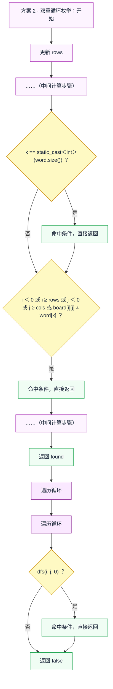

```cpp
// LeetCode 79. 单词搜索 — C++ 版（方案2）
#include <cassert>                                                                 // 引入头文件
#include <iostream>                                                                // 引入头文件
#include <string>                                                                  // 引入头文件
#include <vector>                                                                  // 引入头文件
static bool exist(std::vector<std::vector<char>> board, const std::string &word) { // 定义函数/方法 exist
    int rows = static_cast<int>(board.size()), cols = static_cast<int>(board[0].size());
    std::function<bool(int, int, int)> dfs = [&](int i, int j, int k) -> bool {
        if (k == static_cast<int>(word.size()))
            return true; // 若 下标 k 等于 static_cast 小于 int 超过 (单词.大小())，直接返回 true
        if (i < 0 || i >= rows || j < 0 || j >= cols || board[i][j] != word[k])
            return false;
        char saved = board[i][j]; // 把 棋盘[下标 i][下标 j]; 写入 char saved
        board[i][j] = '#';        // 把 '#'; 写入 board[i][j]
        bool found =
            dfs(i + 1, j, k + 1) || dfs(i - 1, j, k + 1) || dfs(i, j + 1, k + 1) || dfs(i, j - 1, k + 1);
        board[i][j] = saved; // 把 saved; 写入 board[i][j]
        return found;        // 返回 found
    };
    for (int i = 0; i < rows; ++i)     // 让 下标 i 从 0 开始计数，下标 i 小于 行数 就继续
        for (int j = 0; j < cols; ++j) // 让 下标 j 从 0 开始计数，下标 j 小于 列数 就继续
            if (dfs(i, j, 0))
                return true; // 若 dfs(下标 i, 下标 j, 0)，直接返回 true
    return false;            // 返回 false
}
int main() { // 程序入口：跑内嵌自测用例
    std::vector<std::vector<char>> b = {{'A', 'B', 'C', 'E'}, {'S', 'F', 'C', 'S'}, {'A', 'D', 'E', 'E'}};
    assert(exist(b, "ABCCED"));       // 断言校验
    assert(exist(b, "SEE"));          // 断言校验
    assert(!exist(b, "ABCB"));        // 断言校验
    std::cout << "PASS" << std::endl; // 全部用例通过，输出 PASS
    return 0;                         // 返回 0
}
```

### R 实现（2 种方案）

R 的全部方案如下，每个方案都内嵌用例自测，可独立运行（老仓库 python/go 文件遵循「打印结果」约定）：

#### 方案 1：双重循环枚举

**思路与代码分析**：核心是「双重循环枚举」。R 版用向量化思维与 1 起始下标，注意 1:n 的降序陷阱。代码里依次做这些事：双重循环遍历。**走读**：方案 1 · 双重循环枚举：开始 → 处理 rows ＜- length(board) → 命中条件，直接返回 → 命中条件，直接返回 → 命中条件，直接返回 → 循环 i：遍历 seq_len(rows) → 循环 j：遍历 seq_len(cols) → 命中条件，直接返回。

**运行架构**（真实控制流）：

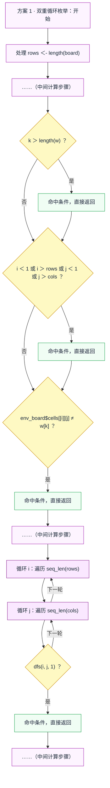

```r
# 版（方案1） 定义函数 exist（参数：棋盘, 单词）
exist <- function(board, word) {
    rows <- length(board)  # 把 长度(棋盘) 存入 行数
    cols <- length(board[[1]])  # 把 长度(棋盘[[1]]) 存入 列数
    w <- strsplit(word, "")[[1]]  # 把 strsplit(单词, 「」)[[1]] 存入 权重
    dfs <- function(i, j, k) {
        # 定义函数 dfs（参数：下标 i, 下标 j, 下标 k）
        if (k > length(w))
            return(TRUE)  # 若 下标 k 超过 长度(权重)) return(TRUE
        if (i < 1 || i > rows || j < 1 || j > cols)
            return(FALSE)
        if (env_board$cells[[i]][j] != w[k])
            return(FALSE)  # 若 env_board$cells[[下标 i]][下标 j] 不等于 权重[下标 k]) return(FALSE
        saved <- env_board$cells[[i]][j]  # 把 env_board$cells[[下标 i]][下标 j] 存入 saved
        env_board$cells[[i]][j] <<- "#"
        found <- dfs(i + 1, j, k + 1) || dfs(i - 1, j, k + 1) || dfs(i, j + 1, k + 1) || dfs(i, j - 1, k + 1)
        env_board$cells[[i]][j] <<- saved  # env_board$cells[[下标 i]][下标 j] 小于 小于 减 saved
        found  # found
    }
    env_board <- new.env(parent = emptyenv())  # 把 new.env(parent 赋值为 emptyenv()) 存入 env_board
    env_board$cells <- lapply(board, function(r) r)  # 把 lapply(棋盘, function(右指针) 右指针) 存入 env_board$cells
    for (i in seq_len(rows)) {
        # for (下标 i in seq_len(行数)) { for (下标 j in seq_len(列数)) {
        for (j in seq_len(cols)) {
            if (dfs(i, j, 1))
                return(TRUE)  # 若 dfs(下标 i, 下标 j, 1)) return(TRUE
        }
    }
    FALSE  # FALSE
}
b <- list(c("A", "B", "C", "E"), c("S", "F", "C", "S"), c("A", "D", "E", "E"))
stopifnot(exist(b, "ABCCED"))  # 断言校验
stopifnot(exist(b, "SEE"))  # 断言校验
stopifnot(!exist(b, "ABCB"))  # 断言校验
cat("PASS\n")  # 全部用例通过，输出 PASS
```

#### 方案 2：双重循环枚举

**思路与代码分析**：核心是「双重循环枚举」。R 版用向量化思维与 1 起始下标，注意 1:n 的降序陷阱。代码里依次做这些事：双重循环遍历。**走读**：方案 2 · 双重循环枚举：开始 → 处理 rows ＜- length(board) → 命中条件，直接返回 → 命中条件，直接返回 → 命中条件，直接返回 → 循环 i：遍历 seq_len(rows) → 循环 j：遍历 seq_len(cols) → 命中条件，直接返回。

**运行架构**（真实控制流）：


```r
# 版（方案2） 定义函数 exist（参数：棋盘, 单词）
exist <- function(board, word) {
    rows <- length(board)  # 把 长度(棋盘) 存入 行数
    cols <- length(board[[1]])  # 把 长度(棋盘[[1]]) 存入 列数
    w <- strsplit(word, "")[[1]]  # 把 strsplit(单词, 「」)[[1]] 存入 权重
    dfs <- function(i, j, k) {
        # 定义函数 dfs（参数：下标 i, 下标 j, 下标 k）
        if (k > length(w))
            return(TRUE)  # 若 下标 k 超过 长度(权重)) return(TRUE
        if (i < 1 || i > rows || j < 1 || j > cols)
            return(FALSE)
        if (env_board$cells[[i]][j] != w[k])
            return(FALSE)  # 若 env_board$cells[[下标 i]][下标 j] 不等于 权重[下标 k]) return(FALSE
        saved <- env_board$cells[[i]][j]  # 把 env_board$cells[[下标 i]][下标 j] 存入 saved
        env_board$cells[[i]][j] <<- "#"
        found <- dfs(i + 1, j, k + 1) || dfs(i - 1, j, k + 1) || dfs(i, j + 1, k + 1) || dfs(i, j - 1, k + 1)
        env_board$cells[[i]][j] <<- saved  # env_board$cells[[下标 i]][下标 j] 小于 小于 减 saved
        found  # found
    }
    env_board <- new.env(parent = emptyenv())  # 把 new.env(parent 赋值为 emptyenv()) 存入 env_board
    env_board$cells <- lapply(board, function(r) r)  # 把 lapply(棋盘, function(右指针) 右指针) 存入 env_board$cells
    for (i in seq_len(rows)) {
        # for (下标 i in seq_len(行数)) { for (下标 j in seq_len(列数)) {
        for (j in seq_len(cols)) {
            if (dfs(i, j, 1))
                return(TRUE)  # 若 dfs(下标 i, 下标 j, 1)) return(TRUE
        }
    }
    FALSE  # FALSE
}
b <- list(c("A", "B", "C", "E"), c("S", "F", "C", "S"), c("A", "D", "E", "E"))
stopifnot(exist(b, "ABCCED"))  # 断言校验
stopifnot(exist(b, "SEE"))  # 断言校验
stopifnot(!exist(b, "ABCB"))  # 断言校验
cat("PASS\n")  # 全部用例通过，输出 PASS
```

### Zig 实现（2 种方案）

Zig 的全部方案如下，每个方案都内嵌用例自测，可独立运行（老仓库 python/go 文件遵循「打印结果」约定）：

#### 方案 1：双重循环枚举

**思路与代码分析**：核心是「双重循环枚举」。Zig 版显式分配与清零，整型边界处理严格。代码里依次做这些事：双重循环遍历。**走读**：方案 1 · 双重循环枚举：开始 → 计算 board → 命中条件，直接返回 → 命中条件，直接返回 → 命中条件，直接返回 → 返回 found → 遍历集合元素 → 遍历集合元素 → 命中条件，直接返回 → 返回 false。

**运行架构**（真实控制流）：

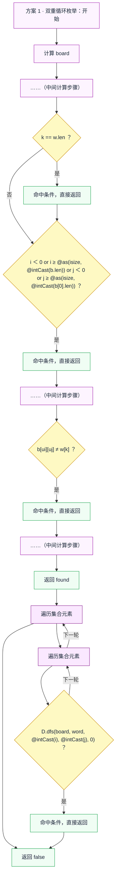

```zig
// LeetCode 79. 单词搜索 — Zig 版（方案1）
const std = @import("std"); // 把 @import(「std」) 存入 std
fn exist(board_in: []const []u8, word: []const u8) bool { // 定义函数/方法 exist
    const board = board_in; // 把 board_in 存入 棋盘
    const rows = board.len; // 把 棋盘.长度 存入 行数
    const cols = board[0].len; // 把 棋盘[0].长度 存入 列数
    const D = struct { // 把 struct { 存入 D
        fn dfs(b: []const []u8, w: []const u8, i: isize, j: isize, k: usize) bool { // 定义函数/方法 dfs
            if (k == w.len) return true; // 若 下标 k 等于 权重.长度，直接返回 true
            if (i < 0 or i >= @as(isize, @intCast(b.len)) or j < 0 or j >= @as(isize, @intCast(b[0].len))) return false;
            const ui: usize = @intCast(i); // 把 @intCast(下标 i); 写入 const ui: usize
            const uj: usize = @intCast(j); // 把 @intCast(下标 j); 写入 const uj: usize
            if (b[ui][uj] != w[k]) return false; // 若 b[ui][uj] 不等于 权重[下标 k]，直接返回 false
            const saved = b[ui][uj]; // 把 b[ui][uj] 存入 saved
            b[ui][uj] = '#'; // 把 '#'; 写入 b[ui][uj]
            const found = dfs(b, w, i + 1, j, k + 1) or dfs(b, w, i - 1, j, k + 1) or dfs(b, w, i, j + 1, k + 1) or dfs(b, w, i, j - 1, k + 1);
            b[ui][uj] = saved; // 把 saved; 写入 b[ui][uj]
            return found; // 返回 found
        }
    };
    for (0..rows) |i| { // 让 下标 i 从 0 走到 行数 减一
        for (0..cols) |j| { // 让 下标 j 从 0 走到 列数 减一
            if (D.dfs(board, word, @intCast(i), @intCast(j), 0)) return true; // 若 D.dfs(棋盘, 单词, @intCast(下标 i), @intCast(下标 j), 0)，直接返回 true
        }
    }
    return false; // 返回 false
}
pub fn main() !void { // 程序入口：跑内嵌自测用例
    var arena = std.heap.ArenaAllocator.init(std.heap.page_allocator); // 把 std.堆.ArenaAllocator.init(std.堆.page_allocator) 存入 arena
    defer arena.deinit(); // defer arena.deinit();
    const alloc = arena.allocator(); // 把 arena.allocator() 存入 alloc
    const b0 = alloc.dupe(u8, "ABCE") catch unreachable; // 把 alloc.dupe(u8, 「ABCE」) catch unreachable 存入 b0
    const b1 = alloc.dupe(u8, "SFCS") catch unreachable; // 把 alloc.dupe(u8, 「SFCS」) catch unreachable 存入 b1
    const b2 = alloc.dupe(u8, "ADEE") catch unreachable; // 把 alloc.dupe(u8, 「ADEE」) catch unreachable 存入 b2
    const board = [_][]u8{ b0, b1, b2 }; // 把 [_][]u8{ b0, b1, b2 } 存入 棋盘
    if (!exist(&board, "ABCCED")) return error.TestFailed; // 若 取反 exist( 按位与 棋盘, 「ABCCED」)，直接返回 error.TestFailed
    if (!exist(&board, "SEE")) return error.TestFailed; // 若 取反 exist( 按位与 棋盘, 「SEE」)，直接返回 error.TestFailed
    if (exist(&board, "ABCB")) return error.TestFailed; // 若 exist( 按位与 棋盘, 「ABCB」)，直接返回 error.TestFailed
    std.debug.print("PASS\n", .{}); // 全部用例通过，输出 PASS
}
```

#### 方案 2：双重循环枚举

**思路与代码分析**：核心是「双重循环枚举」。Zig 版显式分配与清零，整型边界处理严格。代码里依次做这些事：双重循环遍历。**走读**：方案 2 · 双重循环枚举：开始 → 计算 board → 命中条件，直接返回 → 命中条件，直接返回 → 命中条件，直接返回 → 返回 found → 遍历集合元素 → 遍历集合元素 → 命中条件，直接返回 → 返回 false。

**运行架构**（真实控制流）：

```mermaid
graph TD
    N0["方案 2 · 双重循环枚举：开始"]
    N1["计算 board"]
    D1["……（中间计算步骤）"]
    N5{"k == w.len ？"}
    N6["命中条件，直接返回"]
    N7{"i ＜ 0 or i ≥ @as(isize, @intCast(b.len)) or j ＜ 0 or j ≥ @as(isize, @intCast(b[0].len)) ？"}
    N8["命中条件，直接返回"]
    D2["……（中间计算步骤）"]
    N11{"b[ui][uj] ≠ w[k] ？"}
    N12["命中条件，直接返回"]
    D3["……（中间计算步骤）"]
    N17["返回 found"]
    N18["遍历集合元素"]
    N19["遍历集合元素"]
    N20{"D.dfs(board, word, @intCast(i), @intCast(j), 0) ？"}
    N21["命中条件，直接返回"]
    N22["返回 false"]
    N0 --> N1
    N5 -- 是 --> N6
    N5 -- 否 --> N7
    N7 -- 是 --> N8
    N11 -- 是 --> N12
    N17 --> N18
    N18 --> N19
    N19 --> N20
    N20 -- 是 --> N21
    N20 -- 下一轮 --> N19
    N19 -- 下一轮 --> N18
    N18 --> N22
    N1 --> D1
    D1 --> N5
    N6 --> N7
    N8 --> D2
    D2 --> N11
    N12 --> D3
    D3 --> N17
    N21 --> N22
    classDef n fill:#fdf4ff,stroke:#a21caf,color:#1e293b;
    classDef lp fill:#fae8ff,stroke:#86198f,color:#1e293b;
    classDef dc fill:#fef9c3,stroke:#ca8a04,color:#1e293b;
    classDef tm fill:#f0fdf4,stroke:#16a34a,color:#1e293b;
    class N0,N1,D1,D2,D3 n;
    class N18,N19 lp;
    class N5,N7,N11,N20 dc;
    class N6,N8,N12,N17,N21,N22 tm;
```

```zig
// LeetCode 79. 单词搜索 — Zig 版（方案2）
const std = @import("std"); // 把 @import(「std」) 存入 std
fn exist(board_in: []const []u8, word: []const u8) bool { // 定义函数/方法 exist
    const board = board_in; // 把 board_in 存入 棋盘
    const rows = board.len; // 把 棋盘.长度 存入 行数
    const cols = board[0].len; // 把 棋盘[0].长度 存入 列数
    const D = struct { // 把 struct { 存入 D
        fn dfs(b: []const []u8, w: []const u8, i: isize, j: isize, k: usize) bool { // 定义函数/方法 dfs
            if (k == w.len) return true; // 若 下标 k 等于 权重.长度，直接返回 true
            if (i < 0 or i >= @as(isize, @intCast(b.len)) or j < 0 or j >= @as(isize, @intCast(b[0].len))) return false;
            const ui: usize = @intCast(i); // 把 @intCast(下标 i); 写入 const ui: usize
            const uj: usize = @intCast(j); // 把 @intCast(下标 j); 写入 const uj: usize
            if (b[ui][uj] != w[k]) return false; // 若 b[ui][uj] 不等于 权重[下标 k]，直接返回 false
            const saved = b[ui][uj]; // 把 b[ui][uj] 存入 saved
            b[ui][uj] = '#'; // 把 '#'; 写入 b[ui][uj]
            const found = dfs(b, w, i + 1, j, k + 1) or dfs(b, w, i - 1, j, k + 1) or dfs(b, w, i, j + 1, k + 1) or dfs(b, w, i, j - 1, k + 1);
            b[ui][uj] = saved; // 把 saved; 写入 b[ui][uj]
            return found; // 返回 found
        }
    };
    for (0..rows) |i| { // 让 下标 i 从 0 走到 行数 减一
        for (0..cols) |j| { // 让 下标 j 从 0 走到 列数 减一
            if (D.dfs(board, word, @intCast(i), @intCast(j), 0)) return true; // 若 D.dfs(棋盘, 单词, @intCast(下标 i), @intCast(下标 j), 0)，直接返回 true
        }
    }
    return false; // 返回 false
}
pub fn main() !void { // 程序入口：跑内嵌自测用例
    var arena = std.heap.ArenaAllocator.init(std.heap.page_allocator); // 把 std.堆.ArenaAllocator.init(std.堆.page_allocator) 存入 arena
    defer arena.deinit(); // defer arena.deinit();
    const alloc = arena.allocator(); // 把 arena.allocator() 存入 alloc
    const b0 = alloc.dupe(u8, "ABCE") catch unreachable; // 把 alloc.dupe(u8, 「ABCE」) catch unreachable 存入 b0
    const b1 = alloc.dupe(u8, "SFCS") catch unreachable; // 把 alloc.dupe(u8, 「SFCS」) catch unreachable 存入 b1
    const b2 = alloc.dupe(u8, "ADEE") catch unreachable; // 把 alloc.dupe(u8, 「ADEE」) catch unreachable 存入 b2
    const board = [_][]u8{ b0, b1, b2 }; // 把 [_][]u8{ b0, b1, b2 } 存入 棋盘
    if (!exist(&board, "ABCCED")) return error.TestFailed; // 若 取反 exist( 按位与 棋盘, 「ABCCED」)，直接返回 error.TestFailed
    if (!exist(&board, "SEE")) return error.TestFailed; // 若 取反 exist( 按位与 棋盘, 「SEE」)，直接返回 error.TestFailed
    if (exist(&board, "ABCB")) return error.TestFailed; // 若 exist( 按位与 棋盘, 「ABCB」)，直接返回 error.TestFailed
    std.debug.print("PASS\n", .{}); // 全部用例通过，输出 PASS
}
```

### Dart 实现（2 种方案）

Dart 的全部方案如下，每个方案都内嵌用例自测，可独立运行（老仓库 python/go 文件遵循「打印结果」约定）：

#### 方案 1：双重循环枚举

**思路与代码分析**：核心是「双重循环枚举」。Dart 版用可空类型标注与集合方法，注意空安全。代码里依次做这些事：双重循环遍历。**走读**：方案 1 · 双重循环枚举：开始 → 更新 rows → 命中条件，直接返回 → 命中条件，直接返回 → 返回 found → 遍历循环 → 遍历循环 → 命中条件，直接返回 → 返回 false。

**运行架构**（真实控制流）：

```mermaid
graph TD
    N0["方案 1 · 双重循环枚举：开始"]
    N1["更新 rows"]
    D1["……（中间计算步骤）"]
    N5{"k == w.length ？"}
    N6["命中条件，直接返回"]
    N7{"i ＜ 0 或 i ≥ rows 或 j ＜ 0 或 j ≥ cols 或 board[i][j] ≠ w[k] ？"}
    N8["命中条件，直接返回"]
    D2["……（中间计算步骤）"]
    N17["返回 found"]
    N18["遍历循环"]
    N19["遍历循环"]
    N20{"dfs(i, j, 0) ？"}
    N21["命中条件，直接返回"]
    N22["返回 false"]
    N0 --> N1
    N5 -- 是 --> N6
    N5 -- 否 --> N7
    N7 -- 是 --> N8
    N17 --> N18
    N18 --> N19
    N19 --> N20
    N20 -- 是 --> N21
    N20 -- 下一轮 --> N19
    N19 -- 下一轮 --> N18
    N18 --> N22
    N1 --> D1
    D1 --> N5
    N6 --> N7
    N8 --> D2
    D2 --> N17
    N21 --> N22
    classDef n fill:#fdf4ff,stroke:#a21caf,color:#1e293b;
    classDef lp fill:#fae8ff,stroke:#86198f,color:#1e293b;
    classDef dc fill:#fef9c3,stroke:#ca8a04,color:#1e293b;
    classDef tm fill:#f0fdf4,stroke:#16a34a,color:#1e293b;
    class N0,N1,D1,D2 n;
    class N18,N19 lp;
    class N5,N7,N20 dc;
    class N6,N8,N17,N21,N22 tm;
```

```dart
// LeetCode 79. 单词搜索 — Dart 版（方案1）
bool exist(List<List<String>> board, String word) {
  // 定义函数/方法 exist
  final rows = board.length,
      cols = board[0].length; // 把 棋盘.长度, 列数 赋值为 棋盘[0].长度 存入 行数
  final w = word.split(''); // 把 单词.split('') 存入 权重
  bool dfs(int i, int j, int k) {
    // 定义函数/方法 dfs
    if (k == w.length) return true; // 若 下标 k 等于 权重.长度，直接返回 true
    if (i < 0 || i >= rows || j < 0 || j >= cols || board[i][j] != w[k])
      return false;
    final saved = board[i][j]; // 把 棋盘[下标 i][下标 j] 存入 saved
    board[i][j] = '#'; // 把 '#'; 写入 board[i][j]
    final found =
        dfs(i + 1, j, k + 1) ||
        dfs(i - 1, j, k + 1) ||
        dfs(i, j + 1, k + 1) ||
        dfs(i, j - 1, k + 1);
    board[i][j] = saved; // 把 saved; 写入 board[i][j]
    return found; // 返回 found
  }

  for (var i = 0; i < rows; i++) {
    // 让 下标 i 从 0 开始计数，下标 i 小于 行数 就继续
    for (var j = 0; j < cols; j++) {
      // 让 下标 j 从 0 开始计数，下标 j 小于 列数 就继续
      if (dfs(i, j, 0)) return true; // 若 dfs(下标 i, 下标 j, 0)，直接返回 true
    }
  }
  return false; // 返回 false
}

void main() {
  // 程序入口：跑内嵌自测用例
  final b = [
    ['A', 'B', 'C', 'E'],
    ['S', 'F', 'C', 'S'],
    ['A', 'D', 'E', 'E'],
  ];
  if (!exist(b, 'ABCCED'))
    throw StateError('c1'); // 若 取反 exist(b, 'ABCCED')) throw StateError('c1');
  if (!exist(b, 'SEE'))
    throw StateError('c2'); // 若 取反 exist(b, 'SEE')) throw StateError('c2');
  if (exist(b, 'ABCB'))
    throw StateError('c3'); // 若 exist(b, 'ABCB')) throw StateError('c3');
  print('PASS'); // 全部用例通过，输出 PASS
}
```

#### 方案 2：双重循环枚举

**思路与代码分析**：核心是「双重循环枚举」。Dart 版用可空类型标注与集合方法，注意空安全。代码里依次做这些事：双重循环遍历。**走读**：方案 2 · 双重循环枚举：开始 → 更新 rows → 命中条件，直接返回 → 命中条件，直接返回 → 返回 found → 遍历循环 → 遍历循环 → 命中条件，直接返回 → 返回 false。

**运行架构**（真实控制流）：

```mermaid
graph TD
    N0["方案 2 · 双重循环枚举：开始"]
    N1["更新 rows"]
    D1["……（中间计算步骤）"]
    N5{"k == w.length ？"}
    N6["命中条件，直接返回"]
    N7{"i ＜ 0 或 i ≥ rows 或 j ＜ 0 或 j ≥ cols 或 board[i][j] ≠ w[k] ？"}
    N8["命中条件，直接返回"]
    D2["……（中间计算步骤）"]
    N17["返回 found"]
    N18["遍历循环"]
    N19["遍历循环"]
    N20{"dfs(i, j, 0) ？"}
    N21["命中条件，直接返回"]
    N22["返回 false"]
    N0 --> N1
    N5 -- 是 --> N6
    N5 -- 否 --> N7
    N7 -- 是 --> N8
    N17 --> N18
    N18 --> N19
    N19 --> N20
    N20 -- 是 --> N21
    N20 -- 下一轮 --> N19
    N19 -- 下一轮 --> N18
    N18 --> N22
    N1 --> D1
    D1 --> N5
    N6 --> N7
    N8 --> D2
    D2 --> N17
    N21 --> N22
    classDef n fill:#fdf4ff,stroke:#a21caf,color:#1e293b;
    classDef lp fill:#fae8ff,stroke:#86198f,color:#1e293b;
    classDef dc fill:#fef9c3,stroke:#ca8a04,color:#1e293b;
    classDef tm fill:#f0fdf4,stroke:#16a34a,color:#1e293b;
    class N0,N1,D1,D2 n;
    class N18,N19 lp;
    class N5,N7,N20 dc;
    class N6,N8,N17,N21,N22 tm;
```

```dart
// LeetCode 79. 单词搜索 — Dart 版（方案2）
bool exist(List<List<String>> board, String word) {
  // 定义函数/方法 exist
  final rows = board.length,
      cols = board[0].length; // 把 棋盘.长度, 列数 赋值为 棋盘[0].长度 存入 行数
  final w = word.split(''); // 把 单词.split('') 存入 权重
  bool dfs(int i, int j, int k) {
    // 定义函数/方法 dfs
    if (k == w.length) return true; // 若 下标 k 等于 权重.长度，直接返回 true
    if (i < 0 || i >= rows || j < 0 || j >= cols || board[i][j] != w[k])
      return false;
    final saved = board[i][j]; // 把 棋盘[下标 i][下标 j] 存入 saved
    board[i][j] = '#'; // 把 '#'; 写入 board[i][j]
    final found =
        dfs(i + 1, j, k + 1) ||
        dfs(i - 1, j, k + 1) ||
        dfs(i, j + 1, k + 1) ||
        dfs(i, j - 1, k + 1);
    board[i][j] = saved; // 把 saved; 写入 board[i][j]
    return found; // 返回 found
  }

  for (var i = 0; i < rows; i++) {
    // 让 下标 i 从 0 开始计数，下标 i 小于 行数 就继续
    for (var j = 0; j < cols; j++) {
      // 让 下标 j 从 0 开始计数，下标 j 小于 列数 就继续
      if (dfs(i, j, 0)) return true; // 若 dfs(下标 i, 下标 j, 0)，直接返回 true
    }
  }
  return false; // 返回 false
}

void main() {
  // 程序入口：跑内嵌自测用例
  final b = [
    ['A', 'B', 'C', 'E'],
    ['S', 'F', 'C', 'S'],
    ['A', 'D', 'E', 'E'],
  ];
  if (!exist(b, 'ABCCED'))
    throw StateError('c1'); // 若 取反 exist(b, 'ABCCED')) throw StateError('c1');
  if (!exist(b, 'SEE'))
    throw StateError('c2'); // 若 取反 exist(b, 'SEE')) throw StateError('c2');
  if (exist(b, 'ABCB'))
    throw StateError('c3'); // 若 exist(b, 'ABCB')) throw StateError('c3');
  print('PASS'); // 全部用例通过，输出 PASS
}
```

---

## 内容总结

- **单词搜索**（回溯 · Medium）：共 2 个方案，主线思路「双重循环枚举」；时间 O(n²)（两层嵌套扫描）；动画演示回溯棋盘过程，附录给出 11 种语言 × 全部方案的可运行实现。
- 来源博客：[https://blog.csdn.net/tyro_java/article/details/145240191](https://blog.csdn.net/tyro_java/article/details/145240191)
- 导航：[📋 总目录](../) ｜ [← 164 子集](../164_子集/) ｜ [166 复原 ip 地址 →](../166_复原_ip_地址/)
