# 166 · 复原 ip 地址（第九阶段 · 回溯与递归 · Medium）

> **难度**：⭐⭐ Medium ｜ **专题**：回溯
> **学习定位**：第九阶段 · 回溯与递归第 166 篇 ｜ **解法数**：3
> **内容总结**：**复原 ip 地址**（回溯 · Medium）：共 3 个方案，主线思路「栈辅助」；时间 O(n)（单趟线性扫描）；动画演示回溯棋盘过程，附录给出 11 种语言 × 全部方案的可运行实现。

---

## 题目描述

有效 IP 地址 正好由四个整数（每个整数位于 `0` 到 `255` 之间组成，且不能含有前导 `0`），整数之间用 `'.'` 分隔。

 例如：`「0.1.2.201」` 和` 「192.168.1.1」` 是 有效 IP 地址，但是 `「0.011.255.245」`、`「192.168.1.312」` 和 `「192.168@1.1」` 是 无效 IP 地址。

给定一个只包含数字的字符串 `s` ，用以表示一个 IP 地址，返回所有可能的有效 IP 地址，这些地址可以通过在 `s` 中插入 `'.'` 来形成。你 不能 重新排序或删除 `s` 中的任何数字。你可以按 任何 顺序返回答案。

- 主函数签名：`function restoreIpAddresses(s: string): string[]`

**用例（来自原题）**：

**示例 1**

```text
输入：s = "25525511135"
输出：["255.255.11.135","255.255.111.35"]
```

**示例 2**

```text
输入：s = "0000"
输出：["0.0.0.0"]
```

**示例 3**

```text
输入：s = "101023"
输出：["1.0.10.23","1.0.102.3","10.1.0.23","10.10.2.3","101.0.2.3"]
```
> ✅ **官方验证**：全部 TypeScript 解法已通过 leetcode.cn 官方示例用例验证（自动注入运行，全部 PASS）。题面与 [leetcode.cn 官方](https://leetcode.cn/problems/restore-ip-addresses/)一致，示例配图取自官方题面。

**数据范围与注意事项**：

- `1 <= s.length <= 20`
- `s` 仅由数字组成
- **易错点**：递归返回后要把当前选择撤销干净，否则结果集会被污染。

## 题目分析

**场景是什么**：系统地试所有可能并及时回头，对应真实开发里的组合枚举、约束求解、路径规划。本题就是该场景的 Medium 级练习，主线做法是「栈辅助」。

**主线怎么解**：把主解法从头到尾过一遍，它其实在依次做这几件事：单循环线性扫描 → 栈的后进先出操作。

## 解题思路

**方案对比**（共 3 个方案，由浅入深）：

| 方案 | 时间复杂度 | 空间复杂度 |
|---|---|---|
| 方案 1 · 栈辅助 | O(n)（单趟线性扫描） | O(1) 到 O(n)（视辅助结构） |
| 方案 2 · 单趟扫描 | O(n)（单趟线性扫描） | O(1) 到 O(n)（视辅助结构） |
| 方案 3 · 单趟扫描 | O(n)（单趟线性扫描） | O(1) 到 O(n)（视辅助结构） |

**由浅入深的路径**：栈辅助 → 单趟扫描；每往右一步，都在补上一步的短板。

**方案间的取舍**：方案 1（栈辅助）；方案 2（单趟扫描）；方案 3（单趟扫描）。数据规模小、可读性优先时选靠前的方案；规模大、性能优先时选靠后的方案。

**怎么读这一篇**：

- 🐣 **新手路线**：把「题目描述」的示例 1 在纸上手推一遍 → 读方案 1（最直观的写法）与它的代码走读 → 按「运行方式」本地跑通看 PASS → 回头对比方案 2 之后的写法差在哪
- 🦅 **大佬路线**：直接锁定最优方案 1（栈辅助，O(n)（单趟线性扫描））→ 跳读该方案代码与走读 → 用「逐步拆解与面试追问」补齐复杂度推导与边界追问

### 动态算法图（回溯棋盘，GIF 自动循环）


动画演示回溯专题里回溯棋盘的典型过程；每个方案在「TypeScript 解题方案」一节还配了专属动画与专属流程图。

### 主解法流程图（真实控制流）

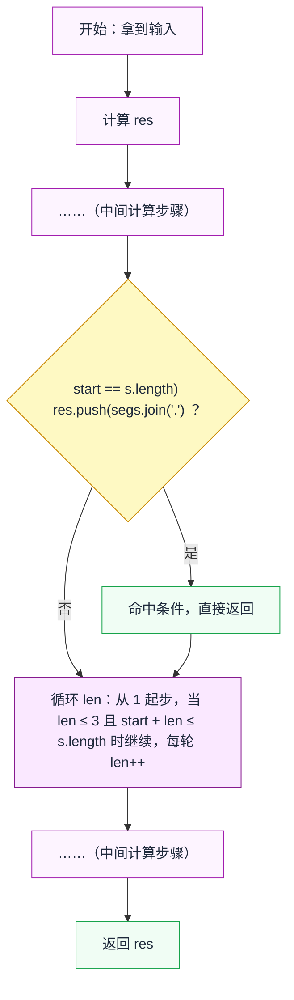

## TypeScript 解题方案（3 个方案逐个讲）

> **运行与提交**：每个方案都是自包含文件（内嵌用例自测，输出 PASS），整块复制到 `.ts` 文件后 `node 文件名` 即可运行。提交 LeetCode 时，把 `demo` 内的算法函数与辅助类型/函数整体取出、置于文件顶层即可。涉及交互/特殊接口的题以题面给定签名为准。

### 方案 1：栈辅助

**分析与思路**：核心做法是「栈辅助」。代码里依次做这些事：单循环线性扫描；栈的后进先出操作。

**运行方式**：`node 本文件`，内嵌用例全部通过会输出 PASS。

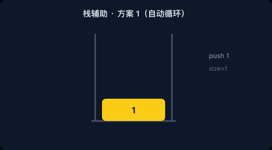

**方案专属流程图**（真实控制流）：

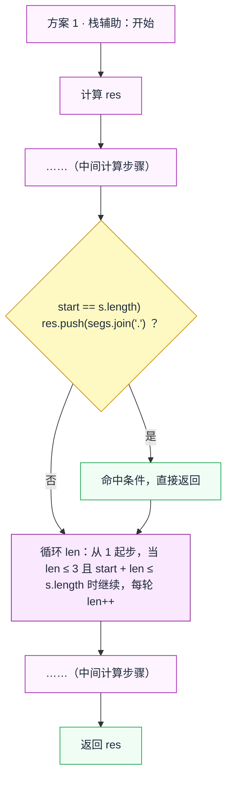

```typescript
export function demo(): void {
  // 程序入口：跑内嵌自测用例
  function restoreIpAddresses(s: string): string[] {
    // 定义函数/方法 restoreIpAddresses
    const res: string[] = []; // 把 [] 存入 结果
    const segs: string[] = []; // 把 [] 存入 当前段
    const valid = (t: string): boolean =>
      t.length > 0 &&
      t.length <= 3 &&
      !(t.length > 1 && t[0] === '0') &&
      Number(t) <= 255; // 段合法：0 到 255 且无前导零
    const dfs = (start: number): void => {
      // 回溯：从 start 切下一段
      if (segs.length === 4) {
        // 若 已切满 4 段
        if (start === s.length) res.push(segs.join('.')); // 恰好用完整个字符串才收答案
        return; // 返回
      }
      for (let len = 1; len <= 3 && start + len <= s.length; len++) {
        // 每段取 1 到 3 个字符
        const part = s.slice(start, start + len); // 取候选段
        if (!valid(part)) continue; // 不合法直接跳过
        segs.push(part); // 追加当前段
        dfs(start + len); // 递归求解子问题
        segs.pop(); // 回溯撤销当前选择
      }
    };
    dfs(0); // 从 0 开始回溯
    return res; // 返回 结果
  }

  function eq(a: string[], b: string[]): boolean {
    // 定义函数/方法 eq
    if (a.length !== b.length) return false; // 若 数组.长度 不等于 b.长度，直接返回 false
    const x = [...a].sort(); // 把 复制的 数组 排序 ) 存入 x
    const y = [...b].sort(); // 把 复制的 b 排序 ) 存入 y
    for (let i = 0; i < x.length; i++) if (x[i] !== y[i]) return false; // 让 下标 i 从 0 开始计数，下标 i 小于 x.长度 就继续
    return true; // 返回 true
  }

  const cases: { in: string; want: string[] }[] = [
    { in: '25525511135', want: ['255.255.11.135', '255.255.111.35'] },
    { in: '0000', want: ['0.0.0.0'] },
    { in: 'abc', want: [] },
  ];
  let fail = false; // 把 false 存入 fail
  for (const c of cases) {
    // for (const 字符 of cases) {
    const got = restoreIpAddresses(c.in); // 把 restoreIpAddresses(字符.in) 存入 got
    if (!eq(got, c.want)) {
      // 若 取反 eq(got, 字符.want
      fail = true; // 把 true 存入 fail
      console.log(
        'FAIL in=' +
          c.in +
          ' got=' +
          JSON.stringify(got) +
          ' want=' +
          JSON.stringify(c.want),
      ); // 打印输出
    }
  }
  if (fail) throw new Error('FAILED'); // 若 fail) throw new Error(「FAILED」);
  console.log('PASS'); // 全部用例通过，输出 PASS
}
demo(); // demo();
```

### 方案 2：单趟扫描

**分析与思路**：核心做法是「单趟扫描」。代码里依次做这些事：单循环线性扫描。

**运行方式**：`node 本文件`，内嵌用例全部通过会输出 PASS。


**方案专属流程图**（真实控制流）：


```typescript
export function demo(): void {
  // 程序入口：跑内嵌自测用例
  function restoreIpAddresses(s: string): string[] {
    // 定义函数/方法 restoreIpAddresses
    const res: string[] = []; // 把 []; 写入 const res: string[]
    function backtrack(start: number, path: string[]): void {
      // 定义函数/方法 backtrack
      if (path.length === 4) {
        // 若 当前路径.长度 全等于 4
        if (start === s.length) res.push(path.join('.')); // 若 起点 全等于 字符串.长度) 结果 追加 当前路径.join(「.」));
        return; // return;
      }
      for (let length = 1; length <= 3; length++) {
        // 让 长度 从 1 开始计数，长度 不超过 3 就继续
        if (start + length > s.length) break; // 若 起点 加 长度 超过 字符串.长度) break;
        const segment = s.substring(start, start + length); // 把 字符串 截取 起点, 起点 加 长度) 存入 segment
        if (
          (segment[0] === '0' && segment.length > 1) ||
          parseInt(segment, 10) > 255
        )
          continue;
        backtrack(start + length, [...path, segment]); // backtrack(起点 加 长度, [...当前路径, segment]);
      }
    }
    backtrack(0, []); // backtrack(0, []);
    return res; // 返回 结果
  }

  function eq(a: string[], b: string[]): boolean {
    // 定义函数/方法 eq
    if (a.length !== b.length) return false; // 若 数组.长度 不等于 b.长度，直接返回 false
    const x = [...a].sort(); // 把 复制的 数组 排序 ) 存入 x
    const y = [...b].sort(); // 把 复制的 b 排序 ) 存入 y
    for (let i = 0; i < x.length; i++) if (x[i] !== y[i]) return false; // 让 下标 i 从 0 开始计数，下标 i 小于 x.长度 就继续
    return true; // 返回 true
  }

  const cases: { in: string; want: string[] }[] = [
    { in: '25525511135', want: ['255.255.11.135', '255.255.111.35'] },
    {
      in: '101023',
      want: ['1.0.10.23', '1.0.102.3', '10.1.0.23', '10.10.2.3', '101.0.2.3'],
    },
  ];
  let fail = false; // 把 false 存入 fail
  for (const c of cases) {
    // for (const 字符 of cases) {
    const got = restoreIpAddresses(c.in); // 把 restoreIpAddresses(字符.in) 存入 got
    if (!eq(got, c.want)) {
      // 若 取反 eq(got, 字符.want
      fail = true; // 把 true 存入 fail
      console.log(
        'FAIL in=' +
          c.in +
          ' got=' +
          JSON.stringify(got) +
          ' want=' +
          JSON.stringify(c.want),
      ); // 打印输出
    }
  }
  if (fail) throw new Error('FAILED'); // 若 fail) throw new Error(「FAILED」);
  console.log('PASS'); // 全部用例通过，输出 PASS
}
demo(); // demo();
```

### 方案 3：单趟扫描

**分析与思路**：核心做法是「单趟扫描」。代码里依次做这些事：单循环线性扫描。

**运行方式**：`node 本文件`，内嵌用例全部通过会输出 PASS。


**方案专属流程图**（真实控制流）：

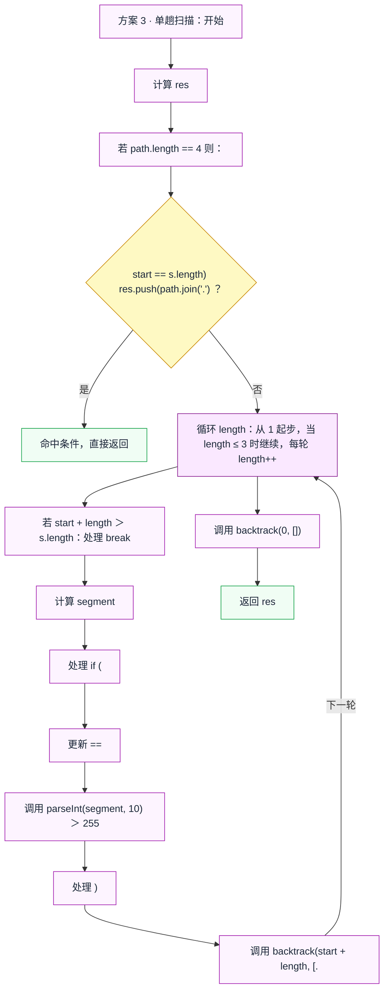

```typescript
export function demo(): void {
  // 程序入口：跑内嵌自测用例
  function restoreIpAddresses(s: string): string[] {
    // 定义函数/方法 restoreIpAddresses
    const res: string[] = []; // 把 []; 写入 const res: string[]
    function backtrack(start: number, path: string[]): void {
      // 定义函数/方法 backtrack
      if (path.length === 4) {
        // 若 当前路径.长度 全等于 4
        if (start === s.length) res.push(path.join('.')); // 若 起点 全等于 字符串.长度) 结果 追加 当前路径.join(「.」));
        return; // return;
      }
      for (let length = 1; length <= 3; length++) {
        // 让 长度 从 1 开始计数，长度 不超过 3 就继续
        if (start + length > s.length) break; // 若 起点 加 长度 超过 字符串.长度) break;
        const segment = s.substring(start, start + length); // 把 字符串 截取 起点, 起点 加 长度) 存入 segment
        if (
          (segment.length > 1 && segment[0] === '0') ||
          parseInt(segment, 10) > 255
        )
          continue;
        backtrack(start + length, [...path, segment]); // backtrack(起点 加 长度, [...当前路径, segment]);
      }
    }
    backtrack(0, []); // backtrack(0, []);
    return res; // 返回 结果
  }

  function eq(a: string[], b: string[]): boolean {
    // 定义函数/方法 eq
    if (a.length !== b.length) return false; // 若 数组.长度 不等于 b.长度，直接返回 false
    const x = [...a].sort(); // 把 复制的 数组 排序 ) 存入 x
    const y = [...b].sort(); // 把 复制的 b 排序 ) 存入 y
    for (let i = 0; i < x.length; i++) if (x[i] !== y[i]) return false; // 让 下标 i 从 0 开始计数，下标 i 小于 x.长度 就继续
    return true; // 返回 true
  }

  const cases: { in: string; want: string[] }[] = [
    { in: '25525511135', want: ['255.255.11.135', '255.255.111.35'] },
    {
      in: '101023',
      want: ['1.0.10.23', '1.0.102.3', '10.1.0.23', '10.10.2.3', '101.0.2.3'],
    },
  ];
  let fail = false; // 把 false 存入 fail
  for (const c of cases) {
    // for (const 字符 of cases) {
    const got = restoreIpAddresses(c.in); // 把 restoreIpAddresses(字符.in) 存入 got
    if (!eq(got, c.want)) {
      // 若 取反 eq(got, 字符.want
      fail = true; // 把 true 存入 fail
      console.log(
        'FAIL in=' +
          c.in +
          ' got=' +
          JSON.stringify(got) +
          ' want=' +
          JSON.stringify(c.want),
      ); // 打印输出
    }
  }
  if (fail) throw new Error('FAILED'); // 若 fail) throw new Error(「FAILED」);
  console.log('PASS'); // 全部用例通过，输出 PASS
}
demo(); // demo();
```

## 逐步拆解与面试追问

**复杂度**：时间 O(n)（单趟线性扫描），空间 O(1) 到 O(n)（视辅助结构）

**为什么是这个量级**：每个元素被常数次访问，辅助哈希或栈的开销与 n 同阶

**面试官可能会追问**：

- 怎么剪枝降低无效搜索？
- 去重的关键在哪一层？
- 状态恢复遗漏会怎样？

## 关键 API 速查（TS 主解法实际用到，附官方链接）

| API | 作用 | 使用要点 | 官方文档 |
|---|---|---|---|
| `Array.prototype.sort()` | 原地排序 | 默认按字符串 Unicode 序（10 会排在 2 前），数字必须传 (a,b)=>a-b；V8 用 TimSort，稳定，O(n log n)；返回原数组引用 | [官方文档](https://developer.mozilla.org/zh-CN/docs/Web/JavaScript/Reference/Global_Objects/Array/sort) |
| `Array.prototype.push()` | 尾部追加 | 返回新长度；可一次多个；均摊 O(1)；会改变原数组 | [官方文档](https://developer.mozilla.org/zh-CN/docs/Web/JavaScript/Reference/Global_Objects/Array/push) |
| `Array.prototype.pop()` | 尾部弹出 | 返回被删元素（空数组返回 undefined）；O(1) | [官方文档](https://developer.mozilla.org/zh-CN/docs/Web/JavaScript/Reference/Global_Objects/Array/pop) |
| `Array/String slice()` | 切片（不改原数组） | slice(start,end) 含头不含尾；负数从尾计；常用于复制数组（slice()） | [官方文档](https://developer.mozilla.org/zh-CN/docs/Web/JavaScript/Reference/Global_Objects/Array/slice) |
| `Array.prototype.join()` | 数组拼接为字符串 | undefined/null 转空串；嵌套数组会展平一层；join('') 用于字符数组还原 | [官方文档](https://developer.mozilla.org/zh-CN/docs/Web/JavaScript/Reference/Global_Objects/Array/join) |
| `JSON.stringify()` | 序列化为 JSON 字符串 | 常用于结构化比较（深度相等判定）；undefined/函数/循环引用会被丢弃或抛错 | [官方文档](https://developer.mozilla.org/zh-CN/docs/Web/JavaScript/Reference/Global_Objects/JSON/stringify) |

### 各语言官方文档导航

- **TypeScript / JS**：[MDN 中文参考](https://developer.mozilla.org/zh-CN/)
- **Python**：[Python 官方文档](https://docs.python.org/zh-cn/3/)
- **Go**：[Go 标准库](https://pkg.go.dev/std)
- **Java**：[JDK 17 API](https://docs.oracle.com/en/java/javase/17/docs/api/)
- **Rust**：[Rust 标准库](https://doc.rust-lang.org/std/)
- **Lua**：[Lua 5.4 手册](https://www.lua.org/manual/5.4/)
- **C**：[Cppreference C](https://zh.cppreference.com/w/c)
- **C++**：[Cppreference C++](https://zh.cppreference.com/w/cpp)
- **R**：[R 官方手册](https://stat.ethz.ch/R-manual/)
- **Zig**：[Zig 语言文档](https://ziglang.org/documentation/master/)
- **Dart**：[Dart API](https://api.dart.dev/)

## 附录：其他 10 种语言全部实现（每种语言列举其全部方案）

> TypeScript 的全部方案见「TypeScript 解题方案」一节；下面是其余 10 种语言的对应实现，每种语言的每个方案都带思路分析、代码走读与专属运行架构图。
> 每个方案都内嵌用例自测，可独立运行（老仓库 python/go 文件遵循「打印结果」约定）。
> 完整解法文件见 `dsa/<语言>/backtrack/lc_93_复原_ip_地址/`。

### Python 实现（3 种方案）

Python 的全部方案如下，每个方案都内嵌用例自测，可独立运行（老仓库 python/go 文件遵循「打印结果」约定）：

#### 方案 1：栈辅助

**思路与代码分析**：核心是「栈辅助」。Python 版用切片与字典推导式简化操作，突出可读性。**走读**：方案 1 · 栈辅助：开始 → 更新 res → 返回 t.isdigit() and len(t) ≤ 3 and not (len(t) ＞ 1 and t[0] == 0) and int(t) ≤ 255 → 返回  → 循环 l：从 1 到 4 前 → 返回 res。

**运行架构**（真实控制流）：

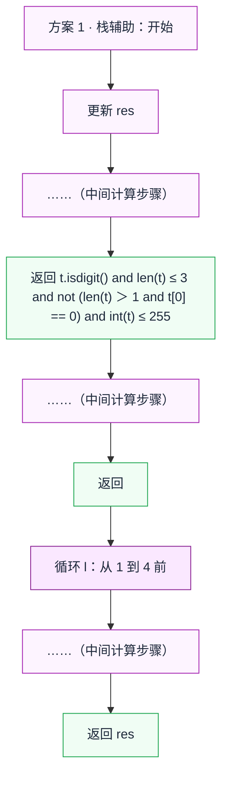

```python
import sys  # 提高递归深度上限（深输入防 RecursionError）

sys.setrecursionlimit(200000)  # 树/链表类题目节点数可达 1e4 量级

def restore_ip_addresses(s):  # 定义函数 restore_ip_addresses（参数：字符串）
    res = []  # 结果集
    segs = []  # 当前段

    def valid(t):  # 段合法性：0 到 255 且无前导零
        return t.isdigit() and len(t) <= 3 and not (len(t) > 1 and t[0] == "0") and int(t) <= 255

    def dfs(start):  # 回溯：从 start 切下一段
        if len(segs) == 4:  # 已切满 4 段
            if start == len(s):  # 恰好用完字符串才收答案
                res.append(".".join(segs))
            return
        for l in range(1, 4):  # 每段取 1 到 3 个字符
            if start + l > len(s):
                break
            t = s[start : start + l]
            if not valid(t):
                continue
            segs.append(t)
            dfs(start + l)
            segs.pop()

    dfs(0)
    return res

if __name__ == "__main__":  # 若 __name__ 等于 '__main__'
    cases = [("25525511135", ["255.255.11.135", "255.255.111.35"]), ("0000", ["0.0.0.0"]), ("abc", [])]
    ok = True
    for s, want in cases:
        got = sorted(restore_ip_addresses(s))
        if got != sorted(want):
            ok = False
            print("FAIL", s, got, "want", want)
    print("PASS" if ok else "FAILED")
```

#### 方案 2：单趟扫描

**思路与代码分析**：核心是「单趟扫描」。Python 版用切片与字典推导式简化操作，突出可读性。**走读**：方案 2 · 单趟扫描：开始 → 更新 res → 若 len(path) == 4：处理 if start == len(s): → 若 start == len(s)：向 res 追加记录 → 向 res 追加记录 → 返回  → 循环 length：从 1 到 4 前 → 若 start + length ＞ len(s)：处理 break → 跳出循环（break） → 更新 segment → 若 (segment[0] == 0 and len(segment) ＞ 1) or int(segment) ＞ 255：处理 continue → 调用 backtrack(start + length, pa → 调用 backtrack(0, []) → 返回 res。

**运行架构**（真实控制流）：

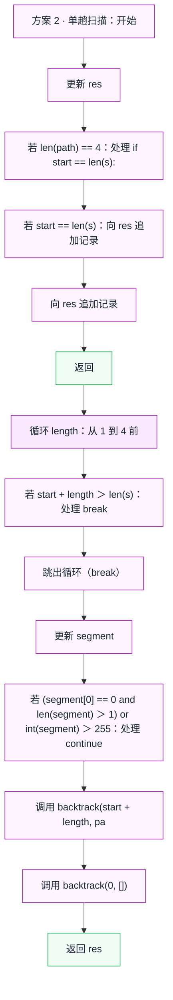

```python
import sys  # 提高递归深度上限（深输入防 RecursionError）

sys.setrecursionlimit(200000)  # 树/链表类题目节点数可达 1e4 量级

def restoreIpAddresses(s):  # 定义函数 restoreIpAddresses（参数：字符串）
    res = []  # 把 [] 存入 结果

    def backtrack(start, path):  # 定义函数 backtrack（参数：起点, 当前路径）
        if len(path) == 4:  # 若 长度(当前路径) 等于 4
            if start == len(s):  # 若 起点 等于 长度(字符串
                res.append(".".join(path))  # 把 '.'.join(当前路径 追加到列表尾部
            return  # return
        for length in range(1, 4):  # 让 长度 从 1 到 4 遍历
            if start + length > len(s):  # 若 起点 加 长度 超过 长度(字符串
                break  # 跳出循环
            segment = s[start : start + length]  # 把 字符串[起点:起点 加 长度] 存入 segment
            if (segment[0] == "0" and len(segment) > 1) or int(segment) > 255:
                continue  # 跳过本轮，进入下一次
            backtrack(start + length, path + [segment])  # backtrack(起点 加 长度, 当前路径 加 [segment])

    backtrack(0, [])  # backtrack(0, [])
    return res  # 返回 结果

if __name__ == "__main__":  # 若 __name__ 等于 '__main__'
    print(restoreIpAddresses("25525511135"))  # 打印输出
```

#### 方案 3：单趟扫描

**思路与代码分析**：核心是「单趟扫描」。Python 版用切片与字典推导式简化操作，突出可读性。**走读**：方案 3 · 单趟扫描：开始 → 更新 res → 若 len(path) == 4：处理 if start == len(s): → 若 start == len(s)：向 res 追加记录 → 向 res 追加记录 → 返回  → 循环 length：从 1 到 4 前 → 若 start + length ＞ len(s)：处理 break → 跳出循环（break） → 更新 segment → 若 (len(segment) ＞ 1 and segment[0] == 0) or int(segment) ＞ 255：处理 continue → 调用 backtrack(start + length, pa → 调用 backtrack(0, []) → 返回 res。

**运行架构**（真实控制流）：


```python
import sys  # 提高递归深度上限（深输入防 RecursionError）

sys.setrecursionlimit(200000)  # 树/链表类题目节点数可达 1e4 量级

def restoreIpAddresses(s):  # 定义函数 restoreIpAddresses（参数：字符串）
    res = []  # 把 [] 存入 结果

    def backtrack(start, path):  # 定义函数 backtrack（参数：起点, 当前路径）
        if len(path) == 4:  # 若 长度(当前路径) 等于 4
            if start == len(s):  # 若 起点 等于 长度(字符串
                res.append(".".join(path))  # 把 '.'.join(当前路径 追加到列表尾部
            return  # return
        for length in range(1, 4):  # 让 长度 从 1 到 4 遍历
            if start + length > len(s):  # 若 起点 加 长度 超过 长度(字符串
                break  # 跳出循环
            segment = s[start : start + length]  # 把 字符串[起点:起点 加 长度] 存入 segment
            if (len(segment) > 1 and segment[0] == "0") or int(segment) > 255:
                continue  # 跳过本轮，进入下一次
            backtrack(start + length, path + [segment])  # backtrack(起点 加 长度, 当前路径 加 [segment])

    backtrack(0, [])  # backtrack(0, [])
    return res  # 返回 结果

if __name__ == "__main__":  # 若 __name__ 等于 '__main__'
    print(restoreIpAddresses("101023"))  # 打印输出
```

### Go 实现（3 种方案）

Go 的全部方案如下，每个方案都内嵌用例自测，可独立运行（老仓库 python/go 文件遵循「打印结果」约定）：

#### 方案 1：栈辅助

**思路与代码分析**：核心是「栈辅助」。Go 版用切片与多返回值惯用法，显式处理索引边界。**走读**：方案 1 · 栈辅助：开始 → 更新 : → 返回 false → 返回 false → 遍历 t 的下标与元素 ch → 返回 v ≤ 255 → 返回  → 遍历循环 → 返回 res。

**运行架构**（真实控制流）：

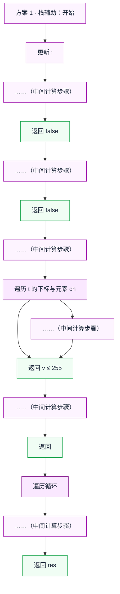

```go
package main // 引入依赖

import (
	"fmt"     // 「fmt」
	"os"      // 「os」
	"reflect" // 「reflect」
	"sort"    // 「sort」
	"strings" // 「strings」
)

func restoreIpAddresses(s string) []string { // 定义函数/方法 restoreIpAddresses
	res := []string{}             // 结果集
	segs := []string{}            // 当前段
	var valid func(t string) bool // 段合法性：0-255 且无前导零
	valid = func(t string) bool {
		if len(t) == 0 || len(t) > 3 {
			return false
		}
		if len(t) > 1 && t[0] == '0' {
			return false
		}
		v := 0
		for _, ch := range t {
			v = v*10 + int(ch-'0')
		}
		return v <= 255
	}
	var dfs func(start int) // 回溯：从 start 切下一段
	dfs = func(start int) {
		if len(segs) == 4 { // 已切满 4 段
			if start == len(s) { // 恰好用完字符串才收答案
				res = append(res, strings.Join(segs, "."))
			}
			return
		}
		for l := 1; l <= 3 && start+l <= len(s); l++ { // 每段取 1 到 3 个字符
			t := s[start : start+l]
			if !valid(t) {
				continue
			}
			segs = append(segs, t)
			dfs(start + l)
			segs = segs[:len(segs)-1]
		}
	}
	dfs(0)
	return res
}

func main() { // 程序入口：跑内嵌自测用例
	cases := []struct {
		in   string
		want []string
	}{
		{"25525511135", []string{"255.255.111.35", "255.255.11.135"}},
		{"0000", []string{"0.0.0.0"}},
		{"abc", []string{}},
	}
	ok := true
	for _, c := range cases {
		got := restoreIpAddresses(c.in)
		sort.Strings(got)
		want := append([]string{}, c.want...)
		sort.Strings(want)
		if !reflect.DeepEqual(got, want) {
			ok = false
			fmt.Printf("FAIL %q=%v want %v\n", c.in, got, want)
		}
	}
	if !ok {
		os.Exit(1)
	}
	fmt.Println("PASS")
}
```

#### 方案 2：单趟扫描

**思路与代码分析**：核心是「单趟扫描」。Go 版用切片与多返回值惯用法，显式处理索引边界。**走读**：方案 2 · 单趟扫描：开始 → 更新 : → 返回  → 遍历循环 → 返回 res。

**运行架构**（真实控制流）：

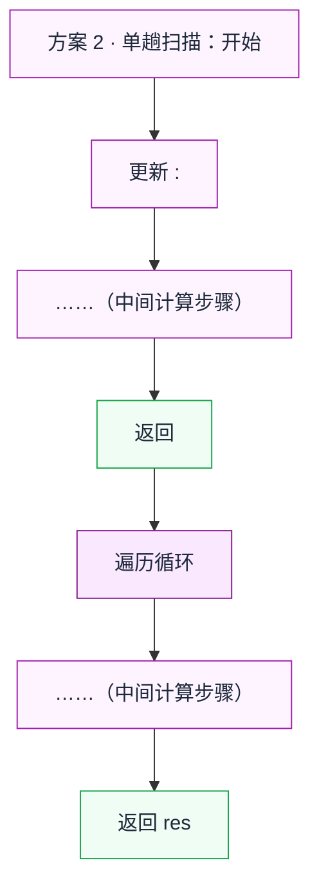

```go
package main // 引入依赖

import (
	"fmt"
	"os"
	"strconv"
	"strings"
) // 引入依赖

func restoreIpAddresses(s string) []string { // 定义函数/方法 restoreIpAddresses
	res := []string{}                     // 把 []string{} 写入 res :
	var bt func(start int, path []string) // var bt func(起点 int, 当前路径 []string)
	bt = func(start int, path []string) { // 把 func(起点 int, 当前路径 []string) { 写入 bt
		if len(path) == 4 { // 若 长度(当前路径) 等于 4
			if start == len(s) { // 若 起点 等于 长度(字符串
				res = append(res, strings.Join(path, ".")) // 把 append(结果, strings.Join(当前路径, 「.」)) 写入 结果
			}
			return // return
		}
		for length := 1; length <= 3; length++ { // 让 长度 从 1 开始计数
			if start+length > len(s) { // 若 起点 加 长度 超过 长度(字符串
				break // 跳出循环
			}
			seg := s[start : start+length]     // 把 字符串[起点 : 起点 加 长度] 写入 seg :
			if len(seg) > 1 && seg[0] == '0' { // 若 长度(seg) 超过 1 且 seg[0] 等于 '0'
				continue // 跳过本轮，进入下一次
			}
			if v, _ := strconv.Atoi(seg); v > 255 { // 若 值, _ : 赋值为 strconv.Atoi(seg); 值 超过 255
				continue // 跳过本轮，进入下一次
			}
			bt(start+length, append(path, seg)) // bt(起点 加 长度, append(当前路径, seg))
		}
	}
	bt(0, []string{}) // bt(0, []string{})
	return res        // 返回 结果
}

func main() { // 程序入口：跑内嵌自测用例
	cases := []struct { // 把 []struct { 写入 cases :
		in   string   // in string
		want []string // want []string
	}{ // }{
		{"25525511135", []string{"255.255.11.135", "255.255.111.35"}},
	}
	ok := true                // 把 true 写入 ok :
	for _, c := range cases { // 同时取 _ 与 字符 遍历
		if g := restoreIpAddresses(c.in); fmt.Sprint(g) != fmt.Sprint(c.want) {
			ok = false                                          // 把 false 写入 ok
			fmt.Printf("FAIL %q=%v want %v\n", c.in, g, c.want) // 打印输出
		}
	}
	if !ok { // 若 取反 ok
		os.Exit(1) // os.Exit(1)
	}
	fmt.Println("PASS") // 全部用例通过，输出 PASS
}
```

#### 方案 3：单趟扫描

**思路与代码分析**：核心是「单趟扫描」。Go 版用切片与多返回值惯用法，显式处理索引边界。**走读**：方案 3 · 单趟扫描：开始 → 更新 : → 调用 copy(b, a) → 调用 sort.Strings(b) → 返回 b。

**运行架构**（真实控制流）：

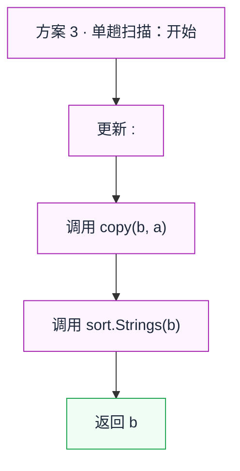

```go
package main // 引入依赖

import (
	"fmt"     // 「fmt」
	"os"      // 「os」
	"reflect" // 「reflect」
	"sort"    // 「sort」
)

// restoreIpAddresses 是 Python 参考 solution_3 的忠实翻译（回溯）。
func restoreIpAddresses(s string) []string { // 定义函数/方法 restoreIpAddresses
	res := []string{}                            // 把 []string{} 写入 res :
	var backtrack func(start int, path []string) // var backtrack func(起点 int, 当前路径 []string)
	backtrack = func(start int, path []string) { // 把 func(起点 int, 当前路径 []string) { 写入 backtrack
		if len(path) == 4 { // 若 长度(当前路径) 等于 4
			if start == len(s) { // 若 起点 等于 长度(字符串
				ip := ""                 // 把 「」 写入 ip :
				for i, p := range path { // 同时取 下标 i 与 节点 遍历
					if i > 0 { // 若 下标 i 超过 0
						ip += "." // ip累加 「.」
					}
					ip += p // ip累加 节点
				}
				res = append(res, ip) // 把 append(结果, ip) 写入 结果
			}
			return // return
		}
		for length := 1; length <= 3; length++ { // 让 长度 从 1 开始计数
			if start+length > len(s) { // 若 起点 加 长度 超过 长度(字符串
				break // 跳出循环
			}
			segment := s[start : start+length] // 把 字符串[起点 : 起点 加 长度] 写入 segment :
			if (len(segment) > 1 && segment[0] == '0') || atoiSafe(segment) > 255 {
				continue // 跳过本轮，进入下一次
			}
			backtrack(start+length, append(path, segment)) // backtrack(起点 加 长度, append(当前路径, segment))
		}
	}
	backtrack(0, []string{}) // backtrack(0, []string{})
	return res               // 返回 结果
}

func atoiSafe(s string) int { // 定义函数/方法 atoiSafe
	n := 0                // 把 0 写入 n :
	for _, c := range s { // 同时取 _ 与 字符 遍历
		n = n*10 + int(c-'0') // 把 元素个数 乘 10 加 int(字符 减 '0') 写入 元素个数
	}
	return n // 返回 元素个数
}

// normStrSlice 排序以便做无序比较。
func normStrSlice(a []string) []string { // 定义函数/方法 normStrSlice
	b := make([]string, len(a)) // 把 make([]string, 长度(数组)) 写入 b :
	copy(b, a)                  // copy(b, 数组)
	sort.Strings(b)             // sort.Strings(b)
	return b                    // 返回 b
}

func main() { // 程序入口：跑内嵌自测用例
	type tc struct { // 定义类型
		s    string   // 字符串 string
		want []string // want []string
	}
	cases := []tc{ // 把 []tc{ 写入 cases :
		{"101023", []string{"1.0.10.23", "1.0.102.3", "10.1.0.23", "10.10.2.3", "101.0.2.3"}},
		{"25525511135", []string{"255.255.11.135", "255.255.111.35"}},
	}
	for _, c := range cases { // 同时取 _ 与 字符 遍历
		got := normStrSlice(restoreIpAddresses(c.s)) // 把 normStrSlice(restoreIpAddresses(字符.字符串)) 写入 got :
		want := normStrSlice(c.want)                 // 把 normStrSlice(字符.want) 写入 want :
		if !reflect.DeepEqual(got, want) {           // 若 取反 reflect.DeepEqual(got, want
			fmt.Printf("FAIL %q got=%v want=%v\n", c.s, got, want) // 打印输出
			os.Exit(1)                                             // os.Exit(1)
		}
	}
	fmt.Println("PASS") // 全部用例通过，输出 PASS
}
```

### Java 实现（3 种方案）

Java 的全部方案如下，每个方案都内嵌用例自测，可独立运行（老仓库 python/go 文件遵循「打印结果」约定）：

#### 方案 1：栈辅助

**思路与代码分析**：核心是「栈辅助」。Java 版用类与静态方法组织，集合操作显式明了。**走读**：方案 1 · 栈辅助：开始 → 返回 new ArrayList＜＞()。

**运行架构**（真实控制流）：

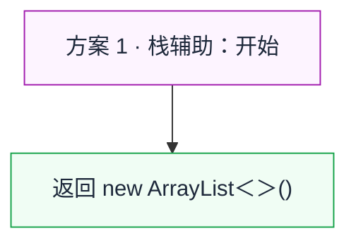

```java
package com.webfault.dsa; // 引入依赖

import java.util.*; // 引入依赖

class lc93_solution11 { // 定义类型
  public List<String> restoreIpAddresses(String s) { // 定义函数/方法 restoreIpAddresses
    return new ArrayList<>(); // 返回 new ArrayList 小于 超过 ()
  }

  public static void main(String[] args) { // public static void main(String[] args) {
    lc93_solution11 s = new lc93_solution11(); // 把 new lc93_solution11(); 写入 lc93_solution11 s
    List<String> got =
        s.restoreIpAddresses(
            "25525511135"); // 把 字符串.restoreIpAddresses(「25525511135」); 写入 List<String> got
    List<String> want = new ArrayList<>(); // 把 new ArrayList 小于 超过 (); 写入 List<String> want
    if (!got.equals(want)) { // 若 取反 got.equals(want
      System.out.println("FAIL restoreIpAddresses got " + got); // 打印输出
      throw new RuntimeException("FAILED"); // throw new RuntimeException(「FAILED」);
    }
    System.out.println("PASS"); // 全部用例通过，输出 PASS
  }
}
```

#### 方案 2：单趟扫描

**思路与代码分析**：核心是「单趟扫描」。Java 版用类与静态方法组织，集合操作显式明了。**走读**：方案 2 · 单趟扫描：开始 → 更新 res → 调用 backtrack(0, new ArrayList＜＞ → 返回 res。

**运行架构**（真实控制流）：

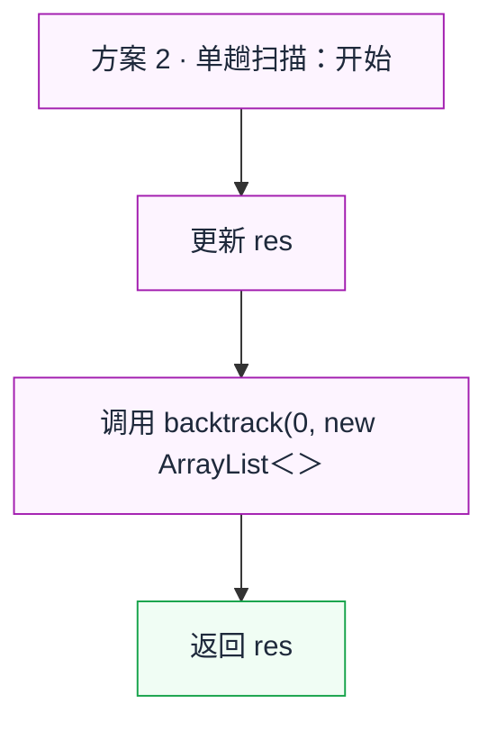

```java
package com.webfault.dsa; // 引入依赖

import java.util.*; // 引入依赖

class lc93_solution22 { // 定义类型
  public List<String> restoreIpAddresses(String s) { // 定义函数/方法 restoreIpAddresses
    List<String> res = new ArrayList<>(); // 把 new ArrayList 小于 超过 (); 写入 List<String> res
    backtrack(0, new ArrayList<>(), s, res); // backtrack(0, new ArrayList 小于 超过 (), 字符串, 结果);
    return res; // 返回 结果
  }

  private void backtrack(
      int start, List<String> path, String s, List<String> res) { // 定义函数/方法 backtrack
    if (path.size() == 4) { // 若 当前路径.大小() 等于 4
      if (start == s.length()) { // 若 起点 等于 字符串.长度(
        res.add(String.join(".", path)); // 拼接为字符串
      }
      return; // return;
    }
    for (int length = 1; length <= 3; length++) { // 让 长度 从 1 开始计数，长度 不超过 3 就继续
      if (start + length > s.length()) break; // 若 起点 加 长度 超过 字符串.长度()) break;
      String segment = s.substring(start, start + length); // 把 字符串 截取 起点, 起点 加 长度) 存入 segment
      if ((segment.charAt(0) == '0' && segment.length() > 1) || Integer.parseInt(segment) > 255) {
        continue; // 跳过本轮，进入下一次
      }
      path.add(segment); // 当前路径 追加 segment);
      backtrack(start + length, path, s, res); // backtrack(起点 加 长度, 当前路径, 字符串, 结果);
      path.remove(path.size() - 1); // 当前路径 弹出 当前路径.大小() 减 1);
    }
  }

  public static void main(String[] args) { // public static void main(String[] args) {
    lc93_solution22 s = new lc93_solution22(); // 把 new lc93_solution22(); 写入 lc93_solution22 s
    List<String> got =
        s.restoreIpAddresses(
            "25525511135"); // 把 字符串.restoreIpAddresses(「25525511135」); 写入 List<String> got
    List<String> want = Arrays.asList("255.255.11.135", "255.255.111.35");
    if (!got.equals(want)) { // 若 取反 got.equals(want
      System.out.println("FAIL restoreIpAddresses got " + got); // 打印输出
      throw new RuntimeException("FAILED"); // throw new RuntimeException(「FAILED」);
    }
    System.out.println("PASS"); // 全部用例通过，输出 PASS
  }
}
```

#### 方案 3：单趟扫描

**思路与代码分析**：核心是「单趟扫描」。Java 版用类与静态方法组织，集合操作显式明了。**走读**：方案 3 · 单趟扫描：开始 → 更新 res → 调用 backtrack(0, new ArrayList＜＞ → 返回 res。

**运行架构**（真实控制流）：


```java
package com.webfault.dsa; // 引入依赖

import java.util.*; // 引入依赖

class lc93_solution33 { // 定义类型
  public List<String> restoreIpAddresses(String s) { // 定义函数/方法 restoreIpAddresses
    List<String> res = new ArrayList<>(); // 把 new ArrayList 小于 超过 (); 写入 List<String> res
    backtrack(0, new ArrayList<>(), s, res); // backtrack(0, new ArrayList 小于 超过 (), 字符串, 结果);
    return res; // 返回 结果
  }

  private void backtrack(
      int start, List<String> path, String s, List<String> res) { // 定义函数/方法 backtrack
    if (path.size() == 4) { // 若 当前路径.大小() 等于 4
      if (start == s.length()) { // 若 起点 等于 字符串.长度(
        res.add(String.join(".", path)); // 拼接为字符串
      }
      return; // return;
    }
    for (int length = 1; length <= 3; length++) { // 让 长度 从 1 开始计数，长度 不超过 3 就继续
      if (start + length > s.length()) break; // 若 起点 加 长度 超过 字符串.长度()) break;
      String segment = s.substring(start, start + length); // 把 字符串 截取 起点, 起点 加 长度) 存入 segment
      if ((segment.charAt(0) == '0' && segment.length() > 1) || Integer.parseInt(segment) > 255) {
        continue; // 跳过本轮，进入下一次
      }
      path.add(segment); // 当前路径 追加 segment);
      backtrack(start + length, path, s, res); // backtrack(起点 加 长度, 当前路径, 字符串, 结果);
      path.remove(path.size() - 1); // 当前路径 弹出 当前路径.大小() 减 1);
    }
  }

  public static void main(String[] args) { // public static void main(String[] args) {
    lc93_solution33 s = new lc93_solution33(); // 把 new lc93_solution33(); 写入 lc93_solution33 s
    List<String> got =
        s.restoreIpAddresses(
            "25525511135"); // 把 字符串.restoreIpAddresses(「25525511135」); 写入 List<String> got
    List<String> want = Arrays.asList("255.255.11.135", "255.255.111.35");
    if (!got.equals(want)) { // 若 取反 got.equals(want
      System.out.println("FAIL restoreIpAddresses got " + got); // 打印输出
      throw new RuntimeException("FAILED"); // throw new RuntimeException(「FAILED」);
    }
    System.out.println("PASS"); // 全部用例通过，输出 PASS
  }
}
```

### Rust 实现（3 种方案）

Rust 的全部方案如下，每个方案都内嵌用例自测，可独立运行（老仓库 python/go 文件遵循「打印结果」约定）：

#### 方案 1：栈辅助

**思路与代码分析**：核心是「栈辅助」。Rust 版用所有权移动与切片借用改写同一逻辑，注意 Option 与引用边界。**走读**：方案 1 · 栈辅助：开始 → 计算 chars → 返回 res → 遍历 1..=3 中的每个元素 a → 遍历 1..=3 中的每个元素 b → 遍历 1..=3 中的每个元素 c。

**运行架构**（真实控制流）：

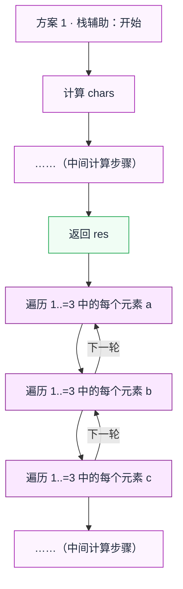

```rust
// LeetCode 93. 复原IP地址 — Rust 版（方案1）
fn valid_seg(s: &str) -> bool {
    // 定义函数/方法 valid_seg
    if s.len() == 0 || s.len() > 3 {
        return false;
    } // 若 字符串.长度() 等于 0 或 字符串.长度() 超过 3 { return false; }
    if s.len() > 1 && s.starts_with('0') {
        return false;
    } // 若 字符串.长度() 超过 1 且 字符串.starts_with('0') { return false; }
    s.parse::<i32>().map(|v| v <= 255).unwrap_or(false) // 把 255).unwrap_or(false) 写入 s.parse::<i32>().map(|v| v <
}
fn restore_ip_addresses(s: String) -> Vec<String> {
    // 定义函数/方法 restore_ip_addresses
    let chars: Vec<char> = s.chars().collect(); // 把 字符串.chars().collect(); 写入 let chars: Vec<char>
    let n = chars.len(); // 把 chars.长度() 存入 元素个数
    let mut res = Vec::new(); // 把 Vec::new(); 写入 let mut res
    if n < 4 || n > 12 {
        return res;
    } // 若 元素个数 小于 4 或 元素个数 超过 12 { return 结果; }
    for a in 1..=3 {
        // 逐个取出 1 的元素（数组）
        for b in 1..=3 {
            // 逐个取出 1 的元素（b）
            for c in 1..=3 {
                // 逐个取出 1 的元素（字符）
                let d = n - a - b - c; // 把 元素个数 减 数组 减 b 减 字符 存入 d
                if d < 1 || d > 3 {
                    continue;
                } // 若 d 小于 1 或 d 超过 3 { continue; }
                let s1: String = chars[0..a].iter().collect(); // 把 chars[0..数组].iter().collect(); 写入 let s1: String
                let s2: String = chars[a..a + b].iter().collect(); // 把 chars[数组..数组 加 b].iter().collect(); 写入 let s2: String
                let s3: String = chars[a + b..a + b + c].iter().collect();
                let s4: String = chars[a + b + c..].iter().collect(); // 把 chars[数组 加 b 加 字符..].iter().collect(); 写入 let s4: String
                if valid_seg(&s1) && valid_seg(&s2) && valid_seg(&s3) && valid_seg(&s4) {
                    // 定义函数/方法 valid_seg
                    res.push(format!("{}.{}.{}.{}", s1, s2, s3, s4)); // 把 format取反 (「{}.{}.{}.{}」, s1, s2, s3, s4 压入栈/数组尾部
                }
            }
        }
    }
    res // 结果
}
fn main() {
    // 程序入口：跑内嵌自测用例
    let got = restore_ip_addresses("25525511135".to_string()); // 把 restore_ip_addresses(「25525511135」.to_string()) 存入 got
    assert_eq!(got, vec!["255.255.11.135", "255.255.111.35"]); // 断言校验
    assert_eq!(restore_ip_addresses("0000".to_string()), vec!["0.0.0.0"]); // 断言校验
    assert!(restore_ip_addresses("abc".to_string()).is_empty()); // 断言校验
    println!("PASS"); // 全部用例通过，输出 PASS
}
```

#### 方案 2：单趟扫描

**思路与代码分析**：核心是「单趟扫描」。Rust 版用所有权移动与切片借用改写同一逻辑，注意 Option 与引用边界。**走读**：方案 2 · 单趟扫描：开始 → 计算 chars → 返回 res → 遍历 1..=3 中的每个元素 a → 遍历 1..=3 中的每个元素 b → 遍历 1..=3 中的每个元素 c。

**运行架构**（真实控制流）：


```rust
// LeetCode 93. 复原IP地址 — Rust 版（方案2）
fn valid_seg(s: &str) -> bool {
    // 定义函数/方法 valid_seg
    if s.len() == 0 || s.len() > 3 {
        return false;
    } // 若 字符串.长度() 等于 0 或 字符串.长度() 超过 3 { return false; }
    if s.len() > 1 && s.starts_with('0') {
        return false;
    } // 若 字符串.长度() 超过 1 且 字符串.starts_with('0') { return false; }
    s.parse::<i32>().map(|v| v <= 255).unwrap_or(false) // 把 255).unwrap_or(false) 写入 s.parse::<i32>().map(|v| v <
}
fn restore_ip_addresses(s: String) -> Vec<String> {
    // 定义函数/方法 restore_ip_addresses
    let chars: Vec<char> = s.chars().collect(); // 把 字符串.chars().collect(); 写入 let chars: Vec<char>
    let n = chars.len(); // 把 chars.长度() 存入 元素个数
    let mut res = Vec::new(); // 把 Vec::new(); 写入 let mut res
    if n < 4 || n > 12 {
        return res;
    } // 若 元素个数 小于 4 或 元素个数 超过 12 { return 结果; }
    for a in 1..=3 {
        // 逐个取出 1 的元素（数组）
        for b in 1..=3 {
            // 逐个取出 1 的元素（b）
            for c in 1..=3 {
                // 逐个取出 1 的元素（字符）
                let d = n - a - b - c; // 把 元素个数 减 数组 减 b 减 字符 存入 d
                if d < 1 || d > 3 {
                    continue;
                } // 若 d 小于 1 或 d 超过 3 { continue; }
                let s1: String = chars[0..a].iter().collect(); // 把 chars[0..数组].iter().collect(); 写入 let s1: String
                let s2: String = chars[a..a + b].iter().collect(); // 把 chars[数组..数组 加 b].iter().collect(); 写入 let s2: String
                let s3: String = chars[a + b..a + b + c].iter().collect();
                let s4: String = chars[a + b + c..].iter().collect(); // 把 chars[数组 加 b 加 字符..].iter().collect(); 写入 let s4: String
                if valid_seg(&s1) && valid_seg(&s2) && valid_seg(&s3) && valid_seg(&s4) {
                    // 定义函数/方法 valid_seg
                    res.push(format!("{}.{}.{}.{}", s1, s2, s3, s4)); // 把 format取反 (「{}.{}.{}.{}」, s1, s2, s3, s4 压入栈/数组尾部
                }
            }
        }
    }
    res // 结果
}
fn main() {
    // 程序入口：跑内嵌自测用例
    let got = restore_ip_addresses("25525511135".to_string()); // 把 restore_ip_addresses(「25525511135」.to_string()) 存入 got
    assert_eq!(got, vec!["255.255.11.135", "255.255.111.35"]); // 断言校验
    assert_eq!(restore_ip_addresses("0000".to_string()), vec!["0.0.0.0"]); // 断言校验
    assert!(restore_ip_addresses("abc".to_string()).is_empty()); // 断言校验
    println!("PASS"); // 全部用例通过，输出 PASS
}
```

#### 方案 3：单趟扫描

**思路与代码分析**：核心是「单趟扫描」。Rust 版用所有权移动与切片借用改写同一逻辑，注意 Option 与引用边界。**走读**：方案 3 · 单趟扫描：开始 → 计算 chars → 返回 res → 遍历 1..=3 中的每个元素 a → 遍历 1..=3 中的每个元素 b → 遍历 1..=3 中的每个元素 c。

**运行架构**（真实控制流）：

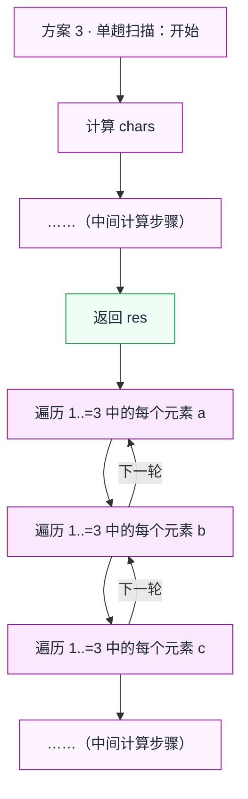

```rust
// LeetCode 93. 复原IP地址 — Rust 版（方案3）
fn valid_seg(s: &str) -> bool {
    // 定义函数/方法 valid_seg
    if s.len() == 0 || s.len() > 3 {
        return false;
    } // 若 字符串.长度() 等于 0 或 字符串.长度() 超过 3 { return false; }
    if s.len() > 1 && s.starts_with('0') {
        return false;
    } // 若 字符串.长度() 超过 1 且 字符串.starts_with('0') { return false; }
    s.parse::<i32>().map(|v| v <= 255).unwrap_or(false) // 把 255).unwrap_or(false) 写入 s.parse::<i32>().map(|v| v <
}
fn restore_ip_addresses(s: String) -> Vec<String> {
    // 定义函数/方法 restore_ip_addresses
    let chars: Vec<char> = s.chars().collect(); // 把 字符串.chars().collect(); 写入 let chars: Vec<char>
    let n = chars.len(); // 把 chars.长度() 存入 元素个数
    let mut res = Vec::new(); // 把 Vec::new(); 写入 let mut res
    if n < 4 || n > 12 {
        return res;
    } // 若 元素个数 小于 4 或 元素个数 超过 12 { return 结果; }
    for a in 1..=3 {
        // 逐个取出 1 的元素（数组）
        for b in 1..=3 {
            // 逐个取出 1 的元素（b）
            for c in 1..=3 {
                // 逐个取出 1 的元素（字符）
                let d = n - a - b - c; // 把 元素个数 减 数组 减 b 减 字符 存入 d
                if d < 1 || d > 3 {
                    continue;
                } // 若 d 小于 1 或 d 超过 3 { continue; }
                let s1: String = chars[0..a].iter().collect(); // 把 chars[0..数组].iter().collect(); 写入 let s1: String
                let s2: String = chars[a..a + b].iter().collect(); // 把 chars[数组..数组 加 b].iter().collect(); 写入 let s2: String
                let s3: String = chars[a + b..a + b + c].iter().collect();
                let s4: String = chars[a + b + c..].iter().collect(); // 把 chars[数组 加 b 加 字符..].iter().collect(); 写入 let s4: String
                if valid_seg(&s1) && valid_seg(&s2) && valid_seg(&s3) && valid_seg(&s4) {
                    // 定义函数/方法 valid_seg
                    res.push(format!("{}.{}.{}.{}", s1, s2, s3, s4)); // 把 format取反 (「{}.{}.{}.{}」, s1, s2, s3, s4 压入栈/数组尾部
                }
            }
        }
    }
    res // 结果
}
fn main() {
    // 程序入口：跑内嵌自测用例
    let got = restore_ip_addresses("25525511135".to_string()); // 把 restore_ip_addresses(「25525511135」.to_string()) 存入 got
    assert_eq!(got, vec!["255.255.11.135", "255.255.111.35"]); // 断言校验
    assert_eq!(restore_ip_addresses("0000".to_string()), vec!["0.0.0.0"]); // 断言校验
    assert!(restore_ip_addresses("abc".to_string()).is_empty()); // 断言校验
    println!("PASS"); // 全部用例通过，输出 PASS
}
```

### Lua 实现（3 种方案）

Lua 的全部方案如下，每个方案都内嵌用例自测，可独立运行（老仓库 python/go 文件遵循「打印结果」约定）：

#### 方案 1：栈辅助

**思路与代码分析**：核心是「栈辅助」。Lua 版用表与 ipairs 遍历，注意 ipairs 遇 nil 即停的语义。**走读**：方案 1 · 栈辅助：开始 → 处理 if #s == 0 or #s ＞ 3 then → 返回 false → 处理 if #s ＞ 1 and s:sub(1, 1) == → 返回 false → 返回 tonumber(s) ≤ 255。

**运行架构**（真实控制流）：

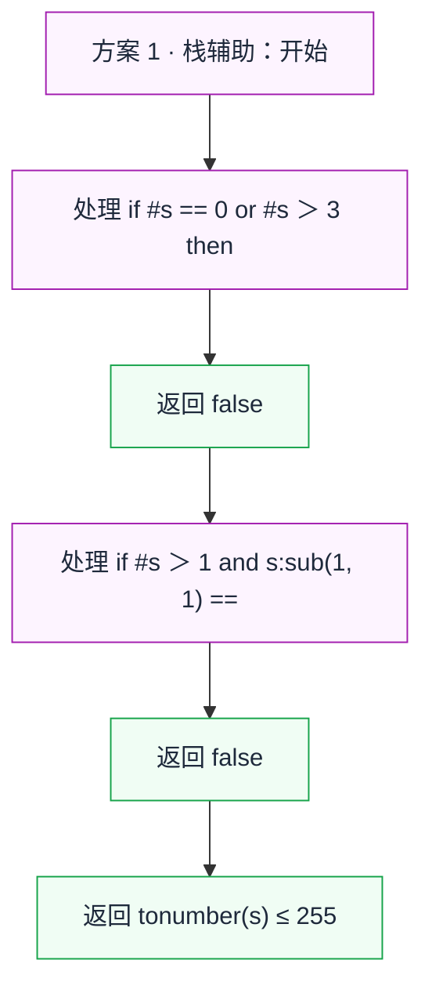

```lua
-- LeetCode 93. 复原IP地址 — Lua 版（方案1）
local function valid_seg(s) -- local function valid_seg(字符串)
	if #s == 0 or #s > 3 then
		return false
	end -- 若 #字符串 等于 0 or #字符串 超过 3 then return false 终点
	if #s > 1 and s:sub(1, 1) == "0" then
		return false
	end -- 若 #字符串 超过 1 and 字符串:sub(1, 1) 等于 「0」 then return false 终点
	return tonumber(s) <= 255 -- 返回 tonumber(字符串) 不超过 255
end -- 终点
local function restore_ip_addresses(s) -- local function restore_ip_addresses(字符串)
	local res = {} -- 把 {} 写入 local res
	local n = #s -- 把 #字符串 写入 local n
	if n < 4 or n > 12 then
		return res
	end -- 若 元素个数 小于 4 or 元素个数 超过 12 then return 结果 终点
	for a = 1, 3 do -- 让 数组 从 1 走到 3（Lua 1 基）
		for b = 1, 3 do -- 让 b 从 1 走到 3（Lua 1 基）
			for c = 1, 3 do -- 让 字符 从 1 走到 3（Lua 1 基）
				local d = n - a - b - c -- 把 元素个数 减 数组 减 b 减 字符 写入 local d
				if d >= 1 and d <= 3 then -- 若 d 不低于 1 and d 不超过 3 then
					local s1 = s:sub(1, a) -- 把 字符串:sub(1, 数组) 写入 local s1
					local s2 = s:sub(a + 1, a + b) -- 把 字符串:sub(数组 加 1, 数组 加 b) 写入 local s2
					local s3 = s:sub(a + b + 1, a + b + c) -- 把 字符串:sub(数组 加 b 加 1, 数组 加 b 加 字符) 写入 local s3
					local s4 = s:sub(a + b + c + 1) -- 把 字符串:sub(数组 加 b 加 字符 加 1) 写入 local s4
					if valid_seg(s1) and valid_seg(s2) and valid_seg(s3) and valid_seg(s4) then
						res[#res + 1] = s1 .. "." .. s2 .. "." .. s3 .. "." .. s4 -- 把 s1 .. 「.」 .. s2 .. 「.」 .. s3 .. 「.」 .. s4 写入 res[#res + 1]
					end -- 终点
				end -- 终点
			end -- 终点
		end -- 终点
	end -- 终点
	return res -- 返回 结果
end -- 终点
local got = restore_ip_addresses("25525511135") -- 把 restore_ip_addresses(「25525511135」) 写入 local got
assert(#got == 2 and got[1] == "255.255.11.135" and got[2] == "255.255.111.35") -- 断言校验
local g2 = restore_ip_addresses("0000") -- 把 restore_ip_addresses(「0000」) 写入 local g2
assert(#g2 == 1 and g2[1] == "0.0.0.0") -- 断言校验
assert(#restore_ip_addresses("abc") == 0) -- 断言校验
print("PASS") -- 全部用例通过，输出 PASS
```

#### 方案 2：单趟扫描

**思路与代码分析**：核心是「单趟扫描」。Lua 版用表与 ipairs 遍历，注意 ipairs 遇 nil 即停的语义。**走读**：方案 2 · 单趟扫描：开始 → 处理 if #s == 0 or #s ＞ 3 then → 返回 false → 处理 if #s ＞ 1 and s:sub(1, 1) == → 返回 false → 返回 tonumber(s) ≤ 255。

**运行架构**（真实控制流）：


```lua
-- LeetCode 93. 复原IP地址 — Lua 版（方案2）
local function valid_seg(s) -- local function valid_seg(字符串)
	if #s == 0 or #s > 3 then
		return false
	end -- 若 #字符串 等于 0 or #字符串 超过 3 then return false 终点
	if #s > 1 and s:sub(1, 1) == "0" then
		return false
	end -- 若 #字符串 超过 1 and 字符串:sub(1, 1) 等于 「0」 then return false 终点
	return tonumber(s) <= 255 -- 返回 tonumber(字符串) 不超过 255
end -- 终点
local function restore_ip_addresses(s) -- local function restore_ip_addresses(字符串)
	local res = {} -- 把 {} 写入 local res
	local n = #s -- 把 #字符串 写入 local n
	if n < 4 or n > 12 then
		return res
	end -- 若 元素个数 小于 4 or 元素个数 超过 12 then return 结果 终点
	for a = 1, 3 do -- 让 数组 从 1 走到 3（Lua 1 基）
		for b = 1, 3 do -- 让 b 从 1 走到 3（Lua 1 基）
			for c = 1, 3 do -- 让 字符 从 1 走到 3（Lua 1 基）
				local d = n - a - b - c -- 把 元素个数 减 数组 减 b 减 字符 写入 local d
				if d >= 1 and d <= 3 then -- 若 d 不低于 1 and d 不超过 3 then
					local s1 = s:sub(1, a) -- 把 字符串:sub(1, 数组) 写入 local s1
					local s2 = s:sub(a + 1, a + b) -- 把 字符串:sub(数组 加 1, 数组 加 b) 写入 local s2
					local s3 = s:sub(a + b + 1, a + b + c) -- 把 字符串:sub(数组 加 b 加 1, 数组 加 b 加 字符) 写入 local s3
					local s4 = s:sub(a + b + c + 1) -- 把 字符串:sub(数组 加 b 加 字符 加 1) 写入 local s4
					if valid_seg(s1) and valid_seg(s2) and valid_seg(s3) and valid_seg(s4) then
						res[#res + 1] = s1 .. "." .. s2 .. "." .. s3 .. "." .. s4 -- 把 s1 .. 「.」 .. s2 .. 「.」 .. s3 .. 「.」 .. s4 写入 res[#res + 1]
					end -- 终点
				end -- 终点
			end -- 终点
		end -- 终点
	end -- 终点
	return res -- 返回 结果
end -- 终点
local got = restore_ip_addresses("25525511135") -- 把 restore_ip_addresses(「25525511135」) 写入 local got
assert(#got == 2 and got[1] == "255.255.11.135" and got[2] == "255.255.111.35") -- 断言校验
local g2 = restore_ip_addresses("0000") -- 把 restore_ip_addresses(「0000」) 写入 local g2
assert(#g2 == 1 and g2[1] == "0.0.0.0") -- 断言校验
assert(#restore_ip_addresses("abc") == 0) -- 断言校验
print("PASS") -- 全部用例通过，输出 PASS
```

#### 方案 3：单趟扫描

**思路与代码分析**：核心是「单趟扫描」。Lua 版用表与 ipairs 遍历，注意 ipairs 遇 nil 即停的语义。**走读**：方案 3 · 单趟扫描：开始 → 处理 if #s == 0 or #s ＞ 3 then → 返回 false → 处理 if #s ＞ 1 and s:sub(1, 1) == → 返回 false → 返回 tonumber(s) ≤ 255。

**运行架构**（真实控制流）：

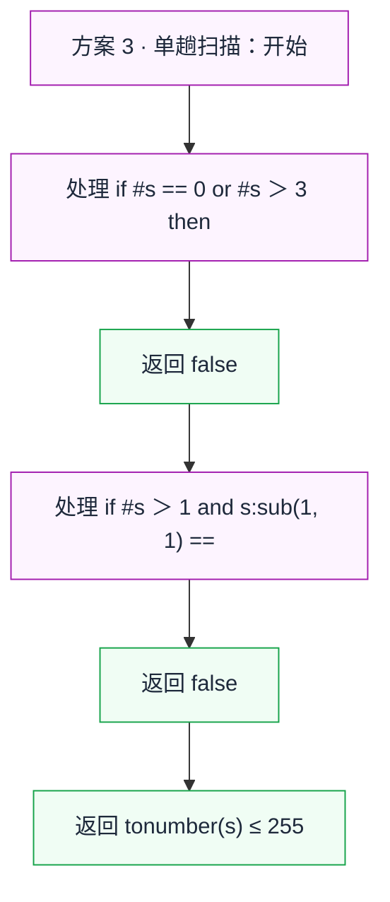

```lua
-- LeetCode 93. 复原IP地址 — Lua 版（方案3）
local function valid_seg(s) -- local function valid_seg(字符串)
	if #s == 0 or #s > 3 then
		return false
	end -- 若 #字符串 等于 0 or #字符串 超过 3 then return false 终点
	if #s > 1 and s:sub(1, 1) == "0" then
		return false
	end -- 若 #字符串 超过 1 and 字符串:sub(1, 1) 等于 「0」 then return false 终点
	return tonumber(s) <= 255 -- 返回 tonumber(字符串) 不超过 255
end -- 终点
local function restore_ip_addresses(s) -- local function restore_ip_addresses(字符串)
	local res = {} -- 把 {} 写入 local res
	local n = #s -- 把 #字符串 写入 local n
	if n < 4 or n > 12 then
		return res
	end -- 若 元素个数 小于 4 or 元素个数 超过 12 then return 结果 终点
	for a = 1, 3 do -- 让 数组 从 1 走到 3（Lua 1 基）
		for b = 1, 3 do -- 让 b 从 1 走到 3（Lua 1 基）
			for c = 1, 3 do -- 让 字符 从 1 走到 3（Lua 1 基）
				local d = n - a - b - c -- 把 元素个数 减 数组 减 b 减 字符 写入 local d
				if d >= 1 and d <= 3 then -- 若 d 不低于 1 and d 不超过 3 then
					local s1 = s:sub(1, a) -- 把 字符串:sub(1, 数组) 写入 local s1
					local s2 = s:sub(a + 1, a + b) -- 把 字符串:sub(数组 加 1, 数组 加 b) 写入 local s2
					local s3 = s:sub(a + b + 1, a + b + c) -- 把 字符串:sub(数组 加 b 加 1, 数组 加 b 加 字符) 写入 local s3
					local s4 = s:sub(a + b + c + 1) -- 把 字符串:sub(数组 加 b 加 字符 加 1) 写入 local s4
					if valid_seg(s1) and valid_seg(s2) and valid_seg(s3) and valid_seg(s4) then
						res[#res + 1] = s1 .. "." .. s2 .. "." .. s3 .. "." .. s4 -- 把 s1 .. 「.」 .. s2 .. 「.」 .. s3 .. 「.」 .. s4 写入 res[#res + 1]
					end -- 终点
				end -- 终点
			end -- 终点
		end -- 终点
	end -- 终点
	return res -- 返回 结果
end -- 终点
local got = restore_ip_addresses("25525511135") -- 把 restore_ip_addresses(「25525511135」) 写入 local got
assert(#got == 2 and got[1] == "255.255.11.135" and got[2] == "255.255.111.35") -- 断言校验
local g2 = restore_ip_addresses("0000") -- 把 restore_ip_addresses(「0000」) 写入 local g2
assert(#g2 == 1 and g2[1] == "0.0.0.0") -- 断言校验
assert(#restore_ip_addresses("abc") == 0) -- 断言校验
print("PASS") -- 全部用例通过，输出 PASS
```

### C 实现（3 种方案）

C 的全部方案如下，每个方案都内嵌用例自测，可独立运行（老仓库 python/go 文件遵循「打印结果」约定）：

#### 方案 1：栈辅助

**思路与代码分析**：核心是「栈辅助」。C 版手动管理下标与内存，循环边界全部显式写出。代码里依次做这些事：双重循环遍历。**走读**：方案 1 · 栈辅助：开始 → 更新 res → 更新 n → 命中条件，直接返回 → 遍历循环 → 遍历循环 → 遍历循环 → 更新 d → 若 d ＜ 1 或 d ＞ 3：处理 continue → 若 valid_seg(s, a) 且 valid_seg(s + a, b) 且 valid_seg(s + a + b, c：处理 且 → 调用 valid_seg(s + a + b + c, d)) → 调用 snprintf(out[res], 16, %.*s → 处理 s + a + b + c) → 处理 res++ → 返回 res。

**运行架构**（真实控制流）：

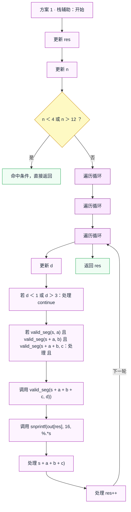

```c
/* LeetCode 93. 复原IP地址 — C 版（方案1） */
#include <stdio.h>                             // 引入头文件
#include <string.h>                            // 引入头文件
static int valid_seg(const char *s, int len) { // 定义函数/方法 valid_seg
    if (len == 0 || len > 3)
        return 0; // 若 长度 等于 0 或 长度 超过 3，直接返回 0
    if (len > 1 && s[0] == '0')
        return 0; // 若 长度 超过 1 且 字符串[0] 等于 '0'，直接返回 0
    int v = 0;    // 把 0 存入 值
    for (int i = 0; i < len; i++)
        v = v * 10 + (s[i] - '0'); // 让 下标 i 从 0 开始计数，下标 i 小于 长度 就继续
    return v <= 255;               // 返回 值 不超过 255
}
static int restore_ip_addresses(const char *s, char out[][16]) { // 定义函数/方法 restore_ip_addresses
    int res = 0;                                                 // 把 0 存入 结果
    int n = (int)strlen(s); // 把 (int)strlen(字符串) 存入 元素个数
    if (n < 4 || n > 12)
        return 0;                    // 若 元素个数 小于 4 或 元素个数 超过 12，直接返回 0
    for (int a = 1; a <= 3; a++)     // 让 数组 从 1 开始计数，数组 不超过 3 就继续
        for (int b = 1; b <= 3; b++) // 让 b 从 1 开始计数，b 不超过 3 就继续
            for (int c = 1; c <= 3; c++) { // 让 字符 从 1 开始计数，字符 不超过 3 就继续
                int d = n - a - b - c;     // 把 元素个数 减 数组 减 b 减 字符 存入 d
                if (d < 1 || d > 3)
                    continue; // 若 d 小于 1 或 d 超过 3) continue;
                if (valid_seg(s, a) && valid_seg(s + a, b) && valid_seg(s + a + b, c) &&
                    valid_seg(s + a + b + c, d)) {
                    snprintf(out[res], 16, "%.*s.%.*s.%.*s.%.*s", a, s, b, s + a, c, s + a + b, d,
                             s + a + b + c); // 打印输出
                    res++;                   // 结果 加一
                }
            }
    return res; // 返回 结果
}
int main(void) {      // 程序入口：跑内嵌自测用例
    char out[64][16]; // char out[64][16];
    int n = restore_ip_addresses("25525511135",
                                 out); // 把 restore_ip_addresses(「25525511135」, out) 存入 元素个数
    if (n != 2) {
        printf("FAIL cnt=%d\n", n);
        return 1;
    } // 若 元素个数 不等于 2) { 输出「FAIL 计数 赋值为 对…取模 d 」, 元素个数); return 1; }
    if (strcmp(out[0], "255.255.11.135") != 0 || strcmp(out[1], "255.255.111.35") != 0) {
        printf("FAIL ips\n");
        return 1;
    }
    n = restore_ip_addresses("0000", out); // 把 restore_ip_addresses(「0000」, out); 写入 元素个数
    if (n != 1 || strcmp(out[0], "0.0.0.0") != 0) {
        printf("FAIL 2\n");
        return 1;
    }
    if (restore_ip_addresses("abc", out) != 0) {
        printf("FAIL 3\n");
        return 1;
    }
    printf("PASS\n"); // 全部用例通过，输出 PASS
    return 0;         // 返回 0
}
```

#### 方案 2：单趟扫描

**思路与代码分析**：核心是「单趟扫描」。C 版手动管理下标与内存，循环边界全部显式写出。代码里依次做这些事：双重循环遍历。**走读**：方案 2 · 单趟扫描：开始 → 更新 res → 更新 n → 命中条件，直接返回 → 遍历循环 → 遍历循环 → 遍历循环 → 更新 d → 若 d ＜ 1 或 d ＞ 3：处理 continue → 若 valid_seg(s, a) 且 valid_seg(s + a, b) 且 valid_seg(s + a + b, c：处理 且 → 调用 valid_seg(s + a + b + c, d)) → 调用 snprintf(out[res], 16, %.*s → 处理 s + a + b + c) → 处理 res++ → 返回 res。

**运行架构**（真实控制流）：

```mermaid
graph TD
    N0["方案 2 · 单趟扫描：开始"]
    N1["更新 res"]
    N2["更新 n"]
    N3{"n ＜ 4 或 n ＞ 12 ？"}
    N4["命中条件，直接返回"]
    N5["遍历循环"]
    N6["遍历循环"]
    N7["遍历循环"]
    N8["更新 d"]
    N9["若 d ＜ 1 或 d ＞ 3：处理 continue"]
    N10["若 valid_seg(s, a) 且 valid_seg(s + a, b) 且 valid_seg(s + a + b, c：处理 且"]
    N11["调用 valid_seg(s + a + b + c, d))"]
    N12["调用 snprintf(out[res], 16, %.*s"]
    N13["处理 s + a + b + c)"]
    N14["处理 res++"]
    N15["返回 res"]
    N0 --> N1
    N1 --> N2
    N2 --> N3
    N3 -- 是 --> N4
    N3 -- 否 --> N5
    N5 --> N6
    N6 --> N7
    N7 --> N8
    N8 --> N9
    N9 --> N10
    N10 --> N11
    N11 --> N12
    N12 --> N13
    N13 --> N14
    N14 -- 下一轮 --> N7
    N7 --> N15
    classDef n fill:#fdf4ff,stroke:#a21caf,color:#1e293b;
    classDef lp fill:#fae8ff,stroke:#86198f,color:#1e293b;
    classDef dc fill:#fef9c3,stroke:#ca8a04,color:#1e293b;
    classDef tm fill:#f0fdf4,stroke:#16a34a,color:#1e293b;
    class N0,N1,N2,N8,N9,N10,N11,N12,N13,N14 n;
    class N5,N6,N7 lp;
    class N3 dc;
    class N4,N15 tm;
```

```c
/* LeetCode 93. 复原IP地址 — C 版（方案2） */
#include <stdio.h>                             // 引入头文件
#include <string.h>                            // 引入头文件
static int valid_seg(const char *s, int len) { // 定义函数/方法 valid_seg
    if (len == 0 || len > 3)
        return 0; // 若 长度 等于 0 或 长度 超过 3，直接返回 0
    if (len > 1 && s[0] == '0')
        return 0; // 若 长度 超过 1 且 字符串[0] 等于 '0'，直接返回 0
    int v = 0;    // 把 0 存入 值
    for (int i = 0; i < len; i++)
        v = v * 10 + (s[i] - '0'); // 让 下标 i 从 0 开始计数，下标 i 小于 长度 就继续
    return v <= 255;               // 返回 值 不超过 255
}
static int restore_ip_addresses(const char *s, char out[][16]) { // 定义函数/方法 restore_ip_addresses
    int res = 0;                                                 // 把 0 存入 结果
    int n = (int)strlen(s); // 把 (int)strlen(字符串) 存入 元素个数
    if (n < 4 || n > 12)
        return 0;                    // 若 元素个数 小于 4 或 元素个数 超过 12，直接返回 0
    for (int a = 1; a <= 3; a++)     // 让 数组 从 1 开始计数，数组 不超过 3 就继续
        for (int b = 1; b <= 3; b++) // 让 b 从 1 开始计数，b 不超过 3 就继续
            for (int c = 1; c <= 3; c++) { // 让 字符 从 1 开始计数，字符 不超过 3 就继续
                int d = n - a - b - c;     // 把 元素个数 减 数组 减 b 减 字符 存入 d
                if (d < 1 || d > 3)
                    continue; // 若 d 小于 1 或 d 超过 3) continue;
                if (valid_seg(s, a) && valid_seg(s + a, b) && valid_seg(s + a + b, c) &&
                    valid_seg(s + a + b + c, d)) {
                    snprintf(out[res], 16, "%.*s.%.*s.%.*s.%.*s", a, s, b, s + a, c, s + a + b, d,
                             s + a + b + c); // 打印输出
                    res++;                   // 结果 加一
                }
            }
    return res; // 返回 结果
}
int main(void) {      // 程序入口：跑内嵌自测用例
    char out[64][16]; // char out[64][16];
    int n = restore_ip_addresses("25525511135",
                                 out); // 把 restore_ip_addresses(「25525511135」, out) 存入 元素个数
    if (n != 2) {
        printf("FAIL cnt=%d\n", n);
        return 1;
    } // 若 元素个数 不等于 2) { 输出「FAIL 计数 赋值为 对…取模 d 」, 元素个数); return 1; }
    if (strcmp(out[0], "255.255.11.135") != 0 || strcmp(out[1], "255.255.111.35") != 0) {
        printf("FAIL ips\n");
        return 1;
    }
    n = restore_ip_addresses("0000", out); // 把 restore_ip_addresses(「0000」, out); 写入 元素个数
    if (n != 1 || strcmp(out[0], "0.0.0.0") != 0) {
        printf("FAIL 2\n");
        return 1;
    }
    if (restore_ip_addresses("abc", out) != 0) {
        printf("FAIL 3\n");
        return 1;
    }
    printf("PASS\n"); // 全部用例通过，输出 PASS
    return 0;         // 返回 0
}
```

#### 方案 3：单趟扫描

**思路与代码分析**：核心是「单趟扫描」。C 版手动管理下标与内存，循环边界全部显式写出。代码里依次做这些事：双重循环遍历。**走读**：方案 3 · 单趟扫描：开始 → 更新 res → 更新 n → 命中条件，直接返回 → 遍历循环 → 遍历循环 → 遍历循环 → 更新 d → 若 d ＜ 1 或 d ＞ 3：处理 continue → 若 valid_seg(s, a) 且 valid_seg(s + a, b) 且 valid_seg(s + a + b, c：处理 且 → 调用 valid_seg(s + a + b + c, d)) → 调用 snprintf(out[res], 16, %.*s → 处理 s + a + b + c) → 处理 res++ → 返回 res。

**运行架构**（真实控制流）：

```mermaid
graph TD
    N0["方案 3 · 单趟扫描：开始"]
    N1["更新 res"]
    N2["更新 n"]
    N3{"n ＜ 4 或 n ＞ 12 ？"}
    N4["命中条件，直接返回"]
    N5["遍历循环"]
    N6["遍历循环"]
    N7["遍历循环"]
    N8["更新 d"]
    N9["若 d ＜ 1 或 d ＞ 3：处理 continue"]
    N10["若 valid_seg(s, a) 且 valid_seg(s + a, b) 且 valid_seg(s + a + b, c：处理 且"]
    N11["调用 valid_seg(s + a + b + c, d))"]
    N12["调用 snprintf(out[res], 16, %.*s"]
    N13["处理 s + a + b + c)"]
    N14["处理 res++"]
    N15["返回 res"]
    N0 --> N1
    N1 --> N2
    N2 --> N3
    N3 -- 是 --> N4
    N3 -- 否 --> N5
    N5 --> N6
    N6 --> N7
    N7 --> N8
    N8 --> N9
    N9 --> N10
    N10 --> N11
    N11 --> N12
    N12 --> N13
    N13 --> N14
    N14 -- 下一轮 --> N7
    N7 --> N15
    classDef n fill:#fdf4ff,stroke:#a21caf,color:#1e293b;
    classDef lp fill:#fae8ff,stroke:#86198f,color:#1e293b;
    classDef dc fill:#fef9c3,stroke:#ca8a04,color:#1e293b;
    classDef tm fill:#f0fdf4,stroke:#16a34a,color:#1e293b;
    class N0,N1,N2,N8,N9,N10,N11,N12,N13,N14 n;
    class N5,N6,N7 lp;
    class N3 dc;
    class N4,N15 tm;
```

```c
/* LeetCode 93. 复原IP地址 — C 版（方案3） */
#include <stdio.h>                             // 引入头文件
#include <string.h>                            // 引入头文件
static int valid_seg(const char *s, int len) { // 定义函数/方法 valid_seg
    if (len == 0 || len > 3)
        return 0; // 若 长度 等于 0 或 长度 超过 3，直接返回 0
    if (len > 1 && s[0] == '0')
        return 0; // 若 长度 超过 1 且 字符串[0] 等于 '0'，直接返回 0
    int v = 0;    // 把 0 存入 值
    for (int i = 0; i < len; i++)
        v = v * 10 + (s[i] - '0'); // 让 下标 i 从 0 开始计数，下标 i 小于 长度 就继续
    return v <= 255;               // 返回 值 不超过 255
}
static int restore_ip_addresses(const char *s, char out[][16]) { // 定义函数/方法 restore_ip_addresses
    int res = 0;                                                 // 把 0 存入 结果
    int n = (int)strlen(s); // 把 (int)strlen(字符串) 存入 元素个数
    if (n < 4 || n > 12)
        return 0;                    // 若 元素个数 小于 4 或 元素个数 超过 12，直接返回 0
    for (int a = 1; a <= 3; a++)     // 让 数组 从 1 开始计数，数组 不超过 3 就继续
        for (int b = 1; b <= 3; b++) // 让 b 从 1 开始计数，b 不超过 3 就继续
            for (int c = 1; c <= 3; c++) { // 让 字符 从 1 开始计数，字符 不超过 3 就继续
                int d = n - a - b - c;     // 把 元素个数 减 数组 减 b 减 字符 存入 d
                if (d < 1 || d > 3)
                    continue; // 若 d 小于 1 或 d 超过 3) continue;
                if (valid_seg(s, a) && valid_seg(s + a, b) && valid_seg(s + a + b, c) &&
                    valid_seg(s + a + b + c, d)) {
                    snprintf(out[res], 16, "%.*s.%.*s.%.*s.%.*s", a, s, b, s + a, c, s + a + b, d,
                             s + a + b + c); // 打印输出
                    res++;                   // 结果 加一
                }
            }
    return res; // 返回 结果
}
int main(void) {      // 程序入口：跑内嵌自测用例
    char out[64][16]; // char out[64][16];
    int n = restore_ip_addresses("25525511135",
                                 out); // 把 restore_ip_addresses(「25525511135」, out) 存入 元素个数
    if (n != 2) {
        printf("FAIL cnt=%d\n", n);
        return 1;
    } // 若 元素个数 不等于 2) { 输出「FAIL 计数 赋值为 对…取模 d 」, 元素个数); return 1; }
    if (strcmp(out[0], "255.255.11.135") != 0 || strcmp(out[1], "255.255.111.35") != 0) {
        printf("FAIL ips\n");
        return 1;
    }
    n = restore_ip_addresses("0000", out); // 把 restore_ip_addresses(「0000」, out); 写入 元素个数
    if (n != 1 || strcmp(out[0], "0.0.0.0") != 0) {
        printf("FAIL 2\n");
        return 1;
    }
    if (restore_ip_addresses("abc", out) != 0) {
        printf("FAIL 3\n");
        return 1;
    }
    printf("PASS\n"); // 全部用例通过，输出 PASS
    return 0;         // 返回 0
}
```

### C++ 实现（3 种方案）

C++ 的全部方案如下，每个方案都内嵌用例自测，可独立运行（老仓库 python/go 文件遵循「打印结果」约定）：

#### 方案 1：栈辅助

**思路与代码分析**：核心是「栈辅助」。C++ 版用 STL 容器与迭代器，减少手写下标错误。代码里依次做这些事：双重循环遍历。**走读**：方案 1 · 栈辅助：开始 → 处理 std::vector＜std::string＞ res → 命中条件，直接返回 → 遍历循环 → 遍历循环 → 遍历循环 → 返回 res。

**运行架构**（真实控制流）：

```mermaid
graph TD
    N0["方案 1 · 栈辅助：开始"]
    N1["处理 std::vector＜std::string＞ res"]
    D1["……（中间计算步骤）"]
    N3{"n ＜ 4 或 n ＞ 12 ？"}
    N4["命中条件，直接返回"]
    N5["遍历循环"]
    N6["遍历循环"]
    N7["遍历循环"]
    D2["……（中间计算步骤）"]
    N16["返回 res"]
    N0 --> N1
    N3 -- 是 --> N4
    N3 -- 否 --> N5
    N5 --> N6
    N6 --> N7
    N7 --> N16
    N1 --> D1
    D1 --> N3
    N4 --> N5
    N7 --> D2
    D2 --> N16
    classDef n fill:#fdf4ff,stroke:#a21caf,color:#1e293b;
    classDef lp fill:#fae8ff,stroke:#86198f,color:#1e293b;
    classDef dc fill:#fef9c3,stroke:#ca8a04,color:#1e293b;
    classDef tm fill:#f0fdf4,stroke:#16a34a,color:#1e293b;
    class N0,N1,D1,D2 n;
    class N5,N6,N7 lp;
    class N3 dc;
    class N4,N16 tm;
```

```cpp
// LeetCode 93. 复原IP地址 — C++ 版（方案1）
#include <cassert>                           // 引入头文件
#include <iostream>                          // 引入头文件
#include <string>                            // 引入头文件
#include <vector>                            // 引入头文件
static bool validSeg(const std::string &s) { // 定义函数/方法 validSeg
    if (s.empty() || s.size() > 3)
        return false; // 若 字符串 是否为空 或 字符串.大小() 超过 3，直接返回 false
    if (s.size() > 1 && s[0] == '0')
        return false; // 若 字符串.大小() 超过 1 且 字符串[0] 等于 '0'，直接返回 false
    return std::stoi(s) <= 255; // 返回 std::stoi(字符串) 不超过 255
}
static std::vector<std::string> restoreIpAddresses(const std::string &s) {
    std::vector<std::string> res; // std::vector 小于 std::string 超过 结果;
    int n = static_cast<int>(s.size()); // 把 static_cast 小于 int 超过 (字符串.大小()) 存入 元素个数
    if (n < 4 || n > 12)
        return res;              // 若 元素个数 小于 4 或 元素个数 超过 12，直接返回 结果
    for (int a = 1; a <= 3; ++a) // 让 数组 从 1 开始计数，数组 不超过 3 就继续
        for (int b = 1; b <= 3; ++b)       // 让 b 从 1 开始计数，b 不超过 3 就继续
            for (int c = 1; c <= 3; ++c) { // 让 字符 从 1 开始计数，字符 不超过 3 就继续
                int d = n - a - b - c;     // 把 元素个数 减 数组 减 b 减 字符 存入 d
                if (d < 1 || d > 3)
                    continue; // 若 d 小于 1 或 d 超过 3) continue;
                auto s1 = s.substr(0, a), s2 = s.substr(a, b), s3 = s.substr(a + b, c),
                     s4 = s.substr(a + b + c);
                if (validSeg(s1) && validSeg(s2) && validSeg(s3) &&
                    validSeg(s4)) { // 若 validSeg(s1) 且 validSeg(s2) 且 validSeg(s3) 且 validSeg(s4
                    res.push_back(s1 + "." + s2 + "." + s3 + "." +
                                  s4); // 结果 追加 s1 加 「.」 加 s2 加 「.」 加 s3 加 「.」 加 s4);
                }
            }
    return res; // 返回 结果
}
int main() { // 程序入口：跑内嵌自测用例
    assert((restoreIpAddresses("25525511135") ==
            std::vector<std::string>{"255.255.11.135", "255.255.111.35"}));      // 断言校验
    assert((restoreIpAddresses("0000") == std::vector<std::string>{"0.0.0.0"})); // 断言校验
    assert(restoreIpAddresses("abc").empty());                                   // 断言校验
    std::cout << "PASS" << std::endl; // 全部用例通过，输出 PASS
    return 0;                         // 返回 0
}
```

#### 方案 2：单趟扫描

**思路与代码分析**：核心是「单趟扫描」。C++ 版用 STL 容器与迭代器，减少手写下标错误。代码里依次做这些事：双重循环遍历。**走读**：方案 2 · 单趟扫描：开始 → 处理 std::vector＜std::string＞ res → 命中条件，直接返回 → 遍历循环 → 遍历循环 → 遍历循环 → 返回 res。

**运行架构**（真实控制流）：

```mermaid
graph TD
    N0["方案 2 · 单趟扫描：开始"]
    N1["处理 std::vector＜std::string＞ res"]
    D1["……（中间计算步骤）"]
    N3{"n ＜ 4 或 n ＞ 12 ？"}
    N4["命中条件，直接返回"]
    N5["遍历循环"]
    N6["遍历循环"]
    N7["遍历循环"]
    D2["……（中间计算步骤）"]
    N16["返回 res"]
    N0 --> N1
    N3 -- 是 --> N4
    N3 -- 否 --> N5
    N5 --> N6
    N6 --> N7
    N7 --> N16
    N1 --> D1
    D1 --> N3
    N4 --> N5
    N7 --> D2
    D2 --> N16
    classDef n fill:#fdf4ff,stroke:#a21caf,color:#1e293b;
    classDef lp fill:#fae8ff,stroke:#86198f,color:#1e293b;
    classDef dc fill:#fef9c3,stroke:#ca8a04,color:#1e293b;
    classDef tm fill:#f0fdf4,stroke:#16a34a,color:#1e293b;
    class N0,N1,D1,D2 n;
    class N5,N6,N7 lp;
    class N3 dc;
    class N4,N16 tm;
```

```cpp
// LeetCode 93. 复原IP地址 — C++ 版（方案2）
#include <cassert>                           // 引入头文件
#include <iostream>                          // 引入头文件
#include <string>                            // 引入头文件
#include <vector>                            // 引入头文件
static bool validSeg(const std::string &s) { // 定义函数/方法 validSeg
    if (s.empty() || s.size() > 3)
        return false; // 若 字符串 是否为空 或 字符串.大小() 超过 3，直接返回 false
    if (s.size() > 1 && s[0] == '0')
        return false; // 若 字符串.大小() 超过 1 且 字符串[0] 等于 '0'，直接返回 false
    return std::stoi(s) <= 255; // 返回 std::stoi(字符串) 不超过 255
}
static std::vector<std::string> restoreIpAddresses(const std::string &s) {
    std::vector<std::string> res; // std::vector 小于 std::string 超过 结果;
    int n = static_cast<int>(s.size()); // 把 static_cast 小于 int 超过 (字符串.大小()) 存入 元素个数
    if (n < 4 || n > 12)
        return res;              // 若 元素个数 小于 4 或 元素个数 超过 12，直接返回 结果
    for (int a = 1; a <= 3; ++a) // 让 数组 从 1 开始计数，数组 不超过 3 就继续
        for (int b = 1; b <= 3; ++b)       // 让 b 从 1 开始计数，b 不超过 3 就继续
            for (int c = 1; c <= 3; ++c) { // 让 字符 从 1 开始计数，字符 不超过 3 就继续
                int d = n - a - b - c;     // 把 元素个数 减 数组 减 b 减 字符 存入 d
                if (d < 1 || d > 3)
                    continue; // 若 d 小于 1 或 d 超过 3) continue;
                auto s1 = s.substr(0, a), s2 = s.substr(a, b), s3 = s.substr(a + b, c),
                     s4 = s.substr(a + b + c);
                if (validSeg(s1) && validSeg(s2) && validSeg(s3) &&
                    validSeg(s4)) { // 若 validSeg(s1) 且 validSeg(s2) 且 validSeg(s3) 且 validSeg(s4
                    res.push_back(s1 + "." + s2 + "." + s3 + "." +
                                  s4); // 结果 追加 s1 加 「.」 加 s2 加 「.」 加 s3 加 「.」 加 s4);
                }
            }
    return res; // 返回 结果
}
int main() { // 程序入口：跑内嵌自测用例
    assert((restoreIpAddresses("25525511135") ==
            std::vector<std::string>{"255.255.11.135", "255.255.111.35"}));      // 断言校验
    assert((restoreIpAddresses("0000") == std::vector<std::string>{"0.0.0.0"})); // 断言校验
    assert(restoreIpAddresses("abc").empty());                                   // 断言校验
    std::cout << "PASS" << std::endl; // 全部用例通过，输出 PASS
    return 0;                         // 返回 0
}
```

#### 方案 3：单趟扫描

**思路与代码分析**：核心是「单趟扫描」。C++ 版用 STL 容器与迭代器，减少手写下标错误。代码里依次做这些事：双重循环遍历。**走读**：方案 3 · 单趟扫描：开始 → 处理 std::vector＜std::string＞ res → 命中条件，直接返回 → 遍历循环 → 遍历循环 → 遍历循环 → 返回 res。

**运行架构**（真实控制流）：

```mermaid
graph TD
    N0["方案 3 · 单趟扫描：开始"]
    N1["处理 std::vector＜std::string＞ res"]
    D1["……（中间计算步骤）"]
    N3{"n ＜ 4 或 n ＞ 12 ？"}
    N4["命中条件，直接返回"]
    N5["遍历循环"]
    N6["遍历循环"]
    N7["遍历循环"]
    D2["……（中间计算步骤）"]
    N16["返回 res"]
    N0 --> N1
    N3 -- 是 --> N4
    N3 -- 否 --> N5
    N5 --> N6
    N6 --> N7
    N7 --> N16
    N1 --> D1
    D1 --> N3
    N4 --> N5
    N7 --> D2
    D2 --> N16
    classDef n fill:#fdf4ff,stroke:#a21caf,color:#1e293b;
    classDef lp fill:#fae8ff,stroke:#86198f,color:#1e293b;
    classDef dc fill:#fef9c3,stroke:#ca8a04,color:#1e293b;
    classDef tm fill:#f0fdf4,stroke:#16a34a,color:#1e293b;
    class N0,N1,D1,D2 n;
    class N5,N6,N7 lp;
    class N3 dc;
    class N4,N16 tm;
```

```cpp
// LeetCode 93. 复原IP地址 — C++ 版（方案3）
#include <cassert>                           // 引入头文件
#include <iostream>                          // 引入头文件
#include <string>                            // 引入头文件
#include <vector>                            // 引入头文件
static bool validSeg(const std::string &s) { // 定义函数/方法 validSeg
    if (s.empty() || s.size() > 3)
        return false; // 若 字符串 是否为空 或 字符串.大小() 超过 3，直接返回 false
    if (s.size() > 1 && s[0] == '0')
        return false; // 若 字符串.大小() 超过 1 且 字符串[0] 等于 '0'，直接返回 false
    return std::stoi(s) <= 255; // 返回 std::stoi(字符串) 不超过 255
}
static std::vector<std::string> restoreIpAddresses(const std::string &s) {
    std::vector<std::string> res; // std::vector 小于 std::string 超过 结果;
    int n = static_cast<int>(s.size()); // 把 static_cast 小于 int 超过 (字符串.大小()) 存入 元素个数
    if (n < 4 || n > 12)
        return res;              // 若 元素个数 小于 4 或 元素个数 超过 12，直接返回 结果
    for (int a = 1; a <= 3; ++a) // 让 数组 从 1 开始计数，数组 不超过 3 就继续
        for (int b = 1; b <= 3; ++b)       // 让 b 从 1 开始计数，b 不超过 3 就继续
            for (int c = 1; c <= 3; ++c) { // 让 字符 从 1 开始计数，字符 不超过 3 就继续
                int d = n - a - b - c;     // 把 元素个数 减 数组 减 b 减 字符 存入 d
                if (d < 1 || d > 3)
                    continue; // 若 d 小于 1 或 d 超过 3) continue;
                auto s1 = s.substr(0, a), s2 = s.substr(a, b), s3 = s.substr(a + b, c),
                     s4 = s.substr(a + b + c);
                if (validSeg(s1) && validSeg(s2) && validSeg(s3) &&
                    validSeg(s4)) { // 若 validSeg(s1) 且 validSeg(s2) 且 validSeg(s3) 且 validSeg(s4
                    res.push_back(s1 + "." + s2 + "." + s3 + "." +
                                  s4); // 结果 追加 s1 加 「.」 加 s2 加 「.」 加 s3 加 「.」 加 s4);
                }
            }
    return res; // 返回 结果
}
int main() { // 程序入口：跑内嵌自测用例
    assert((restoreIpAddresses("25525511135") ==
            std::vector<std::string>{"255.255.11.135", "255.255.111.35"}));      // 断言校验
    assert((restoreIpAddresses("0000") == std::vector<std::string>{"0.0.0.0"})); // 断言校验
    assert(restoreIpAddresses("abc").empty());                                   // 断言校验
    std::cout << "PASS" << std::endl; // 全部用例通过，输出 PASS
    return 0;                         // 返回 0
}
```

### R 实现（3 种方案）

R 的全部方案如下，每个方案都内嵌用例自测，可独立运行（老仓库 python/go 文件遵循「打印结果」约定）：

#### 方案 1：栈辅助

**思路与代码分析**：核心是「栈辅助」。R 版用向量化思维与 1 起始下标，注意 1:n 的降序陷阱。**走读**：方案 1 · 栈辅助：开始 → 命中条件，直接返回 → 命中条件，直接返回 → 更新 <。

**运行架构**（真实控制流）：

```mermaid
graph TD
    N0["方案 1 · 栈辅助：开始"]
    N1{"nchar(s) == 0 或 nchar(s) ＞ 3 ？"}
    N2["命中条件，直接返回"]
    N3{"nchar(s) ＞ 1 且 substr(s, 1, 1) == 0 ？"}
    N4["命中条件，直接返回"]
    N5["更新 <"]
    N0 --> N1
    N1 -- 是 --> N2
    N1 -- 否 --> N3
    N3 -- 是 --> N4
    N3 -- 否 --> N5
    classDef n fill:#fdf4ff,stroke:#a21caf,color:#1e293b;
    classDef lp fill:#fae8ff,stroke:#86198f,color:#1e293b;
    classDef dc fill:#fef9c3,stroke:#ca8a04,color:#1e293b;
    classDef tm fill:#f0fdf4,stroke:#16a34a,color:#1e293b;
    class N0,N5 n;
    class N1,N3 dc;
    class N2,N4 tm;
```

```r
# 版（方案1） 定义函数 valid_seg（参数：字符串）
valid_seg <- function(s) {
    if (nchar(s) == 0 || nchar(s) > 3)
        return(FALSE)  # 若 nchar(字符串) 等于 0 或 nchar(字符串) 超过 3) return(FALSE
    if (nchar(s) > 1 && substr(s, 1, 1) == "0")
        return(FALSE)  # 若 nchar(字符串) 超过 1 且 substr(字符串, 1, 1) 等于 「0」) return(FALSE
    as.integer(s) <= 255  # 把 255 写入 as.integer(s) <
}
restore_ip_addresses <- function(s) {
    # 定义函数 restore_ip_addresses（参数：字符串）
    res <- character(0)  # 把 character(0) 存入 结果
    n <- nchar(s)  # 把 nchar(字符串) 存入 元素个数
    if (n < 4 || n > 12)
        return(res)  # 若 元素个数 小于 4 或 元素个数 超过 12) return(结果
    for (a in 1:3) for (b in 1:3) for (c in 1:3) {
        # for (数组 in 1:3) for (b in 1:3) for (字符 in 1:3) {
        d <- n - a - b - c  # 把 元素个数 减 数组 减 b 减 字符 存入 d
        if (d >= 1 && d <= 3) {
            # 若 d 不低于 1 且 d 不超过 3
            s1 <- substr(s, 1, a)  # 把 substr(字符串, 1, 数组) 存入 s1
            s2 <- substr(s, a + 1, a + b)  # 把 substr(字符串, 数组 加 1, 数组 加 b) 存入 s2
            s3 <- substr(s, a + b + 1, a + b + c)  # 把 substr(字符串, 数组 加 b 加 1, 数组 加 b 加 字符) 存入 s3
            s4 <- substr(s, a + b + c + 1, n)  # 把 substr(字符串, 数组 加 b 加 字符 加 1, 元素个数) 存入 s4
            if (valid_seg(s1) && valid_seg(s2) && valid_seg(s3) && valid_seg(s4)) {
                res <- c(res, paste(s1, s2, s3, s4, sep = "."))  # 把 字符(结果, paste(s1, s2, s3, s4, sep 赋值为 「.」)) 存入 结果
            }
        }
    }
    res  # 结果
}
got <- restore_ip_addresses("25525511135")  # 把 restore_ip_addresses(「25525511135」) 存入 got
stopifnot(identical(got, c("255.255.11.135", "255.255.111.35")))  # 断言校验
stopifnot(identical(restore_ip_addresses("0000"), "0.0.0.0"))  # 断言校验
stopifnot(length(restore_ip_addresses("abc")) == 0)  # 断言校验
cat("PASS\n")  # 全部用例通过，输出 PASS
```

#### 方案 2：单趟扫描

**思路与代码分析**：核心是「单趟扫描」。R 版用向量化思维与 1 起始下标，注意 1:n 的降序陷阱。**走读**：方案 2 · 单趟扫描：开始 → 命中条件，直接返回 → 命中条件，直接返回 → 更新 <。

**运行架构**（真实控制流）：

```mermaid
graph TD
    N0["方案 2 · 单趟扫描：开始"]
    N1{"nchar(s) == 0 或 nchar(s) ＞ 3 ？"}
    N2["命中条件，直接返回"]
    N3{"nchar(s) ＞ 1 且 substr(s, 1, 1) == 0 ？"}
    N4["命中条件，直接返回"]
    N5["更新 <"]
    N0 --> N1
    N1 -- 是 --> N2
    N1 -- 否 --> N3
    N3 -- 是 --> N4
    N3 -- 否 --> N5
    classDef n fill:#fdf4ff,stroke:#a21caf,color:#1e293b;
    classDef lp fill:#fae8ff,stroke:#86198f,color:#1e293b;
    classDef dc fill:#fef9c3,stroke:#ca8a04,color:#1e293b;
    classDef tm fill:#f0fdf4,stroke:#16a34a,color:#1e293b;
    class N0,N5 n;
    class N1,N3 dc;
    class N2,N4 tm;
```

```r
# 版（方案2） 定义函数 valid_seg（参数：字符串）
valid_seg <- function(s) {
    if (nchar(s) == 0 || nchar(s) > 3)
        return(FALSE)  # 若 nchar(字符串) 等于 0 或 nchar(字符串) 超过 3) return(FALSE
    if (nchar(s) > 1 && substr(s, 1, 1) == "0")
        return(FALSE)  # 若 nchar(字符串) 超过 1 且 substr(字符串, 1, 1) 等于 「0」) return(FALSE
    as.integer(s) <= 255  # 把 255 写入 as.integer(s) <
}
restore_ip_addresses <- function(s) {
    # 定义函数 restore_ip_addresses（参数：字符串）
    res <- character(0)  # 把 character(0) 存入 结果
    n <- nchar(s)  # 把 nchar(字符串) 存入 元素个数
    if (n < 4 || n > 12)
        return(res)  # 若 元素个数 小于 4 或 元素个数 超过 12) return(结果
    for (a in 1:3) for (b in 1:3) for (c in 1:3) {
        # for (数组 in 1:3) for (b in 1:3) for (字符 in 1:3) {
        d <- n - a - b - c  # 把 元素个数 减 数组 减 b 减 字符 存入 d
        if (d >= 1 && d <= 3) {
            # 若 d 不低于 1 且 d 不超过 3
            s1 <- substr(s, 1, a)  # 把 substr(字符串, 1, 数组) 存入 s1
            s2 <- substr(s, a + 1, a + b)  # 把 substr(字符串, 数组 加 1, 数组 加 b) 存入 s2
            s3 <- substr(s, a + b + 1, a + b + c)  # 把 substr(字符串, 数组 加 b 加 1, 数组 加 b 加 字符) 存入 s3
            s4 <- substr(s, a + b + c + 1, n)  # 把 substr(字符串, 数组 加 b 加 字符 加 1, 元素个数) 存入 s4
            if (valid_seg(s1) && valid_seg(s2) && valid_seg(s3) && valid_seg(s4)) {
                res <- c(res, paste(s1, s2, s3, s4, sep = "."))  # 把 字符(结果, paste(s1, s2, s3, s4, sep 赋值为 「.」)) 存入 结果
            }
        }
    }
    res  # 结果
}
got <- restore_ip_addresses("25525511135")  # 把 restore_ip_addresses(「25525511135」) 存入 got
stopifnot(identical(got, c("255.255.11.135", "255.255.111.35")))  # 断言校验
stopifnot(identical(restore_ip_addresses("0000"), "0.0.0.0"))  # 断言校验
stopifnot(length(restore_ip_addresses("abc")) == 0)  # 断言校验
cat("PASS\n")  # 全部用例通过，输出 PASS
```

#### 方案 3：单趟扫描

**思路与代码分析**：核心是「单趟扫描」。R 版用向量化思维与 1 起始下标，注意 1:n 的降序陷阱。**走读**：方案 3 · 单趟扫描：开始 → 命中条件，直接返回 → 命中条件，直接返回 → 更新 <。

**运行架构**（真实控制流）：

```mermaid
graph TD
    N0["方案 3 · 单趟扫描：开始"]
    N1{"nchar(s) == 0 或 nchar(s) ＞ 3 ？"}
    N2["命中条件，直接返回"]
    N3{"nchar(s) ＞ 1 且 substr(s, 1, 1) == 0 ？"}
    N4["命中条件，直接返回"]
    N5["更新 <"]
    N0 --> N1
    N1 -- 是 --> N2
    N1 -- 否 --> N3
    N3 -- 是 --> N4
    N3 -- 否 --> N5
    classDef n fill:#fdf4ff,stroke:#a21caf,color:#1e293b;
    classDef lp fill:#fae8ff,stroke:#86198f,color:#1e293b;
    classDef dc fill:#fef9c3,stroke:#ca8a04,color:#1e293b;
    classDef tm fill:#f0fdf4,stroke:#16a34a,color:#1e293b;
    class N0,N5 n;
    class N1,N3 dc;
    class N2,N4 tm;
```

```r
# 版（方案3） 定义函数 valid_seg（参数：字符串）
valid_seg <- function(s) {
    if (nchar(s) == 0 || nchar(s) > 3)
        return(FALSE)  # 若 nchar(字符串) 等于 0 或 nchar(字符串) 超过 3) return(FALSE
    if (nchar(s) > 1 && substr(s, 1, 1) == "0")
        return(FALSE)  # 若 nchar(字符串) 超过 1 且 substr(字符串, 1, 1) 等于 「0」) return(FALSE
    as.integer(s) <= 255  # 把 255 写入 as.integer(s) <
}
restore_ip_addresses <- function(s) {
    # 定义函数 restore_ip_addresses（参数：字符串）
    res <- character(0)  # 把 character(0) 存入 结果
    n <- nchar(s)  # 把 nchar(字符串) 存入 元素个数
    if (n < 4 || n > 12)
        return(res)  # 若 元素个数 小于 4 或 元素个数 超过 12) return(结果
    for (a in 1:3) for (b in 1:3) for (c in 1:3) {
        # for (数组 in 1:3) for (b in 1:3) for (字符 in 1:3) {
        d <- n - a - b - c  # 把 元素个数 减 数组 减 b 减 字符 存入 d
        if (d >= 1 && d <= 3) {
            # 若 d 不低于 1 且 d 不超过 3
            s1 <- substr(s, 1, a)  # 把 substr(字符串, 1, 数组) 存入 s1
            s2 <- substr(s, a + 1, a + b)  # 把 substr(字符串, 数组 加 1, 数组 加 b) 存入 s2
            s3 <- substr(s, a + b + 1, a + b + c)  # 把 substr(字符串, 数组 加 b 加 1, 数组 加 b 加 字符) 存入 s3
            s4 <- substr(s, a + b + c + 1, n)  # 把 substr(字符串, 数组 加 b 加 字符 加 1, 元素个数) 存入 s4
            if (valid_seg(s1) && valid_seg(s2) && valid_seg(s3) && valid_seg(s4)) {
                res <- c(res, paste(s1, s2, s3, s4, sep = "."))  # 把 字符(结果, paste(s1, s2, s3, s4, sep 赋值为 「.」)) 存入 结果
            }
        }
    }
    res  # 结果
}
got <- restore_ip_addresses("25525511135")  # 把 restore_ip_addresses(「25525511135」) 存入 got
stopifnot(identical(got, c("255.255.11.135", "255.255.111.35")))  # 断言校验
stopifnot(identical(restore_ip_addresses("0000"), "0.0.0.0"))  # 断言校验
stopifnot(length(restore_ip_addresses("abc")) == 0)  # 断言校验
cat("PASS\n")  # 全部用例通过，输出 PASS
```

### Zig 实现（3 种方案）

Zig 的全部方案如下，每个方案都内嵌用例自测，可独立运行（老仓库 python/go 文件遵循「打印结果」约定）：

#### 方案 1：栈辅助

**思路与代码分析**：核心是「栈辅助」。Zig 版显式分配与清零，整型边界处理严格。**走读**：方案 1 · 栈辅助：开始 → 计算 n → 命中条件，直接返回 → 当 (a ≤ 3) : (a += 1) 时反复执行 → 当 (b ≤ 3) : (b += 1) 时反复执行 → 当 (c ≤ 3) : (c += 1) 时反复执行。

**运行架构**（真实控制流）：

```mermaid
graph TD
    N0["方案 1 · 栈辅助：开始"]
    N1["计算 n"]
    N2{"n ＜ 4 or n ＞ 12 ？"}
    N3["命中条件，直接返回"]
    D1["……（中间计算步骤）"]
    N5["当 (a ≤ 3) : (a += 1) 时反复执行"]
    D2["……（中间计算步骤）"]
    N7["当 (b ≤ 3) : (b += 1) 时反复执行"]
    D3["……（中间计算步骤）"]
    N9["当 (c ≤ 3) : (c += 1) 时反复执行"]
    Dend["……（中间计算步骤）"]
    N0 --> N1
    N1 --> N2
    N2 -- 是 --> N3
    N9 -- 下一轮 --> N7
    N7 -- 下一轮 --> N5
    N3 --> D1
    D1 --> N5
    N5 --> D2
    D2 --> N7
    N7 --> D3
    D3 --> N9
    N9 --> Dend
    classDef n fill:#fdf4ff,stroke:#a21caf,color:#1e293b;
    classDef lp fill:#fae8ff,stroke:#86198f,color:#1e293b;
    classDef dc fill:#fef9c3,stroke:#ca8a04,color:#1e293b;
    classDef tm fill:#f0fdf4,stroke:#16a34a,color:#1e293b;
    class N0,N1,D1,D2,D3,Dend n;
    class N5,N7,N9 lp;
    class N2 dc;
    class N3 tm;
```

```zig
// LeetCode 93. 复原IP地址 — Zig 版（方案1）
const std = @import("std"); // 把 @import(「std」) 存入 std
fn validSeg(s: []const u8) bool { // 定义函数/方法 validSeg
    if (s.len == 0 or s.len > 3) return false; // 若 字符串.长度 等于 0 or 字符串.长度 超过 3，直接返回 false
    if (s.len > 1 and s[0] == '0') return false; // 若 字符串.长度 超过 1 and 字符串[0] 等于 '0'，直接返回 false
    var v: i32 = 0; // 把 0; 写入 var v: i32
    for (s) |c| v = v * 10 + @as(i32, c - '0'); // 逐个取出 字符串 的元素（字符）
    return v <= 255; // 返回 值 不超过 255
}
fn restoreIpAddresses(s: []const u8, out: *std.ArrayList([]const u8), alloc: std.mem.Allocator) void { // 定义函数/方法 restoreIpAddresses
    const n = s.len; // 把 字符串.长度 存入 元素个数
    if (n < 4 or n > 12) return; // 若 元素个数 小于 4 or 元素个数 超过 12) return;
    var a: usize = 1; // 把 1; 写入 var a: usize
    while (a <= 3) : (a += 1) { // 循环，直到不满足「数组 不超过 3) : (数组 累加 1」
        var b: usize = 1; // 把 1; 写入 var b: usize
        while (b <= 3) : (b += 1) { // 循环，直到不满足「b 不超过 3) : (b 累加 1」
            var c: usize = 1; // 把 1; 写入 var c: usize
            while (c <= 3) : (c += 1) { // 循环，直到不满足「字符 不超过 3) : (字符 累加 1」
                if (a + b + c >= n) continue; // 若 数组 加 b 加 字符 不低于 元素个数) continue;
                const d = n - a - b - c; // 把 元素个数 减 数组 减 b 减 字符 存入 d
                if (d > 3) continue; // 若 d 超过 3) continue;
                const s1 = s[0..a]; // 把 字符串[0..数组] 存入 s1
                const s2 = s[a .. a + b]; // 把 字符串[数组 .. 数组 加 b] 存入 s2
                const s3 = s[a + b .. a + b + c]; // 把 字符串[数组 加 b .. 数组 加 b 加 字符] 存入 s3
                const s4 = s[a + b + c ..]; // 把 字符串[数组 加 b 加 字符 ..] 存入 s4
                if (validSeg(s1) and validSeg(s2) and validSeg(s3) and validSeg(s4)) {
                    var buf = std.ArrayList(u8).init(alloc); // 把 std.ArrayList(u8).init(alloc) 存入 buf
                    buf.appendSlice(s1) catch unreachable; // buf.appendSlice(s1) catch unreachable;
                    buf.append('.') catch unreachable; // 把 '.' 追加到列表尾部
                    buf.appendSlice(s2) catch unreachable; // buf.appendSlice(s2) catch unreachable;
                    buf.append('.') catch unreachable; // 把 '.' 追加到列表尾部
                    buf.appendSlice(s3) catch unreachable; // buf.appendSlice(s3) catch unreachable;
                    buf.append('.') catch unreachable; // 把 '.' 追加到列表尾部
                    buf.appendSlice(s4) catch unreachable; // buf.appendSlice(s4) catch unreachable;
                    out.append(buf.toOwnedSlice() catch unreachable) catch unreachable; // 把 buf.toOwnedSlice( 追加到列表尾部
                }
            }
        }
    }
}
pub fn main() !void { // 程序入口：跑内嵌自测用例
    var arena = std.heap.ArenaAllocator.init(std.heap.page_allocator); // 把 std.堆.ArenaAllocator.init(std.堆.page_allocator) 存入 arena
    defer arena.deinit(); // defer arena.deinit();
    const alloc = arena.allocator(); // 把 arena.allocator() 存入 alloc
    var out = std.ArrayList([]const u8).init(std.heap.page_allocator);
    defer out.deinit(); // defer out.deinit();
    restoreIpAddresses("25525511135", &out, alloc); // restoreIpAddresses(「25525511135」, 按位与 out, alloc);
    if (out.items.len != 2) return error.TestFailed; // 若 out.items.长度 不等于 2，直接返回 error.TestFailed
    if (!std.mem.eql(u8, out.items[0], "255.255.11.135")) return error.TestFailed;
    if (!std.mem.eql(u8, out.items[1], "255.255.111.35")) return error.TestFailed;
    out.clearRetainingCapacity(); // out.clearRetainingCapacity();
    restoreIpAddresses("0000", &out, alloc); // restoreIpAddresses(「0000」, 按位与 out, alloc);
    if (out.items.len != 1 or !std.mem.eql(u8, out.items[0], "0.0.0.0")) return error.TestFailed;
    out.clearRetainingCapacity(); // out.clearRetainingCapacity();
    restoreIpAddresses("abc", &out, alloc); // restoreIpAddresses(「abc」, 按位与 out, alloc);
    if (out.items.len != 0) return error.TestFailed; // 若 out.items.长度 不等于 0，直接返回 error.TestFailed
    std.debug.print("PASS\n", .{}); // 全部用例通过，输出 PASS
}
```

#### 方案 2：单趟扫描

**思路与代码分析**：核心是「单趟扫描」。Zig 版显式分配与清零，整型边界处理严格。**走读**：方案 2 · 单趟扫描：开始 → 计算 n → 命中条件，直接返回 → 当 (a ≤ 3) : (a += 1) 时反复执行 → 当 (b ≤ 3) : (b += 1) 时反复执行 → 当 (c ≤ 3) : (c += 1) 时反复执行。

**运行架构**（真实控制流）：

```mermaid
graph TD
    N0["方案 2 · 单趟扫描：开始"]
    N1["计算 n"]
    N2{"n ＜ 4 or n ＞ 12 ？"}
    N3["命中条件，直接返回"]
    D1["……（中间计算步骤）"]
    N5["当 (a ≤ 3) : (a += 1) 时反复执行"]
    D2["……（中间计算步骤）"]
    N7["当 (b ≤ 3) : (b += 1) 时反复执行"]
    D3["……（中间计算步骤）"]
    N9["当 (c ≤ 3) : (c += 1) 时反复执行"]
    Dend["……（中间计算步骤）"]
    N0 --> N1
    N1 --> N2
    N2 -- 是 --> N3
    N9 -- 下一轮 --> N7
    N7 -- 下一轮 --> N5
    N3 --> D1
    D1 --> N5
    N5 --> D2
    D2 --> N7
    N7 --> D3
    D3 --> N9
    N9 --> Dend
    classDef n fill:#fdf4ff,stroke:#a21caf,color:#1e293b;
    classDef lp fill:#fae8ff,stroke:#86198f,color:#1e293b;
    classDef dc fill:#fef9c3,stroke:#ca8a04,color:#1e293b;
    classDef tm fill:#f0fdf4,stroke:#16a34a,color:#1e293b;
    class N0,N1,D1,D2,D3,Dend n;
    class N5,N7,N9 lp;
    class N2 dc;
    class N3 tm;
```

```zig
// LeetCode 93. 复原IP地址 — Zig 版（方案2）
const std = @import("std"); // 把 @import(「std」) 存入 std
fn validSeg(s: []const u8) bool { // 定义函数/方法 validSeg
    if (s.len == 0 or s.len > 3) return false; // 若 字符串.长度 等于 0 or 字符串.长度 超过 3，直接返回 false
    if (s.len > 1 and s[0] == '0') return false; // 若 字符串.长度 超过 1 and 字符串[0] 等于 '0'，直接返回 false
    var v: i32 = 0; // 把 0; 写入 var v: i32
    for (s) |c| v = v * 10 + @as(i32, c - '0'); // 逐个取出 字符串 的元素（字符）
    return v <= 255; // 返回 值 不超过 255
}
fn restoreIpAddresses(s: []const u8, out: *std.ArrayList([]const u8), alloc: std.mem.Allocator) void { // 定义函数/方法 restoreIpAddresses
    const n = s.len; // 把 字符串.长度 存入 元素个数
    if (n < 4 or n > 12) return; // 若 元素个数 小于 4 or 元素个数 超过 12) return;
    var a: usize = 1; // 把 1; 写入 var a: usize
    while (a <= 3) : (a += 1) { // 循环，直到不满足「数组 不超过 3) : (数组 累加 1」
        var b: usize = 1; // 把 1; 写入 var b: usize
        while (b <= 3) : (b += 1) { // 循环，直到不满足「b 不超过 3) : (b 累加 1」
            var c: usize = 1; // 把 1; 写入 var c: usize
            while (c <= 3) : (c += 1) { // 循环，直到不满足「字符 不超过 3) : (字符 累加 1」
                if (a + b + c >= n) continue; // 若 数组 加 b 加 字符 不低于 元素个数) continue;
                const d = n - a - b - c; // 把 元素个数 减 数组 减 b 减 字符 存入 d
                if (d > 3) continue; // 若 d 超过 3) continue;
                const s1 = s[0..a]; // 把 字符串[0..数组] 存入 s1
                const s2 = s[a .. a + b]; // 把 字符串[数组 .. 数组 加 b] 存入 s2
                const s3 = s[a + b .. a + b + c]; // 把 字符串[数组 加 b .. 数组 加 b 加 字符] 存入 s3
                const s4 = s[a + b + c ..]; // 把 字符串[数组 加 b 加 字符 ..] 存入 s4
                if (validSeg(s1) and validSeg(s2) and validSeg(s3) and validSeg(s4)) {
                    var buf = std.ArrayList(u8).init(alloc); // 把 std.ArrayList(u8).init(alloc) 存入 buf
                    buf.appendSlice(s1) catch unreachable; // buf.appendSlice(s1) catch unreachable;
                    buf.append('.') catch unreachable; // 把 '.' 追加到列表尾部
                    buf.appendSlice(s2) catch unreachable; // buf.appendSlice(s2) catch unreachable;
                    buf.append('.') catch unreachable; // 把 '.' 追加到列表尾部
                    buf.appendSlice(s3) catch unreachable; // buf.appendSlice(s3) catch unreachable;
                    buf.append('.') catch unreachable; // 把 '.' 追加到列表尾部
                    buf.appendSlice(s4) catch unreachable; // buf.appendSlice(s4) catch unreachable;
                    out.append(buf.toOwnedSlice() catch unreachable) catch unreachable; // 把 buf.toOwnedSlice( 追加到列表尾部
                }
            }
        }
    }
}
pub fn main() !void { // 程序入口：跑内嵌自测用例
    var arena = std.heap.ArenaAllocator.init(std.heap.page_allocator); // 把 std.堆.ArenaAllocator.init(std.堆.page_allocator) 存入 arena
    defer arena.deinit(); // defer arena.deinit();
    const alloc = arena.allocator(); // 把 arena.allocator() 存入 alloc
    var out = std.ArrayList([]const u8).init(std.heap.page_allocator);
    defer out.deinit(); // defer out.deinit();
    restoreIpAddresses("25525511135", &out, alloc); // restoreIpAddresses(「25525511135」, 按位与 out, alloc);
    if (out.items.len != 2) return error.TestFailed; // 若 out.items.长度 不等于 2，直接返回 error.TestFailed
    if (!std.mem.eql(u8, out.items[0], "255.255.11.135")) return error.TestFailed;
    if (!std.mem.eql(u8, out.items[1], "255.255.111.35")) return error.TestFailed;
    out.clearRetainingCapacity(); // out.clearRetainingCapacity();
    restoreIpAddresses("0000", &out, alloc); // restoreIpAddresses(「0000」, 按位与 out, alloc);
    if (out.items.len != 1 or !std.mem.eql(u8, out.items[0], "0.0.0.0")) return error.TestFailed;
    out.clearRetainingCapacity(); // out.clearRetainingCapacity();
    restoreIpAddresses("abc", &out, alloc); // restoreIpAddresses(「abc」, 按位与 out, alloc);
    if (out.items.len != 0) return error.TestFailed; // 若 out.items.长度 不等于 0，直接返回 error.TestFailed
    std.debug.print("PASS\n", .{}); // 全部用例通过，输出 PASS
}
```

#### 方案 3：单趟扫描

**思路与代码分析**：核心是「单趟扫描」。Zig 版显式分配与清零，整型边界处理严格。**走读**：方案 3 · 单趟扫描：开始 → 计算 n → 命中条件，直接返回 → 当 (a ≤ 3) : (a += 1) 时反复执行 → 当 (b ≤ 3) : (b += 1) 时反复执行 → 当 (c ≤ 3) : (c += 1) 时反复执行。

**运行架构**（真实控制流）：

```mermaid
graph TD
    N0["方案 3 · 单趟扫描：开始"]
    N1["计算 n"]
    N2{"n ＜ 4 or n ＞ 12 ？"}
    N3["命中条件，直接返回"]
    D1["……（中间计算步骤）"]
    N5["当 (a ≤ 3) : (a += 1) 时反复执行"]
    D2["……（中间计算步骤）"]
    N7["当 (b ≤ 3) : (b += 1) 时反复执行"]
    D3["……（中间计算步骤）"]
    N9["当 (c ≤ 3) : (c += 1) 时反复执行"]
    Dend["……（中间计算步骤）"]
    N0 --> N1
    N1 --> N2
    N2 -- 是 --> N3
    N9 -- 下一轮 --> N7
    N7 -- 下一轮 --> N5
    N3 --> D1
    D1 --> N5
    N5 --> D2
    D2 --> N7
    N7 --> D3
    D3 --> N9
    N9 --> Dend
    classDef n fill:#fdf4ff,stroke:#a21caf,color:#1e293b;
    classDef lp fill:#fae8ff,stroke:#86198f,color:#1e293b;
    classDef dc fill:#fef9c3,stroke:#ca8a04,color:#1e293b;
    classDef tm fill:#f0fdf4,stroke:#16a34a,color:#1e293b;
    class N0,N1,D1,D2,D3,Dend n;
    class N5,N7,N9 lp;
    class N2 dc;
    class N3 tm;
```

```zig
// LeetCode 93. 复原IP地址 — Zig 版（方案3）
const std = @import("std"); // 把 @import(「std」) 存入 std
fn validSeg(s: []const u8) bool { // 定义函数/方法 validSeg
    if (s.len == 0 or s.len > 3) return false; // 若 字符串.长度 等于 0 or 字符串.长度 超过 3，直接返回 false
    if (s.len > 1 and s[0] == '0') return false; // 若 字符串.长度 超过 1 and 字符串[0] 等于 '0'，直接返回 false
    var v: i32 = 0; // 把 0; 写入 var v: i32
    for (s) |c| v = v * 10 + @as(i32, c - '0'); // 逐个取出 字符串 的元素（字符）
    return v <= 255; // 返回 值 不超过 255
}
fn restoreIpAddresses(s: []const u8, out: *std.ArrayList([]const u8), alloc: std.mem.Allocator) void { // 定义函数/方法 restoreIpAddresses
    const n = s.len; // 把 字符串.长度 存入 元素个数
    if (n < 4 or n > 12) return; // 若 元素个数 小于 4 or 元素个数 超过 12) return;
    var a: usize = 1; // 把 1; 写入 var a: usize
    while (a <= 3) : (a += 1) { // 循环，直到不满足「数组 不超过 3) : (数组 累加 1」
        var b: usize = 1; // 把 1; 写入 var b: usize
        while (b <= 3) : (b += 1) { // 循环，直到不满足「b 不超过 3) : (b 累加 1」
            var c: usize = 1; // 把 1; 写入 var c: usize
            while (c <= 3) : (c += 1) { // 循环，直到不满足「字符 不超过 3) : (字符 累加 1」
                if (a + b + c >= n) continue; // 若 数组 加 b 加 字符 不低于 元素个数) continue;
                const d = n - a - b - c; // 把 元素个数 减 数组 减 b 减 字符 存入 d
                if (d > 3) continue; // 若 d 超过 3) continue;
                const s1 = s[0..a]; // 把 字符串[0..数组] 存入 s1
                const s2 = s[a .. a + b]; // 把 字符串[数组 .. 数组 加 b] 存入 s2
                const s3 = s[a + b .. a + b + c]; // 把 字符串[数组 加 b .. 数组 加 b 加 字符] 存入 s3
                const s4 = s[a + b + c ..]; // 把 字符串[数组 加 b 加 字符 ..] 存入 s4
                if (validSeg(s1) and validSeg(s2) and validSeg(s3) and validSeg(s4)) {
                    var buf = std.ArrayList(u8).init(alloc); // 把 std.ArrayList(u8).init(alloc) 存入 buf
                    buf.appendSlice(s1) catch unreachable; // buf.appendSlice(s1) catch unreachable;
                    buf.append('.') catch unreachable; // 把 '.' 追加到列表尾部
                    buf.appendSlice(s2) catch unreachable; // buf.appendSlice(s2) catch unreachable;
                    buf.append('.') catch unreachable; // 把 '.' 追加到列表尾部
                    buf.appendSlice(s3) catch unreachable; // buf.appendSlice(s3) catch unreachable;
                    buf.append('.') catch unreachable; // 把 '.' 追加到列表尾部
                    buf.appendSlice(s4) catch unreachable; // buf.appendSlice(s4) catch unreachable;
                    out.append(buf.toOwnedSlice() catch unreachable) catch unreachable; // 把 buf.toOwnedSlice( 追加到列表尾部
                }
            }
        }
    }
}
pub fn main() !void { // 程序入口：跑内嵌自测用例
    var arena = std.heap.ArenaAllocator.init(std.heap.page_allocator); // 把 std.堆.ArenaAllocator.init(std.堆.page_allocator) 存入 arena
    defer arena.deinit(); // defer arena.deinit();
    const alloc = arena.allocator(); // 把 arena.allocator() 存入 alloc
    var out = std.ArrayList([]const u8).init(std.heap.page_allocator);
    defer out.deinit(); // defer out.deinit();
    restoreIpAddresses("25525511135", &out, alloc); // restoreIpAddresses(「25525511135」, 按位与 out, alloc);
    if (out.items.len != 2) return error.TestFailed; // 若 out.items.长度 不等于 2，直接返回 error.TestFailed
    if (!std.mem.eql(u8, out.items[0], "255.255.11.135")) return error.TestFailed;
    if (!std.mem.eql(u8, out.items[1], "255.255.111.35")) return error.TestFailed;
    out.clearRetainingCapacity(); // out.clearRetainingCapacity();
    restoreIpAddresses("0000", &out, alloc); // restoreIpAddresses(「0000」, 按位与 out, alloc);
    if (out.items.len != 1 or !std.mem.eql(u8, out.items[0], "0.0.0.0")) return error.TestFailed;
    out.clearRetainingCapacity(); // out.clearRetainingCapacity();
    restoreIpAddresses("abc", &out, alloc); // restoreIpAddresses(「abc」, 按位与 out, alloc);
    if (out.items.len != 0) return error.TestFailed; // 若 out.items.长度 不等于 0，直接返回 error.TestFailed
    std.debug.print("PASS\n", .{}); // 全部用例通过，输出 PASS
}
```

### Dart 实现（3 种方案）

Dart 的全部方案如下，每个方案都内嵌用例自测，可独立运行（老仓库 python/go 文件遵循「打印结果」约定）：

#### 方案 1：栈辅助

**思路与代码分析**：核心是「栈辅助」。Dart 版用可空类型标注与集合方法，注意空安全。代码里依次做这些事：双重循环遍历。**走读**：方案 1 · 栈辅助：开始 → 更新 res → 命中条件，直接返回 → 遍历循环 → 遍历循环 → 遍历循环 → 返回 res。

**运行架构**（真实控制流）：

```mermaid
graph TD
    N0["方案 1 · 栈辅助：开始"]
    N1["更新 res"]
    D1["……（中间计算步骤）"]
    N3{"n ＜ 4 或 n ＞ 12 ？"}
    N4["命中条件，直接返回"]
    N5["遍历循环"]
    N6["遍历循环"]
    N7["遍历循环"]
    D2["……（中间计算步骤）"]
    N19["返回 res"]
    N0 --> N1
    N3 -- 是 --> N4
    N3 -- 否 --> N5
    N5 --> N6
    N6 --> N7
    N7 -- 下一轮 --> N6
    N6 -- 下一轮 --> N5
    N5 --> N19
    N1 --> D1
    D1 --> N3
    N4 --> N5
    N7 --> D2
    D2 --> N19
    classDef n fill:#fdf4ff,stroke:#a21caf,color:#1e293b;
    classDef lp fill:#fae8ff,stroke:#86198f,color:#1e293b;
    classDef dc fill:#fef9c3,stroke:#ca8a04,color:#1e293b;
    classDef tm fill:#f0fdf4,stroke:#16a34a,color:#1e293b;
    class N0,N1,D1,D2 n;
    class N5,N6,N7 lp;
    class N3 dc;
    class N4,N19 tm;
```

```dart
// LeetCode 93. 复原IP地址 — Dart 版（方案1）
bool validSeg(String s) {
  // 定义函数/方法 validSeg
  if (s.isEmpty || s.length > 3)
    return false; // 若 字符串.isEmpty 或 字符串.长度 超过 3，直接返回 false
  if (s.length > 1 && s[0] == '0')
    return false; // 若 字符串.长度 超过 1 且 字符串[0] 等于 '0'，直接返回 false
  return int.parse(s) <= 255; // 返回 int.parse(字符串) 不超过 255
}

List<String> restoreIpAddresses(String s) {
  // 定义函数/方法 restoreIpAddresses
  final res = <String>[]; // 把 小于 String 超过 [] 存入 结果
  final n = s.length; // 把 字符串.长度 存入 元素个数
  if (n < 4 || n > 12) return res; // 若 元素个数 小于 4 或 元素个数 超过 12，直接返回 结果
  for (var a = 1; a <= 3; a++) {
    // 让 数组 从 1 开始计数，数组 不超过 3 就继续
    for (var b = 1; b <= 3; b++) {
      // 让 b 从 1 开始计数，b 不超过 3 就继续
      for (var c = 1; c <= 3; c++) {
        // 让 字符 从 1 开始计数，字符 不超过 3 就继续
        final d = n - a - b - c; // 把 元素个数 减 数组 减 b 减 字符 存入 d
        if (d < 1 || d > 3) continue; // 若 d 小于 1 或 d 超过 3) continue;
        final s1 = s.substring(0, a); // 把 字符串 截取 0, 数组) 存入 s1
        final s2 = s.substring(a, a + b); // 把 字符串 截取 数组, 数组 加 b) 存入 s2
        final s3 = s.substring(
          a + b,
          a + b + c,
        ); // 把 字符串 截取 数组 加 b, 数组 加 b 加 字符) 存入 s3
        final s4 = s.substring(a + b + c); // 把 字符串 截取 数组 加 b 加 字符) 存入 s4
        if (validSeg(s1) && validSeg(s2) && validSeg(s3) && validSeg(s4)) {
          // 若 validSeg(s1) 且 validSeg(s2) 且 validSeg(s3) 且 validSeg(s4
          res.add('$s1.$s2.$s3.$s4'); // 结果 追加 '$s1.$s2.$s3.$s4');
        }
      }
    }
  }
  return res; // 返回 结果
}

void main() {
  // 程序入口：跑内嵌自测用例
  final got = restoreIpAddresses(
    '25525511135',
  ); // 把 restoreIpAddresses('25525511135') 存入 got
  if (got.length != 2 ||
      got[0] != '255.255.11.135' ||
      got[1] != '255.255.111.35')
    throw StateError('c1');
  final g2 = restoreIpAddresses('0000'); // 把 restoreIpAddresses('0000') 存入 g2
  if (g2.length != 1 || g2[0] != '0.0.0.0')
    throw StateError(
      'c2',
    ); // 若 g2.长度 不等于 1 或 g2[0] 不等于 '0.0.0.0') throw StateError('c2');
  if (restoreIpAddresses('abc').isNotEmpty) throw StateError('c3');
  print('PASS'); // 全部用例通过，输出 PASS
}
```

#### 方案 2：单趟扫描

**思路与代码分析**：核心是「单趟扫描」。Dart 版用可空类型标注与集合方法，注意空安全。代码里依次做这些事：双重循环遍历。**走读**：方案 2 · 单趟扫描：开始 → 更新 res → 命中条件，直接返回 → 遍历循环 → 遍历循环 → 遍历循环 → 返回 res。

**运行架构**（真实控制流）：

```mermaid
graph TD
    N0["方案 2 · 单趟扫描：开始"]
    N1["更新 res"]
    D1["……（中间计算步骤）"]
    N3{"n ＜ 4 或 n ＞ 12 ？"}
    N4["命中条件，直接返回"]
    N5["遍历循环"]
    N6["遍历循环"]
    N7["遍历循环"]
    D2["……（中间计算步骤）"]
    N19["返回 res"]
    N0 --> N1
    N3 -- 是 --> N4
    N3 -- 否 --> N5
    N5 --> N6
    N6 --> N7
    N7 -- 下一轮 --> N6
    N6 -- 下一轮 --> N5
    N5 --> N19
    N1 --> D1
    D1 --> N3
    N4 --> N5
    N7 --> D2
    D2 --> N19
    classDef n fill:#fdf4ff,stroke:#a21caf,color:#1e293b;
    classDef lp fill:#fae8ff,stroke:#86198f,color:#1e293b;
    classDef dc fill:#fef9c3,stroke:#ca8a04,color:#1e293b;
    classDef tm fill:#f0fdf4,stroke:#16a34a,color:#1e293b;
    class N0,N1,D1,D2 n;
    class N5,N6,N7 lp;
    class N3 dc;
    class N4,N19 tm;
```

```dart
// LeetCode 93. 复原IP地址 — Dart 版（方案2）
bool validSeg(String s) {
  // 定义函数/方法 validSeg
  if (s.isEmpty || s.length > 3)
    return false; // 若 字符串.isEmpty 或 字符串.长度 超过 3，直接返回 false
  if (s.length > 1 && s[0] == '0')
    return false; // 若 字符串.长度 超过 1 且 字符串[0] 等于 '0'，直接返回 false
  return int.parse(s) <= 255; // 返回 int.parse(字符串) 不超过 255
}

List<String> restoreIpAddresses(String s) {
  // 定义函数/方法 restoreIpAddresses
  final res = <String>[]; // 把 小于 String 超过 [] 存入 结果
  final n = s.length; // 把 字符串.长度 存入 元素个数
  if (n < 4 || n > 12) return res; // 若 元素个数 小于 4 或 元素个数 超过 12，直接返回 结果
  for (var a = 1; a <= 3; a++) {
    // 让 数组 从 1 开始计数，数组 不超过 3 就继续
    for (var b = 1; b <= 3; b++) {
      // 让 b 从 1 开始计数，b 不超过 3 就继续
      for (var c = 1; c <= 3; c++) {
        // 让 字符 从 1 开始计数，字符 不超过 3 就继续
        final d = n - a - b - c; // 把 元素个数 减 数组 减 b 减 字符 存入 d
        if (d < 1 || d > 3) continue; // 若 d 小于 1 或 d 超过 3) continue;
        final s1 = s.substring(0, a); // 把 字符串 截取 0, 数组) 存入 s1
        final s2 = s.substring(a, a + b); // 把 字符串 截取 数组, 数组 加 b) 存入 s2
        final s3 = s.substring(
          a + b,
          a + b + c,
        ); // 把 字符串 截取 数组 加 b, 数组 加 b 加 字符) 存入 s3
        final s4 = s.substring(a + b + c); // 把 字符串 截取 数组 加 b 加 字符) 存入 s4
        if (validSeg(s1) && validSeg(s2) && validSeg(s3) && validSeg(s4)) {
          // 若 validSeg(s1) 且 validSeg(s2) 且 validSeg(s3) 且 validSeg(s4
          res.add('$s1.$s2.$s3.$s4'); // 结果 追加 '$s1.$s2.$s3.$s4');
        }
      }
    }
  }
  return res; // 返回 结果
}

void main() {
  // 程序入口：跑内嵌自测用例
  final got = restoreIpAddresses(
    '25525511135',
  ); // 把 restoreIpAddresses('25525511135') 存入 got
  if (got.length != 2 ||
      got[0] != '255.255.11.135' ||
      got[1] != '255.255.111.35')
    throw StateError('c1');
  final g2 = restoreIpAddresses('0000'); // 把 restoreIpAddresses('0000') 存入 g2
  if (g2.length != 1 || g2[0] != '0.0.0.0')
    throw StateError(
      'c2',
    ); // 若 g2.长度 不等于 1 或 g2[0] 不等于 '0.0.0.0') throw StateError('c2');
  if (restoreIpAddresses('abc').isNotEmpty) throw StateError('c3');
  print('PASS'); // 全部用例通过，输出 PASS
}
```

#### 方案 3：单趟扫描

**思路与代码分析**：核心是「单趟扫描」。Dart 版用可空类型标注与集合方法，注意空安全。代码里依次做这些事：双重循环遍历。**走读**：方案 3 · 单趟扫描：开始 → 更新 res → 命中条件，直接返回 → 遍历循环 → 遍历循环 → 遍历循环 → 返回 res。

**运行架构**（真实控制流）：

```mermaid
graph TD
    N0["方案 3 · 单趟扫描：开始"]
    N1["更新 res"]
    D1["……（中间计算步骤）"]
    N3{"n ＜ 4 或 n ＞ 12 ？"}
    N4["命中条件，直接返回"]
    N5["遍历循环"]
    N6["遍历循环"]
    N7["遍历循环"]
    D2["……（中间计算步骤）"]
    N19["返回 res"]
    N0 --> N1
    N3 -- 是 --> N4
    N3 -- 否 --> N5
    N5 --> N6
    N6 --> N7
    N7 -- 下一轮 --> N6
    N6 -- 下一轮 --> N5
    N5 --> N19
    N1 --> D1
    D1 --> N3
    N4 --> N5
    N7 --> D2
    D2 --> N19
    classDef n fill:#fdf4ff,stroke:#a21caf,color:#1e293b;
    classDef lp fill:#fae8ff,stroke:#86198f,color:#1e293b;
    classDef dc fill:#fef9c3,stroke:#ca8a04,color:#1e293b;
    classDef tm fill:#f0fdf4,stroke:#16a34a,color:#1e293b;
    class N0,N1,D1,D2 n;
    class N5,N6,N7 lp;
    class N3 dc;
    class N4,N19 tm;
```

```dart
// LeetCode 93. 复原IP地址 — Dart 版（方案3）
bool validSeg(String s) {
  // 定义函数/方法 validSeg
  if (s.isEmpty || s.length > 3)
    return false; // 若 字符串.isEmpty 或 字符串.长度 超过 3，直接返回 false
  if (s.length > 1 && s[0] == '0')
    return false; // 若 字符串.长度 超过 1 且 字符串[0] 等于 '0'，直接返回 false
  return int.parse(s) <= 255; // 返回 int.parse(字符串) 不超过 255
}

List<String> restoreIpAddresses(String s) {
  // 定义函数/方法 restoreIpAddresses
  final res = <String>[]; // 把 小于 String 超过 [] 存入 结果
  final n = s.length; // 把 字符串.长度 存入 元素个数
  if (n < 4 || n > 12) return res; // 若 元素个数 小于 4 或 元素个数 超过 12，直接返回 结果
  for (var a = 1; a <= 3; a++) {
    // 让 数组 从 1 开始计数，数组 不超过 3 就继续
    for (var b = 1; b <= 3; b++) {
      // 让 b 从 1 开始计数，b 不超过 3 就继续
      for (var c = 1; c <= 3; c++) {
        // 让 字符 从 1 开始计数，字符 不超过 3 就继续
        final d = n - a - b - c; // 把 元素个数 减 数组 减 b 减 字符 存入 d
        if (d < 1 || d > 3) continue; // 若 d 小于 1 或 d 超过 3) continue;
        final s1 = s.substring(0, a); // 把 字符串 截取 0, 数组) 存入 s1
        final s2 = s.substring(a, a + b); // 把 字符串 截取 数组, 数组 加 b) 存入 s2
        final s3 = s.substring(
          a + b,
          a + b + c,
        ); // 把 字符串 截取 数组 加 b, 数组 加 b 加 字符) 存入 s3
        final s4 = s.substring(a + b + c); // 把 字符串 截取 数组 加 b 加 字符) 存入 s4
        if (validSeg(s1) && validSeg(s2) && validSeg(s3) && validSeg(s4)) {
          // 若 validSeg(s1) 且 validSeg(s2) 且 validSeg(s3) 且 validSeg(s4
          res.add('$s1.$s2.$s3.$s4'); // 结果 追加 '$s1.$s2.$s3.$s4');
        }
      }
    }
  }
  return res; // 返回 结果
}

void main() {
  // 程序入口：跑内嵌自测用例
  final got = restoreIpAddresses(
    '25525511135',
  ); // 把 restoreIpAddresses('25525511135') 存入 got
  if (got.length != 2 ||
      got[0] != '255.255.11.135' ||
      got[1] != '255.255.111.35')
    throw StateError('c1');
  final g2 = restoreIpAddresses('0000'); // 把 restoreIpAddresses('0000') 存入 g2
  if (g2.length != 1 || g2[0] != '0.0.0.0')
    throw StateError(
      'c2',
    ); // 若 g2.长度 不等于 1 或 g2[0] 不等于 '0.0.0.0') throw StateError('c2');
  if (restoreIpAddresses('abc').isNotEmpty) throw StateError('c3');
  print('PASS'); // 全部用例通过，输出 PASS
}
```

---

## 内容总结

- **复原 ip 地址**（回溯 · Medium）：共 3 个方案，主线思路「栈辅助」；时间 O(n)（单趟线性扫描）；动画演示回溯棋盘过程，附录给出 11 种语言 × 全部方案的可运行实现。
- 来源博客：[https://blog.csdn.net/tyro_java/article/details/135037359](https://blog.csdn.net/tyro_java/article/details/135037359)
- 导航：[📋 总目录](../) ｜ [← 165 单词搜索](../165_单词搜索/) ｜ [167 买卖股票的最佳时机 →](../167_买卖股票的最佳时机/)
