# 167 · 买卖股票的最佳时机（第十阶段 · 动态规划 · Easy）

> **难度**：⭐ Easy ｜ **专题**：动态规划
> **学习定位**：第十阶段 · 动态规划第 167 篇 ｜ **解法数**：6
> **内容总结**：**买卖股票的最佳时机**（动态规划 · Easy）：共 6 个方案，主线思路「一次遍历追踪最低价」；时间 O(n)（单趟线性扫描）；动画演示DP 表填充过程，附录给出 11 种语言 × 全部方案的可运行实现。

---

## 题目描述

给定一个数组 `prices` ，它的第 `i` 个元素 `prices[i]` 表示一支给定股票第 `i` 天的价格。

你只能选择 某一天 买入这只股票，并选择在 未来的某一个不同的日子 卖出该股票。设计一个算法来计算你所能获取的最大利润。

返回你可以从这笔交易中获取的最大利润。如果你不能获取任何利润，返回 `0` 。

- 主函数签名：`function maxProfit(prices: number[]): number`

**用例（来自原题）**：

**示例 1**

```text
输入：[7,1,5,3,6,4]
输出：5
```

解释：在第 2 天（股票价格 = 1）的时候买入，在第 5 天（股票价格 = 6）的时候卖出，最大利润 = 6-1 = 5 。 注意利润不能是 7-1 = 6, 因为卖出价格需要大于买入价格；同时，你不能在买入前卖出股票。

**示例 2**

```text
输入：prices = [7,6,4,3,1]
输出：0
```

解释：在这种情况下，没有交易完成，所以最大利润为 0。
> ✅ **官方验证**：全部 TypeScript 解法已通过 leetcode.cn 官方示例用例验证（自动注入运行，全部 PASS）。题面与 [leetcode.cn 官方](https://leetcode.cn/problems/best-time-to-buy-and-sell-stock/)一致，示例配图取自官方题面。

**数据范围与注意事项**：

- `1 <= prices.length <= 10^5`
- `0 <= prices[i] <= 10^4`
- **易错点**：初始化（第 0 行或列）的含义要想清楚，它决定后续转移是否成立。

## 题目分析

**场景是什么**：把大问题拆成小问题并记住结果，对应真实开发里的编辑距离、资源规划。本题就是该场景的 Easy 级练习，主线做法是「一次遍历追踪最低价」。

**主线怎么解**：把主解法从头到尾过一遍，它其实在依次做这几件事：单循环线性扫描。

## 解题思路

**方案对比**（共 6 个方案，由浅入深）：

| 方案 | 时间复杂度 | 空间复杂度 |
|---|---|---|
| 方案 1 · 一次遍历追踪最低价 | O(n)（单趟线性扫描） | O(1) 到 O(n)（视辅助结构） |
| 方案 2 · 后缀最大值法 | O(n)（单趟线性扫描） | O(1) 到 O(n)（视辅助结构） |
| 方案 3 · DP 状态机 | O(n)（单趟线性扫描） | O(1) 到 O(n)（视辅助结构） |
| 方案 4 · 前缀最低价数组 | O(n²)（两层嵌套扫描） | O(1) 到 O(n) |
| 方案 5 · 分治 | O(n)（单趟线性扫描） | O(1) 到 O(n)（视辅助结构） |
| 方案 6 · 双状态滚动 | O(n)（单趟线性扫描） | O(1) 到 O(n)（视辅助结构） |

**由浅入深的路径**：一次遍历追踪最低价 → 后缀最大值法 → DP 状态机 → 前缀最低价数组 → 分治 → 双状态滚动；每往右一步，都在补上一步的短板。

**方案间的取舍**：方案 1（一次遍历追踪最低价）；方案 2（后缀最大值法）；方案 3（DP 状态机）；方案 4（前缀最低价数组）；方案 5（分治）；方案 6（双状态滚动）。数据规模小、可读性优先时选靠前的方案；规模大、性能优先时选靠后的方案。

**怎么读这一篇**：

- 🐣 **新手路线**：把「题目描述」的示例 1 在纸上手推一遍 → 读方案 1（最直观的写法）与它的代码走读 → 按「运行方式」本地跑通看 PASS → 回头对比方案 2 之后的写法差在哪
- 🦅 **大佬路线**：直接锁定最优方案 1（一次遍历追踪最低价，O(n)（单趟线性扫描））→ 跳读该方案代码与走读 → 用「逐步拆解与面试追问」补齐复杂度推导与边界追问

### 动态算法图（DP 表填充，GIF 自动循环）


动画演示动态规划专题里DP 表填充的典型过程；每个方案在「TypeScript 解题方案」一节还配了专属动画与专属流程图。

### 主解法流程图（真实控制流）

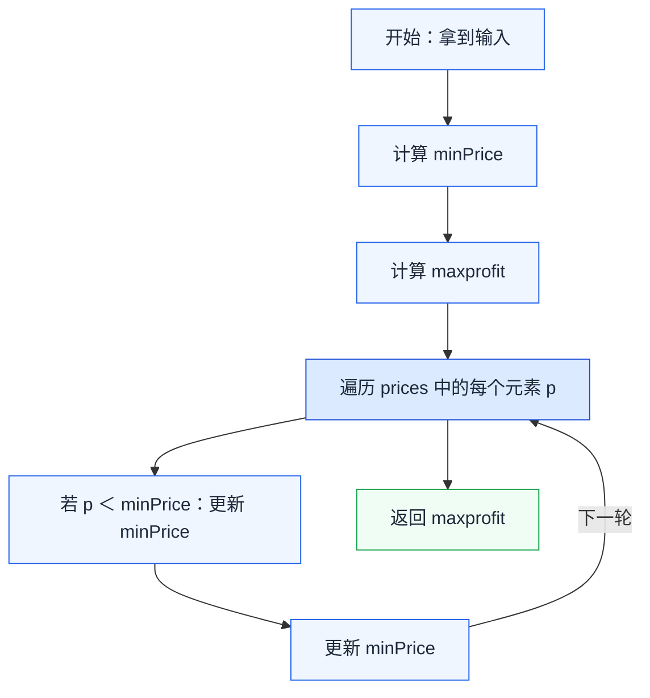

## TypeScript 解题方案（6 个方案逐个讲）

> **运行与提交**：每个方案都是自包含文件（内嵌用例自测，输出 PASS），整块复制到 `.ts` 文件后 `node 文件名` 即可运行。提交 LeetCode 时，把 `demo` 内的算法函数与辅助类型/函数整体取出、置于文件顶层即可。涉及交互/特殊接口的题以题面给定签名为准。

### 方案 1：一次遍历追踪最低价

**分析与思路**：核心做法是「一次遍历追踪最低价」。代码里依次做这些事：单循环线性扫描。

**运行方式**：`node 本文件`，内嵌用例全部通过会输出 PASS。

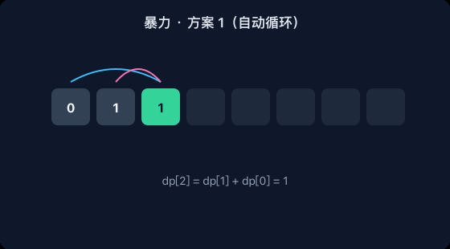

**方案专属流程图**（真实控制流）：

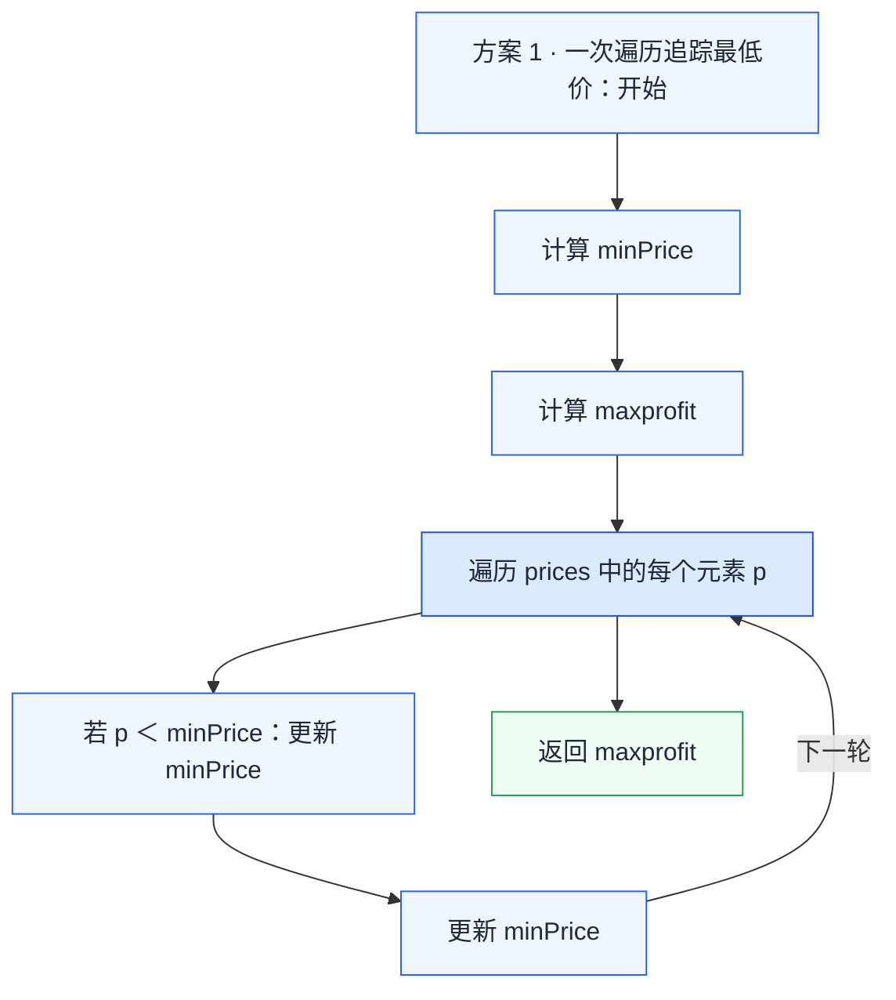

```typescript
/**
 ** LeetCode 121. 买卖股票的最佳时机
 ** 方案：1 ) 方案1: 一次遍历追踪最低价
 ** 来源：https://blog.csdn.net/tyro_java/article/details/144849130
 */

export function demo(): void {
  // 程序入口：跑内嵌自测用例
  function maxProfit(prices: number[]): number {
    // 定义函数/方法 maxProfit（O(n)：遍历中追踪历史最低价）
    let minPrice = Infinity; // 历史最低价
    let maxprofit = 0; // 最大利润
    for (const p of prices) {
      // 单趟扫描
      if (p < minPrice)
        minPrice = p; // 先更新最低价（当天不能卖昨天）
      else if (p - minPrice > maxprofit) maxprofit = p - minPrice; // 若今天卖出更优
    }
    return maxprofit; // 返回 maxprofit
  }
  const cases: Array<{ prices: number[]; want: number }> = [
    { prices: [7, 1, 5, 3, 6, 4], want: 5 },
    { prices: [7, 6, 4, 3, 1], want: 0 },
    { prices: [1, 2, 3], want: 2 },
  ];
  let fail = false; // 把 false 存入 fail
  for (const c of cases) {
    // for (const 字符 of cases) {
    const got = maxProfit(c.prices); // 把 maxProfit(字符.价格序列) 存入 got
    if (got !== c.want) {
      // 若 got 不等于 字符.want
      console.log(
        `FAIL maxProfit(${JSON.stringify(c.prices)})=${got} want ${c.want}`,
      );
      fail = true; // 把 true 存入 fail
    }
  }
  if (fail) throw new Error('FAILED'); // 若 fail) throw new Error(「FAILED」);
  console.log('PASS'); // 全部用例通过，输出 PASS
}

demo(); // demo();
```

### 方案 2：后缀最大值法

**分析与思路**：核心做法是「后缀最大值法」。代码里依次做这些事：单循环线性扫描。

**运行方式**：`node 本文件`，内嵌用例全部通过会输出 PASS。

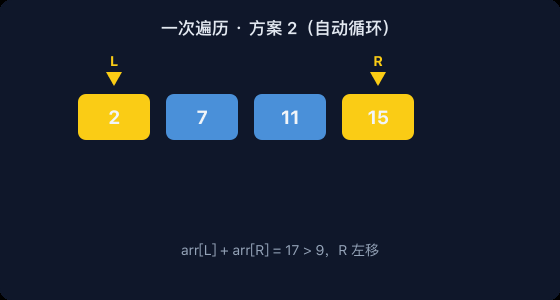

**方案专属流程图**（真实控制流）：

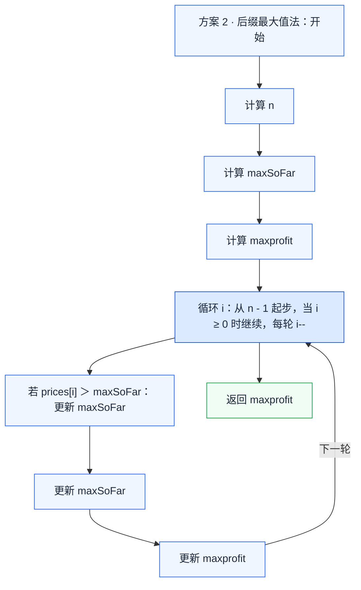

```typescript
/**
 ** LeetCode 121. 买卖股票的最佳时机
 ** 方案：2 ) 方案2: 后缀最大值法
 ** 来源：https://blog.csdn.net/tyro_java/article/details/144849130
 */

export function demo(): void {
  // 程序入口：跑内嵌自测用例
  function maxProfit(prices: number[]): number {
    // 定义函数/方法 maxProfit（O(n)：后缀最大值法）
    const n = prices.length; // 元素个数
    let maxSoFar = 0; // 从右往左的最大卖出价
    let maxprofit = 0; // 最大利润
    for (let i = n - 1; i >= 0; i--) {
      // 倒序扫描
      if (prices[i] > maxSoFar)
        maxSoFar = prices[i]; // 更新右侧最高价
      else if (maxSoFar - prices[i] > maxprofit)
        maxprofit = maxSoFar - prices[i]; // 在 i 买入、右侧最高价卖出
    }
    return maxprofit; // 返回 maxprofit
  }
  const cases: Array<{ prices: number[]; want: number }> = [
    { prices: [7, 1, 5, 3, 6, 4], want: 5 },
    { prices: [7, 6, 4, 3, 1], want: 0 },
    { prices: [1, 2, 3], want: 2 },
  ];
  let fail = false; // 把 false 存入 fail
  for (const c of cases) {
    // for (const 字符 of cases) {
    const got = maxProfit(c.prices); // 把 maxProfit(字符.价格序列) 存入 got
    if (got !== c.want) {
      // 若 got 不等于 字符.want
      console.log(
        `FAIL maxProfit(${JSON.stringify(c.prices)})=${got} want ${c.want}`,
      );
      fail = true; // 把 true 存入 fail
    }
  }
  if (fail) throw new Error('FAILED'); // 若 fail) throw new Error(「FAILED」);
  console.log('PASS'); // 全部用例通过，输出 PASS
}

demo(); // demo();
```

### 方案 3：DP 状态机

**分析与思路**：核心做法是「DP 状态机」。代码里依次做这些事：单循环线性扫描。

**运行方式**：`node 本文件`，内嵌用例全部通过会输出 PASS。

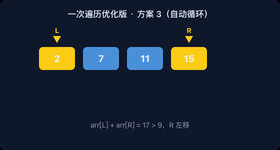

**方案专属流程图**（真实控制流）：

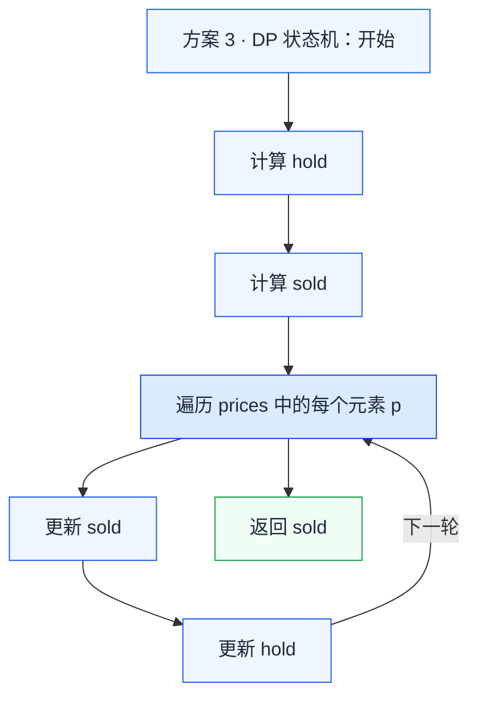

```typescript
/**
 ** LeetCode 121. 买卖股票的最佳时机
 ** 方案：3 ) 方案3: DP 状态机
 ** 来源：https://blog.csdn.net/tyro_java/article/details/144849130
 */

export function demo(): void {
  // 程序入口：跑内嵌自测用例
  function maxProfit(prices: number[]): number {
    // 定义函数/方法 maxProfit（O(n)：DP 状态机）
    let hold = -Infinity; // 持有股票时的最差收益
    let sold = 0; // 未持有股票时的最优收益
    for (const p of prices) {
      // 单趟扫描
      sold = Math.max(sold, hold + p); // 今天卖出
      hold = Math.max(hold, -p); // 今天买入（花费 p）
    }
    return sold; // 返回 sold
  }
  const cases: Array<{ prices: number[]; want: number }> = [
    { prices: [7, 1, 5, 3, 6, 4], want: 5 },
    { prices: [7, 6, 4, 3, 1], want: 0 },
    { prices: [1, 2, 3], want: 2 },
  ];
  let fail = false; // 把 false 存入 fail
  for (const c of cases) {
    // for (const 字符 of cases) {
    const got = maxProfit(c.prices); // 把 maxProfit(字符.价格序列) 存入 got
    if (got !== c.want) {
      // 若 got 不等于 字符.want
      console.log(
        `FAIL maxProfit(${JSON.stringify(c.prices)})=${got} want ${c.want}`,
      );
      fail = true; // 把 true 存入 fail
    }
  }
  if (fail) throw new Error('FAILED'); // 若 fail) throw new Error(「FAILED」);
  console.log('PASS'); // 全部用例通过，输出 PASS
}

demo(); // demo();
```

### 方案 4：前缀最低价数组

**分析与思路**：核心做法是「前缀最低价数组」。代码里依次做这些事：双重循环遍历。

**运行方式**：`node 本文件`，内嵌用例全部通过会输出 PASS。


**方案专属流程图**（真实控制流）：

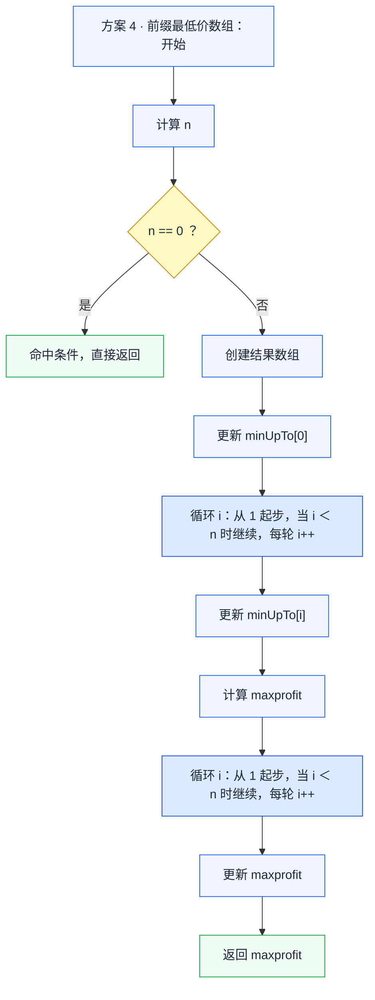

```typescript
/**
 ** LeetCode 121. 买卖股票的最佳时机
 ** 方案：4 ) 方案4: 前缀最低价数组
 ** 来源：https://blog.csdn.net/tyro_java/article/details/144849130
 */

export function demo(): void {
  // 程序入口：跑内嵌自测用例
  function maxProfit(prices: number[]): number {
    // 定义函数/方法 maxProfit（O(n)：min 数组 + 一次线性组合）
    const n = prices.length; // 元素个数
    if (n === 0) return 0; // 空数组守卫
    const minUpTo = new Array(n).fill(0); // minUpTo[i] = 前 i+1 天的最低价
    minUpTo[0] = prices[0]; // 初始化首元素
    for (let i = 1; i < n; i++)
      minUpTo[i] = Math.min(minUpTo[i - 1], prices[i]); // 前缀最低价
    let maxprofit = 0; // 最大利润
    for (let i = 1; i < n; i++)
      maxprofit = Math.max(maxprofit, prices[i] - minUpTo[i - 1]); // 今天卖、之前最低买
    return maxprofit; // 返回 maxprofit
  }
  const cases: Array<{ prices: number[]; want: number }> = [
    { prices: [7, 1, 5, 3, 6, 4], want: 5 },
    { prices: [7, 6, 4, 3, 1], want: 0 },
    { prices: [1, 2, 3], want: 2 },
  ];
  let fail = false; // 把 false 存入 fail
  for (const c of cases) {
    // for (const 字符 of cases) {
    const got = maxProfit(c.prices); // 把 maxProfit(字符.价格序列) 存入 got
    if (got !== c.want) {
      // 若 got 不等于 字符.want
      console.log(
        `FAIL maxProfit(${JSON.stringify(c.prices)})=${got} want ${c.want}`,
      );
      fail = true; // 把 true 存入 fail
    }
  }
  if (fail) throw new Error('FAILED'); // 若 fail) throw new Error(「FAILED」);
  console.log('PASS'); // 全部用例通过，输出 PASS
}

demo(); // demo();
```

### 方案 5：分治

**分析与思路**：核心做法是「分治」。代码里依次做这些事：单循环线性扫描。

**运行方式**：`node 本文件`，内嵌用例全部通过会输出 PASS。


**方案专属流程图**（真实控制流）：

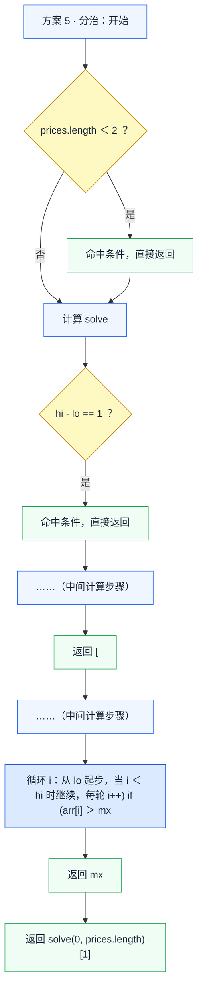

```typescript
/**
 ** LeetCode 121. 买卖股票的最佳时机
 ** 方案：5 ) 方案5: 分治
 ** 来源：https://blog.csdn.net/tyro_java/article/details/144849130
 */

export function demo(): void {
  // 程序入口：跑内嵌自测用例
  function maxProfit(prices: number[]): number {
    // 定义函数/方法 maxProfit（分治：左半最优、右半最优、跨中点差）
    if (prices.length < 2) return 0; // 少于两天无交易
    const solve = (lo: number, hi: number): [number, number, number] => {
      // 返回 [区间和? 不需要, 区间min, 区间最优利润]
      if (hi - lo === 1) return [prices[lo], 0]; // 单元素：[min, best]
      const mid = (lo + hi) >> 1;
      const [lMin, lBest] = solve(lo, mid);
      const [rMin, rBest] = solve(mid, hi);
      const cross = rMaxOf(prices, mid, hi) - lMin; // 跨中点：右半最大卖出 - 左半最低买入
      return [
        Math.min(lMin, rMin),
        Math.max(Math.max(lBest, rBest), cross < 0 ? 0 : cross),
      ];
    };
    function rMaxOf(arr: number[], lo: number, hi: number): number {
      // [lo,hi) 区间最大值
      let mx = -Infinity;
      for (let i = lo; i < hi; i++) if (arr[i] > mx) mx = arr[i];
      return mx;
    }
    return solve(0, prices.length)[1]; // 返回区间最优利润
  }
  const cases: Array<{ prices: number[]; want: number }> = [
    { prices: [7, 1, 5, 3, 6, 4], want: 5 },
    { prices: [7, 6, 4, 3, 1], want: 0 },
    { prices: [1, 2, 3], want: 2 },
  ];
  let fail = false; // 把 false 存入 fail
  for (const c of cases) {
    // for (const 字符 of cases) {
    const got = maxProfit(c.prices); // 把 maxProfit(字符.价格序列) 存入 got
    if (got !== c.want) {
      // 若 got 不等于 字符.want
      console.log(
        `FAIL maxProfit(${JSON.stringify(c.prices)})=${got} want ${c.want}`,
      );
      fail = true; // 把 true 存入 fail
    }
  }
  if (fail) throw new Error('FAILED'); // 若 fail) throw new Error(「FAILED」);
  console.log('PASS'); // 全部用例通过，输出 PASS
}

demo(); // demo();
```

### 方案 6：双状态滚动

**分析与思路**：核心做法是「双状态滚动」。代码里依次做这些事：单循环线性扫描。

**运行方式**：`node 本文件`，内嵌用例全部通过会输出 PASS。

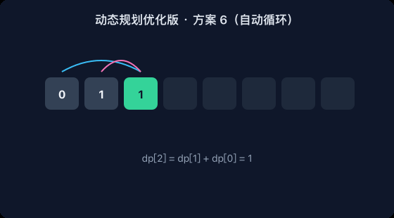

**方案专属流程图**（真实控制流）：

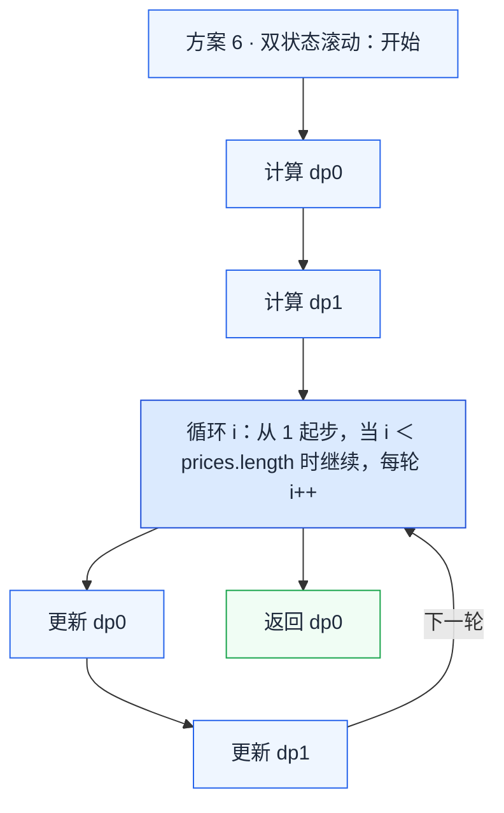

```typescript
/**
 ** LeetCode 121. 买卖股票的最佳时机
 ** 方案：6 ) 方案6: 双状态滚动
 ** 来源：https://blog.csdn.net/tyro_java/article/details/144849130
 */

export function demo(): void {
  // 程序入口：跑内嵌自测用例
  function maxProfit(prices: number[]): number {
    // 定义函数/方法 maxProfit（O(n)：显式 dp0/dp1 滚动）
    let dp0 = 0; // 第 i 天结束、未持股的最大利润
    let dp1 = -prices[0]; // 第 i 天结束、持股的最大利润
    for (let i = 1; i < prices.length; i++) {
      // 逐日状态转移
      dp0 = Math.max(dp0, dp1 + prices[i]); // 维持未持有 或 今天卖出
      dp1 = Math.max(dp1, -prices[i]); // 维持持股 或 今天买入
    }
    return dp0; // 返回 dp0
  }
  const cases: Array<{ prices: number[]; want: number }> = [
    { prices: [7, 1, 5, 3, 6, 4], want: 5 },
    { prices: [7, 6, 4, 3, 1], want: 0 },
    { prices: [1, 2, 3], want: 2 },
  ];
  let fail = false; // 把 false 存入 fail
  for (const c of cases) {
    // for (const 字符 of cases) {
    const got = maxProfit(c.prices); // 把 maxProfit(字符.价格序列) 存入 got
    if (got !== c.want) {
      // 若 got 不等于 字符.want
      console.log(
        `FAIL maxProfit(${JSON.stringify(c.prices)})=${got} want ${c.want}`,
      );
      fail = true; // 把 true 存入 fail
    }
  }
  if (fail) throw new Error('FAILED'); // 若 fail) throw new Error(「FAILED」);
  console.log('PASS'); // 全部用例通过，输出 PASS
}

demo(); // demo();
```

## 逐步拆解与面试追问

**复杂度**：时间 O(n)（单趟线性扫描），空间 O(1) 到 O(n)（视辅助结构）

**为什么是这个量级**：每个元素被常数次访问，辅助哈希或栈的开销与 n 同阶

**面试官可能会追问**：

- 状态定义为什么是它？
- 遍历顺序由什么决定？
- 能否滚动数组压空间？

## 关键 API 速查（TS 主解法实际用到，附官方链接）

| API | 作用 | 使用要点 | 官方文档 |
|---|---|---|---|
| `JSON.stringify()` | 序列化为 JSON 字符串 | 常用于结构化比较（深度相等判定）；undefined/函数/循环引用会被丢弃或抛错 | [官方文档](https://developer.mozilla.org/zh-CN/docs/Web/JavaScript/Reference/Global_Objects/JSON/stringify) |

### 各语言官方文档导航

- **TypeScript / JS**：[MDN 中文参考](https://developer.mozilla.org/zh-CN/)
- **Python**：[Python 官方文档](https://docs.python.org/zh-cn/3/)
- **Go**：[Go 标准库](https://pkg.go.dev/std)
- **Java**：[JDK 17 API](https://docs.oracle.com/en/java/javase/17/docs/api/)
- **Rust**：[Rust 标准库](https://doc.rust-lang.org/std/)
- **Lua**：[Lua 5.4 手册](https://www.lua.org/manual/5.4/)
- **C**：[Cppreference C](https://zh.cppreference.com/w/c)
- **C++**：[Cppreference C++](https://zh.cppreference.com/w/cpp)
- **R**：[R 官方手册](https://stat.ethz.ch/R-manual/)
- **Zig**：[Zig 语言文档](https://ziglang.org/documentation/master/)
- **Dart**：[Dart API](https://api.dart.dev/)

## 附录：其他 10 种语言全部实现（每种语言列举其全部方案）

> TypeScript 的全部方案见「TypeScript 解题方案」一节；下面是其余 10 种语言的对应实现，每种语言的每个方案都带思路分析、代码走读与专属运行架构图。
> 每个方案都内嵌用例自测，可独立运行（老仓库 python/go 文件遵循「打印结果」约定）。
> 完整解法文件见 `dsa/<语言>/dp/lc_121_买卖股票的最佳时机/`。

### Python 实现（6 种方案）

Python 的全部方案如下，每个方案都内嵌用例自测，可独立运行（老仓库 python/go 文件遵循「打印结果」约定）：

#### 方案 1：一次遍历追踪最低价

**思路与代码分析**：核心是「一次遍历追踪最低价」。Python 版用切片与字典推导式简化操作，突出可读性。**走读**：方案 1 · 一次遍历追踪最低价：开始 → 更新 n → 更新 maxprofit → 循环 i：从 0 到 n 前 → 循环 j：从 i + 1 到 n 前 → 更新 profit → 若 profit ＞ maxprofit：更新 maxprofit → 更新 maxprofit → 返回 maxprofit。

**运行架构**（真实控制流）：

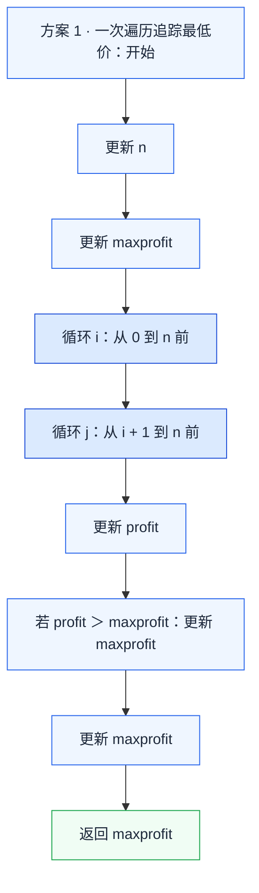

```python
import sys  # 提高递归深度上限（深输入防 RecursionError）

sys.setrecursionlimit(200000)  # 树/链表类题目节点数可达 1e4 量级

def maxProfit(prices):  # 定义函数 maxProfit（参数：价格序列）
    # 暴力法
    n = len(prices)  # 把 长度(价格序列) 存入 元素个数
    maxprofit = 0  # 把 0 存入 maxprofit
    for i in range(n):  # 让 下标 i 从 元素个数 遍历
        for j in range(i + 1, n):  # 让 下标 j 从 下标 i 加 1 到 元素个数 遍历
            profit = prices[j] - prices[i]  # 把 价格序列[下标 j] 减 价格序列[下标 i] 存入 profit
            if profit > maxprofit:  # 若 profit 超过 maxprofit
                maxprofit = profit  # 把 profit 存入 maxprofit
    return maxprofit  # 返回 maxprofit

if __name__ == "__main__":  # 若 __name__ 等于 '__main__'
    print(maxProfit([7, 1, 5, 3, 6, 4]))  # 打印输出
```

#### 方案 2：后缀最大值法

**思路与代码分析**：核心是「后缀最大值法」。Python 版用切片与字典推导式简化操作，突出可读性。**走读**：方案 2 · 后缀最大值法：开始 → 更新 minprice → 更新 maxprofit → 遍历 prices: 中的每个元素 price → 若 price ＜ minprice：更新 minprice → 更新 minprice → 更新 maxprofit → 处理 maxprofit, price - minprice → 处理 ) → 返回 maxprofit。

**运行架构**（真实控制流）：

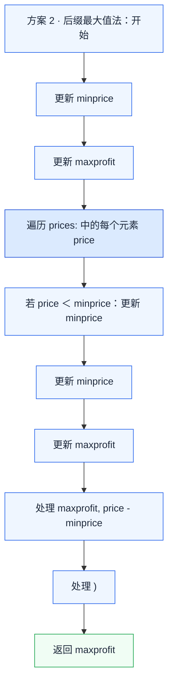

```python
import sys  # 提高递归深度上限（深输入防 RecursionError）

sys.setrecursionlimit(200000)  # 树/链表类题目节点数可达 1e4 量级

def maxProfit(prices):  # 定义函数 maxProfit（参数：价格序列）
    # 一次遍历
    minprice = float("inf")  # 把 float('inf') 存入 minprice
    maxprofit = 0  # 把 0 存入 maxprofit
    for price in prices:  # 逐个取出 价格序列 的元素（price）
        if price < minprice:  # 若 price 小于 minprice
            minprice = price  # 把 price 存入 minprice
        else:  # 否则
            maxprofit = max(
                maxprofit, price - minprice
            )  # 把 取较大值 maxprofit, price 减 minprice) 存入 maxprofit
    return maxprofit  # 返回 maxprofit

if __name__ == "__main__":  # 若 __name__ 等于 '__main__'
    print(maxProfit([7, 1, 5, 3, 6, 4]))  # 打印输出
```

#### 方案 3：DP 状态机

**思路与代码分析**：核心是「DP 状态机」。Python 版用切片与字典推导式简化操作，突出可读性。**走读**：方案 3 · DP 状态机：开始 → 命中条件，直接返回 → 更新 pre → 更新 ans → 循环 i：从 0 到 len(prices 前 → 更新 ans → 更新 pre → 返回 ans。

**运行架构**（真实控制流）：

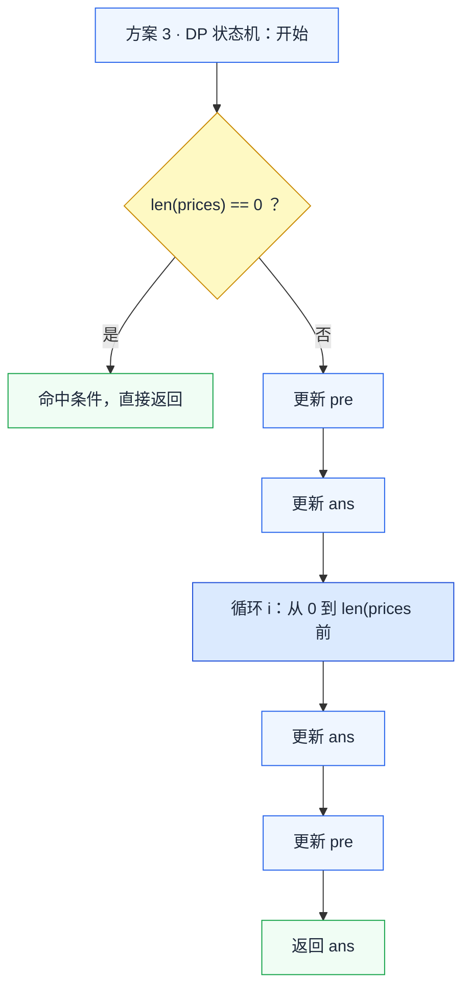

```python
import sys  # 提高递归深度上限（深输入防 RecursionError）

sys.setrecursionlimit(200000)  # 树/链表类题目节点数可达 1e4 量级

def maxProfit(prices):  # 定义函数 maxProfit（参数：价格序列）
    if len(prices) == 0:
        return 0  # 若 长度(价格序列) 等于 0: return 0
    pre = prices[0]  # 把 价格序列[0] 存入 前缀和
    ans = 0  # 把 0 存入 答案
    for i in range(0, len(prices)):  # 让 下标 i 从 0 到 长度(价格序列 遍历
        ans = max(ans, prices[i] - pre)  # 把 取较大值 答案, 价格序列[下标 i] 减 前缀和) 存入 答案
        pre = min(pre, prices[i])  # 把 取较小值 前缀和, 价格序列[下标 i]) 存入 前缀和
    return ans  # 返回 答案

if __name__ == "__main__":  # 若 __name__ 等于 '__main__'
    print(maxProfit([1, 2, 3]))  # 打印输出
```

#### 方案 4：前缀最低价数组

**思路与代码分析**：核心是「前缀最低价数组」。Python 版用切片与字典推导式简化操作，突出可读性。**走读**：方案 4 · 前缀最低价数组：开始 → 更新 left → 更新 right → 更新 maxProfit → 更新 n → 当 right ＜ n: 时反复执行 → 若 prices[right] ＜ prices[left]：更新 left → 更新 left → 更新 maxProfit → 处理 maxProfit, prices[right] - p → 处理 ) → 更新 + → 返回 maxProfit。

**运行架构**（真实控制流）：

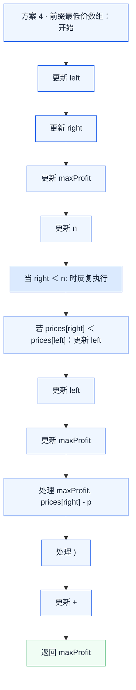

```python
import sys  # 提高递归深度上限（深输入防 RecursionError）

sys.setrecursionlimit(200000)  # 树/链表类题目节点数可达 1e4 量级

def maxProfit(prices):  # 定义函数 maxProfit（参数：价格序列）
    # 双指针（滑动窗口）
    left = 0  # 把 0 存入 左边界
    right = 0  # 把 0 存入 右边界
    maxProfit = 0  # 把 0 存入 maxProfit
    n = len(prices)  # 把 长度(价格序列) 存入 元素个数
    while right < n:  # 循环，直到不满足「右边界 小于 元素个数」
        if prices[right] < prices[left]:  # 若 价格序列[右边界] 小于 价格序列[左边界]
            left = right  # 把 右边界 存入 左边界
        else:  # 否则
            maxProfit = max(
                maxProfit, prices[right] - prices[left]
            )  # 把 取较大值 maxProfit, 价格序列[右边界] 减 价格序列[左边界]) 存入 maxProfit
        right += 1  # 右边界累加 1
    return maxProfit  # 返回 maxProfit

if __name__ == "__main__":  # 若 __name__ 等于 '__main__'
    print(maxProfit([7, 1, 5, 3, 6, 4]))  # 打印输出
```

#### 方案 5：分治

**思路与代码分析**：核心是「分治」。Python 版用切片与字典推导式简化操作，突出可读性。代码里依次做这些事：DP 表逐项填充。**走读**：方案 5 · 分治：开始 → 填写 DP 表 → 填写 DP 表 → 循环 i：从 1 到 len(prices 前 → 填写 DP 表 → 填写 DP 表 → 填写 DP 表 → 处理 ] → 返回 dp[len(prices) - 1][1]。

**运行架构**（真实控制流）：

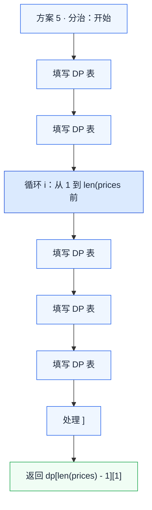

```python
import sys  # 提高递归深度上限（深输入防 RecursionError）

sys.setrecursionlimit(200000)  # 树/链表类题目节点数可达 1e4 量级

def maxProfit(prices):  # 定义函数 maxProfit（参数：价格序列）
    dp = [[0, 0] for _ in range(len(prices))]  # 把 [[0, 0] for _ in range(长度(价格序列))] 存入 DP 表
    dp[0] = [-prices[0], 0]  # 把 [ 减 价格序列[0], 0] 写入 dp[0]
    for i in range(1, len(prices)):  # 让 下标 i 从 1 到 长度(价格序列 遍历
        dp[i] = [
            max(dp[i - 1][0], -prices[i]),
            max(dp[i - 1][1], prices[i] + dp[i - 1][0]),
        ]
    return dp[len(prices) - 1][1]  # 返回 DP 表[长度(价格序列) 减 1][1]

if __name__ == "__main__":  # 若 __name__ 等于 '__main__'
    print(maxProfit([1, 2, 3]))  # 打印输出
```

#### 方案 6：双状态滚动

**思路与代码分析**：核心是「双状态滚动」。Python 版用切片与字典推导式简化操作，突出可读性。代码里依次做这些事：DP 表逐项填充。**走读**：方案 6 · 双状态滚动：开始 → 命中条件，直接返回 → 更新 maxProfit → 填写 DP 表 → 填写 DP 表 → 循环 i：从 1 到 len(prices 前 → 填写 DP 表 → 更新 maxProfit → 填写 DP 表 → 处理 ) → 返回 maxProfit。

**运行架构**（真实控制流）：

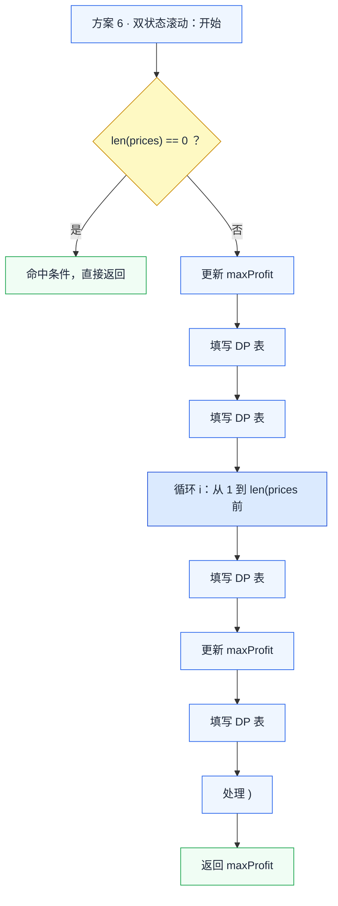

```python
import sys  # 提高递归深度上限（深输入防 RecursionError）

sys.setrecursionlimit(200000)  # 树/链表类题目节点数可达 1e4 量级

def maxProfit(prices):  # 定义函数 maxProfit（参数：价格序列）
    if len(prices) == 0:
        return 0  # 若 长度(价格序列) 等于 0: return 0
    maxProfit = 0  # 把 0 存入 maxProfit
    dp = [0] * len(prices)  # 把 [0] 乘 长度(价格序列) 存入 DP 表
    dp[0] = prices[0]  # 把 价格序列[0] 写入 dp[0]
    for i in range(1, len(prices)):  # 让 下标 i 从 1 到 长度(价格序列 遍历
        dp[i] = min(dp[i - 1], prices[i])  # 把 取较小值 DP 表[下标 i 减 1], 价格序列[下标 i]) 写入 dp[i]
        maxProfit = max(
            prices[i] - dp[i], maxProfit
        )  # 把 取较大值 价格序列[下标 i] 减 DP 表[下标 i], maxProfit) 存入 maxProfit
    return maxProfit  # 返回 maxProfit

if __name__ == "__main__":  # 若 __name__ 等于 '__main__'
    print(maxProfit([1, 2, 3]))  # 打印输出
```

### Go 实现（6 种方案）

Go 的全部方案如下，每个方案都内嵌用例自测，可独立运行（老仓库 python/go 文件遵循「打印结果」约定）：

#### 方案 1：一次遍历追踪最低价

**思路与代码分析**：核心是「一次遍历追踪最低价」。Go 版用切片与多返回值惯用法，显式处理索引边界。**走读**：方案 1 · 一次遍历追踪最低价：开始 → 更新 : → 更新 : → 遍历 prices 的下标与元素 p → 处理 if p ＜ minPrice → 更新 minPrice → 更新 maxprofit → 返回 maxprofit。

**运行架构**（真实控制流）：

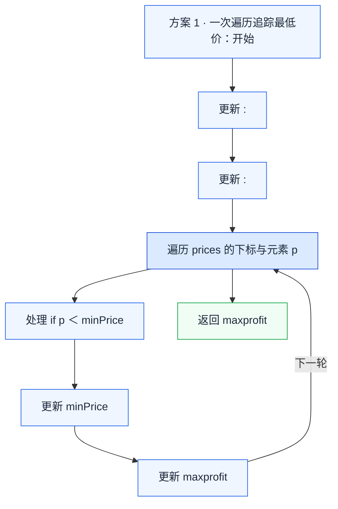

```go
package main // 引入依赖

import (
	"fmt" // 「fmt」
	"os"  // 「os」
)

func maxProfit(prices []int) int { // 定义函数/方法 maxProfit（O(n)：遍历中追踪历史最低价）
	minPrice := int(^uint(0) >> 1) // 历史最低价（初值取最大 int）
	maxprofit := 0                 // 最大利润
	for _, p := range prices {     // 单趟扫描
		if p < minPrice { // 先更新最低价
			minPrice = p
		} else if p-minPrice > maxprofit { // 若今天卖出更优
			maxprofit = p - minPrice
		}
	}
	return maxprofit // 返回 maxprofit
}

func main() { // 程序入口：跑内嵌自测用例
	type tc struct { // 定义类型
		prices []int // 价格序列 []int
		want   int   // want int
	}
	cases := []tc{ // 把 []tc{ 写入 cases :
		{[]int{7, 1, 5, 3, 6, 4}, 5},
		{[]int{7, 6, 4, 3, 1}, 0},
		{[]int{1, 2, 3}, 2},
	}
	fail := false             // 把 false 写入 fail :
	for _, c := range cases { // 同时取 _ 与 字符 遍历
		got := maxProfit(c.prices) // 把 maxProfit(字符.价格序列) 写入 got :
		if got != c.want {         // 若 got 不等于 字符.want
			fmt.Printf("FAIL maxProfit(%v)=%d want %d\n", c.prices, got, c.want) // 打印输出
			fail = true                                                          // 把 true 写入 fail
		}
	}
	if fail { // 若 fail
		os.Exit(1) // os.Exit(1)
	}
	fmt.Println("PASS") // 全部用例通过，输出 PASS
}
```

#### 方案 2：后缀最大值法

**思路与代码分析**：核心是「后缀最大值法」。Go 版用切片与多返回值惯用法，显式处理索引边界。**走读**：方案 2 · 后缀最大值法：开始 → 更新 : → 更新 : → 更新 : → 遍历循环 → 处理 if prices[i] ＞ maxSoFar → 更新 maxSoFar → 更新 maxprofit → 返回 maxprofit。

**运行架构**（真实控制流）：

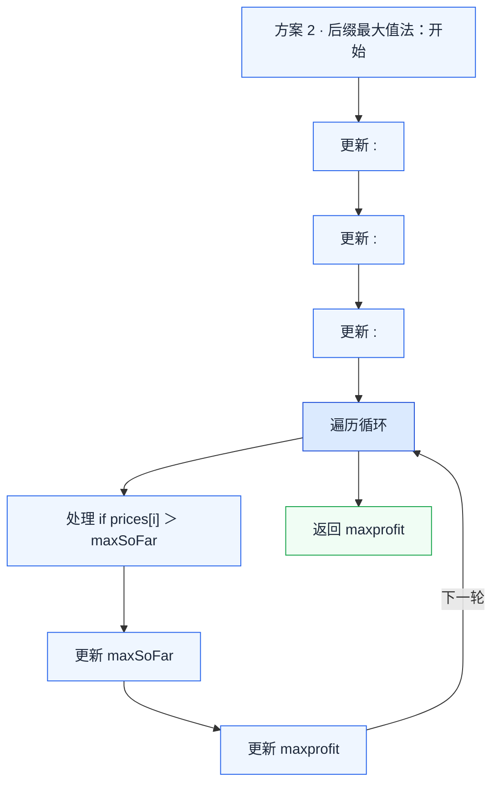

```go
package main // 引入依赖

import (
	"fmt" // 「fmt」
	"os"  // 「os」
)

func maxProfit(prices []int) int { // 定义函数/方法 maxProfit（O(n)：后缀最大值法）
	n := len(prices)              // 元素个数
	maxSoFar := 0                 // 从右往左的最大卖出价
	maxprofit := 0                // 最大利润
	for i := n - 1; i >= 0; i-- { // 倒序扫描
		if prices[i] > maxSoFar { // 更新右侧最高价
			maxSoFar = prices[i]
		} else if maxSoFar-prices[i] > maxprofit { // 在 i 买入、右侧最高价卖出
			maxprofit = maxSoFar - prices[i]
		}
	}
	return maxprofit // 返回 maxprofit
}

func main() { // 程序入口：跑内嵌自测用例
	type tc struct { // 定义类型
		prices []int // 价格序列 []int
		want   int   // want int
	}
	cases := []tc{ // 把 []tc{ 写入 cases :
		{[]int{7, 1, 5, 3, 6, 4}, 5},
		{[]int{7, 6, 4, 3, 1}, 0},
		{[]int{1, 2, 3}, 2},
	}
	fail := false             // 把 false 写入 fail :
	for _, c := range cases { // 同时取 _ 与 字符 遍历
		got := maxProfit(c.prices) // 把 maxProfit(字符.价格序列) 写入 got :
		if got != c.want {         // 若 got 不等于 字符.want
			fmt.Printf("FAIL maxProfit(%v)=%d want %d\n", c.prices, got, c.want) // 打印输出
			fail = true                                                          // 把 true 写入 fail
		}
	}
	if fail { // 若 fail
		os.Exit(1) // os.Exit(1)
	}
	fmt.Println("PASS") // 全部用例通过，输出 PASS
}
```

#### 方案 3：DP 状态机

**思路与代码分析**：核心是「DP 状态机」。Go 版用切片与多返回值惯用法，显式处理索引边界。**走读**：方案 3 · DP 状态机：开始 → 更新 : → 更新 : → 遍历 prices 的下标与元素 p → 处理 if hold+p ＞ sold → 更新 sold → 处理 if -p ＞ hold → 更新 hold → 返回 sold。

**运行架构**（真实控制流）：

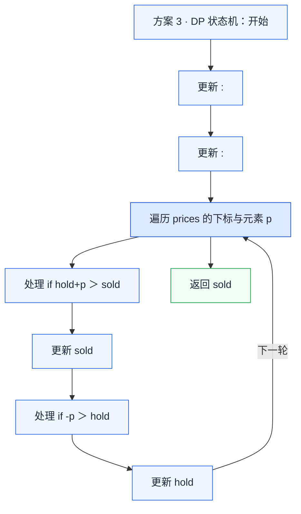

```go
package main // 引入依赖

import (
	"fmt" // 「fmt」
	"os"  // 「os」
)

func maxProfit(prices []int) int { // 定义函数/方法 maxProfit（O(n)：DP 状态机）
	hold := -1 << 60           // 持有股票时的最差收益
	sold := 0                  // 未持有股票时的最优收益
	for _, p := range prices { // 单趟扫描
		if hold+p > sold { // 今天卖出
			sold = hold + p
		}
		if -p > hold { // 今天买入（花费 p）
			hold = -p
		}
	}
	return sold // 返回 sold
}

func main() { // 程序入口：跑内嵌自测用例
	type tc struct { // 定义类型
		prices []int // 价格序列 []int
		want   int   // want int
	}
	cases := []tc{ // 把 []tc{ 写入 cases :
		{[]int{7, 1, 5, 3, 6, 4}, 5},
		{[]int{7, 6, 4, 3, 1}, 0},
		{[]int{1, 2, 3}, 2},
	}
	fail := false             // 把 false 写入 fail :
	for _, c := range cases { // 同时取 _ 与 字符 遍历
		got := maxProfit(c.prices) // 把 maxProfit(字符.价格序列) 写入 got :
		if got != c.want {         // 若 got 不等于 字符.want
			fmt.Printf("FAIL maxProfit(%v)=%d want %d\n", c.prices, got, c.want) // 打印输出
			fail = true                                                          // 把 true 写入 fail
		}
	}
	if fail { // 若 fail
		os.Exit(1) // os.Exit(1)
	}
	fmt.Println("PASS") // 全部用例通过，输出 PASS
}
```

#### 方案 4：前缀最低价数组

**思路与代码分析**：核心是「前缀最低价数组」。Go 版用切片与多返回值惯用法，显式处理索引边界。**走读**：方案 4 · 前缀最低价数组：开始 → 更新 : → 处理 if n == 0 → 返回 0 → 更新 : → 更新 minUpTo[0] → 遍历循环 → 处理 if prices[i] ＜ minUpTo[i-1] → 更新 minUpTo[i] → 更新 minUpTo[i] → 更新 : → 遍历循环 → 处理 if prices[i]-minUpTo[i-1] ＞ → 更新 maxprofit → 返回 maxprofit。

**运行架构**（真实控制流）：

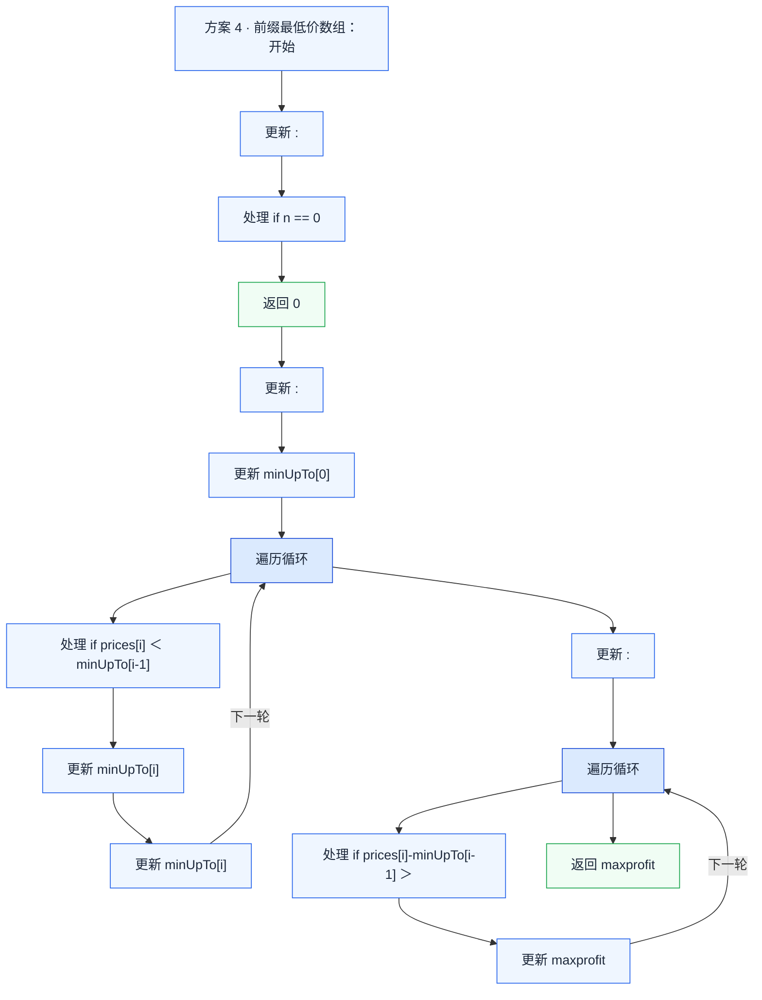

```go
package main // 引入依赖

import (
	"fmt" // 「fmt」
	"os"  // 「os」
)

func maxProfit(prices []int) int { // 定义函数/方法 maxProfit（O(n)：min 数组 + 线性组合）
	n := len(prices) // 元素个数
	if n == 0 {      // 空数组守卫
		return 0
	}
	minUpTo := make([]int, n) // minUpTo[i] = 前 i+1 天的最低价
	minUpTo[0] = prices[0]
	for i := 1; i < n; i++ { // 前缀最低价
		if prices[i] < minUpTo[i-1] {
			minUpTo[i] = prices[i]
		} else {
			minUpTo[i] = minUpTo[i-1]
		}
	}
	maxprofit := 0           // 最大利润
	for i := 1; i < n; i++ { // 今天卖、之前最低买
		if prices[i]-minUpTo[i-1] > maxprofit {
			maxprofit = prices[i] - minUpTo[i-1]
		}
	}
	return maxprofit // 返回 maxprofit
}

func main() { // 程序入口：跑内嵌自测用例
	type tc struct { // 定义类型
		prices []int // 价格序列 []int
		want   int   // want int
	}
	cases := []tc{ // 把 []tc{ 写入 cases :
		{[]int{7, 1, 5, 3, 6, 4}, 5},
		{[]int{7, 6, 4, 3, 1}, 0},
		{[]int{1, 2, 3}, 2},
	}
	fail := false             // 把 false 写入 fail :
	for _, c := range cases { // 同时取 _ 与 字符 遍历
		got := maxProfit(c.prices) // 把 maxProfit(字符.价格序列) 写入 got :
		if got != c.want {         // 若 got 不等于 字符.want
			fmt.Printf("FAIL maxProfit(%v)=%d want %d\n", c.prices, got, c.want) // 打印输出
			fail = true                                                          // 把 true 写入 fail
		}
	}
	if fail { // 若 fail
		os.Exit(1) // os.Exit(1)
	}
	fmt.Println("PASS") // 全部用例通过，输出 PASS
}
```

#### 方案 5：分治

**思路与代码分析**：核心是「分治」。Go 版用切片与多返回值惯用法，显式处理索引边界。**走读**：方案 5 · 分治：开始 → 计算 solve → 返回 prices[lo], 0 → 遍历循环 → 返回 mn, best → 返回 best。

**运行架构**（真实控制流）：

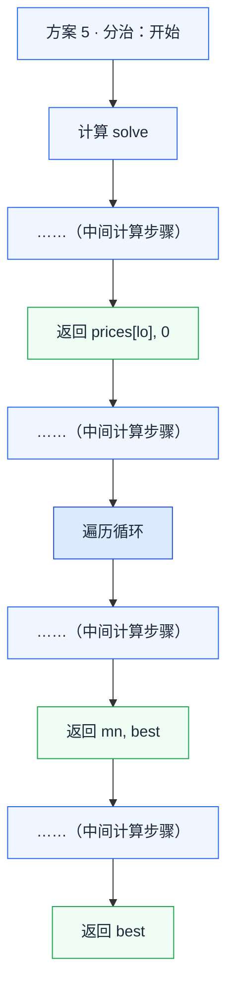

```go
package main // 引入依赖

import (
	"fmt" // 「fmt」
	"os"  // 「os」
)

func maxProfit(prices []int) int { // 定义函数/方法 maxProfit（分治：左半最优、右半最优、跨中点差）
	var solve func(lo, hi int) (int, int) // 返回 [区间min, 区间最优利润]
	solve = func(lo, hi int) (int, int) {
		if hi-lo == 1 { // 单元素
			return prices[lo], 0
		}
		mid := (lo + hi) / 2
		lMin, lBest := solve(lo, mid)
		rMin, rBest := solve(mid, hi)
		rMax := prices[mid]
		for i := mid; i < hi; i++ { // 右半最大卖出价
			if prices[i] > rMax {
				rMax = prices[i]
			}
		}
		cross := rMax - lMin // 跨中点：右半最高卖 - 左半最低买
		if cross < 0 {
			cross = 0
		}
		best := lBest
		if rBest > best {
			best = rBest
		}
		if cross > best {
			best = cross
		}
		mn := lMin
		if rMin < mn {
			mn = rMin
		}
		return mn, best
	}
	_, best := solve(0, len(prices))
	return best // 返回区间最优利润
}

func main() { // 程序入口：跑内嵌自测用例
	type tc struct { // 定义类型
		prices []int // 价格序列 []int
		want   int   // want int
	}
	cases := []tc{ // 把 []tc{ 写入 cases :
		{[]int{7, 1, 5, 3, 6, 4}, 5},
		{[]int{7, 6, 4, 3, 1}, 0},
		{[]int{1, 2, 3}, 2},
	}
	fail := false             // 把 false 写入 fail :
	for _, c := range cases { // 同时取 _ 与 字符 遍历
		got := maxProfit(c.prices) // 把 maxProfit(字符.价格序列) 写入 got :
		if got != c.want {         // 若 got 不等于 字符.want
			fmt.Printf("FAIL maxProfit(%v)=%d want %d\n", c.prices, got, c.want) // 打印输出
			fail = true                                                          // 把 true 写入 fail
		}
	}
	if fail { // 若 fail
		os.Exit(1) // os.Exit(1)
	}
	fmt.Println("PASS") // 全部用例通过，输出 PASS
}
```

#### 方案 6：双状态滚动

**思路与代码分析**：核心是「双状态滚动」。Go 版用切片与多返回值惯用法，显式处理索引边界。**走读**：方案 6 · 双状态滚动：开始 → 更新 : → 遍历 prices 的下标与元素 p → 处理 if dp1+p ＞ dp0 → 更新 dp0 → 处理 if -p ＞ dp1 → 更新 dp1 → 返回 dp0。

**运行架构**（真实控制流）：

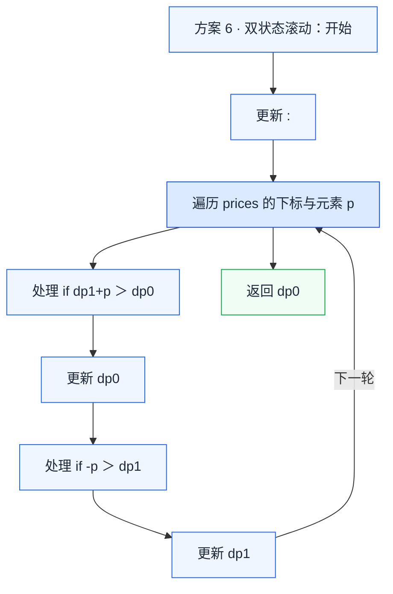

```go
package main // 引入依赖

import (
	"fmt" // 「fmt」
	"os"  // 「os」
)

func maxProfit(prices []int) int { // 定义函数/方法 maxProfit（O(n)：显式 dp0/dp1 滚动）
	dp0, dp1 := 0, -1<<60      // 未持股/持股的最大利润
	for _, p := range prices { // 逐日状态转移（首日自动初始化 dp1 = -prices[0]）
		if dp1+p > dp0 { // 维持未持有 或 今天卖出
			dp0 = dp1 + p
		}
		if -p > dp1 { // 维持持股 或 今天买入
			dp1 = -p
		}
	}
	return dp0 // 返回 dp0
}

func main() { // 程序入口：跑内嵌自测用例
	type tc struct { // 定义类型
		prices []int // 价格序列 []int
		want   int   // want int
	}
	cases := []tc{ // 把 []tc{ 写入 cases :
		{[]int{7, 1, 5, 3, 6, 4}, 5},
		{[]int{7, 6, 4, 3, 1}, 0},
		{[]int{1, 2, 3}, 2},
	}
	fail := false             // 把 false 写入 fail :
	for _, c := range cases { // 同时取 _ 与 字符 遍历
		got := maxProfit(c.prices) // 把 maxProfit(字符.价格序列) 写入 got :
		if got != c.want {         // 若 got 不等于 字符.want
			fmt.Printf("FAIL maxProfit(%v)=%d want %d\n", c.prices, got, c.want) // 打印输出
			fail = true                                                          // 把 true 写入 fail
		}
	}
	if fail { // 若 fail
		os.Exit(1) // os.Exit(1)
	}
	fmt.Println("PASS") // 全部用例通过，输出 PASS
}
```

### Java 实现（6 种方案）

Java 的全部方案如下，每个方案都内嵌用例自测，可独立运行（老仓库 python/go 文件遵循「打印结果」约定）：

#### 方案 1：一次遍历追踪最低价

**思路与代码分析**：核心是「一次遍历追踪最低价」。Java 版用类与静态方法组织，集合操作显式明了。**走读**：方案 1 · 一次遍历追踪最低价：开始 → 更新 got → 若 got ≠ want 则： → 处理 System.out.println( → 更新 ') → 返回 false → 返回 true。

**运行架构**（真实控制流）：

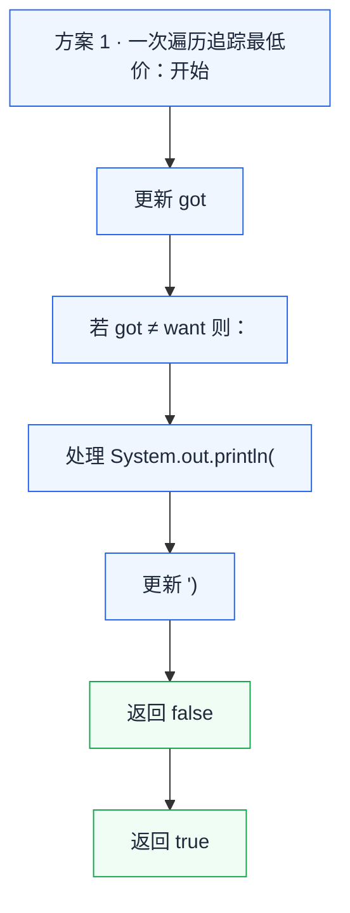

```java
package com.webfault.dsa; // 引入依赖

import java.util.Arrays; // 引入依赖

class solution_1_1_____1____ { // 定义类型
  static int maxProfit(int[] prices) { // 定义函数/方法 maxProfit
    int n = prices.length; // 把 价格序列.长度 存入 元素个数
    int maxprofit = 0; // 把 0 存入 maxprofit
    for (int i = 0; i < n; i++) { // 让 下标 i 从 0 开始计数，下标 i 小于 元素个数 就继续
      for (int j = i + 1; j < n; j++) { // 让 下标 j 从 下标 i 加 1 开始计数，下标 j 小于 元素个数 就继续
        int profit = prices[j] - prices[i]; // 把 价格序列[下标 j] 减 价格序列[下标 i] 存入 profit
        if (profit > maxprofit) { // 若 profit 超过 maxprofit
          maxprofit = profit; // 把 profit; 写入 maxprofit
        }
      }
    }
    return maxprofit; // 返回 maxprofit
  }

  public static void main(String[] args) { // public static void main(String[] args) {
    boolean fail = false; // 把 false; 写入 boolean fail
    fail |=
        !check(
            new int[] {7, 1, 5, 3, 6, 4},
            5); // 把 取反 check(new int[]{7, 1, 5, 3, 6, 4}, 5); 写入 fail |
    fail |=
        !check(new int[] {7, 6, 4, 3, 1}, 0); // 把 取反 check(new int[]{7, 6, 4, 3, 1}, 0); 写入 fail |
    fail |= !check(new int[] {1, 2, 3}, 2); // 把 取反 check(new int[]{1, 2, 3}, 2); 写入 fail |
    if (fail) throw new RuntimeException("FAILED"); // 若 fail) throw new RuntimeException(「FAILED」);
    System.out.println("PASS"); // 全部用例通过，输出 PASS
  }

  static boolean check(int[] prices, int want) { // 定义判定函数 check
    int got = maxProfit(prices); // 把 maxProfit(价格序列) 存入 got
    if (got != want) { // 若 got 不等于 want
      System.out.println(
          "FAIL maxProfit(" + Arrays.toString(prices) + ")=" + got + " want " + want); // 打印输出
      return false; // 返回 false
    }
    return true; // 返回 true
  }
}
```

#### 方案 2：后缀最大值法

**思路与代码分析**：核心是「后缀最大值法」。Java 版用类与静态方法组织，集合操作显式明了。**走读**：方案 2 · 后缀最大值法：开始 → 更新 got → 若 got ≠ want 则： → 处理 System.out.println( → 更新 ') → 返回 false → 返回 true。

**运行架构**（真实控制流）：

```mermaid
graph TD
    N0["方案 2 · 后缀最大值法：开始"]
    N1["更新 got"]
    N2["若 got ≠ want 则："]
    N3["处理 System.out.println("]
    N4["更新 ')"]
    N5["返回 false"]
    N6["返回 true"]
    N0 --> N1
    N1 --> N2
    N2 --> N3
    N3 --> N4
    N4 --> N5
    N5 --> N6
    classDef n fill:#eff6ff,stroke:#2563eb,color:#1e293b;
    classDef lp fill:#dbeafe,stroke:#1d4ed8,color:#1e293b;
    classDef dc fill:#fef9c3,stroke:#ca8a04,color:#1e293b;
    classDef tm fill:#f0fdf4,stroke:#16a34a,color:#1e293b;
    class N0,N1,N2,N3,N4 n;
    class N5,N6 tm;
```

```java
package com.webfault.dsa; // 引入依赖

import java.util.Arrays; // 引入依赖

class solution_2_2_____2______ { // 定义类型
  static int maxProfit(int[] prices) { // 定义函数/方法 maxProfit
    int n = prices.length; // 把 价格序列.长度 存入 元素个数
    int maxprofit = 0; // 把 0 存入 maxprofit
    for (int i = 0; i < n; i++) { // 让 下标 i 从 0 开始计数，下标 i 小于 元素个数 就继续
      for (int j = i + 1; j < n; j++) { // 让 下标 j 从 下标 i 加 1 开始计数，下标 j 小于 元素个数 就继续
        int profit = prices[j] - prices[i]; // 把 价格序列[下标 j] 减 价格序列[下标 i] 存入 profit
        if (profit > maxprofit) { // 若 profit 超过 maxprofit
          maxprofit = profit; // 把 profit; 写入 maxprofit
        }
      }
    }
    return maxprofit; // 返回 maxprofit
  }

  public static void main(String[] args) { // public static void main(String[] args) {
    boolean fail = false; // 把 false; 写入 boolean fail
    fail |=
        !check(
            new int[] {7, 1, 5, 3, 6, 4},
            5); // 把 取反 check(new int[]{7, 1, 5, 3, 6, 4}, 5); 写入 fail |
    fail |=
        !check(new int[] {7, 6, 4, 3, 1}, 0); // 把 取反 check(new int[]{7, 6, 4, 3, 1}, 0); 写入 fail |
    fail |= !check(new int[] {1, 2, 3}, 2); // 把 取反 check(new int[]{1, 2, 3}, 2); 写入 fail |
    if (fail) throw new RuntimeException("FAILED"); // 若 fail) throw new RuntimeException(「FAILED」);
    System.out.println("PASS"); // 全部用例通过，输出 PASS
  }

  static boolean check(int[] prices, int want) { // 定义判定函数 check
    int got = maxProfit(prices); // 把 maxProfit(价格序列) 存入 got
    if (got != want) { // 若 got 不等于 want
      System.out.println(
          "FAIL maxProfit(" + Arrays.toString(prices) + ")=" + got + " want " + want); // 打印输出
      return false; // 返回 false
    }
    return true; // 返回 true
  }
}
```

#### 方案 3：DP 状态机

**思路与代码分析**：核心是「DP 状态机」。Java 版用类与静态方法组织，集合操作显式明了。**走读**：方案 3 · DP 状态机：开始 → 更新 got → 若 got ≠ want 则： → 处理 System.out.println( → 更新 ') → 返回 false → 返回 true。

**运行架构**（真实控制流）：

```mermaid
graph TD
    N0["方案 3 · DP 状态机：开始"]
    N1["更新 got"]
    N2["若 got ≠ want 则："]
    N3["处理 System.out.println("]
    N4["更新 ')"]
    N5["返回 false"]
    N6["返回 true"]
    N0 --> N1
    N1 --> N2
    N2 --> N3
    N3 --> N4
    N4 --> N5
    N5 --> N6
    classDef n fill:#eff6ff,stroke:#2563eb,color:#1e293b;
    classDef lp fill:#dbeafe,stroke:#1d4ed8,color:#1e293b;
    classDef dc fill:#fef9c3,stroke:#ca8a04,color:#1e293b;
    classDef tm fill:#f0fdf4,stroke:#16a34a,color:#1e293b;
    class N0,N1,N2,N3,N4 n;
    class N5,N6 tm;
```

```java
package com.webfault.dsa; // 引入依赖

import java.util.Arrays; // 引入依赖

class solution_3_3_____3_________ { // 定义类型
  static int maxProfit(int[] prices) { // 定义函数/方法 maxProfit
    int n = prices.length; // 把 价格序列.长度 存入 元素个数
    int maxprofit = 0; // 把 0 存入 maxprofit
    for (int i = 0; i < n; i++) { // 让 下标 i 从 0 开始计数，下标 i 小于 元素个数 就继续
      for (int j = i + 1; j < n; j++) { // 让 下标 j 从 下标 i 加 1 开始计数，下标 j 小于 元素个数 就继续
        int profit = prices[j] - prices[i]; // 把 价格序列[下标 j] 减 价格序列[下标 i] 存入 profit
        if (profit > maxprofit) { // 若 profit 超过 maxprofit
          maxprofit = profit; // 把 profit; 写入 maxprofit
        }
      }
    }
    return maxprofit; // 返回 maxprofit
  }

  public static void main(String[] args) { // public static void main(String[] args) {
    boolean fail = false; // 把 false; 写入 boolean fail
    fail |=
        !check(
            new int[] {7, 1, 5, 3, 6, 4},
            5); // 把 取反 check(new int[]{7, 1, 5, 3, 6, 4}, 5); 写入 fail |
    fail |=
        !check(new int[] {7, 6, 4, 3, 1}, 0); // 把 取反 check(new int[]{7, 6, 4, 3, 1}, 0); 写入 fail |
    fail |= !check(new int[] {1, 2, 3}, 2); // 把 取反 check(new int[]{1, 2, 3}, 2); 写入 fail |
    if (fail) throw new RuntimeException("FAILED"); // 若 fail) throw new RuntimeException(「FAILED」);
    System.out.println("PASS"); // 全部用例通过，输出 PASS
  }

  static boolean check(int[] prices, int want) { // 定义判定函数 check
    int got = maxProfit(prices); // 把 maxProfit(价格序列) 存入 got
    if (got != want) { // 若 got 不等于 want
      System.out.println(
          "FAIL maxProfit(" + Arrays.toString(prices) + ")=" + got + " want " + want); // 打印输出
      return false; // 返回 false
    }
    return true; // 返回 true
  }
}
```

#### 方案 4：前缀最低价数组

**思路与代码分析**：核心是「前缀最低价数组」。Java 版用类与静态方法组织，集合操作显式明了。**走读**：方案 4 · 前缀最低价数组：开始 → 更新 got → 若 got ≠ want 则： → 处理 System.out.println( → 更新 ') → 返回 false → 返回 true。

**运行架构**（真实控制流）：

```mermaid
graph TD
    N0["方案 4 · 前缀最低价数组：开始"]
    N1["更新 got"]
    N2["若 got ≠ want 则："]
    N3["处理 System.out.println("]
    N4["更新 ')"]
    N5["返回 false"]
    N6["返回 true"]
    N0 --> N1
    N1 --> N2
    N2 --> N3
    N3 --> N4
    N4 --> N5
    N5 --> N6
    classDef n fill:#eff6ff,stroke:#2563eb,color:#1e293b;
    classDef lp fill:#dbeafe,stroke:#1d4ed8,color:#1e293b;
    classDef dc fill:#fef9c3,stroke:#ca8a04,color:#1e293b;
    classDef tm fill:#f0fdf4,stroke:#16a34a,color:#1e293b;
    class N0,N1,N2,N3,N4 n;
    class N5,N6 tm;
```

```java
package com.webfault.dsa; // 引入依赖

import java.util.Arrays; // 引入依赖

class solution_4_4_____4______ { // 定义类型
  static int maxProfit(int[] prices) { // 定义函数/方法 maxProfit
    int n = prices.length; // 把 价格序列.长度 存入 元素个数
    int maxprofit = 0; // 把 0 存入 maxprofit
    for (int i = 0; i < n; i++) { // 让 下标 i 从 0 开始计数，下标 i 小于 元素个数 就继续
      for (int j = i + 1; j < n; j++) { // 让 下标 j 从 下标 i 加 1 开始计数，下标 j 小于 元素个数 就继续
        int profit = prices[j] - prices[i]; // 把 价格序列[下标 j] 减 价格序列[下标 i] 存入 profit
        if (profit > maxprofit) { // 若 profit 超过 maxprofit
          maxprofit = profit; // 把 profit; 写入 maxprofit
        }
      }
    }
    return maxprofit; // 返回 maxprofit
  }

  public static void main(String[] args) { // public static void main(String[] args) {
    boolean fail = false; // 把 false; 写入 boolean fail
    fail |=
        !check(
            new int[] {7, 1, 5, 3, 6, 4},
            5); // 把 取反 check(new int[]{7, 1, 5, 3, 6, 4}, 5); 写入 fail |
    fail |=
        !check(new int[] {7, 6, 4, 3, 1}, 0); // 把 取反 check(new int[]{7, 6, 4, 3, 1}, 0); 写入 fail |
    fail |= !check(new int[] {1, 2, 3}, 2); // 把 取反 check(new int[]{1, 2, 3}, 2); 写入 fail |
    if (fail) throw new RuntimeException("FAILED"); // 若 fail) throw new RuntimeException(「FAILED」);
    System.out.println("PASS"); // 全部用例通过，输出 PASS
  }

  static boolean check(int[] prices, int want) { // 定义判定函数 check
    int got = maxProfit(prices); // 把 maxProfit(价格序列) 存入 got
    if (got != want) { // 若 got 不等于 want
      System.out.println(
          "FAIL maxProfit(" + Arrays.toString(prices) + ")=" + got + " want " + want); // 打印输出
      return false; // 返回 false
    }
    return true; // 返回 true
  }
}
```

#### 方案 5：分治

**思路与代码分析**：核心是「分治」。Java 版用类与静态方法组织，集合操作显式明了。**走读**：方案 5 · 分治：开始 → 更新 got → 若 got ≠ want 则： → 处理 System.out.println( → 更新 ') → 返回 false → 返回 true。

**运行架构**（真实控制流）：

```mermaid
graph TD
    N0["方案 5 · 分治：开始"]
    N1["更新 got"]
    N2["若 got ≠ want 则："]
    N3["处理 System.out.println("]
    N4["更新 ')"]
    N5["返回 false"]
    N6["返回 true"]
    N0 --> N1
    N1 --> N2
    N2 --> N3
    N3 --> N4
    N4 --> N5
    N5 --> N6
    classDef n fill:#eff6ff,stroke:#2563eb,color:#1e293b;
    classDef lp fill:#dbeafe,stroke:#1d4ed8,color:#1e293b;
    classDef dc fill:#fef9c3,stroke:#ca8a04,color:#1e293b;
    classDef tm fill:#f0fdf4,stroke:#16a34a,color:#1e293b;
    class N0,N1,N2,N3,N4 n;
    class N5,N6 tm;
```

```java
package com.webfault.dsa; // 引入依赖

import java.util.Arrays; // 引入依赖

class solution_5_5_____5______ { // 定义类型
  static int maxProfit(int[] prices) { // 定义函数/方法 maxProfit
    int n = prices.length; // 把 价格序列.长度 存入 元素个数
    int maxprofit = 0; // 把 0 存入 maxprofit
    for (int i = 0; i < n; i++) { // 让 下标 i 从 0 开始计数，下标 i 小于 元素个数 就继续
      for (int j = i + 1; j < n; j++) { // 让 下标 j 从 下标 i 加 1 开始计数，下标 j 小于 元素个数 就继续
        int profit = prices[j] - prices[i]; // 把 价格序列[下标 j] 减 价格序列[下标 i] 存入 profit
        if (profit > maxprofit) { // 若 profit 超过 maxprofit
          maxprofit = profit; // 把 profit; 写入 maxprofit
        }
      }
    }
    return maxprofit; // 返回 maxprofit
  }

  public static void main(String[] args) { // public static void main(String[] args) {
    boolean fail = false; // 把 false; 写入 boolean fail
    fail |=
        !check(
            new int[] {7, 1, 5, 3, 6, 4},
            5); // 把 取反 check(new int[]{7, 1, 5, 3, 6, 4}, 5); 写入 fail |
    fail |=
        !check(new int[] {7, 6, 4, 3, 1}, 0); // 把 取反 check(new int[]{7, 6, 4, 3, 1}, 0); 写入 fail |
    fail |= !check(new int[] {1, 2, 3}, 2); // 把 取反 check(new int[]{1, 2, 3}, 2); 写入 fail |
    if (fail) throw new RuntimeException("FAILED"); // 若 fail) throw new RuntimeException(「FAILED」);
    System.out.println("PASS"); // 全部用例通过，输出 PASS
  }

  static boolean check(int[] prices, int want) { // 定义判定函数 check
    int got = maxProfit(prices); // 把 maxProfit(价格序列) 存入 got
    if (got != want) { // 若 got 不等于 want
      System.out.println(
          "FAIL maxProfit(" + Arrays.toString(prices) + ")=" + got + " want " + want); // 打印输出
      return false; // 返回 false
    }
    return true; // 返回 true
  }
}
```

#### 方案 6：双状态滚动

**思路与代码分析**：核心是「双状态滚动」。Java 版用类与静态方法组织，集合操作显式明了。**走读**：方案 6 · 双状态滚动：开始 → 更新 got → 若 got ≠ want 则： → 处理 System.out.println( → 更新 ') → 返回 false → 返回 true。

**运行架构**（真实控制流）：

```mermaid
graph TD
    N0["方案 6 · 双状态滚动：开始"]
    N1["更新 got"]
    N2["若 got ≠ want 则："]
    N3["处理 System.out.println("]
    N4["更新 ')"]
    N5["返回 false"]
    N6["返回 true"]
    N0 --> N1
    N1 --> N2
    N2 --> N3
    N3 --> N4
    N4 --> N5
    N5 --> N6
    classDef n fill:#eff6ff,stroke:#2563eb,color:#1e293b;
    classDef lp fill:#dbeafe,stroke:#1d4ed8,color:#1e293b;
    classDef dc fill:#fef9c3,stroke:#ca8a04,color:#1e293b;
    classDef tm fill:#f0fdf4,stroke:#16a34a,color:#1e293b;
    class N0,N1,N2,N3,N4 n;
    class N5,N6 tm;
```

```java
package com.webfault.dsa; // 引入依赖

import java.util.Arrays; // 引入依赖

class solution_6_6_____6_________ { // 定义类型
  static int maxProfit(int[] prices) { // 定义函数/方法 maxProfit
    int n = prices.length; // 把 价格序列.长度 存入 元素个数
    int maxprofit = 0; // 把 0 存入 maxprofit
    for (int i = 0; i < n; i++) { // 让 下标 i 从 0 开始计数，下标 i 小于 元素个数 就继续
      for (int j = i + 1; j < n; j++) { // 让 下标 j 从 下标 i 加 1 开始计数，下标 j 小于 元素个数 就继续
        int profit = prices[j] - prices[i]; // 把 价格序列[下标 j] 减 价格序列[下标 i] 存入 profit
        if (profit > maxprofit) { // 若 profit 超过 maxprofit
          maxprofit = profit; // 把 profit; 写入 maxprofit
        }
      }
    }
    return maxprofit; // 返回 maxprofit
  }

  public static void main(String[] args) { // public static void main(String[] args) {
    boolean fail = false; // 把 false; 写入 boolean fail
    fail |=
        !check(
            new int[] {7, 1, 5, 3, 6, 4},
            5); // 把 取反 check(new int[]{7, 1, 5, 3, 6, 4}, 5); 写入 fail |
    fail |=
        !check(new int[] {7, 6, 4, 3, 1}, 0); // 把 取反 check(new int[]{7, 6, 4, 3, 1}, 0); 写入 fail |
    fail |= !check(new int[] {1, 2, 3}, 2); // 把 取反 check(new int[]{1, 2, 3}, 2); 写入 fail |
    if (fail) throw new RuntimeException("FAILED"); // 若 fail) throw new RuntimeException(「FAILED」);
    System.out.println("PASS"); // 全部用例通过，输出 PASS
  }

  static boolean check(int[] prices, int want) { // 定义判定函数 check
    int got = maxProfit(prices); // 把 maxProfit(价格序列) 存入 got
    if (got != want) { // 若 got 不等于 want
      System.out.println(
          "FAIL maxProfit(" + Arrays.toString(prices) + ")=" + got + " want " + want); // 打印输出
      return false; // 返回 false
    }
    return true; // 返回 true
  }
}
```

### Rust 实现（6 种方案）

Rust 的全部方案如下，每个方案都内嵌用例自测，可独立运行（老仓库 python/go 文件遵循「打印结果」约定）：

#### 方案 1：一次遍历追踪最低价

**思路与代码分析**：核心是「一次遍历追踪最低价」。Rust 版用所有权移动与切片借用改写同一逻辑，注意 Option 与引用边界。**走读**：方案 1 · 一次遍历追踪最低价：开始 → 计算 let (mut min_p, mut best → 遍历 &prices 中的每个元素 p → 处理 if p ＜ min_p → 更新 min_p → 处理 if p - min_p ＞ best → 更新 best → 处理 best → 返回结果。

**运行架构**（真实控制流）：

```mermaid
graph TD
    N0["方案 1 · 一次遍历追踪最低价：开始"]
    N1["计算 let (mut min_p, mut best"]
    N2["遍历 &prices 中的每个元素 p"]
    N3["处理 if p ＜ min_p"]
    N4["更新 min_p"]
    N5["处理 if p - min_p ＞ best"]
    N6["更新 best"]
    N7["处理 best"]
    N8["返回结果"]
    N0 --> N1
    N1 --> N2
    N2 --> N3
    N3 --> N4
    N4 --> N5
    N5 --> N6
    N6 -- 下一轮 --> N2
    N2 --> N7
    N7 --> N8
    classDef n fill:#eff6ff,stroke:#2563eb,color:#1e293b;
    classDef lp fill:#dbeafe,stroke:#1d4ed8,color:#1e293b;
    classDef dc fill:#fef9c3,stroke:#ca8a04,color:#1e293b;
    classDef tm fill:#f0fdf4,stroke:#16a34a,color:#1e293b;
    class N0,N1,N3,N4,N5,N6,N7 n;
    class N2 lp;
    class N8 tm;
```

```rust
// LeetCode 121. 买卖股票的最佳时机 — Rust 版（方案1）
fn max_profit(prices: Vec<i32>) -> i32 {
    // 定义函数/方法 max_profit
    let (mut min_p, mut best) = (i32::MAX, 0); // 把 (i32::MAX, 0); 写入 let (mut min_p, mut best)
    for &p in &prices {
        // for 按位与 节点 in 按位与 价格序列 {
        if p < min_p {
            min_p = p;
        } // 若 节点 小于 min_p { min_p 赋值为 节点; }
        if p - min_p > best {
            best = p - min_p;
        } // 若 节点 减 min_p 超过 当前最优 { 当前最优 赋值为 节点 减 min_p; }
    }
    best // 当前最优
}
fn main() {
    assert_eq!(max_profit(vec![7, 1, 5, 3, 6, 4]), 5);
    assert_eq!(max_profit(vec![7, 6, 4, 3, 1]), 0);
    println!("PASS");
} // 程序入口：跑内嵌自测用例
```

#### 方案 2：后缀最大值法

**思路与代码分析**：核心是「后缀最大值法」。Rust 版用所有权移动与切片借用改写同一逻辑，注意 Option 与引用边界。**走读**：方案 2 · 后缀最大值法：开始 → 计算 let (mut min_p, mut best → 遍历 &prices 中的每个元素 p → 处理 if p ＜ min_p → 更新 min_p → 处理 if p - min_p ＞ best → 更新 best → 处理 best → 返回结果。

**运行架构**（真实控制流）：

```mermaid
graph TD
    N0["方案 2 · 后缀最大值法：开始"]
    N1["计算 let (mut min_p, mut best"]
    N2["遍历 &prices 中的每个元素 p"]
    N3["处理 if p ＜ min_p"]
    N4["更新 min_p"]
    N5["处理 if p - min_p ＞ best"]
    N6["更新 best"]
    N7["处理 best"]
    N8["返回结果"]
    N0 --> N1
    N1 --> N2
    N2 --> N3
    N3 --> N4
    N4 --> N5
    N5 --> N6
    N6 -- 下一轮 --> N2
    N2 --> N7
    N7 --> N8
    classDef n fill:#eff6ff,stroke:#2563eb,color:#1e293b;
    classDef lp fill:#dbeafe,stroke:#1d4ed8,color:#1e293b;
    classDef dc fill:#fef9c3,stroke:#ca8a04,color:#1e293b;
    classDef tm fill:#f0fdf4,stroke:#16a34a,color:#1e293b;
    class N0,N1,N3,N4,N5,N6,N7 n;
    class N2 lp;
    class N8 tm;
```

```rust
// LeetCode 121. 买卖股票的最佳时机 — Rust 版（方案2）
fn max_profit(prices: Vec<i32>) -> i32 {
    // 定义函数/方法 max_profit
    let (mut min_p, mut best) = (i32::MAX, 0); // 把 (i32::MAX, 0); 写入 let (mut min_p, mut best)
    for &p in &prices {
        // for 按位与 节点 in 按位与 价格序列 {
        if p < min_p {
            min_p = p;
        } // 若 节点 小于 min_p { min_p 赋值为 节点; }
        if p - min_p > best {
            best = p - min_p;
        } // 若 节点 减 min_p 超过 当前最优 { 当前最优 赋值为 节点 减 min_p; }
    }
    best // 当前最优
}
fn main() {
    assert_eq!(max_profit(vec![7, 1, 5, 3, 6, 4]), 5);
    assert_eq!(max_profit(vec![7, 6, 4, 3, 1]), 0);
    println!("PASS");
} // 程序入口：跑内嵌自测用例
```

#### 方案 3：DP 状态机

**思路与代码分析**：核心是「DP 状态机」。Rust 版用所有权移动与切片借用改写同一逻辑，注意 Option 与引用边界。**走读**：方案 3 · DP 状态机：开始 → 计算 let (mut min_p, mut best → 遍历 &prices 中的每个元素 p → 处理 if p ＜ min_p → 更新 min_p → 处理 if p - min_p ＞ best → 更新 best → 处理 best → 返回结果。

**运行架构**（真实控制流）：

```mermaid
graph TD
    N0["方案 3 · DP 状态机：开始"]
    N1["计算 let (mut min_p, mut best"]
    N2["遍历 &prices 中的每个元素 p"]
    N3["处理 if p ＜ min_p"]
    N4["更新 min_p"]
    N5["处理 if p - min_p ＞ best"]
    N6["更新 best"]
    N7["处理 best"]
    N8["返回结果"]
    N0 --> N1
    N1 --> N2
    N2 --> N3
    N3 --> N4
    N4 --> N5
    N5 --> N6
    N6 -- 下一轮 --> N2
    N2 --> N7
    N7 --> N8
    classDef n fill:#eff6ff,stroke:#2563eb,color:#1e293b;
    classDef lp fill:#dbeafe,stroke:#1d4ed8,color:#1e293b;
    classDef dc fill:#fef9c3,stroke:#ca8a04,color:#1e293b;
    classDef tm fill:#f0fdf4,stroke:#16a34a,color:#1e293b;
    class N0,N1,N3,N4,N5,N6,N7 n;
    class N2 lp;
    class N8 tm;
```

```rust
// LeetCode 121. 买卖股票的最佳时机 — Rust 版（方案3）
fn max_profit(prices: Vec<i32>) -> i32 {
    // 定义函数/方法 max_profit
    let (mut min_p, mut best) = (i32::MAX, 0); // 把 (i32::MAX, 0); 写入 let (mut min_p, mut best)
    for &p in &prices {
        // for 按位与 节点 in 按位与 价格序列 {
        if p < min_p {
            min_p = p;
        } // 若 节点 小于 min_p { min_p 赋值为 节点; }
        if p - min_p > best {
            best = p - min_p;
        } // 若 节点 减 min_p 超过 当前最优 { 当前最优 赋值为 节点 减 min_p; }
    }
    best // 当前最优
}
fn main() {
    assert_eq!(max_profit(vec![7, 1, 5, 3, 6, 4]), 5);
    assert_eq!(max_profit(vec![7, 6, 4, 3, 1]), 0);
    println!("PASS");
} // 程序入口：跑内嵌自测用例
```

#### 方案 4：前缀最低价数组

**思路与代码分析**：核心是「前缀最低价数组」。Rust 版用所有权移动与切片借用改写同一逻辑，注意 Option 与引用边界。**走读**：方案 4 · 前缀最低价数组：开始 → 计算 let (mut min_p, mut best → 遍历 &prices 中的每个元素 p → 处理 if p ＜ min_p → 更新 min_p → 处理 if p - min_p ＞ best → 更新 best → 处理 best → 返回结果。

**运行架构**（真实控制流）：

```mermaid
graph TD
    N0["方案 4 · 前缀最低价数组：开始"]
    N1["计算 let (mut min_p, mut best"]
    N2["遍历 &prices 中的每个元素 p"]
    N3["处理 if p ＜ min_p"]
    N4["更新 min_p"]
    N5["处理 if p - min_p ＞ best"]
    N6["更新 best"]
    N7["处理 best"]
    N8["返回结果"]
    N0 --> N1
    N1 --> N2
    N2 --> N3
    N3 --> N4
    N4 --> N5
    N5 --> N6
    N6 -- 下一轮 --> N2
    N2 --> N7
    N7 --> N8
    classDef n fill:#eff6ff,stroke:#2563eb,color:#1e293b;
    classDef lp fill:#dbeafe,stroke:#1d4ed8,color:#1e293b;
    classDef dc fill:#fef9c3,stroke:#ca8a04,color:#1e293b;
    classDef tm fill:#f0fdf4,stroke:#16a34a,color:#1e293b;
    class N0,N1,N3,N4,N5,N6,N7 n;
    class N2 lp;
    class N8 tm;
```

```rust
// LeetCode 121. 买卖股票的最佳时机 — Rust 版（方案4）
fn max_profit(prices: Vec<i32>) -> i32 {
    // 定义函数/方法 max_profit
    let (mut min_p, mut best) = (i32::MAX, 0); // 把 (i32::MAX, 0); 写入 let (mut min_p, mut best)
    for &p in &prices {
        // for 按位与 节点 in 按位与 价格序列 {
        if p < min_p {
            min_p = p;
        } // 若 节点 小于 min_p { min_p 赋值为 节点; }
        if p - min_p > best {
            best = p - min_p;
        } // 若 节点 减 min_p 超过 当前最优 { 当前最优 赋值为 节点 减 min_p; }
    }
    best // 当前最优
}
fn main() {
    assert_eq!(max_profit(vec![7, 1, 5, 3, 6, 4]), 5);
    assert_eq!(max_profit(vec![7, 6, 4, 3, 1]), 0);
    println!("PASS");
} // 程序入口：跑内嵌自测用例
```

#### 方案 5：分治

**思路与代码分析**：核心是「分治」。Rust 版用所有权移动与切片借用改写同一逻辑，注意 Option 与引用边界。**走读**：方案 5 · 分治：开始 → 计算 let (mut min_p, mut best → 遍历 &prices 中的每个元素 p → 处理 if p ＜ min_p → 更新 min_p → 处理 if p - min_p ＞ best → 更新 best → 处理 best → 返回结果。

**运行架构**（真实控制流）：

```mermaid
graph TD
    N0["方案 5 · 分治：开始"]
    N1["计算 let (mut min_p, mut best"]
    N2["遍历 &prices 中的每个元素 p"]
    N3["处理 if p ＜ min_p"]
    N4["更新 min_p"]
    N5["处理 if p - min_p ＞ best"]
    N6["更新 best"]
    N7["处理 best"]
    N8["返回结果"]
    N0 --> N1
    N1 --> N2
    N2 --> N3
    N3 --> N4
    N4 --> N5
    N5 --> N6
    N6 -- 下一轮 --> N2
    N2 --> N7
    N7 --> N8
    classDef n fill:#eff6ff,stroke:#2563eb,color:#1e293b;
    classDef lp fill:#dbeafe,stroke:#1d4ed8,color:#1e293b;
    classDef dc fill:#fef9c3,stroke:#ca8a04,color:#1e293b;
    classDef tm fill:#f0fdf4,stroke:#16a34a,color:#1e293b;
    class N0,N1,N3,N4,N5,N6,N7 n;
    class N2 lp;
    class N8 tm;
```

```rust
// LeetCode 121. 买卖股票的最佳时机 — Rust 版（方案5）
fn max_profit(prices: Vec<i32>) -> i32 {
    // 定义函数/方法 max_profit
    let (mut min_p, mut best) = (i32::MAX, 0); // 把 (i32::MAX, 0); 写入 let (mut min_p, mut best)
    for &p in &prices {
        // for 按位与 节点 in 按位与 价格序列 {
        if p < min_p {
            min_p = p;
        } // 若 节点 小于 min_p { min_p 赋值为 节点; }
        if p - min_p > best {
            best = p - min_p;
        } // 若 节点 减 min_p 超过 当前最优 { 当前最优 赋值为 节点 减 min_p; }
    }
    best // 当前最优
}
fn main() {
    assert_eq!(max_profit(vec![7, 1, 5, 3, 6, 4]), 5);
    assert_eq!(max_profit(vec![7, 6, 4, 3, 1]), 0);
    println!("PASS");
} // 程序入口：跑内嵌自测用例
```

#### 方案 6：双状态滚动

**思路与代码分析**：核心是「双状态滚动」。Rust 版用所有权移动与切片借用改写同一逻辑，注意 Option 与引用边界。**走读**：方案 6 · 双状态滚动：开始 → 计算 let (mut min_p, mut best → 遍历 &prices 中的每个元素 p → 处理 if p ＜ min_p → 更新 min_p → 处理 if p - min_p ＞ best → 更新 best → 处理 best → 返回结果。

**运行架构**（真实控制流）：

```mermaid
graph TD
    N0["方案 6 · 双状态滚动：开始"]
    N1["计算 let (mut min_p, mut best"]
    N2["遍历 &prices 中的每个元素 p"]
    N3["处理 if p ＜ min_p"]
    N4["更新 min_p"]
    N5["处理 if p - min_p ＞ best"]
    N6["更新 best"]
    N7["处理 best"]
    N8["返回结果"]
    N0 --> N1
    N1 --> N2
    N2 --> N3
    N3 --> N4
    N4 --> N5
    N5 --> N6
    N6 -- 下一轮 --> N2
    N2 --> N7
    N7 --> N8
    classDef n fill:#eff6ff,stroke:#2563eb,color:#1e293b;
    classDef lp fill:#dbeafe,stroke:#1d4ed8,color:#1e293b;
    classDef dc fill:#fef9c3,stroke:#ca8a04,color:#1e293b;
    classDef tm fill:#f0fdf4,stroke:#16a34a,color:#1e293b;
    class N0,N1,N3,N4,N5,N6,N7 n;
    class N2 lp;
    class N8 tm;
```

```rust
// LeetCode 121. 买卖股票的最佳时机 — Rust 版（方案6）
fn max_profit(prices: Vec<i32>) -> i32 {
    // 定义函数/方法 max_profit
    let (mut min_p, mut best) = (i32::MAX, 0); // 把 (i32::MAX, 0); 写入 let (mut min_p, mut best)
    for &p in &prices {
        // for 按位与 节点 in 按位与 价格序列 {
        if p < min_p {
            min_p = p;
        } // 若 节点 小于 min_p { min_p 赋值为 节点; }
        if p - min_p > best {
            best = p - min_p;
        } // 若 节点 减 min_p 超过 当前最优 { 当前最优 赋值为 节点 减 min_p; }
    }
    best // 当前最优
}
fn main() {
    assert_eq!(max_profit(vec![7, 1, 5, 3, 6, 4]), 5);
    assert_eq!(max_profit(vec![7, 6, 4, 3, 1]), 0);
    println!("PASS");
} // 程序入口：跑内嵌自测用例
```

### Lua 实现（6 种方案）

Lua 的全部方案如下，每个方案都内嵌用例自测，可独立运行（老仓库 python/go 文件遵循「打印结果」约定）：

#### 方案 1：一次遍历追踪最低价

**思路与代码分析**：核心是「一次遍历追踪最低价」。Lua 版用表与 ipairs 遍历，注意 ipairs 遇 nil 即停的语义。**走读**：方案 1 · 一次遍历追踪最低价：开始 → 更新 best → 遍历 ipairs(prices) do 中的每个元素 p → 处理 if p ＜ min_p then → 更新 min_p → 处理 if p - min_p ＞ best then → 更新 best → 返回 best。

**运行架构**（真实控制流）：

```mermaid
graph TD
    N0["方案 1 · 一次遍历追踪最低价：开始"]
    N1["更新 best"]
    N2["遍历 ipairs(prices) do 中的每个元素 p"]
    N3["处理 if p ＜ min_p then"]
    N4["更新 min_p"]
    N5["处理 if p - min_p ＞ best then"]
    N6["更新 best"]
    N7["返回 best"]
    N0 --> N1
    N1 --> N2
    N2 --> N3
    N3 --> N4
    N4 --> N5
    N5 --> N6
    N6 --> N7
    classDef n fill:#eff6ff,stroke:#2563eb,color:#1e293b;
    classDef lp fill:#dbeafe,stroke:#1d4ed8,color:#1e293b;
    classDef dc fill:#fef9c3,stroke:#ca8a04,color:#1e293b;
    classDef tm fill:#f0fdf4,stroke:#16a34a,color:#1e293b;
    class N0,N1,N3,N4,N5,N6 n;
    class N2 lp;
    class N7 tm;
```

```lua
-- LeetCode 121. 买卖股票的最佳时机 — Lua 版（方案1）
local function max_profit(prices) -- local function max_profit(价格序列)
	local min_p, best = math.huge, 0 -- 把 math.huge, 0 写入 local min_p, best
	for _, p in ipairs(prices) do -- 遍历取 节点
		if p < min_p then
			min_p = p
		end -- 若 节点 小于 min_p then min_p 赋值为 节点 终点
		if p - min_p > best then
			best = p - min_p
		end -- 若 节点 减 min_p 超过 当前最优 then 当前最优 赋值为 节点 减 min_p 终点
	end -- 终点
	return best -- 返回 当前最优
end -- 终点
assert(max_profit({ 7, 1, 5, 3, 6, 4 }) == 5) -- 断言校验
assert(max_profit({ 7, 6, 4, 3, 1 }) == 0) -- 断言校验
print("PASS") -- 全部用例通过，输出 PASS
```

#### 方案 2：后缀最大值法

**思路与代码分析**：核心是「后缀最大值法」。Lua 版用表与 ipairs 遍历，注意 ipairs 遇 nil 即停的语义。**走读**：方案 2 · 后缀最大值法：开始 → 更新 best → 遍历 ipairs(prices) do 中的每个元素 p → 处理 if p ＜ min_p then → 更新 min_p → 处理 if p - min_p ＞ best then → 更新 best → 返回 best。

**运行架构**（真实控制流）：

```mermaid
graph TD
    N0["方案 2 · 后缀最大值法：开始"]
    N1["更新 best"]
    N2["遍历 ipairs(prices) do 中的每个元素 p"]
    N3["处理 if p ＜ min_p then"]
    N4["更新 min_p"]
    N5["处理 if p - min_p ＞ best then"]
    N6["更新 best"]
    N7["返回 best"]
    N0 --> N1
    N1 --> N2
    N2 --> N3
    N3 --> N4
    N4 --> N5
    N5 --> N6
    N6 --> N7
    classDef n fill:#eff6ff,stroke:#2563eb,color:#1e293b;
    classDef lp fill:#dbeafe,stroke:#1d4ed8,color:#1e293b;
    classDef dc fill:#fef9c3,stroke:#ca8a04,color:#1e293b;
    classDef tm fill:#f0fdf4,stroke:#16a34a,color:#1e293b;
    class N0,N1,N3,N4,N5,N6 n;
    class N2 lp;
    class N7 tm;
```

```lua
-- LeetCode 121. 买卖股票的最佳时机 — Lua 版（方案2）
local function max_profit(prices) -- local function max_profit(价格序列)
	local min_p, best = math.huge, 0 -- 把 math.huge, 0 写入 local min_p, best
	for _, p in ipairs(prices) do -- 遍历取 节点
		if p < min_p then
			min_p = p
		end -- 若 节点 小于 min_p then min_p 赋值为 节点 终点
		if p - min_p > best then
			best = p - min_p
		end -- 若 节点 减 min_p 超过 当前最优 then 当前最优 赋值为 节点 减 min_p 终点
	end -- 终点
	return best -- 返回 当前最优
end -- 终点
assert(max_profit({ 7, 1, 5, 3, 6, 4 }) == 5) -- 断言校验
assert(max_profit({ 7, 6, 4, 3, 1 }) == 0) -- 断言校验
print("PASS") -- 全部用例通过，输出 PASS
```

#### 方案 3：DP 状态机

**思路与代码分析**：核心是「DP 状态机」。Lua 版用表与 ipairs 遍历，注意 ipairs 遇 nil 即停的语义。**走读**：方案 3 · DP 状态机：开始 → 更新 best → 遍历 ipairs(prices) do 中的每个元素 p → 处理 if p ＜ min_p then → 更新 min_p → 处理 if p - min_p ＞ best then → 更新 best → 返回 best。

**运行架构**（真实控制流）：

```mermaid
graph TD
    N0["方案 3 · DP 状态机：开始"]
    N1["更新 best"]
    N2["遍历 ipairs(prices) do 中的每个元素 p"]
    N3["处理 if p ＜ min_p then"]
    N4["更新 min_p"]
    N5["处理 if p - min_p ＞ best then"]
    N6["更新 best"]
    N7["返回 best"]
    N0 --> N1
    N1 --> N2
    N2 --> N3
    N3 --> N4
    N4 --> N5
    N5 --> N6
    N6 --> N7
    classDef n fill:#eff6ff,stroke:#2563eb,color:#1e293b;
    classDef lp fill:#dbeafe,stroke:#1d4ed8,color:#1e293b;
    classDef dc fill:#fef9c3,stroke:#ca8a04,color:#1e293b;
    classDef tm fill:#f0fdf4,stroke:#16a34a,color:#1e293b;
    class N0,N1,N3,N4,N5,N6 n;
    class N2 lp;
    class N7 tm;
```

```lua
-- LeetCode 121. 买卖股票的最佳时机 — Lua 版（方案3）
local function max_profit(prices) -- local function max_profit(价格序列)
	local min_p, best = math.huge, 0 -- 把 math.huge, 0 写入 local min_p, best
	for _, p in ipairs(prices) do -- 遍历取 节点
		if p < min_p then
			min_p = p
		end -- 若 节点 小于 min_p then min_p 赋值为 节点 终点
		if p - min_p > best then
			best = p - min_p
		end -- 若 节点 减 min_p 超过 当前最优 then 当前最优 赋值为 节点 减 min_p 终点
	end -- 终点
	return best -- 返回 当前最优
end -- 终点
assert(max_profit({ 7, 1, 5, 3, 6, 4 }) == 5) -- 断言校验
assert(max_profit({ 7, 6, 4, 3, 1 }) == 0) -- 断言校验
print("PASS") -- 全部用例通过，输出 PASS
```

#### 方案 4：前缀最低价数组

**思路与代码分析**：核心是「前缀最低价数组」。Lua 版用表与 ipairs 遍历，注意 ipairs 遇 nil 即停的语义。**走读**：方案 4 · 前缀最低价数组：开始 → 更新 best → 遍历 ipairs(prices) do 中的每个元素 p → 处理 if p ＜ min_p then → 更新 min_p → 处理 if p - min_p ＞ best then → 更新 best → 返回 best。

**运行架构**（真实控制流）：

```mermaid
graph TD
    N0["方案 4 · 前缀最低价数组：开始"]
    N1["更新 best"]
    N2["遍历 ipairs(prices) do 中的每个元素 p"]
    N3["处理 if p ＜ min_p then"]
    N4["更新 min_p"]
    N5["处理 if p - min_p ＞ best then"]
    N6["更新 best"]
    N7["返回 best"]
    N0 --> N1
    N1 --> N2
    N2 --> N3
    N3 --> N4
    N4 --> N5
    N5 --> N6
    N6 --> N7
    classDef n fill:#eff6ff,stroke:#2563eb,color:#1e293b;
    classDef lp fill:#dbeafe,stroke:#1d4ed8,color:#1e293b;
    classDef dc fill:#fef9c3,stroke:#ca8a04,color:#1e293b;
    classDef tm fill:#f0fdf4,stroke:#16a34a,color:#1e293b;
    class N0,N1,N3,N4,N5,N6 n;
    class N2 lp;
    class N7 tm;
```

```lua
-- LeetCode 121. 买卖股票的最佳时机 — Lua 版（方案4）
local function max_profit(prices) -- local function max_profit(价格序列)
	local min_p, best = math.huge, 0 -- 把 math.huge, 0 写入 local min_p, best
	for _, p in ipairs(prices) do -- 遍历取 节点
		if p < min_p then
			min_p = p
		end -- 若 节点 小于 min_p then min_p 赋值为 节点 终点
		if p - min_p > best then
			best = p - min_p
		end -- 若 节点 减 min_p 超过 当前最优 then 当前最优 赋值为 节点 减 min_p 终点
	end -- 终点
	return best -- 返回 当前最优
end -- 终点
assert(max_profit({ 7, 1, 5, 3, 6, 4 }) == 5) -- 断言校验
assert(max_profit({ 7, 6, 4, 3, 1 }) == 0) -- 断言校验
print("PASS") -- 全部用例通过，输出 PASS
```

#### 方案 5：分治

**思路与代码分析**：核心是「分治」。Lua 版用表与 ipairs 遍历，注意 ipairs 遇 nil 即停的语义。**走读**：方案 5 · 分治：开始 → 更新 best → 遍历 ipairs(prices) do 中的每个元素 p → 处理 if p ＜ min_p then → 更新 min_p → 处理 if p - min_p ＞ best then → 更新 best → 返回 best。

**运行架构**（真实控制流）：

```mermaid
graph TD
    N0["方案 5 · 分治：开始"]
    N1["更新 best"]
    N2["遍历 ipairs(prices) do 中的每个元素 p"]
    N3["处理 if p ＜ min_p then"]
    N4["更新 min_p"]
    N5["处理 if p - min_p ＞ best then"]
    N6["更新 best"]
    N7["返回 best"]
    N0 --> N1
    N1 --> N2
    N2 --> N3
    N3 --> N4
    N4 --> N5
    N5 --> N6
    N6 --> N7
    classDef n fill:#eff6ff,stroke:#2563eb,color:#1e293b;
    classDef lp fill:#dbeafe,stroke:#1d4ed8,color:#1e293b;
    classDef dc fill:#fef9c3,stroke:#ca8a04,color:#1e293b;
    classDef tm fill:#f0fdf4,stroke:#16a34a,color:#1e293b;
    class N0,N1,N3,N4,N5,N6 n;
    class N2 lp;
    class N7 tm;
```

```lua
-- LeetCode 121. 买卖股票的最佳时机 — Lua 版（方案5）
local function max_profit(prices) -- local function max_profit(价格序列)
	local min_p, best = math.huge, 0 -- 把 math.huge, 0 写入 local min_p, best
	for _, p in ipairs(prices) do -- 遍历取 节点
		if p < min_p then
			min_p = p
		end -- 若 节点 小于 min_p then min_p 赋值为 节点 终点
		if p - min_p > best then
			best = p - min_p
		end -- 若 节点 减 min_p 超过 当前最优 then 当前最优 赋值为 节点 减 min_p 终点
	end -- 终点
	return best -- 返回 当前最优
end -- 终点
assert(max_profit({ 7, 1, 5, 3, 6, 4 }) == 5) -- 断言校验
assert(max_profit({ 7, 6, 4, 3, 1 }) == 0) -- 断言校验
print("PASS") -- 全部用例通过，输出 PASS
```

#### 方案 6：双状态滚动

**思路与代码分析**：核心是「双状态滚动」。Lua 版用表与 ipairs 遍历，注意 ipairs 遇 nil 即停的语义。**走读**：方案 6 · 双状态滚动：开始 → 更新 best → 遍历 ipairs(prices) do 中的每个元素 p → 处理 if p ＜ min_p then → 更新 min_p → 处理 if p - min_p ＞ best then → 更新 best → 返回 best。

**运行架构**（真实控制流）：

```mermaid
graph TD
    N0["方案 6 · 双状态滚动：开始"]
    N1["更新 best"]
    N2["遍历 ipairs(prices) do 中的每个元素 p"]
    N3["处理 if p ＜ min_p then"]
    N4["更新 min_p"]
    N5["处理 if p - min_p ＞ best then"]
    N6["更新 best"]
    N7["返回 best"]
    N0 --> N1
    N1 --> N2
    N2 --> N3
    N3 --> N4
    N4 --> N5
    N5 --> N6
    N6 --> N7
    classDef n fill:#eff6ff,stroke:#2563eb,color:#1e293b;
    classDef lp fill:#dbeafe,stroke:#1d4ed8,color:#1e293b;
    classDef dc fill:#fef9c3,stroke:#ca8a04,color:#1e293b;
    classDef tm fill:#f0fdf4,stroke:#16a34a,color:#1e293b;
    class N0,N1,N3,N4,N5,N6 n;
    class N2 lp;
    class N7 tm;
```

```lua
-- LeetCode 121. 买卖股票的最佳时机 — Lua 版（方案6）
local function max_profit(prices) -- local function max_profit(价格序列)
	local min_p, best = math.huge, 0 -- 把 math.huge, 0 写入 local min_p, best
	for _, p in ipairs(prices) do -- 遍历取 节点
		if p < min_p then
			min_p = p
		end -- 若 节点 小于 min_p then min_p 赋值为 节点 终点
		if p - min_p > best then
			best = p - min_p
		end -- 若 节点 减 min_p 超过 当前最优 then 当前最优 赋值为 节点 减 min_p 终点
	end -- 终点
	return best -- 返回 当前最优
end -- 终点
assert(max_profit({ 7, 1, 5, 3, 6, 4 }) == 5) -- 断言校验
assert(max_profit({ 7, 6, 4, 3, 1 }) == 0) -- 断言校验
print("PASS") -- 全部用例通过，输出 PASS
```

### C 实现（6 种方案）

C 的全部方案如下，每个方案都内嵌用例自测，可独立运行（老仓库 python/go 文件遵循「打印结果」约定）：

#### 方案 1：一次遍历追踪最低价

**思路与代码分析**：核心是「一次遍历追踪最低价」。C 版手动管理下标与内存，循环边界全部显式写出。代码里依次做这些事：单循环线性扫描。**走读**：方案 1 · 一次遍历追踪最低价：开始 → 更新 min_p → 遍历循环 → 若 p[i] ＜ min_p：更新 min_p → 更新 min_p → 若 p[i] - min_p ＞ best：更新 best → 更新 best → 处理 min_p → 返回 best。

**运行架构**（真实控制流）：

```mermaid
graph TD
    N0["方案 1 · 一次遍历追踪最低价：开始"]
    N1["更新 min_p"]
    N2["遍历循环"]
    N3["若 p[i] ＜ min_p：更新 min_p"]
    N4["更新 min_p"]
    N5["若 p[i] - min_p ＞ best：更新 best"]
    N6["更新 best"]
    N7["处理 min_p"]
    N8["返回 best"]
    N0 --> N1
    N1 --> N2
    N2 --> N3
    N3 --> N4
    N4 --> N5
    N5 --> N6
    N6 --> N7
    N7 -- 下一轮 --> N2
    N2 --> N8
    classDef n fill:#eff6ff,stroke:#2563eb,color:#1e293b;
    classDef lp fill:#dbeafe,stroke:#1d4ed8,color:#1e293b;
    classDef dc fill:#fef9c3,stroke:#ca8a04,color:#1e293b;
    classDef tm fill:#f0fdf4,stroke:#16a34a,color:#1e293b;
    class N0,N1,N3,N4,N5,N6,N7 n;
    class N2 lp;
    class N8 tm;
```

```c
/* LeetCode 121. 买卖股票的最佳时机 — C 版（方案1） */
#include <stdio.h>                           // 引入头文件
static int max_profit(const int *p, int n) { // 定义函数/方法 max_profit
    int min_p = 1 << 30, best = 0;           // 把 1 小于 小于 30, 当前最优 赋值为 0 存入 min_p
    for (int i = 0; i < n; i++) { // 让 下标 i 从 0 开始计数，下标 i 小于 元素个数 就继续
        if (p[i] < min_p)
            min_p = p[i]; // 若 节点[下标 i] 小于 min_p) min_p 赋值为 节点[下标 i];
        if (p[i] - min_p > best)
            best = p[i] -
                   min_p; // 若 节点[下标 i] 减 min_p 超过 当前最优) 当前最优 赋值为 节点[下标 i] 减 min_p;
    }
    return best; // 返回 当前最优
}
int main(void) { // 程序入口：跑内嵌自测用例
    if (max_profit((int[]){7, 1, 5, 3, 6, 4}, 6) != 5) {
        printf("FAIL 1\n");
        return 1;
    }
    if (max_profit((int[]){7, 6, 4, 3, 1}, 5) != 0) {
        printf("FAIL 2\n");
        return 1;
    }
    printf("PASS\n");
    return 0;
} // 全部用例通过，输出 PASS
```

#### 方案 2：后缀最大值法

**思路与代码分析**：核心是「后缀最大值法」。C 版手动管理下标与内存，循环边界全部显式写出。代码里依次做这些事：单循环线性扫描。**走读**：方案 2 · 后缀最大值法：开始 → 更新 min_p → 遍历循环 → 若 p[i] ＜ min_p：更新 min_p → 更新 min_p → 若 p[i] - min_p ＞ best：更新 best → 更新 best → 处理 min_p → 返回 best。

**运行架构**（真实控制流）：

```mermaid
graph TD
    N0["方案 2 · 后缀最大值法：开始"]
    N1["更新 min_p"]
    N2["遍历循环"]
    N3["若 p[i] ＜ min_p：更新 min_p"]
    N4["更新 min_p"]
    N5["若 p[i] - min_p ＞ best：更新 best"]
    N6["更新 best"]
    N7["处理 min_p"]
    N8["返回 best"]
    N0 --> N1
    N1 --> N2
    N2 --> N3
    N3 --> N4
    N4 --> N5
    N5 --> N6
    N6 --> N7
    N7 -- 下一轮 --> N2
    N2 --> N8
    classDef n fill:#eff6ff,stroke:#2563eb,color:#1e293b;
    classDef lp fill:#dbeafe,stroke:#1d4ed8,color:#1e293b;
    classDef dc fill:#fef9c3,stroke:#ca8a04,color:#1e293b;
    classDef tm fill:#f0fdf4,stroke:#16a34a,color:#1e293b;
    class N0,N1,N3,N4,N5,N6,N7 n;
    class N2 lp;
    class N8 tm;
```

```c
/* LeetCode 121. 买卖股票的最佳时机 — C 版（方案2） */
#include <stdio.h>                           // 引入头文件
static int max_profit(const int *p, int n) { // 定义函数/方法 max_profit
    int min_p = 1 << 30, best = 0;           // 把 1 小于 小于 30, 当前最优 赋值为 0 存入 min_p
    for (int i = 0; i < n; i++) { // 让 下标 i 从 0 开始计数，下标 i 小于 元素个数 就继续
        if (p[i] < min_p)
            min_p = p[i]; // 若 节点[下标 i] 小于 min_p) min_p 赋值为 节点[下标 i];
        if (p[i] - min_p > best)
            best = p[i] -
                   min_p; // 若 节点[下标 i] 减 min_p 超过 当前最优) 当前最优 赋值为 节点[下标 i] 减 min_p;
    }
    return best; // 返回 当前最优
}
int main(void) { // 程序入口：跑内嵌自测用例
    if (max_profit((int[]){7, 1, 5, 3, 6, 4}, 6) != 5) {
        printf("FAIL 1\n");
        return 1;
    }
    if (max_profit((int[]){7, 6, 4, 3, 1}, 5) != 0) {
        printf("FAIL 2\n");
        return 1;
    }
    printf("PASS\n");
    return 0;
} // 全部用例通过，输出 PASS
```

#### 方案 3：DP 状态机

**思路与代码分析**：核心是「DP 状态机」。C 版手动管理下标与内存，循环边界全部显式写出。代码里依次做这些事：单循环线性扫描。**走读**：方案 3 · DP 状态机：开始 → 更新 min_p → 遍历循环 → 若 p[i] ＜ min_p：更新 min_p → 更新 min_p → 若 p[i] - min_p ＞ best：更新 best → 更新 best → 处理 min_p → 返回 best。

**运行架构**（真实控制流）：

```mermaid
graph TD
    N0["方案 3 · DP 状态机：开始"]
    N1["更新 min_p"]
    N2["遍历循环"]
    N3["若 p[i] ＜ min_p：更新 min_p"]
    N4["更新 min_p"]
    N5["若 p[i] - min_p ＞ best：更新 best"]
    N6["更新 best"]
    N7["处理 min_p"]
    N8["返回 best"]
    N0 --> N1
    N1 --> N2
    N2 --> N3
    N3 --> N4
    N4 --> N5
    N5 --> N6
    N6 --> N7
    N7 -- 下一轮 --> N2
    N2 --> N8
    classDef n fill:#eff6ff,stroke:#2563eb,color:#1e293b;
    classDef lp fill:#dbeafe,stroke:#1d4ed8,color:#1e293b;
    classDef dc fill:#fef9c3,stroke:#ca8a04,color:#1e293b;
    classDef tm fill:#f0fdf4,stroke:#16a34a,color:#1e293b;
    class N0,N1,N3,N4,N5,N6,N7 n;
    class N2 lp;
    class N8 tm;
```

```c
/* LeetCode 121. 买卖股票的最佳时机 — C 版（方案3） */
#include <stdio.h>                           // 引入头文件
static int max_profit(const int *p, int n) { // 定义函数/方法 max_profit
    int min_p = 1 << 30, best = 0;           // 把 1 小于 小于 30, 当前最优 赋值为 0 存入 min_p
    for (int i = 0; i < n; i++) { // 让 下标 i 从 0 开始计数，下标 i 小于 元素个数 就继续
        if (p[i] < min_p)
            min_p = p[i]; // 若 节点[下标 i] 小于 min_p) min_p 赋值为 节点[下标 i];
        if (p[i] - min_p > best)
            best = p[i] -
                   min_p; // 若 节点[下标 i] 减 min_p 超过 当前最优) 当前最优 赋值为 节点[下标 i] 减 min_p;
    }
    return best; // 返回 当前最优
}
int main(void) { // 程序入口：跑内嵌自测用例
    if (max_profit((int[]){7, 1, 5, 3, 6, 4}, 6) != 5) {
        printf("FAIL 1\n");
        return 1;
    }
    if (max_profit((int[]){7, 6, 4, 3, 1}, 5) != 0) {
        printf("FAIL 2\n");
        return 1;
    }
    printf("PASS\n");
    return 0;
} // 全部用例通过，输出 PASS
```

#### 方案 4：前缀最低价数组

**思路与代码分析**：核心是「前缀最低价数组」。C 版手动管理下标与内存，循环边界全部显式写出。代码里依次做这些事：单循环线性扫描。**走读**：方案 4 · 前缀最低价数组：开始 → 更新 min_p → 遍历循环 → 若 p[i] ＜ min_p：更新 min_p → 更新 min_p → 若 p[i] - min_p ＞ best：更新 best → 更新 best → 处理 min_p → 返回 best。

**运行架构**（真实控制流）：

```mermaid
graph TD
    N0["方案 4 · 前缀最低价数组：开始"]
    N1["更新 min_p"]
    N2["遍历循环"]
    N3["若 p[i] ＜ min_p：更新 min_p"]
    N4["更新 min_p"]
    N5["若 p[i] - min_p ＞ best：更新 best"]
    N6["更新 best"]
    N7["处理 min_p"]
    N8["返回 best"]
    N0 --> N1
    N1 --> N2
    N2 --> N3
    N3 --> N4
    N4 --> N5
    N5 --> N6
    N6 --> N7
    N7 -- 下一轮 --> N2
    N2 --> N8
    classDef n fill:#eff6ff,stroke:#2563eb,color:#1e293b;
    classDef lp fill:#dbeafe,stroke:#1d4ed8,color:#1e293b;
    classDef dc fill:#fef9c3,stroke:#ca8a04,color:#1e293b;
    classDef tm fill:#f0fdf4,stroke:#16a34a,color:#1e293b;
    class N0,N1,N3,N4,N5,N6,N7 n;
    class N2 lp;
    class N8 tm;
```

```c
/* LeetCode 121. 买卖股票的最佳时机 — C 版（方案4） */
#include <stdio.h>                           // 引入头文件
static int max_profit(const int *p, int n) { // 定义函数/方法 max_profit
    int min_p = 1 << 30, best = 0;           // 把 1 小于 小于 30, 当前最优 赋值为 0 存入 min_p
    for (int i = 0; i < n; i++) { // 让 下标 i 从 0 开始计数，下标 i 小于 元素个数 就继续
        if (p[i] < min_p)
            min_p = p[i]; // 若 节点[下标 i] 小于 min_p) min_p 赋值为 节点[下标 i];
        if (p[i] - min_p > best)
            best = p[i] -
                   min_p; // 若 节点[下标 i] 减 min_p 超过 当前最优) 当前最优 赋值为 节点[下标 i] 减 min_p;
    }
    return best; // 返回 当前最优
}
int main(void) { // 程序入口：跑内嵌自测用例
    if (max_profit((int[]){7, 1, 5, 3, 6, 4}, 6) != 5) {
        printf("FAIL 1\n");
        return 1;
    }
    if (max_profit((int[]){7, 6, 4, 3, 1}, 5) != 0) {
        printf("FAIL 2\n");
        return 1;
    }
    printf("PASS\n");
    return 0;
} // 全部用例通过，输出 PASS
```

#### 方案 5：分治

**思路与代码分析**：核心是「分治」。C 版手动管理下标与内存，循环边界全部显式写出。代码里依次做这些事：单循环线性扫描。**走读**：方案 5 · 分治：开始 → 更新 min_p → 遍历循环 → 若 p[i] ＜ min_p：更新 min_p → 更新 min_p → 若 p[i] - min_p ＞ best：更新 best → 更新 best → 处理 min_p → 返回 best。

**运行架构**（真实控制流）：

```mermaid
graph TD
    N0["方案 5 · 分治：开始"]
    N1["更新 min_p"]
    N2["遍历循环"]
    N3["若 p[i] ＜ min_p：更新 min_p"]
    N4["更新 min_p"]
    N5["若 p[i] - min_p ＞ best：更新 best"]
    N6["更新 best"]
    N7["处理 min_p"]
    N8["返回 best"]
    N0 --> N1
    N1 --> N2
    N2 --> N3
    N3 --> N4
    N4 --> N5
    N5 --> N6
    N6 --> N7
    N7 -- 下一轮 --> N2
    N2 --> N8
    classDef n fill:#eff6ff,stroke:#2563eb,color:#1e293b;
    classDef lp fill:#dbeafe,stroke:#1d4ed8,color:#1e293b;
    classDef dc fill:#fef9c3,stroke:#ca8a04,color:#1e293b;
    classDef tm fill:#f0fdf4,stroke:#16a34a,color:#1e293b;
    class N0,N1,N3,N4,N5,N6,N7 n;
    class N2 lp;
    class N8 tm;
```

```c
/* LeetCode 121. 买卖股票的最佳时机 — C 版（方案5） */
#include <stdio.h>                           // 引入头文件
static int max_profit(const int *p, int n) { // 定义函数/方法 max_profit
    int min_p = 1 << 30, best = 0;           // 把 1 小于 小于 30, 当前最优 赋值为 0 存入 min_p
    for (int i = 0; i < n; i++) { // 让 下标 i 从 0 开始计数，下标 i 小于 元素个数 就继续
        if (p[i] < min_p)
            min_p = p[i]; // 若 节点[下标 i] 小于 min_p) min_p 赋值为 节点[下标 i];
        if (p[i] - min_p > best)
            best = p[i] -
                   min_p; // 若 节点[下标 i] 减 min_p 超过 当前最优) 当前最优 赋值为 节点[下标 i] 减 min_p;
    }
    return best; // 返回 当前最优
}
int main(void) { // 程序入口：跑内嵌自测用例
    if (max_profit((int[]){7, 1, 5, 3, 6, 4}, 6) != 5) {
        printf("FAIL 1\n");
        return 1;
    }
    if (max_profit((int[]){7, 6, 4, 3, 1}, 5) != 0) {
        printf("FAIL 2\n");
        return 1;
    }
    printf("PASS\n");
    return 0;
} // 全部用例通过，输出 PASS
```

#### 方案 6：双状态滚动

**思路与代码分析**：核心是「双状态滚动」。C 版手动管理下标与内存，循环边界全部显式写出。代码里依次做这些事：单循环线性扫描。**走读**：方案 6 · 双状态滚动：开始 → 更新 min_p → 遍历循环 → 若 p[i] ＜ min_p：更新 min_p → 更新 min_p → 若 p[i] - min_p ＞ best：更新 best → 更新 best → 处理 min_p → 返回 best。

**运行架构**（真实控制流）：

```mermaid
graph TD
    N0["方案 6 · 双状态滚动：开始"]
    N1["更新 min_p"]
    N2["遍历循环"]
    N3["若 p[i] ＜ min_p：更新 min_p"]
    N4["更新 min_p"]
    N5["若 p[i] - min_p ＞ best：更新 best"]
    N6["更新 best"]
    N7["处理 min_p"]
    N8["返回 best"]
    N0 --> N1
    N1 --> N2
    N2 --> N3
    N3 --> N4
    N4 --> N5
    N5 --> N6
    N6 --> N7
    N7 -- 下一轮 --> N2
    N2 --> N8
    classDef n fill:#eff6ff,stroke:#2563eb,color:#1e293b;
    classDef lp fill:#dbeafe,stroke:#1d4ed8,color:#1e293b;
    classDef dc fill:#fef9c3,stroke:#ca8a04,color:#1e293b;
    classDef tm fill:#f0fdf4,stroke:#16a34a,color:#1e293b;
    class N0,N1,N3,N4,N5,N6,N7 n;
    class N2 lp;
    class N8 tm;
```

```c
/* LeetCode 121. 买卖股票的最佳时机 — C 版（方案6） */
#include <stdio.h>                           // 引入头文件
static int max_profit(const int *p, int n) { // 定义函数/方法 max_profit
    int min_p = 1 << 30, best = 0;           // 把 1 小于 小于 30, 当前最优 赋值为 0 存入 min_p
    for (int i = 0; i < n; i++) { // 让 下标 i 从 0 开始计数，下标 i 小于 元素个数 就继续
        if (p[i] < min_p)
            min_p = p[i]; // 若 节点[下标 i] 小于 min_p) min_p 赋值为 节点[下标 i];
        if (p[i] - min_p > best)
            best = p[i] -
                   min_p; // 若 节点[下标 i] 减 min_p 超过 当前最优) 当前最优 赋值为 节点[下标 i] 减 min_p;
    }
    return best; // 返回 当前最优
}
int main(void) { // 程序入口：跑内嵌自测用例
    if (max_profit((int[]){7, 1, 5, 3, 6, 4}, 6) != 5) {
        printf("FAIL 1\n");
        return 1;
    }
    if (max_profit((int[]){7, 6, 4, 3, 1}, 5) != 0) {
        printf("FAIL 2\n");
        return 1;
    }
    printf("PASS\n");
    return 0;
} // 全部用例通过，输出 PASS
```

### C++ 实现（6 种方案）

C++ 的全部方案如下，每个方案都内嵌用例自测，可独立运行（老仓库 python/go 文件遵循「打印结果」约定）：

#### 方案 1：一次遍历追踪最低价

**思路与代码分析**：核心是「一次遍历追踪最低价」。C++ 版用 STL 容器与迭代器，减少手写下标错误。代码里依次做这些事：单循环线性扫描。**走读**：方案 1 · 一次遍历追踪最低价：开始 → 更新 minP → 遍历循环 → 若 minP == -1 或 p ＜ minP：更新 minP → 更新 minP → 若 p - minP ＞ best：更新 best → 更新 best → 返回 best。

**运行架构**（真实控制流）：

```mermaid
graph TD
    N0["方案 1 · 一次遍历追踪最低价：开始"]
    N1["更新 minP"]
    N2["遍历循环"]
    N3["若 minP == -1 或 p ＜ minP：更新 minP"]
    N4["更新 minP"]
    N5["若 p - minP ＞ best：更新 best"]
    N6["更新 best"]
    N7["返回 best"]
    N0 --> N1
    N1 --> N2
    N2 --> N3
    N3 --> N4
    N4 --> N5
    N5 --> N6
    N6 -- 下一轮 --> N2
    N2 --> N7
    classDef n fill:#eff6ff,stroke:#2563eb,color:#1e293b;
    classDef lp fill:#dbeafe,stroke:#1d4ed8,color:#1e293b;
    classDef dc fill:#fef9c3,stroke:#ca8a04,color:#1e293b;
    classDef tm fill:#f0fdf4,stroke:#16a34a,color:#1e293b;
    class N0,N1,N3,N4,N5,N6 n;
    class N2 lp;
    class N7 tm;
```

```cpp
// LeetCode 121. 买卖股票的最佳时机 — C++ 版（方案1）
#include <algorithm>                                   // 引入头文件
#include <cassert>                                     // 引入头文件
#include <iostream>                                    // 引入头文件
#include <vector>                                      // 引入头文件
static int maxProfit(const std::vector<int> &prices) { // 定义函数/方法 maxProfit
    int minP = -1, best = 0;                           // 把 减 1, 当前最优 赋值为 0 存入 minP
    for (int p : prices) {                             // for (int 节点 : 价格序列) {
        if (minP == -1 || p < minP)
            minP = p; // 若 minP 等于 减 1 或 节点 小于 minP) minP 赋值为 节点;
        if (p - minP > best)
            best = p - minP; // 若 节点 减 minP 超过 当前最优) 当前最优 赋值为 节点 减 minP;
    }
    return best; // 返回 当前最优
}
int main() {
    assert(maxProfit({7, 1, 5, 3, 6, 4}) == 5);
    assert(maxProfit({7, 6, 4, 3, 1}) == 0);
    std::cout << "PASS" << std::endl;
} // 全部用例通过，输出 PASS
```

#### 方案 2：后缀最大值法

**思路与代码分析**：核心是「后缀最大值法」。C++ 版用 STL 容器与迭代器，减少手写下标错误。代码里依次做这些事：单循环线性扫描。**走读**：方案 2 · 后缀最大值法：开始 → 更新 minP → 遍历循环 → 若 minP == -1 或 p ＜ minP：更新 minP → 更新 minP → 若 p - minP ＞ best：更新 best → 更新 best → 返回 best。

**运行架构**（真实控制流）：

```mermaid
graph TD
    N0["方案 2 · 后缀最大值法：开始"]
    N1["更新 minP"]
    N2["遍历循环"]
    N3["若 minP == -1 或 p ＜ minP：更新 minP"]
    N4["更新 minP"]
    N5["若 p - minP ＞ best：更新 best"]
    N6["更新 best"]
    N7["返回 best"]
    N0 --> N1
    N1 --> N2
    N2 --> N3
    N3 --> N4
    N4 --> N5
    N5 --> N6
    N6 -- 下一轮 --> N2
    N2 --> N7
    classDef n fill:#eff6ff,stroke:#2563eb,color:#1e293b;
    classDef lp fill:#dbeafe,stroke:#1d4ed8,color:#1e293b;
    classDef dc fill:#fef9c3,stroke:#ca8a04,color:#1e293b;
    classDef tm fill:#f0fdf4,stroke:#16a34a,color:#1e293b;
    class N0,N1,N3,N4,N5,N6 n;
    class N2 lp;
    class N7 tm;
```

```cpp
// LeetCode 121. 买卖股票的最佳时机 — C++ 版（方案2）
#include <algorithm>                                   // 引入头文件
#include <cassert>                                     // 引入头文件
#include <iostream>                                    // 引入头文件
#include <vector>                                      // 引入头文件
static int maxProfit(const std::vector<int> &prices) { // 定义函数/方法 maxProfit
    int minP = -1, best = 0;                           // 把 减 1, 当前最优 赋值为 0 存入 minP
    for (int p : prices) {                             // for (int 节点 : 价格序列) {
        if (minP == -1 || p < minP)
            minP = p; // 若 minP 等于 减 1 或 节点 小于 minP) minP 赋值为 节点;
        if (p - minP > best)
            best = p - minP; // 若 节点 减 minP 超过 当前最优) 当前最优 赋值为 节点 减 minP;
    }
    return best; // 返回 当前最优
}
int main() {
    assert(maxProfit({7, 1, 5, 3, 6, 4}) == 5);
    assert(maxProfit({7, 6, 4, 3, 1}) == 0);
    std::cout << "PASS" << std::endl;
} // 全部用例通过，输出 PASS
```

#### 方案 3：DP 状态机

**思路与代码分析**：核心是「DP 状态机」。C++ 版用 STL 容器与迭代器，减少手写下标错误。代码里依次做这些事：单循环线性扫描。**走读**：方案 3 · DP 状态机：开始 → 更新 minP → 遍历循环 → 若 minP == -1 或 p ＜ minP：更新 minP → 更新 minP → 若 p - minP ＞ best：更新 best → 更新 best → 返回 best。

**运行架构**（真实控制流）：

```mermaid
graph TD
    N0["方案 3 · DP 状态机：开始"]
    N1["更新 minP"]
    N2["遍历循环"]
    N3["若 minP == -1 或 p ＜ minP：更新 minP"]
    N4["更新 minP"]
    N5["若 p - minP ＞ best：更新 best"]
    N6["更新 best"]
    N7["返回 best"]
    N0 --> N1
    N1 --> N2
    N2 --> N3
    N3 --> N4
    N4 --> N5
    N5 --> N6
    N6 -- 下一轮 --> N2
    N2 --> N7
    classDef n fill:#eff6ff,stroke:#2563eb,color:#1e293b;
    classDef lp fill:#dbeafe,stroke:#1d4ed8,color:#1e293b;
    classDef dc fill:#fef9c3,stroke:#ca8a04,color:#1e293b;
    classDef tm fill:#f0fdf4,stroke:#16a34a,color:#1e293b;
    class N0,N1,N3,N4,N5,N6 n;
    class N2 lp;
    class N7 tm;
```

```cpp
// LeetCode 121. 买卖股票的最佳时机 — C++ 版（方案3）
#include <algorithm>                                   // 引入头文件
#include <cassert>                                     // 引入头文件
#include <iostream>                                    // 引入头文件
#include <vector>                                      // 引入头文件
static int maxProfit(const std::vector<int> &prices) { // 定义函数/方法 maxProfit
    int minP = -1, best = 0;                           // 把 减 1, 当前最优 赋值为 0 存入 minP
    for (int p : prices) {                             // for (int 节点 : 价格序列) {
        if (minP == -1 || p < minP)
            minP = p; // 若 minP 等于 减 1 或 节点 小于 minP) minP 赋值为 节点;
        if (p - minP > best)
            best = p - minP; // 若 节点 减 minP 超过 当前最优) 当前最优 赋值为 节点 减 minP;
    }
    return best; // 返回 当前最优
}
int main() {
    assert(maxProfit({7, 1, 5, 3, 6, 4}) == 5);
    assert(maxProfit({7, 6, 4, 3, 1}) == 0);
    std::cout << "PASS" << std::endl;
} // 全部用例通过，输出 PASS
```

#### 方案 4：前缀最低价数组

**思路与代码分析**：核心是「前缀最低价数组」。C++ 版用 STL 容器与迭代器，减少手写下标错误。代码里依次做这些事：单循环线性扫描。**走读**：方案 4 · 前缀最低价数组：开始 → 更新 minP → 遍历循环 → 若 minP == -1 或 p ＜ minP：更新 minP → 更新 minP → 若 p - minP ＞ best：更新 best → 更新 best → 返回 best。

**运行架构**（真实控制流）：

```mermaid
graph TD
    N0["方案 4 · 前缀最低价数组：开始"]
    N1["更新 minP"]
    N2["遍历循环"]
    N3["若 minP == -1 或 p ＜ minP：更新 minP"]
    N4["更新 minP"]
    N5["若 p - minP ＞ best：更新 best"]
    N6["更新 best"]
    N7["返回 best"]
    N0 --> N1
    N1 --> N2
    N2 --> N3
    N3 --> N4
    N4 --> N5
    N5 --> N6
    N6 -- 下一轮 --> N2
    N2 --> N7
    classDef n fill:#eff6ff,stroke:#2563eb,color:#1e293b;
    classDef lp fill:#dbeafe,stroke:#1d4ed8,color:#1e293b;
    classDef dc fill:#fef9c3,stroke:#ca8a04,color:#1e293b;
    classDef tm fill:#f0fdf4,stroke:#16a34a,color:#1e293b;
    class N0,N1,N3,N4,N5,N6 n;
    class N2 lp;
    class N7 tm;
```

```cpp
// LeetCode 121. 买卖股票的最佳时机 — C++ 版（方案4）
#include <algorithm>                                   // 引入头文件
#include <cassert>                                     // 引入头文件
#include <iostream>                                    // 引入头文件
#include <vector>                                      // 引入头文件
static int maxProfit(const std::vector<int> &prices) { // 定义函数/方法 maxProfit
    int minP = -1, best = 0;                           // 把 减 1, 当前最优 赋值为 0 存入 minP
    for (int p : prices) {                             // for (int 节点 : 价格序列) {
        if (minP == -1 || p < minP)
            minP = p; // 若 minP 等于 减 1 或 节点 小于 minP) minP 赋值为 节点;
        if (p - minP > best)
            best = p - minP; // 若 节点 减 minP 超过 当前最优) 当前最优 赋值为 节点 减 minP;
    }
    return best; // 返回 当前最优
}
int main() {
    assert(maxProfit({7, 1, 5, 3, 6, 4}) == 5);
    assert(maxProfit({7, 6, 4, 3, 1}) == 0);
    std::cout << "PASS" << std::endl;
} // 全部用例通过，输出 PASS
```

#### 方案 5：分治

**思路与代码分析**：核心是「分治」。C++ 版用 STL 容器与迭代器，减少手写下标错误。代码里依次做这些事：单循环线性扫描。**走读**：方案 5 · 分治：开始 → 更新 minP → 遍历循环 → 若 minP == -1 或 p ＜ minP：更新 minP → 更新 minP → 若 p - minP ＞ best：更新 best → 更新 best → 返回 best。

**运行架构**（真实控制流）：

```mermaid
graph TD
    N0["方案 5 · 分治：开始"]
    N1["更新 minP"]
    N2["遍历循环"]
    N3["若 minP == -1 或 p ＜ minP：更新 minP"]
    N4["更新 minP"]
    N5["若 p - minP ＞ best：更新 best"]
    N6["更新 best"]
    N7["返回 best"]
    N0 --> N1
    N1 --> N2
    N2 --> N3
    N3 --> N4
    N4 --> N5
    N5 --> N6
    N6 -- 下一轮 --> N2
    N2 --> N7
    classDef n fill:#eff6ff,stroke:#2563eb,color:#1e293b;
    classDef lp fill:#dbeafe,stroke:#1d4ed8,color:#1e293b;
    classDef dc fill:#fef9c3,stroke:#ca8a04,color:#1e293b;
    classDef tm fill:#f0fdf4,stroke:#16a34a,color:#1e293b;
    class N0,N1,N3,N4,N5,N6 n;
    class N2 lp;
    class N7 tm;
```

```cpp
// LeetCode 121. 买卖股票的最佳时机 — C++ 版（方案5）
#include <algorithm>                                   // 引入头文件
#include <cassert>                                     // 引入头文件
#include <iostream>                                    // 引入头文件
#include <vector>                                      // 引入头文件
static int maxProfit(const std::vector<int> &prices) { // 定义函数/方法 maxProfit
    int minP = -1, best = 0;                           // 把 减 1, 当前最优 赋值为 0 存入 minP
    for (int p : prices) {                             // for (int 节点 : 价格序列) {
        if (minP == -1 || p < minP)
            minP = p; // 若 minP 等于 减 1 或 节点 小于 minP) minP 赋值为 节点;
        if (p - minP > best)
            best = p - minP; // 若 节点 减 minP 超过 当前最优) 当前最优 赋值为 节点 减 minP;
    }
    return best; // 返回 当前最优
}
int main() {
    assert(maxProfit({7, 1, 5, 3, 6, 4}) == 5);
    assert(maxProfit({7, 6, 4, 3, 1}) == 0);
    std::cout << "PASS" << std::endl;
} // 全部用例通过，输出 PASS
```

#### 方案 6：双状态滚动

**思路与代码分析**：核心是「双状态滚动」。C++ 版用 STL 容器与迭代器，减少手写下标错误。代码里依次做这些事：单循环线性扫描。**走读**：方案 6 · 双状态滚动：开始 → 更新 minP → 遍历循环 → 若 minP == -1 或 p ＜ minP：更新 minP → 更新 minP → 若 p - minP ＞ best：更新 best → 更新 best → 返回 best。

**运行架构**（真实控制流）：

```mermaid
graph TD
    N0["方案 6 · 双状态滚动：开始"]
    N1["更新 minP"]
    N2["遍历循环"]
    N3["若 minP == -1 或 p ＜ minP：更新 minP"]
    N4["更新 minP"]
    N5["若 p - minP ＞ best：更新 best"]
    N6["更新 best"]
    N7["返回 best"]
    N0 --> N1
    N1 --> N2
    N2 --> N3
    N3 --> N4
    N4 --> N5
    N5 --> N6
    N6 -- 下一轮 --> N2
    N2 --> N7
    classDef n fill:#eff6ff,stroke:#2563eb,color:#1e293b;
    classDef lp fill:#dbeafe,stroke:#1d4ed8,color:#1e293b;
    classDef dc fill:#fef9c3,stroke:#ca8a04,color:#1e293b;
    classDef tm fill:#f0fdf4,stroke:#16a34a,color:#1e293b;
    class N0,N1,N3,N4,N5,N6 n;
    class N2 lp;
    class N7 tm;
```

```cpp
// LeetCode 121. 买卖股票的最佳时机 — C++ 版（方案6）
#include <algorithm>                                   // 引入头文件
#include <cassert>                                     // 引入头文件
#include <iostream>                                    // 引入头文件
#include <vector>                                      // 引入头文件
static int maxProfit(const std::vector<int> &prices) { // 定义函数/方法 maxProfit
    int minP = -1, best = 0;                           // 把 减 1, 当前最优 赋值为 0 存入 minP
    for (int p : prices) {                             // for (int 节点 : 价格序列) {
        if (minP == -1 || p < minP)
            minP = p; // 若 minP 等于 减 1 或 节点 小于 minP) minP 赋值为 节点;
        if (p - minP > best)
            best = p - minP; // 若 节点 减 minP 超过 当前最优) 当前最优 赋值为 节点 减 minP;
    }
    return best; // 返回 当前最优
}
int main() {
    assert(maxProfit({7, 1, 5, 3, 6, 4}) == 5);
    assert(maxProfit({7, 6, 4, 3, 1}) == 0);
    std::cout << "PASS" << std::endl;
} // 全部用例通过，输出 PASS
```

### R 实现（6 种方案）

R 的全部方案如下，每个方案都内嵌用例自测，可独立运行（老仓库 python/go 文件遵循「打印结果」约定）：

#### 方案 1：一次遍历追踪最低价

**思路与代码分析**：核心是「一次遍历追踪最低价」。R 版用向量化思维与 1 起始下标，注意 1:n 的降序陷阱。代码里依次做这些事：单循环线性扫描。**走读**：方案 1 · 一次遍历追踪最低价：开始 → 处理 min_p ＜- .Machine$integer.ma → 处理 best ＜- 0L → 循环 p：遍历 prices → 若 p ＜ min_p：处理 min_p ＜- p → 处理 min_p ＜- p → 若 p - min_p ＞ best：处理 best ＜- p - min_p → 处理 best ＜- p - min_p → 处理 best → 返回结果。

**运行架构**（真实控制流）：

```mermaid
graph TD
    N0["方案 1 · 一次遍历追踪最低价：开始"]
    N1["处理 min_p ＜- .Machine$integer.ma"]
    N2["处理 best ＜- 0L"]
    N3["循环 p：遍历 prices"]
    N4["若 p ＜ min_p：处理 min_p ＜- p"]
    N5["处理 min_p ＜- p"]
    N6["若 p - min_p ＞ best：处理 best ＜- p - min_p"]
    N7["处理 best ＜- p - min_p"]
    N8["处理 best"]
    N9["返回结果"]
    N0 --> N1
    N1 --> N2
    N2 --> N3
    N3 --> N4
    N4 --> N5
    N5 --> N6
    N6 --> N7
    N7 -- 下一轮 --> N3
    N3 --> N8
    N8 --> N9
    classDef n fill:#eff6ff,stroke:#2563eb,color:#1e293b;
    classDef lp fill:#dbeafe,stroke:#1d4ed8,color:#1e293b;
    classDef dc fill:#fef9c3,stroke:#ca8a04,color:#1e293b;
    classDef tm fill:#f0fdf4,stroke:#16a34a,color:#1e293b;
    class N0,N1,N2,N4,N5,N6,N7,N8 n;
    class N3 lp;
    class N9 tm;
```

```r
# R 版（方案1） 定义函数 max_profit_stock（参数：价格序列）
max_profit_stock <- function(prices) {
    min_p <- .Machine$integer.max
    best <- 0L  # 把 Machine$integer.max; 当前最优 小于 减 0L 存入 min_p
    for (p in prices) {
        # for (节点 in 价格序列) {
        if (p < min_p)
            min_p <- p  # 若 节点 小于 min_p) min_p 小于 减 节点
        if (p - min_p > best)
            best <- p - min_p  # 若 节点 减 min_p 超过 当前最优) 当前最优 小于 减 节点 减 min_p
    }
    best  # 当前最优
}
stopifnot(max_profit_stock(c(7, 1, 5, 3, 6, 4)) == 5)  # 断言校验
stopifnot(max_profit_stock(c(7, 6, 4, 3, 1)) == 0)  # 断言校验
cat("PASS\n")  # 全部用例通过，输出 PASS
```

#### 方案 2：后缀最大值法

**思路与代码分析**：核心是「后缀最大值法」。R 版用向量化思维与 1 起始下标，注意 1:n 的降序陷阱。代码里依次做这些事：单循环线性扫描。**走读**：方案 2 · 后缀最大值法：开始 → 处理 min_p ＜- .Machine$integer.ma → 处理 best ＜- 0L → 循环 p：遍历 prices → 若 p ＜ min_p：处理 min_p ＜- p → 处理 min_p ＜- p → 若 p - min_p ＞ best：处理 best ＜- p - min_p → 处理 best ＜- p - min_p → 处理 best → 返回结果。

**运行架构**（真实控制流）：

```mermaid
graph TD
    N0["方案 2 · 后缀最大值法：开始"]
    N1["处理 min_p ＜- .Machine$integer.ma"]
    N2["处理 best ＜- 0L"]
    N3["循环 p：遍历 prices"]
    N4["若 p ＜ min_p：处理 min_p ＜- p"]
    N5["处理 min_p ＜- p"]
    N6["若 p - min_p ＞ best：处理 best ＜- p - min_p"]
    N7["处理 best ＜- p - min_p"]
    N8["处理 best"]
    N9["返回结果"]
    N0 --> N1
    N1 --> N2
    N2 --> N3
    N3 --> N4
    N4 --> N5
    N5 --> N6
    N6 --> N7
    N7 -- 下一轮 --> N3
    N3 --> N8
    N8 --> N9
    classDef n fill:#eff6ff,stroke:#2563eb,color:#1e293b;
    classDef lp fill:#dbeafe,stroke:#1d4ed8,color:#1e293b;
    classDef dc fill:#fef9c3,stroke:#ca8a04,color:#1e293b;
    classDef tm fill:#f0fdf4,stroke:#16a34a,color:#1e293b;
    class N0,N1,N2,N4,N5,N6,N7,N8 n;
    class N3 lp;
    class N9 tm;
```

```r
# R 版（方案2） 定义函数 max_profit_stock（参数：价格序列）
max_profit_stock <- function(prices) {
    min_p <- .Machine$integer.max
    best <- 0L  # 把 Machine$integer.max; 当前最优 小于 减 0L 存入 min_p
    for (p in prices) {
        # for (节点 in 价格序列) {
        if (p < min_p)
            min_p <- p  # 若 节点 小于 min_p) min_p 小于 减 节点
        if (p - min_p > best)
            best <- p - min_p  # 若 节点 减 min_p 超过 当前最优) 当前最优 小于 减 节点 减 min_p
    }
    best  # 当前最优
}
stopifnot(max_profit_stock(c(7, 1, 5, 3, 6, 4)) == 5)  # 断言校验
stopifnot(max_profit_stock(c(7, 6, 4, 3, 1)) == 0)  # 断言校验
cat("PASS\n")  # 全部用例通过，输出 PASS
```

#### 方案 3：DP 状态机

**思路与代码分析**：核心是「DP 状态机」。R 版用向量化思维与 1 起始下标，注意 1:n 的降序陷阱。代码里依次做这些事：单循环线性扫描。**走读**：方案 3 · DP 状态机：开始 → 处理 min_p ＜- .Machine$integer.ma → 处理 best ＜- 0L → 循环 p：遍历 prices → 若 p ＜ min_p：处理 min_p ＜- p → 处理 min_p ＜- p → 若 p - min_p ＞ best：处理 best ＜- p - min_p → 处理 best ＜- p - min_p → 处理 best → 返回结果。

**运行架构**（真实控制流）：

```mermaid
graph TD
    N0["方案 3 · DP 状态机：开始"]
    N1["处理 min_p ＜- .Machine$integer.ma"]
    N2["处理 best ＜- 0L"]
    N3["循环 p：遍历 prices"]
    N4["若 p ＜ min_p：处理 min_p ＜- p"]
    N5["处理 min_p ＜- p"]
    N6["若 p - min_p ＞ best：处理 best ＜- p - min_p"]
    N7["处理 best ＜- p - min_p"]
    N8["处理 best"]
    N9["返回结果"]
    N0 --> N1
    N1 --> N2
    N2 --> N3
    N3 --> N4
    N4 --> N5
    N5 --> N6
    N6 --> N7
    N7 -- 下一轮 --> N3
    N3 --> N8
    N8 --> N9
    classDef n fill:#eff6ff,stroke:#2563eb,color:#1e293b;
    classDef lp fill:#dbeafe,stroke:#1d4ed8,color:#1e293b;
    classDef dc fill:#fef9c3,stroke:#ca8a04,color:#1e293b;
    classDef tm fill:#f0fdf4,stroke:#16a34a,color:#1e293b;
    class N0,N1,N2,N4,N5,N6,N7,N8 n;
    class N3 lp;
    class N9 tm;
```

```r
# R 版（方案3） 定义函数 max_profit_stock（参数：价格序列）
max_profit_stock <- function(prices) {
    min_p <- .Machine$integer.max
    best <- 0L  # 把 Machine$integer.max; 当前最优 小于 减 0L 存入 min_p
    for (p in prices) {
        # for (节点 in 价格序列) {
        if (p < min_p)
            min_p <- p  # 若 节点 小于 min_p) min_p 小于 减 节点
        if (p - min_p > best)
            best <- p - min_p  # 若 节点 减 min_p 超过 当前最优) 当前最优 小于 减 节点 减 min_p
    }
    best  # 当前最优
}
stopifnot(max_profit_stock(c(7, 1, 5, 3, 6, 4)) == 5)  # 断言校验
stopifnot(max_profit_stock(c(7, 6, 4, 3, 1)) == 0)  # 断言校验
cat("PASS\n")  # 全部用例通过，输出 PASS
```

#### 方案 4：前缀最低价数组

**思路与代码分析**：核心是「前缀最低价数组」。R 版用向量化思维与 1 起始下标，注意 1:n 的降序陷阱。代码里依次做这些事：单循环线性扫描。**走读**：方案 4 · 前缀最低价数组：开始 → 处理 min_p ＜- .Machine$integer.ma → 处理 best ＜- 0L → 循环 p：遍历 prices → 若 p ＜ min_p：处理 min_p ＜- p → 处理 min_p ＜- p → 若 p - min_p ＞ best：处理 best ＜- p - min_p → 处理 best ＜- p - min_p → 处理 best → 返回结果。

**运行架构**（真实控制流）：

```mermaid
graph TD
    N0["方案 4 · 前缀最低价数组：开始"]
    N1["处理 min_p ＜- .Machine$integer.ma"]
    N2["处理 best ＜- 0L"]
    N3["循环 p：遍历 prices"]
    N4["若 p ＜ min_p：处理 min_p ＜- p"]
    N5["处理 min_p ＜- p"]
    N6["若 p - min_p ＞ best：处理 best ＜- p - min_p"]
    N7["处理 best ＜- p - min_p"]
    N8["处理 best"]
    N9["返回结果"]
    N0 --> N1
    N1 --> N2
    N2 --> N3
    N3 --> N4
    N4 --> N5
    N5 --> N6
    N6 --> N7
    N7 -- 下一轮 --> N3
    N3 --> N8
    N8 --> N9
    classDef n fill:#eff6ff,stroke:#2563eb,color:#1e293b;
    classDef lp fill:#dbeafe,stroke:#1d4ed8,color:#1e293b;
    classDef dc fill:#fef9c3,stroke:#ca8a04,color:#1e293b;
    classDef tm fill:#f0fdf4,stroke:#16a34a,color:#1e293b;
    class N0,N1,N2,N4,N5,N6,N7,N8 n;
    class N3 lp;
    class N9 tm;
```

```r
# R 版（方案4） 定义函数 max_profit_stock（参数：价格序列）
max_profit_stock <- function(prices) {
    min_p <- .Machine$integer.max
    best <- 0L  # 把 Machine$integer.max; 当前最优 小于 减 0L 存入 min_p
    for (p in prices) {
        # for (节点 in 价格序列) {
        if (p < min_p)
            min_p <- p  # 若 节点 小于 min_p) min_p 小于 减 节点
        if (p - min_p > best)
            best <- p - min_p  # 若 节点 减 min_p 超过 当前最优) 当前最优 小于 减 节点 减 min_p
    }
    best  # 当前最优
}
stopifnot(max_profit_stock(c(7, 1, 5, 3, 6, 4)) == 5)  # 断言校验
stopifnot(max_profit_stock(c(7, 6, 4, 3, 1)) == 0)  # 断言校验
cat("PASS\n")  # 全部用例通过，输出 PASS
```

#### 方案 5：分治

**思路与代码分析**：核心是「分治」。R 版用向量化思维与 1 起始下标，注意 1:n 的降序陷阱。代码里依次做这些事：单循环线性扫描。**走读**：方案 5 · 分治：开始 → 处理 min_p ＜- .Machine$integer.ma → 处理 best ＜- 0L → 循环 p：遍历 prices → 若 p ＜ min_p：处理 min_p ＜- p → 处理 min_p ＜- p → 若 p - min_p ＞ best：处理 best ＜- p - min_p → 处理 best ＜- p - min_p → 处理 best → 返回结果。

**运行架构**（真实控制流）：

```mermaid
graph TD
    N0["方案 5 · 分治：开始"]
    N1["处理 min_p ＜- .Machine$integer.ma"]
    N2["处理 best ＜- 0L"]
    N3["循环 p：遍历 prices"]
    N4["若 p ＜ min_p：处理 min_p ＜- p"]
    N5["处理 min_p ＜- p"]
    N6["若 p - min_p ＞ best：处理 best ＜- p - min_p"]
    N7["处理 best ＜- p - min_p"]
    N8["处理 best"]
    N9["返回结果"]
    N0 --> N1
    N1 --> N2
    N2 --> N3
    N3 --> N4
    N4 --> N5
    N5 --> N6
    N6 --> N7
    N7 -- 下一轮 --> N3
    N3 --> N8
    N8 --> N9
    classDef n fill:#eff6ff,stroke:#2563eb,color:#1e293b;
    classDef lp fill:#dbeafe,stroke:#1d4ed8,color:#1e293b;
    classDef dc fill:#fef9c3,stroke:#ca8a04,color:#1e293b;
    classDef tm fill:#f0fdf4,stroke:#16a34a,color:#1e293b;
    class N0,N1,N2,N4,N5,N6,N7,N8 n;
    class N3 lp;
    class N9 tm;
```

```r
# R 版（方案5） 定义函数 max_profit_stock（参数：价格序列）
max_profit_stock <- function(prices) {
    min_p <- .Machine$integer.max
    best <- 0L  # 把 Machine$integer.max; 当前最优 小于 减 0L 存入 min_p
    for (p in prices) {
        # for (节点 in 价格序列) {
        if (p < min_p)
            min_p <- p  # 若 节点 小于 min_p) min_p 小于 减 节点
        if (p - min_p > best)
            best <- p - min_p  # 若 节点 减 min_p 超过 当前最优) 当前最优 小于 减 节点 减 min_p
    }
    best  # 当前最优
}
stopifnot(max_profit_stock(c(7, 1, 5, 3, 6, 4)) == 5)  # 断言校验
stopifnot(max_profit_stock(c(7, 6, 4, 3, 1)) == 0)  # 断言校验
cat("PASS\n")  # 全部用例通过，输出 PASS
```

#### 方案 6：双状态滚动

**思路与代码分析**：核心是「双状态滚动」。R 版用向量化思维与 1 起始下标，注意 1:n 的降序陷阱。代码里依次做这些事：单循环线性扫描。**走读**：方案 6 · 双状态滚动：开始 → 处理 min_p ＜- .Machine$integer.ma → 处理 best ＜- 0L → 循环 p：遍历 prices → 若 p ＜ min_p：处理 min_p ＜- p → 处理 min_p ＜- p → 若 p - min_p ＞ best：处理 best ＜- p - min_p → 处理 best ＜- p - min_p → 处理 best → 返回结果。

**运行架构**（真实控制流）：

```mermaid
graph TD
    N0["方案 6 · 双状态滚动：开始"]
    N1["处理 min_p ＜- .Machine$integer.ma"]
    N2["处理 best ＜- 0L"]
    N3["循环 p：遍历 prices"]
    N4["若 p ＜ min_p：处理 min_p ＜- p"]
    N5["处理 min_p ＜- p"]
    N6["若 p - min_p ＞ best：处理 best ＜- p - min_p"]
    N7["处理 best ＜- p - min_p"]
    N8["处理 best"]
    N9["返回结果"]
    N0 --> N1
    N1 --> N2
    N2 --> N3
    N3 --> N4
    N4 --> N5
    N5 --> N6
    N6 --> N7
    N7 -- 下一轮 --> N3
    N3 --> N8
    N8 --> N9
    classDef n fill:#eff6ff,stroke:#2563eb,color:#1e293b;
    classDef lp fill:#dbeafe,stroke:#1d4ed8,color:#1e293b;
    classDef dc fill:#fef9c3,stroke:#ca8a04,color:#1e293b;
    classDef tm fill:#f0fdf4,stroke:#16a34a,color:#1e293b;
    class N0,N1,N2,N4,N5,N6,N7,N8 n;
    class N3 lp;
    class N9 tm;
```

```r
# R 版（方案6） 定义函数 max_profit_stock（参数：价格序列）
max_profit_stock <- function(prices) {
    min_p <- .Machine$integer.max
    best <- 0L  # 把 Machine$integer.max; 当前最优 小于 减 0L 存入 min_p
    for (p in prices) {
        # for (节点 in 价格序列) {
        if (p < min_p)
            min_p <- p  # 若 节点 小于 min_p) min_p 小于 减 节点
        if (p - min_p > best)
            best <- p - min_p  # 若 节点 减 min_p 超过 当前最优) 当前最优 小于 减 节点 减 min_p
    }
    best  # 当前最优
}
stopifnot(max_profit_stock(c(7, 1, 5, 3, 6, 4)) == 5)  # 断言校验
stopifnot(max_profit_stock(c(7, 6, 4, 3, 1)) == 0)  # 断言校验
cat("PASS\n")  # 全部用例通过，输出 PASS
```

### Zig 实现（6 种方案）

Zig 的全部方案如下，每个方案都内嵌用例自测，可独立运行（老仓库 python/go 文件遵循「打印结果」约定）：

#### 方案 1：一次遍历追踪最低价

**思路与代码分析**：核心是「一次遍历追踪最低价」。Zig 版显式分配与清零，整型边界处理严格。代码里依次做这些事：单循环线性扫描。**走读**：方案 1 · 一次遍历追踪最低价：开始 → 计算 min_p → 计算 best → 遍历集合元素 → 若 p ＜ min_p：更新 min_p → 若 p - min_p ＞ best：更新 best → 返回 best。

**运行架构**（真实控制流）：

```mermaid
graph TD
    N0["方案 1 · 一次遍历追踪最低价：开始"]
    N1["计算 min_p"]
    N2["计算 best"]
    N3["遍历集合元素"]
    N4["若 p ＜ min_p：更新 min_p"]
    N5["若 p - min_p ＞ best：更新 best"]
    N6["返回 best"]
    N0 --> N1
    N1 --> N2
    N2 --> N3
    N3 --> N4
    N4 --> N5
    N5 -- 下一轮 --> N3
    N3 --> N6
    classDef n fill:#eff6ff,stroke:#2563eb,color:#1e293b;
    classDef lp fill:#dbeafe,stroke:#1d4ed8,color:#1e293b;
    classDef dc fill:#fef9c3,stroke:#ca8a04,color:#1e293b;
    classDef tm fill:#f0fdf4,stroke:#16a34a,color:#1e293b;
    class N0,N1,N2,N4,N5 n;
    class N3 lp;
    class N6 tm;
```

```zig
// LeetCode 121. 买卖股票的最佳时机 — Zig 版（方案1）
const std = @import("std"); // 把 @import(「std」) 存入 std
fn maxProfit(prices: []const i32) i32 { // 定义函数/方法 maxProfit
    var min_p: i32 = std.math.maxInt(i32); // 把 std.math.maxInt(i32); 写入 var min_p: i32
    var best: i32 = 0; // 把 0; 写入 var best: i32
    for (prices) |p| { // 逐个取出 价格序列 的元素（节点）
        if (p < min_p) min_p = p; // 若 节点 小于 min_p) min_p 赋值为 节点;
        if (p - min_p > best) best = p - min_p; // 若 节点 减 min_p 超过 当前最优) 当前最优 赋值为 节点 减 min_p;
    }
    return best; // 返回 当前最优
}
pub fn main() !void {
    if (maxProfit(&[_]i32{ 7, 1, 5, 3, 6, 4 }) != 5) return error.TestFailed;
    if (maxProfit(&[_]i32{ 7, 6, 4, 3, 1 }) != 0) return error.TestFailed;
    std.debug.print("PASS\n", .{});
} // 程序入口：跑内嵌自测用例
```

#### 方案 2：后缀最大值法

**思路与代码分析**：核心是「后缀最大值法」。Zig 版显式分配与清零，整型边界处理严格。代码里依次做这些事：单循环线性扫描。**走读**：方案 2 · 后缀最大值法：开始 → 计算 min_p → 计算 best → 遍历集合元素 → 若 p ＜ min_p：更新 min_p → 若 p - min_p ＞ best：更新 best → 返回 best。

**运行架构**（真实控制流）：

```mermaid
graph TD
    N0["方案 2 · 后缀最大值法：开始"]
    N1["计算 min_p"]
    N2["计算 best"]
    N3["遍历集合元素"]
    N4["若 p ＜ min_p：更新 min_p"]
    N5["若 p - min_p ＞ best：更新 best"]
    N6["返回 best"]
    N0 --> N1
    N1 --> N2
    N2 --> N3
    N3 --> N4
    N4 --> N5
    N5 -- 下一轮 --> N3
    N3 --> N6
    classDef n fill:#eff6ff,stroke:#2563eb,color:#1e293b;
    classDef lp fill:#dbeafe,stroke:#1d4ed8,color:#1e293b;
    classDef dc fill:#fef9c3,stroke:#ca8a04,color:#1e293b;
    classDef tm fill:#f0fdf4,stroke:#16a34a,color:#1e293b;
    class N0,N1,N2,N4,N5 n;
    class N3 lp;
    class N6 tm;
```

```zig
// LeetCode 121. 买卖股票的最佳时机 — Zig 版（方案2）
const std = @import("std"); // 把 @import(「std」) 存入 std
fn maxProfit(prices: []const i32) i32 { // 定义函数/方法 maxProfit
    var min_p: i32 = std.math.maxInt(i32); // 把 std.math.maxInt(i32); 写入 var min_p: i32
    var best: i32 = 0; // 把 0; 写入 var best: i32
    for (prices) |p| { // 逐个取出 价格序列 的元素（节点）
        if (p < min_p) min_p = p; // 若 节点 小于 min_p) min_p 赋值为 节点;
        if (p - min_p > best) best = p - min_p; // 若 节点 减 min_p 超过 当前最优) 当前最优 赋值为 节点 减 min_p;
    }
    return best; // 返回 当前最优
}
pub fn main() !void {
    if (maxProfit(&[_]i32{ 7, 1, 5, 3, 6, 4 }) != 5) return error.TestFailed;
    if (maxProfit(&[_]i32{ 7, 6, 4, 3, 1 }) != 0) return error.TestFailed;
    std.debug.print("PASS\n", .{});
} // 程序入口：跑内嵌自测用例
```

#### 方案 3：DP 状态机

**思路与代码分析**：核心是「DP 状态机」。Zig 版显式分配与清零，整型边界处理严格。代码里依次做这些事：单循环线性扫描。**走读**：方案 3 · DP 状态机：开始 → 计算 min_p → 计算 best → 遍历集合元素 → 若 p ＜ min_p：更新 min_p → 若 p - min_p ＞ best：更新 best → 返回 best。

**运行架构**（真实控制流）：

```mermaid
graph TD
    N0["方案 3 · DP 状态机：开始"]
    N1["计算 min_p"]
    N2["计算 best"]
    N3["遍历集合元素"]
    N4["若 p ＜ min_p：更新 min_p"]
    N5["若 p - min_p ＞ best：更新 best"]
    N6["返回 best"]
    N0 --> N1
    N1 --> N2
    N2 --> N3
    N3 --> N4
    N4 --> N5
    N5 -- 下一轮 --> N3
    N3 --> N6
    classDef n fill:#eff6ff,stroke:#2563eb,color:#1e293b;
    classDef lp fill:#dbeafe,stroke:#1d4ed8,color:#1e293b;
    classDef dc fill:#fef9c3,stroke:#ca8a04,color:#1e293b;
    classDef tm fill:#f0fdf4,stroke:#16a34a,color:#1e293b;
    class N0,N1,N2,N4,N5 n;
    class N3 lp;
    class N6 tm;
```

```zig
// LeetCode 121. 买卖股票的最佳时机 — Zig 版（方案3）
const std = @import("std"); // 把 @import(「std」) 存入 std
fn maxProfit(prices: []const i32) i32 { // 定义函数/方法 maxProfit
    var min_p: i32 = std.math.maxInt(i32); // 把 std.math.maxInt(i32); 写入 var min_p: i32
    var best: i32 = 0; // 把 0; 写入 var best: i32
    for (prices) |p| { // 逐个取出 价格序列 的元素（节点）
        if (p < min_p) min_p = p; // 若 节点 小于 min_p) min_p 赋值为 节点;
        if (p - min_p > best) best = p - min_p; // 若 节点 减 min_p 超过 当前最优) 当前最优 赋值为 节点 减 min_p;
    }
    return best; // 返回 当前最优
}
pub fn main() !void {
    if (maxProfit(&[_]i32{ 7, 1, 5, 3, 6, 4 }) != 5) return error.TestFailed;
    if (maxProfit(&[_]i32{ 7, 6, 4, 3, 1 }) != 0) return error.TestFailed;
    std.debug.print("PASS\n", .{});
} // 程序入口：跑内嵌自测用例
```

#### 方案 4：前缀最低价数组

**思路与代码分析**：核心是「前缀最低价数组」。Zig 版显式分配与清零，整型边界处理严格。代码里依次做这些事：单循环线性扫描。**走读**：方案 4 · 前缀最低价数组：开始 → 计算 min_p → 计算 best → 遍历集合元素 → 若 p ＜ min_p：更新 min_p → 若 p - min_p ＞ best：更新 best → 返回 best。

**运行架构**（真实控制流）：

```mermaid
graph TD
    N0["方案 4 · 前缀最低价数组：开始"]
    N1["计算 min_p"]
    N2["计算 best"]
    N3["遍历集合元素"]
    N4["若 p ＜ min_p：更新 min_p"]
    N5["若 p - min_p ＞ best：更新 best"]
    N6["返回 best"]
    N0 --> N1
    N1 --> N2
    N2 --> N3
    N3 --> N4
    N4 --> N5
    N5 -- 下一轮 --> N3
    N3 --> N6
    classDef n fill:#eff6ff,stroke:#2563eb,color:#1e293b;
    classDef lp fill:#dbeafe,stroke:#1d4ed8,color:#1e293b;
    classDef dc fill:#fef9c3,stroke:#ca8a04,color:#1e293b;
    classDef tm fill:#f0fdf4,stroke:#16a34a,color:#1e293b;
    class N0,N1,N2,N4,N5 n;
    class N3 lp;
    class N6 tm;
```

```zig
// LeetCode 121. 买卖股票的最佳时机 — Zig 版（方案4）
const std = @import("std"); // 把 @import(「std」) 存入 std
fn maxProfit(prices: []const i32) i32 { // 定义函数/方法 maxProfit
    var min_p: i32 = std.math.maxInt(i32); // 把 std.math.maxInt(i32); 写入 var min_p: i32
    var best: i32 = 0; // 把 0; 写入 var best: i32
    for (prices) |p| { // 逐个取出 价格序列 的元素（节点）
        if (p < min_p) min_p = p; // 若 节点 小于 min_p) min_p 赋值为 节点;
        if (p - min_p > best) best = p - min_p; // 若 节点 减 min_p 超过 当前最优) 当前最优 赋值为 节点 减 min_p;
    }
    return best; // 返回 当前最优
}
pub fn main() !void {
    if (maxProfit(&[_]i32{ 7, 1, 5, 3, 6, 4 }) != 5) return error.TestFailed;
    if (maxProfit(&[_]i32{ 7, 6, 4, 3, 1 }) != 0) return error.TestFailed;
    std.debug.print("PASS\n", .{});
} // 程序入口：跑内嵌自测用例
```

#### 方案 5：分治

**思路与代码分析**：核心是「分治」。Zig 版显式分配与清零，整型边界处理严格。代码里依次做这些事：单循环线性扫描。**走读**：方案 5 · 分治：开始 → 计算 min_p → 计算 best → 遍历集合元素 → 若 p ＜ min_p：更新 min_p → 若 p - min_p ＞ best：更新 best → 返回 best。

**运行架构**（真实控制流）：

```mermaid
graph TD
    N0["方案 5 · 分治：开始"]
    N1["计算 min_p"]
    N2["计算 best"]
    N3["遍历集合元素"]
    N4["若 p ＜ min_p：更新 min_p"]
    N5["若 p - min_p ＞ best：更新 best"]
    N6["返回 best"]
    N0 --> N1
    N1 --> N2
    N2 --> N3
    N3 --> N4
    N4 --> N5
    N5 -- 下一轮 --> N3
    N3 --> N6
    classDef n fill:#eff6ff,stroke:#2563eb,color:#1e293b;
    classDef lp fill:#dbeafe,stroke:#1d4ed8,color:#1e293b;
    classDef dc fill:#fef9c3,stroke:#ca8a04,color:#1e293b;
    classDef tm fill:#f0fdf4,stroke:#16a34a,color:#1e293b;
    class N0,N1,N2,N4,N5 n;
    class N3 lp;
    class N6 tm;
```

```zig
// LeetCode 121. 买卖股票的最佳时机 — Zig 版（方案5）
const std = @import("std"); // 把 @import(「std」) 存入 std
fn maxProfit(prices: []const i32) i32 { // 定义函数/方法 maxProfit
    var min_p: i32 = std.math.maxInt(i32); // 把 std.math.maxInt(i32); 写入 var min_p: i32
    var best: i32 = 0; // 把 0; 写入 var best: i32
    for (prices) |p| { // 逐个取出 价格序列 的元素（节点）
        if (p < min_p) min_p = p; // 若 节点 小于 min_p) min_p 赋值为 节点;
        if (p - min_p > best) best = p - min_p; // 若 节点 减 min_p 超过 当前最优) 当前最优 赋值为 节点 减 min_p;
    }
    return best; // 返回 当前最优
}
pub fn main() !void {
    if (maxProfit(&[_]i32{ 7, 1, 5, 3, 6, 4 }) != 5) return error.TestFailed;
    if (maxProfit(&[_]i32{ 7, 6, 4, 3, 1 }) != 0) return error.TestFailed;
    std.debug.print("PASS\n", .{});
} // 程序入口：跑内嵌自测用例
```

#### 方案 6：双状态滚动

**思路与代码分析**：核心是「双状态滚动」。Zig 版显式分配与清零，整型边界处理严格。代码里依次做这些事：单循环线性扫描。**走读**：方案 6 · 双状态滚动：开始 → 计算 min_p → 计算 best → 遍历集合元素 → 若 p ＜ min_p：更新 min_p → 若 p - min_p ＞ best：更新 best → 返回 best。

**运行架构**（真实控制流）：

```mermaid
graph TD
    N0["方案 6 · 双状态滚动：开始"]
    N1["计算 min_p"]
    N2["计算 best"]
    N3["遍历集合元素"]
    N4["若 p ＜ min_p：更新 min_p"]
    N5["若 p - min_p ＞ best：更新 best"]
    N6["返回 best"]
    N0 --> N1
    N1 --> N2
    N2 --> N3
    N3 --> N4
    N4 --> N5
    N5 -- 下一轮 --> N3
    N3 --> N6
    classDef n fill:#eff6ff,stroke:#2563eb,color:#1e293b;
    classDef lp fill:#dbeafe,stroke:#1d4ed8,color:#1e293b;
    classDef dc fill:#fef9c3,stroke:#ca8a04,color:#1e293b;
    classDef tm fill:#f0fdf4,stroke:#16a34a,color:#1e293b;
    class N0,N1,N2,N4,N5 n;
    class N3 lp;
    class N6 tm;
```

```zig
// LeetCode 121. 买卖股票的最佳时机 — Zig 版（方案6）
const std = @import("std"); // 把 @import(「std」) 存入 std
fn maxProfit(prices: []const i32) i32 { // 定义函数/方法 maxProfit
    var min_p: i32 = std.math.maxInt(i32); // 把 std.math.maxInt(i32); 写入 var min_p: i32
    var best: i32 = 0; // 把 0; 写入 var best: i32
    for (prices) |p| { // 逐个取出 价格序列 的元素（节点）
        if (p < min_p) min_p = p; // 若 节点 小于 min_p) min_p 赋值为 节点;
        if (p - min_p > best) best = p - min_p; // 若 节点 减 min_p 超过 当前最优) 当前最优 赋值为 节点 减 min_p;
    }
    return best; // 返回 当前最优
}
pub fn main() !void {
    if (maxProfit(&[_]i32{ 7, 1, 5, 3, 6, 4 }) != 5) return error.TestFailed;
    if (maxProfit(&[_]i32{ 7, 6, 4, 3, 1 }) != 0) return error.TestFailed;
    std.debug.print("PASS\n", .{});
} // 程序入口：跑内嵌自测用例
```

### Dart 实现（6 种方案）

Dart 的全部方案如下，每个方案都内嵌用例自测，可独立运行（老仓库 python/go 文件遵循「打印结果」约定）：

#### 方案 1：一次遍历追踪最低价

**思路与代码分析**：核心是「一次遍历追踪最低价」。Dart 版用可空类型标注与集合方法，注意空安全。代码里依次做这些事：单循环线性扫描。**走读**：方案 1 · 一次遍历追踪最低价：开始 → 计算 minP → 遍历循环 → 若 minP == -1 或 p ＜ minP：更新 minP → 更新 minP → 若 p - minP ＞ best：更新 best → 更新 best → 返回 best。

**运行架构**（真实控制流）：

```mermaid
graph TD
    N0["方案 1 · 一次遍历追踪最低价：开始"]
    N1["计算 minP"]
    N2["遍历循环"]
    N3["若 minP == -1 或 p ＜ minP：更新 minP"]
    N4["更新 minP"]
    N5["若 p - minP ＞ best：更新 best"]
    N6["更新 best"]
    N7["返回 best"]
    N0 --> N1
    N1 --> N2
    N2 --> N3
    N3 --> N4
    N4 --> N5
    N5 --> N6
    N6 -- 下一轮 --> N2
    N2 --> N7
    classDef n fill:#eff6ff,stroke:#2563eb,color:#1e293b;
    classDef lp fill:#dbeafe,stroke:#1d4ed8,color:#1e293b;
    classDef dc fill:#fef9c3,stroke:#ca8a04,color:#1e293b;
    classDef tm fill:#f0fdf4,stroke:#16a34a,color:#1e293b;
    class N0,N1,N3,N4,N5,N6 n;
    class N2 lp;
    class N7 tm;
```

```dart
// LeetCode 121. 买卖股票的最佳时机 — Dart 版（方案1）
int maxProfit(List<int> prices) {
  // 定义函数/方法 maxProfit
  var minP = -1, best = 0; // 把 减 1, 当前最优 赋值为 0 存入 minP
  for (final p in prices) {
    // for (final 节点 in 价格序列) {
    if (minP == -1 || p < minP)
      minP = p; // 若 minP 等于 减 1 或 节点 小于 minP) minP 赋值为 节点;
    if (p - minP > best)
      best = p - minP; // 若 节点 减 minP 超过 当前最优) 当前最优 赋值为 节点 减 minP;
  }
  return best; // 返回 当前最优
}

void main() {
  if (maxProfit([7, 1, 5, 3, 6, 4]) != 5) throw StateError('c1');
  if (maxProfit([7, 6, 4, 3, 1]) != 0) throw StateError('c2');
  print('PASS');
} // 全部用例通过，输出 PASS
```

#### 方案 2：后缀最大值法

**思路与代码分析**：核心是「后缀最大值法」。Dart 版用可空类型标注与集合方法，注意空安全。代码里依次做这些事：单循环线性扫描。**走读**：方案 2 · 后缀最大值法：开始 → 计算 minP → 遍历循环 → 若 minP == -1 或 p ＜ minP：更新 minP → 更新 minP → 若 p - minP ＞ best：更新 best → 更新 best → 返回 best。

**运行架构**（真实控制流）：

```mermaid
graph TD
    N0["方案 2 · 后缀最大值法：开始"]
    N1["计算 minP"]
    N2["遍历循环"]
    N3["若 minP == -1 或 p ＜ minP：更新 minP"]
    N4["更新 minP"]
    N5["若 p - minP ＞ best：更新 best"]
    N6["更新 best"]
    N7["返回 best"]
    N0 --> N1
    N1 --> N2
    N2 --> N3
    N3 --> N4
    N4 --> N5
    N5 --> N6
    N6 -- 下一轮 --> N2
    N2 --> N7
    classDef n fill:#eff6ff,stroke:#2563eb,color:#1e293b;
    classDef lp fill:#dbeafe,stroke:#1d4ed8,color:#1e293b;
    classDef dc fill:#fef9c3,stroke:#ca8a04,color:#1e293b;
    classDef tm fill:#f0fdf4,stroke:#16a34a,color:#1e293b;
    class N0,N1,N3,N4,N5,N6 n;
    class N2 lp;
    class N7 tm;
```

```dart
// LeetCode 121. 买卖股票的最佳时机 — Dart 版（方案2）
int maxProfit(List<int> prices) {
  // 定义函数/方法 maxProfit
  var minP = -1, best = 0; // 把 减 1, 当前最优 赋值为 0 存入 minP
  for (final p in prices) {
    // for (final 节点 in 价格序列) {
    if (minP == -1 || p < minP)
      minP = p; // 若 minP 等于 减 1 或 节点 小于 minP) minP 赋值为 节点;
    if (p - minP > best)
      best = p - minP; // 若 节点 减 minP 超过 当前最优) 当前最优 赋值为 节点 减 minP;
  }
  return best; // 返回 当前最优
}

void main() {
  if (maxProfit([7, 1, 5, 3, 6, 4]) != 5) throw StateError('c1');
  if (maxProfit([7, 6, 4, 3, 1]) != 0) throw StateError('c2');
  print('PASS');
} // 全部用例通过，输出 PASS
```

#### 方案 3：DP 状态机

**思路与代码分析**：核心是「DP 状态机」。Dart 版用可空类型标注与集合方法，注意空安全。代码里依次做这些事：单循环线性扫描。**走读**：方案 3 · DP 状态机：开始 → 计算 minP → 遍历循环 → 若 minP == -1 或 p ＜ minP：更新 minP → 更新 minP → 若 p - minP ＞ best：更新 best → 更新 best → 返回 best。

**运行架构**（真实控制流）：

```mermaid
graph TD
    N0["方案 3 · DP 状态机：开始"]
    N1["计算 minP"]
    N2["遍历循环"]
    N3["若 minP == -1 或 p ＜ minP：更新 minP"]
    N4["更新 minP"]
    N5["若 p - minP ＞ best：更新 best"]
    N6["更新 best"]
    N7["返回 best"]
    N0 --> N1
    N1 --> N2
    N2 --> N3
    N3 --> N4
    N4 --> N5
    N5 --> N6
    N6 -- 下一轮 --> N2
    N2 --> N7
    classDef n fill:#eff6ff,stroke:#2563eb,color:#1e293b;
    classDef lp fill:#dbeafe,stroke:#1d4ed8,color:#1e293b;
    classDef dc fill:#fef9c3,stroke:#ca8a04,color:#1e293b;
    classDef tm fill:#f0fdf4,stroke:#16a34a,color:#1e293b;
    class N0,N1,N3,N4,N5,N6 n;
    class N2 lp;
    class N7 tm;
```

```dart
// LeetCode 121. 买卖股票的最佳时机 — Dart 版（方案3）
int maxProfit(List<int> prices) {
  // 定义函数/方法 maxProfit
  var minP = -1, best = 0; // 把 减 1, 当前最优 赋值为 0 存入 minP
  for (final p in prices) {
    // for (final 节点 in 价格序列) {
    if (minP == -1 || p < minP)
      minP = p; // 若 minP 等于 减 1 或 节点 小于 minP) minP 赋值为 节点;
    if (p - minP > best)
      best = p - minP; // 若 节点 减 minP 超过 当前最优) 当前最优 赋值为 节点 减 minP;
  }
  return best; // 返回 当前最优
}

void main() {
  if (maxProfit([7, 1, 5, 3, 6, 4]) != 5) throw StateError('c1');
  if (maxProfit([7, 6, 4, 3, 1]) != 0) throw StateError('c2');
  print('PASS');
} // 全部用例通过，输出 PASS
```

#### 方案 4：前缀最低价数组

**思路与代码分析**：核心是「前缀最低价数组」。Dart 版用可空类型标注与集合方法，注意空安全。代码里依次做这些事：单循环线性扫描。**走读**：方案 4 · 前缀最低价数组：开始 → 计算 minP → 遍历循环 → 若 minP == -1 或 p ＜ minP：更新 minP → 更新 minP → 若 p - minP ＞ best：更新 best → 更新 best → 返回 best。

**运行架构**（真实控制流）：

```mermaid
graph TD
    N0["方案 4 · 前缀最低价数组：开始"]
    N1["计算 minP"]
    N2["遍历循环"]
    N3["若 minP == -1 或 p ＜ minP：更新 minP"]
    N4["更新 minP"]
    N5["若 p - minP ＞ best：更新 best"]
    N6["更新 best"]
    N7["返回 best"]
    N0 --> N1
    N1 --> N2
    N2 --> N3
    N3 --> N4
    N4 --> N5
    N5 --> N6
    N6 -- 下一轮 --> N2
    N2 --> N7
    classDef n fill:#eff6ff,stroke:#2563eb,color:#1e293b;
    classDef lp fill:#dbeafe,stroke:#1d4ed8,color:#1e293b;
    classDef dc fill:#fef9c3,stroke:#ca8a04,color:#1e293b;
    classDef tm fill:#f0fdf4,stroke:#16a34a,color:#1e293b;
    class N0,N1,N3,N4,N5,N6 n;
    class N2 lp;
    class N7 tm;
```

```dart
// LeetCode 121. 买卖股票的最佳时机 — Dart 版（方案4）
int maxProfit(List<int> prices) {
  // 定义函数/方法 maxProfit
  var minP = -1, best = 0; // 把 减 1, 当前最优 赋值为 0 存入 minP
  for (final p in prices) {
    // for (final 节点 in 价格序列) {
    if (minP == -1 || p < minP)
      minP = p; // 若 minP 等于 减 1 或 节点 小于 minP) minP 赋值为 节点;
    if (p - minP > best)
      best = p - minP; // 若 节点 减 minP 超过 当前最优) 当前最优 赋值为 节点 减 minP;
  }
  return best; // 返回 当前最优
}

void main() {
  if (maxProfit([7, 1, 5, 3, 6, 4]) != 5) throw StateError('c1');
  if (maxProfit([7, 6, 4, 3, 1]) != 0) throw StateError('c2');
  print('PASS');
} // 全部用例通过，输出 PASS
```

#### 方案 5：分治

**思路与代码分析**：核心是「分治」。Dart 版用可空类型标注与集合方法，注意空安全。代码里依次做这些事：单循环线性扫描。**走读**：方案 5 · 分治：开始 → 计算 minP → 遍历循环 → 若 minP == -1 或 p ＜ minP：更新 minP → 更新 minP → 若 p - minP ＞ best：更新 best → 更新 best → 返回 best。

**运行架构**（真实控制流）：

```mermaid
graph TD
    N0["方案 5 · 分治：开始"]
    N1["计算 minP"]
    N2["遍历循环"]
    N3["若 minP == -1 或 p ＜ minP：更新 minP"]
    N4["更新 minP"]
    N5["若 p - minP ＞ best：更新 best"]
    N6["更新 best"]
    N7["返回 best"]
    N0 --> N1
    N1 --> N2
    N2 --> N3
    N3 --> N4
    N4 --> N5
    N5 --> N6
    N6 -- 下一轮 --> N2
    N2 --> N7
    classDef n fill:#eff6ff,stroke:#2563eb,color:#1e293b;
    classDef lp fill:#dbeafe,stroke:#1d4ed8,color:#1e293b;
    classDef dc fill:#fef9c3,stroke:#ca8a04,color:#1e293b;
    classDef tm fill:#f0fdf4,stroke:#16a34a,color:#1e293b;
    class N0,N1,N3,N4,N5,N6 n;
    class N2 lp;
    class N7 tm;
```

```dart
// LeetCode 121. 买卖股票的最佳时机 — Dart 版（方案5）
int maxProfit(List<int> prices) {
  // 定义函数/方法 maxProfit
  var minP = -1, best = 0; // 把 减 1, 当前最优 赋值为 0 存入 minP
  for (final p in prices) {
    // for (final 节点 in 价格序列) {
    if (minP == -1 || p < minP)
      minP = p; // 若 minP 等于 减 1 或 节点 小于 minP) minP 赋值为 节点;
    if (p - minP > best)
      best = p - minP; // 若 节点 减 minP 超过 当前最优) 当前最优 赋值为 节点 减 minP;
  }
  return best; // 返回 当前最优
}

void main() {
  if (maxProfit([7, 1, 5, 3, 6, 4]) != 5) throw StateError('c1');
  if (maxProfit([7, 6, 4, 3, 1]) != 0) throw StateError('c2');
  print('PASS');
} // 全部用例通过，输出 PASS
```

#### 方案 6：双状态滚动

**思路与代码分析**：核心是「双状态滚动」。Dart 版用可空类型标注与集合方法，注意空安全。代码里依次做这些事：单循环线性扫描。**走读**：方案 6 · 双状态滚动：开始 → 计算 minP → 遍历循环 → 若 minP == -1 或 p ＜ minP：更新 minP → 更新 minP → 若 p - minP ＞ best：更新 best → 更新 best → 返回 best。

**运行架构**（真实控制流）：

```mermaid
graph TD
    N0["方案 6 · 双状态滚动：开始"]
    N1["计算 minP"]
    N2["遍历循环"]
    N3["若 minP == -1 或 p ＜ minP：更新 minP"]
    N4["更新 minP"]
    N5["若 p - minP ＞ best：更新 best"]
    N6["更新 best"]
    N7["返回 best"]
    N0 --> N1
    N1 --> N2
    N2 --> N3
    N3 --> N4
    N4 --> N5
    N5 --> N6
    N6 -- 下一轮 --> N2
    N2 --> N7
    classDef n fill:#eff6ff,stroke:#2563eb,color:#1e293b;
    classDef lp fill:#dbeafe,stroke:#1d4ed8,color:#1e293b;
    classDef dc fill:#fef9c3,stroke:#ca8a04,color:#1e293b;
    classDef tm fill:#f0fdf4,stroke:#16a34a,color:#1e293b;
    class N0,N1,N3,N4,N5,N6 n;
    class N2 lp;
    class N7 tm;
```

```dart
// LeetCode 121. 买卖股票的最佳时机 — Dart 版（方案6）
int maxProfit(List<int> prices) {
  // 定义函数/方法 maxProfit
  var minP = -1, best = 0; // 把 减 1, 当前最优 赋值为 0 存入 minP
  for (final p in prices) {
    // for (final 节点 in 价格序列) {
    if (minP == -1 || p < minP)
      minP = p; // 若 minP 等于 减 1 或 节点 小于 minP) minP 赋值为 节点;
    if (p - minP > best)
      best = p - minP; // 若 节点 减 minP 超过 当前最优) 当前最优 赋值为 节点 减 minP;
  }
  return best; // 返回 当前最优
}

void main() {
  if (maxProfit([7, 1, 5, 3, 6, 4]) != 5) throw StateError('c1');
  if (maxProfit([7, 6, 4, 3, 1]) != 0) throw StateError('c2');
  print('PASS');
} // 全部用例通过，输出 PASS
```

---

## 内容总结

- **买卖股票的最佳时机**（动态规划 · Easy）：共 6 个方案，主线思路「一次遍历追踪最低价」；时间 O(n)（单趟线性扫描）；动画演示DP 表填充过程，附录给出 11 种语言 × 全部方案的可运行实现。
- 来源博客：[https://blog.csdn.net/tyro_java/article/details/144849130](https://blog.csdn.net/tyro_java/article/details/144849130)
- 导航：[📋 总目录](../) ｜ [← 166 复原 ip 地址](../166_复原_ip_地址/) ｜ [168 斐波那契数 →](../168_斐波那契数/)
